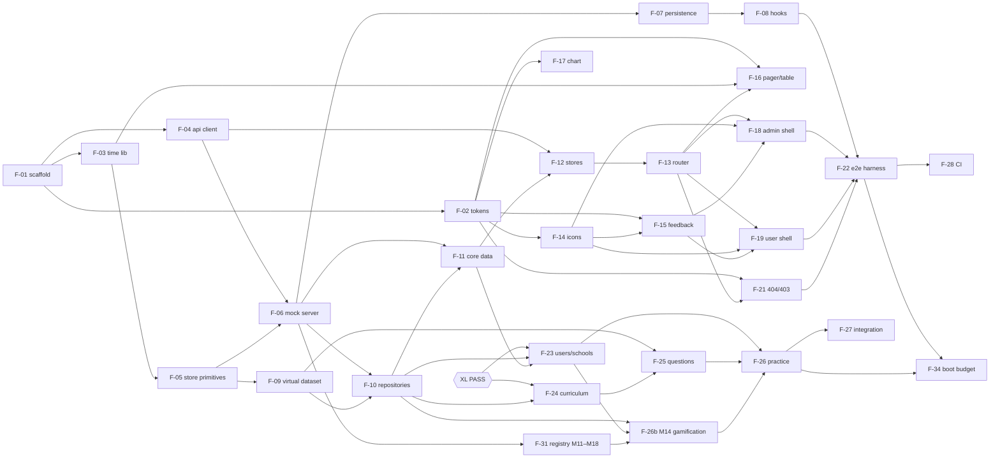
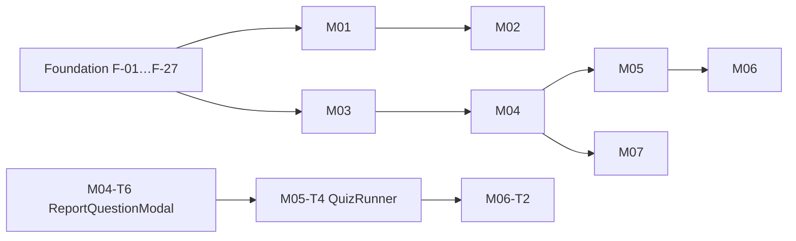
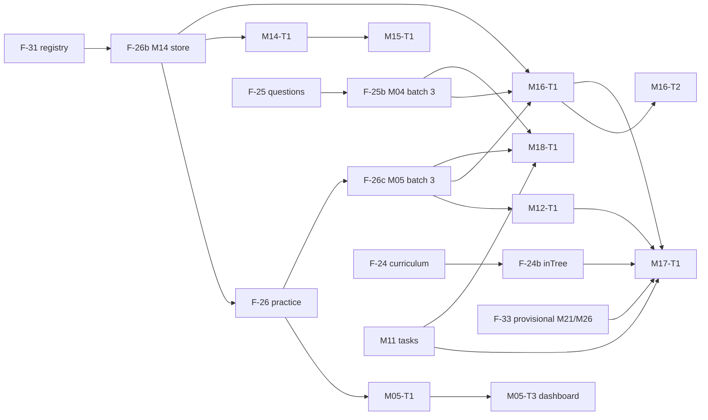

# Build Plan: Foundation and M01–M09

| Field | Value |
|---|---|
| Document | Build plan (G2 → G3) |
| Version | 1.14 |
| Date | 2026-10-01 |
| Status | G2 approved for the foundation and M01–M09. **Active priority: Release 1.0** (§R, user decision D15); §S (student slice) kept as the record of its tasks. The §R tasks of M10–M18 and the §R.8 decisions need the Delivery Lead's / user's G2 confirmation |
| Author | solution-architect (agent) |
| Architecture | [overview.md](overview.md), ADR-0001 … ADR-0014 in `docs/adr/` |

**Change log**

| Version | Date | Change |
|---|---|---|
| 1.0 | 2026-09-25 | First issue. |
| 1.1 | 2026-09-25 | XL round 2 alignment (XL-33/34/37): session status `in_progress \| completed`; M06 sessions through M05 #4–#6 and #23 (no M06 session endpoints); topic progress derived on read (M03 v1.6 BR-19); question dataset per M04 §6.13 (466,041 rows, ids 1–564,161, reserved anchor ranges, runtime floor from M04 v1.5); named count queries (M04 §4.1); documented display constants. |
| 1.2 | 2026-09-25 | **Re-sequenced for the student slice** (user: student prototype first, after G2 approval). New §S with wave order, parallel lanes, file ownership, the first visible milestone and menu behaviour. F-18 (admin shell) deferred; F-20 unblocked (M09 G1). New store tasks F-29 (content, owner M09) and F-30 (classrooms, enrolments, DSKP; owner M10). New module tasks M08-T1…T5 and M09-T1…T5. Split tasks: M03-T1a/b, M04-T6a/b/c, M07-T1a/b, M01-T5a/b, M01-T7a/b. F-11 loses the admin server-status endpoint (moved to F-18). F-22 smoke is user-shell only. Task IDs are otherwise unchanged. |
| 1.3 | 2026-09-26 | **Build follow-ups (overview v1.2).** §S.3 rule 1 lists M02 among the registry entries (10 modules, M01–M10); F-01 text corrected to "pre-populated with 10 module entries". F-06 owns the plugin type in `src/mock/define.ts`, and no later task edits the registries. The e2e build goes to `dist-e2e/`; F-08 acceptance adds a sentinel-based guard that must fail on an e2e build. F-10 keeps static and dynamic `import()` boundary coverage. Carry-over acceptance notes added to F-02, F-03, F-04, F-05, F-07, F-13, F-19 (with a named `src/styles` write for F-19), F-21, F-22, F-28 and M01-T3. |
| 1.4 | 2026-09-26 | **Icon rows for modules** (Delivery Lead decision, ADR-0010 Amendment 2). §S.3 rule 3: each module map file must equal its own table in design-system §6.13 "Module rows" exactly and must not redefine a global row. A new icon is added to §6.13 by the ui-ux-designer first. Only F-14 edits `fa-to-lucide.ts`. **XL2-29** (`docs/qa/audit/cross-module-logic-M08-M11.md` R2.2/R2.4), aligned with the current M04 §7.1, M05 v1.6 SQ-5, M09 §6.11 and M10 §6 docs: F-29 uses the M09 names `articles.latest(5)` and `banners.activeFor(user)`. F-30 seeds only the M10 classes 2001 and 2002 (the only classes guru 5 owns; there is no 2003), keys enrolments by (`kind`, `id`), and provides the M10 repositories `missions.*`, `remedialTests.*` and `questionSets.*`. F-25 names the M04 repositories `questions.*`, `structured.*` and `reports.*`. M05 owns the student side of missions, remedial tests and question sets (M05-T2 handlers and session modes, M05-T7 pages Q4–Q6). |
| 1.5 | 2026-09-26 | **XL batch 2 round 3 Minors, before F-30** (M10 v1.5). XL2-45: F-30 seeds teacher 5302's classes as M10 anchors 2011–2013 (DMO201–203, school 8102, T5, members 5901–5990) instead of "pending". XL2-48: F-30's `remedialTests` repository also provides `remedialTests.get(id)`, used by the M05 Q4 read-only preview. Enrolments are keyed by (`classroomKind`, `classroomId`, `studentId`) (M10 DATA-M10-02). |
| 1.6 | 2026-09-26 | **As built after F-08, F-09, F-10 and the W0.4 review** (overview v1.4; Delivery Lead decisions). F-06: `startMock(options)`, `specHash()` required, `assertRepositoryConventions` at boot. F-08: the "guard fails on `dist-e2e`" check moves to F-13's acceptance. F-09: runtime floor above `idRange` and outside reserved ranges (reserved ranges may lie above it and are skipped), `specHash()` before compile and without `overrideSpec` transforms, 50 ms budget also for text and derived-field filters on ~478k rows, generated ids opaque (M05 sessions up to about `g32122`, accepted). F-10 as built (`@/mock/repository`). F-11: registers `setUser` (writes `pp.auth`). F-13: `bootstrap.ts` awaits `startMock` before Pinia, router and mount; dev-only routes TokenGallery and FeedbackGallery; guard acceptance. F-22: `addInitScript`, `loginAs` via `__MOCK_INIT__.session`, `PLAYWRIGHT_CLOCK_BINDING` wired to `page.clock`, types from `contract.ts`. F-23: schools runtime 10,301+ with 900001–900099 skipped. F-25 and M06-T1: `questions.countWhere(filter)` and `questions.contributeCells(contributor, cells)` (wraps `overrideSpec`, seed phase only). M01-T1: registers `expireSession`; reset mails are outbox type `'password-reset'` with `data.token`. Module common rules: owner handlers and seeds write through their own repository; repository methods are synchronous. |
| 1.7 | 2026-09-26 | **Query budget as decided on F-09's proposal** (overview v1.5, ADR-0013 Amendment 2; Delivery Lead). F-09: 50 ms for facet, id, cheap-field and `search` queries; ≤ 1,500 ms cold and ≤ 50 ms cached for queries that derive every row; API additions `fields`, `search`, `searchFields`, `matchFields`, `cacheKey`, `hashKey(key, salt)`; `specHash()` excludes function bodies. Owner rules for module builders added to F-23, F-25, F-26 and the module common rules: every screen-filtered, searched or sorted derived field is a cheap field or a facet; list-screen search fields go in `searchFields`; bump the plugin `version` whenever seed, `derive` or cheap-field code changes. |
| 1.8 | 2026-09-27 | **XL batch 3 alignment (R2-11 / XL3-36; overview v1.6; Delivery Lead decisions).** The wallet is M14's: F-26 drops the provisional wallet/streak store, and completion step 6 calls `gamification.onSessionCompleted`. **Decision: the M14 gamification store joins the student slice as F-26b** (the dashboard and chips read `wallet.summary`, `streak.get`, `challenges.today`, `learnerBadges.forUser`). Order: F-31 → F-26b → F-26 → M05-T1 → M05-T3. New F-31, the one-time registry extension for M11–M18 (ADR-0009 Amendment 2). New batch-3 store follow-ups F-24b (M03 `inTree`), F-25b (M04 `jutawanQuestions`, `coverageExcluded`, ImportRun), F-26c (M05 KirkpatrickSessionAggregate, PupilSubjectAccuracy, Q-WEEK-RANK) and F-33 (provisional M26 mood / tuition and M21 sponsor stores, hosted in M17). M08-T1 builds ItemStatistic and reads the M14 wallet; M01-T1 calls `gamification.onLogin` and `referrals.onRegistered`; M05-T1 hooks `mock.addSession` and `mock.addAnswer({…})`; M07-T1a records PKSK practice as M05 mode `pksk`. New §2.9–§2.16: batch-3 task rows M12–M18 and waves B3.0–B3.9 after the student slice. Fixture schools 900001–900004; canonical account 4 at 900004 (F-11, F-23). |
| 1.9 | 2026-09-27 | **Review follow-ups (overview v1.7; Delivery Lead decisions).** F-22 fixture wiring as built: `clockMode: 'install' \| 'none'`; the clock is installed on the context and the bridge exposed with `context.exposeFunction` (covers `newTab`); with `'install'` the fixture never sends `now` in `__MOCK_INIT__` (e2e `passthrough`, offset 0); `gotoApp` / `waitForApp` with a 15 s boot timeout, `expect.timeout` 5 s (F-22 review finding 8). F-09 as built: the perf test policy (`npm run test` unit only; `npm run test:perf` on a quiet machine, required at G4 for perf-sensitive tasks and at QA; the `perf-calibration.ts` harness). F-26: the **M05 → M14 read contract** (`practice.history` unpaged with `date`/`modes`, `practice.answers(userId, {date})`, `practice.mastery`), accepted by M14's `m05-contract.test.ts`. **New F-34** mock boot budget (warm boot ≤ 2,000 ms; boot perf test and `waitForApp` telemetry). Module common rules: **doc editing rule** (targeted edits only, re-read before editing, never write another module's doc) and **D14** (no payment-gateway or external-platform screens; simulate success or failed only, overview C13). |
| 1.10 | 2026-09-27 | **F-26 G4 review follow-ups (overview v1.8; Delivery Lead decisions).** F-34 values and the C13 wording approved. F-26: decision (a), replicate live: the **stored** session `coinsEarned` follows M05 BR-09 (correct, or 3 × correct for `mission`); M14's `onSessionCompleted` return is the wallet credit, returned in the #6 response only (bullet and Accept fixed). M05-T1: F-26 already contributes the 600001–600065 question anchors and the canonical P1–P4 / M1–M4 / A2–A5 sessions and answers; M05-T1 must not re-contribute them. The pelajar trial "32 used" seed belongs to M01 / F-23. Module common rules: **anchor-answer id ranges** (500,001–509,999 M05; 510,001–999,999 other contributors; M05 SRS §6.2). |
| 1.11 | 2026-09-27 | **Release 1.0 re-plan (user decision D15).** New **§R** supersedes §S as the build priority: the 1.0 screen map for the three roles (§R.1: 54 menu items, 33 with a G1 SRS, 11 not yet discovered), the remaining foundation for 1.0 (§R.2: F-16, **F-18 now in 1.0** (M11 S2–S5 and M12 S1–S8 use the admin shell for the teacher), F-25b, F-26c, F-27, F-28, F-29, F-30, F-33, F-34; new F-22b, F-19b and F-11b), module tasks with files, acceptance and E2E (§R.3). **New tasks:** M08-T1b, M08-T6, M08-T7; M10-T1…T7; M11-T1…T4 (closes the §2.15 "M11 tasks missing" gap); M16-T4a, M16-T6a; M17-T1a, M17-T3a; M18-T1a, M18-T4a; 11 placeholders P-*. **Splits:** M16-T4/T6, M17-T1/T3 and M18-T1/T4 (the rest keeps its ID and follows after 1.0). **Changed dependency:** M12-T1 needs M08-T1b (headcount), not only M08-T1. Waves R0–R11 with up to 6 lanes (§R.4), per-role critical paths (§R.5), XL status (§R.6), design-spec rule (§R.7), open decisions OD-R1…OD-R10 (§R.8). **Finding:** the ten `/admin-sekolah/*` screens of the Admin Sekolah 1.0 column are in no SRS (not only the three being discovered) (OD-R1). |
| 1.12 | 2026-09-30 | **§R aligned with the M27 discovery and user decisions** (`docs/discovery/M27-school-admin.md`, R10). (1) Admin Sekolah Monitoring and Kirkpatrick are **aliases** of M11 S2 and M12 S1 (identical content on live): G1 yes, built through M11-T3 and M12-T2 as an alias route, school scope INFERRED; P-SA-MON and P-SA-KIRK are dropped. (2) The 8 other non-buildable Admin Sekolah items (incl. Command Center, 403) are **Deferred (user, 2026-09-30) — needs school-admin account** and leave the 1.0 waves; their P-SA-* placeholders are parked. (3) Heatmap Topik Lemah: owner M25, route `/buku-nota/heatmap`; P-HTL-T1/T2 kept. (4) **F-19b is now unconditional** and also fixes the 5 sidebar hrefs that 404 on live (D-M27-02) and the Heatmap href. (5) Foundation status per TRACKER 2026-09-30 (§R.2, §R.4). (6) §R.1.4 recounted: 54 items, 45 G1, 1 awaiting G1, 8 deferred. (7) Stale text removed: the "optional sticky action column" of `DataTableCard` (F-16 body; M02-T4 now says in-card scroll below the fit width), per design-system §7.4 (XL-21); overview.md updated to match. |
| 1.14 | 2026-10-01 | **M08 build outcomes (doc only; Delivery Lead).** S4, S10 and S11 are built in M08-T5 (`routes/prestasi.ts`, `routes/analisa-item.ts`); M08-T7 adds S5, S8 and the teacher variants and extends those pages without recreating them, and its `routes/class.ts` claim for S4/S10/S11 is removed. §R.6a gains two items: the boot budget not met (F-34) and the M03 `fetchSubjects` export. |
| 1.13 | 2026-09-30 | **G4 review follow-ups (doc only).** M08-T7 also owns endpoints #5 and #8 (files `mock/handlers/class*`, `mock/repository/class*`, `api/class*`; depends on M08-T1b; asserts the §6.10 S8 RiskProfile anchors); M08-T1 notes the same. M10-T1 does not register #39–#41 (served by M04 `handlers/dskp.ts`, Delivery Lead decision 2026-09-30). M05-T1 drops #22 (M04-T6a) and adds the `answerChapter` hook. New §R.6a lists the open cross-module items. |

---

## R. Release 1.0 (v1.12, user decision D15): the active priority

§R replaces §S as the build priority. §S stays as the record of the student-slice tasks. Every §S or §2 task that §R names keeps its ID, scope and file ownership (§S.3). Tasks not named here are not cancelled; they follow after 1.0 (D15 sets a priority, not a scope cut).

### R.0 Sources, accounts and scope rules

- **Sources:** `roles-matrix/Matriks-Akses-Peranan .xlsx`, sheet 1 columns H–J ("Murid 1.0", "Guru 1.0", "Admin Sekolah 1.0") and sheet 2 (D-RAM-1…4). The live menus in `src/shells/nav/user-nav.ts` (F-19, transcribed from the `roles-matrix` screenshots; the hrefs of teacher and school-admin items are partly INFERRED there). The SRS §2 route tables and §9 permission matrices of M01, M04, M05, M06, M08–M12, M16–M18.
- **1.0 accounts** (canonical, TRACKER): `pelajar@demo.test` (2, student, Ting. 4, SMK DEMO 900001); `guru@demo.test` (5, teacher, SMK DEMO, classes 2001/2002); `adminsekolah@demo.test` (8, school_admin, SMK DEMO).
- **1.0 reach rule (proposed; confirm with OD-R6).** A 1.0 menu item includes:
  - (a) the screen its menu link opens;
  - (b) the sub-screens of the same SRS feature that are reached from it: drill-downs, create and edit forms, quiz pages;
  - (c) the auth flow (login, register, password reset, logout) and the user-shell chrome target present on every page (the bell → `/notifikasi`).

  Every other link out of a 1.0 screen follows §S.5: its route is not registered, so it shows the 404 page until its task is built. §R.8 OD-R6 lists the known cases.
- **Shells.** Every 1.0 screen uses the user shell (F-19, built), except:
  - M10 S2 and M17 S4–S7: standalone, no shell;
  - M11 S2–S5 (M11 FR-M11-04) and M12 S1–S8 (M12 E2E-M12-07): the **admin-panel shell, also for the teacher** (provisional). **F-18 therefore enters 1.0** (§R.2, OD-R5).
- **Gates.** Each task passes G3 as in §0. Each module's **1.0 part** passes G4, then G5 against the ACs and E2E ids of its 1.0 screens only; the module stays partly built on the board. Release 1.0 G6 = F-28 pipeline green on the 1.0 branch, plus the user's explicit deploy confirmation.

### R.1 The 1.0 screen map

Column key:
- **G1:** yes = an approved SRS covers the screen; no = not yet discovered.
- **Spec:** "SRS" = the §R.7 rule applies (SRS §2 / §8 / §10, discovery screenshots, design system and shells); "shells v1.2" = also needs D-R1.
- **Stores:** the F-task or module task that owns each store the screen reads (D12).

#### R.1.1 Murid 1.0 (account 2): 4 account items + 13 screens

| # | Menu item | Route(s) | Module · screens | Build task(s) | Stores | G1 | Spec |
|---|---|---|---|---|---|---|---|
| A1 | Profil Saya | `/profile`, `/profile/edit` | M01 S7, S8 | M01-T6 | users, schools (F-23); settings (M01-T1) | yes | SRS |
| A2 | Tetapan Peribadi | `/tetapan` (sidebar Pusat AI "Tetapan Peribadi"; drawer "Tetapan") | M01 S9, user-shell variant | M01-T7a | settings (M01-T1) | yes | SRS |
| A3 | Panduan | `/panduan` (sidebar); `/pusat-tuisyen/panduan` (drawer) | M09 S26, S27 | M09-T5 | support config (F-29) | yes | SRS |
| A5 | Log Keluar | `/logout` (drawer, header and sidebar controls) | M01 S6, FR-M01-36/37 | M01-T5a | auth sessions (F-11) | yes | SRS |
| 2 | Dashboard | `/dashboard` | M05 S1 | M05-T3 | practice (F-26), gamification (F-26b), banners and articles (F-29), users (F-23) | yes | SRS |
| 3 | Headcount | `/headcount` | M08 S12 (pelajar → 403, M08 v1.11 FR-M08-08, PROPOSED) | M08-T6 | headcount (M08-T1b), classrooms (F-30) | yes; resolved M08 v1.11 (OD-R3) | SRS |
| 4 | Prestasi | `/prestasi` → `/prestasi/sekolah`; `/prestasi/tingkatan[/t4\|t5]`; `/prestasi/{self}` | M08 S1–S3 (own school, INFERRED), S6 (self) | M08-T5; M08-T2 (S6) | M08 read models (M08-T1), practice, users and schools, classrooms | yes (pelajar access INFERRED) | SRS |
| 5 | Analitik Adaptif | `/analitik/pelajar` | M08 S7 | M08-T2 | M08-T1, practice | yes | SRS |
| 6 | Analisa Item | `/analisa-item` (redirect; for pelajar → `/dashboard`); `/analisa-item/kelas*` → 403 | M08 redirect, S10/S11 403 | M08-T5 | — | yes; resolved M08 v1.11 (OD-R4: pelajar → `/dashboard`) | SRS |
| 7 | Video | `/video`, `/video/:id`, `/video/tambah`, `/video/:id/edit` | M09 S17–S20 | M09-T3 | videos D11 (F-29) | yes | SRS |
| 8 | Kelas Saya | `/kelas-saya` (`?kod=`) | M10 S33 | M10-T7 | classrooms, enrolments (F-30) | yes | SRS |
| 9 | Soalan by Chapter | `/practice/chapter`, `/practice/chapter/:code`, `…/:chapterId/quiz` | M05 S4, S5, Q2 (S6/S7 revision come with the same task) | M05-T5 (needs M05-T4, M04-T6a) | curriculum (F-24), questions (F-25), practice (F-26) | yes | SRS |
| 12 | Remedial | `/remedial/saya`, `/remedial/:id` | M05 S13, Q4 (PROPOSED) | M05-T7 (needs M05-T2, M05-T4) | remedial tests (F-30), practice | yes | SRS (Q4 uses the M05 §10 row "Q1/Q2/S7", same `QuizRunner`) |
| 13 | SPM | `/spm` and every M06 route; `/latihan-berstruktur?scope=spm[&track=bahasa]` | M06 S1–S13, Q1–Q4; M05 S10 SPM variants, Q3 | M06-T1…T4, M05-T7 | questions and SPM pool (F-25, M06-T1 cells), practice, MockExam (M06-T1) | yes | SRS |
| 14 | Heatmap Topik Lemah | `/buku-nota/heatmap` (observed in R10; the `user-nav.ts` href `/heatmap-topik-lemah` is 404 on live, fixed by F-19b) | owner **M25** (R10 discovery); needs URS/SRS, audit and G1 | P-HTL-T1/T2 (placeholder) | to be defined (likely the answer log and curriculum) | no (awaiting G1) | after its SRS |
| 21 | Permainan | `/permainan` | M16 S6 | M16-T4a (needs M16-T1, M16-T2) | rooms and battles (M16-T1/T2), users | yes | SRS |
| 54 | Laporan Soalan | `/laporan-soalan` | M04 S13 | M04-T6b | reports (F-25) | yes | SRS |

#### R.1.2 Guru 1.0 (account 5): 4 account items + 15 screens

| # | Menu item | Route(s) | Module · screens | Build task(s) | Stores | G1 | Spec |
|---|---|---|---|---|---|---|---|
| A1 | Profil Saya | `/profile`, `/profile/edit` (sidebar LAIN-LAIN and drawer) | M01 S7, S8 | M01-T6 | users, schools | yes | SRS |
| A2 | Tetapan Peribadi | `/tetapan` | M01 S9 (user shell) | M01-T7a | settings (M01-T1) | yes | SRS |
| A3 | Panduan | `/panduan`; drawer `/pusat-tuisyen/panduan` | M09 S26, S27 | M09-T5 | F-29 | yes | SRS |
| A5 | Log Keluar | `/logout` | M01 S6 | M01-T5a | F-11 | yes | SRS |
| 1 | Command Center | `/guru/command-center`; drill-downs `/guru/command-center/school/{id}[/teacher/{uid}]`, `/classroom/{id}`, `/student/{uid}` | M10 S2 (standalone); M17 S4–S7 component mounted by M10 (FR-M17-60) | M10-T3, M10-T4, M17-T1a, M17-T3a | classrooms (F-30), practice (F-26), feedback T1 (M12-T1), badges (F-26b), mood (F-33), headcount (M08-T1b) | yes | SRS |
| 2 | Dashboard Guru | `/guru` | M10 S1 | M10-T2 | classrooms, missions (F-30), questions (F-25), practice | yes | SRS |
| 3 | Headcount | `/headcount`, `/headcount/dashboard`, `/headcount/create`, `/headcount/student/{id}`, `/headcount/{id}`, `/headcount/{id}/summary`, the L-12 pages, `/headcount/{id}/export` | M08 S12–S15, S22, S23 | M08-T6 | headcount (M08-T1b), classrooms, practice | yes (teacher INFERRED) | SRS |
| 4 | Prestasi | `/prestasi/kelas`, `/prestasi/kelas/{id}` (→ S6 per pupil) | M08 S4, S5 (+ S6) | S4: M08-T5; S5: M08-T7 (+ M08-T2) | M08-T1, classrooms | yes | SRS |
| 5 | Analitik Adaptif | `/analitik/pelajar` (href INFERRED) | M08 S7 (own) | M08-T2 | M08-T1 | yes | SRS |
| 6 | Analisa Item | `/analisa-item` → `/analisa-item/kelas` → `/analisa-item/kelas/{id}` | M08 S10, S11 | M08-T5 (teacher variants extended in M08-T7) | ItemStatistic (M08-T1), classrooms | yes (teacher INFERRED) | SRS |
| 6b | Analisis Item (LAIN-LAIN) | `/guru/analisis-item` | M11 S6 | M11-T2 | answer log (F-26), questions (F-25), classrooms | yes | SRS |
| 7 | Video | as Murid #7 | M09 S17–S20 | M09-T3 | F-29 | yes | SRS |
| 8 | Kelas Saya | `/guru/kelas`, `/guru/kelas/cipta` (+ QR modal); `/guru/kelas/:id` → 404 (S35) | M10 S4, S5 | M10-T5 | classrooms (F-30), schools | yes | SRS |
| 9 | Soalan by Chapter | as Murid #9 | M05 S4, S5, Q2 | M05-T5 | as Murid | yes | SRS |
| 10 | Monitoring | `/guru/monitoring`, `/sekolah/{id}`, `/sekolah/{id}/pelajar/{uid}`, `/sekolah/{id}/guru/{uid}` | M11 S2–S5 (admin shell) | M11-T3 (needs F-18) | users and schools (F-23), answer log (F-26), MonitoringFlag (M11-T1), battles and game results (M16-T1/T2) | yes (teacher UNVERIFIED) | SRS + shells v1.2 |
| 11 | Kirkpatrick: Ringkasan, T1: Reaksi, T2: Pembelajaran, T3: Tingkah Laku, T4: Hasil, Rantaian Impak, Intervensi | `/guru/kirkpatrick`, `…/reaction`, `/learning`, `/behavior`, `/results`, `/chain`, `/interventions` (+ `/pelajar/{id}`) | M12 S1–S7 (+ S8), admin shell | M12-T2, M12-T3, M12-T4 (need M12-T1, F-18) | feedback and interventions (M12-T1), KirkpatrickSessionAggregate (F-26c), headcount (M08-T1b), classrooms | yes (teacher provisional) | SRS + shells v1.2 |
| 41 | Pelajar Saya | `/guru/pelajar` (tabs `mine` / `school`) | M10 S6 | M10-T5 | enrolments (F-30), users | yes | SRS |
| 42 | Laporan | `/guru/laporan` (`?range=&classroom_id=`) | M11 S1 | M11-T2 | answer log, sessions, battles and game results (M16), classrooms | yes (teacher INFERRED) | SRS |
| 43 | Laporan Mingguan | `/guru/laporan-mingguan-kelas` (`?week=`, `/{id}`) | M11 S8, teacher variant (PROPOSED, DV-M11-19) | M11-T4 | — | yes | SRS |
| 44 | Sumbang Soalan | `/guru/soalan`, `/guru/soalan/cipta`, `/guru/soalan/{id}`, `/guru/soalan/{id}/edit` | M10 S21–S24 | M10-T6 | questions (F-25, teacher writes through `questions.*`), teacher tiers (F-26b), curriculum (F-24), DSKP (F-30) | yes | SRS |

#### R.1.3 Admin Sekolah 1.0 (account 8): 1 account item + 17 screens (v1.12: 10 buildable, 8 deferred)

M27 discovery (`docs/discovery/M27-school-admin.md`, 2026-09-30): Monitoring and Kirkpatrick return 200 with content identical to `/admin/monitoring` (M11 S2) and `/admin/kirkpatrick` (M12 S1), so they are aliases. The other pages return 302 → `/admin-sekolah/pilih-sekolah` → 500 (Command Center: 403). **Deferred (user, 2026-09-30) — needs school-admin account**; the 8 deferred rows are dropped from the 1.0 waves. The plan's row names come from the `roles-matrix` screenshots; M27 also lists "Dashboard `/admin-sekolah`" and "Urus Pengguna". F-19b reconciles the names and hrefs when the account exists (Command Center and Laporan Aktiviti map to those two names as far as the discovery shows; Perlu pengesahan).

| # | Menu item | Route(s) | Module · screens | Build task(s) | Stores | G1 | Spec |
|---|---|---|---|---|---|---|---|
| A5 | Log Keluar | `/logout` | M01 S6 | M01-T5a | F-11 | yes | SRS |
| 1 | Command Center | `/admin-sekolah/command-center` (403 on live) | Deferred (user, 2026-09-30) — needs school-admin account | P-SA-CC (parked) | tbd | no | after its SRS |
| 3 | Headcount | `/headcount` | M08 S12 (school admin → own-school admin view, empty state, M08 v1.11, INFERRED) | M08-T6 | headcount (M08-T1b) | yes; resolved M08 v1.11 (OD-R3) | SRS |
| 4 | Prestasi | `/prestasi` → `/prestasi/sekolah` | M08 S1 (own school, INFERRED) | M08-T5 | M08-T1, users and schools | yes | SRS |
| 5 | Analitik Adaptif | `/analitik/pelajar` | M08 S7 (own) | M08-T2 | M08-T1 | yes | SRS |
| 6 | Analisa Item | `/analisa-item` (redirect → `/analisa-item/sekolah` S9, M08 v1.11 DV-02, INFERRED) | M08 redirect / S9 | M08-T5 | ItemStatistic (M08-T1) | yes; resolved M08 v1.11 (OD-R4) | SRS |
| 7 | Video | as Murid #7 (school admin: own videos, M09 §9) | M09 S17–S20 | M09-T3 | F-29 | yes | SRS |
| 10 | Monitoring | `/admin-sekolah/monitoring` (200 on live; alias of `/admin/monitoring`) | M11 S2 (alias; school scope INFERRED; shells.md v1.2, user shell) | M11-T3 (alias route) | as M11 S2 | yes | SRS + shells v1.2 |
| 11 | Kirkpatrick | `/admin-sekolah/kirkpatrick` (200 on live; alias of `/admin/kirkpatrick`) | M12 S1 (alias; school scope INFERRED; shells.md v1.2, user shell) | M12-T2 (alias route) | as M12 S1 | yes | SRS + shells v1.2 |
| 45 | Sekolah Bersaing | `/sekolah-bersaing` (`?week=`) | M16 S28 | M16-T6a (needs M16-T1) | Sekolah Bersaing snapshots (M16-T1), schools | yes | SRS |
| 46 | Statistik Penggunaan | `/admin-sekolah/statistik-penggunaan` (302 → 500 on live) | Deferred (user, 2026-09-30) — needs school-admin account | P-SA-STAT (parked) | tbd | no | after its SRS |
| 47 | DSKP Heatmap | `/admin-sekolah/dskp-heatmap` (302 → 500 on live) | Deferred (user, 2026-09-30) — needs school-admin account | P-SA-DSKP (parked) | likely DSKP (F-30) and the answer log | no | after its SRS |
| 48 | Laporan Aktiviti | `/admin-sekolah/laporan-aktiviti` (sidebar href 404 on live, D-M27-02) | Deferred (user, 2026-09-30) — needs school-admin account | P-SA-LA (parked) | tbd | no | after its SRS |
| 49 | Amaran Awal | `/amaran`, `/amaran/kelas/{id}`, `/amaran/sekolah/{id}`, `/amaran/keberkesanan`, `/amaran/ringkasan-eksekutif`, `/amaran/intervensi/{studentId}`, exports #29/#30 | M18 S16, S17, S21, S22, S23, S24 | M18-T4a (needs M18-T1a) | interventions and risk (M18-T1a), classrooms, practice, streak (F-26b), PupilSubjectAccuracy (F-26c) | yes (school admin INFERRED) | SRS |
| 50 | Laporan Bulanan | `/admin-sekolah/laporan-bulanan` (302 → 500 on live) | Deferred (user, 2026-09-30) — needs school-admin account | P-SA-LB (parked) | tbd | no | after its SRS |
| 51 | Senarai Pelajar | `/admin-sekolah/pelajar` (302 → 500 on live) | Deferred (user, 2026-09-30) — needs school-admin account | P-SA-PEL (parked) | tbd (users, enrolments) | no | after its SRS |
| 52 | Senarai Guru | `/admin-sekolah/guru` (302 → 500 on live) | Deferred (user, 2026-09-30) — needs school-admin account | P-SA-GURU (parked) | tbd (users) | no | after its SRS |
| 53 | Kelas Sekolah | `/admin-sekolah/kelas` (302 → 500 on live) | Deferred (user, 2026-09-30) — needs school-admin account | P-SA-KELAS (parked) | tbd (classrooms, F-30) | no | after its SRS |

Deferred rows stay in the map as the record; they have no wave slot until the user provides a school-admin account (OD-R1).

#### R.1.4 Counts

| Role | Menu items | G1 SRS | Awaiting G1 | Deferred (user, 2026-09-30) |
|---|---|---|---|---|
| Murid 1.0 | 17 (4 account + 13) | 16 | 1 (Heatmap Topik Lemah, M25) | 0 |
| Guru 1.0 | 19 (4 account + 15; Kirkpatrick counted once, with 7 sub-items) | 19 | 0 | 0 |
| Admin Sekolah 1.0 | 18 (1 account + 17) | 10 (Log Keluar, Headcount, Prestasi, Analitik Adaptif, Analisa Item, Video, Monitoring (alias), Kirkpatrick (alias), Sekolah Bersaing, Amaran Awal) | 0 | 8 (Command Center, Statistik Penggunaan, DSKP Heatmap, Laporan Aktiviti, Laporan Bulanan, Senarai Pelajar, Senarai Guru, Kelas Sekolah) |
| **Total** | **54** | **45** | **1** | **8** |

Check: 45 + 1 + 8 = 54. Buildable in 1.0 now: 45 items (45 with G1) plus Heatmap once it has its G1.

Counted per menu item, the same screen appears under more than one role (e.g. Video, Profil Saya).

| Module | 1.0 screens (distinct) | 1.0 build tasks |
|---|---|---|
| M01 | S1–S9, S11 (auth flow, profile, tetapan, logout, notifikasi) | T1, T2, T3, T4, T5a, T6, T7a, T8 |
| M04 | S13, S14 | T6a, T6b |
| M05 | S1, S4, S5, Q2, S13, Q4, S10 (SPM variants), Q3 (plus S2, S3, Q1, S6, S7, S14, S15, Q5, Q6 carried in the same tasks) | T1, T2, T3, T4, T5, T7 |
| M06 | S1–S13, Q1–Q4 | T1, T2, T3, T4 |
| M08 | S1–S7, S9–S15, S22, S23, the L-12 pages, the redirect (S4, S10 and S11 built in M08-T5; S5 and S8 in M08-T7, which extends S4/S10/S11 for teachers) | T1, T1b, T2, T5, T6, T7 |
| M09 | S17–S20, S26, S27 | T1, T3, T5 |
| M10 | S1, S2, S4, S5, S6, S21–S24, S33 | T1–T7 (new) |
| M11 | S1, S2–S5, S6, S8 | T1–T4 (new) |
| M12 | S1–S8 (`/guru` prefix) | T1, T2, T3, T4 |
| M16 | S6, S28 | T1, T2, T4a, T6a |
| M17 | S4–S7 (as the M10 mount) | T1a, T3a |
| M18 | S16, S17, S21–S24 | T1a, T4a |
| Placeholders | 1 active screen (Heatmap Topik Lemah) plus 8 parked | Active: P-HTL. Parked (deferred by the user): P-SA-CC, P-SA-STAT, P-SA-DSKP, P-SA-LA, P-SA-LB, P-SA-PEL, P-SA-GURU, P-SA-KELAS (each T1 + T2). P-SA-MON and P-SA-KIRK are dropped (aliases through M11-T3 and M12-T2) |

52 module build tasks: 32 already defined in §2, 6 split from §2 tasks (M16-T4a, M16-T6a, M17-T1a, M17-T3a, M18-T1a, M18-T4a) and 14 new (M08-T1b, M08-T6, M08-T7, M10-T1…T7, M11-T1…T4). Plus 2 active placeholder tasks (P-HTL-T1/T2) and 16 parked ones (8 × T1/T2). The alias routes add no task; they are part of M11-T3 and M12-T2.

### R.2 Foundation work that 1.0 still needs

Status at 2026-09-30 (TRACKER). **G4 Approved:** F-01…F-08, F-09, F-10…F-17 (incl. F-16), F-19, F-20, F-21, F-22, F-23, F-24, F-25, F-26, F-26b, F-31. **Built, G4 pending or in progress:** F-29 (in review), F-18 (review pending). **Running:** F-30. **Started:** M01-T1, M01-T2, M05-T1.

| ID | Status | Needed in 1.0 by | Notes |
|---|---|---|---|
| F-09 | G4 Approved | every dataset query | Re-run `npm run test:perf` for the dataset owners when their seeds change (perf caps may move) |
| F-23 | G4 Approved | every task | F-30, M01-T1 and M10-T1 build on the as-built contract |
| F-26 | G4 Approved | M05-T1, M08-T1, F-26c, F-27, F-34 | ★ milestone step |
| **F-16** pager, table, form classes | G4 Approved | M01-T6, M01-T8, M09-T3, M08-T6, M10-T5/T6, M11-T3, M12-T4, M18-T4a | Built without a sticky action column (design-system §7.4, XL-21) |
| **F-18** admin-panel shell | built, review pending; **in 1.0** | M11-T3 (S2–S5), M12-T2/T3/T4 (S1–S8) on `/guru/*` | Needs D-R1 (shells v1.2) first. 1.0 acceptance adds: guru (account 5) on `/guru/monitoring` and `/guru/kirkpatrick` gets the admin shell with the nav decided in OD-R5; no h-scroll at 375/768/1280. Takes `GET /api/admin/server-status` (from F-11) as planned |
| **F-29** content store | built, G4 in review | M05-T1 (banners, latest articles), M09-T1 (videos, panduan config) | ★ milestone step |
| **F-30** classrooms, enrolments, DSKP, missions, remedial tests, question sets | running | M05-T2, M06-T1, M08-T1, M10-*, M11-T1, M12-T1, M18-T1a | Also provide the (`teacherId`) and (`schoolId`) reads that the teacher and school-admin screens use: `classrooms.forTeacher`, `classrooms.forSchool(schoolId)`, `members` |
| **F-26c** M05 batch-3 stores | not built | M12-T1 (session aggregates), M16-T1/T2 (`practice.weekRank`), M18-T1a (PupilSubjectAccuracy) | Entry: XL batch 3 PASS (met) |
| **F-25b** M04 batch-3 store items | not built | M16-T1/T2 (Jutawan dataset `questions.jutawan.*`) | Only because M16-T1/T2 are in 1.0 |
| **F-33** provisional mood / tuition / sponsor stores | not built | M10-T3 (CC "mood" drill), M17-T1a (S7 "Trend Mood (30 Hari)") | Hosted in the M17 plugin (§2.9) |
| F-24b M03 `inTree` | not built | **not needed in 1.0** (M17 S10 only) | After 1.0 |
| **F-27** cross-store integration tests | not built | quality gate for the 1.0 stores | Add flow E (v1.11): teacher creates a class (M10 #13) → student joins by code (#74) → the class appears on `/kelas-saya`, `/guru/pelajar` and `/prestasi/kelas` |
| **F-28** CI pipeline (DO) | not built | G6 for Release 1.0 | Unchanged; run the E2E projects on the 1.0 smoke tags |
| **F-34** mock boot budget | not built | every 1.0 module adds boot work (M08, M10, M11, M12, M16, M18 plugins) | Warm boot ≤ 2,000 ms stays the budget; each 1.0 mock task reports its boot delta at G4 |
| **F-22b** (new) | — | E2E of the admin shell and of the role landing | See below |
| **F-19b** (new, **unconditional** since v1.12) | — | nav hrefs from observed routes (D-M27-02, Heatmap) | See below |
| **F-11b** (new, conditional) | — | landing pages if OD-R2 changes them | See below |
| **D-R1** (new, ui-ux-designer) `docs/design/shells.md` v1.2 | — | F-18, M11-T3, M12-T2…T4 | See §R.7 |

**New foundation tasks**

- **F-22b E2E: admin-shell smoke and role landing (FE, S; depends F-18, F-22, M01-T3).** Files: `e2e/global/admin-shell.spec.ts`, `e2e/global/role-landing.spec.ts` (F-22's folder; its follow-up). *Accept:*
  - accounts 2, 5 and 8 log in through the UI and reach their landing page (M01 BR-07, or OD-R2's decision);
  - the teacher's user-shell menu equals `navFor('teacher', …)` and the school admin's equals `navFor('school_admin', …)`;
  - the teacher on `/guru/monitoring` gets the admin shell;
  - `expectNoHorizontalScroll` passes on all three Playwright projects (375 / 768 / 1280).
- **F-19b Nav href fix from observed routes (FE, S; unconditional since v1.12).** Update in `src/shells/nav/user-nav.ts` and its test:
  - the 5 sidebar hrefs that 404 on live (D-M27-02): Laporan Aktiviti, Import Pelajar, Aktiviti Guru, Langganan, Invois, each set to the route observed in `docs/discovery/M27-school-admin.md`;
  - the Murid Heatmap Topik Lemah href `/heatmap-topik-lemah` (404 on live) → `/buku-nota/heatmap` (R10);
  - the other INFERRED hrefs, labels or icons of the school-admin items and the teacher's "Analitik Adaptif" and "Analisa Item", where observed.

  Items deferred by the user keep their INFERRED hrefs and are marked as such until a school-admin account exists. Only F-19 edits the nav (§S.3 rule 4). *Accept:* the nav test matches the observed routes; the user-nav test still passes.
- **F-11b Landing follow-up (FE, S; conditional on OD-R2).** Change `src/mock/auth/landing.ts` and its core test, only if M01 BR-07 is changed by its analyst. *Accept:* the core landing test and the F-22b landing spec pass.

### R.3 Module build tasks for 1.0

The §2 common rules apply to every task (shared-store repositories, owner writes, cheap fields, seed version, perf and boot, D14, anchor-answer ids, doc editing rule). File ownership follows §S.3:
- a module **mock task** writes `mock/{handlers,seeds/<task>*,hooks}`, `api/**`, `routes.ts`, the creation of **every** `routes/*.ts` fragment, `index.ts` and its icon map;
- a batch-3 mock task and the new owner-store tasks below also write their module's own `mock/{repository,tables,datasets,data}`;
- a **UI task** writes only its `pages/`, `components/<group>/`, `composables/<group>*`, `routes/<group>.ts`, `constants/<group>*`, `__tests__/<group>/` and `e2e/<slug>/smoke-<group>.spec.ts`.

**E2E convention for every UI row:**
- one smoke spec per task, tag `@smoke @r1`;
- it runs on the three Playwright projects (375 / 768 / 1280) through `loginAs(<account>)` and `gotoApp(<route>)`;
- it asserts the exact tab title and the header title of SRS §2, one key copy string of SRS §8, and `expectNoHorizontalScroll`.

QA writes the full `E2E-Mxx-nn` suite of the 1.0 screens at G5.

#### R.3.1 Tasks already defined (IDs, scope and dependencies of §2; the 1.0 acceptance and smoke are added here)

| ID | 1.0 item(s) | Files (in addition to the §S.3 rule) | 1.0 acceptance | Smoke E2E (375/768/1280) |
|---|---|---|---|---|
| M01-T1 | login, logout, all roles | `src/modules/m01-authentication/mock/handlers/auth*`, `api/auth*` | Login of accounts 2, 5, 8 returns their session and landing (BR-07); account 11 refused (BR-23) | — (Vitest) |
| M01-T2 | bell badge | `mock/handlers/notifications*`, `mock/seeds/notifications*` | §6.8 seeds; `meta.counts` per account | — (Vitest) |
| M01-T3 ★ | login, register | `pages/LoginPage.vue`, `RegisterPage.vue`, `routes/auth.ts` | FR-M01-01…26 copy; accounts 2, 5, 8 land on their landing page | `e2e/m01-authentication/smoke-auth.spec.ts`: "Log Masuk - PRESTASIPLUS"; UI login per account |
| M01-T4 | auth flow | `pages/Password*Page.vue`, `routes/password.ts` | FR-M01-27…35 | `smoke-password.spec.ts` |
| M01-T5a | Log Keluar | `components/account/**`, `routes/logout.ts` | FR-36/37/49/51/52/53 for accounts 2, 5, 8 (drawer "Log Keluar", sidebar identity, badge "99+" rule) | `smoke-account.spec.ts`: logout from the drawer at 375 and the header at 1280 → `/login` |
| M01-T6 | Profil Saya | `pages/ProfilePage.vue`, `ProfileEditPage.vue`, `routes/profile.ts` | FR-M01-38…45 for accounts 2 and 5 | `smoke-profile.spec.ts`: "Profil Saya - PRESTASIPLUS" |
| M01-T7a | Tetapan Peribadi | `pages/TetapanPage.vue`, `routes/tetapan.ts` | FR-M01-46/48, user shell for 2 and 5 | `smoke-tetapan.spec.ts`: tab "Tetapan Peribadi" |
| M01-T8 | bell target (chrome) | `pages/NotifikasiPage.vue`, `routes/notifikasi.ts` | FR-M01-54…64 | `smoke-notifikasi.spec.ts`: "Notifikasi - PRESTASIPLUS" |
| M04-T6a | modal used by quizzes | `components/report/**` (export in `index.ts`) | XL-09 props; MCQ report deactivates in one transaction | via M05-T4 |
| M04-T6b | Laporan Soalan | `pages/LaporanSoalanPage.vue`, `routes/laporan-soalan.ts` | S13 counters and list for account 2 | `e2e/m04-question-bank/smoke-laporan-soalan.spec.ts` |
| M05-T1 ★ | Dashboard data | handlers #1–#14 (#22 belongs to M04-T6a, not here); hook `answerChapter` registered | §6.12 resulting anchors for account 2; empty-state figures for accounts 5 and 8 | — (Vitest) |
| M05-T2 | Remedial data | handlers #15–#21 | #20 lists the viewer's F-30 remedial tests (7601 for 3008, 7602 for 3007; empty for the canonical accounts, FR-M05-115) | — (Vitest) |
| M05-T3 ★ | Dashboard | `pages/DashboardPage.vue`, `components/dashboard/**`, `routes/dashboard.ts` | All S1 blocks for account 2 (370 syiling / 916 xp / streak 2) | `e2e/m05-practice/smoke-dashboard.spec.ts`: "Dashboard - PRESTASIPLUS" as accounts 2, 5, 8 |
| M05-T4 | quiz engine | `components/quiz/**` (export `QuizRunner`), `routes/practice.ts` | XL-10 contract; `TRIAL_EXHAUSTED` → `/pricing` | `smoke-practice.spec.ts` |
| M05-T5 | Soalan by Chapter | `pages/Chapter*Page.vue`, `Revision*Page.vue`, `routes/chapter.ts` | BR-16 unlock, `CHAPTER_LOCKED` for 2; the teacher (5) can open S4 | `smoke-chapter.spec.ts`: "Soalan by Chapter - PRESTASIPLUS" as 2 and 5 |
| M05-T7 | Remedial; SPM structured variants | `pages/Remedial*`, `Structured*`, `routes/remedial.ts`, `routes/structured.ts` | FR-M05-140/141; S10 `scope=spm` variants | `smoke-remedial.spec.ts`: "Ujian Remedial Saya" |
| M06-T1…T4 | SPM | as §2.6 | M06 §4 ACs of S1–S13 | `e2e/m06-spm/smoke-hub.spec.ts` ("Mod SPM - PRESTASIPLUS"), `smoke-tracking.spec.ts`, `smoke-mock.spec.ts` |
| M08-T1 | M08 read models | as §2.7a; **also creates every M08 route fragment, including `routes/headcount.ts` and `routes/class.ts`**; endpoints #5 (S5 `/api/performance/classes/:id`) and #8 (S8 `/api/analytics/classes`) are **owned by M08-T7**, not T1 | §6.10 seeds; ItemStatistic | — (Vitest) |
| M08-T2 | Analitik Adaptif; Prestasi 360 | `pages/Analitik*`, `Prestasi360*`, `routes/analitik.ts` | S7 for accounts 2, 5, 8 (own); S6 self | `e2e/m08-student-performance/smoke-analitik.spec.ts`: "Analitik Pembelajaran" |
| M08-T5 | Prestasi (Murid, Admin Sekolah); Analisa Item redirect | `pages/PrestasiSekolah*`, `Tingkatan*`, `AnalisaItemSekolah*`, S4 `/prestasi/kelas`, S10 `/analisa-item/kelas`, S11 `/analisa-item/kelas/:id` pages, `routes/prestasi.ts`, `routes/analisa-item.ts` | M08 §9 pelajar **and Admin Sekolah** columns (S1 own school; S9 own school); redirect targets per OD-R4 | `smoke-prestasi.spec.ts`: "Dashboard Sekolah — Prestasi" as 2 and 8 |
| M09-T1 | Video and Panduan data | as §2.7b | M09 §6.11 video totals (2,260) | — (Vitest) |
| M09-T3 | Video | as §2.7b | S17–S20 for accounts 2, 5, 8 (owner and edit rule, M09 §9) | `e2e/m09-content/smoke-video.spec.ts` |
| M09-T5 | Panduan | as §2.7b | hash anchors `#pelajar`, `#guru` | `smoke-panduan.spec.ts` |
| M12-T1 | Kirkpatrick data | as §2.10; **depends on M08-T1b** (headcount entries), not only M08-T1 | §6.9 seeds; teacher scope per M12 §9 | — (Vitest) |
| M12-T2 / T3 / T4 | Kirkpatrick | as §2.10, `/guru/kirkpatrick…` routes; M12-T2 also registers the alias `/admin-sekolah/kirkpatrick` (M12 S1) | S1–S8 on the `/guru` prefix for account 5 (provisional, M12 §9); the alias renders S1 for account 8 (school scope INFERRED) | `e2e/m12-kirkpatrick/smoke-overview.spec.ts` ("Kirkpatrick Evaluation Dashboard"), `smoke-levels.spec.ts`, `smoke-interventions.spec.ts`, as account 5, in the admin shell |
| M16-T1 / T2 | Permainan and Sekolah Bersaing data | as §2.14 | Q-SB-WEEK 49 (21 Sep); hub #22 for account 2 | — (Vitest) |

#### R.3.2 New tasks

| ID | Title | Owner | Size | Depends on | Files | Accept (1.0) | Smoke E2E (375/768/1280) |
|---|---|---|---|---|---|---|---|
| M08-T1b | Headcount store and handlers | FE | M | M08-T1, F-30, F-26 | `src/modules/m08-student-performance/mock/{repository,tables}/headcount*`, `mock/handlers/headcount*`, `mock/seeds/headcount*`, `api/headcount*` | M08 §7 #12–#17, #24–#29; the headcount configs and entries (M08 §6) with the §6.10 seeds; repository `headcountEntries(studentId, year)` for M12 and `headcount.get(configId)` for M17; access per M08 §9 (guru own configs; pelajar and school admin per OD-R3) | — (Vitest) |
| M08-T6 | Headcount pages | FE | L | M08-T1b, F-16, F-17 | `pages/Headcount*`, `components/headcount/**`, `routes/headcount.ts` | S12–S15, S22, S23, L-12 page shells (FR-137), CSV #29, DV-01/18/29 | `smoke-headcount.spec.ts`: "Headcount - PRESTASIPLUS" as 5; as 2 and 8 per OD-R3 |
| M08-T7 | Teacher class pages | FE | L | M08-T1, M08-T1b (the S5 headcount block needs it), F-17 | `pages/PrestasiKelasDetail*` (S5), `AnalitikKelas*` (S8), `routes/class.ts` (S5 and S8 only), `mock/handlers/class*`, `mock/repository/class*`, `api/class*`; **extends** the S4, S10 and S11 pages and `routes/prestasi.ts` / `routes/analisa-item.ts` built in M08-T5 | **v1.14:** S4 (`/prestasi/kelas`), S10 (`/analisa-item/kelas`) and S11 (`/analisa-item/kelas/:id`) are built in M08-T5; T7 must extend them (teacher variants), not recreate them. T7 adds S5 (`/prestasi/kelas/:id`, endpoint #5) and S8 (endpoint #8) plus the teacher variants. Endpoints #5 (S5 `/api/performance/classes/:id`) and #8 (S8 `/api/analytics/classes`); S5 for classes 2001/2002 (account 5); S8 (carried; linked from M10 S1); T7 must assert the §6.10 S8 RiskProfile anchors seeded by T1 | `smoke-class.spec.ts`: "Pilih Kelas — Prestasi", "Analisa Item — Papan Guru \| PRESTASIPLUS" |
| M10-T1 | Teacher-class mock handlers (1.0 part) | FE | L | F-30, F-25, F-26, F-26b, F-23, F-24 | `src/modules/m10-teacher-class/mock/handlers/**`, `mock/seeds/m10-t1*`, `api/**`, `routes.ts`, all `routes/*.ts` (created empty), `index.ts`, icon map | M10 §7 #1, #11–#17, #35–#44, #51–#58, #73–#74 (**#39–#41, `/api/guru/dskp/*`, are served by M04 `handlers/dskp.ts`, which reads M10's `dskp` store (Delivery Lead decision, 2026-09-30); M10-T1 must not register them**); teacher writes go through `questions.*` (M04) and `teacherGamification.onQuestionContributed` (M14); T guard; §6.11 seeds read from F-30 | — (Vitest) |
| M10-T2 | S1 Dashboard Guru | FE | M | M10-T1 | `pages/GuruDashboardPage.vue`, `components/dashboard/**`, `routes/dashboard.ts` | S1 copy and counts for account 5; guide state `localStorage.hideGuruGuide` | `e2e/m10-teacher-class/smoke-dashboard.spec.ts`: "Dashboard Guru - PRESTASIPLUS" |
| M10-T3 | Command Center handlers | FE | L | M10-T1, M12-T1, M08-T1, F-33, F-26b | `mock/handlers/command-center*`, `api/command-center*` (M10-T1 already created the fragment) | #2–#10: live-data polling (10 s), drill types (DV-M10-04 titles), remedial scan, generate and cancel (through `remedialTests.*`), predictive, evaluate, badges | — (Vitest) |
| M10-T4 | S2 Command Center + M17 drill-down mount | FE | L | M10-T3, M17-T3a | `pages/CommandCenterPage.vue`, `components/command-center/**`, `routes/command-center.ts` (mounts the M17 component under `/guru/command-center/…`) | S2 standalone dark layout, DV-M10-17/28 fixes at 375; drill-downs scoped to the teacher (FR-M17-60, else 404) | `smoke-command-center.spec.ts`: "Command Center — Guru: {nama}"; one drill-down |
| M10-T5 | S4/S5 Kelas Saya, S6 Pelajar Saya | FE | M | M10-T1, F-16 | `pages/Kelas*`, `PelajarSaya*`, `components/kelas/**`, `routes/kelas.ts`, `routes/pelajar.ts` | S4 list and QR modal, S5 create (#13), S6 tabs `mine` / `school`, move / remove (#16, #17); `/guru/kelas/:id` → 404 | `smoke-kelas.spec.ts`: "Kelas Saya - Portal Guru", "Pelajar Saya - PRESTASIPLUS" |
| M10-T6 | S21–S24 Sumbang Soalan | FE | L | M10-T1, F-16 | `pages/SumbangSoalan*`, `components/soalan/**`, `routes/soalan.ts` | S21 stats and tiers (#51), list (#52), S22 create with the Arabic keyboard (DV-M10-21), S23 detail, S24 edit; CSV template and import (#57, #58) | `smoke-soalan.spec.ts` |
| M10-T7 | S33 Kelas Saya (student) | FE | S | M10-T1 | `pages/KelasSayaPelajarPage.vue`, `routes/kelas-saya.ts` | #73 list and #74 join; `?kod=` pre-fill (PROPOSED, OQ-M10-04); unknown code and already-joined states | `smoke-kelas-saya.spec.ts` as 2 |
| M11-T1 | Teacher analytics store and handlers | FE | L | F-23, F-24, F-25, F-26, F-30, M16-T1, M16-T2 | `src/modules/m11-teacher-analytics/mock/{repository,tables,data,handlers,seeds}/**`, `api/**`, `routes.ts`, `routes/*.ts`, `index.ts`, icon map | MonitoringFlag (DATA-M11-01, 52 review + 35 excluded) and settings; §7 #1, #3–#8; every figure from the owners' named queries (§6.5.1), with fixture schools excluded (BR-M11-34); the §6.7 admin mirror and the §6.8 teacher view; a monitoring component export for M17 | — (Vitest; perf run if a query derives rows) |
| M11-T2 | S1 Laporan, S6 Analisis Item | FE | M | M11-T1, F-17 | `pages/Laporan*`, `AnalisisItem*`, `routes/laporan.ts`, `routes/analisis-item.ts` | S1 range and class filter, S6 item table and bands, for account 5 (and the admin) | `e2e/m11-teacher-analytics/smoke-laporan.spec.ts`: "Laporan Statistik - Portal Guru", "Analisis Item Soalan - Portal Guru" |
| M11-T3 | S2–S5 Monitoring (admin shell) | FE | L | M11-T1, F-18, F-16 | `pages/Monitoring*`, `components/monitoring/**`, `routes/monitoring.ts` | `layout` admin shell on `/guru/monitoring*` (FR-M11-04); also registers the alias `/admin-sekolah/monitoring` (M11 S2, school scope INFERRED, user shell per shells.md v1.2) for account 8; guide, filters, weekly table, signals, school, pupil and teacher detail | `smoke-monitoring.spec.ts`: "Monitoring Penglibatan Sekolah - Admin" as 5 |
| M11-T4 | S8 Laporan Mingguan (teacher, provisional) | FE | S | M11-T1 | `pages/LaporanMingguan*`, `routes/laporan-mingguan.ts` | the PROPOSED teacher page (DV-M11-19); the admin gets the standalone 403 | `smoke-laporan-mingguan.spec.ts` as 5 |
| M16-T4a | S6 games hub (split from M16-T4) | FE | S | M16-T2 | `pages/PermainanPage.vue`, `components/hub/**`, `routes/hub.ts` | S6 cards and chips (#22); the game tiles link to their live routes (404 until M16-T4/T5; OD-R6) | `e2e/m16-battle-games/smoke-hub.spec.ts`: "Permainan — PRESTASIPLUS" |
| M16-T6a | S28 Sekolah Bersaing (split from M16-T6) | FE | S | M16-T1 | `pages/SekolahBersaingPage.vue`, `routes/sekolah-bersaing.ts` | FR-M16-127…131, BR-M16-35 (week of 21 Sep: 49 rows; empty-state week) | `smoke-sekolah-bersaing.spec.ts`: "Sekolah Bersaing — Leaderboard Mingguan" as 8 |
| M17-T1a | Command Center drill-down handlers (split from M17-T1) | FE | M | F-23, F-26, F-26b, F-30, F-33, M08-T1b | `src/modules/m17-admin-dashboard/mock/handlers/command-center-drill*`, `api/command-center*`, `routes.ts`, all `routes/*.ts`, `index.ts` (the F-33 files excluded) | §7 #6–#13 with the **AT** guard and the teacher scope BR-M17-30 (FR-M17-60); S7 mood trend from the F-33 store | — (Vitest) |
| M17-T3a | S4–S7 Command Center component (split from M17-T3) | FE | L | M17-T1a, F-17 | `pages/CommandCenter{School,Teacher,Class,Student}*`, `components/command-center/**`, `routes/command-center.ts` (admin routes), export from `index.ts` (rule 6: after M17-T1a) | FR-M17-52…60, mood-day modal (FR-M17-59) | through M10-T4's spec (teacher) |
| M18-T1a | Amaran Awal store and handlers (split from M18-T1) | FE | L | F-23, F-26, F-26b, F-26c, F-30, M08-T1 | `src/modules/m18-ppd-jpn/mock/{repository,tables,data}/amaran*`, `mock/handlers/amaran*`, `mock/seeds/amaran*`, `api/amaran*`, `routes.ts`, all `routes/*.ts`, `index.ts` | §7 #17, #18, #21, #22, #24–#30 and the §7.2 CSV contract; `amaranInterventions`; school-admin, teacher and admin scopes (M18 §9); fixture-school rule BR-M18-02 (their own drill-downs render) | — (Vitest) |
| M18-T4a | Amaran pages, school and teacher scope (split from M18-T4) | FE | L | M18-T1a, F-16 | `pages/Amaran{Kelas,KelasDetail,Sekolah,Keberkesanan,Ringkasan,Intervensi}*`, `routes/amaran.ts` | S16, S17, S21, S22, S23 (print), S24 (log, create, patch, delete) for accounts 8 and 5 | `e2e/m18-ppd-jpn/smoke-amaran.spec.ts`: "Amaran Awal — Kelas \| PRESTASIPLUS" as 8 |

**What stays for after 1.0 from the split tasks:** M16-T4 (S7–S12 lobbies), M16-T6 (S20–S27), M17-T1 (the rest of §7) and M17-T3 (S2, S3), M18-T1b (the rest of M18-T1) and M18-T4b (S18–S20). M10: S3, S7–S20, S25–S32, S34 (M10-T8 onward, to be written with the teacher slice). M11: S7 (M11-T5). M12-T5 (S9, S10).

#### R.3.3 Placeholders (not discovered)

| ID | 1.0 item | Role | Entry gate | Tasks (after G1) |
|---|---|---|---|---|
| P-HTL | Heatmap Topik Lemah | Murid | R10 discovery → URS/SRS → AUD → G1 → XL-R10 (§R.6) | P-HTL-T1 mock (the owner's contract only), P-HTL-T2 UI |
| P-SA-CC, P-SA-STAT, P-SA-DSKP, P-SA-LA, P-SA-LB, P-SA-PEL, P-SA-GURU, P-SA-KELAS (**parked**) | Command Center, Statistik Penggunaan, DSKP Heatmap, Laporan Aktiviti, Laporan Bulanan, Senarai Pelajar, Senarai Guru, Kelas Sekolah | Admin Sekolah | Deferred (user, 2026-09-30) — needs school-admin account. No wave slot until the account is provided; then discovery → URS/SRS → AUD → G1 → XL-R10 | T1, T2 each |

P-SA-MON and P-SA-KIRK are **dropped** (v1.12): `/admin-sekolah/monitoring` and `/admin-sekolah/kirkpatrick` are aliases of M11 S2 and M12 S1. M11-T3 and M12-T2 each register the alias route (school scope INFERRED; user shell per `docs/design/shells.md` v1.2), with the same page component and a smoke assertion that the alias renders the same title.

The placeholders reserve IDs and a slot in the waves only. Their files, stores and owner module are fixed after their SRS. A screen that reuses an existing component becomes a small route task of the owner module instead (as the two aliases did).

### R.4 Waves (up to 6 lanes)

Tasks in a wave write disjoint folders (§S.3). A wave starts when its tasks' dependencies are done, so waves overlap. ★ = a critical-path step of §R.5. The browser lanes (discovery, audit) run beside these and are not counted.

| Wave | Lane 1 | Lane 2 | Lane 3 | Lane 4 | Lane 5 | Lane 6 |
|---|---|---|---|---|---|---|
| running (2026-09-30) | ★F-30 (running) | F-29 (G4 in review) | F-18 (built, review pending) | M01-T1 (started) | M01-T2 (started) | M05-T1 (started) |
| R0 | (G4 Approved: F-09, F-16, F-23, F-26, F-26b; D-R1 shells v1.2 done) | | | | F-28 CI (DO) | |
| R1 | ★M01-T1 | ★M05-T1 | F-26c | F-25b | F-33 | M01-T2 |
| R2 | ★M01-T3 | ★M05-T3 | ★M08-T1 | M09-T1 | (F-18 review) | F-27 |
| **Milestone A** | accounts 2, 5 and 8 log in and land (BR-07: `/dashboard`) | | | | | |
| R3 | ★M10-T1 | M05-T2 | M04-T6a | ★M08-T1b | M16-T1 | F-34 |
| R4 | ★M10-T2 | ★M09-T3 | M01-T5a | ★M12-T1 | M16-T2 | M06-T1 |
| **Milestone B** | guru home `/guru`; school admin's first 1.0 screen `/video` | | | | | |
| R5 | M05-T4 | ★M08-T5 | M18-T1a | M01-T6 | M01-T7a | M01-T4 |
| R6 | M11-T1 | ★M10-T3 | M17-T1a | M08-T2 | M08-T6 | M04-T6b |
| R7 | M05-T5 | M05-T7 | M06-T2 | M10-T5 | M10-T6 | M10-T7 |
| R8 | M06-T3 | M06-T4 | M08-T7 | M11-T2 | M11-T3 | M17-T3a |
| R9 | ★M10-T4 | M12-T2 | M12-T3 | M12-T4 | M11-T4 | M16-T4a |
| R10 | M16-T6a | M18-T4a | M09-T5 | M01-T8 | F-22b | |
| R11 | P-HTL-T1 (after its G1 and XL-R10) | P-HTL-T2 | F-11b (if OD-R2) | | | |

F-19b is unconditional and small, so it runs in the first free lane (it needs no wave slot). The parked P-SA-* tasks have no slot (§R.3.3). The alias routes ride in M11-T3 (R8) and M12-T2 (R9). G4 and G5 run per module part as soon as its last 1.0 task is done. They do not wait for the wave to end.

### R.5 Critical paths to a first logged-in screen per role

Login comes first and is shared: F-23 (G4) → **M01-T1** → **M01-T3**. The landing page today is `/dashboard` for all three roles (M01 BR-07; INFERRED for teacher and school admin, OD-R2).

| Role | Step 1: log in and land | Step 2: the role's own first 1.0 screen |
|---|---|---|
| Murid (2) | [F-26 G4 ∥ F-29] → **M05-T1** → **M05-T3** `/dashboard`, 3 steps (with M01-T1 → M01-T3 beside it) | the same screen |
| Guru (5) | as Murid (the teacher sees `/dashboard`) | F-30 → **M10-T1** → **M10-T2** `/guru` "Dashboard Guru", 3 steps after F-23 |
| Admin Sekolah (8) | as Murid | fastest: F-29 → **M09-T1** → **M09-T3** `/video`. First school screen: F-30 ∥ F-26 → **M08-T1** → **M08-T5** `/prestasi/sekolah`. Its own home `/admin-sekolah` is **deferred by the user** (needs a school-admin account; 302 → `/admin-sekolah/pilih-sekolah` → 500 on live) and not in the 1.0 waves (OD-R1, OD-R2). Monitoring and Kirkpatrick arrive as aliases with M11-T3 and M12-T2 |

**Longest 1.0 chain with an approved SRS:** F-23 (G4) → F-30 → M08-T1 → M08-T1b → M12-T1 → M10-T3 → M10-T4. That is 7 steps; M17-T1a → M17-T3a joins before M10-T4. **Longest chain overall (active items):** Heatmap Topik Lemah: URS/SRS → audit → G1 → XL-R10 → P-HTL-T1 → P-HTL-T2. The parked Admin Sekolah items add nothing until the user provides a school-admin account.

### R.6 Cross-module (XL) gate status

- **Passed:** XL batch 1 (M01–M07), XL batch 2 (M08–M11) and XL batch 3 (M12–M18). The Addendum B findings are resolved (B-01/B-02 and the 4202 row, per TRACKER).
- **Every 1.0 screen with an approved SRS belongs to M01, M04, M05, M06, M08, M09, M10, M11, M12, M16, M17 or M18.** Its stores come from M02, M03 and M14. All of these are inside passed batches, so no SRS-backed 1.0 task waits for an XL gate.
- **M19–M21 are not needed.** M13, M15 and M22 are not needed either. The only links into them are outbound 404s under the reach rule (OD-R6): `/pricing` (M19) after `TRIAL_EXHAUSTED`, the header chips → M14 pages, and the "Chat" button (M22, inert).
- **New gate XL-R10 (proposed).** The placeholder screens (P-HTL now; the parked P-SA-* once a school-admin account exists) are outside every batch. Before any P-* build starts, an independent reviewer checks their SRSs against the owners they read (M02, M05, M08, M10, M11, M12, M17, M18). The checks are the usual XL ones: links, ids, shared entities, seeds, role permissions. The same review also covers F-19b (nav hrefs) and any change to M01 BR-07 (OD-R2).
- **1.0 splits keep the passed contracts.** M08-T1b, M17-T1a and M18-T1a build parts of already-reviewed SRS contracts; no contract changes. The M12-T1 → M08-T1b dependency only makes the existing M12 → M08 headcount read explicit.

### R.6a Open cross-module items (v1.13)

- **F-06 bootstrap** must apply `M04_LATENCY_PATTERNS` (300 ms) via `runtime.latency.set`.
- **M03 `index.ts`** must re-export its lookup client.
- **M14** must register the M02 `setCompWalletSource` hook.
- **XR-M21-01:** sponsors 5503–5505 are students in M02.
- **M05** must provide bulk aggregate reads for M08 (XR-M08-M05-01, XR-M08-M05-02, XR-M08-M05-03).
- **Boot budget not met (v1.14).** The app cold-boots in about 7–11 s, against the 2,000 ms warm budget in overview §6.14. The likely owner is an F-34 boot-perf task.
- **M03 `index.ts` should export `fetchSubjects`** (v1.14), so that the M04 and M08 wrappers can be dropped.

### R.7 Design-spec decision (CLAUDE.md §2, G2: "design spec exists for any UI work")

**Proposed rule (for Delivery Lead confirmation):** for a screen that **replicates an observed live screen**, the design spec is the combination of:
- its G1-approved SRS: §2 routes, shells and titles; §8 exact copy and states; §10 per-screen table at 375 / 768 / 1280; the DV table;
- the discovery screenshots and element inventory;
- `docs/design/design-system.md` (tokens, components, icon map §6 and §6.13);
- `docs/design/shells.md`.

A separate `docs/design/<module>.md` would only restate these, and CLAUDE.md §6 forbids redesign. Checked: every 1.0 screen with an SRS has a row in its module's §10 table (M01, M04, M05, M06, M08, M09, M10, M11, M12, M16, M18). One exception: M05 Q4, which uses the "Q1/Q2/S7" row because it mounts the same `QuizRunner`.

**Spec work still needed:**
1. **D-R1: `docs/design/shells.md` v1.2 (ui-ux-designer; before F-18).** §1 still says `/guru/*` uses the admin shell for the teacher. That contradicts the approved SRSs: M10 and M11 S1/S6/S8 use the user shell; M11 S2–S5 and M12 S1–S8 use the admin shell. It also contradicts F-19 as built (teacher and school-admin menus in the user shell, from the `roles-matrix` screenshots). v1.2 must:
   - (a) correct the role → shell map for teacher and school_admin, per route family;
   - (b) define what the admin-shell sidebar, header and "Lagi" menu show to a **teacher** on M11 S2–S5 and M12 S1–S8 (OD-R5);
   - (c) add the standalone layouts M10 S2 and M17 S4–S7 to the "no shell" row.
2. **Placeholders:** no separate spec. Each P-* SRS must carry its own §10 table, and the designer only adds any new icon rows (§6.13).
3. **Unobserved role views** (pelajar or school admin on M08 S12 and on the `/analisa-item` redirect): these are behaviour decisions (OD-R3, OD-R4) for the product-analyst, not design specs.

### R.8 Open decisions for the Delivery Lead

| # | Decision | Recommendation |
|---|---|---|
| OD-R1 | **Update v1.12: resolved by the M27 discovery and a user decision.** Monitoring and Kirkpatrick are aliases of M11 S2 / M12 S1 (built in M11-T3 / M12-T2). The 8 remaining items are deferred by the user until a school-admin account is provided (live redirects the admin account to `/admin-sekolah/pilih-sekolah` → 500; Command Center 403). The M27 owner question below stays open for when the account exists. Original text: **10 of the 17 Admin Sekolah 1.0 screens are in no SRS** (all `/admin-sekolah/*` routes; their hrefs in `user-nav.ts` are INFERRED). Only DSKP Heatmap and Laporan Bulanan are being discovered. The 26-module board has **no owner for the school-admin portal**. | (1) Extend the running R10 discovery to all 10 `/admin-sekolah/*` 1.0 routes, plus `/admin-sekolah` itself (the landing candidate, OD-R2). First probe them with the admin account. If live refuses the admin, ask the user for a school-admin test account (user question; privacy rules apply). (2) Give the portal one owner: **a new module M27 "School Admin Portal"** (its own URS/SRS, audit, G1, XL-R10). It reads M02, M05, M08, M10, M11, M12 and M18 through their contracts, and no G1-approved SRS is reopened. The alternative is to spread the screens over M02, M11, M12 and M17 (which reopens four approved SRSs). A new module changes the TRACKER module count and progress formula, so this needs the user. |
| OD-R2 | **Landing pages.** M01 BR-07 (INFERRED) sends teacher and school_admin to `/dashboard` (M05 S1). Neither sidebar shows `/dashboard`: the teacher's first item is "Command Center", and the school admin's "Dashboard" → `/admin-sekolah` is the active item on the screenshot. | Keep BR-07 for Milestone A. The R10 discovery records the observed landing. If it differs, the M01 analyst updates BR-07 and F-11b changes `landing.ts`; that change is part of XL-R10. |
| OD-R3 | **Headcount for Murid and Admin Sekolah.** Both are ticked in 1.0, but M08 §9 gives S12–S15 access "none" without saying what `/headcount` then renders. | Before M08-T6, the M08 analyst decides (Standard track) and records it as INFERRED: (a) S12 with its empty state and no create action, or (b) the 403 page (the M08 rule for S10/S11). Prefer (a) for the school admin if the discovery shows school-level headcount; otherwise follow M08's "none → 403" pattern for both. |
| OD-R4 | **"Analisa Item" for Murid and Admin Sekolah.** The M08 §2 redirect sends every role except admin and teacher to `/dashboard`, but M08 §9 gives the school admin S9 (own school). | M08 analyst confirms: pelajar → `/dashboard` (as documented, a replicated live limitation); school admin → `/analisa-item/sekolah` (S9) if §9 is right. One-line FR change in M08; no new screen. |
| OD-R5 | **Admin shell for the teacher** (M11 S2–S5, M12 S1–S8 on `/guru/*`, provisional in both SRSs). This brings F-18 (size L) into 1.0, and the admin-shell nav for a teacher was never observed. | Build F-18 in 1.0 as specified. In D-R1, the teacher's admin-shell sidebar shows the teacher's own menu entries in the admin-shell chrome (shells.md §1: "each role sees only its own menu content inside the same shell chrome"), not the admin items. Fallback if 1.0 time matters more: the M11 and M12 analysts switch the teacher variant to the user shell (both are provisional/INFERRED), and F-18 leaves 1.0. |
| OD-R6 | **Reach rule and outbound links** (§R.0). Known 1.0 links that will show 404 until later tasks: Permainan tiles → S7–S22 (M16-T4, T5, T6); dashboard article strip → `/artikel*` (M09-T2); header chips → `/gamification*` (M14-T2); `/pricing` after `TRIAL_EXHAUSTED` (M19); the M05 dashboard quick links → S8, S9, S11, S12 (M05-T6); the M10 S1 tiles → M10 screens after 1.0. | Confirm the rule. Optional pull-ins, by value to the demo: M16-T5 (single-player games, L), M09-T2 (articles, M), M05-T6 (progress and history, L). |
| OD-R7 | **Owner of Heatmap Topik Lemah** (Pusat AI block). | Proposed M25 (AI Centre), scoped to this one screen for now; the rest of M25 keeps its phase F place. DSKP Heatmap and Laporan Bulanan go to the OD-R1 owner. |
| OD-R8 | **Menu-to-screen mappings asked in the brief** (resolved from SRS §2 and `user-nav.ts`; no decision needed unless the discovery shows otherwise). | Headcount = M08 S12–S15, S22, S23 (not M01, M10, M17 or M18). Sekolah Bersaing = M16 S28 (not M26). Statistik Penggunaan (school admin) = not discovered; M18 S3 is only the PPD page. Laporan Aktiviti = not discovered (no M17 page). Laporan (guru) = M11 S1 `/guru/laporan`. Laporan Mingguan (guru) = M11 S8 `/guru/laporan-mingguan-kelas`, not M08 S21 (`/laporan-mingguan`, the student 403). Analisa Item (guru) = M08 S10/S11, while "Analisis Item" = M11 S6. Kelas Saya = M10 S33 (murid) and M10 S4 (guru). Kelas Sekolah = not discovered. |
| OD-R9 | **G2 confirmation for M10, M11, M12, M16, M17 and M18.** G2 was approved for the foundation and M01–M09 only. | The user approves §R (task list and splits), the §R.7 design-spec rule, F-18 in 1.0 (OD-R5) and OD-R1 in one G2 report. |
| OD-R10 | **Placement of the 1.0 work on branches and in the TRACKER progress metric** (F-count "29" and per-module screen counts). | Delivery Lead's call. Suggested branch `feature/release-1-0` (tasks on sub-branches as in §0). Count the 1.0 screens per module toward Build, as the formula already allows. |

---

## S. Student slice (v1.2): superseded as the build priority by §R (v1.11); tasks unchanged

### S.1 Scope
All student-facing screens of the G1-approved modules, plus **every store and seed they read, including admin-side seed data**. Admin and teacher **screens** are deferred to the next slice.

| Module | In the slice | Deferred (next slice) |
|---|---|---|
| M01 | S1–S5, logout, S7, S8, S9 (user-shell variant), S11, landing to `/dashboard` | admin-shell logout controls and `/tetapan` admin variant (M01-T5b, M01-T7b) |
| M03 | S12 `/topics`, S13 `/topics/:id`, S14 `/peta-belajar` | S1–S11 admin (M03-T1b, T2, T3) |
| M04 | S14 `ReportQuestionModal` + report create (M04-T6a). **Proposed:** S13 `/laporan-soalan` (M04-T6b), which is also student-facing; the Delivery Lead decides | all admin screens (M04-T1…T5, T6c, T7) |
| M05 | everything (S1–S15, Q1–Q6, S10 `scope=spm` variants), including the student side of missions, remedial tests and question sets (#20, #21, Q4–Q6; M05 v1.6 SQ-5) | — |
| M06 | S1–S13 and Q1–Q4 (S11–S13 in the user shell for non-admins) | admin-shell variant of S11–S13 (comes with F-18) |
| M07 | S1–S4, S4a, S4b (student) | S5–S8 admin (M07-T1b, T3, T4) |
| M08 | Pelajar-visible screens per M08 §9: S1–S3 (own school), S4 (empty for pelajar), S6 (self), S7, S9 (own school), S10/S11 (403 for pelajar), S16, S17, S18 (public), S19, S20, S21 (403 page), `/analisa-item` redirect, `/timeline/:id` → 404 | S5, S8, S12–S15, S22, S23 and the headcount pages (teacher/admin) |
| M09 | S15–S28 (articles, video list/detail/add/edit-own, audio KBAT + player, perutusan list/detail/write/mine/public, panduan ×2) + the public guest layout | S1–S14 admin |

**Entry conditions:**
- W0 needs G2 (approved).
- F-23 … F-27 need the M01–M07 XL PASS.
- F-29, F-30 and the M08 and M09 tasks need the **XL batch 2 (M08–M11) PASS** (TRACKER §0; running now).
- **F-26b** (M14 gamification store, v1.8) needs M14 G1 (approved) and **no open XL batch 3 Critical or Major finding against M14 or the M14 seeds**; the rest of batch 3 waits for the full XL batch 3 PASS (§2.9).

### S.2 Wave table
Up to **4 frontend-developer lanes** at once. Tasks in the same wave write **disjoint folders** (§S.3). A wave starts once all its tasks' dependencies are done, so waves may overlap. ★ marks the first visible milestone path (§S.4).

| Wave | Lane 1 | Lane 2 | Lane 3 | Lane 4 | Gate |
|---|---|---|---|---|---|
| **W0 foundation** | | | | | |
| W0.1 | ★F-01 scaffold (+ registry stubs for every slice module) | | | | G2 |
| W0.2 | ★F-02 tokens | ★F-03 time lib | ★F-04 API client | | |
| W0.3 | ★F-05 store primitives | ★F-14 icons | ★F-17 charts | | |
| W0.4 | ★F-06 mock server | ★F-09 virtual dataset | ★F-15 feedback components | | |
| W0.5 | F-07 persistence | ★F-10 repositories | | | |
| W0.6 | F-08 test hooks | ★F-11 core data | ★F-24 curriculum store | F-30 classrooms/DSKP store | F-24: XL PASS; F-30: XL batch 2 |
| W0.7 | ★F-12 stores + composables | ★F-23 users/schools store | ★F-29 content store | ★F-31 registry extension M11–M18 (v1.8) | F-29: XL batch 2 |
| W0.8 | ★F-13 router + LayoutHost | ★F-25 questions store | ★F-26b M14 gamification store (v1.8) | | F-26b: §S.1 entry |
| W0.9 | ★F-19 user shell | F-16 pager/table | ★F-21 404/403 | ★F-26 practice store | |
| W0.10 | F-20 public layout | F-22 E2E harness (user-shell smoke) | F-27 cross-store tests | F-28 CI (devops, separate agent) | |
| **W1 module mocks** | ★M01-T1 auth handlers | ★M05-T1 practice seeds + core handlers | M03-T1a student curriculum handlers | M09-T1 content handlers | |
| **W2** | ★M01-T3 login + register | ★M05-T3 dashboard | M01-T2 notifications handlers | M05-T2 structured/targets handlers | **★ first visible milestone** |
| **W3** | M01-T4 password pages | M01-T5a user-shell account integration | M04-T6a report modal + create | M06-T1 SPM handlers | |
| **W4** | M01-T6 profile + edit | M05-T4 QuizRunner + S2/S3/Q1 | M07-T1a PKSK student handlers | M08-T1 performance handlers + seeds | |
| **W5** | M01-T7a tetapan (user shell) | M01-T8 notifikasi | M05-T6 progress/history/corrections/mastery | M05-T7 structured list, Q3, S13–S15 | |
| **W6** | M05-T5 chapters + revision | M06-T2 hub, databank, latih tubi, history | M06-T3 Tracking A, subjektif | M03-T4 topics, detail, Peta Belajar | |
| **W7** | M06-T4 mock exam, walkthrough | M07-T2 PKSK student screens | M08-T2 analitik + prestasi 360 | M08-T3 timeline + public profile | |
| **W8** | M08-T4 ranking + leaderboard | M08-T5 prestasi sekolah/tingkatan, item analysis, 403s | M09-T2 artikel (+ guest layout) | M09-T3 video | |
| **W9** | M09-T4 audio KBAT + perutusan | M09-T5 panduan | M04-T6b `/laporan-soalan` (if approved) | | |

QA (`qa-engineer`) can start each module's `E2E-Mxx` suite once that module's mock task and its first UI task are done. Each module still passes its own G3 → G4 → G5.

### S.3 File ownership (who may write where)

**Collision-free rules:**
1. **Registries are written once.** F-01 creates `src/app/modules.ts` and `src/mock/registry.ts` with one entry for **every slice module**: 10 entries, M01, M02, M03, M04, M05, M06, M07, M08, M09, M10. M02 is included because F-23 writes the M02 store plugin in `src/modules/m02-users-schools/mock/**`, and M10 is included for the F-30 stores. The registry loader type is structural (`{ id }`). F-06 defines the real plugin type in `src/mock/define.ts` without touching the registry file. It also creates a stub `index.ts`, `routes.ts` and `mock/index.ts` in each module folder. No later task edits the registries, **except one registry-extension task per module batch** (v1.8, ADR-0009 Amendment 2): **F-31** appends M11–M18 in phase order to both registries and creates their stub folders, in one change.
2. **Route fragments:** each module's `routes.ts` only spreads `routes/<group>.ts` files. The module's mock task (T1) creates **all** fragment files as empty arrays. Each UI task writes only its own fragment.
3. **Icon maps:** F-14 creates `src/components/icon/maps/<module>.ts` (empty) for each slice module. A module task writes only its own map file (v1.4, ADR-0010 Amendment 2):
   - each module map file must **equal its table in `docs/design/design-system.md` §6.13 "Module rows" exactly** (one table per module), and must not redefine a row of the global table (§6.1–6.8);
   - a module task that needs a new icon first asks the `ui-ux-designer` to add the row to its §6.13 table, then writes its own map file;
   - nobody edits the global `src/components/icon/fa-to-lucide.ts` except through F-14 (or a small F-14 follow-up).
4. **Nav:** F-19 writes the **complete** live `user-nav.ts`. Module tasks never edit it.
5. **Contract first:** a module's `api/` folder (types and client functions for all of its endpoints) belongs to its mock task. UI tasks read it and do not change it. If a UI task needs a contract change, it goes back to the mock task owner.
6. A module's `index.ts` public exports: written by T1, then by the one task that adds a public component (M04-T6a `ReportQuestionModal`, M05-T4 `QuizRunner`). Those tasks run after T1, never in parallel with another writer of that file.
7. Shared folders (`src/components`, `src/composables`, `src/lib`, `src/styles`, `src/shells`, `src/app`, `src/api`, `src/mock`) are written **only by their F-task**. A module task that needs a shared change raises it for a small follow-up F-task instead of editing the file itself. **Named exception (v1.3):** F-19 may create `src/styles/live-globals.css` and add its one `@import` line to `src/styles/main.css`, for the live global classes listed in F-19 (F-02 has finished; it keeps ownership of every other `src/styles` file).

| Task | May write |
|---|---|
| F-01 | repo root configs, `package*.json`, `.env.*`, `scripts/` (skeleton), `src/main.ts`, `src/App.vue`, `src/app/modules.ts`, `src/mock/registry.ts`, stub files in `src/modules/*/` (rule 1) |
| F-02 | `src/styles/**` |
| F-03 | `src/lib/time/**`, `src/lib/number/**` |
| F-04 | `src/api/**` |
| F-05 | `src/mock/db/**` (except `persistence.ts`, `broadcast.ts`), `src/mock/determinism/**`, `src/lib/time/clock.ts` (mock hook only) |
| F-06 | `src/mock/server/**`, `src/mock/auth/middleware.ts`, `src/mock/index.ts`, `src/mock/define.ts`, `src/mock/faults.ts`, `latency.ts`, `request-log.ts` |
| F-07 | `src/mock/db/persistence.ts`, `src/mock/db/broadcast.ts` |
| F-08 | `src/mock/testing/**`, `scripts/check-demo-bundle.mjs` |
| F-09 | `src/mock/dataset/**` |
| F-10 | `src/mock/repository/**`, `eslint.config.ts` (boundary rules section) |
| F-11 | `src/mock/core-data/**`, `src/mock/auth/**` (except `middleware.ts`) |
| F-12 | `src/stores/**`, `src/composables/**` |
| F-13 | `src/app/router/**`, `src/app/LayoutHost.vue`, `src/app/bootstrap.ts` |
| F-14 | `src/components/icon/**` |
| F-15 | `src/components/feedback/**`, `src/components/overlay/**`, `src/components/badge/**` |
| F-16 | `src/components/data/**`, `src/components/form/**` |
| F-17 | `src/components/chart/**` |
| F-19 | `src/shells/user/**`, `src/shells/nav/user-nav.ts`, `src/shells/shared/**`, `src/styles/live-globals.css` (new) and its `@import` line in `src/styles/main.css` (rule 7 exception) |
| F-20 | `src/shells/public/**` |
| F-21 | `src/pages/**` |
| F-22 | `playwright.config.ts`, `e2e/fixtures/**`, `e2e/support/**`, `e2e/global/**`, `scripts/check-e2e-trace.mjs` |
| F-23 | `src/modules/m01-authentication/mock/repository/users*`, `src/modules/m01-authentication/mock/datasets/users*`, `src/modules/m02-users-schools/mock/**`, `src/modules/m02-users-schools/api/schools*` |
| F-24 | `scripts/fixtures/build-m03-curriculum.ts`, `src/modules/m03-curriculum/mock/{repository,data,seeds,datasets}/**`, `src/modules/m03-curriculum/api/lookups*` |
| F-25 | `src/modules/m04-question-bank/mock/{repository,datasets,seeds,data}/**` |
| F-26 | `src/modules/m05-practice/mock/{repository,datasets,tables}/**`, `src/modules/m05-practice/mock/seeds/defaults*` |
| F-26b | `src/modules/m14-gamification/mock/{repository,datasets,tables,seeds,data}/**`, `src/mock/core-data/**` (only to fill `gamificationSummaryOf`) |
| F-26c | `src/modules/m05-practice/mock/{repository,datasets,tables}/**` (new files for the batch-3 stores; edits to F-26 files only where the repository registers them) |
| F-24b | `scripts/fixtures/build-m03-curriculum.ts`, `src/modules/m03-curriculum/mock/{repository,data,seeds,datasets}/**` |
| F-25b | `src/modules/m04-question-bank/mock/{repository,datasets,seeds,data}/**` |
| F-31 | `src/app/modules.ts`, `src/mock/registry.ts`, stub files in `src/modules/m11-teacher-analytics/` … `src/modules/m18-ppd-jpn/` (rule 1 exception) |
| F-33 | `src/modules/m17-admin-dashboard/mock/{repository,tables,seeds}/provisional-*` |
| F-34 | `src/mock/__tests__/boot*.perf.test.ts` (new); in `src/mock/index.ts` only the boot timing record; in `src/mock/testing/**` only the boot telemetry fields (`bootMs`, `bootPhases`) of the hooks and `contract.ts`; in `e2e/fixtures/mock-handle.ts` only the `waitForApp` annotation. Runs after F-08, F-06 and F-22 are done, so it is their small follow-up (rule 7) |
| F-27 | `src/mock/__integration__/**` |
| F-28 | CI workflow files, `docs/ops/**` |
| F-29 | `src/modules/m09-content/mock/{repository,datasets,seeds,data}/**` |
| F-30 | `src/modules/m10-teacher-class/mock/{repository,datasets,seeds}/**` |
| Batch-3 module mock task (M12-T1 … M18-T1, M16-T2; v1.8) | as the module mock task below, **plus** its own module's `mock/{repository,datasets,tables,data}/**` (these modules have no separate store F-task; F-26b and F-33 files excluded) |
| Module mock task (Mxx-T1, T1a, T2) | `src/modules/<slug>/mock/{handlers,seeds/<task>*,hooks}/**`, `src/modules/<slug>/api/**`, `src/modules/<slug>/routes.ts`, `routes/*.ts` (creation only), `index.ts`, `src/components/icon/maps/<module>.ts`, `src/modules/<slug>/__tests__/mock/**` |
| Module UI task | `src/modules/<slug>/pages/<its screens>*`, `components/<its group>/**`, `composables/<its group>*`, `routes/<its group>.ts`, `constants/<its group>*`, `__tests__/<its group>/**`, `e2e/<slug>/smoke-<its group>.spec.ts` |

Two tasks of the same module in one wave (e.g. W2: M01-T3 and M01-T2) only touch their own subfolders under these rules.

### S.4 First visible milestone
**Goal:** open the app, log in as `pelajar@demo.test`, land on `/dashboard`, and click around the student shell: sidebar, drawer, bottom nav and chips. Unbuilt items lead to the 404 page.

**Task set (27):**
- **Foundation:** F-01, F-02, F-03, F-04, F-05, F-06, F-09, F-10, F-11, F-12, F-13, F-14, F-15, F-17, F-19, F-21, F-31 (registry entry for M14).
- **Stores the dashboard reads:** F-23 (users), F-24 (curriculum), F-25 (questions, full D11 dataset), F-26 (practice), **F-26b (M14 gamification: wallet, streak, challenges, learner badges; v1.8)**, F-29 (content: banners, latest articles).
- **Module tasks:**
  - M01-T1 (login and logout handlers);
  - M01-T3 (login page; register comes in the same task);
  - M05-T1 (practice seeds + `/api/dashboard`);
  - M05-T3 (dashboard screen).

**Not needed** for the milestone: F-07 (without it, data resets on reload), F-08, F-16, F-20, F-22, F-30, and the notification badge (M01-T2/T5a; the bell shows no badge until then).

**Critical path** (the longest chain): F-01 → F-03 → F-05 → F-09 → F-10 → F-24 → F-25 → F-26 → M05-T1 → M05-T3. That is 10 sequential steps. Everything else runs beside it in waves W0.2–W2. **(v1.8)** F-26b runs beside F-25 (it needs F-23 and F-31 only), so it stays off the critical path as long as it finishes before F-25 does; if it finishes later, it becomes the critical step before F-26.

### S.5 Menu behaviour during the slice
- F-19 builds the **complete live user-portal menu** from `SHU-user-shell.json`: every section, item, badge and role filter, as live.
- Items whose module or screen is not built (or is deferred: teacher, PPD/JPN, gamification, later modules) point to their live paths. Those routes are not registered, so they render the **404 page**, as designed (overview §5.5). Deferred screens of in-slice modules (e.g. M08 headcount) behave the same.
- Admin-only items (e.g. "Ke Admin Panel") are hidden for students by the role filter. If an admin logs in during this slice, they land on `/admin`, which is a 404 until the admin slice (F-18 + admin screens).
- Pages that exist in both shells (`/tetapan`, `/spm-mock*`, `/pusat-ai/spm`) use the user shell for every non-admin role. The admin variant arrives with F-18.

---

## 0. How to use this plan

- **Owner tags:** FE = `frontend-developer`, DO = `devops-engineer`. E2E specs for `E2E-Mxx-nn` are written by `qa-engineer` at G5 with the harness from F-22. Developers deliver unit and repository tests and one smoke spec per module.
- **Size:** S ≈ half a day, M ≈ 1 day, L ≈ 2–3 days of agent effort. This is for sequencing only.
- **Done means:**
  - `npm run verify` passes (lint, type-check, Vitest, demo build with the bundle check);
  - the task's own acceptance checks pass;
  - screens pass the no-horizontal-scroll check at 375 / 768 / 1280;
  - evidence (command output) is attached to the task report.
- **Entry conditions:**
  - F-01 … F-22 can start after **G2 approval**.
  - F-23 … F-27 (shared stores, D11/D12) and every module task also need the **XL cross-module re-check PASS**. TRACKER says: "Build of M01–M07 waits for XL PASS" (M01 v1.6, M02 v1.3, M03 v1.5, M04 v1.2, M05 v1.2, M06 update).
- **Branching:** one branch per task or task group (`feature/foundation-<topic>`, `feature/<module-slug>`). Commit only when the user asks (CLAUDE.md §7).
- Every brief to a developer includes: this task row, the overview sections it cites, the module SRS paths, and the rules D7/D9/D10/D11/D12.

---

## 1. Foundation tasks

### 1.1 Task list

| ID | Title | Owner | Size | Depends on |
|---|---|---|---|---|
| F-01 | Project scaffold and tooling | FE | M | G2 |
| F-02 | Design tokens, fonts and global styles | FE | M | F-01 |
| F-03 | Time and formatting library | FE | S | F-01 |
| F-04 | API client core and transports | FE | M | F-01 |
| F-05 | Mock store primitives: tables, ids, transactions, PRNG, clock | FE | M | F-03 |
| F-06 | Mock server core: router, responders, middleware, plugin registry, seed composer | FE | M | F-04, F-05 |
| F-07 | Mock persistence: IndexedDB diff, write-through, cross-tab, versioning | FE | M | F-06 |
| F-08 | Test hooks, pre-boot init, demo-bundle guard | FE | S | F-06, F-07 |
| F-09 | Virtual dataset primitive (D11) | FE | L | F-05 |
| F-10 | Repository framework and ownership rules (D12) | FE | S | F-06, F-09 |
| F-11 | Core data: canonical accounts, auth sessions, `GET /api/me`, provisional shell endpoints | FE | M | F-06, F-10 |
| F-12 | Global stores and composables | FE | M | F-04, F-11 |
| F-13 | Router core, guards and LayoutHost | FE | M | F-12 |
| F-14 | Icon resolver (`AppIcon`) and FA→Lucide map | FE | S | F-02 |
| F-15 | Feedback and overlay components | FE | M | F-02, F-14 |
| F-16 | Data display components and form class strings | FE | M | F-02, F-03, F-13 |
| F-17 | `ChartCanvas` (Chart.js 4) | FE | S | F-02 |
| F-18 | Admin panel shell (includes the server-status endpoint moved from F-11). **v1.11: in Release 1.0** (the teacher variant of M11 S2–S5 and M12 S1–S8; §R.2, OD-R5) | FE | L | F-13, F-14, F-15, **D-R1** (shells.md v1.2) |
| F-19 | User-portal shell | FE | L | F-13, F-14, F-15 |
| F-20 | Public layout (guest) | FE | S | F-13 (M09 G1 done, unblocked) |
| F-21 | 404 and 403 pages | FE | S | F-02, F-13 |
| F-22 | E2E harness and global smoke specs (user shell in this slice; admin smoke added with F-18) | FE | M | F-08, F-19, F-21 |
| F-23 | Shared store: users and schools (owners M01/M02) | FE | M | F-10, F-11, **XL PASS** |
| F-24 | Shared store: curriculum (owner M03) + fixture transform | FE | M | F-10, **XL PASS** |
| F-25 | Shared store: questions, structured questions and reports (owner M04; repositories `questions.*`, `structured.*`, `reports.*`) | FE | L | F-09, F-10, F-24, **XL PASS** |
| F-26 | Shared store: practice sessions and session write path (owner M05) | FE | L | F-23, F-25, **F-26b** (v1.8), **XL PASS** |
| F-26b | Shared store: gamification (owner M14): wallets, ledger, tiers, streak, challenges, achievements and learner badges, referrals, teacher wallets, draws, settings (**student slice**, v1.8) | FE | L | F-10, F-23, F-31, §S.1 entry |
| F-26c | Batch-3 M05 stores: KirkpatrickSessionAggregate, PupilSubjectAccuracy, Q-WEEK-RANK (v1.8) | FE | M | F-26, **XL batch 3 PASS** |
| F-27 | Cross-store integration tests (flows A–D of the XL review) | FE | M | F-26 |
| F-28 | CI pipeline | DO | M | F-22 |
| F-29 | Shared store: content (owner M09): articles, banners, videos (D11), audio KBAT sets, perutusan | FE | M | F-09, F-10, F-23, **XL batch 2 PASS** |
| F-30 | Shared store: classrooms, enrolments, DSKP, and the M10 records M05 reads: missions, remedial tests, question sets (owner M10) | FE | M | F-10, F-23, F-25, **XL batch 2 PASS** |
| F-31 | Registry extension: M11–M18 entries and stub folders (v1.8, ADR-0009 Amendment 2) | FE | S | F-06 |
| F-24b | M03 `inTree` and the 60 out-of-tree chapters (v1.8) | FE | S | F-24, **XL batch 3 PASS** |
| F-25b | Batch-3 M04 store items: `jutawanQuestions`, `coverageExcluded`, ImportRun D11 set, reserved block 701001–701099 (v1.8) | FE | M | F-25, **XL batch 3 PASS** |
| F-33 | Provisional stores hosted in M17: mood check-ins and tuition centres (owner M26), sponsors (owner M21) (v1.8) | FE | S | F-10, F-23, F-31, **XL batch 3 PASS** |
| F-34 | Mock boot budget: boot perf test, boot telemetry in the hooks and `waitForApp` (v1.9, overview §6.14) | FE | S | F-22, F-26, F-26b |

### 1.2 Task details

**F-01 Project scaffold and tooling.** Create a Vite + Vue 3 + TS project at the repo root, using the versions of overview §2 (lockfile committed, `.nvmrc` 22.22.2). Configure:
- `tsconfig.app/node/e2e`;
- the `@/` alias;
- env files for `development`, `e2e` and `demo` (overview §11);
- the ESLint flat config with the boundary rules (overview §13), Prettier with the Tailwind plugin;
- Vitest (`*.test.ts`, jsdom for components) and Playwright (config skeleton only);
- every npm script of overview §13;
- the folder skeleton of overview §4, with `src/app/modules.ts` and `src/mock/registry.ts` **pre-populated with 10 module entries** (M01–M10, §S.3 rule 1) and a stub `index.ts`, `routes.ts` and `mock/index.ts` in each module folder.

*Accept:* `npm run verify` passes on the empty app. A deliberately wrong cross-module import fails lint.

**F-02 Design tokens, fonts and global styles.** Build `src/styles/theme.css` with the full token set of overview §8.1 (from `00-global-ui.md` §6):
- fonts, colour aliases, gradient/background/shadow utilities, keyframes and `--animate-*`, the `hover-none` variant;
- `fonts.css` (Fontsource Inter, Outfit, Scheherazade New);
- base body styles per shell background.

*Accept:* a dev-only token gallery (`src/styles/gallery/TokenGallery.vue`) renders every token. F-02 cannot write the router, so F-13 registers its route (dev mode only, not in the demo build). A unit test checks the token CSS compiles.

**F-03 Time and formatting library.** In `src/lib/time` and `src/lib/number`:
- the shared `clock` (offset-based, overview §6.12);
- fixed UTC+8 conversion;
- BM month tables;
- formatters `d MMMM yyyy`, `dd/mm/yyyy`, `dd/mm/yyyy HH:mm` and `HH:mm`;
- Carbon-style `diffForHumans` in `ms` (M01 BR-20);
- week (Monday start), month and "today" helpers;
- `ms-MY` number grouping ("128,989"), `RM3,000.00`, and 1-decimal percentages with the ".0" rule where SRSs specify it.

*Accept:* Vitest cases for every format used in M01–M07 SRS §8, including the unit boundaries of `diffForHumans`.

*Note (v1.3):* currency follows the observed live format **"RM3,000.00"** (no space, M02 BR-33). Master SRS §7.4 shows "RM 49.90" with a space. This is flagged to the product-analyst as overview X-10; the code keeps the observed format.

**F-04 API client core and transports.** Build `src/api`:
- `Transport` types;
- `ApiClient` with envelope unwrap, `raw`, `blob` and multipart;
- `ApiError` and the code list (overview §6.2);
- the 401 policy hook (callback injected by the session store);
- `HttpTransport` (fetch, base URL; unused now);
- `Envelope`/`ListMeta` types including `from`, `to` and `counts`.

*Accept:* unit tests with a fake transport cover success, list, raw, 4xx/5xx → `ApiError` with fields, 429 `retryAfter`, network error → `NETWORK_ERROR`, and the 401 callback.

*As built (v1.3, overview §6.2):* `api.raw(method, url, body?, opts)` returns `{status, headers, body}` for any status, with no envelope unwrap, and keeps the 401 policy. This resolves M13 SQ-M13-01. Also built: the `responseType` option (`'json' | 'blob'`), the helpers `api.list`, `api.multipart` and `api.blob` (`{blob, filename}`), and array query encoding as repeated keys (`ids=1&ids=2`, no `[]`).

**F-05 Mock store primitives.** In `src/mock/db` and `src/mock/determinism`:
- `defineTable` (Map + secondary indexes) implementing the `Store` interface of overview §6.5 (`get`, `getMany`, `query` with `where`/`match`/sort/page, `count`, `groupCount`, `sample`, `insert`, `update`, `remove`);
- id strategies (`sequence`, `maxPlusOne`, `floor`, `uuid`, `opaque`);
- `db.transaction` with rollback;
- named PRNG streams (mulberry32, golden values);
- the mock side of the clock.

*Accept:* unit tests for every `Store` operation, rollback on throw, id strategies, PRNG golden values.

*Note (v1.3):* the mock side of the clock sets the first-boot offset with `anchorOffset()` from `src/lib/time/clock.ts` and exposes changes through `clock.subscribe(listener)`. F-07 persists them (overview §6.12).

**F-06 Mock server core.** In `src/mock/server`, `src/mock/auth` (middleware only), `src/mock/index.ts` and `define.ts`:
- the router (`METHOD /api/...:param`, `int()` params);
- `MockRequest`/`MockContext`;
- responders (`ok`, `created`, `noContent`, `list`, `paginate` with the Laravel out-of-range rule and `from`/`to`, `fail`, `raw`, `blob`);
- `requireAuth`/`requireRole`/`requireOwner`;
- the validation helper with exact-message rules;
- latency (global + per path);
- fault injection (`failNext` in all forms, `networkErrorNext`);
- the request log;
- `MockTransport`;
- `defineMockModule` and the registry loader. The plugin type is defined in `src/mock/define.ts`. The registry's structural `{ id }` loader type already accepts it, so `src/mock/registry.ts` is **not** edited (no task after F-01 edits the registries);
- the **seed composer** (core → modules in registry order with a `dependsOn` check → finalise), override-key validation, seed version hash.

*Accept:* unit tests: routing and params, auth middleware codes, `paginate` meta, fault forms, seed-composer ordering and an unknown-override error, and a sample plugin end to end through `ApiClient`.

*As built (v1.6, overview §6.9, §6.13):*
- **`startMock(options)`** in `src/mock/index.ts` is the app's boot entry. It lazy-loads `@/mock/testing` (`bootWithTestHooks`) when `import.meta.env.VITE_TEST_HOOKS === 'true'`, else calls `bootMock`, and resolves to the `MockRuntime`. F-13 calls it from `bootstrap.ts`.
- **Seed version** requires every dataset's `specHash()`; a plugin whose dataset lacks it is rejected when the plugin is defined.
- Boot calls **`assertRepositoryConventions(plugins)`** (F-10) after the plugins load.
- Seed phases: `seed(ctx)` per plugin → compile datasets → each plugin's `finalise(ctx)` → baseline → persisted diff.

**F-07 Mock persistence.** In `src/mock/db/persistence.ts` and `broadcast.ts`:
- the IndexedDB diff (`idb-keyval`), one key per store, covering table upserts and deletes, id counters, dataset overlays (API ready for F-09), Blobs, the session table and the clock offset;
- write-through commit per `db.transaction`;
- `BroadcastChannel` apply;
- seed-version discard;
- `reset`.

*Accept:* Vitest with `fake-indexeddb` (dev dependency) covers write → rebuild → identical state, version mismatch → discard, and Blob round-trip. The clock offset is persisted through `clock.subscribe` and restored on boot (the first boot uses `anchorOffset()`), and a test proves the offset survives a rebuild. A two-page Playwright check (part of F-22) confirms cross-tab apply.

**F-08 Test hooks, pre-boot init, demo-bundle guard.**
- `src/mock/testing/hooks.ts` installs `window.__mock` with the canonical API of overview §6.13, plus module hook registration with a name-collision error. It loads only when `VITE_TEST_HOOKS === 'true'`.
- `window.__MOCK_INIT__` is honoured before the first request (now, latency, seed, overrides, session).
- `window.__charts` registry stub.
- `scripts/check-demo-bundle.mjs` fails if the hook marker is found in `dist/`. It takes an optional dist-path argument (default `dist`). The marker is a **dedicated sentinel string** defined in `hooks.ts` for this purpose only, not `__mock` or `__MOCK_INIT__`.

*Accept:* the demo build contains no hooks (the script passes on `dist/`). Unit tests cover the hook API, `__MOCK_INIT__` validation, module hook collisions and the sentinel.

*Moved (v1.6):* the check that **the guard FAILS on the e2e build** (`dist-e2e/`) can only be proven after `bootstrap.ts` calls `startMock`, because until then no app code reaches `@/mock/testing` and the sentinel is not emitted. It is now an **F-13 acceptance check**.

*As built (v1.6, overview §6.13):* `src/mock/testing/` = `contract.ts` (no imports; types for `e2e/**`, `PLAYWRIGHT_CLOCK_BINDING`), `hooks.ts` (`TEST_HOOKS_SENTINEL`, built-ins, `DELEGATED_HOOK_NAMES`: `setUser` from F-11, `expireSession` from M01-T1; `PASSWORD_RESET_OUTBOX_TYPE = 'password-reset'`), `init.ts` (`readMockInit`, `applyInitSession` through `setUser`), `index.ts` (`bootWithTestHooks`).

**F-09 Virtual dataset primitive (D11, ADR-0013).** In `src/mock/dataset`:
- `defineVirtualDataset` implementing the `Store` interface;
- the distribution spec DSL (`exact`, `split`, `nest`, `fit2d` with an infeasibility error);
- slot layout (`ids`, `cellOf` typed arrays, deterministic shuffle);
- the anchor claim algorithm (nearest slot of the same cell, collision nudging, over-quota error);
- `derive` with a per-id RNG;
- queries (cell-mask scan with early exit, reverse id order, anchor merge by `createdAt`, `match` slow path with LRU cache, `count`/`groupCount` in O(cells), `sample`);
- the overlay (overrides with cell moves and count deltas, deletes, inserts with a `floor` id strategy above `idRange` that skips every reserved anchor range, v1.6) and the dataset version; reserved anchor ranges outside `idRange`; a `DISPLAY_CONSTANT` registry excluded from fit checks;
- the persistence adapter for F-07;
- spec overrides applied before compilation.

*Accept:* Vitest with a synthetic 470k-row spec (the size of the M04 question dataset):
- exact totals, cells and marginals;
- anchors at their ids, and adding an anchor changes ≤ 2 other rows;
- `fit2d` exactness and its infeasible-case error;
- overlay counts after facet edits;
- golden rows;
- **every query ≤ 50 ms** (performance test; the shapes and limits of decision 3, run under `npm run test:perf` per decision 6).

*Decisions (v1.6, overview §6.5, §6.6, §6.9; F-09 is implementing items 1 and 3):*
1. **Runtime floor vs reserved ranges.** The feasibility check requires the `floor` start to lie **above `idRange`** and **outside every reserved range**. Reserved ranges **may lie above the floor**; the runtime allocator skips them. Example: M02 schools, runtime 10,301+ with the reserved range 900001–900099 above it.
2. **`specHash()`** is provided by every dataset. It is computable before compilation and excludes `overrideSpec` transforms. The seed composer requires it (F-06).
3. **Query budget (v1.7, replaces the v1.6 wording; overview §6.6).** On about 478k rows (the M05 answer log, 478,499 rows): **≤ 50 ms** for every query shape that uses facets, `id`, cheap fields or `search`; **≤ 1,500 ms cold and ≤ 50 ms cached** for a query that must derive every row (a filter or sort on a field not declared cheap, or `match` without `matchFields`). The performance test covers both shapes.
   - *API additions (as built):* `fields` (cheap derived fields, `(key, facets) => value`), `searchFields` (search indexes built at boot), and the query/count options `search: { term, fields }`, `matchFields` and `cacheKey`; the helper `hashKey(key, salt = 0)` for per-row variation in cheap fields.
   - `specHash()` covers data only and **excludes function bodies** (`derive`, cheap fields). Module plugins cover code changes by bumping their `version` (F-06 seed version).
4. **Generated ids are opaque.** Only totals, cells and anchor ids are contractual. Accepted: with 26 anchors in a reserved range, M05 generated session ids may run to about `g32122` instead of `g32096`; no figure depends on it (overview X-12).
5. `overrideSpec` is owner-only; non-owners use an owner method that wraps it (e.g. `questions.contributeCells`, F-25).
6. **Perf test policy (v1.9, as built; overview §6.6 "Perf test policy", ADR-0013 Amendment 3).** `npm run test` runs the Vitest `unit` project only. Perf tests are `*.perf.test.ts` files in the `perf` project, run by **`npm run test:perf`** serially on a **quiet machine**. It is **required at G4 for every perf-sensitive task and at QA**, with the real output attached. Every perf test uses the harness `src/mock/dataset/testing/perf-calibration.ts` (test-only): paired `js` / `native` floors, a **ratio gate** per case (`best ≤ cap × pairedFloor`, caps from measured runs via `perf-caps.ts`), a budget gate that is skipped (never widened past `scaleCap`) when the machine is too loaded, **`assertSkipShare()`** (the run fails when more than 25 % of the budget gates were skipped, or when any regression proof was skipped) and **`proveRegression`** (at least one case per group: a real 2× slowdown must fail the ratio gate every time). A skipped or failed run is not gate evidence; rerun on a quiet machine, and take any cap or budget change to the Delivery Lead.

**F-10 Repository framework and ownership rules (D12, ADR-0014).** In `src/mock/repository`:
- `defineRepository({ store, owner, provisional? })`;
- the registry of stores with a duplicate-name boot error;
- the seed-phase-only `contributeAnchors` lifecycle (calls after finalise throw);
- the plugin `repositories` export convention;
- the ESLint rules forbidding imports of other modules' `mock/tables|datasets|seeds`.

*Accept:* unit tests for the duplicate-store error, a contribution after finalise → error, provisional → owner move (same contract). A lint fixture proves the import rule for **both** static imports and dynamic `import('…')`. F-10 owns the boundary rules section of `eslint.config.ts`, and every change keeps the `no-restricted-imports` patterns and the `no-restricted-syntax` `ImportExpression` selectors in step (overview §13).

*As built (v1.6, overview §6.7.1):*
- Import path **`@/mock/repository`** (not re-exported from `@/mock/define`).
- `defineRepository({ owner, provisional?, name?, store, stores?, queries?, validateAnchor?, methods?, registry? })`.
- Named-query methods `count` / `groupCount` / `query` / `sample` / `where` (reserved names, with `contributeAnchors`); filter counts are a domain method `countWhere(filter)`.
- `contributeAnchors(contributor, rows)` only in `seed(ctx)`; dataset reads start in `finalise(ctx)` (`PHASE` before); `finaliseRepositories` for tests; `withZeroCounts` for zero groups.
- Ownership guard: every write to a guarded store must run inside an owner repository method (`OWNERSHIP` otherwise), including the owner's own handlers and seeds.
- `assertRepositoryConventions(plugins)` is called at boot.
- Repository methods and `ctx.transaction` are **synchronous** (the owner scope ends at the first `await`).

**F-11 Core data.** In `src/mock/core-data` and `src/mock/auth`:
- canonical accounts 1–11 (TRACKER table; password `Demo1234` in fixture config, and documented in README for stakeholder demos, overview §7), exported for E2E;
- account school references to the M02 fixture schools 900001, 900002 and **900004** (account 4 is at 900004 since 2026-09-27, XL3 R2-01, M02 v1.16; overview X-2; the school records themselves are anchors built in F-23);
- the auth `sessions` table (120 min sliding, remember +5 years, `expireSession`);
- `landing.ts` (BR-07);
- `GET /api/me` (M01 #7 contract);
- provisional `GET /api/me/gamification-summary` (overview §10; M14 defaults until **F-26b** fills `gamificationSummaryOf` from `wallet.summary` and `streak.get`, v1.8); `GET /api/admin/server-status` is moved to F-18 (admin slice);
- the `setUser` hook, **registered by the core** through its plugin `hooks` (it is a delegated built-in of `window.__mock`, overview §6.13). It accepts an e-mail or user id (and the array form of `__MOCK_INIT__.session`), creates a session, and **writes `localStorage['pp.auth']`** (`{token, remember, expiresAt, user}`, M01 DATA-M01-02), so the F-12 session store reads it after boot.

*Accept:* unit tests for landing paths, sliding expiry and remember, and the `me` shape (no password or IC), with the ids asserted against the TRACKER table. A hooks test: `setUser('pelajar@demo.test')` writes `pp.auth`, and `__MOCK_INIT__.session` logs in before the first request.

**F-12 Global stores and composables.**
- Pinia stores: `session` (`pp.auth`, expiry by the shared clock, 401 callback wiring, background `me` refresh on navigation), `shell` (live localStorage keys `admin_sidebar`, `sidebarOpen`), `flash`, `notificationBadge`.
- Composables: `useApi`, `usePageMeta`, `useFlash`, `useDebounce`, `useClickOutside`, `useIntervalWhileVisible`, `useSearchPicker` (overview §9), `confirmNative`/`alertNative`.

*Accept:* unit tests for session restore and expiry, the 401 → logout path, `useApi` refetch on dependency change, and `useSearchPicker` debounce, min-chars and outside-click.

**F-13 Router core, guards and LayoutHost.**
- `createRouter(createWebHistory)` from the module registry;
- typed `RouteMeta` (overview §5.2);
- guards in the §5.4 order;
- `onForbidden` handling (landing, in-place 403, 404);
- after-each (exact `document.title`, header reset, flash, scroll top or hash);
- `LayoutHost` with the 5 layout modes (overview §5.3) and mounted-shell reuse;
- core routes `/`, `/logout` (wired to M01 later; F-13 provides the route and calls `session.logout()`) and the catch-all 404.

*Accept:* unit and component tests: guest → `/login` (no query), role mismatch → landing, `role` layout per role, `public-or-user` per session, the title set exactly, and `/admin/questions/abc` → 404.

*Carry-over (v1.3):* register a dev-only route (not in the demo build) for `@/styles/gallery/TokenGallery.vue` (F-02 acceptance).

*Additions (v1.6, overview §6.13):*
- **Mock boot in `bootstrap.ts`.** In `mock` mode, `bootstrap.ts` awaits `(await import('@/mock')).startMock({ persistence: createMockPersistence(), init: window.__MOCK_INIT__ })` **before** it creates Pinia, the router and mounts the app. It then installs `runtime.transport` (`installTransport`, `src/api/client.ts`). `createMockPersistence` (F-07) is reached through the same dynamic mock import, never a static one, so `http` mode tree-shakes the whole mock. Since `setUser` has already written `pp.auth`, the session store restores the session on creation.
- **Dev-only routes** (registered only when `import.meta.env.DEV`, absent from the demo and e2e builds): **TokenGallery** (`@/styles/gallery/TokenGallery.vue`, F-02) and **FeedbackGallery** (`@/components/feedback/gallery/FeedbackGallery.vue`, F-15). These are F-13's only dev-only routes.

*Accept (v1.6 additions):*
- the two gallery routes render in `npm run dev` and are absent from the demo build;
- `npm run build` then `node scripts/check-demo-bundle.mjs` **passes** on `dist/`;
- `npm run build:e2e && node scripts/check-demo-bundle.mjs dist-e2e` **fails** (moved from F-08: it proves the sentinel is emitted once `startMock` is wired);
- a boot test: with `__MOCK_INIT__.session` set, the first route renders as the logged-in user without a login request.

**F-14 Icon resolver.** `AppIcon` per ADR-0010: BR-05 resolution order, emoji detection, a static map, a lazy full-set fallback chunk, and no HTML or class injection. The `fa-to-lucide.ts` seed rows come from `00-global-ui.md` §6 and the M01/M02/M03/M05 NFR tables.

*Accept:* unit tests for each resolution branch (including `fas fa-book`, `fa-quran` → `BookOpenText`, `calculator`, `🔢`, `` rendered as text, and an unknown value → empty). A bundle check shows the full icon set only in a lazy chunk.

**F-15 Feedback and overlay components.** `AlertBox` (error/success), `FlashOutlet`, `BaseModal` (full width below `md`, centred from `md`, sheet and margin variants, no extra ARIA or focus trap), `ToastMessage`, `Spinner` (`LoaderCircle`), `Badge`/`Pill` (class strings passed in).

*Accept:* component tests for the variants and the breakpoint classes. A demo route in dev mode shows each (`FeedbackGallery.vue`; its dev-only route is registered by F-13, v1.6).

**F-16 Data display components and form class strings.**
- `LaravelPager` (overview §9: English copy, aria labels, ≤13 → all pages, window of 3 with "...", the <640 variant, query preservation, hidden when one page);
- `DataTableCard` (in-card scroll, no sticky column per design-system §7.4 / XL-21, min 12 px);
- `src/components/form/classes.ts` (live input, select and textarea class strings);
- the native-validation form pattern documented in a short README in `src/components/form`.

*Accept:* pager unit tests reproduce M01 E2E-39 (167 items, 20 per page) and M02 E2E-04 (window "1…10 ... 11 12"). The table card causes no page h-scroll with a 1,900 px table at 375.

**F-17 `ChartCanvas`.** Chart.js registration file, the wrapper per ADR-0012, and the dev/e2e `window.__charts` registry.

*Accept:* a component test mounts the M05 FR-M05-101 config and reads it back from the registry. No chart registry in the demo build.

**F-18 Admin panel shell.** *(Deferred to the admin slice; it also takes the provisional `GET /api/admin/server-status` from F-11.)* Built from `00-global-ui.md` §3 and `docs/discovery/inventory/M01/SHA-admin-shell.json`:
- `src/shells/nav/admin-nav.ts` (full live list in live order: sections, collapsible groups with keys, pinned items, DEV pill, badges, role visibility);
- desktop sidebar (`admin_sidebar` persistence; the active page's group open), header (title/subtitle from meta or `usePageMeta`, server-status pill polling every 30 s with its thresholds, avatar initials, logout link);
- below `lg`: compact header, bottom nav (5 items), "Lagi" popover generated from the same nav data, ending with "Student View" and "Log Keluar";
- page transition; fixes of the shell-level defects G-D2/G-D3/G-D4 as already approved in module DVs (M01 DV-13).

*Accept:* dev smoke at 375/768/1280: no h-scroll, drawer/bottom nav below 1024, sidebar at ≥1024, every nav item's href equals the live href from the inventory (unit test against the inventory JSON).

**F-19 User-portal shell.** Built from `00-global-ui.md` §4 and `SHU-user-shell.json`:
- `user-nav.ts` (sections, badges, role filtering, account links);
- desktop sidebar (collapsible, `sidebarOpen`), header (hamburger, title/subtitle, chips from `gamification-summary`, bell link with a badge slot fed by `notificationBadge`, avatar, logout);
- below `lg`: compact header with truncated subtitle, chips strip, 280 px drawer with user card and account section ("Tetapan" → `/tetapan`, DV-M01-01), bottom nav (6 items; "Chat" and "Lagi" behaviour as live, with "Chat" inert until M22), footer strip.

*Accept:* as F-18, against `SHU-user-shell.json`. The role filter hides (does not disable) items.

*Carry-over (v1.3):* add the live global classes `.card`, `.smooth-hover`, `.avatar-ring`, `.coin-pill`, `.streak-pill`, the RTL classes (`.rtl-content`, `.rtl-option`, `.mixed-content`, `.rtl-input`) and the `-hero` white-text rule. A class that is cross-module (used outside the shell) goes in `src/styles/live-globals.css`, which F-19 owns under the §S.3 rule 7 exception. A class used only by the shell stays in the shell component's `<style scoped>`. Copy the rules from live; add nothing.

**F-20 Public layout (guest).** The `public-or-user` layout component for guests on `/artikel`, `/artikel/:slug` (provisional) and `/video`, per the M09 SRS (§2, §10, and the guest tab titles "Artikel — PRESTASIPLUS" and "Video Pembelajaran — PRESTASIPLUS"). The standalone public pages (`/perutusan/awam/:id`, `/panduan`) are `bare` pages built in M09 tasks.

*Accept:* M09 guest layout copy and links exact; a guest on `/artikel` gets the public layout, a logged-in user gets the user shell; no h-scroll at 3 widths.

**F-21 404 and 403 pages.**
- `NotFoundPage`: M01 FR-M01-50 copy, gradient, system font, "Mula Latihan" → `/practice` (DV-02), tab title "404 - Halaman Tidak Dijumpai | PRESTASIPLUS".
- `ForbiddenPage`: M08 FN-M08-1.2.4: "403", "🚫", "Akses Ditolak", body copy, "Halaman Utama" → `/`, "Log Masuk" → `/login`, "PRESTASIPLUS", tab "403 - Akses Ditolak | PRESTASIPLUS".

*Accept:* component tests for exact copy and links, and no h-scroll at 3 widths. The 404 page uses `font-sans` (the system font stack, as live; overview §8.2 item 7).

**F-22 E2E harness and global smoke specs.**
- `playwright.config.ts` (3 projects, preview webServer serving `dist-e2e/` via `vite preview --outDir dist-e2e`, locale and timezone, traces);
- `e2e/fixtures/test.ts` (`mockInit`, `loginAs`, `mock`, `clock`);
- `e2e/support` (`expectNoHorizontalScroll`, `expectTabTitle`, `expectTouchTarget`, dialog helpers, `isDesktopShell`);
- `scripts/check-e2e-trace.mjs`;
- `e2e/global/` smoke:
  - the user shell renders for account 2 (pelajar) at 3 sizes with no h-scroll (admin-shell smoke for account 1 is added with F-18);
  - guest → `/login`;
  - unknown route → 404;
  - a role-mismatch landing redirect;
  - cross-tab persistence (F-07).

*Fixture wiring (v1.6, overview §6.13, §12.2):*
- `mockInit` writes `window.__MOCK_INIT__` with `page.addInitScript` before the app script runs;
- `loginAs(email)` sets `__MOCK_INIT__.session` (the core `setUser` hook logs in at boot); no UI login outside the M01 login tests;
- ~~`clock` installs `page.clock` … `page.exposeFunction(…)`~~ **replaced in v1.9 by the as-built clock contract below**;
- types (`MockInitData`, `MockTestHooks`, `PlaywrightClockBridge`, `PLAYWRIGHT_CLOCK_BINDING`) are imported from `src/mock/testing/contract.ts` by relative path (it has no imports, so it compiles under `tsconfig.e2e.json`).

*Clock contract and boot helpers (v1.9, as built; F-22 review finding 8; overview §6.12, §6.13, §6.14, §12.2; ADR-0011 Amendment 3):*
- the fixture option **`clockMode: 'install' | 'none'`** (default `'install'`), in `e2e/fixtures/mock-page.ts`;
- with `'install'`, `wireMockContext` installs the clock **on the browser context** at `mockInit.now` (default `DEFAULT_NOW`, 2026-09-25T15:40:00+08:00) and exposes the bridge with **`context.exposeFunction(PLAYWRIGHT_CLOCK_BINDING, …)`**, mapping `'setNow'` → `context.clock.setSystemTime(value)` and `'advanceTime'` → `context.clock.runFor(value)`. It runs **once per context**, so `newTab()` pages share the clock and the bridge;
- with `'install'` the fixture **never sends `now` in `__MOCK_INIT__`** (`initFor` drops it). The e2e build's clock policy is `passthrough` (offset 0, `src/mock/determinism/clock.ts:40-42`), so the app reads the browser clock, and a reload after `advanceTime` keeps the advanced time (a pre-boot `now` would reset it);
- with `'none'` no clock is installed (real time); `mockInit.now`, if set, goes to `__MOCK_INIT__.now` (a mock offset only), and `__mock.setNow` / `advanceTime` throw;
- **`gotoApp(path)`** / **`reloadApp()`** = navigation + **`waitForApp`** (`__mock.ready`, Vue mounted on `#app`, `router.isReady()`), with its own **15 s** boot timeout (`APP_BOOT_TIMEOUT_MS`; boot is about 1.5 s alone and up to about 6 s with 12 workers). `expect.timeout` stays at the 5 s default. Specs use `gotoApp` for every URL navigation, never a bare `page.goto`;
- `loginAs(who)` takes a role, e-mail or id, once per page (a second call throws; use `newTab()`, a new context, or `mock.setUser`).
- **Code comments to fix (F-08 / F-05 owners, overview X-13):** `src/mock/testing/contract.ts:26`, `:76`, `:80-87`, `src/mock/testing/hooks.ts:151-152` and `src/mock/determinism/clock.ts:61` still describe `page.clock` / `page.exposeFunction` or a pre-boot `now` in e2e.

*Accept:* the global smoke is green on all 3 projects in CI mode, and the trace script runs (0 ids until modules exist).

**F-23 Shared store: users and schools (owners M01/M02; D11/D12).** In `src/modules/m01-authentication/mock/repository/users.ts` and `src/modules/m02-users-schools/mock/{datasets,repository}/schools.ts`:
- the users store (virtual or materialised as M02 v1.3 decides, overview X-9) with canonical accounts as anchors and the admin extension fields (DATA-M01-01 + DATA-M02-01, integer ids);
- the schools virtual dataset (live total 10,220, spec from M02 v1.3, fixture schools 900001 "SMK DEMO", 900002 "SK Demo", 900003 "SMK Demo Seri Putra" and 900004 "SK Demo Bestari" (v1.8: canonical account 4 lives at 900004) as anchors in the reserved range 900001–900099, total unchanged) and JPN/PPD tables;
- the repositories of overview §6.7;
- the public endpoints `GET /api/schools/search` (M01 #20 / M02 #38), `/api/jpn`, `/api/jpn/:id/ppd`, which are needed by M01 before M02's UI.

*Owner rules (v1.7, overview §6.6, §6.9):* the users and schools datasets declare every derived field a screen filters, searches or sorts on as a cheap field (`fields`) or a facet (e.g. school name and code for `GET /api/schools/search`, user name and e-mail for the admin user search). Text search uses `search: { term, fields }`, and list-screen search fields are listed in `searchFields`. Bump the M01/M02 plugin `version` whenever seed, `derive` or cheap-field code changes. *Accept (v1.7):* the school search and the users list filters run in ≤ 50 ms.

*Id note (v1.6, overview §6.5):* schools use `floor({ start: 10_301 })` with the reserved range 900001–900099 **above** the floor; the allocator skips that range. Users use the floor 9,000,001 (M02 §6.15).

*Accept:* dataset tests against the M02 spec, "zzz" returns none, the default limit is 20, only active schools are returned, and canonical accounts and schools match the TRACKER.

**F-24 Shared store: curriculum (owner M03).** `scripts/fixtures/build-m03-curriculum.ts` transforms `docs/discovery/inventory/M03/_curriculum-data.json` per M03 §6.9: live ids kept (35, 36, 91, 92, 1, 3, 18, 57, …), DV-M03-09 renumbering, legacy topics, icons. Then the curriculum tables and repository (overview §6.7), and the read endpoints `GET /api/subjects` and `/api/education-levels` (M03 #28/#29, used by M04/M05). Topic progress is **derived on read** from the M05 answer log (M03 v1.6 BR-19): `curriculum.topicProgress` reads `practice.answers` once F-26 exists (until then it returns the empty state).

*Accept:* 11 levels, 31 subjects, 194 subject–level trees, reserved ids present, no chapter number ≥ 100 after the fix, and golden counts per M03 §6.9.

**F-25 Shared store: questions and structured questions (owner M04; D11/D12).**
- The `questions` virtual dataset built from **M04 §6.13** (N 466,041 = 465,278 objective + 763 PKSK; generated ids 1–564,161; reserved anchor ranges 570001–570025, 600001–699999, 700001–700999; runtime id floor per M04 v1.5, XL-37), with the named count queries of **M04 §4.1** as repository methods (`count('Q-ELIGIBLE', …)` etc.), facets including `curriculumChapterId`, the PKSK fields, and `status` including M07 `pending` handling (XL-07/08). The M04 anchors are literal.
- The `structuredQuestions` dataset (the M04-adopted M06 generator and anchors, XL-11; KBAT 1–6, XL-12) and the `reports` table.
- **Repository names (M04 §7.1, XL2-29):** `questions.*`, `structured.*` and `reports.*` (e.g. `reports.create`). The names `questionStore.*` and `structuredStore.*` in older docs (M06) are aliases of these. Code uses only the canonical names.
- The repository with `eligibleForPractice` (BR-M04-03), `gradeAnswer`, `deactivate` (BR-M04-12), `contributeAnchors`, and PKSK exclusion from objective counts.
- Per-subject stem lists for derived texts.
- **Counts and contributions (v1.6, overview §6.6, §6.7, §6.7.1):**
  - `count` is the framework's named-query method: `questions.count('Q-ELIGIBLE', …)`. An ad-hoc filter count is the domain method **`questions.countWhere(filter)`**. M04 SRS §7.1 `questions.count(filter)` / `namedCount(name, params)` map to `countWhere(filter)` / `count(name, …params)` (overview X-11).
  - **`questions.contributeCells(contributor, cells)`**: the owner method that wraps the dataset's `overrideSpec` for non-owner distribution cells (the M06 SPM pool, "distribution cells plus anchors"). Seed phase only (`PHASE` after compile). M04 validates every cell (facets, allowed values, subject–level links, totals stay as M04 §6.13 specifies) before applying the transform. No module calls `overrideSpec` directly.
  - The M04 plugin's own handlers and seeds write `questions`, `structuredQuestions` and `reports` through these repositories (overview §3 rule 3a).
- **Query budget owner rules (v1.7, overview §6.6, §6.9):** every derived question field that a screen filters, searches or sorts on (e.g. question text, source file name, explanation presence) is declared as a cheap field (`fields`) or a facet. Text search uses `search: { term, fields }`, and the fields searched on list screens (e.g. question text on M04 S1) are listed in `searchFields`. Bump the M04 plugin `version` whenever its seed, `derive` or cheap-field code changes.

*Accept:* dataset tests reproduce every named query value of M04 §4.1 (Q-ALL 465,278, Q-ELIGIBLE 128,989, Q-ACTIVE 129,389, Q-ACTIVE + Q-PKSK 130,152, per-subject and per-level forms, Table A cells), the query budget holds on 466,041 rows (≤ 50 ms for every M04 screen query, text search included; ≤ 1,500 ms cold / ≤ 50 ms cached only for non-screen full-derivation queries), a runtime create gets an id at or above the floor and outside every reserved range, and a contributed over-quota anchor fails. `contributeCells` tests: an invalid cell is rejected, a call after finalise throws `PHASE`, and valid cells move every dependent named count together.

**F-26 Shared store: practice (owner M05; D12).** In `src/modules/m05-practice/mock/repository/`:
- tables for sessions (one schema for all modes, status `in_progress | completed`, integer `userId`, XL-05) and the answer log as the D11 dataset of M05 v1.3 §6.14 (with seeded anchors), answers, revision queue, mastery counters, SPM targets and structured attempts;
- the repository methods `startSession`, `checkAnswer`, `completeSession` with the full write path of overview §6.8 (M05 BR-31);
- the M05 endpoints #4–#6 and #23 (`GET /api/practice/sessions?modes=…`), which serve both M05 and M06 pages;
- **no wallet or streak store (v1.8):** they belong to M14 (F-26b). `completeSession` step 6 calls `gamification.onSessionCompleted({userId, sessionId, mode, correct, total, timeSpent, completedAt, pointsEarned, coinsPerCorrect?})` inside the same transaction. **(v1.10, decision (a): replicate live)** The session's **stored** `coinsEarned` follows **M05 BR-09** (correct answers, or 3 × correct for `mission`; observed on live). The `coinsEarned` M14 returns is the wallet credit: it goes into the #6 response (`gamification.{coinsEarned, pointsEarned, streakCount, totalBalance}`) **only** and is not stored on the session (overview §6.8). Quest rewards (BR-10) are M14's. The trial rule stays in the users repository (M19 note);
- the session modes of M05 v1.12: `random`, `chapter`, `revision`, `past_year`, `latih_tubi`, `ramalan`, `mission`, `remedial`, `question_set` and **`pksk`** (M07 BR-M07-26: PKSK answers with `subjectId` null); the §6.14 named queries as of M05 v1.12, including the Q-ANS-CORRECT pin and **Q-SESS-MEAN-ACC** (read by M08 S1, XL3-02);
- read methods `history`, `answers`, `queue` (eligibility-filtered, XL-19) and `mastery`.

*M05 → M14 read contract (v1.9; overview §6.7 "M05 → M14 read contract").* M14 (F-26b, as built in `src/modules/m14-gamification/mock/repository/reads.ts`) reads these three methods of the exported `practice` repository at call time. F-26 must return exactly these shapes:

| Method | Returns |
|---|---|
| `practice.history(userId, {date?: 'YYYY-MM-DD', modes?: string[]})` | **all** completed sessions matching the filter, **unpaged**, as an array (not a paged object); `date` = the MYT local date of `completedAt`; rows `id` (string), `mode`, `status` (`'completed'`), `correct` (int), `total` (int), `completedAt` (ISO), `timeSpent` (seconds, int) |
| `practice.answers(userId, {date})` | that MYT day's answers: rows `chapterId` (int or null), `subjectId` (int or null), `isCorrect` (boolean), `answeredAt` (ISO) |
| `practice.mastery(userId)` | array of `{subjectId, correct, answered}` (ints) |

The M05 endpoints #12 and #23 do their own `type` filter and paging on top of `history` (or through a separately named method); they never change `history`'s shape. Once M05 exports `practice`, M14 throws `RepositoryError('CONTRACT')` on a missing method or an unrecognised shape, so a break fails loudly.

*Note (v1.7):* the answer log (478,499 rows) is the largest dataset, so it carries the budget test (overview §6.6): ≤ 50 ms for facet, id, cheap-field and `search` queries, ≤ 1,500 ms cold / ≤ 50 ms cached for full-derivation queries. Every derived session or answer field that a screen filters or sorts on (e.g. `timeSpent` or `correctCount` where they are not facets) is a cheap field (`fields`, with `hashKey` for per-row variation) or a facet, including the fields the M08/M11 named queries use. Bump the M05 plugin `version` whenever its seed, `derive` or cheap-field code changes. Generated session ids are opaque (up to about `g32122`, overview X-12).

*Accept:* repository tests: one `completeSession` per mode (`random`, `chapter`, `revision`, `past_year`, `latih_tubi`, `ramalan`, `pksk`) updates the log, queue and counters exactly as BR-06/14/20 say and calls `gamification.onSessionCompleted` once with the session totals (v1.8; a throwing M14 call rolls the whole completion back). **(v1.10)** The stored session `coinsEarned` equals BR-09 (correct, or 3 × correct for `mission`) even when M14 credits a different amount, and the #6 response carries M14's returned values; abandoned sessions write nothing; a second submit gives 409; trial +1 per check when not subscribed; `TRIAL_EXHAUSTED` at 0. **(v1.9)** `src/modules/m14-gamification/__tests__/mock/m05-contract.test.ts` **runs** (it is no longer skipped, because M05 now exports `practice`) and passes against the real repository, including its seed pins (designed sessions P1–P4 and M1–M4 with their exact values, the M3/M4 chapters, and no second credit by M05). F-26 adds boot work (answer-log compile and prime), so G4 also needs a quiet-machine `npm run test:perf` run with the answer-log query budget and the boot figure (overview §6.14: M05 adds about 0.7 s; the prime is the first candidate to make lazy if the 2,000 ms warm-boot headroom is needed).

**F-27 Cross-store integration tests.** Vitest scenarios over repositories only (no UI), mirroring the XL review §5 flows:
- **A:** register (users) → start/check/submit (practice) → history, progress and mastery figures → Peta Belajar topic state changes (derived on read, M03 BR-19).
- **B:** admin creates a question (questions overlay) → counts +1 everywhere → eligible in random drill; not in chapter mode (no chapter, as live).
- **C:** a report from a quiz → question deactivated → excluded from practice and from revision serving, still in history.
- **D:** PKSK rows present in the store but excluded from M04 counts and lists.

*Accept:* all four flows green. Any count read through two different paths is equal.

**F-34 Mock boot budget (v1.9; overview §6.14).** The app draws nothing until `startMock` resolves, so boot time is blank-screen time. Budget: **warm boot ≤ 2,000 ms** on the reference (quiet `test:perf`) machine; measured 1.43 s with M05. Build:
- **boot timing** in `startMock` / `bootMock`: total ms and per-plugin phases (seed, dataset compile, `finalise`, primes and indexes), kept on the runtime; in dev/e2e builds exposed through the hooks as `__mock.bootMs` and `__mock.bootPhases` (types in `contract.ts`). The demo build exposes nothing new;
- **`src/mock/__tests__/boot.perf.test.ts`** (Vitest `perf` project, `perf-calibration.ts`): one discarded boot of the full registry, then paired warm boots (`paired`, `js` floor); budget gate 2,000 ms; ratio cap from ≥ 3 measured runs; one `proveRegression` case (e.g. a boot with a 2× slowed prime); `assertSkipShare()` last; the per-plugin breakdown is logged;
- **E2E telemetry:** `waitForApp` reads `__mock.bootMs` and attaches a `mock-boot-ms` test annotation. It never fails a test; QA reports its median and maximum per E2E run at G5. `APP_BOOT_TIMEOUT_MS` (15 s) and `expect.timeout` (5 s) stay as they are.

*Accept:* `npm run test:perf` on a quiet machine shows the boot case under 2,000 ms, its ratio gate passing, the regression proof failing as required, and no skip-share failure; the per-plugin breakdown is printed with the run; an E2E run shows the `mock-boot-ms` annotation on every test that boots the app. From F-34 on, any task that adds more than 100 ms of warm boot reports the boot perf output at G4 (overview §6.14).

**F-29 Shared store: content (owner M09; D11/D12).** In `src/modules/m09-content/mock/`:
- tables and datasets per M09 SRS §6 and the §6.11 dataset spec: articles, banners, notes (admin seed only), videos (D11 dataset, live total 2,260), video schools, audio KBAT sets with sections and questions, perutusan with reactions, comments and reads, support config;
- the seeds of M09 §6.9, including the admin-side records that student screens show (published articles, active banners, perutusan by admins);
- the repository methods used by other modules, with the M09 §6.11 names: `articles.latest(5)` and `banners.activeFor(user)` (M05 dashboard, M09 FR-M09-40), plus the M09 reader queries.

*Accept:* dataset tests against M09 §6.11 (totals, category and subject counts, anchors), and the M05 dashboard's banner and article inputs match M05 §6.12.

**F-30 Shared store: classrooms, enrolments, DSKP, missions, remedial tests, question sets (owner M10; D12).** In `src/modules/m10-teacher-class/mock/`:
- Classroom (DATA-M10-01; M02 ClassroomRef and M08 DATA-M08-01 are views of it), keyed by (`kind`, `id`) (`classroom` | `school_class`; school class 419 and classroom 419 are different records, XL2-24). ClassroomStudent (enrolment) is keyed by (`classroomKind`, `classroomId`, `studentId`), per M10 v1.5 DATA-M10-02 (XL2-44). A bare `classroomId` never identifies a class. DSKP Bidang/SK/SP (DATA-M10-10);
- the M10 records that the M05 student side reads (M10 XL2-08, M05 v1.6 SQ-5): missions, remedial tests and question sets, with the repositories `missions.forStudent(userId, date)`, `missions.questionIdsFor(missionId, userId)` (M04 eligible ids only, XL2-36), `remedialTests.forStudent(userId)`, `remedialTests.get(id)` (the M05 Q4 read-only preview, XL2-48), `remedialTests.complete(id, {afterAccuracy, completedAt})` and `questionSets.visibleFor(userId)`. M10 creation screens are not in the slice; only the seeded records are built;
- the seeds of M10 §6.11 that student-slice screens and stores read: the M10 classes **2001 and 2002** (guru 5, SMK DEMO 900001; the only classes guru 5 owns, M02 and M08 agree; there is no class 2003) and their members, and the DSKP used by M04 `dskpSpId`. Fixture teacher 5302's complimentary classes are seeded as the M10 v1.5 §6.2.1 anchors **2011** "5 BESTARI" (DMO201), **2012** "5 CEMERLANG" (DMO202) and **2013** "5 GEMILANG" (DMO203): kind `classroom`, `tingkatan-5`, school 8102, teacher 5302, with the complimentary students 5901–5990 as members, inside the T5 cell (XL2-45). The complimentary students are never enrolled in 2001/2002;
- the repository methods `classrooms.forStudent`, `forTeacher`, `members`, `dskp.bidang/sk/sp`, and the `missions.*`, `remedialTests.*` and `questionSets.*` methods above.
- The M04 provisional DSKP store of M04-T1 is **replaced** by this owner store.

*Accept:* the M10 seed counts and the ids referenced by M02, M04 and M08 resolve.

**F-28 CI pipeline (DO).** A CI workflow running: `npm ci` → `lint` → `typecheck` → `test` → `build` (demo + bundle check) → `build:e2e` (to `dist-e2e/`) → `test:e2e` on the 3 projects (sharded) → trace check. CI **pins an exact Node version** inside the supported range `^22.22.2 || ^24.15.0 || >=26.0.0` (overview §2). Artifacts: Playwright report and traces, and the demo `dist/`. A static-hosting note: SPA fallback to `index.html` for history-mode routes.

*Accept:* the pipeline runs green on the foundation branch, with the evidence linked.

### 1.3 Foundation order and parallel lanes

Suggested waves (parallel subagents within a wave):
1. F-01
2. F-02 ∥ F-03 ∥ F-04
3. F-05 ∥ F-14 ∥ F-17
4. F-06 ∥ F-09 ∥ F-15
5. F-07 ∥ F-10
6. F-08 ∥ F-11
7. F-12
8. F-13
9. F-16 ∥ F-18 ∥ F-19 ∥ F-21
10. F-22
11. F-28 ∥ (after XL PASS) F-23 ∥ F-24
12. F-25
13. F-26b (beside F-25), then F-26
14. F-27 ∥ F-34 (v1.9)

---

## 2. Module build tasks M01–M09 (frontend-developer)

Common rules for every module task:
- Read the module SRS (§2, §4–§10, DV table), the design spec (`docs/design/<slug>.md`, from ui-ux-designer), and the overview §14 conventions.
- Handlers use the **shared-store repositories** (F-23…F-26). A module never re-creates a store it does not own. Contributions go through `contributeAnchors` (and, for distribution cells, the owner's cell method such as `questions.contributeCells`), only in `seed(ctx)`; dataset reads start in `finalise(ctx)`.
- **(v1.6)** An owner module's handlers and seeds write its guarded stores **through its own repository** (overview §3 rule 3a). Repository methods are synchronous. Filter counts use `countWhere(filter)`; `count` is for named queries (overview §6.7.1).
- **(v1.7) Dataset owners:** declare every derived field a screen filters, searches or sorts on as a cheap field (`fields`) or a facet, so screen queries stay within 50 ms. Text search uses `search: { term, fields }`; fields searched on list screens go in `searchFields`. Give any `match` predicate `matchFields` (and a stable `cacheKey`) (overview §6.6).
- **(v1.7) Seed version:** bump your module plugin's `version` whenever its seed code, `derive` or cheap-field code changes. `specHash()` does not include function bodies, so without the bump stale persisted overlays survive (overview §6.9).
- **(v1.9) Perf and boot:** a perf-sensitive task (dataset, named query, search index, boot-time prime) attaches a quiet-machine `npm run test:perf` run at G4; `npm run test` has no timing gates (F-09 decision 6). Keep boot cost down: build at boot only what the first screen needs, and report any addition of more than 100 ms to warm boot (overview §6.14, F-34).
- **(v1.9) D14, no payment or external-platform screens:** where live hands off to a payment gateway or another external platform, draw no gateway or platform page; simulate only the success or failed outcome and show the live screens that follow it (overview C13).
- **(v1.10) Anchor-answer ids (M05 SRS §6.2).** Anchor rows contributed to the M05 answer log use ids **500,001–999,999**: **500,001–509,999** for M05's own anchors, **510,001–999,999** for every other contributor (M08, M11, M17, M18 and later). The M05 repository refuses a contributed answer id outside the contributor's range (`src/modules/m05-practice/mock/repository/anchors.ts`). Contributors pick ids inside their range and never reuse another module's ids.
- **(v1.9) Doc editing rule.** Parallel agents share `docs/`; one SRS was overwritten by a stale copy three times. Therefore:
  - edit docs with **targeted edits only** (the Edit tool, one section at a time); never rewrite a whole doc with Write, and never copy a doc back from a scratch or backup file;
  - **re-read** the section right before each edit, so the edit applies to the current text;
  - **never write another module's doc** (SRS, design spec, architecture section). Raise the change with its owner through the Delivery Lead instead.
- Write a Vitest test for every handler rule and every SRS anchor figure the task touches.
- Add one Playwright smoke spec per task (`e2e/<slug>/smoke-*.spec.ts`, tag `@smoke`). QA writes the full `E2E-Mxx-nn` suite at G5.
- **Module G3** = all its tasks done + `npm run verify` + module smoke green on 3 projects.

### 2.1 M01 Authentication & Account (`m01-authentication`)

| ID | Title | Size | Depends on | Scope |
|---|---|---|---|---|
| M01-T1 | Auth and account mock handlers | M | F-11, F-23, F-25, F-26b | M01 §7 #1–#6, #8–#12, #21 (`/api/public/stats` computed from the questions repository and curriculum, one source DV-05/D11). User settings table (BR-17), reset tokens + outbox, throttle (BR-02), inactive refusal (BR-23), picture upload (Blob). Hooks: M01 **registers `expireSession`** in its plugin `hooks` (a delegated built-in of `window.__mock`, v1.6); `outbox.lastResetFor` is built in (F-08) and reads the reset mails M01 sends as outbox messages of type **`'password-reset'`** with the token in **`data.token`**. **M14 hand-offs (v1.8, XR-M14-02):** after a successful password login call `gamification.onLogin(userId, at)` (not on `setUser`), and after register call `referrals.onRegistered(newUserId, referralCode)` (provisional) |
| M01-T2 | Notifications mock handlers and seeds | M | F-11 | M01 §7 #13–#19, notifications table (owner M01, extended by M22), seeds per §6.8 (admin 167/166 unread, …), `meta.counts`, hook `pushNotification` (emits the push event) |
| M01-T3 | Auth layout, S1 Login, S2 Register | L | F-13, F-15, M01-T1 | Auth layout (gradient, emoji, wave), S1 (DV-07 two columns at `lg`, stats strip, alerts, loading), S2 (role cards, grade buttons, IC, school picker `limit=15`, loading, error alert), FR-M01-01…26, 66, 68. On load of `/register?ref=`, keep the code in `sessionStorage` `pp.pendingRef` and send it as `referralCode` (v1.8, XR-M14-02). Verifies the 4 INFERRED keyframes from F-02 (`coolGradient`, `floatBounce`, `popIn`, `mascotBounce`) against the auth layout; any correction goes to a small F-02 follow-up (§S.3 rule 7) |
| M01-T4 | S3/S4/S5 password pages | M | F-15, M01-T1 | FR-M01-27…35 (loading labels, status/alert boxes, IC reset → S4 pre-filled) |
| M01-T5a | Shell account integration and logout, **user shell** | M | F-19, M01-T1, M01-T2 | Bell badge (FR-53: on load, every 60 s, on push; "99+"; hidden at 0), identity blocks (FR-52), account links (FR-49/51), user-shell logout controls (FR-36), `/logout` action (FR-37), landing after login (FR-12) |
| M01-T5b | Admin-shell account integration (**deferred**, admin slice) | S | F-18, M01-T5a | Admin sidebar/header identity blocks and logout controls, "Lagi" → "Log Keluar" (FR-36, FR-52) |
| M01-T6 | S7 Profil, S8 Kemaskini Profil | L | M01-T1, F-16 | FR-M01-38…45 (hero DV-14, static bio counter, Tahap groups, picture preview + save, school chip + search `limit=20`, password card with no `required` attributes) |
| M01-T7a | S9 Tetapan, user-shell variant | S | M01-T1 | FR-M01-46, 48, `layout: 'role'` (user shell for non-admins), DV-08 stacking |
| M01-T7b | S9 Tetapan, admin-shell variant (**deferred**) | S | F-18, M01-T7a | FR-M01-47, DV-13 header |
| M01-T8 | S11 Notifikasi | L | M01-T2, M01-T5a, F-16 | FR-M01-54…64 (filters DV-10/12, items, `LaravelPager`, empty state, mark read, delete DV-11, select mode, bulk actions) |

Order: T1 ∥ T2 → T3 ∥ T4 ∥ T5a ∥ T6 ∥ T7a → T8. Student slice: all except T5b and T7b. (The 404 page, S10, is F-21.)

### 2.2 M02 Users & Schools (`m02-users-schools`)

| ID | Title | Size | Depends on | Scope |
|---|---|---|---|---|
| M02-T1 | Admin users mock handlers | M | F-23 | M02 §7 #1–#11, #39; parent links table; fixture users as anchors (5001–5999 or per X-9); role counts; impersonation session; hook `config` |
| M02-T2 | Schools admin, lookups, imports and quota handlers | M | F-23 | §7 #12–#15, #24–#28, #40–#41, `GET /api/admin/schools/options` (XL-13); import parsing (CSV/paste) and `ImportResult` |
| M02-T3 | Complimentary, subscriptions, packages, invoice handlers | M | F-23 | §7 #16–#23, #29–#37, #42; `SchoolPackage` and `SchoolSubscription` tables; `SchoolAdminPackage` |
| M02-T4 | S1 user list | L | M02-T1, F-16 | Stat cards (DV-01/02/10), filters, table layout DV-M02-01 (fit at ≥1280, in-card scroll below the fit width; no sticky column, design-system §7.4), bulk bar, modals, toggle, Login As |
| M02-T5 | S2 create / S3 edit user | L | M02-T1, M02-T2 | Role-dependent sections (DV-04), generator (DV-12 copy), parent–student chips, pickers with live loading and empty behaviour, "Disalin!" toast |
| M02-T6 | S4 bulk import, S5 DELIMa import | M | M02-T2 | Radio cards, CSV/paste, quota panel states, 200-row notice |
| M02-T7 | S6–S8 complimentary students | M | M02-T3 | List with in-card scroll (DV-05), bulk bar, create, detail |
| M02-T8 | S9–S11 schools | M | M02-T2 | List, filters, create/edit, toggle |
| M02-T9 | S12–S16 subscriptions, invoice, packages | L | M02-T3 | List, create (tier/package cards, totals DV-08), detail (quota, extend, upgrade, cancel, per-page DV-11), standalone invoice (DV-06, `bare`), S16 packages |

Order: T1 ∥ T2 ∥ T3 → T4 ∥ T5 ∥ T6 ∥ T7 ∥ T8 ∥ T9.

### 2.3 M03 Curriculum (`m03-curriculum`)

| ID | Title | Size | Depends on | Scope |
|---|---|---|---|---|
| M03-T1a | Student curriculum handlers | S | F-24, F-25, F-26 | M03 §7 #25–#27 (topics, topic detail, learning map; topic progress derived on read from the M05 answer log, BR-19); hooks `setProgress`, `networkErrorNext` |
| M03-T1b | Admin curriculum handlers (**deferred**) | M | M03-T1a | M03 §7 #1–#24; counts via the questions repository named queries |
| M03-T2 | S6–S8 subjects, S9–S11 levels (**deferred**) | M | M03-T1b, F-14 | Tables (DV-M03-03/06), icon tiles via `AppIcon` (BR-05, DV-01), active switches with failure flash, forms |
| M03-T3 | S1–S5 curriculum browser, chapter/topic forms (**deferred**) | L | M03-T1b | Filter, stat cards, tree with subtopics, create/edit/delete, redirects (BR-18) |
| M03-T4 | S12 Topik, S13 detail, S14 Peta Belajar | L | M03-T1a | Catalogue chips, detail stats, map with the islands path at 769 px (DV-M03-08) |

Order: T1a → T4 (student slice); T1b → T2 ∥ T3 (admin slice).

### 2.4 M04 Question Bank (`m04-question-bank`)

| ID | Title | Size | Depends on | Scope |
|---|---|---|---|---|
| M04-T1 | Question mock handlers | M | F-25 | M04 §7 #1–#8, #32–#33 via the repository; DSKP subset as a **provisional** store (`owner: 'M10'`, #28–#30); AI explanation canned responses and failure branches; latency default 300 ms for M04 paths |
| M04-T2 | Workflow mock handlers | L | F-25, F-23 | §7 #9–#27: imports + template, quality + audit, reports (create → deactivate in one transaction), structured, submissions + files, diagram audit, master notes |
| M04-T3 | S1 list, S3 detail | L | M04-T1, F-16 | Tiles, filters, table (DV-09), bulk actions, pager; detail with the AI explanation card |
| M04-T4 | S2 create, S4 edit | L | M04-T1 | Question types, image uploads, DSKP cascading selects, Arabic keyboard panel (Scheherazade), native validation |
| M04-T5 | S5 import, S5h history, S6 quality | M | M04-T2 | DV-01 history page; quality buckets and actions |
| M04-T6a | S14 `ReportQuestionModal` + report create | M | F-25, F-15 | Modal exported from `index.ts` with the props `questionId`, `variant`, `quizSessionId?`, `source`, `failureText`, `tint` (XL-09) for M05/M06; handler `POST /api/question-reports` (#15: `reports.create` + `questions.deactivate` for MCQ, one transaction). **Student slice** |
| M04-T6b | S13 `/laporan-soalan` my reports | S | M04-T6a | #17 + S13 screen. Student-facing: **proposed for the student slice**, the Delivery Lead decides |
| M04-T6c | S7 admin report triage (**deferred**) | M | M04-T2, M04-T6a | #14, #16 + S7 |
| M04-T7 | S8/S9 structured, S10 submissions, S11 diagrams, S12 master notes | L | M04-T2 | S12 in the **user** shell (`layout: 'user'`, admin role) |

Order (admin slice): T1 ∥ T2 → T3 ∥ T4 ∥ T5 ∥ T6c ∥ T7. Student slice: T6a (and T6b if approved) only. With F-30 in place, T1 uses the M10 DSKP store instead of a provisional one.

### 2.5 M05 Practice & Drills (`m05-practice`)

| ID | Title | Size | Depends on | Scope |
|---|---|---|---|---|
| M05-T1 | Practice seeds and core handlers | L | F-26, F-26b, F-29 | **(v1.10) Already done by F-26, do not re-contribute:** the practice fixture questions (M04 anchors 600001–600065, §6.12) and the canonical sessions P1–P4, M1–M4 and A2–A5 with their answers are contributed by F-26. M05-T1 keeps the hook registration, the endpoints, the API types and the screens' data. The pelajar trial seed ("32 used") is **not** M05's: the field lives in the M01 users store, so it is seeded by M01 / F-23. (Wallet, streak, quests and badges come from M14, F-26b, v1.8.) §7 #1–#14 (#22 belongs to M04-T6a); hook `answerChapter` (the dashboard reads `wallet.summary`, `streak.get`, `challenges.today` and `learnerBadges.forUser`); hooks `setSubjectiveCounts`, `mock.addSession`, `mock.addAnswer({userId, questionId, isCorrect, answeredAt?})`, `setSpmProgress`; unit tests for every §6.12 "resulting anchor" |
| M05-T2 | Structured, targets, remedial and missions handlers | M | F-26, F-25, F-30 | §7 #15–#21 (structured list incl. `scope=spm`/`track=bahasa`; `markStructured` placeholder). **M05 owns the student side** (M05 v1.6 SQ-5, XL2-08): handlers #20 `/api/remedial-tests/mine` and #21 `/api/missions/today`, and the session modes `mission`, `remedial` and `question_set` (#4–#6 with `missionId`/`remedialTestId`/`questionSetId`). They read M10 records only through `missions.*`, `remedialTests.*` and `questionSets.*` (F-30), and report status through Q-SESS-LINK |
| M05-T3 | S1 Dashboard | L | M05-T1, F-17 | All S1 blocks (hero, trial, streak, wallet, quests, carousel, subject cards, stats, recent questions, difficulty chart, article strip in-row scroll), DV-11 |
| M05-T4 | Quiz component + S2, S3, Q1 | L | M05-T1, M04-T6a | Reusable `QuizRunner` exported from `index.ts` (the XL-10 contract: session in; answer, submit and report callbacks; header and result labels); S2 list; S3 configuration (BR-12); Q1 flow incl. `TRIAL_EXHAUSTED` → `/pricing` |
| M05-T5 | S4/S5/Q2 chapters, S6/S7 revision | L | M05-T4 | Chapter unlock (BR-16), `CHAPTER_LOCKED`, revision chips, "Salah {n}x", results |
| M05-T6 | S8 progress, S9 history, S11 corrections, S12 mastery | L | M05-T1, F-17, F-16 | Chart per FR-101, sparkline, periods, history pager (15), corrections month nav, mastery scale |
| M05-T7 | S10 structured list (+ SPM variants), Q3, S13, S14, S15, Q4–Q6 | L | M05-T2, M05-T4 | KBAT badges, `scope`/`track` passthrough, answer and marking placeholder, remedial and missions lists from #20/#21 (empty states as specified), SPM targets (DV-12); Q4 `/remedial/:id`, Q5 `/misi-harian/:id`, Q6 `/set-soalan-saya/:id/jawab` on `QuizRunner` (PROPOSED, provisional) |

Order: T1 ∥ T2 → T3 ∥ T4 ∥ T6 ∥ T7 → T5.

### 2.6 M06 SPM (`m06-spm`)

| ID | Title | Size | Depends on | Scope |
|---|---|---|---|---|
| M06-T1 | SPM mock handlers | L | F-26, F-25, F-30 | SPM pool as M04 dataset cells via `questions.contributeCells(ctx, cells)` and anchors via `questions.contributeAnchors(ctx, rows)`, both in `seed(ctx)` (XL-01; v1.6, no direct `overrideSpec`), `spmPool` override; tracking-A sets; `MockExam` table (M06-owned); canned walkthrough (D4); the M06-owned endpoints of M06 v1.3 §7 only. **SPM quiz sessions and S10 history use the M05 endpoints #4–#6 and #23** (no M06 session endpoints); hub figures 20,529 / 14,673 as documented display constants (DV-M06-01); hooks `setRandomSeed`, `setLatency` for the walkthrough |
| M06-T2 | S1 hub, S2 databank + Q1, S3/S4 latih tubi + Q2, S10 history | L | M06-T1, M05-T4 | Uses `QuizRunner` with `source:'spm'` |
| M06-T3 | S5/S6 Tracking A + Q3, S8 subjektif (S7/S9 through the M05-T7 routes) | L | M06-T1, M05-T7 | Readiness card for admin only; BM/BI redirect |
| M06-T4 | S11 mock exam, Q4 (provisional), S12 result, S13 walkthrough | L | M06-T1 | `layout: 'role'` (DV-07), Q4 placeholder tagged provisional, result bands, walkthrough busy and error states |

Order: T1 → T2 ∥ T3 ∥ T4.

### 2.7 M07 Premium PKSK (`m07-pksk`)

| ID | Title | Size | Depends on | Scope |
|---|---|---|---|---|
| M07-T1a | PKSK student handlers and all PKSK seeds | M | F-25, F-23, F-26 | 763 PKSK rows as M04 anchors (ids 177698–178460) via `contributeAnchors`; domains table; access grants seeded (admin-side data the hub reads); PKSK practice recorded as M05 sessions with mode `pksk` through `practice.completeSession` (BR-M07-26, v1.8; no M07 session table); package fixture as a **provisional** store (`owner: 'M19'`); §7 #1–#6, #21–#23. **Student slice** |
| M07-T1b | PKSK admin handlers (**deferred**) | M | M07-T1a | §7 #7–#18; PKSK-only id guard (SEC-M07-12); `lastRequest` use |
| M07-T2 | S1 hub, S2 dashboard, S3 domains, S4 history, S4a/S4b (provisional) | L | M07-T1a | Level gate (redirect `/pksk`), DV-01 history page, provisional pages tagged |
| M07-T3 | S5 list, S6 create, S7 edit (**deferred**) | M | M07-T1b, F-16 | Stat cards, filters, bulk with native confirm, Bahagian C without options |
| M07-T4 | S8 access (**deferred**) | M | M07-T1b | Grant by numeric id, revoke with confirm, stats |

Order: T1a → T2 (student slice); T1b → T3 ∥ T4 (admin slice).

### 2.7a M08 Student Performance & Analytics (`m08-student-performance`), student-visible part

| ID | Title | Size | Depends on | Scope |
|---|---|---|---|---|
| M08-T1 | Performance handlers and seeds | L | F-26, F-26b, F-30, F-23, F-25 | M08 §6 read models (SpRecord, RiskProfile, RankingEntry, LeaderboardStanding, TimelinePost, SchoolSpmHistory); coins, streak and badges read from M14 (`wallet.summary`, `streak.get`, `learnerBadges.forUser`; XL3-06, v1.8); accuracy as Q-SESS-MEAN-ACC (M08 v1.8); the **ItemStatistic** store (DATA-M08-11, read by M18); §6.10 seeds, with designed sessions **through the M05 seed contract** and fixture questions as M04 anchors (700001+); endpoints #1–#4, #6, #7, #9–#11, #18–#23 (#5 and #8 are owned by M08-T7; headcount endpoints #12–#17, #24–#29 **deferred**); §6.11 hooks (`setUserSchool`, `stubShare`, `clipboard`) |
| M08-T2 | S7 Analitik Pembelajaran, S6 Prestasi 360 (self) | L | M08-T1, F-17 | Charts (FR-M08-16 GPS trend etc.), weak SPs, recommendations |
| M08-T3 | S16/S17 Timeline, S18 public profile `/pelajar/:id` | M | M08-T1 | Post form with photos (Blob store), S18 as a `bare` public page, `/timeline/:id` → 404 (DV-24) |
| M08-T4 | S19 Kedudukan, S20 Papan Pendahulu | M | M08-T1 | Scopes, filters, periods, "Kedudukan {x}" titles (DV-22) |
| M08-T5 | S1–S3 prestasi sekolah and tingkatan (own school), S4 (`/prestasi/kelas`; empty for pelajar), S9 analisa item sekolah, S10/S11 (`/analisa-item/kelas[/:id]`; 403 for pelajar; M08-T7 extends them for teachers), S21 weekly report (403 page), `/analisa-item` redirect | L | M08-T1, F-17, F-21 | Per the M08 §9 pelajar column; the 403 page is F-21's `ForbiddenPage` |

Order: T1 → T2 ∥ T3 ∥ T4 ∥ T5. Deferred to the teacher/admin slice: S5, S8, S12–S15, S22, S23 and the L-12 headcount pages.

### 2.7b M09 Content (`m09-content`), reader part

| ID | Title | Size | Depends on | Scope |
|---|---|---|---|---|
| M09-T1 | Reader handlers | M | F-29 | M09 §7 #6–#9, #20, #24–#40, #43 (admin endpoints #1–#5, #10–#19, #21–#23, #41–#42 implemented in the admin handler build; M09 SRS v1.7 §7 as-built note) |
| M09-T2 | S15 `/artikel`, S16 `/artikel/:slug` | M | M09-T1, F-20, F-16 | `layout: 'public-or-user'`, `guestTitle: PUBLIC_SECTIONS.artikel.guestTitle` on S15 and S16, hot articles, search/category, pager |
| M09-T3 | S17 `/video`, S18 `/video/:id`, S20 `/video/tambah`, S19 edit (own) | L | M09-T1, F-20, F-16 | Guest layout on S17 with `guestTitle: PUBLIC_SECTIONS.video.guestTitle` (whether S18 is guest-visible is decided here, L-7), embed rendering, owner/admin edit rule |
| M09-T4 | S21 `/audio-kbat` + player (L-3, provisional), S22–S25 perutusan, S28 `/perutusan/awam/:id` | L | M09-T1 | Reactions, comments, reads; writers per M09 §9; S28 as a `bare` public page |
| M09-T5 | S26 `/panduan`, S27 `/pusat-tuisyen/panduan` | S | M09-T1 | Standalone pages, hash anchors, support config |

Order: T1 → T2 ∥ T3 ∥ T4 ∥ T5. Deferred: S1–S14 (admin).

### 2.8 Recommended module order

Build in **phase order M01 → M02 → M03 → M04 → M05 → M06 → M07**. Data dependencies make this order necessary: M04 needs M03 subjects and levels, M05 needs M03/M04, M06 needs the M05 store and quiz component, and M07 needs the M04 store. The shared stores (F-23…F-26) exist before any module UI, so the UI tasks of up to three modules can overlap once their mock tasks are done, within the ~3-modules-in-flight rule. A module is only reported complete after its own G4 and G5.

---

## Batch 3 (M12–M18) and the M14 store (v1.8)

Sources: M12 v1.5, M13 v1.1, M14 v1.4, M15 v1.3, M16 v1.4, M17 v1.5 and M18 v1.5 (SRS §2, §6, §7), `docs/qa/audit/cross-module-logic-M12-M18.md` (XL batch 3, R2-11), and overview v1.6 §6.7.

**Entry conditions**
- **F-26b and F-31** belong to the **student slice** (§S.1, §S.2 W0.7/W0.8).
- Every other batch-3 task needs the **XL batch 3 PASS** (round 2: FAIL, open findings routed to their owners).
- Each module also needs its own G1 and G2 (design spec). **M13 is at SRS Draft v1.1, so it is not yet G1.**
- Admin-shell screens also need **F-18** (admin slice).

**Shared rules**
- The §2 common rules apply.
- Each batch-3 module's T1 task also builds the module's own stores (§S.3 v1.8 row), with the query budget and seed-version rules (overview §6.6, §6.9).
- Every cross-module read goes through the owner's repository at call time (overview §6.7).

### 2.9 Batch-3 foundation tasks (details)

**F-31 Registry extension M11–M18 (rule 1 exception, ADR-0009 Amendment 2).**
- Append 8 entries in phase order to `src/mock/registry.ts` and `src/app/modules.ts`: `m11-teacher-analytics`, `m12-kirkpatrick`, `m13-cikgu-alesa`, `m14-gamification`, `m15-rewards-shop`, `m16-battle-games`, `m17-admin-dashboard`, `m18-ppd-jpn`.
- Create the stub `index.ts`, `routes.ts` and `mock/index.ts` (an empty `defineMockModule`) in each folder, as F-01 did.
- This is the only registry edit of this batch.

*Accept:* `npm run verify` passes. The boot loads 18 plugins in order. A boundary-lint fixture still fails for a wrong cross-module import.

**F-26b Shared store: gamification (owner M14; D11/D12; student slice).** In `src/modules/m14-gamification/mock/{repository,datasets,tables,seeds,data}`:
- **Stores (M14 §6):**
  - the `wallets` and `coinLedger` D11 datasets (§6.11 specs, including the wallet anchors 4001–4108 and the teacher wallets 4201–4208 on the M02 user anchors);
  - tiers;
  - daily challenges and completions (the quest catalogue moves here from M05, BR-10);
  - achievements and user achievements, learner badges (DATA-M14-20);
  - streak;
  - referrals (provisional);
  - teacher wallets, redemptions and cash requests;
  - draws;
  - settings.
- **Seeds (§6.11)**, including the designed replay of the M05 sessions P1–P4 and M1–M4:
  - pelajar 370 syiling / 916 xp;
  - pelajarmaju 267 / 432;
  - admin 256 / 8 / streak 1.
- **The full repository contract of M14 §7.1**, under the canonical names: `wallet.summary`, `wallet.credit` (shim), `gamification.onSessionCompleted / onLogin / onGameResult / canEarnSyiling`, `referrals.onRegistered`, `streak.get / forUsers`, `challenges.today`, `achievements.forUser`, `learnerBadges.forUser / catalogue`, the token and syiling debits and credits, `draws.*`, `teacherGamification.onQuestionContributed`, `teacherWallet.summary` and `settings.get`.
- **Reads of M05 practice queries** (challenge metrics, achievement criteria, mastery) happen at call time through `@/modules/m05-practice/mock` (overview §6.7). Until F-26 exists, those reads return the empty state.
- **Fill the core's `gamificationSummaryOf`** so that `GET /api/me/gamification-summary` (M14 #1) returns currentSyiling, xp and streak.current.
- M14's own handlers (#2–#43) and screens are M14-T1…T5.

*Accept:*
- Dataset tests reproduce the M14 §6.10 named queries and the §6.11 anchor arithmetic (108 anchors Σ 2,564,844; the designed wallets above).
- `onSessionCompleted` credits exactly per BR-M14-03/04/05/08/12/13/14/16 for one session of each mode.
- `onLogin` writes the daily_login row once per day.
- `/api/me/gamification-summary` returns 370 / 916 / streak for account 2.
- The query budget holds (overview §6.6).

**F-24b M03 `inTree` (M03 v1.10, XL3-24).**
- Add the 60 out-of-tree chapter records with `inTree = false` (Pendidikan Muzik 56, Pendidikan Syariah Islamiah 3, Sains Rumah Tangga 1).
- Set `inTree = true` on every tree chapter, including those created at runtime.
- Tree reads (BR-06) return `inTree = true` only.

*Accept:* the tree still gives 1,251 chapters; M17 S10 gives 1,311. Nothing new appears on S1–S5, S12–S14.

**F-25b M04 batch-3 store items (M04 v1.11, XL3-10/11).** Build only what F-25 did not already build:
- the separate `jutawanQuestions` dataset: 143 cells, Σ 149,911, not part of any other count; `questions.jutawan.count / sample / get / gradeAnswer`; Q-JUT-COUNT;
- the `coverageExcluded` field and Q-M17-COV (127,643);
- the ImportRun D11 set (1,123) and its queries;
- Q-TEACHER-CONTRIB (11,414);
- the reserved anchor block 701001–701099 for M18's critical questions (contributed by M18-T1);
- the PKSK difficulty split 253 / 253 / 191 / 66 / 0 (M07 v1.7).

*Accept:* every value above from the dataset; Q-ALL and the other M04 §4.1 values unchanged.

**F-26c M05 batch-3 stores (M05 v1.12, XL3-04/05).**
- KirkpatrickSessionAggregate (DATA-M05-12): a D11 virtual set of session aggregates with the M12 §6.5 totals and pins. It is never counted with the answer log. It serves the Q-M12-* session queries.
- PupilSubjectAccuracy: a stored set separate from the log and from SubjectMastery. It holds the M18 §6.11 C anchor rows and the 38 SubjectMastery anchor rows of the 12 KLUANG pupils (FR-M05-148).
- Q-WEEK-RANK for M16 S20 (`practice.weekRank`).

*Accept:* the M12 and M18 figures from these stores; the answer-log figures unchanged.

**F-33 Provisional stores hosted in M17 (overview §6.7.2, XL3-23).** Define and seed three stores with `defineRepository({owner, provisional: true})` in the M17 plugin:
- mood check-ins (`owner: 'M26'`; 750 rows: happy 307, okay 280, sad 72, stressed 91, all before 1 Sep 2026);
- tuition centres (`owner: 'M26'`; the 2 centres of XR-M17-17);
- sponsors (`owner: 'M21'`; 6, all suspended).

They serve Q-M17-MOOD, Q-M17-TUITION and Q-M17-SPONSORS.

*Accept:* the M17 §6.4 values of these three queries; `assertRepositoryConventions` passes; a move test proves that the definition can be registered by another plugin unchanged.

### 2.10 M12 Kirkpatrick (`m12-kirkpatrick`)

| ID | Title | Size | Depends on | Scope |
|---|---|---|---|---|
| M12-T1 | Kirkpatrick stores, seeds and handlers | L | F-26c, F-23, F-30, M08-T1, **M08-T1b** (v1.11: headcount entries) | Owned stores FeedbackResponse (DATA-M12-01), KirkpatrickIntervention (`kirkpatrickInterventions`), score tables DATA-M12-03…05, display constants DC-M12-01…03; §6.9 seeds; §7 #1–#14; session figures from M05 KirkpatrickSessionAggregate, classes from M10, headcount from M08 (owners' contracts only); mood count 0 (M26 store not read, BR-M12-15); §6.11 hooks |
| M12-T2 | S1 overview, S2 T1 Reaksi, S3 T2 Pembelajaran | L | M12-T1, F-18, F-17, F-16 | Admin shell; the teacher twins under `/guru/kirkpatrick…` (provisional) |
| M12-T3 | S4 T3 Tingkah Laku, S5 T4 Hasil, S6 Rantaian Impak | L | M12-T1, F-18, F-17 | Mood empty card (FR-M12-47) |
| M12-T4 | S7 Intervensi, S8 pelajar detail | M | M12-T1, F-18, F-16 | S8 403 for non-user ids |
| M12-T5 | S9 `/kirkpatrick`, S10 `/maklum-balas` | M | M12-T1, F-19 | User shell |

Order: T1 → T5 (user shell) ∥ T2 ∥ T3 ∥ T4 (admin shell, after F-18).

### 2.11 M13 Cikgu Alesa (`m13-cikgu-alesa`), after M13 G1

| ID | Title | Size | Depends on | Scope |
|---|---|---|---|---|
| M13-T1 | Cikgu Alesa stores, seeds and handlers | M | F-26, F-30, F-24, F-23 | DATA-M13-01…06 (chat threads and messages, RPH, essay marking, PBD tags, settings); §6.8 seeds (ids 13101–13599); §7 #1–#12, with `POST /api/cikgu/send` answered in the live shape (read by the UI with `api.raw`, SQ-M13-01); canned AI responses (D4); reads Q-ANS-USER and `mock.addAnswer` (M05) and the teacher's classes (M10); 404 routes S7/S8 (DV-M13-10) |
| M13-T2 | S1 chat | L | M13-T1, F-19 | `?ask=` and `?action=mark_essay…` entry points |
| M13-T3 | S2 RPH list, S3 form, V1 view (proposed) | M | M13-T1, F-19, F-16 | |
| M13-T4 | S4 essay list, S5 form (client only), V2 view, S6 PBD queue | L | M13-T1, F-19, F-16 | |

Order: T1 → T2 ∥ T3 ∥ T4.

### 2.12 M14 Gamification (`m14-gamification`)

| ID | Title | Size | Depends on | Scope |
|---|---|---|---|---|
| M14-T1 | Gamification handlers | L | F-26b, F-26, M01-T1 | §7 #2–#43 on the F-26b repository (#1 stays the core handler, overview §10); §6.14 hooks; unit tests for every §6.11 designed value |
| M14-T2 | S11–S18 student pages | L | M14-T1, F-19, F-16 | Dashboard, convert, challenges, leaderboard, achievements, referral, history, share cards |
| M14-T3 | S19–S22 teacher pages | M | M14-T1, F-19 | Dashboard, cash-out, shop, leaderboard |
| M14-T4 | S1–S5 admin: overview, tiers, challenges, students and award, ledger | L | M14-T1, F-18, F-16 | |
| M14-T5 | S6–S10 admin: teacher gamification, redemptions, cash requests, settings, reward control and draws | L | M14-T1, F-18, F-16 | |

Order: T1 → T2 ∥ T3 (user shell) → T4 ∥ T5 (admin shell). The menu entries and header titles (XR-M14-09) come from the live nav definitions of F-18/F-19; no module task edits them.

### 2.13 M15 Rewards Shop (`m15-rewards-shop`)

| ID | Title | Size | Depends on | Scope |
|---|---|---|---|---|
| M15-T1 | Rewards stores, seeds and handlers | M | F-26b, F-23 | DATA-M15-01…04 (rewards, redemptions, mystery box, openings); §6.7 seed (59 rewards, observed); §6.8 queries; §7 #1–#13 over M14 `debitTokens` / `creditTokens` / `creditSyiling` / `debitSyiling` / `addXp` / `draws.*`; provides `mysteryBox.openingsCount` to M14; §6.9 hooks and test-only fixtures |
| M15-T2 | S5 shop (empty state for every account), S6 mystery box, S7 Cabutan Bertuah | M | M15-T1, F-19 | |
| M15-T3 | S8 parent consent `/cikgu/kelulusan-hadiah` | S | M15-T1, F-19 | |
| M15-T4 | S1–S4 admin catalogue, redemptions, create, edit; S9 404 | M | M15-T1, F-18, F-16 | |

Order: T1 → T2 ∥ T3 → T4.

### 2.14 M16 Battle & Games (`m16-battle-games`)

| ID | Title | Size | Depends on | Scope |
|---|---|---|---|---|
| M16-T1 | Battle, tournament and league stores, seeds and handlers | L | F-25b, F-26c, F-26b, F-23, F-24 | DATA-M16-01…05, 11, 12, 13; §6.11 seeds; §7 #1–#21, #42–#50; polling contract §7.1; the §7.2 repository (`battles.*`, `gameResults.*`, `tournaments.active`, `standings.school`) for M11 and M17; Q-M16-BATTLES 168 / 0 / 66 |
| M16-T2 | Game stores, seeds and handlers | L | M16-T1 | DATA-M16-06…10, 14; §7 #22–#41, #51–#52; Jutawan through `questions.jutawan.*`; results through `gamification.onGameResult` and `canEarnSyiling`; S20 through `practice.weekRank`; §6.14 hooks |
| M16-T3 | S1–S5 Battle Arena, rankings, school detail, history | L | M16-T1, F-19, F-16 | |
| M16-T4 | S6 games hub, S7–S12 multiplayer lobbies | L | M16-T2, F-19 | |
| M16-T5 | S13–S19 single-player games, Roda Nasib, Jutawan Ilmu | L | M16-T2, F-19 | |
| M16-T6 | S20–S22 competition, Uji Minda, handled error page; S23–S28 tournaments, leagues, Sekolah Bersaing | L | M16-T1, M16-T2, F-19 | |
| M16-T7 | S29 admin game settings; S30 tournament banner | M | M16-T1, M16-T2, F-18, F-19 | The banner is mounted as the first child of `<main>` by a small F-19 follow-up (§S.3 rule 7); M16 supplies the component and `tournaments.active()` |

Order: T1 → T2 → T3 ∥ T4 ∥ T5 ∥ T6 → T7.

### 2.15 M17 Admin Dashboard (`m17-admin-dashboard`)

| ID | Title | Size | Depends on | Scope |
|---|---|---|---|---|
| M17-T1 | Admin analytics handlers, report cache, display constants | L | F-33, F-24b, F-25b, F-26c, F-26b, F-30, M08-T1, M12-T1, M16-T1, the M11 monitoring component | DATA-M17-01 (ExecutiveReportCache), DC-M17-01…08, the 39 M17 named queries over the owners' datasets (§6.4); §7 #1–#19; §6.9 hooks. It reads the F-33 provisional stores through their repositories only |
| M17-T2 | S1 Dashboard | L | M17-T1, F-18, F-17 | |
| M17-T3 | S2–S7 Command Center (standalone `bare` pages) | L | M17-T1, F-17 | S4–S7 are also reached by teachers through M10 (XL3-12); that mount belongs to the M10 teacher-slice task |
| M17-T4 | S8 Laporan Eksekutif, S9 Fokus Sekolah | M | M17-T1, F-18 | |
| M17-T5 | S10 Analitik & Statistik, S11 Laporan Statistik | L | M17-T1, F-18, F-17, F-16 | |

Order: T1 → T2 ∥ T3 ∥ T4 ∥ T5. **Gap:** the M11 build tasks (teacher analytics, batch 2) are not yet in this plan. M17 mounts the M11 monitoring component and M18 reads M11 figures, so the M11 tasks must be added (teacher slice) before M17-T1 and M18-T1 start. **(v1.11) Closed:** M11-T1…T4 are defined in §R.3.2. M17-T1 and M18-T1 are split for Release 1.0 into M17-T1a and M18-T1a, which do not need M11; the rest of each task still waits for M11-T1.

### 2.16 M18 PPD / JPN (`m18-ppd-jpn`)

| ID | Title | Size | Depends on | Scope |
|---|---|---|---|---|
| M18-T1 | PPD/JPN stores, seeds and handlers | L | F-23, F-25b, F-26c, F-26b, F-30, M08-T1, the M11 figures | DATA-M18-01…07 (interventions `amaranInterventions`, IC reveal audit, ranking and usage snapshot, correction aggregate, admin preview scopes, display values DATA-M18-06/07); §6.11–§6.12 seeds; critical questions contributed to the M04 block 701001–701099 with `contributeAnchors`; §7 #1–#38, the polling contract §7.1 and the CSV contract §7.2; `streak.forUsers` (M14), ItemStatistic (M08), PupilSubjectAccuracy (M05); §6.13 hooks |
| M18-T2 | S1–S9 PPD pages | L | M18-T1, F-19, F-17, F-16 | S2 is the standalone 403 page for admin (F-21) |
| M18-T3 | S10–S15 JPN pages | L | M18-T1, F-19, F-17 | S11 standalone Command Center |
| M18-T4 | S16–S24 Amaran Awal, risk, effectiveness, executive summary, intervention log | L | M18-T1, F-19, F-16 | |
| M18-T5 | S25–S33 item analysis, school performance, school alerts, Kombo pages | L | M18-T1, F-19, F-17 | |

Order: T1 → T2 ∥ T3 ∥ T4 ∥ T5.

### 2.17 Batch-3 waves (after the student slice)

Up to 4 lanes. Disjoint folders per wave (§S.3). A wave starts when all its tasks' dependencies are done. Keep about 3 modules in flight (CLAUDE.md §6).

| Wave | Lane 1 | Lane 2 | Lane 3 | Lane 4 | Gate |
|---|---|---|---|---|---|
| B3.0 | F-24b | F-25b | F-26c | F-33 | XL batch 3 PASS |
| B3.1 | M14-T1 | M15-T1 | M12-T1 | M13-T1 | M13: G1 |
| B3.2 | M14-T2 | M15-T2 | M15-T3 | M16-T1 | |
| B3.3 | M14-T3 | M16-T2 | M12-T5 | M13-T2 | |
| B3.4 | M16-T3 | M16-T4 | M13-T3 | M13-T4 | |
| B3.5 | M16-T5 | M16-T6 | M18-T1 | | M11 tasks done |
| B3.6 | M18-T2 | M18-T3 | M18-T4 | M18-T5 | |
| B3.7 | M12-T2 | M12-T3 | M12-T4 | M14-T4 | F-18 (admin slice) |
| B3.8 | M14-T5 | M15-T4 | M16-T7 | M17-T1 | |
| B3.9 | M17-T2 | M17-T3 | M17-T4 | M17-T5 | |

---

## 3. Items that needed user approval (G2, approved 2026-09-25)

1. **Stack details:** `@lucide/vue` instead of the deprecated `lucide-vue-next` (same Lucide icons); Tailwind v4; TypeScript 5.9 strict; Vue Router 5; Pinia 3 (ADR-0001 … ADR-0003).
2. **Demo data persists per browser** (IndexedDB) until site data is cleared or a new seed version is deployed. There is no visible reset control (ADR-0005).
3. **Demo clock:** the demo always starts at 25 Sep 2026, 15:40 MYT and runs forward (ADR-0006).
4. **`/` behaviour:** a guest goes to `/login`, a logged-in user to their landing page (overview §5.5).
5. **During the incremental build**, menu items of modules not yet built lead to the 404 page. The chatbot FAB and tournament banner are absent until M22/M16 (overview §5.5, §10).
6. ~~Canonical school ids~~: **closed**, set by M02 v1.3 (900001 SMK DEMO, 900002 SK Demo; overview X-2). Updated 2026-09-27 (M02 v1.16): fixture schools 900001–900004, canonical account 4 at 900004 "SK Demo Bestari".
