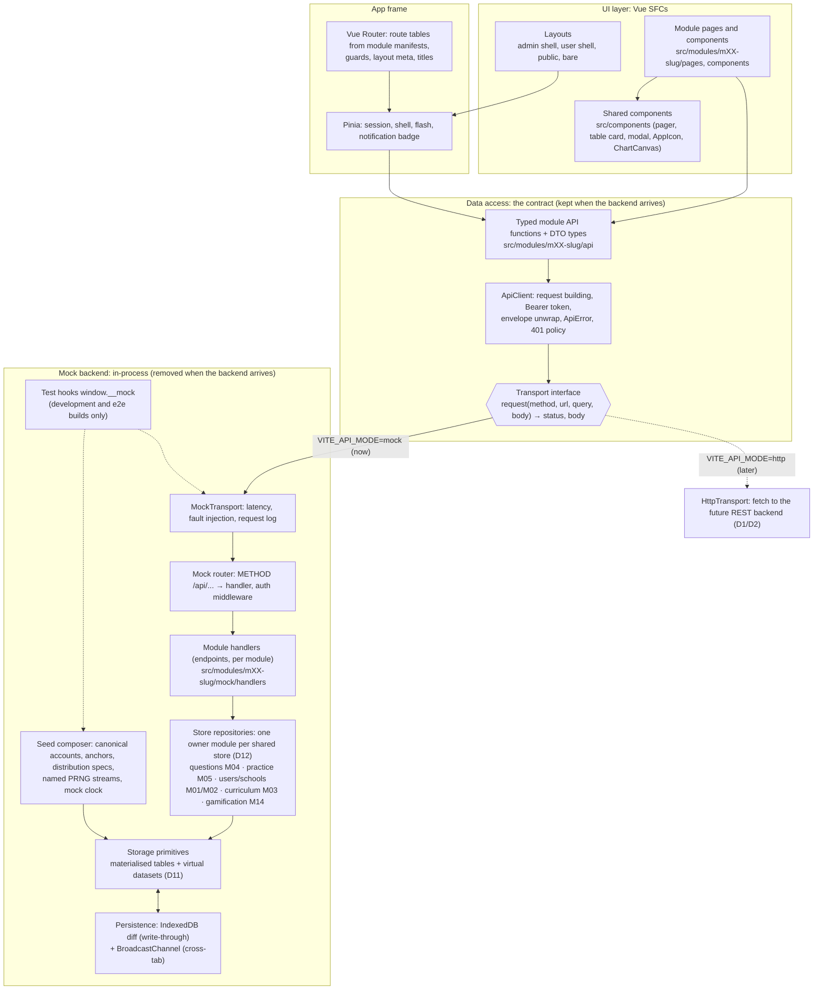

# PrestasiPlus Front-End Prototype: Architecture Overview

| Field | Value |
|---|---|
| Document | Architecture overview (foundation, G2) |
| Version | 1.9 |
| Date | 2026-09-27 |
| Status | Draft, awaiting user approval (G2) |
| Author | solution-architect (agent) |
| Inputs | `CLAUDE.md`, `docs/TRACKER.md` (D1–D12, canonical seed accounts), `docs/qa/audit/cross-module-logic-M01-M07.md` (XL review), `docs/requirements/URS.md`, `docs/requirements/SRS.md`, `docs/discovery/00-global-ui.md`, module SRS M01–M07 (approved, G1), M08 SRS v1.0 (for chart and 403 needs) |
| Decisions | ADR-0001 … ADR-0014 in `docs/adr/` |
| Build tasks | `docs/architecture/build-plan.md` |

**Change log**

| Version | Date | Change |
|---|---|---|
| 1.0 | 2026-09-25 | First issue (foundation architecture, D11/D12 mock design, canonical schools 900001/900002 per M02 v1.3). |
| 1.1 | 2026-09-25 | **XL round 2 alignment (XL-33, XL-34, XL-37)**, approved SRS docs win. Session status `in_progress \| completed` (M05 v1.3 DATA-M05-01). M06 sessions use the M05 endpoints #4–#6 and #23 (no `/api/spm/sessions`), mock exams stay M06 records. Peta Belajar topic progress is derived on read from the M05 answer log (M03 v1.6 BR-19). Question dataset per M04 §6.13 (N 466,041, generated id range 1–564,161, reserved anchor ranges), runtime ids above an owner-set floor (new `floor` id strategy). 128,989 / 130,152 are different named queries (M04 §4.1), not a contradiction. New D11 exception: documented display constants (§6.6). |
| 1.2 | 2026-09-26 | **Student-prototype build follow-ups (F-01…F-04 as built).** Node minimum `^22.22.2 \|\| ^24.15.0 \|\| >=26.0.0`, and CI pins Node (§2, ADR-0001). ApiClient as built: the `api.raw()` exception (resolves M13 SQ-M13-01), `responseType`, `api.list`/`api.multipart`/`api.blob`, array query encoding (§6.2, ADR-0004). Boundary lint also covers dynamic `import()` (§3, §13, ADR-0009). Registries hold all 10 slice modules (M01–M10, including M02); the plugin type lives in F-06 `src/mock/define.ts`, and no later task edits the registries (§6.10). Clock offset persisted through `clock.subscribe`/`anchorOffset` (§6.12). The E2E build goes to `dist-e2e/`; the demo-bundle guard uses a dedicated sentinel and takes a dist path (§6.13, §11, §12.2, §13, ADR-0011). `test:e2e:module` is a cross-platform node wrapper (§13). The demo seed password may be documented in README (§7). Currency format flagged against master SRS §7.4 (§15 X-10). |
| 1.3 | 2026-09-26 | ApiClient query merge as built: `options.query` wins per key for defined values; `null`/`undefined` values are omitted before the merge, so they do not remove a key already in the URL (§6.2). Icon rows: module map files mirror design-system §6.13 "Module rows"; only F-14 edits `fa-to-lucide.ts` (§8.3, ADR-0010 Amendment 2, build-plan v1.4 §S.3 rule 3). |
| 1.4 | 2026-09-26 | **As built after F-08, F-09, F-10 and the W0.4 review** (Delivery Lead decisions). New §6.7.1: the repository API as built (`@/mock/repository`, `defineRepository` options, named-query methods, `contributeAnchors` seed-only with reads from `finalise(ctx)`, `withZeroCounts`, the ownership guard, `assertRepositoryConventions` at boot, synchronous methods). Rule 3a (§3): owner handlers and seeds also write through their own repository. `count` is reserved for named queries; filter counts are `countWhere(filter)` (§6.7). Non-owner spec contributions go through an owner method that wraps `overrideSpec`, e.g. `questions.contributeCells(contributor, cells)`; no module calls `overrideSpec` directly (§6.6, §6.7). §6.5: the runtime floor lies above `idRange` and outside every reserved range; reserved ranges may lie above the floor and the allocator skips them. §6.9: every dataset provides `specHash()` (required by the composer). §6.6: the 50 ms budget also covers text and derived-field filters, on the largest dataset (478,499 rows). §6.13: test-hook wiring (`startMock`, `bootstrap.ts` order, `setUser` writes `pp.auth`, delegated hooks, outbox type, Playwright clock binding). §15: X-11 (M04 SRS `questions.count(filter)`), X-12 (M05 generated session ids, accepted). ADR-0006 Amendment 1, ADR-0011 Amendment 2, ADR-0013 Amendment 1, ADR-0014 Amendment 1. |
| 1.5 | 2026-09-26 | **Query budget as decided on F-09's proposal** (Delivery Lead). Replaces the v1.4 "50 ms for every query form" rule (§6.6, §12.1): 50 ms for every query that uses facets, `id`, cheap fields or `search`; a cold query that must derive every row (a filter on a field not declared cheap, or `match` without `matchFields`) may take up to 1,500 ms and must take ≤ 50 ms once cached. Owner rule: every derived field a screen filters, searches or sorts on is a cheap field (`fields`) or a facet; list-screen search fields are listed in `searchFields`. F-09 API additions recorded: `fields`, `search`, `searchFields`, `matchFields`, `cacheKey`, `hashKey(key, salt)`. §6.9: `specHash()` excludes function bodies (`derive`, cheap fields); module plugins bump `version` whenever their seed or derive code changes (§14 rule 4b). ADR-0013 Amendment 2. |
| 1.6 | 2026-09-27 | **XL batch 3 alignment (R2-11 / XL3-36, `docs/qa/audit/cross-module-logic-M12-M18.md`; Delivery Lead decisions).** §6.7 store table: wallet, streak, quests (daily challenges) and learner badges are **owned by M14** (no provisional wallet in M05). New owner stores and contract items: M05 KirkpatrickSessionAggregate, PupilSubjectAccuracy, modes `mission` / `remedial` / `question_set` / `pksk`, hooks `mock.addSession` and `mock.addAnswer({…})`; M04 `jutawanQuestions` (`questions.jutawan.*`), `coverageExcluded`, ImportRun; M08 ItemStatistic; M16 battles and game results; M03 `inTree`. New **provisional owner contracts**: M26 (mood check-ins, tuition centres) and M21 (sponsors), hosted in M17 (§6.7.2). Cross-module reads of a later module's repository happen at call time only (§6.7). §6.8: session completion step 6 calls `gamification.onSessionCompleted` (M14). §10: the chips read the M14 repository. Registries: one extension task per batch (§6.10; M11–M18 now). Fixture schools 900001–900004; canonical account 4 at 900004 (§6.7, §6.9, X-2). ADR-0006 Amendment 2, ADR-0009 Amendment 2, ADR-0014 Amendment 2. |
| 1.7 | 2026-09-27 | **Review follow-ups (as built; Delivery Lead decisions).** **E2E clock contract** (F-22 review finding 8): with `clockMode: 'install'` (default) the fixture installs the Playwright clock on the **context** and **never sends `now` in `__MOCK_INIT__`**; the e2e app reads the browser clock (policy `passthrough`, offset 0); the clock bridge is exposed with `context.exposeFunction` (covers `newTab`); `clockMode: 'none'` keeps real time (§6.12, §6.13, §12.2, ADR-0011 Amendment 2 §3 corrected, Amendment 3). Stale code comments listed for the F-08 owner (§15 X-13). **New §6.14 mock boot budget:** warm boot ≤ 2,000 ms on the reference machine (measured 1.43 s with M05), enforced by a boot perf test and reported by `waitForApp` telemetry (new build-plan task F-34); boot-cost rules for large-dataset owners. **§6.7: the M05 → M14 read contract** (`practice.history` unpaged with `date`/`modes`, `practice.answers(userId, {date})`, `practice.mastery`), enforced by M14 CONTRACT errors and `m05-contract.test.ts`. **§6.6, §12.1, §13: perf test policy (F-09 as built):** `npm run test` is unit only; `npm run test:perf` is separate, on a quiet machine, required at G4 for perf-sensitive tasks and at QA; the paired-calibration harness (ratio gates, `assertSkipShare`, `proveRegression`) (ADR-0013 Amendment 3). **C13: user decision D14** (no payment-gateway or external-platform screens; simulate the success or failed outcome only). §5.2 `guestTitle` checked against `meta.ts` / `guards.ts`: consistent, unchanged. |
| 1.8 | 2026-09-27 | **F-26 G4 review follow-ups (Delivery Lead decisions).** F-34 values (2,000 ms warm boot, 100 ms report threshold, `__mock.bootMs` / `bootPhases`) and the C13 wording approved; X-13 comments fixed. **§6.8 decision (a), replicate live:** the **stored** session `coinsEarned` follows M05 BR-09 (correct answers; 3 × correct for `mission`), as observed on live; the value M14's `onSessionCompleted` returns is the wallet credit and appears only in the #6 response (replaces the v1.6 "stored value is the value M14 returns"). **§6.6 declared exception:** a whole-log `match` over `matchFields` for distinct-user scans (M05 `distinctUsers`) is held to ≤ 100 ms (F-09 M-3 decision), with the allowed cases and the precompute alternative. |
| 1.9 | 2026-09-30 | **G4 review follow-up (doc only).** §6.13 module-hook list: `addSessions` renamed to `addSession` (as built) and `answerChapter` added (M05). |

This document answers the "how" for the whole prototype. Module architecture details (entities, endpoints, permissions) stay in each module SRS §6/§7/§9. This document defines the frame that every module plugs into. Nothing here adds product behaviour. Where the requirements are silent, the choice is the smallest one that lets the approved SRS be built and tested.

---

## 1. Context and constraints

| # | Constraint | Source |
|---|---|---|
| C1 | Front-end prototype only, with dummy data. No backend now; a real backend replaces the mock later without UI rewrites. | D1, D2, UR-G-12 |
| C2 | Stack fixed by the user: Vue 3 + Vite + Tailwind CSS + Lucide. | TRACKER, SRS §4.4 |
| C3 | Exact fidelity to prestasiplus.my: routes, copy (BM, and the English pager text), states, and layout per breakpoint. Deviations only as approved in each module's DV table. | D7, D9, D10 |
| C4 | AI features and payments are simulated. No external network calls at runtime. | D4, SRS §4.1 |
| C5 | Responsive at 320–1920 px, verified at 375 / 768 / 1280, with no page-level horizontal scroll. | D6, NFR-RESP-01..10 |
| C6 | E2E on 3 Playwright projects (mobile 375×812, tablet 768×1024, desktop 1280×800). Every SRS `E2E-Mxx-nn` runs on all three. | SRS §10/§11 |
| C7 | Seeds mirror observation. Live numeric ids are kept where live exposes them. Canonical accounts use ids 1–11. | CLAUDE.md §6, SRS §7.4, TRACKER |
| C8 | Mock layer is REST-shaped: `{data, meta}` envelope, `{error:{code,message,fields}}` errors, one mock module per resource. | SRS §7, NFR-07, FR-G-12 |
| C9 | Test hooks (reset, latency, faults, clock) exist in dev/test builds only. | NFR-M01-02, NFR-M04-02, NFR-M05-02, NFR-M06-02 |
| C10 | 26 modules are built one at a time, in phase order, by parallel agents. The structure must isolate modules and keep merge hotspots minimal. | CLAUDE.md §3, §5 |
| C11 | Large collections are deterministic virtual datasets that report live totals. Observed anchors override generated rows. Every count is computed from the dataset through a named query, except per-module documented display constants (XL-34). | D11 |
| C12 | Each shared store has one owner module. Other modules use the owner's contract only. | D12 |
| C13 | **No payment-gateway or external-platform screens** (user decision 2026-09-27). Where live hands off to a payment gateway or another external platform, the prototype draws no gateway or platform page. It simulates only the outcome, success or failed, and then shows the live screens that follow that outcome. How the outcome is chosen is set by the owning module's SRS (in dev/e2e builds through a module test hook, §6.13). This narrows C4 for payments. | D14 |

---

## 2. Stack and versions

Versions were checked against the npm registry on 2026-09-25. The lockfile pins exact versions. Ranges below are the allowed majors. See ADR-0001 for reasons and rejected options.

| Concern | Choice | Version | Note |
|---|---|---|---|
| Runtime | Node.js LTS + npm | Node `^22.22.2 \|\| ^24.15.0 \|\| >=26.0.0` (`.nvmrc` = 22.22.2), npm 10 | The strictest toolchain floor wins. jsdom 30 declares this range (its undici 8 needs ≥ 22.19); Vite 8 alone would allow `^20.19 \|\| >=22.12`. `package.json` `engines` mirrors the range. CI pins an exact Node version inside it (F-28) |
| UI framework | Vue 3, Composition API, `<script setup lang="ts">` only | `vue ^3.5.43` | No Options API, no JSX |
| Build | Vite (Rolldown-based) + `@vitejs/plugin-vue` | `vite ^8.3`, `@vitejs/plugin-vue ^6.0` | Modes: `development`, `e2e`, `demo` (§11) |
| Language | TypeScript, `strict` | `typescript ~5.9.3`, `vue-tsc ^3.3` | Not TS 7: typescript-eslint supports `<6.1` and vue-tsc needs the JS compiler API (ADR-0002) |
| Styling | Tailwind CSS v4, CSS-first `@theme` tokens | `tailwindcss ^4.3`, `@tailwindcss/vite ^4.3` | Same major as live, so the same palette, defaults and breakpoints (ADR-0003) |
| Icons | Lucide for Vue | `@lucide/vue ^1.48` | `lucide-vue-next` is **deprecated** on npm ("use @lucide/vue"). Same icon set, new package name (ADR-0001, ADR-0010) |
| Routing | Vue Router, classic `createRouter` API with explicit route tables | `vue-router ^5.3` | File-based routing not used (ADR-0008) |
| State | Pinia, for global state only | `pinia ^3.0.4` | Not 4.x: Vue Router 5 declares the optional peer `pinia ^3.0.4` (ADR-0007) |
| Charts | Chart.js with a thin in-house wrapper | `chart.js ^4.5` | Live uses Chart.js 4.4.0 (M08 SQ-M08-04); same major, same config format (ADR-0012) |
| Fonts | Self-hosted Fontsource packages | `@fontsource-variable/inter`, `@fontsource-variable/outfit`, `@fontsource/scheherazade-new` (^5.3) | Live loads Google Fonts; self-hosting gives the same faces with no runtime external call (C4) |
| Mock persistence | IndexedDB via a tiny wrapper | `idb-keyval ^6.3` | ADR-0005 |
| Unit/component tests | Vitest + Vue Test Utils + jsdom | `vitest ^5.0`, `@vue/test-utils ^2.5`, `jsdom ^30`, `@vitest/coverage-v8 ^5.0` | jsdom supports the constraint-validation API used by native forms |
| E2E | Playwright | `@playwright/test ^1.63` | Chromium for all 3 projects |
| Lint/format | ESLint flat config + Prettier | `eslint ^10`, `eslint-plugin-vue ^10.11`, `typescript-eslint ^8.70`, `@vue/eslint-config-typescript ^14.9`, `eslint-config-prettier ^10`, `prettier ^3.9`, `prettier-plugin-tailwindcss` | |

Not used, on purpose: no UI component library (fidelity: every widget replicates live markup), no i18n framework (static BM copy, SRS NFR-08), no data-fetching cache library (ADR-0007), no MSW (ADR-0004), no CSS-in-JS.

---

## 3. Layered architecture



**Layer rules**

1. Pages and components never import from any `mock/` folder. They call typed functions in `api/` only.
2. `api/` modules know nothing about the mock. They call `apiClient`, which calls whatever `Transport` was installed at boot.
3. Mock handlers import the DTO types from their module's `api/types.ts`, so both sides compile against one contract.
3a. Handlers read and write **their own module's tables** directly, but reach **another module's store only through that owner's repository** (D12, ADR-0014). No module keeps a second schema, copy or id space for a store it does not own. **(v1.4)** When a store has a repository, its **owner's own handlers and seeds also write through that repository**, never through the raw store: the ownership guard refuses every write that does not run inside a repository method of the owner (§6.7.1). Direct table access stays allowed only for module-private tables that no repository guards.
4. Only `src/app/bootstrap.ts` decides which transport to install. In `http` mode the mock is never imported and is tree-shaken out of the bundle. Lint enforces rules 1 and 4 for **both** static imports (`no-restricted-imports`) and dynamic `import('…')` (`no-restricted-syntax` with `ImportExpression` selectors built from the same patterns). `bootstrap.ts` is the only UI-side file that is exempt (§13, ADR-0009). Dynamic import specifiers must stay string literals so that the selectors can match them.
5. The UI and the mock share one time source (`src/lib/time/clock.ts`), so "today", greetings and relative times agree (ADR-0006).

---

## 4. Folder structure

```
pretasiplus-app/
├─ .nvmrc · package.json · package-lock.json · vite.config.ts · tsconfig*.json
├─ eslint.config.ts · .prettierrc · playwright.config.ts · vitest.config.ts
├─ .env.development · .env.e2e · .env.demo            # mode flags, §11
├─ docs/                                             # requirements, architecture, adr, qa, ops
├─ public/
│  └─ images/                                        # live assets: logo-custom.png, etc. (owner-supplied)
├─ scripts/
│  ├─ fixtures/                                      # one-off transforms of discovery data into src fixtures
│  │  └─ build-m03-curriculum.ts
│  ├─ check-demo-bundle.mjs                          # fails if test hooks leak into the demo build (optional dist-path arg)
│  ├─ …                                              # cross-platform node wrapper for `test:e2e:module` (§13)
│  └─ check-e2e-trace.mjs                            # SRS §12 E2E ids ↔ Playwright test titles
├─ e2e/
│  ├─ fixtures/test.ts                               # extended Playwright `test`: mockInit, loginAs, mock handle
│  ├─ support/                                       # layout.ts (no-h-scroll, shell detection), titles.ts, dialogs.ts
│  ├─ global/                                        # shells, guards, 404/403, responsive sweep
│  └─ m01-authentication/ … m26-special-features/    # one folder per module, *.spec.ts
└─ src/
   ├─ main.ts                                        # calls app/bootstrap
   ├─ App.vue                                        # <LayoutHost/> only
   ├─ app/
   │  ├─ bootstrap.ts                                # install transport (mock|http), pinia, router, mount
   │  ├─ modules.ts                                  # THE module registry (ordered list of module manifests)
   │  ├─ LayoutHost.vue                              # resolves layout from route meta, wraps <RouterView>
   │  └─ router/
   │     ├─ index.ts                                 # createRouter(createWebHistory), scrollBehavior
   │     ├─ meta.ts                                  # RouteMeta typing (layout, access, roles, title, header)
   │     ├─ guards.ts                                # auth, role, landing, title
   │     └─ core-routes.ts                           # '/', '/logout' hook-up, 404 catch-all, 403
   ├─ api/
   │  ├─ transport.ts                                # Transport interface + request/response types
   │  ├─ client.ts                                   # ApiClient (get/post/put/patch/delete, raw, blob, multipart)
   │  ├─ errors.ts                                   # ApiError, error codes (SRS §7.3 + RATE_LIMITED, NETWORK_ERROR)
   │  ├─ envelope.ts                                 # Envelope<T>, ListMeta (+ from/to/counts extensions)
   │  └─ http-transport.ts                           # fetch-based, for the backend phase
   ├─ mock/                                          # mock CORE only; module handlers live in modules
   │  ├─ index.ts                                    # startMock() (§6.13), bootMock(), createMockTransport(), boot sequence
   │  ├─ registry.ts                                 # ordered list of module mock plugins (lazy imports)
   │  ├─ define.ts                                   # defineMockModule(), defineTable(), route helpers
   │  ├─ server/                                     # router.ts, request.ts, respond.ts (ok/created/list/fail), paginate.ts
   │  ├─ db/                                         # table.ts, store.ts, id-strategies.ts, persistence.ts, broadcast.ts, transaction.ts
│  ├─ dataset/                                    # virtual dataset primitive (D11): spec.ts, compile.ts, slots.ts, query.ts, overlay.ts
│  ├─ repository/                                 # defineRepository(), registry, ownership guard, conventions (D12, §6.7.1); import from '@/mock/repository'
   │  ├─ auth/                                       # sessions table, requireAuth/requireRole middleware, landing paths
   │  ├─ core-data/                                  # canonical accounts (users 1–11), id ranges (canonical schools belong to M02)
   │  ├─ determinism/                                # prng.ts (named streams), seed-version.ts
   │  ├─ faults.ts · latency.ts · request-log.ts
   │  └─ testing/                                    # window.__mock (development/e2e only, §6.13): contract.ts (no imports; e2e types), hooks.ts (sentinel), init.ts (__MOCK_INIT__), index.ts
   ├─ shells/
   │  ├─ admin/                                      # AdminShell.vue, sidebar, header, bottom nav, "Lagi" popover
   │  ├─ user/                                       # UserShell.vue, sidebar, header, chips, drawer, bottom nav
   │  ├─ public/                                     # PublicLayout.vue (guest layout, M09)
   │  └─ nav/                                        # admin-nav.ts, user-nav.ts (one definition per shell, live order)
   ├─ pages/                                         # NotFoundPage.vue (M01 S10), ForbiddenPage.vue (M08 FN-M08-1.2.4)
   ├─ components/                                    # shared, fidelity-neutral building blocks (§9)
   ├─ composables/                                   # useApi, usePageMeta, useFlash, useDebounce, useClickOutside, useSearchPicker…
   ├─ stores/                                        # session.ts, shell.ts, flash.ts, notification-badge.ts
   ├─ lib/                                           # time/ (clock, relative-time, formatters), number, text, url
   ├─ styles/                                        # main.css (@import "tailwindcss"), theme.css (@theme), fonts.css, motion.css
   └─ modules/
      └─ m01-authentication/                         # same layout for every module
         ├─ index.ts                                 # module manifest + PUBLIC exports for other modules
         ├─ routes.ts                                # this module's routes with meta
         ├─ pages/                                   # one SFC per screen (S1 LoginPage.vue …)
         ├─ components/                              # module-private components
         ├─ composables/
         ├─ constants/                               # lookups (DATA-Mxx lookups), exact copy strings used in >1 place
         ├─ api/                                     # typed client functions, one file per resource + types.ts
         ├─ mock/                                    # index.ts (plugin + PUBLIC repository exports), tables.ts,
         │                                           # datasets/ (D11 specs), repository/ (store owner only, D12),
         │                                           # seeds/, handlers/ (one per resource), data/*.json
         └─ __tests__/                               # Vitest: *.test.ts
```

Module folder names use the SRS slugs (`m01-authentication`, `m02-users-schools`, `m03-curriculum`, `m04-question-bank`, `m05-practice`, `m06-spm`, `m07-pksk`, …). This keeps one slug per module across docs, code, branches and commits (CLAUDE.md §7).

**Module boundary rules** (ADR-0009)
- A module imports another module **only through its `index.ts`** (e.g. M05 imports `ReportQuestionModal` from `@/modules/m04-question-bank`). Mock code reaches another module's data only through the **repository** that module exports from `@/modules/mXX-…/mock` (its `mock/index.ts`). Tables, datasets and seeds stay private. ESLint `no-restricted-imports` enforces both.
- `src/app/modules.ts` and `src/mock/registry.ts` are the only files every module touches: one line each. Everything else a module needs lives in its own folder.
- Shared code goes to `src/components`, `src/composables` or `src/lib` only once a second module needs it. Until then it stays in the module.

---

## 5. Routing

### 5.1 Principles
- **Live paths are kept exactly**, including Malay path words, query-parameter names (`subject_id`, `education_level_id`, `bulan`, `?filter=unread`) and trailing sub-routes (`/password/reset/:token`). History mode (`createWebHistory`): URLs look identical to live. Hosting must serve `index.html` for unknown paths (devops note).
- **Explicit route tables per module** (`routes.ts`), collected by `src/app/modules.ts` in module order. No file-based routing.
- Numeric live ids use a param regex (`/admin/questions/:id(\\d+)`), so a non-numeric id falls through to the 404 page, as Laravel's route binding does. Unknown numeric ids are handled by the page (404/403 per SRS).
- Every page component is lazy-loaded (`component: () => import(...)`), which gives one chunk per screen.
- Route names: `mXX.screen` (e.g. `m01.login`, `m02.users.edit`). Code navigates by name. Tests and nav data use paths.

### 5.2 Route meta (typed in `src/app/router/meta.ts`)

| Key | Values | Meaning |
|---|---|---|
| `layout` | `admin` · `user` · `role` · `public-or-user` · `bare` | Which frame wraps the page (§5.3) |
| `access` | `public` · `auth` | `auth` = session required; a guest goes to `/login` with no message and no `redirect` parameter (FR-M01-14, BR-08) |
| `roles` | `Role[]` (optional) | Allowed roles. Omitted = any logged-in role |
| `onForbidden` | `landing` (default) · `403` · `404` | Guard outcome for a logged-in user whose role is not allowed. `landing` = redirect to the role landing path (M02 FR-99, M03 FR-94, M07 FR-59, INFERRED); `403` = the standalone "Akses Ditolak" page (M08); `404` where an SRS says so. The mix is deliberate (G5-M01 BUG-09): M08, M18, M27 (SRS §9, DV-M27-01), M28, M02 `jemput-ibu-bapa` and the M17 `/admin-sekolah/command-center*` aliases declare `403`; every route without `onForbidden` redirects |
| `title` | string or `(route) => string` | Exact browser tab title from each SRS §2. No automatic suffix: live suffixes vary (" - PRESTASIPLUS", " - Admin Panel", " - Admin PRESTASIPLUS", " — PRESTASIPLUS", none) |
| `guestTitle` | string or `(route) => string` (optional) | Tab title used instead of `title` when the page renders in the public (guest) layout, set synchronously in afterEach (F-20). Guest routes take it from `PUBLIC_SECTIONS.<key>.guestTitle` (`src/shells/public/public-sections.ts`) |
| `header` | `{ title, subtitle? }` (static) | Shell header text. Pages with dynamic headers set them via `usePageMeta()` |
| `module` | `'M01'` … `'M26'` | Ownership, used by nav highlighting and test tags |

### 5.3 Layout resolution (ADR-0008)
`LayoutHost.vue` reads `route.meta.layout` and the session role:

| `layout` | Renders | Used by (examples from approved SRS) |
|---|---|---|
| `admin` | Admin panel shell (§3 of 00-global-ui) | `/admin/*` screens (M02, M03 S1–S11, M04 S1–S11, M07 S5–S8) |
| `user` | User-portal shell (§4 of 00-global-ui) | Student-facing screens (M05, M06 S1–S10, M07 S1–S4), and `/admin/master-notes` (M04 S12, observed in the user shell) |
| `role` | Admin shell when role = `admin`, user shell otherwise | `/tetapan` (M01 S9, FR-M01-47), `/spm-mock*`, `/pusat-ai/spm` (M06 S11–S13) |
| `public-or-user` | Public layout for a guest, user shell for a logged-in user | `/artikel`, `/video` (M09 discovery; the component is built with M09) |
| `bare` | No shell: the page draws its full screen | Auth pages (M01 S1–S5), 404, 403, renewal invoice (M02 S15) |

The shell component stays mounted while consecutive routes resolve to the same layout. Only the page area changes. This means shell state (drawer, open sidebar groups) survives navigation, as it does on live, where it is stored in localStorage.

### 5.4 Guards (in order, `guards.ts`)
1. **Session check:** the session store holds `pp.auth` (localStorage). An expired session (by the shared clock) is cleared.
2. **Auth:** `access: 'auth'` and no session → `router.replace('/login')`. There is no `redirect` query and no message.
3. **Role:** `roles` set and the role is not included → `onForbidden` (landing redirect by default).
4. **Guest pages have no guard:** `/login` and `/register` render for logged-in users (FR-M01-13).
5. **After navigation:** set `document.title`, reset `usePageMeta`, consume the pending flash message, and scroll to top. Hash links (e.g. `/panduan#pelajar`) scroll to the anchor. Live does a full page load on every navigation, including query-only filter changes, so the top is always the right place.

**Landing path** (M01 BR-07): `admin` → `/admin`; `ppd_officer` → `/ppd/dashboard`; `jpn_officer` → `/jpn/dashboard`; `student`, `teacher`, `parent`, `sponsor`, `school_admin` → `/dashboard`. Defined once in `src/mock/auth/landing.ts`, returned by the mock in `UserMe.landingPath`, and used by the client (the client never computes it itself, so the backend can later own it).

### 5.5 Core routes
| Path | Behaviour |
|---|---|
| `/` | The public landing page is out of scope (M01 §1). **Proposed:** redirect a guest to `/login` and a logged-in user to their landing path. *(needs user approval)* |
| `/logout` | Route with a `beforeEnter` action: `POST /api/auth/logout`, clear session, `replace('/login')`, no message (FR-M01-37) |
| `/:pathMatch(.*)*` | The standalone 404 page (M01 S10, FR-M01-50) |
| 403 | Not a route. The `ForbiddenPage` component is rendered in place by guards with `onForbidden: '403'`, or by pages on an API `FORBIDDEN` where the SRS says so (M08 FR-M08-08/119). The URL stays unchanged, as live |
| Routes of modules not built yet | Not registered, so they resolve to the 404 page until their module is built. Shell menu items for them are present (live menu) and lead to that 404 until then. *(needs user approval)* |

---

## 6. Mock service layer (ADR-0004, ADR-0005, ADR-0006, ADR-0013, ADR-0014)

### 6.1 Transport contract
```ts
// src/api/transport.ts (shape only)
interface TransportRequest { method: 'GET'|'POST'|'PUT'|'PATCH'|'DELETE'; url: string;
  query?: Record<string, string | string[]>; body?: unknown | FormData; headers: Record<string, string> }
interface TransportResponse { status: number; headers: Record<string, string>; body: unknown | Blob }
interface Transport { request(req: TransportRequest, signal?: AbortSignal): Promise<TransportResponse> }
```
- `MockTransport` (now) dispatches in-process to the mock router.
- `HttpTransport` (backend phase) sends the same request with `fetch`. It is one file, and swapping transports is one line in `bootstrap.ts`, selected by `VITE_API_MODE`.

### 6.2 ApiClient (`src/api/client.ts`)
As built by F-04. The exact signatures are in `src/api/client.ts`, and the app-wide instance is `api`.
- **Verbs:** `api.get<T>(url, {query?, headers?, signal?, raw?, responseType?})` and `api.post/put/patch/delete<T>(url, {query?, body?, headers?, signal?, raw?, responseType?})`. The generic form is `api.request<T>(method, url, options)`.
- **Helpers:**
  - `api.list<T, X>(url, {query?, headers?, signal?}) → Promise<ListResult<T, X>>` is a `GET` typed as `{data: T[], meta: ListMeta<X>}`.
  - `api.multipart<T>(url, form: FormData, {method?: 'POST'|'PUT'|'PATCH', query?, headers?, signal?, raw?})` sends `form` as the body (default `POST`). The client sets no `content-type` for `FormData`/`Blob` bodies; the transport sets the multipart boundary.
  - `api.blob(url, {method?, query?, body?, headers?, signal?}) → Promise<{blob, filename}>` handles downloads (M04 CSV template, M02 invoice print). `filename` comes from `Content-Disposition` (`filename*=` wins over `filename=`; `null` when absent). A non-2xx response still throws `ApiError`.
- **`responseType` option:** `'json'` (default) or `'blob'`. With `'blob'`, `request` returns the 2xx body untouched, with no unwrap. Prefer `api.blob()`, which also returns the file name.
- **Auth header:** adds `Authorization: Bearer <token>` from the session store (`getToken`, injected with `api.configure`).
- **Query encoding:** params use the SRS camelCase API names (pages map live snake_case URL params to camelCase API params in the module `api/` function). `null`/`undefined` values and empty arrays are dropped, and scalars are stringified. An **array value becomes a repeated key**: `{ids: [1, 2]}` → `ids=1&ids=2`, passed to the transport as `string[]`. There is no `key[]` bracket form. A query string already in the URL is parsed into the same shape (repeated keys become arrays) and merged. **`options.query` wins per key for defined values; `null`/`undefined` values are omitted** before the merge, so a `null` in `options.query` does not remove a key that is already in the URL.
- **Envelope handling:** by default returns `body.data` (single) or `{data, meta}` (list), and `undefined` for an empty body (204). With `raw: true` it returns the 2xx body untouched, for the live-shaped responses the SRS keeps on purpose (M04 #8 `{ok, message}`, M04 #28–30 bare arrays, M06 #17 `{ok, walkthrough}`, M04 #15 `{message}`). Errors are still `ApiError`.
- **Exception: `api.raw<B>(method, url, body?, {query?, headers?, signal?}) → Promise<{status, headers, body}>`.** It resolves for **every** HTTP status, with no envelope unwrap and no `ApiError` mapping. It rejects only on a network failure (`NETWORK_ERROR`) or an abort. It goes through the same transport (latency, faults, request log) and keeps the Bearer token **and the 401 policy**. This resolves **M13 SQ-M13-01** (XR-M13-05): `POST /api/cikgu/send` replicates the live body (no envelope, snake_case, `error` as a string). Use it only where an SRS documents the exception.
- **Errors:** any non-2xx becomes `ApiError { status, code, message, fields?, retryAfter?, body }`. Codes: SRS §7.3 (`VALIDATION_ERROR`, `NOT_FOUND`, `UNAUTHORIZED`, `FORBIDDEN`, `CONFLICT`, `SERVER_ERROR`), plus `RATE_LIMITED` (429, `retryAfter`, M01 Q2), module codes carried in `error.code` (e.g. `ACCOUNT_INACTIVE`, `TRIAL_EXHAUSTED`, `CHAPTER_LOCKED`, `NO_WRONG_QUESTIONS`), and the client-only `NETWORK_ERROR`. Aborts (`AbortSignal`) are re-thrown unchanged.
- **401 policy** (FR-M01-14): any 401 outside `/api/auth/*` calls the injected `onUnauthorized` hook before the call settles. The session store's hook clears the session and does `replace('/login')`. The policy applies to every method, `api.raw` included. `/api/auth/*` pages handle the error themselves.

### 6.3 Envelope (master SRS §7.2 plus agreed extensions)
`{ data: T[], meta: { page, pageSize, totalItems, totalPages, from?, to?, counts?, …module aggregates } }`. The `from`/`to` fields feed "Showing X to Y of Z results". Lists that live does not paginate still use the envelope with `page: 1, totalPages: 1` (M03 §7). *The master SRS §7 should record `RATE_LIMITED` and the optional `meta` extensions; this is M01 SRS Q2, for the product-analyst.*

### 6.4 Mock server core (`src/mock/server`)
- **Router:** `route('GET', '/api/admin/users/:id', [requireRole('admin')], handler)`. Params are parsed by the route (`int()` for numeric ids).
- **Handler:** `(req: MockRequest, ctx: MockContext) => MockResponse | Promise<MockResponse>`. `MockRequest` = `{method, path, params, query, body, formData, headers, session}`. `ctx` = `{db, clock, prng, config, outbox, emit}`.
- **Responders:** `ok(data, extra?)`, `created(data, extra?)`, `noContent()`, `list(items, meta)`, `paginate(items, {page, pageSize})` (computes `from`, `to`, `totalPages` the Laravel way: an out-of-range page gives an empty page, not an error), `fail(status, code, message, fields?)`, `raw(status, body)`, `blob(blob, filename)`.
- **Auth middleware:** `requireAuth()` → `401 UNAUTHORIZED` when there is no valid session; `requireRole(...roles)` → `403 FORBIDDEN`; `requireOwner(getOwnerId)` → `404` (ownership rules such as M06 BR-M06-26 answer 404, not 403).
- **Validation helper:** a small typed rule set (required, email, min, max, in, exists, unique, confirmed) that returns a `VALIDATION_ERROR` with `fields` and the exact SRS §5 messages. There is no schema library: rules are few and their messages are copy-exact per module.
- **Latency:** default 400 ms (`VITE_MOCK_LATENCY_MS`, NFR-M01-02) so loading labels are observable. It can be set per path (`setLatency(ms, pathPattern)`), which covers M04's 300 ms default and M06's walkthrough latency.
- **Request log:** the last N requests (method, path, body) are recorded for `lastRequest(path)` (M07 E2E).
- **Business rules live in handlers** (per module SRS §4). Handlers are pure functions of `(request, db, clock, prng)`. This is what makes seeds and E2E deterministic.

### 6.5 Storage primitives (`src/mock/db`, `src/mock/dataset`)

The mock has **two storage primitives behind one interface**. Only repositories (§6.7) and the owning module's handlers touch them.

```ts
// shape only
interface Store<Row, Id = number> {
  get(id: Id): Row | undefined
  getMany(ids: Id[]): Row[]
  query(q: { where?: Where<Row>; match?: (r: Row) => boolean; sort?: SortSpec<Row>; page?: number; pageSize?: number }): { rows: Row[]; total: number }
  count(where?: Where<Row>, match?: (r: Row) => boolean): number
  groupCount<K extends keyof Row>(field: K, where?: Where<Row>): Map<Row[K], number>   // tiles, per-subject columns
  sample(where: Where<Row>, n: number, rng: Prng): Row[]                               // quiz selection
  insert(row: Omit<Row, 'id'> & { id?: Id }): Row
  update(id: Id, patch: Partial<Row>): Row
  remove(id: Id): void
}
```
`Where<Row>` is a typed object of per-field conditions (`value`, `value[]`, `{ne}`, `{gte, lte}`, `{isNull}`). `match` is an optional predicate for anything else (e.g. text search), and it forces a scan.

| Primitive | When | How |
|---|---|---|
| **Materialised table** (`defineTable`) | Small or user-created collections: sessions, answers, notifications, reports, grants, settings, links, the canonical accounts' own records | Rows held in a `Map` with declared secondary indexes |
| **Virtual dataset** (`defineVirtualDataset`, D11) | Large live collections: questions (466,041 rows incl. 763 PKSK, M04 §6.13), structured questions (4,064), schools (10,220), videos (2,260), users, and any other collection whose live total is large | Rows generated on demand from a compiled distribution; anchors overlaid (§6.6) |

**Id strategies** (SRS §7.4 numeric-id exception):

| Strategy | Rule | Used by |
|---|---|---|
| `sequence({ runtimeStart })` | Seeded rows keep their fixed ids. New rows get the first free id ≥ `runtimeStart` | Materialised tables with a documented runtime range: parent links, subscriptions (from 1000). Users only while they are a materialised table (see X-9) |
| `maxPlusOne()` | New id = max existing id + 1 | M03 curriculum and other materialised tables without reserved ranges |
| `floor({ start })` | New id = max(`start`, highest runtime id + 1), **skipping every reserved anchor range**. `start` is set by the owner SRS. It must lie **above `idRange`** and must **not fall inside any reserved range**. Reserved ranges **may lie above the floor**; the allocator then jumps over them, so a persisted runtime row can never take an id an anchor may use later (XL-37; relaxed in v1.4, Delivery Lead decision) | Virtual datasets: questions (floor per M04 v1.5 §6.13), users (9,000,001), schools (runtime 10,301+, with the reserved range 900001–900099 above the floor and skipped) |
| `uuid(stream)` | Deterministic UUID from a named PRNG stream | SRS default for ids live never exposes |
| `opaque(prefix, stream)` | Deterministic opaque string | Mock tokens, new session ids |

**Transactions:** `db.transaction(fn)` groups every write of one request. The diff for all touched stores is persisted in one IndexedDB transaction and broadcast once (§6.11). If `fn` throws, the in-memory changes are rolled back. Handlers that write more than one store (session completion, report → deactivate, grant → access) always use it.

### 6.6 Virtual datasets (D11, ADR-0013)

A virtual dataset reports the **live total** and produces any row on demand, deterministically, without materialising the collection. Every count on every screen is computed from it, so one number can never disagree with another.

**Definition** (owner module, e.g. `src/modules/m04-question-bank/mock/datasets/questions.ts`):
```ts
defineVirtualDataset<Question>({
  name: 'questions', owner: 'M04',
  idRange: { min: 1, max: 564_161 },            // generated id range = live range (M04 §6.13.1, max observed id)
  reservedAnchorRanges: [[570001, 570025], [600001, 699999], [700001, 700999]],  // anchors outside the live range (M04 §6.13.1)
  runtimeIds: floor({ start: M04_RUNTIME_FLOOR }),  // set by M04 v1.5 (XL-37); above idRange, outside reserved ranges (§6.5)
  facets: ['subjectId', 'educationLevelId', 'questionType', 'status', 'isActive', 'difficultyLevel',
           'complianceStatus', 'sourceType', 'curriculumChapterId', 'pkskDomainId'],   // count-relevant fields
  distribution: questionDistribution,           // DistributionSpec → exact cell counts (below)
  derive: (id, cell, rng) => ({ … }),           // non-facet fields: text, options, key, createdAt, explanation…
  anchors: m04Anchors,                          // observed records (literal), plus contributions from other modules
})
```

**Distribution spec → cells.** The spec compiles to an explicit list of **cells**: `{ facets: {subjectId: 3, educationLevelId: 11, status: 'approved', …}, count }`. The sum of all cell counts is the dataset total. Compile helpers:
- `exact(cells)`: counts observed on live, per combination (e.g. M06 SPM pool per subject × level × difficulty);
- `split(total, weights)`: largest-remainder rounding, so parts always sum exactly to `total`;
- `nest(parent, childSpec)`: split each parent cell further (e.g. subject → level → status);
- `fit2d(rowTotals, colTotals, allowed)`: an integer table matching two observed marginals exactly (e.g. per-subject totals and per-level totals over the M03 subject–level links). It uses proportional allocation plus a deterministic repair pass, and **fails the build** (unit test and boot assertion) when the observed totals are infeasible. Infeasible totals are a requirements contradiction, which D9/D11 route to the owner SRS.

**Spec overrides (v1.4).** The dataset primitive's `overrideSpec(transform)` changes the compiled cells before compilation. It is **owner-only**: no module calls `overrideSpec` on a dataset directly. Two uses exist:
- the owner's own test overrides (`reset({spmPool: …})`, §6.9), applied in the owner's `seed(ctx)`;
- a **non-owner that contributes distribution cells** (the M06 SPM pool contributes "distribution cells plus anchors" to `questions`). The owner exposes an explicit repository method that wraps `overrideSpec`, for example `questions.contributeCells(contributor, cells)`. It is callable only in the seed phase (it throws `PHASE` once the dataset has compiled, exactly like `contributeAnchors`), and the owner validates every cell against its facets, allowed values and totals before it applies the transform. The anchors of those cells then go through `contributeAnchors`.

`overrideSpec` transforms are **not** part of `specHash()` (§6.9): they are either test-only or derived from contributor fixtures, which the contributor's own seed version already covers.

Different figures on different screens are usually **different named queries** on the same dataset, not contradictions. For example 128,989 (login and student cards) is Q-ELIGIBLE, while 130,152 (M05 "Total Soalan") is Q-ACTIVE + Q-PKSK (M04 §4.1 named count queries). Every displayed count cites its named query in the owner SRS. Where live values truly cannot all hold, the owner SRS names the D9 value and the spec is built to it (e.g. DV-M04-18).

**Exception: documented display constants (D11 clause, XL-34).** A small number of observed display figures that no dataset definition reproduces (e.g. the M06 hub "Jumlah Soalan" 20,529 and 14,673, M06 BR-M06-01 / DV-M06-01) may be declared **per module as documented display constants**, provided the owner DV lists the alternatives. They live in the module's `constants/`, are marked `DISPLAY_CONSTANT` with their DV id, are **excluded from the dataset fit check**, and must **never be shown on the same screen as a contradicting computed figure**. A unit test lists all display constants so reviewers see them in one place.

**Slots and anchors (stable ids).**
1. The compiler lays out `N` = total **slots** in id order, with ids spread evenly over `idRange` (`id(p) = min + ⌊p · span / N⌋`, strictly increasing).
2. It assigns each slot a cell label by a deterministic shuffle of the multiset of cell labels (named PRNG stream `dataset:<name>:layout`). Cells therefore interleave across ids the way live data does, instead of forming one block per subject.
3. Each **anchor** (an observed record with its live id and attributes) claims the slot of **its own cell** that is nearest to its id. That slot is removed and the anchor is inserted with its own id, which may be a live id or an id in a reserved fictitious range outside `idRange` (e.g. canonical schools 900001–900099, M02 v1.3). If the anchor id collides with another slot's id, that slot moves to the nearest free integer. The effect of adding an anchor is local: cell counts and the total are unchanged, and other rows keep their ids and attributes.
4. If a cell has more anchors than its count, compilation fails. This is the D11 rule "module fixtures are anchors, not additions" being enforced.
5. **Generated ids are opaque (v1.4).** Only the total, the cell counts and the anchors' own ids are contractual. The exact ids of generated rows depend on how many anchors sit inside `idRange` versus a reserved range, so no screen, test or figure may depend on the highest generated id. Accepted case: the M05 PracticeSession dataset (32,122 rows, 26 anchors in a reserved range, M05 §6.14) may generate ids up to about `g32122` instead of the `g1…g32096` written in M05 §6.1. No figure depends on it (F-09 note; overview X-12).

Compilation happens once per boot, after all seeds have contributed anchors. It stores only typed arrays: `Uint32Array ids[N]` and `Uint32Array cellOf[N]` (about 3.7 MB for the 466,041-row question dataset) plus the cell table. No row objects are created.

**Queries without materialising rows.**
| Operation | Cost | How |
|---|---|---|
| `get(id)` | O(log N) | binary search `ids`, then `derive(id, cell, rng(id))`; anchors and overrides are checked first |
| `count(where)` on facets only | O(cells) | sum the counts of matching cells (with the mutation deltas below) |
| `groupCount(field, where)` | O(cells) | aggregate matching cells by the field |
| `query(where, sort id/createdAt, page)` | O(N) typed-array scan with early exit | build a boolean mask of matching cells, scan `cellOf` in id order (descending for "newest first"), skip `(page−1)·pageSize` matches, derive only the rows returned |
| filters and sorts on **cheap fields** (`fields`); `match` with `matchFields` limited to id, facets and cheap fields | O(N) typed-array scan, no derivation | cheap fields are evaluated per matching slot from `(key, facets)`; `match` receives a partial row. **≤ 50 ms** (v1.5) |
| text search `search: { term, fields }` | O(N) over a lowercase column index | case-insensitive substring (live `LIKE '%term%'`) over any of `fields`. Cheap-field indexes are built lazily on first use, or at boot for fields listed in `searchFields`, and kept up to date on writes. **≤ 50 ms** when every field is `id`, a facet or a cheap field (v1.5) |
| filters or sorts on other derived fields; `match` without `matchFields` | O(N) derivations | the scan derives the row for mask-matching slots only; results are cached per `(datasetVersion, query)` in a small LRU; a `match` is keyed by its `cacheKey` (default: the function's identity, so a new closure never hits the cache). **Cold ≤ 1,500 ms; cached ≤ 50 ms** (v1.5) |
| `sample(where, n, rng)` | O(n) expected | draw random slots from matching cells by cell count, without repetition |

Generated `createdAt` increases with id (live auto-increment), so "newest first" is a reverse scan. Anchors carry their observed `createdAt` and are merged into the scan in order. Other sort keys use the slow path (collect matches, sort) and are allowed only where a screen sorts by them. **Query budget (v1.5, Delivery Lead decision on F-09's proposal; replaces the v1.4 wording).** Measured on the largest dataset on the CI machine, the M05 answer log (478,499 rows, M05 §6.14; questions have 466,041), and checked by a Vitest performance test:
1. **≤ 50 ms** for every query shape that uses only facets, `id`, cheap fields or `search`: `get`, counts, group counts, lists in the supported orders, `sample`, cheap-field filters and sorts, `match` with `matchFields`, and text search over id, facets or cheap fields.
2. **≤ 1,500 ms cold, ≤ 50 ms cached** for a query that must derive every row: a condition or sort on a field that is not declared cheap, or a `match` without `matchFields`. "Cached" means the same query repeated at the same dataset version (LRU hit; give `match` a stable `cacheKey`).
3. **Owner rule.** Any derived field that a screen **filters, searches or sorts on** must be declared as a **cheap field** (`fields`) or a **facet**, so every screen query is shape 1. Text search uses `search: { term, fields }`. Fields searched on **list screens** must be listed in `searchFields`, so their index builds at boot and the first search is fast. Shape 2 is for owner logic and tests, not screen queries.
4. **Declared exception: whole-log `match` over `matchFields` (v1.8; F-09 M-3 decision, `src/mock/dataset/types.ts:206-209`).** Substring predicates always use `search`, never `match`. An arbitrary JS `match` whose `matchFields` are all `id`, facets or cheap fields calls the predicate once per matching row, so on the whole ~478k-row log it is held to **≤ 100 ms** instead of 50 ms. It is **allowed only** for **distinct-user scans** that no facet count can give: M05 `practice.distinctUsers({by: 'answers' | 'sessions', from?, to?, population?, schoolId?})`, which serves **M11 "Aktif"**, **M17 engaged users** and **M08 week participants**. Any other use is a new exception for the Delivery Lead. **Alternative (preferred if the 100 ms case grows or a screen calls it often):** precompute the distinct-user sets per window (and per population or school where used) in the M05 answer-log prime, and keep them up to date on writes; the read is then O(1). The boot cost of that prime counts against §6.14.

**F-09 API additions (as built, `@/mock/dataset`):**

| Addition | Where | Meaning |
|---|---|---|
| `fields` | `defineVirtualDataset` option | Cheap derived fields: `{ [field]: (key, facets) => value }`, pure functions of the row key and its facets (no PRNG stream). Evaluated without `derive`; facets win over them, and they win over `derive` |
| `searchFields` | `defineVirtualDataset` option | Cheap fields whose lowercase search index is built at boot (`markBaseline()`) instead of on the first `search`, e.g. question text |
| `search` | query and count option | `{ term, fields }`: rows where any of `fields` contains `term`, case-insensitively; an empty term matches everything |
| `matchFields` | query and count option | The fields a `match` predicate reads. If all are `id`, facets or cheap fields, `match` gets a partial row and nothing is derived |
| `cacheKey` | query and count option | Stable cache key of a `match` predicate for the slow-path LRU (default: the function's identity) |
| `hashKey(key, salt = 0)` | exported function | Fast, stable 32-bit hash of a row key and a salt, for per-row variation inside cheap fields, e.g. `score: (key) => hashKey(key, 1) % 101` |

**Perf test policy (v1.7, F-09 as built; ADR-0013 Amendment 3).** Budgets in ms are enforced by **perf tests**, which run apart from the unit tests:
1. **Separate runs.** `npm run test` runs the Vitest `unit` project only (so `npm run verify` has no timing gates). `npm run test:perf` runs the `perf` project: every `src/**/__tests__/**/*.perf.test.ts`, serially (`fileParallelism: false`), after the unit group. It must be run on a **quiet machine** (no other agents, builds or E2E runs competing for the CPU).
2. **When it is required.** At **G4** for every perf-sensitive task (a dataset, repository, named query, search index, boot prime, or any code a budget in §6.6 or §6.14 covers), and at **QA (G5)**. The reviewer and QA attach the real `npm run test:perf` output.
3. **Harness.** Every perf test uses `src/mock/dataset/testing/perf-calibration.ts` (test-only; ESLint allows it only under `__tests__`):
   - **paired floors:** each case is paired with a floor of the same kind of work, `js` (a JS loop over ~478k strings, about 30 ms quiet) or `native` (native `indexOf` sweeps, about 6 ms quiet), measured next to it;
   - **ratio gates (always enforced):** `best ≤ cap × pairedFloor`, load-independent; every case needs a cap computed from measured runs (`suggestCaps` in `perf-caps.ts`), honest caps have no slack, and only a case marked `noisy` gets an absolute `slackMs`;
   - **budget gates:** the ms budget, scaled by the floor up to `scaleCap`; when the machine is too loaded after re-measuring, the budget gate is **skipped** and logged, never widened beyond `scaleCap`;
   - **`assertSkipShare()`** (the last test of every perf file): the run **fails** when more than **25 %** of the budget gates were skipped ("machine too loaded — rerun `npm run test:perf` on a quiet machine"), and when **any** regression proof was skipped;
   - **`proveRegression(ctx, label, fn)`:** at least one case per group runs really 2× slower (`slowdown(fn, 2)`) 3 times, and the ratio gate must fail every time. This proves the gates can catch a real 2× regression.
4. A skipped or failed perf run is not G4/G5 evidence. The fix is a quiet-machine rerun, not a wider cap; a cap or budget change goes to the Delivery Lead.

**Mutations (overlay).** Admin edits, deletes, report-driven deactivations and runtime creates are stored as an **overlay**: `overrides: Map<id, Partial<Row>>`, `deleted: Set<id>` and `inserted` rows (a materialised table with `floor` ids: above `idRange`, skipping every reserved anchor range, §6.5). When an override changes a facet, the row's `cellOf` entry moves to the matching cell (a new cell is created if the combination is new), and per-cell count deltas are updated, so facet counts stay O(cells) and exact. The overlay is exactly what persistence stores (§6.11). The dataset version increments on every mutation, which invalidates the query cache.

**Derived fields** (not facets) are pure functions of `(id, cell, rng seeded by dataset name + id)`: question text from per-subject stem lists, options and key, explanation presence, source file name, and so on. Their counts emerge from the data. They are never tuned to hit a number (seeds mirror observation). A number observed on live must be modelled as a facet in the spec.

### 6.7 Store repositories and owners (D12, ADR-0014)

A **repository** is the only public doorway to a shared store. It is defined in the **owner module's** `mock/repository/`, exported from that module's `mock/index.ts`, and it is the only code that writes the store. Other modules call its domain methods. They never define their own schema, copy or virtual id space for the store.

| Store | Owner | Primitive | Repository (examples of the contract other modules use) | Consumers |
|---|---|---|---|---|
| Users (incl. M02 admin fields), sessions (auth) | M01 (base) / M02 (admin extensions); mock core seeds canonical accounts 1–11 | virtual dataset with canonical anchors if live user totals are shown, otherwise a materialised table (X-9) | `users.get(id)`, `users.me(token)`, `users.findByEmail`, `users.search(q)`, `users.isSubscribed(userId, at)`, `users.incrementTrialUsed(userId)` | all |
| Schools, JPN/PPD | M02 | virtual dataset (10,220) + anchors, incl. the fixture schools in the reserved range 900001–900099: **900001** "SMK DEMO", **900002** "SK Demo" (admin only), **900003** "SMK Demo Seri Putra" (M09), **900004** "SK Demo Bestari" (canonical account 4) (M02 v1.16; v1.6) | `schools.search(q, state, limit)`, `schools.get(id)`, `schools.options()` | M01, M04, M08… |
| Curriculum: levels, subjects, chapters (with **`inTree`**, `false` only for the 60 out-of-tree chapters of M03 v1.10, XL3-24), topics, subtopics, legacy topics, learner topic progress (**derived on read** from the M05 answer log, M03 v1.6 BR-19) | M03 | materialised tables (fixture transformed from discovery); topic progress is a computed view, not stored | `curriculum.subjects({active})`, `curriculum.levels()`, `curriculum.chapters(subjectId, levelId)` (tree reads return `inTree = true` chapters only, BR-06), `curriculum.topicProgress(userId, topicId)` (computes BR-19 from `practice.answers`) | M04, M05, M06, M08, M16, M17 |
| Questions: objective, **SPM pool rows**, **PKSK rows**, structured questions and sub-questions, reports | M04 | virtual datasets (`questions`, `structuredQuestions`) + materialised `reports` | `questions.get/getMany`, named queries `questions.count('Q-ELIGIBLE', …)` / `groupCount('Q-…', field, …)` / `query` / `sample` / `where` (M04 §4.1), `questions.countWhere(filter)` (ad-hoc filter counts, v1.4), `questions.eligibleForPractice(filter)` (BR-M04-03, M05 BR-04), `questions.gradeAnswer(id, optionId)`, `questions.deactivate(id, cause)` (report, BR-M04-12), `questions.contributeAnchors(contributor, rows)` and `questions.contributeCells(contributor, cells)` (seed phase only, v1.4), `structured.list(filter)`, `reports.create(...)`. **Batch 3 (M04 v1.11):** the separate dataset `jutawanQuestions` (143 cells, Σ 149,911; not part of the 466,041 rows or of any other count), read through `questions.jutawan.count / sample / get / gradeAnswer`; the field `coverageExcluded` (Q-M17-COV); the ImportRun D11 set (1,123 runs); the M18 anchor block 701001–701099 | M01 (stats), M03 (counts), M05, M06, M07, M08, M16, M17, M18 |
| Practice: quiz sessions (all modes: SPM `past_year` / `latih_tubi` / `ramalan`, and `mission`, `remedial`, `question_set`, `pksk`; status `in_progress \| completed`), answer log, revision queue, subject mastery counters, SPM targets, structured attempts. **Batch 3:** KirkpatrickSessionAggregate (DATA-M05-12, the M12 session segment, never counted with the log) and PupilSubjectAccuracy (the M18 per-pupil subject accuracy, separate from the log and from SubjectMastery) | M05 | answer log and sessions: D11 virtual datasets (M05 §6.14); KirkpatrickSessionAggregate: a D11 virtual set; the rest: materialised tables | `practice.startSession(...)`, `practice.checkAnswer(...)`, `practice.completeSession(...)` (§6.8), `practice.history(userId, {date?, modes?})` (unpaged array; the M05 #12 / #23 handlers do their own `type` filter and paging, v1.7), `practice.answers(userId, {date})`, `practice.queue(userId, subjectId)`, `practice.mastery(userId)` (the three reads M14 depends on are pinned below, "M05 → M14 read contract"), `practice.weekRank(week)` (Q-WEEK-RANK), the §6.14 named queries; hooks `mock.addSession` and `mock.addAnswer({userId, questionId, isCorrect, answeredAt?})` | M06, M07, M08, M10, M11, M12, M13, M16, M17, M18 |
| Gamification: student wallets, coin ledger, tiers, streak, daily challenges (quests) and completions, achievements and learner badges, referrals, teacher wallets, draws, settings | **M14** (v1.6; the provisional M05 wallet is withdrawn, XL3-03) | `wallets` and `coinLedger`: D11 virtual datasets; the rest: materialised tables (M14 §6) | `wallet.summary(userId)`, `streak.get(userId)` / `streak.forUsers(ids)`, `challenges.today(userId)`, `learnerBadges.forUser(userId)` / `catalogue()`, `gamification.onSessionCompleted({…})`, `gamification.onLogin(userId, at)`, `gamification.onGameResult(userId, {…})`, `gamification.canEarnSyiling(userId)`, `referrals.onRegistered`, token and syiling debits and credits, `draws.*`, `teacherWallet.*`, `settings.get` (M14 §7.1). `wallet.credit` stays only as a delegating shim | shell chips, M01, M05, M06, M07, M08, M10, M15, M16, M17, M18 |
| Item statistics (per-scope question statistics) | M08 (DATA-M08-11) | materialised table | ItemStatistic reads (Q-M18-CRIT) | M18 |
| Battles, battle answers and standings; game sessions, rooms, spins, tournaments, leagues | M16 (M16 §6.2–§6.9) | materialised tables | `battles.countFor`, `gameResults.countFor`, `battles.m17Counts`, `battles.windowCounts`, `tournaments.active()`, `standings.school` (M16 §7.2) | M11, M17, user shell (tournament banner) |
| Mood check-ins; tuition centres (provisional) | **M26** (not yet specified) | materialised tables, **provisional**, hosted in M17 (§6.7.2) | mood counts (Q-M17-MOOD), tuition centres with active pupils (Q-M17-TUITION) | M17 (M10 and M12 show empty mood states) |
| Sponsors (provisional) | **M21** (not yet specified) | materialised table, **provisional**, hosted in M17 (§6.7.2) | sponsors by status (Q-M17-SPONSORS) | M17 |
| Trial counter (provisional) | M19 (not yet built) | field on the user store, rule in the users repository until M19 | `users.incrementTrialUsed`, `users.trial(userId)` | M05 |

Rules:
- **Contributions go through the owner's contract.** M05's practice fixture questions, the M06 SPM pool, the M07 PKSK rows and the M08 fixture questions are anchors that those modules pass to `questions.contributeAnchors(...)` during the seed phase. The SPM pool also contributes **distribution cells**, through the owner method `questions.contributeCells(contributor, cells)`, which wraps the dataset's `overrideSpec` (§6.6, v1.4). The owner validates both against its schema. They count towards the owner's totals and never add to them (D11). No module calls `overrideSpec` directly.
- **`count` is reserved for named queries (v1.4).** On every repository, `count(id, …args)` is the named-query count (§6.7.1). A count over an ad-hoc filter is a domain method named **`countWhere(filter)`**. Contracts written as `questions.count(filter)` (e.g. M04 SRS §7.1) mean `questions.countWhere(filter)`, and `namedCount(name, params)` means `count(name, …params)` (X-11).
- **Consumers read facts through methods, not fields they invent.** For example, eligibility for practice is `questions.eligibleForPractice`, owned by M04 BR-M04-03, and M05 revision uses it when serving queued questions (XL-19).
- **Owners keep their invariants.** For example, the practice repository guarantees that every session type writes the same answer log, queue and counters (XL-03, XL-04).
- **Provisional stores** (owner not built yet) are marked `owner: 'Mxx', provisional: true`. The owner's build task moves the definition without changing the contract.
- **Call-time reads across modules (v1.6).** A repository may call another module's repository, including a module that comes later in the registry. For example, M05 `completeSession` calls M14 `gamification.onSessionCompleted`, and M14 reads M05 practice queries for challenge and achievement progress. Such calls happen **inside methods only, at call time**, never at module load or in top-level code, so the import cycle between two `mock/index.ts` files is harmless. Seeds still respect `dependsOn` (earlier modules only); a seed that needs a later module's data reads it in `finalise(ctx)` or not at all.
- **M05 → M14 read contract (v1.7; F-26 must satisfy it).** M14 reads these methods of the M05 `practice` repository (exported by `@/modules/m05-practice/mock`) at call time, for challenge, streak and achievement progress (M14 v1.7 BR-M14-12/16):

  | Method | Returns |
  |---|---|
  | `practice.history(userId, {date?: 'YYYY-MM-DD', modes?: string[]})` | **All** completed sessions that match, **unpaged**, as an array (never a paged object). `date` is the **MYT** local date of `completedAt`. Row fields (DATA-M05-01): `id` (string), `mode` (string), `status` (`'completed'`), `correct` (int), `total` (int), `completedAt` (ISO), `timeSpent` (seconds, int) |
  | `practice.answers(userId, {date: 'YYYY-MM-DD'})` | That MYT day's answers, as an array of `{chapterId, subjectId, isCorrect, answeredAt}` (`chapterId` / `subjectId` int or null, `isCorrect` boolean, `answeredAt` ISO) |
  | `practice.mastery(userId)` | An array of `{subjectId, correct, answered}` (ints) |

  **Enforcement (as built in M14, `src/modules/m14-gamification/mock/repository/reads.ts`).** While `practice` is absent (the F-01 stub), M14 reads return empty lists. Once M05 exports `practice`, a missing method or a result of an unrecognised shape (a paged object, old field names, a bad row) throws `RepositoryError('CONTRACT')`. M14 also filters defensively (MYT date, modes, `status === 'completed'`). The test `src/modules/m14-gamification/__tests__/mock/m05-contract.test.ts` is skipped until M05 exports `practice`; from then on it runs against the real repository and must pass, including its seed pins (the designed sessions P1–P4 and M1–M4, their chapters, and that M05 does not credit them again). A change to these shapes is a contract change: M05 and M14 change together.
- **ESLint** forbids importing another module's `mock/tables`, `mock/datasets`, `mock/seeds` or `mock/repository`. Only `@/modules/<owner>/mock` (repository exports) is allowed.

#### 6.7.1 Repository framework as built (F-10, v1.4)

The exact signatures are in `src/mock/repository/`. Import path: **`@/mock/repository`**. It is **not** re-exported from `@/mock/define`, so repository code imports both entries.

**Definition.** `defineRepository({ owner, provisional?, name?, store, stores?, queries?, validateAnchor?, methods?, registry? })`:

| Option | Meaning |
|---|---|
| `owner` | Owner module id (`'core'` or `'Mxx'`); for a provisional store, the future owner (e.g. `'M14'`) |
| `provisional?` | `true` while the owner is not built and a consumer hosts the definition (same contract) |
| `name?` | Contract name and key in the plugin's `repositories`; default `store.name`. Unique app-wide (`DUPLICATE_REPOSITORY`) |
| `store` | Primary store (`defineTable` or `defineVirtualDataset`); named queries and contributions apply to it |
| `stores?` | Further stores of the same owner (e.g. practice answers, queue, mastery) |
| `queries?` | Named queries of the primary store, from `defineNamedQueries(store, {...})` (`@/mock/dataset`) |
| `validateAnchor?` | `(row, contributor) => message(s) \| undefined`: the owner's schema check of a contributed anchor. The framework already rejects non-objects, rows without an id and duplicate ids |
| `methods?` | `(ctx) => ({...})`: the domain methods. `ctx = { owner, name, store, stores, phase(), transaction(fn) }` |
| `registry?` | Registry for duplicate-name checks (tests); default the app-wide `repositoryRegistry` |

**What every repository exposes**
- **Domain methods** from `methods(ctx)`. Each runs in the owner's scope. The raw store is never on the repository object, and a non-function value is refused.
- **Named-query methods:** `count(id, …args)`, `groupCount(id, field, …args)`, `query(id, options, …args)`, `sample(id, n, rng, …args)` and `where(id, …args)`. An unknown query id throws `CONTRACT`. These names plus `contributeAnchors` are **reserved** (`RESERVED_REPOSITORY_KEYS`); a domain method with one of them fails at definition. Hence `countWhere(filter)` for filter counts (§6.7).
- **`contributeAnchors(contributor, rows)`** on virtual-dataset repositories only. `contributor` is the caller's `SeedContext` (preferred) or its plugin id.

**Lifecycle**
- Contributions (`contributeAnchors`, and owner methods such as `contributeCells` that wrap `overrideSpec`) are allowed **only in `seed(ctx)`**. After the dataset has compiled, or in the live phase, they throw `PHASE`.
- **Reads of a virtual dataset start in `finalise(ctx)`.** Any read before the composer compiles the datasets throws `PHASE`, so no seed can close the contribution window early. A seed that needs a computed figure reads it in its plugin's `finalise(ctx)`. Unit tests that seed without the composer call `finaliseRepositories([...])`.
- **`withZeroCounts(counts, keys)`:** `groupCount` omits groups with a zero count. A screen that lists every group (a tile per subject, including "0") fills the gaps from the owner's key list, e.g. `withZeroCounts(questions.groupCount('Q-ELIGIBLE', 'subjectId'), curriculum.subjectIds())`.

**Ownership guard.** `defineRepository` guards every store it owns, in place. `insert`, `update`, `remove` (and `addAnchors` on a dataset) succeed **only inside a repository method of the owner**. Any other write throws `RepositoryError('OWNERSHIP')`, including a write by the owner's own handler or seed that bypasses its repository (rule 3a, §3). A store can be guarded for one owner only.

**Conventions check.** `assertRepositoryConventions(plugins)` is **called at boot** (after the plugins load). It fails with `CONVENTION` when:
1. a plugin's `repositories` value is not a `defineRepository` result, or its key differs from the repository name;
2. a plugin exports a repository it does not own (only the owner, or a provisional host, exports it), or a provisional repository sits in its own owner's plugin (drop the flag);
3. a store of an exported repository is not in the same plugin's `tables`/`datasets`;
4. a plugin registers a store owned by another module;
5. one repository is exported by two plugins.

**Repository methods are synchronous.** The owner scope ends at the first `await`, so a write after an `await` would run outside it and be refused. `ctx.transaction(fn)` is synchronous too, like `db.transaction`. Async work (latency, Blob reads) stays in the handler, around synchronous repository calls.

**Errors.** `RepositoryError` with the codes `OWNERSHIP`, `PHASE`, `DUPLICATE_REPOSITORY`, `CONVENTION` and `CONTRACT`. They are programming errors: inside a handler they become a 500, and at boot they stop the mock.

#### 6.7.2 Provisional owner contracts for unspecified modules (v1.6, XL3-23)

M17 reads three stores whose owners are not yet specified. Under D12 they are declared now with their future owner, and moved unchanged when that module is built:

| Store | Future owner | Host (defines and seeds it) | Seed (M17 §6.1, XR-M17-16/17/18) | Readers |
|---|---|---|---|---|
| Mood check-in `{id, userId, mood: 'happy' \| 'okay' \| 'sad' \| 'stressed', reason, date}` | M26 | M17 plugin, `owner: 'M26', provisional: true` | 750 check-ins (happy 307, okay 280, sad 72, stressed 91), all before 1 Sep 2026 | M17 (Q-M17-MOOD). M12 and M10 keep their empty mood states (0 in scope, BR-M12-15) and do not read the store |
| TuitionCentre `{name, city, state, active pupils}` | M26 | M17 plugin, `owner: 'M26', provisional: true` | 2 centres: "Pusat Tuisyen Demo PrestasiPlus" (Johor Bahru, Johor, 18) and "Alesa IT Tuisyen" (KLUANG, Johor, 0) | M17 (Q-M17-TUITION) |
| Sponsor `{status}` | M21 | M17 plugin, `owner: 'M21', provisional: true` | 6 sponsors: 0 active, 0 pending, 0 rejected, 6 suspended (matching M02's 6 sponsor users) | M17 (Q-M17-SPONSORS) |

**Why M17 hosts them:** M17 is the only module that seeds and shows their figures, so the seed sits next to its only reader. `assertRepositoryConventions` accepts a provisional repository in a non-owner plugin. When M21 or M26 is specified and built, its build task moves the definition into its own module folder without changing the contract, and M17 stops registering the store.

### 6.8 Session write paths (M05 FR-M05-51…55, BR-06/07/09/10/14/20; XL-03, XL-04)

All practice session types, including the M06 SPM types `past_year`, `latih_tubi` and `ramalan`, are written by the **M05 practice repository** through the **M05 endpoints only**: #4 start, #5 check-answer, #6 submit, and #23 `GET /api/practice/sessions?modes=…` for mode-filtered history (serves M06 S10). M06 has **no** session endpoints of its own (M06 v1.3, M05 v1.3). The write contract is M05 BR-31. M06 mock exams stay M06 `MockExam` records with their own endpoints.

```mermaid
sequenceDiagram
  autonumber
  participant UI as Quiz component (M05, reused by M06)
  participant H as M05 handler #4–#6 (called by M05 and M06 pages)
  participant P as practice repository (M05)
  participant Q as questions repository (M04)
  participant U as users repository (M01/M02)
  participant W as gamification repository (M14)
  UI->>H: POST start {mode, subject, level?, difficulty?, count | chapterId | setNo…}
  H->>U: trial(userId)  (BR-07; 402 TRIAL_EXHAUSTED when remaining = 0)
  H->>P: startSession(userId, mode, params)
  P->>Q: eligibleForPractice + sample(filter, n, rng 'practice:<sessionId>') (BR-04, BR-13, BR-17; chapter lock 409)
  P-->>H: session {id, questions without keys}
  UI->>H: POST check-answer {questionId, selectedOptionId}
  H->>P: checkAnswer(sessionId, questionId, optionId)
  P->>Q: gradeAnswer(questionId, optionId)
  P->>U: incrementTrialUsed(userId) when not subscribed (BR-07)
  P-->>H: {isCorrect, correctOptionId, feedback, explanation}  (one check per question, stored; SEC-M05-02)
  UI->>H: POST submit {answers[], timeSpent}
  H->>P: completeSession(sessionId, answers, timeSpent)
  Note over P: db.transaction: all or nothing
  P->>Q: gradeAnswer for each answer (regrade server-side, SEC-M05-03)
  P->>P: write QuizAnswer rows (BR-06)
  P->>P: session in_progress → completed: questionCount, correctCount, timeSpent, coinsEarned (BR-09: correct, or 3 × correct for mission), completedAt
  P->>P: revision queue: wrong → upsert wrongTimes+1; correct → remove (BR-14)
  P->>P: mastery counters per subject: correct, answered, lastAnsweredAt (BR-20)
  P->>W: gamification.onSessionCompleted({userId, sessionId, mode, correct, total, timeSpent, completedAt, pointsEarned, coinsPerCorrect?}) (BR-31 step 6)
  Note over W: M14 applies the coin rate, ledger row, streak, challenges and achievements in the same transaction
  W-->>P: {coinsEarned, pointsEarned, streakCount, totalBalance}  (wallet credit; not written to the session)
  P-->>H: {score, total, gamification:{coinsEarned, streakCount, pointsEarned, totalBalance}}  (M14's values)
```

- **Abandoned sessions record nothing** (BR-06). A session that is never submitted keeps status `in_progress` and does not appear in history or statistics.
- A second submit returns `409` (M05 #6).
- Session status is `in_progress | completed` (M05 v1.3 DATA-M05-01), one enum for all modes. M06 screens read the one schema through the M05 field map (`type` → `mode`, `total` → `questionCount`, `durationSec` → `timeSpent`, `coins` → `coinsEarned`). There is no separate SPM session table and no `mode = spm`.
- Read rules stay in their owners' SRS: history totals (BR-21), corrections exclude `past_year` (BR-18), progress uses all answers (BR-19), and so on. All of them read the same tables.
- Topic progress (M03 DATA-M03-07) is **not stored**. It is **derived on read** from the M05 answer log (M03 v1.6 BR-19), so Peta Belajar and `/topics/{id}` states change after practice. Completion only writes the answer log; the curriculum repository computes progress when asked.
- **Rewards belong to M14 (v1.6, XL3-03).** M05 no longer credits a wallet or pays quest rewards. Coin rates, quests (daily challenges), streak and achievements are M14 rules (M14 BR-M14-03…16). **Stored vs credited coins (v1.8, decision (a): replicate live).** The session's **stored** `coinsEarned` follows **M05 BR-09**: the number of correct answers, or 3 × correct for `mission` sessions. This is observed on live (S9 coins equal "betul"). The `coinsEarned` that `gamification.onSessionCompleted` returns is the **wallet credit** (M14 rules). It is returned in the #6 submit response (`gamification.coinsEarned`, shown on S7) **only** and is never written to the session. The two may differ, as on live. (Replaces the v1.6 sentence "the stored value is the value M14 returns".)
- Report from a quiz: `POST /api/question-reports` (M04 #15) → `reports.create` + `questions.deactivate` for MCQ (BR-M04-12) in one transaction. The question leaves practice eligibility but stays in the user's queue and history (M05 BR-24), and it is served again by revision only while eligible (XL-19).

### 6.9 Seeds and determinism (ADR-0006)
- **Seed composition** runs in three phases:
  1. **core** (canonical accounts 1–11, whose school references are the M02 fixture schools 900001, 900002 and 900004; account 4 is at 900004 since v1.6);
  2. each registered module's `seed(ctx)`, in **registry order**. The registry is the phase order M01 → M26 and respects each module's `dependsOn`, which the composer checks. A seed writes its own tables, provisional tables it defines, and anchor or cell contributions through owners' repositories (`contributeAnchors`, owner methods such as `contributeCells`). Seeds write guarded stores through their repository (rule 3a) and **do not read virtual datasets** (reads throw `PHASE` before finalise, §6.7.1);
  3. **finalise**: compile every virtual dataset (cells, slots, anchors), run each plugin's `finalise(ctx)` (the first place a seed may read a dataset), set the baseline, then apply the persisted overlay (§6.11).
- **Named PRNG streams:** `ctx.prng('m04:generated-questions')` is a seeded generator (mulberry32 on a hash of `seedBase + name`). Streams are independent, so adding a module or reordering generation in one module never changes another module's data. `setRandomSeed(n)` changes `seedBase` (M06).
- **Observed values are literal.** Anchor records (live ids, live counts, live copy) are literal fixture rows. Distribution cells carry observed counts. Generated rows fill only what the spec says. Unit tests assert the SRS anchor figures (e.g. M05 "admin S6 BM 46 / SEJ 26 / total 72") and the observed totals (e.g. login `questionCount`) straight from the datasets.
- **Large discovery data** (e.g. M03 `_curriculum-data.json`, 735 KB; M05 `_practice-data.json`) is transformed once by a script in `scripts/fixtures/` into `src/modules/mXX/mock/data/*.json`. The script applies the SRS rules (DV-M03-09 renumbering, reserved live ids) and is committed. The app never imports from `docs/`.
- **Overrides:** `reset(overrides)` passes each module its own key (`{ spmPool: … }` for M06, `{ importRuns: [] }` for M04). Each module declares its override keys, and an unknown key throws in dev/e2e to catch typos. Overrides that change a dataset (e.g. `spmPool: {MATH: {addT5: 10}}`) are applied to the distribution spec **before** compilation, so every count moves together.
- **Seed version:** a hash of the registry order, module seed versions, store names, each dataset's `specHash()` and fixture hashes. It is stored with the persisted overlay, and a different version discards the overlay (§6.11).
- **`specHash()` is required (v1.4).** Every virtual dataset provides `specHash()`: a stable hash of its definition (distribution spec, id ranges, reserved ranges, runtime floor, facets, literal anchors). It is **computable before compilation** (the seed version is computed before seeding, so it cannot compile the dataset) and it **excludes `overrideSpec` transforms** (test overrides and contributed cells, §6.6). The seed composer rejects a plugin whose dataset has no `specHash()`.
- **Function bodies are not hashed (v1.5).** `specHash()` covers data only; it does **not** include function bodies such as `derive` or the cheap `fields`. F-06 covers them through the **module seed version**: each module plugin's `version` (`defineMockModule({ version })`) **must be bumped whenever its seed code, `derive` or cheap-field code changes**, so persisted overlays taken against the old rows are discarded (§14 rule 4b).

### 6.10 Module mock plugin
```ts
// src/modules/m04-question-bank/mock/index.ts (shape only)
const plugin = defineMockModule({
  id: 'M04', dependsOn: ['core', 'M03'],
  tables: { reports, importRuns, masterNotes, submissions },
  datasets: { questions, structuredQuestions },          // D11
  repositories: { questions: questionsRepo, structured: structuredRepo, reports: reportsRepo },  // D12, public
  seed(ctx) { … },                                        // the SRS §6 seed data (anchors, specs)
  routes: [ ...questionRoutes, ...reportRoutes, … ],
  hooks: {},                                               // registered into window.__mock (dev/e2e only)
  overrides: ['importRuns'],
})
export default plugin
export const { questions, structured, reports } = plugin.repositories   // the contract other modules import
```
`src/mock/registry.ts` lists `() => import('@/modules/m01-authentication/mock')`, etc. F-01 wrote all 10 slice entries (M01–M10, including M02). The registry's loader type is structural (`() => Promise<{ default: { id } }>`). F-06 defines the real plugin type (the result of `defineMockModule`) in `src/mock/define.ts`; every plugin satisfies `{ id }`, so the registry file needs no edit. **No task after F-01 edits `src/mock/registry.ts` or `src/app/modules.ts`, except one registry-extension task per module batch (v1.6, ADR-0009 Amendment 2).** That task appends the batch's modules, in phase order, to both registries and creates their stub folders, in one change. The first is F-31 (M11–M18, build-plan v1.8). The whole mock (core plus plugins) is one lazily loaded chunk group. It is loaded before the app mounts in `mock` mode, and it is absent in `http` mode.

### 6.11 Persistence (ADR-0005)
- **Runtime source of truth:** in-memory tables and compiled virtual datasets.
- **Across reloads:** a **row-level diff against the seed** is written to IndexedDB (`pp-mock` database, one key per store). It holds the upserts, deletes and id counters of materialised tables; the **overlay** of each virtual dataset (overrides, deletes, inserted rows); the auth session table; and the clock offset. Generated rows are never persisted, because they are recomputed from the spec. Writes are **write-through**: a mutating handler's response resolves only after its diff is stored, so an E2E `page.reload()` right after a save always sees the saved value ("reload shows the saved values", E2E-M01-34, -41).
- **Across tabs:** each write broadcasts on `BroadcastChannel('pp-mock')`. Other tabs apply the diff to their in-memory tables. This covers "mark all read in another tab" (E2E-M01-49).
- **Uploads** (avatars, question images, diagram images) are stored as `Blob`s in IndexedDB and served back as object URLs. There is no size problem, unlike localStorage.
- **Reset:** `mock.reset()` clears the diff, re-seeds, and broadcasts `reset`. A new deploy with a different seed version starts from fresh seeds. There is **no visible reset control** in the UI (fidelity). A demo user resets by clearing site data. *(needs user approval: demo data persists per browser)*
- **Auth token** is not in IndexedDB. It lives in `localStorage['pp.auth']`, exactly as M01 DATA-M01-02 specifies.
- **Test isolation** is automatic: every Playwright test runs in a fresh browser context, with empty storage and therefore fresh seeds.

### 6.12 Mock clock (ADR-0006)
- **One clock** for UI and mock: `clock.now() = Date.now() + offset`.
- **Development and demo builds:** on first boot in a browser, `offset` is set so that now = **2026-09-25T15:40:00+08:00** (the M05 anchor, the value every SRS seed is written against). Time then runs forward normally. The offset is persisted with the diff, so time is continuous across reloads. On first boot the mock calls `clock.setOffset(anchorOffset())`, or restores the persisted offset if there is one. It persists every later change through `clock.subscribe(listener)`. F-05 wires the mock side and F-07 stores the value. *(needs user approval: the demo always starts on 25 Sep 2026, 15:40 MYT)*
- **E2E:** `offset = 0` and the Playwright clock is installed at the test's time (default the anchor; M06/M07 suites use their SRS time 2026-09-25T10:00:00+08:00). Playwright then controls both UI timers (60 s badge poll, quiz timers, carousels) and mock time. `mock.setNow` / `advanceTime` map to the Playwright clock in tests and to the offset elsewhere.
- **E2E clock contract (v1.7, as built; F-22 review finding 8).** The e2e build uses the clock policy **`passthrough`**: the boot offset is 0 and the app reads time from the browser clock (`Date.now`), which the Playwright clock drives (`src/mock/determinism/clock.ts`, `initMockClock`). With the fixture option **`clockMode: 'install'`** (the default) the fixture installs the clock on the **browser context** at `mockInit.now` and **never sends `now` in `__MOCK_INIT__`**. Reason: an explicit `__MOCK_INIT__.now` wins over every policy at boot, so it would reset the time on each reload and undo an earlier `advanceTime`; without it, a reload keeps the advanced time. With **`clockMode: 'none'`** no Playwright clock is installed, time is real, and a given `mockInit.now` goes to `__MOCK_INIT__.now` (a mock offset only); `__mock.setNow` / `advanceTime` then throw, because there is no clock to drive.
- **Time zone:** all computation and formatting use a fixed UTC+8 offset (Malaysia has no DST), independent of the browser's zone. Playwright also sets `timezoneId: 'Asia/Kuala_Lumpur'`.

### 6.13 Fault injection and test hooks (dev and e2e builds only)
`window.__mock` is installed only when `VITE_TEST_HOOKS === 'true'` (the `development` and `e2e` modes). It is a static env check, so the demo build dead-code-eliminates it, and `scripts/check-demo-bundle.mjs` fails the build if the marker string appears in `dist/`. The marker is a **dedicated sentinel string** defined in `src/mock/testing/hooks.ts` for this purpose only. It is not `__mock` or `__MOCK_INIT__`, because those names can legitimately appear elsewhere. The script takes an optional dist-path argument (default `dist`), so it can also be run against the e2e build, where it must fail. The e2e build is written to `dist-e2e/`, never to `dist/`, so the deployable demo `dist/` never contains test hooks.

| Hook | Purpose | Requested by |
|---|---|---|
| `reset(overrides?)` | Re-seed and clear the diff | M01, M04, M06 |
| `setNow(iso)`, `advanceTime(ms)` | Clock (§6.12) | M05, M06, M07, M08 |
| `setLatency(ms, pathPattern?)` | Global or per-path latency (includes M06 `setWalkthroughLatency`) | M01–M06 |
| `failNext(pathPattern, status \| code \| 'network' \| {status, body})` | Next matching call fails; `networkErrorNext(path)` is an alias for `'network'` | M01, M03, M05, M06 |
| `expireSession()` | Invalidate the current session server-side. **Delegated built-in: registered by the M01 plugin (M01-T1)** | M01 |
| `setUser(emailOrId)` | Create a session for a canonical account and **write `localStorage['pp.auth']`**, so the F-12 session store reads it after boot (fast login). **Delegated built-in: registered by the mock core (F-11)** | M04, M06 |
| `setRandomSeed(n)` | Change `seedBase` for sampling | M06 |
| `lastRequest(pathPattern)` | Inspect the last request body | M07 |
| `config(key, value)` | Fixture config (default passwords) | M02 |
| `outbox.lastResetFor(email)` | Issued reset token: `data.token` of the newest outbox message of type **`'password-reset'`** to `email` (`PASSWORD_RESET_OUTBOX_TYPE`). M01-T1 sends exactly that message shape | M01 |
| Module hooks | Registered by module plugins, e.g. `pushNotification` (M01), `setProgress` (M03), `setSubjectiveCounts`, `addSession`, `answerChapter`, `setSpmProgress` (M05), `setUserSchool`, `stubShare`, `clipboard` (M08) | modules |

Hook names are global. A module registering a name that already exists throws at boot.

**Pre-boot init:** Playwright fixtures set `window.__MOCK_INIT__ = { now?, latency?, seed?, overrides?, session? }` through `page.addInitScript`. The mock applies it before the first request, so a test can start already logged in, at a given time, with given overrides, without extra page loads. In the e2e fixtures the start time comes from the installed Playwright clock, not from `now`: with `clockMode: 'install'` `now` is never written (§6.12, v1.7). `now` is for `clockMode: 'none'` and for non-Playwright callers.

**Wiring as built (F-06, F-08; v1.4)**
- **`startMock(options)`** in `src/mock/index.ts` (F-06) is the one boot entry for the app. When `import.meta.env.VITE_TEST_HOOKS === 'true'` it lazy-loads `@/mock/testing` and boots through `bootWithTestHooks` (validate `__MOCK_INIT__` → boot → install `window.__mock` → apply `__MOCK_INIT__.session` through `setUser`). Otherwise it calls `bootMock` directly, so the demo build drops the testing chunk. It resolves to the `MockRuntime`.
- **`src/app/bootstrap.ts` (F-13)** in `mock` mode, **before** it creates Pinia, the router and mounts the app:
  ```ts
  const runtime = await (await import('@/mock')).startMock({
    persistence: createMockPersistence(),   // F-07; reached through the same dynamic mock import, never statically
    init: window.__MOCK_INIT__,
  })
  installTransport(runtime.transport)       // src/api/client.ts; then Pinia, router, mount
  ```
  Because `setUser` has already written `pp.auth` when `startMock` resolves, the session store (F-12) restores the logged-in session on creation.
- **Delegated built-ins.** `setUser` and `expireSession` are part of the `window.__mock` contract but are provided by plugins: `setUser` by the mock core (F-11), `expireSession` by M01 (M01-T1). Other module hooks are added by name; a collision with a built-in or another plugin's hook throws at boot.
- **Types for Playwright.** `src/mock/testing/contract.ts` has no imports, so `e2e/**` imports its types (`MockInitData`, `MockTestHooks`, `PlaywrightClockBridge`, `PLAYWRIGHT_CLOCK_BINDING`) by relative path.
- **Clock bridge (e2e build).** `__mock.setNow` / `advanceTime` call the page function named `PLAYWRIGHT_CLOCK_BINDING` (`'__mockPlaywrightClock'`), which the F-22 fixture exposes with **`context.exposeFunction`** and wires to the **context clock** (`setNow` → `context.clock.setSystemTime(epochMs)`, `advanceTime` → `context.clock.runFor(ms)`). The clock and the binding are context-wide and wired **once per context** (`wireMockContext`), so a second page from `newTab()` shares the same clock and bridge (v1.7; replaces the v1.4 `page.exposeFunction` / `page.clock` wording). Only the `__MOCK_INIT__` init script is added per page.
- **Guard proof.** The sentinel is `TEST_HOOKS_SENTINEL` in `hooks.ts`, exposed as `window.__mock.sentinel`. The check that the guard **fails** on `dist-e2e/` can run only once `bootstrap.ts` calls `startMock` (before that the testing chunk is not reachable from the app); it is an F-13 acceptance check.

### 6.14 Mock boot budget (v1.7)

**Why it matters.** `bootstrap.ts` awaits `startMock` before it creates Pinia and the router and mounts the app (§6.13), so **the app draws nothing until the mock has booted**: the page stays blank for the whole boot. No splash or loader is added (fidelity, C3); the boot must stay short instead.

**Measured (2026-09-27, review of the student slice):**

| Situation | Boot time |
|---|---|
| Warm boot with M05 (F-26) | about **1.43 s** |
| M05's share | about 0.7 s: answer-log compile about 55 ms, answer-log prime about 600 ms |
| One E2E worker alone | about 1.3–1.5 s |
| 12 E2E workers booting at once | up to about **6 s** |

**Budget (decision).** **Warm boot ≤ 2,000 ms on the reference machine.**
- *Warm boot:* from the `startMock` call to its resolve, with the app and mock chunks already loaded (a second or later load of the same build); chunk download and parse are excluded. In Node, the same work is a `bootMock` of the full registry after one discarded boot in the same process.
- *Reference machine:* the quiet project machine used for `npm run test:perf` (§6.6 perf test policy). Under parallel E2E load the budget does not apply; the E2E timeouts below cover it.
- **Headroom:** at 1.43 s, about 0.57 s is left for every module not yet built. That is why the rules below exist.

**How it is measured and enforced (task F-34, build-plan v1.9):**
1. **Gate: a boot perf test** `src/mock/__tests__/boot.perf.test.ts` in the Vitest `perf` project, with the §6.6 harness: one discarded boot, then paired warm boots of the full registry (`paired`, `js` floor), a budget gate at 2,000 ms, a ratio cap from measured runs, one `proveRegression` case, and `assertSkipShare`. It logs a **per-plugin breakdown** (seed, dataset compile, `finalise`, primes and indexes) so the cost has an owner. Because it is a perf test, it runs under `npm run test:perf` (required at G4 for any task that adds boot work, and at QA), not under `npm run test`.
2. **Telemetry: `waitForApp`.** `startMock` records its duration and per-plugin phases; in dev/e2e builds the hooks expose them (e.g. `__mock.bootMs`, `__mock.bootPhases`). The F-22 helper `waitForApp` reads them and attaches a test annotation (`mock-boot-ms`). This does **not** fail a test (parallel load makes it noisy); QA reports the median and maximum per E2E run at G5, so drift is visible before it hits the timeouts.
3. **E2E timeouts (as built, F-22).** `gotoApp(path)` (and `reloadApp`) = `page.goto` + `waitForApp`, which waits for `__mock.ready`, the Vue app on `#app` and `router.isReady()` with its own **15 s boot timeout** (`APP_BOOT_TIMEOUT_MS`, about 2.5× the worst observed 6 s). The first assertion therefore keeps Playwright's default **`expect.timeout` of 5 s**. Specs use `gotoApp` for every URL navigation, never a bare `page.goto`. Neither timeout is raised to hide a slower boot: a boot that no longer fits is a budget breach.

**Boot-cost rules (who must keep boot cost down).** Boot cost comes mainly from **large-dataset compiles and primes** (search indexes, caches or aggregates built at boot). The owners of large datasets carry this duty: **M04** (`questions` 466,041 rows, `structuredQuestions`, `jutawanQuestions` 149,911), **M05** (answer log 478,499, sessions 32,122, KirkpatrickSessionAggregate), **M02** (schools 10,220), **M01** (users, if virtual), **M09** (videos 2,260), **M14** (`wallets`, `coinLedger`), and any later module that adds a D11 dataset.
- Build at boot only what the **first screen** needs: `searchFields` only for list-screen search fields (§6.6); other indexes, caches and aggregates are built lazily on first use, as long as that first query stays inside the §6.6 query budget.
- A task that adds **more than 100 ms** to warm boot reports the boot perf test output at G4 with the reason. M05's answer-log prime (about 600 ms) is the recorded baseline; the F-26 owner should look at making it lazy or cheaper when the headroom is needed.
- A change that would take warm boot above 2,000 ms goes to the Delivery Lead before merge. The budget is not raised silently.

---

## 7. Auth and session simulation

| Aspect | Design | Source |
|---|---|---|
| Accounts | Canonical accounts 1–11 in `src/mock/core-data/accounts.ts`. Password `Demo1234` for all. It lives in the fixture/E2E config and may also be documented in `README.md` for stakeholder demos (Delivery Lead decision, 2026-09-26). It is fictitious and demo-only, and real credentials are never stored. `accounts.ts` is the single source that E2E imports too | TRACKER table, M01 §6.8 |
| Login | `POST /api/auth/login {email, password, remember}` (M01 #1): credentials check (one message for unknown email or wrong password), inactive check → `403 ACCOUNT_INACTIVE`, throttle → `429 RATE_LIMITED` | M01 BR-01, BR-02, BR-23 |
| Session record | Mock `sessions` table `{token, userId, remember, expiresAt}`. Non-remember: 120 min **sliding** (every authenticated request extends it). Remember: +5 years | M01 BR-06, DATA-M01-02 |
| Client storage | `localStorage['pp.auth'] = {token, remember, expiresAt, user: UserMe}`. The cached `user` feeds the shell identity blocks immediately and is refreshed by `GET /api/me` on each navigation (live renders it per page) | M01 DATA-M01-02, FR-M01-52 |
| Role routing | After login, register or token reset: `router.replace(user.landingPath)`. Any previously requested URL is ignored | M01 FR-12, BR-07, BR-08 |
| Guards | §5.4. Menus are role-filtered from the nav definitions (hidden, not disabled) | FR-G-04 |
| Logout | `/logout` route (§5.5) | M01 FR-36, FR-37 |
| Impersonation | M02 "Login As": `POST /api/admin/users/:id/impersonate` returns the target's session, which replaces `pp.auth`, then goes to the target's landing path | M02 §7 #9 |
| Passwords | Never returned by any endpoint and never stored in browser storage (the mock DB holds fixture passwords in memory and in the IndexedDB diff only for changed passwords) | NFR-M01-03 |

`GET /api/me` (M01 #7) is implemented in the **mock core** rather than in M01. Every shell needs it from the first foundation task. M01 builds the rest of the auth and account endpoints.

---

## 8. Styling (ADR-0003)

### 8.1 Tailwind v4 theme
`src/styles/theme.css` holds the design tokens of `00-global-ui.md` §6 in a CSS-first `@theme` block:
- **Fonts:** `--font-body: "Inter Variable", Inter, sans-serif`; `--font-heading: "Outfit Variable", Outfit, sans-serif`; `--font-arabic: "Scheherazade New", "Lateef", serif` (NFR-M04-04). This gives the utilities `font-body`, `font-heading` and `font-arabic`, which match the live class names.
- **Colours:** the default Tailwind v4 palette is kept unchanged. It is the same oklch palette as live, so live class lists such as `bg-indigo-50 text-slate-700` can be copied verbatim. Semantic aliases are added only for tokens used across modules: `--color-primary` (#6366F1), `--color-theme` (#3B82F6), `--color-text` (#334155), `--color-text-strong` (#1E293B), `--color-muted` (#64748B).
- **Gradients and shadows** as named utilities (`@utility bg-primary-gradient`, `bg-cta-gradient`, `bg-save-gradient`, `bg-warn-gradient`, `bg-command-gradient`, `bg-app-admin`, `bg-app-user`, `bg-auth`; `shadow-sidebar`, `shadow-topbar`, `shadow-nav-active`).
- **Motion:** keyframes `coolGradient` (15 s), `floatBounce` (6 s), `popIn`, `mascotBounce`, `page-transition`, as `--animate-*` tokens.
- **Custom variants:** `@custom-variant hover-none (@media (hover: none))` for M01 DV-11-type "visible without hover on touch" rules.
- **Breakpoints:** Tailwind defaults (sm 640, md 768, lg 1024, xl 1280, 2xl 1536). These are identical to live and to NFR-RESP-02. The shell switch is at `lg`. The live-only `max-width: 1023px` tweaks are written as `max-lg:`.
- **Radii:** v4 defaults already match live (`rounded-xl` 12 px, `rounded-2xl` 16 px, `rounded-3xl` 24 px).

### 8.2 Conventions
1. **Copy live markup classes** where discovery captured them. Tailwind v4 has the same semantics as live, which makes this the fastest path to fidelity.
2. **No dynamically built class names** (`bg-${color}-500`). Tailwind v4 cannot detect them. Data-driven colours (subject hex colours, `color + '20'` tints, M03 FR-41) use inline `style` bindings. Finite class sets use a lookup map of full class strings.
3. **Live page-specific CSS** (e.g. `.role-card`, `.grade-btn`, `.mr-hero`) is replicated in the page's `<style scoped>`. Nothing page-specific goes into global CSS.
4. **Accessibility and motion replicate live** (D10). Shared components add no ARIA, focus traps or reduced-motion handling beyond what the live markup has. Where a module SRS says the live bundle honours `prefers-reduced-motion` (M01 NFR-05), the page uses `motion-safe:`/`motion-reduce:` for exactly those animations.
5. **Touch targets** (NFR-RESP-03): icon-only controls keep their live visual size and reach 44 px through padding or a pseudo-element hit area (as M04 and M07 specify).
6. **No page-level horizontal scroll:** wide content scrolls inside its own container (`DataTableCard`, chart boxes, filter strips). `html, body { overflow-x: clip }` is **not** used, because it would hide defects instead of fixing them. The E2E sweep asserts `scrollWidth ≤ clientWidth`.
7. **Fonts** are imported once in `src/styles/fonts.css`: Inter variable (300–700 used), Outfit variable (400–800 used), Scheherazade New 400/700. The 404 page uses the system font, as live.

### 8.3 Font Awesome → Lucide (ADR-0010)
- One mapping table: `src/components/icon/fa-to-lucide.ts`. It mirrors `docs/design/design-system.md` §6.1–6.8 exactly (ADR-0010 Amendment 1), and only F-14 edits it. The table is keyed by the FA name without prefix (`book-open` → `BookOpen`).
- **Module rows** live in `src/components/icon/maps/<module>.ts`. Each file equals its module table in design-system §6.13 "Module rows" exactly and never redefines a global row. A module needing a new icon has the `ui-ux-designer` add the row to §6.13 first, then writes its own map file (ADR-0010 Amendment 2, build-plan §S.3 rule 3).
- `AppIcon` resolves `name` in this order (M03 BR-05, generalised):
  1. empty → nothing;
  2. contains a non-ASCII character → render the text (emoji);
  3. matches `^(fa[srlbd]?\s+)?fa-([a-z0-9-]+)$` → map through the table, else try the same name as a Lucide icon;
  4. a bare kebab-case or PascalCase Lucide name → that icon;
  5. unknown → nothing.
- Values are rendered as components only. They are never injected as HTML or class names (SEC-M03-03).
- **Bundle:** known icons are statically imported, so they are tree-shaken and synchronous. Arbitrary Lucide names typed into data (M03 subject icons) resolve through a **lazily loaded full icon index chunk**, fetched only on first miss. Page code uses the named Lucide components directly (`<BookOpen/>`). `AppIcon` is for data-driven icons.
- Icon sizing follows the live FA sizes (`w-5` etc.), and stroke width stays the Lucide default unless a module SRS says otherwise.

---

## 9. Shared components and composables

Shared components are **fidelity-neutral building blocks**: structure and behaviour common to many live screens, with slots and props for the screen-specific copy and classes. Screen-specific markup stays in the module.

| Component / composable | Replicates | Key rules |
|---|---|---|
| `LaravelPager` | Laravel Tailwind paginator (M01 FR-57, M02, M04, M05, M07) | ≥640 px: "Showing **{from}** to **{to}** of **{total}** results" (English, exact), chevrons with aria "&laquo; Previous" / "Next &raquo;", "Go to page n", all pages when ≤13, else window of 3 each side with "..."; <640 px: "« Previous" / "Next »" links, or plain text at the bounds; links keep the current query; hidden when one page; prop for DV variants (M04 DV-09 wrapping) |
| `DataTableCard` | Admin tables | Card with in-card `overflow-x-auto`; no sticky column (design-system §7.4, XL-21); in-card scroll below the fit width (M02 DV-M02-01); min text 12 px |
| `AlertBox` | Red error / green success boxes (M01 §8, M02 §8) | Variants `error` (red-50/red-200/red-700, circle-alert) and `success` (green-50/green-200/green-700, circle-check); multiple lines |
| `FlashOutlet` + `useFlash()` | Laravel session flash | Set before navigation, shown once at the target's top of `main` (or the form card on auth pages); `status` fields from mock responses feed it |
| `BaseModal` | Live Alpine modals | Full-width below `md`, centred bounded dialog from `md` (NFR-RESP-07); backdrop; no focus trap or ARIA beyond live (D10); variants for sheet vs. margin-full-width (M04 S14) |
| `ToastMessage` | e.g. "Disalin!" 2 s (M02) | Timed, no queue |
| `confirmNative()` / `alertNative()` | `window.confirm` / `alert` as live | Thin wrappers so tests use `page.on('dialog')`; never replaced by custom dialogs |
| `Spinner` | `fa-circle-notch fa-spin` / `fa-spinner` | Lucide `LoaderCircle` with `animate-spin` |
| `Badge` / `Pill` | Status and count pills | Class strings passed in; no built-in colour scheme |
| `ChartCanvas` | Chart.js pages (M05 S8, M08) | Takes a full Chart.js config (copied from live); creates, updates and destroys the chart; sized by its container box (e.g. 250 px, 280 px); dev/e2e builds expose `window.__charts[testId] = {type, data, options}` for assertions |
| `AppIcon` | FA / Lucide / emoji | §8.3 |
| `useApi(fn, deps)` | Server-rendered page data | `{data, error, loading, reload}`; refetches when `deps` (route params/query) change; no cache |
| `usePageMeta()` | Tab title, shell header | Dynamic `{title, header:{title, subtitle}}` from page data |
| `useSearchPicker()` | School and student pickers (M01, M02, M04) | Headless: 300 ms debounce, min chars, open on focus, close on outside click, "searching" state. Each screen keeps its own markup and its own loading and empty behaviour (some show nothing, as live) |
| `useDebounce`, `useClickOutside`, `useIntervalWhileVisible` | Common Alpine idioms | `useIntervalWhileVisible` drives the 60 s badge poll (FR-M01-53) and the 30 s server-status poll |
| Formatters (`src/lib/time`, `src/lib/number`) | `ms-MY`, Asia/Kuala_Lumpur | Own BM month tables ("Januari"…"Disember"), `d MMMM yyyy`, `dd/mm/yyyy`, `dd/mm/yyyy HH:mm`, Carbon-style `diffForHumans` in `ms` ("{n} jam yang lepas", M01 BR-20), thousands "128,989", currency "RM3,000.00". Deterministic: not dependent on the browser's ICU data |

**Forms** (FR-M01-08, NFR-M01-01, NFR-M02-01, NFR-M03-01, NFR-M05-01): live uses **native HTML5 validation** plus a server-error alert box. Forms are plain `<form @submit.prevent="…">` with native attributes (`required`, `type=email`, `maxlength`, `accept`). The browser validates before the submit event fires, and there is no `novalidate`. Server `VALIDATION_ERROR`s show in `AlertBox` (one line per field message) and the form keeps its values as the SRS specifies. There is no form library. Shared input styles are Tailwind class strings in `src/components/form/classes.ts` (2 px slate-200 border, `rounded-xl`, `px-4 py-3`, focus `border-indigo-400 ring-2 ring-indigo-100`). There are no wrapper input components, because label and icon arrangements differ per live screen.

**Global stores** (Pinia; ADR-0007)
| Store | Holds | Persistence |
|---|---|---|
| `session` | token, role, `UserMe`, `landingPath`, expiry | `localStorage['pp.auth']` |
| `shell` | admin sidebar groups open state; user sidebar collapsed; drawer and "Lagi" open | `localStorage['admin_sidebar']` (JSON `{key: bool}`), `localStorage['sidebarOpen']` (live keys) |
| `notificationBadge` | unread count for the bell | none (refreshed on navigation, every 60 s, and on simulated push) |
| `flash` | pending flash message | none |

Page data is **never** kept in stores. Every navigation refetches, as a live page load does.

---

## 10. Shells (global UI)

Both shells are built from `00-global-ui.md` §3–§4 and the shell inventories `docs/discovery/inventory/M01/SHA-admin-shell.json` and `SHU-user-shell.json`. **One nav definition per shell** (`src/shells/nav/*.ts`, live order, with sections, groups, badges and roles) drives the desktop sidebar, the drawer and the "Lagi" menu. This fixes G-D4, where live drawer and sidebar menus differ; M01 DV items already reference that. The shells are a **foundation deliverable**. Module builds only fill in their own items' behaviour (e.g. M01 bell and account links).

| Part | Admin shell | User shell |
|---|---|---|
| ≥ lg | Fixed 256 px sidebar (logo + "Panel Pentadbir", pinned Command Center card with LIVE pill, sections, collapsible groups, footer user block + logout) · header (h1 title / subtitle, server-status pill polling every 30 s, avatar, logout) | 256 px sidebar (logo + "Platform Latih Tubi Nasional", sections, badges, account links, user card + logout, collapsible via hamburger) · header (hamburger, title/subtitle, chips koin/mata/streak, bell + badge, avatar, logout) · footer strip |
| < lg (incl. 768) | Compact header (title, truncated subtitle, logo) · bottom nav (Dashboard, Soalan, Penaja, Pengguna, Lagi) · "Lagi" popover ending with "Student View" and "Log Keluar" | Compact header (title, truncated subtitle, bell, hamburger, logo) · chips strip · drawer (~280 px, user card, nav, account section incl. "Tetapan" → `/tetapan`, DV-M01-01) · bottom nav (Home, SPM, Game, Topik, Chat, Lagi) |

**Shell data contracts** (provisional until the owning module is specified):
| Data | Endpoint | Owner | Until then |
|---|---|---|---|
| Identity | `GET /api/me` (M01 #7) | M01 (implemented in mock core) | final |
| Bell count | `GET /api/me/notifications/unread-count` (M01 #14) | M01 / M22 | built with M01 |
| Chips koin / mata / streak | `GET /api/me/gamification-summary` → `{coins, points, streakDays}` (M14 #1 = currentSyiling, xp, streak.current) | M14 | handler in the mock core (F-11), reading the **M14 repository** (`wallet.summary`, `streak.get`) once F-26b fills `gamificationSummaryOf` (v1.6; values per M14 §6.11, e.g. admin 256 / 8 / 1, pelajar 370 / 916, pelajarmaju 267 / 432). Until then, and for accounts without a wallet row, it returns the M14 defaults (BR-M14-02) |
| Server-status pill | `GET /api/admin/server-status` → `{cpuPct, ramPct, diskPct, uptime, load, cores, ramUsedGb, ramTotalGb}` | M23 / M17 | provisional fixture; colour thresholds per 00-global-ui §3.3 |
| Sidebar count badges (e.g. "Gambar Rajah 6,144", "Urus Tiket 2") | static in nav data until the owning module supplies a count | owners (M04, M22…) | as observed |
| Chatbot FAB, tournament banner | not rendered until M22 / M16 are built. The M16 banner (M16 §6.13, `tournaments.active()`) is mounted as the first child of `<main>` by a small F-19 follow-up during the M16 build | M22, M16 | absent *(needs user approval)* |

---

## 11. Build modes and environments

| Mode | Command | `VITE_API_MODE` | `VITE_TEST_HOOKS` | Latency | Clock | Use |
|---|---|---|---|---|---|---|
| `development` | `npm run dev` | `mock` | `true` | 400 ms | anchored, running | Local dev |
| `e2e` | `npm run build:e2e` (to `dist-e2e/`) + `vite preview --outDir dist-e2e` | `mock` | `true` | 400 ms (tests override) | offset 0, Playwright clock | Playwright, CI |
| `demo` | `npm run build` | `mock` | `false` | 400 ms | anchored, running | Stakeholder demo deploy (the prototype itself) |
| `http` | (backend phase) | `http` | `false` | — | real | Real backend; mock excluded |

---

## 12. Testing (ADR-0011)

### 12.1 Unit and component (Vitest)
- Files: `src/**/__tests__/*.test.ts` (unit and component) and `e2e/**/*.spec.ts` (Playwright). The two suffixes keep the runners apart.
- **Mock handler tests** (Node environment, no DOM) are the main safety net. For each endpoint: contract shape, business rules (SRS §4), validation messages (SRS §5) and **seed anchor figures** (SRS §6 "resulting anchors"). They are fast and catch seed drift before any browser runs.
- Library tests: formatters, relative time, pager window, icon resolver, id strategies, PRNG stability (a golden snapshot per stream).
- **Dataset tests** (D11): each compiled dataset matches its spec (total, every observed cell and marginal, anchors present at their ids with their attributes, generated ids inside the live range (anchors may use a reserved fictitious range, e.g. schools 900001–900099), ids strictly unique, total unchanged by anchors). A golden snapshot of 20 generated rows guards stability. A performance test holds the query budget of §6.6 on the largest dataset (the M05 answer log, 478,499 rows; questions 466,041): ≤ 50 ms for facet, id, cheap-field and `search` queries; ≤ 1,500 ms cold and ≤ 50 ms cached for queries that derive every row. A test lists every documented display constant with its DV id. **Repository tests** (D12): owner invariants, e.g. `completeSession` writes the answer log, queue, mastery counters and wallet for every session type, including the M06 types.
- Component tests (jsdom) for shared components: pager variants, modal breakpoints (class-level), `AppIcon`, native-validation behaviour.
- Coverage is reported (v8) with no gate. The gate is "tests exist for every handler and every shared component".
- **Perf tests (v1.7).** Every ms budget (the §6.6 query budget, the §6.14 boot budget) lives in a `*.perf.test.ts` file in the Vitest `perf` project, built on `perf-calibration.ts`. They are **not** part of `npm run test` or `npm run verify`; `npm run test:perf` runs them on a quiet machine, and it is required at G4 for perf-sensitive tasks and at QA (§6.6 "Perf test policy"). Tests that boot the real registry in the `unit` project have a 30 s test and 60 s hook timeout, so load never turns into a timeout failure; they assert behaviour, not time.

### 12.2 E2E (Playwright)
- `playwright.config.ts`: `testDir: 'e2e'`; `webServer` = `npm run build:e2e && npx vite preview --mode e2e --outDir dist-e2e --port 4173`. The e2e build and its preview both use `dist-e2e/`, so the demo `dist/` never contains test hooks (`reuseExistingServer` locally); `use: { baseURL, locale: 'ms-MY', timezoneId: 'Asia/Kuala_Lumpur', trace: 'retain-on-failure' }`.
- **Projects:**

| Project | Viewport | Device flags |
|---|---|---|
| `mobile` | 375×812 | `isMobile: true`, `hasTouch: true`, deviceScaleFactor 2 |
| `tablet` | 768×1024 | `isMobile: true`, `hasTouch: true`, deviceScaleFactor 2 |
| `desktop` | 1280×800 | `hasTouch: false` |

All three use Chromium (NFR browser coverage beyond Chromium is a later QA concern, not a gate). Every spec runs on all three. Viewport-specific steps branch on the helper `isDesktopShell(page)` (≥1024), never on the project name.
- **Folders:** `e2e/global/` (shells, guards, 404/403, cross-module responsive sweep) and `e2e/mXX-slug/` (one spec file per screen group).
- **Naming and traceability:** test title = `"E2E-M01-03 Admin login shows loading label then lands on /admin"`, tags `@m01`. `scripts/check-e2e-trace.mjs` checks that every `E2E-Mxx-nn` in an approved SRS §12 appears in exactly one test title, and that no unknown id exists.
- **Provisional states:** scenarios over unobserved or UNVERIFIED behaviour (e.g. M06 L-8, M07 L-2/L-3, M05 LS-7) carry the tag `@provisional`. `npm run test:e2e:observed` runs `--grep-invert @provisional`. QA reports both counts at G5.
- **Fixtures** (`e2e/fixtures/test.ts`, as built, v1.7): `mockInit` (option: now, latency, overrides, seed; written with `page.addInitScript` as `window.__MOCK_INIT__`), **`clockMode`** (option: `'install'` default, or `'none'`), `loginAs(who)` (via `__MOCK_INIT__.session`; once per page; UI login only in M01 login tests), `gotoApp(path)` (`page.goto` + `waitForApp`, 15 s boot timeout, §6.14), `mock` (typed wrapper around `window.__mock`, waits for `__mock.ready`), `newTab()` (a second page in the same context, for cross-tab tests), and `clock` (the context clock). With `clockMode: 'install'` the fixture installs the Playwright clock **on the context** at `mockInit.now` (default 2026-09-25T15:40:00+08:00), exposes `PLAYWRIGHT_CLOCK_BINDING` with **`context.exposeFunction`** wired to `context.clock` (so `newTab()` pages share it), and **does not write `now` into `__MOCK_INIT__`**: the e2e app reads the browser clock (`passthrough`, offset 0), so reloads keep advanced time (§6.12). With `clockMode: 'none'` time is real and `mockInit.now`, if set, goes to `__MOCK_INIT__.now`. Types come from `src/mock/testing/contract.ts` (§6.13).
- **Timeouts:** `expect.timeout` stays at Playwright's default 5 s; app boot is absorbed by `gotoApp` / `reloadApp` / `waitForApp` (`APP_BOOT_TIMEOUT_MS` 15 s). Every URL navigation uses `gotoApp`, never a bare `page.goto` (§6.14).
- **Standard assertions** (`e2e/support`): `expectNoHorizontalScroll(page)` (`documentElement.scrollWidth ≤ clientWidth`), `expectTabTitle(page, exact)`, `expectTouchTarget(locator, 44)`, dialog helpers for native confirms.
- **Locator policy:** prefer `getByRole` and `getByText` with the **exact BM copy**, since copy is the fidelity contract. Use `data-testid` only where text is absent, ambiguous or repeated (§12.3). Never assert Tailwind class names. Assert computed style (`toHaveCSS`) for style-level ACs (DV-M01-14 white name, DV-M02-10 ring).

### 12.3 Test-id convention
- Attribute `data-testid`, kebab-case: `<scope>-<screen>-<element>[-<key>]`.
- Scope: `m01`…`m26`, `shell-admin`, `shell-user`, `public`, `cmp` (shared component).
- Examples: `m01-login-submit`, `m01-notif-item-180915`, `m02-users-row-5001-toggle`, `shell-user-bell-badge`, `shell-admin-lagi-menu`, `cmp-pager-next`.
- Rows and repeated items include the record id (live ids where kept) so tests address seeded anchors directly.
- Test ids stay in the demo build: they are invisible and harmless, and keeping them avoids build-mode differences.

---

## 13. Tooling and scripts

**TypeScript** (ADR-0002): `strict: true`, `noUncheckedIndexedAccess: true`, `exactOptionalPropertyTypes: false` (Vue prop ergonomics), path alias `@/*` → `src/*`. Separate `tsconfig.app.json` (src), `tsconfig.node.json` (configs, scripts) and `tsconfig.e2e.json`. DTO types live in each module's `api/types.ts` and are the contract for both UI and mock.

**ESLint** (flat config `eslint.config.ts`): `eslint-plugin-vue` (`flat/recommended`), `@vue/eslint-config-typescript` (recommended type-checked for `src`), `eslint-config-prettier` (turns off formatting rules). Project rules:
- `no-restricted-imports`: no `@/modules/*/mock/**` from UI code; no deep imports into another module (only `@/modules/<slug>` and `@/modules/<slug>/mock`); no `@/mock/testing/**` outside the mock core.
- `no-restricted-syntax` with `ImportExpression` selectors built from the **same patterns**, so the boundary rules also cover dynamic `import('…')`. A static-only rule would let `import('@/modules/x/mock')` through. `src/app/bootstrap.ts` is the only UI-side exemption. F-10 owns this section of `eslint.config.ts` and keeps static and dynamic coverage together.
- `vue/no-v-html`: error. The only exception is the sanitised AI markdown renderer (SEC-M04-06), with an inline disable plus a comment citing the SEC id.
- `vue/block-lang`: `ts` only. `vue/component-api-style`: `script-setup`.

**Prettier:** single quotes, no semicolons, width 100, `prettier-plugin-tailwindcss` for class order.

**npm scripts**

| Script | Command | Purpose |
|---|---|---|
| `dev` | `vite` | Dev server, mock plus hooks |
| `build` | `vue-tsc -b && vite build --mode demo && node scripts/check-demo-bundle.mjs` | Demo build (deployable prototype) into `dist/`. The guard checks `dist` by default; `node scripts/check-demo-bundle.mjs <dist-path>` checks another folder |
| `build:e2e` | `vite build --mode e2e --outDir dist-e2e` | Build used by Playwright. It has its own folder, so `dist/` is always the hook-free demo build |
| `preview` | `vite preview` | Serve the demo build (`dist/`). Playwright's `webServer` serves the e2e build with `--outDir dist-e2e` |
| `typecheck` | `vue-tsc -b --noEmit` | Type-check |
| `lint` / `lint:fix` | `eslint .` / `eslint . --fix` | Lint |
| `format` / `format:check` | `prettier --write .` / `prettier --check .` | Format |
| `test` | `vitest run --project unit` | Unit and component only; no timing gates (v1.7) |
| `test:perf` | `vitest run --project perf` | Perf tests (`*.perf.test.ts`), serially, on a quiet machine. Required at G4 for perf-sensitive tasks and at QA; not part of `verify` (§6.6, §12.1) |
| `test:watch` | `vitest` | |
| `test:coverage` | `vitest run --coverage` | |
| `test:e2e` | `playwright test` | All E2E, 3 projects |
| `test:e2e:observed` | `playwright test --grep-invert @provisional` | Observed-only |
| `test:e2e:module` | a cross-platform node wrapper script in `scripts/` (`$MODULE` does not expand in npm scripts on Windows) | One module: `npm run test:e2e:module -- m01-authentication`, or with the env var `MODULE=m01-authentication`. Runs `playwright test e2e/<slug>` |
| `check:trace` | `node scripts/check-e2e-trace.mjs` | SRS E2E id ↔ test coverage |
| `verify` | `npm run lint && npm run typecheck && npm run test && npm run build` | **G3 gate** evidence (plus `test:e2e` for the module) |

---

## 14. Conventions summary (for every module build)

1. Read the module SRS §2 (routes, titles, headers), §6/§7 (entities, endpoints), §8 (exact copy), §10 (responsive) and the design spec before coding.
2. Routes: exact live paths and query names, meta `layout`/`access`/`roles`/`title`/`header` per SRS §2 and §9.
3. Contract first: write `api/types.ts` and `api/*.ts` from SRS §7, then the mock handlers, then the pages.
4. Seeds: literal anchors from SRS §6, generated filler only where the SRS says so, named PRNG streams, and unit tests asserting the SRS anchor figures.
4a. Data ownership (D11/D12): large collections are virtual datasets built from the owner SRS dataset spec. Use another module's store only through its repository. Contribute fixture rows to a store you do not own only via the owner's `contributeAnchors` (or an owner cell method such as `contributeCells`) during `seed(ctx)`; read datasets from `finalise(ctx)` on. Write your own guarded stores through your own repository. Keep repository methods synchronous; filter counts use `countWhere`, never `count` (§6.7.1). Declare every derived field a screen filters, searches or sorts on as a cheap field (`fields`) or a facet; use `search: { term, fields }` for text search, and list list-screen search fields in `searchFields` (§6.6). Never show a count that is not computed from the store through a named query, except a documented display constant (§6.6).
4b. Seed version (v1.5): bump your plugin's `version` whenever your seed, `derive` or cheap-field code changes; `specHash()` does not see function bodies (§6.9).
5. Copy: exact strings from SRS §8, including English pager text and UNVERIFIED placeholders exactly as listed. Copy used in more than one place goes in `constants/copy.ts`.
6. Every navigation is a page load: fetch on route entry, no cross-page cache, scroll to top, flash on the next page.
7. Responsive: implement the SRS §10 table per breakpoint and run the no-h-scroll check at 375 / 768 / 1280 locally.
8. No new behaviour: no extra validation messages, ARIA, animations, confirmations or controls beyond live and the approved DVs.
9. Security items (SEC-Mxx) are replicated as live and are not "fixed" in the prototype unless a DV says so. The prototype already uses POST for session starts (M05 SEC-01, M06 SEC-01), as the SRS specifies.
10. `npm run verify` and the module's E2E folder must pass on all three projects before G3 is claimed. A perf-sensitive task (dataset, named query, search index, boot work) also attaches a quiet-machine `npm run test:perf` run at G4 (§6.6, §6.14; v1.7).

---

## 15. Cross-module alignment items found during design

These do not change the architecture. They are listed for the Delivery Lead to route to the owning writer.

| # | Item | Proposed resolution | Owner |
|---|---|---|---|
| X-1 | M02 DATA-M02-03 declares `School.id` as `string`, but M01 v1.5 (SchoolSummary), M02 #38 (`id:number`) and live `?school=987` use integers. Same finding as **XL-06** (fix in progress, M02 v1.3). | School ids are integers | product-analyst (M02) |
| X-2 | Canonical schools must be one shared record set, owned by M02 (D12). | **Resolved by M02 v1.3 / TRACKER:** canonical schools are **anchors in the M02 schools dataset**, in the reserved fictitious range 900001–900099: **900001 "SMK DEMO"** (code BEA4001, Selangor, PPD PETALING UTAMA; home of accounts 2, 5, 8), **900002 "SK Demo"** (Johor; home of account 1 only), **900003 "SMK Demo Seri Putra"** (M09 users 3101–3109) and **900004 "SK Demo Bestari"** (Johor; home of account 4 since 2026-09-27, XL3 R2-01, M02 v1.16; the S1 school filter shows 61 against live 60, a recorded DV). Each replaces one generated row, so the total stays 10,220. M01 seeds no schools of its own | closed (updated v1.6) |
| X-3 | M08 SRS §6 still lists the old proposed account ids (1001–1007). | Align to canonical 1–11 in its audit round (already queued in TRACKER) | product-analyst (M08) |
| X-4 | Master SRS §7 lacks `RATE_LIMITED` and the optional `meta` extensions (`from`, `to`, `counts`) that M01/M02/M04 use. | Adopt in master SRS §7.2/§7.3 (M01 Q2) | product-analyst |
| X-5 | Test-hook names differ slightly between SRSs (`failNext(endpoint, status)` vs `failNext(path, code)`, `setUser(role, userId)` vs `setUser(email)`). | One canonical hook API (§6.13) that accepts both forms; SRS wording is compatible | none (architecture absorbs it) |
| X-6 | Default mock latency: 400 ms (M01/M02/M05) vs 300 ms (M04). | Global 400 ms; M04 sets 300 ms for its own paths via `setLatency(ms, pattern)` in its plugin defaults | none |
| X-7 | D11 needs, per virtual dataset, a **distribution spec with observed totals**: the live total, the per-facet counts that screens show, and the live id range. These are scattered across discovery and SRS (e.g. M03 per-subject and per-level `question_count`, M04 tiles, M06 SPM pool per subject × level × difficulty, M02 school totals). | Each owner SRS (M04 v1.2, M02 v1.3, M01 v1.6) adds a "Dataset spec" subsection listing: total, facets, observed cell or marginal counts with their source, id range, anchors, and the D9 value where live contradicts itself. The foundation dataset tasks (F-23…F-26) compile exactly that | product-analyst (owners) |
| X-9 | M01 §6.8 and M02 §6 say runtime users start at id 1000 and M02 fixture users use 5001–5999. If the users store becomes a virtual dataset with a live total (D11 lists users), generated ids fill the live id range, so 1000+ would collide. | If users are virtual: canonical 1–11 and the M02 fixture users are anchors, and new users get max + 1 above the dataset's id range (`maxPlusOne`). If users stay materialised (live total not shown anywhere), keep the current ranges. **M02 decides** (routed by the Delivery Lead). The XL round 2 review records M02's users runtime floor as 9,000,001, which fits the `floor` id strategy | M02 (via Delivery Lead) |
| X-8 | Other modules' fixture questions (M05 541/577, M07 763 PKSK, M08 51, M06 SPM pool) must become anchors or cells of the M04 datasets (D11/D12). | Owner SRS lists them as contributed anchors with their cell. The dataset compiler fails the build if a cell's anchors exceed its observed count, which makes any remaining contradiction visible | product-analyst (M04, M05, M06, M07, M08) |
| X-10 | Currency format: live shows **"RM3,000.00"** with no space (M02 BR-33; implemented in `src/lib/number/format.ts`), but master SRS §7.4 gives the example "RM 49.90" with a space. | Follow the observed live format "RM3,000.00" (no space). Update the master SRS §7.4 example to match (request to the analyst). Raised 2026-09-26 during F-03 | product-analyst (master SRS) |
| X-11 | M04 SRS §7.1 (repository contract table) and FR-M04-119 write `questions.count(filter)` and `questions.namedCount(name, params?)`. In the built framework `count` is reserved for named queries (§6.7.1). | Read `questions.count(filter)` as **`questions.countWhere(filter)`** and `namedCount(name, params)` as **`count(name, …params)`**. F-25 implements these names. Update the M04 SRS wording to match (no behaviour change). Raised 2026-09-26 (v1.4) | product-analyst (M04) |
| X-12 | M05 §6.1 / §6.14 give generated PracticeSession ids as "g1"…"g32096". With the 26 session anchors in a reserved range, the generated ids may run to about "g32122". | **Accepted** (Delivery Lead, F-09 note). Generated ids are opaque (§6.6 step 5); no figure, screen or test depends on the highest generated id. The M05 SRS may reword the range as "opaque generated ids" (no behaviour change) | product-analyst (M05), optional |
| X-13 | **Stale clock comments in code** (v1.7, F-22 review finding 8). The as-built fixture installs the clock on the context, exposes the bridge with `context.exposeFunction` and never sends `now` with `clockMode: 'install'` (§6.12, §6.13). Comments that still say otherwise: `src/mock/testing/contract.ts:26` ("In e2e the Playwright clock should already be installed at the same time", on `MockInitData.now`; in e2e `now` is not sent at all with `clockMode: 'install'`, it is for `clockMode: 'none'` only); `contract.ts:76` and `:80-87` (`page.clock`, `page.exposeFunction`); `src/mock/testing/hooks.ts:151-152` (error text "Expose it first: page.exposeFunction(…) (or call page.clock directly)"); `src/mock/determinism/clock.ts:61` (`page.clock`). | Comment and message text only, no behaviour change: say "the context clock (`context.clock`)", "`context.exposeFunction`", and that e2e fixtures send `now` only with `clockMode: 'none'`. Not edited by the architect (doc-only task) | F-08 owner (`contract.ts`, `hooks.ts`); F-05 owner (`clock.ts:61`) |
