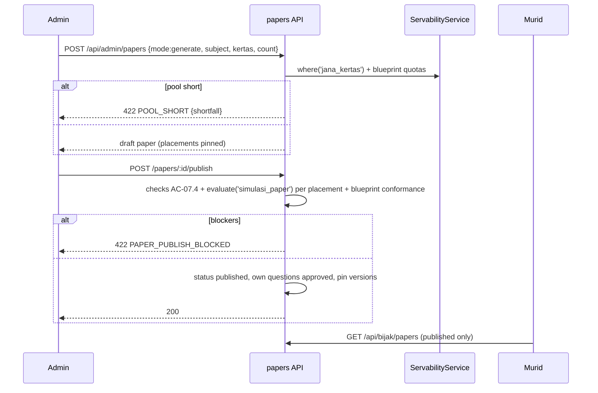
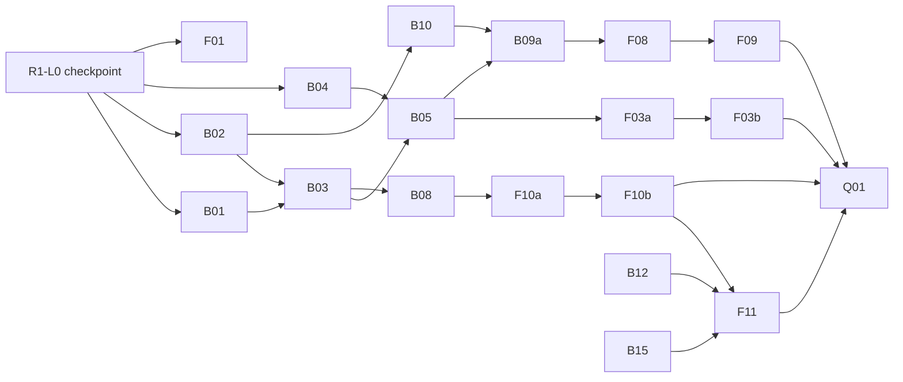

# v2 Admin-to-Student Content Pipeline: architecture (slug `admin-student-pipeline`)

Status: G2 approved as D85 (2026-10-30). Owner: solution-architect. Track: Full. Section 13 = R1 build plan, Bijak SPM first (D86); needs approval of 13.9 (R1-U1..U7).
Inputs: `docs/requirements/v2-admin-student-pipeline.md` (US-01..20, A01-A23, FD-1..FD-10, 10.1), `docs/design/v2-admin-student-pipeline.md`, `docs/discovery/cloud-student-mechanism.md`, TRACKER D11/D12, D29, D46, D53h, D54a, D72, D75-D84, gap analyses (activities, formats-authoring, process-root-causes), code on `local/v2-full`.
Build mode (D84): directly against the real v2 API (http mode). No mock fixtures. The tasks FE-P1, FE-P2, FE-P3, FE-P4 of the UX spec (mock data) are cancelled and replaced by the tasks in section 9; FE-P5 (display components) is kept.
ADRs: 0027 lifecycle, 0028 servable service, 0029 single store, 0030 served-question model and bridges, 0031 DSKP tags and gate, 0032 Tracking A, 0033 Kertas Subjektif document, 0034 OCR engine (proposed), 0035 feature flags.

## 1. Target architecture

### 1.1 Principles
1. ONE question store: the M04 bank (`questions`, `question_versions`, parts, options, stimuli, keys). Servable = live version `approved` + `is_active` (ADR-0027).
2. ONE eligibility service: `servable(question, activity)` (ADR-0028). Pools and the admin indicator call it. No activity has its own filter.
3. Papers, Tracking A sets, teacher sets and Kertas Subjektif documents reference bank ids (or, for Kertas Subjektif, hold their own documents). None copies a question.
4. Nothing student-visible comes from code fixtures, seed-only tables or env flags. The only runtime switch is `feature_flags` (entrance only).
5. Silent drops are impossible: every exclusion has a named rule and a BM reason.

### 1.2 Component diagram
```mermaid
flowchart LR
  subgraph Admin[Portal Pentadbiran]
    ST[Studio: wizard, status bar, bulk] --> QAPI
    IM[Import & Semakan] --> INT[intake module]
    SB[Set Builder / Jana set / Paper review] --> EXAM
    TA[Tracking A editor] --> SPM
    KS[Kertas Subjektif] --> KAPI[kertas-subjektif module]
    FF[Kawalan Ciri] --> FLAGS[feature-flags]
  end
  INT -->|Terima: draft question| QAPI
  subgraph M04[questions module - owner of the bank]
    QAPI[questions API + lifecycle + approve gate]
    FACTS[(question_version_facts)]
    SERV[ServabilityService: where(activity), evaluate()]
    TOSRV[to-served mapper -> ServedQuestion]
    QAPI --> FACTS
    FACTS --> SERV
  end
  EXAM[exam: blueprints, builder, papers, placements] -->|ids + pinned version| QAPI
  SERV --> PR[practice: A01 A02 A04 A10 A12 A13 A18]
  SERV --> BJ[bijak: A09 A11 simulasi attempts]
  SERV --> GM[games + battle: A21 A22 A23]
  SERV --> SPM[spm: Databank, Mock, Tracking A, Subjektif]
  SERV --> CL[classes: Misi, Set Soalan Guru, Remedial]
  SERV --> PK[pksk A19]
  SERV --> ADM[admin servability reads: Dilihat murid di, Perhatian]
  KAPI --> STU[Kertas Subjektif student reader A08]
  FLAGS -.entrance guard.-> PR & GM & STU
  TOSRV --> PR & BJ
```

### 1.3 How each activity reads (A01-A23)
Rule key = `ActivityKey` in `activity-rules.ts`. "Base" = approved + active + not PKSK + learner level active (D72).

| ID | Activity | Reads | Selection (SQL via `where(key)` unless noted) | Rule key and extra rules |
|---|---|---|---|---|
| A01 | Latih Tubi (+ SPM mode) | approved MCQ | subject, optional level, difficulty (TP band), count; random seeded; no pool tag | `latih_tubi`: Base + single MCQ leaf + key names an option + not multi-leaf. Stimuli, stem image, option images, groups ARE served (ADR-0030) |
| A02 | Databank SPM | approved MCQ by subject | random 5/10/20; shows `explanation` | `databank` = `latih_tubi` rules |
| A03 | Tracking A | admin set members | members passing `tracking_a`; set listed only when count >= target | `tracking_a`: A01 rules + member of a set |
| A04 | Mock K1 | approved MCQ by subject | random 5/10/20/40; follows Disahkan blueprint when one exists and the question is `dskp_complete` | `mock_k1`: A01 rules |
| A05 | Mock K2 | approved structured by subject | random 3/5/10 | `mock_k2`: Base + >=2 leaves or non-MCQ + scheme/rubric on every subjective leaf |
| A06 | Subjektif SPM | approved structured counts | stats Teras/Elektif/Set; answering = A07 | `subjektif` = `struktur` rules |
| A07 | Latihan Berstruktur | approved structured | list filters subject, KBAT (facts `has_kbat`) | `struktur`: as A05 |
| A08 | Kertas Subjektif | published Kertas Subjektif papers | `kertas_papers.status='published'` + flag | not a question rule; document rules in 5.4 |
| A09 | Simulasi | published papers | `papers.status='published'`, placements pinned versions; guard: each pinned version still servable for `simulasi_paper` else paper row shows blocker (builder) and attempt serves the pinned version | `simulasi_paper`: Base minus level rule (pinned) + all five modes + stimuli + groups |
| A10 | Simulasi Kuiz | approved MCQ parts with correct option; optional `paperId` limits to placements of a published paper | subject + count (5/10/20/40); session mode `simulasi_kuiz` | `simulasi_kuiz` = `latih_tubi` rules |
| A11 | Paper quiz | published paper | fixed paged read; non-MCQ textarea ungraded | `paper_quiz` = A09 shapes; MCQ checked statelessly |
| A12 | Soalan by Chapter | approved MCQ with chapter | chapter counts via `where('bab')` (approved only, DEC-5); `exact` count removed because the rule is exact in SQL | `bab` = `latih_tubi` |
| A13 | Aku Salah | pupil's wrong answers, re-read | `evaluate('aku_salah')` at replay time | `aku_salah` = `latih_tubi`; unservable replay items are skipped and counted, shown "tidak lagi tersedia" |
| A14 | Remedial Saya | attempt history; onward = A01 | no question content | flag `latih-tubi` |
| A15 | Pembetulan | `practice_answers` wrong by month | `GET /api/practice/corrections?bulan=` | none; links to A01 |
| A16 | Penguasaan | none | not built (conditional) | |
| A17 | Misi Harian | mission draw | `where('latih_tubi')` replaces spmPool fallback | `misi` = `latih_tubi` |
| A18 | Set Soalan Guru | teacher set ids | each item `evaluate('set_guru')` at serve; unservable items shown to the teacher with reason | `set_guru` = `latih_tubi` |
| A19 | PKSK | approved + PKSK tag + grant | existing M07 path, status literal only | `pksk`: Base without NOT_PKSK + PKSK tag |
| A20 | Audio KBAT | own audio sets table (not a question store) | unchanged; follow-up | out of scope |
| A21 | Battle | approved MCQ 2-4 options, text only | subject; count 5/10/15/20 | `battle`: `latih_tubi` + no images + no stimulus + 2-4 options + ungrouped |
| A22 | Zona Permainan (7) | same pool | subject then level fallback only if it yields rows | `games_mcq`; `games_betul_salah` (needs a statement-derivable stem), `games_silang_kata` (answer text <= 20 chars) |
| A23 | v2 solo games | same pool | | `games_mcq` |

Reason codes per rule are listed in ADR-0028; the BM copy table is the design spec section 9.3.

### 1.4 What disappears
| Removed | Replacement |
|---|---|
| `spmPool` filter/flag/create input/`pool` tag | `servable` rules by subject/level/kertas (ADR-0029) |
| `BIJAK_POC_QUESTIONS`, `poc-bank`, `poc-question-source`, composite id split | bank only; `composite.ts` collapses to `be09-question-source` |
| `spm/pool.service`, battle/games/classes/practice own samplers | `ServabilityService.where()` |
| `status='published'` for questions | `approved` |
| Practice `T4/T5 only` random limit (`rules.ts:43`) | level list = active levels with approved content, plus "Semua Tahap" |
| Seed-only Tracking A | admin CRUD (ADR-0032) |
| Practice/Bijak `null` refusals without a code | named exclusion rules |

### 1.5 Sequence: admin enters, student sees
```mermaid
sequenceDiagram
  participant A as Admin (Studio)
  participant Q as questions API
  participant F as facts + ServabilityService
  participant P as practice / bijak / games
  participant S as Murid
  A->>Q: POST /api/questions (draft, parts with tp + cognitiveLevel)
  Q->>F: computeFacts(version)
  A->>Q: POST /api/questions/:id/status {to:review}
  A->>Q: POST /api/questions/:id/status {to:approved}
  Q->>Q: approve gate (merged gates + DSKP)
  alt gate fails
    Q-->>A: 422 QUESTION_GATE_FAILED {issues[]}
  else passes
    Q->>Q: live_version_no = n, status approved
    Q->>F: evaluateFamilies()
    Q-->>A: 200 {question, servability: 7 rows + reasons}
  end
  S->>P: start Latih Tubi (subject, level, count)
  P->>F: where('latih_tubi') -> ids, hydrate, evaluate (re-check)
  P->>Q: to-served mapper (stimulus, images, options)
  P-->>S: ServedQuestion (no key); images via GET /api/files/:id
```

## 2. Data model changes (Prisma + migrations)

Migration numbers 0100-0106 are proposed (existing top is 0092; D68 ranges: LEAD to confirm). Every migration is forward only, idempotent where possible, and states its verification query. Enums stay text + CHECK (repo convention).

| # | Migration | Content |
|---|---|---|
| 0100 | `question_lifecycle_approved` | ADR-0027 data steps; CHECK status in (`draft`,`review`,`approved`,`archived`) |
| 0101 | `dskp_leaf_tags_and_facts` | `question_parts.tp`, `.cognitive_level`, `.topics`; CHECK mode adds `essay_choice`; table `question_version_facts`; backfill facts for all existing versions by a SQL function (same logic as `computeFacts`; a post-migration script compares both on a sample) |
| 0102 | `stimulus_kinds_wide` | no DDL if the CHECK already allows the 8 kinds (`stimuli.kind` check lists passage, image, diagram, table, graph, map, infographic, audio); migration only asserts it; contract widens |
| 0103 | `tracking_a_authoring` | ADR-0032 columns and unique index |
| 0104 | `kertas_subjektif` | ADR-0033 tables, `paper_sections.kertas_paper_id`, file purposes |
| 0105 | `feature_flags` | ADR-0035 |
| 0106 | `drop_pool_tag` | delete `question_tags` kind `pool`; narrow CHECK |

### 2.1 Prisma (excerpts; field names follow repo `@map` style)
```prisma
// questions.prisma
model QuestionPart {
  // ...existing...
  /// 1..6, leaf only (check: parent parts have NULL).
  tp             Int?    @db.SmallInt
  /// mengingat, memahami, mengaplikasi, menganalisis, menilai, mencipta (check), leaf only.
  cognitiveLevel String? @map("cognitive_level")
  /// essay_choice: [{ id, label }] (2..6).
  topics         Json?   @db.JsonB
}

/// Derived serving facts: one row per question version, written by QuestionsRepository in the write transaction.
model QuestionVersionFacts {
  versionId         BigInt   @id @map("version_id")
  leafCount         Int      @map("leaf_count") @db.SmallInt
  singleMcq         Boolean  @map("single_mcq")
  modes             String[]
  maxOptionCount    Int      @map("max_option_count") @db.SmallInt
  hasOptionImages   Boolean  @map("has_option_images")
  hasStemImage      Boolean  @map("has_stem_image")
  stimulusKinds     String[] @map("stimulus_kinds")
  inGroup           Boolean  @map("in_group")
  hasKey            Boolean  @map("has_key")
  hasScheme         Boolean  @map("has_scheme")
  assetsResolved    Boolean  @map("assets_resolved")
  /// e.g. table_fill, multi_blank, any_order, sig_figs, reveal_never.
  unsupportedCodes  String[] @map("unsupported_codes")
  dskpComplete      Boolean  @map("dskp_complete")
  hasKbat           Boolean  @map("has_kbat")
  tpMax             Int?     @map("tp_max") @db.SmallInt
  updatedAt         DateTime @default(now()) @updatedAt @map("updated_at") @db.Timestamptz(6)
  // FK question_versions(id) ON DELETE CASCADE in SQL.
  @@index([singleMcq, hasStemImage, inGroup], map: "ix_qvf_shape")
  @@map("question_version_facts")
}
```
Notes
- `question_versions.cognitive_level` (int) is deprecated and unread; dropped in a later cleanup migration.
- `question_versions.status` doc comment changes; no column change. `published_at` = approved at.
- Untagged legacy: `dskp_complete=false` after backfill (QLOAD items have no unit node). They stay `approved` and active; rule `legacy_untagged` only applies to blueprint-governed keys.
- Image-held QLOAD items remain `is_active=false` with `import_issues` containing the image marker; rule `image_missing` explains it (AC-04.6).

```prisma
// spm.prisma
model SpmTrackingSet {
  // ...existing...
  targetCount Int     @default(40) @map("target_count") @db.SmallInt
  createdById BigInt? @map("created_by_id")
  updatedById BigInt? @map("updated_by_id")
}
model SpmTrackingSetQuestion {
  // ...existing...
  subjectId BigInt @map("subject_id")   // copied from the set
  year      Int                         // copied from the set
  @@unique([subjectId, year, questionId], map: "uq_spm_tsq_subject_year_question")
}
```
```prisma
// kertas.prisma (new file)
model KertasPaper {
  id            BigInt    @id @default(autoincrement())
  subjectId     BigInt    @map("subject_id")
  kertas        Int       @db.SmallInt          // 2, 3, 4 (check)
  title         String
  state         String?                         // "Negeri"
  year          Int?      @db.SmallInt
  durationMin   Int?      @map("duration_min")
  totalMarks    Int?      @map("total_marks")
  status        String    @default("draft")     // draft, published (check)
  publishedAt   DateTime? @map("published_at") @db.Timestamptz(6)
  createdById   BigInt?   @map("created_by_id")
  createdAt     DateTime  @default(now()) @map("created_at") @db.Timestamptz(6)
  updatedAt     DateTime  @default(now()) @updatedAt @map("updated_at") @db.Timestamptz(6)
  documents     KertasDocument[]
  @@index([status, subjectId, kertas], map: "ix_kertas_papers_status_subject")
  @@map("kertas_papers")
}
model KertasDocument {
  id               BigInt   @id @default(autoincrement())
  paperId          BigInt   @map("paper_id")
  role             String                        // paper, skema (check)
  content          Json     @default("{}") @db.JsonB   // working draft (validated tree)
  publishedContent Json?    @map("published_content") @db.JsonB   // snapshot students read
  contentVersion   Int      @default(1) @map("content_version")
  processingStatus String   @default("none") @map("processing_status") // none, processing, ready, failed
  failureCode      String?  @map("failure_code")
  sourceFileId     BigInt?  @map("source_file_id")
  pageCount        Int?     @map("page_count") @db.SmallInt
  pagesDone        Int      @default(0) @map("pages_done") @db.SmallInt
  engine           String?                       // text_layer, tesseract, mixed
  updatedById      BigInt?  @map("updated_by_id")
  updatedAt        DateTime @default(now()) @updatedAt @map("updated_at") @db.Timestamptz(6)
  paper    KertasPaper @relation(fields: [paperId], references: [id], onDelete: Cascade, map: "fk_kertas_documents_paper_id")
  pages    KertasDocumentPage[]
  sections KertasDocumentSection[]
  @@unique([paperId, role], map: "uq_kertas_documents_paper_role")
  @@map("kertas_documents")
}
model KertasDocumentPage {
  documentId BigInt @map("document_id")
  pageNo     Int    @map("page_no") @db.SmallInt
  source     String                              // text, ocr (check)
  confidence Float?
  blocks     Json   @db.JsonB                    // [{ text, bbox{x,y,w,h}, confidence, size }]
  imageFileId BigInt? @map("image_file_id")
  status     String @default("pending")          // pending, done, failed
  errorCode  String? @map("error_code")
  document KertasDocument @relation(fields: [documentId], references: [id], onDelete: Cascade, map: "fk_kertas_pages_document_id")
  @@id([documentId, pageNo])
  @@map("kertas_document_pages")
}
model KertasDocumentSection {
  documentId BigInt    @map("document_id")
  blockId    String    @map("block_id")
  pageNo     Int?      @map("page_no") @db.SmallInt
  confidence Float?
  flagged    Boolean   @default(false)
  reason     String?                              // low_confidence, unreadable_region, table_unparsed, figure_uncertain
  blockHash  String    @map("block_hash")         // hash at flag time; edit changes it
  reviewedAt DateTime? @map("reviewed_at") @db.Timestamptz(6)
  reviewedById BigInt? @map("reviewed_by_id")
  document KertasDocument @relation(fields: [documentId], references: [id], onDelete: Cascade, map: "fk_kertas_sections_document_id")
  @@id([documentId, blockId])
  @@map("kertas_document_sections")
}
// exam.prisma: PaperSection gains   kertasPaperId BigInt? @map("kertas_paper_id")  (FK kertas_papers ON DELETE SET NULL, SQL)
// ops.prisma (new): model FeatureFlag { key String @id; labelMs String @map("label_ms"); enabled Boolean; updatedById BigInt?; updatedAt DateTime }
```

### 2.2 Blueprints and papers (reuse)
- `Blueprint`, `BlueprintSection`, `Paper`, `PaperSection`, `PaperPlacement` (with `pinned_version_no`) are reused unchanged except `PaperSection.kertas_paper_id`. D75/D76 fields (unit quotas, TP profile, KBAT marks, `Sumber` draft/spec/disahkan, evidence) are those of `v2-bijak-spm-standards.md`; this feature adds nothing to them. Verify during BE-C1 that "Blueprint perlu semakan" (D78 O-2) exists; if not, one boolean `needs_review` is added in 0103.
- The .cloud "native" versus "composite" distinction collapses to ONE `papers` table: `kind='pilihan'` with placements. A question authored inside a paper keeps `question_versions.source_paper_id` (FK added in 0101) and is approved by the paper's publish (AC-07.6). A composite is a paper whose placements point at already approved questions; the pin is `pinned_version_no` (already exists), so "Terbitkan semula untuk membekukannya" (AC-07.9) is "a placement whose pinned version is not the live one".
- `papers.status`: `draft, ready, published, withdrawn` unchanged; Terbit = published; Tarik balik = draft + own questions to `review`.
- `Paper.kind='jana'` (student generated) keeps exact-or-refuse over Disahkan blueprint pools via `where('jana_kertas')` = Base + `dskp_complete` + tag rules.

### 2.3 Existing data impact
| Data | Effect |
|---|---|
| Versions `published` | become `approved` (still live, still served) |
| Versions `approved` not live | become `review` (stay invisible; admin presses Terbitkan) |
| QLOAD legacy MCQs (7,000+ approved) | stay approved; `dskp_complete=false`; "Belum ditanda DSKP" |
| Image-held QLOAD items | stay inactive; reason `image_missing` |
| Pool tags | deleted (0106) |
| `question_tags` pksk | unchanged |
| PoC papers/attempts (dev only) | purged by guarded script; production none |
| Seeds | `published` -> `approved`; PoC pool seed dropped; seed:dev only |
| `spm_tracking_sets` seed rows (dev) | kept, backfilled |
| Bijak attempts referencing pinned versions | unaffected (pinned) |

## 3. API contract (packages/contract)

Conventions: decimal-string ids; cookie session + CSRF header on writes; error body `{ error: { code, message(BM), details? } }`; list responses `{ data, meta }`; roles = `admin` (Admin Pusat), `staff` (admin_sekolah, pegawai_ppd: read), `guru`, `murid`. New schemas live in `packages/contract/src/{servability,serving,kertas,tracking-a,flags}/` and are registered in the OpenAPI export.

### 3.1 Servability and questions
| Method path | Role | Request | Response | Errors |
|---|---|---|---|---|
| GET `/api/admin/questions/:id/servability` | admin, staff | - | `ServabilityReport { questionId, versionNo, visibleCount, totalFamilies:7, families:[{ family, name, ok, reasons:[{ code, message, fix }], activities:[{ activity, ok, reasons[] }] }] }` | 404 |
| POST `/api/admin/questions/servability:batch` | admin, staff | `{ ids: Id[<=100] }` | `{ data: [{ id, visibleCount, totalFamilies, attention: string[] }] }` | 422 `TOO_MANY_IDS` |
| GET `/api/questions/:id/gate-check?gate=submit\|approve` | admin, owner guru | - | `{ ok, issues:[{ path, code, message, step }] }` (no state change; drives the "· n belum lengkap" counter) | 404 |
| POST `/api/questions/:id/status` (existing, changed) | admin (guru: draft->review, draft->archived own) | `{ to: draft\|review\|approved\|archived, reason? }` | `{ question, servability?: ServabilityReport }` (report included when `to=approved`) | 409 `ILLEGAL_TRANSITION` message "Peralihan '{from}' -> '{to}' tidak dibenarkan."; 422 `QUESTION_GATE_FAILED { issues[] }` "Soalan belum boleh diterbitkan - sila betulkan isu di bawah."; 422 if `approved` would be unservable everywhere (`UNSERVABLE_EVERYWHERE`); 422 `to=published` during deprecation window maps to approved with header `Deprecation: true` |
| POST `/api/questions/:id/edit-as-draft` | admin | - | `{ draftQuestion }` (version n+1) | 409 if a newer draft already exists (returns its id) |
| POST `/api/questions/bulk-action` (existing, changed) | admin | `{ action: approve\|archive\|review, ids?: Id[], filter?: QuestionFilter, confirm: true }`; exactly one of ids/filter; filter needs >= 1 criterion | `{ done: n, failed: [{ id, issues[] }], skipped: n }` per-item reasons | 422 `BULK_FILTER_REQUIRED` "Sila pilih sekurang-kurangnya satu penapis ... sebelum meluluskan secara pukal."; 422 `BULK_TOO_LARGE` (> 2,000, narrow the filter) |
| GET `/api/questions` (existing, extended) | admin, staff | adds `dskp=tagged\|untagged`, `visible=family:ok\|no`, status tiles via `GET /api/questions/status-counts` | each row adds `dskpComplete`, `visibleCount` | |
| POST/PUT `/api/questions` (existing, extended) | admin, guru | leaf parts take `tp` (1..6), `cognitiveLevel`; part mode `essay_choice` with `topics`; stimulus kinds 7; `kertas` already written | question read adds `dskp { complete, issues }` | 422 field errors |
| GET `/api/admin/activities/:activity/shortfall?subjectId&kertas` | admin, staff | | `{ eligible, excluded:[{ code, message, count }] }` (AC-08.4, observability) | |
| GET `/api/admin/spm/overview` and `/api/admin/spm/lanes/:lane` | admin, staff | `lane`: databank, latih-tubi, tracking-a, subjektif, bijak-spm; query `subjectId,status,q,page` | hub cards with attention counts; lane rows `{ id, title, attention:[{ code, label }] }` | |

`approved` emits an audit event; `to=approved` is idempotent for an already approved question (200).

### 3.2 Papers, blueprints, publish
Existing builder/blueprint endpoints (`/api/admin/papers`, `/api/admin/blueprints`) keep their paths. Changes and additions:
| Method path | Role | Request | Response | Errors |
|---|---|---|---|---|
| POST `/api/admin/papers` | admin | `{ mode: 'blank'\|'generate', title, subjectId, kertas?, count?, year?, state? }`; `blank` creates sections A/B/C rule "all" | `{ paper }` | `generate`: 422 `POOL_SHORT { shortfall:[{ unit, slot, need, have }], untaggedExcluded }` |
| GET `/api/admin/papers/pool-preview?subjectId&kertas&count&year&state` | admin | | `{ available, requested, verdict: ok\|short, shortfall[], untaggedExcluded }`; Disahkan blueprint chosen -> exact quotas | 404 no blueprint -> falls back to plain count |
| POST `/api/admin/papers/:id/placements` / DELETE `/:placementId` / PUT `/:id/placements:order` | admin | `{ questionId, sectionId }`; order `{ sections:[{ id, placementIds[] }] }` | updated paper with per-row `servability` for `simulasi_paper` and `Tidak disajikan` reason | 409 published paper is read-only (AC-07.8) |
| GET `/api/admin/papers/:id/review` | admin, staff | | `{ paper, blockers:[{ code, message, placementId? }], rows:[{ placementId, ok, reason? }], visibility:{ simulasi, kuiz, trackingA } , blueprintOnly: boolean }` | |
| POST `/api/admin/papers/:id/publish` | admin | `{ overrideBlueprint?: boolean }` | `{ paper }`; native own questions approved, placements pinned, in one transaction | 422 `PAPER_PUBLISH_BLOCKED { blockers[] }` (checks of AC-07.4 listed one per row; "Kertas ini tiada soalan - tidak boleh diterbitkan."); override only when blueprint is the sole blocker (else 422) and is audited |
| POST `/api/admin/papers/:id/withdraw` | admin | | `{ paper }` own questions to `review`; attempts kept | |
| POST `/api/admin/papers/:id/copy` | admin | | `{ paper }` draft ("Salin set") | |
| POST/DELETE `/api/admin/papers/:id/sections/:sid/document` | admin | `{ kertasPaperId, markBudget }` attach a published Kertas Subjektif | | 422 not published / different subject |
| Blueprint endpoints | admin | unchanged; `Disahkan` only via the existing verify operation | | |

### 3.3 Student reads and new activities
| Method path | Role | Notes |
|---|---|---|
| POST `/api/practice/sessions` (existing) | murid | `mode` gains `simulasi_kuiz` (`subjectId`, `count` in 5,10,20,40, optional `paperId`); responses carry `ServedQuestion` (no key). Guard `latih-tubi` flag except `simulasi_kuiz` (not under that flag) |
| GET `/api/bijak/papers` (existing) | murid | published only; empty list is the empty state (AC-01.2); PoC removed |
| GET `/api/bijak/papers/:id/quiz` | murid | published paper paged by section; `ServedQuestion[]` without keys |
| POST `/api/bijak/papers/:id/quiz/check` | murid | `{ questionId, partLabel, answer }` -> `{ correct, correctLabel?, explanation? }` for MCQ only; nothing stored; 422 `NOT_MCQ` |
| GET `/api/practice/corrections?bulan=YYYY-MM` | murid | `{ months:[...], bySubject:[{ subject, items:[{ questionId, answeredAt, servable }] }] }` |
| GET `/api/spm/tracking-a` and `/:id` | murid | only sets with servable count >= target; locked 404 |

### 3.4 Tracking A (admin)
| Method path | Role | Request | Response | Errors |
|---|---|---|---|---|
| GET `/api/admin/spm/tracking-a?subjectId&status` | admin, staff | | sets `{ id, subject, year, setNo, count, targetCount, status: locked\|bersih\|bank_besar }` | |
| POST `/api/admin/spm/tracking-a` | admin | `{ subjectId, year, setNo, targetCount? }` | set | 409 duplicate |
| GET `/api/admin/spm/tracking-a/:id` | admin, staff | | set + ordered members `{ questionId, stem, servability, isNew }` | |
| POST `/api/admin/spm/tracking-a/:id/fill` | admin | `{ currentIds[] }` | `{ suggestions: Id[] }` (free pool: servable, not in a sibling set) | 422 "Tiada soalan lain yang boleh disajikan untuk mengisi set ini." |
| POST `/api/admin/spm/tracking-a/:id/swap` | admin | `{ questionId, currentIds[] }` | `{ replacementId }` | 422 "Tiada soalan lain yang boleh disajikan untuk ditukar." |
| PUT `/api/admin/spm/tracking-a/:id` | admin | `{ questionIds: Id[] (ordered), targetCount? }` | set | 422 "Pilih sekurang-kurangnya satu soalan sebelum menyimpan."; 422 `ITEMS_INVALID { items:[{ id, reason }] }` (sibling set, not servable) |
| DELETE `/api/admin/spm/tracking-a/:id` | admin | | 204 | 409 if pupil attempts exist |

### 3.5 Kertas Subjektif
Admin (role `admin` writes; `staff` read list/detail metadata):
| Method path | Request | Response | Errors |
|---|---|---|---|
| GET `/api/admin/kertas-subjektif?subjectId&kertas&status&q&page` | | `{ data:[paper + processingStatus + hasSkema + sectionsToReview], meta, kpi:{ total, published, withSkema } }` | |
| POST `/api/admin/kertas-subjektif` | `{ title, subjectId, kertas, state?, year?, durationMin?, totalMarks? }` | paper (draft) | 422 |
| GET / PATCH / DELETE `/api/admin/kertas-subjektif/:id` | PATCH metadata | paper (+ both document summaries) | DELETE 409 if attached to a Simulasi section |
| POST `/api/admin/kertas-subjektif/:id/documents/:role` (multipart `file`, `confirmReplace?`) | PDF | 202 `{ documentId, processingStatus:'processing', pageCount }` | 422 `FILE_NOT_PDF` "Fail mesti berformat PDF."; 413 `FILE_TOO_LARGE` "Saiz fail melebihi {n} MB."; 422 `TOO_MANY_PAGES` "Fail melebihi {m} halaman."; 409 `REPLACE_NEEDS_CONFIRM` |
| GET `/api/admin/kertas-subjektif/:id/documents/:role` | | `{ processingStatus, pagesDone, pageCount, failure?, content, contentVersion, sections:[{ blockId, flagged, reason, confidence, resolved }] }` (poll every 2 s while processing) | |
| PUT `/api/admin/kertas-subjektif/:id/documents/:role` | `{ content, contentVersion }` (autosave) | `{ contentVersion, sections }` | 409 `VERSION_CONFLICT`; 422 `DOCUMENT_INVALID`; 409 while processing |
| POST `.../documents/:role/sections/:blockId/accept` | | `{ sections }` | |
| POST `.../documents/:role/figures` (multipart image) | | `{ fileId, width, height }` | |
| POST `.../documents/:role/figures:recrop` | `{ pageNo, bbox }` | `{ fileId, width, height }` | |
| GET `.../documents/:role/pages/:n/image` | | PNG (admin only) | |
| POST `/api/admin/kertas-subjektif/:id/publish` / `unpublish` | | paper | 422 `PUBLISH_BLOCKED { reasons }`: "sedang diproses", "tiada kandungan - tidak boleh diterbitkan", "{n} bahagian perlu disemak sebelum diterbitkan" (priority order of design S6.3) |

Student (flag `kertas-subjektif`): GET `/api/kertas-subjektif` (grouped by subject), GET `/api/kertas-subjektif/:id` (`{ meta, content, hasSkema }`), GET `/api/kertas-subjektif/:id/skema`. Draft or unpublished: 404. Flag off: 403 `FEATURE_DISABLED`.

### 3.6 Flags
| Method path | Role | Notes |
|---|---|---|
| GET `/api/feature-flags` | any signed-in | `{ permainan, 'latih-tubi', 'kertas-subjektif' }` booleans |
| GET `/api/admin/feature-flags` | admin | list with label |
| PUT `/api/admin/feature-flags/:key` | admin | `{ enabled }`; audit; 404 unknown key |

## 4. Bridges

### 4.1 Common
`questions/serving/to-served.ts` builds `ServedQuestion` (ADR-0030). Answer keys, schemes and `explanation` (for activities that reveal only after check) are removed server-side before sending. The shape facts used in `activity-rules.ts` are the same fields the mapper reads, so mapping cannot fail for a question that passed `servable`; a mapper exception is a bug and is logged as `servability_mismatch_total`.

### 4.2 Mode and stimulus support matrix
| Item | Practice family (MCQ quiz) | Games/Battle | Simulasi, paper quiz | Struktur/Mock K2 |
|---|---|---|---|---|
| mcq (single leaf) | served | served (no images) | served | n/a |
| short_text (single blank) | excluded `not_mcq` | excluded | served | served |
| numeric | excluded | excluded | served | served |
| extended_essay | excluded | excluded | served (keyword suggestion + self mark) | served |
| essay_choice | excluded | excluded | served (new part mode) | served |
| working, match_letter, drawing | excluded | excluded | served as today | served as today |
| table_fill, multi-blank, anyOrder, sigFigs/decimals, reveal never | excluded `shape_unsupported:<detail>` everywhere (0 production rows; explicit) | | | |
| stimulus: passage, image, diagram, table, map, infographic, graph | served | excluded `grouped_unsupported` / `has_image_game` | served | served |
| stem image (an `image` stimulus) | served as "Rajah soalan" | excluded | served above the stem | served |
| option images | served | excluded | served | n/a |
| shared group (<=3 stimuli, option bank) | served once per group | excluded | served; pinned pane rule (design 11.4) | served |
| multi-part (a)(b)(c) | excluded `not_mcq` | excluded | served (each leaf own widget) | served |

### 4.3 Practice bridge change
`be09-practice-mapping.ts` is replaced by a thin projection of `ServedQuestion` (MCQ leaf) plus fields `stimuli`, `stemImage`, `options[].image`, `group`. `servableMcq` refusals are deleted; the rule file owns them. `PracticeSelection.spmPool` is removed; `PracticeQuestionSource.sample/chapterCounts/chapterPage/live` call `where(activity)`. The `exact` count variant is removed (SQL rule is exact). Random mode level limit T4/T5 (`rules.ts:41-43`, `start.planner.ts:174-186`) becomes "active levels with approved content" and "Semua Tahap". `versions()` (grading by the served version) is unchanged.

### 4.4 Bijak bridge change
`be09-mapping.ts`: image stimuli map to exam-core `StimulusDef` `kind:image` with `fileId`/size; option images to `imageFileId`; groups with 2-3 stimuli supported (exam-core group holds a stimulus list; BE-16 attempt payload gains `stimuli[]`); `essay_choice` maps to `PartDef.answer.kind='essay_choice'`; refusals reduced to the explicit unsupported list. `composite.ts` PoC split removed. The paper builder row status `Tidak disajikan` comes from `evaluate('simulasi_paper')`.

### 4.5 The five missing activities
- **Simulasi Kuiz (A10):** practice session mode `simulasi_kuiz`; pool `where('simulasi_kuiz')` (+ placements of `paperId` if given); persisted as a normal practice session (feeds Aku Salah, Pembetulan, Ganjaran). Entry: link on `/simulasi` with `?count=` (D-7).
- **Paper quiz (A11):** `GET /api/bijak/papers/:id/quiz` + stateless `quiz/check`; nothing persisted; score tallied by the client from checks.
- **Kertas Subjektif (A08):** module `kertas-subjektif`, section 5.
- **Pembetulan (A15):** read endpoint over `practice_answers` (M05 owns); month filter `bulan`; each item re-evaluated for A01 link.
- **Penguasaan (A16):** not built (conditional AC-14.6); nav stays hidden.

## 5. Kertas Subjektif: OCR and document model (D81)

### 5.1 OCR options (summary; full table in ADR-0034)
| Option | Accuracy on scanned BM papers | Cost/page | Ops | Privacy | Quota |
|---|---|---|---|---|---|
| A Tesseract msa+eng + text layer first | Known: good on clean print; no tables/maths. To test on 5 real scans | RM 0 | already coded; set `OCR_ENGINE=tesseract`, ship traineddata, 3-8 s/page/worker (measure) | local | none |
| B Cloud OCR (Document AI / Azure / Textract) | Known (vendor): strong print + tables; to test | about RM 0.007 plain, RM 0.05-0.07 layout | vendor account, egress | page images leave | none with AI budget |
| C BE-36 vision model | Known: best layout/tables/simple maths; hallucination risk; to test | about RM 0.02-0.15 | needs adapter image input (not present) | breaks "provider never sees a page image" rule | uses monthly AI budget (sen), may refuse at 100% |
**Recommendation: A behind a `DocumentReader` port (user decision U1).**

### 5.2 Pipeline (reuses intake page rendering and text-layer-first)
```mermaid
sequenceDiagram
  participant A as Admin
  participant K as kertas-subjektif API
  participant J as jobs
  participant O as ocr module (pdfjs + tesseract)
  A->>K: POST documents/:role (PDF)
  K->>K: validate type, size, pages; store file (kertas_source_pdf)
  K->>J: enqueue kertas.process_document
  J->>J: fan out kertas.page per page (idempotent keys, like intake)
  J->>O: extractText(page); if chars < OCR_MIN_TEXT_CHARS -> render 150 dpi + recognize
  O-->>J: blocks (text, bbox, size, confidence)
  J->>K: store kertas_document_pages + page image + thumb
  J->>J: when all pages done: kertas.assemble
  J->>K: write content tree + sections (flags) ; processing_status ready|failed
  A->>K: poll GET documents/:role (progress)
```
Reuse: `PDF_ENGINE`, `OCR_ENGINE`, `OcrImageService`, `JobsService`, `FilesService`, `intake-figures` crop helper pattern. Not reused: AI extraction, intake batches, intake daily page quota (separate `KERTAS_MAX_PAGES`).

### 5.3 Assembly rules (pure function `assembleDocument(pages) -> { content, sections }`, unit-tested with fixtures)
- Headings: line size greater than 1.25x median body size or all-caps line matching `BAHAGIAN|SECTION|KERTAS|SKEMA` (text layer: font size; OCR: line box height).
- Numbering: regex `^\d+[.)]`, `^\([a-z]\)`, `^\((i{1,3}|iv|v|vi{0,3}|ix|x)\)` build the `numbering` attribute (e.g. `1(a)(i)`); indentation by x offset.
- Marks: `\[\s*(\d+)\s*(markah|marks?)\s*\]` become inline `marks` nodes; a mismatch between sum of marks and `total_marks` is a hint line, not a blocker.
- Paragraphs: merge lines by vertical gap and hyphen rules; drop running headers/footers (repeated lines at the same y on more than half the pages) and page numbers.
- Tables (text layer): cluster x positions of three or more consecutive aligned rows; produce a `table`. Scans: a table region is cropped as a `figure` flagged `table_unparsed`.
- Figures: pdfjs image operators (digital) or large ink areas without text blocks (scans) are cropped (reuse crop pattern, purpose `kertas_figure`), inserted at their reading-order position, flagged `figure_uncertain` for scans.
- Maths: unicode symbols kept as text; unresolved math-like regions (many non-letter glyphs) flagged `low_confidence`; the editor `√x` tool adds LaTeX manually.
- Flags: OCR line confidence < `KERTAS_FLAG_CONFIDENCE` (75), failed page region, unparsed table, uncertain figure. Block granularity. A wholly failed page yields a flagged placeholder block "Halaman {n} tidak dapat dibaca." plus the page image figure so the admin can transcribe.
- Whole-file failure (no readable page, or all pages empty): `processing_status='failed'`, `failure_code` `UNREADABLE` or `NO_CONTENT`, paper stays draft (AC-14.18).

### 5.4 Student reader and Simulasi attach
Reader reads `published_content` only. The same sanitised renderer (read-only TipTap node views) draws it; tables sit in a scroll container, figures use width/height from the node (no layout shift). Attach to a Simulasi section (`paper_sections.kertas_paper_id`): the student paper embeds the snapshot; the single self-mark field uses `mark_budget`.

## 6. Sequence: paper publish and student Simulasi


## 7. Migration and compatibility
1. Order: deploy migrations 0100 then 0101 with the code that reads `approved` in the same release (maintenance window of seconds; `learner-visibility` constant flips). Pre-flight: dump; count of `published`, `approved` rows logged.
2. Contract compatibility: one release alias `published -> approved` on input; responses never emit `published`. FE updates its status maps in the same release (FE-A1).
3. Facts backfill job processes versions in batches of 5,000 (7,000+ legacy rows is small); until finished, `servable` returns no rows for versions without facts, so the order is: migration -> backfill (inline in migration for current volume) -> deploy code.
4. PoC and spm pool removal are code-only plus 0106 and a dev purge script. Production verification: `SELECT count(*) FROM question_tags WHERE kind='pool'` = 0.
5. Rollback: code rollback is possible before the first new approval; after that, `published` cannot be reconstructed (documented in ADR-0027).

### 7.1 Proposed rows for `docs/architecture/v2-backend-deviations.md` (not written now)
| ID | Deviation | Reason / who agreed |
|---|---|---|
| AP-01 | Question status `published` removed; `approved` is servable; approved-but-unpublished rows go back to `review` | D80 DEC-1; ADR-0027; Pending LEAD |
| AP-02 | `spmPool` flag and `pool` tag removed; SPM activities select by tags | D80/AC-08.3; ADR-0029 |
| AP-03 | `BIJAK_POC_QUESTIONS` and PoC fixture deleted | AC-01.2/01.3 |
| AP-04 | Part-level `tp` and `cognitive_level`; approve gate merged and requires them for new approvals | FD-1, D83 D-4; ADR-0031 |
| AP-05 | `question_version_facts` derived table | ADR-0028 |
| AP-06 | `essay_choice` part mode and 4 more stimulus kinds in the contract | AC-10.5, AC-11 |
| AP-07 | Practice family serves stimuli, images, groups (not in .cloud) | FD-6 |
| AP-08 | Games exclude questions with images, with reason shown | AC-13.2 |
| AP-09 | Approved whitelist in Bab counts, games, teacher picker | FD-2/DEC-5 |
| AP-10 | Feature flag off answers 403 with BM text instead of .cloud 404; `latih-tubi`, `kertas-subjektif` toggles added | FD-4; ADR-0035 |
| AP-11 | Tracking A set creation endpoint (.cloud creates by CLI) | ADR-0032, U3 |
| AP-12 | Kertas Subjektif as editable document with snapshot, OCR flags, `Terbit` gate "tiada kandungan" | FD-10; ADR-0033 |
| AP-13 | One `papers` table for native and composite; native publish approves own questions in the same transaction | AC-07.6 |
| AP-14 | Paper quiz non-MCQ textarea gets a helper line | FD-9 |
| AP-15 | Practice random level limit T4/T5 removed | AC-12.2 |
| AP-16 | Simulasi `/simulasi` subheading corrected | FD-3 |

## 8. Risks
| # | Risk | Impact | Mitigation |
|---|---|---|---|
| R1 | Lifecycle rename touches about 35 files; one missed `'published'` hides content | High | BE-A1 greps and replaces with the constant, parity test (ADR-0028) covers every activity; lint rule bans the literal in question modules |
| R2 | Facts drift from the real record | High | single writer `computeFacts` in the repository transaction; reconcile job + nightly compare; parity test |
| R3 | OCR quality on scans too low | Medium | flag OFF until bake-off; port allows B/C; admin can always type the content |
| R4 | Table and maths structure not recovered | Medium | flagged figures; manual `Jadual` and `√x` tools exist |
| R5 | Legacy bank is large; random draw cost | Medium | indexed facts shape index, existing draw indexes (0044); load test at 20,000 rows |
| R6 | Practice quiz UI never needed stimuli before (QuizRunner) | Medium | integrate FE-P5 components (section 10), screenshot tests at 375 |
| R7 | exam-core change affects marking of existing papers | High | additive types only; existing marking tests unchanged and run in CI |
| R8 | Multi-session shared tree (seeds, migrations, contract) | High | shared-data tasks in worktrees; one migration owner (BE-A1); contract changes land first (BE-A2) |
| R9 | `services` returning 403 for flag-off differs from .cloud | Low | logged AP-10 |
| R10 | Bulk approve of 5,000 items blocks request | Medium | cap 2,000; chunked transactions |
| R11 | Pupil file read rule must cover Kertas figures and new stimuli | High (security) | extend `files.service` rule + security-engineer review (G4) |
| R12 | Image stimulus file missing yields empty frame | Medium | `assets_resolved` in facts; rule `image_missing`; FE load-failure state (FE-P5 `StimulusFigure`) |

## 9. Task list

Legend: **WT** = changes shared migrations, seeds or contract and runs in an isolated worktree, merged only after `registry-boot.test.ts` and owner tests pass. Owner roles: BE = backend-developer, FE = frontend-developer, DO = devops-engineer, QA = qa-engineer. Never run pnpm in design; builders run lint, type-check and tests.

### 9.1 Backend
| ID | Task | Files / module | Depends | WT |
|---|---|---|---|---|
| BE-A1 | Lifecycle: migration 0100, constant `SERVABLE_STATUS`, replace `'published'` for questions in ~35 files, contract statuses + transition table + bulk values (alias window), seeds/fixtures `published->approved`, lint ban | `prisma/migrations/0100*`, `questions/**`, `practice/**`, `spm/**`, `battle`, `games`, `classes`, `pksk`, `exam/builder`, `bijak/papers`, `files`, `migration/load`, `prisma/seed/*`, `packages/contract/src/question-workflow/lifecycle.ts` | - | Yes |
| BE-A2 | Contract: `ServedQuestion`, stimulus kinds, `essay_choice`, part `tp/cognitiveLevel`, servability types + BM copy, kertas document schema, tracking-a, flags, error codes | `packages/contract/src/{serving,servability,kertas,tracking-a,flags,questions}` | - | Yes |
| BE-A3 | Facts + rules + `ServabilityService` (`where`, `evaluate`, families), migration 0101 tables/backfill, `computeFacts` in repository transactions, parity test matrix | `questions/serving/**`, `questions/questions.repository.ts`, migration 0101 | A1, A2 | Yes |
| BE-A4 | Feature flags module + guard + endpoints, migration 0105 | `modules/feature-flags/**` | A2 | Yes (migration) |
| BE-B1 | DSKP: leaf `tp/cognitiveLevel` persist, derive `difficulty_tp`, merged approve gate with issues `{path, code, message, step}`, gate-check endpoint, legacy rule, intake `to-question` carries tags | `questions/workflow/lifecycle/gates.ts`, `publish-gate.ts`, `projection.ts`, `intake/workflow/to-question.ts`, controllers | A1, A2, A3 | No |
| BE-B2 | Remove spmPool (types, repository, create path, views, pksk.service), migration 0106 | `questions/**`, `practice/ports.ts`, `spm/**`, `battle`, `classes/missions`, `exam/builder/question-bank.source.ts` | A3 | Yes (0106) |
| BE-B3 | Remove PoC fixture and env key; guarded dev purge; rewrite PoC e2e | `bijak/papers/poc*`, `bijak/question-bridge/composite.ts`, `bijak/integration`, `exam/builder/composite.source.ts`, `.env*.example`, docs/ops | A3 | Yes |
| BE-B4 | `to-served` mapper + practice bridge rewrite (stimuli, images, groups), level scope, session wire adds fields | `questions/serving/to-served.ts`, `practice/question-bridge/**`, `practice/start.planner.ts`, `practice/rules.ts` | A2, A3 | No |
| BE-B5 | exam-core + Bijak bridge: image stimuli, option images, 2-3 stimulus groups, `essay_choice`, reduced refusals; attempt payload `stimuli[]` | `packages/exam-core/**`, `bijak/question-bridge/be09-mapping.ts`, `bijak/attempts/**` | A2, A3 | No (exam-core tests run) |
| BE-B6 | Games + Battle pools via `where()`, exclusions, statement/crossword rules | `games/core/game-questions.service.ts`, `games/**`, `battle/**` | A3, A4 | No |
| BE-B7 | SPM pools: Latih Tubi SPM, Databank, Mock K1/K2, Struktur/Subjektif counts, Misi, Set Guru, Remedial, Bab counts via `where()` | `spm/**`, `classes/**`, `practice/reads/**` | A3, B4 | No |
| BE-B8 | Admin servability endpoints (single, batch, shortfall, overview/lanes), bulk-action rework with per-item reasons, edit-as-draft, status response with servability | `questions/http/admin.controller.ts`, `spm/**` | A3, B1 | No |
| BE-C1 | Papers: blank/generate/pool-preview, placements API, review endpoint, publish conformance (AC-07.4), override audit, native approve in transaction, pin versions, withdraw, copy, attach document | `exam/builder/**`, `exam/blueprints/**`, `bijak/papers/**` | A3, B1, B5, (D1 for attach) | No |
| BE-C2 | Tracking A CRUD + fill/swap + student visibility, migration 0103 | `spm/tracking*.ts`, new controller | A3 | Yes (0103, seed) |
| BE-C3 | Simulasi Kuiz mode, paper quiz + check, Pembetulan read | `practice/**`, `bijak/papers/**` | B4, B5 | No |
| BE-D1 | Kertas Subjektif module: migration 0104, CRUD, publish/unpublish gate, flag guard, file purposes + pupil read rule | `modules/kertas-subjektif/**`, `files/**`, `prisma/schema/kertas.prisma` | A2, A4 | Yes |
| BE-D2 | Pipeline: upload, jobs, page reading via `DocumentReader` (text layer + Tesseract), `assembleDocument`, progress, failure codes, fixtures (one digital, one scanned test PDF) | `kertas-subjektif/pipeline/**` | D1 | No |
| BE-D3 | Document save (version conflict), section accept/auto-resolve, figures upload/recrop, page image read, student reads | `kertas-subjektif/**` | D1, D2 | No |
| BE-E1 | Dev seeds on the new model (T4/T5 approved questions of all shapes incl. image files), `seed:dev` split | `prisma/seed/**` | A1, B1 | Yes |
| BE-E2 | API e2e journeys per content class (US-18) on the real stack | `e2e/api/**` | per journey | No |

### 9.2 DevOps
| ID | Task | Depends |
|---|---|---|
| DO-1 | OCR runtime: `OCR_ENGINE=tesseract`, ship `msa/eng` traineddata, `OCR_LANG_DIR`, worker sizing, `KERTAS_*` env keys, remove `BIJAK_POC_QUESTIONS` | D2 |
| DO-2 | Migration runbook: dump, 0100 pre-flight counts, window, rollback note, verification queries; CI job that runs the servability parity test on Postgres | A1, A3 |
| DO-3 | Production flag defaults check (`permainan` on, `latih-tubi` on, `kertas-subjektif` off) in smoke test | A4 |

### 9.3 Frontend (real API, http mode; no mock fixtures)
FE-P5 is DONE (`src/components/question-display/`: `AnswerWidget`, `McqOptions`, `TextAnswer`, `EssayAnswer`, `StimulusFigure`, `StimulusGroup`, `VisibilityList`, `NotServedNotice`, `types.ts`, `copy.ts`). These are presentational; tasks below add only adapters, pages and API clients. Rules:
- The display library's local prop types (`StimulusData`, `McqOptionData`, `VisibilityRowData`, `AnswerMode`) stay; `types.ts` already says "map contract types onto them in page adapters". Adapters live in `src/modules/<module>/adapters/` (one file per feature) and convert contract `ServedQuestion`, `ServabilityReport` to those props. No component is copied; no duplicate stimulus or option component is created in m05 or m28.
- `StimulusData.src` is built from `file.fileId` by the existing files URL helper; width/height come from `file.width/height` (reserve box).
- `VisibilityList` rows come directly from `ServabilityReport.families`; its copy table equals the contract copy (`copy.ts` is checked against `packages/contract/src/servability/copy.ts` by a test, so there is one wording).
- Mock-only tasks FE-P1..P4 are cancelled; their useful parts are re-scoped (nav = FE-N1; `servable` = server).

| ID | Task | Files | Depends |
|---|---|---|---|
| FE-N1 | Nav and routes (menu.ts per design section 2, route fragments, features.ts reads `/api/feature-flags`, `menu.test.ts`); stubs only until pages land | `src/shells/pentadbiran/menu.ts`, `src/app/features.ts` | A2 (types) |
| FE-A1 | API clients + adapters for questions status maps (`approved`), servability, ServedQuestion -> display props; contract types import | `src/modules/m04-question-bank/api/**`, `.../adapters/**` | A2 |
| FE-A2 | Studio list S1.1, wizard S1.2 (tp/cognitiveLevel per leaf, stimulus kinds, essay_choice), status bar S1.3 + `VisibilityList`, gate issue list, Pratonton S1.4, archive dialog | `src/modules/m04-question-bank/pages/Studio*` | A1, P5, BE-B1, BE-B8 |
| FE-A3 | Import & Semakan S2.x (modals incl. Import PDF, review, paper review blockers); Terima creates draft with tags | `m28 admin/intake`, `m04` | A1, BE-B1, BE-C1 |
| FE-A4 | Legacy list bulk actions with per-item failure panel (S3.2) | `m04 pages/QuestionListPage.vue` | A1, BE-B8 |
| FE-A5 | Set Builder S4.1/4.2, Jana set + Pratonton kolam, native paper blocks S4.4, document Bahagian attach | `m28 admin/papers/**` | A1, P5, BE-C1 |
| FE-A6 | Kontrak (K1/K2/K3 labels per design FLOW 7) wiring to existing blueprint API | `m28 admin/kontrak/**` | FE-N1 |
| FE-A7 | SPM hub, lane lists with `Perhatian`, Tracking A editor | `m28 admin/spm-content/**` | A1, BE-C2, BE-B8 |
| FE-A8 | Kertas Subjektif admin S6.1-S6.3: upload states, polling, TipTap document editor, flagged sections, Terbit gate | `m28 admin/kertas-subjektif/**` | A1, BE-D1..D3 |
| FE-A9 | Kawalan Ciri | `src/modules/**/feature-toggles` | A1, BE-A4 |
| FE-S1 | Simulasi family: listing from real papers, empty state, Kuiz page, paper quiz page, shared stimulus chip/sheet via `StimulusGroup`, subheading fix | `m28 pages/**` | A1, P5, BE-B5, BE-C3 |
| FE-S2 | Practice family: extend `QuizRunner` to render `ServedQuestion` through P5 components, Bab counts, level list incl. "Semua Tahap", Tracking A hub/run, Pembetulan, flag messages | `m05 components/quiz/**`, `pages/**` | A1, P5, BE-B4, BE-B7, BE-C3 |
| FE-S3 | Kertas Subjektif student index/viewer/skema reveal + admin "Lihat sebagai pelajar" | `m28 pages/kertas/**` | A1, BE-D3 |
| FE-S4 | Games UI: nothing structural; handle exclusions and flag message | `m06`/games pages | BE-B6 |

### 9.4 QA
| ID | Task | Depends |
|---|---|---|
| QA-1 | E2E journeys per content class on the real stack at 375/768/1280 (US-18): (1) image MCQ + shared group question created in Studio, 4 clicks, seen in A01, A02, A04, A10, A12, A21/A22 (text MCQ), (2) structured question -> Simulasi + Struktur, (3) paper generated/built, published, student completes and opens Semakan, (4) untagged legacy served in A01 and absent from pool preview, (5) Tracking A fill + Simpan -> student plays, (6) Kertas Subjektif digital and scanned PDF -> edit -> Terbit -> reader (flag on), empty refused, (7) unservable shape confirms exclusion + admin reason, (8) flags toggles | all |
| QA-2 | Parity/regression: servability matrix, status migration verification on a copy of QLOAD data | A3, A1 |

### 9.5 Dependency waves
- **Wave 0 (parallel):** BE-A1 (WT), BE-A2 (WT), FE-N1, DO-2 draft. FE-P5 already done.
- **Wave 1:** BE-A3 (needs A1, A2), BE-A4 (needs A2), FE-A1 (needs A2).
- **Wave 2 (parallel):** BE-B1, BE-B2, BE-B3, BE-B4, BE-B5, BE-B6, BE-C2, BE-D1, BE-E1.
- **Wave 3 (parallel):** BE-B7, BE-B8, BE-C1, BE-C3, BE-D2, FE-A2, FE-A9, FE-A6.
- **Wave 4 (parallel):** BE-D3, FE-A3, FE-A4, FE-A5, FE-A7, FE-S1, FE-S2, FE-S4, DO-1.
- **Wave 5:** FE-A8, FE-S3, BE-E2, QA-2.
- **Wave 6:** QA-1, G4 reviews (code-reviewer, security-engineer: file read rules, flag guards, document sanitising, bulk caps), G5.
Shared-data tasks (WT): BE-A1, BE-A2, BE-A3, BE-A4 (migration), BE-B2, BE-B3, BE-C2, BE-D1, BE-E1. Serialise migrations: A1 (0100), A3 (0101), C2 (0103), D1 (0104), A4 (0105), B2 (0106).

## 10. First vertical slice (fastest functioning path)
Goal: admin creates and approves an image MCQ, the student sees it in Latih Tubi and inside a published Simulasi paper.
1. BE-A1, BE-A2 (parallel, ~1 wave).
2. BE-A3 (facts + `latih_tubi`, `simulasi_paper`, `bab` rules only), BE-B1 (merged gate with DSKP), BE-B4 (practice bridge serves stem image + option images), BE-B5 (image stimulus in Bijak bridge).
3. BE-C1 minimal: blank paper, add placement, publish with checks. BE-B8 minimal: status response with servability.
4. FE: FE-A1, FE-A2 (wizard + status bar), FE-A5 minimal (builder add and publish), FE-S2 (QuizRunner using P5 `StimulusFigure`/`McqOptions`), FE-S1 (Simulasi list real).
5. QA-1 journey (1) and (3) at three widths. This slice proves AC-01.4, AC-02.1/02.2, AC-05.x, AC-11.5/11.6, AC-18.1..18.3 and removes the PoC fixture dependency (BE-B3 joins in step 2 because it is small).
Next slices in order: (b) DSKP + legacy + Jana Kertas pool; (c) Tracking A; (d) games and SPM pools; (e) Simulasi Kuiz, paper quiz, Pembetulan; (f) Kertas Subjektif.

## 11. Traceability to requirements
US-01/05: ADR-0028, 0029, 0030. US-02: ADR-0027, section 3.1. US-03: ADR-0031. US-04: 3.1, VisibilityList. US-06/07: section 2.2, 3.2. US-08: ADR-0029. US-09: ADR-0032. US-10/11/12/13: ADR-0030, 4.2. US-14: 4.5, section 5. US-15: unchanged (PKSK literal only; Audio follow-up). US-16: no content copy. US-17: FE tasks and QA-1. US-18: QA-1/BE-E2. US-19: ADR-0035, AP-09, AP-16. US-20: existing engine plus FE-S1.

## 12. Decisions for the user (Bahasa Melayu, recommendation first)
| # | Soalan | Cadangan |
|---|---|---|
| U1 | Enjin OCR Kertas Subjektif: A (Tesseract sendiri, percuma, data kekal di pelayan), B (OCR awan), atau C (model AI penglihatan)? | **A** sekarang, dengan "port" supaya boleh tukar. Uji pada 5 kertas imbasan sebelum bendera dihidupkan. C hanya jika pengguna benarkan imej halaman dihantar ke penyedia AI dan bajet AI diluluskan. |
| U2 | Status "published" bagi soalan dibuang. Soalan lama berstatus "approved" tetapi belum "published" dikembalikan ke "review" (tidak kelihatan kepada murid sehingga ditekan Terbitkan). Setuju? | **Setuju.** Tiada soalan yang kini tersembunyi menjadi kelihatan secara tidak sengaja. |
| U3 | .cloud tiada butang cipta Set Tracking A (dibuat melalui CLI). Tambah satu butang `Tambah Set` pada senarai Tracking A? | **Ya**, kerana tanpa data benih tiada cara lain mencipta set. |
| U4 | Bila "Kertas" wajib semasa Terbitkan? | Apabila subjek ada konfigurasi SPM dan tahap ialah Tingkatan 4 atau 5. |
| U5 | Soalan Guru (rujukan) yang auto-lulus mengikut .cloud: layan seperti soalan lama (tiada DSKP lengkap, tersedia di Latih Tubi, tidak masuk kertas blueprint). Setuju? | **Setuju.** |
| U6 | Permainan tidak memaparkan imej atau rangsangan; soalan sebegitu dikecualikan dengan sebab yang admin nampak. Setuju? | **Setuju** (AC-13.2). |
| U7 | Bila bendera dimatikan, API menjawab 403 dengan mesej "Ciri ini tidak tersedia buat masa ini." (bukan 404 seperti .cloud). | **Setuju** (pembetulan D9). |
| U8 | Kuiz Simulasi disimpan sebagai sesi latih tubi (masuk Soalan Aku Salah dan Pembetulan); kuiz satu kertas tidak disimpan. | **Setuju.** |
Nombor migrasi 0100-0106 dan jurang ADR (0022-0024 tiada) perlu disahkan LEAD (D68).

## 13. Build plan R1, Bijak SPM first (D86)

Status: PLAN, needs approval of 13.9 (R1-U1..U7). Owner: solution-architect. Date 2026-10-30. ADR: 0036.
Naming: V1 = prestasiplus.my, V2 = prestasiplus.cloud + admin ("Panel"), V3 = the new system (the repo calls it "v2"). All work is local and pushed to GitHub; nothing here touches a server. DevOps receives notes (13.7), never actions.
Scope (user D86): secondary students only (Tingkatan 1-5); Bijak SPM first; everything else KIV. The Panel is merged into Portal Pentadbiran (D79): same mechanisms and verbatim labels from `docs/discovery/cloud-student-mechanism.md` section 3.
Inputs read: sections 1-12 of this document, ADR-0027..0035, parity gaps (`docs/discovery/v2-parity/student.md` B07, B08, B13, B15-B18, B20, C11; `admin.md` A01-A29, C04, top 20), server facts (UAT: 0 papers, blueprints, stimuli, curriculum nodes, tracking sets; 406k published MCQs; AI mock, OCR none), code in `apps/api/src/modules/{bijak,exam,curriculum}`, `src/modules/m28-bijak-spm`, `src/modules/m04-question-bank`, `src/components/question-display`.
Requirements alignment: `docs/requirements/v3-bijak-spm-scope.md` (items R1-01..R1-21, 176 AC entries) landed while this section was being finished. Task ids here are `R1-B/F/D/Q nn` (build tasks); the analyst's items are `R1-nn` (stories). Section 13.10 maps every story and AC group to tasks, and each task's "covers" names parity ids. Where texts differ the analyst wins for labels and routes (applied to the Set Builder route and the deferred tiles). Resolved by the user: OQ-1 (DSKP source = `docs/reference/dskp`), OQ-2 (per-Bahagian stepper only for a Bahagian marked as one mark; skip and log if the R1 papers have none), OQ-3 (Papan Pemuka/Analitik tiles are R2).

### 13.1 Facts that shape the plan (verified in code, 2026-10-30)
| Fact | Consequence |
|---|---|
| A DSKP loader exists: `curriculum/dskp/dskp-loader.ts` (pure parser) and `prisma/seed/curriculum.ts` `seedDskp` (idempotent, insert-missing only). Source `docs/reference/dskp/*.json` = 13 subjects, **Tingkatan 4 and 5 only** (loader type `'T4' \| 'T5'`); no T1-T3 extract exists. | UAT has 0 nodes because the seed is dev-only. The task is packaging and a deploy path, not a new parser. T1-T3 DSKP needs new source data: decision R1-U1. |
| `docs/reference/dskp` is outside `apps/api`; the API image may not contain it. | Copy the data into the API package (R1-B04). |
| Attempts controller: create, answers, submit, abandon, per-question check, result, history, photos. No self-mark, no retry, no quiz route. `marking.ts` has no keyword matcher. | B12, B13, B15, B16 are real BE work. |
| Builder controller: list, create, preview, get, put, delete, publish, withdraw. No placements, pool-preview, review, copy. Blueprints controller is complete for R1 (list, get, create, versions, retire). `bijak/papers`: list, get, contracts, subjects, generate. | Set Builder needs BE; Kontrak needs FE only. |
| Menu has KS-01 `Gambaran SPM`, KS-06 `Bijak SPM (Simulasi)`, KS-08 `Kontrak Simulasi` without routes; KS-09 `Pembina Kertas` has `/admin/spm/kertas`. Existing admin pages: `m28/admin/papers/{PaperListPage, PaperNewPage, PaperEditorPage, BankPage, BankEditPage, QuestionPreview, ReviewQueuePage, ReviewItemPage}`, `admin/intake/*`; m04 `/admin/questions*`, `/admin/question-reports`, `/admin/soalan-gambar`. | Reuse and extend; add only gaps (13.6). |
| FE-P5 components are built; m28 `StimulusView.vue` still renders only passage, table, inline SVG. | F10a makes `StimulusView` an adapter over `StimulusFigure`/`StimulusGroup`. |

### 13.2 R1 scope slices
1. **Student Bijak SPM:** hub, cover, attempt, Bahagian, choose_n, 5 widgets (mcq, short_text, numeric, extended_essay, essay_choice), 7 stimulus kinds with groups and images, timer, autosave, Hantar, Semakan with self-mark and keyword suggestion, result, Cuba Lagi, Lihat semakan lepas, Simulasi Kuiz (random, per paper), rewards and records on submit.
2. **Admin feeding Bijak:** DSKP loaded, Studio with stimuli/images/DSKP tags, PDF intake to accept to approve, Kontrak with Disahkan, Set Builder / Jana Kertas / paper review / Terbit with conformance and pinning, "Dilihat murid di", Laporan Soalan.
3. **Databank Soalan SPM fed by admin questions without `spmPool`.** To remove the flag safely, every reader of `spmPool` (Latih Tubi SPM, Mock K1, Misi, Bab, battle, games, teacher picker) is repointed to `where(activity)` in one mechanical swap (R1-B06), adding no behaviour. Image, stimulus and group questions are excluded from the practice family with a named reason (visible to the admin) until the R2 bridge upgrade (ADR-0036). In R1 the Databank serves text single-MCQ questions; image MCQs appear in Bijak and Kuiz.
4. **Not in R1:** Tracking A, Mock/Subjektif upgrades, practice bridge image support, Heatmap (R2); Kertas Subjektif/OCR editor, games, the 8 unused answer modes, teacher and admin-sekolah features, Pengguna, Sekolah, Tanda Karangan, Kawalan Ciri, ALESA AI (KIV).

### 13.3 R1 task table
Size: S under 1 day, M 1-3 days, L 3-5 days (one Sonnet agent, tests included). **Shared** = changes a migration, seed or `packages/contract`; runs in an isolated worktree; merges in the baton order of 13.8. Earlier ids in brackets.

| ID | Title | Size | Deps | Wave | Shared |
|---|---|---|---|---|---|
| R1-L0 | Checkpoint: owners of the uncommitted tree commit or stash; fix the integration base branch; create worktrees | S | - | 0 | - |
| R1-B01 | Lifecycle: `approved` is servable; migration 0100 [BE-A1] | L | L0 | 1 | Yes (migration, seeds, contract) |
| R1-B02 | Contract pack R1: ServedQuestion, stimulus kinds, `essay_choice`, leaf `tp/cognitiveLevel`, servability types and BM copy, self-mark, quiz, review/blockers, retry fields [BE-A2] | M | L0 | 1 | Yes (contract) |
| R1-B04 | DSKP T4-T5 loader as a packaged idempotent script (T1-T3 per R1-U1) | M | L0 | 1 | Yes (seed data, script) |
| R1-F01 | Pentadbiran menu and routes for the Panel screens, verbatim labels [FE-N1] | S | L0 | 1 | No |
| R1-B03 | Facts table, `ServabilityService`, rules for databank, latih_tubi_spm, simulasi_paper, simulasi_kuiz, jana_kertas, bab; migration 0101 [BE-A3] | L | B01, B02 | 2 | Yes (migration) |
| R1-B10 | Blueprint Disahkan gate verified end to end (conformance at publish and Jana, delete, duplicate error, `needs_review`) | S | B02 | 2 | Only if `needs_review` missing (migration 0110) |
| R1-B12 | Self-mark endpoints (per part, per Bahagian) and result shape [new] | M | B02 | 2 | Maybe (migration 0107) |
| R1-B13 | Keyword-suggested marks for `mark_scheme_points` [new, B13] | M | B02 | 2 | No |
| R1-B15 | Cuba Lagi and "Lihat semakan lepas" reads [new, B16] | S | B02 | 2 | No |
| R1-B20 | Files: stimulus/option image purposes and pupil read rule [R11] | M | B02 | 2 | Maybe (migration 0108) |
| R1-F02 | API clients and adapters (status maps, ServedQuestion to display props, ServabilityReport to VisibilityList) [FE-A1] | M | B02 | 2 | No |
| R1-F06 | Kontrak Simulasi editor with Sumber Draf/Spec/Disahkan [FE-A6] | M | F01 (BE exists) | 2 | No |
| R1-B05 | DSKP leaf tags, merged approve gate, gate-check, status endpoint with servability report [BE-B1 + part B8] | L | B01, B02, B03, B04 | 3 | No |
| R1-B06 | Remove `spmPool` and pool tag; repoint readers to `where()`; Databank fed by bank; migration 0102 [BE-B2 + B7 swap] | L | B03 | 3 | Yes (migration) |
| R1-B07 | Remove PoC fixture and composite split; bank is the only source [BE-B3] | M | B03 | 3 | Yes (seeds) |
| R1-B08 | exam-core and Bijak bridge: image stimuli, option images, 2-3 stimulus groups, `essay_choice`, choose_n, 5 modes, payload `stimuli[]` [BE-B5] | L | B02, B03, B20 | 3 | No |
| R1-B09a | Papers builder API: blank, generate, pool-preview, placements, review (blockers, visibility, conformance), publish with pinning and override audit, withdraw, copy [BE-C1] | L | B03, B05, B10 | 3 | No |
| R1-B11 | Admin servability reads: single, batch, overview and lanes (Databank, Bijak SPM) with attention counts [BE-B8] | M | B03 | 3 | No |
| R1-B14 | Rewards and records on submit (XP, Syiling, kombo, Prestasi, practice record), idempotent [new, B18] | M | B12 | 3 | No |
| R1-B16 | Simulasi Kuiz: random (5/10/20/40, optional subject) and per paper; check; session mode `simulasi_kuiz` [BE-C3 part] | M | B03, B08 | 3 | Maybe (practice mode CHECK, migration 0109, M05 owner) |
| R1-B17 | Laporan Soalan accepts Bijak/bank questions; admin archive from the report row | S | B03 | 3 | No |
| R1-F03a | Studio list S1.1, status bar S1.3 with `VisibilityList`, Pratonton, Arkib dialog, gate issue list [FE-A2 part] | M | F02, B05 | 3 | No |
| R1-F04 | Stimulus and image upload components (kind select, caption, `Imej`, option images) | M | F02, B20 | 3 | No |
| R1-F10a | Student: stimuli, groups, images in the attempt via P5 (StimulusView adapter) | M | F02, B08 | 3 | No |
| R1-B09b | Panel paper-review edits: metadata, Bahagian, petikan title, reference assets, add/delete extra question, read-only guard [new] | M | B09a | 4 | No |
| R1-F03b | Studio wizard: nested parts, 5 modes, DSKP picker, stimuli, essay_choice, draft recovery [FE-A2 part] | L | F03a, F04, B05 | 4 | No |
| R1-F05 | Import & Semakan: Muat Naik Kertas to accept (draft with tags), tab `Kertas Diimport`, link to paper review [FE-A3] | M | F02, B05, B09a | 4 | No |
| R1-F07 | Kandungan SPM hub and lanes (Databank Soalan, Bijak SPM) with attention counts [FE-A7 part] | M | F01, B11 | 4 | No |
| R1-F08 | Set Builder: Mula kosong, Jana set with `Kolam soalan`, bank browser, Bahagian rules, Terbitkan [FE-A5] | L | F02, B09a | 4 | No |
| R1-F10b | Student: widgets for the 5 modes; Bahagian and choose_n UI; timer, autosave, Hantar checks | M | F10a | 4 | No |
| R1-F11 | Semakan: self-mark stepper, band picker, per-Bahagian stepper, keyword suggestion, score refresh, Cuba Lagi, Lihat semakan lepas | M | B12, B13, B15, F10a | 4 | No |
| R1-F12 | Simulasi Kuiz pages (random and per paper) | M | B16, F10a | 4 | No |
| R1-F14 | Databank Soalan student check against the bank-fed pool (text MCQ, reasons) | S | B06 | 4 | No |
| R1-F16 | Laporan Soalan for Bijak questions (student link, admin triage row action) | S | B17 | 4 | No |
| R1-F09 | Semak Kertas Simulasi and Semak & Terbit: blockers per row, Terbit/Sembunyikan/Salin set, override, metadata/Bahagian/petikan/reference assets, Tambah/Padam soalan [FE-A5 part] | L | F08, B09b | 5 | No |
| R1-F13 | Rewards and records line on the result page | S | B14, F11 | 5 | No |
| R1-F17 | DEFERRED to R2 (OQ-3 resolved by the user: Papan Pemuka/Analitik tiles are R2). Placeholder id only | - | - | R2 | No |
| R1-B21 | Secondary-only guard (D86): D1-D6 never served in R1 activities; refused for new R1 questions, blueprints and the DSKP loader [AC-R1-19] | M | B01 | 2 | Maybe (levels-inactive seed; local work exists and needs merging) |
| R1-F18 | Secondary-only guard in forms and pickers (Tingkatan 1-5 only for new questions and blueprints) | S | B21, F03a | 4 | No |
| R1-B19 | Local/E2E seed: Tingkatan 4 pupil, admin, one Disahkan blueprint [BE-E1 reduced] | S | B04, B10 | 5 | Yes (seeds) |
| R1-D01 | Ops notes and runbook in `docs/ops`: DSKP load, migrations, env, verification queries | M | B04, B01 | 5 | No |
| R1-D02 | CI job: servability parity test and `registry-boot.test.ts` on Postgres | S | B03 | 5 | No |
| R1-Q01 | E2E golden journey (13.5) at 375/768/1280 | M | demo path | 6 | No |
| R1-Q02 | Regression: servability matrix, published-to-approved check on a QLOAD copy, AC execution table | M | B01, B03, B06 | 6 | No |
| R1-G4 | `code-reviewer` and `security-engineer` (file read rule, self-mark authorization and clamp, publish, bulk caps) | M | all | 6 | No |

Counts: 21 BE, 15 FE (F17 deferred), 2 DO, 2 QA, 1 lead, 1 review gate. Migration numbers: 0100 (B01), 0101 (B03), 0102 (B06); optional 0107 (B12), 0108 (B20), 0109 (B16), 0110 (B10). 0103-0106 stay reserved (tracking, kertas, flags, R2/KIV). LEAD confirms final numbers at merge (D68).

### 13.4 Task detail (goal | files | covers | tests)
Tests use the repo's existing test, lint and type-check scripts (never pnpm). Every task adds unit tests for its rules and an API or component test; FE tasks add 375/768/1280 layout checks.

**Backend**
- **R1-B01** `published` becomes `approved` for questions; constant `SERVABLE_STATUS`; alias window in contract; seeds. | `prisma/migrations/0100*`, `questions/**`, `practice`, `spm`, `battle`, `games`, `classes`, `pksk`, `exam/builder`, `bijak/papers`, `files`, `migration/load`, `prisma/seed/*`, `packages/contract/src/question-workflow/lifecycle.ts` (ADR-0027) | A03, C11, B20 | grep gate (no literal `'published'` for questions), before/after counts on a QLOAD copy, transition tests, existing suites unchanged.
- **R1-B02** Types and BM copy. Self-mark `POST /api/bijak/attempts/:id/self-mark` `{ partId | bahagianId, mark, band? }` returns `{ awarded, max, attemptScore }`; result gains per-part `suggestion`; papers read gains `canRetry`, `lastSubmittedAttemptId`; quiz, review/blockers and curriculum-load report schemas. | `packages/contract/src/{serving,servability,bijak,questions,exam}` | B07, B08, B15-B17, A18, A29 | schema round-trip tests, OpenAPI diff, `registry-boot.test.ts`.
- **R1-B03** Facts and `ServabilityService` for the R1 rule keys; `computeFacts` in the repository write transaction; SQL backfill; parity matrix. | `questions/serving/**`, `questions.repository.ts`, migration 0101 (ADR-0028) | B20, pipeline AC-04.x | SQL-vs-`evaluate` parity test, facts rows = version rows, performance check at 400k rows.
- **R1-B04** Copy `docs/reference/dskp/*.json` into `apps/api/prisma/seed-data/dskp/` (checksum test keeps both equal); script `curriculum:load-dskp` in `apps/api/scripts/` using `parseDskpExtract` and the same insert-missing logic as `seedDskp` (shared code, no second implementation); one transaction per subject (a subject loads fully or not at all, AC-R1-12.3); Darjah rows in a source are ignored and listed (AC-R1-12.2); maps each extract to `curriculum_nodes` as grouping, unit, sk, sp with `education_level_id` (Tingkatan 4/5), `edition`, `is_elective`, plus the TP descriptors (design in 13.8a); report of nodes and TP rows inserted/skipped per subject and level; `--dry-run`; non-zero exit on parse error; never updates or deletes. Also verify T1-T3 levels and their Bab/Topik (`curriculum-data/`) are active and present. | `curriculum/dskp/*`, `prisma/seed/curriculum.ts`, `apps/api/scripts/*` | C04, B20 | existing parser tests, idempotency (second run = 0 inserts), per-subject counts against the README table, DSKP lookups return nodes after load.
- **R1-B05** Leaf `tp`/`cognitiveLevel` persisted; merged approve gate (marks, MCQ one key, non-MCQ key, images resolve, DSKP complete for new approvals, legacy rule); `GET /api/questions/:id/gate-check`; status response with `servability`; `essay_choice` topics; intake `to-question` carries tags. | `questions/workflow/**`, `projection.ts`, `intake/workflow/to-question.ts` (ADR-0031) | A01-A04, A06-A08, A12 | exact BM issue messages from mechanism 3.1, 422 shapes, create-to-approve API journey.
- **R1-B06** Remove `spmPool` and the `pool` tag (0102 only after readers are repointed); repoint `practice/question-bridge`, `spm/**`, `battle`, `games`, `classes/missions`, builder bank source to `where()`; level list from active levels. | listed modules (ADR-0029, ADR-0036) | C11, A11 | admin question appears in Databank when approved; unapproved or image question does not and shows a reason; counts equal dataset; practice, battle, games suites green.
- **R1-B07** Remove `BIJAK_POC_QUESTIONS`, `poc-question-source`, composite id split, `poc-builder-source`; guarded dev purge. | `bijak/papers/poc*`, `bijak/question-bridge/composite.ts`, `bijak/integration/poc-question-source.ts`, `.env*.example` | A18, B20 | e2e on bank ids, boot test.
- **R1-B08** Image stimuli (`fileId`, size), option images, groups of 2-3, `essay_choice`, choose_n best-N; refusals reduced to the named unsupported list (table_fill, multi-blank stay refused with a code). | `bijak/question-bridge/be09-mapping.ts`, `packages/exam-core/**`, `bijak/attempts/**` (ADR-0030) | B07 (R1 modes), B08 | exam-core tests unchanged plus additive; mapper fixture per stimulus kind (passage, image, diagram, table, map, infographic, graph); marking of the 5 modes.
- **R1-B09a** Builder API per section 3.2; per-row `simulasi_paper` servability; conformance; audited override; pin `pinned_version_no`; one-transaction publish; withdraw; copy ("Salin set"). | `exam/builder/**`, `exam/blueprints` (read), `bijak/papers/**` | A18, A19, A09, A20 | one test per blocker message (AC-07.4), POOL_SHORT, pin and "belum dibekukan" detection, read-only after publish.
- **R1-B09b** Draft-paper edits: metadata (`Tajuk`, `Tempoh (minit)`, `Kod kertas (kulit)`, `Arahan kulit kertas`), Bahagian (`Label`, `Peraturan menjawab`, `Bilangan soalan dipilih`, `Arahan`), petikan title, reference assets with order, `Tambah soalan` (admin-created Bahagian only), `Padam soalan`; published paper answers 409 with the Panel text. | `exam/builder/**` | A19 | per error string ("Nombor soalan {x} sudah digunakan dalam kertas ini.").
- **R1-B10** Disahkan is the only source Jana Kertas and the publish gate trust; NULL never fails; error "Kontrak untuk subjek/kertas ini sudah wujud."; `needs_review` only if absent. | `exam/blueprints/**` | A20 | service tests, admin journey.
- **R1-B11** Reads for "Dilihat murid di" and hub counts. | `questions/http/admin.controller.ts`, `spm/**` | A21, A29 | attention count equals lane rows; staff read-only.
- **R1-B12** Self-mark: own submitted attempt only, clamp 0..part marks (Bahagian 0..`mark_budget`), idempotent, recomputes score, band stored, no lock; recorded to performance aggregate. | `bijak/attempts/**` | B15 | clamp, ownership 403/404, recompute, repeat call, band range.
- **R1-B13** Keyword matcher for scheme points (case and diacritic insensitive, BM/EN) returns `{ matched, total, suggestedMark }`; seeds but never replaces the self-mark; none for band_rubric and model_answer. | `bijak/attempts/marking.ts` and new `keyword-suggest.ts` | B13 | table-driven BM fixtures.
- **R1-B14** Verify what `bijak/integration/*` already awards on submit; add missing awards through the gamification port; one award per attempt, none on abandon. | `bijak/integration/*`, `attempts.service.ts` | B18 | idempotent resubmit; XP/Syiling delta test.
- **R1-B15** A submitted paper offers a fresh sitting; an open attempt resumes; last submitted attempt id is exposed. | `bijak/papers`, `bijak/attempts` | B16 | resume/new-sitting tests.
- **R1-B16** `GET /api/bijak/quiz?count&subjectId` (random approved MCQ parts with stimulus, no keys), `POST` check (server-side), `GET /api/bijak/papers/:id/quiz`; persisted as practice session (U8). | `practice/**`, `bijak/papers/**` | B17 | no key in payload, server check, empty state "Belum ada soalan objektif".
- **R1-B17** Reports accept bank question ids from Bijak and Kuiz; admin can archive from the report row. | `reports`, `questions` | A15 | API tests.
- **R1-B19** E2E-only seeds (no invented student content). | `prisma/seed/exam-demo-blueprints.ts`, `poc/` | demo | boot test.
- **R1-B20** File purposes for stimulus and option images; pupil read only for files of a servable question or an own attempt (R11). | `files/**` | A02, B08 | other pupil 403, unreferenced 403.

**Frontend** (real API, http mode; adapters in `src/modules/<module>/adapters/`; P5 reused, not copied)
- **R1-F01** KS-01 renamed `Kandungan SPM` -> `/admin/spm`; KS-06 `Bijak SPM` -> `/admin/spm/bijak-spm`; KS-08 `Kontrak Simulasi` -> `/admin/spm/kontrak`; KS-09 `Pembina Kertas` kept; add `Bank Soalan (Studio)` -> `/admin/studio`; `Import & Semakan` -> intake list. R2/KIV items stay hidden. | `src/shells/pentadbiran/menu.ts`, `menu.test.ts` | A01, A07, A20, A21
- **R1-F02** Clients and adapters; a test compares `question-display/copy.ts` with the contract copy.
- **R1-F03a/b** Studio list (tiles Draft/Reviewed/Approved/Archived, filters, 25 per page, `Pratonton`, `Edit`/`Edit sebagai draf`), status bar (`Hantar untuk semakan`, `Terbitkan`, `Arkib`, "Belum dipapar kepada pelajar."), wizard tabs `Kertas`, `Rangsangan`, `Sub-bahagian`, `Tag` with DSKP picker (unit, SK, SP, TP, cognitive level per leaf), "· n belum lengkap", `Simpan draf`, recovery banner; adds McqGate texts to `BankEditPage`.
- **R1-F04** `Imej` upload, `Jenis rangsangan` (7 kinds), caption, option images; image failure state from `StimulusFigure`.
- **R1-F05** Reuses `IntakeUploadPage/ListPage/ReviewPage`; adds tab `Kertas Diimport` ("Tiada kertas diimport lagi.") and `Semak & Terbit`.
- **R1-F06** `Senarai Kontrak`, `Baharu`, editor fields `Kod Kertas`, `Tempoh (minit)`, `Jumlah Markah`, `Sumber` (Draf/Spec/Disahkan), `Boleh tanda auto`, `Nota`, `Bahagian` table (`Tambah Bahagian`, `Peraturan Pilihan` Tiada/Pilih N, `Markah`, `Arahan (opsyenal)`, `Mod Jawapan Dijangka`), "Kontrak dikongsi.", dialog "Padam kontrak ini?".
- **R1-F07** Hub cards for Databank Soalan and Bijak SPM only; lane columns `Senarai`, `Tajuk`, `Perhatian`, `Tindakan`; filters `Subjek`, `Status`, `Cari`, `Tapis`, `Set Semula`; rows `Pratonton`, `Salin`, `Sunting`.
- **R1-F08** Set Builder texts "Bina set soalan", `Mula kosong`, `Jana set`, `Kolam soalan`, "Seret soalan ke sini, atau gunakan butang 'Tambah' pada senarai bank.", `Terbitkan`.
- **R1-F09** `PaperEditorPage` extended: "{n} masalah menghalang penerbitan.", per-row reasons, confirm "Terbitkan kertas ini? Ia akan terus boleh diakses pelajar di Simulasi.", `Tarik balik ke draf`, override only when the blueprint is the sole blocker, Panel blocks (`Kontrak Simulasi`, `Kemas kini metadata`, `Sunting bahagian`, `Sunting petikan`, `Bahan rujukan (kulit kertas)`, `Tambah soalan`, `Padam soalan`, `Salin set`), student-view render.
- **R1-F10a/b, F11, F12, F13, F14** Student: `StimulusView` adapter on P5; `PartInput` modes through `AnswerWidget`; Semakan texts per mechanism 1.7 ("Markah kendiri:", "Cadangan automatik (kata kunci)", "Cuba Lagi", "Lihat semakan lepas", "Markah dinilai sendiri (Bahagian B):"); Kuiz texts per 1.8.
- **R1-F16** Laporan Soalan on existing m04 pages (pupil report from Semakan/attempt, `/laporan-soalan`, admin queue with archive). F17 tiles are R2.

**DevOps and QA:** D01/D02 in 13.7. Q01 runs the golden journey plus one journey per story on the real stack; Q02 executes every R1-AC and parity row of the slice and records Pass/Fail with real output; defects go back to the owning task only.

### 13.5 Waves and critical path to the first demo

| Wave | Tasks (parallel inside a wave) |
|---|---|
| 0 | R1-L0 |
| 1 | B01 (WT), B02 (WT), B04 (WT), F01 |
| 2 | B03 (WT), B10, B12, B13, B15, B20, B21, F02, F06 |
| 3 | B05, B06 (WT), B07 (WT), B08, B09a, B11, B14, B16, B17, F03a, F04, F10a |
| 4 | B09b, F03b, F05, F07, F08, F10b, F11, F12, F14, F16, F18 |
| 5 | F09, F13, B19 (WT), D01, D02 |
| 6 | Q01, Q02, G4 reviews, G5 |

**First end-to-end demo on the local stack** (only the demo path; other tasks may slip):
| Step | Needs |
|---|---|
| 1 DSKP loaded | B04 (run script locally, check Matematik T4 nodes) |
| 2 Admin creates and approves 2-3 image/stimulus questions with DSKP tags | B01, B02, B03, B05, B20, F01, F02, F03a, F03b, F04 |
| 3 Builds a paper from a Disahkan blueprint | B10, F06 (create and verify the contract), B09a, F08 |
| 4 Terbit | B09a, F09 minimum (blockers list and Terbitkan; metadata/reference-asset editing can follow) |
| 5 Tingkatan 4 student sits, self-marks, sees result, retries | B08, F10a, F10b, B12, B15, F11 (B13 optional for the first demo) |

Critical path: R1-L0 -> B01 -> B03 -> B05 -> F03a -> F03b -> B09a -> F08 -> F09 -> F10b -> F11 -> Q01. B04, B08/F10a and B12/B15 run beside it. Not needed for demo 1: B06, B07, B09b, B11, B13, B14, B16, B17, B21 (but required before sign-off), F05, F07, F12, F13, F14, F16, F18, B19. B06 and B07 touch the most files and are the likeliest to extend the calendar.

### 13.6 Panel-to-Pentadbiran mapping (D79)
"Reuse" = existing V3 page extended, not rebuilt.
| Panel screen (V2) | V3 route / page | Task |
|---|---|---|
| Papan Pemuka (Bijak tile) | deferred (user: R2; undocumented in discovery) | R2 (F17 placeholder) |
| Analitik tile `Laporan Soalan` | tile deferred to R2; the triage itself is `/admin/question-reports` (reuse `QuestionReportsPage`) and is in R1 | F16, B17 (tile: R2) |
| `Kandungan SPM` hub `/spm` (cards, attention counts, `Buka senarai`) | `/admin/spm` (new `SpmHubPage`; menu KS-01 renamed) | F07, B11, F01 |
| Lane list `/spm/{lane}` (Databank Soalan, Bijak SPM) | `/admin/spm/:lane` (new `SpmLanePage`) | F07, B11 |
| Other lanes (Tracking A, Subjektif, Kertas Subjektif, Latih Tubi) | not shown in R1 | R2 / KIV |
| `Semak Kertas Simulasi` `/spm/simulasi-paper/{paper}/review` | `/admin/spm/kertas/:id` (reuse and extend `PaperEditorPage`) | F09, B09a, B09b |
| `Pembina Set` `/studio/sets/{paper}/builder`, main `Set Builder`, `Jana set` | `/admin/spm/kertas/baharu` (extend `PaperNewPage`), `/admin/studio/sets/:paper/builder` (new; route fixed by the analyst's AC-R1-21 table, P6), list `/admin/spm/kertas` (reuse `PaperListPage`) | F08, B09a |
| `Lampir Kertas 2` in Pembina Set | not in R1 | KIV |
| `Kontrak Simulasi` `/spm/kontrak` | `/admin/spm/kontrak`, `/admin/spm/kontrak/:subject/:kertas` (new; KS-08) | F06, B10 |
| `Question Studio` `/studio` list | `/admin/studio` (new; legacy `/admin/questions`, `/admin/spm/soalan` untouched) | F03a |
| Studio edit (Panel modal and main wizard) | `/admin/studio/questions/create`, `/admin/studio/questions/:id/sunting` (new; one editor replaces "Buka di Studio penuh") | F03b, B05 |
| `Pratonton` `/studio/preview/{q}` | modal on `QuestionPreview.vue` (reuse) plus `VisibilityList` | F03a |
| `Sembunyikan` / `Arkib` ("Arkibkan soalan ini?") | Studio status bar and list row | F03a |
| Quick Edit `/spm/soalan/{id}/sunting` | `/admin/spm/soalan/:qid/sunting` (reuse `BankEditPage`, add gate texts) | F03b, B05 |
| Stimulus and image upload | Studio step `Rangsangan`; paper review `Sunting petikan`, `Bahan rujukan` | F04, B20 |
| `Import & Semakan` (`Kelompok Item`, `Kertas Diimport`, `Semak & Terbit`) | `/admin/spm/soalan/muat-naik`, `/ekstrak`, `/ekstrak/:batchId` (reuse) plus tab `Kertas Diimport` | F05 |
| Tracking A set editor | not in R1 | R2 |
| `Kertas Subjektif`, `Tanda Karangan`, `Pengguna`, `Sekolah` | not in R1 | KIV |
| `Kawalan Ciri` | not in R1 | R2 if flags are needed |

### 13.7 Notes for DevOps (documentation only; no server action by the architect or agents)
All deliverables are code in the repo, pushed to GitHub; DevOps decides when to run them.
1. **Migrations in order:** 0100 lifecycle (pre-flight: record counts of `published`/`approved`/`review` live versions; ADR-0027: `approved` but not live becomes `review`; after the first new approval `published` cannot be reconstructed), 0101 facts table and backfill (about 400k versions; verification: facts rows = version rows), 0102 drop `pool` tags (only after the code that stops reading `spmPool` is live; verification `SELECT count(*) FROM question_tags WHERE kind='pool'` = 0), then whichever of 0107-0110 the tasks create. Forward only. UAT is at 0091 and the repo top is 0092, so 0092 also applies.
2. **DSKP load (per environment, repeatable):** script `curriculum:load-dskp` (R1-B04): `--dry-run` first, then real; idempotent insert-only; prints counts per subject and level. It is not a migration because the data is large, editable by admins afterwards, and must not be re-applied by `migrate`. Verification: `curriculum_nodes` > 0 for Tingkatan 4 and 5. UAT has 0 nodes today.
3. **Seeds:** the dev seed stays dev-only; no demo seed on UAT/production. B19 seeds are for local/E2E.
4. **Env:** `BIJAK_POC_QUESTIONS` stays false (key removed from templates by B07); QLOAD content stays and is not re-imported. UAT has `AI_PROVIDER=mock` and `OCR_ENGINE=none`, so PDF intake yields no real extraction; for the PDF step to be real, set `OCR_ENGINE=tesseract` (U1), ship `OCR_LANG_DIR` traineddata and configure an extraction provider; until then admins use Studio and Tulis Soalan Manual. Level scope: UAT has all levels active; the secondary-only level setting (Darjah inactive, D72) is local work not yet deployed and must ship with R1.
5. **Files:** new purposes (B20), storage sizing for stimulus images, pupil read rule config.
6. **CI:** add the servability parity test and `registry-boot.test.ts` on Postgres (D02). G6 still needs the user's confirmation.
7. **Backups:** dump before 0100 and before 0102.

### 13.8 Risks and collision control
| # | Risk | Control |
|---|---|---|
| X1 | The shared tree has 500+ uncommitted files from several sessions; B01 touches about 35 files and B06 more | R1-L0 first: owners commit or stash, one integration base. B01 and B06 run in worktrees from that base and merge only when `registry-boot.test.ts` and owner tests pass. |
| X2 | Parallel agents edit the same files | Each task is a small additive change with its own tests; files per task are listed in 13.4; new code goes in new files where possible (`keyword-suggest.ts`, adapters, new pages); edits to a file owned by another task go through that owner. |
| X3 | Shared migration, seed and contract changes collide | One baton per wave, one owner task per shared surface. Order: B02 (contract) -> B01 (0100) -> B04 (seed data) -> B03 (0101); wave 3: B06 (0102) -> B07; optional migrations 0107-0110 strictly by number, each only when its task proves a column is needed; B19 last. Contract changes land only through B02 plus at most one addendum per wave. |
| X4 | FE built against an unmerged API | FE waits for B02 types; no mock fixtures (D84). |
| X5 | Lifecycle rename hides content | grep gate plus parity test. |
| X6 | Backfill on 400k versions slow or drifting | Batches, compare job, load test. |
| X7 | Self-mark misuse (over max, another pupil's attempt) | Server clamp, ownership check, G4 security review. |
| X8 | Studio and Panel produce two editors | One Studio in Pentadbiran; legacy list untouched until R2. |
| X9 | OCR/AI not configured, PDF step cannot be shown | Demo uses Studio and Manual; PDF accepted by QA only with a configured engine (R1-U5). |
| X10 | Other sessions use ports and node processes | Agents stop only what they started. |
| X11 | T1-T3 DSKP source missing | R1-U1; T4-T5 loaded; untagged questions stay servable by the legacy rule. |

### 13.8a DSKP loader design (R1-B04)
Source: `docs/reference/dskp/<subject>.json` (13 subjects; README, `_notes-batch1..3.md`, audit `docs/qa/audit/dskp-extracts-audit.md`). Extract schema (verified): top level `subject, subjectCode, levels, language, source, edition, structureNote, generalPerformanceLevels, manualCorrections, units[]`; unit = `level (T4|T5), code, title, titlePrinted, bidang, standards (SK with SP), tahapPenguasaan (TP rows), tpScope`; optional `electivePackage`.
| Rule | Handling |
|---|---|
| Mapping | subject (by name to `subjects`) -> level (T4/T5 to `education_levels`) -> grouping (unit's `bidang`/theme, code = slug of title) -> unit -> sk -> sp. TP descriptors attach to the unit, or to one SK when `appliesToSK` names exactly one; an SK's own TP stays on the SK. Nodes are keyed by (subject, level, kind, code) because codes repeat across forms (Pendidikan Moral). |
| Scope | Tingkatan 1-5 only. The loader type accepts T4/T5; any other level (and any Darjah row) is ignored and listed in the report (AC-R1-12.2). T1-T3: no extract exists (decision R1-U1); adding one needs no code change, only the file and the type widened to T1-T5. |
| Cognitive levels | The extracts carry TP 1-6 descriptors, not Bloom cognitive levels (no extract has them; one false match is incidental text). Cognitive level is therefore NOT loaded: it is an author tag on each question leaf (ADR-0031). The loader invents nothing. |
| Gaps | A TP row without a number is not stored (tp is 1-6) and is counted as `missingTp`; duplicates counted as `duplicate`; Bahasa Melayu units 4.0/5.0 have no TP (kept as nodes without TP); image-only formulas (Matematik, Matematik Tambahan, Fizik) and Pendidikan Islam Jawi words are loaded as printed text with the audit's known-limit note in the report, tagging must not depend on exact wording; Sains T4 4.3.1 is a documented reconstruction (kept, flagged in the report); practical subjects keep misaligned TP rows as marked. Every skipped/flagged row is printed with a plain reason; a parse error aborts that subject only (nothing from it is written) and the exit code is non-zero. |
| Edition | `edition` text per level is stored on every node; a new edition inserts new nodes beside the old ones (existing nodes are never updated or deleted). |
| Idempotence | Insert-missing by natural key; second run inserts 0. `--dry-run` prints the same report without writing. |
| Where it runs | Same code as the dev seed (`seedDskp`), exposed as a script that DevOps runs on deploy (13.7 item 2). Not a migration: 600+ KB of editable data. We never run it on a server. |
| Relation to `curriculum-data/` | `apps/api/prisma/seed/curriculum-data/{chapters,topics,subtopics,...}.json` is the legacy Bab/Topik/Subtopik list (levels D1-T5) that feeds Soalan by Chapter and the learner catalogue. `curriculum_nodes` is a separate DSKP tree (unit, SK, SP, TP) used only for question tagging, blueprints and Jana Kertas. The two are not merged and not linked in R1 (no mapping exists in V2 either); the loader does not touch chapters/topics, and loading DSKP changes no student-visible content by itself (AC-R1-12.5). Levels and subject rows are shared prerequisites: the loader requires them and fails the subject with a clear message if absent. |

### 13.9 Decisions needed from the user (Bahasa Melayu, cadangan dahulu)
| # | Soalan | Cadangan |
|---|---|---|
| R1-U1 | Fail `docs/reference/dskp` (13 subjek) hanya meliputi Tingkatan 4 dan 5 (README: "KSSM Tingkatan 4-5"; pemuat hanya menerima T4/T5). Tiada ekstrak T1-T3 dalam repo. R1 muat T4-T5 sahaja, dan T1-T3 hanya ada Bab/Topik sedia ada? | **Ya.** Nod DSKP T1-T3 ditangguh sehingga ekstrak T1-T3 disediakan (fail baharu dengan format sama, tiada kod baharu); soalan T1-T3 tetap boleh diluluskan tanpa tag DSKP (peraturan soalan lama). |
| R1-U2 | Databank Soalan SPM di R1 hanya menyajikan soalan objektif tanpa gambar/rangsangan; soalan bergambar muncul di Bijak SPM dan Simulasi Kuiz, di Databank pada R2. Setuju? | **Setuju.** Elak bina dua kali; sebabnya dipaparkan kepada admin di "Dilihat murid di". |
| R1-U3 | Untuk membuang bendera `spmPool` dengan selamat, semua aktiviti lain yang membacanya (Latih Tubi SPM, Mock K1, Misi, Bab, permainan) ditukar kepada peraturan baharu dalam R1 tanpa ciri baharu. Setuju? | **Setuju**; bendera tidak boleh dibuang separuh. |
| R1-U4 | Sebelum R1-B01, semua sesi yang ada fail belum commit (500+) commit atau stash supaya ada satu cabang asas. Boleh jadualkan tetingkap pendek? | **Ya**, sebelum R1-B01 sahaja; selepas itu kerja selari. |
| R1-U5 | Di UAT pengekstrakan PDF guna AI palsu dan OCR "none". Demo pertama guna Studio dan Tulis Soalan Manual, tetapi sign-off R1 (AC-R1-14.2) mensyaratkan penyedia sebenar. Setuju demo dahulu tanpa PDF, dan sign-off menunggu DevOps tetapkan enjin dan penyedia? | **Setuju.** Tesseract percuma (U1); penyedia AI diputuskan kemudian. |
| R1-U6 | Hab "Kandungan SPM" di R1 hanya dua kad (Databank Soalan, Bijak SPM); kad lain disembunyikan hingga R2/KIV. Setuju? | **Setuju** (tiada paparan separuh siap). |
| R1-U7 | Simulasi Kuiz disimpan sebagai sesi latih tubi (U8), walaupun V2 tidak menyimpannya. Kekalkan? | **Kekalkan U8**: memberi Soalan Aku Salah dan ganjaran seperti aktiviti lain. |

### 13.10 Story-to-task map (analyst stories R1-01..R1-21, `docs/requirements/v3-bijak-spm-scope.md`)
| Story | Tasks |
|---|---|
| R1-01 hub, list, cover, resume | F10a, F10b (reuse existing m28 pages), B15 |
| R1-02 Bahagian, choose_n | B08, F10b |
| R1-03 5 widgets | B08, F10b |
| R1-04 stimuli 7 kinds, images, groups | B02, B08, B20, F04, F10a |
| R1-05 timer, autosave, Hantar | F10b (verify and fix; BE work only if Q01 finds a gap), B08 |
| R1-06 self-mark | B12, F11 (AC-R1-06.3 per-Bahagian stepper only for a Bahagian marked as one mark; skip and log if the R1 papers have none, OQ-2) |
| R1-07 keyword suggestion | B13, F11 (AC-R1-07.1: B13 records first whether V3 already suggests; today `marking.ts` has no matcher) |
| R1-08 Cuba Lagi, Lihat semakan lepas | B15, F11 |
| R1-09 Simulasi Kuiz | B16, F12 |
| R1-10 rewards and records | B14, F13 (AC-R1-10.1: B14 first documents V2 `PracticeRecorder`; no amount assumed) |
| R1-11 Databank fed by admin | B06, F14 (mode `spm_tahun_lepas` kept) |
| R1-12 DSKP loader | B04, D01 |
| R1-13 Studio | B01, B03, B05, F02, F03a, F03b, F04 |
| R1-14 PDF intake to approve | F05, B05 (sign-off AC-R1-14.2 needs a real provider, R1-U5) |
| R1-15 Kontrak with Disahkan | B10, F06 |
| R1-16 Set Builder, Jana, review, Terbit | B09a, B09b, F08, F09 |
| R1-17 Dilihat murid di | B03, B11, F03a, F09 |
| R1-18 Laporan Soalan | B17, F16 |
| R1-19 secondary-only guard | B21, F18 |
| R1-20 end-to-end | Q01, Q02, B19 |
| R1-21 Panel parity P1-P7 | P1/P2: F07, B11; P3: F09, B09a, B09b; P4: F06; P5: F03a, F03b; P6: F08; P7: F04, F09, B09b (table 13.6) |
