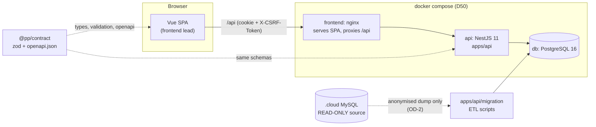
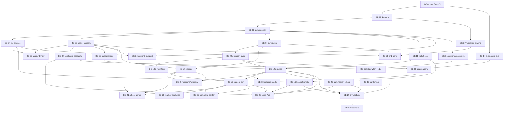

# v2 Backend development plan (slug: v2-backend)

- **Status:** Draft for user review (2026-10-18). Plan only; no backend code exists yet.
- **Owner:** solution-architect. **Audience:** the backend collaborator and their Claude Code agent. Self-contained: you have not seen the chat history, so everything you need is here or linked by path.
- **Decision source:** user, 2026-10-18 ("a second developer builds the v2 backend in parallel on another PC; sync through GitHub").
- **Task cards:** [docs/plan/backend-tasks/](../plan/backend-tasks/README.md) (BE-01 to BE-33). **How to start:** [docs/plan/README.md](../plan/README.md).
- **Related:** TRACKER D28 to D50, ADR-0014 (store ownership), ADR-0016/0017 (portals, role list, scope), ADR-0018 (contract first), `v2-data-migration.md`, `v2-frontend.md`, `v2-exam-schema.md`, `docs/ops/containers.md`.

## 1. What we are building

v2 is a new system (D28): Vue 3 frontend (this repo, already built against an in-browser mock), **NestJS + PostgreSQL** backend (this plan), data migrated from the prestasiplus.cloud database **except exam questions** (D29a, D46). The frontend talks to the mock through one `Transport` seam (ADR-0004). The backend replaces the mock behind that seam, endpoint by endpoint.

**The mock is the behavioural spec.** Every endpoint the UI calls today exists as a mock handler in `src/modules/<mNN>-*/mock/handlers/*.ts`, with the typed client in `src/modules/<mNN>-*/api/*.ts` and the requirements in `docs/requirements/srs/Mnn-*.md`. The backend must reproduce what those handlers do (validation, errors, rules, BM error copy), persisted in Postgres instead of in-memory tables. Where the mock and `@pp/contract` disagree, the contract wins and you tell the lead (section 12).



## 2. Goals and non-goals of the first backend release

### Goals (release B1)

1. A real API for the **prototype scope roles**: Murid (`student`), Guru (`teacher`), Admin Sekolah (`school_admin`) and Admin Pusat (`admin`, D48). Scope = the screens in `docs/requirements/role-access-matrix.md` plus the Portal Pentadbiran items the lead has built (`docs/requirements/v2-portals.md`, `docs/SCOPE-STATUS.md`).
2. Cookie session auth exactly as `@pp/contract` defines it (login, logout, session, role switch, Mod Pelajar) with server-derived scope and capabilities.
3. Core learning loop persisted: curriculum (M03), question bank (M04), practice sessions and answers, revision queue, mastery (M05), wallet and streak (M14 core).
4. **Bijak SPM** (M28): papers, blueprints, attempts, server-side timer, autosave, marking, results, per `v2-exam-schema.md` (approved D47) and `v2-bijak-spm.md`.
5. Class and teacher flows (M10), the report read models (M08, M11, M12, M27) and the Command Center / admin aggregates (M17), all **scope-filtered on the server**.
6. Deterministic seed + fixtures so the existing frontend e2e suite can run against the real API (BE-26, BE-32).
7. The **.cloud migration pipeline** (read-only source), runnable on a staging copy (BE-27 to BE-30).
8. Runs in containers (D50): `api` and `db` services in `compose.yaml`, nginx proxying `/api`.

### Non-goals (B1)

- Roles `ppd_officer`, `parent`, `sponsor` (D43/D48 keep them out of the prototype). Their schema columns may exist where the migration needs them; no endpoints.
- Marketplace (M20), sponsorship (M21), AI features that call an external provider (M13 Cikgu Alesa, M25 AI centre, Bank Soalan OCR/AI intake: D40d is still open), payments gateway, e-mail/SMS/push delivery (store the notification row only).
- Reloading exam questions from .cloud (D29a). Question-dependent history is migrated as a snapshot (`v2-data-migration.md` section 3).
- Changing any UI behaviour. The backend replicates the mock; UI redesign is the frontend lead's.
- Performance tuning beyond sane indexes; horizontal scaling; Kubernetes.

Wave-4 backlog (not carded yet, promoted by the lead later): M06 SPM classic, M07 PKSK, M13/M25 AI, M15 admin extras, M16 battle/games/tournaments/leagues (incl. Sekolah Bersaing for Admin Sekolah), M18, M20, M21, M09 audio KBAT, Sistem stores (`audit_logs` read UI, `settings`, `feature_flags`, `ai_usage_logs`), Kewangan (`payments`, `invoices`, `dunning_logs`). See `docs/plan/backend-tasks/README.md`.

## 3. Stack decisions (confirm at BE-01; trade-offs and the pick)

| Area | Pick | Why / trade-off |
|---|---|---|
| Runtime | Node 22 LTS (repo `engines`: `^22.22.2 \|\| ^24.15.0 \|\| >=26`) | Same as frontend and Dockerfile. |
| Framework | **NestJS 11.x** (latest 11 minor at start; pin exact in `package.json`) | D28(b). Modules map 1:1 to the owner modules of ADR-0014. If a newer major is stable on the day BE-01 starts, ask the lead; default stays 11. |
| Language | TypeScript strict, ESM (`"type": "module"`) | `@pp/contract` is ESM TypeScript source (`main: ./src/index.ts`, zod 4). A CommonJS Nest build cannot import it cleanly. BE-01 must prove the import works (acceptance criterion). Fallback: build the contract to `dist/` with `tsup` for the API only. |
| ORM | **Prisma** (latest stable, `prismaSchemaFolder` with one `.prisma` file per owner module) + `$queryRaw` for aggregates | Boring and well supported, typed client, migration files are plain SQL under version control, schema folder avoids merge hotspots between two developers. Rejected: TypeORM (decorator entities, weaker migrations, drift between entity and DB), Drizzle (fine, but less familiar to agents and fewer Nest recipes). Bulk ETL loads use `pg` `COPY` directly. |
| Database | **PostgreSQL 16** (`postgres:16-alpine`, compose placeholder already commented) | D28(b). `timestamptz`, `numeric(10,2)` for RM, `jsonb` for mark schemes/blueprints, partial and GIN indexes. |
| Validation | A thin in-house `ZodValidationPipe` / `ZodSerializerInterceptor` that parses with the **same zod schemas from `@pp/contract`** | One source of truth (ADR-0018). Avoids a dependency on a third-party Nest-zod adapter tied to a zod major. Every request body/query is parsed with the strict contract schema; in dev/test every response is parsed too. |
| Auth | **Server-side session in Postgres**, HTTP-only `Secure` `SameSite=Lax` cookie, `X-CSRF-Token` header on non-GET | This is what the contract and `v2-frontend.md` 4.3 specify. No JWT in B1. Password hashing: argon2id for new hashes; verify bcrypt `$2y$` hashes from .cloud and rehash on first successful login (`v2-data-migration.md` section 5). |
| Authorisation | Guards: `AuthGuard` (session), `RolesGuard`, `CapabilityGuard` (from the access matrix in `@pp/contract`), and a request-scoped `ScopeContext` that every repository must use (`ScopeFilter`) | Mirrors V2-T20 in the mock: out-of-scope id gives **404**, not 403; scope is never read from query/body. |
| Errors | One exception filter producing `{ error: { code, message, fields?, details?, retryAfter?, requestId } }` with the HTTP status of `ERROR_STATUS` in the contract; BM `message` | Contract `src/common/error.ts`. |
| Logging | `nestjs-pino` (JSON), `requestId` header in/out, redact cookies/passwords/IC | No personal data in logs. |
| Config | `@nestjs/config` + a zod-validated env schema; `.env.api` (git-ignored) with `.env.api.example` committed (no secrets) | See section 11. |
| Rate limit / security | `@nestjs/throttler` (login 429 + `retryAfter`), `helmet`, CORS off (same origin via nginx) | BE-03, BE-33. |
| Tests | **Vitest** (+ `unplugin-swc` for decorator metadata) with **supertest**; integration tests run against a real Postgres via **Testcontainers** (fallback: `docker compose` test db on `DATABASE_URL`) | Vitest is already the repo runner. Unit tests mock nothing in the DB layer: repositories are tested against real Postgres. If Vitest + Nest decorators give trouble in BE-01, the fallback is Jest + `@swc/jest` (decision is the collaborator's, record it in the PR). |
| API docs | `openapi.json` from `@pp/contract` is the source; the API does **not** generate its own | ADR-0018. |
| Files | `FileStorage` interface; local-disk volume implementation in B1 (BE-04) | S3-compatible implementation is a deploy-time decision (OD-6). |
| Jobs | In-process scheduled tasks (`@nestjs/schedule`) for the Bijak attempt sweeper and similar; no queue in B1 | Simplest thing that works; a queue is a later ADR if needed. |

Record the confirmed versions and any change in a new ADR `docs/adr/0019-backend-stack.md` (written by BE-01).

## 4. Repository layout

Same repository, npm workspace (decision OD-1, recommended). Today `package.json` has `"workspaces": ["packages/*"]`; BE-01 adds `"apps/*"`.

```
apps/
  api/                         # NestJS app, package name @pp/api (backend-owned)
    src/
      main.ts, app.module.ts
      common/                  # config, logging, errors filter, zod pipe, guards, scope, clock, id helpers
      db/                      # PrismaService, transaction helper, test harness
      modules/                 # one Nest module per owner module of ADR-0014
        auth/ users/ schools/ curriculum/ questions/ practice/ wallet/
        exam/ (bijak) classes/ reports/ gamification/ content/ ...
      migration/               # .cloud ETL (read-only source), its own CLI entry
    prisma/
      schema/                  # base.prisma + <module>.prisma (one file per owner module)
      migrations/              # SQL migrations, append-only once merged
      seed/                    # deterministic seed modules, one per domain
    test/                      # integration + contract tests, fixtures/
    package.json, tsconfig.json, vitest.config.ts, .env.api.example
packages/
  contract/                    # @pp/contract (exists): zod + openapi.json; add src/<domain>/ per domain
  exam-core/                   # @pp/exam-core (created in BE-14): pure TS marking + blueprint engine shared with the frontend
docker/api/Dockerfile          # multi-stage, non-root, read-only rootfs (mirror docker/frontend)
.github/workflows/api.yml      # backend CI (created in BE-01)
docs/plan/                     # this plan's index and task cards
```

Root scripts added by BE-01 (all are `npm run <name>` from the repo root):

| Script | Meaning |
|---|---|
| `be:dev` | `nest start --watch` for `@pp/api` against the compose `db` |
| `be:build`, `be:lint`, `be:typecheck` | build, ESLint, `tsc --noEmit` for `@pp/api` |
| `be:test` | unit + integration tests (needs Docker for Testcontainers) |
| `be:db:migrate`, `be:db:reset`, `be:db:seed` | `prisma migrate deploy`, reset (dev only), deterministic seed |
| `contract:emit`, `contract:check` | already exist; `check` fails if `openapi.json` is stale |
| `be:verify` | contract:check + lint + typecheck + test + build (the Definition of Done command) |

## 5. Data model overview

Rules that apply to every table (decided; see `v2-data-migration.md` section 4.0):

- Primary key `bigint generated always as identity`, serialised on the wire as a **decimal string** (`Id` in `@pp/contract`, X1). Session-like records (practice session, Bijak attempt) use `uuid`. Every table that receives .cloud data also has `legacy_cloud_id bigint` (unique, nullable, **never** in the contract).
- `created_at`, `updated_at` as `timestamptz` (UTC in the DB; the API serialises `+08:00`, X3). Day logic (streaks, daily limits) in `Asia/Kuala_Lumpur` (Q8 default; confirm OD-8).
- English enum codes (X2); BM labels stay in the UI. Money: `numeric(10,2)` RM, integer sen where .cloud uses sen (X4).
- Test-data stamp: tables written under Mod Pelajar carry `is_test boolean`; aggregates exclude it (V2-T19).
- Foreign keys enforced. No soft delete (matches .cloud).
- Each shared store has exactly one owner module (ADR-0014); other modules call the owner's service, never its tables.

| Owner (card) | Entities (Postgres tables, indicative) | Mock source | .cloud source (migrated) |
|---|---|---|---|
| Identity (BE-03, BE-05, BE-06) | `users`, `user_roles` (role list per user), `user_scopes`, `sessions`, `password_resets`, `login_attempts`, `user_settings`, `notifications`, `audit_events` | `src/modules/m01-*/mock`, `src/mock/core-data`, `src/mock/auth` | `users`, `personal_access_tokens` (not migrated) |
| Schools (BE-05, BE-25) | `schools` (JPN/PPD derived from distinct state/district), `school_subscriptions`, `school_packages`, `parent_links`, `parent_invites`, `comp_students` | `m02-*/mock`, tables `schools.*`, `users.*` | `schools`, `school_subscriptions`, `parent_student` |
| Curriculum (BE-08) | `education_levels`, `subjects`, `subject_levels`, `chapters`, `topics`, `subtopics`, `curriculum_nodes` (DSKP tree, from `v2-exam-schema.md` D9) | `m03-*/mock` tables `curriculum.*` | `education_levels`, `subjects`, `chapters`, `topics` |
| Question bank (BE-09, BE-10) | `stimuli`, `stimulus_groups`, `questions` (+ versions), `question_parts` (tree), `part_options`, `answer_keys`, `question_tags`, `question_reports`, `question_submissions`, `source_papers`, `question_imports` | `m04-*/mock`, `v2-exam-schema.md` sections 3 to 6 | **not migrated** (D29a); old bank archived read-only |
| Practice (BE-12, BE-13) | `practice_sessions`, `practice_answers` (with curriculum dimensions + nullable `question_id`, `historical`, `client_uuid`), `revision_queue`, `mastery`, `spm_targets`, `structured_attempts`, `check_rows`, `subject_usage` | `m05-*/mock` tables `practice.*` | `practice_sessions`, `question_attempts` (snapshot), `review_schedules` (dropped, Q4), `structured_attempts` |
| Wallet (BE-11, BE-23) | `wallets`, `coin_ledger`, `streaks`, then `tiers`, `challenges`, `challenge_completions`, `achievements`, `user_achievements`, `badges`, `referrals`, `draws`, `draw_tickets`, `rewards`, `reward_claims`, `teacher_*` | `m14-*/mock`, `m15-*/mock` tables `gamification.*` | `student_wallets`, `coin_transactions`, `gamification_tiers`, `challenges`, `challenge_user`, `achievements`, `achievement_user`, `gifts`, `gift_redemptions`, `lucky_draws` |
| Exam / Bijak (BE-15, BE-16) | `papers`, `paper_sections`, `paper_placements`, `blueprints`, `blueprint_sections`, `exam_attempts`, `attempt_answers`, `attempt_photos`, `attempt_results` | `m28-bijak-spm/server/store.ts`, `domain/types.ts`, `data/*.ts` | `exam_attempts`, `part_responses` (header + scores only) |
| Classes (BE-17, BE-18) | `classrooms`, `enrolments`, `missions`, `mission_items`, `remedial_tests`, `question_sets`, `question_set_items`, `teacher_profiles`, `dskp_bidang/sk/sp` (teacher DSKP picks) | `m10-*/mock` tables `m10.*` | `classrooms`, `classroom_student`, `question_sets` (headers only, Q4) |
| Reports (BE-19 to BE-22) | mostly **read models** (SQL views/materialised views or service queries) over practice, wallet, enrolments; plus `headcount_*`, `timeline_posts`, `risk_profiles`, `kirkpatrick_*`, `monitoring_flags`, `feedback`, `interventions` | `m08`, `m11`, `m12`, `m17`, `m27` mocks | `headcounts`, `timeline_entries`, `feedback`, `interventions` |
| Content (BE-24) | `articles`, `banners`, `videos`, `notes`, `perutusan*`, `support_tickets` | `m09-*/mock`, `m22-*/mock` | `articles`, `banners`, `videos`, `notes`, `support_tickets` |

Migration load order, risks and the 13 open questions (Q1 to Q13) are in `v2-data-migration.md` sections 5 to 7; the ETL tasks (BE-27 to BE-30) implement that document and do not redesign it.

## 6. API surface and contract-first rule

### 6.1 Conventions (from `@pp/contract`, do not redefine)

- Base path `/api` (Nest global prefix). Paths in the contract are relative to it (`/auth/login`). The mock registers `/api/...`; the same strings are used by the frontend clients, so **keep the mock's path strings** unless an SRS or the lead says otherwise (several are BM, e.g. `/api/kelas-saya`, `/api/tiket`).
- Success: `{ data }` or `{ data, meta }` (`ListMeta`: `page`, `pageSize`, `totalItems`, `totalPages`, `from`, `to`, optional `counts`). A few live-shaped bodies are deliberately un-enveloped (the client uses `raw: true`, see `src/api/client.ts` header; e.g. M13 `/api/cikgu/send`). Reproduce what the mock handler returns.
- Errors: `{ error: { code, message, fields?, details?, retryAfter?, requestId? } }`. Generic codes: `VALIDATION_ERROR` 422, `NOT_FOUND` 404, `UNAUTHORIZED` 401, `FORBIDDEN` 403, `CONFLICT` 409, `SERVER_ERROR` 500, `RATE_LIMITED` 429, plus module codes. BM messages are the mock's copy.
- Ids are opaque strings; timestamps `+08:00`; request schemas are `strict`.

### 6.2 Contract-first workflow (mandatory, every card)

1. **Read** the SRS (`docs/requirements/srs/Mnn-*.md`), the mock handlers, and the frontend client + types of the module.
2. **Contract commit (first):** add zod schemas under `packages/contract/src/<domain>/` (import `z` from `../zod`), register components in `COMPONENT_SCHEMAS` and paths in `src/openapi.ts`, run `npm run contract:emit`, commit `openapi.json`. Schemas describe the **current mock wire shape** so the frontend switch is a no-op, except the agreed realignments (ids as strings; items in `v2-data-migration.md` section 4 and `v2-frontend.md` section 6). Any deviation is listed in the PR.
3. **Contract PR / review:** for a domain the frontend still consumes through the mock, open the contract change as its own small PR first (label `contract`) so the lead can align the mock and the UI types. The lead reviews contract PRs first. For purely backend-internal tables nothing else is needed.
4. **Implement** controller (thin), service (rules), repository (SQL, scope filter). Parse every response with the contract schema in tests.
5. **Switch:** the lead flips the module's path prefix from mock to http (section 7) in a frontend PR, after your PR merges. Collaborator never edits `src/**`.

### 6.3 Endpoint groups mapped to frontend clients and mock handlers

Counts are the number of `route(...)` registrations in the mock handlers (the spec to match). Cards list the exact endpoints.

| Group | Card | Frontend client (`src/modules/.../api`) | Mock handlers (`src/modules/.../mock/handlers`) | Mock routes |
|---|---|---|---|---|
| Auth, session, role, mode | BE-03 | `src/stores`, `packages/contract/src/session`, `src/api` | `m01-*/auth*.ts`, `src/mock/core-data` | 6 (contract) + register/reset |
| Account, notifications, settings | BE-06 | `m01-authentication/api` | `m01-*/mock/handlers/auth-account.ts`, `notifications.ts` | 17 |
| Users, schools, subscriptions | BE-05, BE-25 | `m02-users-schools/api` | `m02-*/mock/handlers/*` | 43 |
| Curriculum | BE-08 | `m03-curriculum/api` | `m03-*/mock/handlers/*` | 12 |
| Question bank | BE-09, BE-10 | `m04-question-bank/api` | `m04-*/mock/handlers/*` | 25 |
| Practice | BE-12, BE-13 | `m05-practice/api` | `m05-*/mock/handlers/*` | 20 |
| Wallet / gamification | BE-11, BE-23 | `m14-gamification/api`, `m15-rewards-shop/api` | `m14-*`, `m15-*` | 32 + 18 |
| Bijak SPM | BE-14 to BE-16 | `m28-bijak-spm/server/client.ts` (class `BijakServer`) | **no HTTP routes yet**: the mock is a class in `m28-bijak-spm/server/store.ts`; the contract must be derived from its public methods | 0 (about 12 methods) |
| Classes, teacher | BE-17, BE-18 | `m10-teacher-class/api` | `m10-*/mock/handlers/*` | 33 |
| Student performance | BE-19 | `m08-student-performance/api` | `m08-*` | 17 |
| Teacher analytics, Kirkpatrick | BE-20 | `m11-*`, `m12-*` | `m11-*`, `m12-*` | 4 + 13 |
| School admin | BE-21 | `m27-school-admin/api` | `m27-*` | 17 |
| Command Center, admin aggregates | BE-22 | `m17-admin-dashboard/api`, `m10-*/api` | `m17-*`, `m10-*/command-center*.ts` | 2 + CC routes |
| Content, support | BE-24 | `m09-content/api`, `m22-support-tickets/api` | `m09-*`, `m22-*` | 25 + 4 |

## 7. How the frontend switches to the real API

- Today `src/app/bootstrap.ts` installs `createHttpTransport()` when `VITE_API_MODE=http`, otherwise the mock. `http` is **all-or-nothing**; the planned `hybrid` mode (V2-T31: `VITE_API_MODE=hybrid` + a list of path prefixes served by the real API, the rest by the mock) is **owned by the frontend lead** and is the mechanism that lets a domain go live as soon as its BE card merges. Until hybrid exists, backend cards are verified by contract tests and Playwright API tests, not by the UI.
- `HttpTransport` still lacks `credentials: 'include'`, the CSRF header, 401 handling and `requestId` logging (V2-T31). Lead-owned. The mock currently authenticates with a Bearer token; the real API uses the cookie session. This is a known gap, not your problem, but do not add Bearer support to the API.
- **Dev:** run `npm run be:dev` (port 3000) and `npm run dev` for Vite (port 5173); Vite's dev proxy forwards `/api` to `http://localhost:3000` (BE-32 adds this to `vite.config.ts`).
- **Containers (D50):** uncomment `api` and `db` in `compose.yaml` (BE-01/BE-02), add `location /api/ { proxy_pass http://api:3000; }` to `docker/frontend/nginx.conf` (BE-32), build the frontend with `VITE_API_MODE=http` (or `hybrid`), same origin so no CORS. Migrations run as a one-off `api` job before the API starts.
- **Cut-over per domain:** merged BE card, then lead PR "switch Mnn to http" (prefix added to the hybrid list, module e2e re-run with `npm run test:e2e:module -- mNN` against the compose stack, BE-32). Domain complete when its module e2e is green in both modes.

## 8. Milestones and dependency order



| Milestone | Cards | Exit |
|---|---|---|
| **M0 Foundation** | BE-01, BE-02, BE-03 (BE-14 in parallel) | API boots in compose, login works against Postgres, CI green. |
| **M1 Identity and reference data** | BE-04 to BE-08, BE-11, BE-24, BE-25 | All four roles can sign in; users/schools/curriculum served; demo accounts seeded. |
| **M2 Learning loop** | BE-09, BE-10, BE-12, BE-13 | A Murid can start, answer and submit a practice session; revision/mastery/wallet update in one transaction. |
| **M3 Bijak SPM** | BE-14 to BE-16 | A Murid can sit a paper, autosave, submit, see marked results. |
| **M4 Teacher/admin** | BE-17 to BE-22, BE-23 | Guru class flows, reports and Command Center served with scope filtering. |
| **M5 Integration** | BE-26, BE-31, BE-32 | Frontend e2e green against compose stack for the carded modules. |
| **M6 Migration + hardening** | BE-27 to BE-30, BE-33 | Rehearsed migration on a staging copy; security review (G4) passed. |

Parallelism: after BE-03, up to three collaborator sessions can run at once (suggested lanes: identity BE-04/05/06/25; learning BE-08/09/11/12; Bijak BE-14/15/16). The migration stream (BE-27 onward) is independent of the API lanes and is blocked only by OD-2.

## 9. Collaboration rules (two PCs, one GitHub repo)

Repo: `github.com/amin-kerja-orang/prestasiplus`. The lead pushes the current branch after reviewing this plan; you clone and start from `feature/v2-backend`.

### Branches and PRs

| Rule | Detail |
|---|---|
| Integration branch | **`feature/v2-backend`** (created by the lead from `feature/student-prototype`). It is where your PRs land. `main` is never touched. |
| Your branches | `be/<task-id>-<slug>` (e.g. `be/BE-05-users-schools`), branched from the latest `feature/v2-backend`. One card = one branch = one PR (split only with the lead's OK). |
| Frontend branches | `v2/*` and `feature/student-prototype` belong to the lead. Do not push to them. |
| Syncing the frontend into your base | The lead merges `feature/student-prototype` into `feature/v2-backend` regularly (at least after each frontend milestone) and tells you in the TRACKER change log or a PR comment. You **rebase** your own branch onto the updated `feature/v2-backend` (`git fetch origin && git rebase origin/feature/v2-backend`). Never rebase or force-push the shared integration branch; force-push only your own branch, with `--force-with-lease`. |
| Back to the frontend | When a domain is ready, the lead merges `feature/v2-backend` into `feature/student-prototype` (or cherry-picks the domain) together with the "switch to http" change. |
| PR size and merge | Small PRs (aim under 600 changed lines excluding generated `openapi.json`, lockfile, migrations). Squash-merge by the lead after review. Title `BE-05: users and schools admin API`. |
| Commits | Conventional style `feat(api): ...`, `fix(api): ...`, `chore(contract): ...`, `docs(plan): ...`. Imperative, English. Commit only your card's work; no unrelated reformatting. Claude Code attribution trailer is allowed. |
| Review | The lead (with the project `code-reviewer` / `security-engineer` roles on the lead side) reviews. Touching auth, scope, sessions, personal data or file upload requires the security review (`CLAUDE.md` G4). Fix review comments by pushing to the same branch. |

### Folder ownership (avoid conflicts)

| Path | Owner | Rule |
|---|---|---|
| `apps/api/**`, `docker/api/**`, `.env.api.example`, `.github/workflows/api.yml` | **Collaborator** | The lead does not edit these except in review fixes agreed in the PR. |
| `packages/contract/src/<domain>/**`, new files only | Collaborator for the domain of the card | Add new files; register in `COMPONENT_SCHEMAS`/`openapi.ts` (append-only lines). |
| `packages/contract/src/{common,session,auth,access}/**` and existing registrations | **Lead** | Need a change? Open a `contract` PR and tag the lead; both sides must agree (this is the "contract changes need both sides" rule). |
| `packages/contract/openapi.json` | generated | Never hand-edit; on a merge conflict re-run `npm run contract:emit`. |
| `packages/exam-core/**` | Collaborator (created in BE-14) | The one-time move of code out of `src/modules/m28-bijak-spm/domain` is a coordinated PR (OD-5). |
| `apps/api/prisma/schema/<module>.prisma` | Collaborator, one file per owner module | Cross-module relations are declared in the file of the table that holds the foreign key. |
| `apps/api/prisma/migrations/**` | Collaborator | Append-only after merge. If two migrations conflict after a rebase, delete **your unmerged** migration folder and regenerate it; never edit a merged migration. Only one open migration PR per owner module at a time. |
| `src/**`, `e2e/**`, `vite.config.ts`, `index.html`, `docs/design/**`, `docs/qa/**` | **Lead** | BE-32 is the only card that edits `vite.config.ts` (proxy) and adds the http-mode Playwright config; it is a joint card. |
| `compose.yaml`, `docker/frontend/**`, `.env.example` | Shared, small edits | BE-01/BE-02/BE-32 edit them (uncomment `api`/`db`, add proxy). Keep edits minimal; the lead reviews. |
| Root `package.json`, `package-lock.json` | Shared | BE-01 does the one-time workspace change. Afterwards add dependencies only through `npm install -w @pp/api <pkg>`. On a lockfile conflict: take the integration branch version of `package-lock.json`, then `npm install` again. |
| `docs/TRACKER.md` | **Lead only** | You never edit it. Put the status in your PR description (template in `docs/plan/README.md`); the lead logs it in the TRACKER change log. |
| `docs/architecture/v2-backend-plan.md`, `docs/plan/**`, `docs/adr/` | Lead + collaborator | Changes via PR. New decision = new ADR (`docs/adr/0019-...`), numbered by the lead on merge if two collide. |
| `docs/architecture/v2-backend-deviations.md` | Collaborator | Append-only log: "contract/mock deviation, why, who agreed". Created by BE-01. |

### Secrets and data protection (never negotiable)

- **Never commit secrets**: no passwords, API keys, session secrets, DB URLs with passwords, server logins, SSH keys. Use `.env.api` (git-ignored) and commit only `.env.api.example` with placeholders. CI uses GitHub Actions secrets. Add `gitleaks` (or equivalent) to CI in BE-01.
- **.cloud database access is read-only and the credentials are never shared in the repo** or in PR text. You do not receive live credentials. You get migration inputs as an **anonymised dump or fixtures** produced by the lead (open decision OD-2). Until that exists, BE-27 to BE-30 work against the schema documented in `v2-data-migration.md` and synthetic fixtures you generate. The ETL must be written so that the only connection to .cloud is a configurable read-only source (`CLOUD_SOURCE_URL`), and it must refuse to run with write privileges.
- Do not put real person names, IC numbers, e-mails or phone numbers in code, seeds, fixtures, tests, logs or docs. Use obviously fictitious data (repo rule: `AGENTS.md`). The demo password `Demo1234` and demo accounts in `docs/AKAUN-DEMO.md` are the only credentials that may appear in seeds, and only for seeded demo accounts.
- Treat all .cloud-derived data as sensitive personal data (most users are minors): dumps live outside the repo, are never attached to PRs, and are deleted after the rehearsal.

### CI expectations

`.github/workflows/api.yml` (BE-01) runs on every PR touching `apps/api/**`, `packages/**`, `docker/api/**`, `compose.yaml`: `npm ci`, `contract:check`, lint, typecheck, tests with a Postgres 16 service container, Docker image build, secret scan. The PR must be green before review. The root `npm run verify` (frontend) is run by the lead; do not break it (do not change root TypeScript or ESLint configs; the frontend build must still pass after your PR: run `npm run typecheck` and `npm test` at the root when you touch `packages/**`).

### Working with Claude Code

- Start every session with the card's "Prompt for Claude Code". It tells the agent which files to read and which rules apply.
- One card per session; do not let the agent wander into other modules. If the agent finds a conflict between docs, mock and contract, it stops and writes the question in the PR (section 12) instead of guessing. **Do not invent business rules**: derive them from the SRS and the mock handler; unknown means ask.

## 10. Definition of Done (every card)

1. Contract committed first; `npm run contract:check` passes; deviations listed in the PR.
2. Endpoints in the card implemented with the contract's envelope, status codes and BM error messages; every response in tests is parsed by the contract schema.
3. Scope and role enforcement tested: wrong role gives 403, out-of-scope id gives 404, no session gives 401, mutating call without CSRF gives 403 `CSRF_INVALID`.
4. Prisma schema + SQL migration committed; migration applies on an empty database and on top of the previous head; no destructive change to merged migrations.
5. Unit tests for rules and integration tests (supertest + real Postgres) for each endpoint, including the validation error paths. Behaviour compared with the mock handler's tests where they exist (`src/modules/<mNN>/__tests__/mock`).
6. A seed module for the domain (idempotent, deterministic, fictitious data) wired into `be:db:seed` where the card says so.
7. `npm run be:verify` green with real output pasted in the PR; root `npm run typecheck` and `npm test` still green if `packages/**` changed.
8. No secrets, no real names; logs contain no personal data.
9. PR description filled from the template (`docs/plan/README.md`): what was done, endpoints, tables, tests run, deviations, open questions.
10. Reviewed and approved by the lead (security review where required).

## 11. Configuration (env, names only)

`.env.api.example` lists these keys with placeholder values (BE-01/BE-02 own the file): `NODE_ENV`, `PORT` (3000), `DATABASE_URL`, `SESSION_COOKIE_NAME`, `SESSION_SECRET`, `SESSION_TTL_HOURS`, `SESSION_REMEMBER_DAYS`, `COOKIE_DOMAIN`, `COOKIE_SECURE`, `PUBLIC_BASE_URL`, `LOG_LEVEL`, `FILE_STORAGE_DIR`, `MAX_UPLOAD_MB`, `THROTTLE_LOGIN_PER_MINUTE`, `SEED_DEMO_PASSWORD_HASH` (not the password), `CLOUD_SOURCE_URL` (migration only, read-only). Compose `db` uses `.env.db` (git-ignored) with `POSTGRES_USER`, `POSTGRES_PASSWORD`, `POSTGRES_DB`. The `db` service publishes **no host port by default** (the lead's PC already uses 5432 and 5433); for local tooling add an uncommitted `compose.override.yaml` that maps `127.0.0.1:${DB_HOST_PORT:-5434}:5432`.

## 12. Escalation and open questions

When the docs, the mock and `@pp/contract` disagree, or a rule is not written anywhere: do not guess. Add a line to the PR description under "Open questions" and, if it blocks the card, a GitHub issue labelled `question` for the lead. The lead answers in the issue or the TRACKER. Known cross-cutting conflicts (already flagged, no need to re-ask):

- Contract `Id` is a string; the mock still uses numbers for users, schools and others. Follow the contract (OD-9).
- Session transport: contract = cookie; mock = Bearer. Follow the contract.
- Role codes in the contract (`school_admin`, `ppd_officer`) differ from the older requirement keys (`admin_sekolah`, `pegawai_ppd`). Follow the contract.
- Bijak SPM has no HTTP surface yet (BE-14/15/16 derive it from `BijakServer`).

## 13. Open decisions the user must answer before the collaborator starts

| ID | Decision | Recommended default | Blocks |
|---|---|---|---|
| OD-1 | Backend in this repo (`apps/api`, monorepo) or a separate repo that depends on `@pp/contract`? Give the collaborator write access to `github.com/amin-kerja-orang/prestasiplus` (or fork + PR). | Same repo, collaborator invited with write access to branches `be/*` (PRs into `feature/v2-backend`). | BE-01 |
| OD-2 | **How does the collaborator get .cloud data?** Live credentials are never shared. Options: (a) the lead produces an anonymised dump (names, e-mails, phones, IC replaced; passwords reset) and shares it out-of-band, not via GitHub; (b) schema + counts only plus synthetic fixtures; (c) the collaborator works only from `v2-data-migration.md`. Who anonymises and where it is stored (PDPA, minors)? | (b) now, (a) later for the rehearsal, produced by the lead on the lead's PC. | BE-27 to BE-30 only |
| OD-3 | Confirm ORM = **Prisma** and framework = **NestJS 11**, test runner = **Vitest**. | As in section 3. | BE-01, BE-02 |
| OD-4 | Session model = server-side session in Postgres with cookie + CSRF (no JWT) and production hostnames / cookie domain (`admin.*` + main host) for the cross-host cookie. | Session in Postgres; hostnames decided at release (devops), configurable by env. | BE-03 (hostnames not blocking) |
| OD-5 | Move the pure marking/blueprint code of M28 (`src/modules/m28-bijak-spm/domain/{grading,math-expr,blueprint,paper-model,types}.ts`) into a shared workspace package `@pp/exam-core` so the server marks exactly like the UI? This touches a frontend-owned folder once. | Yes; the lead approves the one-time coordinated PR. | BE-14 |
| OD-6 | File storage for avatars, Bijak working photos, question images: local volume (B1) vs S3-compatible. | Local volume behind `FileStorage` now; S3-compatible at deploy. | BE-04 (not blocking) |
| OD-7 | External AI/OCR (D40d still open) and e-mail/SMS/push providers: confirm all are out of B1 and stubbed behind interfaces. | Out of B1. | BE-06 (reset e-mail is logged, not sent) |
| OD-8 | Day boundary for streaks and daily limits (Q8): Malaysia time. Teacher wallets (Q10): keep as in the mock until profiling. | Malaysia time; keep teacher wallets. | BE-11 |
| OD-9 | Id wire format: contract says opaque **string** ids; the mock/UI use numbers for users and schools. The lead realigns the frontend (V2-T24/T25) as each domain switches. Confirm. | Strings per contract. | BE-05 onward |
| OD-10 | Migration open questions Q1 to Q7 and Q9 to Q13 of `v2-data-migration.md` section 7 (role set, duplicates, PPD scope, history retention, sensitive data). Answers needed before BE-28/29 only. | Defaults in that table. | BE-28, BE-29 |
| OD-11 | Which Murid matrix rows beyond the carded domains must be live in B1 (M06 SPM classic, M07 PKSK, M16 Kedudukan/Permainan/Tournament, Audio KBAT, Marketplace, Cikgu Alesa)? | Not in B1; Bijak SPM replaces SPM classic; others stay mock via hybrid until promoted. | scope only |
| OD-12 | Who merges PRs and enforces branch protection on `feature/v2-backend` (required CI check, no force-push)? | The lead; enable protection on the branch. | process |
