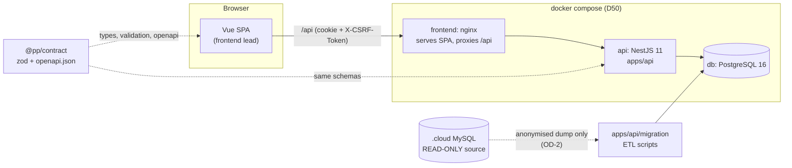
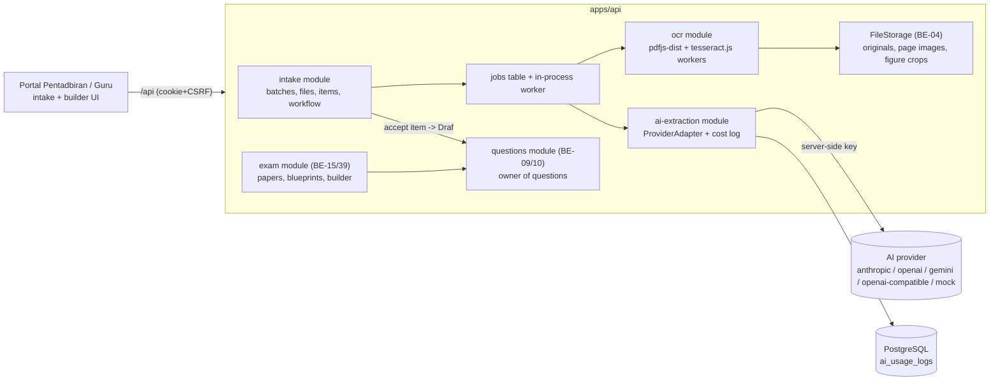

# v2 Backend development plan (slug: v2-backend)

- **Status:** Draft for user review (2026-10-18). Plan only; no backend code exists yet.
- **Owner:** solution-architect. **Audience:** the backend collaborator and their Claude Code agent. Self-contained: you have not seen the chat history, so everything you need is here or linked by path.
- **Decision source:** user, 2026-10-18 ("a second developer builds the v2 backend in parallel on another PC; sync through GitHub").
- **Task cards:** [docs/plan/backend-tasks/](../plan/backend-tasks/README.md) (BE-01 to BE-40). **How to start:** [docs/plan/README.md](../plan/README.md). **Programme (multi-PC, multi-session):** [backend-tracker](../plan/backend-tracker.md), [sessions](../plan/sessions.md), [agent-kickoff](../plan/agent-kickoff/README.md).
- **Related:** TRACKER D28 to D52, ADR-0019 (SPM question intake, provider-agnostic AI; may still be in progress), ADR-0014 (store ownership), ADR-0016/0017 (portals, role list, scope), ADR-0018 (contract first), `v2-data-migration.md`, `v2-frontend.md`, `v2-exam-schema.md`, `docs/ops/containers.md`.

## 1. What we are building

v2 is a new system (D28): Vue 3 frontend (this repo, already built against an in-browser mock), **NestJS + PostgreSQL** backend (this plan), data migrated from the prestasiplus.cloud database **except exam questions** (D29a, D46), with migration designed in from the first table (section 14). The frontend talks to the mock through one `Transport` seam (ADR-0004). The backend replaces the mock behind that seam, endpoint by endpoint.

**The mock is the behavioural spec.** Every endpoint the UI calls today exists as a mock handler in `src/modules/<mNN>-*/mock/handlers/*.ts`, with the typed client in `src/modules/<mNN>-*/api/*.ts` and the requirements in `docs/requirements/srs/Mnn-*.md`. The backend must reproduce what those handlers do (validation, errors, rules, BM error copy), persisted in Postgres instead of in-memory tables. Where the mock and `@pp/contract` disagree, the contract wins and you tell the lead (section 12).



## 2. Goals and non-goals of the first backend release

### Goals (release B1)

1. A real API for the **prototype scope roles**: Murid (`student`), Guru (`teacher`), Admin Sekolah (`school_admin`) and Admin Pusat (`admin`, D48). Scope = the screens in `docs/requirements/role-access-matrix.md` plus the Portal Pentadbiran items the lead has built (`docs/requirements/v2-portals.md`, `docs/SCOPE-STATUS.md`).
2. Cookie session auth exactly as `@pp/contract` defines it (login, logout, session, role switch, Mod Pelajar) with server-derived scope and capabilities.
3. Core learning loop persisted: curriculum (M03), question bank (M04), practice sessions and answers, revision queue, mastery (M05), wallet and streak (M14 core).
4. **Bijak SPM** (M28): papers, blueprints, attempts, server-side timer, autosave, marking, results, per `v2-exam-schema.md` (approved D47) and `v2-bijak-spm.md`.
5. Class and teacher flows (M10), the report read models (M08, M11, M12, M27) and the Command Center / admin aggregates (M17), all **scope-filtered on the server**.
6. Deterministic seed + fixtures so the existing frontend e2e suite can run against the real API (BE-26, BE-32).
7. The **.cloud migration pipeline** (read-only source), runnable on a staging copy (BE-27 to BE-30).
8. Runs in containers (D50): `api` and `db` services in `compose.yaml`, nginx proxying `/api`.
9. **(D52) SPM question intake and paper builder** server side: file upload, server OCR, provider-agnostic AI extraction, review and publish workflow, blueprint-driven paper builder (BE-36 to BE-40, section 15).
10. **Migration-first** schema and tooling (BE-34, BE-35), so the .cloud ETL is idempotent, re-runnable and verifiable (section 14).

### Non-goals (B1)

- Roles `ppd_officer`, `parent`, `sponsor` (D43/D48 keep them out of the prototype). Their schema columns may exist where the migration needs them; no endpoints.
- (D52) A hard dependency on one AI vendor. The intake extraction is provider-agnostic; B1 ships the adapter interface, the mock provider and the adapters listed in section 15. Which real provider runs in production is configuration plus the user's decision (OD-14).
- Marketplace (M20), sponsorship (M21), AI features other than the question-intake extraction (M13 Cikgu Alesa, M25 AI centre, essay marking, AI variants), payments gateway, e-mail/SMS/push delivery (store the notification row only).
- Reloading exam questions from .cloud (D29a). Question-dependent history is migrated as a snapshot (`v2-data-migration.md` section 3).
- Changing any UI behaviour. The backend replicates the mock; UI redesign is the frontend lead's.
- Performance tuning beyond sane indexes; horizontal scaling; Kubernetes.

Wave-4 backlog (not carded yet, promoted by the lead later): M06 SPM classic, M07 PKSK, M13/M25 AI, M15 admin extras, M16 battle/games/tournaments/leagues (incl. Sekolah Bersaing for Admin Sekolah), M18, M20, M21, M09 audio KBAT, Sistem stores (`audit_logs` read UI, `settings`, `feature_flags`, `ai_usage_logs`), Kewangan (`payments`, `invoices`, `dunning_logs`). See `docs/plan/backend-tasks/README.md`.

## 3. Stack decisions (confirm at BE-01; trade-offs and the pick)

| Area | Pick | Why / trade-off |
|---|---|---|
| Runtime | Node 22 LTS (repo `engines`: `^22.22.2 \|\| ^24.15.0 \|\| >=26`) | Same as frontend and Dockerfile. |
| Framework | **NestJS 11.x** (latest 11 minor at start; pin exact in `package.json`) | D28(b). Modules map 1:1 to the owner modules of ADR-0014. If a newer major is stable on the day BE-01 starts, ask the lead; default stays 11. |
| Language | TypeScript strict, ESM (`"type": "module"`) | `@pp/contract` is ESM TypeScript source (`main: ./src/index.ts`, zod 4). A CommonJS Nest build cannot import it cleanly. BE-01 must prove the import works (acceptance criterion). Fallback: build the contract to `dist/` with `tsup` for the API only. |
| ORM | **Prisma** (latest stable, `prismaSchemaFolder` with one `.prisma` file per owner module) + `$queryRaw` for aggregates | Boring and well supported, typed client, migration files are plain SQL under version control, schema folder avoids merge hotspots between two developers. Rejected: TypeORM (decorator entities, weaker migrations, drift between entity and DB), Drizzle (fine, but less familiar to agents and fewer Nest recipes). Bulk ETL loads use `pg` `COPY` directly. |
| Database | **PostgreSQL 16** (`postgres:16-alpine`, compose placeholder already commented) | D28(b). `timestamptz`, `numeric(10,2)` for RM, `jsonb` for mark schemes/blueprints, partial and GIN indexes. |
| Validation | A thin in-house `ZodValidationPipe` / `ZodSerializerInterceptor` that parses with the **same zod schemas from `@pp/contract`** | One source of truth (ADR-0018). Avoids a dependency on a third-party Nest-zod adapter tied to a zod major. Every request body/query is parsed with the strict contract schema; in dev/test every response is parsed too. |
| Auth | **Server-side session in Postgres**, HTTP-only `Secure` `SameSite=Lax` cookie, `X-CSRF-Token` header on non-GET | This is what the contract and `v2-frontend.md` 4.3 specify. No JWT in B1. Password hashing: argon2id for new hashes; verify bcrypt `$2y$` hashes from .cloud and rehash on first successful login (`v2-data-migration.md` section 5). |
| Authorisation | Guards: `AuthGuard` (session), `RolesGuard`, `CapabilityGuard` (from the access matrix in `@pp/contract`), and a request-scoped `ScopeContext` that every repository must use (`ScopeFilter`) | Mirrors V2-T20 in the mock: out-of-scope id gives **404**, not 403; scope is never read from query/body. |
| Errors | One exception filter producing `{ error: { code, message, fields?, details?, retryAfter?, requestId } }` with the HTTP status of `ERROR_STATUS` in the contract; BM `message` | Contract `src/common/error.ts`. |
| Logging | `nestjs-pino` (JSON), `requestId` header in/out, redact cookies/passwords/IC | No personal data in logs. |
| Config | `@nestjs/config` + a zod-validated env schema; `.env.api` (git-ignored) with `.env.api.example` committed (no secrets) | See section 11. |
| Rate limit / security | `@nestjs/throttler` (login 429 + `retryAfter`), `helmet`, CORS off (same origin via nginx) | BE-03, BE-33. |
| Tests | **Vitest** (+ `unplugin-swc` for decorator metadata) with **supertest**; integration tests run against a real Postgres via **Testcontainers** (fallback: `docker compose` test db on `DATABASE_URL`) | Vitest is already the repo runner. Unit tests mock nothing in the DB layer: repositories are tested against real Postgres. If Vitest + Nest decorators give trouble in BE-01, the fallback is Jest + `@swc/jest` (decision is the collaborator's, record it in the PR). |
| API docs | `openapi.json` from `@pp/contract` is the source; the API does **not** generate its own | ADR-0018. |
| Files | `FileStorage` interface; local-disk volume implementation in B1 (BE-04) | S3-compatible implementation is a deploy-time decision (OD-6). |
| Jobs | In-process scheduled tasks (`@nestjs/schedule`) for the Bijak attempt sweeper and similar; no queue in B1 | Simplest thing that works; a queue is a later ADR if needed. |

Record the confirmed versions and any change in a new ADR `docs/adr/0020-backend-stack.md` (written by BE-01). Number note: ADR-0019 is taken by the frontend SPM intake decision (D52), so the backend stack ADR is 0020; the lead renumbers on merge if two collide.

## 4. Repository layout

Same repository, npm workspace (decision OD-1, recommended). Today `package.json` has `"workspaces": ["packages/*"]`; BE-01 adds `"apps/*"`.

```
apps/
  api/                         # NestJS app, package name @pp/api (backend-owned)
    src/
      main.ts, app.module.ts
      common/                  # config, logging, errors filter, zod pipe, guards, scope, clock, id helpers
      db/                      # PrismaService, transaction helper, test harness
      modules/                 # one Nest module per owner module of ADR-0014
        auth/ users/ schools/ curriculum/ questions/ practice/ wallet/
        exam/ (bijak) classes/ reports/ gamification/ content/ ...
      migration/               # .cloud ETL (read-only source), its own CLI entry
    prisma/
      schema/                  # base.prisma + <module>.prisma (one file per owner module)
      migrations/              # SQL migrations, append-only once merged
      seed/                    # deterministic seed modules, one per domain
    test/                      # integration + contract tests, fixtures/
    package.json, tsconfig.json, vitest.config.ts, .env.api.example
packages/
  contract/                    # @pp/contract (exists): zod + openapi.json; add src/<domain>/ per domain
  exam-core/                   # @pp/exam-core (created in BE-14): pure TS marking + blueprint engine shared with the frontend
docker/api/Dockerfile          # multi-stage, non-root, read-only rootfs (mirror docker/frontend)
.github/workflows/api.yml      # backend CI (created in BE-01)
docs/plan/                     # this plan's index and task cards
```

Root scripts added by BE-01 (all are `npm run <name>` from the repo root):

| Script | Meaning |
|---|---|
| `be:dev` | `nest start --watch` for `@pp/api` against the compose `db` |
| `be:build`, `be:lint`, `be:typecheck` | build, ESLint, `tsc --noEmit` for `@pp/api` |
| `be:test` | unit + integration tests (needs Docker for Testcontainers) |
| `be:db:migrate`, `be:db:reset`, `be:db:seed` | `prisma migrate deploy`, reset (dev only), deterministic seed |
| `contract:emit`, `contract:check` | already exist; `check` fails if `openapi.json` is stale |
| `be:verify` | contract:check + lint + typecheck + test + build (the Definition of Done command) |

## 5. Data model overview

Rules that apply to every table (decided; see `v2-data-migration.md` section 4.0):

- Primary key `bigint generated always as identity`, serialised on the wire as a **decimal string** (`Id` in `@pp/contract`, X1). Session-like records (practice session, Bijak attempt) use `uuid`. Every table that can receive migrated data carries `legacy_source` and `legacy_id` (unique per source, nullable, **never** in the contract); this replaces the earlier single `legacy_cloud_id` column. Full rules in section 14.
- `created_at`, `updated_at` as `timestamptz` (UTC in the DB; the API serialises `+08:00`, X3). Day logic (streaks, daily limits) in `Asia/Kuala_Lumpur` (Q8 default; confirm OD-8).
- English enum codes (X2); BM labels stay in the UI. Money: `numeric(10,2)` RM, integer sen where .cloud uses sen (X4).
- Test-data stamp: tables written under Mod Pelajar carry `is_test boolean`; aggregates exclude it (V2-T19).
- Foreign keys enforced. No soft delete (matches .cloud).
- Each shared store has exactly one owner module (ADR-0014); other modules call the owner's service, never its tables.

| Owner (card) | Entities (Postgres tables, indicative) | Mock source | .cloud source (migrated) |
|---|---|---|---|
| Identity (BE-03, BE-05, BE-06) | `users`, `user_roles` (role list per user), `user_scopes`, `sessions`, `password_resets`, `login_attempts`, `user_settings`, `notifications`, `audit_events` | `src/modules/m01-*/mock`, `src/mock/core-data`, `src/mock/auth` | `users`, `personal_access_tokens` (not migrated) |
| Schools (BE-05, BE-25) | `schools` (JPN/PPD derived from distinct state/district), `school_subscriptions`, `school_packages`, `parent_links`, `parent_invites`, `comp_students` | `m02-*/mock`, tables `schools.*`, `users.*` | `schools`, `school_subscriptions`, `parent_student` |
| Curriculum (BE-08) | `education_levels`, `subjects`, `subject_levels`, `chapters`, `topics`, `subtopics`, `curriculum_nodes` (DSKP tree, from `v2-exam-schema.md` D9) | `m03-*/mock` tables `curriculum.*` | `education_levels`, `subjects`, `chapters`, `topics` |
| Question bank (BE-09, BE-10; intake BE-36 to BE-38) | `stimuli`, `stimulus_groups`, `questions` (+ versions), `question_parts` (tree), `part_options`, `answer_keys`, `question_tags`, `question_reports`, `question_submissions`, `source_papers`, `question_imports`; intake adds `intake_batches`, `intake_files`, `intake_pages`, `intake_figures`, `intake_items`, `ai_extraction_runs`, `ai_usage_logs` (section 15) | `m04-*/mock`, m28 intake (D52), `v2-exam-schema.md` sections 3 to 6 | **not migrated** (D29a); old bank archived read-only |
| Practice (BE-12, BE-13) | `practice_sessions`, `practice_answers` (with curriculum dimensions + nullable `question_id`, `historical`, `client_uuid`), `revision_queue`, `mastery`, `spm_targets`, `structured_attempts`, `check_rows`, `subject_usage` | `m05-*/mock` tables `practice.*` | `practice_sessions`, `question_attempts` (snapshot), `review_schedules` (dropped, Q4), `structured_attempts` |
| Wallet (BE-11, BE-23) | `wallets`, `coin_ledger`, `streaks`, then `tiers`, `challenges`, `challenge_completions`, `achievements`, `user_achievements`, `badges`, `referrals`, `draws`, `draw_tickets`, `rewards`, `reward_claims`, `teacher_*` | `m14-*/mock`, `m15-*/mock` tables `gamification.*` | `student_wallets`, `coin_transactions`, `gamification_tiers`, `challenges`, `challenge_user`, `achievements`, `achievement_user`, `gifts`, `gift_redemptions`, `lucky_draws` |
| Exam / Bijak (BE-15, BE-16, BE-39) | `papers`, `paper_sections`, `paper_placements`, `blueprints`, `blueprint_sections`, `exam_attempts`, `attempt_answers`, `attempt_photos`, `attempt_results` | `m28-bijak-spm/server/store.ts`, `domain/types.ts`, `data/*.ts` | `exam_attempts`, `part_responses` (header + scores only) |
| Classes (BE-17, BE-18) | `classrooms`, `enrolments`, `missions`, `mission_items`, `remedial_tests`, `question_sets`, `question_set_items`, `teacher_profiles`, `dskp_bidang/sk/sp` (teacher DSKP picks) | `m10-*/mock` tables `m10.*` | `classrooms`, `classroom_student`, `question_sets` (headers only, Q4) |
| Reports (BE-19 to BE-22) | mostly **read models** (SQL views/materialised views or service queries) over practice, wallet, enrolments; plus `headcount_*`, `timeline_posts`, `risk_profiles`, `kirkpatrick_*`, `monitoring_flags`, `feedback`, `interventions` | `m08`, `m11`, `m12`, `m17`, `m27` mocks | `headcounts`, `timeline_entries`, `feedback`, `interventions` |
| Content (BE-24) | `articles`, `banners`, `videos`, `notes`, `perutusan*`, `support_tickets` | `m09-*/mock`, `m22-*/mock` | `articles`, `banners`, `videos`, `notes`, `support_tickets` |

Migration load order, risks and the 13 open questions (Q1 to Q13) are in `v2-data-migration.md` sections 5 to 7; the ETL tasks (BE-27 to BE-30, BE-34, BE-35) implement that document and do not redesign it. The entity-by-entity old-to-new table mapping is the matrix in section 14.7.

## 6. API surface and contract-first rule

### 6.1 Conventions (from `@pp/contract`, do not redefine)

- Base path `/api` (Nest global prefix). Paths in the contract are relative to it (`/auth/login`). The mock registers `/api/...`; the same strings are used by the frontend clients, so **keep the mock's path strings** unless an SRS or the lead says otherwise (several are BM, e.g. `/api/kelas-saya`, `/api/tiket`).
- Success: `{ data }` or `{ data, meta }` (`ListMeta`: `page`, `pageSize`, `totalItems`, `totalPages`, `from`, `to`, optional `counts`). A few live-shaped bodies are deliberately un-enveloped (the client uses `raw: true`, see `src/api/client.ts` header; e.g. M13 `/api/cikgu/send`). Reproduce what the mock handler returns.
- Errors: `{ error: { code, message, fields?, details?, retryAfter?, requestId? } }`. Generic codes: `VALIDATION_ERROR` 422, `NOT_FOUND` 404, `UNAUTHORIZED` 401, `FORBIDDEN` 403, `CONFLICT` 409, `SERVER_ERROR` 500, `RATE_LIMITED` 429, plus module codes. BM messages are the mock's copy.
- Ids are opaque strings; timestamps `+08:00`; request schemas are `strict`.

### 6.2 Contract-first workflow (mandatory, every card)

1. **Read** the SRS (`docs/requirements/srs/Mnn-*.md`), the mock handlers, and the frontend client + types of the module.
2. **Contract commit (first):** add zod schemas under `packages/contract/src/<domain>/` (import `z` from `../zod`), register components in `COMPONENT_SCHEMAS` and paths in `src/openapi.ts`, run `npm run contract:emit`, commit `openapi.json`. Schemas describe the **current mock wire shape** so the frontend switch is a no-op, except the agreed realignments (ids as strings; items in `v2-data-migration.md` section 4 and `v2-frontend.md` section 6). Any deviation is listed in the PR.
3. **Contract PR / review:** for a domain the frontend still consumes through the mock, open the contract change as its own small PR first (label `contract`) so the lead can align the mock and the UI types. The lead reviews contract PRs first. For purely backend-internal tables nothing else is needed.
4. **Implement** controller (thin), service (rules), repository (SQL, scope filter). Parse every response with the contract schema in tests.
5. **Switch:** the lead flips the module's path prefix from mock to http (section 7) in a frontend PR, after your PR merges. Collaborator never edits `src/**`.

### 6.3 Endpoint groups mapped to frontend clients and mock handlers

Counts are the number of `route(...)` registrations in the mock handlers (the spec to match). Cards list the exact endpoints.

| Group | Card | Frontend client (`src/modules/.../api`) | Mock handlers (`src/modules/.../mock/handlers`) | Mock routes |
|---|---|---|---|---|
| Auth, session, role, mode | BE-03 | `src/stores`, `packages/contract/src/session`, `src/api` | `m01-*/auth*.ts`, `src/mock/core-data` | 6 (contract) + register/reset |
| Account, notifications, settings | BE-06 | `m01-authentication/api` | `m01-*/mock/handlers/auth-account.ts`, `notifications.ts` | 17 |
| Users, schools, subscriptions | BE-05, BE-25 | `m02-users-schools/api` | `m02-*/mock/handlers/*` | 43 |
| Curriculum | BE-08 | `m03-curriculum/api` | `m03-*/mock/handlers/*` | 12 |
| Question bank | BE-09, BE-10 | `m04-question-bank/api` | `m04-*/mock/handlers/*` | 25 |
| Practice | BE-12, BE-13 | `m05-practice/api` | `m05-*/mock/handlers/*` | 20 |
| Wallet / gamification | BE-11, BE-23 | `m14-gamification/api`, `m15-rewards-shop/api` | `m14-*`, `m15-*` | 32 + 18 |
| Bijak SPM | BE-14 to BE-16 | `m28-bijak-spm/server/client.ts` (class `BijakServer`) | **no HTTP routes yet**: the mock is a class in `m28-bijak-spm/server/store.ts`; the contract must be derived from its public methods | 0 (about 12 methods) |
| Classes, teacher | BE-17, BE-18 | `m10-teacher-class/api` | `m10-*/mock/handlers/*` | 33 |
| Student performance | BE-19 | `m08-student-performance/api` | `m08-*` | 17 |
| Teacher analytics, Kirkpatrick | BE-20 | `m11-*`, `m12-*` | `m11-*`, `m12-*` | 4 + 13 |
| School admin | BE-21 | `m27-school-admin/api` | `m27-*` | 17 |
| Command Center, admin aggregates | BE-22 | `m17-admin-dashboard/api`, `m10-*/api` | `m17-*`, `m10-*/command-center*.ts` | 2 + CC routes |
| Content, support | BE-24 | `m09-content/api`, `m22-support-tickets/api` | `m09-*`, `m22-*` | 25 + 4 |

## 7. How the frontend switches to the real API

- Today `src/app/bootstrap.ts` installs `createHttpTransport()` when `VITE_API_MODE=http`, otherwise the mock. `http` is **all-or-nothing**; the planned `hybrid` mode (V2-T31: `VITE_API_MODE=hybrid` + a list of path prefixes served by the real API, the rest by the mock) is **owned by the frontend lead** and is the mechanism that lets a domain go live as soon as its BE card merges. Until hybrid exists, backend cards are verified by contract tests and Playwright API tests, not by the UI.
- `HttpTransport` still lacks `credentials: 'include'`, the CSRF header, 401 handling and `requestId` logging (V2-T31). Lead-owned. The mock currently authenticates with a Bearer token; the real API uses the cookie session. This is a known gap, not your problem, but do not add Bearer support to the API.
- **Dev:** run `npm run be:dev` (port 3000) and `npm run dev` for Vite (port 5173); Vite's dev proxy forwards `/api` to `http://localhost:3000` (BE-32 adds this to `vite.config.ts`).
- **Containers (D50):** uncomment `api` and `db` in `compose.yaml` (BE-01/BE-02), add `location /api/ { proxy_pass http://api:3000; }` to `docker/frontend/nginx.conf` (BE-32), build the frontend with `VITE_API_MODE=http` (or `hybrid`), same origin so no CORS. Migrations run as a one-off `api` job before the API starts.
- **Cut-over per domain:** merged BE card, then lead PR "switch Mnn to http" (prefix added to the hybrid list, module e2e re-run with `npm run test:e2e:module -- mNN` against the compose stack, BE-32). Domain complete when its module e2e is green in both modes.

## 8. Milestones and dependency order

```mermaid
flowchart TD
  BE01[BE-01 scaffold+CI] --> BE02[BE-02 db+orm]
  BE01 --> BE14[BE-14 exam-core pkg]
  BE02 --> BE03[BE-03 auth/session]
  BE02 --> BE27[BE-27 migration staging]
  BE03 --> BE04[BE-04 file storage]
  BE03 --> BE05[BE-05 users+schools]
  BE03 --> BE08[BE-08 curriculum]
  BE03 --> BE11[BE-11 wallet core]
  BE04 --> BE06[BE-06 account+notif]
  BE05 --> BE06
  BE05 --> BE07[BE-07 seed core accounts]
  BE05 --> BE25[BE-25 subscriptions]
  BE08 --> BE09[BE-09 question bank]
  BE09 --> BE10[BE-10 q workflow]
  BE09 --> BE12[BE-12 practice]
  BE11 --> BE12
  BE25 --> BE12
  BE12 --> BE13[BE-13 practice reads]
  BE09 --> BE15[BE-15 bijak papers]
  BE14 --> BE15
  BE15 --> BE16[BE-16 bijak attempts]
  BE04 --> BE16
  BE05 --> BE17[BE-17 classes]
  BE08 --> BE17
  BE17 --> BE18[BE-18 missions/remedial]
  BE12 --> BE18
  BE12 --> BE19[BE-19 student perf]
  BE17 --> BE19
  BE19 --> BE20[BE-20 teacher analytics]
  BE19 --> BE21[BE-21 school admin]
  BE05 --> BE21
  BE17 --> BE21
  BE19 --> BE22[BE-22 command center]
  BE17 --> BE22
  BE12 --> BE23[BE-23 gamification+shop]
  BE11 --> BE23
  BE03 --> BE24[BE-24 content+support]
  BE04 --> BE24
  BE07 --> BE26[BE-26 seed PoC]
  BE16 --> BE26
  BE12 --> BE26
  BE19 --> BE26
  BE23 --> BE26
  BE27 --> BE28[BE-28 ETL core]
  BE05 --> BE28
  BE08 --> BE28
  BE28 --> BE29[BE-29 ETL activity]
  BE12 --> BE29
  BE16 --> BE29
  BE23 --> BE29
  BE29 --> BE30[BE-30 reconcile]
  BE03 --> BE31[BE-31 conformance suite]
  BE31 --> BE32[BE-32 http switch + e2e]
  BE07 --> BE32
  BE32 --> BE33[BE-33 hardening]
  BE02 --> BE34[BE-34 migration kit]
  BE34 --> BE27
  BE27 --> BE35[BE-35 anonymiser + fixtures]
  BE35 --> BE30
  BE34 --> BE28
  BE03 --> BE36[BE-36 AI extraction service]
  BE04 --> BE37[BE-37 intake files + OCR]
  BE09 --> BE38[BE-38 intake workflow]
  BE10 --> BE38
  BE36 --> BE38
  BE37 --> BE38
  BE15 --> BE39[BE-39 paper builder]
  BE10 --> BE39
  BE36 --> BE40[BE-40 intake dashboard]
  BE38 --> BE40
  BE16 --> BE33
  BE38 --> BE33
  BE39 --> BE33
```



| Milestone | Cards | Exit |
|---|---|---|
| **M0 Foundation** | BE-01, BE-02, BE-03 (BE-14 in parallel) | API boots in compose, login works against Postgres, CI green. |
| **M1 Identity and reference data** | BE-04 to BE-08, BE-11, BE-24, BE-25 | All four roles can sign in; users/schools/curriculum served; demo accounts seeded. |
| **M2 Learning loop** | BE-09, BE-10, BE-12, BE-13 | A Murid can start, answer and submit a practice session; revision/mastery/wallet update in one transaction. |
| **M3 Bijak SPM** | BE-14 to BE-16 | A Murid can sit a paper, autosave, submit, see marked results. |
| **M3b SPM intake and builder (D52)** | BE-36 to BE-40 (BE-10 first) | An admin uploads a PDF, the server OCRs and extracts with the configured provider (mock in CI), reviewers accept items into Draf, an approved set is assembled into a paper against a blueprint and published to Bijak SPM. |
| **M4 Teacher/admin** | BE-17 to BE-22, BE-23 | Guru class flows, reports and Command Center served with scope filtering. |
| **M5 Integration** | BE-26, BE-31, BE-32 | Frontend e2e green against compose stack for the carded modules. |
| **M6 Migration + hardening** | BE-27 to BE-30, BE-33 to BE-35 | Rehearsed migration on a staging copy; security review (G4) passed. |

Parallelism: the programme runs in six lanes plus the lead lane (PC-1 Foundation to Identity, PC-2 Learning and Question bank, PC-3 Bijak and Paper builder, PC-4 Migration and ETL, PC-5 AI intake, PC-6 Teacher, Reports and Seed). Lanes, order, sync points and the Gantt diagram are in [docs/plan/sessions.md](../plan/sessions.md); the live status of every card is in [docs/plan/backend-tracker.md](../plan/backend-tracker.md); paste-ready agent prompts are in [docs/plan/agent-kickoff/](../plan/agent-kickoff/README.md). The migration stream (BE-34, BE-27 onward) is independent of the API lanes and is blocked only by OD-2 (real data) and OD-10.

## 9. Collaboration rules (several PCs and sessions, one GitHub repo)

This section was written for two developers; it applies unchanged to N PCs. The per-lane folder ownership map and the daily sync routine are in [docs/plan/sessions.md](../plan/sessions.md) sections 5 and 6 and take precedence for who may edit what.

Repo: `github.com/amin-kerja-orang/prestasiplus`. The lead pushes the current branch after reviewing this plan; you clone and start from `feature/v2-backend`.

### Branches and PRs

| Rule | Detail |
|---|---|
| Integration branch | **`feature/v2-backend`** (created by the lead from `feature/student-prototype`). It is where your PRs land. `main` is never touched. |
| Your branches | `be/<task-id>-<slug>` (e.g. `be/BE-05-users-schools`), branched from the latest `feature/v2-backend`. One card = one branch = one PR (split only with the lead's OK). |
| Frontend branches | `v2/*` and `feature/student-prototype` belong to the lead. Do not push to them. |
| Syncing the frontend into your base | The lead merges `feature/student-prototype` into `feature/v2-backend` regularly (at least after each frontend milestone) and tells you in the TRACKER change log or a PR comment. You **rebase** your own branch onto the updated `feature/v2-backend` (`git fetch origin && git rebase origin/feature/v2-backend`). Never rebase or force-push the shared integration branch; force-push only your own branch, with `--force-with-lease`. |
| Back to the frontend | When a domain is ready, the lead merges `feature/v2-backend` into `feature/student-prototype` (or cherry-picks the domain) together with the "switch to http" change. |
| PR size and merge | Small PRs (aim under 600 changed lines excluding generated `openapi.json`, lockfile, migrations). Squash-merge by the lead after review. Title `BE-05: users and schools admin API`. |
| Commits | Conventional style `feat(api): ...`, `fix(api): ...`, `chore(contract): ...`, `docs(plan): ...`. Imperative, English. Commit only your card's work; no unrelated reformatting. Claude Code attribution trailer is allowed. |
| Review | The lead (with the project `code-reviewer` / `security-engineer` roles on the lead side) reviews. Touching auth, scope, sessions, personal data or file upload requires the security review (`CLAUDE.md` G4). Fix review comments by pushing to the same branch. |

### Folder ownership (avoid conflicts)

| Path | Owner | Rule |
|---|---|---|
| `apps/api/**`, `docker/api/**`, `.env.api.example`, `.github/workflows/api.yml` | **Collaborator** | The lead does not edit these except in review fixes agreed in the PR. |
| `packages/contract/src/<domain>/**`, new files only | Collaborator for the domain of the card | Add new files; register in `COMPONENT_SCHEMAS`/`openapi.ts` (append-only lines). |
| `packages/contract/src/{common,session,auth,access}/**` and existing registrations | **Lead** | Need a change? Open a `contract` PR and tag the lead; both sides must agree (this is the "contract changes need both sides" rule). |
| `packages/contract/openapi.json` | generated | Never hand-edit; on a merge conflict re-run `npm run contract:emit`. |
| `packages/exam-core/**` | Collaborator (created in BE-14) | The one-time move of code out of `src/modules/m28-bijak-spm/domain` is a coordinated PR (OD-5). |
| `apps/api/prisma/schema/<module>.prisma` | Collaborator, one file per owner module | Cross-module relations are declared in the file of the table that holds the foreign key. |
| `apps/api/prisma/migrations/**` | Collaborator | Append-only after merge. If two migrations conflict after a rebase, delete **your unmerged** migration folder and regenerate it; never edit a merged migration. Only one open migration PR per owner module at a time. |
| `src/**`, `e2e/**`, `vite.config.ts`, `index.html`, `docs/design/**`, `docs/qa/**` | **Lead** | BE-32 is the only card that edits `vite.config.ts` (proxy) and adds the http-mode Playwright config; it is a joint card. |
| `compose.yaml`, `docker/frontend/**`, `.env.example` | Shared, small edits | BE-01/BE-02/BE-32 edit them (uncomment `api`/`db`, add proxy). Keep edits minimal; the lead reviews. |
| Root `package.json`, `package-lock.json` | Shared | BE-01 does the one-time workspace change. Afterwards add dependencies only through `npm install -w @pp/api <pkg>`. On a lockfile conflict: take the integration branch version of `package-lock.json`, then `npm install` again. |
| `docs/TRACKER.md` | **Lead only** | You never edit it. Put the status in your PR description (template in `docs/plan/README.md`); the lead logs it in the TRACKER change log. |
| `docs/architecture/v2-backend-plan.md`, `docs/plan/**`, `docs/adr/` | Lead + collaborator | Changes via PR. New decision = new ADR (`docs/adr/0021-...` onward; 0019 and 0020 are taken), numbered by the lead on merge if two collide. |
| `docs/architecture/v2-backend-deviations.md` | Collaborator | Append-only log: "contract/mock deviation, why, who agreed". Created by BE-01. |

### Secrets and data protection (never negotiable)

- **Never commit secrets**: no passwords, API keys, session secrets, DB URLs with passwords, server logins, SSH keys. Use `.env.api` (git-ignored) and commit only `.env.api.example` with placeholders. CI uses GitHub Actions secrets. Add `gitleaks` (or equivalent) to CI in BE-01.
- **.cloud database access is read-only and the credentials are never shared in the repo** or in PR text. You do not receive live credentials. You get migration inputs as an **anonymised dump or fixtures** produced by the lead (open decision OD-2). Until that exists, BE-27 to BE-30 work against the schema documented in `v2-data-migration.md` and synthetic fixtures you generate. The ETL must be written so that the only connection to .cloud is a configurable read-only source (`CLOUD_SOURCE_URL`), and it must refuse to run with write privileges.
- Do not put real person names, IC numbers, e-mails or phone numbers in code, seeds, fixtures, tests, logs or docs. Use obviously fictitious data (repo rule: `AGENTS.md`). The demo password `Demo1234` and demo accounts in `docs/AKAUN-DEMO.md` are the only credentials that may appear in seeds, and only for seeded demo accounts.
- Treat all .cloud-derived data as sensitive personal data (most users are minors): dumps live outside the repo, are never attached to PRs, and are deleted after the rehearsal.

### CI expectations

`.github/workflows/api.yml` (BE-01) runs on every PR touching `apps/api/**`, `packages/**`, `docker/api/**`, `compose.yaml`: `npm ci`, `contract:check`, lint, typecheck, tests with a Postgres 16 service container, Docker image build, secret scan. The PR must be green before review. The root `npm run verify` (frontend) is run by the lead; do not break it (do not change root TypeScript or ESLint configs; the frontend build must still pass after your PR: run `npm run typecheck` and `npm test` at the root when you touch `packages/**`).

### Working with Claude Code

- Start every session with the card's "Prompt for Claude Code". It tells the agent which files to read and which rules apply.
- One card per session; do not let the agent wander into other modules. If the agent finds a conflict between docs, mock and contract, it stops and writes the question in the PR (section 12) instead of guessing. **Do not invent business rules**: derive them from the SRS and the mock handler; unknown means ask.

## 10. Definition of Done (every card)

1. Contract committed first; `npm run contract:check` passes; deviations listed in the PR.
2. Endpoints in the card implemented with the contract's envelope, status codes and BM error messages; every response in tests is parsed by the contract schema.
3. Scope and role enforcement tested: wrong role gives 403, out-of-scope id gives 404, no session gives 401, mutating call without CSRF gives 403 `CSRF_INVALID`.
4. Prisma schema + SQL migration committed; migration applies on an empty database and on top of the previous head; no destructive change to merged migrations.
5. Unit tests for rules and integration tests (supertest + real Postgres) for each endpoint, including the validation error paths. Behaviour compared with the mock handler's tests where they exist (`src/modules/<mNN>/__tests__/mock`).
6. A seed module for the domain (idempotent, deterministic, fictitious data) wired into `be:db:seed` where the card says so.
7. `npm run be:verify` green with real output pasted in the PR; root `npm run typecheck` and `npm test` still green if `packages/**` changed.
8. No secrets, no real names; logs contain no personal data.
9. PR description filled from the template (`docs/plan/README.md`): what was done, endpoints, tables, tests run, deviations, open questions.
10. Reviewed and approved by the lead (security review where required).

## 11. Configuration (env, names only)

`.env.api.example` lists these keys with placeholder values (BE-01/BE-02 own the file): `NODE_ENV`, `PORT` (3000), `DATABASE_URL`, `SESSION_COOKIE_NAME`, `SESSION_SECRET`, `SESSION_TTL_HOURS`, `SESSION_REMEMBER_DAYS`, `COOKIE_DOMAIN`, `COOKIE_SECURE`, `PUBLIC_BASE_URL`, `LOG_LEVEL`, `FILE_STORAGE_DIR`, `MAX_UPLOAD_MB`, `THROTTLE_LOGIN_PER_MINUTE`, `SEED_DEMO_PASSWORD_HASH` (not the password), `CLOUD_SOURCE_URL` (migration only, read-only). Compose `db` uses `.env.db` (git-ignored) with `POSTGRES_USER`, `POSTGRES_PASSWORD`, `POSTGRES_DB`. The `db` service publishes **no host port by default** (the lead's PC already uses 5432 and 5433); for local tooling add an uncommitted `compose.override.yaml` that maps `127.0.0.1:${DB_HOST_PORT:-5434}:5432`.

## 12. Escalation and open questions

When the docs, the mock and `@pp/contract` disagree, or a rule is not written anywhere: do not guess. Add a line to the PR description under "Open questions" and, if it blocks the card, a GitHub issue labelled `question` for the lead. The lead answers in the issue or the TRACKER. Known cross-cutting conflicts (already flagged, no need to re-ask):

- Contract `Id` is a string; the mock still uses numbers for users, schools and others. Follow the contract (OD-9).
- Session transport: contract = cookie; mock = Bearer. Follow the contract.
- Role codes in the contract (`school_admin`, `ppd_officer`) differ from the older requirement keys (`admin_sekolah`, `pegawai_ppd`). Follow the contract.
- Bijak SPM has no HTTP surface yet (BE-14/15/16 derive it from `BijakServer`).

## 13. Open decisions the user must answer before the collaborator starts

| ID | Decision | Recommended default | Blocks |
|---|---|---|---|
| OD-1 | Backend in this repo (`apps/api`, monorepo) or a separate repo that depends on `@pp/contract`? Give the collaborator write access to `github.com/amin-kerja-orang/prestasiplus` (or fork + PR). | Same repo, collaborator invited with write access to branches `be/*` (PRs into `feature/v2-backend`). | BE-01 |
| OD-2 | **How does the collaborator get .cloud data?** Live credentials are never shared. Options: (a) the lead produces an anonymised dump (names, e-mails, phones, IC replaced; passwords reset) and shares it out-of-band, not via GitHub; (b) schema + counts only plus synthetic fixtures; (c) the collaborator works only from `v2-data-migration.md`. Who anonymises and where it is stored (PDPA, minors)? | (b) now, (a) later for the rehearsal, produced by the lead on the lead's PC. | BE-27 to BE-30 only |
| OD-3 | Confirm ORM = **Prisma** and framework = **NestJS 11**, test runner = **Vitest**. | As in section 3. | BE-01, BE-02 |
| OD-4 | Session model = server-side session in Postgres with cookie + CSRF (no JWT) and production hostnames / cookie domain (`admin.*` + main host) for the cross-host cookie. | Session in Postgres; hostnames decided at release (devops), configurable by env. | BE-03 (hostnames not blocking) |
| OD-5 | Move the pure marking/blueprint code of M28 (`src/modules/m28-bijak-spm/domain/{grading,math-expr,blueprint,paper-model,types}.ts`) into a shared workspace package `@pp/exam-core` so the server marks exactly like the UI? This touches a frontend-owned folder once. | Yes; the lead approves the one-time coordinated PR. | BE-14 |
| OD-6 | File storage for avatars, Bijak working photos, question images: local volume (B1) vs S3-compatible. | Local volume behind `FileStorage` now; S3-compatible at deploy. | BE-04 (not blocking) |
| OD-7 | E-mail/SMS/push providers: confirm out of B1 and stubbed behind interfaces. (AI/OCR for intake is now in B1 behind an adapter, see OD-14.) | Out of B1. | BE-06 (reset e-mail is logged, not sent) |
| OD-8 | Day boundary for streaks and daily limits (Q8): Malaysia time. Teacher wallets (Q10): keep as in the mock until profiling. | Malaysia time; keep teacher wallets. | BE-11 |
| OD-9 | Id wire format: contract says opaque **string** ids; the mock/UI use numbers for users and schools. The lead realigns the frontend (V2-T24/T25) as each domain switches. Confirm. | Strings per contract. | BE-05 onward |
| OD-10 | Migration open questions Q1 to Q7 and Q9 to Q13 of `v2-data-migration.md` section 7 (role set, duplicates, PPD scope, history retention, sensitive data). Answers needed before BE-28/29 only. | Defaults in that table. | BE-28, BE-29 |
| OD-11 | Which Murid matrix rows beyond the carded domains must be live in B1 (M06 SPM classic, M07 PKSK, M16 Kedudukan/Permainan/Tournament, Audio KBAT, Marketplace, Cikgu Alesa)? | Not in B1; Bijak SPM replaces SPM classic; others stay mock via hybrid until promoted. | scope only |
| OD-12 | Who merges PRs and enforces branch protection on `feature/v2-backend` (required CI check, no force-push)? | The lead; enable protection on the branch. | process |
| OD-13 | Is prestasiplus.my a migration source at all? `v2-data-migration.md` says .cloud only ("not replicas"); the staging design mirrors both. | .cloud only; `staging_my` and `legacy_source = 'my'` exist as empty extension points. | BE-27, BE-34 scope only |
| OD-14 | AI provider(s) for production intake, data location, monthly budget cap (v2-question-bank Q5, NFR-03 default RM 2.00 per 40-question paper). | Build all adapters behind the interface with `mock` default; pick the production provider and region at G6; start with an openai-compatible or Anthropic adapter. | BE-36 production use only |
| OD-15 | Server OCR engine: keep the D52 libraries (pdfjs-dist + tesseract.js) or add a native engine (poppler + tesseract binary) in the api image for speed. | D52 libraries; revisit only if throughput on real scans is too low. | BE-37 |
| OD-16 | Intake limits and retention: max file size (20 MB default), max pages, how long page images and figure crops are kept after publish. | 20 MB, 200 pages, keep while the batch is open and 12 months after publish. | BE-37, BE-38 |
| OD-17 | Number of PCs and agents the user can really run in parallel (the lanes compress, see sessions.md section 3). | 4 PCs: merge PC-5 into PC-3 and PC-6 into PC-2 in sequence. | scheduling only |
| OD-18 | Who runs the anonymiser and where the pseudonym key and dumps are stored (PDPA, minors). | The lead, on the lead PC, encrypted storage outside the repo. | BE-35 real-data use |
| OD-19 | Confirm the ADR numbering: ADR-0019 = frontend SPM intake (D52), ADR-0020 = backend stack (BE-01). | As stated. | BE-01 |
| OD-20 | Which frontend files define the intake and builder wire shapes (mock extractor, client, types) so BE-36 to BE-40 derive the contract from them. The lead lists the paths in the first contract PR comment. | Lead supplies before PC-5 starts BE-37/38. | BE-36 to BE-40 |

## 14. Migration-first design

Goal: moving data from the old systems into v2 must be a **repeatable, boring, verifiable** operation, not a one-off script written at the end. So the schema, the tooling and the tests are designed for it from BE-02 onward. This section is binding for every card that creates a table; it implements and does not replace `v2-data-migration.md` (what is migrated and why). Cards: BE-34 (kit), BE-35 (anonymiser + fixtures), BE-27 to BE-30 (staging, ETL, reconcile).

### 14.1 Principles

1. **Idempotent.** Running the same load twice gives the same database. Nothing depends on "run once".
2. **Re-runnable per entity.** Each entity loader can be re-run alone (after a profile fix) and resumes from its checkpoint.
3. **No guessing.** An unknown enum value, an orphan, a duplicate: the row goes to `etl_rejects` with a reason code, is counted in the reconciliation, and is never silently coerced (repo rule: never tune values to agree).
4. **Old systems untouched.** The .cloud database is read-only (D28a). Credentials never enter the repo or reach collaborators; the lead produces dumps out-of-band (14.8).
5. **1:1 or documented transform.** Every v2 column that has a source is either a straight copy/rename or listed with a transform id (T-nn, 14.7) in the mapping matrix. A new column that silently diverges from the source is a review finding.
6. **Constraints stay in the database.** Unique keys, check constraints and FKs that must hold after load are enforced by Postgres, not by loader code.

### 14.2 Row convention (every migratable table)

Applies to every table whose rows can originate from an old system (the matrix in 14.7 is the list; when in doubt, add the columns, they cost nothing).

| Column | Type | Rule |
|---|---|---|
| `legacy_source` | `text` null, check in (`cloud`, `my`) | `NULL` for rows born in v2. A new source is a new allowed value plus a matrix section. |
| `legacy_id` | `text` null | The source primary key as text. Composite or pivot keys are joined with `:` in a fixed order (`classroom_id:student_id`). Text so that a future source with non-numeric keys works. |
| unique | `unique (legacy_source, legacy_id)` | Postgres allows many NULL pairs, so v2-born rows are unaffected. This unique index is the **upsert key** of the ETL. |
| `legacy_hash` | `text` null (optional) | Hash of the normalised source row, so a re-run can skip unchanged rows and detect source drift. Required for the big activity tables (answers, ledger). |

Rules:

- The columns are **never** in `@pp/contract` and never in an API response. Only the migration module reads or filters by them.
- Do not use `legacy_id` as the primary key. Primary keys stay `bigint identity` (or `uuid`); the id wire format is unchanged (X1).
- Child tables resolve parents through the owner's `legacy_*` pair or `etl_id_map` (14.4); a loader never assumes parent ids equal source ids.
- Where a source column has no v2 meaning but must be kept for audit or the post-reload backfill (e.g. `legacy_question_ref`, `legacy_content_hash`, `source_natural_key` on practice answers), it is an explicitly named nullable column, not a `jsonb` dump.
- Columns that may be absent in the source (e.g. `users.email` is nullable in .cloud) are nullable in v2 unless a documented default exists. Never add `NOT NULL` without a default to a table that receives legacy rows.
- Enums: v2 stores English codes as `text` with a `check` constraint (X2), not Postgres enum types. Each source enum column has a mapping table in the loader (`transform/enums/<table>.<column>.ts`), generated from the profile report values. Unknown values are rejected, not mapped to a default.
- Sensitive source columns that v2 does not keep (plain IC, `faith`, psychometric details) are dropped at extract time and never reach a v2 table (`v2-data-migration.md` section 5).

Prisma shape (convention, applied per model):

```prisma
legacySource String? @map("legacy_source")
legacyId     String? @map("legacy_id")
legacyHash   String? @map("legacy_hash")
@@unique([legacySource, legacyId], map: "uq_<table>_legacy")
```

A lint script (BE-34, part of `be:verify`) fails the build when a model listed in `apps/api/prisma/migratable-models.json` lacks the pair or the unique index. Adding a model to that list is part of the owning card's PR.

### 14.3 Staging schemas (raw mirror of the old tables)

| Schema | Content | Notes |
|---|---|---|
| `staging_cloud` | One table per .cloud table that is migrated or archived (final names, after the `exam_papers` rename), same column names, permissive types (`text`, `numeric`, `timestamptz`, `jsonb`), **no constraints except the primary key**, plus `_loaded_at` and `_row_hash`. | Created from `apps/api/src/migration/ddl/staging_cloud.sql` (BE-27). Loaded from an anonymised dump or fixtures; never from live credentials on a collaborator PC. |
| `staging_my` | Same pattern for prestasiplus.my tables **if** OD-13 says .my is a source. | The loader framework supports a second source from day one (`legacy_source = 'my'`); no ETL is written until OD-13 is answered. |
| `archive_cloud` | Question-bank tables kept read-only for the optional backfill and disputes (retention per Q12). | Not served by the API. |
| `etl_*` (in `public`) | Run ledger, id map, rejects, reconciliation (14.4). | Owned by BE-34. |

Staging is dropped and recreated per rehearsal; it never serves the API.

### 14.4 ETL control tables (BE-34)

| Table | Purpose | Key columns |
|---|---|---|
| `etl_runs` | One row per CLI invocation: source, entity set, mode (`dry-run` / `apply`), git sha, input hash, started/finished, status, per-entity counters (jsonb). | `id`, `mode`, `sources`, `status` |
| `etl_checkpoints` | Resume point per (run, entity): last processed source key and batch number. | `entity`, `last_key`, `batch` |
| `etl_id_map` | `(legacy_source, entity, legacy_id) -> new_id` for every migrated entity, including derived rows with no own `legacy_*` columns (JPN/PPD built from distinct state/district, merged duplicates, split rows) and JSON id rewrites. | unique `(legacy_source, entity, legacy_id)` |
| `etl_rejects` | One row per rejected source row: entity, `legacy_id`, reason code (`UNKNOWN_ENUM`, `ORPHAN_PARENT`, `DUPLICATE_KEY`, `INVALID_VALUE`, `UNSUPPORTED`), column; **no personal values** (only the offending enum value or a hash). | `run_id`, `entity`, `reason` |
| `etl_recon` | Reconciliation result rows (14.6). | `run_id`, `entity`, `source_count`, `loaded`, `rejected`, `expected_delta`, `status` |

The id map is the lookup the loaders use to resolve foreign keys; the `legacy_*` columns on the target table remain the authority for "is this row already loaded". These tables replace the `migration_runs`, `migration_rejects`, `migration_id_map` that BE-28 used to define.

### 14.5 Load procedure

1. **Order** = the load order of `v2-data-migration.md` 6.1 (reference, identity and structure, activity, content and operations). Within an entity: batches of 1,000 to 10,000 rows, `pg` `COPY` into a temp table, then `INSERT ... ON CONFLICT (legacy_source, legacy_id) DO UPDATE` (re-runnable upsert; `legacy_hash` skips unchanged rows).
2. **Soft references during the load, hard constraints after.** Foreign keys are real constraints in v2 (section 5). To load safely without superuser tricks:
   - Parents are loaded first and resolved through `etl_id_map`; a row whose parent is not found is **not inserted with a dangling id**. It goes to `etl_rejects (ORPHAN_PARENT)` and is counted.
   - Self-references and cycles (`users.referred_by`, `users.created_by`, classrooms to teacher) are loaded in two passes: pass 1 inserts with the reference `NULL`; pass 2 updates it. Those FK constraints are `DEFERRABLE INITIALLY DEFERRED` (raw SQL in the migration; Prisma cannot express it).
   - Question links on practice answers are **soft by design** (`legacy_question_ref` text, no FK; nullable `question_id`), as decided in `v2-data-migration.md` 3.3.
   - After each run, `migrate:validate` re-checks every FK relation with a plain orphan query (expected 0) and every soft reference with its own rule (e.g. an answer with neither `question_id` nor curriculum dimensions is an error), and fails the run on any violation.
3. **Dry-run (default).** `--dry-run` executes extract, transform and validation against a scratch copy (all writes inside one transaction that is rolled back, or into a throw-away schema) and emits the reconciliation and reject reports. `--apply` is required to commit and refuses to run unless a dry-run on the same input hash passed.
4. **Delta runs.** `--since <timestamp>` loads only source rows whose `updated_at` is newer (cutover freeze window, `v2-data-migration.md` section 5). Source deletes are not propagated (no soft delete in .cloud); cutover uses a freeze.
5. **Safety.** The source connection verifies the role is read-only (BE-27). `--apply` touches only rows with `legacy_source` set; rows born in v2 are never updated by the ETL.

### 14.6 Reconciliation (per entity)

For every entity in the matrix the report contains: source row count; rows eligible after documented exclusions (e.g. `question_set_items` are not migrated); loaded (inserted + updated + unchanged); rejected by reason; `expected_delta` (a documented number, usually 0); and the check result. Plus semantic checks:

| Check | Example |
|---|---|
| Counts | `users`: source = loaded + rejected; `classroom_student` pairs match enrolments. |
| Sums | `SUM(coin_transactions.amount)` per user versus wallet balance (reported, **not corrected**, see risk "Ledger integrity"); `SUM(practice_sessions.correct)` versus count of correct answer rows. |
| Distinct sets | Distinct (state, district) pairs versus created JPN/PPD rows. |
| Sample parity | N deterministic sample users: key fields equal after the transform (compared on anonymised data only). |
| Accepted differences | Streak, mastery and rankings are recomputed in v2 and listed as accepted drift (risk "Derived data drift"). |

Output: `.migration-out/recon-<run>.md/json` (git-ignored, aggregates only). BE-30 turns it into the go/no-go gate for the rehearsal.

### 14.7 Mapping matrix: old table to new table, per entity

Legend. Match: **1:1** copy/rename, **T** transform (ids below), **split**, **drop** (not migrated). "Schema card" creates the v2 table and its `legacy_*` columns; "ETL card" loads it (BE-28 core, BE-29 activity). The `.my` mapping is `TBD (OD-13)` for every row: the loader supports a second source, no mapping is written until decided. Table names on the v2 side are indicative (section 5); the schema card finalises them and updates this row.

| Entity | Old table (.cloud) | New table | Match | Transforms and key columns | Schema card | ETL card |
|---|---|---|---|---|---|---|
| Education level | `education_levels` | `education_levels` | 1:1 | `name_bm`->`name`, `name_en`->`name_en`, `sort_order`->`order`; `grade` derived (T-09) | BE-08 | BE-28 |
| Subject | `subjects` | `subjects` | 1:1 | `is_core`, `color`, `sort_order` kept | BE-08 | BE-28 |
| Subject-level pivot | (derived from `chapters`) | `subject_levels` | T-09 | distinct (`subject_id`, `education_level_id`) of chapters | BE-08 | BE-28 |
| Chapter | `chapters` | `chapters` | 1:1 | `title`, `number`, `dskp_code`, `strand`; `in_tree` by rule | BE-08 | BE-28 |
| Topic | `topics` | `topics` | 1:1 | `chapter_id`, `subject_id`, `name`, `sort_order` | BE-08 | BE-28 |
| User | `users` | `users`, `user_roles`, `user_scopes`, `user_settings` | split, T-01..T-05 | role string -> `user_roles` (T-01); `email` nullable; `username` kept; `is_active` + `is_suspended` -> status (T-02); `ic` -> hash + mask (T-03); `password` bcrypt kept for verify-and-rehash (T-04); `faith`, `google_id` dropped; `last_login_at` copied | BE-03, BE-05 | BE-28 |
| School | `schools` | `schools` (+ derived JPN/PPD) | T-09 | free-text `state`/`district` normalised into reference rows; `join_code`, `code`, `type`, `is_active` kept | BE-05 | BE-28 |
| School subscription | `school_subscriptions` | `school_subscriptions`, `school_packages` | split, T-02 | `package` string -> package row; `quota` -> `question_limit`; date-only `starts_at/ends_at` kept as dates (T-05) | BE-25 | BE-28 |
| Parent link | `parent_student` | `parent_links` | 1:1 | `relationship` added; invite tokens: unexpired only, else dropped | BE-25 | BE-28 |
| Class | `classrooms` | `classrooms` | T-02 | `kind` derived from `teacher_id` presence; `code` -> `join_code`; `session_year` kept | BE-17 | BE-28 |
| Class member | `classroom_student` | `enrolments` | 1:1 | `status=active`, `source='code'`; legacy_id = `classroom:student` | BE-17 | BE-28 |
| Wallet | `student_wallets` | `wallets`, `streaks` | split | `syiling_balance`->`current_syiling`, `syiling_lifetime`->`total_syiling_earned`; `streak_days` -> `streaks` (recomputed, T-05) | BE-11 | BE-29 |
| Coin ledger | `coin_transactions` | `coin_ledger` | T-02 | `type`/`source` enum map; `balance_after` kept and reconciled, not corrected | BE-11 | BE-29 |
| Practice session | `practice_sessions` | `practice_sessions` | T-02, T-06 | `status=completed`; `mode` mapped; `accuracy` recomputed; `syiling_earned` -> `coins_earned`; `client_uuid` kept | BE-12 | BE-29 |
| Practice answer | `question_attempts` (+ legacy `questions` for dimensions) | `practice_answers` | T-07 | snapshot join: `subject_id`, `level_id`, `chapter_id`, `topic_id`, `difficulty`, `question_type`, `is_correct`, `selected_label`, `time_seconds`, `answered_at`; `historical=true`; soft refs `legacy_question_ref`, `legacy_content_hash`, `source_natural_key` | BE-12 | BE-29 |
| Revision schedule | `review_schedules` | `revision_queue` | drop | question-bound; rebuilt from future answers (Q4) | BE-12 | none |
| Structured attempt | `structured_attempts` | `structured_attempts` | 1:1 header | scores only; `structured_attempt_answers` dropped (Q5) | BE-12 | BE-29 |
| Exam attempt | `exam_attempts` | `exam_attempts` (historical) | T-07, T-08 | header + scores + `section_scores`; question-id JSON dropped (T-08); paper reference as snapshot title/year | BE-16 | BE-29 |
| Part response | `part_responses` | none | drop | needs the stem; Q5 | BE-16 | none |
| Challenge (platform) | `challenges` (no `created_by`) | `challenges` | T-02 | `metric` mapped | BE-23 | BE-29 |
| Challenge (teacher) | `challenges` (`created_by` / `classroom_id` set) | `missions` | split | teacher rows -> M10 missions | BE-18 | BE-29 |
| Challenge progress | `challenge_user` | `challenge_completions` | T-05 | `claimed_on` date, unique per day | BE-23 | BE-29 |
| Tier | `gamification_tiers` | `tiers` | 1:1 | `perks` text -> array | BE-23 | BE-28 |
| Achievement | `achievements`, `achievement_user` | `achievements`, `user_achievements` | T-02 | by-name match to catalogue; free-text `criteria` kept as legacy achievement | BE-23 | BE-29 |
| Reward shop | `gifts`, `gift_redemptions` | `rewards`, `reward_claims` | T-02, T-06 | `price_rm` numeric, `cost_value_sen` integer sen; status map | BE-23 | BE-29 |
| Draw | `lucky_draws` | `draws` | T-02 | no ticket rows in the source | BE-23 | BE-29 |
| Teacher badge | `teacher_badges`, `teacher_badge_user` | teacher badge tables | 1:1 | only if teacher wallets stay (Q10) | BE-23 | BE-29 |
| Timeline | `timeline_entries` | `timeline_posts` | T-02 | `happened_on` -> `event_date`; `category` default | BE-19 | BE-29 |
| Headcount | `headcounts` | `headcount_*` | T-02 | aggregate (`tov`, `rs`) only | BE-19 | BE-29 |
| Feedback | `feedback` | `feedback` | T-02 | four scores kept; `nps` NULL | BE-20 | BE-29 |
| Intervention | `interventions` | `interventions` | T-02 | free text kept (Q9) | BE-20 | BE-29 |
| Mood check-in | `mood_checkins` | `mood_checkins` | 1:1 | `checked_in_on` date (T-05) | BE-22 | BE-29 |
| Content | `banners`, `articles`, `notes`, `videos`, `audio_kbat` | same names | T-10 | file paths rewritten after file copy | BE-24 | BE-29 |
| Support ticket | `support_tickets` | `support_tickets` | T-02 | BM status -> English | BE-24 | BE-29 |
| Notification | `notifications` (admin broadcast) | `notifications` (broadcast kind) | T-02 | per-user read via `users.notifications_read_at` -> read marks | BE-06 | BE-29 |
| Teacher question set | `question_sets` | `question_sets` | 1:1 header | `needs_rebuild = true`; items dropped (Q4) | BE-18 | BE-28 |
| AI usage | `ai_usage_logs` | `ai_usage_logs` | 1:1 | `cost_sen` integer; table created by BE-36 | BE-36 | BE-29 (optional) |
| Question bank (all) | `questions`, `question_options`, `exam_*`, `question_parts`, ... | none | drop | reloaded through the intake (D29a); dumped to `archive_cloud` | BE-09 | BE-27 (archive) |
| Out of B1 | battles, games, leagues, marketplace, sponsorship, duta, payments, invoices, `settings`, `feature_flags`, `audit_logs`, career, psychometric, wellbeing | none yet | deferred | staged and profiled only; rows added to this matrix when a card promotes them | none | none |

Transform catalogue:

| Id | Transform | Rule |
|---|---|---|
| T-01 | Role map | seven .cloud role codes -> v2 role codes; `pegawai_ppd` -> `ppd_officer`; unknown -> `etl_rejects` (Q1) |
| T-02 | Enum map | explicit per-column table from the profile report; unknown value -> reject |
| T-03 | IC | hash + masked tail; plain value never loaded or logged |
| T-04 | Password | keep bcrypt hash; `$2y$` verified as `$2b$`; accounts on the shared default hash or non-bcrypt flagged `must_reset` |
| T-05 | Time and date | UTC datetime -> `timestamptz`; date-only columns kept as `date`; day logic recomputed in `Asia/Kuala_Lumpur` (Q8) |
| T-06 | Money | RM `numeric(10,2)`; sen stay integer sen (X4) |
| T-07 | Snapshot join | copy curriculum dimensions and correctness from the legacy question onto the migrated row; no FK (`v2-data-migration.md` 3.3) |
| T-08 | JSON id drop | question-id JSON (`served_composition`, room state) dropped or rewritten via `etl_id_map` |
| T-09 | Derive | rows built from distinct values (JPN/PPD, subject-levels, grade) |
| T-10 | File path rewrite | copy object, checksum, rewrite to a `FileStorage` key |

A later card that adds a column or table **must add or update its matrix row** in the same PR (the PR checklist enforces it).

### 14.8 Dumps, anonymisation and fixtures

- **Who produces data:** only the lead, on the lead's PC, with the read-only credentials held outside the repo. Collaborators and agents never receive credentials, never connect to .cloud and never see a raw dump.
- **Anonymised dump (BE-35 tool, run by the lead):** reads the read-only source and writes a dump in which every personal column is replaced by a **deterministic pseudonym** (HMAC with a key only the lead holds, so the same person maps to the same fake across tables and relations keep working): names, e-mails, phones, IC, usernames, free text (tickets, notes, mood, chatbot), IPs, addresses, `google_id`. Password hashes are replaced by the hash of a known dummy password. Structure, id relations, enum values, null ratios and row counts are preserved so profiling and rehearsal are realistic. The result is encrypted, shared out-of-band (never GitHub, never PR text) and deleted after the rehearsal.
- **Developer fixtures (BE-35 generator):** a deterministic, seeded generator of **synthetic** .cloud-shaped data at three sizes (`tiny` for unit tests, `small` for CI, `medium` for local ETL timing) that includes the nasty cases on purpose: orphans, duplicate e-mails, unknown enums, non-bcrypt hashes, roster users without e-mail, date-only edge cases, cyclic references. Committed as the generator plus a tiny sample, not large files. Fictitious names only.
- **One shape:** the generator and the anonymiser both emit the `staging_cloud` shape defined by `staging_cloud.sql` (BE-27); a test loads each into staging and runs the profiler.
- `.gitignore` and a CI check block `*.dump`, `*.sql.gz`, `.migration-out/` and any file over 1 MB under `apps/api/test/migration/`.

### 14.9 Checklist for every card that adds tables

1. The table is in `migratable-models.json` if any source row could land in it, and carries `legacy_source`, `legacy_id` and the unique pair.
2. Its matrix row in 14.7 is added or updated (old table, transform ids, ETL card).
3. Enums are `text` + `check`; no Postgres enum types.
4. Seeds never set `legacy_*` and are idempotent next to loaded rows (upsert by natural key, never truncate).
5. Anything the source may lack is nullable or has a documented default.
6. A test inserts a row with `legacy_source = 'cloud'` twice through the BE-34 upsert helper and asserts a single row.

## 15. SPM question intake and paper builder (D52)

The frontend already has the admin flow (Portal Pentadbiran, Kertas & SPM): PDF upload, OCR, extraction, review/edit with stimulus groups and mark-scheme editor, review queue, SPM bank, blueprint-driven paper builder, publish to student Bijak SPM, using a **mock extractor**. The backend replaces the mock extractor and persists the flow. Requirements: `docs/requirements/v2-question-bank.md` (flows 4.2 to 4.8, ACs, NFR-01 to NFR-04); schema: `docs/requirements/v2-exam-schema.md`. The exact wire shapes come from the frontend's intake mock and client (contract-first; the lead confirms the file paths, OD-20) and are not invented here.

### 15.1 Components



### 15.2 Decisions

| Topic | Decision | Why |
|---|---|---|
| Provider abstraction | An `ExtractionProvider` adapter interface in `modules/ai-extraction/` with: `id`, `capabilities` (vision, JSON mode, max pages per call), `extractPaper(input)` (page text and/or page images + blueprint/structure hints + taxonomy -> structured items with per-field confidence and source region), `suggestTags(input)`, `healthCheck()`. Adapters: **mock** (deterministic; default in dev, test and CI), **anthropic**, **openai**, **gemini**, **openai-compatible** (any base URL: gateways, self-hosted). One adapter is selected by configuration; a per-batch override is admin-only and logged. | D52: any provider, configured server-side. The same contract-test suite runs against every adapter using recorded fixtures (no network in CI). |
| Keys | Keys live only in the server environment (`AI_API_KEY` or per-provider variables) or the deployment secret store. Never in the DB in plaintext, never in the frontend bundle, never in logs, never in responses. An admin screen shows only "configured: yes/no", provider and model id. | NFR-04, repo rules. |
| Privacy | A **redaction step** runs before every provider call (cover-page names, school, contacts masked; no student data is ever in scope). The request carries content + taxonomy only. A canary-string test proves nothing outside the allowed fields leaves the process. | NFR-04, AC-04.8. |
| Rate limit and cost | Concurrency cap (`AI_MAX_CONCURRENCY`), requests per minute (`AI_RATE_LIMIT_PER_MIN`), per-run timeout, retry with backoff on 429/5xx. Every call writes `ai_usage_logs` (provider, model, run id, batch id, actor id, pages, tokens in/out, cost in sen from a configurable price table; **no content**). Monthly cap `AI_MONTHLY_BUDGET_SEN`: at 80% notify Admin Pusat, at 100% new extractions are queued and not run (AC-29.2). Extraction of an already-imported file hash is blocked before any cost (AC-06.4). | NFR-03. |
| OCR | On the server, for large uploads: **pdfjs-dist** reads the text layer; pages with too little text are rendered to images and passed to **tesseract.js** (languages `msa`, `eng`) in a bounded worker pool; output = text blocks with bounding boxes and confidences. Same libraries as the frontend prototype (D52), so results are comparable. Page cap and per-page timeout are enforced. | D52. Native-binary engines are an optimisation, OD-15. |
| Storage | Originals, page images (WebP, about 150 dpi, plus thumbnails) and **figure crops** (cropped server-side from page images using the extraction region, attached to the item's stimulus/media) go through `FileStorage` (BE-04) under `intake/<batch>/<file>/...`. Private; served only through authenticated endpoints with scope checks; retention per OD-16. | D52, NFR-04. |
| Jobs | Long work (render, OCR, extraction) runs as rows in a `jobs` table claimed with `SELECT ... FOR UPDATE SKIP LOCKED` by an in-process worker (`@nestjs/schedule` tick). States `queued / running / succeeded / failed / cancelled`, attempts, `run_after`, idempotency key = file hash + stage. Survives restarts; no Redis or queue product in B1. | Simplest durable option; matches plan section 3 "Jobs". |
| Workflow | Batch status (Guru sees): `Dihantar -> Sedang diproses -> Sedia untuk semakan` or `Gagal`. Item review state: `Dijana`, `Perlu semakan`, `Diterima`, `Ditolak`, `Pendua`. **Accept** creates a Draf question through the BE-09 `QuestionsService` (never its tables), with provenance (source paper, file, page, region, number label, `source_type`, run id, model). Submit/approve/publish and the quality gates are BE-10's rules; **the AI service has no approval right and cannot set a status beyond Draf**. | v2-question-bank 4.1, 4.2, AC-05.6, D40a. |
| Duplicates | Exact and variant duplicate check against the bank at extraction time, producing `Pendua` flags with the matching question id (rule per exam schema D11). | v2-question-bank US-06. |
| Paper builder | The server persists paper drafts (sections, placements, marks override), validates them against the selected **blueprint version**, reports shortages and conformance gaps, and publishes only when all placed questions are Terbit and the paper conforms. Blueprint CRUD (versioned, provenance tag) is admin-only. Publishing makes the paper visible to Bijak SPM "Kertas Pilihan" (BE-15 read side). | v2-question-bank 4.5, exam schema D5/D7. |
| Progress to the browser | The browser polls batch/item endpoints (no websockets in B1). | Simplicity. |

### 15.3 New configuration (names only; added to `.env.api.example`)

`AI_PROVIDER` (`mock` default), `AI_MODEL`, `AI_API_KEY`, `AI_BASE_URL` (openai-compatible only; https, allow-listed host, no private ranges), `AI_TIMEOUT_MS`, `AI_MAX_CONCURRENCY`, `AI_RATE_LIMIT_PER_MIN`, `AI_MONTHLY_BUDGET_SEN`, `AI_PRICE_TABLE_JSON` (non-secret), `OCR_MAX_PAGES`, `OCR_WORKERS`, `OCR_PAGE_TIMEOUT_MS`, `INTAKE_MAX_FILE_MB` (20 default), `INTAKE_RETENTION_MONTHS`.

### 15.4 New cards and changes to existing cards

| Card | Title | Size | Depends on |
|---|---|---|---|
| BE-34 | Migration kit: legacy-column lint, ETL control tables, upsert helper, dry-run runner | M | BE-02 |
| BE-35 | Anonymiser tool and synthetic .cloud fixture generator | M | BE-27 |
| BE-36 | AI extraction service: provider adapters, redaction, rate limit, cost log, budget cap | M | BE-03 |
| BE-37 | Intake files, page images, figure crops, server OCR, job runner | L | BE-04 |
| BE-38 | Intake batches, review workflow, accept-to-Draf, duplicates | L | BE-09, BE-10, BE-36, BE-37 |
| BE-39 | Paper builder and blueprint admin (write side of M28 papers) | L | BE-15, BE-10 |
| BE-40 | Intake dashboard, AI usage and budget endpoints | S | BE-36, BE-38 |

Changes to existing cards: BE-10 keeps Excel import and the lifecycle, but **PDF/AI imports belong to BE-38** (no `question_imports` pipeline tables for PDF); BE-04 must support derived files (page images, crops) and a per-use size limit; BE-15 stays read-only and **BE-39 is its write side**; BE-27/28/29/30 use the `legacy_source`/`legacy_id` convention and the `etl_*` tables of BE-34 (not their own `migration_*` tables); BE-29 may load `ai_usage_logs` once BE-36 exists; BE-31 grows scenarios for intake and builder; BE-32 raises the nginx `client_max_body_size` and proxy timeouts for uploads; BE-33 reviews upload handling, SSRF on `AI_BASE_URL` and key handling; BE-26 may seed one finished intake batch produced by the mock provider. Intake and builder cards need the security review (uploads, external AI egress, personal data on paper covers).
