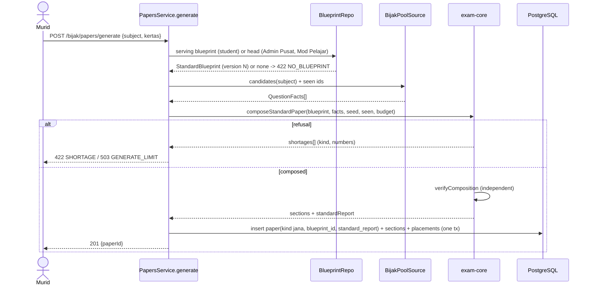

# Bijak SPM: Jana Kertas follows the SPM exam standard (system design)

- **Slug:** `bijak-spm` (requirements file `docs/requirements/v2-bijak-spm.md`, US-34 to US-40; decisions D75, D76)
- **Track / gate:** Full, G2 (system design). G1 is done. UX/UI design of the admin screens runs in parallel in `docs/design/`.
- **Date:** 2026-10-29 | **Owner:** solution-architect | **Status:** G2 approved by the user 2026-10-29 (section 13.1 records the decisions).
- **Reads:** `v2-bijak-spm.md` (ACs cited as AC-xx.y), `docs/discovery/SPM-paper-patterns.md` (SPP), `v2-exam-schema.md` (D2, D8, D9, now aligned, Q-B24 closed), `v2-data-model.md` 3.8, `v2-backend-plan.md`, ADR-0021, and the code under `apps/api/prisma/schema/{exam,questions,curriculum}.prisma`, `packages/exam-core`, `packages/contract/src/bijak`, `apps/api/src/modules/{bijak,exam}`.
- **New ADRs:** [0022](../adr/0022-bijak-standard-generator.md) (generator algorithm), [0023](../adr/0023-bijak-blueprint-standard-model.md) (blueprint standard model and serving rule).
- **Tags:** [PROPOSED] = new BM copy or a proposal not in the requirements. [Default] = tunable value.

## 1. What changes, in one page

Today `composeFromBlueprint` (exam-core) fills each section with a **count** of questions from a **pool tag**; marks, topic, TP and KBAT are not checked, the student can generate from a `Spec` blueprint, and a blueprint has no quota, profile or verification. The enhancement turns the blueprint into a **checkable standard** and the generator into a **constraint solver** with an independent verifier:

| Area | Decision (summary) |
|---|---|
| TP and cognitive level | Stored **per leaf part** as nullable overrides on `question_parts`; the existing `question_versions.difficulty_tp` / `cognitive_level` become the **default inherited by parts**. Question TP and KBAT marks are computed (max, sum), never stored. KBAT = effective cognitive level >= 3. |
| Blueprint content | Existing columns reused (`mark_budget`, `question_count`, rule, `allowed_modes`, `pool`). New JSONB documents on `blueprint_sections`: `profile`, `quota`, plus `kbat_marks`. `topic_weights` (never used) and `cognitive_mix` are superseded. Zod schemas in `@pp/contract` are the single definition. |
| Verification | Two new tables: `blueprint_evidence`, `blueprint_verifications`. `blueprints.source` becomes `verified` only through a `verify` endpoint (Admin Pusat) that runs the AC-39.1 list and the AC-39.7 evidence comparison. |
| Versioning / serving | Every edit is a new `blueprints` row (already the rule). New flag `serves_students` (at most one row per subject and kertas) decides what real students get; the last Disahkan keeps serving while a Spec version is the head (Q-B22). |
| Generator | New solver in `@pp/exam-core`: necessary-condition pre-checks (also the "Pratonton kolam" table), type-level bounded branch and bound per section, seeded concretisation, ordering rules per profile kind, independent `verifyComposition`. Deterministic from a seed. Preview and generate use the same code, with a reference attempt that makes "Boleh dijana" a guarantee. |
| API | Blueprint admin bodies extended; evidence, verification, pool-preview, version-history and draft-generation endpoints added (all Admin Pusat); student `generate` errors extended with typed shortage lines; contract list gains `canGenerate`. |

## 2. Component view

```mermaid
flowchart LR
  subgraph FE[Frontend]
    AdminUI[Admin: Kontrak Blueprint editor, Pengesahan, Pratonton kolam]
    StudentUI[Student: Bijak SPM / Jana Kertas]
    BankUI[Bank Soalan forms: TP + tahap kognitif per bahagian]
  end
  subgraph CT[@pp/contract]
    Std[bijak/standards schemas + paths]
    Pap[bijak/papers, bijak/builder (extended)]
  end
  subgraph EC[@pp/exam-core pure TS]
    Model[standard model + validateBlueprint]
    Elig[describeQuestion + eligibility]
    Solver[precheck + solve + arrange]
    Ver[verifyComposition]
    Evd[checkEvidence]
  end
  subgraph API[apps/api]
    BP[bijak/blueprints: admin service, versioning, serving, verification]
    PS[bijak/papers: generate, pool preview, draft]
    PoolSrc[BijakPoolSource port]
    Q[questions module M04 (owner of leaf TP/cognitive)]
  end
  DB[(PostgreSQL)]
  AdminUI --> Std
  StudentUI --> Pap
  Std --> BP
  Pap --> PS
  BP --> Model
  BP --> Evd
  PS --> Solver
  PS --> Ver
  Solver --> Elig
  PS --> PoolSrc --> Q --> DB
  BP --> DB
  PS --> DB
  BankUI --> Q
```

Boundaries (ADR-0014, D12): Bijak never reads question tables directly; it reads the **candidate facts** through the `BijakPoolSource` port implemented in the questions module (owner M04). `@pp/exam-core` stays dependency-free and has no I/O.

## 3. Data model deltas

### 3.1 TP and cognitive level per leaf part (Q-B19, Q-B24)

Where it lives today: `question_versions.difficulty_tp` and `question_versions.cognitive_level` (nullable smallints); `question_parts` has neither.

```prisma
model QuestionPart {
  // ... existing columns ...
  /// Leaf only. 1..6. NULL = inherit question_versions.difficulty_tp.
  difficultyTp   Int? @map("difficulty_tp")   @db.SmallInt
  /// Leaf only. 1..6 (1 Mengingat, 2 Memahami, 3 Mengaplikasi, 4 Menganalisis, 5 Menilai, 6 Mencipta). NULL = inherit.
  cognitiveLevel Int? @map("cognitive_level") @db.SmallInt
}
```

- CHECK: values 1..6; both NULL on branch parts (`mode is null`).
- **Effective leaf value** = `coalesce(part.value, version.value)`. **Question TP** = max over leaves of effective TP. **KBAT marks of a question** = sum of `marks` of leaves whose effective cognitive level >= 3. Both are computed in one place (`describeQuestion`, section 4.2) from the facts the pool source returns; no column stores them, so they cannot drift.
- The version-level columns keep their meaning "question default" (D2 text now says so). Authoring UI: set once on the question, override per part only where a part differs.
- No backfill: existing rows have NULL part values and inherit. The publish gate keeps requiring version-level `difficulty_tp` (existing); it must **also** require `cognitive_level` (D2 already says "R at Terbit", the service today does not), grandfathering already-published versions (they surface as "tiada tahap kognitif" in the preview). Task BJS-06.
- Legacy `kbat_level` migration (`v2-data-migration.md`): "LOTS 1-2" to 1/2, "MOTS 3" to 3, "HOTS 4-6" to 4-6. Level 3 is now Mengaplikasi = **KBAT**, so migrated MOTS questions count as KBAT. The migrated numbers were TP-like, not Bloom levels: treat as a first guess to confirm at bank review (open point O-3).

### 3.1a Unit per leaf part (revised 2026-10-29, O-1)

```prisma
model QuestionPart {
  /// Leaf only. FK curriculum_nodes (kind unit), SQL only. NULL = inherit question_versions.unit_node_id.
  unitNodeId BigInt? @map("unit_node_id")
  /// Leaf only. t1_t3, t4, t5 (CHECK). NULL = inherit question_versions.form_origin. 't1_t3' with a NULL unit = the bucket "T1-T3, luar DSKP".
  formOrigin String? @map("form_origin")
}
```

- Effective leaf unit = part value, else the question's (`coalesce`, in the same SQL as TP and cognitive level). The question's own `unit_node_id` stays the **primary unit** (the publish gate keeps requiring it); parts override only where they differ (Sejarah Q7: 12 marks Tajuk 12, 8 marks Tajuk 14).
- Quota accounting: marks-basis lines sum leaf marks per effective unit; questions-basis lines count a question once under its primary unit. A paper's `unitCounts` in `standardReport` and `verifyComposition` use the same two rules, so the generator, the preview and the oracle agree.
- Migration: two nullable columns, no backfill (all inherit). Bank forms (BJS-F6) show the per-part unit only as an override. Task BJS-06 carries the question-module change; BJS-02 the migration.
- Not affected: `describeQuestion` still reports one `tp` (max) and one `kbatMarks` per question.

### 3.2 `blueprints` (one row = one version, unchanged rule)

```prisma
model Blueprint {
  // ... existing columns kept: subjectId, kertas, code, version, status, source, provenance, confidence,
  //     durationMin, totalMarks, languageMode, autoMarkable, instructions, referenceSheets ...
  notes           String?
  /// "sub-bahagian menaik" (AC-25.1, AC-38.4): informs the bank review checklist only.
  subPartRamp     Boolean  @default(false) @map("sub_part_ramp")
  /// Optional paper-level KBAT marks (AC-37.2); must equal the sum of section values when both are set.
  kbatMarks       Int?     @map("kbat_marks") @db.SmallInt
  /// Optional stated paper-level T4:T5 share {t4,t5} in the quota basis (AC-36.3).
  levelShare      Json?    @map("level_share") @db.JsonB
  /// True on the single row that real students generate from (section 3.5).
  servesStudents  Boolean  @default(false) @map("serves_students")
  /// sha-256 of the canonical STRUCTURAL content (section 3.5). Computed by the service.
  structureHash   String   @map("structure_hash")
  /// -> blueprint_verifications.id. Non-null iff source = verified (CHECK).
  verificationId  BigInt?  @map("verification_id")
  // cognitiveMix: superseded by sections.profile, no longer read or written (drop in a later cleanup).

  evidence  BlueprintEvidence[]
}
```

- `source` (`draft` | `spec` | `verified`) and `status` (`draft` | `active` | `retired`) keep their meaning. `status = active` is the **head** (the version being edited; one per subject and kertas, existing partial unique index). `source = verified` can only be written by the verify service.
- `totalMarks` becomes mandatory on write (stored = sum of section `mark_budget`; if the client sends it, it must match).
- SQL additions (hand-written in the migration, as the existing file does): CHECK `source <> 'verified' or verification_id is not null`; CHECK `serves_students = false or source = 'verified'`; partial unique index `uq_blueprints_serving (subject_id, kertas) where serves_students`; index on `verification_id`.

### 3.3 `blueprint_sections`: two JSONB documents and one column

```prisma
model BlueprintSection {
  // ... existing: position, label, instruction, ruleType, ruleN, questionCount, markBudget, compulsory, pool, allowedModes ...
  /// Difficulty profile (US-35). NULL = no profile (allowed in Draf/Spec only).
  profile    Json?  @db.JsonB
  /// Exact topic quota (US-36). NULL = no quota (any unit allowed).
  quota      Json?  @db.JsonB
  /// Exact KBAT marks of the OFFERED questions of this section (US-37). NULL = unconstrained; 0 is a value.
  kbatMarks  Int?   @map("kbat_marks") @db.SmallInt
  // topicWeights: DROPPED (never read or written; no seed sets it).
}
```

Meaning of the existing columns under the standard:
- `question_count` = number of **slots** M (offered questions; a stimulus group occupies as many slots as it has questions).
- `mark_budget` = **effective** marks after choose-N. Offered marks are derived: `all` -> `mark_budget`; `choose N of M` -> `(mark_budget / N) * M` (every question has the same marks, AC-34.2; `mark_budget` must be divisible by N). The helper `offeredMarks(section)` is the only place that computes it.
- `pool` stays an **optional narrowing tag** (NULL = no tag filter). The six launch blueprints use NULL.
- `allowed_modes` is enforced as eligibility (AC-38.1(e)); empty = any mode.

JSON documents (validated by the zod schemas of section 6.1 on write and re-parsed on read, like `reference_sheets`):

```ts
// profile
{ kind: 'ladder' | 'bahagian' | 'tema',
  groups: [{ from: 1, to: 10,            // 1-based slot numbers inside the section, groups tile 1..M without gap or overlap
             tpMin: 2, tpMax: 4,         // band, 1..6
             tpCounts?: [{ tp: 3, count: 6 }, { tp: 4, count: 3 }],  // optional EXACT questions per TP, sums to the group size
             marksMin?: 4, marksMax?: 4, // optional marks per question; min = max gives AC-34.3 exact per-slot marks
             units?: UnitRef[] }]        // 'tema' only: the unit set of the theme block
}
// quota
{ basis: 'questions' | 'marks',          // default questions for objective sections, marks for structured (AC-36.1)
  lines: [{ unit: { kind: 'unit', nodeId: '123' } | { kind: 't1_t3' }, value: 2 }],
  levelShare?: { t4: 56, t5: 44 } }      // optional, in the basis unit; must equal the share implied by the lines (AC-36.3)
```

- `UnitRef.unit.nodeId` is a `curriculum_nodes.id` of kind `unit` (stable, pins the DSKP edition). The API response adds `code`, `level` (`T4`/`T5`) and `title` for display. `t1_t3` is the bucket "T1-T3, luar DSKP" (questions with `form_origin = t1_t3` and no unit).
- Why JSONB and not child tables: the data is only ever read and written as part of one section, never queried across blueprints; referential integrity is checked by the validator on save; this matches `reference_sheets`. Decision recorded in ADR-0023.
- (revised 2026-10-29, O-1) A quota line is credited by **leaf part**. Each leaf has an effective unit (the part's own unit, else the question's primary unit `question_versions.unit_node_id`) or the bucket `t1_t3`. **Marks-basis** lines add the marks of each leaf to its effective unit; **questions-basis** lines count a question once, for its primary unit. See 3.1a.

### 3.4 Evidence and verification (US-39, Q-B13)

```prisma
/// One piece of evidence for a blueprint version: a trial paper, its skema, or an LPM format document.
model BlueprintEvidence {
  id          BigInt   @id @default(autoincrement())
  blueprintId BigInt   @map("blueprint_id")
  /// trial_paper, skema, lpm_format (CHECK)
  kind        String
  /// exam board value of E-exam_board (exam schema D8), e.g. sbp, selangor_mpsm; 'lpm' for the official body
  body        String
  year        Int      @db.SmallInt
  paperCode   String   @map("paper_code")          // 1449/2
  setLabel    String?  @map("set_label")
  /// Free text pointer to where the paper is kept (folder / file label). Never the file, never question text.
  sourceRef   String?  @map("source_ref")
  /// EvidenceValues (below). Every field optional: a skema states marks but not rules or duration (SPP 10.3).
  values      Json     @db.JsonB
  /// study = seeded from SPP; admin = entered by Admin Pusat (CHECK)
  origin      String   @default("admin")
  note        String?
  createdById BigInt?  @map("created_by_id")       // FK users SET NULL, SQL only
  createdAt   DateTime @default(now()) @map("created_at") @db.Timestamptz(6)
  blueprint   Blueprint @relation(fields: [blueprintId], references: [id], onDelete: Cascade, map: "fk_blueprint_evidence_blueprint_id")
  @@index([blueprintId], map: "ix_blueprint_evidence_blueprint_id")
  @@map("blueprint_evidence")
}

/// The recorded verification (AC-39.2). Insert-only: never updated, never deleted.
model BlueprintVerification {
  id               BigInt   @id @default(autoincrement())
  blueprintId      BigInt   @map("blueprint_id")   // the version that was verified
  verifiedById     BigInt   @map("verified_by_id")  // FK users RESTRICT, SQL only
  verifierRole     String   @map("verifier_role")   // 'admin' (CHECK; only Admin Pusat verifies)
  verifiedAt       DateTime @default(now()) @map("verified_at") @db.Timestamptz(6)
  note             String?
  structureHash    String   @map("structure_hash")  // hash verified
  /// Every line compared (section 6.5), frozen: [{ field, expected, statements, supportingBodies, status }]
  checkResult      Json     @map("check_result") @db.JsonB
  /// Copy of the evidence rows at the moment of verification, so later edits cannot rewrite history.
  evidenceSnapshot Json     @map("evidence_snapshot") @db.JsonB
  @@index([blueprintId], map: "ix_blueprint_verifications_blueprint_id")
  @@map("blueprint_verifications")
}
```

`EvidenceValues` (zod in the contract):

```ts
{ durationMin?: number,
  totalMarks?: number,                    // effective (counted) total
  sections?: [{ position: number,         // 1-based, matched to the blueprint by position, label is informational
                label?: string, markBudget?: number, offeredMarks?: number,
                rule?: { type: 'all' } | { type: 'choose', n: number }, questionCount?: number }] }
```

Evidence rows belong to a blueprint **version**. Creating a new version copies the head's evidence rows to it (so re-verification starts from the history and the check flags every value that moved). Once a version is verified its evidence rows are immutable (service rule); the snapshot in the verification row is the audit copy.

### 3.5 Versioning, serving and the cosmetic rule (Q-B22, AC-39.4)

**Structural content** (hashed): subject, kertas, code, duration, total marks, per section: position, rule, N, question count, mark budget, allowed modes, pool, compulsory, `profile`, `quota`, `kbat_marks`; paper-level `kbat_marks`, `level_share`, `sub_part_ramp`. **Cosmetic content** (not hashed): `notes`, `instructions`, `reference_sheets`, section `label` and `instruction`.

```mermaid
stateDiagram-v2
  [*] --> V1_Spec: create (head, source spec/draft)
  V1_Spec --> V1_Disahkan: verify (Admin Pusat, gates pass)\nsource=verified, serves_students=true
  V1_Disahkan --> V2_Disahkan: new version, cosmetic change only\nsame hash: verification carried, serving moves to V2
  V1_Disahkan --> V2_Spec: new version, structural change\nV2 head source=spec; V1 status=retired but keeps serves_students
  V2_Spec --> V2_Disahkan2: verify V2\nserves_students moves V1 -> V2
  V1_Disahkan --> Stopped: retire\nall versions retired, serves_students cleared
```



Rules (all inside one transaction, in `BlueprintsService.addVersion`):
1. The client sends the full body to `POST .../versions`. The server computes `structureHash`.
2. `source` of the new row: `draft` if the client asks for Draf; else `verified` **only if** the previous head is verified **and** the hash is unchanged (then `verification_id` is copied and the evidence rows are copied); else `spec`. A client can never write `Disahkan` (the request enum becomes `Draf | Spec`).
3. The new row becomes `status = active`; the previous head becomes `retired`.
4. `serves_students` stays on the row that already has it; if the new row is a carried-verified one, the flag moves to it.
5. `verify` flips the **head** from spec to verified in place (a provenance change, not a content change), clears the flag on any older row, sets it on the head. Papers already generated keep their `blueprint_id`.
6. `retire` retires every version and clears the flag; it is the only way to stop serving.

Student lookup = the row with `serves_students`. Admin Pusat in Mod Pelajar = the head if `source in (spec, verified)`. Nobody generates from a head with `source = draft`.

### 3.6 `papers`

```prisma
model Paper {
  // ... existing ...
  /// Immutable composition report of a generated paper (AC-34.7). NULL for curated papers.
  standardReport Json? @map("standard_report") @db.JsonB
}
```

`standardReport` = `{ blueprintVersion, seed, solverVersion, sections: [{ label, effectiveMarks, offeredMarks, slotTp: number[], unitCounts: [{ unit, basis, value }], kbatMarks }], kbatMarksTotal }`. A `jana` paper is never edited, so the paper row is the frozen record that attempts point to (`papers.blueprint_id` already pins the version). A draft generated by Admin Pusat (AC-29.2) is a `pilihan` draft paper with the same report.

### 3.7 Migrations

One migration `00NN_bijak_standards` (next free number above `0091`; check at implementation time), written by hand for the CHECK constraints and partial indexes, plus the Prisma schema edits:

1. `question_parts`: add `difficulty_tp`, `cognitive_level` + CHECKs.
2. `blueprints`: add columns of 3.2; backfill `structure_hash` for existing rows by a script step (`BJS-02`). Any existing `source = verified` row is downgraded to `spec` first (the PoC and demo seeds are all Spec; a Disahkan row can only exist under the new verification rule, so the CHECK `source <> 'verified' or verification_id is not null` holds afterwards).
3. `blueprint_sections`: add `profile`, `quota`, `kbat_marks`; **drop `topic_weights`** (grep shows no reader or writer outside generated code; assert zero non-null rows first).
4. Create `blueprint_evidence`, `blueprint_verifications`, indexes, CHECKs.
5. `papers`: add `standard_report`.
6. Index to support the candidate query: `question_parts (question_version_id)` exists; add none. The query is bounded by `question_versions` index `ix_question_versions_subject_level_status`.

Rollback: all additions are nullable or defaulted except `structure_hash` (backfilled in the same migration); dropping `topic_weights` is the only destructive step and is safe by the zero-row assertion.

## 4. Domain rules in `@pp/exam-core`

New files (public API additions only; `composeFromBlueprint`, `poolUnits` and the existing exports stay unchanged because the M28 mock still imports them; the API stops using them):

| File | Content |
|---|---|
| `standard-model.ts` | Types `SlotGroup`, `Profile`, `Quota`, `StandardSection`, `StandardBlueprint`, `UnitKey`, constants `COGNITIVE_LEVELS` (1..6 with BM names), `isKbatLevel(l) = l >= 3`, `offeredMarks(section)`, `structureHash` input canonicaliser. |
| `eligibility.ts` | `describeQuestion(facts)` and `eligibilityOf(facts, section)`. |
| `validate.ts` | `validateBlueprint(bp, unitLevels)` returns `Problem[]` (section 4.3). Used by the API on save and by the editor for inline checks. |
| `solver.ts`, `precheck.ts`, `arrange.ts` | Section 5. |
| `verify.ts` | `verifyComposition(bp, composed)` independent oracle (AC-34.6). |
| `evidence.ts` | `checkEvidence(bp, evidence)` (section 6.5). |
| `shortage.ts` | Typed shortage lines and BM formatter (extends `shortageLine`). |

### 4.1 Cognitive levels

`COGNITIVE_LEVELS = [{n:1,key:'mengingat'},{n:2,'memahami'},{n:3,'mengaplikasi'},{n:4,'menganalisis'},{n:5,'menilai'},{n:6,'mencipta'}]`; the BM display names are the keys capitalised. `isKbatLevel(n) => n >= 3`. The frontend imports the same constant (no second table).

### 4.2 Question facts and eligibility (US-38)

Input from the pool source (no content, no keys):

```ts
interface QuestionFacts {
  id: string; groupId: string | null; groupPosition: number | null; versionNo: number
  unit: { nodeId: string; level: 'T4' | 'T5'; code: string } | null
  formOrigin: 't1_t3' | 't4' | 't5'
  pools: string[]                                   // question_tags kind 'pool'
  leaves: { marks: number | null; mode: string | null; tp: number | null; cognitiveLevel: number | null; hasKey: boolean }[]
  // tp and cognitiveLevel are the EFFECTIVE values (coalesce part, version) computed in SQL
}
```

`describeQuestion` returns `{ marks, tp, kbatMarks, modes, bucket, unitMarks }` where `marks` = sum of leaf marks, `tp` = max leaf TP, `kbatMarks` = sum of marks of leaves with `isKbatLevel(cognitiveLevel)`, `bucket` = the **primary** `UnitKey` (`T4:3.0` style key from node id, or `t1_t3`; used by questions-basis lines), and (revised 2026-10-29, O-1) `unitMarks` = map `UnitKey -> marks` summed over leaves by each leaf's effective unit (used by marks-basis lines). Leaf `unit` in the facts is the effective value (part, else question). It returns a reason list when something is missing, in this fixed order (so counts add up): `no_unit` (a leaf with neither an effective unit nor `form_origin = t1_t3`), `no_tp`, `no_cognitive_level`, `no_marks` (a leaf without marks >= 1), `no_key`. `eligibilityOf(facts, section)` additionally returns `mode_not_allowed` (a leaf mode outside `allowed_modes`), `pool_mismatch` (section `pool` set and not among `pools`), `unit_not_in_quota` (quota present and the primary bucket, or in a marks-basis section any key of `unitMarks`, has no line with value > 0, AC-36.2/36.5). A stimulus group is an eligible **unit** only if every member is eligible for the section.

The pool preview breakdown (AC-29.5/38.2) is a count by first reason, with the bank query link filters (`subject`, `status=published`, `missing=unit|tp|cognitive_level|marks`).

### 4.3 Blueprint validation (AC-25.7, AC-35.x, AC-36.x, AC-37.5, US-39 gate part)

`validateBlueprint` returns **all** problems at once. Codes (stable, used by contract and UI):

| Code | Rule | AC |
|---|---|---|
| `TOTAL_MISMATCH` | stored/stated total != sum of section `mark_budget` | 25.7 |
| `CHOOSE_N_RANGE` | `N > question_count` or `mark_budget % N != 0` | 25.7, 34.2 |
| `SLOT_OVERLAP`, `SLOT_GAP` | slot groups must tile 1..M | 25.7, 35.2 |
| `PROFILE_SHAPE` | ladder: `tpMin` and `tpMax` non-decreasing over groups; bahagian: exactly one group; choose-N section: exactly one group; tema: every group has `units`; `tpMin <= tpMax` | 35.3-35.7 |
| `TP_COUNTS` | counts sum to group size; each count's TP inside the band | 35.2 |
| `MARKS_BAND` | per-slot marks bands cannot reach the section marks (sum of mins <= effective marks <= sum of maxes; choose-N: band contains `mark_budget / N`) | 34.3 |
| `QUOTA_SUM` | lines sum to M (questions basis) or to offered marks (marks basis); a line value < 0; duplicate unit | 25.7, 36.1 |
| `QUOTA_UNIT` | unit not a `unit` node of the blueprint's subject (needs the `unitLevels` map) | 36.1 |
| `LEVEL_SHARE` | stated share (section or paper) differs from the share implied by lines (T1-T3 bucket excluded); paper-level share needs the same basis in every quota section | 25.7, 36.3 |
| `KBAT_RANGE` | `kbat_marks` > offered marks, or < 0 | 37.5 |
| `KBAT_TOTAL` | paper-level `kbat_marks` != sum of section values | 37.2 |
| `MODES` | `allowed_modes` outside the answer-mode enum | |

Not an error but a **warning** returned next to problems and shown in the preview: `KBAT_TP_BAND` (KBAT marks > 0 while every TP band of the section is 1-2; see O-5, AC-37.5 conflicts with "TP is independent of KBAT").

Completeness for **Disahkan** (`validateForVerification`, AC-39.1 a-d) adds: every section has a profile covering every slot, quota lines, `kbat_marks` (0 counts), `levelShare` derivable where the subject has both levels. The evidence part (e) is `checkEvidence` (section 6.5).

## 5. Generator design

### 5.1 Problem statement

Per section s with M slots, find a set of **units** (single question or whole stimulus group, in order) and an assignment to slots such that **hard** constraints hold:

| # | Constraint | Source |
|---|---|---|
| H1 | exactly M questions; no question twice in the paper; stimulus groups whole and in published order | AC-03.3, 07.3 |
| H2 | effective marks = `mark_budget` (all: sum of marks; choose-N: every question has marks `mark_budget / N`) | AC-34.1/34.2 |
| H3 | slot `i` holds a question whose TP is inside the band of `i`'s group, whose marks are inside the group's marks band, and the per-TP counts of a group are exact | AC-35.x, 34.3 |
| H4 | per quota line: offered questions (or marks) of that unit = value; units without a line (value > 0) excluded | AC-36.x |
| H5 | offered KBAT marks = `kbat_marks` | AC-37.x |
| H6 | question eligible for the section (4.2) | AC-38.1 |

Soft: prefer questions the student has not been served (AC-03.5), variety between papers (AC-03.4), mixed topic order (AC-36.6). Soft never overrides hard (AC-34.8).

This is a multi-dimensional exact-count selection problem (subset-sum with several equality constraints). It is NP-hard in general, but the instance is small and structured: M <= 40 slots, <= 25 quota lines, <= 6 TP values, <= 6 slot groups, a few mark values. Chosen approach (ADR-0022): **exact bounded search over question "types", with polynomial necessary-condition pre-checks**, no external solver.

### 5.2 Pipeline

```mermaid
flowchart TD
  A[candidates: QuestionFacts[] of the subject] --> B[describeQuestion + eligibilityOf per section]
  B --> C[units: singles + whole groups]
  C --> D[precheck per section: counts, units, TP, KBAT, marks]
  D -->|first failing line| X[Shortage list]
  D -->|all pass| E[order sections by tightness]
  E --> F[solve section: type-level branch and bound, seeded]
  F -->|fail after budget| G[probe: which constraint family blocks]
  F -->|ok| H[concretise: pick real questions, unseen first]
  H --> I[arrange: slot order per profile kind]
  I --> J[next section with used set]
  J --> K[verifyComposition independent oracle]
  K -->|violation| L[never served: log + 500]
  K -->|ok| M[persist paper + standardReport]
```

### 5.3 Types and units

- A **single** question is described by the tuple `t = (unitSignature, tp, marks, kbatMarks)` where `unitSignature` is the primary bucket in a questions-basis section and the sorted `unitMarks` map in a marks-basis section (revised 2026-10-29, O-1; most questions have one entry, so type counts stay small). Marks-basis quota lines are accounted per unit from the signature, so one multi-topic question feeds several lines at once, like a stimulus unit does. All singles with the same tuple form one **type** with a member list (sorted by id, then shuffled by the seeded RNG with unseen members first). Types make the search independent of pool size: 5,000 questions collapse to a few hundred types.
- A **stimulus unit** (group of k questions) is kept as its own item (there are few per section). Its members each have a tuple; it consumes k consecutive slots.
- For choose-N sections the candidate set is first reduced to `marks == mark_budget / N` (H2), which removes the marks dimension.

### 5.4 Pre-checks (polynomial, also the preview table)

Run per section on the eligible units. Each check produces a typed line with `needed` and `available`; they are **necessary** conditions, evaluated independently (the "available" of a line does not account for other lines):

| Check | Computation | Complexity |
|---|---|---|
| `count` | sum of unit sizes >= M | O(N) |
| `unit` (per quota line) | available questions (or reachable marks by subset-sum DP over the line's distinct mark values) >= value | O(N + L*V*B) |
| `tp` (per slot group, per exact TP count) | questions with TP in the band (and marks band) >= group size; exact counts: available at that TP >= count; cross-group feasibility is a max-flow on <= 6 TP nodes x <= 6 groups | O(N + T*G) |
| `kbat` | max KBAT marks of any M units >= K, and min <= K, and K reachable by DP over distinct per-question KBAT values | O(N + M*K) |
| `marks` | exact marks reachable with M questions: DP over (count, marks) on distinct mark values | O(M*B*V) |
| `level_share` | implied by quota lines; checked at validation, not at pool time | O(L) |

N = eligible units, L = quota lines, V = distinct mark values (<= 6), B = marks target (<= 100), T = 6, G = groups. All run in milliseconds for N = 5,000. The order of reporting is fixed so "first failing constraint" is stable: `count`, `unit`, `tp`, `kbat`, `marks`, `level_share`, then `overlap`, `combination`, `limit`. AC-29.4 shows every line (not only the first); AC-29.5 shows the first.

### 5.5 Search (per section)

Search variables are **counts of types** placed in slot groups, not individual questions.

State: remaining slots per slot group, remaining exact TP counts per group, remaining value per quota line, remaining marks `R`, remaining KBAT `K`.

```
solveSection(section, items, rng, budget):
  place stimulus units first:
    for each subset of group-items (randomised order, total size <= M, pruned by line capacities):
      for each valid start slot (every member's TP and marks inside the band of the slot it lands on;
                                 'bahagian'/'tema': any start inside the block):
        reserve those slots; subtract members from lines, K, R, TP counts
  then fill singles line by line, most constrained line first (smallest available - value):
    choose how many questions of each type of the line go to each slot group
      (compositions of the line value over types x groups, capacity = type size, TP inside band, marks inside band),
      value order shuffled by rng
    forward check after each line:
      each remaining line: available types still cover its value
      each group: remaining slots coverable by remaining types in band; exact TP counts coverable
      R within [sum r_g*minMarks_g, sum r_g*maxMarks_g]; K within [min, max] reachable with the remaining slots
    memoise failed states (hash of the remaining vector + line index)
  when a section has no quota, one pseudo-line "any unit" carries the M slots
  return type counts per (line, group), reserved stimulus placements
```

- **Bounds:** node budget per section [Default 150,000 nodes], per paper [Default 600,000], wall-clock safety cap [Default 2,000 ms]. The node budget is the deterministic limit; the wall-clock cap can only turn a would-be result into a `limit` error, it never changes a produced paper (determinism is kept).
- **Complexity:** pre-checks polynomial (section 5.4). Search worst case exponential in the number of lines (<= 25) and types per line, but bounded by the node budget, so a request costs O(budget * (L + G)) in the worst case; typical sections finish in a few hundred nodes because pre-checks remove infeasible instances and forward checking removes dead branches early.
- **Soft preference "unseen":** two phases per paper attempt. Phase 1 solves with **unseen questions only** (types restricted to unseen members) with 40% of the budget; if it fails, phase 2 solves with all eligible questions. The result may therefore mix seen and unseen questions only when needed.

### 5.6 Cross-section interaction and the preview guarantee

Sections draw from overlapping pools but share one `used` set (H1). Strategy:
1. Order sections by tightness (smallest minimum slack across their pre-check lines, ties by blueprint position) and solve in that order, subtracting used questions.
2. If a later section fails although its pre-check passed on the undepleted pool, report kind `overlap` naming the section whose picks depleted it, and **restart** with another section order and seed (at most 3 restarts [Default]).
3. The last attempt is the **reference attempt**: seed `0`, no unseen preference, canonical section order. The preview ("Pratonton kolam", AC-29.5) runs only the reference attempt.

Guarantee: if the preview says "Boleh dijana" on a pool, a generation on the same pool succeeds at the latest in the reference attempt (the generator tries the user's seed first, falls back to the reference). The converse is not guaranteed (a refusal could in theory be a false negative only in the rare cross-section overlap case within the budget); the message then says `limit` or `overlap`, never a fabricated shortage.

### 5.7 Explaining a refusal

- Pre-check failure: the typed shortage line for the first failing check (`kind`, `section`, `need`, `have`, plus `unit`, `slot`, `tp`, `basis`).
- Search failure with all pre-checks passing (`combination`): a **relaxation probe** re-solves the section with one constraint family removed at a time, in the order `kbat`, `tp`, `marks`, `quota`, each with 10% of the budget; the first family whose removal yields a solution is reported as `blocking`. If none yields one within budget, report `limit`.
- Every line carries real numbers from the eligible pool (AC-38.3), never the raw Terbit count.

### 5.8 Concretise and arrange (ordering rules per profile kind)

After the type counts are fixed, real questions are picked per `(type, group)`: members unseen first, then seen; within each, the seeded shuffle. Then the order inside the section:

| Profile kind | Order rule |
|---|---|
| `ladder` | Slot groups appear in order; inside a group, singles are shuffled by the seed; stimulus units sit at their reserved slots. TP of every slot is inside its band by construction. |
| `bahagian` (one group) | The whole section is free: units (groups intact) are shuffled by the seed. |
| `tema` | Blocks appear in order; inside a block, free shuffle. |

**Mixed topic order (AC-36.6):** for sections with free order, after shuffling check `orderOk`: not in DSKP chapter order when the section has >= 4 distinct units, and not "all T4 before all T5" when the section has >= 2 T4 and >= 2 T5 questions. If it fails, reshuffle the free positions, up to 25 tries [Default]; if still failing, keep the last order. This rule is **best effort and never causes a refusal** (open point O-4: as written AC-36.6 is not satisfiable for tiny sections).

Question numbering is continuous across sections in blueprint order (AC-34.5); `number_label` is assigned at persist time.

### 5.9 Determinism

Seed = existing `generationSeed(clock, userId, blueprintCode, previousCount)` (`rules.ts`), extended with the blueprint **version**. All candidate lists are sorted by id before any shuffle; the RNG is `mulberry32`; no `Date.now()`, no `Map` iteration order dependence, no wall-clock in decisions (only in the safety cap). Same blueprint version + same pool + same `seen` set + same seed = same paper (tested). The seed and solver version are stored in `standardReport` for reproduction.

### 5.10 Independent verification (AC-34.6)

`verifyComposition(blueprint, composedSections, factsById)` recomputes everything from the composed paper and the question facts, **not** from solver internals: counts, duplicates, group integrity (whole, adjacent, in order), effective marks per section and total, per-slot TP band and marks band, exact TP counts, quota per line (marks-basis from leaf-part units, questions-basis from the primary unit; revised 2026-10-29, O-1), `levelShare`, KBAT marks, eligibility, number continuity. It returns `Violation[]`. The generator calls it before persisting; any violation means the paper is **not served**, logs `bijak.generate.violation` with blueprint version, seed and violations, and answers 500 `INTERNAL`. The same function is the oracle of the property tests, and the publish contract check (`paper-check.ts`) reuses its structural tier (AC-26.2). The **standard tier** (profile, quota, KBAT) is a hard gate for generated papers. For curated Kertas Pilihan it **never blocks and raises no gap on the paper** (O-2, decided by the user: an official paper cannot be wrong, so a mismatch means the blueprint needs review). Instead the mismatch is reported on the blueprint as the computed `needsReview` signal (section 6.3a).

## 6. API and contract

### 6.1 Contract package layout

- New folder `packages/contract/src/bijak/standards/{schema.ts,paths.ts,__tests__}` for everything below; registered next to the other Bijak components. Existing schemas change only where stated in 6.4.
- Field names are final once BJS-01 merges (frontend builds against them).
- All admin routes: `@Roles('admin')` (Admin Pusat), session guard with CSRF on writes, `RateLimit` as the builder module does, audit entry on every write (AC-32.2). Admin Sekolah, PPD/JPN, Guru, Murid: 403 and no change (AC-32.1, AC-39.3).

### 6.2 Shared shapes (zod, camelCase)

```ts
BijakUnitRef        = { kind: 'unit', nodeId: Id } | { kind: 't1_t3' }
BijakUnitRefView    = BijakUnitRef & { code?: string, level?: 'T4' | 'T5', title?: string }   // responses
BijakSlotGroup      = { from: int>=1, to: int>=from, tpMin: 1..6, tpMax: tpMin..6,
                        tpCounts?: { tp: 1..6, count: int>=1 }[], marksMin?: int>=1, marksMax?: int>=marksMin,
                        units?: BijakUnitRef[] }
BijakProfileKind    = 'ladder' | 'bahagian' | 'tema'
BijakDifficultyProfile = { kind: BijakProfileKind, groups: BijakSlotGroup[] }          // 1..40 groups
BijakQuotaBasis     = 'questions' | 'marks'
BijakQuotaLine      = { unit: BijakUnitRef, value: int>=0, tag?: 'observed' | 'inferred' | 'single_source' }   // tag: G3 note (b), informational
// Question part (questions contract, BJS-06), revised 2026-10-29, O-1; all optional, null = inherit the question:
BijakPartUnit       = { unitNodeId?: Id | null, formOrigin?: 't1_t3' | 't4' | 't5' | null }   // on each leaf part, read and write
BijakPartStandardTags = { difficultyTp?: 1..6 | null, cognitiveLevel?: 1..6 | null }          // on each leaf part (3.1)
BijakTopicQuota     = { basis: BijakQuotaBasis, lines: BijakQuotaLine[], levelShare?: { t4: int>=0, t5: int>=0 } }
BijakEvidenceKind   = 'trial_paper' | 'skema' | 'lpm_format'
BijakEvidenceValues = { durationMin?: int, totalMarks?: int,
                        sections?: { position: int>=1, label?: string, markBudget?: int, offeredMarks?: int,
                                     rule?: BijakBuilderSectionRule, questionCount?: int }[] }
BijakBlueprintProblem = { code: <section 4.3 codes>, sectionPosition?: int, groupIndex?: int, unit?: BijakUnitRefView,
                          expected?: number, actual?: number }
```

Labels are never shown raw (AC-25.4/25.8): the UI maps `ladder` -> "Tangga mengikut nombor soalan", `bahagian` -> "Mengikut Bahagian", `tema` -> "Blok tema", `questions`/`marks` -> "Bilangan soalan"/"Markah" [PROPOSED].

### 6.3 Blueprint admin (extends `/admin/blueprints...`, `bijak/builder`)

`BijakBlueprintAdminSectionInput` gains (all optional unless stated): `profile`, `quota`, `kbatMarks` (int or null), `allowedModes` (answer-mode enum array), `pool` becomes optional (was required). `BijakBlueprintAdminVersionInput` / `Create` gain: `totalMarks` (optional, must equal the sum), `notes`, `subPartRamp`, `kbatMarks`, `levelShare`; `source` narrows to `'Draf' | 'Spec'` (optional; server decides, section 3.5). `BijakBlueprintView` and its section gain the same fields plus: `version`, `servesStudents`, `verification` (summary or null), `evidenceCount`, `needsReview`, `reviewPapers` (6.3a), `warnings` (list of problem codes with `warning: true`).

```ts
BijakVerificationSummary = { verifiedAt: string(date-time), verifierName: string, verifierRole: 'admin',
                             evidenceLabel: string, bodies: string[], note?: string }
```

| Method and path | Purpose | Body / query | Result and errors |
|---|---|---|---|
| `GET /admin/blueprints` | list heads (now also Draf) | `page,pageSize,subject,kertas` | list of view (keeps `servesStudents`, `verification`) |
| `GET /admin/blueprints/{subject}/{kertas}` | head view | | view; 404 |
| `POST /admin/blueprints` | create v1 | create input | 201 view; 409 exists; **422 `BLUEPRINT_INVALID`** with `details.problems[]` (all at once) |
| `POST /admin/blueprints/{subject}/{kertas}/versions` | edit = new version (section 3.5) | version input | 201 view; 409 retired; 422 `BLUEPRINT_INVALID` |
| `POST /admin/blueprints/{subject}/{kertas}/retire` | stop everything | | 200; 409 |
| `GET /admin/blueprints/{subject}/{kertas}/versions` | **new** history, newest first | | `{ version, status, source, servesStudents, createdAt, structureHash, verification? }[]` |
| `GET /admin/blueprints/{subject}/{kertas}/evidence` | **new** | | `BijakEvidenceItem[]` of the head |
| `POST /admin/blueprints/{subject}/{kertas}/evidence` | **new** add item | `{ kind, body, year, paperCode, setLabel?, sourceRef?, values, note? }` | 201 item; 409 head is Disahkan (edit via a new version first) |
| `DELETE /admin/blueprints/{subject}/{kertas}/evidence/{evidenceId}` | **new** | | 200; 409 same |
| `GET /admin/blueprints/{subject}/{kertas}/verification` | **new** record (if any) + live check of the head | | `{ record: BijakVerificationRecord \| null, check: BijakVerificationCheck }` |
| `POST /admin/blueprints/{subject}/{kertas}/verify` | **new** Spec -> Disahkan | `{ note?: string }` | 200 view; **422 `VERIFICATION_FAILED`** with `details.failures[]` (all at once); 409 already Disahkan |
| `GET /admin/blueprints/{subject}/{kertas}/pool` | **new** Pratonton kolam | `version?` (default head) | `BijakPoolPreview` |
| `POST /admin/papers/generate` | **new** Jana draf kertas (AC-29.2) | `{ subject, kertas }` | 201 `{ paperId }` (draft `pilihan` paper); same 422/503 as student generate |

```ts
BijakVerificationCheck = { passes: boolean, blueprintProblems: BijakBlueprintProblem[],
                           completeness: { code: 'NO_PROFILE' | 'NO_QUOTA' | 'NO_KBAT' | 'NO_SHARE' | 'NO_DURATION' | 'NO_EVIDENCE_BODIES', sectionPosition?: int }[],
                           lines: BijakEvidenceLine[] }
BijakEvidenceLine = { field: 'durationMin' | 'totalMarks' | 'markBudget' | 'rule' | 'questionCount',
                      sectionPosition?: int, expected: unknown,
                      statements: { evidenceId: Id, body: string, kind: BijakEvidenceKind, value: unknown }[],
                      supportingBodies: int,
                      status: 'ok' | 'differs' | 'not_covered' | 'tidak_disahkan' }
BijakVerificationRecord = BijakVerificationSummary & { evidence: BijakEvidenceItem[], lines: BijakEvidenceLine[] }
```

`VERIFICATION_FAILED` carries the same `check` object (`details.check`). Every failure is listed (AC-39.1).

### 6.3a "Blueprint needs review" signal (O-2)

Computed, never stored. On blueprint read (`GET /admin/blueprints`, `GET .../{subject}/{kertas}`, the version result) the service takes the published `pilihan` papers of the same subject and kertas (newest 20), reads their placed questions' facts through `BijakPoolSource`, and runs the **standard tier** of `verifyComposition` against the head blueprint (marks bands, TP bands and counts, quota, KBAT, level share). Any paper with a mismatch sets the flag. Cost is bounded by 20 papers; the result may be cached for 60 s.

New fields on `BijakBlueprintView` (response only, both always present):

```ts
needsReview: boolean
reviewPapers: { paperId: Id, title: string, gaps: ('marks' | 'tp' | 'quota' | 'kbat' | 'level_share')[] }[]   // empty when needsReview is false
```

UI text for the badge is [PROPOSED] "Blueprint perlu disemak". The flag is informational: it blocks neither verification nor generation. Verified blueprints are flagged too (the evidence may be right while the author-set quota is not).

### 6.4 Student side (`bijak/papers`, `bijak/contracts`)

- `BijakBlueprintContract` (GET `/bijak/contracts`) gains `canGenerate: boolean` and `unavailableReason?: 'NO_BLUEPRINT'`. For a student: the row shown is the **serving** version (or the head if there is no serving row) and `canGenerate` is true only with a serving row. For Admin Pusat in Mod Pelajar: head, `canGenerate` true when `source` is Spec or Disahkan. Admin Sekolah in Mod Pelajar follows the student rule (open point O-6). The UI shows AC-03.6 text when `canGenerate` is false.
- `POST /bijak/papers/generate` (body unchanged). The 201 result is unchanged. Errors:
  - `422 NO_BLUEPRINT` (unchanged message): no serving blueprint for a student, or no head with Spec/Disahkan for Admin Pusat in Mod Pelajar.
  - `422 SHORTAGE` (unchanged message) with `details.shortages` extended; the old `{ section, need, have }` stays valid:

```ts
BijakGenerateShortage = { section: string, need: int, have: int,
  kind?: 'count' | 'marks' | 'tp' | 'unit' | 'kbat' | 'level_share' | 'combination' | 'overlap',
  basis?: 'questions' | 'marks', unit?: BijakUnitRefView, slot?: { from: int, to: int }, tp?: { min: int, max: int },
  blocking?: 'kbat' | 'tp' | 'marks' | 'quota', otherSection?: string }
```

  - `503 GENERATE_LIMIT` [PROPOSED]: node budget or time cap reached; message "Kertas tidak dapat disusun sekarang. Cuba lagi." [PROPOSED]; `details.shortages[0]` names the section; a `Retry-After` hint is not needed.
  - `500 INTERNAL`: `verifyComposition` found a violation (logged, never served).
- BM lines are produced by `shortageLine(s)` in exam-core from `kind` (the contract carries data, not prose): `count` "{Bahagian}: perlu {n} soalan, hanya {m} tersedia"; `marks` "{Bahagian}: tidak dapat menyusun {b} markah daripada soalan yang tersedia"; `tp` "{Bahagian} soalan {from}-{to}: tiada soalan layak pada TP {a}-{b}" (or "perlu {n} ... hanya {m}" when some exist); `unit` "{Bahagian}: perlu {n} soalan {unit}, hanya {m} tersedia" (marks: "perlu {n} markah"); `kbat` "{Bahagian}: perlu {n} markah KBAT, hanya {m} tersedia"; `level_share` "{Bahagian}: nisbah Tingkatan 4 : 5 tidak dapat dipenuhi daripada soalan yang tersedia"; `combination` "{Bahagian}: syarat {blocking} tidak dapat dipenuhi bersama syarat lain" and `overlap` "{Bahagian}: soalan yang diperlukan telah digunakan oleh {Bahagian lain}" [PROPOSED]. The first six are the AC wording; all are [PROPOSED].

### 6.5 Pool preview (AC-29.1, 29.4, 29.5, 38.2)

```ts
BijakPoolPreview = {
  blueprint: { version: int, source: 'Draf'|'Spec'|'Disahkan' },
  verdict: 'boleh' | 'tidak_boleh' | 'tidak_pasti',        // "Boleh dijana" / "Tidak boleh dijana" / budget hit
  firstFailure: BijakGenerateShortage | null,
  excluded: { total: int, byReason: { reason: 'no_unit'|'no_tp'|'no_cognitive_level'|'no_marks'|'no_key', count: int, bankQuery: Record<string,string> }[] },
  sections: [{
    position: int, label: string, slots: int, effectiveMarks: int, offeredMarks: int,
    eligible: int,                                      // questions eligible for this section (AC-29.1)
    modeExcluded: int,                                  // eligible elsewhere but mode not allowed here
    counts: { needed: int, available: int, short: int },
    marks: { needed: int, reachable: boolean },
    quota: { unit: BijakUnitRefView, basis, needed: int, available: int, short: int }[],
    tp: { slot: { from: int, to: int }, tpMin: int, tpMax: int, tp?: int, needed: int, available: int, short: int }[],
    kbat: { needed: int, available: int, short: int } | null,
    bankQuery: Record<string, string>                   // prefilter for "Lihat soalan"
  }]
}
```

Counts equal rows (NFR-12): every number is computed by `precheck` over the same candidate list the generator uses. `short > 0` is rendered as "Kurang {n}" text (NFR-16). `tidak_pasti` when the reference attempt hit the budget.

### 6.6 Evidence comparison (AC-39.7), `checkEvidence`

Inputs: the blueprint head and its evidence items. Compared values: `durationMin`, `totalMarks`, and per section (matched by `position`): `markBudget`, `rule` (type and N), `questionCount`. For each value:
1. **statements** = every evidence item that states the value, grouped by `body`.
2. A body **supports** the value when all its statements equal the blueprint's; it **contradicts** when any statement differs.
3. Status: any contradicting statement -> `differs`; no statement -> `not_covered`; supporting bodies < 2 -> `tidak_disahkan`; else `ok`. An `lpm_format` item counts as two supporting bodies (AC-39.2 "or an LPM format").
4. Gate (e): no line with status other than `ok`; and at least two distinct bodies each with a `trial_paper` and a `skema` item, unless an `lpm_format` item exists (AC-39.2). Topic and KBAT quotas are not compared (author-set).

Consequence recorded from SPP 10.3: skema never print "Jawab" rules or duration, so those values are supported only by `trial_paper` items; the check handles this because evidence values are optional per item.

### 6.7 Roles and access (who may do what)

| Actor | Student generate (Disahkan) | Generate from Spec | Blueprint read (admin) | Blueprint write / version / retire | Evidence write | Verify (Disahkan) | Pool preview | Draft generate |
|---|---|---|---|---|---|---|---|---|
| Murid | ✅ | ❌ | ❌ | ❌ | ❌ | ❌ | ❌ | ❌ |
| Admin Pusat in Mod Pelajar | ✅ | ⚠️ test data only | n/a (uses portal) | n/a | n/a | n/a | n/a | n/a |
| Admin Sekolah in Mod Pelajar | ✅ | ❌ | ❌ | ❌ | ❌ | ❌ | ❌ | ❌ |
| Admin Pusat (portal) | n/a | n/a | ✅ | ✅ | ✅ | ✅ | ✅ | ✅ |
| Admin Sekolah (portal) | ❌ | ❌ | ❌ | ❌ | ❌ | ❌ | ❌ | ❌ |
| Guru, PPD/JPN, Ibu bapa | ❌ | ❌ | ❌ | ❌ | ❌ | ❌ | ❌ | ❌ |

#### ✅ BOLEH (can)
- Admin Pusat (portal): read, create, version, retire blueprints; add or remove evidence on a Spec head; verify; pool preview; generate a draft paper.
- Murid and Admin Sekolah in Mod Pelajar: generate a paper from a **Disahkan** (serving) blueprint.

#### ⚠️ TERHAD (limited)
- Admin Pusat in Mod Pelajar: may also generate from a **Spec** head; the paper is flagged test data (`is_test`), excluded from analytics, ranking and rewards (AC-39.6, AC-28.3).
- Evidence and structural edits on a Disahkan blueprint: not in place; they go through a new version, which becomes Spec (AC-39.4).

#### ❌ TIDAK BOLEH (cannot)
- Any non-Admin-Pusat role verifies or writes a blueprint: 403, nothing changes (AC-32.1, 39.3).
- Anyone generates from a `Draf` blueprint.
- A client sets `source` to Disahkan directly: the request enum refuses it.

#### 📌 Nota penting
- Guru has no Bijak SPM screen (D43); no subject-teacher verification flow exists.
- Admin Sekolah in Mod Pelajar is treated like a student for blueprint source (open point O-6).

## 7. Sequences

### 7.1 Student generates



### 7.2 Admin verifies

```mermaid
sequenceDiagram
  actor A as Admin Pusat
  participant API as BlueprintsService
  participant EC as exam-core
  participant DB as PostgreSQL
  A->>API: POST .../evidence (trial_paper, skema items per body)
  A->>API: GET .../verification (live check)
  API->>EC: validateForVerification + checkEvidence
  EC-->>A: lines with ok / differs / not_covered / tidak_disahkan
  A->>API: POST .../verify {note}
  API->>EC: same checks
  alt any failure
    API-->>A: 422 VERIFICATION_FAILED {check}
  else all pass
    API->>DB: tx: insert verification(check, snapshot); head.source=verified; move serves_students; audit
    API-->>A: 200 view (Disahkan, verifier, bodies)
  end
```

## 8. Seeds (US-40)

A new seed module `exam-launch-blueprints` (registered after `exam` and `exam-demo-blueprints`), data in `apps/api/prisma/seed/bijak-standards/*.json`, one file per blueprint. Idempotent, never updates, never deletes.

**Mechanism.** The PoC blueprints for Matematik K1/K2 (`1449/1`, `1449/2`) and the demo blueprint for Sejarah K2 (`1249/2`) already exist as version 1 (all Spec), so for those codes the module adds a **new version** (`version + 1`, `status active`, `source spec`, `provenance paper`, `confidence` per SPP section 8) and retires the old row; PoC papers keep pointing at their version. Matematik Tambahan (`3472/1`, `3472/2`) and Fizik (`4531/2`) have no blueprint yet and are created as version 1. Skip when a row with that code and `provenance = 'paper'` exists. `serves_students` is false everywhere (AC-40.1: none is Disahkan at seed). Curriculum units are resolved by `(subject, level, code, kind unit)` from the curriculum seed (subjects `MATH`, `ADDMATH`, `PHY`, `SEJ`); a missing unit fails the seed loudly.

**Layer 1: structure and profile (derivable from the repo now).** Marks, rules, N, counts, duration from SPP section 4 / 10 and requirements 6.1. TP bands are [Default] proposals from SPP 5.1 and the S-to-TP relation of SPP 3.2 (S1 ~ TP2-3, S2 ~ TP3-4, S3 ~ TP4-5, S4 ~ TP5-6), tagged "inferred" in `notes`, to be re-measured:

| Code | Duration | Sections (slots, effective marks, rule) | Profile | Slot groups (TP band) |
|---|---|---|---|---|
| 1449/1 Matematik K1 | 90 | A: 40 slots, 40, all, mcq | ladder | 1-10 TP2-4; 11-20 TP2-4; 21-30 TP3-5; 31-40 TP3-5 |
| 1449/2 Matematik K2 | 150 | A: 10, 40, all; B: 5, 45, all; C: 2, 15, choose 1 (offered 30) | bahagian | A TP2-4, marks 3-5; B TP3-5, marks 8-10; C TP3-6, marks 15 |
| 3472/1 Mat Tambahan K1 | 120 | A: 12, 64, all; B: 3, 16, choose 2 (offered 24, 8 each) | bahagian | A TP3-5; B TP4-6, marks 8 |
| 3472/2 Mat Tambahan K2 | 150 | A: 7, 50, all; B: 4, 30, choose 3 (offered 40, 10 each); C: 4, 20, choose 2 (offered 40, 10 each) | bahagian | A TP3-5; B TP4-5; C TP4-6 |
| 4531/2 Fizik K2 | 150 | A: 8, 60, all; B: 2, 20, choose 1 (offered 40); C: 1, 20, all (compulsory inferred) | ladder in A, bahagian in B and C | A: Q1 TP2-3 m4; Q2 TP2-3 m5; Q3 TP2-3 m6; Q4 TP2-3 m9; Q5-6 TP3-4 m9; Q7-8 TP4 m9; B TP5, marks 20; C TP5-6, marks 20 |
| 1249/2 Sejarah K2 | 90 | A: 4, 40, all; B: 5, 60, choose 3 (offered 100, 20 each) | bahagian, `subPartRamp = true` | A TP2-4, marks 10; B TP3-5, marks 20 |

(A section with one group covering all its slots is a "bahagian" group; Fizik's mixed kinds are expressed per section because AC-35.1 gives the kind per blueprint **section**.)

**Layer 2: quota and KBAT.** Exact unit values per section and exact KBAT marks are derived from the per-question tables that SPP keeps outside the repo (AC-40.2); SPP 10.5 confirms that no skema states TP, cognitive level or topic. Decision O-7 (user): **Claude prepares the layer-2 data files**; a product-analyst writes them to `docs/reference/blueprints/<code>.json` with `<code>` the paper code with `/` replaced by `-` (`1449-1.json`, `1449-2.json`, `3472-1.json`, `3472-2.json`, `4531-2.json`, `1249-2.json`). They are the **BJS-13 input**, merged by the same seed module by `code`. Shape (all keys optional per section; absent = `null` in the database):

```ts
{ code: "3472/2",
  sections: [{ position: 1,                       // matches layer 1 by position
               quota: { basis: "marks" | "questions",
                        lines: [{ subject: "ADDMATH", level: "T4" | "T5", unitCode: "1.0", value: 7 }   // or { bucket: "t1_t3", value: 4 }
                               ],
                        levelShare?: { t4: 29, t5: 21 } },
               kbatMarks?: 12,
               marksBand?: [{ from: 1, to: 7, marksMin: 6, marksMax: 8 }],   // O-8 values read from the real papers
               notes: "per value: observed | inferred; alternatives from the other body" }],
  kbatMarksTotal?: 20 }
```

The seed resolves `(subject, level, unitCode)` to `curriculum_nodes.id` and fails loudly if a unit is missing. Until a file exists the section seeds with `quota = null` and `kbat_marks = null`: valid as Spec (unconstrained), usable by Admin Pusat in Mod Pelajar for testing, **not verifiable** (AC-39.1 c, d). BJS-13 starts when the files land.

**Worked example (3472/2, SBP column of SPP 6.2 and the skema-confirmed marks)**: A is the seven units T4 1.0 (7), T4 2.0 (8), T4 4.0 (8), T4 8.0 (6), T5 1.0 (6), T5 2.0 (7), T5 6.0 (8) = 50; B is T4 6.0, T4 7.0, T5 3.0, T5 5.0 at 10 each = 40 offered; C is the four electives T4 9.0, T4 10.0, T5 7.0, T5 8.0 at 10 each = 40 offered (confirmed in both bodies, SPP 10.2). Encoded with `basis = 'marks'` and one line per unit with the mark value, summing to the section's offered marks; `levelShare` is implied. Selangor differs in A (systems of equations and integration instead of circular measure); the note records the alternative and the choice (AC-40.2). KBAT marks stay null until re-measured.

**Evidence (study):** each seeded blueprint also gets `blueprint_evidence` rows with `origin = 'study'`, `kind = 'trial_paper'` (and `skema` where SPP 10.2 confirms marks), one per body actually read, `values` from SPP section 4 / 10.2, `sourceRef` = "Kajian kertas percubaan 2025" [PROPOSED] (AC-39.5). No file, no question text, no person name (AC-40.3, NFR-15). Single-body papers (3472/1, 4531/2, 1249/2) and the unread items (Fizik C rule, Selangor 3472/2 Q13(b)-Q15) remain `not_covered` or `tidak_disahkan`, so they cannot be verified until more evidence is added (AC-40.4). No `verification` row is seeded.

**Not seeded:** Geografi, Sains Komputer, Biologi, Kimia, BM, BI, Sains, Fizik K1, Sejarah K1 (AC-40.5): their existing blueprints stay unchanged and cannot be Disahkan.

## 9. Impact on existing code

| Place | Change |
|---|---|
| `papers.service.generate` | New flow of 7.1; `findActiveBlueprint` replaced by `findServing` / `findHead`; `PaperActor` gains `role`; stops using `composeFromBlueprint`. |
| `rules.ts` | `toComposerBlueprint` replaced by `toStandardBlueprint`; `generationSeed` gains version; `SOURCE_TO_WIRE` unchanged. |
| `ports.ts` | `BijakQuestionSource.pool()` replaced for the API by `BijakPoolSource.candidates(scope)`; `getMany` stays. The PoC adapter implements the new port with fixture tags (fixture-only mapping: cognitive level = TP). |
| `builder/paper-check.ts` | Calls `verifyComposition` for the structural tier only. Standard-tier mismatches never block or warn on a Kertas Pilihan (O-2); they feed the blueprint `needsReview` signal (6.3a). |
| Existing tests | `apps/api/test/bijak-papers/generate.spec.ts` and builder tests that generate for a student from a `Spec` blueprint need a Disahkan serving fixture (BJS-15). |
| M28 mock in `src/modules/m28-bijak-spm` | Untouched; keeps using `composeFromBlueprint` until cut over to HTTP. |

## 10. Test plan (G3)

| Level | Tests | Where |
|---|---|---|
| exam-core unit | `describeQuestion` (max TP, KBAT marks, reason order); `offeredMarks`; `validateBlueprint` (one case per problem code, all-at-once); `checkEvidence` (supports, contradicts, single body, `lpm_format`, optional fields); `precheck` lines; `shortageLine` per kind; ordering rules per profile kind; `orderOk` | `packages/exam-core/__tests__` |
| exam-core property (seeded loops, no new dependency; `fast-check` optional) | For each of the six launch blueprints (layer 1 + a synthetic layer 2) over synthetic pools of 300, 1,500 and 5,000 questions, 30 seeds each: **0 papers differ from the blueprint** per `verifyComposition` (marks, slot TP, exact TP counts, quota per line, `levelShare`, KBAT, no duplicates, groups whole and adjacent); same seed gives the same paper; different seeds differ when the pool is larger; unseen preferred when enough exist; `solve` never returns a paper that `verifyComposition` rejects (mutation test: corrupt one pick, the oracle must flag it); infeasible instances (remove one unit from the pool, raise one quota by one) return the matching shortage `kind` and numbers; sorted-chapter-order and interleaving rates (AC-36.6) over 30 papers for sections that qualify | same |
| Performance | 40-question 100-mark paper, 5,000 eligible questions, all constraints: p90 <= 1.5 s solver time (NFR-13 leaves 1.5 s for DB); node budget hit returns `limit`, never a wrong paper | same, tagged `perf` |
| API integration | blueprint create/version: every problem code returns 422 `BLUEPRINT_INVALID` with all problems; cosmetic edit keeps Disahkan and moves `serves_students`; structural edit makes Spec head and old row keeps serving; verify: failing evidence lists all lines, passing flips source once and is audited; roles (each row of 6.7: 403 and no change); student generate with and without a serving blueprint; Admin Pusat Mod Pelajar from Spec flagged `is_test`; Admin Sekolah Mod Pelajar refused on Spec; shortage and limit shapes; `standard_report` stored; preview equals generate (verdict `boleh` implies 201, same pool); pool preview numbers equal rows; draft generation never publishes | `apps/api/test/bijak-standards/` |
| Migration | up on a copy with PoC data; `topic_weights` zero-row assertion; CHECKs reject `verified` without verification and `serves_students` on non-verified; partial unique index rejects a second serving row | `apps/api/test/db` |
| Conformance | OpenAPI examples parse with the contract schemas; `BijakGenerateShortage` old shape still parses; the 6.7 matrix as a table-driven test | `apps/api/test/conformance` |
| Frontend | component tests of the editor validations (shared `validateBlueprint`), preview table text for shortages, verification panel; e2e at 375 / 768 / 1280 with no horizontal scroll (CLAUDE.md §7) | frontend tasks |
| QA scenario (G5) | 30 papers per launch blueprint from the demo bank, compare against the blueprint through the stored `standardReport` (AC-35.9, 36.4, 37.3), plus the monitor query | `docs/qa` |

## 11. Task list

Roles: `backend-developer` (BE), `frontend-developer` (FE), `devops-engineer` (DO). Backend and frontend run in parallel once **BJS-01** (contract) is merged; frontend builds against the contract and mock handlers.

| ID | Role | Task | Depends on | Output |
|---|---|---|---|---|
| BJS-00 | solution-architect | Align `v2-exam-schema.md` D2/D8/D9 (Q-B24) | | Done 2026-10-29 |
| BJS-01 | BE | `packages/contract/src/bijak/standards` (schemas, paths, tests); extend builder and papers schemas (6.3, 6.4); regenerate OpenAPI | this doc | merged contract, field names fixed |
| BJS-02 | BE | Prisma schema and migration `bijak_standards` (3.1 to 3.7), structure-hash backfill, CHECKs, partial indexes | | migration + schema |
| BJS-03 | BE | exam-core: standard model, `describeQuestion`, eligibility, `validateBlueprint`, `offeredMarks`, `checkEvidence`, `verifyComposition`, shortage formatter | BJS-01 | pure functions + unit tests |
| BJS-04 | BE | exam-core: `precheck`, `solveSection`, concretise, arrange, probe, `composeStandardPaper` (5.x) | BJS-03 | solver |
| BJS-05 | BE | exam-core: synthetic pool generator, property and perf tests (section 10) | BJS-04 | test suite |
| BJS-06 | BE | Questions module: per-leaf TP and cognitive level (write, read DTO, contract, filters), publish gate requires `cognitive_level`, effective-value SQL helper | BJS-02 | M04 changes |
| BJS-07 | BE | `BijakPoolSource` port: candidate query + exclusion counts + PoC adapter | BJS-02, BJS-03, BJS-06 | port + implementation |
| BJS-08 | BE | Blueprint admin service: new fields, validation, versioning, serving flag, hash, audit | BJS-02, BJS-03 | endpoints of 6.3 (core) |
| BJS-09 | BE | Evidence, verification check and verify endpoints; role checks | BJS-08 | endpoints of 6.3 (verification) |
| BJS-10 | BE | Generate rework (7.1): role rule, solver, `standard_report`, errors, `canGenerate` in contracts list | BJS-04, BJS-07, BJS-08 | student API |
| BJS-11 | BE | Pool preview and draft generation endpoints; `needsReview` computation (6.3a); `paper-check` structural tier only | BJS-10 | admin API |
| BJS-12 | BE | Seeds layer 1 and study evidence (section 8) | BJS-02, BJS-08 | seed module |
| BJS-13 | BE | Seeds layer 2 (quota, KBAT, marks bands) from `docs/reference/blueprints/<code>.json` (section 8) | BJS-12 + those files | data + seed |
| BJS-14 | BE | API, migration and conformance tests (section 10) | BJS-10, BJS-11, BJS-12 | suites green |
| BJS-15 | BE | Update PoC fixtures and existing generate/builder tests to the new rules | BJS-10 | green legacy suites |
| BJS-16 | BE | Synthetic tagged demo bank (fictitious, no media) so Jana Kertas can be tried end to end | BJS-12 | demo seed |
| BJS-F1 | FE | Kontrak Blueprint editor: profile, slot groups, quota table, KBAT, share, flags, inline `validateBlueprint` | BJS-01, design | screen |
| BJS-F2 | FE | Pengesahan panel: evidence form, live check lines, verify, verifier/evidence at a glance (AC-39.5) | BJS-01, design | screen |
| BJS-F3 | FE | Pratonton kolam (needed/available tables, verdict, excluded breakdown) and "Jana draf kertas" | BJS-01, design | screen |
| BJS-F4 | FE | Blueprint list/hub: source, serving, version history, badges | BJS-01, design | screen |
| BJS-F5 | FE | Student Jana Kertas start: `canGenerate`, AC-03.6 reason, typed shortage messages | BJS-01 | screen |
| BJS-F6 | FE | Bank Soalan forms: TP and tahap kognitif per bahagian (override of the question default), filters, review checklist item for the sub-part ramp (B10) | BJS-01, BJS-06 | forms |
| BJS-F7 | FE | Component and e2e tests at 375/768/1280 | F1 to F6 | suites |
| BJS-D1 | DO | Run migration and seeds in CI and staging; seed order; backup before drop of `topic_weights` | BJS-02, BJS-12 | pipeline |
| BJS-D2 | DO | CI job for the property suite (30 papers x 6 blueprints) and perf tag | BJS-05 | CI |
| BJS-D3 | DO | Production monitor: scheduled comparison of `standard_report` with the blueprint version, alert on any violation (NFR-14), metric `bijak_generate_violation_total` and `bijak_generate_limit_total` | BJS-10 | runbook entry |

Suggested order: BJS-01 and BJS-02 in parallel -> BJS-03 -> BJS-04 and BJS-06 and BJS-08 in parallel -> BJS-05, BJS-07, BJS-09 -> BJS-10 -> BJS-11, BJS-12 -> BJS-14, BJS-15, BJS-16, BJS-13 (when data arrives). Frontend F1 to F6 start at BJS-01 with mocks.

## 12. Risks

| ID | Risk | Mitigation |
|---|---|---|
| R-B1 | Solver hits the budget on a hard but feasible instance, student sees a refusal | Pre-checks remove most infeasible cases; type-level search; reference attempt; `limit` is measured (BJS-D3); fall back to a solver library (HiGHS compiled to WASM) only if the pilot shows `limit` above 1% (ADR-0022) |
| R-B2 | Pool too thin per unit: exact quotas refuse most requests (R-7) | Preview shows the short unit, TP or KBAT line; tag-first intake; launch with six papers only |
| R-B3 | Per-leaf TP and cognitive level are NULL for most legacy questions, so they inherit a version value that was a guess | Excluded counts with reasons; review of migrated values (O-3); AI suggestions confirmed at bank review |
| R-B4 | Seeded layer 2 values are inferred from one or two bodies; "Spec" may be mistaken for a standard | Notes tag observed/inferred; Disahkan needs evidence from two bodies; students never see Spec |
| R-B5 | PoC fixtures and demo flows relied on student generation from Spec | BJS-15, BJS-16; demo bank is synthetic and fictitious |
| R-B6 | Node ids in quota lines pin a DSKP edition; a re-issued DSKP changes ids | Quota stores `nodeId`; a re-mapping script is part of the DSKP edition upgrade runbook (not in this scope) |
| R-B7 | Property tests on synthetic pools may not reflect real pools | G5 runs the same check on the real tagged bank before Disahkan is used; monitor in production |

## 13. Open points and findings

### 13.1 Decisions (all approved by the user 2026-10-29)

O-1, O-3, O-4, O-5, O-6, O-8, O-9 accepted as recommended below. O-6 is an explicit user answer (Admin Sekolah in Mod Pelajar follows the student rule). O-8: the marks band per slot group is **adopted**, with values taken from the real papers. O-2 and O-7 were changed by the user; see their rows.

| # | Decision | Recommendation |
|---|---|---|
| O-1 | **Unit granularity (revised 2026-10-29, O-1).** First accepted as one primary unit per question; the layer-2 files showed it cannot represent Matematik 1449/2 Bahagian C and Sejarah 1249/2 Bahagian B (multi-topic questions, marks on sub-parts; Sejarah Q7 = 12 marks Tajuk 12 + 8 marks Tajuk 14). **Now:** unit attribution is per leaf part. A leaf has an optional unit (or the T1-T3 bucket) and inherits the question's primary unit. Marks-basis lines count leaf marks per unit; questions-basis lines use the primary unit (3.1a). | Done as decided (principle: the official paper is right, the recipe is wrong). |
| O-2 | **Standard tier for curated Kertas Pilihan.** **DECIDED (user, replaces the advisory proposal):** a real or official Kertas Pilihan is **never** blocked, and gets no gap, because of quota, profile or KBAT mismatches ("an official paper cannot be wrong, so the blueprint is the problem"). Only the structural tier (rules, N, counts, groups) blocks, as AC-26.2 says today. Signal instead: the blueprint carries a computed `needsReview` flag (6.3a). | Done as decided. |
| O-3 | **Cognitive level encoding** 1..6 = Mengingat, Memahami, Mengaplikasi, Menganalisis, Menilai, Mencipta, KBAT = 3 to 6. Legacy `MOTS 3` becomes KBAT; migrated numbers are TP-like. | Accept the encoding (matches the DSKP wording); keep migrated numbers but require bank review confirmation before they count for seeds. |
| O-4 | **Mixed-order rule (AC-36.6)** is best effort, scoped to sections with >= 4 units (chapter order) and >= 2 questions per level (T4/T5 block), never a reason to refuse. | Accept; the AC as written is unsatisfiable for tiny sections (2 questions) and conflicts with ladder bands. |
| O-5 | **TP-band versus KBAT conflict (AC-37.5)** becomes a warning, not a save refusal, because TP and cognitive level are independent fields. | Accept the warning; keep only arithmetic KBAT checks as refusals. |
| O-6 | **Admin Sekolah in Mod Pelajar** follows the student rule (Disahkan only); only Admin Pusat may test Spec. | Accept (AC-03.1 and AC-39.6 name Admin Pusat only). |
| O-7 | **Layer 2 seed data** (exact unit quotas, KBAT marks) cannot be produced from the repo: it needs the per-question tables kept outside the repo, and no skema states cognitive level. **DECIDED (user):** Claude prepares them; a product-analyst writes `docs/reference/blueprints/<code>.json` (shape in section 8) as the BJS-13 input. Layer 1 alone launches if they are late. | Done as decided. |
| O-8 | **Optional marks band per slot group** (`marksMin`/`marksMax`) is added beyond the requirement text, to stop a 15-mark question landing in Matematik K2 Bahagian A. **ADOPTED**, values from the real papers (the section 8 seed table is the starting point; layer-2 files may refine `marksBand`). Optional; generalises AC-34.3 (min = max = exact marks). |
| O-9 | **Solver choice**: custom bounded search in pure TypeScript, no external solver (ADR-0022). | Accept; reconsider after the pilot if `limit` rate is high. |

### 13.1a G3 notes from the layer-2 data files (2026-10-29; user decisions unchanged)

- **(a) SEJ unit code format.** The Sejarah DSKP extract codes units as `Tajuk 11` (MATH, ADDMATH, PHY use `4.0`). The layer-2 `unitCode` and the seed lookup `(subject, level, unitCode)` must use the code **exactly as stored in `curriculum_nodes.code`**; BJS-13 resolves by exact match first, then, for kind `unit` in SEJ only, by trimming a leading `Tajuk ` and comparing the number. A miss still fails loudly. Add a seed test that every unit code of the six files resolves.
- **(b) Tags and "incomplete".** Cheap field added: optional `tag: 'observed' | 'inferred' | 'single_source'` on each `BijakQuotaLine` (informational, shown in the editor; no gate uses it). "Incomplete" is not stored: it is derived (`kbat_marks` null or `quota` null on a section), shown as such in the editor and by the verification completeness lines (`NO_KBAT`, `NO_QUOTA`). Free-text `notes` stay for alternatives and reasons. The layer-2 file shape gains the same optional `tag` per line (the seed copies it; unknown values are ignored with a log).
- **(c) KBAT will be weakly discriminating for Matematik and Matematik Tambahan.** With KBAT = cognitive level 3 to 6 (user's explicit choice, DSKP), most parts are Mengaplikasi or above, so the layer-2 values come out near 100% of marks (for example 130 of 130 in 3472/2). The definition stays. Consequence: until the bank tags cognitive level **per leaf part** with real discrimination (BJS-06, BJS-F6, bank review), a near-100% KBAT quota excludes almost no question and the KBAT line adds little. Do not tighten the quota to compensate. Re-check the layer-2 KBAT values after the bank is tagged; the preview's `kbat` table (AC-29.4) will show when the line is trivially met.

### 13.2 Inconsistencies and infeasible points found in the requirements

1. **AC-37.5 versus Q-B18.** The last sentence says TP is independent of KBAT, yet the same AC refuses a contract with all slots in TP1-2 and KBAT > 0. Cognitive level and TP are separate stored fields; whether the combination is satisfiable depends on the pool, not on the contract. Resolved as a warning (O-5).
2. **AC-36.6 interleaving.** "Not all T4 before all T5" cannot hold in at least 29 of 30 papers for a section with one T4 and one T5 question (the two orders are equally likely), and ladder sections fix order by TP band. Scoped as in O-4.
3. **Unit granularity versus SPP section 6** (O-1, resolved 2026-10-29 by per-leaf-part units, 3.1a). Also SPP 6.4 lists Sejarah at SK level (10.4, 11.2 ...) while the unit of the schema is the Tajuk; seeds must aggregate to Tajuk, and 20 marks ("13.2 or 14.1") need an author decision.
4. **AC-40.2 versus the evidence base.** It asks for quota and KBAT values "derived from the per-question tables", which are outside the repo, and SPP 10.5 states that no skema or file gives cognitive level, KBAT, TP or topic. Layer 2 cannot be finished by design alone (O-7).
5. **AC-29.4 "needed / available" per line** are independent necessary counts; a table with no "Kurang" line can still be "Tidak boleh dijana" because of combinations. The verdict line and `firstFailure` (kind `combination`, `blocking`) cover this; the UI should show the verdict above the tables.
6. **AC-26.2 versus the new standard.** It lists only structural gaps; whether standard-tier gaps block curated papers was undefined (O-2).
7. **Q-B22 versus the existing "one active blueprint per subject and kertas" index.** The head and the serving version can differ, which the index cannot express; solved by `serves_students` (ADR-0023).
8. **AC-39.2 "skema from at least two bodies" versus SPP 10.3.** Skema print neither "Jawab" rules nor durations, so those values can only be supported by trial papers; the check therefore compares per value across all items of a body (6.6) and requires both a paper and a skema item per body for the gate, not a skema for every value.
9. **Legacy `MOTS 3`** is KBAT under D76 but was "medium order" before (3.1, O-3).
