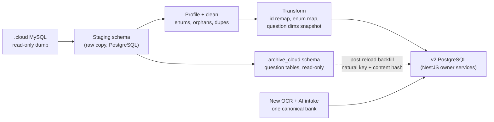

# v2 data migration: prestasiplus.cloud to the v2 backend

- **Slug:** `v2-data-migration`
- **Status:** Draft for user review (analysis only; no code, no live or server access)
- **Date:** 2026-10-16
- **Owner:** solution-architect
- **Inputs:** `docs/TRACKER.md` D28 to D30; `prestasiplus-reference/backend/database/migrations` (167 files), `app/Models` (120 models), `docs/` of the reference repo; prototype `src/mock`, `src/modules/*/mock`, ADR-0013, ADR-0014, `docs/architecture/overview.md`.
- **Method note:** the .cloud schema was read from migrations (the final state after all `add_*`, `rename_*` and `alter_*` files). No row counts, enum value lists or production data were available. Anything that depends on real data is marked **to profile**.

## 0. Summary

1. The .cloud database has **134 tables** (after the `exam_papers` to `teacher_reference_papers` rename and the re-creation of `exam_papers` as the canonical paper table). 51 will **not** be migrated (6 Laravel runtime tables, 1 derived aggregate, 44 question-bank, pipeline and lookup tables), and **83** carry business data that the v2 system should migrate, reshape or consciously drop.
2. Against the prototype's stores, the 134 tables split as: **Same 2, Rename 17, Reshape 42, Missing in prototype 22, Not migrated 51** (section 2).
3. **Recommendation for question-dependent history:** keep it as a **historical snapshot, link later** (section 3). Each migrated attempt row carries its own curriculum dimensions and correctness, a nullable link to the new bank, and a legacy reference plus content hash for a best-effort backfill. Question-bound working state (revision schedules, question lists, reports) is dropped.
4. `legacy_canonical_map` is **not** a bridge to the new bank. It maps old .cloud rows to old .cloud canonical rows; both disappear when the bank is reloaded. It is useful only as a way to reach `source_papers.natural_key` and `content_hash` for the backfill.
5. The biggest realignments before backend work are: role codes, user fields (nullable email, username, IC handling, two status flags), id types and reserved id ranges, BM-versus-English enum values, M05 answer and session shape (nullable question link), and the 22 stores that exist in .cloud but not in the prototype (section 4).

### Source facts that drive the design

| Fact | Source | Consequence |
|---|---|---|
| Production DB is MySQL; `DATETIME` values are Malaysia time (`+08:00`, decision DT-1 A, to confirm in `dump:check`) and `TIMESTAMP` columns are UTC; ids are `bigint` auto-increment | `docs/DEPLOY-RUNBOOK.md`, `config/app.php`, migrations | Convert to PostgreSQL `timestamptz`; the export adds `+08:00` to `DATETIME` values and `Z` to `TIMESTAMP` values; the API keeps serialising `+08:00` (overview). Date-only columns need a day-boundary decision (section 5). |
| .cloud data is **separate** from the .my data ("not replicas") | `docs/DEPLOY-RUNBOOK.md` | Only the .cloud database is a source. No merge of .my users is planned. |
| No `deleted_at` anywhere; hard deletes | migrations | No soft-delete history to migrate. Orphans are possible where FKs were not enforced (section 5). |
| Roles are one string column `users.role`; no roles table, no permissions table | `create_users_table`, `User::canAccessPanel` | Role mapping is a value mapping (section 4.1). Officer scope has no column. |
| Passwords are Laravel hashes; Sanctum tokens exist | `users.password`, `personal_access_tokens` | Hash handling in section 5. Tokens are not migrated. |

### Migration flow

## 1. Inventory of .cloud tables by domain

Counts are final tables after all migrations (134). "Business" means the table holds data the product shows to users.

| Domain | Tables | Purpose |
|---|---|---|
| Framework | `cache`, `cache_locks`, `jobs`, `job_batches`, `failed_jobs`, `personal_access_tokens` (6) | Laravel runtime: cache, queue, failed jobs, Sanctum API tokens. |
| Identity, users, schools | `users`, `schools`, `school_subscriptions`, `parent_student`, `classrooms`, `classroom_student` (6) | One `users` table for every role (`pelajar`, `guru`, `ibu_bapa`, `penaja`, `admin_sekolah`, `pegawai_ppd`, `admin`), schools with free-text state and district, class rosters, parent links, school subscriptions. |
| Curriculum | `education_levels`, `subjects`, `chapters`, `topics` (4) | Levels (Darjah and Tingkatan), subjects, chapters (with DSKP code and strand), topics. |
| Practice and learning | `practice_sessions`, `question_attempts`, `review_schedules`, `structured_attempts`, `structured_attempt_answers`, `student_notes`, `study_schedules`, `broadcasts`, `timeline_entries`, `headcounts` (10) | Quiz sessions and per-question answers, SM-2 spaced-repetition schedule, structured (subjective) attempts, student notes, teacher timetable and announcements, student timeline, teacher headcount (TOV and RS). |
| Wellbeing, career, feedback | `mood_checkins`, `wellbeing_alerts`, `psychometric_results`, `interventions`, `aspirations`, `career_paths`, `universities`, `scholarships`, `feedback` (9) | Mood check-ins, alerts, psychometric results, intervention log, career and university planning, satisfaction survey. |
| Gamification and coins | `gamification_tiers`, `student_wallets`, `coin_transactions`, `challenges`, `challenge_user`, `gifts`, `gift_redemptions`, `teacher_badges`, `teacher_badge_user`, `achievements`, `achievement_user`, `lucky_draws`, `reward_settings` (13) | Syiling and token wallet, ledger, tiers, daily and teacher challenges, rewards shop, badges, achievements, draws, reward budget. |
| Battle and games | `battles`, `battle_participants`, `battle_queue`, `battle_invites`, `school_battle_rankings`, `games`, `game_sessions`, `game_rooms`, `game_room_players`, `leagues`, `league_members` (11) | 1v1 and school battles, matchmaking, multiplayer rooms, single-player game results, user leagues. |
| Content | `banners`, `articles`, `notes`, `videos`, `audio_kbat`, `notifications`, `support_tickets`, `chatbot_conversations`, `chatbot_messages` (9) | CMS content, audio KBAT, admin notifications, support, chatbot log. |
| System | `settings`, `feature_flags`, `ai_usage_logs`, `audit_logs` (4) | Key/value config, flags, AI cost log, audit trail. |
| Billing | `packages`, `payments`, `invoices`, `dunning_logs`, `pksk_packages`, `pksk_accesses` (6) | Packages, payments, invoices, dunning, PKSK package access. |
| Marketplace, sponsorship, duta | `marketplace_sellers`, `marketplace_products`, `marketplace_orders`, `sponsors`, `foster_sponsorships`, `foster_applications`, `duta_profiles`, `duta_applications`, `duta_bookings` (9) | Seller and product listing, orders, sponsors and foster (anak angkat) programme, school ambassador programme. |
| Exams (attempts) | `exam_attempts`, `part_responses` (2) | Canonical exam attempts and per-part responses (including AI grading). |
| Questions, legacy bank | `questions`, `question_options`, `structured_questions`, `structured_sub_questions`, `structured_rubric_points`, `pksk_questions`, `question_reports`, `question_submissions`, `question_imports`, `question_sets`, `question_set_items`, `spm_sets`, `spm_set_question` (13) | Objective, structured and PKSK items; reports; teacher submissions; teacher question sets; SPM tracking sets. |
| Questions, canonical bank | `exam_papers`, `paper_sections`, `exam_questions`, `exam_paper_questions`, `question_stimulus`, `question_parts`, `part_options`, `part_answer_keys`, `stimuli`, `media_assets`, `question_revisions`, `question_snapshots`, `source_papers`, `import_batches`, `import_items`, `legacy_canonical_map`, `unify_quarantine`, `paper_documents`, `paper_document_pages`, `paper_blueprints`, `blueprint_sections`, `teacher_reference_documents`, `teacher_reference_papers` (23) | Canonical exam model (paper, section, question, part, option, key, stimulus), revisions and snapshots, import pipeline, PDF page images, exam-format blueprints, bridge from legacy ids. |
| Lookups | `answer_modes`, `answer_key_kinds`, `stimulus_kinds`, `selection_rules`, `question_statuses`, `paper_statuses`, `attempt_statuses`, `exam_boards`, `exam_types` (9) | Vocabulary tables of the canonical model (`id`, `slug`). Copied for id to slug joins: 6 staged (`attempt_statuses`, `paper_statuses`, `question_statuses`, `answer_modes`, `answer_key_kinds`, `stimulus_kinds`), 3 archived (`exam_boards`, `exam_types`, `selection_rules`). Still not migrated as v2 rows. |

Two facts about the two banks that matter later:

- **Student practice still reads the legacy bank.** `question_attempts.question_id`, `review_schedules.question_id`, `question_set_items.question_id` and `spm_set_question.question_id` all point to legacy `questions.id`. The canonical tree is reached through `legacy_canonical_map` (rows with `source` of `questions`, `structured` or `spm_set`, and `canonical_type` of `exam_question` or `exam_paper`). Only `exam_attempts` and `part_responses` point at the canonical tree.
- **`exam_papers` is two different tables over time.** The first one (teacher reference paper) was renamed to `teacher_reference_papers`; the canonical `exam_papers` replaced it. Migration scripts must target the final names.

## 2. Mapping: .cloud table to prototype store

Match levels:

- **Same:** same concept and fields; only naming style and id type differ.
- **Rename:** same concept; field names, enum values or small additive fields differ.
- **Reshape:** the structure differs (split, merged, denormalised, derived, or a different id model).
- **Missing in prototype:** .cloud has the data; the prototype has no store (the v2 backend needs a new owner and table).
- **Not migrated:** infrastructure, derived aggregates, or question-bank data (D29a).

Prototype store names are the `defineTable` or dataset names in `src/modules/*/mock`. "Owner" is the ADR-0014 owner module.

| Domain | .cloud table(s) | Prototype store (owner) | Match | Key field differences |
|---|---|---|---|---|
| Framework | `cache`, `cache_locks`, `jobs`, `job_batches`, `failed_jobs` | none (NestJS queue/cache replace them) | **Not migrated** | Laravel runtime tables; transient. |
| Framework | `personal_access_tokens` | M01 `sessions` (mock/auth) | **Not migrated** | Sanctum tokens; force re-login after cutover. |
| Identity | `users` | M01/M02 `users` dataset + `users.secrets` | **Reshape** | Role codes, split flags, grade derivation, IC and password handling (section 4). |
| Identity | `schools` | M02 `schools` dataset (+ `schools.jpn`, `schools.ppd`) | **Reshape** | `state`/`district` are free strings in .cloud; prototype has JPN/PPD reference tables and fixture id ranges. `join_code` to add. |
| Identity | `school_subscriptions` | M02 `schoolSubscriptionsTable` | **Reshape** | .cloud: `package` string, `quota`, date-only `starts_at/ends_at`. Prototype: `schoolPackageId`, `packageTier`, `questionLimit`, `paymentReference`, `notes`. |
| Identity | `parent_student` | M02 `parentLinksTable` | **Rename** | `parent_id/student_id` = `parentId/studentId`; `relationship` has no prototype field. Pending invites (`users.parent_invite_token`) map to `parentInvitesTable` (reshape). |
| Identity | `classrooms` | M10 `classroomsTable` | **Reshape** | Prototype splits `kind` (school class vs teacher class) and uses string ids (`sc-{n}`); .cloud has one table with `teacher_id`, `code` (join code), `subject_id`, `session_year`. |
| Identity | `classroom_student` | M10 `enrolmentsTable` | **Reshape** | Prototype adds `status` (active/removed) and `source`; .cloud is a plain pivot (no soft delete). |
| Curriculum | `education_levels` | M03 `levelsTable` | **Rename** | `name_bm`->`name`, `name_en`->`nameEn`, `sort_order`->`order`; prototype adds `grade` (1-11 link to users). |
| Curriculum | `subjects` | M03 `subjectsTable` + `subjectLevelsTable` | **Reshape** | .cloud has no subject-level pivot (derive from chapters); has `is_core`, `color`, `sort_order`. |
| Curriculum | `chapters` | M03 `chaptersTable` | **Rename** | `title`, `number`, `dskp_code`, `strand`; prototype has `inTree` flag instead of strand. |
| Curriculum | `topics` | M03 `topicsTable` | **Same** | `chapter_id`, `subject_id`, `name`, `sort_order`. Prototype also has subtopics and legacy topics (no .cloud source). |
| Practice | `practice_sessions` | M05 sessions dataset (`SessionRow`) | **Reshape** | String ids vs bigint, no `status`, no served-question list, `mode` is free text, `syiling_earned`->`coinsEarned`, extra `client_uuid`, `paper`, `question_set_id`. |
| Practice | `question_attempts` | M05 answers dataset (`AnswerRow`) | **Reshape** | .cloud: `selected_option` label, `time_seconds`, no subject/level/chapter. Prototype: `selectedOptionId` index, denormalised `subjectId/levelId/chapterId`, `answeredAt`. |
| Practice | `review_schedules` | M05 `queueTable` (+ `masteryTable`) | **Reshape** | .cloud is SM-2 (`ease_factor`, `interval_days`, `repetitions`, `lapses`, `next_due_at`); prototype queue is `wrongTimes` + `lastWrongAt`. Mastery counters have no .cloud table (derive). |
| Practice | `structured_attempts`, `structured_attempt_answers` | M05 `structuredAttemptsTable` | **Reshape** | Per-sub-question awarded marks vs the prototype single row; both reference structured question ids. |
| Practice | `student_notes` | none (Buku Nota not in prototype) | **Missing in prototype** | User, optional subject, title, body. |
| Practice | `study_schedules` | none | **Missing in prototype** | Teacher weekly timetable (`day`, subject, focus topic, class). |
| Practice | `broadcasts` | none | **Missing in prototype** | Teacher class announcements (`type`, `body`). |
| Practice | `timeline_entries` | M08 `timelinePostsTable` | **Reshape** | .cloud: `title`, `body`, `happened_on`; prototype: `category`, `eventDate`, `story`, `photos[]`. |
| Practice | `headcounts` | M08 `headcountConfigsTable` / `headcountEntriesTable` | **Reshape** | .cloud: one row per teacher/class/subject/year with `tov`, `rs`; prototype: per-student entries with targets/actuals/etr. |
| Wellbeing & career | `mood_checkins` | M26 provisional `moodCheckinsTable` (hosted in M17) | **Rename** | `checked_in_on` date (app-clock date, Malaysia day under DT-1 A) vs prototype local date. |
| Wellbeing & career | `interventions` | M12 `interventionsTable` | **Reshape** | .cloud has before/after accuracy and mood columns; prototype row is shaped differently. |
| Wellbeing & career | `wellbeing_alerts`, `psychometric_results` | none | **Missing in prototype** | Alerts (`type`, `severity`, `resolved`) and psychometric results (JSON `details`). Sensitive. |
| Wellbeing & career | `aspirations`, `career_paths`, `universities`, `scholarships` | none | **Missing in prototype** | Career/aspiration module absent from the prototype. |
| Wellbeing & career | `feedback` | M12 `feedbackTable` | **Reshape** | .cloud: `score`, `satisfaction`, `usability`, `relevance`, `comment`; prototype: monthly NPS unique per user. |
| Gamification | `gamification_tiers` | M14 `tiersTable` | **Rename** | `label_ms`->`labelMs`, reward columns match; prototype adds `tierName`, `boardGameRewardCorrect`, `isActive`; `perks` text -> `string[]`. |
| Gamification | `student_wallets` | M14 wallets dataset (`WalletRow`) + `streaksTable` | **Reshape** | `syiling_balance`->`currentSyiling`, `syiling_lifetime`->`totalSyilingEarned`; `streak_days` moves to `streaksTable` (prototype also keeps best and last activity date); tier id -> `tierKey`. |
| Gamification | `coin_transactions` | M14 ledger dataset (`LedgerRow`) | **Rename** | `type` values need profiling (prototype: earn/spend/convert/bonus/refund); `tokens` and `refId` have no .cloud column. |
| Gamification | `challenges` | M14 `challengesTable` (+ M10 `missionsTable` for teacher rows) | **Reshape** | .cloud mixes platform and teacher challenges (`created_by`, `classroom_id`); prototype separates them and adds `metric`. |
| Gamification | `challenge_user` | M14 `completionsTable` | **Reshape** | .cloud: `progress`, `completed_at`, `claimed_on` (unique per day); prototype: one completion per (user, challenge, date). |
| Gamification | `gifts`, `gift_redemptions` | M15 `rewardsTable`, `redemptionsTable` | **Reshape** | `price_rm`/`price_token`, `cost_value_sen`, `redemptions` counter vs prototype reward/redemption shape; status vocabulary differs. |
| Gamification | `teacher_badges`, `teacher_badge_user` | M14 `teacherBadgesTable`, `teacherBadgeAwardsTable` | **Rename** | `threshold`, `bonus_coins`, `awarded_at`. |
| Gamification | `achievements` | M14 `achievementsTable` | **Reshape** | .cloud `criteria` is a free string; prototype has structured `criterion`, `rarity`, rewards. |
| Gamification | `achievement_user` | M14 `userAchievementsTable` | **Rename** | `unlocked_at` = `unlockedAt`. |
| Gamification | `lucky_draws` | M14 `drawsTable` / `drawTicketsTable` | **Reshape** | .cloud: `ticket_price`, `pool`, `winner_id`, `drawn_at`; prototype: `prizePool[]`, `maxTicketsPerStudent` and ticket rows (no ticket table in .cloud). |
| Gamification | `reward_settings` | M14 `settingsTable` | **Reshape** | Single row (`reward_budget_sen_month`, `flat_quiz_reward`, `current_session_year`, `games_award_syiling`) vs prototype key/value settings. |
| Battle & games | `battles` | M16 `battlesTable` | **Reshape** | .cloud: `mode` (1v1, quick_match, school_battle), live fields (`total_questions`, `duration_seconds`); prototype: playerA/playerB wide row plus question type, domain, level. |
| Battle & games | `battle_participants` | M16 `battlesTable` (playerA/B) + `battleAnswersTable` | **Reshape** | Normalised rows (`score`, `accuracy`, `is_bot`, `target_score`, `answered`) vs wide columns. |
| Battle & games | `battle_queue`, `battle_invites` | M16 `battleQueuesTable`, `battleInvitationsTable` | **Rename** | Transient; `grade`, `status` vocabulary (`battle_invites` also has a `uuid`; `battle_queue` has none). |
| Battle & games | `school_battle_rankings` | M16 `storedStandingsTable` / `sekolahBersaingTable` | **Not migrated** | Stored aggregate; recompute from battles. |
| Battle & games | `games` | none (prototype uses a fixed `GameKey` enum) | **Missing in prototype** | `name`, `type`, JSON `config`. |
| Battle & games | `game_sessions` | M16 `gameSessionsTable` | **Reshape** | .cloud: `game_id`, `score`, `result`; prototype: string `game` key, darjah, item count, max score. |
| Battle & games | `game_rooms`, `game_room_players` | M16 `gameRoomsTable`, `roomPlayersTable` | **Rename** | Transient multiplayer state (`state` JSON may contain question ids). Migrate completed rooms only if history is wanted. |
| Battle & games | `leagues`, `league_members` | M16 `leaguesTable`, `leagueSchoolsTable` | **Reshape** | .cloud leagues are user-created groups with `invite_code` and member users; prototype leagues are school-based. Divergent concept. |
| Content | `banners` | M09 `bannersTable` | **Same** | `title`, `type`, `target`, `image_path`, dates, `sort_order`, `is_active`. |
| Content | `articles` | M09 `articlesTable` (+ attachments) | **Reshape** | `slug`, `category`, `views`, `is_published`, `author_id`; attachments have no .cloud source. |
| Content | `notes` | M09 `notesTable` | **Reshape** | `note_type`, `body`, `views`, `is_published`; files are not modelled in .cloud. |
| Content | `videos` | M09 videos dataset + `videoSchoolsTable` | **Reshape** | `url`, `duration_seconds`; per-school visibility is prototype-only. |
| Content | `audio_kbat` | M09 `audioKbatSetsTable` | **Reshape** | `audio_path`, `status`; prototype adds attempts (no .cloud source). |
| Content | `notifications` | M01 `notificationsTable` | **Reshape** | .cloud rows are admin broadcasts (`target`, `recipients`, `sent_at`) with per-user `users.notifications_read_at`; prototype stores per-user notifications. |
| Content | `support_tickets` | M22 `ticketsTable` | **Rename** | BM status values (e.g. `dibuka`) vs prototype `TicketStatus`; `admin_reply` matches. |
| Content | `chatbot_conversations`, `chatbot_messages` | M13 `threadsTable`, `messagesTable` | **Reshape** | `visitor_id` (anonymous), `start_url`, message `rating`; prototype threads are user-bound. |
| System | `settings` | none (partly M09 `supportConfigTable`) | **Missing in prototype** | Key/value (`key`, `value`, `group`). |
| System | `feature_flags` | none | **Missing in prototype** | `slug`, `enabled`, `audience`. |
| System | `ai_usage_logs` | none (M25 has no store) | **Missing in prototype** | `event`, `tool`, `tokens`, `cost_sen`. |
| System | `audit_logs` | none (nav entry only) | **Missing in prototype** | `action`, polymorphic `subject_type/id`, `ip`. Needed for Portal Pentadbiran. |
| Billing | `packages` | M02 `schoolPackagesTable` | **Reshape** | User-facing packages (`tier`, `price`, `duration_days`) vs prototype school packages. |
| Billing | `payments`, `invoices`, `dunning_logs` | none | **Missing in prototype** | Prototype keeps only `paymentReference`/`paymentNotes` (D14: no gateway screens). The Kewangan menu (D30) needs them. |
| Billing | `pksk_packages`, `pksk_accesses` | M07 `packagesTable`, `accessTable` | **Rename** | `granted_by`, `expires_at` (date), `status` (aktif). |
| Marketplace | `marketplace_sellers` | M20 `sellersTable` | **Reshape** | .cloud: `organisation`, `status`; prototype: shop name, phone, WhatsApp, verification. |
| Marketplace | `marketplace_products` | M20 `productsTable` | **Reshape** | .cloud lacks slug, condition, shipping, images and a categories table. |
| Marketplace | `marketplace_orders` | none (D14: WhatsApp contact only) | **Missing in prototype** | `quantity`, `total`, `status`. |
| Sponsorship | `sponsors` | M21 `sponsorsTable` | **Reshape** | .cloud: `organisation`, `category`, `officer_name` (PII), `status`; prototype has 13 category codes and more fields. |
| Sponsorship | `foster_sponsorships` | M21 `anakAngkatTable` | **Rename** | `category`, `channel`, `status`. |
| Sponsorship | `foster_applications` | M21 `fosterApplicationsTable` | **Reshape** | .cloud has free-text `applicant_name`; prototype has `applicantUserId`, role, income range. |
| Duta | `duta_profiles`, `duta_applications`, `duta_bookings` | none (M06 `DutaBlock` UI only) | **Missing in prototype** | Ambassador programme. |
| Exams | `exam_attempts` | M06 `mockExamsTable` | **Reshape** | Canonical attempt: `exam_paper_id`, `mode`, `score/max_score`, `section_scores`, `served_composition`; question-bound. |
| Exams | `part_responses` | none | **Missing in prototype** | Per-part response JSON, awarded marks, AI grade (`ai_grade`, `grading_status`, `graded_by`); question-bound. |
| Questions (legacy) | `questions`, `question_options` | M04 questions dataset (`Question`) | **Not migrated** | Reloaded through the new intake (D29a). |
| Questions (legacy) | `structured_questions`, `structured_sub_questions`, `structured_rubric_points` | M04 structured dataset | **Not migrated** | Reloaded. |
| Questions (legacy) | `pksk_questions` | M04 PKSK rows (`pkskDomainId`) | **Not migrated** | Reloaded; .cloud holds body only (no options). |
| Questions (legacy) | `question_reports` | M04 `reportsTable` | **Not migrated** | Question-bound; see section 3. |
| Questions (legacy) | `question_submissions`, `question_imports` | M04 `submissionsTable`, `importRunsTable` | **Not migrated** | Teacher upload and import pipeline records; superseded by the new intake. |
| Questions (legacy) | `question_sets` | M10 `questionSetsTable` | **Reshape** | Header only (teacher, title, subject, level, status); items cannot migrate. |
| Questions (legacy) | `question_set_items`, `spm_sets`, `spm_set_question` | M10 `questionIds[]`, M06 `trackingSetsTable` | **Not migrated** | Pure question-id lists. |
| Questions (canonical) | `exam_papers`, `paper_sections`, `exam_questions`, `exam_paper_questions`, `question_stimulus`, `question_parts`, `part_options`, `part_answer_keys`, `stimuli`, `media_assets` | new exam schema (not yet shared) | **Not migrated** | Canonical bank; reloaded. |
| Questions (canonical) | `question_revisions`, `question_snapshots`, `source_papers`, `import_batches`, `import_items`, `legacy_canonical_map`, `unify_quarantine` | none | **Not migrated** | Provenance and pipeline; keep only in a read-only archive. |
| Questions (canonical) | `paper_documents`, `paper_document_pages`, `paper_blueprints`, `blueprint_sections` | none | **Not migrated** | PDF page images and exam-format blueprints; re-derive in the new exam schema. |
| Questions (canonical) | `teacher_reference_documents`, `teacher_reference_papers` | none | **Not migrated** | Teacher reference uploads (files). |
| Lookups | `answer_modes`, `answer_key_kinds`, `stimulus_kinds`, `selection_rules`, `question_statuses`, `paper_statuses`, `attempt_statuses`, `exam_boards`, `exam_types` | new exam schema | **Not migrated** (staged or archived for id to slug joins only) | Vocabulary tables of the canonical bank. The real .cloud rows carry `id` and `slug`; the `*_id` columns of the canonical tables and `exam_attempts.status_id` are joined to the slug in the transforms. |

### 2.1 Counts by match level (134 tables)

| Match level | Tables |
|---|---|
| Same | 2 |
| Rename | 17 |
| Reshape | 42 |
| Missing in prototype | 22 |
| Not migrated | 51 |
| **Total** | **134** |

Rows in the table above that list several tables count each table separately.

### 2.2 Prototype stores with no .cloud source

These exist because the prototype followed .my. D28(c) says anything not in .cloud is out of scope for v2, so each is a candidate to drop from the v2 build or to re-confirm. They do not block migration (there is nothing to migrate), but they decide the backend scope:

- **M04:** master notes, quality audit state, jutawan questions, coverage exclusions.
- **M05:** subject usage, pupil accuracy aggregate, subjective counts, SPM progress, Kirkpatrick session aggregate.
- **M06:** tracking sets as a store (in .cloud they are question lists), duta block data.
- **M07:** PKSK domains, exam attempts, mastery, practice loads (.cloud has only `pksk_questions` body text and `pksk_accesses`).
- **M08:** SP records, risk profiles, ranking entries, standings, SPM history, item statistics and summaries, activity (computed or .my-only).
- **M09:** perutusan, reactions, comments, reads, screenshots, article attachments, video-school visibility, support config.
- **M10:** DSKP bidang, SK, SP; remedial tests; teacher profile store (partly `users.teaching_*`).
- **M12:** school scores, Alesa, consistency (computed).
- **M13:** RPH, essay marking, PBD tags, test state.
- **M14:** teacher wallets, ledger, rewards, redemptions, cash withdrawals, syiling rewards, reward claims, token movements, daily login marks, session credits. Cash withdrawal and teacher rewards look like the "contributor rewards" that D28(c) already puts out of scope.
- **M15:** mystery box openings.
- **M16:** tournaments, spins, spin stats, personal bests, jutawan stats, PB searches, game settings, school leagues.
- **M18:** amaran interventions, correction subjects.
- **M20:** categories, images, seller documents, reviews.
- **M21:** mail log.
- **M03:** subtopics and legacy topics.

## 3. Question-dependent data

Assumption (D29a, user): questions are **not** migrated; the new bank is loaded through the OCR + AI intake into one canonical bank. New question ids will therefore be unrelated to any .cloud id.

### 3.1 Which migrated records reference questions

| .cloud record | Reference | Prototype consumer | Kind of reference |
|---|---|---|---|
| `question_attempts` | `question_id` -> legacy `questions.id` | M05 answers (`AnswerRow.questionId`, `selectedOptionId`) | Direct FK; also source of mastery, topic progress, accuracy, Kirkpatrick, headcount, rankings, challenge progress (all derived). |
| `practice_sessions` | none stored; the served list exists only as the set of its attempts. `question_set_id` -> `question_sets` | M05 `SessionRow.questionIds[]` | Indirect. |
| `review_schedules` | `question_id` (unique per user+question) | M05 revision queue | Direct FK, SM-2 state per question. |
| `question_set_items`, `spm_set_question` | `question_id` | M10 `questionIds[]`, M06 tracking sets | Direct FK lists. |
| `question_reports` | `question_id` | M04 reports | Direct FK; describes a defect in a specific old item. |
| `structured_attempts` / `structured_attempt_answers` | `structured_question_id`, `structured_sub_question_id` | M05 structured attempts | Direct FK; answers only make sense next to the stem. |
| `exam_attempts` | `exam_paper_id`; JSON `section_selections`, `served_composition`, `section_scores` (may contain question ids) | M06 mock exams | FK to the canonical paper plus ids in JSON. |
| `part_responses` | `question_part_id` | none | Direct FK; carries awarded marks and AI grade. |
| `question_revisions`, `question_snapshots`, `import_items` | `exam_question_id` | none | Pipeline provenance; not user data. |
| `game_rooms.state`, `game_room_players.current_q` (JSON) | embedded question payloads | M16 rooms | Transient; may hold item text. |
| `battles`, `battle_participants`, `game_sessions`, `challenge_user`, `coin_transactions` | none stored | M16, M14 | No question reference; safe to migrate as is. |
| `pksk_*` | no attempt table exists | M07 | Nothing to migrate beyond access. |

### 3.2 Options when the questions are not migrated

| Option | What happens | Pros | Cons |
|---|---|---|---|
| A. Drop all question-linked history | Attempts, sessions, structured and exam attempts are not migrated. | Simplest. No dependency on the new bank. | Every student loses accuracy, mastery, streak context, topic progress, class and school analytics, Kirkpatrick and headcount continuity. Contradicts D29(a) ("data will be migrated"). |
| B. Historical snapshot | Migrate attempt facts with their own curriculum dimensions and correctness; the question link is nullable and not enforced. | Preserves everything users and teachers see. No dependency on the new bank. No old question text kept as live content. | Needs a nullable `questionId` and a `historical` marker in M05. Per-question drill-down of old attempts is unavailable until a backfill link exists. |
| C. Remap to the new bank via `legacy_canonical_map` or content hash | Resolve every old id to a new question after the reload. | Keeps per-question drill-down and revision state. | `legacy_canonical_map` only maps legacy to old canonical rows (both discarded). Matching by text hash depends on OCR output equal to old text, which is unlikely. A hard dependency on the new bank blocks cutover. Only works for past-year papers that have a `source_papers.natural_key` (subject, year, board, paper, type) plus `number_label`; the generated practice corpus has no stable key. |

### 3.3 Recommendation: B, with a non-blocking C backfill

**Historical snapshot, link later.**

**Update (QLOAD, LEAD decision A, 2026-10-24):** the approved MCQs of the legacy bank (status `diluluskan`, type `mcq`) are loaded from `archive_cloud` into the v2 bank by `migrate:questions`, a standalone command run after `migrate:all` (runbook section 12, step 7). The link backfill below then matches first through the id map (`etl_id_map` entity `questions`). Everything else in the archive stays unmigrated.

1. **At extract time, join each attempt to its legacy question once** (the legacy tables are still in the staging schema) and write onto the migrated row: `subject_id`, `education_level_id`, `chapter_id`, `topic_id`, `difficulty_level`, `question_type`, `is_correct`, `selected_label` (the .cloud `selected_option`), `time_seconds`, `answered_at`.
2. **Keep three soft references, none a foreign key:** `legacy_question_ref` (the old `questions.id`), `legacy_content_hash` (hash of normalised stem plus options), and, where the question came from a canonical paper, `source_natural_key` plus `number_label`. Add a nullable `question_id` to the new bank.
3. **Backfill job (optional, after the reload):** fill `question_id` for rows whose `source_natural_key` plus `number_label` or hash matches a new question. Unmatched rows stay `NULL` forever and still count in every statistic because the dimensions are on the row. Cutover never waits for it.
4. **Drop the question-bound working state:**
   - `review_schedules`: rebuilt from future wrong answers. (Optional: seed the queue from the last wrong attempt per backfilled question.)
   - `question_set_items`, `spm_set_question`, `spm_sets`: teacher sets keep their header (`question_sets`) as an empty draft, flagged "perlu dibina semula" (needs rebuilding); see open question Q4.
   - `question_reports`: open reports are exported to a file for the content team; closed ones are dropped.
   - `part_responses`, `structured_attempt_answers`: not migrated by default (they need the stem to be meaningful and contain free-text student writing); the parent rows keep scores. See open question Q5.
5. **Archive:** dump all legacy and canonical question tables to a read-only `archive_cloud` schema (not served, not in the API) for a fixed retention period (default 12 months) to support the backfill and disputes, then delete.
6. **Prototype consequences (owners in section 4):** M05 `AnswerRow.questionId` becomes nullable with `historical`, `legacyQuestionRef` and `selectedLabel`; revision queue and "answer to queue" rules apply only to rows with a question link; mastery, topic progress and item-level analytics must read the dimensions on the answer row instead of joining the question.

## 4. Gaps: where the prototype diverges from .cloud

Because the prototype followed .my, these must be realigned (or consciously kept as a v2 decision) before backend work. Each item names the owner module (ADR-0014).

### 4.0 Cross-cutting

Naming note (2026-10-19): the earlier single column `legacy_cloud_id` is replaced everywhere by the pair `legacy_source` + `legacy_id` defined in `v2-backend-plan.md` section 14.2; the meaning is unchanged.

| # | Gap | Realign to |
|---|---|---|
| X1 | **Ids.** .cloud uses `bigint`. The prototype uses numbers for users and schools, but strings for sessions (`A2`, `g1`, `s_...`), classes (`sc-{n}`) and battles (`jut_...`), plus reserved ranges (`ID_RANGES`: users 1 to 11 canonical, 1 to 6,000 generated, runtime floor 9,000,001; schools 900001 to 900099; questions floor 9,000,001). Real .cloud ids will collide with the mock anchors. | Backend generates its own primary keys (`bigint` identity, or UUID for session-like records) and every migratable table gets `legacy_source` + `legacy_id` (unique pair; plan section 14.2). Frontend treats ids as opaque; drop `ID_RANGES` from backend code. |
| X2 | **Enum language.** .cloud stores Malay status codes (`menunggu`, `aktif`, `dibuka`, `diluluskan`, `ditolak`, `diarkib`, `draf`, `baru`); the prototype stores English codes (`pending_review`, `approved`, `archived`, `in_progress`). | Store English codes in v2 (the prototype contract); the ETL carries an explicit mapping table per column, built after profiling real distinct values. UI labels stay BM. |
| X3 | **Timestamps.** .cloud `DATETIME` values are Malaysia time (`+08:00`; the export adds the offset, DT-1 A; to confirm in `dump:check`) and `TIMESTAMP` columns are UTC, plus date-only columns; the prototype uses ISO strings with `+08:00` and epoch-ms twins (`createdAtMs`, `answeredAtMs`). | PostgreSQL `timestamptz`; the API serialises `+08:00`; epoch twins are computed, not stored. Date-only columns: see Q8. |
| X4 | **Money.** .cloud mixes `decimal(10,2)` RM (`price`, `amount`, `price_rm`) and integer sen (`cost_value_sen`, `cost_sen`, `reward_budget_sen_month`); the prototype uses strings for prices. | `numeric(10,2)` for RM, integer sen where .cloud has sen; serialise as in the prototype contract. |
| X5 | **Counts.** The prototype's virtual datasets (users, schools, questions, answers, sessions, wallets, ledger, videos) generate rows to match observed .my totals (ADR-0013). | They do not migrate. Real tables replace them; the D11 fit tests and display constants no longer apply to v2 data. |
| X6 | **Authorisation scope.** D30 requires PPD/JPN scoped to district/state and school admin scoped to own school. .cloud has `role:admin,admin_sekolah,pegawai_ppd` and `StaffScope` (school admin by `school_id`; `pegawai_ppd` read-only, no scope column). | New `user_scopes` (user, level `national|state|district|school`, value). Needs the answer to Q3. |

### 4.1 M01 / M02: users, schools, subscriptions, parents

| Gap | Detail |
|---|---|
| Role codes | .cloud (7): `pelajar`, `guru`, `ibu_bapa`, `penaja`, `admin_sekolah`, `pegawai_ppd`, `admin` (from `docs/SCHEMA.md` and `StaffScope`; **to profile**). Prototype (8 + `unmapped`): `student`, `teacher`, `parent`, `sponsor`, `school_admin`, `ppd_officer`, `jpn_officer`, `admin`. Mapping: 1 to 1 except `pegawai_ppd` -> `ppd_officer`; **`jpn_officer` has no .cloud source**, and `unmapped` was a .my artefact. |
| Email | .cloud: `email` nullable since 2026-08-18 (roster pupils log in with `username` unique per `school_id`). Prototype `UserRow.email` is required. Make it nullable, add `username`, and a login path by school + username. |
| Status flags | .cloud has `is_active` **and** `is_suspended` (panel access also checks `is_suspended`). Prototype has `isActive` only. Add `isSuspended` or map to one status with an explicit rule. |
| Fields in .cloud only | `faith`, `ic` (plain string), `kelas`, `username`, `google_id`, `referral_code`, `referred_by`, `parent_invite_token`, `notifications_read_at`, `bio`, `spm_targets` (text, probably JSON), `teaching_subject`, `teaching_experience_years`, `teaching_qualification`, `is_complimentary`, `last_login_at`. |
| Fields in prototype only | `grade` (derive from classroom level or `kelas`), `avatarUrl`, `lastActiveAt`, `subscriptionPackage`, `subscriptionExpiresAt`, `hasPkskSubscription`, `idDelima`, `classLevel`, `createdById`, `trialQuestionsUsed`, `ppdState`, `ppdDistrict`. Subscription fields have no user-level column in .cloud: derive from `payments` + `packages`, `school_subscriptions`, `pksk_accesses`, `is_complimentary` (rule to confirm, Q6). Trial counter starts at 0. |
| IC | .cloud keeps `ic` as plain text. Prototype keeps only `icHash` + `icMasked` in `users.secrets`. ETL hashes and masks; plain text is never loaded into v2. |
| Password | See section 5. |
| Schools | .cloud `schools`: `name`, `code`, `type`, `state`, `district` (strings), `join_code`, `is_active`. Prototype has JPN and PPD reference tables and fixture ranges. Build JPN/PPD from distinct (`state`, `district`) pairs after cleaning; spelling variants must be normalised first. |
| Subscriptions | `school_subscriptions.package` (string) and `quota` vs prototype `schoolPackageId`, `packageTier`, `questionLimit`, `paymentReference`. Build `school_packages` from distinct `package` values. |
| Parent links | `relationship` column to add. Invite tokens: migrate only unexpired ones, or drop and re-issue. |

### 4.2 M03: curriculum

- No `subject_levels` pivot in .cloud: derive from `chapters` (`subject_id`, `education_level_id`) and from the migrated attempts' dimensions.
- `chapters.strand` and `dskp_code` exist; prototype has `inTree` (a .my display flag). Keep `strand`, `dskpCode`; set `inTree` by rule.
- `education_levels.curriculum`, `stage`: check the values match the prototype `Stage` codes (`primary`, `lower_secondary`, `upper_secondary`).
- Subtopics and legacy topics are prototype-only.

### 4.3 M04: question bank

- Realign the whole store to the **new exam schema** (to be shared by the user). Nothing from .cloud is loaded except the archive, **with one exception (QLOAD, 2026-10-24):** `migrate:questions` loads the approved MCQs (`diluluskan`, `mcq`) with their options as published, live, active single-part questions (`questions.legacy_source` / `legacy_id`, migration 0043; deviations row 2026-10-24).
- Enum differences to keep in mind for the archive and any status filter: question status BM vs English, `compliance_status` includes `ai_verified` (prototype has a separate `aiVerified` facet and a `draft` value instead).
- `question_reports` and `question_submissions` need a decision on what to keep (Q4, Q9); their question references cannot be preserved.
- Reserved id ranges, `contributeAnchors`, virtual dataset and `qualityBucket` facets are mock-only.

### 4.4 M05: practice (owner of sessions, answers, queue, mastery)

| Prototype | .cloud | Realign |
|---|---|---|
| `SessionRow.id` string; `status` `in_progress`/`completed` | `practice_sessions.id` bigint; no status (only finished sessions are stored, `started_at`, `duration_seconds`) | All migrated sessions are `completed`. Keep `clientUuid` (`client_uuid`, unique per user) for idempotent offline sync. |
| `mode` enum (10 values) | free string (seen in seeders: `latih_tubi`, `chapter`, `spm`, `battle`, `pksk`) | Profile distinct values; map `spm` and `battle` to the nearest mode or add them; unknown -> `random` with a flag. |
| `questionIds[]`, `levelId`, `chapterId`, `year`, `setNo`, `missionId`, `remedialTestId`, `pkskDomainId`, `timeLimitSec` | `subject_id`, `question_set_id`, `paper` (`paper1`/`paper2`), `total_questions`, `correct`, `accuracy`, `duration_seconds`, `syiling_earned` | Served list is rebuilt from attempts; missing context fields are `NULL`; `accuracy` is recomputed. |
| `AnswerRow.questionId` required; `selectedOptionId` index into `options` | `question_id` required FK; `selected_option` label | Nullable `questionId`, new `selectedLabel`, `historical` flag (section 3.3). |
| `AnswerRow` carries `subjectId`, `levelId`, `chapterId`, `answeredAt` | none of these (taken from the question and `created_at`) | Filled by the ETL snapshot join (section 3.3). |
| Queue: `wrongTimes`, `lastWrongAt` | SM-2 columns | Drop on migration; if SM-2 is wanted in v2, add columns and decide Q4. |
| Mastery, topic progress, accuracy | no tables | Derived on read from the answer log (BR-19) once dimensions exist on the row. |
| Structured attempts: one row | two tables with per-sub-question marks | Reshape to header + answers (answers dropped by default). |

### 4.5 M06 SPM / M07 PKSK

- M06 mock exams vs `exam_attempts` (`mode`, `score`, `max_score`, `section_scores`, `served_composition`): header migrates; paper reference becomes a snapshot title plus paper/year if known. SPM tracking sets (`spm_sets`) are question lists: not migrated.
- M07: .cloud has `pksk_questions` (`bahagian`, `domain`, `body`, status) without options or answers, and **no PKSK attempt, mastery or load tables**. Only `pksk_accesses`/`pksk_packages` migrate. The prototype's PKSK attempts, mastery and practice loads have no source.

### 4.6 M08 / M11 / M12 / M17 / M18: performance and analytics

- `headcounts` is aggregate per teacher/class/subject/year (`tov`, `rs`); the prototype entry is per student with targets, actuals and ETR. Migrate the aggregate as a config with `tov`/`rs` only; per-student entries have no source.
- `timeline_entries` (`title`, `body`, `happened_on`) to M08 timeline posts (`category` default, `photos` empty).
- `feedback` (4 scores + comment) vs M12 monthly NPS: either add the four score columns or migrate as legacy feedback with `nps` `NULL`.
- `interventions` columns (`alert_type`, `action_taken`, before/after accuracy and mood) vs M12 shape: map and keep the free text as is, subject to Q9.
- `mood_checkins` (hosted provisionally in M17 for M26): rename only. `wellbeing_alerts`, `psychometric_results`, `aspirations`, `career_paths`, `universities`, `scholarships` have no prototype store.
- Kirkpatrick, risk, ranking, standings, item statistics, school scores are **computed**; nothing to migrate.

### 4.7 M09 content / M13 Alesa / M22 support / M25 AI centre

- M09: `articles`, `notes`, `videos`, `banners`, `audio_kbat` map with small differences (section 2). Attached files (`image_path`, `audio_path`, `source_pdf_path`) point to the .cloud storage disk: migrate the files to the new object storage and rewrite paths.
- M13 vs `chatbot_conversations`/`chatbot_messages`: .cloud supports anonymous visitors (`visitor_id`, no `user_id`) and ratings. Add both or drop anonymous threads.
- M22: BM status values to map; field set matches.
- M25: `ai_usage_logs` has no store. Needed for cost reporting in Portal Pentadbiran.

### 4.8 M10 classes

- `classrooms` single table vs prototype `kind` (school class vs teacher class) and string ids; derive `kind` by whether `teacher_id` is set (to confirm), and keep `code` as `joinCode`.
- `classroom_student` has no status/source: set `status=active`, `source='code'`.
- `challenges` with `created_by`/`classroom_id` are teacher missions (M10); platform challenges go to M14.
- Teacher `broadcasts` and `study_schedules` have no prototype store.
- Remedial tests, DSKP bidang/SK/SP: no .cloud source.

### 4.9 M14 / M15 gamification and rewards

- Wallet: field rename only, plus `streak_days` to the streak table. `student_wallets` is keyed by `user_id`; check whether teachers hold rows (the ledger query selects teacher names), which decides whether M14 teacher wallets map here (Q10).
- Ledger: `coin_transactions.type` and `source` vocabularies must be profiled against the prototype `LedgerType` and source keys; `balance_after` must be re-validated (see section 5).
- Challenges: `challenge_user.progress`/`claimed_on` vs per-date completions.
- Achievements: free-text `criteria` cannot be converted automatically to the structured `criterion`; migrate by name to the prototype catalogue where the names match, otherwise keep as a legacy achievement without auto-unlock.
- Draws: `lucky_draws` (one pool, one winner) vs ticketed draws; tickets are not in .cloud.
- Shop: `gifts` / `gift_redemptions` (`price_token`, `price_rm`, `stock`, `status`) vs reward/redemption shape.

### 4.10 M16 battle and games

- `battle_participants` normalised vs wide `playerA/playerB`; the ETL must pair rows per battle and handle bots (`is_bot`) and battles with other than two participants.
- `leagues` are user groups with invite codes; M16 leagues are school leagues. Decide whether v2 keeps both (user leagues missing in prototype).
- `games` is a table; prototype uses a fixed enum of five game keys. Map `games.type`/`name` to `GameKey`, or add a games table.
- Matchmaking queue, invites and live room state are transient: do not migrate.

### 4.11 M20 marketplace / M21 sponsorship / Duta

- Marketplace: sellers/products map with many prototype-only fields (slug, condition, shipping, images, categories); orders have no store (D14: contact via WhatsApp only).
- M21: `sponsors.officer_name`, `foster_applications.applicant_name` are personal data and free text; map `foster_applications` to `applicantUserId` only when a user can be matched.
- Duta (profile, application, booking): no prototype store.

### 4.12 System (Portal Pentadbiran)

`settings`, `feature_flags`, `audit_logs`, `ai_usage_logs`, `payments`, `invoices`, `dunning_logs`, `packages` are needed by the D30 menu groups (Sistem, Kewangan) but have no prototype stores. They need new owner modules (suggestion: M17 for system, a new billing module for Kewangan).

## 5. Risks

| Risk | Detail | Mitigation |
|---|---|---|
| **PII volume** | Users (name, email, phone, IC, class, faith, bio), parents, sponsors (officer name), foster applications (family category, income reason), mood notes, intervention notes, psychometric results, chatbot and ticket free text, student notes, `audit_logs.ip`, `google_id`. Most users are minors. | Treat the dump as sensitive; encrypted storage; staging DB access limited and logged; PDPA-aligned data minimisation. Migrate wellbeing, psychometric, foster and chatbot data only after an explicit user decision (Q7). Mask free text in non-production copies. |
| **Faith field** | `users.faith` is sensitive personal data. | Do not migrate unless a v2 feature uses it. |
| **Seed rosters in the reference repo** | `backend/database/data/bbb_students.json` and `bbb_teachers.json` appear to be rosters (**to confirm**); the roster seeders and `roster:backfill-logins` assign one shared default password. | Never load or copy these files. Every roster account (`username` set) must be forced to reset on first login. |
| **Passwords and hashes** | Laravel hashes (assumed bcrypt `$2y$`; to verify per prefix). Sanctum tokens, `remember_token` exist. | Migrate hashes only; accept `$2y$` as `$2b$` in the Node verifier, rehash to the v2 algorithm on first successful login; flag accounts whose hash is not bcrypt; never migrate tokens (everyone re-logs in); accounts with the shared default hash are forced to reset. No plaintext in any file. |
| **IC numbers** | Plain text in `users.ic`. | Hash + mask at extract; drop the column; do not log. |
| **Id collisions and remapping** | Reserved mock ranges and string ids (X1). Foreign keys inside JSON (`served_composition`, `section_selections`, `game_rooms.state`). | New keys plus `legacy_source` + `legacy_id`; two-pass load (parents then children); rewrite JSON ids or drop the JSON. |
| **Timestamps and timezones** | `DATETIME` in MySQL is Malaysia time and `TIMESTAMP` is UTC (DT-1 A); the product shows Malaysia time. `date` columns (`checked_in_on`, `claimed_on`, `happened_on`, `action_date`, `starts_at`, `ends_at`, `expires_at`) were created by the app clock, so under DT-1 A the stored date is the Malaysia day (confirm in the `dump:check` report). | Convert datetimes to `timestamptz`; for date-only columns keep the stored date as is, and recompute streaks and daily limits from the migrated datetimes in `Asia/Kuala_Lumpur` (Q8). |
| **Orphans** | FKs may not be enforced in production MySQL (e.g. rows pointing at deleted users, schools, questions); `legacy_canonical_map` and `unify_quarantine` show known skipped items. | Run an orphan report before load; quarantine table in staging; load only rows whose users exist; log every rejected row count. |
| **Duplicates** | `users.email` unique only when present; `username` unique per school only; duplicate people across roster and self-registration. | Dedupe report; keep both rows unless the user decides otherwise (Q2). |
| **Ledger integrity** | `coin_transactions.balance_after` and `student_wallets.syiling_balance` are independent counters and may disagree. | Migrate both as is; add a reconciliation report; do not silently correct (the repo rule: never tune values to agree). |
| **Derived data drift** | Streak, mastery, tiers, rankings are recomputed in v2 and will differ from .cloud screens. | Compare totals after load; list accepted differences. |
| **Files** | Images, audio, PDFs on the .cloud disk (paths in many tables). | Copy objects, rewrite paths, checksum; question images are part of the discarded bank. |
| **Scale** | Row counts unknown (the .cloud answer log could be large). | Profile first; bulk `COPY` in batches, per-table checkpoints, idempotent loads keyed by `legacy_source` + `legacy_id`. |
| **Cutover** | Two live systems; .cloud stays untouched (D28a). | Rehearse on a staging copy; freeze window or incremental delta by `updated_at`; .cloud remains read-only after cutover. |

## 6. Plan

### 6.1 Load order

1. Reference: `education_levels`, `subjects`, `chapters`, `topics`, schools (+ JPN/PPD derived), `gamification_tiers`, `achievements`, `teacher_badges`, `challenges` (platform), `packages`, `pksk_packages`, `settings`, `feature_flags`.
2. Users, then `parent_student`, `classrooms`, `classroom_student`, `school_subscriptions`, `pksk_accesses`, `student_wallets`.
3. Activity with the snapshot join: `practice_sessions` -> `question_attempts`; `structured_attempts` (header); `exam_attempts` (header); `coin_transactions`; `challenge_user`; `achievement_user`; `teacher_badge_user`; `battles` + participants; `game_sessions`; `mood_checkins`; `timeline_entries`; `headcounts`; `feedback`; `interventions`.
4. Content and operations: `banners`, `articles`, `notes`, `videos`, `audio_kbat`, `notifications`, `support_tickets`, `payments`, `invoices`, marketplace, sponsorship, `audit_logs`.

Aligned with `v2-backend-plan.md` section 14.7 (2026-10-19): in B1 the ETL does not load `settings`, `feature_flags`, `teacher_badges`, `teacher_badge_user`, `mood_checkins`, `payments`, `invoices`, `audit_logs`, marketplace, sponsorship or `battle_queue`/`battle_invites`; `packages` is open (plan OD-27, BE-28 skips it). Their tables are staged and profiled only.
5. Archive the question tables; run `migrate:questions` (approved MCQs into the v2 bank, after `migrate:all`); start the new intake; run the optional backfill.

### 6.2 Realignment tasks (before and during backend work)

| ID | Task | Owner role | Depends on |
|---|---|---|---|
| MIG-01 | Profile the .cloud dump (read-only): distinct values for every enum column, row counts, orphan and duplicate reports; produce the enum mapping tables | backend-developer | user provides a sanitised or access-controlled dump |
| MIG-02 | Decide scope per section 2.2 and section 4.12 (which prototype-only and which .cloud-only stores are in v2) | user + solution-architect | MIG-01 |
| MIG-03 | Update ADR-0013/0014 and overview for v2: real tables replace virtual datasets; id strategy X1; one owner module per new store | solution-architect | MIG-02 |
| MIG-04 | Realign M01/M02 contracts (roles, nullable email, username login, status flags, scope table) | backend-developer, frontend-developer | MIG-02, Q1 to Q3 |
| MIG-05 | Realign M05 contracts (nullable `questionId`, `selectedLabel`, `historical`, dimensions on answer rows, `clientUuid`) | backend-developer, frontend-developer | MIG-03 |
| MIG-06 | Add stores for the 22 "Missing in prototype" tables that stay in scope | backend-developer, frontend-developer | MIG-02 |
| MIG-07 | Write the ETL (staging copy, transforms, `legacy_source` + `legacy_id`, two-pass load, reconciliation reports) | backend-developer | MIG-01, MIG-04 to MIG-06 |
| MIG-08 | Staging database, encrypted dump handling, object-storage file copy, rehearsal pipeline | devops-engineer | MIG-01 |
| MIG-09 | Post-reload backfill job (natural key + hash) | backend-developer | new intake live |

## 7. Questions for the user (decided 21 Oct 2026)

Q1 to Q7 and Q9 to Q13 were decided by the LEAD on 21 Oct 2026: the recommended default of each row. See [v2-migration-decisions.md](v2-migration-decisions.md) for options, evidence and follow-through. Q8 was not answered and stays as implemented in BE-11.

| # | Question | Recommended default | Decision |
|---|---|---|---|
| Q1 | Is the role set exactly the seven codes above in production? Does any other value exist (profile needed)? | Map the seven; reject unknown roles into a review list. | Decided (LEAD, 21 Oct): default ([decisions](v2-migration-decisions.md)) |
| Q2 | Duplicate people (roster account plus self-registered account): merge or keep both? | Keep both; report duplicates for manual merge. | Decided (LEAD, 21 Oct): default ([decisions](v2-migration-decisions.md)) |
| Q3 | How is a `pegawai_ppd` scoped today (district, state, or all)? Is there a JPN role in production? | Add `user_scopes`; ask each PPD officer's scope from the data owner. | Decided (LEAD, 21 Oct): default ([decisions](v2-migration-decisions.md)) |
| Q4 | Teacher question sets and the revision queue are question-bound. Drop items (keep an empty set header), or ask teachers to rebuild? | Drop items, keep headers, show "perlu dibina semula". | Decided (LEAD, 21 Oct): default ([decisions](v2-migration-decisions.md)) |
| Q5 | Keep students' structured and exam answers (free text, AI grade, feedback) as history, even though the questions are gone? | No; keep scores only. | Decided (LEAD, 21 Oct): default ([decisions](v2-migration-decisions.md)) |
| Q6 | How should user subscription status be derived (payments, `packages`, `school_subscriptions`, `pksk_accesses`, `is_complimentary`)? | Derive from the latest paid, unexpired `payments` row + school subscription + PKSK access; confirm. | Decided (LEAD, 21 Oct): default ([decisions](v2-migration-decisions.md)) |
| Q7 | Migrate sensitive records (mood, psychometric, wellbeing alerts, interventions, foster applications, faith)? | Do not migrate `faith`, psychometric and wellbeing alerts; migrate others only if their v2 feature exists. | Decided (LEAD, 21 Oct): default ([decisions](v2-migration-decisions.md)) |
| Q8 | Day boundary for streaks and daily challenges: UTC or Malaysia time? | Malaysia time; recompute from datetimes. | Not answered; stays as BE-11 (Malaysia time) |
| Q9 | Keep `question_reports` and `question_submissions` history? | Export open reports to a file; drop the rest. | Decided (LEAD, 21 Oct): default ([decisions](v2-migration-decisions.md)) |
| Q10 | Do teachers have `student_wallets` and `coin_transactions` rows (M14 teacher wallets)? Is a cash-out or "contributor reward" feature present in .cloud? | Check in profiling; if absent, drop teacher wallets from v2 (D28c). | Decided (LEAD, 21 Oct): default ([decisions](v2-migration-decisions.md)) |
| Q11 | Can we get a read-only, access-controlled dump (or only a schema-plus-counts export) for profiling? | Schema plus counts first, then a masked dump. | Decided (LEAD, 21 Oct): default ([decisions](v2-migration-decisions.md)) |
| Q12 | Retention period for the `archive_cloud` question data, and are the roster JSON files in the reference repo real data to be purged? | 12 months; purge the files from any shared copy. | Decided (LEAD, 21 Oct): default ([decisions](v2-migration-decisions.md)) |
| Q13 | Keep user-created leagues (.cloud) or only school leagues (prototype)? | Keep both if both exist in production; otherwise follow .cloud. | Decided (LEAD, 21 Oct): default ([decisions](v2-migration-decisions.md)) |
