# v2 Data model: tables, columns, enums, ownership and migration gaps

- **Slug:** `v2-data-model`
- **Status:** Reference draft (2026-10-19), derived from the frontend mock, the contract, the plan, the cards and the approved exam schema. Not yet reviewed by the lead.
- **Owner:** solution-architect. **Audience:** every backend PC and Claude Code session that writes a Prisma schema or a migration.
- **Purpose:** one place that says which tables exist, who owns each, which columns they carry, how they relate, which enum values they store and how they map to the .cloud database, so that no card has to ask anybody.
- **Siblings (written in parallel, link only):** [v2-api-catalogue](v2-api-catalogue.md) (endpoints), [backend-dev-guide](../plan/backend-dev-guide.md) (how to write the code), [fullstack-integration-guide](../plan/fullstack-integration-guide.md) (contract, mock, hybrid switch).
- **Upstream (read these when this document is silent):** [v2-backend-plan](v2-backend-plan.md) sections 5, 14, 15; [v2-data-migration](v2-data-migration.md) section 4.0 and 6.1; [v2-exam-schema](../requirements/v2-exam-schema.md) (APPROVED, D47); [v2-question-bank](../requirements/v2-question-bank.md); [ADR-0014](../adr/0014-store-ownership-and-repositories.md); cards [BE-01 to BE-40](../plan/backend-tasks/README.md); [v2-backend-urs](../requirements/v2-backend-urs.md).

## How this document was derived (and how far to trust it)

1. **Mock first.** Columns come from the mock row types (`src/modules/*/mock`, `src/mock`) and the Bijak types (`src/modules/m28-bijak-spm/domain/types.ts`, `server/store.ts`). Where v2 deliberately changes the mock, the change comes from a decision (D28 to D52), the contract, the exam schema or the migration plan, and the source is named.
2. **Nothing invented.** A column, table or rule that no source states is marked **[P]** (proposed) and has an open question in section 7 or a gap in section 6. A developer who meets a **[P]** item builds it as written here unless the lead answers the question differently; it is not a business rule.
3. **The intake mock** (TRACKER D52) is read from local commit `b2e1033` (branch `feature/student-prototype`) with `git show`, read-only (revision 2, 2026-10-19). Its paths (`src/modules/m28-bijak-spm/admin/intake/types.ts`, `server/store.ts` intake methods, `docs/adr/0019-ai-provider-agnostic-extraction.md`) **land on `feature/v2-backend` only after the LEAD merges that commit**; until then they cannot be opened in the worktree. Section 3.5 is aligned with those types and with the audited cards BE-36 to BE-40; OQ-DM-01 is closed (OQ-DM-33 holds what is left).
4. **Revision 2 (2026-10-19):** re-checked against the LEAD's card audit (commit 63d363c) and its "Files touched"/"Open questions" sections. Changes are marked **[rev2]** where they are not obvious.

## Contents

0. [Notation and legend](#0-notation-and-legend)
1. [Global rules](#1-global-rules)
2. [Store ownership](#2-store-ownership)
3. [Domains: ER diagrams and table specifications](#3-domains-er-diagrams-and-table-specifications)
   - [3.1 Identity and platform](#31-identity-and-platform) (users, roles, scopes, sessions, audit, notifications, files)
   - [3.2 Schools, subscriptions, parents](#32-schools-subscriptions-parents)
   - [3.3 Curriculum](#33-curriculum)
   - [3.4 Question bank and workflow](#34-question-bank-and-workflow)
   - [3.5 Intake, AI extraction and jobs](#35-intake-ai-extraction-and-jobs)
   - [3.6 Practice](#36-practice)
   - [3.7 Wallet, gamification, rewards shop](#37-wallet-gamification-rewards-shop)
   - [3.8 Exam / Bijak SPM](#38-exam--bijak-spm)
   - [3.9 Classes, missions, teacher work](#39-classes-missions-teacher-work)
   - [3.10 Reports and analytics stores](#310-reports-and-analytics-stores)
   - [3.11 Content and support](#311-content-and-support)
   - [3.12 Migration control tables (ETL)](#312-migration-control-tables-etl)
   - [3.12a Modules added to B1 by D53(a)](#312a-modules-added-to-b1-by-d53a-owner-cards-be-41-to-be-48)
   - [3.13 Mock stores without a card (backlog and mock-only)](#313-mock-stores-without-a-card-backlog-and-mock-only)
4. [Enums](#4-enums)
5. [Read models and views](#5-read-models-and-views)
6. [Mapping-matrix gaps](#6-mapping-matrix-gaps)
7. [Open questions](#7-open-questions)
8. [Appendix A: how the virtual datasets (D11) map to real tables](#appendix-a-how-the-virtual-datasets-d11-map-to-real-tables)
9. [Appendix B: disposition of the mock M04 `Question` fields](#appendix-b-disposition-of-the-mock-m04-question-fields)

---

## 0. Notation and legend

**Standard column sets.** To keep the tables readable, three column groups are named once and not repeated in every table. Each table heading states which of them it carries.

| Tag | Columns | Meaning |
|---|---|---|
| `PK` | `id bigint generated always as identity` | Primary key, serialised on the wire as a decimal string (G-01). A table with a `uuid` or natural key says so explicitly instead. |
| `TS` | `created_at timestamptz not null default now()`, `updated_at timestamptz not null default now()` | Row timestamps, UTC in the database (G-04). Append-only tables carry only `created_at` and say so. |
| `LEG` | `legacy_source text null check (legacy_source in ('cloud','my'))`, `legacy_id text null`, `unique (legacy_source, legacy_id)` | Migration row convention (G-03). `LEG+H` adds `legacy_hash text null` (required on the big activity tables). |
| `TEST` | `is_test boolean not null default false` | Mod Pelajar stamp (G-07). |

**Type words.** `bigint`, `int`, `smallint`, `text`, `boolean`, `date`, `timestamptz`, `uuid`, `jsonb`, `numeric(10,2)`, `text[]`. `enum(E-x)` means `text` with a `CHECK (col IN (...))` listing the codes of enum `E-x` in section 4; Postgres enum types are never used (G-05). `FK -> t.col` is an enforced foreign key (G-08). `null` column: `N` = nullable, `Y` = not null.

**Flags used in notes.** **[P]** proposed by this document (no card, mock or doc states it); **[card]** stated by a card; **[mock]** stated by the mock; **[exam]** from `v2-exam-schema.md`; **[plan]** from the plan or migration document; **[contract]** from `@pp/contract`. **OQ-DM-n** points to section 7. **GAP-n** points to section 6.

**Mock id facts.** The mock uses numbers, opaque strings, natural keys and UUIDs (`mock/db/id-strategies.ts`). None of that is carried: every v2 table gets a database-generated key (G-01). Mock `ID_RANGES` and reserved anchor ids stay in the mock.

---

## 1. Global rules

One place for the rules that apply to every table. Each rule names its source.

| ID | Rule | Source |
|---|---|---|
| **G-01** (**UD-1, user decision 2026-10-19: ids are decimal strings on the wire, per the contract; the mock numeric ids are realigned by the LEAD, V2-T31**) | **Primary keys.** `bigint generated always as identity`, serialised on the wire as a **decimal string** (`Id` in `@pp/contract` is an opaque string, max 64). Session-like records use **`uuid`** (`gen_random_uuid()`): `practice_sessions`, `exam_attempts`, and (proposed) `sessions`. A client never parses, compares numerically or constructs an id. | Plan section 5; `packages/contract/src/common/ids.ts` (X1); `v2-data-migration` 4.0 X1; dev guide section 7 |
| **G-02** | **Legacy columns.** Every table that can receive migrated rows carries `legacy_source` (check in `cloud`, `my`), `legacy_id` (text, the source key; composite keys joined with `:` in a fixed order) and `unique (legacy_source, legacy_id)`; big activity tables also `legacy_hash`. The columns are **never** in `@pp/contract` or any response, are never the primary key, and seeds never set them. This replaces the earlier single `legacy_cloud_id` (the comment in `common/ids.ts` still says `legacy_cloud_id`; the plan wins, see GAP-1). Where a source column has no v2 meaning but must be kept, it is an explicitly named nullable column (for example `legacy_question_ref`), not a jsonb dump. | Plan 14.2; BE-34; URS BE-MIG-01 |
| **G-03** | **Which tables are migratable.** A table is in `apps/api/prisma/migratable-models.json` when any source row could land in it. Section 2 marks each table: `M` = migratable (carries `LEG`), `H` = also `legacy_hash`, `-` = born in v2, no `LEG`. "When in doubt, add the columns, they cost nothing." | Plan 14.2, 14.9 |
| **G-04** | **Time.** All instants are `timestamptz` (UTC in storage); the API serialises `+08:00` (`Timestamp` in the contract); epoch-millisecond twins (`createdAtMs`, `answeredAtMs`) are computed, never stored. Date-only facts are `date` (for example `ends_at` of a subscription, `claimed_on`). **Day logic** (streaks, daily limits, daily challenges, monthly dashboards) runs in `Asia/Kuala_Lumpur`; code reads the injectable `Clock`, never `Date.now()`. A day column is the Malaysia calendar date computed from the instant. | `common/time.ts`; `v2-data-migration` X3, Q8, T-05; OD-8; URS BE-NFR-19 |
| **G-05** | **Enums.** English codes stored as `text` + `CHECK (col IN (...))` written in the migration; no Postgres enum, no Prisma `enum`. BM labels live in the UI. An unknown source value is rejected by the ETL (`etl_rejects`), never defaulted. Where the mock stores a non-English or uppercase value, section 4 records the mock value and the proposed code; the card decides at build time (OQ-DM-05). | Plan 14.2; X2; dev guide section 7 |
| **G-06** | **Money and counters.** RM amounts are `numeric(10,2)` (the mock serialises prices as decimal strings such as `"30.00"`); where the source uses integer sen (`cost_value_sen`, `cost_sen`, budgets) the column is an integer named `*_sen`. Syiling, tokens, XP and points are integers and are not money. | `v2-data-migration` X4, T-06; BE-36 |
| **G-07** | **Test stamp.** Tables that can be written while an admin or school admin is in Mod Pelajar carry `is_test boolean not null default false`, set from the session mode; every aggregate, ranking, dashboard and migration count excludes `is_test = true`. The mode acts as the admin's own account (D31c), so the rows carry the admin's own `user_id`. Section 2 marks the tables (`TEST`). | Plan section 5; V2-T19; D31c, D33b; BE-04 (`files.is_test`) |
| **G-08** | **Foreign keys.** Always declared and enforced; every FK column and every column the scope filter uses is indexed. Self-references and cycles (`users.created_by_id`, `users.referred_by`) are `DEFERRABLE INITIALLY DEFERRED` (raw SQL in the migration; Prisma cannot express it). The only soft references are the documented ones: `practice_answers.legacy_question_ref` and its siblings (no FK), and polymorphic `audit_events` targets. | Plan 14.5; dev guide section 7 |
| **G-09** | **No soft delete.** No `deleted_at` anywhere (matches .cloud). Deactivation exists only as an `is_active` column where the mock has one; otherwise a hard delete follows the owning card's rule. Withdrawal of questions and papers is a **status** (`archived`, `withdrawn`), not a delete. | Plan section 5; `v2-data-migration` section 0 |
| **G-10** | **Naming.** Tables `snake_case` plural; columns `snake_case`; Prisma models PascalCase singular with `@@map("snake_case_plural")` and `@map` on fields; unique constraint names `uq_<table>_<cols>` (the legacy one `uq_<table>_legacy`); index `ix_<table>_<cols>`; FK `fk_<table>_<col>`; check `ck_<table>_<col>`. Boolean columns are `is_*` / `has_*`. The index-name prefixes are the guide's default, not a decision. | Dev guide section 7 and 7 table; **[P]** for the prefixes |
| **G-11** | **jsonb.** Used only where the source models a document or a geometry value, never to avoid a table: answer-key content (`answer_keys.content`), reference-sheet panels, Bijak attempt composition/answers/results, bounding boxes (`source_region`, `intake_*.region/bbox`), OCR text blocks, table grids (`table_grid`, `stimuli.table_data`), the extracted item payload, student free-text answer documents (`structured_attempts`), import failure lists, ETL counters, and the two authored audio-KBAT documents. Embedded **lists of rows** in the mock (prize pool, photos, per-subject history, recipients, served questions) are tables, not jsonb. Each use is justified in its table. Rich text is **two text columns** (`*_ms`, `*_en`), holding the app's rich-text string (LaTeX in `$...$` spans), not jsonb. | Dev guide section 7 ("Json only for mark schemes, blueprints, settings"); exam schema D2, D3 |
| **G-12** | **Ownership (D12, ADR-0014).** Each table has exactly one owner module/card. Other modules reach it through the owner's repository or service, never by querying the table. An FK **to** another owner's table is allowed (and required by G-08); reading or writing it is not. A mock store with no card is listed as backlog (3.13) and gets no table until a card exists. | D12; ADR-0014 decision 1 and amendments; plan section 5 |
| **G-13** | **Virtual datasets (D11/X5).** The mock's deterministic datasets (users, schools, questions, sessions, answers, ledger, wallets, videos, the Kirkpatrick session aggregate) do not migrate and are not tables. Real tables replace them; "every count is computed from the dataset" becomes "every count is a SQL aggregate over the table"; display constants, facets (`seg`, `inP`, `pool`, `hasLoggedIn`, `band`, `week`), `createdSeq`, `listKey`, `observed`/`seeded` flags and runtime id floors are mock-only. Appendix A maps each dataset. Seeds are small and deterministic (D45), upsert by natural key, idempotent next to loaded rows. | D11; X5; D45; plan 14.9 |
| **G-14** | **Personal data.** Passwords: hash only (argon2id; legacy bcrypt `$2y$` verified and rehashed). IC: `ic_hash` + `ic_masked` only, never plain, never in a response or log. `faith`, psychometric and wellbeing details of .cloud are never loaded. No personal content in `audit_events`, `etl_rejects`, logs or metrics. Real person names never appear in seeds or fixtures. | URS BE-NFR-06, -10, -11; `v2-data-migration` section 5 |
| **G-15** | **Derived values are not stored twice.** Totals that the mock computes (question total marks, section and paper marks, accuracy, tier, mastery percentages, class/school aggregates) are computed on read from the rows that define them. A stored counter exists only where a card or the mock persists it (for example `mastery`, `subject_usage`, `wallets.current_syiling`) and then it has one writer (the owner service). | Exam schema D4.4, NFR-08; BE-13 AC2; OQ-19 of the URS |
| **G-16** | **Scope columns.** Every table a scope filter reads has an indexed `school_id` (or a join path of at most one hop) so that the owner repository can apply `ScopeFilter`; an out-of-scope id answers 404. Scope is derived from the account, never stored on the client request. | Plan section 3 (Authorisation); URS BE-NFR-05 |
| **G-17** | **Append-only tables.** `audit_events`, `coin_ledger`, `teacher_ledger`, `question_status_events`, `intake_item_events`, `ai_usage_logs` have no UPDATE or DELETE path in code; they carry only `created_at`. | URS BE-NFR-08; BE-11; BE-36; BE-10 |
| **G-18** | **Time-of-record copies.** Where history must survive an edit, the row stores a snapshot instead of an FK: Bijak attempts store the paper title/subject/kertas/code and the frozen section composition (`exam_attempts`), practice answers store the curriculum dimensions and the served question version, reward redemptions store the reward title/vendor/denomination/cost. | `m28/domain/types.ts` (`Attempt`); `v2-data-migration` 3.3; `m15` `HadiahRedemption` |

---
## 2. Store ownership

D12 and ADR-0014: exactly one owner per store. This table lists **every** persisted table of release B1 (cards BE-01 to BE-40) plus the tables the mock needs that no card lists, and (after D53(a)) the tables of BE-41 to BE-48 (subsection "Added by D53(a)"). Columns:

- **Table**: final snake_case name. A name in the plan or a card is kept; a name this document had to choose is marked **[P]**.
- **Domain / owner card**: the card whose Prisma file **creates** the table (section 3 has its columns). "ext." means a later card extends it with columns in the same file (one open migration PR per owner module at a time, plan section 9).
- **Mock source**: the mock store name or file. `none` = the mock has no store.
- **Migrated from**: the .cloud table (plan 14.7), `new` (born in v2, no source), `derived` (built by the ETL from other rows), `not migrated` (dropped or reloaded, with the decision).
- **Wave**: load order of `v2-data-migration` 6.1 (W1 reference, W2 users and structure, W3 activity, W4 content and operations); `-` = not loaded.
- **Mig**: `M` migratable (`LEG`), `H` migratable with `legacy_hash`, `-` none (G-03). **T** in the next column = carries `is_test` (G-07).
- **Flag**: `C` claimed by two cards or overlapping, `U` claimed by no card, `P` proposed here, `K` carded but the mock has no store, `D` deferred (3.13).

### 2.1 Summary of conflicts and unowned tables

| # | Finding | Detail | Proposed handling (LEAD decides) |
|---|---|---|---|
| OWN-1 | **Teacher paper submission: RESOLVED by D53 (owner decision 2026-10-19)** | `question_submissions` (BE-10) and `intake_batches` (BE-37) described the same business object (the v2 "Submission"). | **One table: `intake_batches` (BE-37) is the Submission; `question_submissions` is dropped from BE-10.** OQ-DM-02 resolved. **Status: Applied to plan 14.7 (2026-10-19): resolved by D53; Question bank row notes `question_submissions` dropped.** |
| OWN-2 | **Provenance/rights in two places** | `source_papers` (BE-10: "provenance, rights declaration") and `intake_batches`/`intake_files` (BE-37) plus per-item provenance (BE-38) all hold file hash, subject, kertas, year, board, rights. Exam schema D10 and section 6 name one entity `source_paper / submission`. | `source_papers` = the registry of a paper's identity and rights (natural key, hash, board, takedown unit); `intake_batches` = the upload event pointing at one `source_papers` row. OQ-DM-02. **Status: resolved: default approved, OD-28, LEAD 2026-10-19 (applied).** |
| OWN-3 | **Three event logs** | `audit_events` (BE-03, platform), `question_status_events` (BE-10) and `intake_item_events` (BE-38). URS BE-NFR-08 speaks of one append-only audit trail; `v2-question-bank` US-15 needs before/after, reason and AI-run id on question changes. | Keep three, with a fixed split: `audit_events` = security and administration actions (no content); `question_status_events` = question lifecycle transitions (actor, reason, version); `intake_item_events` = item edits with previous AI text (AC-08.2). Documented in 3.1/3.4/3.5. **Status: resolved: default approved, OD-28, LEAD 2026-10-19 (applied).** |
| OWN-4 | **`jpns` and `ppds` have no card** | `GET /api/jpn`, `schools.jpn`, `schools.ppd` exist in the mock and BE-05 serves `GET /api/jpn`, but no card lists the tables; plan 14.7 derives them from distinct state/district (T-09). | Create both in BE-05 (schools.prisma). **[P]** GAP-2. **Status: resolved: applied, OD-28 approved (LEAD 2026-10-19): `jpns`/`ppds` are created by BE-05 (schools.prisma).** |
| OWN-5 | **`settings`** (**[rev2] narrowed**) | BE-28 now says: `settings` and `packages` have no v2 table; skip them and list them in the report (BE-28 open question 2; URS OQ-24 default: `settings` deferred with the Sistem stores). The matrix still lists `settings` as "Out of B1" while `v2-data-migration` 6.1 step 1 loads it. | Settled for B1: no generic `settings`; `gamification_settings` and `support_config` are the two setting stores. The remaining gap is only the matrix wording (GAP-3). **Status: Applied to plan 14.7 (2026-10-19): "Out of B1" row, no generic `settings`.** |
| OWN-6 | **`mood_checkins`** (**[rev2] not assigned**) | BE-22 now states that no card creates the table and says "do not add it until answered" (URS OQ-24, default: not migrated, Q7). Plan 14.7 still names BE-22/BE-29. | The table is **not a B1 table** any more; it moves to the backlog list (3.13) with its columns kept. `interventions` still stores mood values (E-mood). **Status: Applied to plan 14.7 (2026-10-19): Mood check-in row is "not migrated".** |
| OWN-7 | **Child tables the mock needs and no card lists** | `practice_session_questions` (the served list), `remedial_test_items`, `draw_prizes`, `timeline_post_photos`, `spm_history_subjects`, `perutusan_files`, `stimulus_group_stimuli`, `stimulus_group_options`, `question_version_stimuli`, `question_version_sp_nodes`, `curriculum_tp_descriptors`. The mock embeds these as arrays inside the parent row; the "jsonb never replaces a table" rule (G-11) turns them into tables. | Created by the card that owns the parent (BE-12, BE-18, BE-23, BE-19, BE-24, BE-09, BE-08). **[P]**. **Status: resolved: applied, OD-28 approved (LEAD 2026-10-19): each child table is created by the parent card (BE-12 `practice_session_questions`, BE-18 `remedial_test_items`, BE-23 `draw_prizes`, BE-19 `timeline_post_photos`/`spm_history_subjects`, BE-24 `perutusan_files`, BE-09 `stimulus_group_stimuli`/`stimulus_group_options`/`question_version_stimuli`/`question_version_sp_nodes`, BE-08 `curriculum_tp_descriptors`).** |
| OWN-8 | **`token_movements`, `tiers`** (**[rev2] resolved**) | BE-11 now creates `token_movements` and `tiers` in `wallet.prisma` ("a wallet carries its tier"); BE-23 keeps admin tier CRUD only. | Both tables are owned by BE-11. The ledger `tokens` column stays for the per-entry token delta. OQ-DM-06 closed. **Status: Applied (2026-10-19): resolved by BE-11; nothing further in the matrix.** |
| OWN-9 | **Two reward catalogues** | `rewards`/`reward_claims` (plan) versus mock `gamification.syilingRewards` + `rewardClaims` (M14) **and** `hadiah.rewards` + `hadiah.redemptions` (M15). The matrix maps .cloud `gifts`/`gift_redemptions` to `rewards`/`reward_claims` without saying which mock store. | This document: M15 Hadiah = `rewards` + `reward_redemptions`; M14 Syiling = `syiling_rewards` + `reward_claims`. OQ-DM-07, GAP-9. **Status: resolved: default approved, OD-28, LEAD 2026-10-19 (applied).** |
| OWN-10 | **Teacher economy: RESOLVED by D53 (owner decision 2026-10-19): backlog, not B1** | `teacher_wallets`, `teacher_ledger`, `teacher_rewards`, `teacher_redemptions`, `cash_withdrawals`, `teacher_badges`, `teacher_badge_awards` | No tables in B1. Their specification moved to section 3.13 (backlog). The teacher-economy endpoints are "Not in B1 (D53)". **Status: Applied to plan 14.7 (2026-10-19): resolved by D53; Teacher badge row is "not migrated".** |
| OWN-11 | **`curriculum_nodes` vs `dskp_bidang/sk/sp`: RESOLVED by D53(h) (owner decision 2026-10-19)** | BE-08 owns the DSKP node tree; BE-18 owns `dskp_bidang/sk/sp` (teacher picks). | **Questions tag `curriculum_node` only; `dskp_*` is the teacher picking list.** OQ-DM-08 resolved. **Status: Applied (2026-10-19): resolved by D53(h); no matrix impact (curriculum-nodes row is "seeded, not migrated").** |
| OWN-12 | **`files`, `jobs`, `etl_*`** | Platform tables used by several owners (BE-04, BE-37, BE-34). Owned by the creating card; other modules use the service. | No action. **Status: resolved: default approved, OD-28, LEAD 2026-10-19 (no action).** |
| OWN-13 | **Provisional owners for M24/M19 data (D53(a))** | `duta_profiles` (BE-41) is hosted by M06 because the real owner (M24) is not built; `pksk_packages` (BE-42) is hosted by M07 because the real owner (M19 packages) has no card. | Keep the provisional owners; the owning cards take over when they exist. **Status: resolved: default approved, OD-28, LEAD 2026-10-19 (provisional owners kept).** |
| OWN-14 | **PKSK domain reference across cards (D53(a))** | `pksk_domains` (BE-42) is referenced by `battles.pksk_domain_id` (BE-44, no FK) and by the question tag `pksk_domain` (BE-09 tags, by code). | No FK across owners (G-12); BE-44 and BE-09 reference the domain by code or plain column. **Status: resolved: default approved, OD-28, LEAD 2026-10-19 (no action).** |

**OD-28 approved (LEAD 2026-10-19): OWN-4 and OWN-7 applied; OWN-2, OWN-3, OWN-9, OWN-12, OWN-13, OWN-14 resolved with the defaults above; every OWN finding is now resolved.** Earlier recount after D53 (2026-10-19): 14 findings (OWN-1 to OWN-14); resolved: OWN-1 (one table `intake_batches`), OWN-8, OWN-10 (teacher economy backlog) and OWN-11 (curriculum nodes only); 10 remain open or provisional (OWN-2 to OWN-7, OWN-9, OWN-12 to OWN-14). **Status against plan section 14.7 (2026-10-19):** resolved or applied 6 (OWN-1, OWN-5, OWN-6, OWN-8, OWN-10, OWN-11); open 8, tracked as plan section 13 OD-28 (OWN-2, OWN-3, OWN-4, OWN-7, OWN-9, OWN-12 to OWN-14; OWN-4 and OWN-9 are already applied to the matrix and wait for confirmation).

### 2.2 Ownership table

#### Identity and platform

| Table | Owner card | Mock source | Migrated from | Wave | Mig | T | Flag |
|---|---|---|---|---|---|---|---|
| `users` | BE-03 (creates, identity.prisma); BE-05 ext. (profile, status, IC hash); BE-06 (password change); BE-25 reads | `users` dataset, `users.secrets` (m01/m02) | `users` (split, T-01..T-05) | W2 | M | - | C: three cards edit one table, sequentially |
| `user_roles` | BE-03 | `UserRow.role` (single value) | `users.role` (T-01) | W2 | M | - | |
| `user_scopes` | BE-03 | `UserRow.ppdState/ppdDistrict`; derived scope (ADR-0017) | derived from school state/district (T-09) | W2 | M | - | |
| `sessions` | BE-03 | `auth.sessions` (`src/mock/auth/sessions.ts`) | not migrated (`personal_access_tokens`, force re-login) | - | - | - | P (uuid key) |
| `login_attempts` | BE-03 | `auth.loginThrottle` | not migrated | - | - | - | |
| `audit_events` | BE-03 | none | not migrated (`audit_logs` out of B1) | - | - | T | |
| `password_resets` | BE-06 | `auth.passwordResets` | not migrated | - | - | - | |
| `user_settings` | BE-06 | `users.settings` | new (no source; `faith` never migrated) | - | - | - | |
| `notifications` | BE-06 | `notifications` (m01) | `notifications` (admin broadcast) | W4 | M | - | see GAP-6 |
| `files` | BE-04 | none (mock keeps names/URLs inline) | files copied by T-10 | - | - | T | |
| `import_jobs` | BE-05 | m02 `import/` (bulk import, results inline) | not migrated | - | - | - | K |

#### Schools, subscriptions, parents

| Table | Owner card | Mock source | Migrated from | Wave | Mig | T | Flag |
|---|---|---|---|---|---|---|---|
| `jpns` | BE-05 **[P]** | `schools.jpn` | derived from `schools.state` (T-09) | W1 | M | - | U |
| `ppds` | BE-05 **[P]** | `schools.ppd` | derived from `schools.district` (T-09) | W1 | M | - | U |
| `schools` | BE-03 (minimal); BE-05 ext. | `schools.fixtures` + schools dataset | `schools` | W1 | M | - | C: two cards, sequential |
| `school_packages` | BE-25 | `schools.packages` | derived from distinct `school_subscriptions.package` (T-09); `packages` | W1 | M | - | |
| `school_subscriptions` | BE-25 | `schools.subscriptions` | `school_subscriptions` | W2 | M | - | |
| `user_packages` | BE-25 | `users.schoolAdminPackages` | none | - | - | - | K |
| `parent_links` | BE-25 | `users.parentLinks` | `parent_student` | W2 | M | - | |
| `parent_invites` | BE-25 | `users.parentInvites` | `users.parent_invite_token` (unexpired only) | W2 | M | - | no matrix target (GAP-4) |
| `comp_students` | BE-25 | `users.complimentaryProfiles` | `users.is_complimentary` (flag only) | W2 | M | - | no matrix row (GAP-5) |

#### Curriculum

| Table | Owner card | Mock source | Migrated from | Wave | Mig | T | Flag |
|---|---|---|---|---|---|---|---|
| `education_levels` | BE-08 | `curriculum.levels` | `education_levels` | W1 | M | - | |
| `subjects` | BE-08 | `curriculum.subjects` | `subjects` | W1 | M | - | |
| `subject_levels` | BE-08 | `curriculum.subjectLevels` | derived from `chapters` (T-09) | W1 | M | - | |
| `chapters` | BE-08 | `curriculum.chapters` | `chapters` | W1 | M | - | |
| `topics` | BE-08 | `curriculum.topics` | `topics` | W1 | M | - | |
| `subtopics` | BE-08 | `curriculum.subtopics` | none | - | - | - | |
| `curriculum_nodes` | BE-08 | none (DSKP json: `docs/reference/dskp/*.json`) | none (.cloud `chapters` is T5 only, not the DSKP) | - | - | - | |
| `curriculum_tp_descriptors` | BE-08 **[P]** | none | none | - | - | - | P |
| `legacy_topics`, `legacy_subtopics` | none | `curriculum.legacyTopics`, `legacySubtopics` | none | - | - | - | D (mock-only, 3.13) |

#### Question bank and workflow (not migrated, D29a; .cloud question tables are dumped to `archive_cloud`)

| Table | Owner card | Mock source | Migrated from | Wave | Mig | T | Flag |
|---|---|---|---|---|---|---|---|
| `questions` | BE-09 | M04 questions dataset (flat model, Appendix B) | not migrated | - | M | - | optional LEG (exam schema section 7) |
| `question_versions` | BE-09 | none (mock has no versions) | not migrated | - | - | - | |
| `question_parts` | BE-09 | none (structured sub-questions, `StructuredSubQuestion`) | not migrated | - | - | - | |
| `part_options` | BE-09 | `Question.options` / `optionImages` | not migrated | - | - | - | |
| `answer_keys` | BE-09 | `correctAnswer`, `altAnswers`, `modelAnswer`, rubrics | not migrated | - | - | - | |
| `question_tags` | BE-09 | `pkskDomainId`, pool tags (m28 `PoolEntry`) | not migrated | - | - | - | |
| `question_version_sp_nodes` | BE-09 **[P]** | `dskpSpId` | not migrated | - | - | - | P |
| `question_version_stimuli` | BE-09 **[P]** | none | not migrated | - | - | - | P |
| `stimuli` | BE-09 | m28 `StimulusDef` | not migrated | - | - | - | |
| `stimulus_groups` | BE-09 | m28 `GroupDef` | not migrated | - | - | - | |
| `stimulus_group_stimuli` | BE-09 **[P]** | m28 `GroupDef.stimulusId` | not migrated | - | - | - | P |
| `stimulus_group_options` | BE-09 **[P]** | m28 `GroupDef.optionBank` | not migrated | - | - | - | P |
| `question_reports` | BE-10 | `questionReports` | not migrated (open reports exported, Q9) | - | - | T | |
| `question_submissions` | dropped (D53 OWN-1) | `questionSubmissions` | not migrated | - | - | - | resolved: `intake_batches` is the Submission |
| `question_imports` | BE-10 | `questionImportRuns` | not migrated | - | - | - | |
| `question_status_events` | BE-10 | none | not migrated | - | - | - | |
| `source_papers` | BE-10 | none (`sourceFile/sourcePage/sourceSet` fields) | not migrated (`source_papers` archived) | - | - | - | C (OWN-2) |
| `quality_audits` | BE-10 | `questionQualityAudit` (only `lastAuditAt`) | not migrated | - | - | - | K |
| `master_notes` | none | `questionMasterNotes` | not migrated | - | - | - | D (BE-10 serves `GET /api/master-notes`, no table) |

#### Intake, AI extraction, jobs (D52)

| Table | Owner card | Mock source | Migrated from | Wave | Mig | T | Flag |
|---|---|---|---|---|---|---|---|
| `ai_extraction_runs` | BE-36 | m28 intake: `ExtractedPaper.provider/model` on the batch (b2e1033) | new | - | - | - | |
| `ai_usage_logs` | BE-36 | none (mock extractor) | `ai_usage_logs` (optional, BE-29) | W4 | M | - | |
| `ai_settings` | BE-36 | none | new | - | - | - | |
| `intake_batches` | BE-37 | m28 `IntakeBatch`/`IntakeMeta` (`BijakServer` intake store, b2e1033) | new | - | - | - | C (OWN-1/2) |
| `intake_files` | BE-37 | `IntakeMeta.fileName/fileHash/pageCount` (b2e1033) | new | - | - | - | |
| `intake_pages` | BE-37 | `PageText` (text, source, confidence); `PageImage` stays in the browser (b2e1033) | new | - | - | - | |
| `intake_figures` | BE-37 | `IntakeStimulus.page` (figure crop source page) (b2e1033) | new | - | - | - | |
| `intake_stimuli` | BE-38 **[P]** | `IntakeBatch.stimuli[]` (`IntakeStimulus`) (b2e1033) | new | - | - | - | P, OQ-DM-33 |
| `jobs` | BE-37 (platform) | none | new | - | - | - | |
| `intake_items` | BE-38 | `IntakeBatch.questions[]` (`IntakeQuestion`) (b2e1033) | new | - | - | - | |
| `intake_item_events` | BE-38 | none (the mock keeps no history; AC-08.2) | new | - | - | - | |
| `duplicate_links` | BE-38 | none (the mock extractor does no duplicate check) | new | - | - | - | |

#### Practice (M05)

| Table | Owner card | Mock source | Migrated from | Wave | Mig | T | Flag |
|---|---|---|---|---|---|---|---|
| `practice_sessions` | BE-12 | sessions dataset (`SessionRow`) | `practice_sessions` | W3 | H | T | |
| `practice_session_questions` | BE-12 **[P]** | `SessionRow.questionIds[]` | none (rebuilt from answers, 4.4) | - | - | T | P |
| `practice_answers` | BE-12 | answers dataset (`AnswerRow`) | `question_attempts` (+ legacy `questions` snapshot) | W3 | H | T | |
| `practice_checks` | BE-12 | `practice.checks` | none | - | - | T | |
| `revision_queue` | BE-12 | `practice.revisionQueue` | dropped (`review_schedules`, Q4) | - | - | - | OQ-DM-09 |
| `mastery` | BE-12 | `practice.mastery` | none (recomputed) | - | - | - | OQ-19 (URS) |
| `spm_targets` | BE-13 | `practice.spmTargets` | `users.spm_targets` (text) not mapped | - | - | - | GAP-7 |
| `structured_attempts` | BE-13 | `practice.structuredAttempts` | `structured_attempts` (header) | W3 | M | T | |
| `subject_usage` | BE-12 | `practice.subjectUsage` | none | - | - | - | |

#### Wallet, gamification, rewards shop (M14, M15)

| Table | Owner card | Mock source | Migrated from | Wave | Mig | T | Flag |
|---|---|---|---|---|---|---|---|
| `wallets` | BE-11 | wallets dataset (`WalletRow`) | `student_wallets` | W2 | M | - | |
| `coin_ledger` | BE-11 | ledger dataset (`LedgerRow`) | `coin_transactions` | W3 | H | T | |
| `streaks` | BE-11 | `gamification.streaks` | `student_wallets.streak_days` (recomputed, T-05) | W2 | M | - | |
| `session_credits` | BE-11 | `gamification.sessionCredits` | none | - | - | T | |
| `daily_login_marks` | BE-11 | `gamification.dailyLoginMarks` | none | - | - | - | |
| `token_movements` | BE-11 **[rev2]** | `gamification.tokenMovements` | none | - | - | - | |
| `tiers` | BE-11 **[rev2]** (admin CRUD in BE-23) | `gamification.tiers` | `gamification_tiers` | W1 | M | - | |
| `challenges` | BE-23 | `gamification.challenges` | `challenges` (platform rows) | W1 | M | - | |
| `challenge_completions` | BE-23 | `gamification.challengeCompletions` | `challenge_user` | W3 | M | T | |
| `achievements` | BE-23 | `gamification.achievements` | `achievements` | W1 | M | - | |
| `user_achievements` | BE-23 | `gamification.userAchievements` | `achievement_user` | W3 | M | T | |
| `learner_badges`, `learner_badge_holdings` | BE-23 | `gamification.learnerBadges`, `learnerBadgeHoldings` | none | - | - | - | K |
| `teacher_badges` | backlog (D53 OWN-10) | `gamification.teacherBadges` | `teacher_badges` | W1 | M | - | D (OWN-10 resolved, 3.13) |
| `teacher_badge_awards` | backlog (D53 OWN-10) | `gamification.teacherBadgeAwards` | `teacher_badge_user` | W3 | M | - | D (OWN-10 resolved, 3.13) |
| `referral_codes` | BE-23 | `gamification.referralCodes` | `users.referral_code` (no matrix row) | W2 | M | - | GAP-8 |
| `referrals` | BE-23 | `gamification.referrals` | `users.referred_by` (no matrix row) | W3 | M | - | GAP-8 |
| `draws` | BE-23 | `gamification.draws` | `lucky_draws` | W3 | M | - | |
| `draw_prizes` | BE-23 **[P]** | `Draw.prizePool[]` (embedded) | none | - | - | - | P |
| `draw_tickets` | BE-23 | `gamification.drawTickets` | none (no ticket rows in source) | - | - | - | |
| `syiling_rewards` | BE-23 | `gamification.syilingRewards` | `gifts` (ambiguous, OWN-9) | W1 | M | - | |
| `reward_claims` | BE-23 | `gamification.rewardClaims` | `gift_redemptions` (ambiguous) | W3 | M | - | |
| `rewards` | BE-23 | `hadiah.rewards` (M15) | `gifts` (ambiguous) | W1 | M | - | |
| `reward_redemptions` | BE-23 **[P name]** | `hadiah.redemptions` (M15) | `gift_redemptions` (ambiguous) | W3 | M | - | OWN-9 |
| `mystery_box_openings` | BE-23 | `hadiah.mysteryBoxOpenings` | none | - | - | - | |
| `gamification_settings` | BE-23 | `gamification.settings` | `reward_settings` (no matrix row) | W1 | M | - | GAP-3 |
| `teacher_wallets`, `teacher_ledger`, `teacher_rewards`, `teacher_redemptions`, `cash_withdrawals` | backlog (D53 OWN-10) | `gamification.teacher*`, `cashWithdrawals` | none unless Q10 finds rows | - | - | - | D (OWN-10 resolved, 3.13) |

#### Exam / Bijak SPM (M28)

| Table | Owner card | Mock source | Migrated from | Wave | Mig | T | Flag |
|---|---|---|---|---|---|---|---|
| `papers` | BE-15 (status, version, printed duration created now; BE-39 writes rows only, **[rev2]** no schema change) | m28 `PaperDef`, `GeneratedPaper` | not migrated (`exam_papers` archived) | - | - | - | |
| `paper_sections` | BE-15 | m28 `SectionDef` | not migrated | - | - | - | |
| `paper_placements` | BE-15 | `SectionDef.questionIds[]` | not migrated | - | - | - | |
| `blueprints` | BE-15 (version, status, source tag, unique `(code, version)` created now **[rev2]**) | m28 `Blueprint` | not migrated | - | - | - | |
| `blueprint_sections` | BE-15 | m28 `BlueprintSection` | not migrated | - | - | - | |
| `exam_attempts` | BE-16 | m28 `Attempt` | `exam_attempts` (header, historical) | W3 | H | T | |
| `attempt_answers` | BE-16 | `Attempt.answers` | none (`part_responses` dropped, Q5) | - | - | - | |
| `attempt_photos` | BE-16 | `PartAnswer.photos` | none | - | - | - | |
| `attempt_results` | BE-16 | `Attempt.result` | `exam_attempts` scores (BE-29) | W3 | M | - | GAP-10 |
| `attempt_checks` | BE-16 | `Attempt.checked`, `checkCounts` | none | - | - | - | |

#### Classes, missions, teacher work (M10)

| Table | Owner card | Mock source | Migrated from | Wave | Mig | T | Flag |
|---|---|---|---|---|---|---|---|
| `classrooms` | BE-17 | `m10.classrooms` | `classrooms` | W2 | M | - | |
| `enrolments` | BE-17 | `m10.enrolments` | `classroom_student` | W2 | M | - | |
| `teacher_profiles` | BE-17 | `m10.teacherProfiles` | `users.teaching_*` | W2 | M | - | no matrix row (GAP-5) |
| `missions` | BE-18 | `m10.missions` | `challenges` (teacher rows) | W3 | M | - | |
| `mission_items` | BE-18 | `MissionRow.recipientIds[]` (interpretation) | none | - | - | - | K, OQ-DM-10 |
| `remedial_tests` | BE-18 | `m10.remedialTests` | none | - | - | - | |
| `remedial_test_items` | BE-18 **[P]** | `RemedialTestRow.questionIds[]` | none | - | - | - | P |
| `question_sets` | BE-18 | `m10.questionSets` | `question_sets` (header only, Q4) | W2 | M | - | ETL dependency gap (GAP-11) |
| `question_set_items` | BE-18 | `QuestionSetRow.questionIds[]` | not migrated | - | - | - | |
| `dskp_bidang`, `dskp_sk`, `dskp_sp` | BE-18 | `m10.dskpBidang/Sk/Sp` | none | - | - | - | C (OWN-11) |

#### Reports and analytics stores

| Table | Owner card | Mock source | Migrated from | Wave | Mig | T | Flag |
|---|---|---|---|---|---|---|---|
| `headcount_configs` | BE-19 | `m08.headcountConfigs` | `headcounts` (aggregate) | W3 | M | - | GAP-12 |
| `headcount_entries` | BE-19 | `m08.headcountEntries` | none (per-student has no source) | - | - | - | |
| `timeline_posts` | BE-19 | `m08.timelinePosts` | `timeline_entries` | W3 | M | - | |
| `timeline_post_photos` | BE-19 **[P]** | `TimelinePostRow.photos[]` (embedded) | none | - | - | - | P |
| `risk_profiles` | BE-19 | `m08.riskProfiles` | none | - | - | - | OQ-DM-11 |
| `sp_records` | BE-19 | `m08.spRecords` | none | - | - | - | OQ-DM-11 |
| `spm_history` | BE-19 | `m08.spmHistory` | none | - | - | - | |
| `spm_history_subjects` | BE-19 **[P]** | `SpmHistoryRow.subjects[]` (embedded) | none | - | - | - | P |
| `monitoring_flags` | BE-20 | `m11.monitoringFlags` | none | - | - | - | |
| `feedback` | BE-20 | `kirkpatrick.feedback` | `feedback` | W3 | M | T | GAP-13 |
| `interventions` | BE-20 | `kirkpatrick.interventions` | `interventions` | W3 | M | - | |

#### Content and support

| Table | Owner card | Mock source | Migrated from | Wave | Mig | T | Flag |
|---|---|---|---|---|---|---|---|
| `articles` | BE-24 | `content.articles` | `articles` | W4 | M | - | |
| `article_attachments` | BE-24 | `content.articleAttachments` | none | - | - | - | |
| `banners` | BE-24 | `content.banners` | `banners` | W4 | M | - | |
| `videos` | BE-24 | videos dataset (`VideoRow`) | `videos` | W4 | M | - | |
| `video_schools` | BE-24 | `content.videoSchools` | none | - | - | - | |
| `notes` | BE-24 | `content.notes` | `notes` | W4 | M | - | |
| `perutusan`, `perutusan_comments`, `perutusan_reactions`, `perutusan_reads` | BE-24 | `content.perutusan*` | none | - | - | - | |
| `perutusan_files` | BE-24 **[P]** | `PerutusanRow.images[]`, `documents[]` (embedded) | none | - | - | - | P |
| `screenshots` | BE-24 | `content.screenshots` | none | - | - | - | |
| `audio_kbat_sets` | BE-24 | `content.audioKbatSets` | `audio_kbat` | W4 | M | - | name differs from matrix (`audio_kbat`) |
| `support_config` | BE-24 | `content.supportConfig` | `settings` (partly) | - | - | - | |
| `support_tickets` | BE-24 | `m22.supportTickets` | `support_tickets` | W4 | M | T | |

#### Migration control (BE-34)

| Table | Owner card | Mock source | Migrated from | Wave | Mig | T | Flag |
|---|---|---|---|---|---|---|---|
| `etl_runs`, `etl_checkpoints`, `etl_id_map`, `etl_rejects`, `etl_recon` | BE-34 | none | n/a | - | - | - | BE-28/29/30 still say `migration_runs/rejects/id_map` (GAP-14) |

#### Added by D53(a) (cards BE-41 to BE-48)

Same columns as above. "Mig" and "Migrated from" follow each card's migration-first section. `amaran_interventions` is BE-21 (UD-4) and `audio_kbat_attempts` is BE-24.

| Table | Domain / owner card | Mock source | Migrated from | Wave | Mig | T | Flag |
|---|---|---|---|---|---|---|---|
| `spm_subject_configs` | BE-41 | `SPM_SUBJECTS` constants | new | - | - | - | K |
| `spm_tracking_sets` | BE-41 | `m06.trackingSets` | not migrated | - | - | - |  |
| `spm_tracking_set_questions` | BE-41 | `m06.trackingSets.question_ids` | not migrated | - | - | - |  |
| `spm_mock_exams` | BE-41 | `m06.mockExams` | not migrated | - | - | T |  |
| `spm_mock_exam_items` | BE-41 | `m06.mockExams.items` | not migrated | - | - | - |  |
| `duta_profiles` | BE-41 (provisional) | M06 duta fixtures | new | - | - | - | P |
| `pksk_domains` | BE-42 | `m07.domains` | new (reference) | W1 | - | - |  |
| `pksk_packages` | BE-42 (provisional) | `m19.pkskPackages` | `pksk_packages` | W2 | M | - | P |
| `pksk_accesses` | BE-42 | `m07.access` | `pksk_accesses` | W2 | M | - |  |
| `pksk_exam_attempts` | BE-42 | `m07.examAttempts` | new | - | - | T |  |
| `pksk_mastery` | BE-42 | `m07.mastery` | new | - | - | T |  |
| `pksk_practice_loads` | BE-42 | `m07.practiceLoads` | new | - | - | - |  |
| `chat_threads` | BE-43 | `cikgu.threads` | `chatbot_conversations` (not migrated in B1) | - | M | T |  |
| `chat_messages` | BE-43 | `cikgu.messages` | `chatbot_messages` (not migrated in B1) | - | M | - |  |
| `rph_plans` | BE-43 | `cikgu.rphs` | new | - | - | - |  |
| `essay_markings` | BE-43 | `cikgu.essays` | new | - | - | T |  |
| `pbd_tags` | BE-43 | `cikgu.pbdTags` | new | - | - | T |  |
| `battles` | BE-44 | `m16.battles` | `battles` | W3 | H | - |  |
| `battle_participants` | BE-44 | `m16.battles` sides | `battle_participants` | W3 | M | - |  |
| `battle_questions` | BE-44 | `battles.questionIds` | new | - | - | - |  |
| `battle_answers` | BE-44 | `m16.battleAnswers` | new | - | - | - |  |
| `battle_queues` | BE-44 | `m16.battleQueues` | transient, not migrated | - | - | - |  |
| `battle_invitations` | BE-44 | `m16.battleInvitations` | transient, not migrated | - | - | - |  |
| `tournaments` | BE-44 | `m16.tournaments` | new | - | - | - |  |
| `tournament_subjects` | BE-44 | `tournaments.mixedSubjectIds` | new | - | - | - |  |
| `game_rooms` | BE-45 | `m16.gameRooms` | `game_rooms` (optional) | W3 | M | - |  |
| `game_room_players` | BE-45 | `m16.roomPlayers` | `game_room_players` (optional) | W3 | M | - |  |
| `game_standings` | BE-45 | `m16.gameStandings` | new | - | - | - |  |
| `game_sessions` | BE-45 | `m16.gameSessions` | `game_sessions` | W3 | M | T |  |
| `game_session_items` | BE-45 | `gameSessions.itemIds` | new | - | - | - |  |
| `personal_bests` | BE-45 | `m16.personalBests` | new | - | - | - |  |
| `jutawan_stats` | BE-45 | `m16.jutawanStats` | new | - | - | - |  |
| `spins` | BE-45 | `m16.spins` | new | - | - | T |  |
| `spin_stats` | BE-45 | `m16.spinStats` | new | - | - | - |  |
| `pb_searches` | BE-45 | `m16.pbSearches` | transient | - | - | - |  |
| `game_settings` | BE-45 | `m16.gameSettings` | new | - | - | - |  |
| `leagues` | BE-45 | `m16.leagues` | not mapped (Q13) | - | - | - |  |
| `league_class_levels` | BE-45 | `leagues.classLevels` | not mapped | - | - | - |  |
| `league_schools` | BE-45 | `m16.leagueSchools` | not mapped | - | - | - |  |
| `league_standings` | BE-45 | `m16.leagueStandings` | not mapped | - | - | - |  |
| `sekolah_bersaing_weeks` | BE-45 | `m16.sekolahBersaing` | new (not `school_battle_rankings`) | - | - | - |  |
| `marketplace_categories` | BE-46 | `marketplace.categories` | new | - | - | - |  |
| `marketplace_sellers` | BE-46 | `marketplace.sellers` | `marketplace_sellers` (staged only in B1) | - | M | - |  |
| `marketplace_products` | BE-46 | `marketplace.products` | `marketplace_products` (staged only in B1) | - | M | - |  |
| `marketplace_product_images` | BE-46 | `marketplace.images` | new | - | - | - |  |
| `marketplace_reviews` | BE-46 | `marketplace.reviews` | new | - | - | - |  |
| `foster_applications` | BE-47 | `m21.fosterApplications` | `foster_applications` (none in B1, Q7) | - | M | T |  |

#### Unowned / deferred (section 3.13)

`settings`, `feature_flags`, `mood_checkins` (**[rev2]** no card; URS OQ-24), M26 tuition centres and the computed stores of M05/M08/M12 (3.13 and section 5). **D53(a):** PKSK, M06, M13, M16, M20, M21 (student side) are now B1 with cards BE-41..BE-47, M18 is BE-21 and Audio KBAT attempts are BE-24 (section 3.12a); the teacher economy is backlog (D53 OWN-10, 3.13).

---
## 3. Domains: ER diagrams and table specifications

Each domain has one `erDiagram` (key columns only; the table specifications below are authoritative) and one specification per table. Column tables list only columns **beyond** the standard sets of section 0; the heading line states the standard sets the table carries. `Null`: `Y` = not null, `N` = nullable.

---

### 3.1 Identity and platform

Owner: M01 (base identity, BE-03, BE-06) and M02 (admin extensions, BE-05). Files: BE-04. Prisma files **[rev2, per the audited cards]**: `identity.prisma` (BE-03, BE-05, BE-06: users, roles, scopes, sessions, audit, resets, settings, notifications), `schools.prisma` (BE-03 minimal `schools`, BE-05 extension, `import_jobs`), `files.prisma` (BE-04).

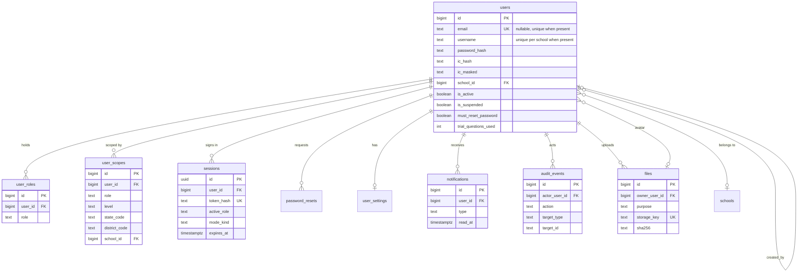

#### `users` (PK, TS, LEG, owner BE-03; extended by BE-05, BE-06)

One table for every role (.cloud has one `users` table with a `role` string). The role list is `user_roles`; the scope is `user_scopes`; the password and IC secrets that the mock keeps in `users.secrets` are columns here.

| Column | Type | Null | Default | Notes |
|---|---|---|---|---|
| name | text | Y | | [mock][contract] display name (SessionUser `name` min 1). |
| email | text | N | | [contract] nullable since .cloud 2026-08-18 (roster pupils have none). Partial unique index on `lower(email)` where not null. |
| username | text | N | | [contract] roster login. Unique per school: partial unique index `(school_id, lower(username))` where not null. Two schools may share one (error `AMBIGUOUS_USERNAME`). |
| password_hash | text | Y | | argon2id for new hashes; legacy bcrypt `$2y$` is stored as is, verified as `$2b$`, rehashed on first successful login [plan section 3, T-04]. No plaintext anywhere. |
| must_reset_password | boolean | Y | false | [card BE-06 AC3] set by the migration for roster accounts on the shared default hash or a non-bcrypt hash (T-04). |
| ic_hash | text | N | | [mock `users.secrets`][T-03] keyed hash (HMAC-SHA-256 with a server key) so the IC reset flow can look the user up; **[P]** the mock uses a per-user salt, which cannot be searched (OQ-DM-12). Indexed. |
| ic_masked | text | N | | [mock] `xxxxxx-xx-xx` plus the last 2 digits. Only this value leaves the API. |
| phone | text | N | | [mock] |
| school_id | bigint | N | | FK -> schools.id; indexed. Null for platform admins, parents, sponsors and unattached students. |
| grade | smallint | N | | [mock] 1 to 6 = Darjah, 7 to 11 = Tingkatan; `check (grade between 1 and 11)`; null for non-students. Derived at migration from classroom level or `kelas` (T-09, plan 14.7 user row). |
| class_label | text | N | | [card BE-05] .cloud `kelas`. |
| bio | text | N | | [mock] |
| avatar_file_id | bigint | N | | FK -> files.id **[P]** (the mock stores `avatarUrl`; BE-06 uploads through BE-04). |
| id_delima | text | N | | [mock] DELIMa e-mail of imported students. |
| is_active | boolean | Y | true | [mock] inactive: login refused (`ACCOUNT_INACTIVE`). |
| is_suspended | boolean | Y | false | [plan 14.7 T-02][card BE-05] .cloud second flag; panel and login also refuse suspended. |
| is_complimentary | boolean | Y | false | [mock][.cloud] free student; the profile lives in `comp_students`. |
| trial_questions_used | int | Y | 0 | [mock `UserRow`, M05 BR-07] free-trial counter (limit 50 for an unsubscribed user); incremented only by the practice owner through `incrementTrialUsed`. Starts at 0 on migration [data-migration 4.1]. |
| last_login_at | timestamptz | N | | [mock][.cloud] null = never logged in. |
| last_active_at | timestamptz | N | | [mock] stored activity instant ("Tiada aktiviti" when null). |
| created_by_id | bigint | N | | FK -> users.id, `DEFERRABLE INITIALLY DEFERRED` (two-pass load, plan 14.5). |

Not columns: `role` (-> `user_roles`), `ppdState`/`ppdDistrict` (-> `user_scopes`), `subscriptionPackage`/`subscriptionExpiresAt`/`hasPkskSubscription` (derived by `SubscriptionService`, URS Q6), `classLevel` (derived from `grade`), `hasLoggedIn`, `pool`, `faith` (-> `user_settings`, never migrated), `google_id`, `ic` plain, `notifications_read_at`, `referral_code`/`referred_by` (-> `referral_codes`/`referrals`), `parent_invite_token` (-> `parent_invites`), `teaching_*` (-> `teacher_profiles`), `spm_targets` (-> `spm_targets`).
Indexes: `ix_users_school_id`, `ix_users_ic_hash`, `ix_users_is_active_school_id`; unique `uq_users_email`, `uq_users_school_username` (both partial).

#### `user_roles` (PK, created_at, LEG)

| Column | Type | Null | Default | Notes |
|---|---|---|---|---|
| user_id | bigint | Y | | FK -> users.id on delete cascade |
| role | enum(E-role) | Y | | `admin`, `school_admin`, `ppd_officer`, `teacher`, `student`, `parent`, `sponsor` |

`unique (user_id, role)`. Rules enforced by the service and tested [contract][v2-portals]: `student` never combines with another role; `admin` is single-role. `legacy_id` = the source `users.id` (one role per .cloud user, T-01). Which role is active is session state, not stored here.

#### `user_scopes` (PK, TS, LEG)

| Column | Type | Null | Default | Notes |
|---|---|---|---|---|
| user_id | bigint | Y | | FK -> users.id on delete cascade |
| role | enum(E-role) | Y | | the grant this scope belongs to (the contract carries one scope per `RoleGrant`) |
| level | enum(E-scope_level) | Y | | `national`, `state`, `district`, `school`, `class`, `self` |
| state_code | text | N | | required when level = `state` |
| district_code | text | N | | required when level = `district` (PPD code, for example the value of `ppds.code`) |
| school_id | bigint | N | | FK -> schools.id; required when level in (`school`, `class`) |

`unique (user_id, role)`; `check` mirrors the contract refinement (state needs `state_code`, district needs `district_code`, school/class need `school_id`). **[P] interpretation:** rows are mandatory only where the scope is not derivable from the account: `ppd_officer` (district, from the officer's school in v2.0, D31a) and optionally `admin` (`national`). Scope of `teacher`, `school_admin`, `student` derives from `users.school_id` and class membership (`ROLE_SCOPE_LEVELS` in the contract). The scope is never sent by a client (ADR-0017 item 4). The label (`"Seluruh Negara"`, school name) is formed by the server, not stored.

#### `sessions` (uuid PK, created_at, no LEG)

**[P] key and columns** (the mock row is `{token, userId, remember, expiresAt, createdAt, parentToken}`; the contract `Session` adds active role, mode and CSRF).

| Column | Type | Null | Default | Notes |
|---|---|---|---|---|
| id | uuid | Y | `gen_random_uuid()` | PK (G-01). Regenerated on login, role switch and mode change (new row, old row deleted) [card BE-03 AC4]. |
| user_id | bigint | Y | | FK -> users.id on delete cascade; indexed |
| token_hash | text | Y | | unique; SHA-256 of the opaque cookie value (the mock stores the token itself as `pp_` + 40 characters). The cookie value is never stored. |
| active_role | enum(E-role) | Y | | the one active role of the list |
| mode_kind | enum(E-mode_kind) | N | | `mod_pelajar` while the student mode is on [contract] |
| mode_return_role | enum(E-role) | N | | `ModeSchema.returnRole` |
| mode_since | timestamptz | N | | |
| csrf_hash | text | Y | | the contract returns `csrf` in the body; the API compares the `X-CSRF-Token` header with this hash |
| remember | boolean | Y | false | "Ingat saya" |
| expires_at | timestamptz | Y | | sliding 120 min without `remember` (M01 BR-06, mock), fixed 5 years with it (mock, INFERRED; URS OQ-6) |
| last_seen_at | timestamptz | Y | now() | updated at most once a minute (mock rule) |

Index `(user_id)`, `(expires_at)` for the sweeper. The mock `parentToken` (impersonation, XR-M27-21) is **not** carried (**UD-2, user decision 2026-10-19: impersonation is dropped, Mod Pelajar is `POST /api/session/mode` only; M02-09 and M27 impersonate/leave are not ported**): D31c says Mod Pelajar acts as the admin's own account, and URS OQ-17 recommends dropping act-as-another-user.

#### `login_attempts` (PK, TS, no LEG)

| Column | Type | Null | Default | Notes |
|---|---|---|---|---|
| identifier_hash | text | Y | | keyed hash of the lower-cased login identifier (mock key: `emailKey`); no plain e-mail or username stored |
| ip_hash | text | Y | | keyed hash of the client address (card: throttle "per identifier + IP"); no raw IP (personal data) |
| attempts | int | Y | 0 | |
| expires_at | timestamptz | Y | | end of the decay window (starts at the first failure, like Laravel) |

`unique (identifier_hash, ip_hash)`. A success resets the counter [card BE-03 AC3].

#### `audit_events` (PK, created_at only, append-only, no LEG, TEST)

| Column | Type | Null | Default | Notes |
|---|---|---|---|---|
| actor_user_id | bigint | N | | FK -> users.id on delete set null (a failed login has no actor) |
| actor_role | enum(E-role) | N | | role active at the time |
| scope_level | enum(E-scope_level) | N | | |
| scope_school_id | bigint | N | | FK -> schools.id on delete set null |
| action | text | Y | | reference list (not a CHECK, cards add actions): `role_switch`, `mode_enter`, `mode_exit`, `login_failure`, `user_create`, `user_delete`, `user_toggle`, `subscription_change`, `complimentary_toggle`, `password_reset`, `question_publish`, `intake_transition`, `paper_publish`, `paper_withdraw`, `draw_result` [URS BE-NFR-08] |
| target_type | text | N | | table or entity name |
| target_id | text | N | | polymorphic **soft** reference (G-08), decimal string or uuid |
| request_id | text | N | | |
| detail | jsonb | N | | small structured facts; **never** personal content or free text (BE-NFR-11) |
| is_test | boolean | Y | false | G-07 |

Index `(action, created_at)`, `(actor_user_id, created_at)`, `(target_type, target_id)`. No UPDATE or DELETE path in code (G-17). Question lifecycle history is `question_status_events`, intake item edits `intake_item_events` (OWN-3).

#### `password_resets` (PK, created_at, no LEG)

| Column | Type | Null | Default | Notes |
|---|---|---|---|---|
| user_id | bigint | Y | | FK -> users.id on delete cascade. The mock keys the token by e-mail; v2 resolves the user first (also for the IC variant). |
| token_hash | text | Y | | unique; tokens are stored hashed, single-use [card BE-06 AC2] |
| channel | enum(E-reset_channel) | Y | | `email`, `ic` (two endpoints `password/email` and `password/reset-ic`) **[P]** |
| expires_at | timestamptz | Y | | |
| used_at | timestamptz | N | | set on use; reuse returns the contract error |

Resetting invalidates the user's other sessions [card BE-06 AC2].

#### `user_settings` (PK, TS, no LEG)

| Column | Type | Null | Default | Notes |
|---|---|---|---|---|
| user_id | bigint | Y | | FK -> users.id, **unique** (1:1) |
| spiritual_mode | boolean | Y | false | [mock `DEFAULT_SETTINGS`, M01 BR-17] |
| show_bismillah_splash | boolean | Y | false | |
| subuh_push_enabled | boolean | Y | false | |
| subuh_push_time | time | Y | `05:30` | mock stores `HH:mm` text; **[P]** `time` |
| ramadan_mode_enabled | boolean | Y | false | |
| sahur_push_time | time | Y | `04:30` | |
| faith | enum(E-faith) | N | | `muslim`, `hindu`, `buddhist`, `christian`, `none`. Sensitive; **never loaded from .cloud** (data-migration section 5, Q7); kept because the mock settings screen uses it (OQ-DM-13). |

No row is required for a user without saved settings: the default is served (mock behaviour).

#### `notifications` (PK, created_at + read_at, LEG)

| Column | Type | Null | Default | Notes |
|---|---|---|---|---|
| user_id | bigint | Y | | FK -> users.id on delete cascade |
| type | text | Y | | lowercase code, for example `spaced_review` [mock]; open set, not a CHECK |
| category | enum(E-notification_category) | N | | `system`, `reminder`, `milestone` |
| title | text | Y | | |
| body | text | Y | | |
| read_at | timestamptz | N | | null = unread |

Index `(user_id, read_at, created_at desc)`. Visible only to the owner (404 otherwise). The .cloud rows are admin **broadcasts** (`target`, `recipients`, `sent_at`) read through `users.notifications_read_at`; there is no v2 column for that shape (GAP-6). Delivery by e-mail/SMS/push is out of B1: only the row is stored.

#### `files` (PK, created_at, LEG, TEST, owner BE-04)

| Column | Type | Null | Default | Notes |
|---|---|---|---|---|
| owner_user_id | bigint | N | | FK -> users.id on delete set null |
| purpose | text | Y | | open list owned by the cards, for example `avatar`, `bijak_photo`, `question_media`, `cms_media`, `diagram`, `intake_original`, `intake_page`, `intake_figure`; each use has its own mime/size limit (URS BE-NFR-29) |
| mime | text | Y | | validated by content (magic bytes), not by the extension |
| size_bytes | bigint | Y | | |
| sha256 | text | Y | | indexed; used for de-duplication (intake) |
| storage_key | text | Y | | unique; `FileStorage` key. Served only through authenticated endpoints; private by default |

LEG: `legacy_id` = the .cloud storage path (T-10: copy object, checksum, rewrite). Other tables reference `files.id` or keep a storage key where the mock keeps a path (content tables, 3.11).

#### `import_jobs` (PK, TS, no LEG, owner BE-05)

The mock imports synchronously and returns a report; the card adds a table "with per-row results". **[P] columns** (modelled on the mock M04 `ImportRun`):

| Column | Type | Null | Default | Notes |
|---|---|---|---|---|
| kind | enum(E-import_kind) | Y | | `users`, `students` (the two bulk endpoints) |
| mode | enum(E-import_mode) | Y | | `paste`, `csv` (M02 `ImportMode`) |
| created_by_id | bigint | Y | | FK -> users.id |
| school_id | bigint | N | | FK -> schools.id (scope of the importer) |
| source_file_id | bigint | N | | FK -> files.id |
| total_rows | int | Y | 0 | |
| imported_count | int | Y | 0 | |
| failed_count | int | Y | 0 | |
| failures | jsonb | Y | `[]` | `[{row:int, message:text}]` (as the mock `ImportRun.failures`); the card says "per-row results" (OQ-DM-14 asks whether a child table is wanted) |

---

### 3.2 Schools, subscriptions, parents

Owner: M02 (BE-05 schools, BE-25 the rest). Prisma file **[rev2]**: `schools.prisma` (BE-05 and BE-25 share it; BE-25 adds the subscription, package, parent and complimentary tables). `jpns`/`ppds` are still listed by no card (OWN-4).

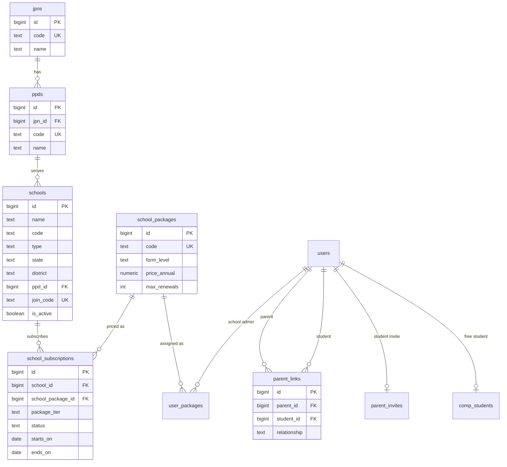

#### `jpns` (PK, TS, LEG) and `ppds` (PK, TS, LEG) **[P] tables, no card**

Reference rows that the mock keeps in `schools.jpn` / `schools.ppd` and `GET /api/jpn` serves. The .cloud `schools` have only free-text `state` and `district`; the ETL builds both tables from the distinct, cleaned pairs (T-09), so `legacy_source`/`legacy_id` are **not** meaningful for them and the mapping goes through `etl_id_map` (plan 14.4 "derived rows with no own `legacy_*`"). The columns are still present for convention.

| Table | Column | Type | Null | Notes |
|---|---|---|---|---|
| `jpns` | code | text | Y | unique; [mock `Jpn.code`] |
| | name | text | Y | JPN (state department) name |
| `ppds` | jpn_id | bigint | Y | FK -> jpns.id |
| | code | text | Y | unique; stored exactly as the school `district` value, for example `PPD HULU LANGAT` [mock `Ppd.code`] |
| | name | text | Y | display name, for example `PPD Gombak` |

#### `schools` (PK, TS, LEG, owner BE-03 minimal / BE-05 extension)

BE-03 creates `id, name, code, state, district, is_active`; BE-05 adds the rest.

| Column | Type | Null | Default | Notes |
|---|---|---|---|---|
| name | text | Y | | stored as entered (mostly upper case on live) |
| code | text | N | | KPM code, for example `BBD4051`; the mock uses `''` for "Tiada kod", **[P]** store NULL |
| type | enum(E-school_type) | Y | | `SK`, `SMK`, `SJK(C)`, `SJK(T)`, `MRSM`, `SBP` [mock] |
| state | text | Y | | one of the 16 full state names; kept as a column because the contract scope uses `stateCode` and the ETL cleans the .cloud free text into it |
| district | text | N | | PPD/PPW value as stored [mock] |
| ppd_id | bigint | N | | FK -> ppds.id **[P]** (links the school to the derived reference rows) |
| city | text | N | | [mock] |
| join_code | text | N | | unique; school join code [plan 14.7 School row, card BE-05 `joinCode`]; the mock `School` type has no such field (v2-frontend section 6 adds it) |
| is_active | boolean | Y | true | `SCHOOL_INACTIVE` login refusal |

Indexes: `(state, district)`, `(ppd_id)`, unique partial `(code) where code is not null` **[P]**. `studentCount`/`teacherCount` are computed.

#### `school_packages` (PK, TS, LEG, owner BE-25)

| Column | Type | Null | Default | Notes |
|---|---|---|---|---|
| code | text | Y | | unique; `T4`, `T5`, `D1_D6`, `T1_T3` [mock `SchoolPackage.code`] |
| name | text | Y | | |
| slug | text | Y | | unique |
| education_level | enum(E-package_education_level) | Y | | `spm`, `primary`, `lower_secondary` |
| form_level | enum(E-school_form_level) | Y | | `t4`, `t5`, `d1_d6`, `t1_t3` |
| price_annual | numeric(10,2) | Y | | RM per student per year (`"30.00"`) |
| max_renewals | smallint | Y | 0 | term years = `max_renewals + 1` (FR-M02-85) |
| is_active | boolean | Y | true | |

#### `school_subscriptions` (PK, TS, LEG, owner BE-25)

| Column | Type | Null | Default | Notes |
|---|---|---|---|---|
| school_id | bigint | Y | | FK -> schools.id; indexed (scope) |
| school_package_id | bigint | Y | | FK -> school_packages.id |
| package_tier | enum(E-package_tier) | Y | | `basic` ("Pemantauan", free, 500 questions/month) or `full` ("Penuh", unlimited) [mock BR-22] |
| student_quota | int | Y | | [mock] number of students; **no .cloud source** if .cloud `quota` means question quota (GAP-15) |
| status | enum(E-subscription_status) | Y | | `active`, `grace`, `expired`, `cancelled` [mock stored values; the API also returns `none` for a school without a row, which is not stored] |
| starts_on | date | Y | | [mock `startsAt`] date-only (T-05); renamed to avoid implying a time |
| ends_on | date | Y | | [mock `endsAt`] |
| question_limit | int | N | | .cloud `quota` per plan 14.7 |
| payment_reference | text | N | | [mock] |
| payment_notes | text | N | | [mock] |
| notes | text | N | | [mock] |

Index `(school_id, status)`. `used` (students enrolled) is computed.

#### `user_packages` (PK, TS, no LEG, owner BE-25)

School-admin package assignment (`GET/POST /api/admin/users/:id/packages`); mock store `users.schoolAdminPackages`. No .cloud source.

| Column | Type | Null | Default | Notes |
|---|---|---|---|---|
| user_id | bigint | Y | | FK -> users.id on delete cascade (a `school_admin`) |
| form_level | enum(E-form_level) | Y | | `t4`, `t5` [mock `FormLevel`] |
| school_package_id | bigint | Y | | FK -> school_packages.id |
| student_quota | int | Y | | |
| assigned_at | timestamptz | Y | now() | |

#### `parent_links` (PK, TS, LEG, owner BE-25)

| Column | Type | Null | Default | Notes |
|---|---|---|---|---|
| parent_id | bigint | Y | | FK -> users.id (a `parent`) |
| student_id | bigint | Y | | FK -> users.id (a `student`) |
| relationship | text | N | | [plan 14.7] added in v2; .cloud has it; the mock has no field; value set not documented (OQ-DM-15) |

`unique (parent_id, student_id)`; `legacy_id` = `parent_id:student_id` (plan 14.2). Both indexed.

#### `parent_invites` (PK, TS, LEG, owner BE-25)

| Column | Type | Null | Default | Notes |
|---|---|---|---|---|
| student_id | bigint | Y | | FK -> users.id, unique (the mock keys the row by the student id: one live invite per student, "Jemput Ibu Bapa") |
| token_hash | text | Y | | unique; **hashed at rest, single-use, expiring** [card BE-25 AC2] (the mock stores the 64-hex token itself) |
| expires_at | timestamptz | Y | | unexpired .cloud tokens only are migrated (plan 14.7) |
| used_at | timestamptz | N | | |

`GET /api/parent-invites/:token` reveals only the minimal child info the mock shows.

#### `comp_students` (PK, TS, LEG, owner BE-25)

Complimentary (free) student profile (mock `users.complimentaryProfiles`; its `id` is the user id).

| Column | Type | Null | Default | Notes |
|---|---|---|---|---|
| user_id | bigint | Y | | FK -> users.id, unique |
| coins_enabled | boolean | Y | false | [mock BR-18] toggled by the coin toggle endpoints |
| package_expires_on | date | Y | | "Tarikh tamat pakej" |
| original_school_name | text | N | | "Sekolah asal" |

.cloud has only `users.is_complimentary` (flag); the profile has no source (GAP-5).

---
### 3.3 Curriculum

Owner: M03 (BE-08), Prisma file `curriculum.prisma`. The question bank and practice reference these tables; topic progress is **derived on read** from the answer log (M03 BR-19), never stored.

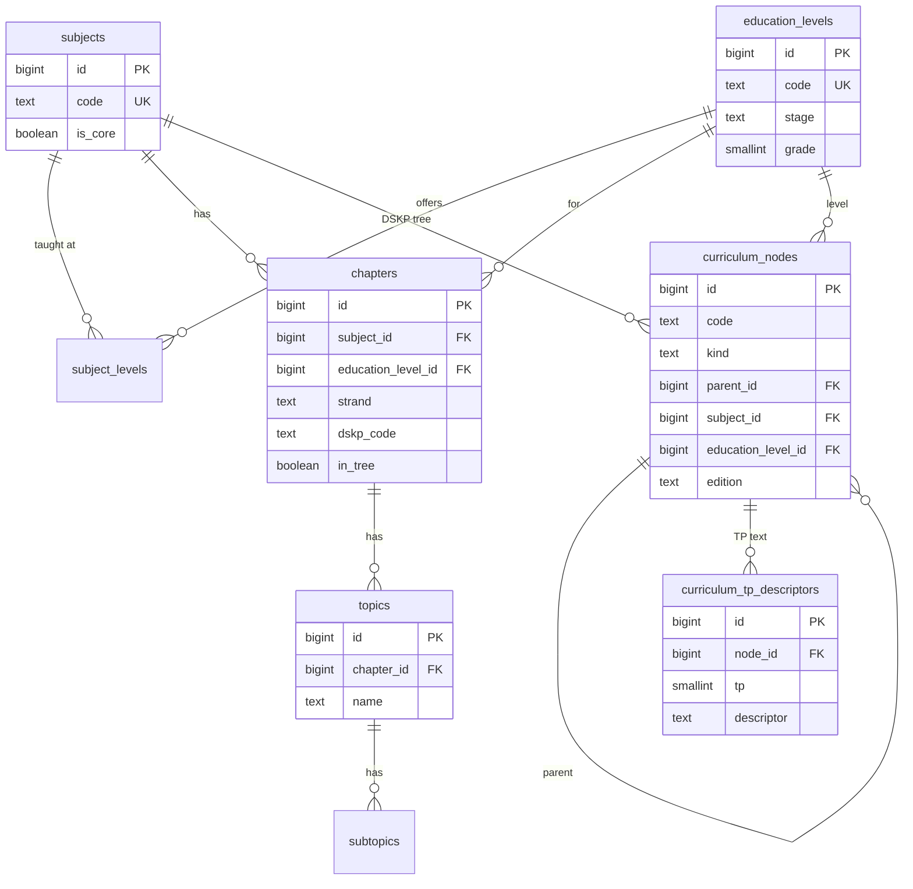

#### `education_levels` (PK, TS, LEG)

| Column | Type | Null | Default | Notes |
|---|---|---|---|---|
| code | text | Y | | unique |
| name | text | Y | | BM name (.cloud `name_bm` -> `name`) |
| name_en | text | Y | | |
| stage | enum(E-stage) | Y | | `primary`, `lower_secondary`, `upper_secondary` (check against the mock `Stage`; data-migration 4.2) |
| curriculum | text | Y | | free label, for example the curriculum name [mock] |
| sort_order | int | Y | | .cloud `sort_order` (the mock calls it `order`, a reserved word) |
| is_active | boolean | Y | true | |
| grade | smallint | N | | 1 to 11, the link to `users.grade`; derived by the ETL (T-09) |

#### `subjects` (PK, TS, LEG)

| Column | Type | Null | Default | Notes |
|---|---|---|---|---|
| code | text | Y | | unique, indexed |
| name | text | Y | | |
| name_en | text | Y | | |
| icon | text | N | | Lucide name, Font Awesome class, emoji or null [mock BR-05 of M03] |
| color | text | Y | | one of the 8 theme slots (D33) |
| is_core | boolean | Y | false | |
| sort_order | int | Y | 0 | |
| is_active | boolean | Y | true | |

#### `subject_levels` (PK, TS, LEG)

Derived pivot (no .cloud table; distinct `(subject_id, education_level_id)` of chapters, T-09). Columns: `subject_id` FK -> subjects.id, `education_level_id` FK -> education_levels.id, `unique (subject_id, education_level_id)`. The mock id (`sl-...`) is dropped.

#### `chapters` (PK, TS, LEG)

| Column | Type | Null | Default | Notes |
|---|---|---|---|---|
| subject_id | bigint | Y | | FK -> subjects.id |
| education_level_id | bigint | N | | FK -> education_levels.id |
| name | text | N | | .cloud `title`; **in .cloud every `chapters` row is a learning-standard (SP) row of Tingkatan 5 only** (exam schema 2.5): `title` = SP text, `strand` = unit title |
| name_en | text | N | | |
| chapter_number | int | N | | .cloud `number` |
| description | text | N | | |
| strand | text | N | | [plan 14.7, data-migration 4.2] kept from .cloud; not in the mock row (V2-T26 adds it) |
| dskp_code | text | N | | [plan 14.7] printed DSKP code such as `1.1.3`; not in the mock row |
| in_tree | boolean | Y | true | .my display flag; set by rule (data-migration 4.2), not copied |
| is_active | boolean | Y | true | |

Index `(subject_id, education_level_id)`. Not columns: `createdSeq` (mock ordering helper).

#### `topics` (PK, TS, LEG) and `subtopics` (PK, TS, no LEG)

| Table | Column | Type | Null | Notes |
|---|---|---|---|---|
| `topics` | chapter_id | bigint | Y | FK -> chapters.id on delete cascade; indexed. (.cloud also has `subject_id`; it is derivable through the chapter and is not stored, G-15.) |
| | name | text | Y | |
| | name_en | text | N | |
| | topic_number | text | N | |
| | description | text | N | |
| | learning_standard | text | N | |
| | sort_order | int | N | [plan 14.7] .cloud `sort_order` |
| | is_active | boolean | Y | default true |
| `subtopics` | topic_id | bigint | Y | FK -> topics.id on delete cascade |
| | name, name_en | text | Y / N | |
| | learning_objective | text | N | |

The mock `curriculum.legacyTopics` / `legacySubtopics` (grade-and-subject-coded topics) have no card and no .cloud source: backlog (3.13).

#### `curriculum_nodes` (PK, TS, no LEG) **owner BE-08**

The generic DSKP tag tree of exam schema D9 (grouping -> unit -> SK -> SP), seeded from `docs/reference/dskp/*.json` (13 subjects, Tingkatan 4 and 5; the .cloud `chapters` are not used). Questions tag nodes by stable `code`, so a corrected edition updates the tree without touching questions.

| Column | Type | Null | Default | Notes |
|---|---|---|---|---|
| subject_id | bigint | Y | | FK -> subjects.id |
| education_level_id | bigint | Y | | FK -> education_levels.id (Tingkatan 4 or 5) |
| kind | enum(E-node_kind) | Y | | `grouping` (bidang/theme), `unit`, `sk`, `sp` |
| code | text | Y | | printed code (`1.0`, `1.1`, `1.1.3`); a grouping may have none -> its title slug |
| title | text | Y | | cleaned title |
| title_printed | text | N | | `titlePrinted` of the extract |
| parent_id | bigint | N | | FK -> curriculum_nodes.id (grouping -> unit -> SK -> SP) |
| sort_order | int | Y | 0 | |
| edition | text | Y | | DSKP edition, for example `September 2018`; nodes are versioned by edition |
| is_elective | boolean | Y | false | the extract flag `electivePackage` (Matematik Tambahan Bahagian C units) |

`unique (subject_id, education_level_id, edition, kind, code)`. Indexes `(parent_id)`, `(subject_id, kind)`. `sk_code` of a question is derived from its SP (one SP belongs to one SK).

#### `curriculum_tp_descriptors` (PK, TS, no LEG) **[P] table, no card**

Exam schema D9 gives "TP descriptors per Unit (or per SK, or per skill)" and the extracts carry `generalPerformanceLevels` per subject. No card lists a table.

| Column | Type | Null | Default | Notes |
|---|---|---|---|---|
| subject_id | bigint | Y | | FK -> subjects.id |
| node_id | bigint | N | | FK -> curriculum_nodes.id (unit or SK); null = the subject's general performance levels |
| tp | smallint | Y | | `check (tp between 1 and 6)` |
| descriptor | text | Y | | as printed |
| scope | text | N | | `tpScope` of the extract (unit or SK) |

`unique (subject_id, coalesce(node_id, 0), tp)`.

---

### 3.4 Question bank and workflow

Owner: M04 (BE-09 core, BE-10 workflow). Prisma files **[rev2]**: `questions.prisma` (BE-09) and `questions-workflow.prisma` (BE-10; separate file and lane so BE-10 never edits BE-09 tables). The shape follows the approved exam schema (D47): a question is an **ordered tree of parts**; only leaf parts carry marks and an answer mode; five answer-key kinds; stimuli and stimulus groups; curriculum tags; versions. **Not migrated** from .cloud (D29a): the old bank is dumped to `archive_cloud`; the new bank is loaded through the intake (3.5). The mock M04 flat `Question` is the legacy model; Appendix B says where each of its fields goes.

Identity and versions: `questions` is the stable identity; `question_versions` holds every editable fact, because "Sunting" on a Terbit question creates **version n+1 as Draf while version n keeps serving** (`v2-question-bank` 4.6), and student answers, reports and placements record **question id + version**.

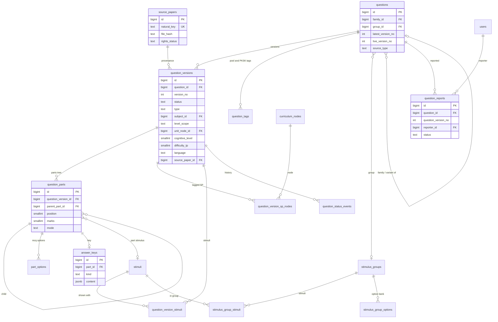

#### `questions` (PK, TS, optional LEG) owner BE-09

| Column | Type | Null | Default | Notes |
|---|---|---|---|---|
| source_type | enum(E-question_source_type) | Y | | `pdf`, `excel`, `manual`, `ai_variant` (AC-16.1; AI variant data model must exist in v2.0, AC-32.4) |
| created_by_id | bigint | Y | | FK -> users.id |
| latest_version_no | int | Y | 1 | highest version, maintained by the owner service **[P]** |
| live_version_no | int | N | | the `published` version that serves; null if none. Denormalised on purpose so pool queries are one index lookup; written only by `QuestionsService` in the transaction that changes a version status **[P]** |
| group_id | bigint | N | | FK -> stimulus_groups.id (exam schema D2 `group_id`) |
| group_position | smallint | N | | order inside the group; pinned order is "published order" |
| family_id | bigint | N | | FK -> questions.id, `DEFERRABLE`; root of a duplicate/variant family (D11: a **variant** with different numbers or figure is linked, not blocked) |
| family_relation | enum(E-family_relation) | N | | `variant` (exact duplicates are blocked at Semakan unless linked as a version/variant, AC-06.2) |
| parent_question_id | bigint | N | | FK -> questions.id; the approved question an AI variant was made from (AC-32.4) |

LEG is optional here: the exam-schema reload mapping (section 7 there) keeps the .cloud id as provenance only (`legacy_ref`) if the user ever reloads part of the archive. Indexes `(live_version_no)`, `(group_id, group_position)`, `(family_id)`.

#### `question_versions` (PK, TS, no LEG) owner BE-09

| Column | Type | Null | Default | Notes |
|---|---|---|---|---|
| question_id | bigint | Y | | FK -> questions.id on delete cascade |
| version_no | int | Y | | `unique (question_id, version_no)` |
| status | enum(E-question_status) | Y | `draft` | lifecycle Draf, Semakan, Lulus, Terbit, Diarkib (v2-question-bank 4.1; wire = v2 lifecycle, D54a; codes **[P]**, OQ-DM-05) |
| archive_reason | enum(E-archive_reason) | N | | `superseded` ("Diarkib (digantikan)", automatic when n+1 is published), `withdrawn`, `source_takedown`; null unless archived |
| type | enum(E-question_type) | Y | | `mcq`, `match`, `short`, `structured`, `working`, `essay`, `drawing`, `table` [exam D1]; the template that fixed the tree shape |
| stem_ms | text | N | | rich text (LaTeX in `$...$`); at least one of `stem_ms`, `stem_en` must be set (`check`) |
| stem_en | text | N | | |
| number_label | text | N | | as printed (`12`, `5(a)`); position in a paper lives on the placement |
| language | enum(E-question_language) | Y | `ms` | `ms`, `en`, `ms_en` (stacked bilingual, both stems stored), `ar`, `jawi` [exam D8] |
| subject_id | bigint | N | | FK -> subjects.id; required at `published` (D9) |
| level_scope | enum(E-level_scope) | N | | `t4`, `t5`, `t4_t5` [m28 `CurriculumTag.level`]; required at `published` |
| unit_node_id | bigint | N | | FK -> curriculum_nodes.id (kind `unit`); required at `published`; null with `form_origin = t1_t3` (Q-S2) |
| chapter_id | bigint | N | | FK -> chapters.id **[P]** the M03 chapter, needed by chapter-mode practice and the answer dimensions; no automatic mapping from the DSKP unit (OQ-DM-27) |
| topic_id | bigint | N | | FK -> topics.id **[P]** (same) |
| form_origin | enum(E-form_origin) | Y | `t4` | `t1_t3`, `t4`, `t5` (SPM Matematik K1 tests Tingkatan 1 to 3 content) |
| cognitive_level | smallint | N | | 1 to 6 = DSKP Tahap Penguasaan (TP); the curriculum tag `tp`; required at `published`; `kbat` is derived (`>= 4`) |
| difficulty_tp | smallint | N | | 1 to 6, intended TP; initially equals `cognitive_level`; recalibrated later from results |
| textbook_bab | smallint | N | | `textbook_ref` {bab, tingkatan, muka_surat} (Sejarah) |
| textbook_tingkatan | smallint | N | | |
| textbook_page | int | N | | |
| year | smallint | N | | |
| exam_type | enum(E-exam_type) | N | | `sebenar`, `percubaan`, `modul`, `topikal`, `latihan` |
| exam_board | text | N | | open controlled list: the 22 .cloud `exam_boards` values plus `lpm`, `mpsm` (exam D8); a lookup table is not carded (OQ-DM-16) |
| set_label | text | N | | `Set 1` |
| paper_code | text | N | | `1449/1` |
| source_paper_id | bigint | N | | FK -> source_papers.id |
| source_kind | enum(E-source_kind) | N | | `lpm_official`, `state_trial`, `school`, `publisher`, `teacher_own`, `ai_variant` [exam D8] |
| rights_status | enum(E-rights_status) | N | | `own`, `school`, `official_lpm`, `third_party`, `unclear` [exam D10]; `third_party`/`unclear` cannot reach `published` without a recorded decision (AC-17.2) |
| contributor_id | bigint | N | | FK -> users.id; uploading Guru, never shown to students |
| intake_item_id | bigint | N | | FK -> intake_items.id; set when created by "accept" (BE-38) |
| source_file_id | bigint | N | | FK -> intake_files.id (provenance, AC-16.1) |
| source_page | smallint | N | | |
| source_region | jsonb | N | | bounding box on the source page (fractions `{x,y,w,h}`); G-11 exception: a geometry value |
| ai_run_id | bigint | N | | FK -> ai_extraction_runs.id |
| ai_model | text | N | | model identifier only, no user data (AC-15.2) |
| import_issues | jsonb | N | | structured list of repairs/warnings (exam D10; 96 of 175 .cloud papers carried one) |
| explanation_ms | text | N | | worked explanation shown after answering |
| explanation_en | text | N | | |
| published_at | timestamptz | N | | set on `published`; approval/submit actors and times are in `question_status_events` |

Not stored: `total_marks` (sum of leaf marks, NFR-08), `kbat`, `sk_code`, text direction (derived from `language`), quality score (legacy semantics are not carried over, AC-29.3), usage counters (computed). Indexes: `(status)`, `(subject_id, level_scope, status)`, `(unit_node_id)`, `(source_paper_id)`, partial `(subject_id, level_scope) where status = 'published'` (pools serve only Terbit, AC-21.1).

**Publish gate** (service-enforced, tested; not DB checks): subject, level, unit, at least one SP, TP present; every leaf part has a key of the right kind, non-empty; MCQ has exactly one correct option; marks of a part equal the sum of its scheme points; stimulus assets resolve; no open duplicate flag; rights not `unclear`/pending (v2-question-bank 4.8, exam D3, D12).

#### `question_parts` (PK, TS, no LEG)

The part tree. Depth at most 3 (`(a)`, `(i)`, `(A)`); a lone MCQ is one leaf. Parents carry no marks and no mode.

| Column | Type | Null | Default | Notes |
|---|---|---|---|---|
| question_version_id | bigint | Y | | FK -> question_versions.id on delete cascade |
| parent_part_id | bigint | N | | FK -> question_parts.id on delete cascade |
| position | smallint | Y | | order among siblings; `unique (question_version_id, coalesce(parent_part_id, 0), position)` |
| label | text | N | | `(a)`, `(i)`, empty for a lone leaf; any printed label kept |
| prompt_ms | text | N | | |
| prompt_en | text | N | | |
| marks | smallint | N | | leaf only, `>= 0` (0 = unmarked example); a parent with marks is a validation error (the .cloud rule `marks_sum`) |
| mode | enum(E-answer_mode) | N | | leaf only: `mcq`, `match_letter`, `short_text`, `numeric`, `working`, `essay`, `drawing`, `table_fill` |
| unit | text | N | | numeric/working: the unit is **checked** in v2 (display-only in .cloud) |
| decimals | smallint | N | | |
| sig_figs | smallint | N | | |
| blank_count | smallint | N | | short_text with several blanks |
| word_min | smallint | N | | essay word range |
| word_max | smallint | N | | |
| drawing_kind | enum(E-drawing_kind) | N | | `graph`, `diagram`, `sketch` |
| table_grid | jsonb | N | | `table_fill`: rows x columns and the blank cells (G-11); gate: at least one blank cell |
| stimulus_id | bigint | N | | FK -> stimuli.id (a stimulus used by this part only) |
| choice_group | text | N | | **[P]** parts sharing a label are alternatives ("answer one of two e-mails", BM K1 Bahagian A); the exam schema names `alternatives[]` without a shape |
| reveal | enum(E-reveal) | Y | `after_submit` | `after_submit`, `never` (kept from .cloud) |

Option bank: a `match_letter` part uses the lettered bank of its question's **group** (`stimulus_group_options`), it does not duplicate options per part.

#### `part_options` (PK, TS, no LEG)

| Column | Type | Null | Default | Notes |
|---|---|---|---|---|
| part_id | bigint | Y | | FK -> question_parts.id on delete cascade |
| label | text | Y | | `A` to `H`; `unique (part_id, label)`; 3 to 8 options |
| body_ms | text | N | | may hold LaTeX |
| body_en | text | N | | |
| image_file_id | bigint | N | | FK -> files.id (42 .cloud options hold an image) |
| position | smallint | Y | | |

There is **no `is_correct` column**: the correct label is in the key (`answer_keys.content.correct`, exam D3); `is_distractor` of .cloud is derived and dropped.

#### `answer_keys` (PK, TS, no LEG)

| Column | Type | Null | Default | Notes |
|---|---|---|---|---|
| part_id | bigint | Y | | FK -> question_parts.id on delete cascade, **unique** (one key per leaf) |
| kind | enum(E-key_kind) | Y | | `option`, `accepted`, `mapping`, `points`, `rubric` [exam D3] |
| content | jsonb | Y | | shape per kind, validated by the zod schema of `@pp/contract` before write; supersets of the .cloud JSON |

jsonb is justified here (G-11): the mark scheme is a document. Shapes (exam schema D3/D4):

| Kind | Leaf mode | Content |
|---|---|---|
| `option` | `mcq` | `{"correct":"B"}` (a label; option ids are internal) |
| `mapping` | `match_letter`, `table_fill` | `{"map":{"27":"E",...},"bank_unique":true}` or `{"cells":{"r1c2":["A","a"]}}` |
| `accepted` | `short_text`, `numeric` | `{"values":[...],"case":false,"any_order":false,"blanks":[[...]]}`; numeric values `{"v":5.3,"tol":0.01,"tol_kind":"abs\|rel","unit":"cm","unit_alt":[...],"sig_figs":3,"decimals":null}` |
| `points` | `working`, `drawing`, `essay` (content points) | wrapper `{kind,marks,groups[],paths[],final,deductions[],zero_rules[],model_text}` with points `{id,code,label,marks,text,accept[],all_of[],seen,implied_ok,requires,ecf,unit,tolerance,sig_figs,decimals,note}`; `code` in `K N P B M F C` (E-point_code), marks explicit (the digit of a tag is a sequence number, never the marks) |
| `rubric` | `essay` | `{criteria[],bands[],floor_band,notes[],content_points[]}` (language scripts) |

#### `question_tags` (PK, created_at, no LEG) **[P] columns** (the card names the table, not its use)

Non-curriculum controlled tags that belong to the question identity (curriculum tags are columns of `question_versions` and `question_version_sp_nodes`).

| Column | Type | Null | Default | Notes |
|---|---|---|---|---|
| question_id | bigint | Y | | FK -> questions.id on delete cascade |
| kind | enum(E-tag_kind) | Y | | `pool` (the Bijak pool a question belongs to, m28 `PoolEntry.pool`, for example `MAT2-B`), `pksk_domain`, `pksk_level` (PKSK as tags on the one bank, v2-question-bank A6) |
| code | text | Y | | |

`unique (question_id, kind, code)`; index `(kind, code)`. OQ-DM-17 (the card does not say what `question_tags` holds).

#### `question_version_sp_nodes` (PK, created_at) **[P]** and `question_version_stimuli` (PK, created_at) **[P]**

| Table | Column | Type | Null | Notes |
|---|---|---|---|---|
| `question_version_sp_nodes` | question_version_id | bigint | Y | FK on delete cascade |
| | node_id | bigint | Y | FK -> curriculum_nodes.id (kind `sp`); 1 to 3 per version (D9); `unique (question_version_id, node_id)` |
| `question_version_stimuli` | question_version_id | bigint | Y | FK on delete cascade |
| | stimulus_id | bigint | Y | FK -> stimuli.id |
| | position | smallint | Y | ordered `stimulus_refs[]`; `unique (question_version_id, stimulus_id)` |

#### `stimuli` (PK, TS, no LEG)

| Column | Type | Null | Default | Notes |
|---|---|---|---|---|
| kind | enum(E-stimulus_kind) | Y | | `passage`, `image`, `diagram`, `table`, `graph`, `map`, `infographic`, `audio` [exam D6] |
| label | text | N | | `Rajah 3`, `Teks 2`, `Bahan 1`; short label for headings (m28 `StimulusDef.label`) |
| body_ms | text | N | | passage text |
| body_en | text | N | | |
| table_data | jsonb | N | | kind `table`: `{head:[...],rows:[[...]]}` (m28 `StimulusDef.table`); G-11 exception: a grid document |
| asset_file_id | bigint | N | | FK -> files.id (image, SVG, audio); a missing asset blocks serving (AC-24.4) |
| caption | text | N | | |
| alt_text | text | N | | required before publish for image-like kinds (66.7% present in .cloud) |
| source_citation | text | N | | |
| reusable | boolean | Y | true | |
| content_hash | text | N | | hash of the asset or normalised text; a re-import reuses the row (D6 rule 1); indexed |

#### `stimulus_groups` (PK, TS, no LEG) with `stimulus_group_stimuli` and `stimulus_group_options`

A group = stimulus (1 to 3) + an ordered question range, **kept together in every assembly**. The members are `questions.group_id` / `group_position`.

| Table | Column | Type | Null | Notes |
|---|---|---|---|---|
| `stimulus_groups` | label | text | N | `Soalan 5 hingga 8` |
| | scope | enum(E-group_scope) | Y | `section` or `paper` (exam D6); default `section` |
| `stimulus_group_stimuli` **[P]** | group_id | bigint | Y | FK -> stimulus_groups.id on delete cascade |
| | stimulus_id | bigint | Y | FK -> stimuli.id; at most 3 per group; `unique (group_id, stimulus_id)` |
| | position | smallint | Y | |
| `stimulus_group_options` **[P]** | group_id | bigint | Y | FK on delete cascade; the shared lettered bank (BI Part 4/5, `match_letter`) |
| | label | text | Y | `A` to `H`; `unique (group_id, label)` |
| | body_ms, body_en | text | N | |
| | position | smallint | Y | |

#### `source_papers` (PK, TS, no LEG) owner BE-10

Identity and rights register of an uploaded paper, and the unit of **takedown** ("withdraw all questions of a source in one action", AC-17.3). The .cloud `source_papers` are archived, not loaded.

| Column | Type | Null | Default | Notes |
|---|---|---|---|---|
| natural_key | text | N | | unique when present: subject + year + board + paper + type (data-migration 3.3); blocks "same paper already imported" at upload (AC-06.4) |
| file_hash | text | N | | SHA-256 of the original; indexed |
| subject_id | bigint | N | | FK -> subjects.id |
| kertas | text | N | | `K1`, `K2`, `P1`, ... printed label kept |
| paper_code | text | N | | |
| year | smallint | N | | |
| exam_board | text | N | | as `question_versions.exam_board` |
| exam_type | enum(E-exam_type) | N | | |
| set_label | text | N | | |
| source_kind | enum(E-source_kind) | N | | |
| rights_status | enum(E-rights_status) | Y | `unclear` | declaration is mandatory at upload (AC-17.1) |
| rights_decision_note | text | N | | Admin Pusat decision for `third_party` (AC-17.2) |
| rights_decided_by_id | bigint | N | | FK -> users.id |
| rights_decided_at | timestamptz | N | | |
| takedown_at | timestamptz | N | | set when all questions of this source were archived with `archive_reason = source_takedown` |
| takedown_by_id | bigint | N | | FK -> users.id |

The relation to `intake_batches` is OWN-2 / OQ-DM-02.

#### `question_status_events` (PK, created_at only, append-only) owner BE-10

| Column | Type | Null | Default | Notes |
|---|---|---|---|---|
| question_id | bigint | Y | | FK -> questions.id; indexed |
| version_no | int | Y | | |
| from_status | enum(E-question_status) | N | | null for creation |
| to_status | enum(E-question_status) | Y | | |
| actor_user_id | bigint | N | | FK -> users.id; null when the system acts (for example `superseded`) |
| actor_role | enum(E-role) | N | | |
| reason | text | N | | mandatory for return to Draf, withdraw, restore |
| answer_changed | boolean | Y | false | the "Jawapan berubah" audit flag (AC-13.4) |
| ai_run_id | bigint | N | | FK -> ai_extraction_runs.id when an AI action is logged (no user data) |
| request_id | text | N | | |

Every transition not in the table of `v2-question-bank` 4.1 is refused (409) and not recorded here. Tag decisions (suggested value, final value, confidence, person; AC-05.5) are in `intake_item_events` while the item is in review; after acceptance a tag change is a new version.

#### `question_reports` (PK, TS, TEST) owner BE-10

| Column | Type | Null | Default | Notes |
|---|---|---|---|---|
| question_id | bigint | Y | | FK -> questions.id; indexed |
| question_version_no | int | Y | | the version the student saw (AC-18.2, AC-19.2) |
| reporter_id | bigint | Y | | FK -> users.id |
| reasons | text[] | Y | | codes of E-report_reason (`wrong_answer`, `confusing_question`, `wrong_options`, `missing_options`, `duplicate`, `typo`, `other`); `check (reasons <@ ARRAY[...])` |
| comment | text | N | | max 500 characters, never sent to the AI service |
| source | enum(E-report_source) | Y | | `spm`, `structured_attempt`, `latihan`, `revision`, `teacher_databank`, `quiz`, `papan_bijak` [mock `ReportSource`] |
| practice_session_id | uuid | N | | FK -> practice_sessions.id (mock `quizSessionId`) |
| attempt_id | uuid | N | | FK -> exam_attempts.id **[P]** (a report raised inside a Bijak attempt) |
| status | enum(E-report_status) | Y | `pending` | mock stored values `pending`, `reviewed`, `fixed`, `dismissed`; v2 doc shows five tabs (OQ-DM-18) |
| admin_notes | text | N | | |
| resolved_by_id | bigint | N | | FK -> users.id |
| fixed_in_version_no | int | N | | the version that fixed it (AC-19.3) |

`unique (reporter_id, question_id, question_version_no)` (one report per student per version, AC-18.3). Index `(status, created_at)`. The mock fields `questionType` (mcq or structured: one bank in v2), `roomCode` (M16, deferred) and `sourceSet` are not carried.

#### `question_submissions`: dropped (D53 OWN-1, owner decision 2026-10-19)

`intake_batches` (BE-37) is the one Submission table. `question_submissions` is dropped from BE-10 and gets no table; the mock `questionSubmissions` fields (subject text, level, year, paper type, author credit, note, files, status, admin notes) map onto the `intake_batches` declaration fields (3.5). The teacher-submission endpoints of M04 (`GET /api/question-submissions`, `PATCH .../:id/status`, `GET .../:id/files/:index`) are served by BE-37/BE-38 or a BE-10 read over intake (BE-10 and BE-37 now state how: batches list, `GET /api/intake/files/:id/original`, BE-37 cancel and BE-38 reject).

#### `question_imports` (PK, TS, no LEG) owner BE-10 (Excel/CSV only)

| Column | Type | Null | Default | Notes |
|---|---|---|---|---|
| file_name | text | Y | | |
| template_version | text | N | | the Excel template is versioned (AC-02.1); an old version is refused (AC-02.3) **[P]** |
| imported_count | int | Y | 0 | |
| failed_count | int | Y | 0 | |
| failures | jsonb | Y | `[]` | `[{row,message}]` [mock `ImportRun.failures`] |
| default_subject_id | bigint | N | | FK -> subjects.id |
| default_education_level_id | bigint | N | | FK -> education_levels.id |
| default_difficulty | smallint | N | | mock 1 to 5; v2 difficulty is TP 1 to 6 (OQ-DM-20) |
| created_by_id | bigint | Y | | FK -> users.id |

PDF/AI imports are **not** here (BE-38). `created_month` of the mock is derived from `created_at`.

#### `quality_audits` (PK, created_at) owner BE-10 **[P] columns**

The mock keeps one row `{id, lastAuditAt}` (the "Kualiti Soalan" dashboard, legacy; AC-29.3 says its score semantics are not carried over). v2 records each run.

| Column | Type | Null | Default | Notes |
|---|---|---|---|---|
| run_by_id | bigint | Y | | FK -> users.id |
| finished_at | timestamptz | N | | |
| finding_count | int | N | | |

OQ-DM-21 asks what the audit computes in v2.

---
### 3.5 Intake, AI extraction and jobs

Owner: BE-36 (`ai.prisma`), BE-37 (`intake.prisma` first part, `jobs`), BE-38 (`intake.prisma` second part). **[rev2] Sources:** the audited cards BE-36 to BE-40, plan section 15, `v2-question-bank.md`, and the intake mock of local commit `b2e1033` (`admin/intake/types.ts`, the intake methods of `server/store.ts`, ADR-0019), read with `git show`; those paths reach `feature/v2-backend` only after the LEAD merges the commit. The mock is **browser-side and batch-shaped** (OCR and extraction run in the browser, the store keeps one `IntakeBatch` document with `questions[]`, `stimuli[]`, `pages[]`; statuses `draf`/`semakan`); the cards are **server-side and item-shaped**. The tables follow the cards and carry the mock fields as columns where the mock has them. Mock fields are tagged **[mock]**, card fields **[card]**, the rest **[P]**. The workflow statuses are the BM words of v2-question-bank 4.1/4.2 with English codes **[P]**.

**Status (D53, 2026-10-19):** the D52 intake (commit `b2e1033`) and the paper builder (merge `1b5193f`) are merged locally into `feature/student-prototype` and are **pending push**. Final admin routes: `/admin/spm/soalan/ekstrak`, `/admin/spm/soalan/ekstrak/:batchId`, `/admin/spm/soalan/muat-naik`, `/admin/spm/soalan`, `/admin/spm/semakan`, `/admin/spm/kertas`. Teacher submission = `intake_batches` (OWN-1 resolved).

Flow: a **batch** (the Submission: declaration + files) -> **files** -> **pages** (images, text layer, OCR) and **figures** -> a **job** runs render/OCR/extraction -> an **AI run** per extraction call -> **items** (reviewable drafts with source region and confidence) -> review -> **accept** creates a Draf question through `QuestionsService` (BE-09). The AI service has no approval right and cannot set a status beyond Draf.

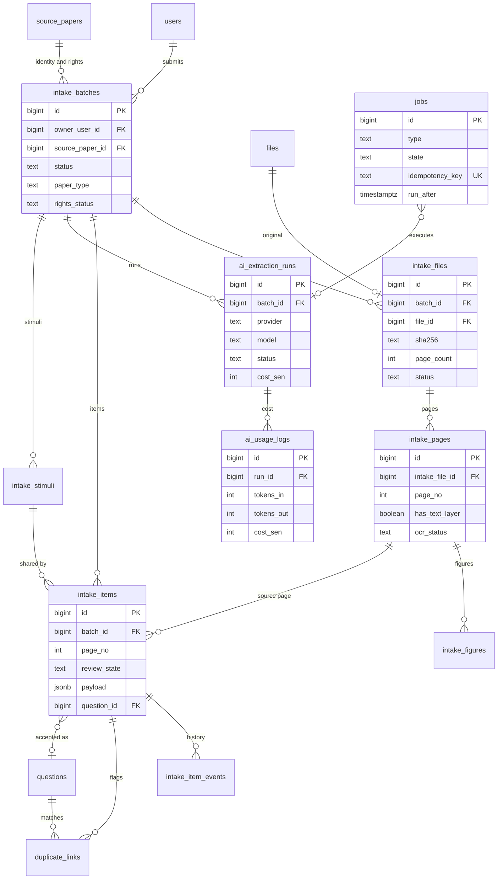

#### `intake_batches` (PK, TS, no LEG) owner BE-37

The Submission of `v2-question-bank` 4.2 (also the unit the Guru sees: "Dihantar -> Sedang diproses -> Sedia untuk semakan" or "Gagal").

| Column | Type | Null | Default | Notes |
|---|---|---|---|---|
| owner_user_id | bigint | Y | | FK -> users.id; a Guru sees only own batches (403 on another's) |
| paper_type | enum(E-paper_type) | Y | | declaration "jenis kertas" **[mock]**: the mock offers `Percubaan SPM`, `Soalan Umum`, `Peperiksaan Sebenar`, `Buku Latihan`, `Lain-lain` (`PAPER_TYPES`); v2-question-bank 4.2 also lists Trial and DSKP and Buku Teks. Codes `general`, `trial`, `dskp`, `textbook`, `exercise_book`, `exam`, `other` **[P]** (mock `Percubaan SPM` -> `trial`, `Peperiksaan Sebenar` -> `exam`) |
| subject_id | bigint | N | | FK -> subjects.id (mock `subject`, an m28 code; OQ-DM-25) |
| kertas | text | N | | mock `kertas: 1 \| 2`; printed label (`K1`, `K2`) **[P]** |
| education_level_id | bigint | N | | FK -> education_levels.id (card; the mock has no level field, the level is in each question tag) |
| year | smallint | N | | [mock] |
| source_text | text | N | | [mock `source`] the free-text source declaration ("sumber") |
| rights_status | enum(E-rights_status) | Y | | mock `copyright`: `sendiri` ("Milik sendiri / sekolah") -> `own` or `school`, `rasmi` -> `official_lpm`, `pihak-ketiga` -> `third_party`; the mock has no "unclear" option; mandatory (AC-17.1). The own/school split is not in the mock (OQ-DM-33) |
| note | text | N | | [mock `notes`] free text, never sent to the AI service |
| source_paper_id | bigint | N | | FK -> source_papers.id (OWN-2) |
| status | enum(E-batch_status) | Y | `submitted` | `submitted` (Dihantar), `processing` (Sedang diproses), `ready_for_review` (Sedia untuk semakan), `failed` (Gagal) [card]. The mock has only `draf` and `semakan` (Draf batch being edited / submitted for review); BE-38 open question 1 maps them to "has unreviewed items" / "all items reviewed" |
| status_reason | text | N | | visible reason, for example the AI budget is exhausted and the batch stays queued (BE-38) |
| detected_count | int | N | | "N dikesan" (AC-04.6) |
| unmatched_scheme_entries | text[] | Y | `{}` | [mock `IntakeBatch.unmatched`] scheme entries whose question number was not found (AC-04.2) |
| submitted_at | timestamptz | N | | [mock `submittedAt`] set when the batch leaves Draf |
| ai_provider_override | text | N | | admin-only per-batch override, logged (plan 15.2). The mock keeps `provider`/`model` on the batch; v2 keeps them on `ai_extraction_runs` |

Index `(owner_user_id, status)`, `(status, created_at)`. Retention of files/pages follows `INTAKE_RETENTION_MONTHS` (default 12 months after publish).

#### `intake_files` (PK, TS) owner BE-37

| Column | Type | Null | Default | Notes |
|---|---|---|---|---|
| batch_id | bigint | Y | | FK -> intake_batches.id on delete cascade |
| file_id | bigint | Y | | FK -> files.id (the original, through `FileStorage`; the card says "storage key") **[P]** |
| original_name | text | Y | | [mock `fileName`] |
| role | enum(E-intake_file_role) | Y | `paper` | `paper`, `scheme` (a separate answer-scheme file is matched to questions by number label, AC-04.2) **[P]** |
| sha256 | text | Y | | [mock `fileHash`, computed in the browser] indexed; a file already imported is blocked **before** extraction cost (AC-06.4); the mock does not check duplicates |
| page_count | int | N | | [mock `pageCount`] cap `OCR_MAX_PAGES` (default 200) |
| status | enum(E-intake_file_status) | Y | `uploaded` | `uploaded`, `rendering`, `ocr`, `extracting`, `done`, `failed` **[P]** |
| error_code | text | N | | no content |

#### `intake_pages` (PK, TS) and `intake_figures` (PK, TS) owner BE-37

| Table | Column | Type | Null | Default | Notes |
|---|---|---|---|---|---|
| `intake_pages` | intake_file_id | bigint | Y | | FK on delete cascade |
| | page_no | int | Y | | `unique (intake_file_id, page_no)` |
| | image_file_id | bigint | N | | FK -> files.id (WebP, about 150 dpi) |
| | thumb_file_id | bigint | N | | FK -> files.id |
| | text | text | N | | [mock `PageText.text`] page text kept for review and re-extraction |
| | text_source | enum(E-text_source) | N | | [mock `PageText.source`] `text_layer` (digital-born PDF) or `ocr` (scanned page) |
| | ocr_confidence | numeric(5,2) | N | | [mock `PageText.confidence`] mean OCR confidence 0 to 100, OCR pages only |
| | has_text_layer | boolean | Y | false | scanned-page detection by text density (configurable); `text_source = text_layer` in the mock |
| | ocr_status | enum(E-ocr_status) | Y | `pending` | `pending`, `not_needed`, `done`, `failed` **[P]** |
| | ocr_blocks | jsonb | N | | text blocks with bounding boxes and confidences (G-11 document) [card BE-37]; the mock keeps text per page only. Page images (`PageImage`: page, data URL, width, height) stay in the browser in the mock; v2 stores them as `image_file_id` |
| `intake_figures` | intake_page_id | bigint | Y | | FK on delete cascade |
| | bbox | jsonb | Y | | `{x,y,w,h}` page fractions |
| | crop_file_id | bigint | N | | FK -> files.id (cropped server-side) |
| | alt_text_suggestion | text | N | | AI may suggest; author supplies the final `stimuli.alt_text` |

#### `intake_stimuli` (PK, TS) owner BE-38 **[P] table**

The mock stores the shared figures/passages of a batch as `IntakeBatch.stimuli[]` (`StimulusDef` + `page`) and links questions by `stimulusId`; the gate checks "Rajah / petikan yang dirujuk tidak wujud". The cards have `intake_figures` (crops) but no staging row for a stimulus before accept. Until accept it is staged here; accept creates the `stimuli` row (3.4) and the `stimulus_groups` (`grouping.ts`: questions sharing one `stimulusId` form a group, kept together).

| Column | Type | Null | Default | Notes |
|---|---|---|---|---|
| batch_id | bigint | Y | | FK -> intake_batches.id on delete cascade |
| ref | text | Y | | the mock stimulus id inside the batch; `unique (batch_id, ref)` |
| kind | enum(E-stimulus_kind) | Y | | the mock uses `diagram`, `passage`, `table` |
| label | text | N | | `Rajah 2` |
| caption | text | N | | |
| alt_text | text | N | | mock `alt` (accessible description; required for image-like kinds before publish) |
| body | text | N | | mock `text` (passage) |
| table_data | jsonb | N | | mock `table {head, rows}` (grid document) |
| figure_id | bigint | N | | FK -> intake_figures.id (the crop; the mock keeps inline SVG) |
| page_no | int | N | | [mock `IntakeStimulus.page`] |

#### `jobs` (PK, TS) owner BE-37 (platform table)

Durable job queue claimed with `SELECT ... FOR UPDATE SKIP LOCKED` by an in-process worker; survives restarts; no Redis (plan 15.2). Not used by the Bijak sweeper (that is `@nestjs/schedule`).

| Column | Type | Null | Default | Notes |
|---|---|---|---|---|
| type | text | Y | | open list owned by the cards, for example `render_pages`, `ocr_page`, `extract_paper`, `crop_figures` **[P]** |
| entity_type | text | N | | the row the job works on ("payload ref") |
| entity_id | text | N | | |
| payload | jsonb | N | | small parameters only; no content |
| state | enum(E-job_state) | Y | `queued` | `queued`, `running`, `succeeded`, `failed`, `cancelled` [plan 15.2] |
| attempts | int | Y | 0 | |
| max_attempts | int | Y | 3 | **[P]** |
| run_after | timestamptz | Y | now() | retry with backoff |
| idempotency_key | text | Y | | **unique**: file hash + stage |
| locked_at | timestamptz | N | | stuck-job sweeper uses it |
| started_at, finished_at | timestamptz | N | | |
| error_code | text | N | | |

Partial index `(run_after) where state = 'queued'`.

#### `intake_items` (PK, TS) owner BE-38

One reviewable draft (a detected question). An item that is **accepted** is a Draf question; a rejected one never becomes a question and is kept with its reason.

| Column | Type | Null | Default | Notes |
|---|---|---|---|---|
| batch_id | bigint | Y | | FK -> intake_batches.id on delete cascade |
| intake_file_id | bigint | N | | FK -> intake_files.id |
| intake_page_id | bigint | N | | FK -> intake_pages.id |
| region | jsonb | N | | `{x,y,w,h}` of the question on the page; redrawn in review (AC-08.3) |
| number_label | text | N | | [mock `IntakeQuestion.label`] `12(a)` |
| item_type | enum(E-intake_qtype) | N | | [mock `type`] `mcq`, `structured`, `short`, `essay` (the extractor's guess; the final `question_versions.type` is set at accept) |
| payload | jsonb | Y | | extracted question validated against the question schema (G-11 document). Shape of the mock `IntakeQuestion` without ids: `stem`, `options[]` (`McqOption`), `marks`, `mode` (`LeafKind`), `parts[]` (`{id,label,prompt,marks,mode,scheme?}`), `scheme?` (`SchemeDef`), `tag` (`CurriculumTag`: subject, level, unit, sp[], tp, formOrigin) |
| stimulus_id | bigint | N | | FK -> intake_stimuli.id **[P]** (mock `stimulusId`: the figure/passage a group of questions shares) |
| page_no | int | N | | [mock `page`] source page, 1-based |
| low_fields | text[] | Y | `{}` | [mock `lowFields`] fields the extractor was unsure of; names used by the gate: `tag.unit`, `tag.sp`, `marks`, `stem`, `scheme` |
| confirmed_fields | text[] | Y | `{}` | [mock `confirmed`] low fields a person confirmed; a Draf cannot move to Semakan while any low field is unconfirmed (gate 4.8, AC-05.4) |
| needs_manual | boolean | Y | false | [mock `needsManual`] extractor could not parse it: "Perlu semak manual" (AC-04.5) |
| field_confidence | jsonb | N | | [card] per-field confidence `0..1`; bands High >= 0.90, Medium 0.70 to 0.89, Low < 0.70 (AC-05.3). The mock has no numeric confidence, only `low_fields`; with a real provider `low_fields` is derived from the Low band |
| lowest_confidence | numeric(4,3) | N | | denormalised for the queue filter "confidence band (lowest field)" **[P]** |
| review_state | enum(E-item_review_state) | Y | `generated` | `generated` (Dijana), `needs_review` (Perlu semakan), `accepted` (Diterima), `rejected` (Ditolak), `duplicate` (Pendua) [card BE-38] |
| reject_reason | text | N | | mandatory when rejected |
| question_id | bigint | N | | FK -> questions.id, `DEFERRABLE`; set on accept (a cycle with `question_versions.intake_item_id`) |
| question_version_no | int | N | | |
| ai_run_id | bigint | N | | FK -> ai_extraction_runs.id |

Index `(batch_id, review_state)`, `(review_state, lowest_confidence)`. A placeholder item "Perlu semak manual" keeps the raw text and the region so no question is silently lost (AC-04.5).

#### `intake_item_events` (PK, created_at only, append-only) owner BE-38

| Column | Type | Null | Default | Notes |
|---|---|---|---|---|
| item_id | bigint | Y | | FK -> intake_items.id on delete cascade |
| actor_user_id | bigint | N | | FK -> users.id; null = the AI service |
| event | enum(E-item_event) | Y | | `created`, `field_edited`, `tag_decision`, `region_redrawn`, `reextracted`, `accepted`, `rejected`, `marked_duplicate`, `split`, `merged` **[P]** |
| field | text | N | | |
| before_value | jsonb | N | | previous AI text is kept (AC-08.2); question content, not personal data |
| after_value | jsonb | N | | |
| suggested_value | text | N | | tag decisions record suggested value, final value, confidence and person (AC-05.5) |
| confidence | numeric(4,3) | N | | |
| reason | text | N | | |

#### `duplicate_links` (PK, TS) owner BE-38

| Column | Type | Null | Default | Notes |
|---|---|---|---|---|
| item_id | bigint | Y | | FK -> intake_items.id on delete cascade |
| matched_question_id | bigint | N | | FK -> questions.id (a Draf, Semakan, Lulus or Terbit question) |
| matched_item_id | bigint | N | | FK -> intake_items.id (another item of the same upload, AC-06.1); exactly one of the two matched columns is set (`check`) |
| kind | enum(E-duplicate_kind) | Y | | `exact` ("Pendua tepat"), `possible` ("Mungkin pendua", similarity >= 0.85), `variant` (different numbers or figure) |
| similarity | numeric(4,3) | N | | |
| decision | enum(E-duplicate_decision) | Y | `pending` | `pending`, `not_duplicate` ("Bukan pendua", suppresses the flag for that pair only, AC-06.5), `merged` ("Gabung"), `rejected` ("Tolak"), `linked_version`, `linked_variant` **[P]** |
| decided_by_id | bigint | N | | FK -> users.id |
| decided_at | timestamptz | N | | |

`unique (item_id, matched_question_id)` and `unique (item_id, matched_item_id)` (partial). The duplicate rule itself (normalised stem + option set + figure hash + numbers) is exam schema D11.

#### `ai_extraction_runs` (PK, TS) owner BE-36

| Column | Type | Null | Default | Notes |
|---|---|---|---|---|
| batch_id | bigint | N | | FK -> intake_batches.id |
| intake_file_id | bigint | N | | FK -> intake_files.id |
| job_id | bigint | N | | FK -> jobs.id |
| kind | enum(E-ai_run_kind) | Y | `extract_paper` | `extract_paper`, `suggest_tags` (the two provider methods) **[P]** |
| provider | enum(E-ai_provider) | Y | | `mock`, `anthropic`, `openai`, `gemini`, `openai_compatible` (plan 15.2: `openai-compatible`) |
| model | text | Y | | model identifier only |
| status | enum(E-ai_run_status) | Y | `queued` | `queued`, `running`, `succeeded`, `failed`, `cancelled` **[P]** |
| requested_by_id | bigint | N | | FK -> users.id |
| started_at, finished_at | timestamptz | N | | timing |
| pages | int | N | | |
| tokens_in, tokens_out | int | N | | |
| cost_sen | int | N | | from the configurable price table |
| error_code | text | N | | no content |

Request content is never stored (a redaction step runs first; a canary test proves nothing outside the allowed fields leaves the process, plan 15.2). Keys live only in the environment.

#### `ai_usage_logs` (PK, created_at only, append-only, LEG+H optional) owner BE-36

| Column | Type | Null | Default | Notes |
|---|---|---|---|---|
| run_id | bigint | N | | FK -> ai_extraction_runs.id |
| batch_id | bigint | N | | FK -> intake_batches.id |
| actor_user_id | bigint | N | | FK -> users.id on delete set null |
| provider | enum(E-ai_provider) | N | | |
| model | text | N | | |
| pages | int | N | | |
| tokens_in | int | N | | |
| tokens_out | int | N | | |
| cost_sen | int | Y | 0 | integer sen |
| event | text | N | | .cloud `ai_usage_logs.event` kept for migrated rows (GAP-16) |
| tool | text | N | | .cloud `tool` kept for migrated rows |

**No content** is stored. `legacy_*` exists "once BE-36 exists" so BE-29 can load the old cost log (plan 15.4); the .cloud table logs tutor/tool usage, not extraction (GAP-16).

#### `ai_settings` (PK, TS) owner BE-36 **[P] columns**

Singleton row (`check (id = 1)`): monthly budget and notification flags (the provider, model and key are environment configuration, never in the database).

| Column | Type | Null | Default | Notes |
|---|---|---|---|---|
| monthly_budget_sen | int | Y | | `AI_MONTHLY_BUDGET_SEN` can seed it; the admin raises the cap here |
| warn_percent | smallint | Y | 80 | notify Admin Pusat at this share (AC-29.2) |
| last_warned_month | date | N | | first day of the Malaysia month for which the warning was sent |
| last_capped_month | date | N | | month for which new extractions were queued at 100% |
| updated_by_id | bigint | N | | FK -> users.id |

---

### 3.6 Practice

Owner: M05 (BE-12 write path, BE-13 reads). Prisma file `practice.prisma`. The session write path runs in **one transaction** (ADR-0014): regrade, write answer rows, set the session `completed`, update the revision queue, update mastery counters, credit the wallet through `WalletService`, return the streak. Answer rows carry the curriculum dimensions so history survives the bank reload (data-migration 3.3, option B).

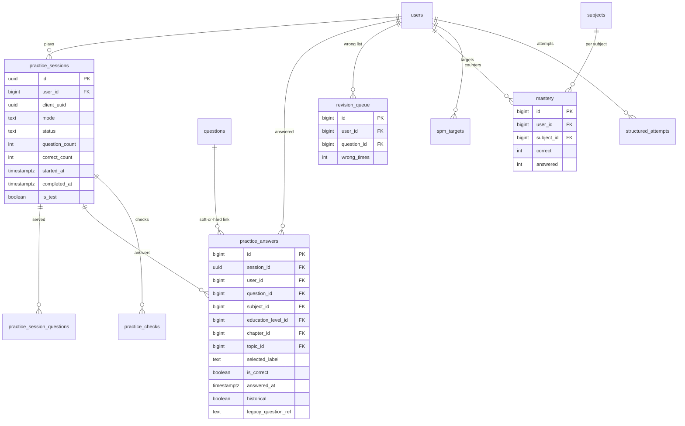

#### `practice_sessions` (uuid PK, TS, LEG+H, TEST) owner BE-12

| Column | Type | Null | Default | Notes |
|---|---|---|---|---|
| id | uuid | Y | `gen_random_uuid()` | G-01 |
| user_id | bigint | Y | | FK -> users.id; indexed |
| client_uuid | uuid | N | | client-generated idempotency key for offline sync [contract `ClientUuid`; .cloud `client_uuid`]; `unique (user_id, client_uuid)` partial where not null |
| mode | enum(E-practice_mode) | Y | | `random`, `chapter`, `revision`, `past_year`, `latih_tubi`, `ramalan`, `mission`, `remedial`, `question_set`, `pksk` [mock `PracticeMode`]; .cloud holds a free string (GAP-17) |
| subject_id | bigint | N | | FK -> subjects.id |
| education_level_id | bigint | N | | FK -> education_levels.id (mock `levelId`) |
| difficulty | smallint | N | | session filter (mock scale) |
| chapter_id | bigint | N | | FK -> chapters.id |
| year | smallint | N | | past-year filter |
| set_no | smallint | N | | |
| target_question_id | bigint | N | | FK -> questions.id (single-question drill) |
| mission_id | bigint | N | | FK -> missions.id |
| remedial_test_id | bigint | N | | FK -> remedial_tests.id |
| question_set_id | bigint | N | | FK -> question_sets.id (.cloud also has it) |
| time_limit_sec | int | N | | |
| pksk_domain | text | N | | PKSK as tags on the one bank (A6); the PKSK domain tables are backlog (OQ-21 of the URS), so no FK **[P]** |
| pksk_target_level | enum(E-pksk_level) | N | | `T1`, `T4` |
| question_count | smallint | Y | | served count; for migrated rows `total_questions` |
| status | enum(E-session_status) | Y | `in_progress` | `in_progress`, `completed` (every migrated session is `completed`; .cloud stores only finished sessions) |
| correct_count | smallint | Y | 0 | |
| time_spent_sec | int | Y | 0 | capped (M05 BR-30) |
| coins_earned | int | Y | 0 | .cloud `syiling_earned` |
| points_earned | int | Y | 0 | |
| started_at | timestamptz | Y | | |
| completed_at | timestamptz | N | | null while in progress |
| legacy_paper | text | N | | .cloud `paper` (`paper1`/`paper2`), no v2 meaning, kept for audit |

Not stored: `accuracy` (recomputed, plan 14.7), `completedAtMs`, the facets `seg/week/band/inP`. Index `(user_id, started_at desc)`, `(user_id, status)`, `(subject_id)`. A second submit of a completed session returns 409; an abandoned session records nothing.

#### `practice_session_questions` (PK, created_at, TEST) **[P] table**

The served list, in order (`SessionRow.questionIds[]`). Needed because practice answers must be graded against the question **version served** and the list is not derivable once the bank changes. Migrated sessions have none (rebuilt from attempts, data-migration 4.4).

| Column | Type | Null | Default | Notes |
|---|---|---|---|---|
| session_id | uuid | Y | | FK -> practice_sessions.id on delete cascade |
| position | smallint | Y | | `unique (session_id, position)` |
| question_id | bigint | Y | | FK -> questions.id |
| question_version_no | int | Y | | the version served ("question id + version served", v2-question-bank 4.6) |

#### `practice_answers` (PK, LEG+H, TEST) owner BE-12 (big activity table)

Append-only in practice (an answer is not edited), but the table has `updated_at` for ETL upserts only if the card prefers; `created_at` is the insert time, `answered_at` the learner time.

| Column | Type | Null | Default | Notes |
|---|---|---|---|---|
| session_id | uuid | N | | FK -> practice_sessions.id; null for answers outside a session (mock `hasSession = false`) |
| user_id | bigint | Y | | FK -> users.id |
| question_id | bigint | N | | FK -> questions.id; **nullable** (historical rows have none); `ON DELETE SET NULL` |
| question_version_no | int | N | | |
| subject_id | bigint | N | | FK -> subjects.id; snapshot dimension |
| education_level_id | bigint | N | | FK -> education_levels.id (mock `levelId`) |
| chapter_id | bigint | N | | FK -> chapters.id |
| topic_id | bigint | N | | FK -> topics.id |
| difficulty | smallint | N | | snapshot of the question's difficulty at answer time; for migrated rows the **legacy 1 to 5 integer**, not TP (OQ-DM-20) |
| question_type | text | N | | snapshot (`mcq`, `subjective`, ...); not an enum because legacy values are copied verbatim (T-07) |
| selected_label | text | N | | chosen option label `A`..`H` (the mock stores an option index `selectedOptionId`; the .cloud column is `selected_option`) |
| is_correct | boolean | Y | | |
| time_seconds | int | N | | |
| answered_at | timestamptz | Y | | |
| historical | boolean | Y | false | true for migrated snapshot rows |
| legacy_question_ref | text | N | | the old `questions.id` as text; **soft reference, no FK** (data-migration 3.3 item 2) |
| legacy_content_hash | text | N | | hash of normalised stem + options for the optional backfill |
| source_natural_key | text | N | | with `number_label`, where the question came from a canonical paper |
| number_label | text | N | | |

`check (question_id is not null or subject_id is not null)`: a row with neither the link nor dimensions is invalid (plan 14.5, validated by `migrate:validate`). Indexes: `(user_id, subject_id, answered_at)` (BE-13), `(session_id)`, `(user_id, question_id)`, `(subject_id, chapter_id)`. Every statistic reads the dimensions on the row; there is no join to the bank (BE-13 AC2). The plan text of section 5 lists `client_uuid` with the answers; the migration document and the mock put it on the session (GAP-18).

#### `practice_checks` (PK, created_at, TEST) owner BE-12

One instant check ("Semak") per question per session (mock `practice.checks`).

| Column | Type | Null | Default | Notes |
|---|---|---|---|---|
| session_id | uuid | Y | | FK on delete cascade |
| user_id | bigint | Y | | FK -> users.id |
| question_id | bigint | Y | | FK -> questions.id |
| question_version_no | int | Y | | |
| selected_label | text | Y | | |
| is_correct | boolean | Y | | |
| checked_at | timestamptz | Y | | |
| seq | smallint | Y | | order in the session |

`unique (session_id, question_id)`. A check increments `users.trial_questions_used` when the user is not subscribed (via the owner service).

#### `revision_queue` (PK, TS) owner BE-12

| Column | Type | Null | Default | Notes |
|---|---|---|---|---|
| user_id | bigint | Y | | FK -> users.id |
| question_id | bigint | Y | | FK -> questions.id; the queue exists **only for rows with a question link** (data-migration 3.3 item 6) |
| subject_id | bigint | Y | | FK -> subjects.id |
| wrong_times | int | Y | 1 | |
| last_wrong_at | timestamptz | Y | | |

`unique (user_id, question_id)`. The .cloud SM-2 table `review_schedules` is dropped (rebuilt from future wrong answers, Q4). Deactivating or archiving a question removes it from `eligibleForPractice` (XL-19).

#### `mastery` (PK, TS) owner BE-12

| Column | Type | Null | Default | Notes |
|---|---|---|---|---|
| user_id | bigint | Y | | FK -> users.id |
| subject_id | bigint | Y | | FK -> subjects.id |
| correct | int | Y | 0 | |
| answered | int | Y | 0 | |
| last_answered_at | timestamptz | N | | |

`unique (user_id, subject_id)`. M05 BR-20 stores counters that differ from the answer log on live, while BE-13 AC2 and data-migration 4.4 derive mastery from answer rows: URS OQ-19 is open (default: derived; this table holds only what the submit step needs).

#### `spm_targets` (PK, TS) owner BE-13

| Column | Type | Null | Default | Notes |
|---|---|---|---|---|
| user_id | bigint | Y | | FK -> users.id |
| subject_id | bigint | Y | | FK -> subjects.id |
| target_grade | enum(E-spm_grade) | Y | | `A+`, `A`, `A-`, `B+`, `B`, `C+`, `C`, `D`, `E` (`G` is a result grade only; a `CHECK` excludes it here) |

`unique (user_id, subject_id)`. .cloud has `users.spm_targets` (text, probably JSON), which no matrix row maps (GAP-7).

#### `structured_attempts` (PK, TS, LEG, TEST) owner BE-13

| Column | Type | Null | Default | Notes |
|---|---|---|---|---|
| user_id | bigint | Y | | FK -> users.id |
| question_id | bigint | N | | FK -> questions.id (a structured question of the one bank) |
| question_version_no | int | N | | |
| scope | enum(E-attempt_scope) | N | | `spm` [mock] |
| track | enum(E-attempt_track) | N | | `bahasa` [mock] |
| answers | jsonb | N | | `[{part_id, text}]`, the student's free text (G-11 document); **not migrated** (Q5) |
| marks | jsonb | N | | `[{part_id, awarded, max}]` |
| total_awarded | smallint | Y | | |
| total_max | smallint | Y | | |
| submitted_at | timestamptz | Y | | |
| legacy_question_ref | text | N | | the old `structured_question_id` as text (soft) |

Migrated rows are the header with scores only (`structured_attempt_answers` dropped).

#### `subject_usage` (PK = `subject_id`, TS) owner BE-12

A counter per subject (mock `practice.subjectUsage`, the id is the subject id). Columns: `subject_id bigint` PK FK -> subjects.id, `used_count int not null default 0`. Computed values elsewhere (accuracy, pupil counts, SPM progress, the Kirkpatrick session aggregate) are read models, not tables (section 5).

---
### 3.7 Wallet, gamification, rewards shop

Owner: M14 (BE-11 core: wallet, ledger, streak; BE-23 the rest) and M15 (BE-23). Prisma files **[rev2]**: `wallet.prisma` (BE-11: `wallets`, `coin_ledger`, `streaks`, `session_credits`, `daily_login_marks`, `token_movements`, `tiers`) and `gamification.prisma` (BE-23: everything else, M15 tables included; there is no `rewards.prisma`). Currency words: **Syiling** (coins) and **token** are integers, not money (G-06). The wallet is written **only** through `WalletService` (credit idempotent by `(source, source_id)`); other modules never touch these tables. The tier is derived from lifetime Syiling (BE-23); the cached `tier_id` is written by the owner.

```mermaid
erDiagram
  users ||--o| wallets : "has"
  users ||--o{ coin_ledger : "entries"
  users ||--o| streaks : "has"
  users ||--o{ session_credits : "credited"
  users ||--o{ daily_login_marks : "logins"
  tiers ||--o{ wallets : "current tier"
  challenges ||--o{ challenge_completions : "completed"
  users ||--o{ challenge_completions : "completes"
  achievements ||--o{ user_achievements : "unlocked"
  users ||--o{ user_achievements : "unlocks"
  learner_badges ||--o{ learner_badge_holdings : "held"
  users ||--o{ referral_codes : "owns"
  users ||--o{ referrals : "refers"
  draws ||--o{ draw_prizes : "prizes"
  draws ||--o{ draw_tickets : "tickets"
  syiling_rewards ||--o{ reward_claims : "claimed"
  rewards ||--o{ reward_redemptions : "redeemed"
  users ||--o{ reward_redemptions : "redeems"
  wallets {
    bigint id PK
    bigint user_id FK
    bigint tier_id FK
    int current_syiling
    int total_syiling_earned
    int token_balance
    int xp
  }
  coin_ledger {
    bigint id PK
    bigint user_id FK
    text type
    text source
    text source_id
    int amount
    int balance_after
    boolean is_test
  }
  streaks {
    bigint id PK
    bigint user_id FK
    int current
    int best
    date last_activity_date
  }
  challenge_completions {
    bigint id PK
    bigint user_id FK
    bigint challenge_id FK
    date completion_date
  }
  rewards {
    bigint id PK
    text category
    int token_cost
    numeric denomination_rm
  }
  reward_redemptions {
    bigint id PK
    bigint user_id FK
    bigint reward_id FK
    text status
    int token_cost
  }
```

#### `wallets` (PK, TS, LEG) owner BE-11

| Column | Type | Null | Default | Notes |
|---|---|---|---|---|
| user_id | bigint | Y | | FK -> users.id, **unique**; .cloud `student_wallets` is keyed by `user_id`; whether teachers hold rows there decides `teacher_wallets` (Q10) |
| tier_id | bigint | N | | FK -> tiers.id; cached tier (.cloud `tier_id`; mock `tierKey`) |
| current_syiling | int | Y | 0 | .cloud `syiling_balance`; `check (current_syiling >= 0)` |
| total_syiling_earned | int | Y | 0 | .cloud `syiling_lifetime` |
| token_balance | int | Y | 0 | |
| xp | int | Y | 0 | |
| level | smallint | Y | 1 | mock `level` (derived from xp in the mock; kept only if the card stores it) **[P]** |

The ledger balance is reconciled, never silently corrected: `coin_transactions.balance_after` and `student_wallets.syiling_balance` are independent counters that may disagree (data-migration section 5).

#### `coin_ledger` (PK, created_at only, append-only, LEG+H, TEST) owner BE-11

| Column | Type | Null | Default | Notes |
|---|---|---|---|---|
| user_id | bigint | Y | | FK -> users.id; indexed with `created_at desc` |
| type | enum(E-ledger_type) | Y | | `earn`, `spend`, `convert`, `bonus`, `refund` (mock; the .cloud vocabulary is profiled, T-02) |
| source | text | Y | | what caused it (`practice`, `bijak`, `quest`, `shop`, ...); open list owned by the services, .cloud values mapped per column |
| source_id | text | N | | the cause (session uuid, attempt uuid, claim id); mock `refId`. **Idempotency:** `unique (user_id, source, source_id) where source_id is not null` **[P]** (the card says `(source, source_id)`; including `user_id` keeps one user's credit from blocking another's when a source id is not globally unique) |
| tokens | int | N | | token delta of the entry (the separate `token_movements` table also exists, BE-11) |
| amount | int | Y | | Syiling delta; sign follows `type` |
| balance_after | int | Y | | kept from .cloud and reconciled |
| description | text | Y | | BM text |

#### `streaks` (PK, TS, LEG) owner BE-11

| Column | Type | Null | Default | Notes |
|---|---|---|---|---|
| user_id | bigint | Y | | FK -> users.id, unique |
| current | int | Y | 0 | |
| best | int | Y | 0 | |
| last_activity_date | date | N | | **Malaysia calendar day** (G-04); the streak moves once per day |
| total_days | int | Y | 0 | |

.cloud has only `student_wallets.streak_days`; the row is rebuilt by recomputing from migrated datetimes in `Asia/Kuala_Lumpur` (T-05, accepted drift).

#### `session_credits` (PK, created_at, TEST) owner BE-11 and `daily_login_marks` (PK, created_at) owner BE-11

| Table | Column | Type | Null | Notes |
|---|---|---|---|---|
| `session_credits` | session_id | uuid | Y | FK -> practice_sessions.id, **unique** (a session credits once) |
| | user_id | bigint | Y | FK -> users.id |
| | coins_earned, points_earned, streak_count, total_balance | int | Y | result of `onSessionCompleted` (mock `SessionCredit`) |
| | completed_at | timestamptz | Y | |
| `daily_login_marks` | user_id | bigint | Y | FK -> users.id |
| | mark_date | date | Y | Malaysia day; `unique (user_id, mark_date)` |

Whether a Bijak attempt also credits the wallet is open: the mock `BijakServer` only computes `coins = score * 2`, `points = score * 10` in the result and calls no wallet (OQ-DM-22).

#### `token_movements` (PK, created_at) owner BE-11 **[rev2]**

Mock `gamification.tokenMovements`; BE-11 now lists it. Columns: `user_id` bigint FK -> users.id; `delta` int; `source` text; `ref_id` text N; `created_at`. Index `(user_id, created_at)`. It overlaps `coin_ledger.tokens` (the per-entry token delta); the card keeps both (OQ-DM-06 closed, no data rule beyond the mock).

#### `tiers` (PK, TS, LEG) owner BE-11 **[rev2]** (BE-11 seeds the mock tiers; admin tier CRUD stays in BE-23)

| Column | Type | Null | Default | Notes |
|---|---|---|---|---|
| tier_name | text | Y | | unique; open string in the mock (`bronze`, `silver`, `gold`, `platinum`, others) |
| label_ms | text | Y | | .cloud `label_ms` |
| icon | text | Y | | |
| color | text | Y | | |
| min_syiling | int | Y | | |
| conversion_rate | numeric(10,4) | Y | | token conversion rate |
| sort_order | int | Y | | |
| perks | text[] | Y | `{}` | .cloud holds `perks` as text -> array (T) |
| quiz_reward_l1 .. quiz_reward_l5 | int | Y | 0 | five columns, one per difficulty level (mock) |
| pksk_reward_correct | int | Y | 0 | |
| board_game_reward_correct | int | Y | 0 | |
| board_game_reward_win | int | Y | 0 | |
| is_active | boolean | Y | true | |

#### `challenges` (PK, TS, LEG) and `challenge_completions` (PK, TS, LEG, TEST) owner BE-23

Platform daily challenges only; teacher-created challenges are `missions` (3.9, plan 14.7 "split").

| Table | Column | Type | Null | Default | Notes |
|---|---|---|---|---|---|
| `challenges` | title, description, icon | text | Y | | |
| | challenge_type | enum(E-challenge_type) | Y | | `quiz_count`, `accuracy`, `topic_variety`, `streak`, `time_spent` |
| | metric | enum(E-challenge_metric) | Y | | `sessions`, `correct`, `bestAccuracy`, `bestCorrectInSession`, `chapters`, `minutes`, `streak` (mock values are camelCase; proposed codes in E-challenge_metric) |
| | target_value | int | Y | | |
| | reward_syiling, reward_xp | int | Y | 0 | |
| | difficulty | enum(E-difficulty) | Y | | `easy`, `medium`, `hard` |
| | sort_order | int | Y | 0 | |
| | is_active | boolean | Y | true | |
| `challenge_completions` | user_id | bigint | Y | | FK -> users.id |
| | challenge_id | bigint | Y | | FK -> challenges.id |
| | completion_date | date | Y | | Malaysia day (mock `date`; .cloud `claimed_on`) |
| | completed_at | timestamptz | Y | | |

`unique (user_id, challenge_id, completion_date)`: completion is idempotent per user per Malaysia day. .cloud `progress` is not stored (computed).

#### `achievements` (PK, TS, LEG) and `user_achievements` (PK, TS, LEG, TEST) owner BE-23

| Table | Column | Type | Null | Default | Notes |
|---|---|---|---|---|---|
| `achievements` | name, description, icon | text | Y | | |
| | rarity | enum(E-rarity) | Y | | `common`, `rare`, `epic`, `legendary` |
| | reward_syiling, reward_xp | int | Y | 0 | |
| | criterion_kind | enum(E-criterion_kind) | N | | structured criterion of the mock `AchievementCriterion` union: `practiceSessions`, `streak`, `lifetimeSyiling`, `accurateSessions`, `subjects`, `mysteryOpenings`, `completions`, `mathCorrect`, `scienceCorrect`, `fastAnswers`, `referrals`, `unlocked`, `answersAccuracy`, `perfectDays` **[P columns]**; null for a migrated legacy achievement (no auto-unlock) |
| | criterion_min | int | N | | |
| | criterion_accuracy | numeric(5,2) | N | | only for `answersAccuracy` |
| | progress_target | int | N | | |
| | legacy_criteria_text | text | N | | .cloud free-text `criteria`, kept for matched-by-name import (plan 14.7); GAP-20 |
| `user_achievements` | user_id | bigint | Y | | FK -> users.id |
| | achievement_id | bigint | Y | | FK -> achievements.id; `unique (user_id, achievement_id)` |
| | unlocked_at | timestamptz | Y | | |

#### Learner badges, teacher badges

| Table | Column | Type | Null | Notes |
|---|---|---|---|---|
| `learner_badges` (PK, TS) | name, icon | text | Y | no .cloud source |
| | rarity_label | text | N | |
| `learner_badge_holdings` (PK, TS) | user_id | bigint | Y | FK -> users.id |
| | badge_id | bigint | Y | FK -> learner_badges.id; `unique (user_id, badge_id)` |
| | awarded_at | timestamptz | Y | |
| | awarded_at | timestamptz | Y | |

#### `referral_codes`, `referrals` (PK, TS, LEG) owner BE-23

| Table | Column | Type | Null | Notes |
|---|---|---|---|---|
| `referral_codes` | user_id | bigint | Y | FK -> users.id, unique (.cloud `users.referral_code`) |
| | code | text | Y | unique |
| `referrals` | referrer_id | bigint | Y | FK -> users.id |
| | referee_id | bigint | Y | FK -> users.id, **unique** (a person is referred once) (.cloud `users.referred_by`, self-reference loaded in two passes) |
| | code_used | text | Y | |
| | rewarded | boolean | Y | default false |

#### `draws`, `draw_prizes`, `draw_tickets` owner BE-23

| Table | Column | Type | Null | Default | Notes |
|---|---|---|---|---|---|
| `draws` (PK, TS, LEG) | title, description | text | Y | | |
| | ticket_cost_syiling | int | Y | | |
| | max_tickets_per_student | int | Y | | |
| | closes_at | timestamptz | N | | |
| | status | enum(E-draw_status) | Y | `draft` | `draft`, `open`, `closed` |
| | winner_user_id | bigint | N | | FK -> users.id; .cloud `lucky_draws.winner_id`; not in the mock row (GAP-19) |
| | drawn_at | timestamptz | N | | .cloud `drawn_at`; not in the mock row |
| `draw_prizes` (PK, TS) **[P table]** | draw_id | bigint | Y | | FK on delete cascade; the mock embeds `prizePool: PrizeLine[]` |
| | label | text | Y | | |
| | value_sen | int | Y | | integer sen |
| | qty | int | Y | | |
| | position | smallint | Y | | |
| `draw_tickets` (PK, created_at) | draw_id | bigint | Y | | FK -> draws.id |
| | user_id | bigint | Y | | FK -> users.id |

`tickets_sold` is computed. The result of a draw is audited (`draw_result`). The .cloud table is one pool with one winner and has no ticket rows.

#### `syiling_rewards`, `reward_claims` (M14) owner BE-23

The Syiling catalogue and its claims, budgeted in sen.

| Table | Column | Type | Null | Notes |
|---|---|---|---|---|
| `syiling_rewards` (PK, TS, LEG) | name | text | Y | |
| | type | enum(E-syiling_reward_type) | Y | `voucher`, `physical`, `experience`, `digital`, `subscription` (mock stores uppercase) |
| | price_syiling | int | Y | |
| | cost_value_sen | int | Y | integer sen; `costRm` is derived |
| `reward_claims` (PK, TS, LEG) | user_id | bigint | Y | FK -> users.id |
| | reward_id | bigint | Y | FK -> syiling_rewards.id |
| | cost_value_sen | int | Y | snapshot at claim time (G-18) |
| | claimed_at | timestamptz | Y | |

#### `rewards`, `reward_redemptions`, `mystery_box_openings` (M15) owner BE-23

| Table | Column | Type | Null | Default | Notes |
|---|---|---|---|---|---|
| `rewards` (PK, TS, LEG) | category | enum(E-hadiah_category) | Y | | `flagship`, `ewallet`, `telco`, `gaming`, `streaming`, `food_beverage`, `ecommerce`, `education`, `entertainment` |
| | vendor | text | Y | | |
| | title | text | Y | | |
| | description | text | N | | |
| | denomination_rm | numeric(10,2) | Y | | |
| | token_cost | int | Y | | |
| | icon_emoji | text | N | | |
| | stock_quantity | int | N | | null = unlimited |
| | max_per_month_per_student | smallint | N | | |
| | voucher_validity_days | smallint | Y | | |
| | delivery_method | enum(E-delivery_method) | Y | | `manual`, `api`, `instant` |
| | vendor_sku | text | N | | |
| | display_order | int | Y | 0 | |
| | image_file_id | bigint | N | | FK -> files.id (the mock keeps `imageUrl`) **[P]** |
| | terms_text | text | N | | |
| | is_active | boolean | Y | true | |
| | requires_parent_consent | boolean | Y | false | |
| `reward_redemptions` (PK, TS, LEG) **[P name]** | user_id | bigint | Y | | FK -> users.id |
| | reward_id | bigint | N | | FK -> rewards.id on delete set null |
| | reward_title, reward_vendor | text | Y | | snapshot (G-18) |
| | reward_icon | text | N | | snapshot |
| | denomination_rm | numeric(10,2) | Y | | snapshot |
| | token_cost | int | Y | | snapshot |
| | status | enum(E-hadiah_redemption_status) | Y | | `pending_parent_consent`, `pending_admin`, `delivered`, `cancelled` |
| | stock_reserved | boolean | Y | false | |
| | parent_decision_by_id | bigint | N | | FK -> users.id; the parent approval routes are not built in B1 (URS OQ-20; **UD-3, user decision 2026-10-19: confirmed, the backend does not register `/api/parent/hadiah-approvals*` and the frontend hides the entry point**) |
| | parent_decided_at | timestamptz | N | | |
| | voucher_code | text | N | | the deliverable; treat as a secret (never logged; encrypt at rest if kept) |
| | delivered_at, expires_at, cancelled_at | timestamptz | N | | |
| | cancelled_by | enum(E-cancelled_by) | N | | `admin`, `parent` |
| `mystery_box_openings` (PK, created_at) | user_id | bigint | Y | | FK -> users.id |
| | box_id | int | Y | | the box catalogue is static in the mock (no table) |
| | coins, xp | int | Y | | |

#### `gamification_settings` (PK, TS, LEG) owner BE-23

Key/value settings (mock `gamification.settings`).

| Column | Type | Null | Default | Notes |
|---|---|---|---|---|
| key | enum(E-setting_key) | Y | | unique; `coins_per_question`, `cash_rate_coins`, `cash_rate_sen`, `min_cash_withdrawal`, `cash_withdrawal_enabled`, `reward_budget_sen_session`, `reward_budget_sen_month`, `current_session_year`, `flat_quiz_reward`, `games_award_syiling` |
| value | numeric(12,2) | Y | | toggles are 0/1 |
| label | text | Y | | BM label |

.cloud keeps one `reward_settings` row (columns `reward_budget_sen_month`, `flat_quiz_reward`, `current_session_year`, `games_award_syiling`), which the ETL pivots into rows (GAP-3).

---

### 3.8 Exam / Bijak SPM

Owner: M28 (BE-15 papers/blueprints, BE-16 attempts, BE-39 builder write side). Prisma file `exam.prisma` (BE-15 creates the paper and blueprint tables **including** the status/version/provenance columns the builder needs, BE-16 appends the attempt tables; **[rev2]** BE-39 makes no schema change: a missing column there is a `cross-lane` issue). The marking engine is the shared package `@pp/exam-core` (BE-14); the database only stores facts. Papers and attempts follow the approved exam schema (D5, D7) and the m28 types.

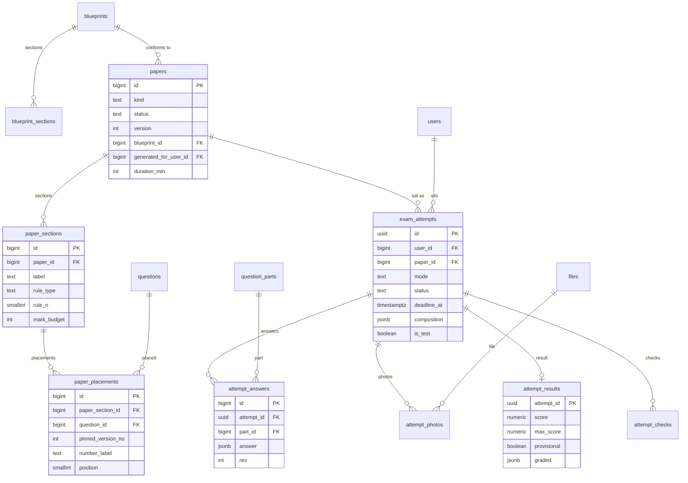

#### `blueprints` (PK, TS, no LEG) and `blueprint_sections` (PK, TS) owner BE-15 (versioning columns are created by BE-15 **[rev2]**)

The "Kontrak Blueprint": a validator **and** the recipe for "Jana Kertas" (D32). Versioned: a paper published under a version stays valid when the blueprint changes (AC-28.2). The 36 .cloud blueprints are not migrated (19 are empty skeletons; they are re-derived, exam schema D7).

| Table | Column | Type | Null | Default | Notes |
|---|---|---|---|---|---|
| `blueprints` | subject_id | bigint | Y | | FK -> subjects.id (m28 `subject` code `MAT`, `SN`, `SEJ` maps to the subject row) |
| | kertas | text | Y | | `K1`, `K2`, `P1`, ... printed label (the mock has `1 \| 2`) |
| | paper_code | text | Y | | `1449/1` |
| | version | int | Y | 1 | `unique (paper_code, version)` **[rev2, card BE-15: unique `(code, version)`]**; a new version is a new row (written by BE-39, column created by BE-15) |
| | status | enum(E-blueprint_status) | Y | `draft` | `draft`, `active`, `retired` **[rev2, card BE-15]** |
| | source | enum(E-blueprint_source) | Y | `spec` | [mock `Blueprint.source`, card "provenance `source` tag"] `verified` (Disahkan), `spec` (Spec), `draft` (Draf) **[P codes]** (OQ-DM-23) |
| | provenance | enum(E-blueprint_provenance) | N | | `data`, `paper`, `dskp`, `inferred` (exam D7 evidence tags; not stored by the mock) |
| | confidence | enum(E-confidence) | N | | `high`, `medium`, `low` (exam D7) |
| | duration_min | int | N | | default duration, marked Low until LPM confirms (Q-S1); each paper stores its own printed duration |
| | total_marks | int | N | | |
| | language_mode | enum(E-question_language) | N | | |
| | auto_markable | boolean | N | | |
| | instructions | text[] | N | | |
| | reference_sheets | jsonb | N | | formula-sheet panels `[{title, items[]}]` (G-11 document) |
| | cognitive_mix | jsonb | N | | optional share of TP1-2 / TP3-4 / TP5-6 |
| `blueprint_sections` | blueprint_id | bigint | Y | | FK on delete cascade |
| | position | smallint | Y | | |
| | label | text | Y | | `Bahagian A`, `Objektif` |
| | instruction | text | N | | |
| | rule_type | enum(E-section_rule) | Y | `all` | `all`, `choose` |
| | rule_n | smallint | N | | n of `choose n`; required when `choose` |
| | question_count | int | Y | | questions on the paper in this section (groups count with all their questions) = m28 `take` |
| | mark_budget | int | N | | marks after choose-N (mandatory in v2, exam D7) |
| | compulsory | boolean | Y | false | |
| | pool | text | N | | the pool tag the section draws from (m28 `pool`, matches `question_tags.code` of kind `pool`) |
| | allowed_modes | text[] | N | | subset of E-answer_mode (exam `allowed_modes`) |
| | topic_weights | jsonb | N | | `{unit_code: target_count}`, INFERRED until a JSU is shared |

#### `papers` (PK, TS, no LEG) owner BE-15 (BE-39 writes rows only **[rev2]**)

Covers both kinds: `pilihan` (admin-curated "Kertas Pilihan", published) and `jana` (generated "Jana Kertas", private to the user who generated it; mock `GeneratedPaper`).

| Column | Type | Null | Default | Notes |
|---|---|---|---|---|
| kind | enum(E-paper_kind) | Y | | `pilihan`, `jana` [m28 `PaperKind`] |
| title | text | Y | | |
| subject_id | bigint | Y | | FK -> subjects.id |
| kertas | text | Y | | |
| year | smallint | N | | |
| paper_code | text | N | | |
| level_scope | enum(E-level_scope) | N | | `t4`, `t5`, `t4_t5` (exam D5) |
| printed_duration_min | int | N | | **[rev2, card BE-15 `papers.printed_duration_min`]** the printed duration (Q-S1); the mock `durationMin` |
| total_marks | int | N | | **derived** by default (G-15); store only if the card needs it for listing (the mock computes it) |
| language_mode | enum(E-question_language) | N | | |
| instructions | text[] | N | | |
| reference_sheets | jsonb | N | | formula sheet panels (G-11) |
| blueprint_id | bigint | N | | FK -> blueprints.id (the version it conforms to) |
| status | enum(E-paper_status) | Y | `draft` | `draft`, `ready`, `published`, `withdrawn` [card BE-15, seeded papers `published`]; the exam schema D12 and US-12 say Draf, Semakan, Terbit, Diarkib; meaning of `ready` is BE-39 open question 1 (OQ-DM-24) |
| version | int | Y | 1 | [card BE-15] |
| generated_for_user_id | bigint | N | | FK -> users.id on delete cascade; set for `jana` papers (mock `GeneratedPaper.userId`) |
| published_at | timestamptz | N | | |
| created_by_id | bigint | N | | FK -> users.id |

`jana` rows are visible only to their owner. A paper cannot be published unless every placed question is `published` at the pinned version, group integrity holds and the blueprint conformance check passes (US-12).

#### `paper_sections` and `paper_placements` (PK, TS) owner BE-15

| Table | Column | Type | Null | Default | Notes |
|---|---|---|---|---|---|
| `paper_sections` | paper_id | bigint | Y | | FK on delete cascade |
| | position | smallint | Y | | `unique (paper_id, position)` |
| | label, title | text | Y / N | | |
| | instruction | text | N | | authored line, else derived from the rule |
| | rule_type | enum(E-section_rule) | Y | `all` | |
| | rule_n | smallint | N | | |
| | question_count | int | Y | | questions printed in the section (not the number to answer) |
| | mark_budget | int | Y | | marks the section is worth after choose-N |
| | marks_per_question | int | N | | for sections where all questions are equal |
| | allowed_modes | text[] | N | | |
| | compulsory | boolean | Y | false | "Soalan ini mesti dijawab" |
| | answer_medium | enum(E-answer_medium) | N | | `on_paper`, `separate_book`, `omr` (informational) |
| | stimulus_policy | enum(E-stimulus_policy) | N | | `none`, `group`, `per_part` |
| `paper_placements` | paper_section_id | bigint | Y | | FK on delete cascade |
| | question_id | bigint | Y | | FK -> questions.id |
| | pinned_version_no | int | Y | | the version printed on the paper (the .cloud `pinned_snapshot_id` need); editing a question in a published paper makes version n+1 |
| | position | smallint | Y | | order in the section; a stimulus group moves as a unit |
| | number_label | text | N | | printed number on this paper |
| | marks_override | smallint | N | | |

`unique (paper_section_id, position)`. The same question may be placed in many papers (never copied). Withdrawing a question inside a published paper flags the paper "Perlu semakan" (AC-14.2).

#### `exam_attempts` (uuid PK, TS, LEG+H, TEST) owner BE-16

One sitting. The paper reference is a **snapshot** so history survives edits and a migrated attempt needs no paper (G-18).

| Column | Type | Null | Default | Notes |
|---|---|---|---|---|
| id | uuid | Y | `gen_random_uuid()` | G-01 |
| user_id | bigint | Y | | FK -> users.id; indexed |
| paper_id | bigint | N | | FK -> papers.id on delete set null; null for migrated attempts |
| paper_kind | enum(E-paper_kind) | Y | | `pilihan`, `jana` |
| title | text | Y | | snapshot |
| subject_id | bigint | N | | FK -> subjects.id (mock: subject code) |
| kertas | text | N | | snapshot |
| paper_code | text | N | | snapshot |
| mode | enum(E-attempt_mode) | Y | | `exam`, `latihan` |
| status | enum(E-attempt_status) | Y | `in_progress` | `in_progress`, `submitted`, `auto_submitted`, `abandoned` |
| started_at | timestamptz | Y | | |
| deadline_at | timestamptz | N | | **server** deadline, exam mode only; after `deadline_at + 300 s` (grace) the sweeper auto-submits an unattended attempt; late sync window 24 h (m28 `GRACE_SECONDS`, `LATE_SYNC_WINDOW_MS`) |
| duration_min | int | Y | | |
| composition | jsonb | Y | `[]` | frozen section composition `[{id,label,compulsory,instruction,rule,questionIds}]` (m28 `SectionSnapshot`, .cloud `served_composition`); later paper or pool edits never change it. Question-id JSON is **dropped** for migrated attempts (T-08). G-11 document. |
| flags | text[] | Y | `{}` | flagged question ids |
| picks | jsonb | Y | `{}` | choose-N picks per section `{sectionId: [questionId]}` |
| position | int | Y | 0 | current question index |
| submitted_at | timestamptz | N | | |
| late_by_seconds | int | N | | |
| idempotency_key | text | N | | submit idempotency; unique per user when present |

Index `(user_id, started_at desc)`, `(status, deadline_at) where status = 'in_progress'` for the sweeper. `checked` (latihan) and `checkCounts` are rows of `attempt_checks`. Cap: at most 3 checks per question (m28 `MAX_CHECKS_PER_QUESTION`).

#### `attempt_answers`, `attempt_photos`, `attempt_results`, `attempt_checks` owner BE-16

| Table | Column | Type | Null | Default | Notes |
|---|---|---|---|---|---|
| `attempt_answers` (PK, created_at) | attempt_id | uuid | Y | | FK -> exam_attempts.id on delete cascade |
| | part_id | bigint | Y | | FK -> question_parts.id; **a part of the pinned version** (the attempt records question id + version served via `composition`) |
| | answer | jsonb | Y | | `PartAnswer`: `{choice, steps[], final, unit, text, photos[], plain:{steps[],final}}`; LaTeX canonical, plain forms derived (G-11 document) |
| | rev | int | Y | 0 | per-part revision: a save with an older `rev` never overwrites a newer one |
| | saved_at | timestamptz | Y | | client save time (offline late-sync) |
| `attempt_photos` (PK, created_at) | attempt_id | uuid | Y | | FK on delete cascade |
| | part_id | bigint | Y | | FK -> question_parts.id |
| | file_id | bigint | Y | | FK -> files.id (jpeg or png up to 5 MB, at most 3 per part, URS BE-NFR-29) |
| `attempt_results` (attempt_id PK, created_at) | attempt_id | uuid | Y | | PK, FK -> exam_attempts.id on delete cascade |
| | score | numeric(7,2) | Y | | |
| | max_score | numeric(7,2) | Y | | |
| | provisional | boolean | Y | false | true while any part waits for a person |
| | pending_review | int | Y | 0 | |
| | coins | int | N | | `score * 2` (mock); not credited to the wallet by the mock (OQ-DM-22) |
| | points | int | N | | `score * 10` (mock) |
| | graded | jsonb | Y | | per-section and per-question/part results `AttemptResult.questions/sections` (points hit, awarded, status, confidence, scheme reveal) (G-11 document) |
| | section_scores | jsonb | N | | for migrated attempts: .cloud `section_scores` |
| `attempt_checks` (PK, created_at) | attempt_id | uuid | Y | | FK on delete cascade |
| | question_id | bigint | Y | | FK -> questions.id |
| | check_count | smallint | Y | 1 | capped at 3 |
| | result | jsonb | N | | the revealed question result of the last check |

`unique (attempt_id, part_id)` on answers and photos index; `unique (attempt_id, question_id)` on checks. The scheme leaves the server only inside a graded result: after submit (exam) or after "Semak" on that one question (latihan). Percent is computed.

---
### 3.9 Classes, missions, teacher work

Owner: M10 (BE-17 classes, BE-18 missions/remedial/sets/DSKP picks). Prisma file `classes.prisma`. A class is the scope unit for a teacher; enrolments are written by the classes owner only (BE-05 imports, BE-21 school admin and BE-25 complimentary students call `ClassesRepository`).

```mermaid
erDiagram
  schools ||--o{ classrooms : "has"
  users ||--o{ classrooms : "teacher"
  subjects ||--o{ classrooms : "subject"
  classrooms ||--o{ enrolments : "roster"
  users ||--o{ enrolments : "student"
  users ||--o| teacher_profiles : "profile"
  users ||--o{ missions : "assigns"
  classrooms ||--o{ missions : "for class"
  missions ||--o{ mission_items : "recipients"
  users ||--o{ mission_items : "student"
  users ||--o{ remedial_tests : "teacher"
  remedial_tests ||--o{ remedial_test_items : "questions"
  classrooms ||--o{ question_sets : "assigned to"
  question_sets ||--o{ question_set_items : "questions"
  dskp_bidang ||--o{ dskp_sk : "has"
  dskp_sk ||--o{ dskp_sp : "has"
  classrooms {
    bigint id PK
    text kind
    bigint teacher_id FK
    bigint school_id FK
    bigint education_level_id FK
    smallint academic_year
    text join_code UK
    boolean is_active
  }
  enrolments {
    bigint id PK
    bigint classroom_id FK
    bigint student_id FK
    text status
    text source
  }
  missions {
    bigint id PK
    bigint teacher_id FK
    bigint classroom_id FK
    text mission_type
    date mission_date
  }
  question_sets {
    bigint id PK
    bigint teacher_id FK
    bigint classroom_id FK
    text status
    boolean needs_rebuild
  }
```

#### `classrooms` (PK, TS, LEG) owner BE-17

One table for both kinds (the mock splits `kind` and string ids `sc-{n}`; .cloud has one table with `teacher_id`, `code`, `subject_id`, `session_year`).

| Column | Type | Null | Default | Notes |
|---|---|---|---|---|
| kind | enum(E-classroom_kind) | Y | | `classroom` (teacher-created) or `school_class`; derived at migration by whether `teacher_id` is set (T-02, to confirm) |
| name | text | Y | | |
| teacher_id | bigint | N | | FK -> users.id; indexed (a `teacher`) |
| school_id | bigint | N | | FK -> schools.id; indexed (scope) |
| subject_id | bigint | N | | FK -> subjects.id |
| education_level_id | bigint | Y | | FK -> education_levels.id (mock `levelId`; the slug `tahun-1`..`tingkatan-5` is derived from the level) |
| academic_year | smallint | Y | | .cloud `session_year` |
| description | text | N | | |
| join_code | text | N | | unique; .cloud `code` -> `join_code`; the students join with it |
| is_active | boolean | Y | true | |

Self/cycle references (class -> teacher) are loaded in two passes (plan 14.5).

#### `enrolments` (PK, TS, LEG) owner BE-17

| Column | Type | Null | Default | Notes |
|---|---|---|---|---|
| classroom_id | bigint | Y | | FK -> classrooms.id on delete cascade |
| student_id | bigint | Y | | FK -> users.id; indexed |
| status | enum(E-enrolment_status) | Y | `active` | `active`, `removed` [mock]; a removed student stays visible in history. .cloud is a plain pivot (every migrated row `active`). |
| source | enum(E-enrolment_source) | Y | `code` | `code`, `teacher`, `school_admin`, `complimentary` [mock]; migrated rows `code` |
| joined_at | timestamptz | Y | now() | |

`unique (classroom_id, student_id)`; `legacy_id` = `classroom:student`. The quota of a school subscription is enforced when enrolling (BE-25).

#### `teacher_profiles` (PK, TS, LEG) owner BE-17

| Column | Type | Null | Default | Notes |
|---|---|---|---|---|
| user_id | bigint | Y | | FK -> users.id, unique |
| subject | text | N | | .cloud `teaching_subject` |
| qualification | text | N | | .cloud `teaching_qualification` |
| experience_years | smallint | Y | 0 | .cloud `teaching_experience_years` |

`bio` stays on `users` and `schoolId` on `users.school_id` (the mock repeats both here; not stored twice, G-15).

#### `missions` (PK, TS, LEG) and `mission_items` (PK, created_at) owner BE-18

Teacher-assigned work. Platform daily challenges are `challenges` (3.7); .cloud `challenges` rows with `created_by`/`classroom_id` split into this table (plan 14.7).

| Table | Column | Type | Null | Default | Notes |
|---|---|---|---|---|---|
| `missions` | teacher_id | bigint | Y | | FK -> users.id |
| | classroom_id | bigint | N | | FK -> classrooms.id **[P]** (.cloud `challenges.classroom_id`; the mock stores the recipient list instead) |
| | title | text | Y | | |
| | mission_type | enum(E-mission_type) | Y | | `latih_tubi`, `tracking_a`, `youtube` [mock]; the constant `missionSource = 'bank_soalan'` is not stored |
| | mission_date | date | Y | | |
| | subject_id | bigint | Y | | FK -> subjects.id |
| | chapter_id | bigint | N | | FK -> chapters.id |
| | question_count | smallint | Y | | |
| | coins_per_correct | smallint | Y | | |
| | resource_title, resource_url, resource_note | text | N | | |
| `mission_items` **[P interpretation]** | mission_id | bigint | Y | | FK on delete cascade |
| | student_id | bigint | Y | | FK -> users.id; one row per recipient (mock `recipientIds[]`); `unique (mission_id, student_id)` |

The card lists `mission_items` without a definition; this is the interpretation that matches the mock (OQ-DM-10). Mission completion is **derived** from `practice_sessions.mission_id`, not stored.

#### `remedial_tests` (PK, TS) and `remedial_test_items` (PK) owner BE-18

| Table | Column | Type | Null | Default | Notes |
|---|---|---|---|---|---|
| `remedial_tests` | teacher_id | bigint | Y | | FK -> users.id |
| | student_id | bigint | Y | | FK -> users.id |
| | subject_id | bigint | Y | | FK -> subjects.id (`subjectCode`/`subjectName` of the mock are derived) |
| | total_questions | smallint | Y | | |
| | status | enum(E-remedial_status) | Y | `active` | `active`, `completed`, `cancelled` |
| | before_accuracy | numeric(5,2) | Y | | accuracy when generated |
| | after_accuracy | numeric(5,2) | N | | |
| | completed_at | timestamptz | N | | |
| `remedial_test_items` **[P table]** | remedial_test_id | bigint | Y | | FK on delete cascade |
| | position | smallint | Y | | |
| | question_id | bigint | Y | | FK -> questions.id |
| | question_version_no | int | Y | | version served |

Not migrated (no .cloud source).

#### `question_sets` (PK, TS, LEG) and `question_set_items` (PK) owner BE-18

Teacher question sets / papers.

| Table | Column | Type | Null | Default | Notes |
|---|---|---|---|---|---|
| `question_sets` | teacher_id | bigint | Y | | FK -> users.id |
| | classroom_id | bigint | Y | | FK -> classrooms.id (the mock keeps `classroomKind` + `classroomId`; one FK now) |
| | subject_id | bigint | N | | FK -> subjects.id |
| | title | text | Y | | |
| | description | text | N | | |
| | group_tag | text | N | | |
| | time_limit_minutes | smallint | N | | |
| | max_attempts | smallint | Y | 1 | **[P]** default; the mock requires a value |
| | status | enum(E-question_set_status) | Y | `draft` | `draft`, `scheduled`, `published` |
| | scheduled_at | timestamptz | N | | |
| | needs_rebuild | boolean | Y | false | true for every migrated header: items cannot migrate (plan 14.7, Q4: "perlu dibina semula") |
| `question_set_items` | question_set_id | bigint | Y | | FK on delete cascade |
| | position | smallint | Y | | |
| | question_id | bigint | Y | | FK -> questions.id |
| | question_version_no | int | Y | | |

#### `dskp_bidang`, `dskp_sk`, `dskp_sp` (PK, TS) owner BE-18

Teacher-maintained picking list (`created_by`); not the admin-managed DSKP tree (`curriculum_nodes`, OWN-11 / OQ-DM-08).

| Table | Column | Type | Null | Notes |
|---|---|---|---|---|
| `dskp_bidang` | subject_id | bigint | Y | FK -> subjects.id |
| | education_level_id | bigint | Y | FK -> education_levels.id |
| | code | text | N | |
| | name | text | Y | |
| | created_by_id | bigint | N | FK -> users.id (null = seed) |
| `dskp_sk` | bidang_id | bigint | Y | FK -> dskp_bidang.id on delete cascade |
| | code, description | text | Y | |
| | created_by_id | bigint | N | |
| `dskp_sp` | sk_id | bigint | Y | FK -> dskp_sk.id on delete cascade |
| | code, description | text | Y | |
| | created_by_id | bigint | N | |

---

### 3.10 Reports and analytics stores

Most of M08/M11/M12/M17/M27 are **read models** over practice, wallet, enrolments (section 5). Only the stores below are persisted, because the mock persists them or a card says so. Prisma file **[rev2]**: `reports.prisma` (BE-19 and BE-20 share it). Rows of `risk_profiles` and `sp_records` look like caches (see OQ-DM-11).

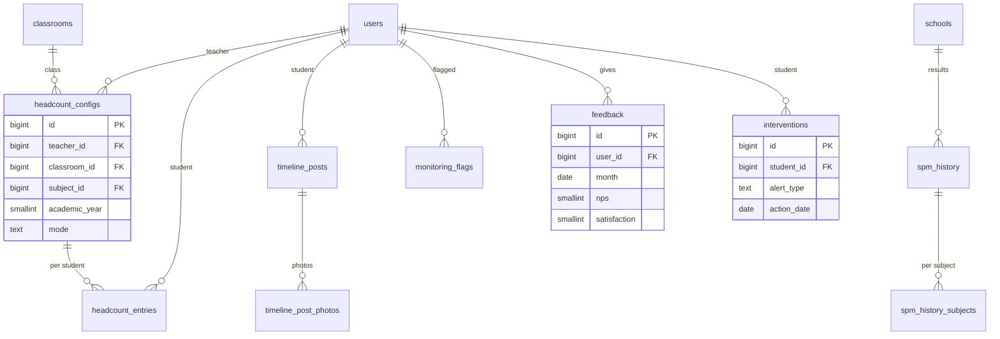

#### `headcount_configs` (PK, TS, LEG) and `headcount_entries` (PK, TS) owner BE-19

Teacher TOV/RS headcount (M08). .cloud `headcounts` is **one aggregate row** per teacher/class/subject/year with `tov` and `rs`; the mock is a config plus per-student entries.

| Table | Column | Type | Null | Default | Notes |
|---|---|---|---|---|---|
| `headcount_configs` | teacher_id | bigint | Y | | FK -> users.id |
| | classroom_id | bigint | Y | | FK -> classrooms.id |
| | subject_id | bigint | Y | | FK -> subjects.id |
| | education_level_id | bigint | Y | | FK -> education_levels.id |
| | academic_year | smallint | Y | | |
| | active_otrs | smallint | Y | | number of active OTR checkpoints (length of the entry arrays) |
| | mode | enum(E-headcount_mode) | Y | `auto` | `auto`, `manual` |
| | legacy_tov | numeric(5,2) | N | | **[P]** carries the .cloud aggregate `tov` (no per-student source); explicitly named nullable column (plan 14.2) |
| | legacy_rs | numeric(5,2) | N | | **[P]** the .cloud aggregate `rs` |
| `headcount_entries` | config_id | bigint | Y | | FK -> headcount_configs.id on delete cascade |
| | student_id | bigint | Y | | FK -> users.id; `unique (config_id, student_id)` |
| | tov | numeric(5,2) | N | | |
| | targets | numeric(5,2)[] | Y | `{}` | positional per OTR; may hold nulls |
| | actuals | numeric(5,2)[] | Y | `{}` | positional per OTR |
| | etr | numeric(5,2) | N | | |
| | rs | numeric(5,2) | N | | |
| | rs_recorded_at | timestamptz | N | | |
| | dropped | boolean | Y | false | |
| | trend_override | enum(E-trend) | N | | `up`, `stable`, `down` (the mock uses BM words, OQ-DM-05) |
| | confidence_override | enum(E-confidence) | N | | `high`, `medium`, `low` |

Unique `(teacher_id, classroom_id, subject_id, academic_year)` on configs. Per-student entries have no .cloud source (matrix: aggregate only).

#### `timeline_posts` (PK, TS, LEG) and `timeline_post_photos` (PK) owner BE-19

| Table | Column | Type | Null | Default | Notes |
|---|---|---|---|---|---|
| `timeline_posts` | user_id | bigint | Y | | FK -> users.id (the student) |
| | title | text | Y | | |
| | category | enum(E-timeline_category) | Y | `other` | `certificate`, `achievement`, `activity`, `story`, `other`; the mock stores `sijil`, `pencapaian`, `aktiviti`, `cerita`, `lain` (OQ-DM-05); migrated rows get the default |
| | event_date | date | N | | .cloud `happened_on` |
| | story | text | N | | .cloud `body` |
| `timeline_post_photos` **[P table]** | post_id | bigint | Y | | FK on delete cascade (the mock embeds `photos: {url, caption}[]`; .cloud has none) |
| | file_id | bigint | Y | | FK -> files.id |
| | caption | text | N | | |
| | position | smallint | Y | | |

#### `risk_profiles`, `sp_records`, `spm_history`, `monitoring_flags` owner BE-19 / BE-20

| Table | Column | Type | Null | Notes |
|---|---|---|---|---|
| `risk_profiles` (PK, TS) | user_id, classroom_id, subject_id | bigint | Y | FKs; `unique (user_id, classroom_id, subject_id)` |
| | accuracy | numeric(5,2) | Y | |
| | answered | int | Y | |
| | trend | enum(E-trend) | Y | `up`, `stable`, `down` |
| | grade_low, grade_high | enum(E-spm_grade) | Y | predicted band |
| | risk_level | enum(E-risk_level) | Y | `critical`, `high`, `medium`, `low` |
| `sp_records` (PK, TS) | user_id, subject_id | bigint | Y | FKs |
| | sp_node_id | bigint | Y | FK -> curriculum_nodes.id (kind `sp`) **[P]** (the mock `dskpSpId` points to `dskp_sp`, OWN-11) |
| | answered, correct | int | Y | `unique (user_id, subject_id, sp_node_id)` |
| `spm_history` (PK, TS) | school_id | bigint | N | FK -> schools.id (null = national/PPD row) |
| | year | smallint | Y | |
| | gps | numeric(4,2) | Y | |
| | candidates | int | Y | |
| | source | text | Y | provenance of the figures |
| | grade_counts | int[] | N | |
| `spm_history_subjects` (PK) **[P table]** | spm_history_id | bigint | Y | FK on delete cascade (the mock embeds `subjects[]`) |
| | subject_name | text | Y | |
| | gps | numeric(4,2) | Y | |
| | candidates | int | Y | |
| `monitoring_flags` (PK, TS) | user_id | bigint | Y | FK -> users.id, **unique** [P] |
| | level | enum(E-flag_level) | Y | `review`, `excluded` |
| | flagged_at | timestamptz | Y | |

#### `feedback` (PK, TS, LEG, TEST) owner BE-20

| Column | Type | Null | Default | Notes |
|---|---|---|---|---|
| user_id | bigint | Y | | FK -> users.id |
| role | enum(E-role) | Y | | snapshot of the role that answered (G-18) |
| school_id | bigint | N | | FK -> schools.id; snapshot for scope filters |
| month | date | Y | | first day of the Malaysia month (mock `month` is `YYYY-MM`); `unique (user_id, month)` (monthly NPS unique per user) |
| nps | smallint | N | | 0 to 10; **null for migrated rows** (.cloud has no NPS) |
| satisfaction | smallint | Y | | |
| usability | smallint | N | | .cloud four scores kept (GAP-13) |
| relevance | smallint | N | | |
| score | smallint | N | | |
| comment | text | N | | free text; personal content (treat as sensitive, not logged) |

#### `interventions` (PK, TS, LEG) owner BE-20

| Column | Type | Null | Default | Notes |
|---|---|---|---|---|
| student_id | bigint | Y | | FK -> users.id |
| alert_type | enum(E-alert_type) | Y | | `mood`, `inactive`, `declining` |
| action_date | date | Y | | .cloud date-only (UTC-derived; T-05) |
| alert_description | text | Y | | free text; sensitive (Q7/Q9) |
| action_taken | text | Y | | free text |
| before_accuracy, after_accuracy | numeric(5,2) | N | | |
| before_mood, after_mood | enum(E-mood) | N | | `happy`, `okay`, `sad`, `stressed` |
| created_by_id | bigint | Y | | FK -> users.id |

---

### 3.11 Content and support

Owner: M09 (BE-24 content) and M22 (BE-24 support). Prisma file **[rev2]**: `content.prisma` (the support tables live in the same file). Images and attachments are `files` rows (T-10 rewrites the .cloud paths into `FileStorage` keys); external URLs stay text. Rich-text bodies are sanitised on write (URS BE-NFR-37). Several mock code lists are Malay or upper case; section 4 records the mock values and the proposed codes.

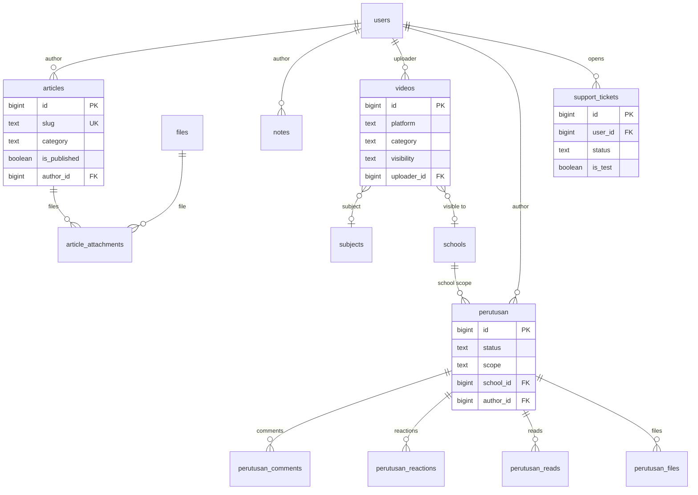

| Table | Column | Type | Null | Default | Notes |
|---|---|---|---|---|---|
| `articles` (PK, TS, LEG) | title | text | Y | | |
| | slug | text | Y | | unique |
| | excerpt | text | N | | |
| | content | text | Y | | sanitised rich text |
| | featured_image_file_id | bigint | N | | FK -> files.id |
| | youtube_url | text | N | | |
| | category | enum(E-article_category) | Y | | `tips_belajar`, `berita`, `motivasi`, `panduan_ibu_bapa`, `panduan_guru`, `kejayaan`, `umum` (mock `TIPS_BELAJAR` ...) |
| | grade_level | enum(E-article_grade) | Y | `all` | `all`, `darjah_1` .. `darjah_6` (mock `SEMUA`, `DARJAH_1`..) |
| | is_published, is_featured | boolean | Y | false | |
| | views, likes | int | Y | 0 | counters kept as the mock stores them |
| | author_id | bigint | Y | | FK -> users.id |
| | published_at | timestamptz | N | | |
| `article_attachments` (PK, TS) | article_id | bigint | Y | | FK on delete cascade |
| | file_id | bigint | Y | | FK -> files.id (name, mime, size live on the file) |
| | label | text | N | | |
| `banners` (PK, TS, LEG) | title | text | Y | | |
| | description | text | N | | |
| | image_file_id | bigint | N | | FK -> files.id |
| | banner_type, link_type, target_audience | text | Y | | open strings in the mock/.cloud; no CHECK until profiled |
| | external_url | text | N | | |
| | display_order | int | Y | 0 | |
| | start_date, end_date | date | N | | |
| | is_active | boolean | Y | true | |
| `videos` (PK, TS, LEG) | video_url | text | Y | | |
| | platform | enum(E-video_platform) | Y | | `youtube`, `vimeo`, `dailymotion`, `tiktok`, `facebook`, `other` (mock `Youtube`, ...) |
| | external_id, thumbnail_url | text | N | | |
| | title | text | Y | | |
| | description | text | N | | |
| | category | enum(E-video_category) | Y | | `motivasi`, `tutorial`, `tips-spm`, `ceramah`, `lain-lain` (kept: contains hyphens, mock values) |
| | subject_id | bigint | N | | FK -> subjects.id |
| | visibility | enum(E-video_visibility) | Y | `global` | `global`, `school` |
| | school_id | bigint | N | | FK -> schools.id (required when `school`) |
| | uploader_id | bigint | Y | | FK -> users.id |
| | views | int | Y | 0 | |
| `video_schools` (PK, TS) | user_id | bigint | Y | | FK -> users.id; mock store `content.videoSchools {userId, schoolId}`: per-school visibility is prototype-only |
| | school_id | bigint | Y | | FK -> schools.id; `unique (user_id, school_id)` |
| `notes` (PK, TS, LEG) | title | text | Y | | |
| | summary | text | N | | |
| | content | text | Y | | |
| | subject | enum(E-note_subject) | Y | | `matematik`, `sains`, `bahasa_melayu`, `bahasa_inggeris`, `sejarah` (mock; not a FK to `subjects`) |
| | note_type | enum(E-note_type) | Y | | `FORMULA`, `RINGKASAN`, `LENGKAP`, `TIPS_TRICKS`, plus `MIND_MAP`, `FLASHCARD`, `CHEAT_SHEET` in the mock repository type (proposed lower-case codes in E-note_type) |
| | grade | text | Y | | free label in the mock |
| | is_published | boolean | Y | false | |
| | views, downloads | int | Y | 0 | |
| | author_id | bigint | Y | | FK -> users.id |
| `perutusan` (PK, TS) | title | text | Y | | |
| | body | text | Y | | |
| | youtube_url | text | N | | |
| | is_pinned, is_public | boolean | Y | false | |
| | status | enum(E-perutusan_status) | Y | `draft` | `draft`, `scheduled`, `published` |
| | scheduled_at | timestamptz | N | | |
| | scope | enum(E-perutusan_scope) | Y | | `national`, `school` |
| | school_id | bigint | N | | FK -> schools.id (required when `school`) |
| | author_id | bigint | Y | | FK -> users.id |
| `perutusan_files` (PK, TS) **[P table]** | perutusan_id | bigint | Y | | FK on delete cascade (mock embeds `images[]` and `documents[]`) |
| | file_id | bigint | Y | | FK -> files.id |
| | kind | enum(E-perutusan_file_kind) | Y | | `image`, `document` |
| `perutusan_reactions` (PK, TS) | perutusan_id, user_id | bigint | Y | | FKs; `unique (perutusan_id, user_id)` **[P]** (one reaction per user) |
| | type | enum(E-reaction_type) | Y | | `like`, `love`, `thanks` |
| `perutusan_comments` (PK, TS) | perutusan_id, user_id | bigint | Y | | FKs |
| | body | text | Y | | |
| | status | enum(E-comment_status) | Y | `pending` | `pending`, `approved`, `rejected` |
| `perutusan_reads` (PK, created_at) | perutusan_id, user_id | bigint | Y | | FKs; `unique (perutusan_id, user_id)` |
| | read_at | timestamptz | Y | | `reads` counter is computed |
| `screenshots` (PK, TS) | file_id | bigint | Y | | FK -> files.id (mock: fileName, originalName, size, mimeType) |
| | original_name | text | Y | | |
| | uploaded_by_id | bigint | Y | | FK -> users.id |
| `audio_kbat_sets` (PK, TS, LEG) | title | text | Y | | |
| | education_level_id, subject_id | bigint | Y | | FKs |
| | status | enum(E-audio_kbat_status) | Y | `draft` | `draft`, `pending_review`, `approved`, `archived` |
| | source_label, instructions | text | N | | |
| | sections | jsonb | Y | `[]` | `[{no,title,audioFileName,transcript,questionFrom,questionTo}]` |
| | questions | jsonb | Y | `[]` | `[{no,questionText,optionA..D,correctAnswer,marks,kbatLevel,dskpSpId,explanation}]` |
| | created_by_id | bigint | Y | | FK -> users.id |
| `support_config` (PK, TS) | email, whatsapp_number | text | Y | | singleton row (`check (id = 1)`) |
| `support_tickets` (PK, TS, LEG, TEST) | user_id | bigint | Y | | FK -> users.id |
| | subject | varchar(255) | Y | | `SUBJECT_MAX = 255` [mock] |
| | body | text | Y | | free text, personal content |
| | status | enum(E-ticket_status) | Y | `open` | mock stores BM words `dibuka`, `dalam_proses`, `menunggu_balas`, `selesai`, `ditutup`; proposed codes `open`, `in_progress`, `awaiting_reply`, `resolved`, `closed` (plan 14.7 "BM status -> English"; OQ-DM-05) |
| | admin_reply | text | N | | |

`audio_kbat_sets.sections/questions` are jsonb because the set is authored and stored as one document in the mock and student play is BE-24 scope (D53(a)) (G-11 exception; the card BE-24 lists only the admin and listing routes). `audio_kbat_attempts` (mock) is backlog (3.13). Index `(slug)` unique on articles; `(status, created_at)` on tickets; `(user_id, created_at)`.

---

### 3.12 Migration control tables (ETL)

Owner: BE-34, Prisma file `etl.prisma` (`public` schema). The audited BE-28/BE-29 cards now use these tables (the old `migration_*` names are gone **[rev2]**). Columns follow plan 14.4. Staging (`staging_cloud`, `staging_my`) and archive (`archive_cloud`) are **schemas of raw mirror tables created by SQL** (`staging_cloud.sql`, BE-27), not Prisma models, and are not described here; they are dropped and recreated per rehearsal and never serve the API.

| Table | Column | Type | Null | Default | Notes |
|---|---|---|---|---|---|
| `etl_runs` (PK, created_at) | mode | enum(E-etl_mode) | Y | `dry_run` | `dry_run`, `apply` |
| | sources | text[] | Y | | `cloud`, `my` |
| | entity_set | text[] | Y | | entities in this invocation |
| | git_sha | text | N | | |
| | input_hash | text | Y | | `--apply` refuses unless a dry-run on the same hash passed |
| | status | enum(E-etl_status) | Y | `running` | `running`, `succeeded`, `failed` **[P]** |
| | started_at, finished_at | timestamptz | Y / N | | |
| | counters | jsonb | N | | per-entity counters (G-11) |
| `etl_checkpoints` (PK, TS) | run_id | bigint | Y | | FK -> etl_runs.id |
| | entity | text | Y | | `unique (run_id, entity)` |
| | last_key | text | N | | last processed source key |
| | batch | int | Y | 0 | |
| `etl_id_map` (PK, created_at) | legacy_source | text | Y | | |
| | entity | text | Y | | |
| | legacy_id | text | Y | | `unique (legacy_source, entity, legacy_id)` |
| | new_id | text | Y | | decimal string or uuid text **[P]** (one column for both key types) |
| `etl_rejects` (PK, created_at) | run_id | bigint | Y | | FK -> etl_runs.id |
| | entity | text | Y | | |
| | legacy_id | text | N | | |
| | reason | enum(E-etl_reject_reason) | Y | | `UNKNOWN_ENUM`, `ORPHAN_PARENT`, `DUPLICATE_KEY`, `INVALID_VALUE`, `UNSUPPORTED` (upper case in the plan) |
| | column_name | text | N | | |
| | offending | text | N | | the offending **enum value or a hash only**, never a personal value (BE-NFR-11) |
| `etl_recon` (PK, created_at) | run_id | bigint | Y | | FK -> etl_runs.id |
| | entity | text | Y | | |
| | source_count, eligible_count, loaded, rejected | int | Y | | eligible = after documented exclusions |
| | expected_delta | int | Y | 0 | a documented number |
| | status | enum(E-recon_status) | Y | | `ok`, `mismatch` **[P]** |

---

### 3.12a Modules added to B1 by D53(a) (owner cards BE-41 to BE-48)

Owner decision D53(a), 2026-10-19: B1 is every module reachable in the prototype. The cards BE-41 to BE-48 are committed; **each table below is copied from the "DB tables" section of its card, and the card wins** (columns, checks and keys). Where a card departs from the mock the card says so; where a card contradicts the mock this section notes it. M18 Amaran is BE-21 (UD-4, `amaran_interventions`, no mock write route); M09 Audio KBAT attempts are BE-24 (`audio_kbat_attempts`, columns in 3.11 when the card is extended). Mapping-matrix proposals of the cards are in GAP-33 to GAP-40 (section 6).

#### BE-41: M06 SPM hub (the /spm hub, not replaced by M28)

Owned by this card (bigint identity ids as decimal strings, G-01; English enum codes as text + check).

| Table | Columns (all `not null` unless stated) | Keys, checks, indexes |
|---|---|---|
| `spm_subject_configs` | `id`, `subject_id` (FK `subjects.id`), `grp` text (`teras`, `elektif`), `display_order` int, `databank_order` int null (null = not on the Tahun Lepas list), `target_type` text null (`spm`, `custom`, `latihan`), `target_size` int null, `created_at`, `updated_at` | `unique (subject_id)`; checks on `grp` and `target_type`; `check ((target_type is null) = (target_size is null))`. Replaces the mock `SPM_SUBJECTS` constants (19 rows, from `mock/data/config.ts`: group order, databank order, targets) |
| `spm_tracking_sets` | `id`, `subject_id` (FK), `year` int, `set_no` int, `dskp_tagged` int default 0, `created_at`, `updated_at` | `unique (subject_id, year, set_no)`; index `(subject_id, year)`. Status, ready count and bank size are **computed on read** (G-15), never stored |
| `spm_tracking_set_questions` | `set_id` (FK cascade), `question_id` (FK `questions.id`), `position` int | `unique (set_id, position)`, `unique (set_id, question_id)`; index `(question_id)` |
| `spm_mock_exams` | `id` uuid (see open question 4), `user_id` (FK), `subject_id` (FK), `subject_label` text (the S11 option text, snapshot), `paper_number` smallint (`1`, `2`), `status` text (`in_progress`, `submitted`), `created_at`, `submitted_at` null, `score` int null, `max_score` int, `percent` numeric(5,2) null, `grade` text null (`A+`, `A`, `B+`, `B`, `C`, `D`, `E`, `G`), `is_test` boolean default false | index `(user_id, created_at desc)`; checks on enums; `is_test` stamped from Mod Pelajar (G-07) |
| `spm_mock_exam_items` | `id`, `mock_exam_id` (FK cascade), `item_no` int, `question_id` bigint null (FK `questions.id`, on delete set null), `question_text` text, `options` text[] null (Paper 1 only), `model_answer` text, `student_answer` text null, `marks` int null, `max_marks` int, `feedback` text null, `topic` text | `unique (mock_exam_id, item_no)`. A snapshot of the question as served, so a later edit of the bank cannot change a sat mock (G-18) |
| `duta_profiles` | `id`, `slug` text, `name`, `initials`, `tier` text (`bintang`, `inspirasi`, `tetamu`), `tagline`, `subject` text, `state` text, `rating` numeric(3,2), `is_active` boolean, `created_at`, `updated_at` | `unique (slug)`. **Provisional owner** (the mock hosts `GET /api/duta/recommendations` in M06; the real owner M24 is not built). Rows are fictitious in seeds |

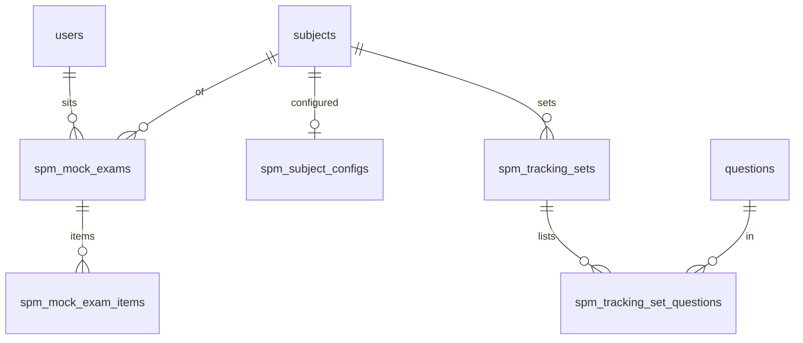

#### BE-42: M07 PKSK

Owned by this card (bigint identity ids as decimal strings, G-01; English enum codes as text + check).

| Table | Columns (all `not null` unless stated) | Keys, checks, indexes |
|---|---|---|
| `pksk_domains` | `id`, `bahagian` text (`A`, `B`, `C`), `name`, `name_en`, `code`, `icon` text, `color` text, `display_order` int, `is_active` boolean default true, `created_at`, `updated_at` | `unique (code)`; check on `bahagian`; index `(bahagian, display_order)`. Reference data, 15 rows (below) |
| `pksk_packages` | `id`, `name`, `level` text (`T1`, `T4`, `ALL`), `created_at`, `updated_at`, `legacy_source`, `legacy_id` | `unique (legacy_source, legacy_id)`; check on `level`. Reference data, 3 rows (below). Provisional owner: the mock hosts it for M19 which has no card |
| `pksk_accesses` | `id`, `user_id` (FK), `package_id` (FK), `granted_by_id` null (FK `users.id`), `granted_at` timestamptz, `expires_at` date null, `status` text (`active`, `revoked`), `revoked_at` timestamptz null, `created_at`, `updated_at`, `legacy_source`, `legacy_id` | `unique (legacy_source, legacy_id)`; check on `status`; index `(user_id)`, `(granted_at desc, id desc)`. Several rows per user are allowed (BR-M07-14). The mock's display status (`active`, `expired`, `revoked`) is computed, never stored |
| `pksk_exam_attempts` | `id`, `user_id` (FK), `level` text (`T1`, `T4`), `completed_at` timestamptz, `score_pct` numeric(5,1), `bahagian_a_pct`, `bahagian_b_pct`, `bahagian_c_pct` numeric(5,1), `grade` text (`A`, `B`, `C`, `D`, `E`), `is_test` boolean default false, `created_at` | index `(user_id, level, completed_at desc)`; only completed attempts are stored. Not an M05 session and credits no syiling (SQ-M07-03) |
| `pksk_mastery` | `id`, `user_id` (FK), `level`, `domain_id` (FK), `mastery_pct` smallint (0 to 100), `is_test`, `created_at`, `updated_at` | `unique (user_id, level, domain_id)`; absent row means 0 |
| `pksk_practice_loads` | `id`, `user_id` (FK), `level`, `domain_id` (FK), `loaded_at` timestamptz | `unique (user_id, level, domain_id)`; upserted when a practice set is served and deleted when it is submitted; it only supplies the session start time (BR-M07-26 (1)) |

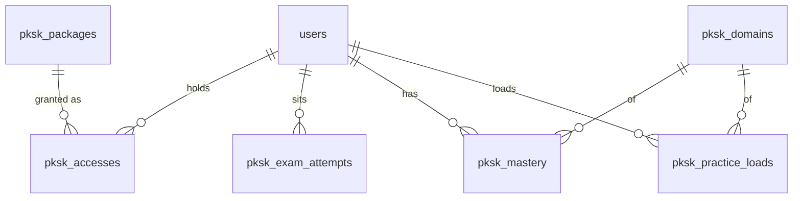

#### BE-43: M13 Cikgu Alesa (AI through the BE-36 adapter)

New (owner this card): `chat_threads`, `chat_messages`, `rph_plans`, `essay_markings`, `pbd_tags`. Read through other owners' services: users (BE-05), subjects (BE-08), classes and enrolments (BE-17), practice answers (BE-12).

| Table | Columns (types per G-01 to G-10) | Keys and indexes |
|---|---|---|
| `chat_threads` | `user_id` FK users, `created_at`, `updated_at`, `is_test` | index `(user_id, updated_at)`; legacy columns (G-03) |
| `chat_messages` | `thread_id` FK cascade, `user_id` FK (copy of the thread owner, for the quota query), `role` check `user`/`bot`, `text`, `tool` null check `mark_essay`/`rph`/`practice`, `tool_hops` smallint check 0/1, `tokens_in`, `tokens_out` int, `created_at`, `is_test` | index `(user_id, created_at)` for the daily count; `(thread_id, created_at)`; legacy columns |
| `rph_plans` | `user_id` FK, `subject_name` (<=100), `level` check D1..D6/T1..T5, `tajuk` (<=200), `class_name`, `lesson_date` date, `duration_minutes` smallint check 15..240, `time_slot`, `tema`, `pengajaran_keperluan` (nullable text), `status` check `generated`, `source` check `form`/`chat`, `content` text, `thread_id` FK null, `created_at`, `is_test` | index `(user_id, lesson_date desc, id desc)` |
| `essay_markings` | `user_id` FK, `rubric_key` check the six keys, `subject_name`, `level`, `student_name`, `essay_title` (all nullable free text), `essay_text`, `marks` int, `max_marks` int, `comment`, `thread_id` FK, `created_at`, `is_test` | index `(user_id, created_at desc, id desc)` |
| `pbd_tags` | `user_id` FK (teacher), `classroom_id` FK, `student_id` FK users, `sp` text, `skor` numeric(4,1), `tp` smallint check 1..6, `status` check `pending`/`approved`, `created_at` (roll-up time), `approved_at` null, `is_test` | `unique (user_id, classroom_id, student_id, sp)`; partial index on `status = 'pending'` by `(user_id, created_at desc)` |

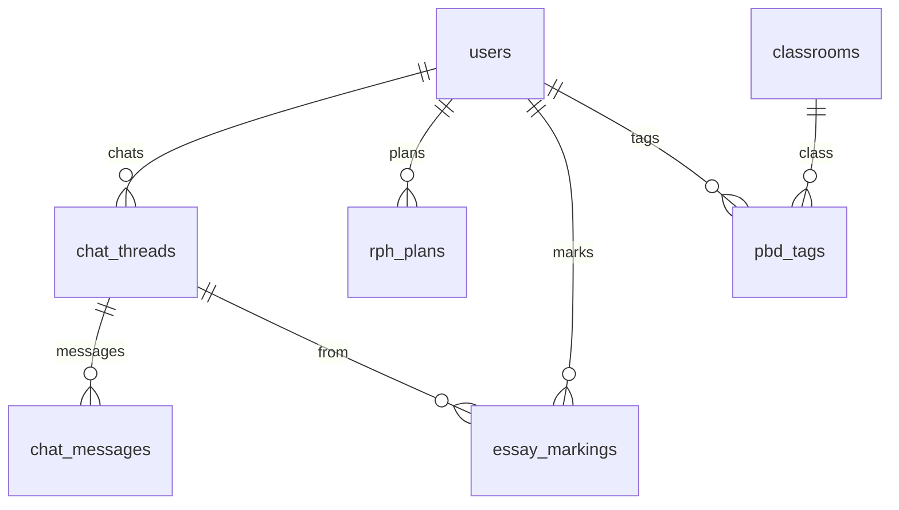

#### BE-44: M16 battle, standings, tournaments (M16-01..21, M16-42..45)

All owned by this card. Conventions: G-01 (bigint identity ids serialised as decimal strings; **uuid** for `battles` and `battle_invitations`, which are session-like records and whose uuid is already the wire id), G-02 / G-03 (`LEG` columns only where noted), G-04 (`timestamptz`; the stored epoch-millisecond twins `createdAtMs` of the mock are computed, never stored), G-05 (English codes as `text` + `check`), G-07 (`is_test` where an admin or Mod Pelajar session can write), G-08, G-09 (no soft delete). Columns are proposed from the mock row types (`[P]`); the PR finalises names and records them in the mapping matrix and in data model section 3.14 (Open question 9).

| Table | Purpose and key columns | Notes |
|---|---|---|
| `battles` | uuid PK; `mode` (`quick_match`, `school_battle`, `challenge`, `queue_join`); `question_type` (`biasa`, `pksk`, `spm`); `subject_id` FK subjects null; `pksk_domain_id` bigint null (no FK, Open question 6); `pksk_target_level` (`T1`, `T4`) null; `level_id` FK education_levels null (the queue owner's level at creation); `answered` smallint; `winner` (`A`, `B`) null; `status` (`active`, `finished`, `forfeited`, `abandoned`); `finished_at` null; `is_test`; `created_at` | `LEG+H` (migratable: `.cloud` `battles`). Index `(status, created_at)`. Winner is stored when the battle ends |
| `battle_participants` | `battle_id` FK, `side` (`A`, `B`), `user_id` FK users, `school_id` FK schools null (school **at battle time**), `is_bot` boolean, `score` int, `correct` smallint; unique `(battle_id, side)` | `LEG` (`.cloud` `battle_participants`). The mock keeps scores in wide columns (`scoreA`, `correctA`, ...); this normalised shape is the `.cloud` one and the service re-assembles the wide view. Indexes `(user_id)`, `(school_id)` for the standings |
| `battle_questions` | `battle_id` FK, `position` smallint 1..10, `question_id` FK questions; unique `(battle_id, position)` | The ten questions drawn once at creation (the mock's `questionIds[]`; a list of rows is a table, G-11). Born in v2, no `LEG` |
| `battle_answers` | `battle_id` FK, `user_id` FK, `position`, `question_id`, `option_id` smallint 0..3 null (null = timeout), `correct`, `seconds` smallint 0..15, `points` int; unique `(battle_id, user_id, position)` | Holds the human's answers and the bot's pre-computed answers (the mock stores both at answer time). Born in v2, no `LEG` |
| `battle_queues` | bigint identity PK (wire: decimal string); `owner_id` FK, `mode` (`quick_match`, `school_battle`), `question_type`, `subject_id`, `pksk_*`, `open_to_all` boolean, `status` (`waiting`, `incoming_challenge`, `matched`, `expired`, `abandoned`), `challenger_user_id` FK null, `battle_id` FK null, `polls` int, `wait_polls` int, `last_polled_at`, `joiner_user_id` FK null, `joiner_outcome` (`pending`, `matched`, `rejected`, `expired`) null, `created_at` | Transient. The mock's `sim` field is a test hook and is **not** stored (default behaviour is the mock's `match` mode). Index `(owner_id)`. Not migrated (transient) |
| `battle_invitations` | uuid PK; `sender_id`, `receiver_id` FK users, `question_type`, `subject_id`, `pksk_*`, `status` (`pending`, `accepted`, `declined`, `expired`), `created_at` | Transient. Index `(receiver_id, status)`. Not migrated (transient) |
| `tournaments` | uuid PK; `title` text (1..255); `description` text; `education_level_id` (`tingkatan4`, `tingkatan5`, `spm`); `format` (`single_match`, `knockout`, `league`, `hybrid`); `groups_count` smallint null; `question_mode` (`subject`, `exam_paper`, `random_mix`); `subject_id` FK null; `exam_paper_id` null (always null: refused); `total_questions`; `time_window_minutes`; `top_n_scoring`; `min_participants`; `registration_opens_at`, `registration_closes_at` timestamptz null; `status` (`draft`, `registration`, `ongoing`, `completed`); `created_by` FK users; `created_at` | Born in v2 (no `.cloud` source), no `LEG`. The mock's `liveMatch` is never written by any route or job (only test fixtures set it), so there is no column; the API returns `null`. Index `(status, registration_opens_at)` |
| `tournament_subjects` | `tournament_id` FK, `subject_id` FK; unique pair | The mock's `mixedSubjectIds[]` (list of rows is a table) |

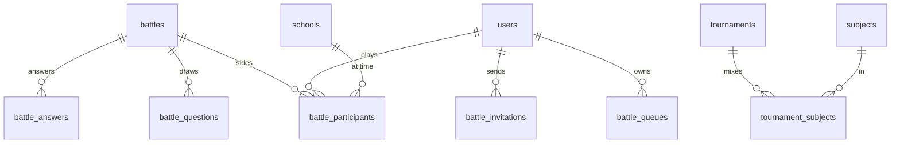

#### BE-45: M16 games hub, papan-bijak, leagues, Sekolah Bersaing, admin games (M16-22..41, M16-46..52)

All owned by this card. Conventions as in BE-44: G-01 (bigint identity ids as decimal strings; **uuid** for `game_sessions`, which is session-like; the six-character code is the natural key of `game_rooms`), G-04, G-05, G-07 (`is_test` on user-written rows), G-08, G-09. Columns are proposed from the mock row types (`[P]`); the PR finalises names and records them in the mapping matrix and in data model section 3.14 (Open question 10).

| Table | Purpose and key columns | Notes |
|---|---|---|
| `game_rooms` | `code` text(6) PK (random, unique; drawn from a named PRNG stream, retried on collision); `game` (the six room games); `subject` (`MATEMATIK`, `BAHASA_MELAYU`, `BAHASA_INGGERIS`, `SAINS`, `SEJARAH`) stored as an English code of the subject (Open question 5); `grade_level` (`DARJAH_1`..`DARJAH_6`, `TINGKATAN_1`..`TINGKATAN_5`); `match_mode` (`same_grade`, `same_level`, `custom`); `grade_min`, `grade_max` smallint null; `max_players` smallint; `host_id` FK users; `status` (`waiting`, `playing`, `finished`, `closed`); `started_at`, `finished_at` null; `state` jsonb null; `is_test`; `created_at` | `LEG` (`.cloud` `game_rooms`; transient, completed rooms only if the lead wants history, Open question 9). `state` is the engine document of the mock (`RoomState`: round, question pool ids, cursor, board, positions, meters, words, facts, team scores, log, round clock); it is a transient document written whole and never queried: an explicit G-11 exception to be recorded in the data model. Index `(status, created_at)`, `(host_id)` |
| `game_room_players` | `room_code` FK, `user_id` FK, `team` smallint null, `points` int, `correct` smallint, `is_bot` boolean, `joined_at`; unique `(room_code, user_id)` | `LEG` (`.cloud` `game_room_players`). Index `(user_id)` |
| `game_standings` | `game` (the six room games), `user_id` FK, `wins` int, `jumlah` int, `skor` int, `betul` int, `reached_at` timestamptz; unique `(game, user_id)` | Lobby leaderboards. Born in v2 (no `.cloud` source), no `LEG`. The mock's `orderKey` (stored order of the observed seed) is replaced by the identity `id` (creation order) as the last tie-break, and the seed inserts rows in the observed order |
| `game_sessions` | uuid PK; `user_id` FK; `game` text check (`betul-salah`, `cabaran-kilat`, `tembak-jawapan`, `susun-jawapan`, `kad-memori`, `jutawan`); `darjah` smallint null; `item_count` smallint null; `max_score` int null; `score` int; `coins_computed` int; `coins_credited` int; `is_new_record` boolean; `submitted_at` null; Jutawan columns: `jutawan_subject_id` FK null, `jutawan_level` smallint, `jutawan_lifelines` smallint, `jutawan_removed_options` smallint[] (the 50:50 removal for the current question, empty otherwise), `jutawan_over` boolean; `is_test`; `created_at` | `LEG` (`.cloud` `game_sessions`: `game_id`, `score`, `result`; see mapping). The session id on the wire is the uuid string (the mock's `tf_`, `speed_`, `shoot_`, `ws_`, `mem_`, `jut_` prefixes are not carried; the client treats it as opaque). Unique use: one submit per session. Index `(user_id, game)` |
| `game_session_items` | `session_id` FK, `position` smallint, `question_id` FK questions; unique `(session_id, position)` | The ids served in a solo payload or Jutawan run (the mock's `itemIds`), needed to check a submit and the Jutawan current question. Born in v2, no `LEG` |
| `personal_bests` | `user_id` FK, `game` text, `best_score` int; unique `(user_id, game)` | Born in v2 |
| `jutawan_stats` | `user_id` FK unique, `best_level` smallint, `games` int | Born in v2 |
| `spins` | `user_id` FK, `spin_date` date (Malaysia calendar day), `segment_index` smallint 0..7, `type` (`syiling`, `nothing`), `value` int, `credited` int, `created_at`; **unique `(user_id, spin_date)`** | Enforces one spin per Malaysia day race-safely. Born in v2 |
| `spin_stats` | `user_id` FK unique, `spins` int, `won` int, `last_spin_date` date null | Born in v2 |
| `pb_searches` | `user_id` FK, `subject`, `match_mode` (`same_grade`, `same_level`), `status` (`searching`, `matched`, `expired`, `cancelled`), `polls` int, `room_code` FK null, `created_at` | Transient. The mock's `sim` field is a test hook and is not stored. Index `(user_id, created_at)` |
| `game_settings` | one row: `boardgame_quiz_tiles` smallint 0..38 (check) | Born in v2. The "plain tiles" figure is derived: `max(0, 48 - 10 - quiz_tiles)` |
| `leagues` | bigint identity PK; `name` (1..255); `type` (`friendly`, `tournament`, `league`); `scope` (`school`, `district`, `state`, `national`); `subject_id` FK null; `game_mode` (`mixed`, `quiz`, `multiplayer`); `scoring_method` (`total_score`, `avg_accuracy`, `wins`); `start_date`, `end_date` date; `max_schools` smallint null (2..500); `invite_code` text(8) unique (A-Z0-9); `creator_id` FK users; `status` (`upcoming`, `ongoing`, `ended`); `created_at` | `.cloud` leagues are user groups with member users (divergent concept, data migration Q13): **no mapping** until the lead answers, so no `LEG` columns are needed yet; if Q13 says "keep both", add them in a follow-up migration (Open question 9) |
| `league_class_levels` | `league_id` FK, `level` (`D1`..`D6`, `T1`..`T5`); unique pair | The mock's `classLevels[]` (list of rows is a table) |
| `league_schools` | `league_id` FK, `school_id` FK, `joined_at`; unique `(league_id, school_id)` | |
| `league_standings` | `league_id` FK, `level`, `school_id` FK, `peserta` int, `skor` numeric(10,1), `purata` numeric(5,1), `sort_order` int | Stored output of an hourly job in the mock, never recomputed (OQ-M16-09, BR-M16-34); B1 is seed-only (Open question 7) |
| `sekolah_bersaing_weeks` | `week_start` date (Monday), `rank` smallint, `school_id` FK, `aktif_pct` numeric(5,1), `streak_avg` numeric(5,1), `nota_per_10` numeric(5,1), `is_anonymous` boolean; unique `(week_start, rank)` | Stored weekly snapshot; the weekly job is undefined (OQ-API-B4-14, Open question 7). `.cloud` `school_battle_rankings` is an aggregate and is not migrated |

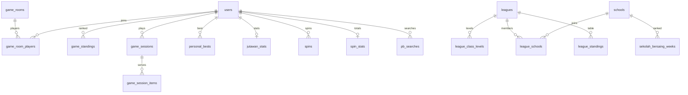

#### BE-46: M20 Marketplace (buyer slice)

New (owner this card): `marketplace_categories`, `marketplace_sellers`, `marketplace_products`, `marketplace_product_images`, `marketplace_reviews`. Reads `users` only for the FK.

| Table | Columns (types per G-01 to G-10) | Keys and indexes |
|---|---|---|
| `marketplace_categories` | `slug` unique, `name`, `icon` (text, verbatim from the mock e.g. `fa-pencil-ruler`) | static reference data, seeded |
| `marketplace_sellers` | `user_id` FK users unique, `shop_name`, `description` null, `phone`, `whatsapp`, `status` check `pending`/`active`/`suspended`/`banned`, `verified_at` null, `whatsapp_clicks` int default 0, `created_at` | index `(status)`; legacy columns |
| `marketplace_products` | `seller_id` FK null (platform product), `name`, `slug` unique, `category_id` FK, `price` numeric(10,2), `original_price` numeric(10,2) null, `description` null, `condition` check `new`/`used`, `stock_status` check `available`/`out_of_stock`, `status` check `active`/`draft`/`rejected`, `shipping_method` check `pickup`/`postage`/`cod`/`free`, `shipping_fee` numeric(10,2) null, `location` text not null default `''`, `views` int default 0, `created_at`, `updated_at` | indexes `(status, category_id)`, `(seller_id)`, `(created_at desc, id)`; legacy columns |
| `marketplace_product_images` | `product_id` FK cascade, `position` smallint (1 = "Utama"), `url` text | `unique (product_id, position)` |
| `marketplace_reviews` | `product_id` FK cascade, `user_id` FK, `rating` smallint check 1..5, `text`, `created_at` | index `(product_id, created_at desc)`; read only in B1 (no submission route; empty in the seed) |

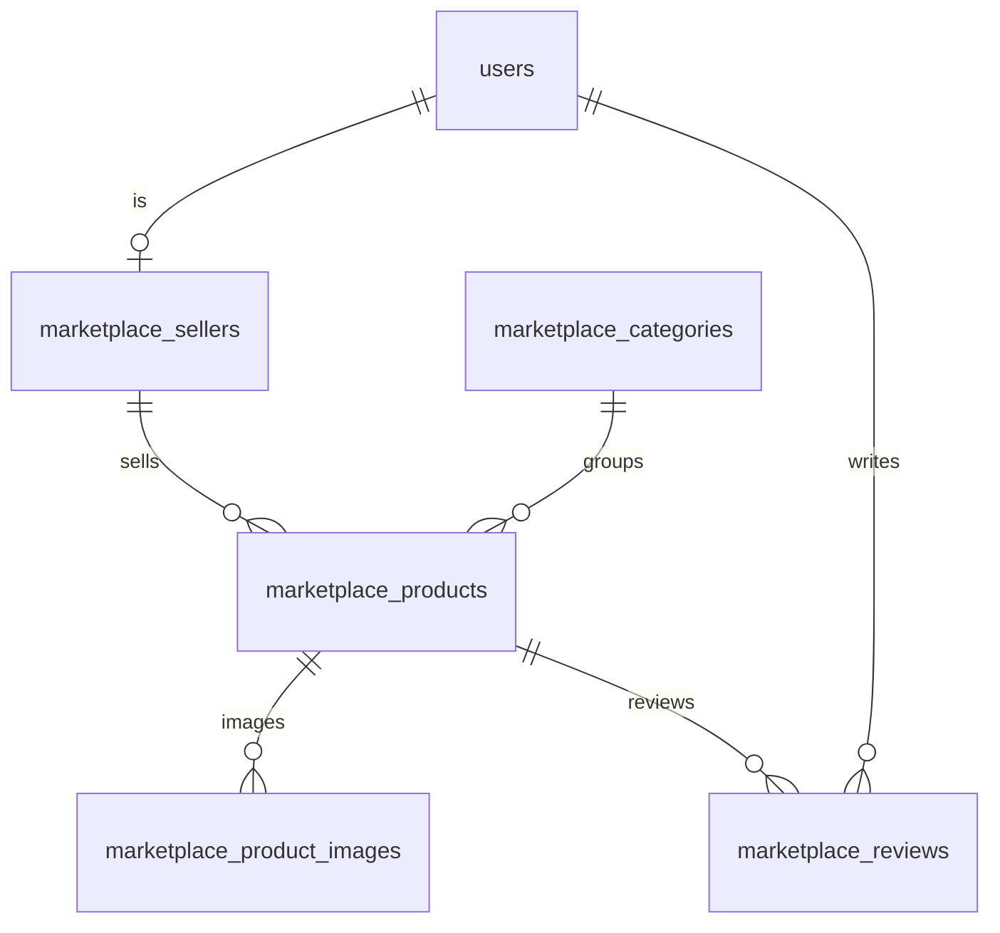

#### BE-47: M21 Mohon Keluarga Angkat (student side only; Penaja out, D48)

New (owner this card): `foster_applications`. Reads `users` only through BE-05's `findByEmail`.

| Column | Type | Notes |
|---|---|---|
| id | bigint identity | wire: decimal string |
| student_id | bigint FK users, not null | the student found by e-mail |
| applicant_user_id | bigint FK users, not null | session user |
| applicant_role | text, not null | role code of the session user at submission, stored raw |
| student_category | text, not null, check in the five values | verbatim wire values (Open questions 2) |
| family_income_range | text, null, check null or the four values | verbatim wire values |
| reason | text, not null | up to 5,000 characters |
| status | text, not null, default `pending`, check `pending`/`approved`/`matched`/`rejected` | only `pending` is ever written in B1 |
| created_at | timestamptz | |
| is_test | boolean default false | G-07: stamped from the session mode |
| legacy_source, legacy_id | text null, `unique (legacy_source, legacy_id)` | G-02 |

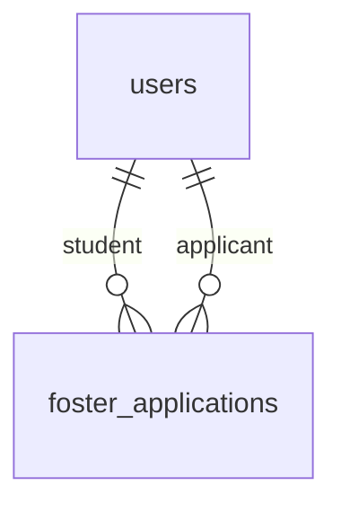

#### BE-48: M25 Heatmap Topik Lemah

None created. Read only, through owners' repositories: `practice_answers` (BE-12, columns `user_id`, `chapter_id`, `is_correct`, `is_test` only), `chapters` and `subjects` (BE-08). No table, no cache table, no materialised view in B1 (G-15: derived values are not stored twice).

No table. This is a read model (section 5): computed from `practice_answers`, `chapters` and `subjects`.

Notes from the cards: `duta_profiles` (BE-41) has a **provisional owner** (the mock hosts `GET /api/duta/recommendations` in M06; the real owner M24 is not built). `pksk_packages` and `pksk_accesses` can receive .cloud rows (BE-42); `pksk_domain_id` on `battles` has no FK (BE-44, open question 6). `leagues` have no .cloud mapping (data-migration Q13). The mock `documents` table of M20 and the `sponsors`, `foster_sponsorships` tables of M21 are not created.

---

### 3.13 Mock stores without a card (backlog and mock-only)

These mock stores exist and have endpoints or seeds but **no B1 card**, or are computed/mock-only. They get no table until a card exists (G-12); their shape is recorded so the owner card does not have to rediscover it. "Source" = the mock store; ".cloud" = migration candidate if the feature is promoted.

#### Backlog with a plausible table (columns from the mock)

| Mock store (module) | Candidate table | Key columns | .cloud | Why not B1 |
|---|---|---|---|---|
| `m26.tuitionCentres` | `tuition_centres` | `{name, city, state, active_pupils}` | none | M26 deferred |
| `m26.moodCheckins` **[rev2]** | `mood_checkins` | `{user_id, mood happy\|okay\|sad\|stressed, reason, checkin_date (Malaysia day)}`; free text is sensitive | `mood_checkins` (`checked_in_on`) | no card creates it (plan 14.7 names BE-22/BE-29; URS OQ-24: not migrated) |
| (none) | `settings`, `feature_flags` | `settings {key, value, group}`; `feature_flags {slug, enabled, audience}` | `settings`, `feature_flags` | Sistem stores (V2-T27), OWN-5 |

#### Teacher economy (backlog, not B1: D53 OWN-10, owner decision 2026-10-19)

Moved here from 3.7. Not built in B1; kept so the owner card does not have to rediscover the shape. Tables: `teacher_wallets`, `teacher_ledger`, `teacher_rewards`, `teacher_redemptions`, `cash_withdrawals`, `teacher_badges`, `teacher_badge_awards`.

| Table | Column | Type | Null | Notes |
|---|---|---|---|---|
| `teacher_wallets` (PK, TS) | user_id | bigint | Y | FK -> users.id, unique |
| | balance, total_earned, questions_count | int | Y | default 0 |
| `teacher_ledger` (PK, created_at, append-only) | user_id | bigint | Y | FK -> users.id |
| | amount | int | Y | |
| | description | text | Y | |
| `teacher_rewards` (PK, TS) | name, description | text | Y | |
| | category | enum(E-teacher_reward_category) | Y | `general`, `digital`, `physical`, `voucher` |
| | cost_coins | int | Y | |
| | stock, max_per_user, max_per_month | int | N | |
| | image_file_id | bigint | N | FK -> files.id **[P]** |
| | is_active | boolean | Y | default true |
| `teacher_redemptions` (PK, TS) | user_id | bigint | Y | FK -> users.id |
| | reward_id | bigint | Y | FK -> teacher_rewards.id |
| | cost_coins | int | Y | snapshot |
| | status | enum(E-teacher_redemption_status) | Y | `pending`, `processing`, `delivered`, `cancelled` (mock uppercase) |
| | debited | boolean | Y | default false |
| `cash_withdrawals` (PK, TS) | user_id | bigint | Y | FK -> users.id |
| | coins | int | Y | |
| | cash_sen | int | Y | integer sen |
| | bank_name, bank_account, account_holder | text | Y | **personal and financial data**: encrypt at rest or do not build; never logged (BE-NFR-11) |
| | status | enum(E-cash_status) | Y | `pending`, `approved`, `processing`, `paid`, `rejected` (mock uppercase) |
| | admin_note | text | N | |
| | paid_debited | boolean | Y | default false |

| Table | Column | Type | Null | Notes |
|---|---|---|---|---|
| `teacher_badges` (PK, TS, LEG) | name, icon | text | Y | |
| | threshold | int | Y | |
| | bonus_coins | int | Y | 0 |
| | is_active | boolean | Y | true |
| `teacher_badge_awards` (PK, TS, LEG) | user_id | bigint | Y | FK -> users.id |
| | badge_id | bigint | Y | FK -> teacher_badges.id; `unique (user_id, badge_id)` |

#### Mock-only or computed stores (never a table)

| Mock store | Why it is not a table |
|---|---|
| `curriculum.legacyTopics`, `legacySubtopics` | grade-and-subject coded legacy topics of the .my prototype; no .cloud source, no card |
| `questionMasterNotes` (`MasterNote`: note text, trap text, confidence, flagged, teacher approved, regen count) | AI master notes (BE-10 serves `GET /api/master-notes` as a stub); M25 external AI |
| `questionQualityAudit` | one row `{lastAuditAt}`; replaced by `quality_audits` |
| `m04 jutawan questions`, `coverageExcluded`, SPM pool facets | mock facets of virtual datasets (D11) |
| `practice.subjectiveCounts`, `practice.spmProgress`, `practice.pupilSubjectAccuracy` | fixtures/aggregates derived from the answer log |
| the Kirkpatrick session aggregate (`KaSessionRow`, 20,991 virtual rows) | virtual dataset of aggregates; computed from `practice_sessions` |
| `m08.rankingEntries`, `standings`, `itemStatistics`, `itemSummaries`, `activity` | rankings, standings and item analysis are SQL read models over the answer log (section 5); the stored rows carry `generated`/`observed` mock flags |
| `kirkpatrick.schoolScores`, `alesaPredictions`, `studentConsistency` | computed (rows carry an `observed` flag); BE-20 caches them only if the mock persists them (it does not need to) |
| `m18.correctionSubjects` | computed per school and subject |
| `cikgu.testState` | test hook |

---
## 4. Enums

Every enum used in a persisted column. Storage is `text` + `CHECK` (G-05). "Mock value" is given where the mock or .cloud stores something different from the proposed English code; the card decides at build time (OQ-DM-05). **BM label source** names the file where the UI maps the code to its Malay label; labels are never stored. "(UI-owned)" = the label map lives in the module's `lib/` or SRS and is not a data concern.

### 4.1 Identity, schools, subscriptions

| Enum | Column(s) | Codes | Mock value / note | BM label source |
|---|---|---|---|---|
| `E-role` | `user_roles.role`, `user_scopes.role`, `sessions.active_role`, `sessions.mode_return_role`, `audit_events.actor_role`, `question_status_events.actor_role`, `feedback.role` | `admin`, `school_admin`, `ppd_officer`, `teacher`, `student`, `parent`, `sponsor` | Older requirement keys `admin_sekolah`, `pegawai_ppd`; mock also had `jpn_officer` and `unmapped` (both removed). .cloud strings map by T-01 (`pelajar`->`student`, `guru`->`teacher`, `ibu_bapa`->`parent`, `penaja`->`sponsor`, `admin_sekolah`->`school_admin`, `pegawai_ppd`->`ppd_officer`, `admin`->`admin`). | `packages/contract/src/common/enums.ts` (descriptions); `src/modules/m02-users-schools/lib/user-list.ts` (`ROLE_LABELS`) |
| `E-scope_level` | `user_scopes.level`, `audit_events.scope_level` | `national`, `state`, `district`, `school`, `class`, `self` | contract | `docs/requirements/v2-portals.md` section 2 (scope chip text is server-formed) |
| `E-mode_kind` | `sessions.mode_kind` | `mod_pelajar` | open union by design: add values, never change a meaning | `src/shells` banner copy (UI-owned) |
| `E-reset_channel` | `password_resets.channel` | `email`, `ic` | **[P]** | (UI-owned) |
| `E-faith` | `user_settings.faith` | `muslim`, `hindu`, `buddhist`, `christian`, `none` | mock `Faith`; sensitive (OQ-DM-13) | `src/modules/m01-authentication/api/types.ts` (UI-owned) |
| `E-notification_category` | `notifications.category` | `system`, `reminder`, `milestone` | `notifications.type` is an open lowercase code | (UI-owned) |
| `E-import_kind` | `import_jobs.kind` | `users`, `students` | **[P]** | (UI-owned) |
| `E-import_mode` | `import_jobs.mode` | `paste`, `csv` | mock `ImportMode` | `src/modules/m02-users-schools/lib/import-options.ts` (`IMPORT_MODE_LABELS`) |
| `E-school_type` | `schools.type` | `SK`, `SMK`, `SJK(C)`, `SJK(T)`, `MRSM`, `SBP` | kept verbatim: they are official school-type abbreviations, not UI words | n/a (abbreviations) |
| `E-package_education_level` | `school_packages.education_level` | `spm`, `primary`, `lower_secondary` | mock | `src/modules/m02-users-schools/lib/subscription-options.ts` |
| `E-school_form_level` | `school_packages.form_level` | `t4`, `t5`, `d1_d6`, `t1_t3` | mock (`T4`, `T5`, `D1_D6`, `T1_T3` as package codes) | same |
| `E-form_level` | `user_packages.form_level` | `t4`, `t5` | mock `FormLevel` | same |
| `E-package_tier` | `school_subscriptions.package_tier` | `basic`, `full` | "Pemantauan" / "Penuh" | same |
| `E-subscription_status` | `school_subscriptions.status` | `active`, `grace`, `expired`, `cancelled` | the API also answers `none` (no row, not stored); .cloud values profiled (T-02) | `src/modules/m02-users-schools/lib/subscription-options.ts` |

### 4.2 Curriculum and question bank

| Enum | Column(s) | Codes | Mock value / note | BM label source |
|---|---|---|---|---|
| `E-stage` | `education_levels.stage` | `primary`, `lower_secondary`, `upper_secondary` | mock `Stage` | (UI-owned, M03) |
| `E-node_kind` | `curriculum_nodes.kind` | `grouping`, `unit`, `sk`, `sp` | exam D9 (`Bidang/Theme`, `Tajuk`, `SK`, `SP`) | `docs/reference/dskp/README.md` |
| `E-question_status` | `question_versions.status`, `question_status_events.from_status/to_status` | `draft`, `review`, `approved`, `published`, `archived` | **[P] codes** for Draf, Semakan, Lulus, Terbit (Diterbitkan), Diarkib (v2-question-bank 4.1); **D54(a): the real API uses this v2 lifecycle on the wire, the mock is realigned at the http switch; exact codes remain an open question (OQ-DM-05, OQ-API-B2-27).** Mock today: the M04 mock has `draft`, `pending_review`, `approved`, `rejected`, `archived` where `approved` means live; .cloud has `draf`, `diluluskan`, `ditolak`, `diarkib`. BE-10 and BE-15 say `draft`/`published`; no card spells the middle codes (OQ-DM-05). | `src/modules/m04-question-bank/lib/question-list.ts`, `src/ds/copy.ts` |
| `E-archive_reason` | `question_versions.archive_reason` | `superseded`, `withdrawn`, `source_takedown` | **[P]** from "Diarkib (digantikan)", AC-14, AC-17.3 | (UI-owned) |
| `E-question_type` | `question_versions.type` | `mcq`, `match`, `short`, `structured`, `working`, `essay`, `drawing`, `table` | exam D1 slugs; mock `mcq`, `true_false`, `short_answer`, `fill_blank`, `essay` map per Appendix B | exam D1 (BM labels in the table: Aneka Pilihan, Padanan / Lengkapkan Petikan, Jawapan Pendek, Berstruktur, Pengiraan dengan Langkah Kerja, Karangan / Respons Terbuka, Lukisan / Graf, Isi Jadual) |
| `E-answer_mode` | `question_parts.mode`, `blueprint_sections.allowed_modes`, `paper_sections.allowed_modes` | `mcq`, `match_letter`, `short_text`, `numeric`, `working`, `essay`, `drawing`, `table_fill` | exam D2 (P1: mcq, short_text, numeric, working, essay, match_letter; P2: drawing, table_fill) | exam D2 |
| `E-drawing_kind` | `question_parts.drawing_kind` | `graph`, `diagram`, `sketch` | exam D2 | exam D2 |
| `E-reveal` | `question_parts.reveal` | `after_submit`, `never` | exam D2 (kept from .cloud) | n/a |
| `E-key_kind` | `answer_keys.kind` | `option`, `accepted`, `mapping`, `points`, `rubric` | exam D3 (`model_answer` folded into points/rubric; .cloud `single_key`, `accepted_values`, `mark_scheme_points`, `band_rubric`) | exam D3 |
| `E-point_code` | inside `answer_keys.content` (not a column) | `K`, `N`, `P`, `B`, `M`, `F`, `C` | exam D4.2 (display letters per subject, Q-S3) | `src/modules/m28-bijak-spm/domain/types.ts` (`PointCode`) |
| `E-question_language` | `question_versions.language`, `blueprints.language_mode`, `papers.language_mode` | `ms`, `en`, `ms_en`, `ar`, `jawi` | exam D8 writes `ms+en`; code uses `ms_en`; the mock has only `bm`/`en` and `scriptType` `rumi`/`arab`/`jawi`/`mixed` + `textDirection` | exam D8 |
| `E-level_scope` | `question_versions.level_scope`, `papers.level_scope` | `t4`, `t5`, `t4_t5` | m28 `CurriculumTag.level` (`T4`, `T5`, `T4+T5`); launch scope only (OQ-DM-26) | m28 (UI-owned) |
| `E-form_origin` | `question_versions.form_origin` | `t1_t3`, `t4`, `t5` | m28 (`T1-T3`, `T4`, `T5`) | m28 |
| `E-exam_type` | `question_versions.exam_type`, `source_papers.exam_type` | `sebenar`, `percubaan`, `modul`, `topikal`, `latihan` | exam D8 (BM words used as codes there; kept because they are the controlled vocabulary of the schema) | exam D8 |
| `E-source_kind` | `question_versions.source_kind`, `source_papers.source_kind` | `lpm_official`, `state_trial`, `school`, `publisher`, `teacher_own`, `ai_variant` | exam D8 | exam D8 |
| `E-rights_status` | `question_versions.rights_status`, `source_papers.rights_status`, `intake_batches.rights_status` | `own`, `school`, `official_lpm`, `third_party`, `unclear` | exam D10; the upload declaration (AC-17.1) says own work, school-owned, official KPM/LPM, commercial/third-party; the mock `COPYRIGHT_OPTIONS` are `sendiri`, `rasmi`, `pihak-ketiga` (three values) | `docs/requirements/v2-question-bank.md` AC-17.1 |
| `E-question_source_type` | `questions.source_type` | `pdf`, `excel`, `manual`, `ai_variant` | AC-16.1; mock `SourceType` (`textbook`, `dskp`, `trial`, `marking_scheme`, `ai_generated`) is a different axis (Appendix B) | v2-question-bank US-16 |
| `E-family_relation` | `questions.family_relation` | `variant` | exam D11; exact duplicates are blocked, not stored as a family | n/a |
| `E-tag_kind` | `question_tags.kind` | `pool`, `pksk_domain`, `pksk_level` | **[P]** (OQ-DM-17) | n/a |
| `E-stimulus_kind` | `stimuli.kind` | `passage`, `image`, `diagram`, `table`, `graph`, `map`, `infographic`, `audio` | exam D6 (the 7 .cloud kinds plus `audio`; the m28 prototype uses `diagram`, `passage`, `table`) | exam D6 |
| `E-group_scope` | `stimulus_groups.scope` | `section`, `paper` | exam D6 | n/a |
| `E-report_reason` | `question_reports.reasons[]` | `wrong_answer`, `confusing_question`, `wrong_options`, `missing_options`, `duplicate`, `typo`, `other` | already English in the mock; two label sets (MCQ and structured) share the codes | `src/modules/m04-question-bank/lib/report-reasons.ts` |
| `E-report_source` | `question_reports.source` | `spm`, `structured_attempt`, `latihan`, `revision`, `teacher_databank`, `quiz`, `papan_bijak` | mock `ReportSource` | same file |
| `E-report_status` | `question_reports.status` | `pending`, `reviewed`, `fixed`, `dismissed` | mock stored values; BM `Menunggu`, `Disemak`, `Diperbaiki`, `Ditolak`; the v2 doc adds a fifth tab `Dikeluarkan` (the mock treats it as `fixed` + inactive question) (OQ-DM-18) | `src/modules/m04-question-bank/lib/report-reasons.ts` (`STATUS_LABELS`) |
| `E-submission_status` | (dropped, D53 OWN-1; was `question_submissions.status`) | `pending`, `processing`, `done`, `rejected` | mock | superseded by `E-batch_status` |

### 4.3 Intake and AI

| Enum | Column(s) | Codes | Note | BM label source |
|---|---|---|---|---|
| `E-paper_type` | `intake_batches.paper_type` | `general`, `trial`, `dskp`, `textbook`, `exercise_book`, `exam`, `other` | **[P]** codes. Mock `PAPER_TYPES`: Percubaan SPM, Soalan Umum, Peperiksaan Sebenar, Buku Latihan, Lain-lain (a subset; `Percubaan SPM` -> `trial`, `Peperiksaan Sebenar` -> `exam`); v2-question-bank 4.2 adds DSKP and Buku Teks | `src/modules/m28-bijak-spm/admin/intake/types.ts` (b2e1033) |
| `E-text_source` | `intake_pages.text_source` | `text_layer`, `ocr` | [mock `PageText.source`] written `text-layer` in the mock | same |
| `E-intake_qtype` | `intake_items.item_type` | `mcq`, `structured`, `short`, `essay` | [mock `IntakeQType`] | same |
| `E-batch_status` | `intake_batches.status` | `submitted`, `processing`, `ready_for_review`, `failed` | Dihantar, Sedang diproses, Sedia untuk semakan, Gagal (plan 15.2). The mock `IntakeStatus` is `draf` / `semakan` (BE-38 open question 1) | plan 15.2 |
| `E-intake_file_role` | `intake_files.role` | `paper`, `scheme` | **[P]** | n/a |
| `E-intake_file_status` | `intake_files.status` | `uploaded`, `rendering`, `ocr`, `extracting`, `done`, `failed` | **[P]** | n/a |
| `E-ocr_status` | `intake_pages.ocr_status` | `pending`, `not_needed`, `done`, `failed` | **[P]** | n/a |
| `E-job_state` | `jobs.state` | `queued`, `running`, `succeeded`, `failed`, `cancelled` | plan 15.2 | n/a |
| `E-item_review_state` | `intake_items.review_state` | `generated`, `needs_review`, `accepted`, `rejected`, `duplicate` | Dijana, Perlu semakan, Diterima, Ditolak, Pendua (BE-38) | v2-question-bank 4.1 |
| `E-item_event` | `intake_item_events.event` | `created`, `field_edited`, `tag_decision`, `region_redrawn`, `reextracted`, `accepted`, `rejected`, `marked_duplicate`, `split`, `merged` | **[P]** | n/a |
| `E-duplicate_kind` | `duplicate_links.kind` | `exact`, `possible`, `variant` | Pendua tepat, Mungkin pendua, variant | v2-question-bank US-06 |
| `E-duplicate_decision` | `duplicate_links.decision` | `pending`, `not_duplicate`, `merged`, `rejected`, `linked_version`, `linked_variant` | Bukan pendua, Gabung, Tolak | v2-question-bank AC-06.3 |
| `E-ai_run_kind` | `ai_extraction_runs.kind` | `extract_paper`, `suggest_tags` | provider interface methods | n/a |
| `E-ai_provider` | `ai_extraction_runs.provider`, `ai_usage_logs.provider` | `mock`, `anthropic`, `openai`, `gemini`, `openai_compatible` | plan 15.2 writes `openai-compatible` | n/a |
| `E-ai_run_status` | `ai_extraction_runs.status` | `queued`, `running`, `succeeded`, `failed`, `cancelled` | **[P]** | n/a |

### 4.4 Practice, wallet, gamification, rewards

| Enum | Column(s) | Codes | Mock value / note | BM label source |
|---|---|---|---|---|
| `E-practice_mode` | `practice_sessions.mode` | `random`, `chapter`, `revision`, `past_year`, `latih_tubi`, `ramalan`, `mission`, `remedial`, `question_set`, `pksk` | mock `PracticeMode`; .cloud free string `latih_tubi`, `chapter`, `spm`, `battle`, `pksk` (GAP-17) | `src/modules/m06-spm/lib/history.ts`; `src/modules/m05-practice/mock/handlers/assigned.ts` |
| `E-session_status` | `practice_sessions.status` | `in_progress`, `completed` | mock | (UI-owned) |
| `E-pksk_level` | `practice_sessions.pksk_target_level` | `T1`, `T4` | mock | (UI-owned) |
| `E-spm_grade` | `spm_targets.target_grade` (A+ to E), `risk_profiles.grade_low/high` (A+ to G) | `A+`, `A`, `A-`, `B+`, `B`, `C+`, `C`, `D`, `E`, `G` | SPM grade symbols, kept verbatim; M05 targets use the first nine, `G` appears only as a result grade (a `CHECK` on `spm_targets` excludes it) | n/a |
| `E-attempt_scope` | `structured_attempts.scope` | `spm` | mock | n/a |
| `E-attempt_track` | `structured_attempts.track` | `bahasa` | mock | n/a |
| `E-ledger_type` | `coin_ledger.type` | `earn`, `spend`, `convert`, `bonus`, `refund` | mock; .cloud vocabulary profiled (T-02) | `src/modules/m14-gamification/lib/student/s11-format.ts` |
| `E-challenge_type` | `challenges.challenge_type` | `quiz_count`, `accuracy`, `topic_variety`, `streak`, `time_spent` | mock | (UI-owned, M14) |
| `E-challenge_metric` | `challenges.metric` | `sessions`, `correct`, `best_accuracy`, `best_correct_in_session`, `chapters`, `minutes`, `streak` | the mock values are camelCase (`bestAccuracy`, `bestCorrectInSession`); snake_case proposed | (UI-owned) |
| `E-difficulty` | `challenges.difficulty` | `easy`, `medium`, `hard` | mock | (UI-owned) |
| `E-rarity` | `achievements.rarity` | `common`, `rare`, `epic`, `legendary` | mock | `src/modules/m14-gamification/lib/student/kadkongsi-lib.ts` |
| `E-criterion_kind` | `achievements.criterion_kind` | `practiceSessions`, `streak`, `lifetimeSyiling`, `accurateSessions`, `subjects`, `mysteryOpenings`, `completions`, `mathCorrect`, `scienceCorrect`, `fastAnswers`, `referrals`, `unlocked`, `answersAccuracy`, `perfectDays` | mock camelCase kept verbatim as identifiers of a rule engine, proposed snake_case in the table; **[P]** columns | (UI-owned) |
| `E-draw_status` | `draws.status` | `draft`, `open`, `closed` | mock | (UI-owned) |
| `E-syiling_reward_type` | `syiling_rewards.type` | `voucher`, `physical`, `experience`, `digital`, `subscription` | mock stores upper case | (UI-owned) |
| `E-hadiah_category` | `rewards.category` | `flagship`, `ewallet`, `telco`, `gaming`, `streaming`, `food_beverage`, `ecommerce`, `education`, `entertainment` | mock | `src/modules/m15-rewards-shop/api/types.ts` (`HADIAH_CATEGORY_LABELS`) |
| `E-delivery_method` | `rewards.delivery_method` | `manual`, `api`, `instant` | mock | same |
| `E-hadiah_redemption_status` | `reward_redemptions.status` | `pending_parent_consent`, `pending_admin`, `delivered`, `cancelled` | mock M15 | same |
| `E-cancelled_by` | `reward_redemptions.cancelled_by` | `admin`, `parent` | mock | same |
| `E-setting_key` | `gamification_settings.key` | `coins_per_question`, `cash_rate_coins`, `cash_rate_sen`, `min_cash_withdrawal`, `cash_withdrawal_enabled`, `reward_budget_sen_session`, `reward_budget_sen_month`, `current_session_year`, `flat_quiz_reward`, `games_award_syiling` | mock `SettingKey` | `src/modules/m14-gamification` (UI-owned) |
| `E-teacher_reward_category` | `teacher_rewards.category` | `general`, `digital`, `physical`, `voucher` | mock | (UI-owned) |
| `E-teacher_redemption_status` | `teacher_redemptions.status` | `pending`, `processing`, `delivered`, `cancelled` | mock stores upper case | (UI-owned) |
| `E-cash_status` | `cash_withdrawals.status` | `pending`, `approved`, `processing`, `paid`, `rejected` | mock stores upper case | (UI-owned) |

### 4.5 Exam / Bijak, classes, reports

| Enum | Column(s) | Codes | Mock value / note | BM label source |
|---|---|---|---|---|
| `E-blueprint_status` | `blueprints.status` | `draft`, `active`, `retired` | [card BE-15 **rev2**]; the mock `Blueprint.source` (`Disahkan`, `Spec`, `Draf`) is a different axis: column `blueprints.source`, enum `E-blueprint_source` `verified`, `spec`, `draft` **[P codes]** (OQ-DM-23) | `src/modules/m28-bijak-spm/pages` (UI-owned) |
| `E-blueprint_provenance` | `blueprints.provenance` | `data`, `paper`, `dskp`, `inferred` | exam D7 evidence tags | exam D7 |
| `E-blueprint_source` | `blueprints.source` | `verified`, `spec`, `draft` | **[P codes]** for the mock `Disahkan`, `Spec`, `Draf` | `src/modules/m28-bijak-spm/domain/types.ts` (`Blueprint.source`) |
| `E-confidence` | `blueprints.confidence`, `headcount_entries.confidence_override` | `high`, `medium`, `low` | exam D7; the M08 mock uses `Tinggi`, `Sederhana`, `Rendah` | (UI-owned) |
| `E-section_rule` | `blueprint_sections.rule_type`, `paper_sections.rule_type` | `all`, `choose` | exam D5 (.cloud `answer_all`, `choose_n`) | exam D5 |
| `E-paper_kind` | `papers.kind`, `exam_attempts.paper_kind` | `pilihan`, `jana` | m28 `PaperKind` ("Kertas Pilihan", "Jana Kertas") | m28 (UI-owned) |
| `E-paper_status` | `papers.status` | `draft`, `ready`, `published`, `withdrawn` | BE-15/BE-39 (card); exam D12 / US-12 say Draf, Semakan, Terbit, Diarkib (OQ-DM-24) | n/a |
| `E-answer_medium` | `paper_sections.answer_medium` | `on_paper`, `separate_book`, `omr` | exam D5 | exam D5 |
| `E-stimulus_policy` | `paper_sections.stimulus_policy` | `none`, `group`, `per_part` | exam D5 | exam D5 |
| `E-attempt_mode` | `exam_attempts.mode` | `exam`, `latihan` | m28 | m28 |
| `E-attempt_status` | `exam_attempts.status` | `in_progress`, `submitted`, `auto_submitted`, `abandoned` | m28 | m28 |
| `E-classroom_kind` | `classrooms.kind` | `classroom`, `school_class` | mock | (UI-owned, M10) |
| `E-enrolment_status` | `enrolments.status` | `active`, `removed` | mock | (UI-owned) |
| `E-enrolment_source` | `enrolments.source` | `code`, `teacher`, `school_admin`, `complimentary` | mock | (UI-owned) |
| `E-mission_type` | `missions.mission_type` | `latih_tubi`, `tracking_a`, `youtube` | mock | (UI-owned) |
| `E-remedial_status` | `remedial_tests.status` | `active`, `completed`, `cancelled` | mock | (UI-owned) |
| `E-question_set_status` | `question_sets.status` | `draft`, `scheduled`, `published` | mock; `src/modules/m10-teacher-class/mock/handlers/questions.ts` (`STATUS_LABELS`) | same |
| `E-headcount_mode` | `headcount_configs.mode` | `auto`, `manual` | mock | (UI-owned, M08) |
| `E-trend` | `risk_profiles.trend`, `headcount_entries.trend_override` | `up`, `stable`, `down` | the mock stores BM words `Meningkat`/`Stabil`/`Menurun` (M08) and `Naik`/`Turun`/`Stabil` (command center) for labels, and `up`/`down`/`stable` for `RiskProfileRow.trend` | `src/modules/m08-student-performance/api/headcount-types.ts` |
| `E-timeline_category` | `timeline_posts.category` | `certificate`, `achievement`, `activity`, `story`, `other` | mock `sijil`, `pencapaian`, `aktiviti`, `cerita`, `lain` (BM words as codes; OQ-DM-05) | `src/modules/m08-student-performance/lib/timeline/profile.ts` |
| `E-risk_level` | `risk_profiles.risk_level` | `critical`, `high`, `medium`, `low` | mock | (UI-owned) |
| `E-flag_level` | `monitoring_flags.level` | `review`, `excluded` | mock | (UI-owned, M11) |
| `E-alert_type` | `interventions.alert_type` | `mood`, `inactive`, `declining` | mock | (UI-owned, M12) |
| `E-mood` | `interventions.before_mood/after_mood`, `mood_checkins.mood` | `happy`, `okay`, `sad`, `stressed` | mock | (UI-owned, M12) |

### 4.6 Content and ETL

| Enum | Column(s) | Codes | Mock value / note | BM label source |
|---|---|---|---|---|
| `E-article_category` | `articles.category` | `tips_belajar`, `berita`, `motivasi`, `panduan_ibu_bapa`, `panduan_guru`, `kejayaan`, `umum` | mock upper case (`TIPS_BELAJAR`...) | `src/modules/m09-content/mock/data/labels.ts` (`CATEGORY_LABELS`) |
| `E-article_grade` | `articles.grade_level` | `all`, `darjah_1` .. `darjah_6` | mock `SEMUA`, `DARJAH_1`.. | same (`GRADE_LABELS`) |
| `E-video_platform` | `videos.platform` | `youtube`, `vimeo`, `dailymotion`, `tiktok`, `facebook`, `other` | mock `Youtube`, `Vimeo`, `Dailymotion`, `TikTok`, `Facebook`, `Other` | same (`PLATFORM_LABELS`) |
| `E-video_category` | `videos.category` | `motivasi`, `tutorial`, `tips-spm`, `ceramah`, `lain-lain` | mock values kept | same (`VIDEO_CATEGORY_LABELS`) |
| `E-video_visibility` | `videos.visibility` | `global`, `school` | mock | (UI-owned) |
| `E-note_subject` | `notes.subject` | `matematik`, `sains`, `bahasa_melayu`, `bahasa_inggeris`, `sejarah` | mock | `src/modules/m09-content` (UI-owned) |
| `E-note_type` | `notes.note_type` | `formula`, `ringkasan`, `lengkap`, `tips_tricks`, `mind_map`, `flashcard`, `cheat_sheet` | mock upper case (`FORMULA`...); the API type lists 4, the repository type 7 (profile .cloud values) | `src/modules/m09-content/lib/admin-articles-notes.ts` |
| `E-perutusan_status` | `perutusan.status` | `draft`, `scheduled`, `published` | mock | `src/modules/m09-content/mock/handlers/perutusan.ts` (`STATUS_LABELS`) |
| `E-perutusan_scope` | `perutusan.scope` | `national`, `school` | mock | (UI-owned) |
| `E-perutusan_file_kind` | `perutusan_files.kind` | `image`, `document` | **[P]** | n/a |
| `E-reaction_type` | `perutusan_reactions.type` | `like`, `love`, `thanks` | mock | (UI-owned) |
| `E-comment_status` | `perutusan_comments.status` | `pending`, `approved`, `rejected` | mock | (UI-owned) |
| `E-audio_kbat_status` | `audio_kbat_sets.status` | `draft`, `pending_review`, `approved`, `archived` | mock | `src/modules/m09-content/mock/handlers/admin-audio.ts` (`STATUS_LABELS`) |
| `E-ticket_status` | `support_tickets.status` | `open`, `in_progress`, `awaiting_reply`, `resolved`, `closed` | **mock stores BM**: `dibuka`, `dalam_proses`, `menunggu_balas`, `selesai`, `ditutup` (BR-M22-02); proposed English (plan 14.7) | `src/modules/m22-support-tickets/api/types.ts` (`TICKET_STATUS_LABELS`) |
| `E-etl_mode` | `etl_runs.mode` | `dry_run`, `apply` | plan 14.4 writes `dry-run`/`apply` | n/a |
| `E-etl_status` | `etl_runs.status` | `running`, `succeeded`, `failed` | **[P]** | n/a |
| `E-etl_reject_reason` | `etl_rejects.reason` | `UNKNOWN_ENUM`, `ORPHAN_PARENT`, `DUPLICATE_KEY`, `INVALID_VALUE`, `UNSUPPORTED` | plan 14.4 (upper case, kept as written) | n/a |
| `E-recon_status` | `etl_recon.status` | `ok`, `mismatch` | **[P]** | n/a |

---

## 5. Read models and views

Everything below is computed on read from the tables named, **excluding rows with `is_test = true`** (G-07) and filtered by `ScopeFilter` (G-16). They are SQL views, materialised views or `$queryRaw` aggregates behind the owning service; none has its own table unless stated. Index requirements are listed so the owning card can add them with the source table.

| Read model | Owner card | Source tables | Rule / index note |
|---|---|---|---|
| Student dashboard, subject config, chapter lists, history, progress, corrections | BE-13 | `practice_sessions`, `practice_answers`, `revision_queue`, `mastery`, `spm_targets`, `structured_attempts`, `wallets`, `streaks`, curriculum tables | index `practice_answers (user_id, subject_id, answered_at)`; dashboard target 200 ms with 100,000 answer rows (URS BE-NFR-15) |
| **Topic progress** (M03 BR-19) | BE-13 | `practice_answers` dimensions (`chapter_id`, `topic_id`), `chapters`, `topics` | derived on read, never stored; reads dimensions on the row, no join to the bank (BE-13 AC2) |
| Mastery percentages / weak-topic heatmap | BE-13 | `mastery` or the answer rows (URS OQ-19), `practice_answers` | open: stored counters versus derived; the heatmap route belongs to no card (URS OQ-13) |
| Subject question counts (`approvedCount`, `bankCount`) | BE-09 | `question_versions` (status `published`), `questions.live_version_no`, `subject_usage` | partial index on published versions (3.4) |
| Student analytics, class / level / school performance | BE-19 | `practice_answers`, `practice_sessions`, `enrolments`, `classrooms`, `users`, `schools`, `attempt_results` (scores only) | scope-filtered; Mod Pelajar rows excluded |
| Rankings and leaderboard, standings (week / month / all-time) | BE-19 | `coin_ledger`, `practice_sessions`, `practice_answers`, `users`, `schools` | replaces the mock `rankingEntries`/`standings` (which carry `generated`/`observed` flags); needs a period index on `coin_ledger (created_at)` |
| Item analysis (`ItemStatistic`, `ItemSummary`) for ppd / state / school | BE-19 | `practice_answers` grouped by question, `users`, `schools`, `ppds` | wrong counts, pupils, popular wrong option label; the mock persists these as fixtures, v2 computes them |
| Teacher report, monitoring overview and export | BE-20 | `enrolments`, `practice_*`, `monitoring_flags`, `users` | CSV/PDF export behind `PdfPort` |
| Kirkpatrick levels (reaction, learning, behaviour, results, chain, own view) | BE-20 | `feedback` (level 1), `practice_sessions`/`practice_answers` (level 2, replaces the virtual 20,991-session aggregate), `interventions`, `spm_history` (level 4); mood check-ins only if a card creates `mood_checkins` (URS OQ-24) | school scores, Alesa predictions and consistency are computed (the mock rows carry `observed` flags); cache only if the mock needs it |
| School admin dashboard, usage statistics, activity and monthly report, DSKP heatmap | BE-21 | `users`, `user_roles`, `classrooms`, `enrolments`, performance read models, `school_subscriptions` | no own tables ("`school_activity_daily` only if the mock persists it") |
| Command Center live data and drill-down, daily activity, badge holders | BE-22 | practice, performance, wallet, classes, users | polling-friendly ETag, no websockets; no `activity_events` table (the mock keeps no event log, BE-22 **[rev2]**) |
| Admin dashboard counts | BE-22 | users, schools, subscriptions, practice | |
| Weekly report | BE-19 | none | the mock returns 403 for every role (URS OQ-15) |
| Subscription `used` (students enrolled) and quota check | BE-25 | `school_subscriptions`, `enrolments`, `users` | |
| Pool counts and shortage report for "Jana Kertas" | BE-15 | `question_versions` (published), `question_tags` (kind `pool`), `questions.group_id`, `blueprint_sections` | a section target is met only by whole groups |
| Intake dashboard (submissions by status, queue size and oldest age, extraction success rate, tags accepted unchanged, duplicate rate, AI cost this month versus cap) | BE-40 | `intake_batches`, `intake_items`, `intake_item_events`, `duplicate_links`, `ai_usage_logs`, `ai_settings` | "no new tables unless a materialised view is justified in the PR" |
| Public landing counters | BE-06 | `users`, `schools`, `question_versions`, `practice_sessions` | computed from the DB, no hard-coded figures |
| Tier, level, achievement progress | BE-23 | `coin_ledger`/`wallets`, `practice_*` | tier derived from lifetime Syiling; `wallets.tier_id` is only a cache |
| Reconciliation and drift report | BE-30 | `etl_recon`, source and target counts | aggregates only, `.migration-out/` |

---

## 6. Mapping-matrix gaps

Comparison of this model with plan section 14.7 (the mapping matrix), `v2-data-migration.md` and the cards. **Proposed fixes go to the LEAD; the plan and the cards are not edited by this document.** "Row" = a row of the matrix. Severity: **H** blocks a loader or a schema card, **M** needs a decision before the ETL cards, **L** wording.

### 6.1 New tables with no mapping row (but a possible source)

| ID | Table(s) | Observation | Proposed fix | Sev |
|---|---|---|---|---|
| GAP-2 | `jpns`, `ppds` | The School row says "(+ derived JPN/PPD)" but names no target table and no card creates them; the mock and `GET /api/jpn` have them. | Add the two tables to BE-05 and name them in the School row (T-09, load wave W1). **Status: Applied to plan 14.7 (2026-10-19). School row targets `schools`, `jpns`, `ppds`.** | H |
| GAP-4 | `parent_invites` | The Parent link row mentions invite tokens ("unexpired only, else dropped") but its target column lists only `parent_links`. | Add `parent_invites` as target; BE-25 owns it. **Status: Applied to plan 14.7 (2026-10-19).** | L |
| GAP-5 | `comp_students`, `teacher_profiles` | .cloud has sources for both (`users.is_complimentary`; `users.teaching_subject`, `teaching_experience_years`, `teaching_qualification`), but the User row lists only `users, user_roles, user_scopes, user_settings`. | Extend the User row's target list; state the T-nn for each. **Status: Applied to plan 14.7 (2026-10-19). User row extended (`comp_students` flag only, `teacher_profiles`).** | M |
| GAP-7 | `spm_targets` | `users.spm_targets` (.cloud text, probably JSON) has no row. | Add a row (parse JSON to one row per subject; unknown shapes to `etl_rejects`), or declare it dropped. **Status: Applied to plan 14.7 (2026-10-19). Row added; the .cloud text shape is settled by the BE-27 profile (source unknown, OQ).** | M |
| GAP-8 | `referral_codes`, `referrals` | `users.referral_code` and `users.referred_by` (self-reference, two-pass load) have no row. | Add rows (BE-23 schema, BE-28/29 ETL) or declare dropped. **Status: Applied to plan 14.7 (2026-10-19).** | M |
| GAP-3 | `gamification_settings`, `settings`, `feature_flags` | **[rev2] narrowed.** `reward_settings` still has no row; the matrix lists `settings`/`feature_flags` as "Out of B1" while `v2-data-migration` 6.1 step 1 loads them. BE-28 now skips `settings` and `packages` and lists them in its report (BE-28 open question 2; URS OQ-24). | Map `reward_settings` -> `gamification_settings` (pivot to key/value rows) and align the 6.1 wording with BE-28. **Status: Applied to plan 14.7 (2026-10-19). `reward_settings` row added, `settings`/`feature_flags` in the "Out of B1" row, migration 6.1 note aligned with BE-28.** | L |
| GAP-21 | `mood_checkins` | **[rev2] still open, now deferred.** Plan 14.7 names BE-22 (schema) and BE-29 (ETL); BE-22 says no table is created and BE-29 does not migrate mood (URS OQ-24, default: not migrated). | Edit the matrix row to "not migrated / backlog" or assign a card. **Status: Applied to plan 14.7 (2026-10-19). Row is "not migrated" (backlog).** | M |
| GAP-22 | tables of the 134-table inventory with neither a row nor a deferral | `v2-data-migration` section 1 lists `packages`, `pksk_packages`, `pksk_accesses`, `student_notes`, `study_schedules`, `broadcasts`, `chatbot_conversations`, `chatbot_messages`, `dunning_logs`, `wellbeing_alerts`, `psychometric_results`, `aspirations`, `career_paths`, `universities`, `scholarships`, `reward_settings`; the "Out of B1" row names only battles, games, leagues, marketplace, sponsorship, duta, payments, invoices, settings, feature_flags, audit_logs, career, psychometric, wellbeing. | Extend the "Out of B1" row (or add rows) so every .cloud table is mapped, dropped or deferred; `packages` maps to `school_packages`. **Status: Applied to plan 14.7 (2026-10-19). "Out of B1" row extended; open: `packages` target OD-27 (BE-28 skips it).** | M |
| GAP-23 | `files` | Rows for Content (T-10) and any image-bearing entity rewrite paths, but no row names `files` as a target; `files` has no `legacy_*` convention stated in a card. | Add a `Files` row (T-10, `legacy_id` = source path) and put `files` in `migratable-models.json`. **Status: Applied to plan 14.7 (2026-10-19). `File` row added.** | M |
| GAP-32 | `curriculum_nodes`, `curriculum_tp_descriptors` | Seeded from `docs/reference/dskp/*.json`, not from .cloud (the .cloud `chapters` are Tingkatan 5 SP rows and do not match the official text). The matrix has no row saying "not from .cloud". | Add a "seeded, not migrated" row so nobody loads `chapters` into the node tree. **Status: Applied to plan 14.7 (2026-10-19).** | L |

### 6.2 Mapping rows whose target is not (exactly) in the model

| ID | Row | Target named | Problem | Proposed fix | Sev |
|---|---|---|---|---|---|
| GAP-6 | Notification | `notifications` (broadcast kind) | The model's `notifications` is per user (`user_id`, `read_at`). A .cloud broadcast (`target`, `recipients`, `sent_at`) with read state in `users.notifications_read_at` has no column. | Option A: the ETL fans each broadcast out into per-user rows with `read_at` taken from `notifications_read_at` (no new table, large). Option B: two tables `notification_broadcasts` + `notification_reads` read together with per-user rows. Decide before BE-29. **Status: Open: plan section 13 OD-21 (Notification row carries both options).** | H |
| GAP-9 | Reward shop | `rewards`, `reward_claims` | The mock has two catalogues (M14 Syiling rewards + claims, M15 Hadiah rewards + redemptions). Which one is .cloud `gifts`/`gift_redemptions` (`price_token`, `price_rm`, `cost_value_sen`, `stock`, `status`)? This model assumes `gifts` is the Hadiah catalogue (`rewards`, `reward_redemptions`) and names the M14 pair `syiling_rewards`/`reward_claims`. | Confirm the mapping and rename the matrix targets (`rewards`, `reward_redemptions`). **Status: Applied to plan 14.7 (2026-10-19). Targets `rewards`, `reward_redemptions`; the confirmation OQ-DM-07 stays open (default Hadiah).** | H |
| GAP-10 | Exam attempt | `exam_attempts` only | The score columns live in `attempt_results`; BE-29's table list names `attempt_results` ("scores only") but the matrix row does not. | Add `attempt_results` (and `section_scores`) to the row's target. **Status: Applied to plan 14.7 (2026-10-19).** | M |
| GAP-24 | Content | `audio_kbat` "same names" | BE-24's table is `audio_kbat_sets`. | Rename in the matrix. **Status: Applied to plan 14.7 (2026-10-19).** | L |
| GAP-14 | all rows with "ETL card BE-28/29" | `etl_*` | **Resolved [rev2]:** BE-28/29 now use the BE-34 `etl_*` tables; no `migration_*` tables remain. | none **Status: Applied to plan 14.7 (2026-10-19). `etl_*` note in the matrix legend.** | - |
| GAP-11 | Teacher question set, Challenge (teacher), Headcount, Mood | ETL card targets | **[rev2] changed shape.** BE-29 now loads feedback, interventions, timeline only "if the owning card has merged, otherwise skipped and listed", so the dependency gap is closed. What remains: the matrix names BE-28 for `question_sets` and BE-29 for `missions`/`headcount_*`/`mood_checkins`, but neither card lists those targets. | Remove those targets from the matrix or add them to the cards. **Status: Applied to plan 14.7 (2026-10-19). ETL card set to "none (GAP-11)" for `missions`, `headcount_*`, `question_sets`; open: BE-28/BE-29 owners add them if wanted.** | M |

### 6.3 Column-level gaps

| ID | Table / row | Gap | Proposed fix | Sev |
|---|---|---|---|---|
| GAP-1 | all | `packages/contract/src/common/ids.ts` and `v2-data-migration.md` X1/section 5 still say `legacy_cloud_id`; plan 14.2 says `legacy_source` + `legacy_id`. | Fix the comment and the migration doc to the plan wording (docs only). **Status: Applied to plan 14.7 (2026-10-19). Migration doc fixed; open: the comment in `packages/contract/src/common/ids.ts` (code, lead).** | L |
| GAP-12 | Headcount | .cloud is one aggregate row (`tov`, `rs`); the model has config + per-student entries. A target for the aggregate is missing. | Added as `headcount_configs.legacy_tov` / `legacy_rs` (**[P]**, nullable, explicitly named). Confirm. **Status: Applied to plan 14.7 (2026-10-19). Confirmation still wanted.** | M |
| GAP-13 | Feedback | The matrix keeps four scores; the mock `FeedbackRow` has only `nps` and `satisfaction`. | `feedback` gets nullable `usability`, `relevance`, `score`, `comment` and `nps` is nullable (done in 3.10). Confirm; contract must add them. **Status: Applied to plan 14.7 (2026-10-19).** | M |
| GAP-15 | School subscription | The matrix maps .cloud `quota` -> `question_limit`; the mock also requires `student_quota` (not null), which then has no source. | Decide: `student_quota` nullable for migrated rows, or `quota` is the student quota and `question_limit` stays null. Needs profiling. **Status: Open: plan section 13 OD-22 (School subscription row notes it).** | H |
| GAP-16 | AI usage | .cloud `ai_usage_logs` has `event`, `tool`, `tokens`, `cost_sen` (tutor/tool usage); the v2 table is extraction-oriented (provider, model, run, pages, tokens in/out). The matrix says "1:1". | Keep `event`/`tool` as nullable columns (done); map `tokens` -> `tokens_in`? Confirm before BE-29. **Status: Open: plan section 13 OD-23 (AI usage row notes it).** | M |
| GAP-17 | Practice session | `v2-data-migration` 4.4 says unknown `mode` values map to the nearest mode or "`random` with a flag" (`spm`, `battle` are not in the mock enum); plan 14.1 rule 3 says unknown enum values are rejected, never defaulted. The matrix says "`mode` mapped". | Decide: add `spm`/`battle` codes to `E-practice_mode`, or reject. The rule in 14.1 wins unless the lead says otherwise. **Status: Applied to plan 14.7 (2026-10-19). 14.1 rule 3 applies (reject); open: lead confirmation OD-24.** | H |
| GAP-18 | Practice session / answer | Plan section 5 lists `client_uuid` with `practice_answers`; data-migration 4.4 and the mock put it on the session. | Model: on `practice_sessions` (this document). Fix the plan text. **Status: Applied to plan 14.7 (2026-10-19). Plan section 5 text fixed (`client_uuid` is on `practice_sessions`).** | L |
| GAP-19 | Draw | `lucky_draws` has `winner_id`, `drawn_at`, `pool`; the mock `Draw` row has none of the first two. | Added `winner_user_id`, `drawn_at` (3.7); contract must expose the winner. **Status: Applied to plan 14.7 (2026-10-19).** | M |
| GAP-20 | Achievement | .cloud `criteria` is free text; the mock `criterion` is required and structured. The matrix says "legacy achievement without auto-unlock". | Added nullable structured columns + `legacy_criteria_text` (3.7). **Status: Applied to plan 14.7 (2026-10-19).** | M |
| GAP-25 | Exam attempt | The matrix lists header + scores + `section_scores`, "paper reference as snapshot title/year". `exam_attempts.paper_id` must be nullable and the snapshot columns exist (3.8). `.cloud mode`, `status` values (`attempt_statuses` lookup) need explicit maps to `exam`/`latihan` and the four statuses. | Add the two enum maps to the profile report list (BE-27). **Status: Applied to plan 14.7 (2026-10-19).** | M |
| GAP-26 | Practice answer | T-07 copies the legacy `difficulty` (1 to 5 integer, **not** TP) into `practice_answers.difficulty`, while v2 `difficulty_tp` is 1 to 6 (OQ-DM-20); `question_type` legacy values are copied verbatim. | Name the column semantics: `difficulty` = "legacy scale for historical rows, TP for new rows" or add `difficulty_scale`. **Status: Open: plan section 13 OD-26 (the matrix row states the legacy 1..5 scale).** | M |
| GAP-27 | User | Columns of .cloud `users` with no stated target: `kelas` (-> `class_label`), `bio`, `phone`, `referral_code`, `referred_by`, `parent_invite_token`, `notifications_read_at`, `teaching_*`, `spm_targets`, `is_complimentary`, `last_login_at`, `grade` derivation. | List each with its target (this model has a home for all of them). **Status: Applied to plan 14.7 (2026-10-19). Every column listed in the User row.** | M |
| GAP-28 | Challenge | The matrix says "`metric` mapped"; .cloud `challenges` has no `metric` (the mock column drives progress). | Define the map from .cloud `type`/`criteria` to `challenge_type` + `metric`, or leave `metric` null for legacy rows (then the mock requires it). **Status: Open: plan section 13 OD-25 (Challenge row notes it).** | M |
| GAP-29 | School | `schools.join_code` has no counterpart in the mock `School` type; `city` (mock) has no .cloud column in the migration doc. | `city` stays nullable; `join_code` is from .cloud (`join_code`, kept). **Status: Applied to plan 14.7 (2026-10-19).** | L |
| GAP-30 | Coin ledger | The matrix keeps `balance_after` and reconciles. The idempotency key `(user_id, source, source_id)` is null for migrated rows (no `ref_id` in .cloud); `source` must be one of the profiled values. | Confirm that migrated rows leave `source_id` null and are excluded from the idempotent-credit unique index (partial index, done in 3.7). **Status: Applied to plan 14.7 (2026-10-19).** | L |
| GAP-31 | Support ticket, Article, Note, Video | Enum maps are listed as "BM status -> English" only for tickets; articles, notes, videos use upper-case or mixed-case mock values (`TIPS_BELAJAR`, `Youtube`). | Add enum maps for every text column with a CHECK to the profile list (BE-27) per plan 14.2. **Status: Applied to plan 14.7 (2026-10-19).** | L |
| GAP-33 | M06 hub (BE-41) | No mapping row: none of the `spm_*` tables or `duta_profiles` is migratable (`.cloud` `spm_sets`/`spm_set_question` are plain lists, not migrated). | Add rows "not migrated" with the reason (BE-41 proposes this in its PR). **Status: Applied to plan 14.7 (2026-10-19).** | L |
| GAP-34 | PKSK (BE-42) | `pksk_packages` and `pksk_accesses` can receive .cloud rows (status word `aktif` to `active`); the four other tables are born in v2; .cloud `pksk_questions` are not migrated. Overlaps GAP-22. | Add rows for packages and accesses with BE-29 as the ETL card; "not migrated" for the rest. **Status: Applied to plan 14.7 (2026-10-19).** | M |
| GAP-35 | Cikgu Alesa (BE-43) | `chatbot_conversations`/`chatbot_messages` map to `chat_threads`/`chat_messages` "not migrated in B1"; `rph_plans`, `essay_markings`, `pbd_tags` have no source. | Add the rows as the card proposes. **Status: Applied to plan 14.7 (2026-10-19).** | L |
| GAP-36 | Battle (BE-44) | Rows proposed by the card: battle (reshape, `1v1` mode has no v2 code, its OQ 10), battle participant (pairs into sides A/B), queue and invites (drop), school battle ranking (drop, recomputed), tournaments/answers/questions/subjects (born in v2). | Add the five rows; ETL card BE-29, lead confirms. **Status: Applied to plan 14.7 (2026-10-19). Open: `1v1` mode code (BE-44 question 10).** | M |
| GAP-37 | Games (BE-45) | Rows proposed by the card: game catalogue (drop), game session (reshape, BE-29), game room and player (optional BE-29), league and member (not mapped, Q13), school battle ranking is not the target of `sekolah_bersaing_weeks`, the rest born in v2. | Add the rows; decide Q13 for leagues. **Status: Applied to plan 14.7 (2026-10-19). Open: league migration (data migration Q13).** | M |
| GAP-38 | Marketplace (BE-46) | `marketplace_sellers`/`marketplace_products` reshape with ETL "none in B1 (staged and profiled only)"; `marketplace_orders` drop (D14); categories, images, reviews have no source. | Add the rows as the card proposes. **Status: Applied to plan 14.7 (2026-10-19).** | L |
| GAP-39 | Keluarga angkat (BE-47) | `foster_applications` (.cloud: free-text `applicant_name`, no applicant user, no income range) ETL "none in B1" (Q7); `sponsors`, `foster_sponsorships` out of B1 (Penaja, D48). | Add the row; keep sensitive records unloaded until a user can be matched. **Status: Applied to plan 14.7 (2026-10-19).** | L |
| GAP-40 | Heatmap (BE-48) | Derived entity: no old table, no new table, no ETL (computed from `practice_answers`, `chapters`, `subjects`). | Add the "derived" row. **Status: Applied to plan 14.7 (2026-10-19).** | L |

Counts **[rev2]**: 32 findings numbered GAP-1 to GAP-32; GAP-14 is resolved, so 31 are open (6.1 = 10, 6.2 = 5 open + 1 resolved, 6.3 = 16). **[D53]** GAP-33 to GAP-40 (mapping rows proposed by cards BE-41 to BE-48, all in 6.3) bring the total to 40 findings, 39 open. **Status against plan section 14.7 (2026-10-19):** 35 applied to the matrix, 5 open (GAP-6, GAP-15, GAP-16, GAP-26, GAP-28; plan section 13 OD-21, OD-22, OD-23, OD-26, OD-25). Some applied rows keep a residual confirmation (GAP-1 contract comment, GAP-9, GAP-12, GAP-17, GAP-22 `packages`, GAP-36, GAP-37).

---

## 7. Open questions

`OQ-DM-n` are raised by this document. URS `OQ-n` and plan `OD-n` are referred to where they overlap. "Default" is what a developer does meanwhile; it is not a decision.

| ID | Question | Why it matters | Default until answered |
|---|---|---|---|
| OQ-DM-01 | **Closed [rev2].** The intake mock was read from commit `b2e1033` (read-only `git show`) and section 3.5 aligned with it. Its paths exist on `feature/v2-backend` only after the LEAD merges that commit. | n/a | n/a |
| OQ-DM-02 | **RESOLVED by D53 OWN-1 (2026-10-19):** one table, `intake_batches` (BE-37) is the Submission; `question_submissions` dropped from BE-10; `source_papers` stays the paper identity and rights register. | | |
| OQ-DM-03 | Is there a generic `settings` / `feature_flags` store in B1? | **[rev2]** BE-28 skips them (open question 2); no card owns them. | No; `gamification_settings` and `support_config` only. |
| OQ-DM-04 | **[rev2] superseded by URS OQ-24.** `mood_checkins` is created by no card. | The Kirkpatrick and Command Center reads that need mood. | Not created in B1. |
| OQ-DM-05 | English enum codes (X2): the mock stores Malay or upper-case values for ticket status, timeline category, trend labels, article categories, grade levels, platforms, note types, reward statuses, and the question lifecycle words. Confirm the proposed codes in section 4 (and the question status codes `draft`, `review`, `approved`, `published`, `archived`). | `CHECK` constraints and the contract enums are written once. | Section 4 codes. |
| OQ-DM-06 | **Closed [rev2].** BE-11 now creates `token_movements` and `tiers`. | n/a | n/a |
| OQ-DM-07 | Which mock catalogue is .cloud `gifts`? (GAP-9.) | The ETL target. | Hadiah (`rewards`). |
| OQ-DM-08 | **RESOLVED by D53(h) (2026-10-19):** questions and `sp_records` tag `curriculum_nodes` only; `dskp_bidang/sk/sp` is the teacher-created picking list. | | |
| OQ-DM-09 | `is_test` on counters: wallets, streaks, mastery, revision_queue, spm_targets, trial counter of an admin acting in Mod Pelajar are not separable by a row stamp. | Test activity leaks into the admin's own figures (not into aggregates, which exclude the admin's stamped rows). | Stamp rows and ledgers; counters belong to the admin account and are excluded from aggregates by `is_test` on their source rows. |
| OQ-DM-10 | What is `mission_items` (card BE-18)? This document reads it as the recipient list (`recipientIds[]`). | Completion tracking and notification. | Recipient rows. |
| OQ-DM-11 | `risk_profiles` and `sp_records` (BE-19 lists them as persisted) look like caches of the answer log; `sp_records` cannot be computed from `practice_answers` unless an SP tag is added to answer rows. Persisted or read model? | Write path and consistency. | Persisted as the card says; refreshed by the owner service. |
| OQ-DM-12 | IC lookup for `password/reset-ic` needs a **searchable** hash (keyed HMAC), while the mock uses a per-user salt. Key location and rotation? | Security design (BE-03/BE-06). | HMAC-SHA-256 with `IC_HASH_KEY` from the environment. |
| OQ-DM-13 | `user_settings.faith` is sensitive (data-migration section 5, Q7) but the spiritual-mode settings screen uses it. Keep the column? | PDPA. | Keep nullable, never migrated. |
| OQ-DM-14 | Does `import_jobs` need a per-row child table ("per-row results", BE-05) or is `failures jsonb` enough? | Report size and queries. | `failures jsonb` as the mock `ImportRun`. |
| OQ-DM-15 | Allowed values of `parent_links.relationship`. | Check constraint. | Free text, no CHECK. |
| OQ-DM-16 | The exam-board vocabulary (22 .cloud values + `lpm`, `mpsm`) and the Sejarah Bab -> SK lookup (exam D9) have no table in any card. | Tagging and filters. | `exam_board` is free text; the Bab lookup is not built. |
| OQ-DM-17 | What does BE-09 `question_tags` hold? | The card names the table only. | Non-curriculum tags: `pool`, `pksk_domain`, `pksk_level`. |
| OQ-DM-18 | Report status set: the mock stores four (`pending`, `reviewed`, `fixed`, `dismissed`); the v2 requirement shows five tabs (Menunggu, Disemak, Diperbaiki, Ditolak, Dikeluarkan). Add `removed`? | CHECK and counters equal rows (AC-19.1). | Four stored values; `Dikeluarkan` is derived from `fixed` + archived question. |
| OQ-DM-19 | BE-09 lists `questions` and `question_versions` without saying which columns live where. This document puts every editable fact (status, content, tags) on `question_versions` and identity/group/family on `questions`, with a denormalised `live_version_no`. Confirm. | It decides every query of BE-09/10/12/15/38. | As in 3.4. |
| OQ-DM-20 | Difficulty scale: legacy 1 to 5 (mock, practice filters, `question_imports.default_difficulty`, `practice_answers.difficulty` for migrated rows) versus TP 1 to 6 (`difficulty_tp`, exam D8). | Filters and statistics mix two scales. | `practice_answers.difficulty` keeps the legacy value for historical rows; new rows store TP. |
| OQ-DM-21 | What does `quality_audits` compute in v2 (the legacy quality-score semantics are not carried over, AC-29.3)? | Columns of the table. | A run log only. |
| OQ-DM-22 | Does a Bijak attempt credit the wallet? The mock result carries `coins = score * 2`, `points = score * 10` but calls no wallet. | `coin_ledger` source `bijak`, idempotency, leaderboard. | No wallet credit; store the figures in `attempt_results`. |
| OQ-DM-23 | **[rev2] narrowed.** `blueprints.status` is `draft`/`active`/`retired` (BE-15); only the codes for the mock `source` tag (`Disahkan`/`Spec`/`Draf`) are proposed. | CHECK. | `verified`, `spec`, `draft`. |
| OQ-DM-24 | Paper status: BE-15/BE-39 `draft`, `ready`, `published`, `withdrawn` versus exam D12 / US-12 `Draf`, `Semakan`, `Terbit`, `Diarkib`; BE-39 open question 1 asks the meaning of `ready`. | Contract enum and the publish workflow. | The card set; `ready` = all questions published and the paper conforms. |
| OQ-DM-25 | Subject codes differ between M03 (`MATH`, `SCI`, `ADDMATH`, `PHY`, `CHEM`, `BIO`) and the m28 prototype (`MAT`, `SN`, `SEJ`). Seeds need one map. | `papers.subject_id`, `blueprints.subject_id`. | M03 codes win; the m28 seed maps its codes. |
| OQ-DM-26 | `level_scope` is limited to `t4`, `t5`, `t4_t5` (launch scope D40b), but M05 practice and M03 cover Darjah 1 to Tingkatan 5 and the mock bank has questions for all levels. How will further levels be added? | Enum widening is a migration. | Widen the CHECK when a level is promoted; do not change meaning. |
| OQ-DM-27 | M03 `chapters`/`topics` (practice dimensions, chapter mode) versus the exam-schema tag (`unit`, `sp`): how does a v2 question get a `chapter_id` / `topic_id`? | Chapter-mode practice and `practice_answers.chapter_id` for new rows. | Optional `chapter_id`/`topic_id` columns on `question_versions` set by the reviewer; no automatic mapping. |
| OQ-DM-28 | Teacher economy tables (3.7): BE-23 open question 1 says build **no** teacher wallet logic beyond the mock's disabled state; the tables are still in the mock list. URS OQ-16 / D28(c) / migration Q10 are open. | 7 tables, one with bank details. | Specified, not built until answered. |
| OQ-DM-29 | PKSK fields on `practice_sessions` (`pksk_domain`, `pksk_target_level`) have no FK because PKSK is backlog. | Referential integrity later. | Plain nullable columns. |
| OQ-DM-30 (**UD-1, 2026-10-19:** the session is the contract cookie session with `X-CSRF-Token`; no Bearer; shape and `/api/session*` as in `@pp/contract`; the column list below stays proposed) | `sessions` key and columns are proposed (uuid, `token_hash`, `csrf_hash`, mode columns) because the card names the table only. | BE-03 design. | As in 3.1. |
| OQ-DM-31 | Are `user_scopes` rows stored for every grant or only where the scope is not derivable from the account? | Out-of-scope 404 logic and the ETL (BE-28 derives them for `pegawai_ppd`). | Only where not derivable. |
| OQ-DM-32 | The `audit_events.action` list is open (not a CHECK). Should it be closed? | Typo safety versus cross-card edits. | Open list, documented in 3.1. |
| OQ-DM-33 | **[rev2]** Intake: (a) the mock stores one batch document and offers no batch-level endpoint in the cards (BE-38 open question 1; catalogue IN-04/IN-05); (b) the shared stimulus of a batch has no staging table in any card (`intake_stimuli` here is **[P]**); (c) the mock `copyright` has `sendiri` for "own or school" while `E-rights_status` splits `own`/`school`. | Contract PR for BE-37/38 and the accept path. | As in 3.5; the lead adapts the client. |

---

## Appendix A: how the virtual datasets (D11) map to real tables

Source: ADR-0013, `src/mock/dataset/*`, `v2-data-migration.md` X5, TRACKER D11, D45.

| Mock dataset (owner) | Mock behaviour | v2 table | What changes |
|---|---|---|---|
| `users` (M01/M02), ~6,000 generated + 11 canonical accounts | deterministic rows, facets (`pool`, `hasLoggedIn`), ids 1 to 6,000, runtime floor 9,000,001 | `users` (+ `user_roles`, `user_scopes`) | Real rows only; BE-03 seeds the canonical demo accounts, BE-07 the PoC population (~20 students, D45); no generated rows, no facets, no id ranges; counts are `COUNT(*)`. |
| `schools` (M02), 10,220 live | virtual list + 99 fixture anchors (900001 to 900099) | `schools` (+ `jpns`, `ppds`) | BE-05 seeds a small fictitious set (2 states, 2 districts); real rows arrive by the ETL (W1); anchor ids are not preserved. |
| questions (M04) ~130k, `jutawan`, `structured` | virtual bank by subject/level/status | `questions` + children | Not migrated (D29a); BE-09 seeds a small structurally valid bank; the old bank is `archive_cloud`. |
| sessions (M05) | virtual `SessionRow`, ids `A2`, `g1`, `s_...` | `practice_sessions` (uuid) | Real sessions; BE-26 seeds a few completed sessions. |
| answers (M05) | virtual `AnswerRow` with facets `seg/week/band/inP` | `practice_answers` | Real rows with curriculum dimensions; facets are queries. |
| Kirkpatrick session aggregate (M05/M12) | 20,991 virtual aggregates | read model over `practice_sessions` | Not a table (section 5). |
| videos (M09), 2,260 | virtual list | `videos` | Real rows (W4). |
| ledger, wallets (M14) | virtual per-user rows | `coin_ledger`, `wallets` | Real rows; `balance_after` is stored, not generated; the ledger is append-only. |

Display constants ("documented per-module display constants for observed figures no definition reproduces", D11 exception) do not exist in v2 data.

---

## Appendix B: disposition of the mock M04 `Question` fields

The mock M04 `Question` (`src/modules/m04-question-bank/mock/repository/types.ts` and `api/questions.ts`) is the flat, .my-based model. The v2 model is the exam-schema tree (3.4). This table says where each mock field goes.

| Mock field | v2 location | Note |
|---|---|---|
| `id` | `questions.id` | |
| `subjectId` | `question_versions.subject_id` | |
| `educationLevelId` | `question_versions.level_scope` | only Tingkatan 4/5 modelled (OQ-DM-26) |
| `difficultyLevel` (1 to 5) | `question_versions.difficulty_tp` (1 to 6) | scale change (OQ-DM-20); legacy value not stored on questions |
| `questionType` (`mcq`, `true_false`, `short_answer`, `fill_blank`, `essay`) | `question_versions.type` + leaf `mode` | `mcq`->`mcq`; `true_false`->`short` with accepted `Benar`/`Salah` (exam D1); `short_answer`->`short`; `fill_blank`->`short` with `blank_count`; `essay`->`essay` |
| `questionText` | `stem_ms` / `stem_en` | by `language` |
| `questionImage` | `stimuli` (kind `image`, `asset_file_id`) via `question_version_stimuli` | |
| `options[]`, `optionImages[]` | `part_options.body_*`, `image_file_id` | |
| `correctAnswer` (index) | `answer_keys` kind `option` `{correct: label}` | |
| `tfAnswer` | `answer_keys` kind `accepted` | |
| `correctAnswerText`, `altAnswers[]` | `answer_keys` kind `accepted` values | |
| `modelAnswer` | `answer_keys.content.model_text` (points) or rubric | |
| `explanation` | `explanation_ms` / `explanation_en` | |
| `aiExplanation` | not stored | BE-10 serves a stub (no external call) |
| `language` (`bm`, `en`) | `language` (`ms`, `en`, `ms_en`, `ar`, `jawi`) | |
| `scriptType`, `textDirection` | derived from `language` | RTL for `ar`/`jawi` |
| `pointsValue` | leaf `question_parts.marks` | |
| `status` (`draft`, `pending_review`, `approved`, `rejected`, `archived`) | `question_versions.status` | mock today `approved` = live; real API (D54a) uses the v2 lifecycle; v2 `approved` is Lulus and `published` is Terbit; mock `rejected` has no v2 status (a return to Draf with a reason) |
| `isActive` | replaced by `status` (`published` serves, `archived` does not) | |
| `complianceStatus` (`verified`, `pending_mapping`, `quarantined`, `rejected`, `draft`) | not carried | .cloud `compliance_status`; replaced by the publish gate and `rights_status` |
| `aiVerified` | not carried | the AI service has no approval right |
| `sourceType` (`textbook`, `dskp`, `trial`, `marking_scheme`, `ai_generated`) | `source_kind` / `questions.source_type` | different axis: `trial`->`state_trial`, `ai_generated`->`ai_variant`, others have no exact code (use `unclear`/`publisher`) |
| `sourceFile`, `sourcePage`, `sourceSet` | `source_file_id`, `source_page`, `set_label` | |
| `qualityScore` | not carried | AC-29.3 |
| `needsDiagram` | derived (missing stimulus asset) / `import_issues` | |
| `spmPool` | `question_tags` kind `pool` or paper placement | |
| `dskpSpId` | `question_version_sp_nodes` | |
| `curriculumChapterId`, `curriculumTopicId` | optional `chapter_id`, `topic_id` on `question_versions` | OQ-DM-27 |
| `chapterLabel` | not carried | display text |
| `pkskDomainId`, `pkskTargetLevel`, `pkskOptions` | `question_tags` (`pksk_domain`, `pksk_level`); options become ordinary `part_options` | PKSK is tags on the one bank (A6) |
| `createdBy` | `questions.created_by_id` | |
| `createdAt`, `updatedAt` | `TS` | |
| `usage {attempts, correct}` | computed from `practice_answers` | G-15 |

*End of document.*
