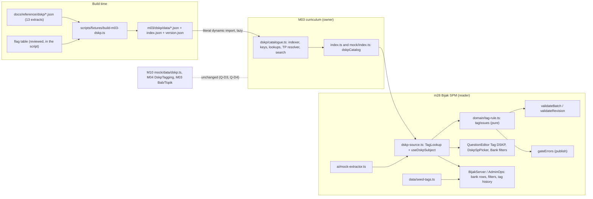
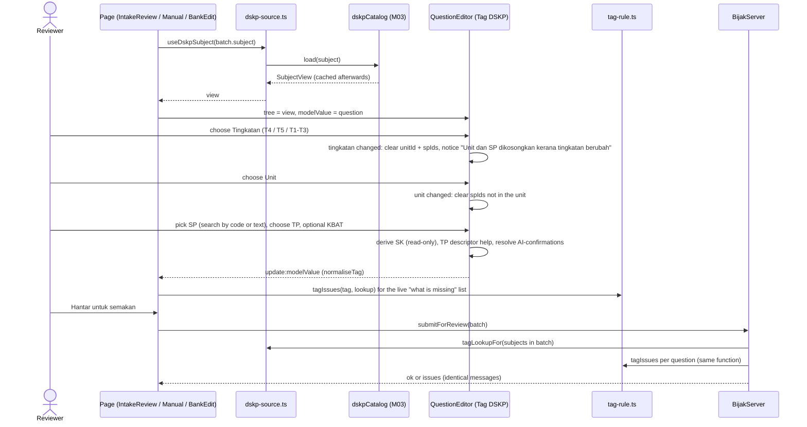
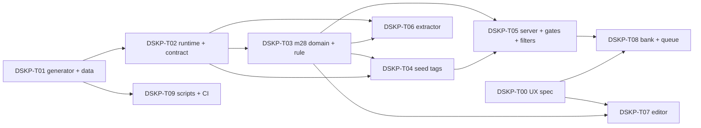

# v2 DSKP integration: system design (slug: v2-dskp-integration)

| Field | Value |
|---|---|
| Document | Feature design, G2 (system architecture) |
| Version | 0.1 |
| Date | 2026-10-24 |
| Status | **G2 approved by the user 2026-10-25** (decisions A1 to A10 in section 0, as written; see "User decision 2026-10-25 (system audit)" below section 0) |
| Owner | solution-architect |
| Requirements | `docs/requirements/v2-dskp-integration.md` (G1 draft; US-01 to US-11; Q-D2, Q-D3, Q-D4 defaults adopted; Q-D1 answered by the user 2026-10-25 (level select); Q-D5 answered by LEAD decision 5, 2026-10-24) |
| Other inputs | `docs/requirements/v2-question-bank.md` 4.8; `docs/requirements/v2-exam-schema.md` D9; `docs/reference/dskp/README.md` and the 13 `*.json` extracts (structure inspected per file); `src/modules/m28-bijak-spm/**` (intake `lib/dskp.ts`, `QuestionEditor.vue`, `domain/validation.ts`, `server/admin.ts`, `domain/types.ts`, `data/builders.ts`, `ai/mock-extractor.ts`); `src/modules/m03-curriculum/**`; ADR-0009, 0014, 0018, 0019 |
| Decision record | ADR-0022 (`docs/adr/0022-dskp-catalogue-in-m03.md`); related ADR-0021 (`@pp/exam-core`, on the integration branch) |
| UI spec (not here) | `docs/design/v2-dskp-integration.md` (ui-ux-designer, task DSKP-T00). This document fixes data, contract, rules and file layout, not pixels. |

Scope reminder: a front-end prototype with in-browser mock servers. The real NestJS backend is a separate programme; section 4.5 is a hand-over note only. No application code is written by this document; type snippets are contract sketches.

## 0. Summary and decisions (approved by the user 2026-10-25)

| # | Decision | Choice and reason |
|---|---|---|
| A1 | Where the catalogue lives | `src/modules/m03-curriculum/dskp/`, owned by M03, read-only (D12, AC-01.5, AC-11.1). Not a mock table: nothing writes it. |
| A2 | How it is built | Deterministic generator `scripts/fixtures/build-m03-dskp.ts` (same pattern as `build-m03-curriculum.ts`) turns the 13 extracts into one committed JSON file per subject plus an index and a version file; a test fails on drift. The generator whitelists fields (no panel or committee text, no notes columns). |
| A3 | How it is loaded | Per-subject lazy chunks (13 literal dynamic imports, `?raw` + `JSON.parse`), cached; a tiny eager subject index. Whole catalogue is about 440 KB raw / 90 KB gzip, so per-subject chunks of 4 to 10 KB gzip. |
| A4 | Contract style | In-process `dskpCatalog` exported from M03's public entry (and from `@/modules/m03-curriculum/mock` for mock code): sync index, async `load(subject)`, sync `DskpSubjectView` lookups. Not mock-transport `api/` functions, because the one tag rule must be synchronous (ADR-0022). |
| A5 | Ids | Opaque composite keys `SUBJECT:T4\|T5:g\|u\|sk\|sp:<printed code>`. SK is derived from the SP's parent node, never parsed from the SP code (Landskap prints SP 1.4.x under SK 1.3; Sejarah has K-prefixed SP). |
| A6 | Tag shape | `CurriculumTag` v2: one tingkatan field (`formOrigin`, replaces `level` + `formOrigin`), `unitId`, `spIds`, `tp` (nullable until chosen), `kbat` (nullable enum), `catalogueVersion`, optional `review` marker. AI suggestion and audit live on the intake question and in the history, not on the published tag. |
| A7 | One rule | `tagIssues(tag, lookup)` in `m28/domain/tag-rule.ts`, pure, called by submit, revision and publish; no `legacyTag` waiver. A parity test pins this. |
| A8 | Seeds | Authored per-question table `m28/data/seed-tags.ts` with evidence per tagged row; everything else is flagged `perlu semakan` with no unit/SP and no tingkatan. Strict rule: 7 of 35 DSKP-form seed questions are proposed as tagged, 28 flagged, 44 are T1-T3 exempt (section 6). |
| A9 | KBAT | Stored as `kbat: 'mengaplikasi' \| 'menganalisis' \| 'menilai' \| 'mencipta' \| null` (Q-D1, **confirmed by the user 2026-10-25**: option (a), level select). `null` = empty or "Bukan KBAT"; stored separately from `tp`, never derived; not required by the submit or publish gates. A yes/no switch was not chosen. |
| A10 | Backend order (Q-D5) | Catalogue contract and gates in the backend **after** 30 Oct go-live. The prototype side is independent of that order because the seam is `load(subject)` (section 4.5). **Decided: LEAD decision 5 (2026-10-24), DSKP is the first post-go-live item.** |

**User decision 2026-10-25 (system audit): G2 approved.** Decisions A1 to A10 above and ADR-0022 (`docs/adr/0022-dskp-catalogue-in-m03.md`) are approved as written. The user replied "ok proceed yang terbaik" to the cloud lead's recommendations. Build order: DSKP is the first post-go-live item (LEAD decision 5, 2026-10-24). Build tasks DSKP-T01 onwards follow section 7; T02 (M03 runtime) is no longer waiting for approval.

## 1. Architecture overview



### 1.1 Folder layout (new or changed)

```
scripts/fixtures/build-m03-dskp.ts            NEW  generator (+ --check mode)
src/modules/m03-curriculum/
  index.ts                                    CHG  export dskpCatalog + types
  mock/index.ts                               CHG  re-export dskpCatalog (mock code of other modules)
  dskp/
    types.ts                                  NEW  wire + view types, flag enum, key helpers
    keys.ts                                   NEW  dskpKey(), parseDskpKey()
    subjects.ts                               NEW  subject config table (codes, nouns, tpLevel, rtl, m03 link)
    catalogue.ts                              NEW  createDskpCatalog(loaders), indexer, views, search
    tp.ts                                     NEW  TP descriptor resolver
    flags.ts                                  NEW  flag labels (BM) and ordering
    loaders.ts                                NEW  13 literal `() => import('./data/x.json?raw')`
    data/<slug>.json (13) + index.json + version.json   GENERATED, never hand-edited
  __tests__/dskp/*.test.ts                    NEW
src/modules/m28-bijak-spm/
  domain/types.ts                             CHG  CurriculumTag v2, KbatLevel
  domain/tag-rule.ts                          NEW  tagIssues, messages, partitionByTagRule
  domain/topic.ts                             CHG  topicOf(tag, lookup)
  domain/admin-types.ts                       CHG  HistoryEntry.tag, BankFilter, BankRow, remove legacyTag
  lib/dskp-source.ts                          NEW  TagLookup, tagLookupFor(), useDskpSubject(), test seam
  lib/tag-migrate.ts                          NEW  legacyTagToV2(), state migration
  data/seed-tags.ts                           NEW  authored per-question seed tags
  data/builders.ts, data/registry.ts          CHG  curr() removed; seed tags applied
  admin/intake/lib/dskp.ts                    DEL  (replaced by the catalogue)
  admin/intake/components/QuestionEditor.vue  CHG  Tag DSKP block
  admin/intake/components/DskpSpPicker.vue    NEW  searchable multi-select of SP
  admin/intake/domain/validation.ts           CHG  uses tagIssues
  admin/intake/ai/mock-extractor.ts           CHG  catalogue-based suggestion
  server/admin.ts, server/store.ts            CHG  gates, lookup preload, bank filters, tag history, storage migration
  admin/papers/BankPage.vue, BankEditPage.vue, ReviewItemPage.vue   CHG
```

## 2. Data model

### 2.1 Catalogue entities (M03, `dskp/types.ts`)

Hierarchy (D9): Subject -> Tingkatan -> Group (optional) -> Unit -> SK -> SP, with TP descriptors attached at the level the DSKP prints them.

| Entity | Fields (wire shape unless marked derived) | Notes |
|---|---|---|
| `DskpSubjectInfo` (eager index, 13 rows) | `code` (MAT, MTM, FIZ, SN, BM, BI, SEJ, PI, TI, PM, PSV, LNS, KPJ), `slug` (file name), `name` (as in the extract, for example "Bahasa Inggeris" for "Bahasa Inggeris (English Language)"), `language` (`ms`, `en`, `ms-Arab` for the Jawi text), `kind` (`academic`, `vocational`), `groupNoun?`, `unitNoun`, `tpLevel` (`unit` or `sk`), `rtlFields` (Pendidikan Islam: `sk`, `sp`, `tp`; unit titles are Latin), `m03SubjectCode` (MATH, ADDMATH, PHY, SCI, BM, BI, SEJ, PI, TI, PM, PSV; `null` for Landskap and Katering because M03's observed 31-subject list has neither and it is not changed), `edition` per tingkatan, `counts` per tingkatan (units, SK, SP selectable, placeholder slots), `flags` (subject-wide) | `code` keeps m28's existing `MAT`, `SN`, `SEJ`, so seeds, routes and tests keep their ids; other codes are new. The link to M03's own codes (MATH, SCI) is data, not a rename. |
| `DskpGroup` | `tingkatan`, `code?` (Moral "5.0"), `title` | Only where the DSKP prints a real grouping above the unit (Matematik Bidang, Matematik Tambahan Learning Area, Fizik and Sains Theme, Sejarah Tema, Moral Bidang, Seni Visual Bidang). Subjects whose "bidang" equals the unit title (Pendidikan Islam, Tasawwur Islam, Bahasa Inggeris) or is the constant noun "Modul" (Landskap, Katering) have none. |
| `DskpUnit` | `tingkatan`, `code` (as printed: "1.0", "5.1", "1", "Tajuk 9"), `title` (as printed, case kept), `group?` (index), `pkg?` (Matematik Tambahan elective package), `flags?`, `tp?: TpTable[]` | The unit noun is the subject's: Tajuk, Topic, Learning Area, skill, Modul, bidang. Pendidikan Moral: one unit = one SK (as the extract), so unit and SK share the code. |
| `DskpSk` | `code`, `title`, `flags?`, `tp?: TpTable[]` (only for `tpLevel: 'sk'` subjects) | Seni Visual's extra `skDescription` is dropped. |
| `DskpSp` | `code` (as printed, including `K` prefix), `text`, `citizenship?` (Sejarah K items), `flags?` | A printed "No learning standard" slot is kept with flag `noStandard`; it is **not selectable**. |
| `TpTable` | `appliesToSk?: string[]`, `rows: TpDescriptor[]` | Katering Modul 1.0 has two tables (SK 1.1; SK 1.2 and 1.3). All other nodes have one table. |
| `TpDescriptor` | `tp: 1..6 \| null`, `range?: [number, number]`, `label?` (Bahasa Melayu: Sangat Terhad to Cemerlang), `text` | `tp: null` only for the rows Landskap prints unaligned (units 1.0, 3.0, 4.0 one pooled row; unit 7.0 prints "1-4" as `range: [1, 4]`). These carry flag `tpUnaligned`. |
| `generalTp` (per subject file) | `TpDescriptor[6] \| null` | Present for Matematik, Matematik Tambahan, Fizik, Sains, Bahasa Melayu, Sejarah, Pendidikan Islam. Absent for Bahasa Inggeris, Pendidikan Moral, Seni Visual, Tasawwur Islam, Landskap, Katering. |

Dropped on purpose (not needed to tag, and some are noise or personal): `titlePrinted`, `focus`, `objektif`, `hoursMin`, `moduleDescription`, `bidangDescription`, `skDescription`, `themes`, `textTypes`, `grammarT4/T5`, `manualCorrections`, `source`, panel or committee text (NFR-07). The generator builds the output from a field whitelist.

Counts verified from the extracts: 171 units, 528 SK, 2,062 SP rows (2,057 selectable plus 5 Bahasa Inggeris "No learning standard" slots: 2 in T4, 3 in T5). Per subject and tingkatan these equal the README table exactly (T4 1,130 and T5 927 selectable). The README's "+/-1 per unit" caveat is about its regex counts, not about the JSON; the loader test compares against a committed expected table and reports any difference.

### 2.2 Keys and ids

`key = <subject code>:<T4|T5>:<kind>:<printed code>` with kind `g` (group, code = slug of the title), `u`, `sk`, `sp`. Examples: `MAT:T4:u:1.0`, `MAT:T5:u:1.0` (same printed code, different key), `PM:T4:u:5.1` and `PM:T4:sk:5.1` (kind separates them), `SEJ:T4:u:Tajuk 9`, `SEJ:T4:sp:K11.1.6`, `LNS:T4:sp:1.4.1` (parent `LNS:T4:sk:1.3`).

- Keys are never stored in the data files; the indexer builds them (`keys.ts`), so a typo cannot desync id and content. Printed codes never contain `:` (test).
- `parseDskpKey` returns `{subject, tingkatan, kind, code}` so a consumer can find the subject to `load` from a stored key alone.
- Duplicate check done on the extracts: no duplicate unit, SK or SP code within a (subject, tingkatan). The loader test asserts it on the generated data.
- Branded string types `DskpUnitId`, `DskpSkId`, `DskpSpId` in `types.ts`.

### 2.3 Flags

`DskpFlag` is a closed enum with a BM label in `flags.ts` (labels [PROPOSED]). The generator applies flags from one reviewed table in the script, each entry citing its source; a test checks every referenced node exists.

| Flag | Applies to | Source | Selectable | Shown |
|---|---|---|---|---|
| `perluSemakanEjaan` ("perlu semakan ejaan") | Every Pendidikan Islam node (set once as a subject-wide flag; the indexer expands it, so `node.flags` is complete at read time) | user decision 2026-10-24; README | yes | badge in pick list and bank |
| `reconstructed` | Sains T4 SP 4.3.1; Sains T5 SP 5.5.5, 5.5.6, 5.5.7; Pendidikan Moral T5 SP 7.1.6 | `_notes-batch1.md` line 65, `_notes-batch3.md` line 17 | yes | badge |
| `inferred` | Matematik Tambahan units T4 9.0, T4 10.0, T5 7.0, T5 8.0 (elective package inferred from Table 8) | README, `electivePackage` in the extract | yes | badge |
| `tpUnaligned` | Landskap units T4 1.0, 3.0, 4.0 and T5 7.0 | extract rows with `tp: null` or "1-4" | yes | badge; no per-TP descriptor |
| `noStandard` | Bahasa Inggeris 5 slots (T4 1.1.4, 2.3.2; T5 1.1.4, 1.1.5, 2.3.2) | extract text "No learning standard" | **no** | shown only in a catalogue browse; hidden from the SP pick list |
| `draftEdition` | Bahasa Inggeris T4 (all nodes, set at tingkatan level) | cover "DRAF 1/2018" | yes | badge |
| `textDefect` | Sains T5 SK 4.2 (garbled title), Landskap T4 SP 1.4.4 (truncated text) | found while inspecting the extracts; not in G1 | yes | badge |
| `codeQuirk` (informational) | Landskap SK 1.3 (SP numbered 1.4.x) and SK 7.2 (SP numbered 7.3.x); Sains T5 unit 6.0 (printed 7.0) | extract `structureNote`, `printedCode` | yes | no badge |

`perluSemakanEjaan`, `reconstructed`, `inferred`, `tpUnaligned`, `draftEdition`, `textDefect` render as one "perlu semakan" badge with the specific label as tooltip text. A flag never blocks use (AC-03.3, AC-01.8). Known unflagged limit: Matematik, Matematik Tambahan and Fizik SPs with formulae that were images (AC-01.9); no feature relies on their exact wording.

### 2.4 TP descriptor resolution (AC-02.1 to AC-02.5)

`SubjectView.tpFor(target, tp)` returns the descriptor(s) to show next to the TP choice. `target` is a unit id plus optional SP ids.

1. `tpLevel: 'sk'` subjects (Sejarah, Pendidikan Islam, Tasawwur Islam): one descriptor per distinct SK of the chosen SPs (`source: 'sk'`). With no SP chosen yet: none.
2. `tpLevel: 'unit'` subjects: the unit's table; if the unit has several tables (Katering Modul 1.0), the table whose `appliesToSk` contains the SP's SK, else the one without `appliesToSk`.
3. A `TpDescriptor` row matches when `tp === chosen`, or when `range` contains the chosen value.
4. No row found: the subject's `generalTp[chosen - 1]` (`source: 'general'`); if the subject has none, return an empty list. The editor then shows "Tiada penerangan TP dalam DSKP untuk unit ini" [PROPOSED]. This covers Bahasa Melayu 4.0 and 5.0 (general table exists, AC-02.3 and Q-D2) and Bahasa Inggeris 5.0 (no unit table and no general table: nothing to show; TP stays required).
5. The descriptor is help text. It never changes the chosen TP (AC-02.2).
6. Sains units that share a theme-level table (Form 4 "Scientific Methodology") keep a copy of that table in each unit; the extract's `tpScope`/`tpScopeNote` are dropped from the data.

### 2.5 Per-subject normalisation map (generator input -> catalogue)

| Subject (code) | Group from | Unit | TP level | General TP from | Notes |
|---|---|---|---|---|---|
| Matematik (MAT) | `bidang` | Tajuk, code "1.0" | unit | `generalPerformanceLevels` | symbols missing in some SP text (known limit) |
| Matematik Tambahan (MTM) | `learningArea` | Topic | unit | `generalPerformanceLevels` | `electivePackage` -> `pkg` + flag `inferred` |
| Fizik (FIZ) | `theme` | Learning Area | unit | `generalPerformanceLevels` | English text |
| Sains (SN) | `theme` | Learning Area | unit | `generalPerformanceLevels` | English text; `printedCode` -> flag `codeQuirk`; theme-level shared tables copied |
| Bahasa Melayu (BM) | none | skill 1.0 to 5.0 | unit (1.0 to 3.0) | `generalPerformanceLevels` | 4.0 and 5.0 print no TP |
| Bahasa Inggeris (BI) | none | skill 1.0 to 5.0 | unit (1.0 to 4.0) | none | `note` on 5.0 dropped; slots flagged; T4 `draftEdition` |
| Sejarah (SEJ) | `theme` | Tajuk, code "Tajuk 9" | sk | `generalTP.interpretation` | `citizenship` on K-coded SP |
| Pendidikan Islam (PI) | none | bidang, code "1" to "6" | sk | `generalTP.descriptors` | Jawi; SK numbering continues across forms (T4 1.26 to 1.32, T5 from 1.33), no renumbering |
| Tasawwur Islam (TI) | none | tema, code "1.0" | sk | none | numbering restarts per tingkatan |
| Pendidikan Moral (PM) | `bidang` ("5.0 INSAN BERMORAL": code 5.0, title INSAN BERMORAL) | one unit = one SK, code "5.1" | unit | none | T4 and T5 reuse codes 5.1 to 7.5 |
| Pendidikan Seni Visual (PSV) | `bidang` | Tajuk "1.0" per tingkatan | unit | none | all bidang loaded; fixed SK pattern n.1 to n.4 kept |
| Landskap dan Nurseri (LNS) | none | Modul 1.0 to 7.0 (T4: 1 to 4, T5: 5 to 7) | unit | none | `tpUnaligned`, `codeQuirk`, `textDefect` |
| Katering dan Penyajian (KPJ) | none | Modul 1.0 to 8.0 (T4: 1 to 4, T5: 5 to 8) | unit (Modul 1.0: two tables) | none | |

### 2.6 Question tag v2 (m28 `domain/types.ts`; `@pp/exam-core` on the integration branch)

ADR-0021 (BE-14, on `feature/v2-backend`) moves the m28 domain types and logic into `packages/exam-core`; the old `m28/domain/*.ts` files become one-line `export *` shims. `CurriculumTag` is therefore defined in `packages/exam-core/src/types.ts` there. DSKP-T03 edits the type and adds `tag-rule.ts` wherever the definition lives at merge time: in `packages/exam-core/src/` (public API plus its key-snapshot test updated, boundary rule respected: no `src/**`, Vue or `node:` imports, which `tag-rule.ts` already satisfies) with an m28 shim, or in m28 `domain/` until BE-14 lands. File paths below under `m28/domain/` read as "or the exam-core equivalent". Catalogue types stay in M03; exam-core must only see the narrow `TagLookup` and string ids (branded types are declared in exam-core, not imported from M03).

```ts
export type KbatLevel = 'mengaplikasi' | 'menganalisis' | 'menilai' | 'mencipta'
export type TpLevel = 1 | 2 | 3 | 4 | 5 | 6

export interface CurriculumTag {
  /** DskpSubjectInfo.code. */
  subject: SubjectCode
  /** The tingkatan the content belongs to. null = not chosen yet (a Draf only; every gate refuses it). */
  formOrigin: 'T4' | 'T5' | 'T1-T3' | null
  /** DskpUnitId, or null for T1-T3 / not chosen / flagged. */
  unitId: DskpUnitId | null
  /** DskpSpId[], at least one for T4/T5 at the gate; empty for T1-T3. SK is derived, never stored. */
  spIds: DskpSpId[]
  /** null until the reviewer chooses; there is no default. */
  tp: TpLevel | null
  /** Separate optional field; never derived from tp. */
  kbat: KbatLevel | null
  /** DskpCatalog.version the unit/SP were chosen against; null when unit/SP are empty. */
  catalogueVersion: string | null
  /** Seed or migrated question that still needs a person to tag it. Cleared when the tag becomes complete. */
  review?: 'perlu-semakan'
}
```

Decisions:
- **One tingkatan field.** The brief lists `tingkatan` and `formOrigin`; the prototype has `level` (`T4+T5` default) and `formOrigin`. Two fields can contradict each other and the default `T4+T5` hides an unset value (AC-04.1). The single field keeps the name `formOrigin` (no churn; UI label "Asal tingkatan" / "Tingkatan") and `level` is removed. `domain/types.ts` `Subject.code` and `curriculum.subject` keep their names.
- `unit` -> `unitId`, `sp` -> `spIds`: renamed on purpose so an old free-text value can never be read as a key; `unitLabel` is removed (the label is looked up). TypeScript fails to compile every stale use.
- Derived, not stored: SK ids (`lookup.skOf(sp)`), unit title, TP descriptor, display topic.
- `KbatLevel` is the only place that knows the form of KBAT (Q-D1, level select decided 2026-10-25). The bank filter options ("Ya", "Tidak" and one per level) are derived from the same constant. A later change of form would touch only this type, one control and the filter option list.
- No cap on SP count (Q-D6): `export const MAX_SP_PER_QUESTION: number | null = null` in `tag-rule.ts`; D9's "1 to 3" is one constant away.
- The published tag is `CurriculumTag` only. Suggestion and audit data are carried as below.

### 2.7 AI suggestion and audit fields

On the intake question (transient, persisted with the batch):

```ts
export interface TagSuggestion {
  providerId: string            // 'mock' now; ADR-0019
  model: string
  formOrigin?: CurriculumTag['formOrigin']   // implied by the suggested unit, otherwise absent
  unitId?: DskpUnitId | null
  spIds?: DskpSpId[]
  tp?: TpLevel | null
  kbat?: KbatLevel | null
  /** Per field; reuses m28's Confidence ('tinggi' | 'sederhana' | 'rendah'). */
  confidence: Partial<Record<'unit' | 'sp' | 'tp' | 'kbat', Confidence>>
}
// IntakeQuestion gains:  tagSuggestion?: TagSuggestion
```

- The extractor writes the suggestion and also pre-fills `tag` with it. Field paths in `lowFields`/`confirmed` become `tag.unit`, `tag.sp`, `tag.tp`, `tag.kbat`.
- A field needs confirmation when `tp` or `kbat` carries any AI suggestion, or when `unit`/`sp` carries a suggestion with confidence `rendah` (AC-05.2, AC-05.3, AC-06.4). A field counts as resolved when it is ticked, **or** the person changed the value away from the suggestion (QB "confirmed or edited").
- The unit suggestion is always a catalogue node. No match above the threshold leaves unit and SP empty and adds `tag.unit` to `lowFields` (AC-04.9). The prototype's invented SP code (`NN.1`) is removed.
- **Lead decision (DSKP-T06 G4, "never guess"):** a unit suggested without an SP is an incomplete tag, so `tag.unit` is also put in `lowFields` and the reviewer must confirm it (or change it) before submit, at any confidence.

Audit (read-only, in the existing history list, no new screen):

```ts
export interface TagChange {
  field: 'formOrigin' | 'unit' | 'sp' | 'tp' | 'kbat'
  before?: unknown               // undefined on first tagging
  after: unknown
  ai?: unknown                   // the AI-suggested value; absent when there was none (AC-10.2)
  confidence?: Confidence
}
// HistoryEntry gains:  tag?: TagChange[]     (the person is the entry's existing `by`)
```

Written at: batch submit (the "Dihantar untuk semakan" entries of its seeds get the first tagging, `ai` and `confidence` from `tagSuggestion`), and Sunting submit (the "Versi n dicipta" entry gets the diff of live tag vs edited tag, AC-10.3). History entries have no edit or delete path in the UI (AC-10.4). Retention: kept with the review record; the 5-year retention (QB NFR-12) is a backend concern.

### 2.8 Migration of existing tags

Three places hold old-shape tags: (a) static seed questions (replaced by `seed-tags.ts`, section 6), (b) persisted state in `localStorage` key `pp.bijak.server.v1`: intake batches, `dynSeeds`, `review[*].revision.content.question.curriculum`, `review[*].live.question.curriculum`, (c) in-memory test fixtures.

`legacyTagToV2(old)` (idempotent; detects the old shape by the presence of `unitLabel` or `level`):

| Old | New |
|---|---|
| `subject` | `subject` unchanged |
| `formOrigin: 'T1-T3'` | `formOrigin: 'T1-T3'`, `unitId: null`, `spIds: []` |
| `formOrigin: 'T4' \| 'T5'` and `unit`, `unitLabel` or `sp` present | `formOrigin: null`, `unitId: null`, `spIds: []`, `review: 'perlu-semakan'`. The old unit code (`MAT-T4-02`), the label and free-text SP are not copies of catalogue nodes, so nothing is carried (never "closest", AC-08.4). A `unitLabel` alone counts: the old gate treated such a question as tagged. As built in DSKP-T03 (accepted at G4). |
| `formOrigin: 'T4' \| 'T5'` with no unit, label or SP (an empty draft) | `formOrigin: null`, no `review` marker (untagged, not flagged) |
| `tp` 1 to 6 | kept (cannot be told from a deliberate choice), also for T1-T3; other values -> `null` |
| `kbat` `'Mengaplikasi'` etc. | kept, lower-cased to the v2 `KbatLevel` (`'mengaplikasi'`); an unknown value -> `null`. (T03 as built; the first draft reset it to `null`.) |
| `level`, `unitLabel` | dropped |
| (new) | `kbat: null`, `catalogueVersion: null` |

The server stamps `state.schema = 2` after migrating, and `load()` runs the migration before `seedAdminSlice`. **As built (DSKP-T05):** `load()` writes the migrated document back only when a stored, parseable state existed whose `schema` was not 2; a fresh state (nothing stored) and an unparseable one are never written by `load()`, and a second load changes nothing. The storage key is not changed (attempts and papers of demo users survive). In an intake batch that is still Draf, a migrated question simply shows an empty Tag DSKP block. Old `lowFields` entries `tag.unit`/`tag.sp` stay valid paths.

## 3. Loader

### 3.1 Generator (`scripts/fixtures/build-m03-dskp.ts`)

- Run: `node --experimental-strip-types scripts/fixtures/build-m03-dskp.ts` writes; `--check` regenerates in memory, compares, exits non-zero on drift (used by the test and CI).
- Input: the 13 files in `docs/reference/dskp/`. Output: `src/modules/m03-curriculum/dskp/data/<slug>.json` (minified, stable key order, prettier not applied), `index.json` (subject info with counts), `version.json`.
- Steps per subject: read the per-subject adapter (table 2.5), map fields to `DskpSubjectData`, apply the flag table, drop non-whitelisted fields, validate (below), write. Everything is deterministic: no timestamps, no random ids, sorted object keys.
- Version: `version.json = { version: 'dskp-2026.10.1', sha256: '<hash of all data files>' }`. `version` is a manual constant in the script; `--check` fails if the hash changed but the version did not ("bump the version when the content changes", same discipline as the M03 mock `version`).
- Defects are reported, not fixed: the script prints every node that matches a defect scan (garbled titles, truncated text) and fails if one is not in the flag table. Correcting extract text is out of scope (G1).

### 3.2 Bundling and loading

- `loaders.ts` holds 13 literal entries `MAT: () => import('./data/matematik.json?raw')`. No `import.meta.glob`, no template-literal import (ADR-0009 amendment 1 forbids both outside `src/mock/index.ts`). `?raw` keeps `vue-tsc` from inferring a 100 KB literal type, the same reason M03's mock fixture is read as text.
- `index.json` and `version.json` are imported eagerly (about 3 KB); everything else is lazy. Measured raw minified sizes: per subject 20 to 71 KB (structure + TP), largest Pendidikan Islam at about 72 KB raw / 9 KB gzip; total about 440 KB raw / 90 KB gzip.
- `catalogue.load(code)`: a cached promise per subject; the first call parses and indexes (about 2,000 nodes for the largest subject, a few ms); later calls return the same `SubjectView`. A failed import is not cached (retry works). `loaded(code)` is the synchronous accessor once loaded.
- Budget: `scripts/check-demo-bundle.mjs` guards "all js" at about 2.1 MB gzip with 10 % headroom (about 200 KB). Expected growth is about 90 KB gzip in lazy chunks plus the indexer in the entry. DSKP-T02 measures before and after and raises the budget only with the reason in the PR. The entry chunk must not grow by the data.
- **Measured in DSKP-T02 (2026-10-25, `vite build --mode demo`, base commit `ab5aa9ae` vs T02).** Entry js 633,421 raw / 160,688 gzip before, 648,487 / 165,105 after (+15,066 raw, +4,417 gzip: the indexer plus `index.json` at 7.2 KB raw, which is bundled into the entry because M03's `mock/index.ts` re-exports `dskpCatalog` and the mock plugins are in the entry; the re-export in `m03/index.ts` alone adds nothing because it is tree-shaken). All js 8,966,846 / 2,564,339 before, 9,457,299 / 2,639,264 after (+490,453 raw, +74,925 gzip). The 13 subject chunks are lazy: 473,195 raw / 69,522 gzip in total (3.4 to 9.7 KB gzip each); probe strings of two subjects were found only in their own chunks, never in the entry. **The budget already failed at the base commit** (entry js raw 633,421 > 310,300, gzip 160,688 > 83,800; all js raw 8,966,846 > 8,527,000, gzip 2,564,339 > 2,404,800), so `npm run build` was red before T02; T02 did not re-baseline it. Re-baselining (measured plus 10 %: entry 713,400 raw / 181,700 gzip, all js 10,403,100 raw / 2,903,200 gzip) is a separate decision for devops (DSKP-T09 or a budget task).
- In development every consumer awaits `load` for the subjects it needs (editor page: the batch subject; bank: lazily per subject filter; server: the subjects present in the rows it formats).

### 3.3 Validation tests (`m03-curriculum/__tests__/dskp/`)

| Test | Asserts |
|---|---|
| `counts.test.ts` | per subject x tingkatan: units, SK, selectable SP equal the committed `EXPECTED_COUNTS` (the README table: 1,130 T4, 927 T5; BI slots counted apart: 5); totals 171 / 528 / 2,057 (+5 slots). A difference is printed as a table, not hidden (AC-01.4). |
| `keys.test.ts` | all keys unique across the catalogue; no `:` in a printed code; `parseDskpKey(dskpKey(x))` round-trips; the same printed code in T4 and T5 gives two keys (AC-01.3); `PM:T4:u:5.1` differs from `PM:T4:sk:5.1`. |
| `tree.test.ts` | every SP has exactly one SK, every SK exactly one unit; Landskap SP `1.4.1` resolves to SK `1.3` (structure, not code text); Sejarah `K11.1.6` is selectable and sits under SK 11.1; Pendidikan Islam SK `1.26` in T4 and `1.33` in T5 (no renumbering). |
| `flags.test.ts` | every Pendidikan Islam node reports `perluSemakanEjaan` through `effectiveFlags`; Pendidikan Islam text contains Arabic-script characters (`\p{Script=Arabic}`) in SK and SP and `rtlFields` is set; the five BI slots are `noStandard` and absent from `sps(unit)`; Matematik Tambahan four packaged units flagged; the flag table references only existing nodes; Sains T5 SK 4.2 and Landskap SP 1.4.4 carry `textDefect`. |
| `tp.test.ts` | every unit (or SK for `tpLevel: 'sk'`) has six rows TP 1 to 6, except the documented exceptions (BM 4.0 and 5.0, BI 5.0, Landskap unaligned units); `tpFor` fallbacks: BM 4.0 -> general; BI 5.0 -> empty; Sejarah SP of two SK -> two descriptors; Katering Modul 1.0 SP of SK 1.1 vs SK 1.2 pick different tables; Landskap T5 7.0 TP 3 matches the "1-4" row. |
| `drift.test.ts` | the generator output equals the committed files; `version.json` hash matches. |
| `search.test.ts` | by code ("1.1.6"), by word, case and diacritic-insensitive, Jawi by substring; result scoped to subject/tingkatan/unit; limit honoured. |
| `contract.test.ts` | `load` caches; unknown code rejects with a typed error; sync accessors return `undefined` before load; `createDskpCatalog` accepts a fixture loader (test seam for m28 tests). |

## 4. Contract (M03 public API for m28 and other readers)

### 4.1 Pattern

M03's existing contract is a repository per store for mock code (`@/modules/m03-curriculum/mock`) and typed `api/` functions for UI. The catalogue is read-only, identical for all users and consumed by a synchronous rule, so it is exposed as one in-process object through both doorways: `import { dskpCatalog } from '@/modules/m03-curriculum'` (UI and server code of other modules, ADR-0009) and `from '@/modules/m03-curriculum/mock'` (mock code). Types are exported with it. M03 adds no mock table, seed or HTTP route for it and no `version` bump of the mock plugin (the registry boot test must stay green, DSKP-T02 runs it because `mock/index.ts` is touched).

### 4.2 Interface (sketch)

```ts
export type DskpTingkatan = 'T4' | 'T5'

export interface DskpCatalog {
  readonly version: string
  /** The 13 subjects, sync (eager index). */
  subjects(): readonly DskpSubjectInfo[]
  subject(code: string): DskpSubjectInfo | undefined
  /** Lazy, cached. Rejects with DskpLoadError ('unknown-subject' | 'no-loader' | 'load-failed' | 'invalid-data'); a failure is not cached. */
  load(code: string): Promise<DskpSubjectView>
  /** Sync accessor after load; undefined before. */
  loaded(code: string): DskpSubjectView | undefined
}

/** Runtime nodes are `Dskp{Group,Unit,Sk,Sp}Node` (the wire types keep `DskpGroup/Unit/Sk/Sp`). Their `flags` are already the effective flags. */
export interface DskpSubjectView {
  readonly info: DskpSubjectInfo
  groups(t: DskpTingkatan): readonly DskpGroupNode[]
  units(t: DskpTingkatan): readonly DskpUnitNode[]         // print order, each with .groupId?
  group(id: DskpGroupId): DskpGroupNode | undefined
  unit(id: DskpUnitId): DskpUnitNode | undefined
  sk(id: DskpSkId): DskpSkNode | undefined
  sks(unitId: DskpUnitId): readonly DskpSkNode[]
  sps(unitId: DskpUnitId): readonly DskpSpNode[]           // selectable only, print order
  sp(id: DskpSpId): DskpSpNode | undefined                 // includes non-selectable slots
  skOf(spId: DskpSpId): DskpSkNode | undefined             // parent, not parsed from the code
  unitOf(id: DskpSkId | DskpSpId): DskpUnitNode | undefined
  skIdsOf(spIds: readonly DskpSpId[]): DskpSkId[]          // unique, SK print order
  effectiveFlags(node: DskpNode): readonly DskpFlag[]      // node + subject-wide + tingkatan-wide
  tpFor(target: { unitId: DskpUnitId; spIds?: readonly DskpSpId[] }, tp: number): TpResolved[]
  search(query: string, o?: { tingkatan?: DskpTingkatan; unitId?: DskpUnitId; limit?: number /* default 50 */; kinds?: ('u' | 'sk' | 'sp')[] }): DskpSearchHit[]
}

/** source: where the row was read; nodeId: that SK or unit, null for the subject's general table. Descriptors are frozen. */
export interface TpResolved { source: 'sk' | 'unit' | 'general'; nodeId: DskpSkId | DskpUnitId | null; descriptor: TpDescriptor }
/** Discriminated by kind; hits cover units, SK and selectable SP. score: 3000 code-exact, 2000 code-prefix, else 1000 x (tokens that start a word / tokens). */
export type DskpSearchHit = { kind: 'u'; node: DskpUnitNode; score: number } | { kind: 'sk'; node: DskpSkNode; score: number } | { kind: 'sp'; node: DskpSpNode; score: number }

export function dskpKey(...): string
export function parseDskpKey(key: string): { subject: string; tingkatan: DskpTingkatan; kind: 'g'|'u'|'sk'|'sp'; code: string } | null
export function createDskpCatalog(loaders: Readonly<Record<string, () => Promise<string>>>, index?: { version?: string; subjects?: readonly DskpSubjectInfo[] }): DskpCatalog   // test seam
```

Both doorways re-export one barrel, `m03/dskp/index.ts` (added in T02; not in the 1.1 layout list). It also exports `DskpLoadError`, `normaliseDskpText`, the flag label constants, the node and id types and the wire types (`DskpSubjectData` etc.) so a test can build a fixture for `createDskpCatalog`.

Rules of the contract:
- **Read-only.** Returned arrays are frozen; no setters. A node object is never mutated by a consumer (AC-01.5).
- **Tingkatan is a parameter, never inferred.** There is no lookup by bare code; every lookup takes a key or a (subject, tingkatan).
- **Order is print order**; the indexer never sorts codes (so "10.0" does not sort before "2.0").
- **Cross-subject lookup** by key: `parseDskpKey` gives the subject, the caller loads it. There is no global `resolve(key)` that loads implicitly.
- **Search** is token-AND over normalised code + text (NFC, lower-case, accents and Arabic tashkil stripped), scored by code-exact > code-prefix > fraction of tokens; no fuzzy matching. Deterministic. Because matching is by substring, a hit whose tokens match only inside words (none at a word start) scores 0; it is still returned, after every scored hit, in print order (ties keep print order, T4 before T5).

### 4.3 What m28 uses

| Need | Call |
|---|---|
| Subject list for intake declaration, bank, queue filters | `dskpCatalog.subjects()` |
| Unit select, grouped | `view.groups(t)`, `view.units(t)` (`unit.groupId` joins) |
| SP pick list | `view.sps(unitId)`; search box -> `view.search(q, { unitId })` |
| SK shown read-only | `view.skIdsOf(spIds)` -> `view.sks`/lookup |
| TP help text | `view.tpFor({ unitId, spIds }, tp)` |
| Gate | `TagLookup` built from `unit(id)`, `sp(id)`, `unitOf`, `skOf` |
| Bank row and queue topic | `unit(id).title`, `sp(id).code` |
| AI suggestion (mock) | `view.search(text, { tingkatan })` then threshold |
| Version stamp on a tag | `dskpCatalog.version` |

### 4.4 Ownership and the other DSKP-like stores (US-11)

| Store | Owner | Decision |
|---|---|---|
| D-A m28 `admin/intake/lib/dskp.ts` (12 prototype units) | m28 | **Deleted** in DSKP-T03/T07 once the editor and extractor use the catalogue; `keywords` go with it. |
| D-B M03 Bab/Topik taxonomy (`curriculum.json`, 31 subjects, mirror of .my) | M03 | Unchanged (AC-11.4). The catalogue is an additional read-only tree beside chapters/topics. |
| D-C M10 `mock/data/dskp.ts` (Bidang/SK/SP fixture used by M04 legacy form, M08, M27) | M10 | Unchanged until a decision (Q-D3, Q-D4 defaults: not now, revisit after go-live). Its names and ids are never mixed with catalogue keys. |
| D-D `docs/reference/dskp/*.json` | docs | Becomes the generator input only. |

ADR-0014's store table gets one line (DSKP catalogue: owner M03, read through `dskpCatalog`) in DSKP-T02.

### 4.5 Hand-over note for the real backend (not built here)

Lane PC-2 (BE-08 `curriculum`, half AZ) and BE-10 (`questions-workflow`). LEAD decision Q-D5 stays open; recommendation: after the 30 Oct go-live, because the prototype contract does not depend on it.

| Prototype | Backend equivalent (proposal) |
|---|---|
| `DskpSubjectInfo[]` | `GET /api/dskp/subjects` -> `{ data: DskpSubjectInfo[], meta: { version } }` |
| `DskpSubjectData` (the exact chunk JSON) | `GET /api/dskp/subjects/:code` with `ETag` = catalogue version; same tree-shaped body, so `createDskpCatalog` gets an `http` loader and the whole indexer and the rule are reused unchanged. Schemas go to `packages/contract/src/curriculum/dskp.ts` (zod; `z.infer` replaces `dskp/types.ts` wire types) per ADR-0018. |
| key `SUBJECT:T4:sp:1.1.6` | `curriculum_nodes` row: unique `(subject_code, tingkatan, kind, code)`, `parent_id`, `title`/`text`, `flags[]`, `selectable`, `ordinal`; TP tables as a child table `curriculum_tp_rows(node_id, applies_to_sk[], tp, tp_range, label, text)`. BE-08 seed flattens the same generated JSON (not `src/**`; copy `data/*.json` into `prisma/seed/curriculum-data/`). |
| `CurriculumTag` v2 | question columns `form_origin`, `unit_node_id`, `sp_node_ids[]`, `tp smallint 1..6 not null at Terbit`, `kbat enum null`, `catalogue_version`, `tag_review bool`. D9's `level` = derived from `form_origin` for T4/T5 questions; there is no separate exam-level tag in the prototype. `sk` stays derived. |
| `tagIssues(tag, lookup)` | already shared if BE-14's `@pp/exam-core` (ADR-0021) hosts it (section 2.6); otherwise move `domain/tag-rule.ts` unchanged there. Backend supplies a DB-backed `TagLookup`; BE-10 calls it at submit, approve and publish; BE-38 at accept-to-Draf. One implementation on both sides closes R7. |
| `HistoryEntry.tag: TagChange[]` | `question_history.tag_changes jsonb` (BE-10). |
| `legacyTagToV2` | not needed: the backend reloads questions through the new intake (AGENTS.md), so no m28 legacy data exists there. |

## 5. m28 changes

### 5.1 Tag DSKP editor data flow

One block (`QuestionEditor.vue`), reused by Muat Naik Kertas -> Semak Ekstrak, Tulis Soalan Manual and Sunting. No screen is added. The block receives a loaded `DskpSubjectView` prop from its page; pages load once per subject through `useDskpSubject(subject)` (batch subject is fixed; Sunting reads the question's subject). While loading, the block shows its skeleton state (UX spec); an error shows retry.



Field behaviour (AC-04.x):

| Field | Control | Behaviour |
|---|---|---|
| Tingkatan | native select, placeholder "Pilih tingkatan" with empty value; options Tingkatan 4, Tingkatan 5, "Tingkatan 1-3 (di luar DSKP)" | no default; label stays "Asal tingkatan" (existing copy) |
| Unit | native select with `optgroup` per group where the subject has groups; option text "code title" as printed | lists only the subject and tingkatan; disabled when T1-T3 or unset; the 12 prototype units are gone |
| SP | `DskpSpPicker.vue`: search input + scrollable checkbox list (rows >= 44 px, code + text, flag badge) + chips of the selection | scoped to the chosen unit; free text is not accepted; `rtlFields` rendered `dir="rtl" lang="ms-Arab"`; supports dozens of rows |
| SK | read-only chips (code + title, truncated with full text as title attribute) | `skIdsOf(spIds)`; several SK when SPs span SK |
| TP | native select "Pilih TP" 1 to 6 (replaces the number input) | no default; descriptor of the chosen TP below it (`tpFor`); AI badge "cadangan AI" with confidence |
| Aras KBAT | optional native select, empty = "Bukan KBAT" | independent of TP |
| Confirmations | existing checkbox pattern generalised: "Saya sahkan {unit DSKP \| SP \| TP \| Aras KBAT} (keyakinan rendah)" for unit/SP low confidence; for AI-suggested TP/KBAT "Saya sahkan TP (cadangan AI)" [PROPOSED] | rendered from `fieldsToConfirm(q)` |
| T1-T3 | unit, SK and SP disabled and cleared; TP still required | AC-04.6 |

Helpers (pure, in `domain/tag-edit.ts`): `setFormOrigin`, `setUnit`, `toggleSp`, `normaliseTag(tag, lookup, catalogueVersion)` (clears unit/SP for T1-T3, drops SP outside the unit and repeated SP, clears `review` once `tagIssues` is empty, stamps `catalogueVersion` when it is still null; `setUnit` and `toggleSp` reset it to null so the next normalise re-stamps). `setUnit(tag, unitId, lookup)` and `normaliseTag` need a `lookup` that already knows the tag's subject: **DSKP-T07 must call them only with a loaded subject view** (F4); with an unloaded one every SP looks like it is outside the unit and is dropped. `toggleSp(tag, spId, on?, maxSp?)` and `tagIssues(tag, lookup, maxSp?)` take an optional cap that defaults to `MAX_SP_PER_QUESTION`. Layout rules (container queries, 320 px minimum, no horizontal page scroll) are in the UX spec; the block keeps its `@md`/`@3xl` container grid.

### 5.2 One tag rule for submit, revision and publish (AC-07.x)

`domain/tag-rule.ts` (pure; imports only types):

```ts
export interface TagIssue { field: 'subject' | 'formOrigin' | 'unit' | 'sp' | 'tp' | 'kbat'; message: string }
export interface TagLookup {
  subject(code: string): boolean
  /** `title` is the unit title as printed, for display only (topicOf); the rule does not read it. A backend lookup supplies it too. */
  unit(id: string): { subject: string; tingkatan: 'T4' | 'T5'; title: string } | undefined
  sp(id: string): { unitId: string; selectable: boolean } | undefined
}
export function tagIssues(tag: CurriculumTag, lookup: TagLookup): TagIssue[]
export function partitionByTagRule<T extends { tag: CurriculumTag }>(items: T[], lookup: TagLookup): { pass: T[]; skipped: { item: T; issues: TagIssue[] }[] }
```

| Check | T4 / T5 | T1-T3 | Message |
|---|---|---|---|
| subject exists in catalogue; `formOrigin` set | required | required | "Subjek dan tingkatan perlu ditetapkan." (existing) |
| `unitId` set | required | must be empty | "Unit DSKP belum dipilih." (existing); T1-T3 with a unit: "Tingkatan 1-3 (di luar DSKP) tidak mempunyai unit atau SP." [PROPOSED] |
| unit exists, of this subject and tingkatan | required | n/a | "Unit DSKP tidak wujud dalam katalog." [PROPOSED] (AC-07.7) |
| `spIds` >= 1 (no cap, Q-D6) | required | must be empty | "Standard Pembelajaran (SP) belum dipilih." (existing) |
| every SP exists, selectable, child of the unit | required | n/a | "SP tidak wujud dalam unit yang dipilih." [PROPOSED] |
| `tp` integer 1 to 6 | required | required | null: "Tahap Penguasaan (TP) belum dipilih." [PROPOSED]; out of range: "Tahap Penguasaan (TP) mesti antara 1 dan 6." (existing) |
| `kbat` is null or a `KbatLevel` | optional | optional | "Aras KBAT tidak sah." [PROPOSED] |
| `spIds` has no repeat; with a cap (`maxSp`, default `MAX_SP_PER_QUESTION` = none) not more than `maxSp` | enforced | n/a | repeat: "SP yang sama dipilih lebih daripada sekali."; over the cap: "Pilih paling banyak N SP." (both [PROPOSED], added in DSKP-T03) |

Where it is called (all with a `TagLookup` built after `await tagLookupFor(subjects)`):

| Path | Today | After |
|---|---|---|
| Submit batch (`validateBatch`, UI list + `submitForReview`) | unit null, SP empty, TP 1 to 6 | `tagIssues` + AI confirmations (`fieldsToConfirm`) |
| Sunting submit (`validateRevision`, UI + `reviseQuestionFull`) | same, but `legacyTag` waives the SP message | `tagIssues` + confirmations; **`legacyTag` parameter and `BankEditable.legacyTag` removed** (AC-07.5) |
| Stem-only revision (`reviseQuestion`, `reviewDecision` for `v:` without `content`) | no tag check | `tagIssues` on the live tag, so a flagged question cannot be re-published unchanged |
| Publish ("Lulus & Terbit", `reviewDecision`, `gateErrors`) | `unitLabel` non-empty | `tagIssues` on every question of the unit; message "topik DSKP belum dipilih" is replaced by the shared messages |
| Bulk action (does not exist in the prototype) | n/a | any bulk caller uses `partitionByTagRule`: failing questions reported and skipped, the rest proceed (AC-07.6) |

`gateErrors(qs, schemeOf, lookup)` keeps its `Soalan N: ` prefix and the scheme checks; only the tag check changes (`schemeOf` and `lookup` are both required). **As built (DSKP-T05):** a stem-only revision (`reviseQuestion`, `reviewDecision` for `v:` without `content`, and the `gate` list of `getReviewItem`) runs `liveTagErrors(q, lookup)` on the live tag, with the prefix `Soalan: ` (the same as `validateRevision`); publish keeps `Soalan N: `. Both prefixes carry the messages of `tagIssues` unchanged. Every decision loads the catalogue first and then checks the status, runs the gate and changes the record with no `await` in between, so two decisions made at the same time (Terbit and Tolak, or two Terbit) cannot both succeed; the same holds for two Sunting submits. A catalogue that cannot be loaded fails closed on these paths (the call rejects with `DskpLoadError`; Tolak and Minta Pembetulan need no catalogue and still work). The AI confirmation check stays on submit and revision (it needs the intake question state); publish trusts that submit enforced it, as today. A parity test (`tag-rule.parity.test.ts`) feeds one matrix of tags to all three entry points and asserts the same set of tag messages (R7).

### 5.3 AI suggestion and confirmation

- `ai/mock-extractor.ts` loses `guessUnit`/`DSKP_UNITS`. The suggestion lives in `ai/dskp-suggest.ts`; the batch subject's catalogue is loaded once per `extract` (a subject without a catalogue gives no unit/SP and no warning; a failed load gives a warning and no unit/SP). Per question, on `stem + parts`:
  - **Topic words:** distinct words of at least `MIN_TOKEN_LENGTH` (4) letters, normalised like the catalogue search, minus stop words and command words.
  - **Evidence:** each word is searched on its own, `view.search(word, { kinds: ['u','sk','sp'], limit: 5000, tingkatan? })`, keeping hits that start a word (score above 0). A word that hits no node, or more than `GENERIC_NODE_LIMIT` (40) nodes, is no evidence. Otherwise it is tallied per unit, per SK/SP, and per SP (per-word search because `search` is token-AND: a whole stem would almost never match).
  - **Score:** `1000 x min(matched, COVERAGE_CAP) / min(all topic words, COVERAGE_CAP)`. The denominator counts all topic words, including generic and zero-hit ones, so filler words dilute the score.
  - **Constants:** `COVERAGE_CAP` 6, `SUGGEST_THRESHOLD` 500, `HIGH_THRESHOLD` 750, `MIN_MATCHED_TOKENS` 2, `HIGH_MIN_MATCHED_TOKENS` 3 (plus `GENERIC_NODE_LIMIT` 40 and `MIN_TOKEN_LENGTH` 4).
  - **Unit:** the best unit is suggested only when it matches at least 2 words, one SK or SP of the unit contains at least 2 of them by itself (corroboration: words scattered over unrelated SPs are no evidence), and its score reaches 500. **A tie for first place gives no match.**
  - **SP:** the best SP inside that unit, only when the SP's own text matches at least 2 words and reaches 500; a tie gives no SP.
  - **Confidence:** `tinggi` for both unit and SP only when each scores at least 750 with at least 3 matched words; 3 or more matched words below that is `sederhana`. **2-word evidence is `rendah` at any score (lead decision, DSKP-T06 re-check)**: the unit/SP is still pre-filled, but by the 2.7 rule `tag.unit`/`tag.sp` go into `lowFields` and the reviewer must confirm. A unit with no SP is never above `sederhana` and, by the lead decision in 2.7, always goes in `lowFields`. No match leaves the field empty. The `NN.1` SP is gone.
  - **Recall limits (known, accepted for the mock):** no BM affix stemming ("faktorkan" does not match "pemfaktoran"); `MIN_TOKEN_LENGTH` 4 drops "set" and "sel"; the Sains titles are English, so BM Sains stems get no suggestion until aliases exist; `GENERIC_NODE_LIMIT` counts nodes (units, SK and SP together), not units. Residual risk: two common words that sit in one long SP (for example "nilai" and "data" in MAT T4 SP 8.2.4) still produce a pre-filled suggestion; it is `rendah` and therefore gated, not prevented.
  - `ExtractInput.tingkatan` (optional) narrows the search; DSKP-T07 wired it from an optional "Tingkatan (pilihan)" select of the upload declaration (`IntakeUploadPage`, [PROPOSED], not in the UX spec). Left empty, T4 and T5 are both searched and the unit implies the tingkatan.
- TP: the mock suggests a TP from the leading command word (a small table: Nyatakan/Namakan -> 1, Terangkan/Jelaskan -> 2, Hitung/Selesaikan -> 3, Bandingkan/Analisis -> 4, Nilaikan/Justifikasikan -> 5, Reka/Cipta -> 6), confidence `rendah`, always put in `lowFields` (`tag.tp`). KBAT: no suggestion from the mock in v2.0 (a real provider may send one; the field is supported). The table is a heuristic of the mock only; a real provider replaces it (ADR-0019).
- Extractor output is never final: `tag` is pre-filled, `tagSuggestion` records what the AI said, `lowFields`/`confirmed` drive the gate (rule in 2.7).
- `confirmed` is cleared for a field whose value the person later changes (it is then resolved by editing).

### 5.4 Bank filter and display (AC-09.x)

- `BankFilter` gains `formOrigin?`, `unitId?`, `spId?`, `tp?`, `kbat?: 'ya' | 'tidak' | KbatLevel`, `tagReview?: boolean`. `listBank` applies them in the same pass that builds the rows; the page shows `rows.length`. No second query feeds a count (AC-09.2, NFR-08). The KPI strip (`bankStats`) stays unfiltered.
- `BankRow` gains `formOrigin`, `unitId`, `unitTitle: string | null` (the catalogue title, null when there is no catalogue unit), `spCodes`, `tp`, `kbat`, `tagReview`; `topic` is the display copy and becomes the unit title from the catalogue ("Tingkatan 1-3 (di luar DSKP)" for exempt, "Perlu semakan tag" [PROPOSED] for flagged), and the search term also matches SP codes. **Students never see the flag copy:** the student question view (`QuestionView.topic`, so also the result page's weak topics) is `studentTopicOf(tag, lookup)`, which is `''` for a tag with `review` set; only admin rows use `topicOf` and show "Perlu semakan tag". The result page skips empty topics, so a flagged question forms no weak-topic bucket. **Read-only fallback (DSKP-T05):** if the catalogue cannot be loaded, the listings (`listBank`, `listReviewQueue`, `getBankDetail`, `getBankEditable`, the paper builder) log a warning and answer from the subjects already loaded, so the page still renders with empty topics and `unitTitle: null` (T1-T3 rows keep their copy; tag filters still work on the stored ids). Gates and every path that changes data do not fall back (5.2).
- Filter bar: Subjek (13, from the catalogue), Tingkatan [PROPOSED], Unit (disabled until a subject is chosen, scoped by subject and tingkatan), SP (scoped by the unit), TP 1 to 6, KBAT (Semua, Ya, Tidak, four levels), "Perlu semakan tag". Layout at 375/768/1280 is the UX spec's. Active filters appear as the existing chips.
- Subject lists: `server.subjects()` (3 blueprint subjects) stays for paper authoring and Jana Kertas, which remain blueprint-driven (G1 out of scope). A new `server.tagSubjects()` returns the 13 catalogue subjects and feeds the intake declaration, intake list, review queue and bank filters. The bank KPI strip lists subjects that have at least one question in any status (computed), so it does not show ten empty tiles; its total still equals the sum of its tiles. `subjectName(code)` falls back to the catalogue name.

### 5.5 Server loading (BijakServer / AdminOps)

All server methods are already async. Methods that format a tag (bank rows, queue items, review detail, student `buildView`, gates) first `await tagLookupFor(subjectsInvolved)`, which loads each subject once; the first admin call pays one lazy load, later calls hit the cache. `dskp-source.ts` holds `let catalog = dskpCatalog` with `setDskpCatalogForTests()`. Seed application (`seedAdminSlice`) stays synchronous because it stores ids only.

Student paths: `QuestionView.topic` shows the unit title; `formOrigin` is typed nullable (it is not rendered anywhere today). A flagged Terbit question keeps serving students; the flag blocks only publish and revision (AC-07.5).

### 5.6 Tag audit display

`HistoryEntry.tag` is rendered inside the existing history `<ol>` of `ReviewItemPage` and `BankPage` detail as one extra line per change, for example "Tag: TP 2 -> 4 (cadangan AI: 3, keyakinan sederhana)" (copy [PROPOSED], UX spec). Ids are resolved to codes at render. No edit or delete control is added.

## 6. Seed tagging approach (D11)

### 6.1 Rule

- Seeds mirror observation. A seed question is tagged from the catalogue **only when its own text states the competence of exactly one SP** (verb and object correspond); the authored row carries the evidence text. Otherwise it is flagged. A label that is "close" to a unit title is never enough, and a label match is never enough: several seed labels are attached to questions of another form (for example "Ketaksamaan linear" questions solve a one-variable inequality, while the T4 unit is two variables).
- Tagged: `formOrigin` T4 or T5, `unitId`, `spIds`, `tp` (authored value), `kbat: null`, `catalogueVersion`.
- Flagged: `formOrigin: null`, `unitId: null`, `spIds: []`, `tp` (authored value kept), `review: 'perlu-semakan'`. The prototype's `T4` form is only the builder's default, so it is not carried (AC-04.1, AC-08.1).
- T1-T3 (Q-S2/D47, unchanged): `formOrigin: 'T1-T3'`, no unit/SP, TP as authored. Not flagged.
- TP is not a catalogue value. 76 of the 79 seed questions carry TP 2 only because `curr(subject, label, tp = 2)` defaults it; three Sejarah questions state 3, 4, 4. Both are kept exactly as authored (no tuning), and the `tp` argument becomes explicit in `seed-tags.ts`. See risk R-A.
- Flagged questions: counted from the data (`tagReview` rows), shown through the bank filter "Perlu semakan tag", blocked at publish and revision until a person tags them in Sunting (AC-08.3, AC-07.5). A flagged question already Terbit keeps serving students.

### 6.2 Where the table lives

- Executable source: `src/modules/m28-bijak-spm/data/seed-tags.ts`, `Record<questionId, SeedTagSpec>`, applied by `applySeedTags` once in `registry.ts` after the bank seeds are built and once in `review-seed.ts` for the review seeds (`curr()` is removed; the builders leave the `untagged(subject)` placeholder). A seed question without a row, or with a row of another subject, stops the load. Each tagged row has a non-empty `evidence` string; each flagged row a `note`. Keys are catalogue keys.
- `seed-tags.test.ts`: every seed question id (bank + review seeds) has exactly one entry; every key exists in the catalogue; tagged rows pass `tagIssues`; T1-T3 rows have no unit/SP; the flagged count is computed (the test prints it; docs quote it only as "at the time of writing").
- This section is the label-level proposal and the review checklist for Admin Pusat (Q-D11). After the build, the section is updated from the test output, not hand-typed.
- Shared-store rule: the seed edit is done in an isolated worktree and merged only after `registry-boot.test.ts` and the m28 tests are green (CLAUDE.md shared working tree, AC-08.6). Seed questions are not added or removed, so counts shown anywhere are unchanged (AC-08.5).

### 6.3 Mapping of the old seed unit labels (79 seed questions: 70 in the bank, 9 in review seeds)

Legend: **Proposed match** = tagged, with the SP evidence; **No match** = flagged. Counts are questions (bank + review seeds).

| Subject | Old label | Qs | Old form | Result | Catalogue node | Evidence or reason |
|---|---|---|---|---|---|---|
| MAT | Persamaan kuadratik | 2 | T4 | Proposed match | `MAT:T4:u:1.0` / `MAT:T4:sk:1.1` / `MAT:T4:sp:1.1.6` | Stem "Faktorkan ... Seterusnya, selesaikan persamaan" = SP "Menentukan punca suatu persamaan kuadratik dengan kaedah pemfaktoran" |
| MAT | Set | 2 | T4 | Proposed match | `MAT:T4:u:4.0` / `MAT:T4:sk:4.2` / `MAT:T4:sp:4.2.3` | Stem "Diberi n(A), n(B), n(A and B). Cari n(A or B)" = problem involving the union of sets (SP 4.2.3). Reviewer confirms. |
| MAT | Garis lurus | 8 | T4 | No match | none | Stems ask gradient, midpoint, distance, y-intercept; no Matematik T4/T5 SP covers them. Probably Tingkatan 1-3 content; the reviewer may re-tag it T1-T3 (then exempt). |
| MAT | Algebra | 2 | T4 | No match | none | Strand word, not a unit. Stems factorise and solve a linear equation; no T4/T5 SP. |
| MAT | Ketaksamaan linear | 2 | T4 | No match | none | Stems solve a one-variable inequality; T4 unit 6.0 is two variables. |
| MAT | Kebarangkalian | 2 | T5 | No match | none | Single-event probability; T5 has no probability unit, T4 9.0 is combined events. |
| MAT | Trigonometri | 1 | T4 | No match | none | A bare tangent ratio in a right-angled triangle: not quadrants II to IV (T5 6.1.1, 6.1.2), not an angle from a value (6.1.3), not problem solving (6.1.4); 6.1.3 and 6.1.4 were considered and rejected; 6.2 is graphs. |
| MAT | Luas dan trigonometri | 3 (2 bank, 1 review) | T4 | No match | none | Area of a right-angled triangle (no T4/T5 SP) and a sin/cos ratio from its sides: not quadrants II to IV (T5 6.1.1, 6.1.2), not an angle from a value (6.1.3), not problem solving (6.1.4); 6.1.3 and 6.1.4 were considered and rejected. |
| MAT | Bentuk piawai, Bulatan, Indeks, Laju jarak dan masa, Luas, Pecahan, Pemfaktoran, Peratusan, Perimeter, Persamaan linear, Poligon, Statistik, Teorem Pythagoras, Ungkapan algebra (14 labels) | 44 | T1-T3 | Exempt | none | Existing Q-S2 decision; unit/SP empty, TP as authored |
| SN | Daya dan gerakan (3 laju questions) | 3 | T4 | Proposed match | `SN:T4:u:11.0` / `SN:T4:sk:11.1` / `SN:T4:sp:11.1.3` | Stem "Hitung laju kereta mainan" (distance and time) = SP "Solve problems that involve speed, average speed, velocity and acceleration". The BM label itself is not used as evidence (the catalogue title is "Force and Motion"; BM aliases are Q-D9, later). |
| SN | Daya dan gerakan (1 review question "Unit SI bagi daya") | 1 | T4 | No match | none | No SP on units of force |
| SN | Sel | 3 | T4 | No match | none | Organelles and red blood cell function; the only T4 cell SP is cell division (5.1) |
| SN | Pergerakan bahan merentasi membran | 1 | T4 | No match | none | Osmosis; no T4/T5 SP |
| SN | Fotosintesis | 1 | T4 | No match | none | Factors of photosynthesis; no T4/T5 SP |
| SEJ | Kemerdekaan Tanah Melayu | 3 | T4 | No match | none | Stems (efforts to independence, importance of the constitution, inter-ethnic cooperation) span several SK of Tajuk 11 and K-coded items; no single SP wording. A person picks the SP. The only unit whose title shares the label's words is `SEJ:T4:u:Tajuk 11` (a lead for the reviewer, not applied). Per question in `seed-tags.ts`: `sej2-q3` (importance of the constitution) has near candidates K11.3.8 and, in T5, K12.2.5, both K-coded values items, none applied; `sej2-q4` (inter-ethnic cooperation) has 11.1.2, K11.2.8 and, in T5, 14.1.1, none close enough. |
| SEJ | Kronologi sejarah negara | 1 | T4 | No match | none | Matching events to years across Tajuk 10 and 11 |

**Result as built (DSKP-T04, from the output of `seed-tags.test.ts`; at the time of writing).** The test computes every figure below from the data and prints it; none is typed by hand.

| Subject | Seed questions | T1-T3 (exempt) | Tagged | Flagged |
|---|---|---|---|---|
| Matematik (MAT) | 66 | 44 | 4 | 18 |
| Sains (SN) | 9 | 0 | 3 | 6 |
| Sejarah (SEJ) | 4 | 0 | 0 | 4 |
| **Total** | **79** (70 bank, 9 review seeds) | **44** | **7** | **28** |

The proposal above and the built result agree on every figure. The 44 T1-T3 questions by old label (bank and review seeds together): Statistik 9, Peratusan 6, Teorem Pythagoras 6, Pecahan 3, Indeks 3, Persamaan linear 3, Bentuk piawai 2, Bulatan 2, Laju jarak dan masa 2, Pemfaktoran 2, Poligon 2, Ungkapan algebra 2, Luas 1, Perimeter 1. Tagged rows: `mat1-set-v1/v2` (SP 4.2.3), `mat2-kuadratik-v1/v2` (SP 1.1.6), `sn2-laju-v1/v2/v3` (SP 11.1.3); every row carries its evidence in `seed-tags.ts`. TP is the authored value on all 79 (2 on 76, and 3, 4, 4 on three Sejarah questions; `sej2-q2` states 2).

Impact handled in DSKP-T04: three review-queue units hold flagged seeds (`mat2-rev-g1` for its question 2, `sn2-rev-1`, `sn1-rev-1`). The only test that approves one of them is `question-bank.test.ts` (unit `mat2-rev-g1`); its fixture tags question 2 as T1-T3 before any server exists, standing in for the person who tags it in Sunting, and the seed itself stays flagged. `bank-stats.test.ts` approves the first single-question unit whose gate passes, so it needs no change. `sharers.test.ts` only reads the unit. This is a deliberate consequence of AC-07.5. **As built (DSKP-T05):** the gate is real now: `gateErrors` runs the shared `tagIssues`, so a flagged seed cannot be published (`tag-gates.test.ts` asserts that publishing the real flagged `mat2-rev-g1` is refused with `Soalan 2: Subjek dan tingkatan perlu ditetapkan.`).

## 7. Task list

Roles: `backend-developer` = mock data, domain rules, servers, generator; `frontend-developer` = Vue components and pages; `ui-ux-designer` = spec. Estimates are ideal days for one agent session including its own unit/component tests; parallel tasks overlap. Every task that touches shared seed data uses an isolated worktree and runs `registry-boot.test.ts`.

| ID | Owner | Task | Files | Depends on | Tests | Est. |
|---|---|---|---|---|---|---|
| DSKP-T00 | ui-ux-designer | UX spec `docs/design/v2-dskp-integration.md`: Tag DSKP block states at 375/768/1280, `DskpSpPicker`, TP descriptor, KBAT select, AI badges and confirmations, flag badge copy, tingkatan-change notice, bank filter bar, history tag line, Jawi RTL block and Arabic-capable font token | `docs/design/v2-dskp-integration.md` | G1 | n/a | 1 |
| DSKP-T01 | backend-developer | Catalogue types, subject config table, flag table and the generator with `--check`; generate the 15 data files; `version.json` | `scripts/fixtures/build-m03-dskp.ts`, `m03/dskp/{types,keys,subjects,flags}.ts`, `m03/dskp/data/**` | none | counts, keys, flags (data part), drift | 1.5 |
| DSKP-T02 | backend-developer | Runtime: `loaders.ts`, `catalogue.ts` (indexer, views, `tpFor`, `search`, test seam), exports in `index.ts` and `mock/index.ts`, ADR-0014 line, bundle-budget re-measure | `m03/dskp/{catalogue,tp,loaders}.ts`, `m03/index.ts`, `m03/mock/index.ts`, `docs/adr/0014-*.md` | T01 | tree, tp, search, contract; registry-boot; bundle check | 1.5 |
| DSKP-T03 | backend-developer | m28 domain: `CurriculumTag` v2, `tag-rule.ts` (+`partitionByTagRule`), `tag-edit.ts` helpers, `dskp-source.ts` (`TagLookup`, `useDskpSubject`, test seam), `topicOf(tag, lookup)`, `TagSuggestion`/`TagChange` types, `tag-migrate.ts`; `validation.ts` uses `tagIssues`; remove `legacyTag` | `m28/domain/{types,tag-rule,tag-edit,topic,admin-types}.ts`, `m28/lib/{dskp-source,tag-migrate}.ts`, `m28/admin/intake/domain/validation.ts` | T02 interfaces (can start on the T01 types with a fixture catalogue) | `tag-rule.test.ts`, parity (partial), `tag-migrate.test.ts`; update gate-errors, intake, manual-entry, t1t3-gates | 2 |
| DSKP-T04 | backend-developer | Seed tagging: `seed-tags.ts` with evidence, `curr()` removal, registry application, flagged marker; fix tests that approve flagged seeds; section 6.3 refreshed from test output | `m28/data/{seed-tags,builders,registry,review-seed}.ts`, tests listed in 6.3 | T02, T03 (type) | `seed-tags.test.ts`; registry-boot; m28 suite | 1.5 |
| DSKP-T05 | backend-developer | m28 server: `tagLookupFor` preload, gates on all four paths, `gateErrors` signature, tag history, `listBank` filters, `BankRow` fields, `tagSubjects()`, `bankStats` subjects, storage migration (`schema: 2`) | `m28/server/{admin,store}.ts`, `m28/domain/admin-types.ts` | T03, T04 | server tests, `bank-filter.test.ts`, `tag-audit.test.ts`, parity (complete); a test that publishing the real flagged `mat2-rev-g1` is refused. **Done** (G4 Approve; `ba20eb10` plus the G4 fix commit). Evidence in `m28/__tests__/`: `tag-gates.test.ts` (flagged `mat2-rev-g1` refused, F3 on both stem-only legs, concurrent decisions), `gate-errors.test.ts` (flipped flagged case), `tag-rule.parity.test.ts` (all four entry points), `bank-filter.test.ts`, `tag-audit.test.ts`, `tag-state-migration.test.ts`, `catalogue-down.test.ts` | 2 |
| DSKP-T06 | backend-developer | Mock extractor: catalogue search suggestion, thresholds, command-word TP table, `tagSuggestion`, `lowFields`/`confirmed` rules, remove `lib/dskp.ts` | `m28/admin/intake/ai/mock-extractor.ts`, delete `m28/admin/intake/lib/dskp.ts`, `domain/blank.ts` | T02, T03 | extractor tests (no auto-fill of unmatched, confidence mapping) | 1 |
| DSKP-T07 | frontend-developer | Editor: Tag DSKP block rewrite, `DskpSpPicker.vue`, TP descriptor, KBAT, confirmations, notices, RTL text, intake declaration subject list, page wiring (`useDskpSubject`) in IntakeReview, IntakeManual, BankEdit; e2e selectors updated | `m28/admin/intake/components/{QuestionEditor,DskpSpPicker,IntakeMetaFields}.vue`, 3 pages, `e2e/m06-spm/bijak-spm.spec.ts` | T00, T03; T02 for real data | component tests (picker search, clear on change, T1-T3, confirmations), a11y labels, 375/768/1280 | 3 |
| DSKP-T08 | frontend-developer | Bank and queue: filter bar (Subjek 13, Tingkatan, Unit, SP, TP, KBAT, Perlu semakan tag), row columns, tag line in history lists, queue subject filter, empty/filtered states | `m28/admin/papers/{BankPage,ReviewQueuePage,ReviewItemPage}.vue` | T00, T05 | page tests, counts equal rows, 375/768/1280 | 2 |
| DSKP-T09 | devops-engineer | `npm run dskp:build` and `dskp:check` scripts; `dskp:check` added to `verify` or CI; bundle budget note; CI cache of nothing new | `package.json`, CI workflow, `scripts/` | T01 | CI run shows `--check` green and fails on a deliberate drift | 0.5 |

Ordered execution:



Parallel groups: [T00 ∥ T01]; then [T02 ∥ T09]; then [T03]; then [T04 ∥ T06 ∥ T07]; then [T05]; then [T08]. T07 can start against a fixture catalogue as soon as T03 lands. Total about 14.5 ideal days; critical path T01 -> T02 -> T03 -> T04 -> T05 -> T08 about 10.5 days, shorter with T07 and T06 in parallel. Gate sequence after build: G3 evidence from `npm run verify`, G4 `code-reviewer` (security-engineer not required: no auth, personal data, upload or new external input), G5 `qa-engineer` against US-01 to US-11 at 375/768/1280.

Notes carried from the DSKP-T03 review (G4) for later tasks:

- **DSKP-T05 (done; items (a) to (d) closed in DSKP-T05, evidence in the task row of section 7).** (a) `gateErrors` has an interim tag check (`!unitId`, not T1-T3, not `review`); replace it with `tagIssues` and flip its test in `gate-errors.test.ts` ("a flagged question ... not refused yet") to expect the refusal. (b) Replace the `it.todo` in `tag-rule.parity.test.ts` with the publish entry point. (c) **F3:** close the stem-only revision path (`reviseQuestion`, `reviewDecision` for `v:` without `content`) for flagged questions, so a question with `review` cannot be re-published unchanged. (d) Preload with `await tagLookupFor(...)` and drop the synchronous `tagLookup()` call sites in `server/admin.ts` and `server/store.ts`; wire `migrateTagsInState` into `load()` (until then `topicOf` tolerates an old-shape tag).
- **DSKP-T07.** (a) **F6:** do not show tag issues (the live "what is missing" list) while the subject view is loading; an unloaded subject makes every unit look absent. (b) **F4:** call `setUnit`/`normaliseTag` only with a loaded subject view. (c) The interim Tag DSKP block in `QuestionEditor.vue` and the `useDskpSubject` wiring in `IntakeReviewPage.vue` / `BankEditPage.vue` are replaced by the final design.

Documents to update by the Delivery Lead (not tasks): TRACKER (stage; D-number for A1 to A10: AUD-D1, recorded 2026-10-25), `docs/README.md` index (this document, ADR-0022), `v2-exam-schema.md` D9 (tag field names `formOrigin`/`unitId`/`spIds`; KBAT already noted).

## 8. Risks, conflicts with the G1 draft, open items

### 8.1 Risks

| ID | Risk | Mitigation |
|---|---|---|
| R-A | The seed TP values are a builder default (2 on 76 of 79 questions), not a reviewed judgement; US-05 says TP must be a deliberate choice. | Kept as authored (no tuning, D11); `tp` made explicit in `seed-tags.ts`. Open question for LEAD/user: flag TP for review too, which would put all 79 into "perlu semakan"? Default adopted: no. |
| R-B | Most DSKP-form seed questions end up flagged (28 of 35). Demo review-queue items and several tests stop being approvable. | Intended by AC-07.5. DSKP-T04 repoints tests; Admin Pusat reviews the table (Q-D11); proposed matches are cheap to extend later. |
| R-C | Extract defects (missing formulae, garbled Sains T5 SK 4.2, truncated Landskap SP 1.4.4, typo "Chemecal" in a Sains title kept as printed). | Flags `textDefect`, generator defect scan, no text edits (out of scope). |
| R-D | Bundle budget: 13 lazy chunks plus indexer. | Measured in DSKP-T02; entry chunk must not carry data. |
| R-E | Jawi rendering: font coverage, RTL mixed with Latin codes. | `lang="ms-Arab"`/`dir="rtl"` on text only, codes stay LTR; font token in the UX spec; screenshot check in G5. |
| R-F | First admin call pays a lazy load (about 5 to 10 KB gzip). | Loaded once per subject and cached; skeleton state in the UX spec. |
| R-G | m28 now depends on M03's public entry (new coupling, one direction). | Narrow interface, test seam `createDskpCatalog`, documented in ADR-0022. |
| R-H | Front/back drift of the tag rule after hand-over. | Rule is pure and dependency-free so it moves to the shared package unchanged (section 4.5). |
| R-I | Q-D1 answer changes the KBAT form late. | Closed: Q-D1 answered 2026-10-25 (level select). Isolation to `KbatLevel`, one control, one filter option list is kept should the form change again. |

### 8.2 Conflicts and clarifications against the G1 draft (`v2-dskp-integration.md`)

1. **Tag field names.** G1 and the brief list `subjectId`, `tingkatan`, `formOrigin`, `unitId`, `spIds`. The design keeps `subject` (existing, 15+ uses) and merges tingkatan into the single `formOrigin`; `unit`/`sp` become `unitId`/`spIds`. Reason in 2.6. G1 AC-04.1 is unaffected.
2. **AC-01.8, "No learning standard" slots.** G1 says flagged nodes are shown to the reviewer. A slot is not a learning standard, so it is carried with `noStandard` but is not selectable and is hidden from the SP pick list. G1 should state this.
3. **AC-01.8, reconstructed SPs.** G1 names "Sains T4 4.3.1 and one other". The notes list five: Sains T4 4.3.1, Sains T5 5.5.5 to 5.5.7, Pendidikan Moral T5 7.1.6. Two more defect nodes were found (Sains T5 SK 4.2 garbled title, Landskap SP 1.4.4 truncated).
4. **AC-05.2/05.3 wording.** Read as: unit and SP need confirmation when AI confidence is Low; TP and KBAT need it whenever AI-suggested. Unit/SP always needing confirmation would contradict QB AC-05.3. G1 should be tightened.
5. **AC-02.3 and Q-D2.** The adopted default ("general TP table") has no table for Bahasa Inggeris 5.0 (the extract has no general table for Bahasa Inggeris). The editor shows no descriptor there; TP stays required.
6. **AC-08.1, TP "from the catalogue".** TP is a judgement, not a catalogue value. Seed TP is kept as authored (R-A).
7. **AC-03.1, subject lists.** m28's `server.subjects()` is blueprint-driven. A separate `tagSubjects()` (13) is introduced for tagging and filters; papers and Jana Kertas keep the 3 blueprint subjects.
8. **AC-07.1, revision gate.** The prototype's stem-only revision path has no tag check; the design adds one so all three gates share the rule.
9. **AC-09.1.** The Unit filter needs a chosen subject and tingkatan, so a Tingkatan filter is added [PROPOSED]; there is no bulk action in the prototype to apply AC-07.6 to, so `partitionByTagRule` is provided and tested.
10. **AC-01.4.** No count difference was found between the extracts and the README (per subject and tingkatan identical; BI slots counted apart). The "+/-1" caveat applies to the PDFs' regex counts, so the test uses exact expected counts.
11. **NFR-02/Q-D8 versioning.** One catalogue version exists in the prototype; "versioned by M03" means a version string on each tag and a gate that fails on a missing node, not a store of old versions.

### 8.3 Open items for LEAD or the user

- ~~Approve A1 to A10 (G2). The user's explicit pending item is Q-D1 (KBAT form; default adopted).~~ **Answered, user decision 2026-10-25 (system audit): A1 to A10 approved as written; Q-D1 = level select (option (a)).**
- ~~Q-D5: backend order.~~ **Answered: LEAD decision 5 (2026-10-24), DSKP is the first post-go-live item.**
- R-A: should seed TP also be flagged for review (default: no).
- Admin Pusat review of table 6.3 before flagged questions are cleared (Q-D11).
