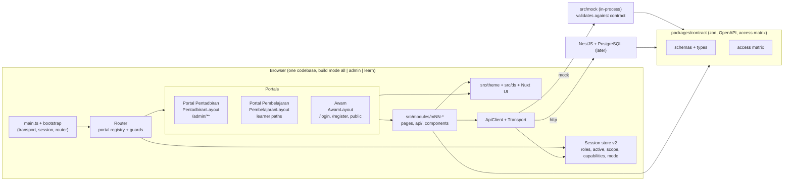
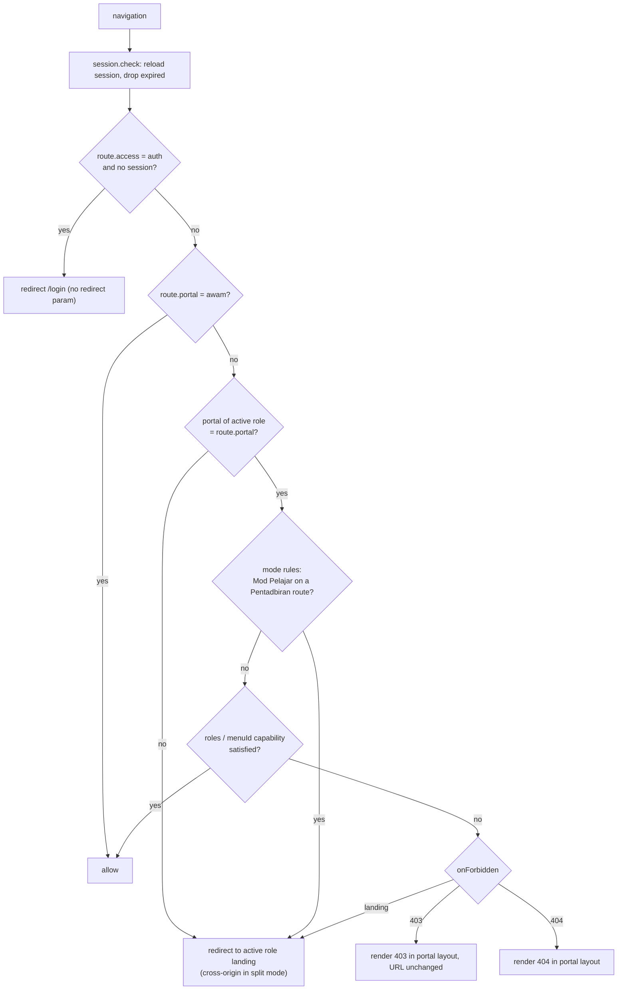
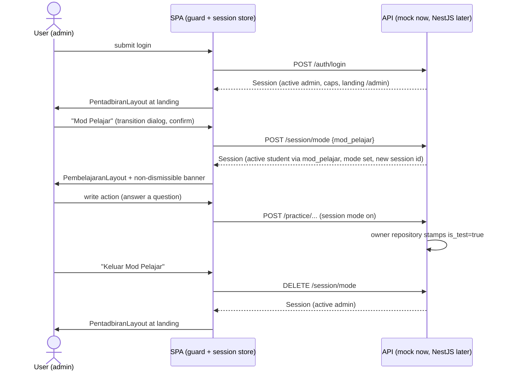

# v2 Frontend Architecture (slug: v2-frontend)

| Field | Value |
|---|---|
| Document | Feature design, G2 (system architecture) |
| Version | 0.1 |
| Date | 2026-10-16 |
| Status | Proposed, awaiting user approval of the key decisions in section 1 |
| Owner | solution-architect |
| Inputs | TRACKER D28 to D32; `docs/requirements/v2-portals.md`; `docs/requirements/v2-cloud-gap.md`; `docs/architecture/v2-data-migration.md`; `docs/architecture/overview.md`; ADR-0001 to ADR-0014; `src/app/router/{meta,layouts,guards}.ts`; `src/stores/session-types.ts`; `src/shells/`; `src/mock/`; `package.json` |
| Decisions | ADR-0015 (Nuxt UI), ADR-0016 (two portals), ADR-0017 (roles, scope, Mod Pelajar), ADR-0018 (contract-first), all Proposed |
| Visual specs (not here) | `docs/design/v2-design-system.md`, `docs/design/v2-shells.md` (ui-ux-designer, written in parallel). This document references them for tokens, components and shell behaviour and does not restate them. |

## 1. Summary and decisions that need user approval

v2 keeps this repository as the frontend. The change is structural (two portals, a role list per account, a contract shared with the future NestJS backend) and visual (Nuxt UI with our own theme). The work is a **strangler migration**: new portal layouts and the new session model come first and host every existing page; pages are then restyled module by module until the old shells and styles can be deleted.

| # | Decision | Recommendation | ADR |
|---|---|---|---|
| A1 | Portal split mechanism | One codebase and one SPA with two route trees (`pentadbiran` under `/admin/**`, `pembelajaran`, plus public `awam`), selectable at build time (`VITE_PORTAL=all\|admin\|learn`) so each host ships only its own tree. Not two apps. | 0016 |
| A2 | Design system integration | Nuxt UI (current major) through its Vite plugin, theme in `src/theme/`, composite layer `src/ds/`, strictness by ESLint + Stylelint ratchet file. | 0015 |
| A3 | Migration order | New portal layouts first (hosting old pages in a `LegacyScope`), then Pentadbiran modules, then Pembelajaran modules; strict lint ratchets per module. | this doc 7 |
| A4 | Session and role model | Server session with `roles[]`, one active role, server-derived scope, server-sent capabilities; role `jpn_officer` dropped (single `ppd_officer`, D31a); Mod Pelajar is a session mode with test-data stamping (D31c). | 0017 |
| A5 | Contract-first | `packages/contract` (zod schemas, generated OpenAPI) shared with NestJS; mock validates against it; hybrid transport lets backend domains replace the mock one by one. | 0018 |
| A6 | Public pages | Articles and videos stop being "public or user shell": `awam` only; learners get a Pembelajaran route that reuses the component. | 0016 |

The 60-task plan is in section 10.

## 2. Target architecture



Layers and rules:

1. **Contract** (`packages/contract`): the only definition of API shapes, enums, error codes, session, access matrix. No Vue, no DOM.
2. **API and transport** (`src/api`): kept from ADR-0004. `HttpTransport` gains cookie credentials and CSRF; a `HybridTransport` is added (section 8).
3. **State**: Pinia stores per ADR-0007; the session store is extended (section 4.3).
4. **Portals** (`src/portals/*`): layout, menu data, portal-level pages (home, forbidden), nothing domain-specific.
5. **Modules** (`src/modules/mNN-*`): unchanged boundary rules (ADR-0009). A module contributes routes per portal.
6. **Design system** (`src/theme`, `src/ds`, Nuxt UI): visual layer only; pages in migrated modules use it exclusively.
7. **Mock** (`src/mock`): unchanged ownership rules (ADR-0013, ADR-0014). Becomes contract-validated and scope-aware.

## 3. Portal split

### 3.1 Options and trade-offs

| Option | For | Against |
|---|---|---|
| **1. One SPA, two route trees, build-time portal selection (recommended)** | One router, session store, API client, theme and test base; static single-host demo still works (`all`); the `admin` and `learn` builds ship only their tree, so a learner never downloads admin code; cheapest migration of 660 files and 135 specs. | Discipline needed so a module does not import across trees (lint + bundle check); one dependency set for both portals. |
| 2. Two Vite entries (multi-page) in one project | Hard entry-level separation. | Two bootstraps, duplicated guards and layouts, two router instances, harder shared session and E2E; the demo site needs two pages. Gains nothing over option 1 once builds can be filtered. |
| 3. Two repos or two apps | Total isolation, independent release. | Duplicated session, API client, theme and contract wiring; doubles CI; cross-portal flows (role switch, Mod Pelajar) become cross-app. No requirement justifies it for one team. |

Recommendation: option 1. If an organisational split is needed later, the portal folders are already independent entry points (`src/portals/*` plus module route factories).

### 3.2 Mechanics

- **Mandatory route meta `portal`** (`'pentadbiran' | 'pembelajaran' | 'awam'`). One route = one portal = one layout. The parent route of each tree renders that portal's layout; pages never choose a layout.
- **Full-screen exceptions** (games, exam mode, Langsung full-screen) stay inside their portal with `layoutVariant: 'bare'`; they are not a fourth portal.
- **Paths:** Pentadbiran under `/admin/**`, Pembelajaran keeps the current learner paths, Awam keeps public paths. A unit test checks that `portal` and path prefix agree for every route. Old admin-ish paths (`/ppd/*`, `/jpn/*`, `/admin-sekolah/*`, admin SPM lanes) get redirect records in `src/app/router/legacy-redirects.ts` so existing specs stay green; V2-T56 removes the table after the specs are updated.
- **Build modes:** `VITE_PORTAL=all` (dev, demo, E2E), `admin`, `learn`. Each module manifest exposes lazy factories: `routes: { pentadbiran?: () => import('./routes.admin'), pembelajaran?: () => import('./routes.learn'), awam?: ... }`. The registry loads only the factories for the build mode, so the other tree is not in the bundle. The lint rule that forbids non-literal `import()` specifiers (ADR-0009) already allows this form.
- **Cross-portal navigation** only through: role switcher, Mod Pelajar enter/exit, login/logout (US-15). In `all` mode a wrong-portal request is a router redirect; in split mode it is `location.assign` to the other origin's landing path. Origins come from `VITE_ORIGIN_ADMIN` and `VITE_ORIGIN_LEARN`.
- **Public content pages** (`/artikel`, `/video`): `awam` only; the learner variant is a Pembelajaran route reusing the same page component (US-02 AC-02.1).
- **Shared drill-down** (Langsung / Command Center): a component in `src/modules/m17-admin-dashboard` exposed through its public entry and imported by the admin page (PM-01) and the guru page; two routes, one component (AC-09.4).

### 3.3 Folder layout (target)

```
packages/
  contract/                     # @pp/contract: zod schemas, openapi.json, access matrix
    src/{common,session,identity,curriculum,practice,content,gamification,billing,system}/
    openapi.json
src/
  app/
    bootstrap.ts  modules.ts  portals.ts      # portals.ts = registry per build mode
    router/{index,guards,meta,legacy-redirects}.ts
  api/                          # ApiClient, Transport, HttpTransport, HybridTransport
  stores/                       # session (v2), shell, flash, ...
  theme/                        # tokens.css, ui.config.ts, locale-ms.ts
  ds/                           # Pp* composites (page header, stat card, data table, scope chip ...)
  portals/
    pentadbiran/{PentadbiranLayout.vue, menu.ts, components/, pages/}
    pembelajaran/{PembelajaranLayout.vue, menus/{student,teacher,parent,sponsor}.ts, components/, pages/}
    awam/{AwamLayout.vue}
    shared/{ForbiddenPage.vue, NotFoundPage.vue, RoleSwitcher.vue, ModBanner.vue, CommandPalette.vue, LegacyScope.vue}
  modules/mNN-*/{api/, pages/, components/, mock/, routes.admin.ts, routes.learn.ts, routes.awam.ts, index.ts}
  mock/                         # unchanged core; adds contract validation, scope context, test-data stamping
  shells/                       # legacy; deleted by V2-T56
config/
  ds-strict.json                # ratchet list of folders under strict lint
```

Legacy folders (`src/shells`, `src/components/*`, `src/styles/live-globals.css`) stay where they are until the closing task, to keep the diff of each migration task small.

## 4. Routing, guard and session model

### 4.1 Route meta v2

| Key | Values | Notes |
|---|---|---|
| `portal` | `pentadbiran`, `pembelajaran`, `awam` | mandatory; replaces `layout` as the choice of frame |
| `layoutVariant` | `default`, `bare` | optional; `bare` = no chrome, still inside the portal |
| `access` | `public`, `auth` | as today; `awam` pages are `public` unless stated |
| `roles` | `RoleCode[]` | optional extra restriction inside a portal |
| `menuId` | item id such as `PM-04` | Pentadbiran pages: the capability is looked up by this id |
| `capability` | feature key | for non-menu features |
| `onForbidden` | `landing`, `403`, `404` | default `landing`; out-of-scope record ids give `404` (AC-06.6); pages the role may not read give the in-layout `403` (AC-06.2) |
| `title`, `guestTitle`, `header`, `module` | as today | unchanged |

`layout` values `role` and `public-or-user` are removed. During migration `layout` is still accepted for un-converted manifests; V2-T12 converts all 23 manifests and V2-T56 deletes the old key.

### 4.2 Guard sequence



`decideAccess` stays a pure function with unit tests; its input becomes `{ isLoggedIn, activeRole, portal, mode, capabilities, landingPath }`. The guards never read scope: scope is applied by the server. A server 404/403 on a data call renders the corresponding in-place page through the existing error mapping.

### 4.3 Session and auth contract (shape aligned to the future NestJS API)

Transport of the session: HTTP-only, `Secure`, `SameSite=Lax` cookie on the parent domain (backend task); CSRF token in a response field sent back as `X-CSRF-Token` on non-GET. The mock keeps a client-side session object under the `pp.auth` key (version bumped) so that behaviour can be tested offline; the client never reads a token in production. Endpoints (all under `/api`, envelope `{ data }`, errors `{ error: { code, message, fields?, retryAfter?, requestId? } }`):

| Method and path | Purpose | Notes |
|---|---|---|
| `POST /auth/login` | body `{ identifier, password, schoolId?, remember }`; identifier is e-mail or username (+ school) | errors: `INVALID_CREDENTIALS` (exact BM message of AC-01.4), `ACCOUNT_INACTIVE`, `SCHOOL_INACTIVE`, `AMBIGUOUS_USERNAME` (422 with candidate schools). Regenerates the session id. Returns `Session`. |
| `POST /auth/logout` | ends the session for both portals | |
| `GET /session` | current `Session` | one call resolves role, scope, capabilities, landing (NFR Performance) |
| `POST /session/role` | body `{ role }`; must be in the account's list | regenerates session id, audit entry, returns `Session`; `409 MODE_ACTIVE` while a mode is on |
| `POST /session/mode` | body `{ mode: 'mod_pelajar' }` | `403` unless allowed for the active role; audit entry |
| `DELETE /session/mode` | "Keluar Mod Pelajar" | returns `Session` with the return role active |

```ts
// shape only (lives in packages/contract as zod; shown for the reviewer, not a build artefact)
type RoleCode = 'student' | 'teacher' | 'parent' | 'sponsor' | 'school_admin' | 'ppd_officer' | 'admin'
type PortalId = 'pentadbiran' | 'pembelajaran'
interface Scope { level: 'national'|'state'|'district'|'school'|'class'|'self'; stateCode?: string;
                  districtCode?: string; schoolId?: number; label: string }   // label = chip text value, server-formed
interface RoleGrant { role: RoleCode; portal: PortalId; scope: Scope }
interface Session {
  user: { id: number; name: string; email: string | null; username: string | null;
          avatarUrl: string | null; schoolId: number | null }
  roles: RoleGrant[]                                   // 1 item for every migrated account
  active: { role: RoleCode; portal: PortalId; scope: Scope; via: 'direct' | 'mod_pelajar' }
  mode: null | { kind: 'mod_pelajar'; returnRole: RoleCode; since: string; isTest: true }
  capabilities: Record<string, 'F' | 'R' | 'S' | 'D'>  // active role only; keys = menu item ids + feature keys
  landingPath: string
  expiresAt: string                                    // +08:00 ISO
  csrf: string
}
```

Rules carried from the requirements: permissions are the active role's only (AC-08.4); the switcher renders only when `roles.length >= 2` (AC-08.2); permission changes apply on the next request (`GET /session` is refreshed on navigation if older than a short TTL); Admin Pusat is single-role; `student` never combines with a staff role.

Client store (`useSessionStore`, extends ADR-0007): `user`, `roles`, `active`, `mode`, `capabilities`, `landingPath`; getters `portal`, `activeRole`, `scopeLabel`, `can(itemId)`, `canSwitchRole`, `isModPelajar`; actions `login`, `logout`, `refresh`, `switchRole`, `enterModPelajar`, `exitModPelajar`. A compatibility getter `role` (= `active.role`) and a `UserMe`-shaped projection keep un-migrated modules compiling until their task.

### 4.4 Role to portal, landing, scope

| Role | Portal | Landing (from server) | Scope level produced in v2.0 |
|---|---|---|---|
| admin | pentadbiran | `/admin` (Papan Pemuka) | national |
| school_admin | pentadbiran | `/admin` (own school) | school |
| ppd_officer | pentadbiran | `/admin/pemantauan/wilayah` (PM-14) | district, derived from the officer's school (.cloud model, D31a) |
| teacher | pembelajaran | teacher dashboard | class |
| student | pembelajaran | `/dashboard` | self |
| parent, sponsor | pembelajaran | as built | self (linked children / fosters) |

Mod Pelajar: `active = { student, self, via: mod_pelajar }`, `mode.returnRole = admin`.

### 4.5 Sequence: login, role switch, Mod Pelajar



## 5. Nuxt UI integration plan

Detail of the decision is in ADR-0015. Plan:

1. **Install (V2-T02 spike, then V2-T03):** add `@nuxt/ui` and the local Lucide Iconify collection; add the `@nuxt/ui/vite` plugin after `vue()` in `vite.config.ts`; register `@nuxt/ui/vue-plugin` in `main.ts`; wrap the root in `<UApp>`; add the generated `auto-imports.d.ts` and `components.d.ts` to `.gitignore` and `tsconfig.app.json`; CI runs the type-check after a generation step. The spike verifies in a sandbox route `/__ds`: vue-router 5 with the plugin's `router` option; whether the plugin already registers Tailwind (then remove the explicit `@tailwindcss/vite` entry to avoid a double plugin); `ms` locale availability; attribute forwarding (`data-testid`) of the 15 most used components against the E2E conventions; token-name collisions with `src/styles/theme.css`; demo bundle size against `scripts/check-demo-bundle.mjs`.
2. **Theme location:** `src/theme/tokens.css` (`@theme` and `--ui-*` overrides, light and `.dark`), `src/theme/ui.config.ts` (colour aliases, per-component slot and variant overrides, handed to the plugin's `ui` option), `src/theme/locale-ms.ts`. Values from `docs/design/v2-design-system.md`. Fonts reuse the existing self-hosted Inter/Outfit unless that doc changes them.
3. **Coexistence with the current Tailwind v4 set-up during migration:**
   - One Tailwind instance. `main.css` imports `tailwindcss`, then `@nuxt/ui`, then `theme/tokens.css`. The old `styles/theme.css` aliases stay but are renamed or checked for collisions in the spike.
   - Legacy global CSS (`live-globals.css`: unlayered `.card`, `.user-shell [class*='-hero']` colour overrides) is the main hazard. It is wrapped in a native-nesting scope under `.legacy-ui` (Tailwind's CSS pipeline lowers nesting) and imported only by `LegacyScope`, so it can no longer reach Nuxt UI components.
   - `LegacyScope` (in `src/portals/shared`) wraps every page of an un-migrated module inside the new layout: it sets the classes the old selectors expect (`legacy-ui user-shell`), forces a light surface (white panel on the dark theme, since legacy pages have no dark variants) and nothing else. It is removed per module when the module is migrated, and deleted in V2-T56.
   - Dark mode is available from Wave 1 for the chrome and for migrated pages; dark QA of a module happens in that module's task; the all-screens dark pass is V2-T57.
4. **"Components + tokens only" guards:** ESLint rules `pp/ds-class-allowlist`, `vue/no-restricted-syntax` (raw form/table/dialog elements and `<style>` blocks), import restrictions, and Stylelint (`color-no-hex`, no colour functions outside `tokens.css`, no `!important`). They run for the folders listed in `config/ds-strict.json`. Each module-migration task appends its folders (pages, components, portal parts) to the file in its PR; the ratchet only moves one way. V2-T56 flips the default to strict for all of `src/`. Unit tests for the rule use fixtures of allowed and rejected class strings.
5. **Composite layer `src/ds/`:** only what `v2-design-system.md` names as a project composite (candidates: page header, stat card, data table with server pagination, filter bar, empty and error states, confirm dialog, scope chip, form field group). A composite never takes a `class` prop that accepts colours; variants are props.
6. **Gallery:** `/__ds` route (dev and demo only) shows every component in light and dark, replacing the existing `styles/gallery` over time. Used by QA for token review.

## 6. Mock layer evolution (contract-first, swappable for NestJS)

Detail of the decision is in ADR-0018. Summary of the steps:

1. **Contract package first (V2-T06 to V2-T08):** envelope, error, list meta, ids, enums, session, access matrix (the 94 items of `v2-portals.md` section 6 with the per-role mode F/R/S/D).
2. **Mock handlers validate** requests (always) and responses (dev/test) against the schemas (V2-T29). A drift between a handler and the contract fails unit tests.
3. **Realignment to .cloud** per `v2-data-migration.md` section 4 (owner modules per ADR-0014):

| Area | Change in the contract and mock | Task |
|---|---|---|
| M01 auth/session | Session v2 (section 4.3); username + school login; nullable e-mail; `isActive` + `isSuspended`; role list; `jpn_officer` removed; `unmapped` removed | V2-T09 |
| M02 users, schools | `roles[]` + scope on grants; `username`, `email` nullable; two status flags; masked IC only (`icMasked`); schools carry `joinCode`, JPN/PPD derived from distinct `state`/`district`; subscriptions reshaped (`package`, `quota`, dates); parent links add `relationship` | V2-T24 |
| M03 curriculum | `strand`, `dskpCode` kept; `inTree` becomes a rule; no `subject_levels` source (derive) | V2-T26 |
| M05 practice | `questionId` nullable; `selectedLabel`; `historical` flag; dimensions (`subjectId`, `levelId`, `chapterId`, `topicId`, `difficulty`, `questionType`, `isCorrect`) on the answer row; `clientUuid`; mastery and topic progress read the answer dimensions, not a question join; revision queue only for rows with a question link | V2-T25 |
| New Sistem stores | `audit_logs`, `settings`, `feature_flags`, `ai_usage_logs` | V2-T27 |
| New Kewangan stores | `payments`, `invoices`, `dunning_logs`, `packages` (user-facing) | V2-T28 |
| Cross-cutting | ids opaque (`ID_RANGES` stays inside the mock, never in the contract); timestamps `+08:00`; money as in X4; scope enforced in the mock (V2-T20); test-data stamp (V2-T19) | |

4. **Scope enforcement in the mock** (V2-T20) mirrors what NestJS must do: the session context carries the active role and scope; owner repositories take a `ScopeFilter`; a record outside scope returns 404 (not 403); non-GET by `ppd_officer` returns 403; scope is never read from query or body.
5. **Transport:** `HttpTransport` adds `credentials: 'include'`, CSRF header, 401 to login, `requestId` logging. `HybridTransport` (`VITE_API_MODE=hybrid`, env list of path prefixes served by the real API) lets backend domains go live one at a time while the rest stay on the mock (V2-T31).
6. **Conformance suite** (V2-T30): the handler test scenarios are re-expressed against the HTTP contract with a pluggable transport so the same suite runs against the mock and, later, against NestJS in CI. An OpenAPI diff gate reports breaking changes.
7. **What stays mock-only:** virtual datasets, deterministic seeds, fault injection, latency, the clock. They are ADR-0005/0006/0013 concerns and do not appear in the contract. The D11 "counts computed from the dataset" rule remains for mock data; migrated real data replaces it in production.
8. **Questions (M04):** the mock question store stays as is until the user's exam schema arrives (D28e, D32b). Migration tasks that touch M04 only move menu placement and chrome; intake and display redesign are out of this plan.

## 7. Migration strategy for 660 `.vue` files

Counts (`.vue` per area): modules M10 52, M08 50, M27 49, M12 48, M16 54, M09 41, M05 39, M17 38, M02 33, M11 29, M14 29, M04 27, M03 24, M01 21, M06 20, M20 17, M07 16, M13 9, M15 9, M25 5, M21 4, M22 2, M18 0 (docs and routes only); shells and shared components about 70.

**Principles**
1. **Structure before skin.** The portal layouts, session model and route meta change first (Wave 1) with old pages inside `LegacyScope`. The user-visible gain (no shell switching, role switcher, Ctrl+K, scope chip) lands early and the page restyle follows without blocking it.
2. **One module = one migration task** (large modules are split by sub-area), and a task is only done when the module's unit tests, lint, type-check and its E2E specs pass at 375/768/1280 (`npm run test:e2e:module`), with the module's folders appended to `config/ds-strict.json`.
3. **Keep the test contract.** Test ids, roles and BM texts of a page do not change in a restyle. Specs that select by CSS class are fixed in the same task (the strict tooling task, V2-T04, adds a report script that lists class-based selectors per module). Copy changes required by `v2-portals.md` (labels of groups and items) update specs in the task that makes them.
4. **No behaviour change in a restyle task.** Behaviour changes (merges such as PS-01 tabs, PM-15) are their own listed tasks; a restyle PR that also changes flows is rejected in review.
5. **Admin pages move to `/admin/**` in the same task** that migrates them, with a redirect record from the old path; the portal registry test lists any admin function not yet reachable.
6. **Dark mode and responsive** are part of each module's definition of done (D29f, CLAUDE.md section 7).
7. **Shared mock data changes** (M01 users, M05 practice, M10 classes, M04 questions, seeds, specs) follow the worktree rule in CLAUDE.md section 6 and the boot test `src/mock/server/__tests__/registry-boot.test.ts`.

**Order**
- Wave 0: tooling and decisions (V2-T01 to V2-T08).
- Wave 1: platform (V2-T09 to V2-T23): session, router, layouts, LegacyScope cut-over, Mod Pelajar, scope, portal E2E.
- Wave 2: contract and data realignment (V2-T24 to V2-T31), can overlap Wave 1 after V2-T09.
- Wave 3: Pentadbiran modules (V2-T32 to V2-T47) in this order: pilot M22 (smallest, both portals), shared Langsung component, M17, M27, M18, M02 admin, then bank/SPM/curriculum/content chrome, Penglibatan, new Kewangan and Sistem screens. Reason: the admin side holds most tables and forms (best fit for Nuxt UI), and it carries the structural merge D30 asks for.
- Wave 4: Pembelajaran modules (V2-T48 to V2-T55): M05, M08, M10, then M11/M12 (guru variants move into the learning layout), M16, M14/M15, M06/M07 (Bijak SPM), leftovers.
- Wave 5: closure (V2-T56 to V2-T60): remove legacy shells, `LegacyScope`, `live-globals.css`, redirects, `layout` meta key; strict lint everywhere; full regression; review; release pipeline; docs.

**How tests stay green during the strangler**
- The old shell specs (`e2e/global/user-shell.spec.ts`, `guards.spec.ts`, admin shell specs) are rewritten once, in V2-T21, when the layouts replace the shells. Module specs are untouched until their module task.
- Redirect records keep old URLs working until the closing task.
- `act-as.ts` is extended with `actAsRole(role, { active })`, so existing `actAs('teacher')` calls keep working.
- The 3-viewport projects stay. No screenshot baselines are assumed; if a module has them they are regenerated in its task.
- CI runs, per PR: lint, type-check, unit tests, build, and E2E for the touched modules; the full E2E nightly (V2-T01).

## 8. Portal design notes that cross tasks

- **Menu as data (V2-T14, V2-T15):** each item `{ id, labelBm, groupId, routeName, icon }`; visibility = `capabilities[id]` present. One definition feeds sidebar, mobile navigation, Ctrl+K and the audit test (AC-02.5: every item's route has `portal = pentadbiran`; AC-03.x: per-role item sets equal the matrix). Group order and item order follow `v2-portals.md` sections 5 and 6.
- **Ctrl+K (US-10):** `UCommandPalette` fed by the menu items the role can read plus a debounced server search of users/schools in scope; "Mod Pelajar" command only for roles allowed.
- **Topbar chip (US-04):** `Pp` scope chip shows `roleLabel · scope.label`, both from the session.
- **Forbidden page (US-06):** rendered in the portal layout with the exact BM copy of AC-06.2.
- **Mod Pelajar banner:** in `PembelajaranLayout`, non-dismissible, offsets content (AC-16.5).
- **Responsive:** shells behave at 375/768/1280 per `docs/design/v2-shells.md`.

## 9. Risks

| ID | Risk | Mitigation |
|---|---|---|
| R1 | Nuxt UI + vue-router 5 or the plugin's own Tailwind registration conflict with the current set-up | V2-T02 spike before any dependency lands on `main`; fallback `router: false` with our own link component |
| R2 | Legacy unlayered CSS leaks into Nuxt UI components | nesting scope under `.legacy-ui`, imported only by `LegacyScope`; spike checks cascade |
| R3 | `data-testid` lands on a wrapper instead of the interactive element after restyle | spike verifies forwarding; `Pp` composites normalise; module DoD includes E2E |
| R4 | 135 specs break at once at the layout cut-over | one task (V2-T21) with the full suite run per module via `test:e2e:module`, redirect table, `act-as` compatibility |
| R5 | Contract changes in M01/M02/M05 break many modules | compatibility getter/projection in the session store; shared-store changes in worktrees; boot test gate |
| R6 | Several PCs edit shared files (eslint config, vite config, theme, routes registry) | those files are owned by Wave 0/1 platform tasks only; module tasks may append only to their own folders and to `config/ds-strict.json` |
| R7 | Bundle growth (Nuxt UI, Reka, vueuse, zod) | per-component auto-import, budgets in `check-demo-bundle.mjs`, zod off in production response path |
| R8 | Prototype rules in CLAUDE.md section 6 (replicate, do not redesign; seeds mirror observation) conflict with D29 for UI and changed flows | Delivery Lead updates CLAUDE.md and the module "Fidelity deviations" practice for v2; not done here |
| R9 | PPD/JPN: only district can be derived from the officer's school | contract keeps `state` level; profiling task MIG-01 decides |

## 10. Task list

Sizes: **S** up to 0.5 day, **M** 1 to 2 days, **L** 3 to 5 days, for one developer (or one agent session). "Owner" is the role that does the work; `qa` and review tasks use the project roles `qa-engineer`, `code-reviewer`, `security-engineer`. "Mock" backend work is done by `backend-developer` (the mock layer is theirs). Every task uses the common Definition of Done in 10.2.

### 10.1 Tasks

| ID | Task | Owner | Size | Depends on | Wave |
|---|---|---|---|---|---|
| V2-T01 | GitHub set-up: labels (`v2`, `wave:N`, `role:*`, `module:Mnn`, `size:S/M/L`, `portal:*`), issue and PR templates with the DoD, CODEOWNERS by folder, branch `feature/v2-frontend`, CI workflow (lint, type-check, unit, build, E2E on touched modules, nightly full E2E) | devops-engineer | M | ADRs approved | 0 |
| V2-T02 | Nuxt UI spike on `/__ds`: install, Vite plugin vs Tailwind registration, vue-router 5, `ms` locale, Iconify offline, `data-testid` forwarding of 15 components, token collisions, bundle budget in `check-demo-bundle.mjs`; write findings to `docs/architecture/v2-nuxtui-spike.md` | frontend-developer | M | ADR-0015 | 0 |
| V2-T03 | Theme: `src/theme/{tokens.css,ui.config.ts,locale-ms.ts}`, light and dark, `UApp` root, colour mode with storage key `pp.theme`, fonts | frontend-developer | M | T02, `docs/design/v2-design-system.md` | 0 |
| V2-T04 | Strict tooling: ESLint rule `pp/ds-class-allowlist` (+ tests), restricted raw elements and `<style>`, import restrictions, Stylelint, `config/ds-strict.json` reader, report script for class-based E2E selectors per module | frontend-developer | M | T02 | 0 |
| V2-T05 | Composite layer `src/ds/` (the `Pp*` list from the design spec) and the `/__ds` gallery in light and dark | frontend-developer | L | T03, T04 | 0 |
| V2-T06 | `packages/contract` scaffold: npm workspace, zod, envelope, error codes, list meta, ids, enums, OpenAPI emit script and committed `openapi.json`, CI diff step | backend-developer | M | ADR-0018, T01 | 0 |
| V2-T07 | Contract: session and auth schemas and OpenAPI for the six endpoints of 4.3, error codes, BM messages table | backend-developer | M | T06 | 0 |
| V2-T08 | Contract: access matrix as data (94 items x 4 role modes from `v2-portals.md` section 6, group visibility, feature keys) + test that counts and per-role sets match the requirements | backend-developer | M | T06 | 0 |
| V2-T09 | M01 mock realign to Session v2: login by identifier/school, role list, switch and mode endpoints, scope derivation for `ppd_officer`, capabilities from the matrix, status flags, nullable e-mail, remove `jpn_officer`/`unmapped`, session version bump and stored-session migration, seeds | backend-developer | L | T07, T08 | 1 |
| V2-T10 | Session store v2 and composables (`useCapability`, `usePortal`), compatibility `role` getter and `UserMe` projection, API client 401/CSRF handling | frontend-developer | M | T07, T09 | 1 |
| V2-T11 | Router v2: meta (`portal`, `layoutVariant`, `menuId`, `capability`), `decideAccess` v2 + tests, portal registry (`app/portals.ts`), build modes `all/admin/learn`, route audit tests (portal vs prefix, one layout per route) | frontend-developer | M | T07, T10 | 1 |
| V2-T12 | Convert the 23 module manifests to per-portal lazy route factories, assign each existing route a portal, `legacy-redirects.ts`, move the 12 shell-switch pages into the admin tree (placeholder pages where not built) | frontend-developer | L | T11 | 1 |
| V2-T13 | `PentadbiranLayout`: sidebar, topbar with scope chip and user menu, mobile navigation, server-status pill, Ctrl+K palette shell, per `docs/design/v2-shells.md` | frontend-developer | L | T03, T05, T10, T11, `v2-shells.md` | 1 |
| V2-T14 | Pentadbiran menu data (9 groups, 94 items), route mapping, capability filtering, tests for AC-02.5 and AC-03.x | frontend-developer | M | T08, T11 | 1 |
| V2-T15 | `PembelajaranLayout` and role menus (student, teacher, parent, sponsor) as data: sidebar, drawer, bottom nav from one definition (AC-14.5) | frontend-developer | L | T03, T05, T10, T11, `v2-shells.md` | 1 |
| V2-T16 | `AwamLayout` and M01 auth pages restyled (login with school picker, register, reset, public landing frame); `public-or-user` removed | frontend-developer | M | T05, T10, T11 | 1 |
| V2-T17 | In-layout 403 and 404 pages per portal with the BM copy of AC-06; `onForbidden` wiring | frontend-developer | S | T13, T15 | 1 |
| V2-T18 | Role switcher UI (US-08), Mod Pelajar enter/exit flow, transition dialog, non-dismissible banner, `act-as.ts` extension | frontend-developer | M | T09, T13, T15 | 1 |
| V2-T19 | Test-data stamping: session mode available to repositories, `isTest` on writes in owner repositories (M05 sessions/answers, M14 wallet/ledger, notes, notifications), exclusion in aggregates (rankings, leaderboards, analytics); worktree + boot test | backend-developer | M | T09 | 1 |
| V2-T20 | Scope enforcement in the mock: scope context, `ScopeFilter` in owner repositories, 404 for out-of-scope ids, non-GET 403 for `ppd_officer`, scope never from request; tests for AC-05.x; worktree + boot test | backend-developer | L | T09 | 1 |
| V2-T21 | Cut-over: `LegacyScope`, legacy CSS nesting under `.legacy-ui`, replace old shells with the new layouts for all routes, rewrite shell/guard E2E specs, run all module E2E | frontend-developer | L | T12, T13, T15, T16, T17 | 1 |
| V2-T22 | Portal E2E and QA matrix: US-01 to US-06, US-08, US-15, US-16 at 375/768/1280 including each role's menu set, forbidden direct URLs, switcher, Mod Pelajar; `docs/qa/v2-portals.md` | qa-engineer | L | T14, T18, T19, T20, T21 | 1 |
| V2-T23 | Split-build pipeline: CI builds `admin` and `learn`, bundle-isolation check (no Pentadbiran chunk in `learn`, no learner page chunk in `admin`), two preview servers + cross-portal redirect smoke | devops-engineer | M | T11, T12 | 1 |
| V2-T24 | M02 realign: contract + mock (users with `roles[]`, `username`, flags, masked IC; schools `joinCode`; subscriptions; parent links `relationship`), consumers updated | backend-developer | L | T09 | 2 |
| V2-T25 | M05 realign: nullable `questionId`, `selectedLabel`, `historical`, dimensions on answer rows, `clientUuid`; mastery/topic progress/accuracy read dimensions; revision queue rules; consumers (M06, M08, M10, M12, M14, M16) updated | backend-developer | L | T06, T24 | 2 |
| V2-T26 | M03 realign: `strand`, `dskpCode`, `inTree` rule, derived subject-levels | backend-developer | S | T06 | 2 |
| V2-T27 | New Sistem stores: `audit_logs` (writes from role switch, mode, imports, settings), `settings`, `feature_flags`, `ai_usage_logs`: contract, mock repositories, handlers, seeds | backend-developer | L | T06, T19 | 2 |
| V2-T28 | New Kewangan stores: `packages`, `payments`, `invoices`, `dunning_logs`: contract, mock repositories, handlers, scope by school, seeds | backend-developer | L | T06, T20 | 2 |
| V2-T29 | Mock validation middleware (request always, response in dev/test) + drift tests for realigned domains | backend-developer | M | T06, T24 | 2 |
| V2-T30 | Conformance suite with pluggable transport + OpenAPI breaking-change gate in CI | backend-developer | M | T29 | 2 |
| V2-T31 | `HttpTransport` hardening (credentials, CSRF, 401, requestId) and `HybridTransport` with a prefix list; smoke against a contract stub server | frontend-developer | M | T07, T10 | 2 |
| V2-T32 | Pilot migration: M22 support tickets (learner create/list + admin Urus Tiket PG-22) on Nuxt UI; first `ds-strict.json` entries; retro notes feed the module checklist | frontend-developer | S | T05, T21 | 3 |
| V2-T33 | Shared Pemantauan > Langsung component (PM-01): drill-down school > teacher > class > student, full-screen mode, live refresh, scope-aware, used by admin and guru pages | frontend-developer | L | T05, T13, T20 | 3 |
| V2-T34 | M17 admin dashboard pages: Papan Pemuka (PP-01, PP-02), Aktiviti Harian, Analitik merge (PM-04), Prestasi Sistem; restyle + admin tree | frontend-developer | L | T21, T32 | 3 |
| V2-T35 | M27 school-admin monitoring pages: PM-12, PM-15, PM-21 to PM-23, Kirkpatrick admin set (PM-05 to PM-11) as one group | frontend-developer | L | T21, T32 | 3 |
| V2-T36 | M27 users/classes: Pengguna & Sekolah screens PS-01 (one list with role tabs, replacing Senarai Pelajar/Guru), PS-03 Kelas Sekolah, imports PS-04, PS-05, PS-06 | frontend-developer | L | T24, T21 | 3 |
| V2-T37 | M18 pages (new build): PM-14 Papan Pemuka Wilayah, PM-16 to PM-20, PM-15 shared; scope from session | frontend-developer | L | T20, T21 | 3 |
| V2-T38 | M02 admin pages: PS-02 Sekolah (list/create/edit/join code), PS-01 shared parts with T36, Mod Pelajar entry action | frontend-developer | M | T24, T36 | 3 |
| V2-T39 | M04 admin chrome: BS-01 to BS-07 placed in Bank Soalan group, lists and forms restyled; intake and display redesign excluded (blocked on exam schema) | frontend-developer | L | T21, T32 | 3 |
| V2-T40 | M06 admin lanes: KS-01 to KS-12 under `/admin/spm/**`, Bijak SPM admin parts (Kertas Pilihan, Kontrak) | frontend-developer | L | T21, T32 | 3 |
| V2-T41 | M03 admin pages: KK-01 to KK-04 (Kurikulum, Subjek, Bab, Tahap) | frontend-developer | M | T26, T21 | 3 |
| V2-T42 | M09 admin pages: KK-05 to KK-11 (Banner, Artikel, Nota, Video, Laluan Kerjaya, Universiti, Biasiswa) and public article/video split (`awam` vs learner route) | frontend-developer | L | T21, T32 | 3 |
| V2-T43 | Penglibatan part 1, M14 + M15 admin: PG-01 to PG-10 (Gamifikasi, Kedai Hadiah) | frontend-developer | L | T21, T32 | 3 |
| V2-T44 | Penglibatan part 2: PG-11 to PG-13 (M16 admin), PG-14, PG-15 (M20), PG-16 to PG-19 (M21), PG-20 Push Notifikasi | frontend-developer | L | T21, T32 | 3 |
| V2-T45 | M13/M25 admin: PG-21 Chatbot, AI centre admin views, KS-10 Tanda Karangan queue | frontend-developer | M | T21, T32 | 3 |
| V2-T46 | Kewangan pages KW-01 to KW-06 (new) | frontend-developer | L | T28, T21 | 3 |
| V2-T47 | Sistem pages SY-01 to SY-05 (new) incl. Log Audit export and Kawalan Ciri | frontend-developer | M | T27, T21 | 3 |
| V2-T48 | M05 learner pages (practice, history, revision, dashboard pieces) | frontend-developer | L | T25, T21, T32 | 4 |
| V2-T49 | M08 student performance pages (split in two PRs: student views, teacher/parent views) | frontend-developer | L | T21, T32 | 4 |
| V2-T50 | M10 teacher class pages (split in two PRs: classes/missions, assessments/tools) | frontend-developer | L | T21, T32 | 4 |
| V2-T51 | M11 + M12 guru analytics and Kirkpatrick in the learning layout (Command Center uses T33) | frontend-developer | L | T33, T21 | 4 |
| V2-T52 | M16 battle and games learner pages (two PRs) | frontend-developer | L | T21, T32 | 4 |
| V2-T53 | M14 + M15 learner pages (wallet, streak, rewards shop, redemptions) | frontend-developer | M | T21, T32 | 4 |
| V2-T54 | M06 + M07 learner pages: Bijak SPM (Kertas Pilihan, Jana Kertas under the Kontrak), PKSK | frontend-developer | L | T40, T21 | 4 |
| V2-T55 | Leftovers: M09 learner (notes, content), M20, M21 (sponsor home), M13, M25 learner, M03 learner, M01 profile and settings, parent views | frontend-developer | L | T21, T32 | 4 |
| V2-T56 | Closure: delete old shells, `LegacyScope`, `live-globals.css`, legacy components, redirects and the `layout` key; strict lint default for all `src/`; update `overview.md` and ADR statuses | frontend-developer | M | T34 to T55 | 5 |
| V2-T57 | Full regression: all ACs of `v2-portals.md`, all modules at 375/768/1280 in light and dark, accessibility spot checks | qa-engineer | L | T56 | 5 |
| V2-T58 | G4 review: portal separation, scope, session and Mod Pelajar, test-data exclusion, contract package, strict tooling | code-reviewer + security-engineer | M | T56 | 5 |
| V2-T59 | Release pipeline for split builds, host config, cookie domain, runbook in `docs/ops/` | devops-engineer | M | T23, T58 | 5 |
| V2-T60 | Docs: TRACKER rows, `overview.md` v2.0, build-plan successor, module checklists; hand-over for backend phase (issue list per domain) | solution-architect | S | T56 | 5 |

Total: 60 tasks. Sizes: S 4, M 25, L 31. By kind: 8 tooling and contract, 15 platform, 8 data and transport, 16 Pentadbiran modules, 8 Pembelajaran modules, 5 closure and release.

### 10.2 Common Definition of Done (put in the issue template, V2-T01)

1. Lint, type-check, unit tests and build pass (real output in the PR).
2. For module tasks: the module's E2E specs pass at 375, 768 and 1280 (`npm run test:e2e:module -- <mNN>`), no horizontal page scroll, light and dark checked on the gallery or the pages.
3. Test ids, roles and BM texts unchanged except where the task lists a copy change.
4. The module folders are appended to `config/ds-strict.json` and the strict lint passes on them.
5. Shared-store or seed changes were made in a worktree, `registry-boot.test.ts` passes.
6. Docs updated where code diverges from them; TRACKER row updated by the Delivery Lead.
7. `code-reviewer` Approve (and `security-engineer` for tasks touching auth, scope, session, personal data).

### 10.3 Distribution across PCs and GitHub issues

- One GitHub issue per task, body = task row + inputs (paths) + DoD link; labels from V2-T01; dependencies as "Blocked by #n" lines and a project board with columns per wave.
- **Parallel lanes** once Wave 1 is done: (a) contract/backend lane (T24 to T30), (b) Pentadbiran lane (T33 to T47, up to three PCs since modules do not share files), (c) Pembelajaran lane (T48 to T55, up to three PCs). Wave 0 and Wave 1 are mostly sequential on the frontend (T02 to T05, T10 to T13, T21) and are done by one or two PCs; T06 to T09 can run on a backend PC in parallel.
- **File ownership to avoid merge conflicts:** `vite.config.ts`, `eslint.config.ts`, `src/theme/**`, `src/ds/**`, `src/app/**`, `src/portals/**`, `packages/contract/src/common|session` belong to Wave 0/1 tasks; module tasks edit only `src/modules/<their module>/**` and append to `config/ds-strict.json` (append-only, merge conflicts there are trivial).
- A PC claims an issue by assigning it, works on `feature/v2-<task-id>` branched from `feature/v2-frontend`, and opens a PR back; the Delivery Lead runs the gates (CLAUDE.md section 2).
- Backend phase hand-over (V2-T60): one issue list per contract domain (identity, curriculum, practice, content, gamification, billing, system) using `openapi.json` and the conformance suite as acceptance.

## 11. Open questions (blocking only)

| # | Question | Recommended default (used if no answer) |
|---|---|---|
| OQ-1 | Who may enter Mod Pelajar? D31(c) says "admin". | Admin Pusat only. Admin Sekolah and Pegawai PPD do not get it in v2.0. |
| OQ-2 | `v2-portals.md` US-07 (open a chosen real student's view, read-only) conflicts with D31(c) (admin acts as themselves). Is real-student preview dropped from v2.0? | Dropped; Mod Pelajar replaces it. The `mode.kind` field leaves room for a later audited preview. |
| OQ-3 | PPD and state level: with one `pegawai_ppd` role and scope derived from the officer's school (D31a) only a district scope can be derived. Does any officer need a state-wide view in v2.0? | No; `ppd_officer` is district-scoped. The contract keeps `level: 'state'` so profiling (MIG-01 Q3) can add it without a break. |
| OQ-4 | Pentadbiran path prefix `/admin/**` on the `admin.*` host (redundant on that host but keeps one site working in demo and avoids path clashes with learner routes such as `/spm/*`). Accept? | Accept. |
| OQ-5 | Public pages (`/artikel`, `/video`) become `awam` only; a logged-in learner uses a Pembelajaran route with the same page. Accept? | Accept. |

Not blocking (devops/backend, later): final hostnames, parent-domain cookie settings, whether NestJS lives in this repository, access-token model beyond the cookie session.

## 12. Notes for the Delivery Lead

- CLAUDE.md section 6 ("Replicate, don't redesign", seeds mirror observation, DV fidelity tables) conflicts with D29 for UI and changed flows. It should be amended for v2 work; this document does not edit it.
- `docs/design/design-system.md` and `docs/design/shells.md` (v1) exist; the v2 equivalents are being written by the ui-ux-designer and are the inputs for V2-T03, V2-T05, V2-T13 and V2-T15.
- ADR-0015 to ADR-0018 are Proposed. After approval, ADR-0003 and ADR-0008 get a "Superseded in part by" line (done by the architect, not part of this change).
