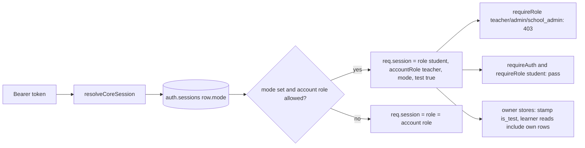
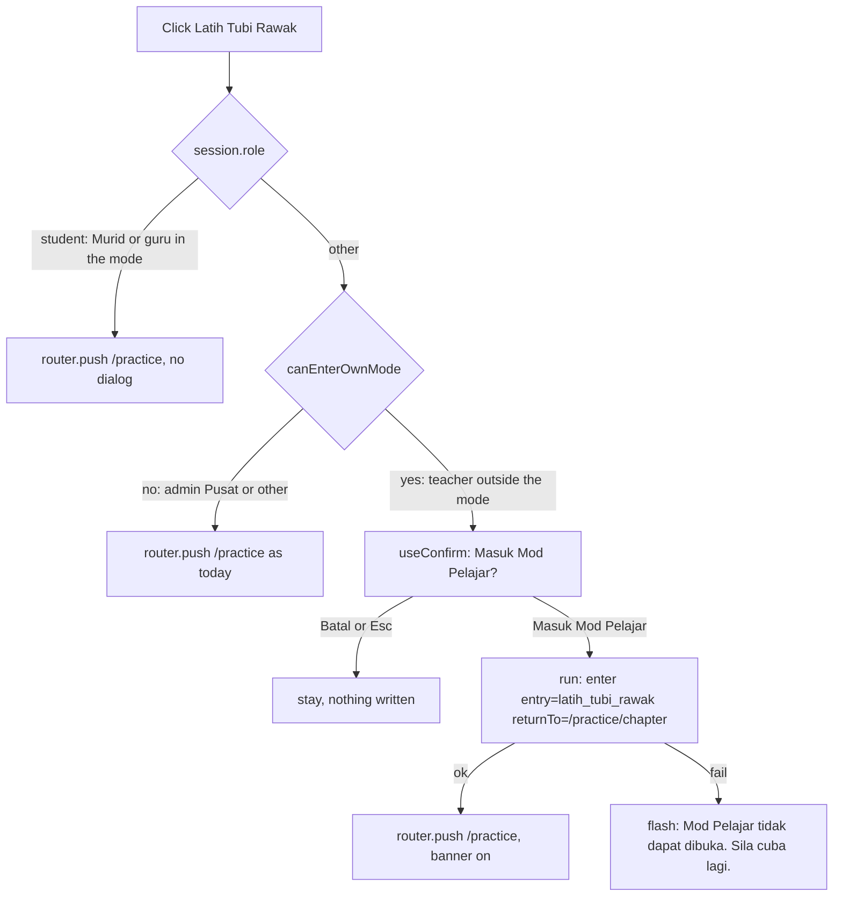

# v2 Guru and Admin Sekolah Mod Pelajar - Architecture (`guru-mod-pelajar`)

| Field | Value |
|---|---|
| Slug | `v2-guru-mod-pelajar` (feature `guru-mod-pelajar`) |
| Status | **G2 system design, proposed. Needs user approval of section 7 (2 questions) and ADR-0020.** |
| Date | 2026-10-25 |
| Owner | solution-architect |
| Requirements | `docs/requirements/v2-guru-mod-pelajar.md` (US-01..US-10, AC-01.1..AC-10.6, R1..R9) - source of truth |
| UX design (parallel) | `docs/design/v2-guru-mod-pelajar.md` (flows, copy, banner, dialog; this doc assumes its defaults) |
| Decisions | ADR-0020 (this feature, amends ADR-0017 item 7); ADR-0017, ADR-0014, ADR-0013, ADR-0018 respected |
| Tracker | D31(c), D33(b), D45 (proof of concept), D53(c), D54, D55 |
| Labels | **[AS-BUILT]** seen in this repo. **PROPOSED** = new. Nothing here changes Admin Pusat Mod Pelajar (Q-N1 default A). |

---

## 1. Design summary

### 1.1 What the code review found (facts the design rests on)

1. **Almost everything already reads one value.** About 30 call sites (layouts, guard, scope helpers, menus, `useShellUser`, error page, `analisa-item` redirect) read `useSessionStore().role`. If that single computed returns the **effective** role, R7 is solved at the source without touching those sites. [AS-BUILT: `src/stores/session.ts` `role` computed; `PembelajaranLayout.vue` `learner = role === 'student'`.]
2. **The mock resolves the role in one place.** `resolveCoreSession` (`src/mock/core-data/resolve-session.ts`) puts `role: user.role` on `req.session`; every `requireRole(...)` and every `req.session.role` check (M08, M10, M11, M13, M17, M25, M27) reads it. If it returns the effective role, staff endpoints refuse a token in the mode (AC-08.6) with no per-handler change. [AS-BUILT]
3. **R2' is smaller than the spec feared.** Most learner endpoints are guarded by `requireAuth()` only (M05 all learner routes, M14 `anySession`, M10 `anySession`), so a staff token already passes them. Only a few use `requireRole('student', ...)` (M25 heatmap, M02 parent invites). The real work is the other direction: **staff endpoints must refuse the token in the mode**, and handlers that echo `role` must echo the effective one (M05 `dashboard.ts` lines 92 and 107 read the stored `user.role`).
4. **Facets already exclude staff from the population aggregates.** M05 `specFacetsFor` sets `inP` and `seg` only for `role === 'student'` (`facets.ts`), so Q-ANS-P, Q-SESS-P, Q-ANS-SEG, M11 monitoring and the M17 Command Center boards (all `inP`/`seg`) never count a staff row. The leaks are the **unfaceted global queries** (`Q-SESS-ALL`, `Q-ANS-ALL`, `Q-ANS-NON-P`, ...), `weekRank`, `distinctUsers('all')`, the M14 wallet/ledger/claims aggregates and `leaderboardOf` (M08 injects the viewer into the list).
5. **Joining a class is a cross-user write.** `POST /api/kelas-saya/join` accepts `student` and `admin` roles (`JOIN_ROLES`); with the effective role `student` a staff member could enrol in a real class and appear in a real teacher's roster. Not in the 7 hidden items of US-10 (see Q1).

### 1.2 Session model

The session keeps **one user id and one token**. A **mode** is attached to the session and means "the active view is the learner portal, scope self".

| Concern | Decision |
|---|---|
| Source of truth | **Server session.** The mock `auth.sessions` row gains `mode` (`null` or `{ kind, returnRole, since }`). Endpoints `POST /api/session/mode` and `DELETE /api/session/mode` (contract paths, D53c) set and clear it. The client keeps a presentation copy in `pp.auth.mode`. |
| Effective role | `student` while `mode` is set, else the account role. Computed once on each side: client `session.role`; server `resolveCoreSession` -> `req.session.role`. The account role is kept as `accountRole` (client) and `req.session.accountRole` (server). |
| Scope | `self` (student) while in the mode; the account's own school/class scope is not used. |
| Enter | Client calls `POST /api/session/mode { mode: 'mod_pelajar', entry }`. On 200 the store commits `mode` in **one** `pp.auth` write and the router `replace`s to the target (`/dashboard`, or `/practice` from the dialog). On any failure nothing is committed (AC-01.8). |
| Exit | `DELETE /api/session/mode`, then clear `pp.auth.mode` and `router.replace(returnTo)`. A 409 `NO_MODE_ACTIVE` is treated as already left. History is replaced, not pushed (design 1.4). |
| Persistence | Reload and second tab: `pp.auth.mode` is read by `session.check()` before every navigation (AC-04.6). The server flag lives with the session row, so it dies with logout/expiry (AC-05.5, AC-05.6) and a new login starts in the staff view. |
| Tamper | Editing `pp.auth` can change **presentation only**. Authorisation, stamping and audit follow the server flag (plus the actor rule in 1.5), so a forged client mode cannot read staff data or escape the stamp. |
| Return path | Captured at entry as the current `fullPath` if `isSafeRedirect()` and `isPathAllowed(accountRole, path)`; otherwise the role home. Re-validated at exit with the same two checks plus "route resolves to a real page"; failure -> `scopeHomePath(accountRole)` (`/guru` or `/admin-sekolah`). From the dialog the start path is `/practice/chapter` (AC-05.3). |
| Nesting / switch | A second `POST` returns 409 `MODE_ALREADY_ACTIVE`; the menu item is not rendered in the mode (AC-08.3). `POST /session/role` is blocked with 409 `MODE_ACTIVE` (contract, AC-08.4). |
| Admin Pusat | Unchanged (Q-N1 A): the legacy flow (impersonate Pelajar Demo, parked session) keeps working beside the new one. The mock endpoint answers 403 `MODE_NOT_ALLOWED` for `admin` until the V2-T31 realignment moves Admin Pusat to the same mechanism. |

```mermaid
sequenceDiagram
  participant U as Guru or Admin Sekolah
  participant UI as Pembelajaran layout
  participant S as session store (pp.auth)
  participant API as Mock API (core)
  participant A as auth.sessions + audit.events
  U->>UI: Masuk Mod Pelajar (menu, Ctrl+K or dialog)
  UI->>UI: switching = true (content area shows skeleton)
  UI->>API: POST /api/session/mode { mode, entry }
  API->>A: validate account role, set row.mode, write mode.enter
  A-->>API: ok
  API-->>UI: 200 { mode }
  UI->>S: commit mode with returnTo (one write)
  UI->>UI: router.replace('/dashboard' or '/practice'), switching = false
  Note over UI,S: role is now student; layout, menu, guard, scope read it
  U->>UI: Keluar Mod Pelajar
  UI->>API: DELETE /api/session/mode
  API->>A: clear row.mode, write mode.exit
  API-->>UI: 200 { mode: null }
  UI->>S: clear mode
  UI->>UI: router.replace(validated returnTo)
```

### 1.3 How the client reads the effective role (R7)

`session.role` becomes the effective role; nothing else is renamed. New members: `accountRole`, `inOwnMode`, `learnerGrade`.

| Reader | Reads | Change |
|---|---|---|
| `src/stores/session.ts` | `role` computed | `role = mode?.account === 'own' ? 'student' : user.role`. Add `accountRole = user.role`, `inOwnMode`, `learnerGrade = user.grade ?? (inOwnMode ? MOD_PELAJAR_DEFAULT_GRADE : null)`. Legacy Admin Pusat mode: unchanged (its `user` is already the student). |
| `src/app/router/layouts.ts` (`userShellFor`, `resolveShell`), `LayoutHost.vue` | `session.role` | none; effective `student` -> `pembelajaran`. Add a unit test. |
| `src/app/router/guards.ts` | `GuardSession.role` | none for role/scope steps. Add `GuardSession.inOwnMode` and two rules (1.4, section 3). |
| `src/app/prototype-scope.ts` | `role` argument | `isPathAllowed(role, path, view?)` and `isPathInScope` get an optional `view: { ownMode?: boolean }` (hidden-7 rule, section 3). `scopeHomePath('student')` is `/dashboard`: correct. |
| `src/composables/usePrototypeScope.ts` | `session.role` | pass `inOwnMode`; read the session whenever Pinia is active (today it skips it when the scope is off). |
| `src/shells/pembelajaran/useShellUser.ts`, `PembelajaranLayout.vue`, `pembelajaran-nav.ts`, `src/shells/nav/user-nav.ts` | `role` | `learner`/`personality` follow the effective role automatically. Add `accountRole`, `inOwnMode`; menu builders accept `ownMode` (hide-7). |
| `GlobalErrorPage.vue`, `PrototypeUnavailablePage.vue`, `m08 routes/analisa-item.ts` | `session.role` | none (effective is right). |
| **Must use `accountRole`** | - | entry visibility (`canEnterOwnMode`), return-path validation, audit, Profil Saya / Tetapan (hide learner-only fields, AC-06.6), banner variant. |
| Raw `session.user.role` | - | `LoginPage` (mode never on at login) and legacy `UserDrawer`: no change. |

`GET /api/me` and `refreshUser()` are **unchanged**: `UserMe` keeps the real role and `grade: null`. The T4 default is **not** projected into `UserMe` (that would let Profil Saya save `grade: 10` onto the staff record); it is exposed separately as `learnerGrade` (section 5).

### 1.4 How the mock (and later the server) authorises



Rules (server and mock identical; the NestJS guard implements the same):

1. **Effective role everywhere.** `req.session.role` is the effective role. `req.session.accountRole`, `req.session.mode` and `req.session.test` (`mode !== null`) are additions to `MockSession`.
2. **Staff endpoints refuse in the mode** (AC-08.6): any `requireRole(...)` list without `student` answers 403 automatically. Endpoints guarded by `requireAuth()` only that return staff data keyed off the account (found by the sweep in GMP-T4) get an explicit `requireRole`.
3. **Handlers that echo or branch on role** use `req.session.role` (effective), not `users.get(id).role`: M05 `dashboard.ts` (user block and banner targeting). Account endpoints (`/api/me`, profile, tickets) keep using the account.
4. **Learner side effects on other people are refused in the mode** (US-10 spirit, Q1): `POST /api/kelas-saya/join` answers 403 `MODE_NO_SIDE_EFFECTS` when `req.session.mode` is set (recommended option B of Q1). The 7 hidden screens need no server rule beyond the stamp; if their endpoints are reached directly they behave as for a student whose rows are test data.
5. **Mode lifecycle in the row:** logout, expiry, a role change that makes the account ineligible, and `revokeAllFor` all remove the mode with the row. `resolve()` ignores a `mode` whose account role is no longer in `MOD_PELAJAR_ROLES`.

### 1.5 Test-data stamping and exclusion (R5, D45)

**Contract rule.** A learner-domain write is test data iff the actor is in Mod Pelajar. The stamp is set by the owner store from the request context, never from a client field.

**Mock implementation (minimum, equivalent here).** `isTestActor(userId)` in `src/mock/core-data/test-stamp.ts`: `users.get(userId).role !== 'student'`. Equivalence: a non-student account reaches a learner write only through the mode, or through shared Murid + Guru pages a guru can already use outside it (`/practice/chapter/:code` quizzes). Stamping those too is the safe direction. For the future server the rule is `actor.mode !== null || actor.accountRole !== 'student'` taken from the request context, which is the same on every path. Admin Pusat's legacy mode writes as a real `student` account (Pelajar Demo) and stays unstamped (Q-N1).

**Two read channels (decision).**

- **Self reads (by `userId`):** always include the user's own rows, stamped or not (AC-07.7, AC-06.4). History, mastery, queue, wallet summary, `Q-ANS-USER*`, `Q-SESS-USER`, `practice.history/answers(userId)` are unchanged.
- **Aggregate reads (across users, rankings, totals, populations):** exclude stamped rows by default. The exclusion is implemented **once in the owner store** (named queries and helpers), so consumers in other modules inherit it. A consumer never filters `isTest` itself.

**How it is stored (prototype).** `isTest` is a **declared facet** on the four big datasets (`practice.sessions`, `practice.answers`, `gamification.wallets`, `gamification.coinLedger`): every spec cell gets `isTest: false` (one place in each cell builder), runtime rows get `isTest: isTestActor(userId)`. Facet counts stay O(cells), the pinned totals and `expected` values do not change, plugin `version` is bumped (M05 7 -> 8, M14, core 7 -> 8). Fallback if a facet cannot be added without re-pinning: a cheap field + the slow-path scan with the existing cache. Smaller tables (`rewardClaims`, `challengeCompletions`, `userAchievements`) get an optional `isTest?: true`. Seeds, anchors and generated rows never carry it.

**Minimum viable for the prototype (D45) - stamp at 2 owners, exclude in 13 aggregates.**

| # | Aggregate (must exclude stamped rows now) | Owner | Shown to | Note |
|---|---|---|---|---|
| A1 | `Q-SESS-ALL` | M05 | M08 school/platform performance totals, M08/M18 data stamps | `expected` unchanged |
| A2 | `Q-ANS-ALL`, `Q-ANS-CORRECT`, `Q-ANS-NOSESSION` | M05 | M08 performance, M11 segment totals, M16 battle-pool accuracy, M18 risk | |
| A3 | `Q-ANS-NON-P`, `Q-SESS-LINK`, `Q-SESS-LINK-REMEDIAL`, `Q-SESS-LINK-SET` | M05 | M17 C-02 non-P total; M10 mission/remedial/set results | staff rows have `inP: false`, so NON-P needs the filter |
| A4 | `sessionMeanAccuracy()` when unscoped | M05 | M08 S1 accuracy | scoped by `userIds`: staff not in the list |
| A5 | `distinctUsers()` with `population: 'all'` | M05 | M11 Aktif, M17 engaged, M18 amaran | `P`/`segment` already immune |
| A6 | `weekRank()` | M05 | M16 weekly competition (hidden in the mode, visible to others) | |
| A7 | `wallet.leaderboard()` | M14 | Papan Pendahulu `/gamification/leaderboard` (podium, rows), admin top 10 | |
| A8 | `wallet.adminList()`, `wallet.syilingGenerated()`, tier distribution | M14 | Admin Pusat economy | |
| A9 | `coinLedger.recent()`, `.adminList()`, ledger named queries without `userId` | M14 | Admin Pusat economy | |
| A10 | `claimTiles()` and the admin reward-claims list | M14 | Admin Pusat (RM liability, students, claims) | a staff claim would otherwise reach the fulfilment queue |
| A11 | `dailyFinishers()` and completions-by-date counts | M14 | Admin Pusat | |
| A12 | `achievementQueries` global unlock counts | M14 | Admin Pusat | |
| A13 | `leaderboardOf()` | M08 | Papan Pendahulu `/leaderboard` | the viewer is injected into the list today (`computed = DESIGNED_LEARNERS + viewerId`); skip the viewer when `isTestActor`, so `mine` is `null` and the existing not-ranked state shows (AC-06.5) |

Already immune, no code change, regression test only: `Q-ANS-P`, `Q-ANS-P-CORRECT`, `Q-SESS-P`, `Q-ANS-SEG` and everything built on `inP`/`seg` (M11 monitoring, M17 Command Center live boards, M18 amaran per school); `rankingOf` (Kedudukan) reads a static seeded set; M12 Kirkpatrick reads its own seeded aggregate set (no runtime write path); `subjectUsage` is never incremented at runtime.

**Deferred (stamp when the backend is built, ADR-0017 consequence / V2-T19).** Stores written in the mode that are private to the user and that no cross-user aggregate in prototype scope reads: M05 revision queue, mastery, structured attempts, SPM targets, subject counters; M14 streaks, token movements, referral rows; M09 notes, bookmarks, article/video progress; M13 Cikgu Alesa messages; M08 timeline posts; M01 notifications; M28 Bijak SPM attempts (separate client store); M06/M07 attempts. In the backend every such table carries `is_test`. **Safety net:** GMP-T7 runs a scripted staff session and compares the aggregate endpoints before/after (AC-07.4); any store it finds leaking moves from this list into the table above. Candidates to verify there: streak/"active learner" counters, M09 view counters, M28 admin statistics, M10 question-set results, public profile `/pelajar/:id` for a non-student id (must be 404).

### 1.6 Audit (US-09, Should)

A core table `audit.events` (mock) / `audit_events` (backend plan BE-03, later `audit_logs` V2-T27). One row per transition, written by the same transaction as the mode change. No read endpoint and no screen now (AC-09.2). Expiry is detected lazily (`sessions.resolve` removes an expired row): if the removed row had a mode, a `mode.system_exit` event with `reason: 'expired'` is written then; logout writes `mode.exit` with `reason: 'logout'`. A session that expires and is never seen again leaves no exit row; documented, acceptable for the mock (the real backend has a session cleanup job that can write it).

---

## 2. Data model and contract changes

### 2.1 Contract (`packages/contract/src/session/*`, ADR-0018)

| Change | File | Detail |
|---|---|---|
| `MOD_PELAJAR_ROLES` | `session.ts` | `['admin', 'school_admin', 'teacher']`. `canEnterModPelajar` unchanged. The `Session` refinement already ties `mode.returnRole` to `roles`, `active.role = student`, `scope = self`: **no schema break**. |
| `MOD_OWN_ACCOUNT_ROLES` (PROPOSED name) | `session.ts` | `['teacher', 'school_admin']`: the roles the prototype mock lets through `POST /session/mode` until Admin Pusat is realigned (V2-T31). The server (NestJS) allows all three. |
| `MODE_ENTRY_POINTS` / `ModeEntrySchema` | `session.ts` | `['menu', 'palette', 'latih_tubi_rawak']`. |
| `EnterModeRequest` | `session.ts` | `{ mode: ModeKind, entry?: ModeEntry }`, still `strictObject` (any other key, including `userId`, is 422). |
| `MOD_PELAJAR_DEFAULT_GRADE` | `session.ts` | `10` (Tingkatan 4 in the current grade scale; D54). |
| `ModeAuditEventSchema` | `session.ts` (or `audit.ts`) | see 2.4. |
| Error codes | `auth/errors` | `MODE_NOT_ALLOWED` (exists), `MODE_ALREADY_ACTIVE`, `NO_MODE_ACTIVE`, `MODE_ACTIVE` (exist in paths), add `MODE_NO_SIDE_EFFECTS` (403, mock-only guard for Q1). |
| OpenAPI | `paths.ts`, `openapi.json` | document `entry`, the new 403 code; regenerate; update `session.test.ts`, `session-rules.test.ts` (teacher may enter; `student`, `parent`, `sponsor`, `ppd_officer` may not). |

`Session.mode` shape is **not** changed: `{ kind, returnRole, since, isTest: true }`.

### 2.2 Prototype session types

`src/stores/session-types.ts` and its mirror `src/mock/core-data/client-session.ts` (kept structurally equal by the existing test):

```ts
type ModeEntry = 'menu' | 'palette' | 'latih_tubi_rawak'

interface OwnAccountMode {
  kind: 'mod_pelajar'
  account: 'own'
  returnRole: 'teacher' | 'school_admin'
  since: string          // ISO +08:00, from the server
  returnTo: string       // internal path, client-only
}
interface TestStudentMode {          // existing Admin Pusat shape, unchanged
  kind: 'mod_pelajar'
  account?: 'test_student'           // absent in already-stored sessions
  returnRole: Role
  since: string
  returnTo: string
  parent: { token: string; remember: boolean; expiresAt: string; user: UserMe }
}
type ModPelajarMode = OwnAccountMode | TestStudentMode
```

`parseClientSession`: a mode with `account: 'own'` needs only `returnRole` (teacher/school_admin), `since`, `returnTo`; a mode with `parent` is legacy. A malformed mode is dropped (session stays usable, staff view).

### 2.3 Mock server

| Item | Detail |
|---|---|
| `auth.sessions` row | add `mode: { kind: 'mod_pelajar'; since: number; entry: ModeEntry | null } | null` (default `null`). Core `version` 7 -> 8 (one-time reset of persisted mock data; users sign in again once). |
| `MockSession` | add `accountRole: MockRole`, `mode: ModeKind | null`, `test: boolean`. `role` is the effective role. |
| `resolveCoreSession` | effective role as in 1.4. |
| Routes (core) | `POST /api/session/mode`, `DELETE /api/session/mode` (below). |
| `test-stamp.ts` | `isTestActor(userId)` exported from `@/mock/core-data`. |
| `audit.events` table | `{ id, at, actorUserId, actorRole, action, mode, entry, reason }`, owner core, ids `maxPlusOne`. |
| Dataset rows | `isTest` facet on sessions, answers, wallets, ledger; optional `isTest?: true` on claims, completions, user achievements (section 1.5). |

### 2.4 API contract (mock now, NestJS later; same paths and shapes)

All bodies use the existing envelope `{ data }` / `{ error: { code, message } }`. Mutating calls carry the existing auth header (prototype) or cookie + `X-CSRF-Token` (after V2-T31).

| Endpoint | Request | 200 | Errors |
|---|---|---|---|
| `POST /api/session/mode` | `{ "mode": "mod_pelajar", "entry"?: "menu" \| "palette" \| "latih_tubi_rawak" }` | `{ data: { mode: { kind, returnRole, since, isTest: true }, landingPath: "/dashboard" } }` | 401 `UNAUTHORIZED`; 403 `MODE_NOT_ALLOWED` (account role not `teacher`/`school_admin` in the prototype); 409 `MODE_ALREADY_ACTIVE`; 422 `VALIDATION_ERROR` (unknown key, bad `entry`) |
| `DELETE /api/session/mode` | none | `{ data: { mode: null, landingPath: "<role home>" } }` | 401; 409 `NO_MODE_ACTIVE` |
| `POST /api/kelas-saya/join` (changed) | unchanged | unchanged | + 403 `MODE_NO_SIDE_EFFECTS` when the session is in the mode (Q1 option B) |

After V2-T31 the same two endpoints return the contract `Session` (`active.via = 'mod_pelajar'`, `mode`); the client then derives `role` from `active.role` and `accountRole` from `roles`/`mode.returnRole`. The `role` computed is the single seam, so that change touches only the store.

Audit event (`ModeAuditEvent`):

```ts
{
  id: string
  at: string                                   // +08:00
  actorUserId: string                          // the account; the target is the actor
  actorRole: 'teacher' | 'school_admin' | 'admin'
  action: 'mode.enter' | 'mode.exit' | 'mode.system_exit'
  mode: 'mod_pelajar'
  entry: 'menu' | 'palette' | 'latih_tubi_rawak' | null   // enter only
  reason: 'user' | 'logout' | 'expired' | null            // exit only
}
```

---

## 3. Hiding the 7 real-user Murid items (US-10) and direct URLs

**One definition, derived, not copied.** In `src/app/prototype-scope.ts`:

```ts
export const MOD_HIDDEN_ITEM_NOS = [15, 21, 22, 23, 32, 36, 40] as const   // matrix rows
const MOD_HIDDEN_RULES = STUDENT_ITEMS.filter(i => MOD_HIDDEN_ITEM_NOS.includes(i.no)).flatMap(i => i.rules)
export const isModHiddenPath = (path: string): boolean => anyRule(MOD_HIDDEN_RULES, normalisePath(path))
```

This yields the 16 route prefixes of AC-10.1 (`/mohon-keluarga-angkat`, the 8 game paths, `/cabutan`, `/tournament`, `/marketplace`, `/gamification/referral`, `/gamification/kad-kongsi`, `/jemput-ibu-bapa`, `/ibu-bapa/terima`) and cannot drift from the matrix. Rules are **independent of the prototype-scope switch** (this is a feature rule, not a demo scope) and keyed on `inOwnMode`, so Admin Pusat's legacy mode is unchanged (AC-08.8); a later Admin Pusat migration flips the flag.

| Where | Implementation |
|---|---|
| Direct URL, bookmark, Back (AC-10.2) | `decideAccess`: **new first rule after the auth check**: `if (session.inOwnMode && isModHiddenPath(to.path)) return redirect('/dashboard')`. Also: when `inOwnMode` and the role check fails, always redirect to `/dashboard`, whatever the route's `onForbidden` (AC-08.2; a route with `onForbidden: '403'` would otherwise render a 403 page). "Belum tersedia dalam prototaip" is not used. |
| Sidebar, drawer, "Lagi", bottom bar, Ctrl+K, account links (AC-10.1) | `isPathAllowed(role, path, { ownMode })` returns false for hidden paths; `navFor(..., { ownMode })`, `userDrawerAccountFor`, `userBottomNavFor`, `accountLinks`, `sidebarEntries`, `drawerEntries`, `pembelajaranTabs` accept `ownMode`. `PembelajaranLayout` passes `session.inOwnMode`. The bottom bar becomes Home / SPM / Topik / Lagi (design 5.2). A group left empty is not rendered (existing `navFor` behaviour). |
| In-page links and dashboard cards (AC-10.5) | `usePrototypeScope().allows(path)` already wraps most cross-screen links (`HomeTrial`, `ChecklistCard`, `PracticeConfigPage`, ...); it now returns false for hidden paths in the mode. GMP-T14 sweeps every visible learner screen for a link to the 16 prefixes not wrapped in `allows()` and wraps it, including card-grid reflow. |
| Server | no rule needed beyond the stamp; `kelas-saya/join` per Q1. |
| Not covered | The legacy `user` shell (used only when `VITE_PROTOTYPE_SCOPE=off`, i.e. unit and legacy e2e builds) gets the guard rule but not the menu hiding. The new e2e for this feature runs on `playwright.scope.config.mjs` (scope on). |

---

## 4. "Latih Tubi Rawak" for a Guru (`/practice/chapter`, M05 owner)

Ownership: the **button and the click handler** live in M05 (`src/modules/m05-practice/pages/ChapterIndexPage.vue`). The **dialog** is the shared DS confirm (`useConfirm()` rendered by the `DsConfirmHost` already mounted in `PembelajaranLayout`): no new component. The **enter logic** is the shared composable `src/composables/useModPelajar.ts` (global frame code, so modules do not import frozen `@/shells/*`).



- The button keeps its look, label, icon, slot and `data-testid="chapter-random"`; for a `canEnterOwnMode` user it is a `button` (`aria-haspopup="dialog"`) instead of a link; otherwise it stays `to="/practice"`.
- `useConfirm` options: `title`, `message`, `confirmLabel`, `cancelLabel`, `tone: 'primary'`, `run` = `enter(...)` so the dialog shows its own loading state. Copy is the PROPOSED text of AC-03.2 (final strings in the design doc section 3.2).
- `run` catches its own error and reports it through the flash, so the host never leaves a rejected promise.
- Chapter cards stay plain links for a guru (`/practice/chapter/:code` is a Murid + Guru route). Their quizzes already write as a non-student account; those rows are stamped by the actor rule (1.5) without any UI change.
- Admin Sekolah never sees the page (AC-02.4).

---

## 5. Staff in the learner portal (US-06, R6)

| Topic | Decision |
|---|---|
| **Default form** (AC-06.2) | `MOD_PELAJAR_DEFAULT_GRADE = 10`. Client: `session.learnerGrade`, used where learner screens default a level from `session.user.grade` - [AS-BUILT] `m03 TopicsPage.vue` (`effectiveTopicGrade`), `LearningMapPage.vue` (`effectiveMapGrade`); GMP-T13 greps for any further reader. Server: helper `effectiveGrade(req.session, user)` = `user.grade ?? (session.mode ? 10 : null)`, used where learner handlers read `user.grade`: [AS-BUILT] `m08 analytics.ts:43`, `social.ts:156`. The staff record keeps `grade: null`; `UserMe` is never projected. Form selectors keep working and keep the choice for the mode (component state / existing query param). |
| **Class and parent links** (AC-06.3, A8) | Screens use their existing empty states; where one is missing, the design doc 5.3 pattern is used and QA records the screen. No handler may require a classroom, a parent link or a student row for the viewer. |
| **Leaderboards** (AC-06.5) | Kedudukan (static seeded set) is unaffected. Papan Pendahulu has two implementations: M14 `/api/gamification/leaderboard` (A7) and M08 `/api/leaderboard` (A13). Both exclude the staff row; where "my position" is shown the existing not-ranked state appears. |
| **Wallet, streak, challenges, rewards, achievements** (AC-06.4) | Created lazily on first write for the staff user (existing get-or-create), stamped, persistent across mode uses, empty/zero before first use. |
| **Account screens** (AC-06.6) | Profil Saya, Tetapan, Panduan, Tiket Bantuan act on the real account and are **not** stamped. They decide learner-only fields from `accountRole`, not the effective role. |
| **First-run friend prompt** | Skipped in the mode (design Q-UX1 default A): `useFriend.offerFirstRun` and `DashboardPage` check `!inOwnMode`. |
| **Cikgu Alesa** (AC-06.7) | Works as for a learner; messages are private to the user (deferred stamp). |
| **Class join** | Q1: hide the join control in the mode and refuse server-side. |
| **Screens assuming grade/class** (R6) | Found by the 30-screen sweep (GMP-T14); each defect is fixed in the owning module with a unit test that mounts the page with `grade: null` and no class. |

---

## 6. Task list

Rules for all tasks: respect the single-owner rule (CLAUDE.md section 6); any change to shared mock stores/handlers (core, M05, M14, M08, M10) is done in an **isolated git worktree** and merged only after `src/mock/server/__tests__/registry-boot.test.ts` and the owner module tests pass; responsive 375 / 768 / 1280 (no horizontal scroll, touch targets >= 44 px) is part of the ACs of every UI task; copy is the design doc's final text, marked PROPOSED until the user approves at G2; no real person's name in code, seeds or docs.

Wave plan (parallel by default): wave 1 = T1; wave 2 = T2 and T8 together; wave 3 = T3, T4, T5, T6 (backend, separate worktrees) with T9, T11 (frontend); wave 4 = T7, T10, T12, T13; wave 5 = T14. Frontend builds against section 2 of this doc and mocks the two endpoints until T2 lands.

| ID | Owner | Task | Size | Depends on |
|---|---|---|---|---|
| GMP-T1 | backend-developer | Contract and constants | S | none |
| GMP-T2 | backend-developer | Mock session mode (server flag, effective role, routes) | M | T1 |
| GMP-T3 | backend-developer | Audit events (Should) | S | T2 |
| GMP-T4 | backend-developer | Learner endpoint alignment and staff-endpoint refusal | M | T2 |
| GMP-T5 | backend-developer | M05 stamp and exclusion (A1-A6) | M | T2 |
| GMP-T6 | backend-developer | M14 + M08 stamp and exclusion (A7-A13) | M | T2 |
| GMP-T7 | backend-developer | Aggregate invariance test (AC-07.4) | S | T5, T6 |
| GMP-T8 | frontend-developer | Session store, types, scope and guard core (R7) | M | T1 |
| GMP-T9 | frontend-developer | `useModPelajar` composable and API client | S | T8 |
| GMP-T10 | frontend-developer | Pembelajaran layout: entry, exit rows, hiding, switching state | M | T8, T9 |
| GMP-T11 | frontend-developer | Banner, content offset, tab title | S | T8 |
| GMP-T12 | frontend-developer | "Latih Tubi Rawak" dialog (M05) | S | T9 |
| GMP-T13 | frontend-developer | Learner defaults for staff and account screens | M | T4, T8 |
| GMP-T14 | frontend-developer | Hidden entry points, overlays below the banner, 30-screen sweep fixes | M | T10, T11, T13 |

### GMP-T1 Contract and constants (backend-developer)
- **Files:** `packages/contract/src/session/session.ts`, `paths.ts`, `auth/errors.ts`, `packages/contract/openapi.json` (regenerate), `packages/contract/src/__tests__/session.test.ts`, `session-rules.test.ts`, `packages/contract/README.md` (one line).
- **Work:** section 2.1.
- **ACs:** contract tests pass (`npm run` contract test script); a `Session` with `mode.returnRole = 'teacher'` and `active = student/self/mod_pelajar` validates; `student`, `parent`, `sponsor`, `ppd_officer` as `returnRole` are rejected; `EnterModeRequest` rejects `{ mode, userId }` and accepts `{ mode, entry }` (AC-01.4, AC-01.5 contract part, NFR Security, AC-09.1 shape).

### GMP-T2 Mock session mode (backend-developer, worktree)
- **Files:** `src/mock/auth/sessions.ts` (row `mode`, `setMode`, `clearMode`), `src/mock/auth/middleware.ts` (`MockSession` fields), `src/mock/core-data/resolve-session.ts`, `routes.ts` (two routes), `index.ts` (version 8, audit table registered in T3), new `src/mock/core-data/test-stamp.ts`, `client-session.ts` (mode type), `src/modules/m01-authentication/mock/handlers/auth.ts` (logout clears the row), tests in `src/mock/core-data/__tests__`.
- **ACs:** teacher and school_admin enter -> 200 and `GET /api/me` still returns the same user; admin -> 403 `MODE_NOT_ALLOWED`; student/parent -> 403; second enter -> 409; exit without mode -> 409; `{ userId }` in the body -> 422 (AC-01.5, AC-02.2, NFR Security). In the mode a `requireRole('teacher')` route answers 403 and a `requireRole('student')` route passes (AC-08.1, AC-08.6). Logout and expiry remove the mode; the next login has none (AC-05.5, AC-05.6). `registry-boot.test.ts` passes.

### GMP-T3 Audit events (backend-developer) - Should
- **Files:** `src/mock/auth/audit.ts` (table + `write`), `routes.ts`/`sessions.ts` hooks, tests.
- **ACs:** one `mode.enter` per entry with the right `entry`; one `mode.exit` (`reason: user`/`logout`); `mode.system_exit` with `reason: expired` on lazy expiry; no target field; no read endpoint (AC-09.1, AC-09.2, AC-09.3).

### GMP-T4 Learner endpoint alignment (backend-developer, worktree)
- **Files:** `src/modules/m05-practice/mock/handlers/dashboard.ts` (effective role at lines 92, 107), `src/modules/m08-student-performance/mock/handlers/common.ts` + `repository/analytics.ts`, `social.ts` (`effectiveGrade`), `src/modules/m10-teacher-class/mock/handlers/student-side.ts` (join refusal, Q1), new route-sweep test.
- **Work:** the sweep test lists every registered route with `requireRole` containing `teacher`/`school_admin`/`admin` and every `requireAuth()`-only route under staff prefixes (`/api/guru`, `/api/admin-sekolah`, teacher-side M10/M11/M14/M17/M27), calls each with a mode session and asserts 401/403/404; any `requireAuth()`-only staff route found gets an explicit `requireRole`.
- **ACs:** AC-08.6 (staff data refused in the mode, learner calls accepted); the dashboard payload `user.role` is `student` in the mode (first-run/banner targeting as a learner, AC-06.1); `effectiveGrade` returns 10 for a staff session with `grade: null` and the real grade otherwise (AC-06.2); join -> 403 `MODE_NO_SIDE_EFFECTS` (Q1 B).

### GMP-T5 M05 stamp and exclusion (backend-developer, worktree)
- **Files:** `src/modules/m05-practice/mock/datasets/{sessions,answers,types,spec}.ts` (facet `isTest`), `repository/practice.ts` (every `sessionsDataset.insert` / `insertAnswer` / `addSession` / `addAnswer` stamps `isTestActor(userId)`; named queries A1-A6), `repository/week-rank.ts`, `anchors.ts` (anchors `isTest: false`), plugin `version` 8, tests.
- **ACs:** a staff session + 10 answers in the mode are returned by `practice.history(staffId)` and `Q-ANS-USER` (AC-07.7, AC-06.4) and are **not** counted by A1-A6; `Q-SESS-ALL`, `Q-ANS-NON-P` and every `expected`/pinned total are unchanged (`checkNamedQueries` empty); a murid's rows are unaffected; a client body field `isTest` is ignored (AC-07.2); `registry-boot.test.ts` and M05 tests pass.

### GMP-T6 M14 + M08 stamp and exclusion (backend-developer, worktree)
- **Files:** `src/modules/m14-gamification/mock/datasets/{wallets,ledger}*.ts` (facet), `repository/{wallet,gamification,social}.ts` (stamps and A7-A12), `tables/tables.ts` (optional `isTest`), `src/modules/m08-student-performance/mock/repository/social.ts` (A13), plugin versions, tests.
- **ACs:** after staff earns coins, claims a reward and completes a challenge: the staff wallet, ledger, claim and completion rows are readable by the staff user (AC-06.4) and absent from `leaderboard()`, `adminList()`, `syilingGenerated()`, tier counts, ledger lists, `claimTiles()`, `dailyFinishers()`, achievement counts and `leaderboardOf()` (AC-07.3, AC-06.5); `leaderboardOf().mine` is `null` for the staff viewer; pinned M14 values unchanged.

### GMP-T7 Aggregate invariance test (backend-developer)
- **Files:** `src/mock/server/__tests__/mod-pelajar-invariance.test.ts` (new).
- **Work:** probe list = the consumers named in section 1.5 (M08 performance and leaderboard, M14 leaderboard + Admin Pusat economy, M17 Command Center live, M11 monitoring, M18 amaran, M27 school dashboard/usage/monthly, M10 guru dashboard). Snapshot, run a scripted staff session in the mode (answer 10 questions, earn coins, claim a reward, finish a challenge, write a note, send a Cikgu Alesa message, create a timeline post), snapshot again, assert equal. Repeat for `school_admin`.
- **ACs:** AC-07.4 (figures identical before and after), AC-07.3; the "verify" candidates of 1.5 are either proven clean or added to T5/T6 scope.

### GMP-T8 Session store, types, scope and guard core (frontend-developer)
- **Files:** `src/stores/session.ts`, `session-types.ts`, `src/app/router/guards.ts`, `layouts.ts` (tests only), `src/app/prototype-scope.ts` (`MOD_HIDDEN_*`, `view` param), `src/composables/usePrototypeScope.ts`, `src/shells/pembelajaran/useShellUser.ts`, tests in `src/stores/__tests__`, `src/app/__tests__`, `src/shells/__tests__/mod-pelajar.test.ts` (extend).
- **Work:** sections 1.3, 2.2, 3. Store actions `enterOwnMode(mode)` / `leaveOwnMode()` commit in one write; `role`, `accountRole`, `inOwnMode`, `learnerGrade`; parser accepts both mode shapes; legacy Admin Pusat tests keep passing unchanged.
- **ACs:** in the mode `session.role === 'student'` and `accountRole` is the account role, restored on exit (AC-08.1); a reload keeps the mode (`check()`), a second store instance sees it (AC-04.6); `decideAccess`: `/guru`, `/guru/kelas`, `/admin-sekolah/pelajar` and each of the 16 hidden prefixes redirect to `/dashboard` in the mode, including a route with `onForbidden: '403'` (AC-08.2, AC-10.2, AC-08.5); outside the mode a learner URL still redirects to the staff home and `TEACHER_ITEMS` (15) / `SCHOOL_ADMIN_ITEMS` (18) are unchanged (AC-08.7); the Admin Pusat tests still pass (AC-08.8).

### GMP-T9 `useModPelajar` composable (frontend-developer)
- **Files:** `src/composables/useModPelajar.ts` (new, exported from `composables/index.ts`), `src/shells/shared/mod-pelajar.ts` (keep admin flow, re-use `isSafeRedirect`), `src/api` typed client call, tests.
- **Work:** `canEnterOwnMode` (accountRole in `MOD_OWN_ACCOUNT_ROLES`, mode off), `enter(entry, opts?: { returnTo, then })`, `leave()`, shared `switching` flag, return-path capture and validation (1.2), error flashes (existing copy for entry; "Tidak dapat keluar daripada Mod Pelajar. Sila cuba lagi." PROPOSED for exit), double-press guard.
- **ACs:** double activation sends one request (AC-01.7); failure leaves store, route and menus untouched (AC-01.8); return path is internal only, falls back to `/guru` or `/admin-sekolah` when gone or not permitted (AC-05.2, AC-05.4); exit uses `router.replace`; 409 on exit is treated as left; no request carries a target user id.

### GMP-T10 Pembelajaran layout (frontend-developer)
- **Files:** `src/shells/pembelajaran/PembelajaranLayout.vue`, `pembelajaran-nav.ts`, `src/shells/nav/user-nav.ts` (`ownMode` option), tests.
- **Work:** "Masuk Mod Pelajar" (`i-ph-student`) in the account menu, the "Lagi" account block and the Ctrl+K "Akaun" group for `canEnterOwnMode` only; in the mode "Keluar Mod Pelajar" rows replace it (design 2.2); `learner`/`personality` already follow the effective role; hide-7 through `ownMode` in tabs, sidebar, drawer, links and search; content area shows the skeleton while `switching` (no flash of the staff page); dialog host unchanged.
- **ACs:** AC-01.1, AC-01.2 (row >= 44 px at 375), AC-01.3, AC-01.4 (not rendered for murid, Ibu Bapa, Penaja, Admin Pusat in Pembelajaran), AC-02.1, AC-08.3 (30 visible items, no staff item, no "Masuk" in the mode), AC-10.1 menu part; verified at 375 / 768 / 1280 with no horizontal scroll; light and dark.

### GMP-T11 Banner (frontend-developer)
- **Files:** `src/shells/shared/ModPelajarBanner.vue`, `PembelajaranLayout.vue` / `PentadbiranLayout.vue` (offset), tab-title hook, tests.
- **Work:** variant by `mode.account` (own: new copy + secondary line; test student: unchanged copy); 44 x 44 exit button for both variants (style only for admin); publish the measured height as `--pp-banner-h` (ResizeObserver), layout `top: var(--pp-banner-h)` replacing `top-10!`; `role="status"`, not dismissible; document title prefix "[Mod Pelajar] " (design 4.3).
- **ACs:** AC-04.1, AC-04.2, AC-04.3, AC-04.4 (content never under the bar, no horizontal scroll at 375/768/1280, text wraps without clipping), AC-04.5 (hit area >= 44 px, keyboard reachable), AC-04.6; Admin Pusat banner copy and exit target unchanged (AC-08.8).

### GMP-T12 "Latih Tubi Rawak" dialog (frontend-developer, M05 page)
- **Files:** `src/modules/m05-practice/pages/ChapterIndexPage.vue`, `__tests__` for the page.
- **Work:** section 4.
- **ACs:** AC-03.1 (button shown, not a plain link for a guru), AC-03.2 (themed dialog, exact copy), AC-03.3 (lands on `/practice` in the mode, banner visible, no redirect to `/guru`), AC-03.4 (Batal/Esc: no write, stays), AC-03.5 (murid or guru in the mode: straight to `/practice`), AC-03.6, AC-03.7 (no card or button of the page ends in a silent redirect to `/guru`, outside and inside the mode), AC-05.3 (exit returns to `/practice/chapter`); dialog is a modal from 640 px and a bottom sheet below, primary action >= 44 px, at 375 / 768 / 1280.

### GMP-T13 Learner defaults for staff and account screens (frontend-developer)
- **Files:** `src/modules/m03-curriculum/pages/TopicsPage.vue`, `LearningMapPage.vue` (+ lib helpers), `src/modules/m05-practice/pages/DashboardPage.vue`, `useFriend` (first-run skipped in the mode), `src/modules/m01-authentication/pages/ProfilePage.vue`, `ProfileEditPage.vue`, `TetapanPage.vue` (learner-only fields from `accountRole`), `src/modules/m10-teacher-class/pages/KelasSayaPelajarPage.vue` + `JoinClassForm.vue` (hide join in the mode, Q1 B), tests.
- **ACs:** AC-06.2 (Tingkatan 4 default, selector works and keeps the choice, account `grade` stays null), AC-06.6 (account screens act on the real account, no learner fields), AC-06.3 (Kelas Saya shows "Belum Sertai Mana-Mana Kelas" without a join control), first-run prompt not shown; at 375 / 768 / 1280.

### GMP-T14 Hidden entry points, overlays, 30-screen sweep (frontend-developer)
- **Files:** every visible learner screen with a link to a hidden prefix (found by grep + sweep test), `src/modules/m05-practice/components/quiz/QuizRunner.vue`, `src/modules/m28-bijak-spm/**/AttemptShell.vue` (offset below the banner, design 5.6), per-module fixes for `grade: null`/no-class defects, a Vitest sweep that mounts the 30 visible Murid routes with a staff-in-mode session.
- **ACs:** AC-06.1 (30 screens render without error page, blank page or console error), AC-10.5 (no rendered link or button to the 16 prefixes, no empty gap), AC-04.1 (banner stays above full-screen quizzes), AC-06.8, R3 inventory of other silent redirects recorded in the PR; each fix has a test; verified at 375 / 768 / 1280.

**Hand-off to G4/G5.** G4: `code-reviewer` + `security-engineer` (session, authorisation, new external input `entry`). G5: `qa-engineer` runs the E2E at three widths for Guru and Admin Sekolah on the scope-on config (enter, banner, `/practice` renders, write stamped and absent from a staff dashboard, exit, Back, reload) and the 30-screen/7-route checks; E2E is QA's, not a build task.

---

## 7. Risks and open questions

### Risks (beyond R1-R9 of the requirements)

| # | Risk | Mitigation |
|---|---|---|
| AR-1 | Adding the `isTest` facet changes dataset spec cells and could move pinned totals. | Every spec cell gets `isTest: false`; `checkNamedQueries` and the registry boot test must stay green; fallback is a cheap field with the slow-path cache. |
| AR-2 | `M08 allTotals` (per-user totals from `groupCount`) is also read for the viewer; once A1-A2 exclude stamped rows the staff member's own Prestasi could read zero. | The viewer's own screens use the self channel (`Q-ANS-USER*`); GMP-T5 adds a test that the staff Prestasi shows the staff's own rows. |
| AR-3 | Core `version` 7 -> 8 resets persisted mock data once; demo users must sign in again. | Announce in the PR; acceptable for the prototype. |
| AR-4 | Flash of the staff page inside the learner shell while the route changes. | `switching` flag keeps the content area on a skeleton until `router.replace` resolves (T10); E2E asserts no 403 toast. |
| AR-5 | The stamp rule "non-student actor" also stamps a guru's practice on shared chapter pages outside the mode. | Intended (safe direction); needs the requirement text of AC-07.1 widened (section 8). |
| AR-6 | Perf: facet-based exclusion is O(cells), but the fallback scan on 32k rows could slow the M08 pages. | Decide at T5 with a timing check; keep the memo keys in `reads.ts`. |
| AR-7 | When V2-T31 aligns the prototype to the contract `Session`, the store must switch its source of `role`. | `role` computed is the single seam; `OwnAccountMode` maps to `Session.mode`. |

### Open questions for the user (2)

**Q1. Kelas Saya join code (an 8th action that reaches real users).** In the mode a staff member could type a real class code on Kelas Saya and be enrolled in a real teacher's class, appearing in that roster and class averages. Not in the 7 hidden items. Options: (A) allow it and stamp the membership (needs roster/aggregate exclusion in M10, large); (B) keep the Kelas Saya screen and its empty state but hide the join form in the mode and refuse the call on the server; (C) hide the whole Kelas Saya item like the other 7. **Recommended: B.** (Effect: AC-06.3 stays true; US-10 gains one control.)

**Q2. How much stamping does the prototype need (D45, proof of concept)?** The spec says every learner write is stamped and every aggregate excludes it. Proposed minimum: stamp practice sessions/answers (M05) and wallet/ledger/claims/challenges/achievements (M14), exclude them in the 13 aggregates of section 1.5, make the Papan Pendahulu viewer rule explicit, and prove the rest with the before/after invariance test (GMP-T7). Notes, timeline, notifications, chat, SPM attempts, revision queue and the like stay private to the user and are stamped when the backend is built. Options: (A) this minimum; (B) stamp every store now (about double the backend work, no visible gain in the demo). **Recommended: A.** Both options also stamp a guru's chapter-quiz answers given outside the mode.

ADR-0020 (decision record) is approved together with the G2 approval; no separate question.

---

## 8. Doc changes needed (not made here, except one)

| Doc | Change | Owner |
|---|---|---|
| `docs/architecture/v2-frontend.md` OQ-1 | **Done in this change**: note added that OQ-1 is superseded (Admin Pusat, Admin Sekolah and Guru, D55). | architect |
| `docs/adr/0017-role-list-active-role-scope.md` | Item 7: allowed roles `admin`, `school_admin`, `teacher`; add "see ADR-0020" (own-account detail). Status of ADR-0020 `Proposed` until G2. | architect |
| `docs/requirements/v2-guru-mod-pelajar.md` | AC-07.1/07.2: stamp basis = actor in the mode or a non-student account (also covers shared chapter pages); R2' text (learner endpoints are mostly `requireAuth()`); AC-10.1 gains the Kelas Saya join control if Q1 = B; section 9 impact list gains `src/composables/useModPelajar.ts`. | product-analyst |
| `docs/requirements/role-access-matrix.md` | Note under Guru and Admin Sekolah: Mod Pelajar is an account action; list the 7 (+1) controls hidden in the mode. | product-analyst |
| `docs/requirements/v2-portals.md` | US-07 pointer to the two Mod Pelajar docs. | product-analyst |
| `docs/architecture/v2-backend-plan.md` | BE-03/BE-21: `teacher` and `school_admin` allowed on `POST /session/mode`, `entry` field, `audit_events` rows for mode enter/exit, `is_test` rule `actor.mode !== null || accountRole !== 'student'`; section 5 list of tables that carry `is_test` (the deferred list of 1.5). | lead / docs owner |
| `docs/architecture/v2-frontend.md` task table | Add GMP-T1..T14 under V2-T19/T27 notes (this feature builds the minimum of T19). | lead |
| `docs/AKAUN-DEMO.md` | Guru and Admin Sekolah accounts can enter Mod Pelajar. | lead |
| `docs/TRACKER.md` | G2 status row, decision for ADR-0020, task board for GMP-T1..T14. | lead |
| `docs/design/v2-guru-mod-pelajar.md` | Align its open items with section 7 (exit-failure copy is already there). | ui-ux-designer |

---

## 9. Change log

- 2026-10-25: first version (G2 system design).
