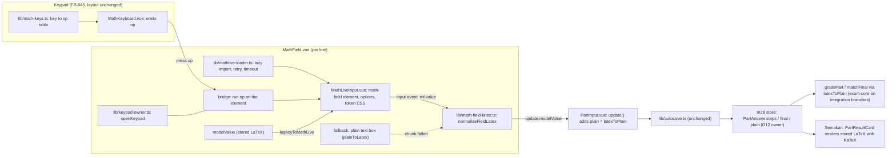
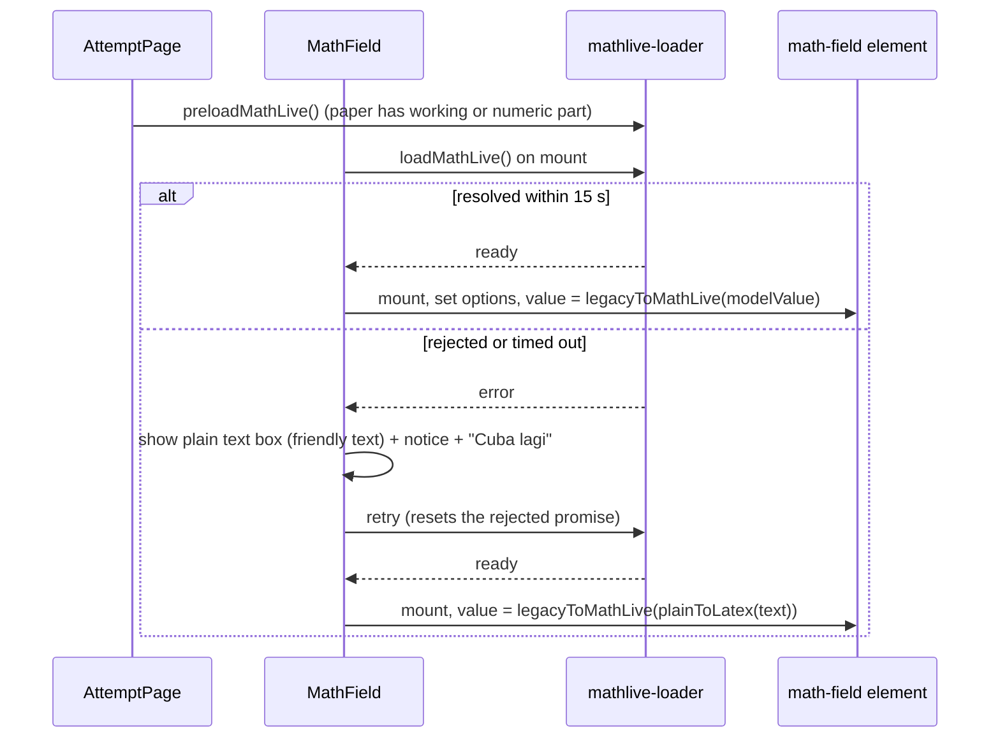
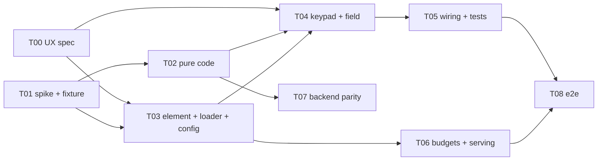

# v2 WYSIWYG maths answer field: system design (slug: v2-math-wysiwyg, FB-069)

| Field | Value |
|---|---|
| Document | Feature design, G2 (system architecture) |
| Version | 0.1 |
| Date | 2026-10-25 |
| Status | Draft for G2 approval. The library choice (MathLive, option (a)) was decided by the user on 2026-10-25 (TRACKER AUD-D5, Q-B13). Decisions M1 to M12 below await approval. |
| Owner | solution-architect |
| Track | Full. Built after the 30 Oct go-live. |
| Requirements | `docs/requirements/v2-bijak-spm.md`: US-09 (AC-09.1 to AC-09.6 stay as built; "Planned (FB-069, after go-live)" is the target), R15, Q-B13 (answered), US-11 (autosave), AC-08.1 |
| Other inputs | `docs/qa/audit-sistem/evidence/FB-069-notes.md` (prototype measurements); `docs/qa/audit-sistem/FIXLOG.md` (FB-045, FB-050, FB-069, P-069); `src/modules/m28-bijak-spm/**` (`components/MathField.vue`, `MathKeyboard.vue`, `PartInput.vue`, `PartResultCard.vue`, `lib/math-keys.ts`, `lib/keypad-owner.ts`, `domain/math-expr.ts`, `domain/grading.ts`, `domain/types.ts`, `server/store.ts`, `lib/autosave.ts`); `vite.config.ts`; `scripts/check-demo-bundle.mjs`; on `origin/be/bijak-integration`: `packages/exam-core`, `packages/contract/src/bijak/attempts/schema.ts`, `apps/api/src/modules/bijak/attempts/marking.ts`; `mathlive@0.111.1` type definitions (checked: commands `deleteBackward`, `moveToNextChar`, `moveToPreviousChar`, `moveToSuperscript`, `moveAfterParent`, options `mathVirtualKeyboardPolicy`, `menuItems`, `popoverPolicy`, `smartMode`, `smartFence`, `smartSuperscript`, `disabled`, `readOnly`, `soundsDirectory`, `fontsDirectory`, `keypressSound`, `plonkSound`, `placeholder`, `setValue`; licence MIT) |
| Decision record | ADR-0024 (`docs/adr/0024-mathlive-wysiwyg-answer-field.md`); related ADR-0009, 0014, 0015, 0018, 0021 |
| UI spec (not here) | `docs/design/v2-math-wysiwyg.md` (ui-ux-designer, task FB069-T00). This document fixes data, behaviour, contract and file layout, not pixels. |

Scope reminder: a front-end change on the Bijak SPM attempt page. No application code is written by this document; snippets are sketches. Replicate, do not redesign: the keypad, the labels, the autosave, the marking and the Semakan stay as they are. The only changes are the ones FB-069 names.

## 0. Summary and decisions

| # | Decision | Choice and reason |
|---|---|---|
| M1 | Stored format | The existing fields `PartAnswer.steps[]` and `final` hold **LaTeX**, now MathLive's `mf.value`, lightly normalised. `plain` is still derived by `latexToPlain` in `PartInput`. Reason: the type comment, the contract schema and Semakan already treat these fields as LaTeX, and the marker accepts it (11 of 11 samples, prototype). |
| M2 | Contract | **Unchanged.** No new field, no format flag. `BijakAttemptPartAnswerSchema` is a strict object and go-live runs on the mock, so any field would be a post-go-live contract change for no gain. |
| M3 | Marker and backend parity | `@pp/exam-core` and `marking.ts` unchanged. The converter is the existing `latexToPlain`. One shared golden fixture of MathLive values and verdicts runs in the m28 tests and in `apps/api` (FB069-T02, T07). Any `latexToPlain` addition found by the spike is additive and lives in exam-core. |
| M4 | Migration | Lazy, read-only, at display time: `legacyToMathLive(stored)` is applied when a value is loaded into the field. Nothing is rewritten; the value changes on the student's next edit. No `schema` bump, no localStorage job, no server job. |
| M5 | Keypad | FB-045 layout kept exactly. `MathKey.insert/cursor/action` becomes `MathKey.op` (a LaTeX template for `insert`, or one of four commands). `applyKey` is removed. |
| M6 | Touch devices | Keypad only. MathLive's own virtual keyboard is off (`manual`, never shown); its field has `inputmode="none"`. Focusing a field with a coarse pointer opens the keypad (open question OQ-1, default yes). |
| M7 | Numeric final answers (FB-050) | Same WYSIWYG field. No separate plain decimal input. The `inputmode` prop is removed. The "Masukkan nombor sahaja" hint logic is unchanged (`isReadableNumber` reads the LaTeX). |
| M8 | Bundle | `mathlive` pinned exactly, loaded by `import('mathlive')` from a loader used only by the attempt's maths field, in its own chunk `vendor-mathlive` (named `manualChunks` rule, before the generic `vendor`). Fonts from `public/fonts/mathlive/`, sounds off. Budgets raised deliberately. |
| M9 | Fallback | Chunk fails or times out (15 s): the field becomes the previous plain text box (friendly text, `plainToLatex` on change, phone keyboard, no keypad) with a "Cuba lagi" retry; a successful retry switches back and converts the text through `legacyToMathLive`. |
| M10 | Preview row | Removed in both places (under the line; the sheet's display row). The sheet keeps "Tutup". |
| M11 | Ownership and a11y | `keypad-owner` is unchanged (one open keypad, owner = field id). Names, labels and keyboard behaviour replicate today (D10). MathLive's built-in speech is accepted as is. |
| M12 | LaTeX is never visible | MathLive's LaTeX mode (Escape, backslash), popover and context menu are disabled, as the current field never shows LaTeX source. |

## 1. Architecture overview



### 1.1 Folder layout (new or changed)

```
package.json, package-lock.json                       CHG  mathlive pinned to an exact version
vite.config.ts                                         CHG  manualChunks: 'vendor-mathlive' before 'vendor'; template.compilerOptions.isCustomElement for 'math-field'
vitest.config.ts                                       CHG  same isCustomElement option
scripts/check-demo-bundle.mjs                          CHG  raise 'all js' budgets by the measured chunk + 10 %; new named budget for vendor-mathlive
docker/frontend/nginx.conf                             CHG  /fonts/mathlive/ cache header (versioned by the pin, not hashed): public, max-age=604800
public/fonts/mathlive/*.woff2 (20) + LICENSE           NEW  copy of node_modules/mathlive/fonts (only the files used are fetched)
src/modules/m28-bijak-spm/
  lib/mathlive-loader.ts                               NEW  loadMathLive(): singleton promise, 15 s timeout, retry resets a rejected promise; sets fontsDirectory, soundsDirectory = null, keypress/plonk sound = null, decimalSeparator '.'
  lib/math-field-latex.ts                              NEW  pure: normaliseFieldLatex, isEmptyMath, legacyToMathLive, displayLatex (KaTeX-safe)
  lib/math-keys.ts                                     CHG  MathKey.op replaces insert/cursor/action; applyKey and KeyPress removed; layout data unchanged
  lib/keypad-owner.ts                                  unchanged
  components/MathLiveInput.vue                         NEW  the <math-field> element: mount after load, options, v-model (LaTeX), ARIA label, token CSS, containment; exposes run(op), focus(), el
  components/MathField.vue                             CHG  uses MathLiveInput; fallback text box; preview rows removed; reveal logic follows the field's height
  components/MathKeyboard.vue                          CHG  emits the key's op; markup, test ids, data-key unchanged
  components/PartInput.vue                             CHG  drops the inputmode prop; update() unchanged
  pages/AttemptPage.vue                                CHG  warm the chunk when the paper has a working or numeric part (preloadMathLive)
  domain/math-expr.ts                                  CHG  additive: latexToFriendly handles \sin \cos \tan \log \ln \degree \% (fallback display). On the integration branches this file is a shim; the change is in packages/exam-core/src/math-expr.ts.
  __tests__/                                           CHG  math-keypad.test.ts rewritten; new math-field-latex.test.ts, mathlive-marker.test.ts, math-field.test.ts
  __tests__/fixtures/mathlive-samples.json             NEW  golden values (moves to packages/exam-core/__tests__/fixtures/ on the integration branches)
e2e/m06-spm/bijak-spm.spec.ts                          CHG  selectors and the structured-question test
e2e/m06-spm/math-wysiwyg.spec.ts                       NEW  real MathLive in the browser
docs/design/v2-math-wysiwyg.md                         NEW  (FB069-T00)
```

No change to `src/modules/m28-bijak-spm/server/**`, `domain/types.ts`, `domain/grading.ts`, `lib/autosave.ts`, the mock registry or any seed.

## 2. Answer format and data model

### 2.1 What is stored

No new entity and no new field. For one leaf part (`PartAnswer`, owned by m28, D12):

| Field | Before FB-069 | After FB-069 |
|---|---|---|
| `steps[i]` | LaTeX made by `plainToLatex(friendly)`, for example `\frac{7}{3^{2}}+sin(30°)` | LaTeX from MathLive, for example `\frac{7}{3^2}+\sin\left(30\degree\right)` |
| `final` | same | same as `steps[i]` |
| `plain.steps[i]`, `plain.final` | `latexToPlain(...)` | `latexToPlain(...)` (unchanged, computed in `PartInput.update`) |
| `unit`, `text`, `choice`, `photos` | unchanged | unchanged (the unit box stays a plain input) |

The contract (`BijakAttemptPartAnswerSchema` on the integration branches) already says "Working lines (LaTeX)" and "Final answer (LaTeX)" and has no length limit on the strings. A MathLive line is longer than a friendly line (`\left(`, `\right)`), by a few characters per bracket; the body-size limit is not a concern for a single line but the backend task should confirm the global request limit (FB069-T07).

### 2.2 Normalisation before storing (`normaliseFieldLatex`, pure, in `lib/math-field-latex.ts`)

Applied to `mf.value` on every `input` event, before `update:modelValue`:

| Rule | Why |
|---|---|
| `\placeholder{}` and `\placeholder[id]{}` become `{}` | MathLive-only command; KaTeX in Semakan does not know it and would print an error span. An empty argument is an empty box when reloaded. |
| If the value has no content, return `''` | "Has content" = after removing `\placeholder{...}`, `\left`, `\right`, `\frac`, `\sqrt`, braces, `^`, `_`, spaces and `\,`, at least one character remains. An empty fraction or root is not an answer (navigator "Dijawab", autosave, `isBlank`). This redoes today's `hasContent` rule on LaTeX (prototype note 2). |
| Nothing else is rewritten | The less the stored value differs from MathLive's own output, the less a MathLive upgrade can surprise us. |

A half-filled template (`\frac{3}{}`) is kept: it has content and the marker reads it as unparseable, so the part goes to review (`belum_dimarkah`), the same outcome as `(3)/()` today.

### 2.3 Converter to the marker's form

`latexToPlain` (existing, `domain/math-expr.ts`, exam-core on the integration branches). The prototype table (`FB-069-notes.md`) is the first part of the golden fixture. The notes report 11 sample answers; the table lists 12 value forms because one row covers three answers (2+3x4, 8÷2, 2π). The fixture keeps every form:

| Answer | `mf.value` | `latexToPlain` | Marker |
|---|---|---|---|
| fraction 3/4 | `\frac34` | `((3)/(4))` | match (0.75) |
| fraction with power 7/3^2 | `\frac{7}{3^2}` | `((7)/(3^(2)))` | match (7/9) |
| power 2^3 | `2^3` | `2^(3)` | match (8) |
| sqrt 16 | `\sqrt{16}` | `sqrt(16)` | match (4) |
| sin(30 degrees) | `\sin\left(30\degree\right)` | `sin(30)` | match (0.5) |
| 2 x 10^3 | `2\times10^3` | `2*10^(3)` | match (2000) |
| negative -5 | `-5` | `-5` | match (-5) |
| negative power 2^-1 | `2^{-1}` | `2^(-1)` | match (0.5) |
| 2+3x4 | `2+3\times4` | `2+3*4` | match |
| 8 / 2 | `8\div2` | `8/2` | match |
| 2 pi | `2\pi` | `2pi` | match |
| 7/3^2 + sin(30) | `\frac{7}{3^2}+\sin\left(30\degree\right)` | `((7)/(3^(2)))+sin(30)` | match (1.2778) |

Cases the golden fixture adds (produced by pressing the keys in a real browser in FB069-T01; expected verdicts taken from the existing `equivalence.test.ts`): comma list `2,\,3` (the comma key must produce a space after the comma, see 4.2, otherwise `2,3` reads as the decimal 2.3), percent `50\%`, `x\le5`, `x\ge5`, `x=3`, `\pm`, `0.5` (decimal point), an unfilled template (`\frac{}{}` normalises to `''`), a half-filled one (`\frac{3}{}` is unparseable and goes to review).

Rule for any later gap: if the fixture finds a MathLive command `latexToPlain` does not know, the fix is an additive entry in exam-core (`SYMBOLS` or a case in the scanner) with a test, never a second parser in m28.

## 3. Migration of saved answers

### 3.1 Principle

Old stored values keep marking correctly (the marker reads them today), so nothing is rewritten. They only need to *display* well in the new field. Conversion happens when a stored value is set into the element, and the stored value changes only when the student edits that line.

### 3.2 `legacyToMathLive(stored)` (pure, idempotent)

Input: a stored `steps[i]` or `final`. Output: LaTeX MathLive displays correctly. Rules, applied in order, each only to text that is not already inside a LaTeX command:

| # | Old form | New form |
|---|---|---|
| R1 | linear fraction left by `plainToLatex`, for example `(7)/(3)^{2}` or `a/b` | `\frac{7}{3^{2}}`, using the existing `previewLatex` fraction rule |
| R2 | bare `sin cos tan log ln` (not preceded by `\` or a letter) | `\sin ` etc. (upright) |
| R3 | `°` | `\degree` (never `^{\circ}`, see 4.2) |
| R4 | unescaped `%` | `\%` (an unescaped `%` is a LaTeX comment and would cut the line) |
| R5 | `±`, `π`, `×`, `÷`, `≤`, `≥`, `−`, `√x` left as characters | `\pm`, `\pi`, `\times`, `\div`, `\le`, `\ge`, `-`, `\sqrt{x}` |
| R6 | a run of two or more letters that is not a function name or `pi`, with or without spaces (for example `Luas segi tiga`, `cm`) | `\text{...}` so the spaces and upright letters survive (math mode would drop the spaces) |
| R7 | anything else | unchanged |

Properties, all tested (FB069-T02): idempotent (`f(f(s)) = f(s)`); a value MathLive produced is returned unchanged; for every sample in the corpus `answersEquivalent(latexToPlain(s), latexToPlain(f(s)))` and the numeric value are unchanged, so a student who does not touch an old answer is marked exactly as before.

### 3.3 Cases

| Case | Behaviour |
|---|---|
| In-progress attempt at deploy time, tab reloaded | Server and local copies hold old-format LaTeX. The field shows `legacyToMathLive(value)`. Autosave sends nothing until the student edits. |
| Tab left open on the old bundle during a deploy | Keeps writing old format; the reload converts for display. Both formats are readable by both marker and new field. |
| Two devices, one old and one new | Per-part newest revision wins (AC-11.5); both formats display. |
| Submitted attempts (Semakan) | `PartResultCard` renders the stored LaTeX with KaTeX. Old values render as today; new values render with `\sin`, `\degree`, `\left(`. FB069-T01 checks that KaTeX 0.19 renders `\degree`; if not, `displayLatex` (in `math-field-latex.ts`) maps it to `^{\circ}` for display only. |
| localStorage mock state (`pp.bijak.server.v1`, `pp.bijak.local.<attemptId>`) | No change to shape. `TAG_STATE_SCHEMA` stays 2. No `migrateTagsInState`-style job. |
| Real DB | No data migration. |
| Roll back FB-069 | Marker still reads MathLive LaTeX. The old field would show some of it as raw LaTeX until the student retypes. To close that gap, FB069-T02 (which adds the `latexToFriendly` rules) can be released before the rest. |

## 4. Keypad integration

### 4.1 Contract between keypad and field

`MathKeyboard.vue` keeps its markup, `data-key`, test ids, tones, labels, accessible names and the layer switch exactly as FB-045. `lib/math-keys.ts` keeps `FUNCTION_ROWS`, `SYMBOL_ROWS`, `SHARED_KEYS`, `NUMBER_ROWS`, `ALL_KEYS` with the same ids, labels, aria and tones; only the payload changes:

```ts
type FieldOp =
  | { t: 'insert'; latex: string }                    // mf.insert(latex, { format: 'latex', focus: true })
  | { t: 'cmd'; cmd: 'moveToPreviousChar' | 'moveToNextChar' | 'deleteBackward' }
  | { t: 'clear' }                                    // mf.setValue('') then emit ''
interface MathKey { id; label; aria; tone; op: FieldOp }   // sketch
```

`MathKeyboard` emits `press: FieldOp`. `MathField` runs it on its element. The keys keep `@mousedown.prevent` so the field keeps focus (prototype: value and caret stay correct after each key).

### 4.2 Key to operation table

`#?` is MathLive's placeholder token: the caret lands in the first one. No template uses `#@` or `#0`, so a selection is replaced by the key, as `applyKey` did today.

| Key id | Label | Operation | Old behaviour kept |
|---|---|---|---|
| `frac` | a/b (two-box icon) | insert `\frac{#?}{#?}` | empty fraction, caret in the numerator |
| `sqrt` | √ | insert `\sqrt{#?}` | caret inside |
| `sq` | x² | insert `^{2}` | caret ends after the exponent, at base level (prototype: x² then ▶ leaves the fraction) |
| `pow` | xⁿ | insert `^{#?}` | caret in the exponent box |
| `inv` | x⁻¹ | insert `^{-1}` | caret after |
| `sin`, `cos`, `tan` | sin, cos, tan | insert `\sin\left(#?\right)` (and `\cos`, `\tan`) | caret inside the brackets |
| `log`, `ln` | log, ln | insert `\log\left(#?\right)`, `\ln\left(#?\right)` | same |
| `lp`, `rp` | ( ) | insert `(` and `)` as literal characters | one bracket per press, no automatic pair (`smartFence` is off) |
| `pi` | π | insert `\pi` | |
| `deg` | ° | insert `\degree` | must be `\degree`: `^{\circ}` becomes `sin(30^())` in `latexToPlain` and the marker says "unparseable" (prototype note 1) |
| `x`, `y` | x, y | insert `x`, `y` | |
| `comma` | , | insert `,\,` | the old key inserted ", " (comma and space). MathLive ignores typed spaces in math mode, and `2,3` would read as a decimal. `\,` becomes a space in `latexToPlain`. Checked in T01. |
| `percent` | % | insert `\%` | |
| `pm` | ± | insert `\pm` | |
| `lt`, `gt` | <, > | insert `<`, `>` | |
| `le`, `ge` | ≤, ≥ | insert `\le`, `\ge` | |
| `eq` | = | insert `=` | |
| `0` to `9`, `dot` | digits, . | insert the character | |
| `times`, `div` | ×, ÷ | insert `\times`, `\div` | |
| `plus`, `minus` | +, − | insert `+`, `-` | |
| `e10` | ×10ˣ | insert `\times10^{#?}` | caret in the exponent box |
| `back` | DEL | cmd `deleteBackward` | one step back; an empty box is removed by MathLive's own rule (small difference from the empty `()` pair rule, accepted) |
| `clear` | AC | clear | empties the field |
| `left`, `right` | ◀ ▶ | cmd `moveToPreviousChar`, `moveToNextChar` | ▶ goes numerator, denominator, out, as MathLive's own movement does |
| layer key | Simbol / Fungsi | none (keypad-local) | unchanged |

Not added, as in FB-045: e, (−), Ans, an execute "=" key, RCL/M+. The "=" above is the Simbol-layer symbol, not an execute key.

Key order change (accepted by the user): in the old line `(7)/(3)` then `x²` squared the denominator. In the field x² squares what is before the caret, so the equivalent order is `a/b, 7, ▶, 3, x², ▶, +, sin, 3, 0, °`. This follows a Casio fx-570.

The table is data. The T01 spike confirms each row in 0.111.1 against a real browser and the result is the fixture; a row that behaves differently is fixed in the table, not in code.

## 5. Field behaviour

### 5.1 Value flow

- Mount: `MathField` renders a field-shaped placeholder until `loadMathLive()` resolves, then `MathLiveInput` mounts `<math-field>` and sets `value = legacyToMathLive(modelValue)`.
- Edit: on `input`, `latex = normaliseFieldLatex(mf.value)`; remember it as `lastEmitted`; `emit('update:modelValue', latex)`. `PartInput.update` adds `plain` and the page autosaves as today.
- External change (reload, other device, restore): when `modelValue !== lastEmitted`, `mf.setValue(legacyToMathLive(modelValue), { silenceNotifications: true })`. This replaces today's `text` versus `plainToLatex(text)` comparison and avoids resetting the caret on the student's own edits.
- Enter is swallowed, as `@keydown.enter.prevent` does today.
- `disabled`: `mf.disabled = true` (the element has a `disabled` property in 0.111.1), the toggle and remove buttons disabled as today.

### 5.2 MathLive options (set once per element)

| Option | Value | Why |
|---|---|---|
| `mathVirtualKeyboardPolicy` | `'manual'`, never shown | our keypad is the only keyboard |
| `menuItems` | `[]` | no context menu (prototype) |
| `popoverPolicy` | `'off'` | no autocomplete popover, no LaTeX mode |
| `smartFence` | `false` | brackets are literal, one per press, as today |
| `smartMode` | `false` | no text/math auto-switching |
| `inlineShortcuts` | allow-list limited to what `latexToPlain` knows (sin, cos, tan, log, ln, pi, sqrt, comparison signs, `*`, `/`, `^`, `_`); the exact list is fixed in T01 | a physical keyboard must not produce a command the marker cannot read (for example `ee`, `ii`, `dd` shortcuts) |
| `decimalSeparator` | `'.'` | `,` must stay a comma |
| `placeholder` | `\text{...}` with the current copy, verbatim: "cth. 2x + 6" for steps, "cth. 13" for the final answer | BM copy unchanged |
| sounds | `soundsDirectory = null`, key press and plonk sounds `null` | no audio, no extra request |
| `fontsDirectory` | `<BASE_URL>fonts/mathlive` | no CDN, no request leaves the origin |
| `aria-label` | the field's label ("Langkah n", "Jawapan akhir") | name unchanged |

Esc and backslash: a capture-phase `keydown` handler on the host (a) for Esc closes the open keypad and keeps the focus, then cancels the event so MathLive never enters LaTeX mode; (b) cancels `\`. This keeps the Esc behaviour of today (prototype: Esc closes the keypad and keeps focus) and the rule that LaTeX is never shown.

Paste: a `paste` handler takes the `text/plain` clipboard text, runs it through `legacyToMathLive(plainToLatex(text))` and inserts the result. This keeps AC-09.3 (typing or pasting `1/2`, `x^2`, `√3` ends as structured maths). Typing `1/2` or `x^2` on a physical keyboard is converted by MathLive itself; whether the typed character `√` is converted is a T01 check, and if not it is added to the allow-list of `inlineShortcuts`.

### 5.3 Phone keyboard and numeric answers (FB-050)

- The phone's own keyboard never opens (MathLive sets `inputmode="none"`; no documented option changes that). Accepted by the user.
- With a coarse pointer (`matchMedia('(pointer: coarse)')`), focusing a field opens its keypad (it is the only way to type). With a fine pointer the keypad opens from the toggle, as today, and the physical keyboard types into the field (OQ-1).
- Numeric final answers use the same field. A plain answer such as `13` is two key taps. `finalTouched` and the hint "Masukkan nombor sahaja, cth. 13 atau 3.5. Pecahan dan tanda tolak ada pada papan kekunci." keep working: `isReadableNumber(latex)` runs `latexToPlain`.
- The `Unit` box stays a plain `UInput`, so units can still be typed with the phone keyboard.
- Known limitation, stated so QA does not report it as a bug: on a phone, letters other than `x` and `y`, and words, cannot be typed into a maths line (OQ-2).

### 5.4 Focus and ownership

`openKeypad` stays a ref with the id of the owning field; one keypad at a time; the field id is the `<math-field>` element id (the `<label for>` stays). Unchanged: toggle, close on tap or focus outside (`useClickOutside`, `focusin` listener), Esc, bottom sheet below 768 px and in-flow block from 768 px, the sheet's "Tutup" key with `@mousedown.prevent`, `revealField` (scroll the line into the free area above the sheet). Two changes inside `MathField`:

- `input()` (the `<input>` lookup) becomes the element lookup.
- The preview used to trigger `revealField` when it appeared; now a `ResizeObserver` on the element calls it when the field grows (a fraction makes the line taller) while the keypad is open.

### 5.5 Accessibility (D10: replicate, no enhancements)

- Accessible names are the same strings as today: field = its label; toggle "Buka papan kekunci matematik" / "Tutup papan kekunci matematik" with `aria-pressed`; keys keep their `aria`; the live layer status stays.
- MathLive exposes a `textbox` role and its own spoken text ("the fraction 7 over 3 squared", English only). It was not tested with TalkBack or VoiceOver. It is a known limitation recorded for QA, not something this feature improves.
- Keys stay tab-reachable buttons >= 44 px (AC-09.4 unchanged).

### 5.6 Layout and theme

- The prototype's blocker (a long line made the field 560 px inside a 299 px column) is fixed in the shell: `min-width: 0`, `max-width: 100%`, `contain: inline-size`; a long line scrolls inside the field with no page scroll (320 px up, AC-09.4 / responsive rule).
- Theming only with design tokens, mapped to MathLive's CSS variables (`--caret-color`, `--selection-background-color`, `--selection-color`, placeholder and fence colours) from `--ui-bg-elevated`, `--ui-text-highlighted`, `--ui-primary`. Light and dark checked at 375 and 1280 (prototype did this in scratch). The fence highlight is tuned in the build. Minimum field height matches today's input (large from `md`, small below).
- Styling lives in the component's `<style>` using tokens only (the m28 components glob is DS level `ds`: `npm run lint:ds` and `lint:ds:css` must stay green).

## 6. Bundle, loading and fallback

### 6.1 Chunking

`vite.config.ts` `manualChunks` currently sends every non-listed `node_modules` package to `vendor` (an eagerly loaded chunk). A named rule is added before it, next to `vendor-extra`:

```
if (/[\\/]mathlive[\\/]/.test(id)) return 'vendor-mathlive'
```

`lib/mathlive-loader.ts` (matched by the existing `lib` rule, so it lands in `app-core`) holds the only `import('mathlive')`; the specifier is a string literal (ADR-0009 amendment 1). MathLive CSS is injected by the library into the element's shadow root, so `all css` does not change. A build assertion in `check-demo-bundle.mjs` fails if `mathlive` code appears in the entry chunk or in `vendor`.

### 6.2 When it loads

Only attempt pages mount `MathField` (via `PartInput`). `AttemptPage` calls `preloadMathLive()` once when the paper has a part of kind `working` or `numeric`, so the chunk is usually warm before the first field mounts (about 216 KB gzip once per session). The hub, history, cover, result and every other portal never request it (checked by an e2e network assertion).

### 6.3 Budget

Measured by the prototype: 801 KB raw, 216 KB gzip; 46.8 KB for the AttemptPage chunk; about 70 KB of woff2 fetched on demand. `scripts/check-demo-bundle.mjs` (2026-10-16 figures): `all js raw` max 8,527,000 (measured 7,751,715 then); `all js gzip` max 2,404,800 (about 2.12 MB then). Adding 801 KB raw takes `all js raw` past its limit, so FB069-T06 re-measures on the then-current `dist`, raises `all js raw` and `all js gzip` by the measured chunk plus 10 %, and adds a named budget `vendor-mathlive gzip` (about 238,000). Entry budgets do not change. The raise and its reason go in the PR, as the script's header requires.

### 6.4 Loader and fallback



Fallback details:

- The plain box is today's input: friendly text shown from `latexToFriendly(modelValue)`; every change emits `plainToLatex(text)`; the phone keyboard opens; the keypad toggle is not shown.
- `latexToFriendly` gets additive rules for what MathLive stores (`\sin`, `\cos`, `\tan`, `\log`, `\ln` become the bare name; `\degree` becomes `°`; `\%` already handled) so an answer made in the field reads sensibly in the fallback.
- Notice text and the retry control are for the design phase. Proposed wording [PROPOSED]: "Papan kekunci matematik tidak dapat dimuatkan. Anda masih boleh menaip jawapan." with "Cuba lagi". New student-facing copy is not specified by the user; FB069-T00 confirms it.
- Autosave, the navigator and marking do not depend on which engine produced the value.

## 7. Removing the preview row; fidelity deviations

The strip under the line (`data-testid="math-preview"`) and the sheet's display row (`math-display`) are removed; the sheet keeps its sticky "Tutup" key (layout in FB069-T00). `previewLatex` stays only as the building block of `legacyToMathLive` (R1) and keeps its test.

Deviation record for the module's deviation table (the Delivery Lead adds the rows; these come from the user's decision AUD-D5, not from D9):

| # | Deviation from the current build | Reason and source |
|---|---|---|
| 1 | The separate preview strip and the sheet display row are removed | The field shows the maths itself (FB-069, Q-B13 (a)) |
| 2 | The phone's own keyboard no longer opens for maths lines | MathLive constraint, accepted by the user 2026-10-25 |
| 3 | Key order: x² (and other postfix keys) act on what is before the caret, so inside a fraction box | Accepted by the user 2026-10-25 |
| 4 | Focusing a maths field on a touch device opens the keypad | Needed because the keypad is the only input; subject to OQ-1 |
| 5 | A fallback text box and a retry notice when the maths component cannot load | Failure state that did not exist; copy [PROPOSED] |
| 6 | MathLive's LaTeX mode, popover and context menu are switched off | Keeps the rule that LaTeX source is never shown |

Not changed: keypad layers and keys (FB-045), labels and aria, autosave, marking, Semakan, the unit box, photos, the choose-N lock, test ids `math-keypad-toggle`, `math-keyboard`, `math-keyboard-close`, `data-key`.

## 8. Tests

jsdom cannot run MathLive (prototype note), so there are three layers.

| Layer | What | Where |
|---|---|---|
| Pure unit | `normaliseFieldLatex` (placeholder, empty template, half-filled template); `legacyToMathLive` (rules R1 to R7, idempotent, a MathLive value comes back unchanged, equivalence preserved on a corpus built from the seeded answers and `equivalence.test.ts` inputs); `latexToFriendly` new rules; `displayLatex` | `__tests__/math-field-latex.test.ts` |
| Marker acceptance | **The 11 sample answers.** `mathlive-samples.json` holds `{ name, value, plain, verdict }` rows: every value form of 2.3 (the prototype's 11 sample answers, listed there as 12 forms) plus the added cases. Test: `latexToPlain(value) === plain`; `numericValue`, `matchFinal` at tolerance 0.001 and `answersEquivalent` give the verdict; the unfilled template is blank after normalisation; `isReadableNumber` on the numeric samples. The same JSON is run in `apps/api` against `marking.ts` / `gradePart` through the exam-core adapter (parity). | `__tests__/mathlive-marker.test.ts`; `apps/api/test/bijak-attempts/mathlive-parity.spec.ts` (FB069-T07) |
| Key table | Layout identical to FB-045 (the existing `OLD_KEYS` ids, labels, aria and tones, rows and layers); every key has exactly one op; ops use only the allowed commands; every `insert` template, with `#?` filled by a sample digit, converts by `latexToPlain` to something `parseAnswer` accepts | `__tests__/math-keypad.test.ts` (rewritten) |
| Component (stub element) | `MathLiveInput` with a fake `math-field` custom element: keys call `insert`/`executeCommand` with the right operation; `input` emits the normalised value; an external value change sets the element without echo; one keypad owner at a time; Esc closes and keeps focus; coarse-pointer focus opens the keypad; no preview or display row exists; disabled state; loader rejection shows the fallback, typing emits `plainToLatex`, "Cuba lagi" resolves and switches back | `__tests__/math-field.test.ts` |
| Browser (Playwright, real MathLive) | (a) the structured-question test of `bijak-spm.spec.ts` updated: field is `math-field[data-testid=math-input]`, value read from `.value`; (b) the sequence `a/b, 7, ▶, 3, x², ▶, +, sin, 3, 0, °` gives `\frac{7}{3^2}+\sin\left(30\degree\right)`, submit, and Semakan marks it; (c) all 11 samples typed with the keypad then submitted and marked (accepted, as the prototype); (d) 320/375/768/1280, light and dark, no horizontal page scroll, long answer scrolls inside the field; (e) fallback: abort the `vendor-mathlive` request, the plain box works and the answer is saved and marked; (f) old stored answer (`\frac{7}{3^{2}}+sin(30°)` seeded in localStorage) shows upright `sin` and `°`, is marked as before when not edited, and is not rewritten on load; (g) the chunk is not requested on the hub, history or result pages; (h) no request leaves the origin (fonts, sounds); (i) phone-keyboard: the editable part has `inputmode="none"`; (j) FB-050: numeric part shows the hint for `3a` and not for `3.5` | `e2e/m06-spm/math-wysiwyg.spec.ts`, `bijak-spm.spec.ts` |
| Bundle | `check-demo-bundle.mjs` with the new budgets; assertion that mathlive is in `vendor-mathlive` only | `npm run build` + script |
| Existing suites to run | `numeric-answer`, `equivalence`, `friendly`, `autosave`, `choose-lock`, `match-layout`, `registry-boot` | `npm run verify` |

G5 (qa-engineer) additionally executes AC-09.1 to AC-09.6 and the "Planned" block on a real Android and a real iOS device (caret, focus, keypad sheet, no phone keyboard); neither was tested in the prototype.

## 9. Task list

Roles: `frontend-developer` = components, loader, configs, e2e; `backend-developer` = pure domain code, fixtures, exam-core and API parity; `devops-engineer` = build budgets, serving; `ui-ux-designer` = spec. Estimates are ideal days for one agent session including its own tests. Nothing here touches shared mock stores or seeds, so no isolated worktree is needed; on the integration branches T02 and T07 touch `packages/exam-core` and `apps/api` (owner: the half that owns exam-core).

| ID | Owner | Task | Files | Depends on | Tests | Est. |
|---|---|---|---|---|---|---|
| FB069-T00 | ui-ux-designer | UX spec: field states (loading placeholder, ready, focused, filled, disabled, long line), the sheet without the display row ("Tutup" placement), fallback notice and "Cuba lagi" copy, token mapping for light and dark, behaviour at 375/768/1280 | `docs/design/v2-math-wysiwyg.md` | G2 | n/a | 0.75 |
| FB069-T01 | frontend-developer | Verification spike in a scratch app, results committed as text: confirm every row of 4.2 (caret after `^{2}`, `\frac{#?}{#?}` caret, `,\,` round trip, `\degree` and `\left(` in KaTeX 0.19, `\placeholder` serialisation, empty-template value, DEL on an empty box, clear), the option names and the Esc and backslash guard in 0.111.1, the `inlineShortcuts` allow-list, typed `√`, paste of `1/2`, no external request, the extra golden cases of 2.3. Output: `__tests__/fixtures/mathlive-samples.json` and a short corrections list for sections 4 and 5 of this document | `src/modules/m28-bijak-spm/__tests__/fixtures/mathlive-samples.json`, this document (corrections only) | none | n/a (produces the fixture) | 0.75 |
| FB069-T02 | backend-developer | Pure domain code: `normaliseFieldLatex`, `isEmptyMath`, `legacyToMathLive`, `displayLatex`; additive `latexToFriendly` rules; additive `latexToPlain` entries only if T01 found a gap; marker acceptance test on the fixture | `m28/lib/math-field-latex.ts`, `m28/domain/math-expr.ts` (exam-core on the integration branches), `__tests__/math-field-latex.test.ts`, `__tests__/mathlive-marker.test.ts` | T01 (fixture) | as section 8, pure and marker rows | 1.0 |
| FB069-T03 | frontend-developer | Dependency and element: pin `mathlive`, copy fonts, `vite.config.ts` (`vendor-mathlive`, `isCustomElement`), `vitest.config.ts`, `lib/mathlive-loader.ts` (singleton, 15 s timeout, retry), `components/MathLiveInput.vue` (options, value flow, containment, token CSS, Esc and backslash guard, paste) | `package.json`, lock file, `vite.config.ts`, `vitest.config.ts`, `public/fonts/mathlive/**`, `m28/lib/mathlive-loader.ts`, `m28/components/MathLiveInput.vue` | T01, T00 for styling | component test with the stub element (value flow, options applied, guard); `lint`, `lint:ds`, `lint:ds:css`, `type-check` | 1.5 |
| FB069-T04 | frontend-developer | Keypad and field integration: `math-keys.ts` ops, `MathKeyboard.vue` emits ops, `MathField.vue` (bridge, ownership, touch auto-open, reveal on resize, preview rows removed, sheet bar, fallback box and retry) | `m28/lib/math-keys.ts`, `m28/components/{MathKeyboard,MathField}.vue` | T02, T03, T00 | rewritten `math-keypad.test.ts`, new `math-field.test.ts` | 2.0 |
| FB069-T05 | frontend-developer | Wiring and existing tests: drop `inputmode` in `PartInput`, `preloadMathLive()` in `AttemptPage`, check `PartResultCard` display with `displayLatex`, update `numeric-answer`, `choose-lock`, `match-layout` and other suites that touch the field, update `bijak-spm.spec.ts` selectors | `m28/components/PartInput.vue`, `m28/pages/AttemptPage.vue`, `m28/components/PartResultCard.vue`, affected tests, `e2e/m06-spm/bijak-spm.spec.ts` | T04 | full m28 unit suite, `registry-boot` | 1.0 |
| FB069-T06 | devops-engineer | Build and serving: re-measure `dist`, raise the `all js` budgets with the reason, add the `vendor-mathlive` budget and the "not in entry / vendor" assertion, nginx cache header for `/fonts/mathlive/`, confirm the chunk and fonts in the container image | `scripts/check-demo-bundle.mjs`, `docker/frontend/nginx.conf`, CI config | T03 | `npm run build` + `check-demo-bundle` green; the assertion fails on a deliberate import into the entry | 0.5 |
| FB069-T07 | backend-developer | Backend parity (integration branches): run `mathlive-samples.json` against `marking.ts`/`gradePart`, confirm the request-body limit and no length cap on `steps`/`final`, no contract change | `apps/api/test/bijak-attempts/mathlive-parity.spec.ts`, `packages/exam-core/__tests__/fixtures/` | T02, exam-core merged | the parity spec; `openapi.json` unchanged | 0.5 |
| FB069-T08 | frontend-developer | Browser tests with real MathLive: the cases (a) to (j) of section 8 at 320/375/768/1280, light and dark | `e2e/m06-spm/math-wysiwyg.spec.ts` | T05, T06 | the spec itself | 1.5 |

Ordered execution:



Parallel groups: [T00 ∥ T01]; then [T02 ∥ T03]; then [T04 ∥ T06 ∥ T07]; then [T05]; then [T08]. Total about 9.5 ideal days; critical path T01, T03, T04, T05, T08 about 6.75 days. Gates after build: G3 evidence from `npm run verify` and the e2e run; G4 `code-reviewer` and `security-engineer` (new third-party dependency in the student exam path, student-supplied LaTeX stored and rendered, no external request allowed); G5 `qa-engineer` against AC-09.1 to AC-09.6 and the "Planned" block at 375/768/1280 plus real devices; G6 `devops-engineer` pipeline and user confirmation of the deploy.

## 10. Risks

| ID | Risk | Mitigation |
|---|---|---|
| R-A | MathLive lands in the eager `vendor` chunk (the config sends unlisted `node_modules` there). | Named `manualChunks` rule plus a build assertion (T03, T06). |
| R-B | The raw budget is exceeded by the chunk (801 KB raw against 8.53 MB limit measured at 7.75 MB). | Deliberate raise with a separate named budget (T06); entry budgets untouched. |
| R-C | Letters other than x and y, and words, cannot be typed on a phone. | Recorded as OQ-2; physical keyboards work; unit box is plain. |
| R-D | A MathLive upgrade changes LaTeX serialisation. | Exact pin; golden fixture on both sides; upgrade is a deliberate task. |
| R-E | The comma key stores `2,3` and the marker reads 2.3. | The key inserts `,\,`; fixture case; checked in T01. |
| R-F | Typed words lose their spaces in math mode (`Luassegitiga`). | Old text is wrapped in `\text{}` by R6 on load; new text on a phone is not typeable anyway (R-C); on a physical keyboard the student can still type words, a known math-mode limit noted for QA. |
| R-G | Real-device caret, focus and IME behaviour were not tested (Android, iOS Safari). | G5 on real devices; fallback exists if a platform fails. |
| R-H | Assistive technology reads English only and was not tested. | Recorded for QA; D10 means no enhancement here. |
| R-I | Third-party code in the exam path; default MathLive loads fonts and sounds relative to the script. | Exact pin and lock, G4 security review, fonts and sounds explicit, e2e "no off-origin request". |
| R-J | KaTeX in Semakan does not render some MathLive output (`\degree`, `\left`). | T01 check; `displayLatex` fallback for display only. |
| R-K | `latexToPlain` has a recursion or regex cost on adversarial LaTeX. | Not new: stored answers were LaTeX before; unchanged surface. The security review confirms. |
| R-L | A mixed-version window (old tab, new tab). | Both formats are readable by marker and field; per-part newest revision wins. |
| R-M | Words in `plain` for review: `plain` of an old text line differs from a new one. | `latexToPlain` handles `\text{}`; covered by fixture rows. |

## 11. Open questions (only the user can answer)

| ID | Question | Recommended default |
|---|---|---|
| OQ-1 | On a phone or tablet, should touching a maths line open the keypad at once? (The phone's keyboard no longer opens, so without this a tap on the line does nothing until the keyboard icon is pressed.) | Yes, on touch devices only. On a laptop the keypad opens from the keyboard icon, as today. |
| OQ-2 | On a phone, only digits, x, y and the keypad symbols can be typed in a maths line (no other letters, no words). Accept this, or ask for a letters layer later? | Accept now; a letters layer is a separate request and would change the FB-045 layout, so it is not part of FB-069. |

Decided here, not asked (reversible): numeric-only final answers use the same field (M7); the fallback text box and its notice (M9, copy [PROPOSED], confirmed in T00); lazy read-time migration (M4).

## 12. Documents the Delivery Lead updates (not tasks)

- `docs/TRACKER.md`: AUD-D5 gains "G2 design written: `docs/architecture/v2-math-wysiwyg.md`, ADR-0024 (Proposed)"; change log line.
- `docs/README.md`: index entries for this document and ADR-0024.
- `docs/requirements/v2-bijak-spm.md`: after G2 approval, the "Planned" block under AC-09.6 gains pointers to M4, M6, M7 and OQ answers; AC-09.x are rewritten only when the feature is built.
- `docs/qa/audit-sistem/FIXLOG.md`: FB-069 row "G2 written", with this document linked.
- The module's fidelity deviation table: the six rows of section 7.
