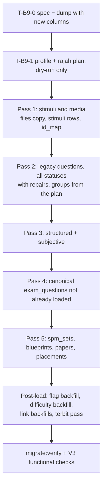

# V2 question bank migration: full load, rajah-group repair, structured, archive, SPM papers (T-B9, T-B10)

- **Slug:** `v2-question-bank-migration`
- **Status:** Design for implementation (no code written). Needs PO answers to the open choices in section 13 only where marked "blocking".
- **Date:** 2026-11-10
- **Owner:** solution-architect (design); backend-developer (implementation)
- **Plan cards:** `docs/plan/r1-pelan-100-peratus.md` T-B9, T-B10 (and the dependent follow-ups of section 12).
- **Inputs read:** `docs/plan/r1-pelan-100-peratus.md`, `docs/plan/r1-kesediaan-uat-2026-11-10.md`, `docs/qa/gap-analysis-2026-11-08/DATA-GAP.md`, `docs/architecture/v2-data-migration.md`, `v2-migration-decisions.md`, TRACKER D41, D87, D90 to D92, D105, D113, D113-c; ETL code `apps/api/src/migration` (`load/questions/*`, `transform/question-bank.ts`, `load/activity/files.ts`, `load/activity/not-migrated.ts`, `ddl/spec.ts`); V2 migrations in `prestasiplus-reference/backend/database/migrations`; V3 Prisma `questions.prisma`, `exam.prisma`, `spm.prisma`, `files.prisma`; V3 modules `questions` (regroup, group-members, effective-leaf, learner-visibility, served-rule, publish-gate, dskp-gate), `intake/workflow/figure-links.ts`, `exam`.
- **Method note:** no server and no dump was touched. Everything that depends on real values is marked **to profile**; section 6 lists the profile queries that turn each into a number before code is written.

## 0. Decisions this design applies

| Source | Decision | Effect here |
|---|---|---|
| PO KP-5 (10 Nov) | "V3 menggantikan V2, V3 menyambung pengurusan V2". Bring everything from V2 that is not deleted. | Archived (43,165), draft (155) and the one rejected question are loaded **with their status** (not servable, editable and revivable in the Studio). Plus approved, structured, subjective, stimuli and images, SPM sets, papers, blueprints. The "leave archived in `archive_cloud`" option is dropped. V2 has no soft delete (`v2-data-migration.md` section 0: hard deletes, no `deleted_at`), so "not deleted" means every row that exists in the dump; section 6 query V-0 re-checks that no table has a `deleted_at` column. |
| PO core rule (D90, D105) | A rajah or stimulus is never a standalone question. It is the stimulus of a group; every question of the group shows it; group questions keep their order. V2's defect (2nd and later questions lack the image; the rajah stored as its own "question") is **fixed during migration**, not copied. | Section 7. |
| PO KP-7 | Roster default passwords stay as they are. | Not part of this task. |
| PO | V2 transition and cutover is out of scope. UAT V3 with a cloned V2 DB is the target. | Full-replace load each time; idempotent re-run is for rehearsal and resume, not for delta. |
| D9 (deviation rule) | Fix what V2 does wrongly. | Rajah repair is a D9 fix; record it in the deviations table of the module that owns the Studio (M04). |
| D113-c | 7 stimulus kinds (passage, image, diagram, table, graph, map, infographic); MCQ 2 to 8 options; 11 question types; a duplicated stem is shown once and not excluded. | Mapping tables in section 4. |

## 1. What exists today and what changes

**Existing loader (QLOAD, `migrate:questions`).** Reads `archive_cloud.questions` and `question_options` by keyset page; loads **only** `status = diluluskan` and `type = mcq`; one batch is one transaction; direct multi-row SQL; idempotent by `questions(legacy_source, legacy_id)` plus `etl_id_map` entity `questions`; image paths are **not copied**, the question is loaded inactive with `import_issues` code `legacy_image_unresolved`; HTML is converted to text; suspected personal data and residual markup also hold the question inactive; `MIN_OPTIONS = 3`; one question becomes one version (`version_no 1`, `live_version_no 1`), one leaf part, `answer_keys.kind = option`; the SPM pool tag is written for T4 and T5.

**What V3 already has and this design reuses (do not rebuild):**

| V3 capability | Where | Use |
|---|---|---|
| Stimulus groups: `stimulus_groups`, `stimulus_group_stimuli` (1 to 3 stimuli, position), `questions.group_id` + `group_position`, up to 40 members, same subject, same kertas, level may differ only when the group level is NULL | `questions.prisma`, `group-members.ts` | The target of the rajah repair. |
| Stimulus flag detectors `stimulus_missing`, `figure_only`, `stem_duplicated`, stored on `question_versions` and excluded from every pupil surface by `NOT_FLAGGED_SQL` | `effective-leaf.ts`, `learner-visibility.ts` | Safety net: a question that still names a figure with no group and no image is **never served**; it appears in the work-lists. |
| Work-list and repair: `RegroupService.worklist` (flagged questions), `regroup` (members + figure question or `stimulusId` into a group, with undo), screen `RegroupPage` | `regroup.service.ts`, `m04-question-bank/pages/RegroupPage.vue` | The admin tool for everything the ETL cannot decide. `RegroupRequest` accepts an existing `stimulusId`, so an unattached stimulus created by the ETL can be used as the figure. |
| Audit Rajah (`/admin/soalan-gambar`, "Soalan Perlu Gambar Rajah") | `DiagramAuditPage.vue`, `routes/diagrams.ts` | Admin screen for questions that need a diagram supplied; the regroup row's "Muat naik gambar" opens it. |
| Keyword set for figure references (one set, 45 section 6.6.1): `stimulusReferenceOf`, `figureKeys`, `stimulusKey` | `intake/workflow/figure-links.ts` | The detection rules reuse these functions. **Do not write a second regex set.** |
| Bulk stimulus flag backfill `apps/api/scripts/uat-ops/flag-stimulus.ts` (approved live versions) | `scripts/uat-ops` | Post-load step. |
| Held-image mechanism: version `import_issues` code `legacy_image_unresolved`; the question is switched on when the Studio approves a version that carries every missing image (PIPE AC-16.3, `questions.service.ts`) | `questions.service.ts` | Missing-file policy (section 8). |
| Structured question model: `type = structured`, a V2 sub-question is a leaf part; its Skema is the `modelText` of a `points` key and its rubric points are the key points; the Panel "Skema & Rubrik" editor reads that shape | `structured-rubric.ts`, `structured-visibility.ts` | Target of the structured load (section 9). Pupils see structured questions only at T4 and T5 with an approved live version. |
| Tracking sets: `spm_tracking_sets` (subject, year, set_no) + `spm_tracking_set_questions` (position, unique per subject, year, question) | `spm.prisma` | Target of `spm_sets` (section 10). |
| Papers, sections, placements (`pilihan`/`jana`, `simulasi`/`subjektif`), Kontrak (`blueprints`, `blueprint_sections`), Terbit gate in `BuilderService.publish` | `exam.prisma`, `modules/exam` | Target of T-B10. |
| File copy with manifest and checksum: `MigrationFiles.migrate` (`--files-dir`, `SHA256SUMS`, magic-byte check, sanitising, `files` row keyed `(legacy_source, legacy_id)`) | `load/activity/files.ts` | Reuse for question, option and stimulus images (section 8). |

**What is missing and must be built:** loading of non-approved statuses; reject repair; the rajah planner and group writer; image copy inside the question loader; structured, subjective and canonical (`exam_*`) loaders; SPM sets, papers and blueprints loaders; a wider staging spec (next section).

## 2. Source access: the staging spec is too narrow

`ddl/spec.ts` lists only the columns the old readers needed, and the dump grants are column-level (`spec.ts` header: "the loader REFUSES a dump that carries a column missing here"). The archive tables therefore **lack columns this design reads**. T-B9-0 extends the spec, regenerates `staging_cloud.sql`, and the dump (T-B3) must be taken **after** that so the grants include the new columns. Columns to add (names from the V2 migrations; text/json columns as `t`/`j`, flags as `t`):

| `archive_cloud` table | Add (existing in spec: see `spec.ts` lines 276 to 322) |
|---|---|
| `questions` | `compliance_status`, `source`, `dskp_tagged`, `external_ref`, `source_pdf_path` (counted only, never copied), `created_by`, `approved_by` (ids, mapped to V3 users when present, else NULL) |
| `question_options` | nothing new (`image_path` is already there) |
| `structured_questions` | `education_level_id`, `kbat_level`, `total_marks`, `external_ref`, `created_by` |
| `structured_sub_questions` | `body`, `scheme` |
| `structured_rubric_points` | already `marks`, `text` |
| `stimuli` | `body` (json), `editor_json`, `asset_id`, `caption`, `source_citation`, `meta` (json) |
| `media_assets` | `alt`, `width`, `height`, `source_ref`, `sha` (path, kind already) |
| `question_stimulus` | `position` |
| `exam_questions` | `position`, `stem` (json), `topic`, `difficulty`; `chapter_id` |
| `question_parts` | `parent_part_id`, `position`, `label`, `prompt` (json), `word_limit`, `config` (json), `stimulus_id` |
| `part_options` | `label`, `body` (json), `is_correct`, `is_distractor`, `position` (label and body are already in spec as text) |
| `part_answer_keys` | `content` (json), `marks` |
| `exam_papers` | `subject_id`, `kertas`, `cover_code`, `is_composite`, `duration_minutes`, `instructions` (json), `reference_assets` (json), `import_issues` (json), `created_by` |
| `paper_sections` | `instruction_text`, `select_count`, `mark_budget`, `paper_document_id` |
| `exam_paper_questions` | `sort_order`, `number_label`, `marks_override` |
| `source_papers` | `subject_id`, `paper_code`, `kertas`, `duration_minutes`, `is_marking_scheme`, `source_kind`, `needs_review`, `import_issues` |
| `spm_sets` | `year`, `set_number`, `kind`, `target_count`, `notes` |
| `paper_blueprints` | `kertas`, `paper_code`, `duration_minutes`, `total_marks`, `auto_markable`, `source`, `notes` |
| `blueprint_sections` | `position`, `label`, `instruction`, `select_count`, `mark_budget`, `expected_answer_modes` (json) |
| `import_batches`, `import_items` | not needed |

Rules: PDPA minimisation still applies. `questions.created_by`/`approved_by` are ids, not names. `question_reports`, `question_submissions`, `question_imports` stay as decided in Q9 (not part of this task). Free text that may hold personal data (teacher notes) is not added.

**Image files:** the column-level dump does not include bytes. Section 8 defines the storage export that must be arranged (PO risk "akses storan fail V2": ask for the read-only path on day 1).

## 3. Load order and structure

One new command family under the kit (`migrate:questions` is extended, not replaced): `migrate:questions --plan` (read-only planner, writes the plan file), `migrate:questions --apply` (passes 1 to 4), `migrate:papers --apply` (pass 5). Each pass is its own `etl_runs` entity step with batches, `etl_recon` rows and `etl_reject` reasons, as `runQuestions` does today. Pass 2 may run while files are still missing (held rows, section 8) and is **re-runnable** after the files arrive (section 11).

## 4. Mapping tables

### 4.1 Status (legacy `questions.status`, `structured_questions.status`)

| V2 value | V3 `question_versions.status` | `questions.live_version_no` | `is_active` | Other |
|---|---|---|---|---|
| `diluluskan` | `approved` | 1 | true unless a hold (image, markup, PII) as today | `published_at = updated_at` |
| `diarkib` | `archived` | NULL | true unless a hold | `archive_reason` NULL (V2 stores none; the check allows NULL); `question_status_events` row `from draft/approved -> archived` is **not** written (no history exists) |
| `draf` | `draft` | NULL | true unless a hold | |
| `ditolak` (1 row) | `draft` | NULL | true | `rejection_reason = "Ditolak di V2."` (5..500 chars rule) |
| `menunggu` (structured only) | `review` | NULL | true | |
| any other value | not loaded | | | `etl_reject` `UNKNOWN_ENUM` column `status` (the profile lists distinct values first) |

`latest_version_no = 1` for all. Archived and draft questions carry the same tags as approved ones (subject, level, chapter, topic, difficulty); they never enter pupil reads because only `approved` live versions are servable (ADR-0027).

### 4.2 Legacy MCQ (`questions` + `question_options`)

| V2 | V3 | Rule |
|---|---|---|
| `questions.id` | `questions.legacy_source='cloud'`, `legacy_id` (digits) + `etl_id_map('questions')` | unchanged from QLOAD |
| `subject_id`, `education_level_id`, `chapter_id`, `topic_id` | `question_versions.*` via `migrate:core` id maps | unchanged (chapter/topic are NULL for 100% of V2; no change) |
| `difficulty_level` | `difficulty_tp` (raw 1 to 5) as QLOAD | then `uat-ops/difficulty-level-backfill.ts` sets the typed Kesukaran (post-load, section 12) |
| `type = mcq` | `type = mcq`, one leaf `mode = mcq`, key `option` | |
| `type = mcq` and 2 or more `is_correct` options | `type = mcq_multi`, leaf `mode = mcq`, key lists the correct labels (contract: 2..8 options, 1..n-1 correct) | New. Replaces the `INVALID_VALUE is_correct` reject. `mcq_multi` is not served by single-option drills (`NOT_MCQ_MULTI_SQL`), is served by Bijak and Kuiz. |
| `type = subjektif` | section 9.3 | |
| `body` | `stem_ms` (HTML to text as QLOAD) and leaf `prompt_ms` | unchanged |
| `explanation` | `explanation_ms` | unchanged |
| `compliance_status`, `source`, `dskp_tagged`, `external_ref` | `import_issues` only if informative: `{code:'v2_dskp_tagged'}` for the 90 `dskp_tagged` rows (no unit/SP exists in V2, so nothing else can be derived); `source`/`external_ref` are used by the rajah planner (section 7) and then dropped | |
| `question_options.label/body/is_correct` | `part_options`, key `option` | label repair rule below |
| `question_options.image_path` | `part_options.image_file_id` (section 8) | an option with an image and no text is allowed (V3 has `hasOptionImage`); verify against the contract leaf schema (check C-9) |
| `questions.image_path` | **not** `question_versions`; it becomes a **stimulus** (section 7/8): either the group stimulus, or the question's own stem stimulus (`question_version_stimuli`, position 1) | the flat image is an image stimulus (as `FlagInput.hasStemStimulus` states) |
| `created_by`, `approved_by` | `questions.created_by_id` / `question_versions.contributor_id` when the V2 user exists in `etl_id_map('users')`, else NULL | |
| `form_origin`, `spm_pool` tag | as QLOAD (T4/T5 pool tag; `form_origin` by level) | |
| `created_at`, `updated_at` | as QLOAD | |

### 4.3 Structured and subjective: section 9. Canonical bank: section 9.4. SPM sets, papers, blueprints: section 10.

## 5. Reject handling for the 1,801 approved questions rejected last time

The rejects are `DUPLICATE_KEY` and `INVALID_VALUE` (column names are in `etl_reject.column_name`). From the code of `transformQuestion` the causes are exactly these, and each gets a rule. The profile (query P-3) gives the real counts per cause before code is written; the **repair is deterministic and never invents an answer**.

| Cause (reason, column) | Likely V2 reality | Rule |
|---|---|---|
| `INVALID_VALUE options` with 0 or 1 options (floor of 3 in `MIN_OPTIONS`) | caption-only "questions" (the rajah carrier rows) and half-imported items | A row that matches the carrier rule (section 7.2) is absorbed as a stimulus (counts as `absorbed`, not a reject). Otherwise it is **quarantined** (reject kept, section 5.1). |
| `INVALID_VALUE options` with exactly 2 options | true/false style items | **Load.** V3 allows 2 to 8 options since S1-T09a; QLOAD's own floor of 3 is removed (the code comment calls it "an S0 rule"). Type stays `mcq` (do not invent `true_false` labels). |
| `INVALID_VALUE options` above 8 options | pasted lists | quarantine |
| `INVALID_VALUE options.body` (an option text is empty) | image options | If the option has `image_path`: load with `body_ms` NULL and the image (section 8). Else: quarantine. |
| `DUPLICATE_KEY label` or `INVALID_VALUE label` (labels like `a)`, `i`, blank, repeated) | label noise | Normalise as today (`a)` to `A`, digits to letters). If still not A to H and unique: **relabel positionally** `A..H` in option id order (V2 option id order is the authoring order); note `label_relabelled`. The correct answer is carried by the `is_correct` flag, not by the label, so no answer changes. |
| `INVALID_VALUE is_correct`: no correct option | unkeyed question | **quarantine.** No answer is guessed. Listed in the reject CSV (ids, subject, level, status). |
| `INVALID_VALUE is_correct`: invalid flag value | dirty boolean | map `1/true/ya` and `0/false/tidak` (the staging `flag()` helper already does); else quarantine |
| `INVALID_VALUE is_correct`: 2 or more correct | multi-answer | `mcq_multi` (section 4.2) |
| `INVALID_VALUE body` (null/empty stem) | image-only question | If `image_path` exists and the options are valid: load with an **empty stem** and the image as the stem stimulus. The V3 detector then marks it `figure_only` only when options are also blank; with options present it is a normal image question. If the stem is empty and there is no image: quarantine. |
| `INVALID_VALUE body` over 20,000 characters (`MAX_BODY_CHARS`) | pasted passage | quarantine (never truncate) |
| `INVALID_VALUE tree` (contract leaf refuses the shape) | combinations of the above | the same rules re-applied; remainder quarantined |

### 5.1 Quarantine, not loss

`etl_reject` keeps the row (reason and column, as today) and the planner writes `rejects-questions-<run>.csv` into `.migration-out` (ids, V2 status, subject code, level code, reason, column; **no text**). The rows stay in `archive_cloud`. The target for each class is **zero silent loss**: `V2 total = loaded + absorbed + quarantined`, asserted by verify (section 6, V-2). After the repair rules, the expected quarantine is small (ids with no correct option and unreadable bodies); the profile fixes the number. The PO is shown the number and the CSV. A row in quarantine is fixed by entering it in the Studio (create question) using the CSV, or by fixing V2 data upstream and re-running.

## 6. Verification queries and expected counts

Run on the staged dump (S) and on V3 (T). Counts below are the V2 figures of the gap analysis (8 Nov); the **post-load targets are formulas**, not constants, because absorbed and quarantined counts come from the profile.

**Source-side (profile) queries, run on `archive_cloud`:**

| ID | Query | Purpose |
|---|---|---|
| V-0 | `select table_name from information_schema.columns where table_schema='archive_cloud' and column_name in ('deleted_at','is_deleted')` | confirm no soft-delete column exists |
| P-1 | `select type,status,count(*) from questions group by 1,2` | scope by type and status |
| P-2 | `select status,count(*) from structured_questions group by 1` | structured statuses |
| P-3 | the reject reproduction: run the new planner in dry-run mode and group `etl_reject` by `reason, column_name` for the 1,801 | real counts per cause |
| P-4 | `select count(*) filter (where image_path<>''), count(distinct image_path) from questions` and the same for `question_options` and `media_assets` | number of files to export and duplicates |
| P-5 | `select image_path, count(*) c, min(id), max(id) from questions where image_path<>'' group by 1 having count(*)>1` | same image used by several questions (strong rajah signal) |
| P-6 | numbered-reference census: count of questions whose text matches `figureKeys` by status and by `image_path` present or not | size of the rajah problem |
| P-7 | `select count(*) from legacy_canonical_map group by source, canonical_type` and the count of `question_stimulus` rows grouped by `stimulus_id` having count>1 | canonical group signal |
| P-8 | `select distinct slug` of `answer_modes`, `answer_key_kinds`, `stimulus_kinds`, `selection_rules`, `question_statuses`, `paper_statuses` | confirm the enum maps of section 4 and 10 |
| P-9 | `select count(*) from exam_questions eq where not exists (select 1 from legacy_canonical_map m where m.canonical_type='exam_question' and m.canonical_id=eq.id)` | canonical-only questions (pass 4 size) |
| P-10 | `select kind,count(*) from spm_sets group by 1`; sets whose year, set_number, subject collide | pass 5 |

**Target-side (post-load) queries:**

| ID | Check | Expected |
|---|---|---|
| V-1 | `select v.status,count(*) from question_versions v join questions q on q.id=v.question_id where q.legacy_source='cloud' group by 1` | `approved` = V2 `diluluskan` MCQ + subjective(none) minus absorbed minus quarantined; `archived` = 43,165 minus absorbed/quarantined; `draft` = 155 + 1 minus absorbed/quarantined |
| V-2 | identity: for each V2 status, `S.count = T.loaded + etl_id_map('question_stimuli' absorbed) + etl_reject(entity questions)` | exact equality, per status |
| V-3 | `etl_recon` for `questions`, `structured_questions`, `question_stimuli`, `stimulus_groups`, `spm_sets`, `exam_papers`, `paper_blueprints` | status `succeeded`, rejected = quarantined count and each reason explained in the report |
| V-4 | no group of one stimulus-less member: `select g.id from stimulus_groups g where not exists (select 1 from stimulus_group_stimuli s where s.group_id=g.id)` | 0 rows |
| V-5 | group integrity: `apps/api/scripts/uat-ops/group-integrity.sql` and `paper-group-integrity.sql` | 0 violations |
| V-6 | group order: for each group the `group_position` values are 1..n contiguous and follow V2 id order (or canonical position) | 0 gaps |
| V-7 | every approved live version has a key on every leaf (`ALL_LEAVES_KEYED_SQL`) | 0 approved versions without keys |
| V-8 | flags after `flag-stimulus.ts --apply` | `stimulus_missing + figure_only` open on approved = the unresolved list of the planner (section 7.5); second run reports 0 changes |
| V-9 | files: `select count(*) from files where legacy_source='cloud' and purpose='question_image'` = copied count of the report; every `stimuli.asset_file_id` resolves; sha256 of stored bytes equals the manifest | 0 mismatches |
| V-10 | second ETL run | 0 inserted, 0 updated (idempotent) |
| V-11 | `tracking sets`: `count(spm_tracking_sets)` = distinct valid V2 sets; `count(spm_tracking_set_questions)` = 1,744 minus dropped (unmapped, cross-subject, duplicate per INV-26) with each class counted | equality with the drop report |
| V-12 | papers: `count(papers)` = 175 minus quarantined; per paper the section and placement counts equal V2 `paper_sections` and `exam_paper_questions` minus dropped | equality |

## 7. Rajah groups: detection, confidence, repair

### 7.1 Principle

The planner is a **pure, deterministic function** over V2 rows, run first as a read-only pass (`migrate:questions --plan`) that writes `rajah-plan-<run>.ndjson` (ids, signals, confidence, no text) into `.migration-out`. The load reads the plan. Same input gives the same plan (stable ordering by `subject_id, education_level_id, id`), so a re-run and a dry-run agree. The planner uses `figureKeys` and `stimulusReferenceOf` from `figure-links.ts` for every reference test.

Group lifecycle: a V3 group is published, served, edited and retired as one unit (D113). So a group is formed **within one lifecycle class** (`approved`, `draft+review`, `archived`) of the same subject and level; classes that share a rajah get **separate groups that point at the same `stimuli` row** (a stimulus is reusable). This keeps "retired as a unit" true and means reviving an archived group does not disturb an approved group. (Open choice OC-2.)

### 7.2 Signals

| ID | Signal | Strength |
|---|---|---|
| S1 | **Canonical stimulus**: two or more `exam_questions` link the same `stimulus_id` through `question_stimulus` (or `question_parts.stimulus_id`), and the legacy questions that `legacy_canonical_map` projects onto those exam questions | Strong. Order = `exam_questions.position` within the paper. |
| S2 | **Carrier row**: a legacy "question" that is only a figure caption: text, after trimming, is at most 160 characters, **starts** with a figure word plus number (`figureKeys(text)[0]` is the first token group: "Rajah 1", "Gambar rajah 2", "Jadual 3", "Graf 1", "Diagram 2", "Figure 1"), contains no `?`, no question or instruction cue (`nyatakan`, `hitung`, `apakah`, `yang manakah`, `berdasarkan`, `calculate`, `state`, `which`, `what`), **and** has fewer than 2 usable options. A long text with fewer than 2 options and no cue is a **passage carrier** if followers use unnumbered references ("petikan di atas", "berdasarkan teks"). | Strong when an image is present or followers exist. |
| S3 | **Numbered follower**: the question text (stem, options) has a numbered reference (`stimulusReferenceOf(...).kind = numbered`) whose key (`rajah1`) equals the key of the carrier or of the first member of the run | Strong |
| S4 | **Unnumbered follower**: unnumbered reference ("rajah di atas", "graf berikut", "teks di bawah") and no own image | Weak alone |
| S5 | **Same image**: identical `image_path`, or identical `media_assets.sha`, on 2 or more questions of the same subject and level | Strong when the ids are within a short run |
| S6 | **Adjacency**: consecutive within the partition `(subject_id, education_level_id, status class)` ordered by `id` (not necessarily consecutive integers), and the same `external_ref` batch prefix when `external_ref` is present, or `created_at` within 60 seconds | Supporting, never alone |
| S7 | **SPM set order**: members sit next to each other by `spm_set_question.position` in one set | Supporting |

### 7.3 Algorithm (per partition, ordered by id)

1. **Canonical groups (S1).** For each stimulus linked to 2 or more exam questions, the members are the loaded questions in canonical order. The stimulus is created from the V2 `stimuli` row (section 9.4). Confidence **High**. These take precedence; their members are removed from steps 2 to 5.
2. **Carrier groups (S2 + S3).** For each carrier row C: followers are the maximal run of the next rows R (not carriers, same class) such that `figureKeys(R)` intersects `figureKeys(C)`, **or** R has no own image, an unnumbered reference (S4) and the run is already non-empty. The run stops at the first row that has its own different image, refers to a different key, or is a carrier. At most 40 members; a longer run is cut at 40 and the rest are left for step 6.
   - High: the carrier has an image and at least one follower; or a text carrier with at least 2 followers.
   - A carrier with no follower: see step 6.
3. **Image-bearing first member (S3 + S5, no carrier).** A row R0 with an image and a numbered reference key k ("Berdasarkan Rajah 1", "Rajah 1 menunjukkan ..."), followed by rows with the same key k and **no own image** (or the same image). R0 is the first member; the group stimulus is R0's image; R0's own stem image link is dropped because the group supplies it (the same effect as `RegroupService.regroupInTx`, step 3 "their own copy of the image goes now"). High when the run has at least 1 follower and ids are adjacent in the partition; Medium when there is a gap of 1 to 3 unrelated rows between members.
4. **Shared image (S5).** Rows whose `image_path` or `sha` are equal, within 10 rows of each other. High if adjacent or backed by a numbered key; Medium otherwise.
5. **Mixed sources (S6, S7).** Adjacency and set order only raise Medium to High when a second strong signal is present. They never create a group by themselves.
6. **Unresolved.** Everything that still names a figure without a group (S3/S4 with no carrier and no image owner), a carrier with no follower, a lone image row with a figure caption.

### 7.4 Confidence and what happens

| Confidence | Condition | Action |
|---|---|---|
| **High** | steps 1 to 3 above | **Auto-repair.** Create the stimulus (`stimuli`: kind by the carrier or image; `label` = the caption such as "Rajah 1"; `alt_text` = caption text; `caption` = remainder; `asset_file_id` = copied file), a `stimulus_groups` row (scope `section`, `subject_id`/`education_level_id`/`kertas` = the common value of the members else NULL, as `RegroupService` does), `stimulus_group_stimuli`, set `questions.group_id` and `group_position` 1..n in V2 order, remove the members' own copies of the same image. The **carrier row is not loaded as a question**: it is mapped in `etl_id_map` entity `question_stimuli` (carrier legacy id to stimulus id) and counted `absorbed`. Each member gets `import_issues` `{code:'rajah_group_auto', ref:'high', signals:[...]}` for traceability. |
| **Medium** | steps 3 to 5 with weaker evidence | **Approved class: do not group.** Load members as separate questions; the V3 detectors flag them (`stimulus_missing`, ref numbered or unnumbered; the image owner keeps its own stem image) so they are excluded from pupils and appear in the Regroup work-list. The plan file lists the candidate group so the admin can accept it in one click in the Regroup screen. **Draft/archived class: group** (no pupil impact; reviving later is a deliberate admin step). (Open choice OC-1.) |
| **Low** | single weak signal | Never group. Load as is; flagged by the detectors when they name a figure. |
| **Unresolved carrier without followers** | step 6 | An image carrier becomes an **unattached stimulus** (reusable, no group) plus a plan entry. It is not a question. The admin attaches it from the Regroup screen using `stimulusId` (supported by `RegroupRequest`). A text-only carrier without followers is also an unattached stimulus (kind `passage`). |
| **Unresolved follower (no carrier, no image anywhere)** | step 6 | Loaded as a normal question, flagged `stimulus_missing` by the detectors, listed in Regroup / Audit Rajah ("Muat naik gambar"). Never served. This is the correct V3 behaviour for the V2 defect that cannot be repaired from data (the image was never stored). |

### 7.5 Work-list outcome the implementer must report

The planner report prints counts only: groups by confidence and class, members per group histogram, carriers absorbed, unattached stimuli, Medium candidates held, unresolved followers by status class. After the load and `flag-stimulus.ts --apply`, the open `stimulus_missing + figure_only` on approved questions equals "Medium candidates held + unresolved followers (approved)" exactly (check V-8). Anything else is a bug.

### 7.6 Examples (fictitious text)

| # | V2 rows (same subject and level, adjacent ids) | Result |
|---|---|---|
| 1 | id 5001 body "Rajah 1", `image_path` set, no options. 5002 "Berdasarkan Rajah 1, hitung luas kawasan berlorek." (4 options, no image). 5003 "Berdasarkan Rajah 1, nyatakan jenis sudut." (4 options, no image). | S2 + S3. High. Stimulus "Rajah 1" with the file; group of 5002, 5003 (positions 1, 2); 5001 absorbed. Both questions show the rajah; before the repair V2 showed it to neither. |
| 2 | 6001 "Rajah 2 menunjukkan graf jarak masa. Cari kelajuan." (image, 4 options). 6002 "Berdasarkan Rajah 2, hitung jarak." (no image, 4 options). | S3 + S5 style: R0 owns the image, follower has the same key and no image. High. Group stimulus from 6001's image; 6001 stays a member (position 1) and loses its own copy of the image; 6002 position 2. |
| 3 | 7001 "Teks berikut menerangkan ..." (long passage, no options). 7002 "Berdasarkan teks di atas, apakah tema?" 7003 "Maksud 'gigih' dalam teks di atas ialah ..." | Passage carrier + unnumbered followers. High (2 followers). Stimulus kind `passage` (`body_ms` = the text); 7001 absorbed. |
| 4 | 8001 "Berdasarkan Rajah 3, tentukan nilai x." (4 options, no image); no carrier, no image owner anywhere nearby. | Unresolved follower. Loaded, flagged `stimulus_missing` (numbered), excluded from pupils, listed in Regroup and Audit Rajah. |
| 5 | 9001 "Rajah 4" (image, no options), no follower within the run. | Unattached stimulus "Rajah 4", plan entry; admin uses Regroup with `stimulusId`. |
| 6 | 9101 approved, 9102 archived, 9103 approved, all "Berdasarkan Rajah 5" with the same image carried by 9100. | One stimulus; approved group {9101, 9103}; archived group {9102} on the same stimulus. 9100 absorbed once. |

### 7.7 Why not simply group everything that mentions "Rajah"

Wrong grouping serves a wrong image to pupils (worse than a missing one), and a V3 group is one pedagogical unit. High confidence needs a structural reason (shared stimulus, carrier row, or the image owner with a same-key follower); everything weaker falls back to V3's existing exclusion plus admin repair, and costs no pupil harm.

## 8. Images and files

### 8.1 Sources and targets

| V2 | V3 |
|---|---|
| `questions.image_path` | `stimuli` (kind `image` by default, `diagram` when the caption or text says "gambar rajah"/"diagram", `graph` for "graf", `map`, `infographic`, `table` for "jadual" with an image) with `asset_file_id`; linked by `question_version_stimuli` (own) or `stimulus_group_stimuli` (group) |
| `question_options.image_path` | `part_options.image_file_id` |
| `media_assets` (`path`, `sha`, `kind`, `alt`, `width`, `height`) and `stimuli.asset_id` | `files` + `stimuli.asset_file_id`; `alt` to `stimuli.alt_text`; `sha` is cross-checked against the computed sha256 (mismatch = cause `checksum`, file not loaded) |
| `paper_document_pages.path` | `files` (purpose `kertas_page`) + `paper_document_pages.file_id`: loaded by `migrate:papers --files-dir` (section 10.6, OC-3 resolved) |

`files` rows: `purpose = question_image`, `legacy_source = 'cloud'`, `legacy_id = '<table>.<column>:<id>'` (the existing `MigrationFiles` form). Identical bytes (same sha256) are **one** stored object referenced by several rows where the key allows it; `MigrationFiles` keys the object by sha256 and legacy id, so for shared figures the planner passes **one** `FileRequest` for the carrier or group and reuses the returned `fileId` for the stimulus (never one copy per member). A stimulus is created once per distinct `(sha256)` per plan group and shared across class-split groups.

### 8.2 Export and checksums

The storage export is the operator step already designed for banners (`docs/ops/cloud-dump-procedure.md` section "Files": read-only, `SHA256SUMS` generated **on the server** at export time, paths exactly as the staged `image_path` text, no symlinks, encrypted hand-over, kept outside git). Extend the export list to: `questions.image_path`, `question_options.image_path`, `media_assets.path` where `kind='image'`. The set is the union of those columns (query P-4 gives the size, and the number of distinct paths). The loader is invoked with the same `--files-dir` on dry-run and apply (the manifest hash is part of the run input hash).

Format rules from the V3 checks: the `question_image` purpose accepts only jpeg, png, webp; magic-byte type decides; **GIF and SVG are refused** (`cause: type`); the default cap is the purpose's 2 MB lowered by `MAX_UPLOAD_MB`. Decisions:

1. **Cap:** V2 diagrams may exceed 2 MB. Do not change the public contract. Add an **ETL-only** override to `MigrationFiles` (`capOf` takes an optional per-run `maxBytesOverride`, default 8 MB for `question_image`); the upload route is untouched. (Open choice OC-5.)
2. **GIF/SVG/other:** the operator converts them to PNG during the export step and lists the converted file in `SHA256SUMS` under the **original** path text, so the loader needs no change. The profile (P-4, plus a `file` check by the operator on the export) reports how many there are; if zero, no work.
3. **Sanitising:** the loader stores the sanitised bytes (`inspectUpload`), as for banners; the stored sha256 therefore may differ from the manifest sha256; V-9 compares the manifest to the **source** sha (kept in the report) and the stored sha to `files.sha256`.

### 8.3 Missing or unusable files

Causes are the existing `FileCause` words: `path`, `unlisted`, `missing`, `unsafe`, `size`, `checksum`, `type`. A failure **does not drop the question** (this differs from banners, where the row is rejected):

1. The stimulus row is still created (kind from the caption), `asset_file_id` NULL. The group is still formed.
2. Every member of the group (or the single question) gets `import_issues` `legacy_image_unresolved` with `target: 'question'` (or `option` + label) and the original V2 path (as QLOAD does), and is loaded `is_active = false` (QLOAD semantics, which the Studio already understands: approving a version that carries every missing image reactivates it, `questions.service.ts` PIPE AC-16.3). A group missing its image is held **as a whole** (the complete-group rule of `MEDIA_RESOLVED_SQL`).
3. The cause is counted; `files-missing-<run>.csv` (V2 path, cause, V2 status, subject code, level code, count of questions) goes to `.migration-out`. A new export + `migrate:questions --apply --repair-files` re-evaluates only rows that carry `legacy_image_unresolved`, copies the now-available files, sets `asset_file_id`, removes the issue and re-enables `is_active` (this repair pass is the idempotent resume path, section 11).
4. Archived and draft questions with missing images are held the same way; they are not served anyway.

### 8.4 Pupil read path

A pupil reads a question image through the `question_image` file read rule, which authorises by the question that carries it (learner scope or a held paper pin: `served-rule.ts`, `reference-images.ts`, token form `reference_image_tokens`). Stimuli created by the ETL must therefore be reachable from a servable question through `question_version_stimuli`, `question_parts.stimulus_id` or `stimulus_group_stimuli` only. An unattached stimulus is invisible to pupils by construction.

## 9. Structured, subjective, canonical bank

### 9.1 Structured (`structured_questions`, `structured_sub_questions`, `structured_rubric_points`): 4,061 / 10,296 / rubric rows

| V2 | V3 | Rule |
|---|---|---|
| `structured_questions.id` | `questions` (new row), `etl_id_map('structured_questions')`; `legacy_source='cloud'` and `legacy_id = 'S' ...` is **not** possible (digits only, shared namespace with MCQ). Use `etl_id_map` only and leave `questions.legacy_*` NULL (open choice OC-4 if the PO wants a column) | idempotency by id map with an existence check (section 11) |
| `subject_id`, `education_level_id` | version subject / level | |
| `kbat_level` | `question_versions.kbat` when it matches `mengaplikasi/menganalisis/menilai/mencipta` (case-insensitive), `bukan`-like values (`lots`, `bukan kbat`) to NULL; else NULL + counter | profile P-8 lists the distinct values |
| `stimulus` (text) | `stem_ms` (HTML to text as MCQ) | not a stimulus row: a structured stem is one question. If the text names a figure and V2 has no image (V2 structured questions have **no image column**), the V3 detector flags `stimulus_missing`: Regroup / Audit Rajah list, never served |
| `total_marks` | `declared_marks` only when the sum of the leaf marks equals it; else NULL and counter `marks_mismatch` | the approve gate compares them |
| `status` | section 4.1 (`menunggu` to `review`) | |
| `external_ref` | dropped | |
| `type` | `structured` | |
| sub-question | one **leaf** part (depth 1, or 2 to 3 when nested); `label` from `number`; `prompt_ms` = `body`; `marks` = `marks` (min 1; V2 default 1) | |
| sub-question order | `position` by V2 id | |
| `number` shapes | `"1"`, `"(a)"`, `"a"`, `"(a)(i)"`, `"1(a)"`: strip a leading question number; a `(x)(roman)` number nests under a branch part `(x)` **only if** no V2 sub-question already has the plain `(x)` number; otherwise the list stays flat (counter `label_flat`) | max depth 3 (`MAX_PART_DEPTH`) |
| `mode` | marks 1 to 2: `short_text`; marks 3 or more: `essay`; the Studio can change it | V3 mode is required for a leaf; V2 has no mode. Rule is deterministic and visible. |
| `scheme` (text) | key `points`, scheme v1: `marks` = leaf marks; `modelText` = scheme text; `points` = the V2 `structured_rubric_points` of the sub-question, one point each: `id p<n>`, `code 'P'`, `label` = first 120 characters of the text, `text.ms` = full text, `marks` = point marks | matches the shape `structured-rubric.ts` reads and edits |
| rubric points that do not sum to the leaf marks | if the sum differs: one point `P` with all the marks and the rubric texts in `modelText`; counter `rubric_sum_mismatch` | the key must parse and the V3 scheme total must be reachable |
| no scheme and no rubric points | placeholder key: one point `code 'P'`, `label 'Skema belum disediakan'`, `marks` = leaf marks; `import_issues` `{code:'scheme_placeholder', target:'part', label}`; never servable because non-approved, or, if approved in V2, the version is loaded `review` instead of `approved` (counter `approved_to_review_no_scheme`) | an approved structured question with no scheme cannot be marked; keeping it `approved` would serve an unmarkable item |

Pupil visibility is T4 and T5 only (`STRUCTURED_LEVEL_CODES`); structured questions of other levels load and are editable but not pupil-visible. That is V3 behaviour, not a loss.

### 9.2 Sub-question parse rule safety

The transform validates every leaf against the contract `QuestionLeafPartReadV3Schema` (as `transformQuestion` validates MCQ with `QuestionLeafPartSchema`); a question that does not parse is quarantined with its reject reason, never loaded half-formed (`StoredKeyError` makes any unparseable stored leaf a 500 on read).

### 9.3 Subjective (`questions.type = subjektif`, 2,015, status `diarkib`)

Loaded as **archived** (status mapping, section 4.1). They have no options.

| V2 | V3 | Rule |
|---|---|---|
| `type` | `type = essay` (V3 11-type list), leaf `mode = essay`, `marks = 1`, `declared_marks` NULL, counter `marks_unknown` | V2 holds no marks for these |
| `body` | `stem_ms` and leaf `prompt_ms` (so a duplicated stem is shown once, not excluded) | |
| `explanation` | if non-empty: key `accepted`-style is not appropriate for an essay; use `points` with a single point `P` (label "Jawapan model", `text.ms` = explanation, marks 1) and `modelText` = explanation | the explanation is the only answer text V2 has |
| no explanation | placeholder key as 9.1 | |
| `image_path` | stimulus as in section 8 | |

If the profile shows many subjective rows with real structure (for example numbered sub-parts inside `body`), do not split them automatically; the Studio converts them.

### 9.4 Canonical bank (`exam_questions` 5,704, `question_parts`, `part_options`, `part_answer_keys`, `stimuli` 1,931, `question_stimulus`, `media_assets` 1,139)

The canonical bank is where V2's real stimulus model lives. It also **overlaps** the legacy bank: `legacy_canonical_map` (`source` = `questions|structured|spm_set`) projects legacy rows onto `exam_questions`/`exam_papers`.

**Dedupe rule (decided):** a canonical `exam_question` that is the projection of a legacy question or structured question (a `legacy_canonical_map` row with `canonical_type = exam_question`) is **not loaded again**. The legacy row remains the question (stable id, already loaded in pass 2/3). The canonical row contributes only: (a) the stimulus links (signal S1, used by the planner), (b) its paper placements (pass 5). A canonical question with **no** map row (imported straight from past papers) is loaded as a new V3 question in pass 4, keyed by `etl_id_map('exam_questions')`, `questions.legacy_*` NULL.

| V2 canonical | V3 | Rule |
|---|---|---|
| `exam_questions` (+ `source_paper_id`, `number_label`, `stem` json, `chapter_id`, `difficulty`, `status_id`) | `questions` + version | `stem` json to plain text: take `ms` (and `en`) when the JSON has them, join text blocks of a rich doc otherwise (profile P-8 shows the shapes; a shape the extractor does not know goes to quarantine, counted); `number_label` to `number_label`; `status_id` slug via `question_statuses` mapped like 4.1 (`published`/`approved` to approved; `draft` to draft; `archived` to archived; other to quarantine); `difficulty` text 1 to 5 to `difficulty_tp`; `source_paper_id` to `question_versions.source_paper_id` only after V3 `source_papers` rows exist (see below), else NULL |
| `question_parts` tree | `question_parts` (`parent_part_id` -> parent, `position`, `label`, `prompt` json to `prompt_ms`, `marks`, `word_limit` to `word_max`, `config` to `mode_config`, `stimulus_id` to `stimulus_id` through the stimulus id map) | depth over 3 flattens the deepest level into its parent label (counter) |
| `answer_modes` slug | V3 `mode` | `mcq`->`mcq`; `short_text`/`short`->`short_text`; `numeric`/`number`->`numeric`; `essay`/`long`->`essay`; `working`->`working`; `match`/`match_letter`->`match_letter`; `drawing`->`drawing`; `table`/`table_fill`->`table_fill`; anything else quarantined (P-8 confirms the slugs) |
| `part_options` | `part_options` (label, `body` json to `body_ms`, `position`); `is_correct` goes to the key (V3 has no `is_correct`); `is_distractor` dropped | |
| `part_answer_keys` (`answer_key_kind` slug, `content` json, `marks`) | `answer_keys` (`kind` option/accepted/mapping/points/rubric) | translate by kind; the **translator output is validated by the contract leaf schema**; anything that does not validate is quarantined. Never a placeholder for an approved leaf. |
| `stimuli` (`stimulus_kind_id` slug, `body` json, `editor_json`, `asset_id`, `caption`, `source_citation`, `meta`) | `stimuli` | kind map: `passage/text/box` -> `passage`; `image/figure` -> `image`; `diagram` -> `diagram`; `table` -> `table` (`body` grid to `table_data`); `graph/chart` -> `graph`; `map` -> `map`; `infographic` -> `infographic`; `audio`/`video`: **no V3 kind** (D113-c): loaded as `passage` with the caption and an `import_issues` hold `stimulus_kind_unsupported`, the question is held inactive; counter. `caption` -> `caption`; `source_citation` -> `source_citation`; `asset_id` -> `media_assets.path` -> file (section 8) |
| `question_stimulus` (pivot, position) | `question_version_stimuli` (own) when one stimulus has a single question; **a group** (section 7, S1) when two or more questions share it | max 3 stimuli per version / group; more are cut to the first 3 by position, counter |
| `source_papers` | V3 `source_papers` (owned by the intake module) | open dependency: V3 `source_papers` is written by intake; if no loader exists, set `source_paper_id` NULL and keep provenance as `year/exam_board/paper_code/set_label` on the version (these V3 provenance columns exist), counter `source_paper_not_linked` |

## 10. T-B10: SPM sets, papers, blueprints

### 10.1 What V3 can serve after the load (answer to the servability question)

| V3 surface | Needs | After this load |
|---|---|---|
| **Tracking A / Latih Tubi SPM set** (`spm_tracking_sets`) | questions that are `SPM_SERVABLE_SQL` (approved, level T1 to T5, subject linked to the level, keyed, media resolved, not flagged, not mcq_multi) | **Yes** for the approved, flag-free, image-resolved members of the 60 sets. Ready count is computed on read. No DSKP tag is required to be served (legacy rule D80 DEC-2: an approved untouched legacy question is never re-checked). |
| **Kertas Pilihan (curated, `kind = pilihan`) published** | the paper is `published`, every placed question is approved with a pin, media resolved | **Yes** for papers that pass `BuilderService.publish` (the real Terbit gate) in the post-load Terbit pass. |
| **Jana Kertas / Simulasi from a Kontrak** | an `active` Kontrak with `serves_students`, and a pool that meets the section quotas, which are keyed by unit/SP/TP/KBAT tags | **No, not from this load.** V2 has no DSKP tags (DATA-GAP penghalang 2); the pool shortfall is reported by the servability service as "Tidak cukup soalan bertag". This is the DSKP tagging project, not a migration defect. The seeded Kontrak heads stay as they are. |
| **Kertas Subjektif** (`surface = subjektif`) | admin-created paper, status `published` | Yes when the placed questions are approved structured/essay questions with keys. V2 subjective items are archived, so such a paper stays `draft` until the admin revives them. |
| **Archived / draft questions** | n/a | Not served. Revival in the Studio runs `checkTagGate`: where DSKP nodes exist for the Subjek + Tingkatan the unit, SP and TP are required, and **Bab is required where chapters exist (T5)**; `difficulty_level` is required. So a revived question needs its tags first. This is by design (DSKP core concern); the Bulk Bab tool (`uat-ops/bulk-chapter-dry-run.ts`) and the Studio filters ("Soalan tanpa Bab", Tingkatan/Bab/DSKP) are the admin path. State this to the PO: KP-5 makes everything manageable, but a revived question needs tags like any new question. |

### 10.2 `spm_sets` (60) and `spm_set_question` (1,744) to `spm_tracking_sets` / `spm_tracking_set_questions`

| V2 | V3 | Rule |
|---|---|---|
| `spm_sets.subject_id` | `subject_id` via the id map | missing subject: set rejected `ORPHAN_PARENT` |
| `year`, `set_number` | `year`, `set_no` | unique `(subject, year, set_no)` is the natural key; V2 already has that unique (plus `kind`), so a collision across kinds is possible: only `kind = ramalan` and `past_year` load; `subjektif` kind (if any) is reported (profile P-10) |
| `kind`, `target_count`, `notes` | no column | `kind` and `target_count` go to the report; `notes` is dropped (free text) |
| `dskp_tagged` | 0 (computed on read per G-15) | |
| `spm_set_question(question_id, position)` | `spm_tracking_set_questions(set_id, question_id, position, subject_id, year)` | `question_id` through `etl_id_map('questions')`; unmapped (quarantined) member dropped and counted; member whose subject differs from the set subject dropped and counted (`subject_mismatch`); a question already in another set of the same subject and year is **dropped from the later set** (INV-26 unique) and counted `inv26_duplicate`; positions are re-numbered 1..n in V2 order (V2 `position` is nullable: NULL sorts by question id) |
| idempotency | natural key + `etl_id_map('spm_sets')` | upsert by `(subject, year, set_no)` |

No schema change is needed.

### 10.3 `paper_blueprints` (36) + `blueprint_sections` (23) to `blueprints` / `blueprint_sections`

V2 has only **23 section rows for 36 blueprints**: at least 13 blueprints have no section. V3 Kontrak is richer (code, version, status, source, structure hash, questionCount, quotas) and carries admin verification rules. The V2 blueprints are therefore loaded as **reference drafts**, never as serving Kontrak:

| V2 | V3 | Rule |
|---|---|---|
| `subject_id`, `kertas` | `subject_id`, `kertas` (V3 `SmallInt`) | |
| `paper_code` | `code` | NULL: `code = '<subject code>/K<kertas>'` (the same default rule as imported papers: `K{kertas}`); `(code, version)` unique |
| `duration_minutes`, `total_marks` | `duration_min` (required: NULL becomes 0 with counter), `total_marks` | |
| `auto_markable` | `auto_markable` | |
| `source` `derived`/`spec`/`confirmed` | `source` `draft`/`spec`/`spec` | **`confirmed` does not become `verified`**: V3 `verified` requires a `blueprint_verifications` row by an Admin Pusat (`verification_id` non-null iff verified). Verification is a V3 admin act. |
| status | `draft` | never `active`, never `serves_students` |
| a (subject, kertas) that already has a V3 head (seeded Spec/Disahkan/retired) | **skipped**, reported (`blueprint_exists`) | the seeded Kontrak is authoritative; V2's is kept only in the report |
| `blueprint_sections` | `blueprint_sections` | `selection_rule` slug `all`/`choose` to `rule_type`; `select_count` to `rule_n` (required for `choose`); `question_count` is required in V3 and absent in V2: derive from `select_count`, else the median question count of the same-position section of the V2 papers of that subject and kertas, else the blueprint is loaded **without sections** (counter `blueprint_no_sections`); `mark_budget` to `mark_budget`; `expected_answer_modes` json to `allowed_modes` via the answer-mode map; `instruction` to `instruction` |
| `structure_hash` | computed with the V3 service function, not copied | the implementer calls the same hash helper the blueprint service uses (do not reimplement) |
| idempotency | `etl_id_map('paper_blueprints')`, natural key `(subject, kertas, code, version=1)` | |

Expected outcome: up to 36 minus skipped (those seeded) draft Kontrak visible in the Studio blueprint list, none serving.

### 10.4 `exam_papers` (175) + `paper_sections` + `exam_paper_questions` to `papers` / `paper_sections` / `paper_placements`

| V2 | V3 | Rule |
|---|---|---|
| `exam_papers.title`, `subject_id`, `kertas` (string), `cover_code`, `duration_minutes`, `instructions` json, `reference_assets` json, `import_issues` json, `created_by` | `papers.title`, `subject_id`, `kertas` (1 to 4; a non-numeric or missing kertas: paper loaded as `draft` with `kertas` = 1 and `import_issue` counter `kertas_unknown`), `paper_code` (`cover_code`, else the `source_papers.paper_code`, else `K{kertas}`), `printed_duration_min` (NULL to 0), `instructions` (json array of strings to `text[]`), `reference_sheets` (from `reference_assets` only when it matches `[{title, items[]}]`; else `[]`), `created_by_id` | |
| `kind` | `pilihan` | V2 papers are curated; `jana` rows are generated per user and not migrated |
| `surface` | `simulasi` when V3 has a Kontrak for `(subject, kertas)`; `subjektif` when `kertas` is 2 to 4 and no Kontrak exists; else `simulasi` + `draft` | V3 splits the surfaces itself (D113-c); this is the only deterministic rule available from V2 data; the profile lists the split |
| `year`, `exam_board`, `set label` | from `source_papers` joined through the papers' questions, only when unique | |
| `status_id` slug via `paper_statuses` | `draft` always at insert (see 10.5) | V2-published papers are Terbit-ed by the post-load pass |
| `blueprint_id` | NULL for loaded papers | V2 `exam_papers` has **no** blueprint reference column (verified against the V2 migrations: `exam_papers` carries `title`, `subject_id`, `kertas`, `is_composite`, `duration_minutes`, `instructions`, `reference_assets`, `status_id`, `created_by`, `cover_code`, `import_issues`; the only paper-to-blueprint relation V2 has is the implicit (subject, kertas) match). There is no link to copy and none is guessed; a link to the V3 Kontrak head would add conformance blockers a V2 paper never had. Publication of V2-published papers: section 10.5a |
| `paper_sections` (`position`, `label`, `instruction_text`, `selection_rule_id`, `select_count`, `mark_budget`) | `paper_sections` (`position`, `label`, `instruction`, `rule_type`, `rule_n`, `question_count` = placements loaded, `mark_budget` (NULL: sum of leaf marks)) | |
| `exam_paper_questions` (`sort_order`, `number_label`, `marks_override`) or `exam_questions.paper_section_id` + `position` | `paper_placements` (`question_id` through the id map; `pinned_version_no = 1`; `position` 1..n; `number_label`; `marks_override`) | a placement whose question is quarantined or unmapped is dropped and counted; a stimulus group is placed whole (all members adjacent, `group_position` order); a paper that would split a group is loaded `draft` with counter `group_split` |
| `paper_documents` + pages | loaded as they are (the V2 Kertas Subjektif feature), section 10.6 | OC-3 resolved |
| idempotency | `etl_id_map('exam_papers')` + existence check | |

### 10.5 Terbit pass (post-load, uses the real gate)

Load **every paper as `draft`**, then run an in-process Nest application context (`BuilderService.publish`, the same service the Studio calls) for V2 papers whose status was published/active, as the migration actor (an Admin Pusat user, audited). A paper that passes the gate becomes `published` (and `pinned` versions freeze as the product requires); one that fails stays `draft` with the gate's BM message written to `papers-terbit-<run>.csv`. This guarantees nothing is `published` that the V3 gate would refuse, and it needs no SQL shortcut that could bypass the served-lock. (Open choice OC-6.)

### 10.5a Legacy publication rule (V2-published papers stay published)

**Problem.** V2 `exam_papers` has no blueprint reference (10.4), so every loaded paper has `blueprint_id` NULL and the plain gate refuses it with the overridable line "Tiada blueprint untuk subjek dan kertas ini" (or, when a Kontrak exists, "Kontrak bukan Disahkan"). Pupils could take these papers in V2 (PO: V3 replaces V2, the experience is the same), so a plain Terbit would leave most of them draft.

**Rule.** The Terbit pass calls the gate with the **same audited override the Studio already gives an admin** (V2 `studio.paper.published_override`): `BuilderService.publish(actor, id, { override: true, reason: LEGACY_PUBLISH_REASON })`. No schema flag, no SQL shortcut, no fake Kontrak.

| Case | Outcome |
|---|---|
| No blocker | published by the plain gate (the override is not used) |
| Only the Kontrak lines (no Kontrak, Kontrak not Disahkan, Kontrak conformance of a Spec/Draf Kontrak) | **published**; the audit row `bijak.paper.published_override` carries the reason "Diterbitkan dalam V2 (migrasi): V2 tiada rujukan kontrak blueprint pada kertas." and the lines lifted; the Terbit report row has `legacy = yes` |
| Any hard blocker (a placed question pupils cannot be served, a split or incomplete rajah group, counts or marks of the paper itself, duplicates) | **stays `draft`** with the gate's BM lines in `papers-terbit-<run>.csv` (`outcome = failed`). The override never lifts these |
| Held at load (`group_split`, `kertas_unknown`, `duration_placeholder`) | not offered to the gate; `outcome = held`, reason in the CSV. The group-integrity rule is unchanged: a rajah group is never split to make a paper pass |

**Why this keeps the gate meaningful.** The override exists only inside the migration pass and the existing admin Terbit. A paper authored in V3 (Studio, Jana set, intake) is still refused without a Disahkan Kontrak unless an admin makes the same audited, reasoned override. A legacy paper keeps serving exactly as V2 did (once Terbit, the Kontrak line is skipped by `collectBlockers`, as for any Terbit paper). Every legacy publication is one auditable row, so "which published papers have no Kontrak" is a query, not a guess.

**What the PO sees.** The report prints `terbit published / legacy / failed / held`. The `failed` and `held` papers are the papers V2 published that a V3 pupil cannot be served yet (an unservable question or a split group); they are fixed in the Studio (revive or regroup the question, then Terbit). They are listed, never hidden.

### 10.6 Kertas Subjektif documents (`paper_documents` 254, `paper_document_pages` 7,424), OC-3 resolved

**What they are.** In V2 they ARE the Kertas Subjektif feature: a subjective past paper (Kertas 2/3/4) served as page images plus a revealable marking scheme (V2 admin `Admin\PaperDocumentController` index and `togglePublish`; pupil `PaperDocumentController` index and show; routes `/admin/kertas-subjektif`, `/admin/kertas-subjektif/{paper}/terbit`, `/kertas-subjektif`, `/kertas-subjektif/{paper}`). V3's own Kertas Subjektif is question-based (`papers.surface = 'subjektif'`). Both are kept and appear in **one** pupil list and **one** admin list (no second menu entry).

**Data model (migration `0265_kertas_dokumen`).**

| Table | Columns (V2 meaning kept) |
|---|---|
| `paper_documents` | `subject_id` (nullable, set null on delete, as V2), `kertas` 2 to 4 (check), `title`, `negeri` (free text as V2 printed it), `year`, `source_file` (provenance, never shown), `duration_minutes`, `marks_total`, `page_count`, `scheme_page_count`, `published_at` (NULL = Draf), `legacy_source`, `legacy_id` (unique pair) |
| `paper_document_pages` | `paper_document_id` (cascade), `kind` `paper`\|`scheme` (check), `position` >= 1, `file_id` -> `files` (restrict), `width`, `height`, `legacy_source`, `legacy_id`; unique `(paper_document_id, kind, position)` |
| `files` | new purpose `kertas_page` (JPG/PNG/WebP, 8 MB; no role uploads it); read rule: admin always, any other signed-in role only while the page belongs to a **published** document (a Draf page is a uniform 404) |

Both tables are listed in `prisma/migratable-models.json` (rollback and verify handle them like every legacy table). `paper_sections.paper_document_id` (the V2 "hybrid Bahagian B" phase-1 column, never exercised) is not carried.

**API (module `modules/exam/documents`).**

| Route | Role | V2 equivalent |
|---|---|---|
| `GET /api/bijak/kertas-dokumen` | student | pupil index (published only, Kertas then Negeri) |
| `GET /api/bijak/kertas-dokumen/:id` | student | pupil show; Draf or unknown id = 404 "Kertas tidak ditemui" |
| `GET /api/admin/kertas-dokumen?subject&kertas&status&page&pageSize` | admin | admin index with the three tiles (`Jumlah Kertas`, `Diterbitkan`, `Ada Skema`, over the whole set) |
| `GET /api/admin/kertas-dokumen/:id` | admin | `Pratonton` (any status) |
| `POST /api/admin/kertas-dokumen/:id/terbit` | admin + CSRF | `togglePublish`: published becomes Draf (“{title}” disembunyikan daripada pelajar.); Draf with no paper page is 422 (“{title}” tiada halaman — tidak boleh diterbitkan.), else published (“{title}” kini diterbitkan.). Audited `kertas_dokumen.published` / `kertas_dokumen.hidden` |

**Screens (one set).** Pupil `/kertas-subjektif`: the existing list now also holds the documents, grouped by subject with the question papers (biggest group first; a document with no subject under "Lain-lain" as V2); a document card shows negeri (or the title), `Kertas N`, `{n} m/s`, `markah`, `min` and **Buka**; the viewer `/kertas-subjektif/dokumen/:id` shows the page images (full column width, lazy) and **Tunjuk Skema Pemarkahan (cuba jawab dahulu)** / **Sembunyi**, with V2's empty states ("Imej kertas belum tersedia.", "Skema pemarkahan tidak tersedia untuk kertas ini."). Admin `/admin/kertas-subjektif`: a switch **Kertas Soalan | Kertas Imbasan** on the same page and the same filter bar; the document view has the V2 tiles, the V2 columns (Subjek, Kertas, Negeri, Tahun, Halaman, Status, Tindakan) and the row actions Pratonton and Terbit/Sembunyikan (Terbit disabled while there is no page); Pratonton opens `/admin/kertas-subjektif/dokumen/:id`. The design system has no image-zoom component; as in V2 the page images are plain full-width images (the browser's own pinch zoom applies).

**Loader (`migrate:papers [--files-dir=<export>]`, steps `paper_documents`, `paper_document_pages`).** Staging spec gained the columns of both tables (`ddl/spec.ts`, regenerate with `npm run staging:ddl`; anonymiser config classifies them). Header: kertas 2 to 4 and a title are required (else `INVALID_VALUE` reject); subject through the id map (none or unmapped: NULL, counted); `published_at` is V2's, so a document pupils could open in V2 is published; a re-run refreshes the header but never overwrites `published_at` or the counts (a V3 admin's Sembunyi survives). Page: kind, position and parent are checked; the image goes through `MigrationFiles` (plain path listed in `SHA256SUMS`, checksum, size and content check, copy to the file storage; failure = `INVALID_VALUE path`, counted by cause). After the pages `finaliseDocuments` sets `page_count` / `scheme_page_count` to the pages actually loaded and **hides a document left with no paper page** (nothing published is empty). Without `--files-dir` the pages are skipped and counted (`file_migration_off.paper_document_pages`) and `finaliseDocuments` does not run. Idempotent (legacy pair, `etl_id_map`, file key by sha256 and legacy id).

## 11. Idempotency, legacy ids, `etl_id_map`

| Entity (`etl_id_map.entity`) | Key | Target | Notes |
|---|---|---|---|
| `questions` (existing) | V2 `questions.id` | `questions.id` | extended to all statuses; also gets `questions.legacy_source/legacy_id` (existing unique) |
| `question_stimuli` | `c:<carrier legacy id>` for absorbed carriers, `i:<question id>:<sha256 prefix>` for question images, `s:<stimuli.id>` for canonical stimuli, `m:<media_assets.id>` | `stimuli.id` | the id map is the **only** link for stimuli (no V3 legacy column; no schema change) |
| `stimulus_groups` | `g:<lowest member legacy id>:<class>` | `stimulus_groups.id` | deterministic because the plan is deterministic |
| `structured_questions` | V2 id | `questions.id` | |
| `exam_questions` | V2 id | `questions.id` | only the canonical-only ones |
| `spm_sets` | V2 id | `spm_tracking_sets.id` | natural key upsert |
| `paper_blueprints` | V2 id | `blueprints.id` | skipped ids are mapped to the existing V3 head id? No: recorded in `etl_recon` as `skipped:blueprint_exists`, not in the id map |
| `exam_papers` | V2 id | `papers.id` | |
| `paper_documents` | V2 id | `paper_documents.id` | also the `(legacy_source, legacy_id)` unique pair of the table (upsert key) |
| `paper_document_pages` | V2 id | `paper_document_pages.id` | pair as above; the image is `files.legacy_id = 'paper_document_pages.path:<id>'`, purpose `kertas_page` |
| files | `files.legacy_id = '<table>.<column>:<id>'` | `files.id` | existing |

Rules:

1. **Existing means complete**: a question and its children (versions, parts, options, keys, tags, stimulus links, group membership) are inserted in one transaction, as today. An id-map hit is trusted only after an **existence join** on the target (an admin may have deleted the target row between runs): a dangling map row is deleted and the entity is re-created.
2. **Re-run** inserts only what is missing; a second run must report 0 changes (V-10). A row whose `import_issues` holds `legacy_image_unresolved` is **re-evaluated** on a run with `--repair-files` (section 8.3), not on a plain re-run, so a re-run cannot silently flip held rows.
3. **Plan stability**: the plan file stores a hash of its inputs (`etl_runs.input_hash`, as `migrate:activity` does for the manifest). Apply refuses a plan whose hash differs from the staged data.
4. **Resumable**: every pass uses the kit batch runner (keyset, batch = transaction), so an interrupted run resumes from the last committed batch.
5. **Full replace** for UAT: the DB is rebuilt each time (KP-2); idempotency is for rehearsal and resume.

## 12. V3 functional checks the implementer must run (and report with real output)

Run after the full load, against the V3 API with an Admin Pusat session, and as a pupil where stated. Each check names the V3 service it exercises.

| # | Check | Service / route | Pass condition |
|---|---|---|---|
| C-1 | Servability indicator for samples of each class (approved MCQ, approved group member, held-image question, archived, draft, structured T4, mcq_multi) | `serving/servability.service.ts` (admin servability read), `flagReasons`, `keyReasons` | reasons are exactly the expected codes; no `no_key` on any approved question |
| C-2 | Studio opens every class (list, `GET` by id, edit page): MCQ, mcq_multi, structured with nested labels, essay with placeholder key, group member, unattached stimulus | `QuestionsService` get + `partsFromRows` strict read | no `StoredKeyError`/500; the part tree equals the load plan |
| C-3 | Group read: `getGroup` for 20 sampled groups of each confidence | `StimuliService.getGroup` | stimuli 1..3, members ordered 1..n, same subject, `kertas` consistent |
| C-4 | Regroup work-list counts by flag | `RegroupService.worklist` | `byFlag` and `open` equal the planner's unresolved list (V-8); a Medium candidate accepted through `RegroupService.regroup` works and undo restores |
| C-5 | Audit Rajah: a held-image or `stimulus_missing` question appears and "Muat naik gambar" attaches a file; the question reactivates (PIPE AC-16.3) | `DiagramAuditPage` routes, `questions.service` approve path | reactivation after upload and approve |
| C-6 | Soalan tanpa Bab / Tingkatan / Bab / DSKP filters list the loaded rows | Studio list (`admin-filter.ts`) | counts equal the SQL (T5 with chapters: all loaded approved questions are "tanpa Bab" because V2 has none; this is expected) |
| C-7 | Pupil drill with a group: Latih Tubi / Bab / Databank start a session containing a rajah group; every question shows the stimulus once; the group is not split | practice start planner, `QuizRunner`, `GROUP_SURFACES` (T-C13, depends on that card) | all members served in order with the same stimulus; a question of a held group is never drawn |
| C-8 | Pupil never receives: archived, draft, held, flagged, `stimulus_missing`, held-stimulus group members | `SPM_SERVABLE_SQL`, `QUESTION_SERVED` | 0 rows in a 10,000-draw sample (query with the SQL predicates and compare to the loaded sets) |
| C-9 | Contract parse of every loaded leaf: run `QuestionLeafPartReadV3Schema` over all loaded version parts (batch script) | contract | 0 failures (image options and `mcq_multi` included) |
| C-10 | `flag-stimulus.ts` dry-run, then `--apply`, then dry-run | `scripts/uat-ops/flag-stimulus.ts` | second dry-run: 0 changes |
| C-11 | Structured pupil read for a T4/T5 approved structured question; marking of one sub-question with a `points` key | `structured-visibility`, `grading.ts` | opens; mark total equals the key total |
| C-12 | SPM set read: list sets, ready count, open a set, serve one question | SPM hub services (`modules/spm`) | counts equal V-11 minus non-servable; a set's served questions are servable |
| C-13 | Papers: list, open a draft paper, run Terbit on one imported paper, sit a published paper as a pupil | `BuilderService`, exam attempt start | Terbit gate messages are shown for the failing ones; the sitting serves the pinned versions |
| C-14 | Blueprints: list shows the loaded drafts as Draf; none `serves_students`; seeded heads untouched | blueprint views service | counts equal 10.3 |
| C-15 | Group integrity SQL scripts and `paper-group-integrity.sql` | `scripts/uat-ops/*.sql` | 0 violations |
| C-16 | `migrate:verify` extended with V-1 to V-12 | kit verify | green; second run idempotent |

### Follow-up links that become possible (post-load task T-B9-G, recommended)

With every question now loaded, the link-later backfill of `v2-data-migration.md` section 3.3 step 3 can run through `etl_id_map('questions')`:

| Table | Action | Count (gap analysis) |
|---|---|---|
| `practice_answers.question_id` (loaded with dimensions, link NULL) | fill by `legacy_question_ref` | 5,602 |
| `question_set_items` | load for mapped questions (Q4 A kept the headers as `needs_rebuild`; items were impossible without the bank) | to profile |
| `review_schedules` (to revision queue) | optional, seed from last wrong answer | 25 |
| `exam_attempts.paper_id` | fill where the paper is now loaded (snapshot title kept) | 102 |
| `structured_attempts` | now loadable (V3 table has `question_id`, `legacy_*`); scores only (Q5 A) | 13 |
| `question_reports` (open) | export already exists; not loaded | out of scope |

This needs PO confirmation that the earlier Q4 and Q5 decisions (items dropped; free-text answers not kept) still stand except for the id link; the design assumes **yes**.

## 13. Open PO choices (with recommendation)

KP-5 (archive and draft load) is **decided** and is the plan. These remain:

| ID | Choice | Options | Recommendation | Blocking? |
|---|---|---|---|---|
| OC-1 | Medium-confidence rajah groups among **approved** questions | (a) hold them: load ungrouped, flagged, excluded from pupils, one-click in Regroup; (b) auto-group | **(a).** A wrong group shows a pupil the wrong figure; a held question shows nothing. The cost is a work-list the admin clears with the candidate hints. Draft and archived classes are auto-grouped either way. | No (default applies) |
| OC-2 | A rajah shared by approved, draft and archived questions | (a) one group per lifecycle class on the same stimulus row; (b) one group with mixed statuses | **(a).** D113 requires a group to publish, serve and retire as one unit; (b) would let an archived member sit in a served group and `GroupMembers.set` rejects archived members anyway. | No |
| OC-3 | `paper_documents` (254) and `paper_document_pages` (7,424 page images: PDF pages of subjective papers) | (a) leave in `archive_cloud`; (b) build a page-image viewer; (c) load pages as `files` only | **Resolved: (b)**, by the PO rule "V3 replaces V2, everything not deleted comes over, same experience" (T-B13). In V2 these ARE the Kertas Subjektif feature (admin `/admin/kertas-subjektif`, pupil `/kertas-subjektif`), so the earlier recommendation (a) would have dropped a live V2 feature. Section 10.6. | Closed |
| OC-4 | `pksk_questions` (748: body only, no options, no answers) | (a) leave in archive; (b) load as draft PKSK questions with placeholder options | **(a).** Nothing in V2 says which answer is right, and a loaded item cannot be keyed. Same reason V3 would quarantine an MCQ with no correct option. Listed in the report. | **Yes, same note as OC-3** |
| OC-5 | Image size and type | (a) ETL-only 8 MB cap and operator PNG conversion of GIF/SVG; (b) raise `FILE_PURPOSE_RULES.question_image` for every upload | **(a).** No contract change; the export step does the conversion. (b) widens the public upload rule for a one-off need and is a LEAD-only contract change. | No |
| OC-6 | V2-published papers | (a) Terbit pass through `BuilderService.publish`, failures stay draft; (b) load all as draft and let admins publish | **(a).** Admins continue what V2 had, and nothing is published that the V3 gate refuses. | No |
| OC-7 | Unrepresentable remainder (MCQ with no correct option, unreadable bodies) | (a) quarantine with a CSV; (b) load as draft with a guessed or placeholder key | **(a).** A guessed key is a wrong answer in the bank. Placeholder keys are used only for essay/structured where "no scheme yet" is a true statement. | No |
| OC-8 | V2 `confirmed` blueprints | (a) load as V3 `spec` (not verified); (b) load as `verified` | **(a).** `verified` needs an Admin Pusat verification record. | No |

## 14. Implementation tasks (owner, estimate, dependency)

Estimates are for one backend developer working in sequence; with two developers (loaders and papers in parallel) the elapsed time is about 60%. The plan cards T-B9 (3 days) and T-B10 (1.5 days) are too small for the KP-5 scope: **realistic total 13.5 days** (T-B9 11, T-B10 2.5). Say this to the PO now; the KP-5 decision roughly tripled T-B9.

| ID | Task | Owner | Est. (days) | Depends on |
|---|---|---|---|---|
| T-B9-0 | Extend `ddl/spec.ts` per section 2; regenerate `staging_cloud.sql` and fixtures; update the dump grants list and the export procedure; add a spec test | backend-developer | 0.5 | T-B2 |
| T-B9-0b | Storage access and export of images with `SHA256SUMS` (section 8.2); GIF/SVG conversion step | devops-engineer | 0.75 | PO access (day 1) |
| T-B9-1 | Profile: queries V-0, P-1 to P-10 on the new dump; write the numbers into this document's section 6 and the PO report | backend-developer | 0.75 | T-B3, T-B4, T-B9-0 |
| T-B9-2 | QLOAD generalisation: all statuses (4.1), `mcq_multi`, 2-option MCQ, positional relabel, image options, empty-stem image question, quarantine CSV; keep transform pure and unit-tested | backend-developer | 1.5 | T-B9-0 |
| T-B9-3 | Rajah planner (`--plan`): signals S1 to S7, confidence, deterministic plan file, plan hash, unit tests on the six examples of 7.6 and on adversarial cases (two figures with the same key in different papers; follower after an unrelated question; group over 40) | backend-developer | 2 | T-B9-1 |
| T-B9-4 | Group writer: stimuli, `stimulus_groups`, members, ordering, own-image removal, class split, absorbed carriers, unattached stimuli, `rajah_group_auto` issue | backend-developer | 1.5 | T-B9-2, T-B9-3 |
| T-B9-5 | Image pipeline in the loader: `MigrationFiles` reuse, ETL-only cap, missing-file policy, `--repair-files` pass, `files-missing` CSV | backend-developer | 1.25 | T-B9-0b, T-B9-4 |
| T-B9-6 | Structured and subjective loaders (9.1 to 9.3), label parser, scheme and rubric to `points` key, placeholder keys, contract validation | backend-developer | 1.5 | T-B9-2 |
| T-B9-7 | Canonical-only `exam_questions`, parts, options, keys, stimuli, kind and mode maps (9.4); dedupe against `legacy_canonical_map` | backend-developer | 2 | T-B9-4, T-B9-6 |
| T-B9-8 | Post-load: `flag-stimulus.ts` all-class decision, difficulty-level backfill, report | backend-developer | 0.5 | T-B9-4 |
| T-B9-G | Link backfills of section 12 (answers, set items, exam attempts, structured attempts) | backend-developer | 1 | T-B9-2, T-B10-3 |
| T-B9-9 | Verify extension V-1 to V-12; recon entities; checks C-1 to C-16 with real output; code and security review hand-off (PII screen unchanged, `.migration-out` outputs counts and ids only) | backend-developer + qa-engineer | 1.25 | all above |
| T-B10-1 | `spm_sets` to tracking sets (10.2) | backend-developer | 0.5 | T-B9-2 |
| T-B10-2 | Blueprints (10.3), structure hash through the service helper | backend-developer | 0.75 | T-B9-0 |
| T-B10-3 | Papers, sections, placements (10.4) | backend-developer | 1.0 | T-B9-7, T-B10-2 |
| T-B10-4 | Terbit pass and servability checks (10.5, C-12 to C-14) | backend-developer + qa-engineer | 0.5 | T-B10-3 |

Critical path: T-B9-0 to T-B9-1 to T-B9-3 to T-B9-4 to T-B9-7 to T-B10-3 to T-B10-4 to T-B9-9. T-B9-0b (files) must start on day 1 because the PO flagged access as a risk; without files the load still works (held rows, section 8.3) and is repaired by `--repair-files`.

## 15. Risks

| Risk | Mitigation |
|---|---|
| Planner groups the wrong questions | Confidence tiers; approved Medium not grouped (OC-1); `rajah_group_auto` issue on every auto member; Regroup undo exists; adversarial unit tests |
| Run time on 452k questions + 1.8M options + image copy | QLOAD already loads 406k in batches; measure in T-B11 rehearsal; the plan pass is read-only and can run early |
| Files never arrive or are partial | held rows, `--repair-files`, CSV of missing paths |
| `import_issues` has a DB check on codes | confirm in migration SQL before adding `rajah_group_auto`, `scheme_placeholder`, `stimulus_kind_unsupported`; if constrained, add one migration (overflow range) |
| Contract rejects image-only options or `mcq_multi` shapes | check C-9 on a small batch first (T-B9-2), before the full load |
| Reviving archived questions blocked by the tag gate | expected; stated to the PO in 10.1; Bulk Bab tool and Studio filters are the path |
| Quarantine larger than expected | profile P-3 first; the CSV is the PO's evidence; no silent loss (V-2) |

## 16. Deviations from V2 (D9 fixes to record in the M04 deviations table)

| V2 behaviour | V3 behaviour | Reason |
|---|---|---|
| A rajah stored as its own question; only the first question shows the image | The rajah is a stimulus of a group; every member shows it | PO core rule, D90, D105 |
| Question referring to a figure with no image is served | Excluded and listed for repair | D113, `NOT_FLAGGED_SQL` |
| Option labels and key tied to label text | Key derived from `is_correct`; labels normalised | data repair |
| Approved structured question with no scheme is approved | Loaded as `review` | cannot be marked |
