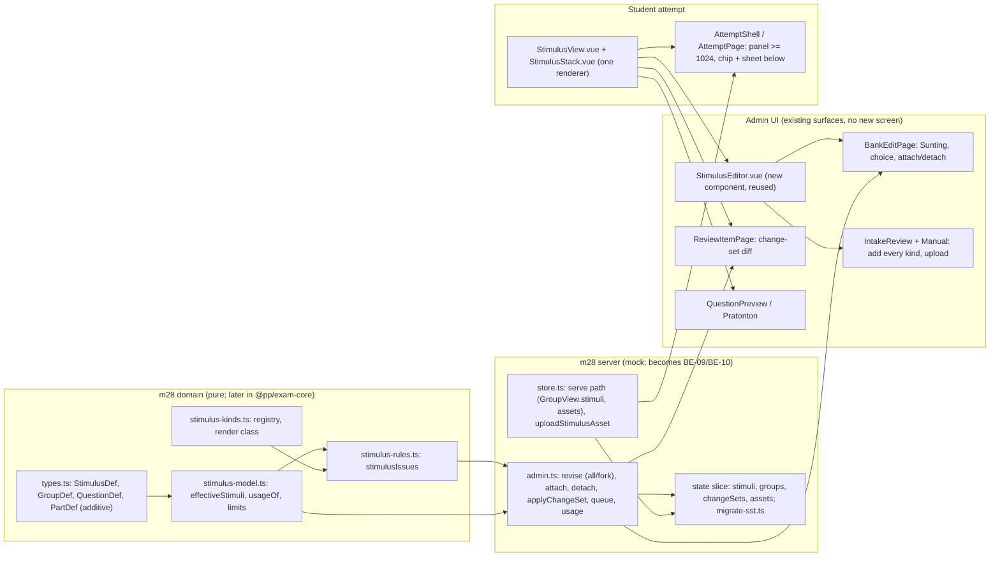
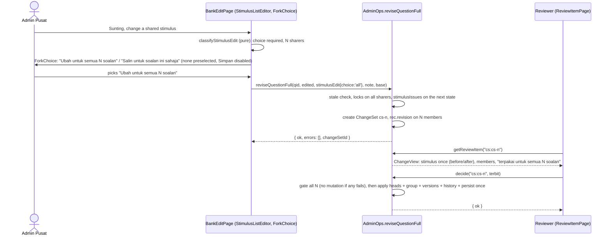
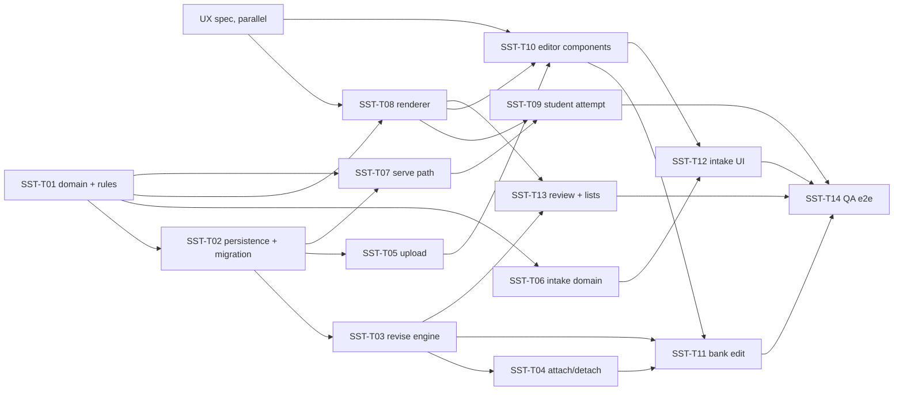

# v2 Shared stimulus: system design (slug: v2-shared-stimulus)

| Field | Value |
|---|---|
| Document | Feature design, G2 (system architecture) |
| Version | 0.1 |
| Date | 2026-10-25 |
| Status | **G2 draft, waiting for the user's approval** of decisions S1 to S17 in section 0 |
| Owner | solution-architect |
| Requirements | `docs/requirements/v2-shared-stimulus.md` (G1; US-01 to US-10; Q3 answered: pin breakpoint 1024 px; Q4 answered: one reviewer) |
| Audit rows | FB-027 to FB-030, proposals P-027 to P-030 in `docs/qa/audit-sistem/FIXLOG.md` |
| Code read | `src/modules/m28-bijak-spm/{domain/types.ts, domain/admin-types.ts, domain/paper-builder.ts, server/store.ts, server/admin.ts, admin/intake/**, admin/papers/{BankEditPage,ReviewItemPage,QuestionPreview}.vue, components/{StimulusView,AttemptShell,QuestionBlock}.vue, pages/AttemptPage.vue}`; on `origin/be/bijak-integration`: `packages/contract/src/bijak/attempts/schema.ts`, `packages/contract/src/ai/schema.ts`, `apps/api/prisma/schema/{exam,files}.prisma`, `packages/exam-core` |
| Other inputs | `docs/requirements/v2-exam-schema.md` D6 / D41 / section "migration"; `docs/architecture/v2-dskp-integration.md` (format, persisted-state migration pattern, `gateErrors` change); ADR-0013, 0014, 0018, 0021, 0022 |
| Decision record | ADR-0023 (`docs/adr/0023-shared-stimulus-versions-forks-change-sets.md`) |
| UI spec (not here) | `docs/design/v2-shared-stimulus.md` (ui-ux-designer, written in parallel). This document fixes data, contract, rules and file layout, not pixels or final BM copy for new strings. |

Scope reminder: a front-end prototype with in-browser mock servers; go-live runs on the mock. The real NestJS backend is a separate programme and the contract change comes after go-live. Section 4.6 and section 9 are hand-over notes only. No application code is written by this document; type snippets are contract sketches. Strings marked `[PROPOSED]` have no old-system source; the UX spec owns their final BM text. Strings quoted without a mark are verbatim from the requirements or from code that already ships.

## 0. Summary and decisions

| # | Decision | Choice and reason |
|---|---|---|
| S1 | Who owns stimuli (D12) | The Bijak SPM question service owns them: `BANK.stimuli` and `BANK.groups` in m28 (`data/builders.ts` `Bank`), in the backend the BE-09/BE-10 question tables. M04's general bank has no shared stimulus: its `structured` rows carry an inline `stimulus` string and `stimulusImage` for the legacy structured questions. That is a different store and is not touched, not migrated into this entity and not read by m28. |
| S2 | Identity and versions | Stable `id` plus integer `version` (1 for every seed). A version is immutable once live. A shared edit never mutates a version: it creates version n+1 (change set) or a new id (fork). |
| S3 | Sharing is computed | `usageOf(stimulusId)` derives sharers from references (group list, question own list, part reference). No stored counter. N is always computed from the live data. |
| S4 | Where a stimulus can hang | Group (1 to 3, ordered), question own list (0 to 3, ordered), part (0 or 1). A stimulus-bearing question stays in a group, a group of one is valid (D6 Fizik case, AC-03.3). The question's own list holds only stimuli that are not shared through its group. At most **3 distinct stimuli per question**, counted over group list, own list and all its parts (AC-04.3, AC-05.2). |
| S5 | Fork ("Salin untuk soalan ini sahaja") | Replaces the edited stimulus by a copy with a new id in this question's references; the question leaves its group and keeps references to the group's unchanged stimuli. The copy is carried inside the question's pending revision and is created on approval, so a rejected fork creates no orphan row. |
| S6 | Edit-all ("Ubah untuk semua N soalan") | A `ChangeSet` (kind `stimulus_all`): the next stimulus version(s) plus version n+1 of every sharer. One review unit `cs:<id>` "Kumpulan N soalan"; approve, reject and "betulkan" are all-or-nothing. |
| S7 | Attach / detach on a Terbit question (FB-030) | Same `ChangeSet` machinery, kinds `attach` and `detach`. Only the moving question gets version n+1; the other members keep their version number and keep serving; membership changes at approval. |
| S8 | Server enforces the choice | The server refuses a save that changes a shared thing without `choice` (`choice_required`). "No default" (AC-01.2) is a UI rule; "no silent propagation" (AC-01.6) is a server rule. |
| S9 | Locks and stale saves | Any pending revision or change set on a sharer or on the group blocks new stimulus operations on all of them ("Sudah ada versi baharu menunggu semakan", naming the question). The save carries `base` versions; a mismatch returns `stale`. |
| S10 | Kinds | 11 kinds are offered: `passage`, `box`, `table`, `diagram`, `graph`, `image`, `infographic`, `code`, `math`, `map`, `cartoon`. `audio` is reserved (name only, not in the enum, not offered); `video` is dropped. Old `pseudocode` and `sql` become the `codeLabel` of `code`. One registry file maps kind to render class, alt rule and default label word. |
| S11 | One rules function | `stimulusIssues(...)` is pure and lives in `m28/domain/stimulus-rules.ts` (movable into `@pp/exam-core` unchanged). Called by intake submit, the three revision paths, change-set approval, question publish and paper publish. |
| S12 | Uploads | New mock method `uploadStimulusAsset`; type decided from magic bytes, never from the file name or declared type; raster only (PNG, JPEG, WebP) in v2.0; stored by `assetId`; rendered only through ``; `v-html` is reserved for the bundled seed `svg`. Size and type limits are the old handler's (open item Q2), constants in one file. |
| S13 | Additive types | No rename of any existing field (`GroupDef.stimulusId`, `QuestionView.groupId`, `GroupView.stimulus` stay). New optional fields only. Reason: `be/bijak-integration` and the strict attempt contract already consume the old shape. |
| S14 | Student read path | Backward compatible: `groups[].stimulus` stays the first stimulus. Added: `groups[].stimuli`, `questions[].stimulusIds`, `parts[].stimulusId`, resolved `stimuli` map. Pin per group and per part at `lg` (>= 1024 px); chip plus bottom sheet below. |
| S15 | Persistence and migration | Approved changes persist as deltas over code seeds (`slice.stimuli`, `slice.groups`, `slice.changeSets`, `slice.assets`), applied at boot, the pattern `review[*].live` already uses. One idempotent migration with its own marker `state.sst = 1` (does not compete with the DSKP `state.schema` bump). Storage key unchanged. |
| S16 | Mock limit (pinning) | The mock has no per-version question store, so a published paper in the mock shows the live version of a question. AC-02.5 second clause is a backend guarantee. See open question Q-S2. |
| S17 | Seeds (D11) | **No seed record is added, removed or changed.** Existing seed stimuli get `version` 1 by default at load. Tests build their own fixtures inside the test. |

## 1. Architecture overview



### 1.1 Folder layout (new or changed)

```
src/modules/m28-bijak-spm/
  domain/types.ts                     CHG  StimulusKind, StimulusDef fields, GroupDef.extraStimulusIds, QuestionDef.stimulusIds, PartDef.stimulusId, view types
  domain/stimulus-kinds.ts            NEW  registry: kind -> class, alt rule, label word, offered, upload kinds
  domain/stimulus-model.ts            NEW  groupStimulusIds, effectiveStimulusIds, usageOf, distinctCount, limit, versionOf
  domain/stimulus-rules.ts            NEW  stimulusIssues + issue codes + messages
  domain/admin-types.ts               CHG  ChangeSet, StimulusEdit, ChangeView, RevisionContent.stimuli, HistoryEntry.change/members, BankEditable.stimuli
  domain/paper-builder.ts             CHG  label in "tidak lengkap" message (group completeness already blocks, AC-09.7)
  lib/stimulus-assets.ts              NEW  sniffImage (magic bytes), limits constants, dataUrl helpers (pure)
  lib/migrate-sst.ts                  NEW  migrateSst(state): idempotent
  server/admin.ts                     CHG  reviseQuestionFull (choice), attachToGroup, detachFromGroup, attachTargets, applyChangeSet, usage, queue unit cs:, applyLive without stimulus overwrite
  server/store.ts                     CHG  serve path, uploadStimulusAsset, reportQuestion stub, asset GC at load, state.sst
  server/client.ts                    CHG  wrappers for the new methods
  data/builders.ts                    CHG  Bank: stimulusVersions-free (heads only), addGroup accepts extras
  components/StimulusView.vue         CHG  all kinds, , error state, enlarge, caption default word
  components/StimulusStack.vue        NEW  ordered list, active part stimulus
  components/StimulusLoadError.vue    NEW  "Rajah tidak dapat dimuatkan." + Cuba lagi + Lapor
  components/AttemptShell.vue         CHG  hasStimulus from any stimulus, not group only
  pages/AttemptPage.vue               CHG  stimuli of question + current part, failure gating
  components/QuestionBlock.vue        CHG  "berdasarkan {label}" for several labels
  admin/stimulus/StimulusEditor.vue   NEW  one stimulus: kind, label, caption, alt, source, body/table/code/upload
  admin/stimulus/StimulusListEditor.vue NEW ordered 1-3 list, add/remove/reorder, kind menu
  admin/stimulus/ForkChoice.vue       NEW  the two options, no preselection, sharer sentence
  admin/papers/BankEditPage.vue       CHG  list editor, part selector, choice, attach/detach, notices
  admin/papers/ReviewItemPage.vue     CHG  change-set item: before/after, members, decision text
  admin/papers/BankPage.vue, QuestionPreview.vue, ui.ts   CHG  chip rule, part use, sharer lines
  admin/intake/types.ts               CHG  IntakeQuestion.ownStimulusIds, IntakeBatch.groupExtras, IntakePart.stimulusId
  admin/intake/domain/{grouping,validation,convert}.ts   CHG  see 2.7
  admin/intake/pages/{IntakeReviewPage,IntakeManualPage}.vue  CHG  kind menu, upload, group extras
  admin/intake/ai/mock-extractor.ts   CHG  none in behaviour; maps stimulusId into the new fields (still emits 3 kinds)
  __tests__/stimulus-*.test.ts        NEW  see section 8
e2e/m06-spm/shared-stimulus.spec.ts   NEW  qa-engineer, 375 / 768 / 1280
```

On the integration branches the five domain files live in `packages/exam-core/src` and `m28/domain/*.ts` are `export *` shims (ADR-0021). The edits to `types.ts` are made once, in whichever location holds the file at the time (hand-over, section 9.2).

## 2. Data model

### 2.1 Stimulus (entity) and kinds

```ts
export type StimulusKind =
  | 'passage' | 'box'                                         // text
  | 'table'                                                   // table
  | 'diagram' | 'graph' | 'image' | 'infographic' | 'map' | 'cartoon'   // figure
  | 'code'                                                    // monospaced
  | 'math'                                                    // formula block ($latex$ spans)

export type StimulusClass = 'text' | 'table' | 'figure' | 'code' | 'formula'

export interface StimulusDef {                  // existing fields kept, new ones optional
  id: string
  version?: number                              // NEW: >= 1; absent = 1
  kind: StimulusKind                            // was 'diagram' | 'passage' | 'table'
  label: string                                 // "Rajah 3", "Teks 2", "Bahan 1" (data, not hard-coded)
  caption?: string
  alt: string                                   // '' allowed for non-figure kinds
  sourceCitation?: string                       // NEW: shown under the text (passage)
  svg?: string                                  // bundled seed only; trusted; never user input
  assetId?: string                              // NEW: uploaded raster figure or table image
  text?: string                                 // passage, box, code, math
  table?: { head: string[]; rows: string[][] }
  codeLabel?: 'kod' | 'pseudokod' | 'sql'       // NEW: only for kind 'code'
}
```

Registry (`domain/stimulus-kinds.ts`), one row per kind. Behaviour is data in this one table; no other file switches on `kind` strings.

| Kind | Class | Content required to publish | Alt required | Default label word [PROPOSED where not observed] | Offered | Old kind |
|---|---|---|---|---|---|---|
| `passage` | text | `text` non-blank | no | "Petikan" (ships today); "Teks" is also valid data | yes | K01 |
| `box` | text | `text` non-blank | no | "Bahan" | yes | K02 (render = boxed passage, Q1 default) |
| `table` | table | `table` (head >= 1 column, every row same width) **or** `assetId` | only when it shows an image and has no `table` | "Jadual" | yes | K03 |
| `diagram` | figure | `svg` (seed) or `assetId` | yes | "Rajah" | yes | K04 |
| `graph` | figure | `assetId` or `svg` | yes | "Graf" | yes | K05 |
| `image` | figure | `assetId` | yes | "Gambar" [PROPOSED] | yes | K06 |
| `infographic` | figure | `assetId` | yes | "Infografik" [PROPOSED] | yes | K07 |
| `map` | figure | `assetId` or `svg` | yes | "Rajah" | yes | K14 |
| `cartoon` | figure | `assetId` | yes | "Gambar" [PROPOSED] | yes | K15 |
| `code` | code | `text` non-blank; `codeLabel` defaults to `kod` | no | "Kod" [PROPOSED] | yes | K08, K09, K10 |
| `math` | formula | `text` containing at least one `$...$` span | no | "Rumus" [PROPOSED] | yes | K11 |
| reserved | | | | | no | K12 audio (with Listening, D6/D7) |
| dropped | | | | | no | K13 video (placeholder only) |

Rules:
- `kind` change in a revision re-runs `stimulusIssues` against the new kind before save (AC-06.8). Switching class (for example text to figure) keeps the old body in the draft only until the editor discards it; nothing is silently converted.
- Wide tables and formulas scroll inside their own container (AC-06.7); figures scale to the viewport and can be enlarged; both are renderer rules, section 6.
- The label default word is used only to propose the next label ("Rajah 2"); the label stays editable data. Source line (`sourceCitation`) shows under the text for `passage` and `box`.
- Sejarah-style "e-mel, notis, iklan, sajak, tajuk akhbar" are a `passage` whose label says so (AC-06.4); no sub-kind field.

### 2.2 References: group, question, part

```ts
export interface GroupDef {                     // existing fields kept
  id: string
  stimulusId: string                            // the first stimulus (kept for be/bijak-integration)
  extraStimulusIds?: string[]                   // NEW: stimulus 2 and 3, in order
  optionBank?: McqOption[]
  questionIds: string[]                         // members in published order
}
export interface QuestionDef {
  groupId?: string                              // exactly one group (AC-04.6)
  stimulusIds?: string[]                        // NEW: own list, ordered, not shared via the group
  /* ... */
}
export interface PartDef {
  stimulusId?: string                           // NEW: part-level reference (old question_parts.stimulus_id)
  /* ... */
}
```

Derived (pure, `domain/stimulus-model.ts`):
- `groupStimulusIds(g) = [g.stimulusId, ...(g.extraStimulusIds ?? [])]`.
- `effectiveStimulusIds(q) = unique([...groupStimulusIds(group of q), ...(q.stimulusIds ?? [])])`, the order the student and Pratonton show (group first, then own).
- `questionStimulusIds(q) = unique([...effectiveStimulusIds(q), ...parts.map(p => p.stimulusId)])`; **limit: length <= 3** (`MAX_STIMULI_PER_QUESTION = 3`, one constant). The same function is used by intake, revise, attach and publish, so AC-04.2, AC-05.2 and AC-09.5 cannot disagree.
- `usageOf(stimulusId, bank) -> Usage[]` where `Usage = { questionId, partId?, via: 'group' | 'own' | 'part', position }`. Only live (Terbit) questions count; N = `usage.length`. Questions of an unapproved batch reference their own batch stimuli and never appear. Cost is one pass over the bank (a few hundred questions in the mock; indexed join in the backend).
- Group of one is valid; `Kumpulan N soalan` chip rule stays "N >= 2" (FB-003); AC-08.2 adds: also when some stimulus of the question has `usageOf(...).length >= 2` through parts or own lists, with N = that count.

Invariants (asserted by a test over the whole bank and after every operation in tests):
1. Every id referenced by a group, question or part exists in the stimulus store.
2. `GroupDef.questionIds` equals the members found by `q.groupId`, in order.
3. A question is in at most one group.
4. `questionStimulusIds(q).length <= 3`.
5. No stimulus is live without a reference (orphans are archived on the approval that drops the last reference; archived stimuli are not offered by the attach picker, AC-03.6).

### 2.3 Versions, fork and change set

```mermaid
stateDiagram-v2
  [*] --> Live_v1: seed / approved batch
  Live_v1 --> Pending_v2: edit-all saved (ChangeSet)
  Pending_v2 --> Live_v2: approve (atomic with N question versions)
  Pending_v2 --> Live_v1: reject / betulkan (all N stay on v1)
  Live_v1 --> Live_v1: fork saved and approved (new id S' v1 for one question; S unchanged)
  Live_v2 --> Archived: last reference dropped
```



`ChangeSet` (persisted in the admin slice; one per pending multi-question unit):

```ts
export type ChangeKind = 'stimulus_all' | 'attach' | 'detach'
export interface ChangeSet {
  id: string                                    // "cs-<n>", n from slice.csSeq
  kind: ChangeKind
  groupId?: string                              // group edited / joined / left
  note: string
  by: string
  at: number
  /** Next heads of the stimuli this set edits (stimulus_all). Version = live version + 1. */
  stimuli: StimulusDef[]
  /** Next stimulus order of the group when the list changes (stimulus_all). */
  groupStimulusIds?: string[]
  /** Pending version of every question whose version number moves (all N for stimulus_all, one for attach/detach). */
  versions: Record<string, { version: number; content: RevisionContent }>
  /** Membership effect applied on approval (attach: add with position; detach: remove). */
  membership?: { add?: { questionId: string; position: number }[]; remove?: string[] }
  /** Baseline captured at save time: used for the stale check and the before/after view. */
  base: { versions: Record<string, number>; stimulusVersions: Record<string, number> }
}
```

- `RevisionContent` (single-question revision) changes: `stimulus?: StimulusDef` is replaced by `stimuli?: StimulusDef[]` = stimuli this revision creates or edits for this question only (N = 1 edits get `version + 1` and the same id; fork copies get a new id and `version` 1). Nothing in `RevisionContent` ever overwrites a shared head.
- Each question in `versions` also gets `rec.revision` (with `changeSetId`) so the existing lock check ("Sudah ada versi baharu menunggu semakan"), bank `Semakan` status and counts keep working. The queue shows **one** item `cs:<id>` for the whole set (the per-question `v:` items of its members are hidden while `changeSetId` is set).
- `HistoryEntry` gains optional `change?: 'edit_all' | 'fork' | 'attach' | 'detach'` and `members?: string[]` (AC-02.5, AC-09.8). The existing `action`/`note` text pattern is kept; the new action texts are [PROPOSED] and come from the UX spec.
- New ids: `S'` for a fork is `${stimulusId}-f${seq}`; ids never reuse and never carry user text.

### 2.4 Decision table: when is the choice asked

Computed by the server (`classifyStimulusEdit`) and mirrored in the client for the live UI (same pure function from `domain/stimulus-model.ts`).

| What changed in the save | Shared? (N counts this question) | Result |
|---|---|---|
| Nothing about stimuli | any | Normal revision, no choice (AC-01.3) |
| A stimulus field of S (label, caption, alt, source, kind, body, table, image, codeLabel) | N = 1 | Normal revision; S gets `version + 1` on approval (AC-01.4) |
| Same | N >= 2 | **Choice required**: `all` or `fork` (AC-01.1) |
| Group list changed (add, remove, reorder a group stimulus) | group size >= 2 | Choice required |
| Group list changed | group size = 1 | Normal revision |
| Own-list change (add, remove, reorder, edit own stimulus) | own stimulus not shared | Normal revision, no choice |
| Edit of an own or part stimulus that other questions or parts also use | N >= 2 | Choice required |
| Part reference changed to another existing stimulus | the stimulus kept in the part | Normal revision (the reference belongs to this question's version) |

`choice = 'all'` creates a ChangeSet whose members are `usageOf(S)` plus all members of the group when the group list changed. `choice = 'fork'`: see 3.2.

### 2.5 Assets

- Stored as `assetId -> { mime, size, width, height, dataUrl, createdAt }` in the admin slice under its own storage key (`pp.bijak.assets.v1`) so the main state document does not grow. The state document holds only `assetId`.
- Served stimuli carry a resolved `asset: { url, mime, width, height }` (derived, never stored). In the mock `url` is the data URL; in the backend it is the `FilesService` URL of the `files` row (purpose `stimulus_image`, a new value in the open purposes list; mime is already limited by `ck_files_mime`).
- Garbage collection at server load: an asset not referenced by any stimulus head, batch, pending revision or change set is dropped (no orphan assets).
- Mock-only constants (one file, `lib/stimulus-assets.ts`): `STIMULUS_ALLOWED_MIME` and `STIMULUS_MAX_BYTES` (set from the old handler, open item Q2) and `MOCK_ASSET_BUDGET_BYTES` (the whole asset store must fit browser storage; over budget -> `budget_exceeded`, a mock limit that does not exist in the backend).
- `sniffImage(bytes)` reads the magic bytes (PNG, JPEG, WebP), returns `{ mime, width, height }` or `null`. A file that cannot be decoded as one of these is refused (AC-07.3, AC-07.4). SVG, HTML and anything else is refused. No upload is ever inserted with `v-html`.

### 2.6 Persisted state and migration (mock)

Today the state document holds `review[qid].live` (approved full edits, including the edited shared stimulus) and `review[qid].revision.content.stimulus`. New slice members:

| Member | Content | Applied at boot |
|---|---|---|
| `stimuli?: Record<id, StimulusDef>` | approved heads that differ from or are not in the code seeds (edited, forked, uploaded) | after seed hydration, before `rec.live` |
| `groups?: Record<gid, GroupDef>` | approved group deltas over seeds (membership, stimulus list) | after `rec.live` |
| `changeSets?: Record<id, ChangeSet>`, `csSeq?: number` | pending sets | queue |
| `state.sst?: 1` | migration marker | |

`migrateSst(state)` (idempotent; runs in `load()` before `seedAdminSlice`; the storage key and `state.schema` are not touched):

| Old | New |
|---|---|
| `review[q].live.stimulus` (approved silent change, re-applied by `applyLive`) | `slice.stimuli[id] = { ...stimulus, version: 2 }` when it differs from the seed head by `stimulusChanged`; then delete `live.stimulus` |
| `review[q].revision.content.stimulus` equal to the live head | dropped (no change) |
| the same, different from the live head, group size N >= 2 | converted to a `ChangeSet` of kind `stimulus_all` (old behaviour was "applies to all", so the reviewer approves what the author saw); members get `rec.revision` with `changeSetId`; the single `v:` item is replaced by `cs:` |
| the same, N = 1 | `revision.content.stimuli = [stimulus]` |
| intake batches, `dynSeeds`, attempts, papers | unchanged (new fields are optional) |
| anything else with no `sst` marker | marker set |

Test: a fixture of a persisted old-shape state (built in the test, not a seed) migrates, runs twice with identical output, and the queue counts equal the pre-migration counts.

### 2.7 Intake model (batch, before anything is live)

Principle: regression guard FB-001 to FB-003 stays green; `IntakeQuestion.stimulusId` remains the group key.

```ts
IntakeQuestion {
  stimulusId?: string            // unchanged: the group's first stimulus; the group key used by groupsOf / attach / detach
  ownStimulusIds?: string[]      // NEW: own list (0..2 besides the group's), ordered
  /* parts: */ IntakePart.stimulusId?: string   // NEW
}
IntakeBatch {
  groupExtras?: Record<string /* group key = first stimulus id */, string[]>   // NEW: stimulus 2 and 3 of a group, shared by every member
}
```

- `groupsOf` is unchanged; `attachToStimulus` / `detachFromStimulus` / `removeStimulus` keep their signatures and renumbering notes; `removeStimulus` also drops it from `groupExtras`, `ownStimulusIds` and parts. Removing the first stimulus of a group with extras promotes the next extra to the group key (a small, tested rename of the key in `groupExtras` and in the members).
- `validateBatch` additions: stimulus 1 to 3 per question (limit constant from 2.2); every referenced id exists ("Rajah / petikan yang dirujuk tidak wujud."); alt rule by kind from the registry (replaces the current "every stimulus needs alt", which wrongly blocks passages, AC-06.5); content rule by kind; contiguity message unchanged; errors name the stimulus label (AC-04.7).
- `convert.ts`: `batchToSeeds` maps `groupExtras` to `GroupDef.extraStimulusIds` with the same `${batch.id}-` id prefix as stimulus 1; own and part stimuli of the batch are minted with the same prefix and travel in `ReviewSeed.stimuli` (new optional array next to `group`). `stimulusDef()` keeps every content field, including `assetId`, `svg`, `text`, `table`, `sourceCitation`, `codeLabel` (closes audit A18: figure content is persisted and still shown after reload and approval).
- Manual path: "Tambah rajah" produces `kind: 'diagram'` with an upload slot; the new kind menu (UX spec) produces the other kinds from the same place. The AI extractor is unchanged in behaviour (still emits `diagram`, `passage`, `table`; `AiStimulusDef` strict keys are not touched).
- Crops from the page (AC-07.7) remain the extraction lane's work (PC-5/BE-37): they arrive as `image`/`table` stimuli with `assetId` and `page`/`region`; nothing here blocks that.

### 2.8 Bank-level rows and views (admin read model)

- `BankRow`: unchanged fields; `groupSize` stays; new optional `sharedCount` (max `usageOf` over the question's stimuli) for AC-08.2; new optional `attention?: ('stimulus_asset_missing')[]` for AC-10.8 (flag to Admin Pusat).
- `BankEditable`: `stimulus?` is kept (first stimulus, for old callers) and joined by `stimuli?: EditableStimulus[]` where `EditableStimulus = IntakeStimulus & { scope: 'group' | 'own'; usage: Usage[] }`, `partStimuli?: Record<partId, EditableStimulus>`, `groupId?`, `base: { version, versions: Record<qid, number>, stimulusVersions: Record<id, number> }`. `sharers` stays (for the FB-002 sentence) and gains part entries (`partLabel?`) so the sentence can say "Soalan 6 (b)" (AC-05.5).
- `BankDetail` and `ReviewDetail`: `stimulus?` kept; add `stimuli?: StimulusDef[]`; `ReviewDetail.change?: ChangeView`:

```ts
export interface ChangeView {
  setId: string
  kind: ChangeKind
  members: { questionId: string; position: number; edited: boolean; added?: boolean; removed?: boolean }[]
  stimuli: { id: string; before?: StimulusDef; after?: StimulusDef }[]
  groupBefore?: string[]; groupAfter?: string[]     // stimulus id order
}
```

## 3. Rules and flows

### 3.1 Edit-all (US-01, US-02)



Rules:
1. N = `usageOf(S).length` at save time and again at approval; if N changed in between (a sharer was forked away by an earlier approved set) the lock/stale check prevents it: two operations cannot be pending on the same sharers (S9).
2. A save with `changed && N >= 2 && choice === undefined` returns `{ ok:false, errors:[...], issues:[{code:'choice_required', n, sharers}] }` and stores nothing.
3. Approval is atomic by construction: `applyChangeSet` first computes all gate results for all bumped questions and the next stimulus state; if any issue exists it returns without mutating. Then it mutates the touched structures in one synchronous block and calls `persist()` once. A thrown error restores a pre-mutation clone of the touched slice members. The same function handles 76 members (R2 in G1); a test covers a 76-question group built in the test.
4. Reject and "Minta Pembetulan" delete `rec.revision` on all members, keep every live version and write one history line per member with the same reason (AC-02.3). The set is marked closed and removed from the queue.
5. While pending, the live versions of all N keep serving (AC-02.4): `BANK` is untouched until approval.
6. Wording: the FB-002 sentence ("Rajah 1 dikongsi oleh 4 soalan: ...") stays for the plain info line on the edit page; once the choice exists the page must not show "Perubahan di sini terpakai untuk semua soalan tersebut." as a fact (AC-01.5). The two options state their effect; final BM by the UX spec.

### 3.2 Fork (US-03)

Input: `choice = 'fork'`, the edited stimuli. Server builds the question's next content:
1. For each edited shared stimulus `S` in the question's references, create `S' = { ...edited, id: newId, version: 1 }` and replace `S` by `S'` **at the same position** in the question's effective list.
2. If any replaced stimulus was a group stimulus, the question leaves the group: `groupId` removed, `stimulusIds` (own list) = the resulting effective list (unchanged stimuli stay by reference, so they remain shared with the old group). If the replaced stimulus was an own or part stimulus, only that reference changes and the question keeps its group.
3. The fork is a normal single-question revision `v:<qid>` (AC-03.2). `RevisionContent.stimuli` carries `S'`; no stimulus row exists until approval. On approval: `S'` becomes a head, the question version goes live, `GroupDef.questionIds` loses the question, the old group keeps its members and stimuli (AC-03.1, AC-03.3). If the old group is left with 0 members, the group and its stimuli with no other reference are archived.
4. Result carries `forkNotice` when the original is also used by other papers: `{ otherPapers, otherQuestions }` where `otherPapers` = distinct papers (draft or published) that contain any other sharer, and `otherQuestions` = N - 1. The UI shows verbatim: "Petikan telah dikemas kini. Ia dikongsi dengan kertas lain, jadi satu salinan dibuat untuk kertas ini sahaja." followed by the counts (AC-03.4; the counts text is [PROPOSED] in the UX spec).
5. Other papers are untouched (AC-03.5): nothing but this question's references changes.

### 3.3 Attach and detach (US-09)

- `attachTargets(qid, { q? })`: groups of the same subject with at least one live member, excluding the question's own group; each row: `groupId`, ordered stimuli (`id, label, kind, caption`), member count, stem preview of the first member. Subject = subject of the group's members (A3). Archived and member-less groups are not offered.
- `attachToGroup(qid, groupId, note)` checks, each with its message: question is Terbit; already in a group -> "(dalam kumpulan lain)"; any pending on the question or on the target group's members -> "Sudah ada versi baharu menunggu semakan" naming the question; `questionStimulusIds` after the attach would exceed 3 -> "Satu soalan atau kumpulan boleh mempunyai paling banyak 3 rangsangan."; same subject. On success: ChangeSet kind `attach`, one version for the joining question (`groupId` set, position = last), the unit queued as "Kumpulan N+1 soalan" with the new member highlighted (`ChangeView.members[].added`). Members keep their version numbers (AC-09.2).
- `detachFromGroup(qid, note)`: ChangeSet kind `detach`; the question's version n+1 has no `groupId`; its own list is kept; membership removes it on approval; the remaining members are listed in the unit, versions unchanged (AC-09.4). If the stem depends on the stimulus the review shows the existing validation warning; it is not a hard block.
- Approval of attach/detach updates `GroupDef.questionIds` and `QuestionDef.groupId` in one step. No other question is moved or renumbered (AC-09.6; bank questions have no paper order). The paper side already blocks a draft paper holding some but not all members (`checkPaper`: "Kumpulan rangsangan ... tidak lengkap"); this task only replaces the raw group id in that message by the stimulus label and adds a test that attach makes a complete draft paper incomplete (AC-09.7). A published paper keeps referencing the questions it holds (mock limit: S16).

### 3.4 Gate: `stimulusIssues`

Pure function, input `{ questions, groups, stimulusOf(id), assetExists(assetId), subjectOf }`, output `StimulusIssue[]` with `{ code, stimulusId?, questionId?, partId?, message }`. `message` always begins with the stimulus label when it concerns one stimulus (AC-04.7).

| Code | Rule | Message |
|---|---|---|
| `ref_missing` | a referenced stimulus id does not exist or is archived | "Rajah / petikan yang dirujuk tidak wujud." (existing) |
| `alt_required` | figure class without non-blank alt; table with `assetId` and no `table` and no alt | "Teks alternatif (alt) bagi rajah diperlukan." (existing, prefixed by the label) |
| `content_missing` | content rule of the kind not met (2.1) | [PROPOSED] "{label}: kandungan belum lengkap." |
| `asset_missing` | `assetId` set but not resolvable | [PROPOSED] "{label}: fail rajah tidak ditemui." |
| `too_many` | `questionStimulusIds(q).length > 3`, or a group list > 3 | "Satu soalan atau kumpulan boleh mempunyai paling banyak 3 rangsangan." [PROPOSED, AC-04.2] |
| `group_empty` | a group with no stimulus | [PROPOSED] |
| `kind_not_offered` | `audio`/`video` or an unknown kind | [PROPOSED] |
| `code_label` | `codeLabel` set on a non-code kind | internal; fixed by the editor |

Where it runs:

| Path | Function | Notes |
|---|---|---|
| Intake submit | `validateBatch` | uses batch stimuli |
| Bank "Sunting" save | `validateRevision` | next state of the question and its edited stimuli |
| Change set save and approval | `applyChangeSet` | all bumped questions, next stimulus state; no mutation on any issue |
| Review approval of a batch unit | `gateErrors` | adds `stimulusIssues` for the unit; one-line call so the DSKP `gateErrors` signature change (DSKP-T05) merges cleanly: `gateErrors(qs, ctx)` with `ctx.stimulusOf` optional |
| Paper publish | `checkPaper` | existing group completeness; plus "stimulus assets resolve" via `attention` (D6 gate) |
| Serve (Jana Kertas pool) | `isServable(q)` | a question whose asset is missing is not drawn and shows in `BankRow.attention` (AC-10.8) |

### 3.5 Review rules

- One reviewer decides; the author may be the reviewer in the prototype exactly as for a new batch today (Q4). The AI service is never a reviewer (QB approve rule, unchanged).
- A change set appears once in the queue (`cs:<id>`), with `questionIds` = the bumped members, `groupId`, `marks` and `kind` computed from its first member as a revision does today. Queue "items per status" counts the set once; "questions per status" counts the bumped versions (N for edit-all, 1 for attach and detach), as revisions are counted. A test pins both.
- The decision text says "terpakai untuk semua N soalan" with the true N, and the FB-002 sentence is shown (AC-02.2).
- Neither a partial approval nor a partial rejection exists in the API: `decide` takes the set key only.
- Audit: every approval writes one history entry per affected question: bumped members get "Diterbitkan" / "Diarkibkan (digantikan)" plus `change` and `members`; attach/detach also write a line on the other group members (membership change, no version move) so each question's history shows it (AC-09.8, NFR audit).

## 4. Contract

The Bijak SPM mock is a class, `BijakServer` (`server/store.ts`), reached through `server/client.ts`; the backend derives its HTTP surface from the public methods (v2-backend-plan section 9). The contract below is therefore the method signatures plus the wire types; the REST mapping in 4.5 is a proposal.

### 4.1 Wire types (additive)

```ts
// served to the student (exam-core / contract: BijakAttempt*)
GroupView        { id; stimulus: StimulusView /* = stimuli[0], kept */; stimuli: StimulusView[]; from; to; questionIds }
QuestionView     { /* existing */ groupId?; stimulusIds?: string[] }       // own list, resolved in AttemptPaperView.stimuli
PartView         { /* existing */ stimulusId?: string }
AttemptPaperView { /* existing */ stimuli: Record<string, StimulusView> }  // own + part stimuli, each delivered once
StimulusView     = StimulusDef & { asset?: { url: string; mime: string; width?: number; height?: number } }
```

Backward compatibility: a client that only reads `groups[].stimulus` and `questions[].groupId` keeps working for single-stimulus groups (everything that ships today). The strict zod object `BijakAttemptStimulus` and its `kind` enum widen after go-live (an enum widening is additive for `contract-diff`; new fields are optional). `AiStimulusDef` and `AiIntakeStimulus` are not changed.

### 4.2 Admin methods on `BijakServer`

Legend: B = backend-bound (becomes an HTTP route at BE-09/BE-10), M = mock-only.

| Method | In | Out | B/M |
|---|---|---|---|
| `getBankEditable(qid)` (changed) | question id | `BankEditable` with `stimuli`, `partStimuli`, `groupId`, `base`, `sharers` incl. parts | B |
| `reviseQuestionFull(qid, edited, stimulusEdit, note, base)` (changed) | `StimulusEdit = { group?: IntakeStimulus[]; own?: IntakeStimulus[]; parts?: Record<partId, IntakeStimulus \| null>; choice?: 'all' \| 'fork' }`; new stimuli carry ids starting `new:` | `ReviseResult = DecisionResult & { issues?: StimulusIssue[]; changeSetId?: string; forkNotice?: { otherPapers: number; otherQuestions: number } }` | B |
| `attachTargets(qid, { q? })` | | `AttachTarget[]` | B |
| `attachToGroup(qid, groupId, note)` | | `ReviseResult` | B |
| `detachFromGroup(qid, note)` | | `ReviseResult` | B |
| `getStimulusUsage(stimulusId)` | | `{ stimulus; sharers: StimulusSharers; papers: {id, title}[] }` (AC-08.1) | B |
| `uploadStimulusAsset(file: { name; mime; bytes: Uint8Array })` | | `{ assetId; mime; width; height; size }` or an error with code `type_not_allowed` / `too_large` / `not_an_image` / `budget_exceeded`(M) | B (route), budget M |
| `getReviewItem(key)` (changed) | `v:...`, `cs:...`, group key | `ReviewDetail` with `change?: ChangeView` | B |
| `decide(key, decision)` (changed) | key may be `cs:<id>` | `DecisionResult`; all-or-nothing | B |
| `reportQuestion(attemptId, qid, { reason: 'stimulus_load_failed', stimulusId })` | | `{ ok }` | M stub until Bijak US-19 / QB US-18 (open question Q-S1) |

`getStimulusUsage` is used by Pratonton, the review item and Bank edit (AC-08.1); `BankPage` rows use `sharedCount`.

### 4.3 Error format

Mock: `DecisionResult { ok, errors: string[] }` stays; `issues` is additive. Codes: `choice_required`, `stale`, `pending_revision`, `in_other_group`, `too_many`, `ref_missing`, `alt_required`, `content_missing`, `asset_missing`, `type_not_allowed`, `too_large`, `not_an_image`, `budget_exceeded`. Backend: HTTP 409 for `stale` and `pending_revision`, 422 for rule issues, 413/415 for upload; each carries `issues[]` under the standard error envelope and the same `code` strings. Unauthorised callers get 403 with no content (D30).

### 4.4 Authorisation

Admin portal only (Admin Pusat and Penyemak roles that already own the Bank and Semakan). Upload and every write route share the existing admin SPM guard (`admin-route-access.test.ts` extended with the new methods). The student read path exposes stimuli only inside an attempt the user owns (unchanged).

### 4.5 REST mapping (proposal for BE-09/BE-10)

| Method | Route | Success | Errors |
|---|---|---|---|
| `getBankEditable` | `GET /api/admin/spm/bank/questions/:id/editable` | 200 `BankEditable` | 404, 403 |
| `reviseQuestionFull` | `POST /api/admin/spm/bank/questions/:id/revisions` | 201 `{ revisionId?, changeSetId? }` | 409 `stale`/`pending_revision`, 422 issues incl. `choice_required` |
| `attachToGroup` | `PUT /api/admin/spm/bank/questions/:id/group` `{ groupId, note }` | 201 `{ changeSetId }` | 409, 422 |
| `detachFromGroup` | `DELETE /api/admin/spm/bank/questions/:id/group` `{ note }` | 201 `{ changeSetId }` | 409, 422 |
| `attachTargets` | `GET /api/admin/spm/bank/questions/:id/attach-targets?q=` | 200 | 404 |
| `getStimulusUsage` | `GET /api/admin/spm/stimuli/:id/usage` | 200 | 404 |
| `uploadStimulusAsset` | `POST /api/admin/spm/stimulus-assets` (multipart) | 201 | 413, 415, 422 |
| `getReviewItem`, `decide` | existing review routes with key `cs:<id>` | | 409 if no longer pending |

### 4.6 Backend hand-over (BE-09 / BE-10 / BE-04 / BE-14; after go-live, not built here)

| Prototype | Backend proposal |
|---|---|
| `StimulusDef` heads and versions | `stimuli(id, subject_code, archived_at)` and `stimulus_versions(stimulus_id, version, kind, label, caption, alt_text, source_citation, body jsonb {text, table, code_label}, asset_file_id -> files.id, status pending/live/retired, change_set_id, created_by, created_at)`; PK `(stimulus_id, version)`; versions immutable. Migration fills `stimuli` from the 985 non-orphan old stimuli (946 orphans dropped, PC-4) and `source_citation`, `kind`, `alt_text` as in v2-exam-schema migration table. |
| `GroupDef` + extras | `stimulus_groups(id, subject_code, option_bank, archived_at)` and `stimulus_group_versions(group_id, version)` with `stimulus_group_version_stimuli(group_version_id, stimulus_id, stimulus_version, position)`. A question version pins `(group_id, group_version)`. |
| group membership | **derived** from live question versions (`group_id`, `group_position`), not stored twice; the prototype keeps `GroupDef.questionIds` and an invariant test asserts both agree. |
| `QuestionDef.stimulusIds`, `PartDef.stimulusId` | `question_version_stimuli(question_version_id, stimulus_id, stimulus_version, position)` and `part_versions.stimulus_id/stimulus_version`. |
| `ChangeSet` | `change_sets(id, kind, status, group_id, note, created_by, decided_by, decided_at)` and `change_set_question_versions`. Approval is one transaction: lock group + member rows (`FOR UPDATE`), re-check `base` versions, run the same `stimulusIssues`, flip all versions. |
| `usageOf` | indexed query over `question_version_stimuli`, `stimulus_group_version_stimuli` and `part_versions` restricted to live versions. |
| `stimulusIssues` | already shared if `@pp/exam-core` hosts it (ADR-0021); otherwise move `domain/stimulus-rules.ts` unchanged. The backend supplies `stimulusOf` and `assetExists` from the database and storage. |
| Student view | `GET` attempt payload gains the optional fields of 4.1; a published paper pins question versions, so a new stimulus version never changes a published paper (AC-02.5 second clause). |
| Asset limits | `FilesService` purpose `stimulus_image`; limits from Q2. |

## 5. Student render rules (US-10)

1. **Effective list.** For the current question the stimulus list is `group stimuli (stated order) + own list`, deduplicated by id. If the current part has `stimulusId` it is appended and marked active. A question with no entries has no stimulus UI.
2. **Breakpoint (decided, Q3): `lg` = 1024 px.** At >= 1024 px a pinned panel sits beside the question (existing layout, `col-span-4`); below 1024 px (including 768 and 375) a sticky chip under the header opens the bottom sheet. Bijak AC-07.1 and NFR-01 say 1280; they are updated when this design is approved (docs task, section 9.2). No other layout change in the attempt shell.
3. **Pin per group and per part.** The panel is keyed by the group id, not the question id, so moving between members of a group does not remount it or reset its scroll. A part stimulus appears while that part is current: the part whose control has focus or was last interacted with (`focusin` within the part block); with no current part the part stimuli are not shown in the pinned area but the question stimuli are. When a different group or a question without stimulus becomes current, the panel is replaced or hidden.
4. **Several stimuli.** The panel and the sheet show them in stated order through `StimulusStack` (stacked; the active part stimulus is last and scrolled into view). The chip shows the thumb of the first and a count when there are several; chip text for several stimuli is a UX string.
5. **Sheet.** Opening and closing the sheet never unmounts the question form; typed and selected answers persist (AC-10.2; the existing overlay already behaves this way and a test pins it).
6. **Group heading.** Each member shows "berdasarkan {label}" (existing). For several labels the labels are joined as the UX spec decides; the heading is derived from the effective list.
7. **Failure after serve (AC-10.7).** `StimulusView` image `error` or a failed `asset.url` sets a per-stimulus failed state and shows `StimulusLoadError`: "Rajah tidak dapat dimuatkan." with "Cuba lagi" (re-request with a cache-busting key; clears the state on success) and "Lapor" (calls `reportQuestion`). While any stimulus of the current question is in failed state, "Seterusnya" and "Semak" are disabled, because the data has no per-question "does not need the stimulus" flag, so every stimulus-bearing question is treated as needing it (replicates AC-07.4 conservatively; the question map and "Sebelumnya" stay available so the student is never trapped). A text, table, code or formula stimulus cannot fail to load, only figures and image tables.
8. **Failure before serve (AC-10.8).** The publish gate blocks a missing asset; Jana Kertas does not draw a question with an unresolved asset; Bank shows the attention flag.
9. **Drills.** Latihan mode uses the same attempt page, so it shows the whole stack. Any other surface that renders a question (Pratonton, review, paper preview, builder list) must use `StimulusStack`, never `stimulus` alone: a test greps the `components/` and `admin/` folders for direct `group.stimulus` use.
10. **Responsive and touch.** Chip and sheet controls >= 44 px; tables, code and formulas scroll inside their container; images `max-width: 100%`; enlarge opens the existing image zoom pattern (UX spec). No horizontal page scroll at 320, 375, 768, 1280 (E2E).

## 6. Admin render rules

- One renderer: `StimulusView.vue` (with `StimulusStack.vue`) is used by the student attempt, Pratonton (`QuestionPreview`), the review item, the Bank edit page and the Intake editors. It switches on the **render class** from the registry, not on the kind string:
  - `figure`: `` for uploads, the existing sandboxed inline `svg` block for bundled seeds; caption below; click to enlarge.
  - `text`: rich text (existing `RichText`), `box` in a bordered container; `sourceCitation` as a muted line under the text.
  - `table`: `UTable` (existing) for `table`, or the image path when only `assetId` exists; wrapper `overflow-x-auto`.
  - `code`: `<pre><code>` with monospace font token, no highlighting library; `codeLabel` shown as the label.
  - `formula`: `RichText` with `$latex$` spans (D41-2, the maths renderer already used for stems).
- Thumb mode (`thumb`, the 48 px chip slot) keeps the current rule: figures shrink, everything else shows an icon tile; icon per class is a UX choice.
- Alt text is not shown visually; it is the `alt` of the `` / `aria-label` of the inline svg. Old data without alt is flagged by the gate at the next edit or publish; seeds are not filled (AC-06.6).
- The admin Pratonton shows part stimuli after their part (AC-05.3, old behaviour); the student shows them in the panel (AC-05.4).

## 7. Security (G4: `security-engineer` required, file upload and new external input)

1. Type from magic bytes (`sniffImage`), size cap, declared MIME and file name ignored; the name is never stored or shown.
2. Only PNG, JPEG, WebP; no SVG, no HTML, no PDF. A decoded dimension cap protects the renderer (value with Q2).
3. Rendering path for uploads is `` only. `v-html` stays in exactly one place (the bundled seed `svg` branch with its existing lint exception). The server never accepts a new or changed `svg` from a client: `reviseQuestionFull` and the batch save keep an `svg` only when it equals the value already stored for that stimulus id (the bundled demo batch in `intake/lib/seed.ts` carries one) and strip any other. A test sends a changed `svg` through `reviseQuestionFull` and through the batch save and asserts it is dropped, and that the unchanged demo batch `svg` survives.
4. `text` and `caption` render through `RichText` (escaped; `$latex$` spans only), never as HTML.
5. Backend: stored object name is server-generated (existing `files.storage_key` rule), `Content-Disposition` and `X-Content-Type-Options: nosniff` on serve, no EXIF location kept (strip on store).
6. Authorisation per 4.4; usage and attach-target reads are admin only (they list other questions).
7. The `reportQuestion` stub accepts only the fixed reason and ids of the caller's own attempt.

## 8. Task list

Roles: `backend-developer` = domain rules, mock servers, persistence, migration; `frontend-developer` = Vue components and pages; `qa-engineer` = e2e and acceptance. Estimates are ideal days for one agent session including its own unit and component tests; parallel tasks overlap. The UX spec (`docs/design/v2-shared-stimulus.md`, ui-ux-designer) is written in parallel and is an input of every frontend task, not a task here. Every task that changes the bank mock (`data/`, `registry`, hydration) runs in an isolated worktree and must pass `src/mock/server/__tests__/registry-boot.test.ts` and the m28 suite before merge (CLAUDE.md shared working tree). No task edits seed data (S17).

| ID | Owner | Task | Files | Depends on | Tests | Est. |
|---|---|---|---|---|---|---|
| SST-T01 | backend-developer | Domain: types (additive), `stimulus-kinds.ts` registry, `stimulus-model.ts` (group/effective/question lists, `usageOf`, limit, classify edit), `stimulus-rules.ts` (`stimulusIssues`, codes, messages), `sniffImage` + limits constants | `m28/domain/{types,stimulus-kinds,stimulus-model,stimulus-rules}.ts`, `m28/lib/stimulus-assets.ts` | none | kind matrix (content, alt, label word), limit 3 over group+own+parts, classify decision table (2.4), usage incl. parts, `sniffImage` on crafted bytes (PNG, JPEG, WebP, SVG, HTML, truncated) | 1.5 |
| SST-T02 | backend-developer | Persistence: slice members, boot order, `Bank` heads, replace `applyLive` stimulus overwrite, `migrate-sst.ts`, asset store + GC, invariants test helper | `m28/server/{admin,store}.ts`, `m28/data/builders.ts`, `m28/lib/migrate-sst.ts`, `m28/domain/admin-types.ts` | T01 | migration fixture (idempotent, counts equal), boot order, invariants 1-5 over the whole bank, "no sibling changes without an approved set" (AC-01.6), `registry-boot` | 2 |
| SST-T03 | backend-developer | Revise engine: `classifyStimulusEdit` in `reviseQuestionFull`, `choice_required`, stale/lock checks, fork (new id on approval, leave group, notice counts), ChangeSet create, `applyChangeSet` (atomic, rollback), queue unit `cs:`, `getReviewItem` `ChangeView`, `decide` for sets, history `change/members`, queue and bank counts | `m28/server/admin.ts`, `m28/domain/admin-types.ts` | T02 | AC-01.1..01.7, 02.1..02.6 (incl. 76-member group), 03.1..03.5, atomicity (gate failure leaves no mutation; thrown error restores), reject keeps all N, counts pinned | 3 |
| SST-T04 | backend-developer | Attach/detach: `attachTargets`, `attachToGroup`, `detachFromGroup`, usage method, `BankRow.sharedCount/attention`, `checkPaper` label message, Jana pool `isServable` | `m28/server/admin.ts`, `m28/domain/paper-builder.ts`, `m28/server/store.ts` | T03 | AC-09.1..09.9, refusal reasons, attach makes a complete draft paper incomplete, other members keep version, 3-limit refusal, asset-missing exclusion (AC-10.8) | 1.5 |
| SST-T05 | backend-developer | Upload: `uploadStimulusAsset` (sniff, limits, budget), serve resolution of `asset`, stripping of client `svg`, `reportQuestion` stub, `admin-route-access` extension | `m28/server/store.ts`, `m28/lib/stimulus-assets.ts`, `m28/__tests__/admin-route-access.test.ts` | T02 | upload accept/refuse matrix, `svg` injection test, asset GC, budget error, access test | 1.5 |
| SST-T06 | backend-developer | Intake domain: `ownStimulusIds`, `groupExtras`, `IntakePart.stimulusId`, grouping/validation/convert changes, `ReviewSeed.stimuli`, figure content persisted (A18), extractor mapping | `m28/admin/intake/{types.ts,domain/*,ai/mock-extractor.ts}`, `m28/server/store.ts` (batch persist) | T01 | FB-001..003 regression suites unchanged and green, new: validation per kind, extras equality, promote-on-remove, batch to seeds with extras, round trip keeps figure content after reload | 2 |
| SST-T07 | backend-developer | Student serve path: `GroupView.stimuli`, `QuestionView.stimulusIds`, `PartView.stimulusId`, `AttemptPaperView.stimuli`, backward-compat test (old fields unchanged for single-stimulus groups) | `m28/server/store.ts`, `m28/domain/types.ts` | T01, T02 | contract-shape snapshot of the old fields, multi-stimulus group served in order, part stimulus served once when shared by two parts | 1 |
| SST-T08 | frontend-developer | Renderer: `StimulusView` all classes, `StimulusStack`, `StimulusLoadError`, error state, enlarge, caption default, thumb for new classes; Pratonton uses the stack | `m28/components/{StimulusView,StimulusStack,StimulusLoadError}.vue`, `m28/admin/papers/QuestionPreview.vue` | T01, UX spec | component tests per class, image error to retry cycle, no `v-html` outside the seed branch (lint + test), scroll containers at 375, `stimulus-thumb.test.ts` updated | 2.5 |
| SST-T09 | frontend-developer | Student attempt: shell and page use the effective list, chip with count, sheet stack, current-part tracking, failure gating, keyed panel, `QuestionBlock` heading | `m28/components/{AttemptShell,QuestionBlock}.vue`, `m28/pages/AttemptPage.vue` | T07, T08 | AC-10.1..10.7, 10.9; panel not remounted between members; answers preserved when the sheet closes; Seterusnya/Semak disabled while failed; 320/375/768/1280 | 2.5 |
| SST-T10 | frontend-developer | `StimulusEditor` + `StimulusListEditor` + `ForkChoice` components (kinds menu, label word proposal, fields per class, upload slot with progress and errors, table and code editors, order, add/remove up to 3, alt validation per label) | `m28/admin/stimulus/*.vue` | T01, T05 (upload API), T08, UX spec | component tests per class, 4th stimulus refused with the message, no preselection in `ForkChoice`, keyboard order of the list | 2.5 |
| SST-T11 | frontend-developer | Bank edit integration: list editor for group and own, part stimulus selector, choice flow, fork notice, attach/detach controls with target picker, sharer sentence incl. parts, stale/pending messages | `m28/admin/papers/{BankEditPage,ui}.vue/ts`, `m28/lib` client wrappers | T03, T04, T10 | AC-01.x, 03.4, 04.4 (multi-stimulus question editable and saves without dropping a stimulus), 05.x, 09.1, 09.5 at 375/768/1280 | 2.5 |
| SST-T12 | frontend-developer | Intake integration: all kinds from the same menu on review and manual pages, upload, group extras and own list, part stimulus, validation display | `m28/admin/intake/pages/*`, `components/*` | T06, T10 | AC-07.1..07.8, manual path upload to saved to reload, FB-001 UI regression | 2 |
| SST-T13 | frontend-developer | Review item and lists: change-set item (stimulus once with before/after, member list, new member highlight, decision text with true N), history lines, Bank chip rule (AC-08.2), usage sentence in Pratonton/BankPage | `m28/admin/papers/{ReviewItemPage,BankPage,ReviewQueuePage}.vue` | T03, T08 | AC-02.2, 08.1..08.3, 09.2 highlight, chip equals member count (FB-003 guard) | 2 |
| SST-T14 | qa-engineer | E2E and acceptance: every AC of US-01..US-10 executed at 375/768/1280; fixtures built by the specs (no seed edits); report in `docs/qa/v2-shared-stimulus.md` | `e2e/m06-spm/shared-stimulus.spec.ts`, `docs/qa/v2-shared-stimulus.md` | T09, T11, T12, T13 | all ACs | 2.5 |

Total about 29.5 ideal days; critical path T01 (1.5) -> T02 (2) -> T03 (3) -> T04 (1.5) -> T11 (2.5) -> T14 (2.5) = 13 days with the other lanes in parallel (the T08 -> T10 chain, 1.5 + 2.5 + 2.5 = 6.5 days from the start plus the upload dependency T05, finishes before T04 and joins at T11).



Parallel groups: [UX spec ∥ T01]; then [T02 ∥ T06 ∥ T08]; then [T03 ∥ T05 ∥ T07]; then [T04 ∥ T09 ∥ T10]; then [T11 ∥ T12 ∥ T13]; then T14. Same-role tasks that touch `server/admin.ts` (T02, T03, T04, T05) are sequenced or merged through the one backend-developer thread (continue, do not restart), because they share the file.

Test coverage map: AC-01/02/03 -> T03; AC-04 -> T01 (limit), T10, T11; AC-05 -> T01, T07, T09, T11; AC-06 -> T01, T08, T10; AC-07 -> T05, T06, T12; AC-08 -> T04, T13; AC-09 -> T04, T11; AC-10 -> T07, T09. Gates after build: G3 evidence from the repository's verify command (lint, type-check, tests), G4 `code-reviewer` and `security-engineer` (uploads and external input), G5 `qa-engineer` per T14.

## 9. Risks, conflicts, hand-over, open items

### 9.1 Risks

| ID | Risk | Mitigation |
|---|---|---|
| R1 | `server/admin.ts` is one large file edited by T02 to T05 and by DSKP-T05 (`gateErrors` signature, tag gates, storage migration `schema: 2`). | One backend thread; new logic in new files (`stimulus-*.ts`); `gateErrors` change is one optional context argument; SST migration uses its own marker so ordering with DSKP does not matter. Whoever lands second rebases. |
| R2 | Type move to `@pp/exam-core` (BE-14 / PC-3) conflicts with the type edits (G1 R4). | Edits are additive and small; done once at the time T01 lands, in the file's then-current location; hand-over note 9.2. |
| R3 | Atomic approval of 76 members and the unit loading with the stimulus once (G1 R2). | Pure pre-check then single synchronous mutation; the review item payload carries each stimulus once; test with 76. |
| R4 | The mock cannot pin paper versions (S16). A QA run of AC-02.5 second clause will fail in the mock. | Open question Q-S2; recommended default re-targets that clause to the backend acceptance (BE-09/BE-10 plus Bijak AC-23.5). |
| R5 | Browser storage budget for uploaded figures (mock). | Separate key, mock-only budget with a clear error; production stores files outside the database. |
| R6 | Strict attempt contract and `be/bijak-integration` read one stimulus per group. | Additive fields only, first stimulus kept as `stimulus`; contract widening after go-live with `contract-diff`. |
| R7 | "Current part" is a UI notion the attempt shell does not have. | Defined by focus within the part block; UI state only, never persisted; covered by a component test. |
| R8 | Conservative failure gating can block a student in an exam if a file really fails. | Only figures and image tables can fail; "Cuba lagi" retries; the question map stays available; replicates AC-07.4. |
| R9 | Migration of pending old-shape revisions changes the queue (a single `v:` item can become a `cs:` item). | Deterministic rule in 2.6; counts asserted equal before and after. |
| R10 | `Lapor` has no destination flow (Bijak US-19 / QB US-18 not built). | Mock stub `reportQuestion` (Q-S1). |

### 9.2 Conflicts and clarifications against the G1 document

1. **AC-06.5 vs current validator.** The shipped validator requires alt on every stimulus including passages. G1 requires alt only for image-like kinds. The registry replaces the blanket rule (a D9 fix of a wrong rule); a passage without alt stops blocking.
2. **AC-10.1 / Q3.** The pin breakpoint is 1024 px (code and decision). `docs/requirements/v2-bijak-spm.md` AC-07.1 and NFR-01, and design S3, still say 1280. The Delivery Lead updates them on approval (not a build task).
3. **AC-09.7.** Group completeness for draft papers is already enforced by `checkPaper` ("Kumpulan rangsangan ... tidak lengkap"); G1 risk R3 (depends on the unbuilt split path) is reduced to a label fix plus a test. The split-knowingly path stays out of scope.
4. **AC-02.5 second clause** is a backend guarantee in the mock (S16, Q-S2).
5. **"stimulusId on the question".** The prototype and the attempt contract carry `groupId` on the question and the stimulus on the group (`groups[].stimulus`), not a `stimulusId` on the question. This design keeps both and adds `stimulusIds` for the own list, so a reader of either shape still works (S13, S14).
6. **AC-05.2 "3-limit counts it".** Read as 3 distinct stimuli per question across group, own list and parts (2.2). A Sejarah question with four different part sources would be refused; the constant is one place if the old data shows otherwise. Not escalated: the G1 text is explicit.
7. **AC-04.4** (form always shown, nothing dropped on save): the list editor edits the full effective list, `StimulusEdit` is the whole desired state, and the server saves exactly that; a test saves a question with 3 stimuli unchanged and asserts the 3 survive.
8. **AC-10.8 vs AC-10.7.** Kept as two moments: gate and serve filter before serving; load failure after serving.
9. **Final BM copy** for new strings (content missing, choice required, stale, notice counts, attach/detach history, chip with several stimuli, kind labels) is the UX spec's; the `[PROPOSED]` strings here are placeholders for the developer and must not ship unreviewed.

### 9.3 Open questions (only the user can answer; defaults apply if unanswered)

| ID | Question (BM) | Why it needs the user | Recommended default |
|---|---|---|---|
| Q-S1 | Butang "Lapor" pada mesej "Rajah tidak dapat dimuatkan." belum ada aliran tujuan (Lapor Soalan, Bijak US-19 / QB US-18 belum dibina). Adakah cukup butang itu menyimpan laporan ringkas (stub tanpa skrin semakan admin) sehingga aliran Lapor Soalan dibina? | The AC requires the button; the flow it feeds is a different, unbuilt feature. | Yes: build the mock stub `reportQuestion` with the fixed reason; Lapor Soalan adopts it later. |
| Q-S2 | Dalam mock, kertas terbit menunjukkan versi soalan terkini. Aturan "kertas terbit kekal menunjukkan versi yang dirujuk" (AC-02.5 bahagian kedua) hanya dijamin oleh backend. Terima pengecualian ini untuk mock/go-live? | Meeting it in the mock needs a per-version question store (large change to the student serve path) that the user may not want before go-live. | Accept: the mock shows the live version; the backend pins versions; QA checks that clause on the backend. |

Not asked, already decided or answerable from sources: Q1 (Bahan layout) default boxed passage; Q2 (upload types and size) is read from the old `StimulusUploadHandler.php` by the lead or SST-T05 developer, design default raster only; Q3 answered (1024); Q4 answered (one reviewer).

### 9.4 Documents to update by the Delivery Lead (not tasks)

TRACKER (stage, decision numbers for S1 to S17 once approved); `docs/README.md` index (this document, ADR-0023); `docs/requirements/v2-bijak-spm.md` AC-07.1 and NFR-01 (1024 px); `docs/requirements/v2-exam-schema.md` gap row 6 (kinds, `extraStimulusIds` compatible form); ADR-0014 store table line "stimuli and groups: Bijak SPM question service (m28 / BE-09)"; FIXLOG rows FB-027 to FB-030 status as tasks land.
