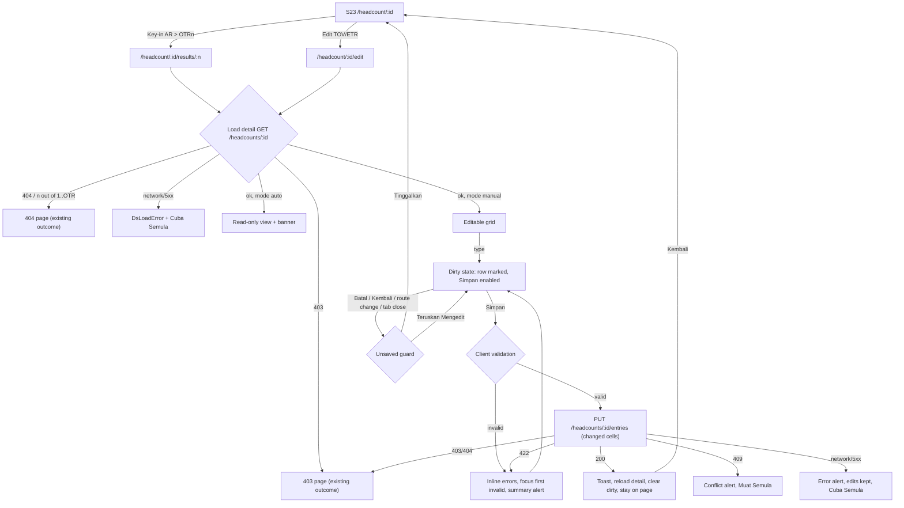

# M08 Headcount key-in (TOV / AR / ETR / RS) - design spec

Feature slug: `m08-headcount-key-in` (task AM-13 design, item 78-04). Module M08 Student Performance, PrestasiPlus v2.
Status: DRAFT for LEAD decision. Copy: BM for UI, English for this doc. Examples use fictitious names only.

## 0. Sources and what is fixed vs proposed

| Topic | Source | Status |
|---|---|---|
| Entry points "Key-in AR" (dropdown OTR1..OTRn -> `/headcount/{id}/results/{n}`) and "Edit TOV/ETR" -> `/headcount/{id}/edit` | SRS FR-M08-135, URS FN-M08-5.6.3, `HeadcountTablePage.vue` | OBSERVED (live), routes already exist as shells (`HeadcountShellPage.vue`) |
| Contents of those two pages | SRS FR-M08-137, OQ-M08-13: "header and back link only, no form specified" | NOT specified on live -> everything below on the form is **PROPOSED** |
| Entry fields | `PerformanceHeadcountDetailSchema` / `HeadcountEntryRow`: `tov`, `targets[]` (OTR), `actuals[]` (AR per OTR), `etr`, `rs`, `rsRecordedAt`, `dropped` | Contract / mock |
| Labels TOV, OTR1.., AR1.., ETR, "Gred", "%", "Purata Kelas", "Belum Diisi", "Kembali", "Batal" | `HeadcountTable.vue`, `HeadcountTablePage.vue` | Exact existing copy |
| RS | `rs` = "RS (SPM Sebenar)" (FN-M08-5.4.4), shown on S15 only | Existing label |
| Mode | `auto` ("dikira automatik dari soalan latih tubi SPM + Tracking A") / `manual` ("Cikgu key-in markah pelajar sendiri", FN-M08-5.3.4) | OBSERVED copy |
| Grade | BR-M08-02 `gradeOfPercent` (A+ >= 90 ... G < 40) | Reuse `lib/headcount/format.ts` |
| Write route | **None in the contract** | See section 7 |

Design principle (replicate rule): reuse the two existing routes and entry-point buttons; no new buttons on S23, no new fields beyond what the data model already stores. Everything on the two pages is therefore PROPOSED but built only from existing fields.

## 1. Decisions in brief

1. **Two pages, one component.** `/headcount/:id/results/:n` = key-in AR for OTR n (one value column). `/headcount/:id/edit` = key-in TOV, ETR and RS (three value columns). Both use one `HeadcountEntryForm` component with `columns` as input. No bulk "per-column" tool beyond this: the AR page already *is* the per-column entry (one OTR for the whole class), the edit page is per-pupil across TOV/ETR/RS.
2. **OTR targets are not keyed** (derived server-side, see OQ-1). No target input exists anywhere in the SRS; "Edit TOV/ETR" implies targets follow from TOV and ETR.
3. **Whole-page Save** (one "Simpan" for all pupils, sends only changed cells). No per-row save, no autosave: fewer failure states, one toast, one unsaved-changes rule.
4. **Narrow by construction.** The grid never has more than 3 value columns, so no wide scroll region is needed. Below `md` each pupil is a card; from `md` a table. This is the same breakpoint as `HeadcountTable` (cards below `md`), so S23 and the key-in pages behave alike. Chosen over "sticky name column + scroll region" because mobile keyboards cover the viewport, and horizontal panning while typing is error-prone.
5. **Auto-mode configs are read-only** on both pages (PROPOSED, OQ-2): values show, inputs disabled, with a banner. Manual configs are editable.
6. Blank = not keyed (`null`). Clearing a keyed value is allowed and saves as "not keyed".

## 2. Flow



Rules:
- After a successful save the user **stays** on the page (they may continue to the next OTR via the segmented OTR switcher, section 3.4) and the data reloads so grade/tone/average columns come from the server.
- "Batal" with no changes = go back to S23. With changes = unsaved guard.
- Unsaved guard: vue-router `beforeRouteLeave` + `beforeunload` while dirty. No such helper exists in `src/` today; build one composable `useUnsavedGuard(dirty)` (frontend task).
- Read-only reasons (each shows its own banner, section 6): config in `auto` mode; pupil `dropped` (row disabled, others stay editable); pupil without `userId` (masked name; row not listed in the form); viewer role without write (403 page; the S23 buttons are shown today to all staff, so a 403 is possible for a teacher opening another teacher's config).
- No exam-window / lock concept exists in the SRS: none designed.

## 3. Screen anatomy

### 3.1 Page shell (both pages)

```
DsPage
 DsPageHeader  title = "Key-in AR OTR2" | "Edit TOV/ETR"
               subtitle = "{subject} · {kelas} · {level} · {tahun}"   (same string pattern as S23, minus "Guru")
               breadcrumb slot = DsBackLink "Kembali" -> /headcount/:id
               actions slot = DsStatusBadge  "Manual" | "Auto"   (config mode)
 [UAlert banner]      read-only (auto) | dropped note | save error | conflict
 [OTR switcher]       results page only: DsPillNav  OTR1 | OTR2 | ... (links, aria-current)
 [Toolbar]            progress text "12 / 32 murid diisi" + legend
 Entry list           table (>= md) / cards (< md)
 DsFormBar (sticky bottom): status text left, Batal, Simpan
```

### 3.2 Entry list columns

Results page (`n` = 2 example): `# | Nama | Sasaran OTR2 (read-only, "%" + Gred) | AR2 (input) | Gred AR2 (live, read-only)`.
Edit page: `# | Nama | TOV (input) | Gred | ETR (input) | Gred | RS (input) | Gred`.
Last row "Purata Kelas" is NOT shown (it is on S23; avoids a live-recompute spec). Order = S23 default (`sort=ranking` is data-dependent) -> use name A-Z, stable while typing so rows do not jump (PROPOSED).

Input: `UInput` type `text`, `inputmode="decimal"`, `autocomplete="off"`, width 96px (`w-24`), height 44px (`min-h-11`), trailing "%" adornment. Not `type=number` (spinner/scroll-wheel changes values; locale comma issue).

### 3.3 Layouts

**Desktop 1280 (`xl`)**: page content max-width follows `DsPage`. Full-width card containing a table; sticky `thead`; value columns 112px; name column flexible (truncate with `title`). Row height 56px. `DsFormBar` sticky at bottom, right-aligned buttons. Results page: ~32 rows fit with page scroll; no inner scroll area.

**Tablet 768 (`md`)**: same table; Gred sub-columns collapse into the trailing text of the input cell ("73 (A-)" shown under the input as caption `text-caption text-muted`) on the edit page only (3 inputs + 3 grades would need > 700px). Results page keeps its columns. No horizontal scroll: table `w-full table-fixed`, name column absorbs remaining width.

**Mobile 375 (< `md`)**: one card per pupil (`DsPanel`, same pattern as `DsDataTable` cards). Card = header row "{#}. {Nama}" (+ "Gugur" tag if dropped), then a field grid:
- Results page: 2 columns: left read-only "Sasaran OTR2: 70% (A-)", right input "AR2" with grade caption under it.
- Edit page: grid `grid-cols-3 gap-2`; each cell = label above input (label is visible, 12px min via `text-caption`), grade caption below. At 320px each cell is ~92px: input min width 80px is enough for "100" / "73.5" + "%" hidden (the "%" suffix moves into the label: "TOV (%)").
`DsFormBar` stays sticky at bottom with `pb-[env(safe-area-inset-bottom)]`; list gets bottom padding equal to bar height so the last card is not hidden. With the soft keyboard open, the focused input is scrolled into view (`scrollIntoView({block:'center'})` on focus).

### 3.4 OTR switcher (results page)
`DsPillNav` of links "OTR1".."OTRn" to `/headcount/:id/results/{i}` mirroring the S23 dropdown entries; the current one has `aria-current="page"`. Switching while dirty triggers the unsaved guard. Wraps to two lines on mobile; each pill min 44x44.

### 3.5 States

| State | Presentation |
|---|---|
| Loading | `DsStateView status="loading" skeleton="table" rows=8`; header shows after load (as S23: `aria-busy` skeleton) |
| Error (load) | `DsLoadError` message `LOAD_ERROR` ("Maaf, berlaku ralat. Sila cuba semula."), retry "Cuba Semula" |
| 404 | existing `setRouteOutcome(404)` (unknown id, `n` outside 1..activeOtrs) |
| 403 | existing 403 outcome |
| Empty (no listable pupils: all dropped or none) | `DsEmptyState title="Tiada murid untuk diisi" description="Semua murid telah digugurkan atau senarai murid kosong." icon="users"`; Simpan hidden; "Kembali" link only |
| Ready, pristine | Simpan disabled; status text "Tiada perubahan." |
| Dirty | Changed rows get a 3px left accent (`border-l-primary`) + visually-hidden "Diubah"; status "{n} perubahan belum disimpan."; Simpan enabled |
| Validation error | Field error text under the input (`DsFormField error`), `aria-invalid`, summary `UAlert` (role=alert) above the list: "Sila betulkan {n} medan bertanda."; focus moves to first invalid input |
| Saving | Simpan `loading`, all inputs `readonly` (not disabled, keeps focus), status "Menyimpan..." (`aria-live=polite`) |
| Saved | Toast "Markah disimpan." (success, 4s) + status "Disimpan {HH:mm}"; data reloaded, dirty cleared; focus stays on Simpan button |
| Save failure (network/5xx) | `UAlert` error "Maaf, berlaku ralat. Sila cuba semula." with button "Cuba Semula" (re-sends same payload); edits kept |
| Conflict (409, see section 7) | `UAlert` warning, copy below, buttons "Muat Semula" (reload, discard edits after confirm) |
| Read-only (auto) | Banner info; inputs replaced by plain text values (not disabled inputs, so no confusing greyed fields); `DsFormBar` replaced by a single "Kembali" button |
| Dropped pupil | Row dimmed (`text-dimmed`), tag "Digugurkan", input disabled with `aria-disabled`, tooltip-free helper text under name on mobile "Tidak dikira dalam purata." Excluded from payload and progress count |

## 4. Validation

Schema facts: `tov`, `etr`, cell `ar`/`target`, `rs.value` are `z.number()` (nullable) with **no range constraint in the contract**; percentages are 0-100 in the mock row types and grades are defined for 0-100 (`gradeOfPercent`). Hence the range is a **PROPOSED** rule that the new write schema must enforce server-side (section 7); client mirrors it.

| Field | Rule | Message (BM) |
|---|---|---|
| tov, etr, ar, rs | blank allowed = not keyed (`null`) | none |
| | numeric only; accepts `.` or `,` as decimal separator (normalised to `.`) | "Masukkan nombor sahaja." |
| | 0 <= value <= 100 | "Markah mesti antara 0 dan 100." |
| | at most 1 decimal place (display is `num1`, 1 dp) | "Gunakan paling banyak satu tempat perpuluhan." |
| | no negative, no exponent, no spaces inside | covered by numeric message |
| whole form | at least one changed cell to enable Simpan | Simpan disabled |

Notes: validate on blur (per field) and on Simpan (all); never on each keystroke. Keyed `0` is a valid mark, distinct from blank (S23 shows "0" vs "—"). RS has no separate "date" input: `rsRecordedAt` is set by the server to the save time when `rs` changes (PROPOSED).
Grade preview: after a valid value, show `(Gred)` from `gradeOfPercent`; empty -> nothing. Tone (On Track / Below by the +-2% rule, DV-29) is server-derived and only shown after reload on S23, not previewed (avoids duplicating DV-29 logic).

## 5. BM copy table

"Sumber": E = exact existing copy (code/SRS/live); S = existing Ds/system copy; P = Perlu pengesahan (new, not found in SRS or live).

| Key | Copy | Sumber |
|---|---|---|
| back link | Kembali | E |
| page title (results) | Key-in AR OTR{n} | P (derived from button "Key-in AR" + "OTR{n}") |
| page title (edit) | Edit TOV/ETR | E (button label) |
| document title | Key-in AR OTR{n} - PRESTASIPLUS / Edit TOV/ETR - PRESTASIPLUS | P |
| mode badge | Auto / Manual | E (S12 card) |
| column headers | Nama, TOV, ETR, RS, AR{n}, Gred, % | E (RS: P as column header; label "RS (SPM Sebenar)" is E on S15) |
| target column | Sasaran OTR{n} | P (S15 uses "Target"/"Gred Target"; S23 uses "OTR{n}") - recommended to use "OTR{n}" exactly as S23 to stay E: **use "OTR{n}"** |
| class avg | Purata Kelas | E (not shown here) |
| empty value | — | E |
| dropped tag | Digugurkan | P (action "Gugurkan" is E) |
| progress | {n} / {total} murid diisi | P |
| helper under results page header | Masukkan markah sebenar (AR) bagi OTR{n}. Biarkan kosong jika belum diisi. | P |
| helper under edit page header | Masukkan TOV, ETR dan RS (jika ada). Biarkan kosong jika belum diisi. | P |
| field hint | Nombor 0 hingga 100, satu tempat perpuluhan. | P |
| input aria-label (results) | AR{n} {Nama} | P |
| input aria-label (edit) | TOV {Nama} / ETR {Nama} / RS {Nama} | P |
| dirty status | {n} perubahan belum disimpan. | P |
| pristine status | Tiada perubahan. | P |
| saving status | Menyimpan... | S-like (`dsCopy.loading` is "Memuatkan...") P |
| saved status | Disimpan {HH:mm} | P |
| save button | Simpan | S (`dsCopy.save`) |
| cancel button | Batal | S/E |
| validation summary | Sila betulkan {n} medan bertanda. | P |
| validation: not number | Masukkan nombor sahaja. | P |
| validation: range | Markah mesti antara 0 dan 100. | P |
| validation: decimals | Gunakan paling banyak satu tempat perpuluhan. | P |
| success toast | Markah disimpan. | P (SRS: "no success copy", FR-M08-137) |
| load error | Maaf, berlaku ralat. Sila cuba semula. | E (`LOAD_ERROR`) |
| retry | Cuba Semula | S |
| save error | Maaf, berlaku ralat. Sila cuba semula. | E (`LOAD_ERROR`) |
| auto banner title | Markah dikira secara automatik | P |
| auto banner body | Headcount Auto dikira automatik dari soalan latih tubi SPM dan Tracking A. Markah tidak boleh diisi di sini. | P (adapted from E "Auto - Markah dikira automatik dari soalan latih tubi SPM + Tracking A pelajar di platform PrestasiPlus.") |
| conflict title | Markah telah diubah | P |
| conflict body | Seseorang telah menyimpan markah headcount ini semasa anda mengedit. Muat semula untuk melihat data terkini. | P |
| conflict button | Muat Semula | P |
| empty title | Tiada murid untuk diisi | P |
| empty body | Semua murid telah digugurkan atau senarai murid kosong. | P |
| unsaved dialog title | Tinggalkan halaman ini? | P |
| unsaved dialog body | Anda ada {n} perubahan yang belum disimpan. Perubahan ini akan hilang. | P |
| unsaved dialog buttons | Teruskan Mengedit (neutral, default focus) / Tinggalkan (error tone) | P |
| 403 / 404 | existing outcome pages | S |
| dropped helper | Tidak dikira dalam purata. | P |

## 6. Interaction notes

- **Keyboard flow:** Tab visits one input per pupil in row order (name text is not focusable; on S23 names are links, here they are plain text). `Enter` in an input moves to the same column of the next pupil and does NOT submit the form (prevents accidental save); last row `Enter` focuses Simpan. `ArrowDown`/`ArrowUp` also move between rows (PROPOSED convenience; plain `Tab` always works). `Ctrl/Cmd+S` is not bound (not in SRS). Dropped rows are skipped.
- On mobile, `enterkeyhint="next"` (last: `done`).
- Selecting all text on focus (`select()`) so typing replaces the value.
- Paste: a single value only; multi-line paste from a spreadsheet is out of scope (not in SRS).
- Save sends **only changed cells**; unchanged rows are not in the payload.
- After save the grid reloads from `GET /headcounts/{id}`; scroll position and focus are preserved (focus returns to the Simpan button; the status region announces the result).
- Dark theme: use semantic tokens only (`text-highlighted`, `text-muted`, `text-dimmed`, `border-default`, `bg-elevated`, primary accent); dirty accent and error text use `text-error` / `border-error` (both pass AA on dark and light surfaces per the existing S23 tone classes).
- Reduced motion: no animation beyond the toast default.

## 7. Contract proposal (LEAD decision)

The contract has no write route for entry marks. **Recommended default (minimal, one route):**

```
PUT /headcounts/{id}/entries          tag: headcount   guard: STAFF (admin, teacher, school_admin)
Headers: CSRF token like the other writes
Body  PerformanceHeadcountEntriesRequest:
  { entries: [ { studentId: Id,
                 tov?: number|null, etr?: number|null, rs?: number|null,
                 actuals?: [ { otr: int 1..activeOtrs, value: number|null } ] } ] }   // 1..200 entries
Semantics: omitted key = unchanged; null = clear (not keyed); number = set (0..100, <= 1 decimal).
           rs set => rsRecordedAt = server now. OTR targets are NOT writable (derived, OQ-1).
Response 200 { data: { updated: int } }   // count of entries changed; client then re-GETs the detail
Errors:  401; 403 (role, or config not owned by caller, same scope as /reset); 404 (config or studentId not in config);
         409 CONFLICT (config.mode = 'auto': "Headcount Auto dikira automatik; markah tidak boleh diisi.");
         422 VALIDATION_ERROR with fields keyed "entries.{i}.tov|etr|rs|actuals.{j}.value" (+ studentId for dropped pupil),
             messages = the three range/number/decimal strings of section 4.
```

- **Concurrency:** default is last-write-wins on the changed cells only (a config has one owning teacher; conflicts rare). The conflict state in section 3.5 is built only if LEAD adds an optional `ifUnmodifiedSince` (config `updatedAt`) to the body returning 409 on mismatch; otherwise that state is dropped. Recommended default: **do not add**.
- **Dropped pupils:** 422 on `entries.{i}.studentId` ("Murid ini telah digugurkan.").
- **Audit:** log actor id, config id, number of entries, set of field names touched (tov/etr/rs/ar:n); never marks or pupil ids/names.
- **Rate limit:** 30 writes/min/user (bulk body makes this ample).
- **Idempotent:** same body twice yields the same state.
- Alternative (not recommended): separate `PUT /headcounts/{id}/entries/{studentId}` per row, which multiplies requests and partial-failure states.
- Mock: extend the headcount mock repository with the same semantics so mock and HTTP modes match.

## 8. Accessibility (WCAG 2.2 AA; D10 does not apply to new screens)

- [ ] Every input has a programmatic label: visible column header associated via `aria-labelledby` (header id + row name id) on the table, or visible label on the card; plus `aria-label` "AR2 {Nama}" fallback.
- [ ] Errors: `aria-invalid="true"`, `aria-describedby` -> error id (and hint id); summary alert `role="alert"`; focus moves to first invalid input on failed submit.
- [ ] Status region `aria-live="polite"` for "Menyimpan..." / "Disimpan HH:mm" / dirty count; toast also `role="status"`.
- [ ] Table: `<caption>` ("Key-in AR OTR2" / "Edit TOV/ETR"), `scope="col"`/`scope="row"` on name cells; cards use `<ul>` with each pupil a `<li>` with heading.
- [ ] Touch targets >= 44x44 (inputs `min-h-11`, pills, buttons); spacing between inputs >= 8px.
- [ ] Contrast >= 4.5:1 text, 3:1 input borders/focus ring in light and dark; dirty accent never the only cue (also "Diubah" sr-only text and count).
- [ ] Focus visible (2px ring token); focus order = DOM order = visual order; dialog traps focus, Escape = "Teruskan Mengedit", returns focus to the trigger.
- [ ] After save, focus stays on Simpan; after 403/404 outcome focus on page heading.
- [ ] Zoom 200% / 320px width: no horizontal page scroll, no truncated labels (name wraps on cards).
- [ ] Grade/tone not conveyed by colour alone (grade letters in text).
- [ ] Read-only values are text, not disabled inputs.

## 9. Components (existing `@/ds` unless noted)

`DsPage`, `DsPageHeader`, `DsBackLink`, `DsStatusBadge`, `DsPillNav`, `DsStateView`/`DsLoadError`/`DsEmptyState`, `DsPanel`, `DsFormField`, `DsFormBar`, `DsDialog` (unsaved guard; `DsConfirmHost` if its API fits a two-button confirm), `DsTag`; Nuxt UI `UInput`, `UAlert`, `UButton`, toast via `useToast`. `DsDataTable` is NOT reused for the grid (inputs inside cells, custom keyboard nav) but its card breakpoint (`md`) is mirrored.
New (frontend): `components/headcount/HeadcountEntryForm.vue`, `lib/headcount/entry-input.ts` (parse/validate/format), `composables/useUnsavedGuard.ts`, `api/headcount.ts#saveHeadcountEntries`. Replace the shell for `/results/:n` and `/edit` in `HeadcountShellPage.vue` routing (keep shells for `/unjuran`, `/settings`).

`data-testid`: `entry-page`, `entry-form`, `entry-banner-auto`, `entry-otr-switch`, `entry-otr-{i}`, `entry-progress`, `entry-row-{userId}`, `entry-input-{field}-{userId}` (field = `tov|etr|rs|ar`), `entry-grade-{field}-{userId}`, `entry-error-{field}-{userId}`, `entry-summary-error`, `entry-status`, `form-submit` (Simpan), `form-cancel` (Batal), `entry-save-error`, `entry-conflict`, `entry-empty`, `unsaved-dialog`, `unsaved-stay`, `unsaved-leave`, `back-link`, `page-error`, `page-loading`.

## 10. E2E cases (run at 375, 768, 1280; assert `scrollWidth <= innerWidth` each)

1. S23 -> "Key-in AR" -> "OTR2" opens `/results/2`; header, back link, one input per active pupil; dropped pupil has no input.
2. Type 75 in a pupil's AR2 -> grade "(A-)" appears, status "1 perubahan belum disimpan.", Simpan enabled; Simpan -> request body contains only that cell; toast "Markah disimpan."; S23 shows the value.
3. Invalid: "abc", "101", "-1", "70.55" -> matching messages, `aria-invalid`, focus on first invalid, no request sent.
4. Blank clears a keyed value -> body has `value:null`; S23 shows "—".
5. `Enter` moves to next pupil's input; last row `Enter` focuses Simpan; no submit.
6. Dirty + Kembali / OTR switch / reload -> unsaved dialog; "Teruskan Mengedit" stays, "Tinggalkan" leaves.
7. `/edit` page: TOV/ETR/RS inputs, keyed RS shows grade; save updates S22 averages.
8. Auto config: banner shown, values as text, no Simpan; PUT forced -> 409 message.
9. `/results/9` on a 3-OTR config -> 404 page; foreign config as teacher -> 403 page.
10. Server 422 -> messages shown on the right rows; 500 -> error alert, edits retained, "Cuba Semula" resends.
11. Mobile: cards, sticky bar not covering last card, focused input scrolled into view. Dark theme smoke: contrast of error and dirty accents (visual check).

## 11. Open questions (each with recommended default)

| ID | Question | Recommended default |
|---|---|---|
| OQ-1 | How are OTR targets set (SRS shows them but no input)? | Server-derived from TOV/ETR on save; not editable in this UI. Confirm the formula with the product owner (seed 504 is linear, seed 501 is not). |
| OQ-2 | May Auto-mode configs be keyed? | No: read-only with banner; Manual only. |
| OQ-3 | Where is RS keyed? | On `/edit` beside TOV/ETR (button label stays "Edit TOV/ETR"; rename to include RS is out of scope). |
| OQ-4 | Value range / decimals? | 0-100, one decimal, comma accepted. |
| OQ-5 | Concurrency (`ifUnmodifiedSince`)? | Not added; last-write-wins on changed cells; conflict UI dropped. |
| OQ-6 | Save model? | Whole-page Simpan (no autosave), stay on page after save. |
| OQ-7 | Admin / school_admin scope for writes? | Same scope as existing reset/delete (owner teacher; admin any; school_admin own school). |
| OQ-8 | Copy marked "P" in section 5? | Approve as written. |
