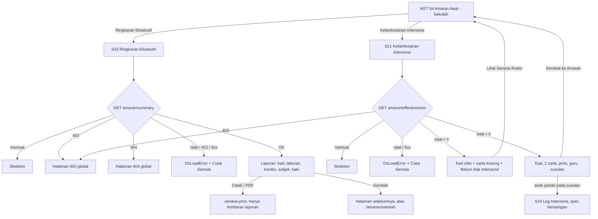

# M18 Amaran Awal: Ringkasan Eksekutif (S23) and Keberkesanan Intervensi (S21)

- **Slug:** `m18-amaran-summary`
- **Status:** Draft for G2. Design only; no code written.
- **Date:** 2026-10-21
- **Owner:** ui-ux-designer
- **Backlog:** M18 SRS endpoint #22 (`GET /amaran/summary`) and #24 (`GET /amaran/effectiveness`); screens S23 and S21. M18 has mock handlers only (`src/modules/m18-ppd-jpn/mock/handlers/amaran.ts`, `routes.ts` is an empty stub), no pages.
- **Primary audience of this build:** Admin Sekolah (`school_admin`), own school, reached from the two buttons on M27 S4 "Amaran Awal — Sekolah".

## 0. Sources

| Source | Used for |
|---|---|
| `packages/contract/src/school-admin/amaran.ts` and `paths.ts` (worktree `pp-e2e-bijak`) | Field names, enums, errors, labels. **Source of truth for data.** Not compared with `origin/feature/v2-backend` (no shell in this session): the frontend developer diffs before build. |
| `docs/requirements/srs/M18-ppd-jpn.md` (S20, S21, S23, FR-M18-83 to 88, BR-M18-31, section 7 #22 and #24, section 9 roles, responsive table) and `docs/requirements/urs/M18-ppd-jpn.md` (FN-M18-4.7.x, 4.8.x, EL-M18-S21/S23) | Screen anatomy and **observed BM copy** (these were observed on the live .my site, the SRS tags them OBSERVED). |
| `src/modules/m18-ppd-jpn/mock/{handlers,repository}/amaran.ts`, `scope.ts` | Response shapes, title/subtitle strings, access rules. |
| M27 S4 (`AmaranSekolahPage.vue`, `AmaranTiles`, `AmaranDistribution`, `AmaranSubjectCard`, `AmaranActions`, `amaran-format.ts`) | Patterns: `DsStatRow`, `DsChart` + legend with icons, `UProgress` rows, `DsLoadError`, in-place 403, school from the session. |
| `src/ds/` (`DsPrintSheet`, `DsChart`, `DsPanel`, `DsStatRow`, `DsDataTable`, `DsEmptyState`, `DsLoadError`, `DsStatusBadge`, `DsBackLink`) | Component inventory. |
| prestasiplus.cloud | **Not observed** in this session (no browser lane was available, and per D24 no role account is requested). The visual style follows the existing v2 M27 S4 screen; the wording follows the M18 SRS (live .my observations). |

## 1. Contract summary (data and rules; nothing else is designed)

**`GET /amaran/summary`** (query `scope`, `schoolId`, `district`, `state`; all optional)
- Response `data`: `scope` (`school|district|state`), `title`, `subtitle`, `pupilsLine` (nullable), `generatedAt` (**epoch milliseconds**, a number), `tally`, `kombo`, `schools?` (district and state only), `weakness?` (school only).
- `tally`: `green`, `yellow`, `red`, `total`, `pct.{green,yellow,red}` (integers, already rounded). green = On Track, yellow = Perlu Perhatian, red = Berisiko Tinggi.
- `kombo`: `active`, `pupils`, `avg` (1 decimal), `max`, `today`.
- `weakness[]`: `subjectId`, `subjectName`, `weak`, `total`, `pct`.
- `schools[]`: `schoolId`, `school`, `pupils`, `avgScore`, `green`, `yellow`, `red` (average score descending).
- Titles from the server: school scope title = school name, subtitle = "{district}, {state}"; district: title = district name, subtitle = "{state} — Ringkasan Eksekutif"; state: title = "Negeri {state}", subtitle = "Ringkasan Eksekutif Seluruh Negeri", `pupilsLine` null.
- Errors: 401, 403 (role not allowed, no default scope, or district/state scope for anyone but Admin Pusat), 404 (unknown school, a school outside the caller's reach, a district/state with no schools; indistinguishable), 422 (bad `scope`, English field texts). **No 429 is documented** for this route. Error bodies are English Laravel defaults ("Unauthenticated.", "This action is unauthorized.", "Not Found.").
- Roles in this contract (B1): `admin`, `school_admin`, `teacher`. `school_admin` and `teacher` default to their own school; district and state scopes are Admin Pusat only. **Officers (`ppd_officer`, `jpn_officer`) have no B1 endpoints.**

**`GET /amaran/effectiveness`** (no parameters; the school is the viewer's own)
- Response `data`: `school.{id,name}` and `report`:
  - `cards`: `total`, `berkesan`, `evaluated`, `rate` (integer %), `needsAction`, `sederhana`, `tidakBerkesan`, `notEvaluated`.
  - `doughnut`: a 4-tuple `[Berkesan, Sederhana, Tidak Berkesan, Belum Dinilai]`.
  - `trend`: `labels` (6, "{Jan|Feb|Mac|Apr|Mei|Jun|Jul|Ogo|Sep|Okt|Nov|Dis} {year}") and `data` (6 counts).
  - `byType[]`: `type`, `label`, `count` (types: kaunseling, kelas_tambahan, tugasan_khas, hubungi_ibubapa, mentor_rakan, bimbingan, lain).
  - `byTeacher[]`: `teacherId`, `name`, `total`, `berkesan`, `notEvaluated`, `rate` (nullable).
  - `followUps[]`: `id`, `studentId`, `studentName`, `type`, `label`, `interventionDate` (date only), `effectiveness` (`belum_dinilai|berkesan|sederhana|tidak_berkesan`).
  - `bySchool[]`: `schoolId`, `school`, `total`, `berkesan`, `sederhana`, `tidakBerkesan`, `notEvaluated`, `rate`.
- Errors: 401, 403 (role not allowed, or the viewer has no school). No 404, no 429 documented.

**Not in the contract (so not designed):** filters, date range pickers, school selector (the SRS S20 district view), export or PDF generation by the server, drill-down to a pupil other than the follow-up link, editing an intervention on these screens (that is S24 "Log Intervensi", a separate screen).

## 2. Entry points

| Entry | Where | Decision |
|---|---|---|
| "Ringkasan Eksekutif" and "Keberkesanan Intervensi" buttons on M27 S4 `/amaran/sekolah` | `AmaranActions.vue` (already built: labels, icons `file-text` and `chart-pie`, test ids `am-btn-ringkasan`, `am-btn-keberkesanan`; hrefs `/amaran/ringkasan-eksekutif?scope=school&school_id={own}` and `/amaran/keberkesanan`) | **The only entry points.** They are currently **hidden** by `usePrototypeScope().allows(href)` (D43: "deferred pages outside the matrix"). Building these pages requires adding both paths to the allowed set. |
| New nav item | shell menu | Rejected: SRS puts the pages under Amaran Awal, and the menu is a replicated live screen. |
| Link from S21 to S23 or back | between the two pages | Not added (not in the SRS). Each page has one "back" to S4. |
| "Lihat Senarai Risiko" | S21 empty card | Existing SRS link back to `/amaran/sekolah`. |

Routes (M18 owns them; user shell, role `school_admin` and per contract `teacher`; in-place 403 for others; `/login` for a guest, like `routes/amaran.ts` of M27):
- `/amaran/ringkasan-eksekutif`, name `m18.amaran-ringkasan`.
- `/amaran/keberkesanan`, name `m18.amaran-keberkesanan`.
- For `school_admin` the page **ignores** `scope`, `school_id`, `district`, `state` in the URL and always calls `GET /amaran/summary` with no parameters (default scope = own school), as M27 S4 ignores ids. This means the S4 button href with `school_id` still works and a hand-edited foreign id cannot even be asked for. (Only the Admin Pusat variant, section 8, would read the query.)

## 3. Flows



## 4. Screen S23: Ringkasan Eksekutif (`/amaran/ringkasan-eksekutif`)

### 4.1 Anatomy (school scope, the build target)

Outside the sheet (hidden when printing): `DsBackLink` "Kembali"; button "Cetak / PDF". Inside the sheet (`DsPrintSheet`, light scheme, `max-w-3xl`, `print:max-w-none`):

1. Report head: small line "PRESTASIPLUS · Ringkasan Eksekutif"; `h1` = `title`; sub = `subtitle`; `pupilsLine` ("{n} pelajar"); "Dijana: {d MMMM yyyy, HH:mm}" from `generatedAt` in Asia/Kuala_Lumpur.
2. Four stat tiles (`DsStatRow`, `:cols="4"`): Jumlah Pelajar `tally.total`; On Track (Hijau) `{pct.green}%` + "{green} pelajar"; Perlu Perhatian `{pct.yellow}%` + "{yellow} pelajar"; Berisiko Tinggi `{pct.red}%` + "{red} pelajar". Tones success, warning, error with icons `check-circle`, `warning`, `warning-octagon` (colour never alone; same as S4).
3. Card "Taburan Risiko": one horizontal bar chart (`DsChart` `type="bar" horizontal`) over `green`, `yellow`, `red` with labels "Hijau (n%)", "Kuning (n%)", "Merah (n%)" and the S4 legend with icons.
4. Card "Penglibatan Latih Tubi (Kombo)": four figures: `kombo.avg` "Purata Kombo"; `kombo.max` "Kombo Tertinggi"; `kombo.active` "Pelajar Aktif Kombo"; `kombo.today` "Aktif Hari Ini". (`kombo.pupils` is returned but the SRS shows no figure for it; not displayed.)
5. Card "Analisis Risiko Mengikut Subjek" (only when `weakness` has rows): per row the subject name, "{weak}/{total} lemah ({pct}%)" and a `UProgress` of `pct` with `aria-label` "Pelajar lemah {subjectName}" (as S4).
6. Footer: "Laporan ini dijana secara automatik oleh PRESTASIPLUS · {d MMMM yyyy, HH:mm}" and "Untuk maklumat lanjut, hubungi pentadbir sistem."

```
1280 / 768 (sheet centred, max-w-3xl)
+--------------------------------------------------------------+
| < Kembali                                     [ Cetak / PDF ]|
| +----------------------------------------------------------+ |
| | PRESTASIPLUS · Ringkasan Eksekutif                       | |
| | SEKOLAH CONTOH A                                         | |
| | Daerah Contoh, Negeri Contoh        59 pelajar           | |
| | Dijana: 21 Oktober 2026, 10:05                           | |
| | [Jumlah][On Track][Perlu Perhatian][Berisiko Tinggi]     | |
| |  59      20%       30%             50%                   | |
| |          12 plj    18 plj          29 plj                | |
| | Taburan Risiko                                           | |
| |  Hijau (20%)  ====                                       | |
| |  Kuning (31%) ======                                     | |
| |  Merah (49%)  =========                                  | |
| | Penglibatan Latih Tubi (Kombo)                           | |
| |  6.4 Purata | 13 Tertinggi | 14 Aktif Kombo | 0 Hari Ini| |
| | Analisis Risiko Mengikut Subjek                          | |
| |  Bahasa Melayu   1/1 lemah (100%) [=========]            | |
| | Laporan ini dijana secara automatik ...                  | |
| +----------------------------------------------------------+ |
+--------------------------------------------------------------+

375 (single column; tiles 2 x 2; kombo 2 x 2)
+------------------------+
| < Kembali              |
| [ Cetak / PDF ] (full) |
| PRESTASIPLUS · ...     |
| SEKOLAH CONTOH A       |
| [Jumlah ][On Track  ]  |
| [Perhat.][Berisiko  ]  |
| Taburan Risiko (bar)   |
| Kombo: 2 x 2 figures   |
| Subjek rows            |
+------------------------+
```

(Names and figures are fictitious placeholders.)

### 4.2 Responsive

| Width | Behaviour |
|---|---|
| 375 | Toolbar stacked: back link, then "Cetak / PDF" full width (`min-h-11`). Tiles 2 per row. Kombo figures 2 per row. Subject rows stack name above the "{w}/{m}" text. Bar chart full width with the legend wrapping. No horizontal page scroll down to 320. |
| 768 | Tiles 4 per row (SRS: cards 4 columns from the tablet). Toolbar on one row: back left, print right. Sheet full width of the page. |
| 1280 | Sheet `max-w-3xl` centred; tiles 4 per row; kombo 4 per row. |
| Print (A4) | Only the sheet is printed (`DsPrintSheet` print rules); toolbar and back link hidden; `print:max-w-none`; light scheme regardless of dark mode; cards do not break across pages where the browser allows (`break-inside-avoid` on each card, **Perlu pengesahan** for the exact rule). |

### 4.3 States

| State | What shows |
|---|---|
| Loading | The toolbar, then `USkeleton h-24` (tiles) and `h-64` (cards), `aria-busy="true"`; test id `rk-loading`. Print button disabled. |
| Loaded | As 4.1. |
| School has no pupils (`tally.total` = 0) | Tiles show 0 and 0% ; "Taburan Risiko" shows `DsEmptyState` "Tiada data pelajar lagi."; kombo figures show 0; `weakness` empty means the subject card is hidden. Print still works. |
| Partial: `weakness` absent or `[]` | Subject card hidden (no empty text), as S4. |
| Partial: `pupilsLine` null | Line not rendered (only the state scope returns null). |
| Partial: `generatedAt` invalid | "Dijana:" line hidden. |
| Error (network, 5xx, 422) | `DsLoadError` with the server message (via `errorLines`; falls back to "Ralat berlaku. Sila cuba lagi."), button "Cuba Semula". Toolbar hidden. |
| 403 | `setRouteOutcome(403)`: global 403 page in place (role not allowed or no school). |
| 404 | `setRouteOutcome(404)`: global 404 page. For `school_admin` this only happens if the school vanished, since the URL cannot choose a school. |
| 401 | Existing session handling. |
| 429 | Not in the contract for this route; if the gateway returns it, `DsLoadError` with the server message. |
| Print blocked | `window.print` does nothing visible; no state. |

### 4.4 Interaction

- "Kembali": go back in history when the app has a previous in-app route, otherwise `/amaran/sekolah` for the school admin (SRS BR-M18-31, adapted to the M27 alias path).
- "Cetak / PDF": `window.print()`. No server PDF.
- Numbers use `formatCount` (`ms-MY`) like S4. `kombo.avg` shows one decimal.
- Tab title: "Ringkasan Eksekutif — {title} | PRESTASIPLUS" (SRS). The tab title contains a school name, not a pupil name.
- The page is read-only; no filters.

## 5. Screen S21: Keberkesanan Intervensi (`/amaran/keberkesanan`)

### 5.1 Anatomy

1. `DsBackLink` "Kembali ke Amaran" -> `/amaran/sekolah`. Header title "Keberkesanan Intervensi", subtitle `school.name`.
2. Four stat tiles (`DsStatRow`, `:cols="4"`):
   - "Jumlah Intervensi" = `cards.total`.
   - "Kadar Berkesan" = `{cards.rate}%`, sub "{cards.berkesan}/{cards.evaluated} dinilai".
   - "Perlu Tindakan" = `cards.needsAction`, sub "{cards.sederhana} sederhana, {cards.tidakBerkesan} tidak berkesan".
   - "Belum Dinilai" = `cards.notEvaluated`.
3. Two chart cards:
   - "Pecahan Keberkesanan": `DsChart type="doughnut"`, labels Berkesan, Sederhana, Tidak Berkesan, Belum Dinilai, values `doughnut[0..3]`; legend with the counts. Empty ("Tiada data intervensi lagi.") when the four values sum to 0.
   - "Trend Bulanan (6 Bulan)": `DsChart type="line"`, `trend.labels` (6) and `trend.data` (6), one series "Intervensi", y axis integers from 0. Empty ("Tiada data trend lagi.") when all six are 0.
4. When `cards.total` = 0: card "Belum Ada Intervensi" with the SRS description and a "Lihat Senarai Risiko" link to `/amaran/sekolah`. The four zero tiles and the two empty chart cards still show (this is the observed live state).
5. When `cards.total` > 0, the cards below (SRS "S20 content for the school", INFERRED there; provisional):
   - "Intervensi Mengikut Jenis": one row per `byType` item: `label` and "{count} kali". Rows in the order returned.
   - "Statistik Guru": table `#`, `Guru` (`name`), `Jumlah` (`total`), `Berkesan` (`berkesan`, badge), `Belum Nilai` (`notEvaluated`, badge), `Kadar` (`rate` + "%", or "—" when null).
   - "Perlu Tindakan Susulan": one row per `followUps` item: `studentName`, "{label} · {d MMM yyyy}" from `interventionDate`, an effectiveness badge, and an arrow link to `/amaran/intervensi/{studentId}` (S24).
   - "Perbandingan Sekolah Daerah" (`bySchool`): **not shown on S21**. For one school it repeats the four tiles in a one-row table; the SRS shows it on the district page S20 only. **Perlu pengesahan** (open question Q4).

Effectiveness badge mapping (existing `DsStatusBadge` with a custom label): `belum_dinilai` -> `inactive` "Belum Dinilai"; `berkesan` -> `done` "Berkesan"; `sederhana` -> `pending-approval` "Sederhana"; `tidak_berkesan` -> `rejected` "Tidak Berkesan". Icon and word always shown.

```
1280 (tiles 4; charts side by side from lg; lists below)
+--------------------------------------------------------------------+
| < Kembali ke Amaran                                                |
| [Jumlah Intervensi][Kadar Berkesan][Perlu Tindakan][Belum Dinilai] |
|  8                  50%             3                1             |
|                     4/8 dinilai     2 sederhana,                   |
|                                     1 tidak berkesan               |
| +------ Pecahan Keberkesanan -+ +-- Trend Bulanan (6 Bulan) ----+  |
| |  (doughnut) legend          | |  (line, 6 months)             |  |
| +-----------------------------+ +-------------------------------+  |
| Intervensi Mengikut Jenis      Sesi Kaunseling      3 kali         |
| Statistik Guru (table)  # Guru Jumlah Berkesan Belum Nilai Kadar   |
| Perlu Tindakan Susulan  Pelajar Contoh  Sesi Kaunseling · 13 Apr 2026 [Belum Dinilai] ->|
+--------------------------------------------------------------------+

375
+---------------------------+
| < Kembali ke Amaran       |
| [Jumlah ][Kadar ]         |
| [Perlu T][Belum ]         |
| Pecahan Keberkesanan      |
| (doughnut, full width)    |
| Trend Bulanan (line)      |
| Jenis rows                |
| Statistik Guru: table     |
|  scrolls INSIDE its card  |
| Susulan rows (stacked)    |
+---------------------------+
```

### 5.2 Responsive

| Width | Behaviour |
|---|---|
| 375 | Tiles 2 per row; chart cards full width, stacked; "Statistik Guru" is a `DsDataTable` that becomes **cards** below `md` (card title = teacher name, fields Jumlah, Berkesan, Belum Nilai, Kadar), so no inner scroll is needed; follow-up rows stack text above the badge; the arrow link is a 44 x 44 px target. No horizontal page scroll down to 320. |
| 768 | Tiles 2 per row (SRS: 2 columns on tablet); charts stacked or two across only from `lg`; "Statistik Guru" is a table (6 columns fit in the card). |
| 1280 | Tiles 4 per row; the two chart cards side by side; lists full width below. |

### 5.3 States

| State | What shows |
|---|---|
| Loading | Tiles skeleton `h-24`, two `h-64` chart skeletons; `aria-busy="true"`; test id `kb-loading`. |
| Loaded, total > 0 | As 5.1 item 5. |
| Loaded, total = 0 | Tiles "0", "0%" with "0/0 dinilai", "0" with "0 sederhana, 0 tidak berkesan", "0"; both chart cards in their empty state (texts above); "Belum Ada Intervensi" card with the link. |
| Partial: some intervention not evaluated (`evaluated` = 0, `total` > 0) | "Kadar Berkesan" shows "0%" and "0/0 dinilai" (the contract computes rate 0 when nothing is evaluated; the sub-line makes it clear). Teacher "Kadar" shows "—". |
| Partial: `followUps` empty while total > 0 | Card "Perlu Tindakan Susulan" shows `DsEmptyState` size sm "Tiada tindakan susulan." |
| Partial: a month label with 0 | Plotted as 0. |
| Error | `DsLoadError` (server message or "Ralat berlaku. Sila cuba lagi.") with "Cuba Semula". |
| 403 | In-place global 403 page (role not allowed, or no school). |
| 401 | Existing session handling. |
| 404 / 429 | Not in the contract for this route; treated like Error. |

### 5.4 Interaction

- Tiles are not links. The follow-up arrow goes to S24 `/amaran/intervensi/{studentId}` only when that route exists; until S24 is built the row is shown **without** the arrow (the same `allows()` gate as the S4 buttons). **Perlu pengesahan** (Q3).
- Dates: "d MMM yyyy" in BM (13 Apr 2026) with `Asia/Kuala_Lumpur`; counts via `formatCount`.
- The report is computed at request time; "Cuba Semula" and a page reload fetch fresh numbers. No polling.
- PDPA: `followUps[].studentName` is a minor's name. It appears only in this card, never in the tab title, header, flash or URL. The response is for the school's own staff only.

## 6. Charts and figures: field map (no invented metrics)

| Figure | Field | Format |
|---|---|---|
| Jumlah Pelajar | `tally.total` | `formatCount` |
| On Track / Perlu Perhatian / Berisiko Tinggi | `tally.pct.green/yellow/red` and `tally.green/yellow/red` | "{pct}%" and "{n} pelajar" |
| Taburan Risiko bars | `tally.green/yellow/red` with labels from `pct` | integers |
| Purata Kombo | `kombo.avg` | one decimal |
| Kombo Tertinggi | `kombo.max` | integer |
| Pelajar Aktif Kombo | `kombo.active` | integer |
| Aktif Hari Ini | `kombo.today` | integer |
| Subject row | `weakness[].subjectName`, `weak`, `total`, `pct` | "{weak}/{total} lemah ({pct}%)", bar = `pct` |
| Report head | `title`, `subtitle`, `pupilsLine`, `generatedAt` | `generatedAt` is epoch ms, converted to MYT |
| Jumlah Intervensi | `cards.total` | integer |
| Kadar Berkesan | `cards.rate`, `cards.berkesan`, `cards.evaluated` | "{rate}%", "{b}/{e} dinilai" |
| Perlu Tindakan | `cards.needsAction`, `cards.sederhana`, `cards.tidakBerkesan` | integer; "{s} sederhana, {t} tidak berkesan" |
| Belum Dinilai | `cards.notEvaluated` | integer |
| Pecahan Keberkesanan | `doughnut[0..3]` | order Berkesan, Sederhana, Tidak Berkesan, Belum Dinilai |
| Trend | `trend.labels[6]`, `trend.data[6]` | label text as returned |
| Jenis | `byType[].label`, `count` | "{count} kali" |
| Statistik Guru | `byTeacher[]` | `rate` null -> "—" |
| Susulan | `followUps[]` | `label`, `interventionDate`, `effectiveness` |

Chart colours: use the DS categorical tokens by default; the slices must also be distinguishable without colour (legend with values, and the hidden data table through `tableLabel`: "Keberkesanan intervensi", "Trend intervensi 6 bulan", "Pelajar mengikut tahap risiko"). The live site's fixed colours (green, amber, red, grey; indigo line) are **not** hard-coded: semantic tokens only (`success`, `warning`, `error`, `muted`), if `DsChart` accepts per-slice colours; otherwise the DS categorical slots (open question Q5).

## 7. Copy table

Source key: **SRS** = M18 SRS/URS (observed on the live .my site); **mock** = M18 mock repository; **contract** = `amaran.ts`; **existing** = M27 S4 or DS; **Perlu pengesahan** = proposed, not yet approved. .cloud was not observed.

### S23

| # | Where | BM copy | Source |
|---|---|---|---|
| 1 | Shell header title | Ringkasan Eksekutif | SRS (screen name) |
| 2 | Shell header subtitle | {title} (school name) | contract / mock |
| 3 | Tab title | Ringkasan Eksekutif — {title} \| PRESTASIPLUS | SRS |
| 4 | Back link | Kembali | SRS |
| 5 | Print button | Cetak / PDF | SRS |
| 6 | Sheet brand line | PRESTASIPLUS · Ringkasan Eksekutif | SRS |
| 7 | Sheet h1 / sub / line | {title} / {subtitle} / {n} pelajar | contract / mock |
| 8 | Generated | Dijana: {d MMMM yyyy, HH:mm} | SRS |
| 9 | Tile labels | Jumlah Pelajar; On Track (Hijau); Perlu Perhatian; Berisiko Tinggi | SRS |
| 10 | Tile sub | {n} pelajar | SRS |
| 11 | Distribution card | Taburan Risiko | SRS |
| 12 | Bar labels, legend | Hijau ({pct}%), Kuning ({pct}%), Merah ({pct}%); "Hijau: {n}" etc. | existing (S4) |
| 13 | Kombo card | Penglibatan Latih Tubi (Kombo) | SRS |
| 14 | Kombo labels | Purata Kombo; Kombo Tertinggi; Pelajar Aktif Kombo; Aktif Hari Ini | SRS |
| 15 | Subject card; row | Analisis Risiko Mengikut Subjek; {w}/{m} lemah ({p}%) | SRS |
| 16 | Subject progress aria-label | Pelajar lemah {subjectName} | existing (S4) |
| 17 | Footer | Laporan ini dijana secara automatik oleh PRESTASIPLUS · {d MMMM yyyy, HH:mm}; Untuk maklumat lanjut, hubungi pentadbir sistem. | SRS |
| 18 | Empty distribution (0 pupils) | Tiada data pelajar lagi. | **Perlu pengesahan** |
| 19 | Chart table labels | Pelajar mengikut tahap risiko | existing (S4) |
| 20 | Load error | server message, else Ralat berlaku. Sila cuba lagi. | existing |
| 21 | Retry | Cuba Semula | existing (DS) |
| 22 | Print button accessible name | Cetak / PDF (visible label is the name) | SRS |

### S21

| # | Where | BM copy | Source |
|---|---|---|---|
| 23 | Shell header title | Keberkesanan Intervensi | SRS |
| 24 | Shell header subtitle; tab title | {school.name}; Keberkesanan Intervensi - {SEKOLAH} | SRS |
| 25 | Back link | Kembali ke Amaran | SRS |
| 26 | Tile labels | Jumlah Intervensi; Kadar Berkesan; Perlu Tindakan; Belum Dinilai | SRS |
| 27 | Tile subs | {b}/{e} dinilai; {s} sederhana, {t} tidak berkesan | SRS |
| 28 | Chart titles | Pecahan Keberkesanan; Trend Bulanan (6 Bulan) | SRS |
| 29 | Doughnut labels | Berkesan; Sederhana; Tidak Berkesan; Belum Dinilai | SRS / contract |
| 30 | Trend series name | Intervensi | SRS |
| 31 | Chart empty texts | Tiada data intervensi lagi.; Tiada data trend lagi. | SRS |
| 32 | No-interventions card | Belum Ada Intervensi | SRS |
| 33 | No-interventions text | Tiada rekod intervensi ditemui untuk sekolah ini. Guru boleh mula merekod intervensi dari halaman Amaran Awal. | SRS |
| 34 | No-interventions link | Lihat Senarai Risiko | SRS |
| 35 | Type card; row | Intervensi Mengikut Jenis; {label} {n} kali | SRS |
| 36 | Type labels | Sesi Kaunseling; Kelas Tambahan; Tugasan Khas; Hubungi Ibu Bapa; Mentor Rakan Sebaya; Bimbingan; Lain-lain | contract |
| 37 | Teacher card; columns | Statistik Guru; #, Guru, Jumlah, Berkesan, Belum Nilai, Kadar; "—" when none | SRS |
| 38 | Follow-up card; row | Perlu Tindakan Susulan; {jenis} · {d MMM yyyy} | SRS |
| 39 | Badge words | Belum Dinilai; Berkesan; Sederhana; Tidak Berkesan | SRS / contract |
| 40 | Empty follow-ups | Tiada tindakan susulan. | **Perlu pengesahan** |
| 41 | Follow-up arrow accessible name | Buka log intervensi {studentName} | **Perlu pengesahan** |
| 42 | Teacher card (mobile) field labels | Jumlah; Berkesan; Belum Nilai; Kadar | SRS (column heads reused) |
| 43 | Chart table labels | Keberkesanan intervensi; Trend intervensi 6 bulan | **Perlu pengesahan** |
| 44 | Doughnut / trend legend value text | {label}: {n} | **Perlu pengesahan** |

**Count of strings marked Perlu pengesahan: 5 distinct strings** (rows 18, 40, 41, 43, 44; row 43 holds two labels, counted once). Plus these behaviour points flagged in the text: print page-break rule, hiding "Perbandingan Sekolah Daerah" on S21, hiding the follow-up arrow until S24 exists.

## 8. Variants the contract also returns (not the build target; layout only)

The contract returns `scope=district` and `scope=state` for Admin Pusat (officers have no B1 endpoints). Same page, same sheet, with one extra card "Pecahan Mengikut Sekolah" (`schools[]`) in place of the subject card: table columns "#", "Sekolah", "Pelajar", "Hijau", "Kuning", "Merah", "Prt. Skor" (SRS), each school once, ordered as returned. Titles come from the server (section 1). At 375 this table is a `DsDataTable` that turns into cards (title = school, fields Pelajar, Hijau, Kuning, Merah, Prt. Skor). `pupilsLine` null for the state scope (line hidden). Access: the page for Admin Pusat reads `scope`, `district`, `state`, `schoolId` from the URL; any 422 shows `DsLoadError`; 404 the global 404 page. **Not part of this build** unless the user asks (Q1).

## 9. Accessibility (new screens: D10 does not apply)

- One `h1` per page (shell header title); sections are `h2` (card titles use the existing `text-subheading` heading style). The sheet's report `h1` on S23 is rendered as an `h2` under the shell title to keep a single `h1`: the shell title "Ringkasan Eksekutif" is the page `h1`; the school name in the sheet is an `h2`. In print, the shell header is hidden and the sheet shows its own head.
- Tiles: `DsStatRow` tiles are not interactive; each has a visible label and value in reading order (label then value). Risk tiles carry an icon and a word, not colour only.
- Charts: `DsChart` titles are real headings (`headingLevel`), and each chart has the hidden data table through `tableLabel` for screen readers; the legend repeats the values as text. Empty and loading states use the DS state view, not a blank canvas.
- `UProgress` rows have `aria-label` "Pelajar lemah {subjectName}" and a visible "{w}/{m} lemah ({p}%)".
- Tables: `caption` set ("Statistik Guru"), real `th`; on mobile the cards keep the same order and labels.
- Badges: icon + word. The follow-up arrow link: 44 x 44 px, accessible name "Buka log intervensi {studentName}" (row 41; avoids several identical "arrow" links).
- Buttons and links: `min-h-11`; visible focus ring from DS tokens; logical Tab order = reading order: back link, print button, then content links.
- "Cetak / PDF" is a `<button>`; no state to announce.
- Errors: `DsLoadError` is announced as the DS does (role alert); "Cuba Semula" is focusable and keeps focus after a failed retry.
- Dates and numbers are plain text, not tooltips. Reduced motion: chart animation follows `prefers-reduced-motion` as the DS chart does.
- Contrast: DS tokens only; the printed sheet uses the light scheme so contrast is independent of the dark theme.
- Language: the page is BM (`lang` as the app).

## 10. Component inventory and test ids

**Existing DS only:** `DsPage`, `DsPrintSheet`, `DsBackLink`, `DsPanel`, `DsStatRow`, `DsChart` (bar horizontal, doughnut, line), `DsDataTable` (cards on mobile), `DsStatusBadge`, `DsEmptyState`, `DsLoadError`, `UProgress`, `UButton`, `USkeleton`, `UIcon`. No new component or token. New code for the developer (not designed here): API wrappers `fetchAmaranSummary`, `fetchAmaranEffectiveness` in the M18 module, two pages, two routes, and adding both paths to the prototype scope allow-list.

**Proposed test ids**

| Page | Test id | Element |
|---|---|---|
| S23 | `rk-page` | `DsPage` |
| | `rk-back`, `rk-print` | back link, print button |
| | `rk-sheet`, `rk-title`, `rk-subtitle`, `rk-pupils`, `rk-generated` | sheet and head parts |
| | `rk-tiles` (+ `rk-tile-total/green/yellow/red`) | tiles |
| | `rk-distribution`, `rk-bar`, `rk-legend` | distribution card |
| | `rk-kombo` (+ `rk-kombo-avg/max/active/today`) | kombo card |
| | `rk-subjects`, `rk-subject-row` | subject card, rows |
| | `rk-footer` | footer |
| | `rk-loading`, `rk-error`, `rk-empty` | states |
| S21 | `kb-page`, `kb-back` | page, back link |
| | `kb-tiles` (+ `kb-tile-total/rate/action/pending`) | tiles |
| | `kb-doughnut`, `kb-trend`, `kb-doughnut-empty`, `kb-trend-empty` | charts and empties |
| | `kb-none`, `kb-none-link` | "Belum Ada Intervensi" card and link |
| | `kb-types`, `kb-type-row` | type card, rows |
| | `kb-teachers`, `kb-teacher-row` | teacher table, rows |
| | `kb-followups`, `kb-followup-row`, `kb-followup-link`, `kb-followup-badge` | follow-up card, rows |
| | `kb-loading`, `kb-error` | states |

**E2E cases (each at 375, 768, 1280, no horizontal scroll at 320):** S4 buttons are visible and reach S23 and S21; S23 tile figures equal `tally`; the sum of the three percents is shown as returned (no recalculation); `Dijana` equals `generatedAt` in MYT; subject card hidden when `weakness` is empty; zero-pupil school shows the empty distribution; print calls `window.print` (stubbed) and the toolbar has `print:hidden`; S21 zero state shows the four zero tiles, both empty texts and the "Belum Ada Intervensi" card with the link back to S4; S21 with data shows type rows, the teacher table (cards at 375) with "—" for a null rate, and follow-ups with badges; 403 for a role other than school admin or teacher shows the 403 page; a 500 shows `DsLoadError` and "Cuba Semula" reloads; a school admin never sees another school's data (URL `school_id` is ignored).

## 11. Open questions

1. **Scope of this build:** school admin only (this spec), or also Admin Pusat district/state (section 8) and the officer portals (PPD/JPN)? The contract gives officers no endpoints. Recommendation: school admin now.
2. **Teacher access:** the contract lets `teacher` call both endpoints (own school). Do teachers get a button to S21 (and S23) from their own Amaran page? Not designed here.
3. **S24 Log Intervensi:** not yet built. Until then the S21 follow-up arrow is hidden. Is S24 next?
4. **"Perbandingan Sekolah Daerah" on S21:** hidden for one school (section 5.1). Show it as a one-row table to match the SRS INFERRED text, or keep it hidden? Recommendation: hidden.
5. **Chart colours:** can `DsChart` set per-slice semantic colours (success/warning/error/muted) and integer y-axis ticks for the line? If not, which categorical slots, and does the user accept losing the live green/amber/red meaning (the legend and icons still carry it)?
6. **Prototype scope (D43):** both S4 buttons are hidden today by `usePrototypeScope`. Confirm both pages join the allowed set when built.
7. **Copy:** the 5 strings marked Perlu pengesahan, and confirm the "Kembali" fallback target `/amaran/sekolah` for the school admin (SRS says `/amaran/sekolah/{id}`).
8. **Contract tip check:** diff `amaran.ts` against `origin/feature/v2-backend` 0896421f before build; confirm no 429 on these two routes.
9. **.cloud:** not observed. A read-only look at whatever .cloud shows for the school Amaran screens is optional and needs no new role account (D24).
