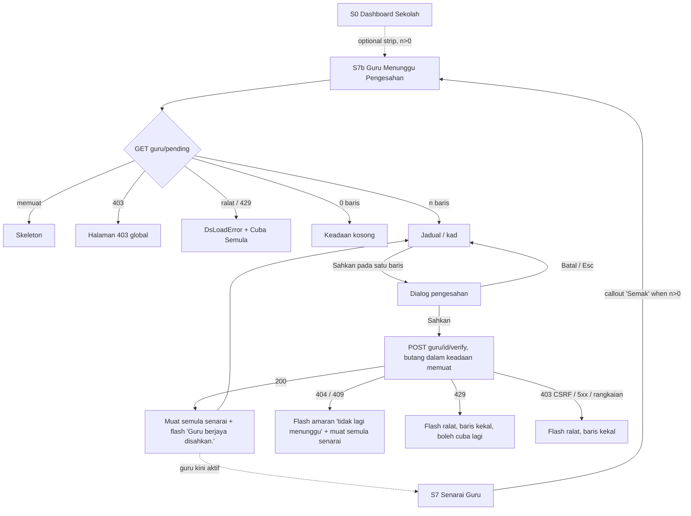

# M27 Admin Sekolah: Sahkan guru yang mendaftar sendiri (verify self-registered teachers)

- **Slug:** `m27-pending-teacher-verify`
- **Status:** Draft for G2 (design only; no code written)
- **Date:** 2026-10-21
- **Owner:** ui-ux-designer
- **Backlog:** #78 (FE has nothing; backend done in BE-21 AC#13)
- **Portal:** Admin Sekolah (user shell, role `school_admin` only), module M27, next to S7 "Senarai Guru".

## 0. Sources and how far they were checked

| Source | Used for | Note |
|---|---|---|
| `packages/contract/src/school-admin/pending-teachers.ts` (worktree `pp-e2e-bijak`, on `be/integration-frontend` 63bb2ba1) | Fields, routes, errors, flash text, teacher notice | The file is present in the worktree. I could not run `git show origin/feature/v2-backend:...` (no shell in this session), so the tip 0896421f was **not** compared. **Perlu pengesahan:** frontend developer to diff `pending-teachers.ts` against 0896421f before build. |
| `docs/plan/backend-tasks/BE-21-school-admin.md` AC#13 | Intent and side effects | See section 1. |
| `apps/api/src/modules/school-admin/pending-teachers.service.ts` | Real behaviour of list and verify | Audit and notice confirmed in code. |
| `src/modules/m27-school-admin/` (S7 `SchoolUserList.vue`, `SenaraiGuruPage.vue`, `UserRowActions.vue`, `users-format.ts`, `SchoolDashboardPage.vue`, `SummaryCards.vue`, `routes/guru.ts`) and `src/ds/` | Patterns to copy | Section 4. |
| prestasiplus.cloud (v2, primary visual reference) | Visual reference | **Not observed.** The lane-3 browser tools (`mcp__playwright3__*`) were not available to this session, so no page was opened and no login was used. Fallback used: the existing M27 FE patterns and the v2 design system. Nothing in this spec claims a .cloud behaviour. |

## 1. What the contract gives (nothing more is designed)

**`GET /admin-sekolah/guru/pending`** (school_admin only; school comes from the session)
- Returns `{ data: Row[], meta }`. **Unpaged**: one page holds every pending teacher, oldest request first, then id. No query parameters, no search, no filter, no sort.
- `Row` = `id`, `name`, `initials` (1 to 2 upper-case letters), `email` (nullable), `phone` (nullable), `requestedAt` (when the teacher registered, MYT timestamp). No IC, no password data, no class data, no "school requested" field (it is always this school).
- Errors: 401, 403 (not school_admin, Admin Pusat included, or no school), 429 (`error.retryAfter` seconds). `Cache-Control: no-store`.
- The pending teachers are **not** in the S7 list (they are inactive with no school until verified).

**`POST /admin-sekolah/guru/{id}/verify`** (no body, `X-CSRF-Token`)
- 200 `{ data: { id, isActive: true, schoolId }, status: "Guru berjaya disahkan." }`.
- One transaction: account becomes active, `school_id` set to the admin's school, pending marker cleared, audit event written (ids only). After commit the teacher gets an inbox notice (system category): title "Akaun guru anda telah disahkan", body "Pentadbir sekolah telah mengesahkan akaun guru anda. Anda kini boleh log masuk dan menggunakan PrestasiPlus." A failed notice is only logged; the verify still succeeds.
- Errors: 401; 403 (role, no school, or CSRF_INVALID); **404 "Not Found." for everything else** (unknown id, other school, not pending, **already verified**, non-teacher, suspended); 429.
- **There is no 409.** The brief asked for 409 "already verified by someone else"; the contract says a repeat or concurrent loser call is 404, never 409 (anti-enumeration). The UI therefore handles that case through 404. A defensive 409 is mapped to the same behaviour in case it ever appears.
- **There is no reject or decline endpoint.** The screen has one action only: Sahkan. No "Tolak" button, no reason field, no bulk verify (all would be new scope).

## 2. Entry point decision

| Option | Verdict | Reason |
|---|---|---|
| A. New page `/admin-sekolah/guru/menunggu` (S7b) holding the pending list and the Sahkan action | **Chosen (the work surface)** | The contract is a separate, unpaged list with its own row shape (`requestedAt`, no `isActive`, no classes). Mixing it into S7 would force a different column set and a second "Aktif?" meaning. A page keeps S7 untouched (S7 is a replicated live screen, CLAUDE.md section 6). |
| B. Callout on S7 "Senarai Guru" above the filter bar: "{n} guru menunggu pengesahan" + button "Semak" -> S7b | **Chosen (primary entry)** | The admin already goes to Senarai Guru to manage teachers; the callout appears only when n > 0, so S7 looks unchanged otherwise. The extra call is `GET .../guru/pending`; if it fails, the callout is hidden silently (S7 itself must not break). |
| C. Callout strip on S0 "Dashboard Sekolah" (same text and button, only when n > 0, under the school banner) | **Recommended, but optional (Q1)** | Lets the admin notice new registrations without opening S7. The dashboard contract has no pending count, so it costs one extra non-blocking call. It is not a fifth stat tile: the four-card row (`DsStatRow` `:cols="4"`) is a live replicated layout. |
| D. Tab or filter inside S7 (status "Menunggu") | Rejected | The S7 list endpoint cannot return pending teachers (different endpoint, different shape, 25 per page vs unpaged), and `Status` is a GET filter on the URL. |
| E. Badge count on a nav item | Rejected | The shell menu is live-replicated and a count needs the extra call on every page. |

No new nav item. S7b is reached from the S7 callout (and the optional S0 strip) and has a back link to S7.

## 3. Flow



Steps as the admin sees them: (1) sees the callout on S7 or the strip on S0; (2) opens S7b; (3) reads name, e-mail, phone, registration date for each row to recognise the person (these four fields are all the contract gives; no extra detail page exists, and the S10 edit page returns 403/404 for a pending account, so rows are **not** links); (4) presses "Sahkan"; (5) confirms in the dialog; (6) the row leaves the list and a success flash shows; the teacher now appears in S7 as "Aktif".

## 4. Existing patterns reused (from the worktree)

| Pattern | Where it lives | Reuse here |
|---|---|---|
| List page skeleton: `DsPage`, `DsBackLink`, count tile, found-line, table with cards below `md` | `SchoolUserList.vue` | Same order and classes. |
| Confirm before a write: `useConfirm()`, then API call, then `reload()` then `flash.show({ type: 'success', message: result.status })`; on error `flash.show({ type: 'error', message: errorLines(err) })`; one in-flight id (`togglingId`) | `SchoolUserList.vue` `toggle()` | Copy exactly; the only difference is the dialog text and button label. |
| Row button: `UButton size="lg" variant="soft" class="min-h-11"` with `:loading` and `:disabled` while in flight | S7 "Aktif?" toggle | Same for "Sahkan". |
| Load failure: `DsLoadError` with `@retry="reload"`, 403 -> `setRouteOutcome(403)` (global 403 page in place) | `SenaraiGuruPage` / dashboard | Same. |
| Dates `dd/mm/yyyy` and `dd/mm/yyyy HH:mm` in Asia/Kuala_Lumpur | `users-format.ts` `formatDate`, `formatDateTime` | Use `formatDateTime(requestedAt)`. |
| Phone empty -> "-" | `phoneText` | Same; empty e-mail (nullable) also shows "-" (**Perlu pengesahan**: S7 never has a null e-mail; "-" is proposed). |
| Header title and school name as sub-line via `pageMeta.setHeader` | S7 | Title "Guru Menunggu Pengesahan", subtitle = school name. |
| Route meta `title: '<Name> - PRESTASIPLUS'`, role `school_admin`, static route registered before `:id(\d+)` | `routes/guru.ts` | New route `/admin-sekolah/guru/menunggu`, name `m27.guru.pending`. |
| Error text rule: server message in the alert, `GENERIC_ERROR` when none | `errorLines()` | Same, plus one mapped case (404). |

## 5. Screen S7b: Guru Menunggu Pengesahan (`/admin-sekolah/guru/menunggu`)

### 5.1 Anatomy (top to bottom)

1. `DsBackLink` -> `/admin-sekolah/guru`, label "Senarai Guru".
2. One count tile (`DsStatTile`, `icon="chalkboard-teacher"`, `accent="friend"`, value = n, unit "Menunggu Pengesahan"). Grid `grid-cols-1 sm:grid-cols-2 lg:grid-cols-4` like S7.
3. Found line (`text-body text-muted`): "{n} guru menunggu pengesahan". Left on `sm+`, above the table on mobile.
4. Table or cards. **No filter bar, no search, no export, no "Tambah" button, no pager** (contract is unpaged; pass `:page-size="Math.max(n, 1)"` and `:total="n"` so `DsDataTable` shows no pager; **Perlu pengesahan:** confirm the pager hides when total <= page size).

```
1280 (table, layout fixed, density compact)
+-----------------------------------------------------------------------------+
| < Senarai Guru                                                              |
| [ (icon) 3  Menunggu Pengesahan ]                                           |
| 3 guru menunggu pengesahan                                                  |
| +-------------------------------------------------------------------------+ |
| | #  Nama               Emel                 Telefon      Tarikh Daftar  Tindakan |
| | 1  (NA) Nurul Aina    nurul.aina@contoh.my 012-3456789  20/10/2026 09:14 [Sahkan]|
| | 2  (AH) Amir Hakim    -                    -            20/10/2026 11:02 [Sahkan]|
| +-------------------------------------------------------------------------+ |
+-----------------------------------------------------------------------------+

375 (cards, DsDataTable below md)
+-------------------------------+
| < Senarai Guru                |
| [ 3 Menunggu Pengesahan ]     |
| 3 guru menunggu pengesahan    |
| +---------------------------+ |
| | (NA) Nurul Aina    [Sahkan]| |
| | Emel     nurul.aina@...   | |
| | Telefon  012-3456789      | |
| | Tarikh Daftar 20/10/2026 09:14 |
| +---------------------------+ |
+-------------------------------+
```

Sample names above are fictitious placeholders; real names must never be committed.

### 5.2 Columns (>= md) and card (< md)

| Column | Key | Width class | Content |
|---|---|---|---|
| # | `index` | `w-8` | 1-based row number (no paging, so `index + 1`) |
| Nama | `name` | `w-32` | `DsIdentity` (initials chip from `initials`, name as plain text, **not** a link) |
| Emel | `email` | `w-32` | `break-all` |
| Telefon | `phone` | `w-24` | `break-words`, "-" when empty |
| Tarikh Daftar | `requestedAt` | `w-32` | `formatDateTime` |
| Tindakan | `actions` | `w-28` | "Sahkan" button |

Card (`card-title="name"`): fields Emel, Telefon, Tarikh Daftar; `#card-actions` holds the button, right-aligned like S7. Rows have **no** `@row-click`.

### 5.3 Responsive

| Width | Behaviour |
|---|---|
| 375 (< `sm`) | Tile full width; found line on its own row; list as cards, one per row; "Sahkan" button `min-h-11`, at least 44 x 44 px, in the card header right; long e-mails wrap (`break-all`). No horizontal page scroll down to 320. |
| 768 (`md`) | Table appears (6 columns, fixed layout, `density="compact"`); tile spans half the row (`sm:grid-cols-2`); the table fits without clipping (fewer columns than S7's nine). |
| 1280 (`lg`) | Same table; tile in a 4-column grid, one cell wide. Content within `DsPage` width. |
| Dialog | `DsDialog`/`DsConfirmHost` as used everywhere: centred card with margin on mobile, buttons stacked or side by side per the DS; not a separate drawer. |

### 5.4 Confirm dialog (`useConfirm`)

- Title "Sahkan Guru"; message "Sahkan {nama} sebagai guru sekolah ini? Akaun akan diaktifkan dan guru akan dimaklumkan."; confirm label "Sahkan"; cancel "Batal"; `tone: 'primary'` (this is not destructive, so not the `error` colour).
- Follow the S7 toggle pattern: the dialog resolves true/false, then the page makes the call, shows the button loading, reloads, then flashes. (The `run` option of `useConfirm` is the alternative; the S7 pattern is preferred so the row button shows the loading state and so the 404/429 branches are handled in one place.)
- Esc, backdrop and Batal cancel with no call.

### 5.5 States

| State | What shows | Notes |
|---|---|---|
| Loading (first) | Tile `USkeleton h-24`, table `loading` (DS skeleton rows), found line empty | `aria-busy` as the DS does; test id `pt-loading` |
| Loaded, n > 0 | As 5.1 | |
| Empty (n = 0) | `DsPanel` + `DsEmptyState`, `icon="users"`, title "Tiada guru menunggu pengesahan", description "Guru yang mendaftar sendiri dan memilih sekolah ini akan muncul di sini." | Tile shows 0. Not a "filtered" empty (there are no filters). Also the state after the last row is verified. |
| Load error (network, 5xx) | `DsLoadError` with the message from `errorLines`, "Cuba Semula" button | Tile and table hidden |
| 429 on load | Same `DsLoadError`, server message "Terlalu banyak percubaan. Sila cuba sebentar lagi."; retry button re-requests | The retry is not auto-disabled (**Perlu pengesahan:** disable for `retryAfter` seconds? default: no, replicate S7) |
| 403 on load | `setRouteOutcome(403)`: global 403 page in place | School admin without a school, or wrong role |
| 401 | Existing session handling (login redirect) | Not a screen of its own |
| Verifying a row | That row's "Sahkan" is `loading` + `disabled`; other rows' buttons stay clickable but a second action while one is in flight is ignored (as `togglingId`) | |
| Verify success | List reloaded (the row is gone), success flash "Guru berjaya disahkan." (text comes from `result.status`); tile and found line update | If it was the last row, the empty state shows under the flash |
| Verify 404 (or 409) | List reloaded (so the stale row disappears) and a flash of type `error`: "Guru ini tidak lagi menunggu pengesahan. Senarai telah dikemas kini." | Covers "already verified by someone else", "removed", "wrong school". The server text "Not Found." is **not** shown (English, and ambiguous). |
| Verify 429 | Flash `error`: server message "Terlalu banyak percubaan. Sila cuba sebentar lagi."; row stays; the admin presses "Sahkan" again | |
| Verify 403 (e.g. CSRF_INVALID) | Flash `error` with the server message; row stays | A 403 on a POST is **not** routed to the global 403 page (the list already loaded, so role is fine). **Perlu pengesahan** (S7 toggle does the same via `errorLines`). |
| Verify network/5xx | Flash `error` "Ralat berlaku. Sila cuba lagi."; row stays | `GENERIC_ERROR` |
| Reload fails after a successful verify | Flash success first (the write happened), then the list area shows `DsLoadError` | Order: the S7 pattern reloads before flashing; if `reload()` rejects, still show the success flash (**Perlu pengesahan:** small deviation from the S7 code order, so the admin is not told the verify failed). |

## 6. Screen S7 addition: callout "Guru menunggu pengesahan"

- Position: between the header-actions row and the `DsFilterBar`. Hidden when n = 0, while loading, and when the pending call fails (silent; no error shown, S7 must not degrade).
- Content: `DsPanel` row: `DsStatusBadge status="awaiting-review" label="Menunggu Pengesahan"`, text "{n} guru menunggu pengesahan", and a `UButton` "Semak" (`to` = `/admin-sekolah/guru/menunggu`, `size="lg"`, `icon="i-ph-user-check"`, `class="min-h-11"`).
- Layout: 375 stacked (badge + text, then full-width button); >= `sm` one row, text left, button right (`flex flex-col gap-3 sm:flex-row sm:items-center sm:justify-between`).
- Is not shown on S6 (pupils).
- Nothing else on S7 changes (columns, filters, export, toggle stay as live).

## 7. Screen S0 addition (optional, Q1): strip on Dashboard Sekolah

Same component and copy as section 6, placed under `SchoolBanner`, above `SummaryCards`. Shown only when n > 0; the pending call must not delay or fail the dashboard (it loads after the dashboard data; a failure hides the strip).

## 8. Copy table

Source key: **existing** = already in the M27 FE or DS; **contract** = in `pending-teachers.ts` / paths; **Perlu pengesahan** = proposed, needs user approval. .cloud was not observed, so no string is "observed on .cloud".

| # | Where | BM copy | Source |
|---|---|---|---|
| 1 | Header title and S7b page name | Guru Menunggu Pengesahan | **Perlu pengesahan** |
| 2 | Browser tab title | Guru Menunggu Pengesahan - PRESTASIPLUS | **Perlu pengesahan** (pattern existing) |
| 3 | Header subtitle | {nama sekolah} | existing (S7) |
| 4 | Back link | Senarai Guru | existing |
| 5 | Count tile unit; callout badge | Menunggu Pengesahan | **Perlu pengesahan** |
| 6 | Found line; callout and strip text | {n} guru menunggu pengesahan | **Perlu pengesahan** (form follows "{n} pengguna dijumpai") |
| 7 | Column headers | #, Nama, Emel, Telefon, Tindakan | existing |
| 8 | Column header (date) | Tarikh Daftar | **Perlu pengesahan** ("Tarikh" exists on S7; "Daftar" disambiguates) |
| 9 | Empty cell (phone, e-mail) | - | existing (phone); e-mail is **Perlu pengesahan** (no new copy string, behaviour only) |
| 10 | Row button; dialog confirm label | Sahkan | **Perlu pengesahan** (feature name from the brief) |
| 11 | Dialog title | Sahkan Guru | **Perlu pengesahan** |
| 12 | Dialog message | Sahkan {nama} sebagai guru sekolah ini? Akaun akan diaktifkan dan guru akan dimaklumkan. | **Perlu pengesahan** |
| 13 | Dialog cancel | Batal | existing (DS `cancel`) |
| 14 | Success flash | Guru berjaya disahkan. | contract |
| 15 | 404 / 409 flash | Guru ini tidak lagi menunggu pengesahan. Senarai telah dikemas kini. | **Perlu pengesahan** |
| 16 | 429 flash and load error | Terlalu banyak percubaan. Sila cuba sebentar lagi. | contract (marked "proposed copy" there, same as auth routes) |
| 17 | Generic error | Ralat berlaku. Sila cuba lagi. | existing (`GENERIC_ERROR`) |
| 18 | Load error retry | Cuba Semula | existing (DS `retry`) |
| 19 | Load error message | server message via `errorLines`, else row 17 | existing |
| 20 | Empty title | Tiada guru menunggu pengesahan | **Perlu pengesahan** |
| 21 | Empty description | Guru yang mendaftar sendiri dan memilih sekolah ini akan muncul di sini. | **Perlu pengesahan** |
| 22 | Callout / strip button | Semak | **Perlu pengesahan** |
| 23 | Teacher inbox notice (sent by the server, not a UI string) | Akaun guru anda telah disahkan / Pentadbir sekolah telah mengesahkan akaun guru anda. Anda kini boleh log masuk dan menggunakan PrestasiPlus. | contract |

**Count of distinct strings marked Perlu pengesahan: 12** (rows 1, 2, 5, 6, 8, 10, 11, 12, 15, 20, 21, 22). Plus 3 behaviour points flagged the same way in the text (null e-mail shown as "-", pager hiding, reload/flash order).

## 9. Interaction notes

- Query string: none. The list is not filterable and the page has no URL state beyond the path.
- After a successful verify the list is **reloaded from the server**, not edited locally (S7 pattern), so the count always matches the server.
- The newly verified teacher is not linked from the flash; the admin can go back to S7 to see them as "Aktif". No navigation is forced.
- One verify at a time per page (ignore clicks while one is in flight).
- Double click on "Sahkan" is safe: the first click opens the dialog; the confirm is a single resolved promise; the server also guarantees exactly one success for concurrent calls.
- The S7 callout count is read once on S7 load. After the admin returns from S7b (back link or browser back), S7 re-mounts and re-reads it. No polling.
- Do not log or echo e-mail/phone in analytics or console (PDPA; the response is `no-store`).

## 10. Accessibility (replicate the existing patterns, no additions per D10)

- Every control is a real `<button>`/`<a>` through `UButton`; labels are visible text ("Sahkan", "Semak", "Batal"). Touch targets `min-h-11` (44 px) on every row button, the callout button and the dialog buttons.
- Tab order: back link -> (count tile, not focusable) -> row buttons top to bottom -> (table pager absent). In the cards view the order is card by card, button inside each card.
- Dialog: `DsDialog` behaviour as for the S7 toggle (focus into the dialog, Esc cancels, focus returns to the "Sahkan" button that opened it). Do not change.
- Table: caption = "Guru Menunggu Pengesahan" (DataTable `caption` prop, as S7 sets it from the list title); status shown in text, not colour only (the callout badge has icon + word).
- Flash: the existing `useFlash` region (announces to assistive tech as used on S7). Do not add a second live region.
- Contrast and focus rings come from the DS tokens (no one-off colours; no hex in this spec).
- Reduced motion: no new animation.
- Gaps found, **not** fixed here because D10 says replicate (see Q3): several identical "Sahkan" buttons have no per-row accessible name (same as S7 "Edit"/"Aktif?"), and after a verify the focused button disappears with its row.
- Keyboard-only walk-through to test: Tab to the first "Sahkan" -> Enter -> dialog -> Enter on "Sahkan" -> flash -> the list updates.

## 11. Component inventory (existing DS only)

`DsPage`, `DsBackLink`, `DsStatTile`, `DsDataTable` (with `card-title`, `card-fields`, `#card-actions`, `#name-cell`, `#email-cell`, `#phone-cell`, `#requestedAt-cell`, `#actions-cell`), `DsIdentity`, `DsPanel`, `DsEmptyState`, `DsLoadError`, `DsStatusBadge` (`awaiting-review` with a custom label), `useConfirm` / `DsConfirmHost` (already mounted in the shell), `useFlash`, `UButton`, `USkeleton`. New code needed (for the developer, not designed here): API functions `fetchPendingTeachers`, `verifyPendingTeacher` in `api/school-admin.ts`; a mock handler pair; route `m27.guru.pending`; page `GuruMenungguPage.vue`; callout component shared by S7 and S0. No new DS component and no new token.

## 12. Proposed test ids (e2e)

| Test id | Element |
|---|---|
| `pt-page` | S7b `DsPage` |
| `pt-back` | back link |
| `pt-count-card` | count tile section |
| `pt-found` | found-line paragraph |
| `pt-table` | `DsDataTable` |
| `pt-row` (+ `data-user-id`) | `DsIdentity` of each row |
| `pt-name`, `pt-email`, `pt-phone`, `pt-date` | cells |
| `pt-verify` (+ `data-user-id`) | "Sahkan" button (table and card variants) |
| `pt-empty` | empty panel |
| `pt-error` | `DsLoadError` |
| `pt-loading` | loading wrapper |
| `pt-callout` | S7 callout; `pt-callout-count`; `pt-callout-link` ("Semak") |
| `pt-strip` | S0 strip (if approved) |

The confirm dialog uses the DS host; the e2e finds its buttons by role and name ("Sahkan", "Batal") unless the DS host already exposes ids (it has none today).

E2E cases (each at 375, 768, 1280): list shows n rows; verify success removes the row and shows the flash; cancel does nothing; empty state; callout visible only when n > 0 and link target; 404 on a stale row (verify in another session first) shows copy 15 and the row disappears; 429 keeps the row; no horizontal scroll at 320; teacher appears as Aktif on S7 after verify; a school_admin never sees another school's pending teacher.

## 13. Open questions (need the user's decision)

1. **Dashboard strip (S0):** include the optional strip (section 7) now, or only the S7 callout? Recommendation: S7 callout now, strip as a follow-up, because the dashboard has no pending count in its contract.
2. **Copy approval:** the 12 strings marked Perlu pengesahan, especially "Sahkan" as the action word, the dialog text, and "Tarikh Daftar".
3. **Accessibility gap vs D10:** add a per-row accessible name (`aria-label="Sahkan {nama}"`) and move focus to the page heading or the next row after verify? D10 says replicate live with no enhancements, but there is no live reference for this new screen. Recommendation: yes (small, starts with the visible label so WCAG 2.5.3 holds). Default if not answered: replicate S7 exactly.
4. **Contract tip check:** the frontend developer should diff the contract against `origin/feature/v2-backend` 0896421f (not done here); in particular confirm there is still no 409 and no reject route.
5. **BE-21 AC#13 vs contract on Admin Pusat:** the card says "`admin` may verify any"; the contract says Admin Pusat gets 403 (no school). The screen follows the contract (school_admin only). Backend/LEAD to align the card.
6. **No reject action:** if the school should be able to refuse a self-registration (wrong school chosen), that needs a new backend route; not designed here.
7. **Unpaged list:** a school with a very large number of pending teachers would render them all. Acceptable for now; ask backend for paging if registrations are expected in bulk.
8. **.cloud reference:** not observed in this session; if the user wants a visual check against .cloud before build, a session with browser lane 3 should look at the school-admin teacher list only (read-only).
