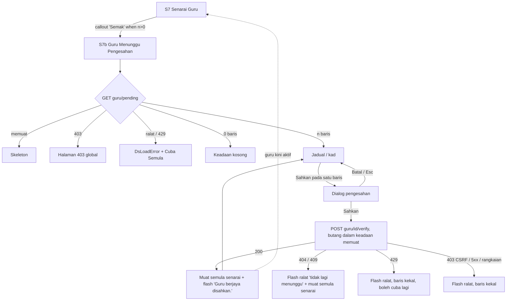

# M27 Admin Sekolah: Sahkan guru yang mendaftar sendiri (verify self-registered teachers)

- **Slug:** `m27-pending-teacher-verify`
- **Status:** Draft for G2, revised 2026-10-21 with the lead's decisions (section 14). Design only; no code written. Section 15 added 2026-10-22 for issue #191 (delivery check of the built screen). Section 16 added 2026-10-23 (#208 follow-up: unchecked-details guard and final copy).
- **Date:** 2026-10-21
- **Owner:** ui-ux-designer
- **Backlog:** #78 (FE has nothing; backend done in BE-21 AC#13)
- **Portal:** Admin Sekolah (user shell, role `school_admin` only), module M27, next to S7 "Senarai Guru".

## 0. Sources and how far they were checked

| Source | Used for | Note |
|---|---|---|
| `packages/contract/src/school-admin/pending-teachers.ts` (worktree `pp-e2e-bijak`, on `be/integration-frontend` 63bb2ba1) | Fields, routes, errors, flash text, teacher notice | The file is present in the worktree. I could not run `git show origin/feature/v2-backend:...` (no shell in this session), so the tip 0896421f was **not** compared. **Perlu pengesahan:** frontend developer to diff `pending-teachers.ts` against 0896421f before build. |
| `docs/plan/backend-tasks/BE-21-school-admin.md` AC#13 | Intent and side effects | See section 1. |
| `apps/api/src/modules/school-admin/pending-teachers.service.ts` | Real behaviour of list and verify | Audit and notice confirmed in code. |
| `src/modules/m27-school-admin/` (S7 `SchoolUserList.vue`, `SenaraiGuruPage.vue`, `UserRowActions.vue`, `users-format.ts`, `SchoolDashboardPage.vue`, `SummaryCards.vue`, `routes/guru.ts`) and `src/ds/` | Patterns to copy | Section 4. |
| prestasiplus.cloud (v2, primary visual reference) | Visual reference | Per D24, no role account is requested for .cloud. **Not observed.** The lane-3 browser tools (`mcp__playwright3__*`) were not available to this session, so no page was opened and no login was used. Fallback used: the existing M27 FE patterns and the v2 design system. Nothing in this spec claims a .cloud behaviour. |

## 1. What the contract gives (nothing more is designed)

**`GET /admin-sekolah/guru/pending`** (school_admin only; school comes from the session)
- Returns `{ data: Row[], meta }`. **Unpaged**: one page holds every pending teacher, oldest request first, then id. No query parameters, no search, no filter, no sort.
- `Row` = `id`, `name`, `initials` (1 to 2 upper-case letters), `email` (nullable), `phone` (nullable), `requestedAt` (when the teacher registered, MYT timestamp). No IC, no password data, no class data, no "school requested" field (it is always this school).
- Errors: 401, 403 (not school_admin, Admin Pusat included, or no school), 429 (`error.retryAfter` seconds). `Cache-Control: no-store`.
- The pending teachers are **not** in the S7 list (they are inactive with no school until verified).

**`POST /admin-sekolah/guru/{id}/verify`** (no body, `X-CSRF-Token`)
- 200 `{ data: { id, isActive: true, schoolId }, status: "Guru berjaya disahkan." }`.
- One transaction: account becomes active, `school_id` set to the admin's school, pending marker cleared, audit event written (ids only). After commit the teacher gets an inbox notice (system category): title "Akaun guru anda telah disahkan", body "Pentadbir sekolah telah mengesahkan akaun guru anda. Anda kini boleh log masuk dan menggunakan PrestasiPlus." A failed notice is only logged; the verify still succeeds.
- Errors: 401; 403 (role, no school, or CSRF_INVALID); **404 "Not Found." for everything else** (unknown id, other school, not pending, **already verified**, non-teacher, suspended); 429.
- **Role and scope (decision 4):** the page is for `school_admin` only, and only for their own school. Admin Pusat gets 403 (no school to scope to) and the page has no school picker. Admin Pusat activates accounts through M02 user management, not through this screen. BE-21 AC#13 ("admin may verify any") is being aligned with the contract by the lead's session.
- **There is no 409.** The brief asked for 409 "already verified by someone else"; the contract says a repeat or concurrent loser call is 404, never 409 (anti-enumeration). The UI therefore handles that case through 404. A defensive 409 is mapped to the same behaviour in case it ever appears.
- **There is no reject or decline endpoint.** The screen has one action only: Sahkan. No "Tolak" button, no reason field, no bulk verify (all would be new scope).

## 2. Entry point decision

| Option | Verdict | Reason |
|---|---|---|
| A. New page `/admin-sekolah/guru/menunggu` (S7b) holding the pending list and the Sahkan action | **Chosen (the work surface)** | The contract is a separate, unpaged list with its own row shape (`requestedAt`, no `isActive`, no classes). Mixing it into S7 would force a different column set and a second "Aktif?" meaning. A page keeps S7 untouched (S7 is a replicated live screen, CLAUDE.md section 6). |
| B. Callout on S7 "Senarai Guru" above the filter bar: "{n} guru menunggu pengesahan" + button "Semak" -> S7b | **Chosen (primary entry)** | The admin already goes to Senarai Guru to manage teachers; the callout appears only when n > 0, so S7 looks unchanged otherwise. The extra call is `GET .../guru/pending`; if it fails, the callout is hidden silently (S7 itself must not break). |
| C. Callout strip on S0 "Dashboard Sekolah" | **LATER (decision 1)** | Not part of this build. See section 7. |
| D. Tab or filter inside S7 (status "Menunggu") | Rejected | The S7 list endpoint cannot return pending teachers (different endpoint, different shape, 25 per page vs unpaged), and `Status` is a GET filter on the URL. |
| E. Badge count on a nav item | Rejected | The shell menu is live-replicated and a count needs the extra call on every page. |

No new nav item. S7b is reached from the S7 callout and has a back link to S7.

## 3. Flow



Steps as the admin sees them: (1) sees the callout on S7; (2) opens S7b; (3) reads name, e-mail, phone, registration date for each row to recognise the person (these four fields are all the contract gives; no extra detail page exists, and the S10 edit page returns 403/404 for a pending account, so rows are **not** links); (4) presses "Sahkan"; (5) confirms in the dialog; (6) the row leaves the list and a success flash shows; the teacher now appears in S7 as "Aktif".

## 4. Existing patterns reused (from the worktree)

| Pattern | Where it lives | Reuse here |
|---|---|---|
| List page skeleton: `DsPage`, `DsBackLink`, count tile, found-line, table with cards below `md` | `SchoolUserList.vue` | Same order and classes. |
| Confirm before a write: `useConfirm()`, then API call, then `reload()` then `flash.show({ type: 'success', message: result.status })`; on error `flash.show({ type: 'error', message: errorLines(err) })`; one in-flight id (`togglingId`) | `SchoolUserList.vue` `toggle()` | Copy exactly; the only difference is the dialog text and button label. |
| Row button: `UButton size="lg" variant="soft" class="min-h-11"` with `:loading` and `:disabled` while in flight | S7 "Aktif?" toggle | Same for "Sahkan". |
| Load failure: `DsLoadError` with `@retry="reload"`, 403 -> `setRouteOutcome(403)` (global 403 page in place) | `SenaraiGuruPage` / dashboard | Same. |
| Dates `dd/mm/yyyy` and `dd/mm/yyyy HH:mm` in Asia/Kuala_Lumpur | `users-format.ts` `formatDate`, `formatDateTime` | Use `formatDateTime(requestedAt)`. |
| Phone empty -> "-" | `phoneText` | Same; empty e-mail (nullable) also shows "-" (**Perlu pengesahan**: S7 never has a null e-mail; "-" is proposed). |
| Header title and school name as sub-line via `pageMeta.setHeader` | S7 | Title "Guru Menunggu Pengesahan", subtitle = school name. |
| Route meta `title: '<Name> - PRESTASIPLUS'`, role `school_admin`, static route registered before `:id(\d+)` | `routes/guru.ts` | New route `/admin-sekolah/guru/menunggu`, name `m27.guru.pending`. |
| Error text rule: server message in the alert, `GENERIC_ERROR` when none | `errorLines()` | Same, plus one mapped case (404). |

## 5. Screen S7b: Guru Menunggu Pengesahan (`/admin-sekolah/guru/menunggu`)

### 5.1 Anatomy (top to bottom)

1. `DsBackLink` -> `/admin-sekolah/guru`, label "Senarai Guru".
2. One count tile (`DsStatTile`, `icon="chalkboard-teacher"`, `accent="friend"`, value = n, unit "Menunggu Pengesahan"). Grid `grid-cols-1 sm:grid-cols-2 lg:grid-cols-4` like S7.
3. Found line (`text-body text-muted`): "{n} guru menunggu pengesahan". Left on `sm+`, above the table on mobile.
3a. Notice (section 16, copy 24): `UAlert color="warning" variant="subtle" icon="i-ph-warning"`, test id `pt-notice`, shown only when n > 0 (hidden while loading, on a load error and in the empty state).
4. Table or cards. **No filter bar, no search, no export, no "Tambah" button, no pager** (contract is unpaged; pass `:page-size="Math.max(n, 1)"` and `:total="n"` so `DsDataTable` shows no pager; **Perlu pengesahan:** confirm the pager hides when total <= page size).

```
1280 (table, layout fixed, density compact)
+-----------------------------------------------------------------------------+
| < Senarai Guru                                                              |
| [ (icon) 3  Menunggu Pengesahan ]                                           |
| 3 guru menunggu pengesahan                                                  |
| +-------------------------------------------------------------------------+ |
| | #  Nama               Emel                 Telefon      Tarikh Daftar  Tindakan |
| | 1  (NA) Nurul Aina    nurul.aina@contoh.my 012-3456789  20/10/2026 09:14 [Sahkan]|
| | 2  (AH) Amir Hakim    -                    -            20/10/2026 11:02 [Sahkan]|
| +-------------------------------------------------------------------------+ |
+-----------------------------------------------------------------------------+

375 (cards, DsDataTable below md)
+-------------------------------+
| < Senarai Guru                |
| [ 3 Menunggu Pengesahan ]     |
| 3 guru menunggu pengesahan    |
| +---------------------------+ |
| | (NA) Nurul Aina    [Sahkan]| |
| | Emel     nurul.aina@...   | |
| | Telefon  012-3456789      | |
| | Tarikh Daftar 20/10/2026 09:14 |
| +---------------------------+ |
+-------------------------------+
```

Sample names above are fictitious placeholders; real names must never be committed.

### 5.2 Columns (>= md) and card (< md)

| Column | Key | Width class | Content |
|---|---|---|---|
| # | `index` | `w-8` | 1-based row number (no paging, so `index + 1`) |
| Nama | `name` | `w-32` | `DsIdentity` (initials chip from `initials`, name as plain text, **not** a link) |
| Emel | `email` | `w-32` | `break-all` |
| Telefon | `phone` | `w-24` | `break-words`, "-" when empty |
| Tarikh Daftar | `requestedAt` | `w-32` | `formatDateTime` |
| Tindakan | `actions` | `w-28` | "Sahkan" button |

Card (`card-title="name"`): fields Emel, Telefon, Tarikh Daftar; `#card-actions` holds the button, right-aligned like S7. Rows have **no** `@row-click`.

### 5.3 Responsive

| Width | Behaviour |
|---|---|
| 375 (< `sm`) | Tile full width; found line on its own row; list as cards, one per row; "Sahkan" button `min-h-11`, at least 44 x 44 px, in the card header right; long e-mails wrap (`break-all`). No horizontal page scroll down to 320. |
| 768 (`md`) | Table appears (6 columns, fixed layout, `density="compact"`); tile spans half the row (`sm:grid-cols-2`); the table fits without clipping (fewer columns than S7's nine). |
| 1280 (`lg`) | Same table; tile in a 4-column grid, one cell wide. Content within `DsPage` width. |
| Dialog | `DsDialog`/`DsConfirmHost` as used everywhere: centred card with margin on mobile, buttons stacked or side by side per the DS; not a separate drawer. |

### 5.4 Confirm dialog (`useConfirm`)

- Title "Sahkan Guru"; message (copy 12, revised in section 16) "Sahkan {nama} sebagai guru sekolah ini? Emel: {emel}. Telefon: {telefon}. Tarikh Daftar: {tarikh}. Butiran ini diisi sendiri oleh pendaftar dan belum disemak. Sahkan hanya jika anda pasti guru ini bertugas di sekolah ini. Akaun akan diaktifkan dan guru akan dimaklumkan." (the "Emel" or "Telefon" sentence is left out when that value is empty); confirm label "Sahkan"; cancel "Batal"; `tone: 'primary'` (this is not destructive, so not the `error` colour).
- Follow the S7 toggle pattern: the dialog resolves true/false, then the page makes the call, shows the button loading, reloads, then flashes. (The `run` option of `useConfirm` is the alternative; the S7 pattern is preferred so the row button shows the loading state and so the 404/429 branches are handled in one place.)
- Esc, backdrop and Batal cancel with no call.

### 5.5 States

| State | What shows | Notes |
|---|---|---|
| Loading (first) | Tile `USkeleton h-24`, table `loading` (DS skeleton rows), found line empty | `aria-busy` as the DS does; test id `pt-loading` |
| Loaded, n > 0 | As 5.1 | |
| Empty (n = 0) | `DsPanel` + `DsEmptyState`, `icon="users"`, title "Tiada guru menunggu pengesahan", description "Guru yang mendaftar sendiri dan memilih sekolah ini akan muncul di sini." | Tile shows 0. Not a "filtered" empty (there are no filters). Also the state after the last row is verified. |
| Load error (network, 5xx) | `DsLoadError` with the message from `errorLines`, "Cuba Semula" button | Tile and table hidden |
| 429 on load | Same `DsLoadError`, server message "Terlalu banyak percubaan. Sila cuba sebentar lagi."; retry button re-requests | The retry is not auto-disabled (**Perlu pengesahan:** disable for `retryAfter` seconds? default: no, replicate S7) |
| 403 on load | `setRouteOutcome(403)`: global 403 page in place | School admin without a school, or wrong role |
| 401 | Existing session handling (login redirect) | Not a screen of its own |
| Verifying a row | That row's "Sahkan" is `loading` + `disabled`; other rows' buttons stay clickable but a second action while one is in flight is ignored (as `togglingId`) | |
| Verify success | List reloaded (the row is gone), success flash "Guru berjaya disahkan." (text comes from `result.status`); tile and found line update | If it was the last row, the empty state shows under the flash. Focus moves per section 10 (next row, previous row, or the heading) |
| Verify 404 (or 409) | List reloaded (so the stale row disappears) and a flash of type `error`: "Guru ini tidak lagi menunggu pengesahan. Senarai telah dikemas kini." | Covers "already verified by someone else", "removed", "wrong school". The server text "Not Found." is **not** shown (English, and ambiguous). |
| Verify 429 | Flash `error`: server message "Terlalu banyak percubaan. Sila cuba sebentar lagi."; row stays; the admin presses "Sahkan" again | |
| Verify 403 (e.g. CSRF_INVALID) | Flash `error` with the server message; row stays | A 403 on a POST is **not** routed to the global 403 page (the list already loaded, so role is fine). **Perlu pengesahan** (S7 toggle does the same via `errorLines`). |
| Verify network/5xx | Flash `error` "Ralat berlaku. Sila cuba lagi."; row stays | `GENERIC_ERROR` |
| Reload fails after a successful verify | Flash success first (the write happened), then the list area shows `DsLoadError` | Order: the S7 pattern reloads before flashing; if `reload()` rejects, still show the success flash (**Perlu pengesahan:** small deviation from the S7 code order, so the admin is not told the verify failed). |

## 6. Screen S7 addition: callout "Guru menunggu pengesahan"

- Position: between the header-actions row and the `DsFilterBar`. Hidden when n = 0, while loading, and when the pending call fails (silent; no error shown, S7 must not degrade).
- Content: `DsPanel` row: `DsStatusBadge status="awaiting-review" label="Menunggu Pengesahan"`, text "{n} guru menunggu pengesahan", and a `UButton` "Semak" (`to` = `/admin-sekolah/guru/menunggu`, `size="lg"`, `icon="i-ph-user-check"`, `class="min-h-11"`).
- Layout: 375 stacked (badge + text, then full-width button); >= `sm` one row, text left, button right (`flex flex-col gap-3 sm:flex-row sm:items-center sm:justify-between`).
- Is not shown on S6 (pupils).
- Nothing else on S7 changes (columns, filters, export, toggle stay as live).

## 7. Later (decision 1): strip on Dashboard Sekolah

Not in this build. For the record only: the same component and copy as section 6, placed under `SchoolBanner` and above `SummaryCards`, shown only when n > 0, loaded after the dashboard data, hidden silently on failure. It must not become a fifth stat tile (the four-card row is a live replicated layout). Nothing in sections 3, 5, 8 or 12 depends on it.

## 8. Copy table

Source key: **existing** = already in the M27 FE or DS; **contract** = in `pending-teachers.ts` / paths; **observed** = the same string is already used for the same meaning on a replicated live screen (URS reference); **final (#208 follow-up)** = chosen in the 2026-10-23 copy pass in the wording style of the neighbouring M27 screens, listed in the follow-up PR for the lead to confirm. .cloud was not observed, so no string is "observed on .cloud". The "Perlu pengesahan" marks of the 2026-10-21 draft are closed by section 16.

| # | Where | BM copy | Source |
|---|---|---|---|
| 1 | Header title and S7b page name | Guru Menunggu Pengesahan | final (#208 follow-up): "Menunggu Pengesahan" is observed (M20 S4 card), prefixed with the subject like "Senarai Guru" |
| 2 | Browser tab title | Guru Menunggu Pengesahan - PRESTASIPLUS | final (#208 follow-up), existing pattern |
| 3 | Header subtitle | {nama sekolah} | existing (S7) |
| 4 | Back link | Senarai Guru | existing |
| 5 | Count tile unit; callout badge | Menunggu Pengesahan | observed (URS M20 FN-M20-3.1.1, stat card "Menunggu Pengesahan") |
| 6 | Found line; callout text | {n} guru menunggu pengesahan | final (#208 follow-up), form follows "{n} pengguna dijumpai" |
| 7 | Column headers | #, Nama, Emel, Telefon, Tindakan | existing |
| 8 | Column header (date); dialog date label | Tarikh Daftar | observed (URS M21 FN-M21-2.3.2, "Tarikh Daftar" = registration date) |
| 9 | Empty cell (phone, e-mail) | - | existing (phone); e-mail follows the phone (behaviour only) |
| 10 | Row button; dialog confirm label | Sahkan | final (#208 follow-up), the feature verb |
| 10a | Row button accessible name (not visible) | Sahkan {nama} | final (#208 follow-up), decision 3 |
| 11 | Dialog title | Sahkan Guru | final (#208 follow-up) |
| 12 | Dialog message | Sahkan {nama} sebagai guru sekolah ini? Emel: {emel}. Telefon: {telefon}. Tarikh Daftar: {tarikh}. Butiran ini diisi sendiri oleh pendaftar dan belum disemak. Sahkan hanya jika anda pasti guru ini bertugas di sekolah ini. Akaun akan diaktifkan dan guru akan dimaklumkan. | final (#208 follow-up); revised from the 2026-10-21 text by section 16. The "Emel: …" or "Telefon: …" sentence is left out when that value is empty |
| 13 | Dialog cancel | Batal | existing (DS `cancel`) |
| 14 | Success flash | Guru berjaya disahkan. | contract |
| 15 | 404 / 409 flash | Guru ini tidak lagi menunggu pengesahan. Senarai telah dikemas kini. | final (#208 follow-up) |
| 16 | 429 flash and load error | Terlalu banyak percubaan. Sila cuba sebentar lagi. | contract (same text as the auth routes) |
| 17 | Generic error | Ralat berlaku. Sila cuba lagi. | existing (`GENERIC_ERROR`) |
| 18 | Load error retry | Cuba Semula | existing (DS `retry`) |
| 19 | Load error message | server message via `errorLines`, else row 17 | existing |
| 20 | Empty title | Tiada guru menunggu pengesahan | final (#208 follow-up), form follows the other M27 "Tiada …" empty titles |
| 21 | Empty description | Guru yang mendaftar sendiri dan memilih sekolah ini akan muncul di sini. | final (#208 follow-up) |
| 22 | Callout button | Semak | final (#208 follow-up) |
| 23 | Teacher inbox notice (sent by the server, not a UI string) | Akaun guru anda telah disahkan / Pentadbir sekolah telah mengesahkan akaun guru anda. Anda kini boleh log masuk dan menggunakan PrestasiPlus. | contract |
| 24 | Notice above the list (new, section 16) | Emel dan telefon di bawah diisi sendiri oleh pendaftar dan belum disemak. Sahkan hanya guru yang anda pasti bertugas di sekolah ini. | final (#208 follow-up), new |

**Strings marked "Perlu pengesahan" in the 2026-10-21 draft: 13** (rows 1, 2, 5, 6, 8, 10, 10a, 11, 12, 15, 20, 21, 22). The 2026-10-23 pass made all of them final (rows 5 and 8 now cite an observed live use; row 12 is revised) and added row 24; the lead confirms the list in the follow-up PR. The 3 behaviour points (null e-mail shown as "-", pager hiding, reload/flash order) were checked in the build and the #191 e2e (section 15).

## 9. Interaction notes

- Query string: none. The list is not filterable and the page has no URL state beyond the path.
- After a successful verify the list is **reloaded from the server**, not edited locally (S7 pattern), so the count always matches the server.
- The newly verified teacher is not linked from the flash; the admin can go back to S7 to see them as "Aktif". No navigation is forced.
- One verify at a time per page (ignore clicks while one is in flight).
- Double click on "Sahkan" is safe: the first click opens the dialog; the confirm is a single resolved promise; the server also guarantees exactly one success for concurrent calls.
- The S7 callout count is read once on S7 load. After the admin returns from S7b (back link or browser back), S7 re-mounts and re-reads it. No polling.
- Do not log or echo e-mail/phone in analytics or console (PDPA; the response is `no-store`).

## 10. Accessibility (new screen: D10 does not apply, decision 3)

S7b has no live counterpart, so it is specified for WCAG 2.2 AA directly. The shared DS behaviours (dialog, flash region, table caption) are reused unchanged.

- Every control is a real `<button>`/`<a>` through `UButton`; visible labels "Sahkan", "Semak", "Batal". Touch targets `min-h-11` (44 px) on every row button, the callout button and the dialog buttons.
- **Per-row accessible name:** every row's button (table and card variants) has `aria-label="Sahkan {nama}"` (copy row 10a). It starts with the visible label "Sahkan", so the accessible name contains the visible text (WCAG 2.5.3). The confirm dialog message also names the teacher.
- **Focus after verify:**
  1. When a verify succeeds and the list reloads, focus moves to the "Sahkan" button of the **next row** (the row now at the removed row's position).
  2. If the removed row was the last one, focus moves to the **previous row's** "Sahkan" button.
  3. If no row is left (empty state), focus moves to the **page heading** (`h1` "Guru Menunggu Pengesahan", `tabindex="-1"` for this purpose only, test id `pt-heading`).
  4. Batal, Esc or backdrop: focus returns to the "Sahkan" button that opened the dialog. A failed verify (429, 5xx, network): the row stays and focus returns to the same button. 404/409: the stale row disappears on reload; apply rules 1 to 3.
  5. Move focus after the list has rendered and the dialog is closed.
- Tab order: back link -> row buttons top to bottom (the count tile is not focusable; no pager). In the cards view: card by card, one button per card. Rows are not links.
- Dialog: `DsDialog` behaviour (focus into the dialog, trapped, Esc cancels). The confirm button is primary, not destructive.
- Table: `caption` = "Guru Menunggu Pengesahan"; real `th` headers. Status is never colour only (callout badge has icon + word).
- Flash: the existing `useFlash` region; do not add a second live region. The found line is not a live region because the flash already announces the outcome.
- Callout "Semak" on S7: the visible label is the accessible name (a longer hidden name would break 2.5.3); the sentence next to it gives the context.
- Contrast and focus rings come from DS tokens (no one-off colours). Reduced motion: no new animation.
- Keyboard-only walk-through to test: Tab to the first "Sahkan" -> Enter -> dialog -> Enter on "Sahkan" -> flash -> focus on the next row's button; with a single row, focus on the heading.

## 11. Component inventory (existing DS only)

`DsPage`, `DsBackLink`, `DsStatTile`, `DsDataTable` (with `card-title`, `card-fields`, `#card-actions`, `#name-cell`, `#email-cell`, `#phone-cell`, `#requestedAt-cell`, `#actions-cell`), `DsIdentity`, `DsPanel`, `DsEmptyState`, `DsLoadError`, `DsStatusBadge` (`awaiting-review` with a custom label), `useConfirm` / `DsConfirmHost` (already mounted in the shell), `useFlash`, `UButton`, `USkeleton`. New code needed (for the developer, not designed here): API functions `fetchPendingTeachers`, `verifyPendingTeacher` in `api/pending-teachers.ts`; a mock handler pair; route `m27.guru.pending`; page `GuruMenungguPage.vue`; callout component used on S7. No new DS component and no new token.

## 12. Proposed test ids (e2e)

| Test id | Element |
|---|---|
| `pt-page` | S7b `DsPage` |
| `pt-back` | back link |
| `pt-count-card` | count tile section |
| `pt-found` | found-line paragraph |
| `pt-table` | `DsDataTable` |
| `pt-row` (+ `data-user-id`) | `DsIdentity` of each row |
| `pt-name`, `pt-email`, `pt-phone`, `pt-date` | cells |
| `pt-verify` (+ `data-user-id`) | "Sahkan" button (table and card variants) |
| `pt-empty` | empty panel |
| `pt-error` | `DsLoadError` |
| `pt-loading` | loading wrapper |
| `pt-callout` | S7 callout; `pt-callout-count`; `pt-callout-link` ("Semak") |
| `pt-heading` | the `h1` that receives focus when the list becomes empty |
| `pt-notice` | the unchecked-details notice above the list (section 16) |

The confirm dialog uses the DS host; the e2e finds its buttons by role and name ("Sahkan", "Batal") unless the DS host already exposes ids (it has none today).

E2E cases (each at 375, 768, 1280): each `pt-verify` has the accessible name "Sahkan {nama}"; after a verify, focus is on the next row's `pt-verify` (previous one if it was last, `pt-heading` when empty); Admin Pusat gets the 403 page; list shows n rows; verify success removes the row and shows the flash; cancel does nothing; empty state; callout visible only when n > 0 and link target; 404 on a stale row (verify in another session first) shows copy 15 and the row disappears; 429 keeps the row; no horizontal scroll at 320; teacher appears as Aktif on S7 after verify; a school_admin never sees another school's pending teacher.

## 13. Open questions

1. **Contract tip check:** the frontend developer diffs the contract against `origin/feature/v2-backend` 0896421f (not done here); confirm there is still no 409 and no reject route.
2. **Reject action (decision 5):** none. The contract has no route, so nothing is designed. If a school must be able to refuse a self-registration (for example a wrong school chosen), that needs a new backend route first, then a design pass (button, reason, copy, teacher notice).
3. **Final copy review:** done in section 16 (2026-10-23); the lead confirms the list in the follow-up PR.
4. **Reload-then-flash order and pager hiding:** the two behaviour points in section 8 need a quick check when built.
5. **Dashboard strip:** later (section 7); revisit when the dashboard contract carries a pending count.
6. **.cloud reference:** not observed (D24: no role account is requested). A visual check, if wanted, is read-only on whatever .cloud already shows without a new role account.

Closed by the lead: S0 strip later (1); 12 strings approved as provisional (2); a11y specified, D10 not applicable (3); Admin Pusat follows the contract (4); unpaged list accepted (6, see risk R1).

## 14. Decisions and risks

| # | Decision (lead, 2026-10-21) | Where applied |
|---|---|---|
| 1 | S0 dashboard strip is LATER | sections 2, 3, 7 |
| 2 | The 12 proposed strings are approved as provisional; marks kept | section 8 |
| 3 | New screen: D10 does not apply; `aria-label="Sahkan {nama}"` per row; focus to next row, else previous, else heading | sections 8 (10a), 10, 12 |
| 4 | Follow the contract: school_admin only, own school; Admin Pusat gets 403 and uses M02 user management; BE-21 AC#13 is being aligned by the lead's session | section 1 |
| 5 | No reject action | section 1, Q2 |
| 6 | Unpaged list accepted | risk R1 |
| 7 | Never request role accounts for .cloud (D24); copy stays Perlu pengesahan until the copy pass | section 0 |
| 8 | (2026-10-23, #208 follow-up) The self-registered impostor risk is accepted for now and closed on the UI side by a notice and a dialog that repeat the unchecked details; the backend part is a lead decision (section 16) | sections 5.1, 5.4, 8, 16 |

**Risk R1 (unpaged list):** `GET /admin-sekolah/guru/pending` returns every pending teacher in one response, with no limit. It is expected to be small. If a school ever has hundreds of pending teachers, the page renders all rows (long DOM, long scroll, slow list). Mitigation if it happens: ask backend for paging; the UI then reuses the `DsDataTable` pager and the S7 `page` query. No UI work is needed now.

## 15. #191 delivery check (2026-10-22)

Checked by reading the built code (commit 7571650b) against sections 1 to 14. No browser was used; .cloud/.my not observed. Two spec lines corrected: flowchart node for 404/409 said "amaran" but section 5.5 and the code use an `error` flash (now "ralat"); section 11 named `api/school-admin.ts`, the functions live in `api/pending-teachers.ts`. "Toast" in the brief = the app's `useFlash` region (section 10); no second toast system.

### 15.1 Coverage

| Brief point | Spec section | Built |
|---|---|---|
| "Menunggu pengesahan" state/entry on teacher list | 2 (B, D rejected), 6 | Yes (`SchoolUserList.vue:396`; callout badge + count + "Semak"); gap 4 |
| Sahkan action + confirm dialog | 5.4 | Yes (`GuruMenungguPage.vue:147-159`) |
| Success toast from API `status` | 5.5, 8 (14) | Yes (`:165`) |
| Error: 404/409, 429, 403/CSRF, network | 5.5, 8 (15-17) | Yes (`:168-176`, `errorLines`) |
| Empty / loading / load-error / 403 states | 5.5 | Yes; gap 1 (skeleton height) |
| Light + dark, tokens only | 10, 11 | Yes (DS components only, no raw colours in the page) |
| 375 / 768 / 1280 | 5.3, 6 | Partly: gap 4 (callout button), gap 3 (card) |
| Focus after verify | 10 | Yes, but gap 2 (heading test id) |
| Testable in mock mode | 12 | No: gap 5 |

### 15.2 Gaps for the frontend developer

1. Minor, `GuruMenungguPage.vue:191`: spec 5.5 says tile skeleton `h-24`; `USkeleton` has no height class (collapses). Add `class="h-24"`.
2. Minor, `:124-129` and `:184`: spec 10/12 require the `h1` to carry `data-testid="pt-heading"` with `tabindex="-1"`; code queries the shell's first `h1` and sets tabindex at runtime, no test id. Set `data-testid="pt-heading"` on that `h1` (shell header) or have e2e target `h1`.
3. Minor, `:276-281`: card variant `DsIdentity` lacks the `#name` slot with `data-testid="pt-name"` that the table variant has. Add it so `pt-name` exists at 375.
4. Minor, `PendingTeacherCallout.vue:36-43`: section 6 says the "Semak" button is full width at 375, row layout from `sm`. Add `class="min-h-11 w-full sm:w-auto justify-center"`.
5. Major (for acceptance, not for the screen), `mock/handlers/pending-teachers.ts:16-17`: the mock list is always empty and verify always 404, so verify, focus and callout cannot be exercised in mock mode. Acceptance below therefore runs only in `@api` (http) mode and needs the backend test DB to hold at least 3 pending teachers for the school of the school_admin test user, one with null e-mail (backend seed task, not a UI change).
6. Minor, spec only: confirm with the user that provisional strings (section 8, 13 marks) are final; no code change.

No other spec-vs-code gap found (route, role guard, copy rows 1-22, aria-label, focus rules, 404 mapping, reload-then-flash, no reject/bulk all match).

### 15.3 E2E acceptance (`@api`, each step at 375, 768 and 1280; log in as school_admin of a school with 3 pending teachers; names are fictitious, e.g. "Cikgu Contoh")

1. Open `/admin-sekolah/guru`. Expect `pt-callout` with badge "Menunggu Pengesahan", `pt-callout-count` = "3 guru menunggu pengesahan", link "Semak". At 375 the button is stacked under the text and is at least 44 px high; no horizontal scroll (also check 320).
2. Press "Semak". URL `/admin-sekolah/guru/menunggu`; heading "Guru Menunggu Pengesahan"; back link "Senarai Guru"; tile "3" + "Menunggu Pengesahan"; `pt-found` "3 guru menunggu pengesahan". 375 shows cards, 768 and 1280 show the table with columns #, Nama, Emel, Telefon, Tarikh Daftar, Tindakan. The null e-mail shows "-". No search, filter or pager.
3. Each `pt-verify` has accessible name "Sahkan {nama}" and is at least 44 px high.
4. Press "Batal" in the dialog (and again with Esc): dialog titled "Sahkan Guru", message "Sahkan {nama} sebagai guru sekolah ini? Akaun akan diaktifkan dan guru akan dimaklumkan."; buttons "Sahkan" and "Batal". Cancel makes no POST, list still 3, focus back on the opening button.
5. Press "Sahkan" in the dialog on row 1: button loading, POST `/api/admin-sekolah/guru/{id}/verify` returns 200; toast "Guru berjaya disahkan."; list 2 rows, found line "2 guru menunggu pengesahan"; focus on the former row 2's `pt-verify`. Verify the last row: focus on the previous row's button. Verify the final row: empty state "Tiada guru menunggu pengesahan" / "Guru yang mendaftar sendiri dan memilih sekolah ini akan muncul di sini."; focus on the `h1`.
6. Open `/admin-sekolah/guru`: verified teacher is listed as Aktif; callout hidden when 0 pending.
7. Stale row: verify the same teacher in a second session first, then Sahkan in the first: toast "Guru ini tidak lagi menunggu pengesahan. Senarai telah dikemas kini."; row gone.
8. 429 (route-intercept the POST with 429 and message "Terlalu banyak percubaan. Sila cuba sebentar lagi."): toast shows that text, row stays, focus on its button. Network failure on POST: toast "Ralat berlaku. Sila cuba lagi.", row stays. Failing GET: error panel (`pt-error`) with "Cuba Semula"; retry loads the list.
9. Log in as Admin Pusat and open `/admin-sekolah/guru/menunggu`: the 403 page. A school_admin of another school never sees these teachers.
10. Repeat steps 2 and 5 with the dark theme on; text and badge remain readable, focus ring visible.

## 16. #208 follow-up: unchecked registrant details and final copy (2026-10-23)

**Finding (G4 of #208, security, Medium):** a self-registered account can ask for any school. The pending row shows the name, e-mail and phone the registrant typed in; nothing proves the registrant owns that e-mail or phone, and the admin has no reject action. An admin who trusts the row could give school scope to someone who is not a teacher of the school.

**UI change (no contract or backend change):**
1. A notice above the list (copy 24, `pt-notice`, `UAlert` warning, shown only when n > 0) says the e-mail and phone are typed in by the registrant and unchecked, and that the admin should verify only a teacher they are sure works at the school.
2. The confirm dialog (copy 12) repeats the e-mail, phone and registration date at the decision point, says again that they are unchecked, and asks the admin to go on only when sure. An empty e-mail or phone sentence is left out (no "Emel: -").
3. Nothing else changes: still one action ("Sahkan"), same focus rules, same errors.

**Backend part (lead decision, recorded in the follow-up PR and on #113 as "DECISION NEEDED #208-MEDIUM"):** the UI cannot prove ownership or refuse a registrant. Closing the risk fully needs (a) proof that the registrant owns the e-mail (a confirmed flag on the pending row, or verification before the row is listed), and/or (b) a reject route for the school admin that clears the pending school (with audit and a teacher notice). Each would add a contract field or route and a design pass (badge, button, reason, copy). Until then the guard above is the mitigation.

