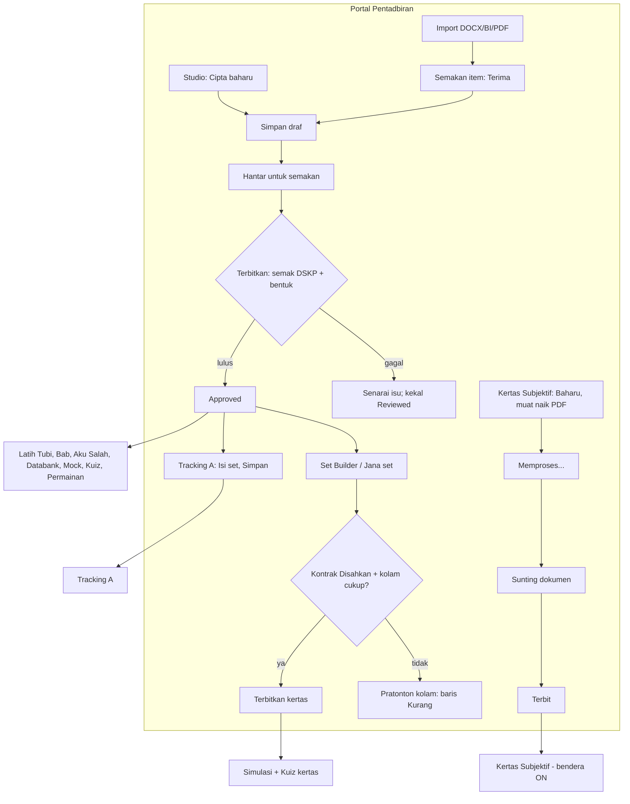
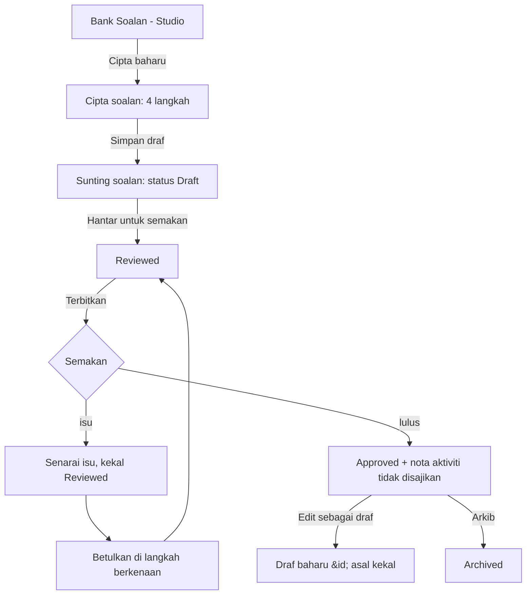
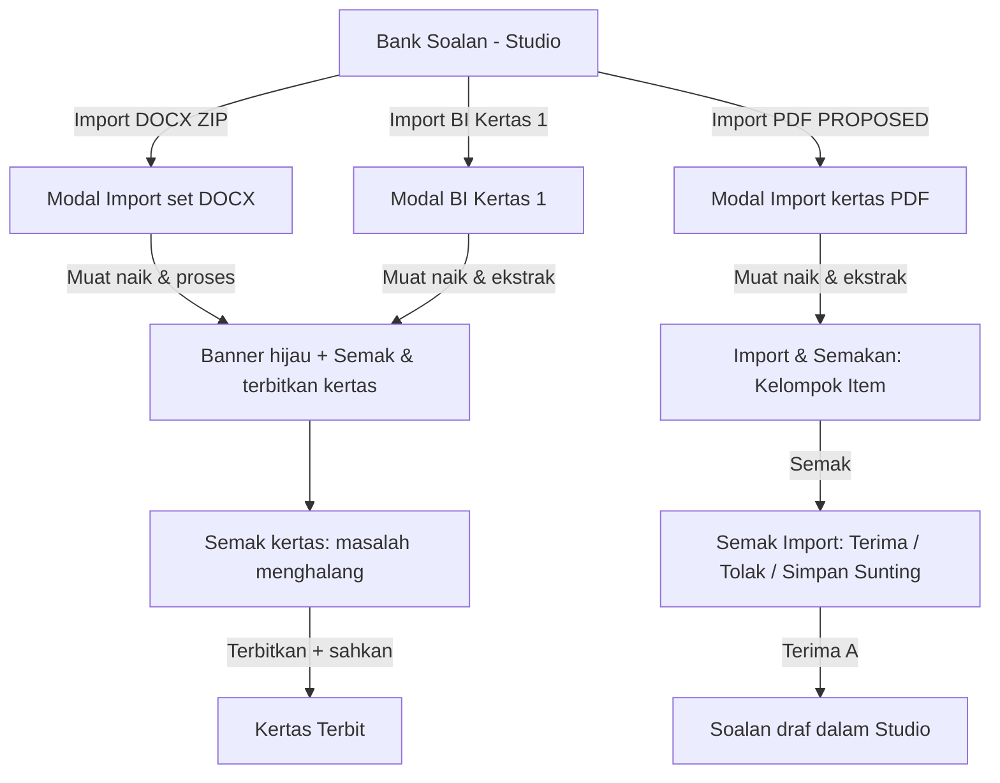
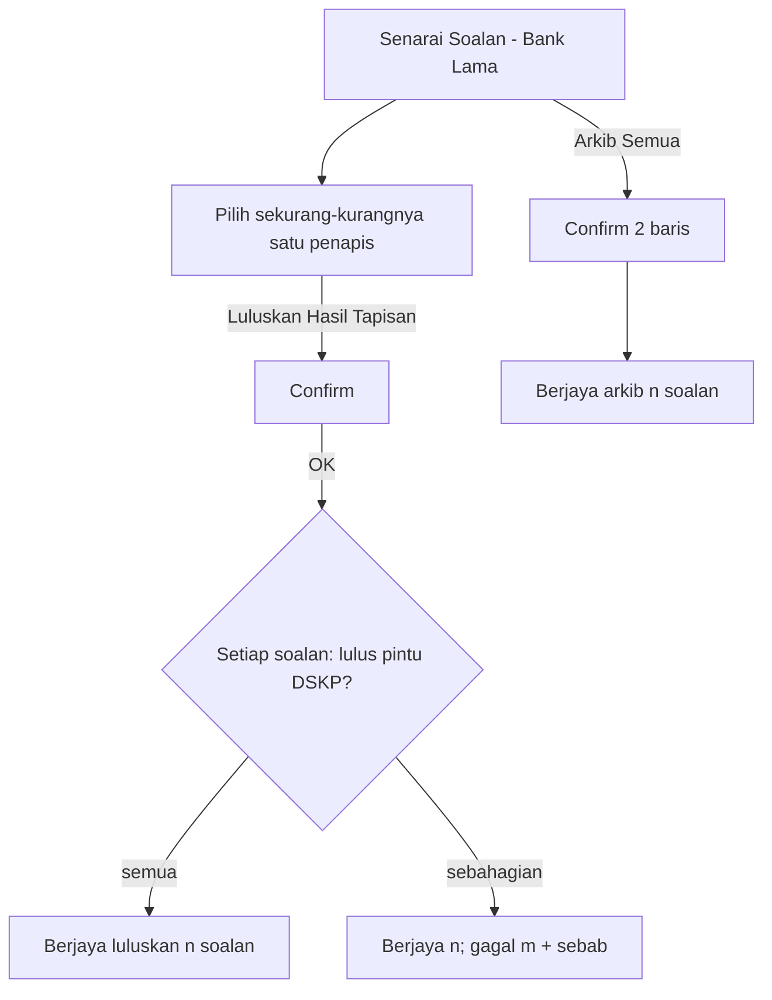
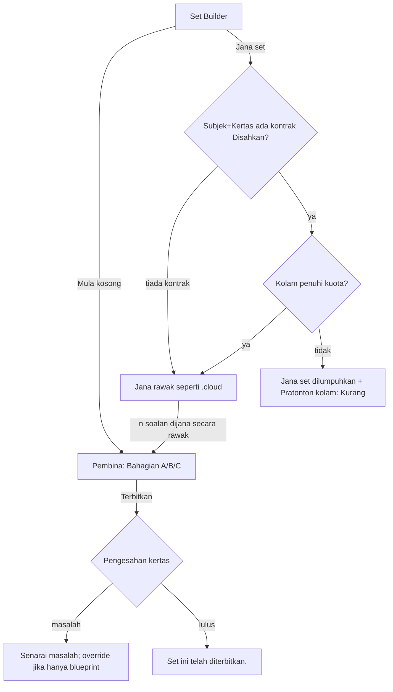
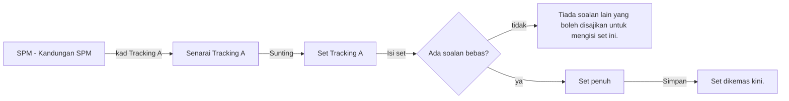
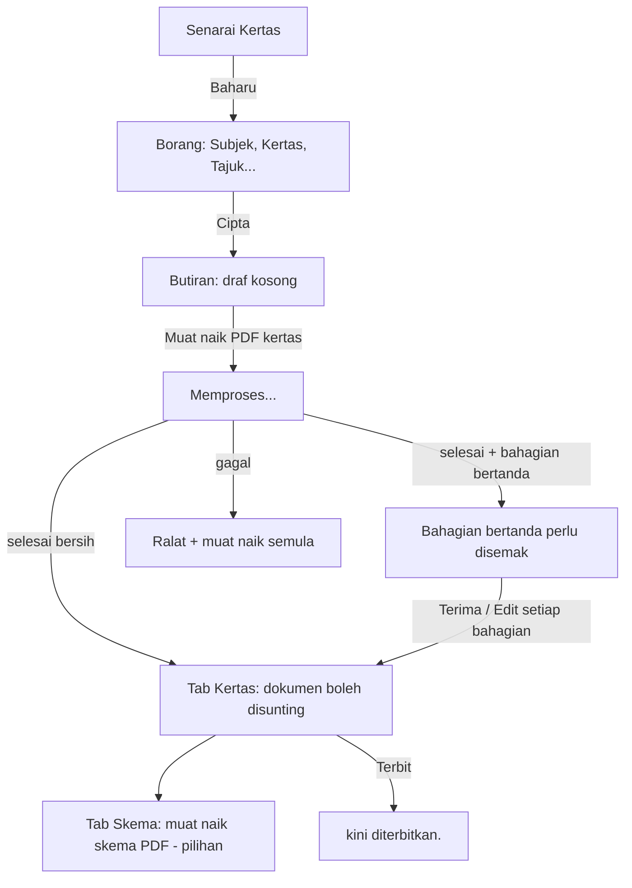

# Admin-to-student content pipeline - UX/UI design spec (frontend prototype, mock mode)

| Field | Value |
|---|---|
| Slug | `admin-student-pipeline` (v2) |
| Version | 1.0, 2026-10-30 |
| Author | ui-ux-designer |
| Gate | G2 Design (UX/UI). Architecture (data model, API, OCR engine) is NOT part of this document. |
| Status | **Proposed - needs user approval** of section 1 (decisions) and the `[PROPOSED]` items listed in section 17 |
| Requirements | `docs/requirements/v2-admin-student-pipeline.md` (20 stories, 155 ACs, A01-A23, FD-1..FD-10, section 10.1) |
| Baseline | `docs/discovery/cloud-student-mechanism.md` (cited DISC n). prestasiplus.cloud is the primary reference (D79). |
| Decisions applied | TRACKER D28-D32 (theme), D75-D78 (blueprint), **D79(d)** (admin UX = .cloud), D80, D81, D82 (FE prototype first) |
| Builds on | `v2-admin-page-templates.md` (A list, B form, F tabbed, H detail, rules 1.1-1.13), `v2-design-system.md`, `v2-ds-hardening.md`, `v2-bijak-spm-standards.md` (K1-K3, approved D78), `v2-copy-glossary.md` |
| Language | Doc English. Every UI string is BM. English-only text never appears in the UI. |
| Prototype mode | Mock data only (frontend). No backend, no real OCR. See section 13 for the mock contract. |

How to read the markers

- **verbatim** = the BM string exists in DISC (section number given). Copy it exactly, including the curly quotes and the dash.
- **[PROPOSED]** = no .cloud equivalent. The text or control is mine and needs sign-off (list in section 17). Nothing marked [PROPOSED] changes a .cloud step, label or order; each one is a new gate, indicator or D9 fix that sits inside an existing screen.
- Look only: colours, type, radius, spacing, icons, dark mode come from the v2 design system (Nuxt UI, own theme). Behaviour, labels, order and click counts come from .cloud.
- Accessibility replicates live (D10): the aria labels quoted from DISC are kept as written. The table in section 15 lists what is already guaranteed by the DS primitives and the touch-target rule. Nothing is added beyond that.
- No page prints its own `h1` (template rule 1.1). Where this document says "title", it is the sidebar item label that the shell navbar prints, or the `.cloud` title for the record.

---

## 0. Scope and what already exists

The prototype must let a reviewer click this chain end to end, with every state reachable from seeded data: **admin creates or imports -> tags -> approves -> builds or generates a paper -> publishes -> student sees and answers**, plus Tracking A, Kertas Subjektif and the Kontrak blueprint.

Findings from the code (2026-10-30, read only):

| Area | State in the repo | Consequence |
|---|---|---|
| Portal Pentadbiran menu | `src/shells/pentadbiran/menu.ts` is the rendered menu (9 groups). Items are placeholders until `to` is set. Groups `bank-soalan` (BS-01..07) and `kertas-spm` (KS-01..16) already hold most targets. `src/shells/nav/admin-nav.ts` is the older v1-clone menu and is not used by `PentadbiranLayout`. | Section 2 edits `menu.ts` only. |
| Question forms | `m04-question-bank/components/QuestionForm.vue` is the v1-clone single form (Maklumat Soalan, Pilihan Jawapan, DSKP cascade `DskpTagging.vue`). `m28-bijak-spm/admin/intake/components/QuestionEditor.vue` edits canonical parts (label, marks, mode, options). Neither is the .cloud Studio wizard. | Flow 1 is a new composed page. It reuses `DskpTagging.vue` behaviour, `QuestionEditor.vue` part/option editing and `RichText.vue`; it does not replace either existing form. |
| Bijak admin | `/admin/spm/semakan`, `/admin/spm/soalan`, `/admin/spm/soalan/ekstrak`, `/admin/spm/soalan/muat-naik`, `/admin/spm/soalan/manual`, `/admin/spm/kertas`, `/admin/spm/kertas/:id` (`Pembina Kertas`, `PaperEditorPage.vue`) exist. | Kept as they are (user memory: keep menus, pages, tabs as the original). `PaperEditorPage` is the .cloud "Semak Kertas Simulasi" (native paper). |
| Kontrak | No page exists; `KS-08 "Kontrak Simulasi"` is a placeholder. The approved K1/K2/K3 design is in `v2-bijak-spm-standards.md` sections 3-5. | Flow 7 points to that design and lists only the deltas needed to match .cloud labels. |
| Student Bijak | `AttemptPage`, `ResultPage`, `PaperCoverPage`, `NavigatorPanel`, `StimulusView`, `PartInput`, `QuestionBlock` exist. The shared Rajah is a left panel from `lg`; below `lg` a sticky chip "Lihat {label}" opens a bottom sheet (`AttemptPage.vue`). | Section 11 extends these; it does not rebuild them. |
| Student practice | `m05-practice` `QuizRunner.vue`, `PracticeQuizPage.vue`, `ChapterIndexPage.vue`, `RevisionListPage.vue` exist. | Extended for stimulus, image options and groups (FD-6). |

---

## 1. Decisions that need the user (answer in plain BM; recommendation first)

| # | Soalan | Cadangan | Kesan jika tidak dipersetujui |
|---|---|---|---|
| D-1 | Label .cloud (`Baharu`, `Cipta baharu`, `Tapis`, `Cari`) bercanggah dengan peraturan DS portal (1.9 "jangan guna Tapis", 1.13 "Baharu/Cipta dibuang; guna Tambah/Cari"). Yang mana menang untuk skrin saluran paip ini? | **Ikut .cloud huruf demi huruf** pada skrin saluran paip sahaja (D79d: pentadbir tidak perlu belajar semula). Rupa tetap DS. Skrin pentadbiran lain tidak diubah. | Pentadbir lama nampak label berbeza; lint DS perlu pengecualian jika .cloud menang. |
| D-2 | Susun menu: gabung semua item .cloud kumpulan "Soalan" ke dalam kumpulan sedia ada **Bank Soalan** dan **Kertas & SPM**, atau cipta kumpulan baharu "Soalan"? | **Kekalkan 9 kumpulan** (D77: menu asal dikekalkan). Item .cloud dilabel semula/ditambah dalam dua kumpulan itu (jadual seksyen 2). | Kumpulan baharu = perubahan struktur menu yang telah ditolak pada D77. |
| D-3 | AC-11.8: tajuk melekit (.cloud) atau chip "Lihat {label}" (sudah ada di v2)? | **Chip "Lihat {label}" + helaian bawah** di bawah 1024px; panel kiri kekal dari 1024px. Sebab di seksyen 11.4. | Jika pilih tajuk melekit, `AttemptPage` perlu diubah dan papan kekunci telefon akan menutup soalan. |
| D-4 | Aras pemikiran: G1 (AC-03.2, D76) menjadikannya **wajib** setiap bahagian daun, tetapi satu baris TRACKER D80 menyebut KBAT sebagai tag **pilihan**, bukan pintu. | **Ikut G1 yang diluluskan (wajib)**. Medan "Aras pemikiran" dengan 6 nilai DSKP; empat nilai tertinggi = KBAT. | Jika pilihan, kuota KBAT dan kolam tidak boleh dipercayai. |
| D-5 | Pintu PDF: .cloud tiada butang muat naik PDF. Tambah satu butang `Import PDF` di sebelah `Import DOCX (ZIP)` (modal, bukan skrin baharu)? | **Ya** (AC-02.6 mahu PDF masuk semakan yang sama). | Tiada cara memulakan intake PDF dari aliran .cloud. |
| D-6 | Medan `Kertas` pada kad "Jana set" (perlu supaya kontrak subjek x kertas boleh dipilih). | **Tambah satu pilihan `Kertas`** (kosong = tiada kontrak, perangai .cloud asal). | Tanpa ini, kuota dan "Pratonton kolam" tidak ada konteks. |
| D-7 | Pintu masuk Simulasi - Kuiz: DISC 5.5 menyatakan tiada picker ditemui. | **Satu pautan teks "Simulasi — Kuiz" pada kepala /simulasi**; kiraan lalai 20 melalui URL (`?count=`). Tiada picker direka. | Tanpa pautan, kuiz tidak boleh diklik dalam prototaip. |
| D-8 | Kawalan Ciri: hanya 3 suis diperlukan prototaip (`latih-tubi`, `permainan`, `kertas-subjektif`). Label selain "Zona Permainan" tidak ada dalam DISC. | **Skrin minimum 3 baris**, label [PROPOSED] (seksyen 5.8). | Aliran Kertas Subjektif murid tidak dapat dihidupkan/dimatikan. |
| D-9 | Pembetulan D9 pada kawalan yang tidak boleh guna sentuh: seret-lepas (Set Builder, Tracking A) dan input textarea paper-quiz yang tidak disimpan. | **Tambah butang `Naik`/`Turun` dan `Tambah`** sebagai ganti seret di telefon, dan satu baris nota di bawah textarea paper-quiz (FD-9). | Kawalan tidak boleh guna di 375px (gagal G4/G5). |
| D-10 | `Sumber Kertas` (menu .cloud): DISC tiada huraian skrin. | **Jangan bina**; kekal item placeholder tersembunyi sehingga ada penemuan. | Jika dibina, ia rekaan (melanggar peraturan jangan reka). |
| D-11 | Subtajuk /simulasi (FD-3). | Teks cadangan seksyen 11.2. | Subtajuk lama bercanggah dengan tingkah laku sebenar. |

---

## 2. Navigation: .cloud sidebar -> v2 Portal Pentadbiran

Source of truth for the file edit: `src/shells/pentadbiran/menu.ts` (`PENTADBIRAN_FULL_MENU`). The shell, collapse/expand, "Cari menu", bottom nav and "Lagi" behaviour are unchanged. Only items, labels and routes below change. Admin Sekolah / Pegawai PPD see national items with the padlock "Diuruskan oleh Admin Pusat" (verbatim, DISC 0.5); they browse, never write.

### 2.1 Mapping table

`Reuse` = existing v2 screen to build on. `New` = new page composed from DS parts.

| .cloud item (verbatim) | v2 item (id, group) | Route | Reuse / build | Notes |
|---|---|---|---|---|
| `SPM` (hub, title "Kandungan SPM") | KS-01, label becomes `SPM` (was "Gambaran SPM"), group Kertas & SPM | `/admin/spm` (exact match) | New: S5.1 | Cards per lane with `Perhatian` counts |
| `Bank Soalan (Studio)` | BS-01, label becomes `Bank Soalan (Studio)` (was "Bank Soalan"), group Bank Soalan | `/admin/studio` | New: S1.1; row preview reuses `m28 .../QuestionPreview.vue` | Replaces BS-01 target `/admin/questions` |
| `Cipta baharu` (button) | not a menu item | `/admin/studio/cipta` | New: S1.2 | |
| (edit screen) | not a menu item | `/admin/studio/:id/sunting` | New: S1.3 | |
| `Import & Semakan` | BS-02, label kept, target moves | `/admin/studio/imports` (tabs `Kelompok Item`, `Kertas Diimport`, `Kiriman Guru`) | New: S2.2. `Kiriman Guru` tab links to `/admin/question-submissions` = existing `SubmissionListPage.vue` | v1 CSV page `/admin/questions/import` moves under Bank Lama as `Import CSV` |
| (item review) | not a menu item | `/admin/studio/imports/:batch/review` | Reuse `IntakeReviewPage.vue` split-pane (PDF left, editor right) re-labelled | Title ".cloud: Studio — Semak Import" |
| (paper review) | not a menu item | `/admin/studio/imports/paper/:paper/review` | New: S2.4 (reads like student paper via `QuestionBlock.vue`) | Title "Semak kertas" |
| `Set Builder` | KS-09 stays `Pembina Kertas` (native, original). New item `Set Builder` added directly under it, group Kertas & SPM | `/admin/studio/sets`, builder `/admin/studio/sets/:paper/builder` | New: S4.1, S4.2 | `Pembina Kertas` (`/admin/spm/kertas`, `PaperEditorPage`) is the .cloud "Semak Kertas Simulasi"; unchanged |
| `Sumber Kertas` | BS-03 stays placeholder (hidden) | `/admin/source-papers` | Not built (D-10) | No DISC content |
| `Kertas Subjektif` | KS-07 | `/admin/kertas-subjektif` (+ `/baharu`, `/:id`) | New: S6.1-S6.3. Reuse `IntakeUploadPage` upload+page reading logic and `lib/page-images.ts` crop helper | `/admin/spm/kertas` is already `Pembina Kertas`, so the .cloud Panel path `/spm/kertas` is NOT reused |
| sub-group heading `Bank Lama (Legasi)` | new sub-heading inside group Bank Soalan (menu supports `sub`) | - | - | Holds the items below |
| `Senarai Soalan` | existing legacy list item | `/admin/questions` | Reuse `QuestionListPage.vue`; adds `Luluskan Hasil Tapisan` / `Arkib Semua` (S3.2) | Tabs inside (Kualiti, Laporan) are the existing BS-04, BS-05 items; unchanged |
| `Soalan Berstruktur` | existing | `/admin/structured-questions` | Reuse `StructuredListPage.vue` | Unchanged |
| `Import CSV` | existing | `/admin/questions/import` | Reuse `QuestionImportPage.vue` | Unchanged |
| `Kontrak Simulasi` (Panel `/spm/kontrak`, no sidebar entry in .cloud) | KS-08 (already `Kontrak Simulasi`) | `/admin/spm/kontrak`, `/admin/spm/kontrak/:subjek/:kertas`, `.../kolam` | New: S7.1-S7.3 per `v2-bijak-spm-standards.md` | Menu entry kept visible (v2 already has it). .cloud reaches it from Set Builder via `Sunting kontrak`; both paths exist |
| `Databank Soalan` / `Latih Tubi` / `Tracking A` / `Subjektif` (group "SPM", student shortcuts; Panel lanes) | KS-03 `Latih Tubi`, KS-04 `Tracking A`, KS-05 `Subjektif`; new `Databank Soalan` | `/admin/spm/latih-tubi`, `/admin/spm/ramalan`, `/admin/spm/subjektif`, `/admin/spm/databank` | New generic lane list S5.2 | Lane `Bijak SPM` = KS-06 `Bijak SPM (Simulasi)` -> `/admin/spm/bijak-spm` (same lane list template, rows open `Pembina Kertas`) |
| Tracking A editor | not a menu item | `/admin/spm/tracking-a/:set/sunting` | New: S5.3 | |
| `PKSK Soalan` | BS-06 | `/admin/pksk/questions` | Existing | Unchanged; created in the same flow with the PKSK tag (AC-15.1) |
| `Audio KBAT` | BS-07 | `/admin/audio-kbat` | Existing | Unchanged |
| `Kawalan Ciri` | SY-02 | `/admin/feature-toggles` | New: S8.1 (minimal) | D-8 |

### 2.2 Resulting Pentadbiran sidebar (groups touched; other groups unchanged)

```
BANK SOALAN                              KERTAS & SPM
  Bank Soalan (Studio)                     SPM                      (hub)
  Import & Semakan                         Muat Naik Kertas         (existing KS-13)
  Sumber Kertas        (hidden: D-10)      Tulis Soalan Manual      (existing KS-16)
  Kualiti Soalan  (existing BS-04)         Senarai Ekstrak          (existing KS-14)
  Laporan Soalan  (existing BS-05)         Baris Gilir Semakan      (existing KS-15)
  Soalan PKSK / Audio KBAT                 Bank Soalan SPM          (existing KS-02)
  -- Bank Lama (Legasi) --                 Databank Soalan   [new]
    Senarai Soalan                         Latih Tubi · Tracking A · Subjektif
    Soalan Berstruktur                     Bijak SPM (Simulasi)
    Import CSV                             Kertas Subjektif
                                           Kontrak Simulasi
                                           Pembina Kertas  ·  Set Builder [new]
SISTEM:  Kawalan Ciri (SY-02, now built)
```

Active item rule (existing `activeItem`): longest `to` prefix wins. `SPM` (`/admin/spm`) must be `exact` so it does not light up for every `/admin/spm/*` child. Tests in `menu.test.ts` are updated by the nav task (FE-P2).

### 2.3 Widths

| Width | Behaviour |
|---|---|
| 375 | Sidebar is the drawer; bottom nav and "Lagi" popover list the new items under headings `Soalan` and `SPM` (existing placement logic). Groups are collapsed by default except the active one. Item rows >= 44px. |
| 768 | Drawer as 375. |
| 1280 | Fixed sidebar. Sub-heading `Bank Lama (Legasi)` is a non-clickable label (as the v1 `Kirkpatrick` sub-headings). |

---

## 3. The pipeline in one picture



Where the admin sees the result: every question and paper shows **Dilihat murid di** (section 9).

---

## 4. Shared patterns (used by every screen below)

| ID | Pattern | Rule |
|---|---|---|
| P-LIST | Template 2.A list | `DsPage layout="list"`, `DsFilterBar`, `DsDataTable variant="flush"`, cards `< md`, pager. Filter buttons are labelled per D-1 (`Tapis`) where .cloud has them. |
| P-FORM | Template 2.B | `DsPage layout="form" backTo`, `DsFormSection`, `DsFormBar` sticky. |
| P-TABS | `DsPillNav` in `#tabs` | At most one per page. Counts in a pill never carry meaning alone (the problem text is in the panel). |
| P-MODAL | `DsDialog` | At 375 the dialog is a full-height bottom sheet; at 768 and 1280 it is centred, max width 560px (upload modals 640px). Primary button right, `Batal` left; stacked full width below 640. Busy label replaces the primary label and disables both buttons. |
| P-CONFIRM | `useConfirm` / `DsDialog` | Title + body = the verbatim .cloud confirm; buttons as .cloud. Buttons >= 44px. |
| P-FLASH | Success toast 4 s, error as `DsCallout tone="error"` at the page top | Flash text is the verbatim .cloud flash. Errors stay until dismissed. |
| P-STATUS | `DsStatusBadge` | Question: `Draft`, `Reviewed`, `Approved`, `Archived` (verbatim English, DISC 3.1). Paper: `Draf`, `Terbit`. Contract: `Draf`, `Spec`, `Disahkan`. Always icon + word. |
| P-VIS | `DsVisibilityList` [PROPOSED domain component] | "Dilihat murid di" block, section 9. |
| P-EMPTY/LOAD/ERR | Template 1.8 | Skeleton for loading; `DsEmptyState`; `DsLoadError` "Tidak dapat memuatkan {benda}. Sila cuba semula." + `Cuba Semula`. |
| P-CARDS | Table at `< md` | Card list (`cardTitle`, max 4 `cardFields`), row actions inline. No horizontal scroll. |
| P-NATIONAL | Admin Sekolah / Pegawai PPD | Every write control is hidden; the page header shows `DsCallout tone="info"`: "Diuruskan oleh Admin Pusat" (verbatim). Lists remain browsable. |

Global responsive rule: every admin page's content column is 100% width at 375, with the shell's 16px gutter. Anything wider than the viewport (tables, document figures, PDF pages, wide toolbars) scrolls **inside its own container** (`overflow-x:auto` on the container only). Every button, switch, row action and link target is >= 44px tall.

---

## 5. Admin screens

Click counts: "v2 = .cloud" means the same number of clicks as DISC 3.x. Counts exclude filling fields.

### FLOW 1 - Create one question (DISC 3.1, AC-02.1..02.4, AC-03.1..03.9, AC-04.x, AC-05.3)



Clicks: `Cipta baharu`, `Simpan draf`, `Hantar untuk semakan`, `Terbitkan` = **4**, v2 = .cloud. The DSKP gate adds no click; it only blocks the 4th and returns a list.

#### S1.1 Bank Soalan (Studio) - list (`/admin/studio`)

- Purpose: browse all questions of all levels and statuses (AC-02.7, AC-16.6), start a new one, open the import doors.
- Title (navbar): `Bank Soalan (Studio)`. Subtitle (.cloud verbatim): "Bank soalan kanonikal — cipta, semak, terbit".
- Template: P-LIST.
- Header actions (secondary tonal first, primary last): `Import DOCX (ZIP)`, `Import BI Kertas 1`, `Import PDF` [PROPOSED, D-5], primary `Cipta baharu` (D-1). On 375 the three imports collapse into the "Lagi Tindakan" menu; `Cipta baharu` stays visible full width.
- KPI strip (4 tiles, status tiles with counts, verbatim names): `Draft`, `Reviewed`, `Approved`, `Archived`. Each tile is a link that sets the Status filter.
- Filter bar (selects, aria labels verbatim from DISC 3.1): `Semua subjek`, `Semua status`, `Semua tahun`, `Semua negeri` (aria "negeri atau badan peperiksaan"), `Semua kertas` (Kertas 1-3), `Semua jenis`; apply button `Tapis`. Inline at `md`+ up to 3, rest under "Lagi Penapis" (template 1.9). Below `md`: search-less bar with `Penapis` button and drawer (`Tapis`, `Set Semula`).
- Table columns (1280): `No.` (8%), `Soalan` (stem truncated 90 chars, 2-line clamp, badges under it: `Belum ditanda DSKP` when applicable) (38%), `Kertas` (paper title or "Bank (tiada kertas)" + subject code) (18%), `Sumber` (provenance badge) (12%), `Status` (badge; under it caption "Dilihat murid di 5/7" [PROPOSED], section 9) (14%), actions (112px: `Pratonton`, `Edit` or `Edit sebagai draf`, "..." menu with `Arkib`).
- Pager: 25 per page (verbatim DISC), default of the DS pager overridden to 25; options `[25, 50, 100]`.
- Row action `Arkib` opens the confirm of section 5 / S3.1.

States

| State | Treatment |
|---|---|
| Loading | `loading` on tiles and table |
| Empty (never) | `DsEmptyState item="soalan"` "Belum ada soalan." + primary `Cipta baharu` |
| Empty (filter) | "Tiada soalan dijumpai." + `Set Semula` |
| Error | `DsLoadError` |
| Admin Sekolah | P-NATIONAL, no `Cipta baharu`, no imports, no `Edit`/`Arkib` |

Widths: 375 cards (title = stem, fields: Kertas, Sumber, Status, "Dilihat 5/7"), actions inline `Pratonton`, `Edit`, "..."; 768 columns `Soalan` (with Kertas merged under it), `Status`, actions; 1280 all columns.

#### S1.2 Cipta soalan - wizard (`/admin/studio/cipta`)

- Navbar title: `Bank Soalan (Studio)`; page heading context ".cloud title": "Studio — Cipta soalan", subtitle "Cipta soalan kanonikal dari kosong (draf)". Back link `Kembali` -> S1.1.
- Structure (replicates .cloud): one long page, **sticky tab bar** (aria-label "Bahagian borang") with four anchors `Kertas`, `Rangsangan`, `Sub-bahagian`, `Tag` that scroll to the four sections. The active anchor follows scroll. It is not a stepper and does not hide sections.
- Draft recovery banner (top, `DsCallout tone="warning"`): "Terdapat kerja yang belum disimpan daripada sesi sebelum ini." with `Pulihkan` / `Buang`.
- Error banner: "Ada masalah — {n} ralat." / "Kerja anda telah dikembalikan; betulkan yang berikut dan simpan semula."

Sections and fields in order

| Section (verbatim heading) | Fields in order | Notes |
|---|---|---|
| **Langkah 1 Kertas & bahagian** - "Letak soalan dalam kertas peperiksaan, atau simpan sebagai soalan bank." | `Kertas (pilihan)` select, default "— Soalan bank (tiada kertas) —"; `Bahagian` select; `Nombor soalan` (required, placeholder "1"); `Teks soalan (stem)` textarea (placeholder "Contoh: Rajah 1 menunjukkan litar bersiri.") | `Kertas` = SPM paper (Kertas 1-3). For SPM-bound questions the kertas is required at approval (AC-03.2) |
| **Langkah 2 Rangsangan (stimulus)** | `Jenis rangsangan` (7 kinds, default passage: `passage`, `image`, `diagram`, `table`, `map`, `infographic`, `graph`, BM labels from section 11.3), `Kapsyen (pilihan)`, rich editor with toolbar: Tebal, Condong, `• Senarai`, `1. Senarai`, `</>`, `Jadual`, `+Baris`, `+Lajur`, `×Jadual`, `√x`, `√x blok`, `Imej`, undo/redo; math dialog placeholder "cth. \frac{a}{b} atau \ce{H2O}" with `Sisip`/`Batal` | Reuse `RichText.vue`/existing editor. Below the editor a live preview strip "Pratonton rangsangan" using the same `StimulusView` the student sees (section 11.3) [PROPOSED] |
| **Langkah 3 Sub-bahagian** - "Setiap bahagian membawa jenis jawapan, markah dan skema tersendiri." Running "Jumlah markah" | Per part: `Label` (placeholder "a"), `Jenis jawapan` (13 modes; cloze not offered), `Markah`, `Arahan sub-bahagian`, **`TP`** [PROPOSED label], **`Aras pemikiran`** [PROPOSED label]; then the mode editor (MCQ option rows `Teks pilihan` + correct tick + `+ Pilihan`; numeric `Jawapan`/`Toleransi` (0.01)/`Unit`; accepted values `Jawapan diterima`; scheme `Isi skema pemarkahan`; essay `Had perkataan`). Buttons `+ Sub-bahagian` (nest one level), `Buang` | TP and Aras are shown on **leaf parts only**; a parent part shows a muted line "Ditag pada bahagian di dalamnya." [PROPOSED] |
| **Langkah 4 Tag & pengelasan** - "Bab, topik dan aras kesukaran untuk penapisan dan pelaporan." | `Bab`, `Topik`, `Kesukaran` (`Mudah`, `Sederhana`, `Sukar`) | `Bab` + `Topik` bind the question to its **curriculum node** (DSKP unit). Hint under `Topik` [PROPOSED]: "Topik menentukan unit DSKP soalan ini." Free text is not accepted (AC-03.4): both are selects fed from the curriculum store (M03) |

New DSKP fields (all inside existing sections, no new section or screen)

| Field | Where | Control | Options / rule | Copy [PROPOSED] |
|---|---|---|---|---|
| `TP` | each leaf part (Langkah 3) | `DsNativeSelect` | `TP 1` ... `TP 6` | label "TP"; blank option "Pilih TP" |
| `Aras pemikiran` | each leaf part | `DsNativeSelect` | `Mengingat`, `Memahami`, `Mengaplikasi`, `Menganalisis`, `Menilai`, `Mencipta`. The last four show a `KBAT` badge beside the select (icon + word) | blank option "Pilih aras" |
| TP soalan | read-only text under the parts list | "TP soalan: {n} (tertinggi antara bahagian)" (AC-03.6); hidden until at least one part has TP | |
| `Kesukaran` | Langkah 4 | unchanged | helper under it: "Kesukaran ialah anggaran guru; TP ialah tahap DSKP." (AC-03.7) | |
| `Belum ditanda DSKP` | state badge | `DsBadge tone="warning"` | shown on S1.1 row, S1.3 header, lanes, whenever the node or any leaf TP/Aras is empty | verbatim text from AC-03.8 |

Footer save bar (appears when dirty, verbatim): "{n} markah", "· {n} belum lengkap" (counts the DSKP gaps too), button `Simpan draf`.

Validation on `Simpan draf`: draft saves with gaps (the gate is at `Terbitkan`). Server-style errors (e.g. missing stem) use the banner "Ada masalah — {n} ralat.".

Result: flash "Soalan draf disimpan. Terbitkan melalui semakan apabila sedia." -> redirect to S1.3.

Widths

| Width | Behaviour |
|---|---|
| 375 | Single column. Sticky tab bar scrolls horizontally inside itself (4 pills, each >= 44px high). Each part is a card; part fields stack one per row; `TP` and `Aras pemikiran` share a row 50/50 only if both fit 140px, else stack. Editor toolbar wraps to two rows. Save bar sticky bottom, button full width. |
| 768 | Single column; part fields 2-up; toolbar one row. |
| 1280 | Full content width, 2-up fields; the stimulus preview sits right of the editor (`DsSplit 8-4`). |

#### S1.3 Sunting soalan - status bar and gate (`/admin/studio/:id/sunting`)

Same body as S1.2 plus the **status bar** at the top (verbatim).

```
+--------------------------------------------------------------------------------------+
| Status  [Reviewed]  Menunggu keputusan. (text per state below)                        |
| [Pratonton]  [Hantar untuk semakan | Terbitkan]  [Arkib]                              |
| Dilihat murid di 5 daripada 7 aktiviti                          [Lihat]   (section 9) |
+--------------------------------------------------------------------------------------+
```

| Status | Badge | Text (verbatim) | Buttons |
|---|---|---|---|
| Draft | `Draft` | "Belum dipapar kepada pelajar." | `Pratonton`, `Hantar untuk semakan`, `Arkib` |
| Reviewed | `Reviewed` | [PROPOSED] "Menunggu keputusan penerbitan." | `Pratonton`, `Terbitkan`, `Arkib`; also back to draft: menu "Kembali ke draf" [PROPOSED label for the allowed reviewed->draft move] |
| Approved | `Approved` | "Soalan ini boleh dijawab oleh pelajar." | `Pratonton`, `Edit sebagai draf`, `Arkib`. Fields are read-only with the callout "Soalan ini telah diterbitkan. Gunakan "Edit sebagai draf" untuk menyuntingnya." |
| Archived | `Archived` | [PROPOSED] "Tidak dipapar kepada pelajar." | `Pratonton`, menu `Pulihkan ke draf` [PROPOSED label for archived->draft] |

Flashes (verbatim): "Soalan dihantar untuk semakan." / "Soalan diterbitkan — kini boleh dijawab oleh pelajar." / "Draf baharu #{id} dicipta. Soalan asal kekal diterbitkan sehingga draf ini diterbitkan." / "Soalan diarkibkan — tidak lagi dipapar kepada pelajar." / illegal move "Peralihan '{from}' -> '{to}' tidak dibenarkan."

**Terbitkan: no confirm dialog** (verbatim, AC-02.2). The gate runs, then:

1. **Refused** - `DsCallout tone="error"` at the top, focus moves to it, status stays `Reviewed`:

```
Soalan belum boleh diterbitkan — sila betulkan isu di bawah.
  • Bahagian (a) mempunyai 0 pilihan betul — mesti tepat 1.          (.cloud verbatim)
  • Bahagian (a) tiada skema jawapan.                                  (.cloud verbatim)
  • Soalan tiada sub-bahagian — tiada apa untuk dijawab.               (.cloud verbatim)
  • Bahagian (b) belum ada aras pemikiran.                             (AC-03.2 verbatim)
  • Bahagian (b) belum ada TP.                                         (approved, Q1)
  • Soalan belum dipautkan kepada topik DSKP.                          (approved, Q1)
  • Soalan SPM belum ada kertas.                                       (approved, Q1)
```
Every missing item is named (AC-03.2). The list is plain text like .cloud; each line ends with the step name in muted text ("— Langkah 3") (approved, Q1) so the admin knows where to go.

2. **Approved, but unservable in some activities** (AC-05.3) - the normal success flash plus `DsCallout tone="info"` titled [PROPOSED] "Tidak dihidangkan di {n} aktiviti" listing "{aktiviti} — tidak dihidangkan kerana {sebab}." Same list is behind `Lihat` in the status bar.

3. **Refused: unservable everywhere** - same as 1, using the PublishValidator style line "Bahagian (a) tiada skema jawapan.".

Click count v2 = .cloud: 4.

Widths: status bar buttons wrap full width at 375 (>= 44px), 2 rows; `Dilihat murid di` panel is a disclosure under the buttons.

#### S1.4 Pratonton (drawer)

`Pratonton` opens a right drawer (full-height sheet at 375) showing the question exactly as the student sees it (the same display library, section 11) with a tab row [PROPOSED] `Latih Tubi` / `Kertas` to preview both renderings. Closing returns focus to the button. Empty/fail: "Pratonton tidak tersedia untuk bentuk ini." [PROPOSED] only when the question is excluded from that activity (with the reason line).

---

### FLOW 2 - Import a batch and review it (DISC 3.2, AC-02.5, AC-02.6)



DOCX path clicks: `Import DOCX (ZIP)` (1) + file + `Muat naik & proses` (1) + `Semak & terbitkan kertas →` (1) + `Terbitkan` (1) + confirm OK (1) = **4 clicks + 1 confirm** after opening Studio, v2 = .cloud.

#### S2.1 Upload modals (on S1.1)

| Modal | Title / helper (verbatim) | Fields | Buttons |
|---|---|---|---|
| Import DOCX (ZIP) | "Import set DOCX" - "Muat naik satu fail ZIP mengandungi folder set (DOCX utama, Skema, imej)." | file `archive` (.zip, max 30 MB, aria "Fail ZIP set DOCX"). Notice (`DsCallout info`): "Kertas diimport sebagai DRAF — tiada apa-apa diterbitkan kepada pelajar sehingga anda menerbitkannya. Pemprosesan berjalan serta-merta; kertas besar mungkin mengambil beberapa saat." | `Batal`, `Muat naik & proses` (busy: "Memproses…") |
| Import BI Kertas 1 | "Import BI Kertas 1 (Comprehension)" - "Muat naik fail DOCX soalan (Part 1–5). Soalan, pilihan & jawapan diekstrak automatik." | `Fail soalan (DOCX) *`; `Fail skema jawapan (DOCX) — pilihan` hint "Perlu hanya jika fail soalan tiada grid ANSWERS di hujungnya."; `Tajuk kertas — pilihan` placeholder "cth. PRESTASIPLUS BAHASA INGGERIS KERTAS 1 (Set 2)" | `Batal`, `Muat naik & ekstrak` |
| Import PDF [PROPOSED, D-5] | [PROPOSED] "Import kertas PDF" - "Muat naik satu fail PDF kertas. Teks diekstrak; imbasan dibaca dengan OCR." | `Fail PDF *` (<= limit), meta fields from `IntakeMetaFields.vue` (`Subjek`, `Tahun`, `Negeri`, `Kertas`) | `Batal`, `Muat naik & ekstrak` (busy "Memproses…") |

Result on S1.1 (above the table): success banner (green, verbatim style) with import status, warnings "Isu: {kind} — {detail}", and button `Semak & terbitkan kertas →` (DOCX/BI) or `Semak` -> `Kelompok Item` (PDF). Error banner = the server message. File refusals (type, size, pages) use plain BM from the existing upload service, e.g. [PROPOSED] "Fail mesti berformat PDF." / "Saiz fail melebihi {n} MB."

Widths: modal per P-MODAL; the banner stacks its button under the text at 375.

#### S2.2 Import & Semakan (`/admin/studio/imports`)

Template F (tabbed list). Tabs (DsPillNav, verbatim): `Kelompok Item`, `Kertas Diimport`, `Kiriman Guru` (navigates to `/admin/question-submissions`, opens in the same shell).

| Tab | Columns (verbatim) | Row link | Empty |
|---|---|---|---|
| `Kelompok Item` | `Fail Sumber`, `Subjek`, `Bilangan Soalan`, `Disemak`, `Status` | `Semak` | [PROPOSED] "Belum ada kelompok item." |
| `Kertas Diimport` | `Kertas`, `Subjek`, `Bilangan Soalan`, `Status` | `Semak & Terbit` | "Tiada kertas diimport lagi." (verbatim) |

375: cards; the tab bar shows 3 pills in one row (labels wrap to 2 lines max); 768/1280: tables.

#### S2.3 Semak Import - item review (`/admin/studio/imports/:batch/review`)

Title ".cloud": "Studio — Semak Import". Link "← Kembali ke senarai import" (rendered by `backTo`, label `Kembali`; the .cloud wording is kept as the page subtitle) [PROPOSED reconciliation]. Counter "Item {i} / {n}". Button `Terima semua yang belum disemak`.

| Region | Content |
|---|---|
| Left pane | "Sumber PDF": page image(s) from the intake, `Sebelum` / next page buttons |
| Right pane | editable "Teks soalan"; "Pilihan A..." inputs; "Jawapan" ("Jawapan betul"); "Cadangan Provenans"; the DSKP per-part TP and Aras pemikiran selects (US-03, same as S1.2 Langkah 3) [PROPOSED placement] |
| Actions | `Terima (A)`, `Tolak (R)`, `Simpan Sunting (E)`; keyboard A, R, E (verbatim) |

`Terima (A)` creates a **draft** question (flash [PROPOSED] "Soalan #{id} dicipta sebagai draf."). It is never called "Terbit" (AC-02.5). Layout: `DsSplit 5-7`, stacks below `lg` with the source pane first and collapsible (375: a `Sumber PDF` disclosure above the editor; actions sticky bottom with three buttons >= 44px; keyboard hints hidden on touch).

#### S2.4 Semak kertas (`/admin/studio/imports/paper/:paper/review`)

Title "Semak kertas", subtitle = paper title.

- Renders the paper as students see it (shared `QuestionBlock`/display library).
- Blockers banner: "{n} masalah menghalang penerbitan." or, for a live paper, "Kertas ini SUDAH TERBIT tetapi ada {n} masalah — pelajar sedang menerimanya begini." Each blocker is one row (reuse the question's `Tidak disajikan` chip + reason).
- Top actions: `Terbitkan` (rocket icon; disabled title "Betulkan {n} masalah dahulu" when blocked), for a live paper `Tarik balik ke draf`.
- Optional checkbox (only when the sole blocker is the blueprint gate): "Terbitkan walaupun tidak memenuhi kontrak blueprint" (verbatim).
- Confirms (verbatim): `Terbitkan` -> "Terbitkan kertas ini? Ia akan terus boleh diakses pelajar di Simulasi." ; `Tarik balik ke draf` -> "Tarik balik kertas ini ke draf? Pelajar tidak lagi dapat mengaksesnya."
- Flashes (verbatim): "Kertas '{title}' telah DITERBITKAN — kini boleh diakses pelajar di Simulasi." / "Kertas '{title}' ditarik balik ke DRAF — tidak lagi diakses pelajar."
- "Dilihat murid di" for the paper: a header line [PROPOSED] "Murid boleh membuka kertas ini di: Simulasi, Simulasi — Kuiz." (or "Belum boleh dibuka murid — kertas masih draf." for a draft).
- Per-question edit opens S1.3 in a new route with `?kembali=` so the back link returns here.

Widths: 375 the paper column is full width, the blockers banner is collapsible above it; sticky bottom bar holds `Terbitkan`; 1280 two columns (`DsSplit 8-4`): paper left, aside "Penerbitan" with blockers, checkbox and buttons.

---

### FLOW 3 - Approve and archive (DISC 3.3, AC-02.9, AC-03.3)

Single approve/archive = S1.3 (above). The only bulk actions are on the legacy list, exactly as .cloud (no bulk in Studio).



#### S3.1 Single actions (inside S1.1 and S1.3)

| Action | Where | Dialog (verbatim) | Flash (verbatim) | v2 addition [PROPOSED] |
|---|---|---|---|---|
| `Terbitkan` | S1.3 | none | "Soalan diterbitkan — kini boleh dijawab oleh pelajar." | gate list (section S1.3) |
| `Arkib` | S1.3 and S1.1 row menu | Title "Arkibkan soalan ini?", buttons `Batal` / `Sembunyikan` (the Panel dialog, AC-02.9). The Studio edit-screen `Arkib` has no confirm in .cloud; v2 uses the same Panel dialog for both so the effect line can show. | "Soalan diarkibkan — tidak lagi dipapar kepada pelajar." | One extra body line (AC-04.4): "Soalan ini akan hilang daripada {n} aktiviti." and, if on a published composite, "Kertas '{title}' kekal menggunakan salinan beku." |
| Legacy row `Luluskan` / `Arkib` (icon buttons, titles "Luluskan — paparkan kepada pelajar" / "Arkib — sembunyikan daripada pelajar") | S3.2 | none | "Soalan #{id} telah diluluskan (kini kelihatan kepada pelajar)." / "Soalan #{id} telah diarkibkan (disembunyikan daripada pelajar)." | an untagged legacy question can still be approved in the legacy list (DSKP gate applies to *new* approvals through Studio, AC-03.9) |

#### S3.2 Senarai Soalan (Bank Lama) (`/admin/questions`)

Existing page `QuestionListPage.vue`. Title context ".cloud": "Senarai Soalan", subtitle "Pengurusan bank soalan platform". Header buttons (verbatim, tonal then danger-tonal): `Tambah Soalan` (redirects to Studio with notice "Borang soalan lama telah dipindahkan ke Studio. Sila cipta soalan baharu di sini."), `Import CSV`, `Luluskan Hasil Tapisan`, `Arkib Semua`. Summary "Ringkasan Bank Soalan" ("Jumlah: {n} soalan") stays as an in-page panel, not a header sentence (template 1.3).

Filters (verbatim): `Subjek`, `Tahap`, `Kesukaran`, `Status` (Draf, Menunggu, Diluluskan, Ditolak, Diarkib), `DSKP` (**Ada DSKP Tag** / **Belum Ditag**), `Compliance`, `Source`, search "Cari teks soalan...", `Cari`, reset (title "Reset"). Columns `Soalan`, `Tindakan`.

Bulk dialogs (verbatim)

| Control | Precondition | Confirm | Success / error |
|---|---|---|---|
| `Luluskan Hasil Tapisan` (title "Luluskan semua soalan yang sepadan dengan tapisan semasa") | at least one filter | "Luluskan SEMUA soalan hasil tapisan ini? Ia akan kelihatan kepada pelajar." | "Berjaya luluskan {n} soalan (hasil tapisan) — kini kelihatan kepada pelajar." ; no filter: "Sila pilih sekurang-kurangnya satu penapis (subjek/aras/status/carian) sebelum meluluskan secara pukal." |
| `Arkib Semua` (title "Arkibkan semua soalan — sembunyikan daripada pelajar") | none | "ARKIB SEMUA soalan?\n\nBank soalan pelajar akan menjadi KOSONG sehingga anda luluskan soalan secara manual (per soalan atau per tapisan). Tindakan ini boleh dibalikkan." | "Berjaya arkib {n} soalan. Bank pelajar kini kosong — luluskan soalan secara manual untuk memaparkannya semula." |

v2 DSKP-gated result for `Luluskan Hasil Tapisan` (AC-03.3) [PROPOSED copy]: success banner "Berjaya luluskan {n} soalan (hasil tapisan) — kini kelihatan kepada pelajar." followed, when some failed, by a warning panel "{m} soalan tidak diluluskan kerana DSKP belum lengkap:" with up to 10 rows "Soalan #{id} — {sebab}" and "Lihat {m - 10} lagi" expander; each row links to S1.3. Legacy untagged MCQs are *not* blocked here when their bank is legacy (AC-03.8/03.9 apply to the new approval path); the mock marks which rows are canonical (gated) vs legacy-only.

Widths: header buttons collapse to "Lagi Tindakan" at 375, `Luluskan Hasil Tapisan` stays visible only when a filter is set; dialogs per P-CONFIRM; table is cards at 375.

---

### FLOW 4 - Set Builder / Jana Kertas and Terbit (DISC 3.4, AC-07.x, AC-04.3)



Minimum clicks (generated): `Jana set` (1) + `Terbitkan` (1) = **2**, v2 = .cloud. Manual: `Mula kosong` (1) + N `Tambah` + `Terbitkan` (1).

#### S4.1 Set Builder landing (`/admin/studio/sets`)

Title ".cloud": "Set Builder", subtitle "Kertas latihan daripada bank soalan percubaan". Two cards then the list.

```
+-------------------------------------------------------------------------------------------+
| Bank soalan / Bina set soalan                      | Mula kosong                          |
| Ambil soalan daripada kertas percubaan mengikut    | Tajuk set kosong [____________]      |
| subjek, tahun dan negeri.                          | Subjek [Pilih subjek v]  [Mula kosong]|
+-------------------------------------------------------------------------------------------+
| Jana set — Ambil soalan secara rawak                              | Kolam soalan                  |
| Tajuk set [cth: Latih Tubi Sejarah Mac]                           | 128 soalan tersedia           |
| Subjek [Pilih subjek v]  Kertas [— tiada kontrak — v]  [D-6]      | Anda meminta 40 daripadanya.  |
| Bilangan soalan [40] (1-100)                                      | [Pratonton kolam v]           |
| Tahun [— semua jika tiada pilihan —]  Negeri [ ... ]              | (amaran .cloud)               |
| [Jana set]  (disabled + sebab)                                    |                               |
+-------------------------------------------------------------------------------------------+
| Senarai set:  Tajuk · Subjek · [Terbit|Draf] · Tindakan (Buka, Salin)                      |
+-------------------------------------------------------------------------------------------+
```

- `Mula kosong` creates a composite with Bahagian A/B/C (rule `Jawab Semua`), flash (verbatim) "Set komposit dicipta. Seret soalan ke dalam Bahagian untuk mula." then opens S4.2.
- `Jana set` fields in .cloud order: `Tajuk set` (placeholder "cth: Latih Tubi Sejarah Mac"), `Subjek` ("Pilih subjek"), `Bilangan soalan` (1-100), `Tahun` and `Negeri` ("— semua jika tiada pilihan", chips). D-6: `Kertas` select inserted after `Subjek` [PROPOSED]; with a Disahkan contract chosen, `Bilangan soalan` is set from the contract and read-only, with hint [PROPOSED] "Mengikut kontrak {subjek} Kertas {k}."
- Aside "Kolam soalan" (verbatim lines): "{n} soalan tersedia", "Anda meminta {k} daripadanya." ; warnings verbatim: "Subjek ini tiada soalan berskema, jadi set tidak boleh dijana." , "Sama dengan jumlah kolam — setiap set akan serupa.", "Kurangkan bilangan soalan atau longgarkan penapis."
- **Pratonton kolam** (disclosure in the aside, [PROPOSED label per brief]; the full page is S4.3): shows the verdict and the shortfall rows, e.g.
  - OK: icon check + "Kolam mencukupi untuk kontrak ini." 
  - Short: icon warning + "Kurang 3 soalan: T4 7.0 Graf Gerakan (perlu 9, ada 6)."; one row per unit/slot, counts exactly as in the contract.
  - Untagged note: "{n} soalan belum ditanda DSKP tidak termasuk dalam kolam." (DEC-2)
  - Link `Buka pratonton penuh` -> S4.3.
- `Jana set` is disabled unless the pool is sufficient (verbatim .cloud rule). Disabled reason is visible text under the button (not only a tooltip): [PROPOSED] "Kolam tidak mencukupi — lihat Pratonton kolam." Success flash (verbatim): "{n} soalan dijana secara rawak. Semak sebelum menerbitkan." -> S4.2.
- List below: each set with chip `Terbit` / `Draf` (verbatim).

States: loading skeleton on the list; list empty `DsEmptyState item="set"` "Belum ada set."; error `DsLoadError`; Admin Sekolah P-NATIONAL (cards hidden, list visible).

Widths: 375 cards stack (Mula kosong, Jana set, aside under Jana set), list as cards; 768 the two cards one per row, aside beside Jana set; 1280 as the wireframe.

#### S4.2 Set Builder - pembina (`/admin/studio/sets/:paper/builder`)

Header: set title (inline rename; flash "Set '{title}' telah dinamakan semula."), "Jumlah markah keseluruhan: {n} markah", links `← Kembali` (-> `backTo`), `Terbitkan` (busy "Menerbitkan…").

Layout 1280: left "Bank Soalan" (browser), right one column per Bahagian.

| Region | Content (verbatim unless marked) |
|---|---|
| Bank browser | filters `Tahun`, `Negeri`, search "Cari teks soalan…", destination select (aria "Bahagian destinasi"), each result card has `Tambah` and a drag handle; "Menunjukkan 150 teratas — tapis lagi untuk menyempitkan." ; "Tiada soalan sepadan." Cards show `Belum ditanda DSKP` and the `Tidak disajikan` chip with reason when applicable |
| Bahagian column | label (input placeholder "Bahagian"), fill bar "{n} / {N} dipilih", rule select `Jawab Semua` / `Pilih N` + number, drop zone "Seret soalan ke sini, atau gunakan butang 'Tambah' pada senarai bank.", empty "Tiada soalan dalam bahagian ini. Lepaskan soalan di sini.", per item `Buang`, `Sunting`, badge `Terbit`, chips `Disematkan`, `Tidak disajikan` |
| Contract panel | "Kontrak Simulasi" with `Sunting kontrak` (link to S7.2) and the verbatim warnings: "Set ini belum memenuhi kontrak penuh (K2 subjektif tiada).", "Set kelihatan belum lengkap — ada bahagian tanpa soalan." |
| Error toasts (verbatim) | "Soalan gagal ditambah — cuba lagi.", "Susunan gagal disimpan — muat semula halaman dan cuba lagi.", "Soalan gagal dibuang — cuba lagi.", "Bahagian gagal dikemas kini.", "Ralat semasa mencari bank soalan.", "Set ini tidak lulus pengesahan.", "Ralat tidak dijangka semasa menerbitkan.", "Ralat rangkaian semasa menerbitkan." |
| Publish | `Terbitkan`, **no confirm** (composite). Blockers listed in a panel "{n} masalah menghalang penerbitan." with each violation from AC-07.4 as its own row. Override checkbox (verbatim, only if the only blocker is the blueprint): "Terbitkan walaupun tidak memenuhi kontrak blueprint". Success (verbatim): "Set ini telah diterbitkan." ; later-added members: "Set ini diterbitkan, tetapi {n} soalan yang ditambah selepas itu belum dibekukan. Terbitkan semula untuk membekukannya." |
| Attach document | `Lampir Kertas 2` / `Tanggalkan` on a document Bahagian: dialog "Pilih dokumen Kertas 2 diterbitkan", `Lampir`, `Tutup`, empty "Tiada dokumen Kertas 2 diterbitkan untuk subjek ini."; field `Markah Bahagian` |
| Dilihat murid di | header line [PROPOSED]: draft "Belum boleh dibuka murid — set ini masih draf."; published "Murid boleh membuka set ini di: Simulasi, Simulasi — Kuiz, Tracking A (jika ditanda)." |

D9 touch fix (D-9) [PROPOSED]: each Bahagian item has `Naik` / `Turun` icon buttons (aria "Naikkan soalan {n}" etc.), and `Tambah` + destination select is the primary way to add below `lg`; drag-and-drop remains from `lg`.

Widths: 375 one column: tab-like segmented switch `Bank Soalan` | `Set` (DsPillNav on the page) so only one pane shows; the Bahagian are stacked cards; `Terbitkan` sticky at the bottom. 768 same as 375 but 2-column Bahagian grid. 1280 bank left (4/12), Bahagian right.

States per item: normal, `Tidak disajikan` (red chip + reason line), `Disematkan` (pinned snapshot, neutral chip), saving (item opacity + spinner on the button), failed (toast + row restore).

#### S4.3 Pratonton kolam (`/admin/spm/kontrak/:subjek/:kertas/kolam`)

Specified in `v2-bijak-spm-standards.md` section 5 (verdict banner, KPI strip, reasons, quota-fill per Bahagian, `Jana draf kertas`). This spec adds only: the entry from S4.1 (`Buka pratonton penuh`) and from S7.2 (`Pratonton Kolam`); the "belum ditanda DSKP" excluded count line; label on the page's back link `Kembali`. Everything else (states, widths) is that document's.

#### S4.4 Semak Kertas Simulasi - native paper (`/admin/spm/kertas/:id`, existing `PaperEditorPage.vue`, menu `Pembina Kertas`)

Extend the existing page with the .cloud blocks that are missing, in .cloud order, as `DsFormSection`s: `Kontrak Simulasi` (text "Tiada kontrak untuk subjek/kertas ini." + `Sunting kontrak`), `Kemas kini metadata` (`Tajuk`, `Tempoh (minit)`, `Kod kertas (kulit)`, `Arahan kulit kertas` placeholder "Satu baris = satu arahan bernombor di kulit kertas."; flash "Kertas '{title}' telah dikemas kini."), `Sunting bahagian` (`Label bahagian`, `Peraturan menjawab`, `Bilangan soalan dipilih`, `Arahan bahagian`; flash "Bahagian '{label}' telah dikemas kini."), `Sunting petikan` (`Tajuk petikan`), `Bahan rujukan (kulit kertas)`, `Tambah soalan` (`Nombor soalan`, `Jenis jawapan`, `Markah`; errors verbatim), `Padam soalan` (confirm "Soalan tambahan ini, termasuk bahagian, pilihan jawapan dan skemanya, akan dibuang dari kertas. Tindakan ini tidak boleh dibatalkan."), `Salin set` ("Set disalin sebagai draf. Sunting dan terbitkan salinan baharu."), and the `Penerbitan` panel (draft: "Belum boleh diterbitkan" + blockers + `Terbit`; live: "Kertas ini sedang DITERBITKAN — pelajar boleh mengaksesnya di Simulasi." + `Sembunyikan`; override "Terbitkan walaupun tidak memenuhi kontrak Simulasi"). A published paper is read-only with "Kertas ini sudah diterbitkan — tekan “Salin set” di atas untuk menyunting salinan draf.". Native `Terbit` shows the confirm of S2.4. Flashes and refusals verbatim from DISC 3.4 ("Kertas ini belum boleh diterbitkan — {n} masalah perlu dibetulkan.", "Kertas ini tidak memenuhi kontrak blueprint subjek.").

Widths: sections stack; the `Penerbitan` panel is the right aside at 1280 (`DsSplit 8-4`), a sticky bottom bar below `xl`.

---

### FLOW 5 - Tracking A (DISC 3.5, AC-09.x)



Clicks: `SPM` (1) -> card `Tracking A` (1) -> `Sunting` (1) -> `Isi set` (1) -> `Simpan` (1) = **5**, v2 = .cloud.

#### S5.1 SPM hub - "Kandungan SPM" (`/admin/spm`)

Cards (verbatim names and descriptions): `Databank Soalan` ("Bank soalan objektif SPM mengikut subjek."), `Tracking A` ("Set objektif penuh dan lane bahasa."), `Subjektif` ("Soalan berstruktur dan esei."), `Bijak SPM` ("Kertas SPM penuh dalam format sebenar."), `Kertas Subjektif` ("Kertas 2, 3 & 4 percubaan negeri."), `Latih Tubi` ("Latihan ikut topik dan bab."). Each card: attention count with the verbatim label ("tidak boleh ditanda", "set tidak lengkap", "tiada skema — tidak disajikan", "tiada kunci jawapan", "tiada halaman") and button `Buka senarai`. Counts are computed from the student rules (AC-05.6). Grid: 1 column at 375, 2 at 768, 3 at 1280. Card actions >= 44px.

#### S5.2 Lane list (`/admin/spm/{lane}`)

Title "Kandungan SPM" context; link `← Semua laluan SPM` (rendered as `Kembali`), link "lihat sisi pelajar". Filters (verbatim): `Subjek` ("Semua Subjek"), `Status` ("Semua Status"), `Cari`; buttons `Tapis`, `Set Semula`. Columns (verbatim): `Senarai`, `Tajuk`, `Perhatian`, `Tindakan`; row actions `Pratonton`, `Salin` (native Simulasi rows), `Sunting`.

`Perhatian` carries the .cloud labels plus v2 reasons [PROPOSED wording, same position]: "tiada kunci jawapan", "tiada skema — tidak disajikan", "tidak boleh ditanda", "set tidak lengkap", "tiada halaman", "Belum ditanda DSKP", "ada imej — tidak dipaparkan di permainan". Several are allowed; they wrap as chips (icon + word). 375: cards, `Perhatian` chips inside the card; 768: table without `Senarai` column (merged under `Tajuk`); 1280: all.

#### S5.3 Set Tracking A (`/admin/spm/tracking-a/:set/sunting`)

Title `Tracking A`, section "Soalan dalam set". National-only notice for school admins (P-NATIONAL).

```
+--------------------------------------------------------------------------------------+
| Set Matematik 2026 · Set 2              Status: Set Masih Lock   31 / 40              |
| Soalan dalam set                                                                      |
| ⠿ 1. Berapakah nilai ... (stem)     [tukar] [buang]                                   |
| ⠿ 2. ...                      [Baharu]  [tukar] [buang]                               |
| Set ini masih kosong. / Set ini lengkap.                                              |
| [Isi set]                                                                             |
|---------------------------------------------------------------------------------------|
| Sunting Soalan (kanan): "Pilih soalan untuk menyunting." / Memuatkan… / Cuba lagi     |
| Buka di laman berasingan                                                              |
| [Simpan]                                                                              |
+--------------------------------------------------------------------------------------+
```

- Verbatim: drag handle aria "Susun semula soalan", `tukar`, `buang`, `Isi set` (hidden when full), chip `Baharu`, inline "Sunting Soalan", `Cuba lagi`, "Buka di laman berasingan", `Simpan`.
- Everything is client-side until `Simpan`. Unsaved indicator in the bar [PROPOSED] "Perubahan belum disimpan." ; leaving shows the browser prompt.
- Messages (verbatim): "Tiada soalan lain yang boleh disajikan untuk mengisi set ini." ; "Tiada soalan lain yang boleh disajikan untuk ditukar." ; "Tukar gagal." ; "Soalan yang ditukar telah dibuang; tukaran diabaikan." ; save errors "Pilih sekurang-kurangnya satu soalan sebelum menyimpan." ; success "Set dikemas kini." (redirect to S5.2).
- A question already in a sibling set (same subject and year) or invalid: save is refused with [PROPOSED] list "Soalan #{id} sudah digunakan dalam Set {n}." / "Soalan #{id} tidak sah — {sebab}."
- Status chip logic (AC-09.4): below target = `Set Masih Lock`, equal = `Set Bersih`, above = `Bank Besar` (labels from the student readiness report). The count "31 / 40" is the first fact in the header.
- D-9 touch fix [PROPOSED]: `Naik`/`Turun` buttons per row below `lg`.

Widths: 375 one column; the "Sunting Soalan" pane opens as a full-height sheet from a `Sunting` row button (the rows get a 3-dot menu `Sunting`); 768 same as 375 but pane as a right drawer; 1280 two columns 7/5 with the pane inline.

---

### FLOW 6 - Kertas Subjektif: upload -> OCR -> sunting -> terbit (DISC 3.6 + requirements 10.1, D81)



Clicks for a clean digital PDF without skema: `Baharu` (1), `Cipta` (1), upload paper (1 choose + 1 confirm if any), `Terbit` (1) = about 4-5, matching requirements 10.1.

#### S6.1 Senarai Kertas (`/admin/kertas-subjektif`)

Title `Kertas Subjektif`. Subtitle ".cloud": "Kertas 2/3/4 percubaan negeri — pratonton & terbitan".

- Header: primary `Baharu` (D-1).
- KPI (verbatim) `Jumlah Kertas`, `Diterbitkan`, `Ada Skema`.
- Filters (verbatim): `Subjek` ("Semua Subjek"), `Kertas` ("Semua Kertas": Kertas 2/3/4), `Status` ("Semua Status", `Terbit`, `Draf`), search `Cari` placeholder "Tajuk...", `Tapis`, `Set Semula`.
- Columns (verbatim): `Tajuk`, `Subjek`, `Kertas`, `Negeri`, `Tahun`, `Halaman` (v2: replaced by the processing/section count, header kept `Halaman` per D9? **no**: pages no longer exist, so the column becomes `Kandungan` [PROPOSED, FD-10]), `Status`, `Tindakan`. Badge "tiada skema" (verbatim) under the title. Status badges: `Terbit`, `Draf`, `Memproses…` (neutral, animated icon but static text), `Gagal diproses` [PROPOSED], `Perlu semakan` [PROPOSED] (flagged sections remain).
- Row actions (verbatim): `Sunting`, `Sembunyikan` / `Terbit`, `Padam` (dialog "Padam kertas ini?" `Batal` / `Padam`). `Terbit` is disabled with visible reason on hover/tap and in the detail page when the gate fails (S6.3).
- Empty (verbatim from the main-site list): "Tiada kertas sepadan penapis." (filter); never created [PROPOSED] "Belum ada kertas subjektif."
- Flashes (verbatim): "“{title}” kini diterbitkan." ; "“{title}” disembunyikan daripada pelajar." ; "“{title}” telah dipadam."

Widths: 375 cards (title, Subjek, Kertas, Status, actions inline); 768 table without `Negeri` and `Tahun` (merged under title); 1280 full.

#### S6.2 Baharu (`/admin/kertas-subjektif/baharu`)

P-FORM with `backTo`. Fields in order (verbatim): `Tajuk` (placeholder "Contoh: Bahasa Melayu Kertas 2"), `Subjek` ("Tiada subjek"), `Kertas` (Kertas 2/3/4), `Negeri`, `Tahun`, `Tempoh (minit)`, `Jumlah Markah`. Buttons `Cipta` / `Batal`. Success flash "“{title}” telah dicipta sebagai draf." -> S6.3. Edit uses the same fields via `Sunting` (flash "“{title}” telah dikemas kini.").

#### S6.3 Butiran / Dokumen (`/admin/kertas-subjektif/:id`)

Back link `Kembali` (verbatim .cloud "← Kembali ke Kertas"). Header actions (verbatim): `Lihat sebagai pelajar`, `Terbit` / `Sembunyikan`, `Padam`. Meta: status badge. Facts (verbatim): `Tempoh`, `Jumlah Markah`.

Tabs (`DsPillNav`): `Butiran` | `Kertas` | `Skema`. (.cloud sections `Halaman Kertas` / `Skema` / `Halaman Skema` become these tabs; the page images are replaced by the document, FD-10.)

```
+----------------------------------------------------------------------------------------------+
| [< Kembali]                        [Lihat sebagai pelajar] [Padam] [Terbit]                 |
| Bahasa Melayu Kertas 2 - Selangor 2025            (Draf) (tiada skema)                       |
| [Butiran] [Kertas ●] [Skema]                                                                 |
| Tempoh 150 minit · Jumlah Markah 100                                                         |
| ---------------------------------------------------------------------------------------------|
| TAB KERTAS (state A - belum ada kandungan)                                                   |
|  +--------------------------------------------------------------+                            |
|  | Tiada kandungan.  [Muat naik PDF kertas]  PDF sahaja, <= 20 MB|                            |
|  +--------------------------------------------------------------+                            |
+----------------------------------------------------------------------------------------------+
```

Tab `Butiran`: the metadata facts, the publish blockers list (if any), and "Dilihat murid di" line [PROPOSED]: "Murid boleh membaca kertas ini di: Kertas Subjektif (bendera dihidupkan)." / "Belum boleh dibaca murid — {sebab}." (reasons: kertas masih draf; bendera "Kertas Subjektif" dimatikan; tiada kandungan).

**States of the `Kertas` and `Skema` tabs** (identical behaviour; the Skema tab says "skema" where Kertas says "kertas"):

| State | Shown | Controls | Copy [PROPOSED unless noted] |
|---|---|---|---|
| A. Empty | empty panel | `Muat naik PDF kertas` (file picker, accept .pdf) | "Belum ada kandungan. Muat naik PDF kertas untuk mula." ; hint "Format PDF sahaja. Saiz maksimum {n} MB, {m} halaman." |
| B. Uploading | progress bar | `Batal` | "Memuat naik… {x}%" |
| C. Processing | skeleton document + progress | none (Terbit disabled) | **"Memproses…"** (verbatim state name) ; line "Halaman {x} daripada {y} — teks dibaca; halaman imbasan melalui OCR." ; the list badge also reads `Memproses…` ; the admin may leave the tab; a banner returns when done |
| D. Whole-file failure | `DsCallout tone="error"` | `Muat naik semula` | "Fail PDF tidak dapat dibaca atau tiada kandungan. Cuba muat naik imbasan yang lebih jelas." Paper stays Draf (AC-14.18) |
| E. Ready with flags | document editor + flagged sections | per section `Terima` / `Edit`; banner | banner "{n} bahagian perlu disemak sebelum diterbitkan." ; each flagged block has a left marker, badge `Perlu semakan` (icon + word), reason "Keyakinan OCR rendah." or "Kawasan ini tidak dapat dibaca." |
| F. Ready clean | document editor | `Simpan`, `Muat naik PDF baharu` | autosave indicator "Disimpan" / "Menyimpan…" / "Gagal simpan" (reuses the Bijak autosave wording) |
| G. Replace | confirm | `Batal` / `Ganti` | "Suntingan pada dokumen semasa akan diganti dengan fail baharu. Teruskan?" (AC-14.20); a Terbit paper stays visible to students until republished |
| H. Rejected file | inline error under the picker | none | "Fail mesti berformat PDF." / "Saiz fail melebihi {n} MB." / "Fail melebihi {m} halaman." Nothing changes |

**Document editor** (state E/F; reuse `RichText.vue` editor infrastructure and the TipTap toolbar of Studio Langkah 2)

- Toolbar (one row, wraps): Tebal, Condong, `Tajuk` / `Perenggan` toggle (change paragraph to heading and back), `• Senarai`, `1. Senarai`, `Jadual` with `+Baris`, `+Lajur`, `×Jadual`, `√x`, `Imej`, undo, redo. At 375 the toolbar is a horizontally scrollable strip inside its own container; every button >= 44px.
- Content: headings, paragraphs, tables, cropped figures inline, maths, numbering "1(a)(i)" preserved, marks as in source "[3 markah]".
- Per block handle (`⠿`) with `Naik`, `Turun`, `Padam` in a block menu (button, works on touch).
- Figures: block with `Alih`, `Buang`, `Potong semula`, `Kapsyen` field (alt text = caption).
- Save: `Simpan` button and autosave; unsaved warning on leave: [PROPOSED] "Anda ada perubahan yang belum disimpan. Tinggalkan halaman ini?"
- Flagged sections must each be resolved (`Terima` or any edit) before Terbit.

**Terbit gate** (button in header + sticky bar at 375): disabled with the reason visible text under it, in this priority order:

1. Processing: "“{title}” sedang diproses — tunggu sehingga selesai." [PROPOSED]
2. Empty: "“{title}” tiada kandungan — tidak boleh diterbitkan." [PROPOSED, in the style of .cloud's "“{title}” tiada halaman — tidak boleh diterbitkan."]
3. Flagged: "{n} bahagian perlu disemak sebelum diterbitkan." [PROPOSED]
4. Skema is optional.

Success flash (verbatim): "“{title}” kini diterbitkan." ; `Sembunyikan`: "“{title}” disembunyikan daripada pelajar." Student visibility also needs the flag (S8.1); if OFF the success flash is followed by an info callout [PROPOSED] "Pelajar belum boleh membaca kertas ini kerana ciri Kertas Subjektif dimatikan."

`Lihat sebagai pelajar` opens the student reader (section 11.7) in the same tab with a return banner.

Widths: 375 one column; tab bar 3 pills; the editor toolbar scrolls inside; document preview text 16px; header actions `Terbit` sticky bottom (full width), `Padam` and `Lihat sebagai pelajar` in a "..." menu. 768 same with actions in the header. 1280 header actions inline; editor max line length 75ch.

Click count v2 vs .cloud: .cloud cannot publish a manually created paper at all (`page_count=0`); the v2 flow is 4-5 clicks, as agreed in requirements 10.1.

---

### FLOW 7 - Kontrak Simulasi / blueprint with the Disahkan gate (DISC 3.7, AC-06.x)

The detailed design is `v2-bijak-spm-standards.md` sections 3-5 (K1 list, K2 editor with tabs `Umum`, `Bahagian {label}`, `Pengesahan`, K2a unit picker, K2c Sahkan dialog, K3 Pratonton Kolam). This spec does not repeat it. It overrides labels to match .cloud (D-1) and adds the .cloud-order rule.

Label overrides on K1/K2

| Item | K1/K2 doc says | Use (verbatim .cloud) |
|---|---|---|
| Menu / title | "Kontrak Blueprint" | `Kontrak Simulasi` |
| List heading | - | `Senarai Kontrak` |
| Create button | "Tambah Kontrak" | `Baharu` -> dialog "Kontrak Baharu": `Subjek`, `Kertas`, `Cipta` |
| Duplicate | "Kontrak untuk subjek dan kertas ini sudah wujud." | "Kontrak untuk subjek/kertas ini sudah wujud." |
| Delete | "Padam kontrak ini?" | "Padam kontrak ini?" (title "Padam kontrak"), `Batal` / `Padam` |
| Flashes | - | "Kontrak dicipta." / "Kontrak dikemas kini." / "Kontrak dipadam." |
| Empty list | "Belum ada kontrak." | "Tiada kontrak lagi. Cipta kontrak pertama menggunakan butang "Baharu" di atas." |
| Shared warning | "Kontrak ini dikongsi..." | "Kontrak dikongsi." with the .cloud text "...SEMUA kertas subjek tersebut, bukan hanya satu kertas." |
| Sumber | status select Draf/Spec | field name `Sumber`, values `Draf`, `Spec`, `Disahkan`; `Disahkan` is shown as a disabled option with hint [PROPOSED] "Disahkan ditetapkan melalui Sahkan di tab Pengesahan." |

Field order inside **Umum** (verbatim, then v2): `Kod Kertas`, `Tempoh (minit)`, `Jumlah Markah`, `Sumber`, `Boleh tanda auto` (toggle), `Nota`; then the Bahagian list (`Tambah Bahagian`, "Tiada Bahagian lagi."). Inside each **Bahagian tab**: `Label` (placeholder "Contoh: Bahagian A"), `Peraturan Pilihan` (`Tiada`, `Pilih N`), `Markah`, `Arahan (opsyenal)`, `Mod Jawapan Dijangka`, remove (aria "Buang Bahagian"), then the D75/D76 blocks (Profil Kesukaran, Kuota Topik, Kuota KBAT). `Simpan` at the foot. Draft marking on the list: "Tanda manual" / "draft — sahkan dengan LPM".

Disahkan gate (all inside K2, no extra screen; K2b evidence drawer, K2c dialog): clicks to a Disahkan contract = `Pengesahan` tab (1) -> add evidence rows (>= 2 bodies, N clicks) -> `Semak Bukti` (1) -> `Sahkan` (1) -> confirm (1). .cloud has no gate (the select is free); this extra effort is the new gate (FD-1/D76) and is limited to contracts the admin chooses to verify. Spec contracts need no extra clicks.

Entry points (both, as .cloud): menu `Kontrak Simulasi` and `Sunting kontrak` from S4.2/S4.4. Back link `Kembali`.

Admin Sekolah: sees Disahkan contracts only, read-only (P-NATIONAL).

---

### S8.1 Kawalan Ciri (`/admin/feature-toggles`) [PROPOSED minimal, D-8]

Title `Kawalan Ciri`. List of rows, each `Label` + `USwitch` + short description. Rows: `Zona Permainan` (verbatim label, slug `permainan`), `Latih Tubi` (`latih-tubi`), `Kertas Subjektif` (`kertas-subjektif`) [labels PROPOSED]. Flash (verbatim): `Ciri "{label}" telah DIAKTIFKAN.` / `Ciri "{label}" telah DINYAHAKTIFKAN.` Defaults: `permainan` ON, `latih-tubi` ON, `kertas-subjektif` OFF (DEC-3). Student routes behind an OFF flag redirect to the student home with the error "Ciri ini tidak tersedia buat masa ini." (verbatim). 375: rows stacked, switch >= 44px with the label as its click target.

---

## 6. Click counts: v2 vs .cloud (summary)

| Task | .cloud | v2 prototype | Difference |
|---|---|---|---|
| 1. Create one question to Approved | 4 | 4 | same; DSKP gate only blocks click 4 and lists issues |
| 2. DOCX ZIP to Terbit | 4 + 1 confirm | 4 + 1 confirm | same |
| 2b. PDF to draft question | n/a | `Import PDF` (1) + `Muat naik & ekstrak` (1) + `Semak` (1) + `Terima (A)` per item | new door (D-5) |
| 3. Approve one / archive one | 1 / 1 (+ dialog on Panel) | 1 / 1 + dialog | archive confirm added to Studio for the effect line |
| 3b. Bulk approve by filter | 1 + confirm (+ filter) | same | result lists DSKP failures |
| 4. Generated set to Terbit | 2 | 2 | same; `Pratonton kolam` is optional, 0 mandatory clicks |
| 5. Short Tracking A set playable | 5 | 5 | same |
| 6. Kertas Subjektif to Terbit | not possible via UI | 4-5 | per requirements 10.1 |
| 7. Contract to Disahkan | select a value (1) | 4+ | new gate FD-1; Spec unchanged |

---

## 7. Admin task state inventory (every state a reviewer must reach)

| Screen | States to reach in the prototype |
|---|---|
| S1.1 | loading, empty, filtered empty, error, Admin Sekolah view, rows with `Belum ditanda DSKP`, inactive-level (D3) row, image-held row |
| S1.2 | fresh, dirty with "· {n} belum lengkap", draft recovery banner, error banner, each of 5 modes in the part editor, shared stimulus preview |
| S1.3 | Draft, Reviewed, Approved (read-only), Archived, gate refused (all 7 messages), approved-with-notice, illegal transition, Edit sebagai draf |
| S2.x | modal idle/busy/error, success banner with warnings, Kelompok Item with unreviewed rows, item review accept/reject/edit, paper review with 3 blockers, override tick, live paper with problems |
| S3.2 | no filter error, DSKP partial-failure result, Arkib Semua result |
| S4.1/4.2 | pool OK, pool short (disabled + reasons), untagged exclusion line, Mula kosong, builder with `Tidak disajikan` item, `Disematkan`, unpinned warning, publish blockers, override, document Bahagian attach |
| S5.x | hub counts, lane list, Tracking A locked/bersih/bank_besar, Isi set success and failure, tukar failure, save refusals |
| S6.x | list in all 7 statuses, Baharu, tab states A-H, flagged sections, Terbit gate reasons 1-3, replace confirm |
| S7.x | per `v2-bijak-spm-standards.md` plus duplicate error, empty list |
| S8.1 | three toggles |

---

## 9. Indicators inside existing screens: "Dilihat murid di" and exclusion reasons (US-04, US-05)

#### 9.1 Where it appears (no new screen)

| Surface | Placement | Form |
|---|---|---|
| Studio status bar (S1.3) | Under the status buttons | Summary "Dilihat murid di {x} daripada 7 aktiviti" + disclosure `Lihat` -> the full list |
| Studio list (S1.1) | `Status` cell, caption under the badge | "Dilihat murid di {x}/7" |
| Lane list (S5.2) | existing `Perhatian` column | reason chips (7.2) |
| Paper review / builder (S2.4, S4.2) | header line and per-question `Tidak disajikan` chips | text of 9.3 |
| Kertas Subjektif (S6.3 tab `Butiran`) | one line | text of 9.3 |
| Archive dialog (S3.1) | one body line | effect count |

#### 9.2 The list (`DsVisibilityList`, AC-04.1)

Seven rows (activity families, AC-04.1). Each row: icon + family name, then icon + `Boleh dilihat` (success) or `Tidak boleh dilihat` (warning), then the reason for the latter.

| Family | Rows covers |
|---|---|
| Latih Tubi, Bab, Aku Salah | A01, A12, A13 (and A18) |
| Databank, Mock | A02, A04, A05 |
| Tracking A | A03 |
| Struktur, Subjektif | A06, A07 |
| Simulasi, Kuiz | A09, A10, A11 |
| Permainan, Battle | A21, A22, A23 |
| PKSK | A19 |

```
Dilihat murid di
  Latih Tubi, Bab, Aku Salah      ✓ Boleh dilihat
  Databank, Mock                  ✓ Boleh dilihat
  Tracking A                      ✗ Tidak boleh dilihat — tiada dalam mana-mana set Tracking A. [Buka Tracking A]
  Struktur, Subjektif             ✗ Tidak boleh dilihat — bukan soalan berstruktur.
  Simulasi, Kuiz                  ✗ Tidak boleh dilihat — tiada dalam mana-mana kertas diterbitkan.
  Permainan, Battle               ✗ Tidak boleh dilihat — ada imej dan permainan ini tidak memaparkan imej.
  PKSK                            ✗ Tidak boleh dilihat — bukan soalan PKSK.
```

At 375 each row is a stacked block (family on top, state + reason below), reason text wraps; the whole list is under a disclosure by default. Counting rule for "{x} daripada 7" = number of rows `Boleh dilihat`. Not-applicable rows (e.g. a structured question for MCQ-only families) are counted as `Tidak boleh dilihat` with the "bukan {bentuk}" reason, so the sentence is always honest.

#### 9.3 Reason sentences (approved, Q1, 2026-10-31; plain BM; cause and fix, AC-04.2)

| Cause | Sentence |
|---|---|
| Not approved | "Belum diluluskan — tekan Terbitkan untuk memaparkannya." |
| Archived | "Diarkibkan — pulihkan ke draf dahulu." |
| DSKP incomplete (new approval) | "DSKP belum lengkap — lengkapkan Tag dan TP di borang soalan." |
| Untagged legacy, in blueprint paper / Jana Kertas | "Belum ditanda DSKP — tidak dimasukkan dalam kertas blueprint dan Jana set." |
| Image, games | "Ada imej dan permainan ini tidak memaparkan imej." |
| Image not uploaded (AC-04.6, QLOAD) | "Imej belum dimuat naik — muat naik di borang sunting." |
| Level inactive | "Tahap tidak aktif untuk murid." |
| No scheme / no key | "Tiada skema — tidak disajikan." / "Tiada kunci jawapan." |
| Paper not published | "Kertas belum diterbitkan." |
| On no published paper | "Tiada dalam mana-mana kertas diterbitkan." |
| Not in any set | "Tiada dalam mana-mana set Tracking A." |
| Shape not supported | "Bentuk soalan ini tidak dipaparkan di {aktiviti}." |

Exclusion line in paper preview / builder (AC-05.4): chip `Tidak disajikan` (verbatim .cloud) with the full sentence "Tidak dihidangkan kerana {sebab}." on the next line. Publish stays blocked until every such row is fixed or removed.

States: loading = skeleton rows; the list recalculates on the next view after any change (AC-04.5); error = `DsLoadError variant="inline"`.

---

## 10. Copy rules for this feature

| Rule | Detail |
|---|---|
| Source order | 1) verbatim .cloud (DISC) 2) `v2-copy-glossary.md` 3) [PROPOSED] line in this document |
| Quotes and dash | keep the curly quotes “ ” and the em dash — exactly as in DISC; placeholders in braces `{n}`, `{title}` are replaced by the app |
| Status words | question statuses stay English (`Draft`, `Reviewed`, `Approved`, `Archived`) because .cloud shows them so; paper/contract statuses are BM (`Draf`, `Terbit`, `Spec`, `Disahkan`) |
| Sentences for reasons | one sentence, cause then fix, ends with a full stop, no jargon (no "pool flag", "snapshot", "gate") |
| No real names | example schools/people never appear; sample titles use generic subject names |
| Emoji | only where .cloud has them ("🎉 Betul!", "😟 Salah", "📌", "🔎", "🪙", "↻", "✓") |

---

## 11. Student displays (prototype scope: display + answer, mock marking)

Shared display library, reused by Simulasi, Kuiz, paper quiz, Latih Tubi family, admin Pratonton and paper review. New folder [PROPOSED] `src/components/question-display/` (no store). It composes the existing `StimulusView`, `PartInput`, `RichText`.

### 11.1 Answer modes (US-10)

Five production modes. Widgets and copy are verbatim (DISC 1.4).

| Mode | Widget | Copy / aria | Counter | States |
|---|---|---|---|---|
| `mcq` | radio group, aria "Pilihan jawapan"; option = lettered chip (A, B, C, D) with HTML body and optional image; selected = highlighted | - | - | idle, selected, focus, disabled (Semakan), correct/wrong overlay in Semakan. Papers keep stored order; Latih Tubi family shuffles and re-letters |
| `short_text` | single-line input | placeholder "Tulis jawapan…", aria "Jawapan" | - | empty, filled, readonly |
| `numeric` | input `inputmode=decimal` + unit suffix | placeholder "cth. 3.14…", aria "Jawapan berangka" | - | empty, filled, readonly |
| `extended_essay` | textarea | placeholder "Tulis jawapan anda di sini…", aria "Jawapan esei" | "{n} patah perkataan" ; with limit turns `over` (icon + word "melebihi had") | empty, filled, over, readonly |
| `essay_choice` | radio list of topics + textarea | placeholder "Tulis karangan anda di sini…", aria "Karangan" | "{n} patah perkataan · sasaran {min}–{max}" | no topic chosen (textarea disabled with hint [PROPOSED] "Pilih satu tajuk dahulu."), chosen, filled, readonly |

Unknown mode: fallback text "Jenis jawapan ini akan tersedia tidak lama lagi." exists in code but is **never shown** for an approved question (AC-10.10); the mock never produces it. Not designed: the 8 unused modes (`working_shown` exists in `PartInput`; leave as is).

Multi-part (a)(b)(c): each leaf part shows its label, prompt, `[N markah]` and its own widget; nesting indents 16px per level up to two levels; only leaf parts take input. Choose-n Bahagian: header "{n} / {N} soalan dipilih", rule line "Jawab {N} soalan sahaja." / "Jawab semua soalan.", checkbox per question "Pilih soalan ini untuk dijawab", unpicked questions dim (opacity + `aria-disabled`, still visible) once the cap is reached.

Touch: every radio option, checkbox and textarea row >= 44px; options at 375 are one column; with option images 2 columns from 768.

### 11.2 Reveal (Semakan) and Latih Tubi checks (AC-10.8/10.9)

Verbatim: "Skema Pemarkahan · {n} markah", "Jawapan: **{letter}** {body}", "✓ Betul ({awarded}/{marks})", "✗ Salah ({awarded}/{marks})", "Jawapan diterima: {values}" (+ "(toleransi ±{x})"), point list with `[N markah]`, "🔎 Cadangan automatik (kata kunci): {a} / {m}", "— {x}/{y} isi dikesan. Sila semak & laraskan.", "Markah kendiri:" (aria "Markah kendiri untuk bahagian ini") `/ {marks}`. In the Latih Tubi family: `✓ Semak` -> "🎉 Betul!" / "😟 Salah"; Databank/Tracking A add "Penjelasan:".

In the prototype marking is a mock function (client side): exact match for mcq, normalised text for short_text, tolerance for numeric, keyword suggestion for essays. The answer key is not in the DOM before reveal; the prototype keeps it in the mock store and returns it only on `Semak`/`Hantar`.

/simulasi subheading (FD-3, D-11) [PROPOSED]: "Duduki kertas SPM dalam format kertas sebenar — jawab, hantar, kemudian semak jawapan anda". Heading stays "Simulasi Peperiksaan".

### 11.3 Stimulus kinds (US-11)

Seven kinds. Rendering by `kind`; all inside `<figure>` with reserved dimensions and lazy loading (no layout shift).

| Kind | Layout | Fallback caption | At 375 |
|---|---|---|---|
| `passage` | passage block: optional bold title, body text, source line, above the stem | - | full width, 16px text, scroll the page |
| `image` | figure: picture (width/height reserved, alt = caption), optional title, body under picture, caption | - | image scales to 100% width, max height 60vh |
| `diagram` | figure with inline SVG or picture | "Rajah" | same |
| `table` | real `<table>` with header and row headers and caption; image-only fallback = figure with caption "Jadual" | "Jadual" | the table scrolls inside its own container (not the page) |
| `map` | as `diagram` | "Rajah" | same |
| `infographic` | as `image` | - | same |
| `graph` | as `diagram` | "Graf" | same |

Order inside a question card: stimulus (above the stem) -> stem (+ stem image, in Latih Tubi labelled "Rajah soalan") -> parts. Option images stay selectable by tap.

Load failure (AC-11.9): replaces the figure with a bordered block: icon + "Rajah tidak dapat dimuatkan." + `Cuba lagi` + `Lapor`. `Seterusnya` / `Semak` stay enabled only if the question does not need the stimulus (a mock flag `needsStimulus`); otherwise they are disabled with visible text [PROPOSED] "Muatkan rajah untuk meneruskan." Loading: a grey placeholder with the reserved aspect ratio (`aspect-ratio` from width/height).

Kind labels used in Studio Langkah 2 (`Jenis rangsangan`): `Petikan` (passage), `Gambar` (image), `Rajah` (diagram), `Jadual` (table), `Peta` (map), `Infografik` (infographic), `Graf` (graph) [PROPOSED BM labels, DISC gives only the slugs].

### 11.4 Shared stimulus group, "Rajah 1" (AC-11.7, AC-11.8)

- A stimulus shared by >= 2 questions renders **once per group** and the questions stay together in order (D41).
- When one stimulus is common to every question of a Bahagian, the Bahagian uses the split layout and prints the hint "📌 Petikan kekal dipapar semasa menjawab".

| Width | Layout |
|---|---|
| >= 1024 (`lg`) | Two columns. Left pane = the stimulus (sticky, `max-height: calc(100vh - 96px)`, scrolls inside itself). Right = the questions. Same as the existing `AttemptPage` left panel. |
| < 1024 | One column. A sticky chip `Lihat Rajah 1` (the `{label}` of the stimulus; text "Lihat {label}") under the control bar opens a bottom sheet with the full stimulus (title = label, description "Rajah kekal boleh dibuka semasa menjawab."). The sheet has a close button and does not clear answers. |

**Choice (D-3): the "Lihat {label}" chip + sheet, not the .cloud sticky header.** Reasons: (1) at 375 the .cloud header takes up to 42vh; with the on-screen keyboard open (about 45% of a 667px-high phone) that leaves almost no room for the textarea of extended_essay and essay_choice, which are 260 of the 817 production approved parts; (2) the chip is already built, tested and consistent with the DS bottom sheet; (3) the sheet lets a long passage or table use the full screen when needed, while the chip costs 44px; (4) AC-11.8 allows either. Thumbnail: the chip shows a 48px thumb (figure) or an icon tile (passage/table) as in `StimulusView` `thumb`. The 42vh header remains the fallback only if the user rejects D-3.

Prototype data needed: a Bahagian with 3 questions sharing "Rajah 1" and one passage-shared group.

### 11.5 Simulasi Peperiksaan engine (A09, US-20) - deltas on existing screens

| Screen | Existing | Spec (verbatim copy) |
|---|---|---|
| SS1 Listing `/simulasi` (existing `BijakHubPage`) | hub with tabs | Heading "Simulasi Peperiksaan" + subheading D-11. Per subject a card "{subject}", "{N} set · {code}", subjects sorted by paper count desc; paper tile title "Set {n}" or title; badge "Tracking A" (composite); chips "Kertas {k}", "{marks} markah", "{duration} min"; link `Mula`. Empty: "Tiada kertas tersedia buat masa ini" / "Set simulasi sedang dalam penyediaan. Semak semula tidak lama lagi." Link [PROPOSED, D-7] "Simulasi — Kuiz" in the heading row. Tiles: 1 col at 375, 2 at 768, 3 at 1280 |
| SS2 Resume choice | check in `AttemptPage` | Heading "Percubaan belum dihantar", "Masa berlalu setakat ini: mm:ss", buttons "Sambung — teruskan jawapan & masa sedia ada" and "Mula Semula — kosongkan jawapan & masa" (confirm "Semua jawapan dan masa untuk percubaan ini akan dikosongkan. Mula semula?"), footnote "“Sambung” mengekalkan semua jawapan anda. “Mula Semula” tidak boleh diundur." Buttons stack full width at 375 |
| SS3 Cover + paper (existing `PaperCoverPage`, `AttemptPage`, `NavigatorPanel`) | exist | No separate start screen: cover = "SULIT", code, subject, "{code} · Kertas {k}", "{duration} minit", numbered instructions, examiner grid "Untuk Kegunaan Pemeriksa" (columns Bhg, Soalan, Penuh, Diperoleh, row Jumlah) only when the paper has a non-auto-marked part. Control bar: countdown (warn at 5 minutes; banner "Amaran: masa berbaki kurang 5 minit."), save state `menyimpan…` / `disimpan` / `gagal simpan` / `luar talian`, "Lihat semakan lepas", `Hantar` (confirm "Hantar jawapan anda sekarang?"). Bahagian header `{label}` `[{marks} markah]` + rule line + counter. Rail: legend "Dijawab", "Ditanda", "Belum", flag title "Tanda soalan", dot aria "Soalan {n}". Paging: "Halaman {x} daripada {y}", "← Sebelum", "Seterusnya →", last "Hantar Jawapan", "KERTAS PEPERIKSAAN TAMAT". Rail: above the paper up to 900px, sticky right column (260px) from 901px |
| SS4 Semakan (existing `ResultPage`) | exists | Header "Dihantar", `{score} / {max}`, `Cuba Lagi`, per-part scheme blocks (11.2), document Bahagian "Markah dinilai sendiri (Bahagian B):" `/ {mark_budget}` with note "Markah maksimum Bahagian ini belum ditetapkan — hubungi pentadbir." |

The existing hub tabs, Jana Kertas tab and "Percubaan" fixture list stay; the fixture/flag-gated papers are removed from the data path (AC-01.2) and replaced by published papers from the store (FE-P1).

### 11.6 Simulasi - Kuiz (A10) and paper quiz view (A11)

**SS5 Kuiz (`/simulasi/kuiz`)** - header "Simulasi — Kuiz", "Soalan {i} daripada {n}", timer "Masa", progress bar; card chips "❓ Soalan {i}", subject, "{marks} markah"; stimulus box (caption or "Petikan"); stem; options shuffled and re-lettered; `✓ Semak` -> "🎉 Betul!" / "😟 Salah"; "Soalan Seterusnya →" / "Tamat →"; finish "Kuiz Selesai!" with Markah, Ketepatan, Masa; buttons "↻ Cuba Lagi" and "Kertas penuh"; empty "Belum ada soalan objektif". Counts 5/10/20/40 (default 20) via URL only (D-7). States: loading skeleton, question, checked correct, checked wrong, finished, empty. 375: card full width; `✓ Semak` and next button full width stacked; 768/1280 card max 720px centred; shared stimulus uses 11.4.

**SS6 Paper quiz (`/simulasi/:paper/kuiz`)** - paged by Bahagian; shared stimulus pinned once; MCQ `✓ Semak`; footer "← Sebelum", "Skor: x / y", "Seterusnya →"; empty "Kertas ini tiada soalan". Non-MCQ parts show the ungraded textarea (placeholder "Tulis jawapan anda di sini…"); FD-9/D-9 [PROPOSED] adds one muted line under it: "Latihan sendiri — jawapan ini tidak disimpan atau dimarkah." Document Bahagian: renders the document (11.7) with "Tunjuk Skema Pemarkahan (cuba jawab dahulu)" / "Sembunyi". Footer is sticky at 375 with 44px buttons.

### 11.7 Kertas Subjektif reader (A08, AC-14.3, 14.21, 14.22)

**SS7 Index (`/kertas-subjektif`)** - heading "Kertas Subjektif", subheading "Kertas 2, 3 & 4 percubaan negeri — baca soalan, jawab atas kertas, kemudian buka skema untuk semak sendiri". Grouped by subject (groups ordered by size), each paper a card (title, Kertas, Negeri, Tahun, `{marks_total} markah`), ordered by kertas then negeri. Empty (verbatim): "Kertas subjektif sedang dalam penyediaan. Semak semula tidak lama lagi." Flag OFF: student home with "Ciri ini tidak tersedia buat masa ini.". Grid 1/2/3 columns.

**SS8 Viewer (`/kertas-subjektif/:paper`)**

```
+------------------------------------------------------------------+
| Bahasa Melayu — Kertas 2                          100 markah     |
| [ Tunjuk Skema Pemarkahan ]                                      |
|------------------------------------------------------------------|
| BAHAGIAN A                                                       |
| 1. (a) Nyatakan ...                                  [3 markah]  |
|    (i) ...                                                       |
| [Rajah 1 - figure with caption]                                  |
| +----------- Jadual (scrolls inside its box) -----------+        |
|------------------------------------------------------------------|
| (when shown) SKEMA PEMARKAHAN    [ Sembunyi ]                    |
| ...                                                              |
+------------------------------------------------------------------+
```

- Document is reflowing text (never page images), base 16px, line length <= 75ch, headings, numbered questions with hanging indent, marks in muted text right-aligned.
- Buttons (verbatim): `Tunjuk Skema Pemarkahan` -> toggles to `Sembunyi`. The skema appears **below** the paper at every width (as .cloud; no side-by-side, so no layout shift in the reading column). If no skema: "Skema pemarkahan tidak tersedia untuk kertas ini." replaces the button. Nothing is marked or stored.
- Tables: own scroll container. Figures: width 100% max, alt = caption. Maths: block formulas scroll inside their line box.
- 375: button full width, sticky under the page header while scrolling [PROPOSED]; 768/1280: button inline.
- Admin `Lihat sebagai pelajar` shows this screen even for a draft, with a banner "Pratonton — murid belum boleh melihat kertas ini." [PROPOSED] and `Kembali ke suntingan`.

### 11.8 Latih Tubi family adaptations (A01, A02, A04, A12, A13, A18, A21-A23) - deltas

| Screen | Delta |
|---|---|
| `QuizRunner` question card | Shows stimulus above the stem (11.3), stem image labelled "Rajah soalan", option images, shared-group rule 11.4, multi-part questions are shown only in activities that can mark them; other shapes are not served and the pool excludes them (US-05). All other copy unchanged ("Soalan {i} daripada {n}", "Masa", "🔀 Soalan dan pilihan jawapan dirawak setiap sesi.", "✓ Semak", "🎉 Betul!"/"😟 Salah", "Soalan Seterusnya →"/"Tamat →", "Kuiz Selesai!", "↻ Cuba Lagi", "Senarai Subjek") |
| Setup | "Tahap Pendidikan" includes "♾️ Semua Tahap"; count chooser 5/10/15/20 ("Bilangan Soalan"); empty "Tiada soalan untuk pilihan ini." |
| A12 Bab | subject list with chapter and question counts (Approved only); `Mula`; locked chip "Tiada soalan" at 0 |
| A03 Tracking A | hub "Tracking A SPM" subheading "Set objektif penuh & bahasa format sebenar"; readiness "Set Bersih", "Bank Besar", "Set Masih Lock", per subject "{n}/{m} set bersih"; card button "Pilih Set"; empty (verbatim) "Tiada set objektif Tracking A yang bersedia lagi. Set sedang dibina — semua set semasa masih dalam proses pengisian. Semak semula tidak lama lagi!". Locked set direct URL = the app's 404 |
| A15 Pembetulan | month filter (`?bulan=YYYY-MM`), wrong answers grouped by subject, link to Latih Tubi; flag OFF message "Ciri ini tidak tersedia buat masa ini." |

---

## 12. Responsive summary (375 / 768 / 1280)

| Screen | 375 | 768 | 1280 |
|---|---|---|---|
| S1.1 Studio list | cards; imports in "Lagi Tindakan" | table reduced | full table |
| S1.2/1.3 wizard + status | one column, tab bar scrolls inside itself | 2-up fields | 8/4 with preview aside |
| S1.4 Pratonton | full-height sheet | right drawer 480px | right drawer 560px |
| S2.1 modals | bottom sheet | centred 560-640px | same |
| S2.2 tabs | cards | table | table |
| S2.3 item review | source pane collapsible above editor | stacked | 5/7 split |
| S2.4 paper review | blockers collapsible, sticky `Terbitkan` | stacked | 8/4 |
| S3.2 legacy list | cards, bulk buttons in menu | table | table |
| S4.1 Set Builder | stacked cards | 2 cols | 2 cols + list |
| S4.2 builder | segmented `Bank`/`Set`, stacked Bahagian, `Naik`/`Turun` | 2-col Bahagian | bank left, columns right, drag |
| S4.3 / S7.x | per `v2-bijak-spm-standards.md` | same | same |
| S4.4 native paper | sections stack, sticky bottom publish bar | same | 8/4 |
| S5.1 hub | 1 col | 2 col | 3 col |
| S5.2 lane | cards | table (merged cols) | table |
| S5.3 Tracking A editor | one column, pane as sheet | pane as drawer | 7/5 inline |
| S6.1 list | cards | table | table |
| S6.2 form | one column | 2-up | full |
| S6.3 tabs + editor | toolbar scrolls inside, sticky `Terbit` | header actions | max 75ch editor |
| S8.1 Kawalan Ciri | stacked rows | same | same |
| Student SS1-SS8, Kuiz, practice | single column, chip for shared stimulus, 44px controls | single column or 2 col tiles | panel + questions, 260px rail |

Verification points for QA: at 320px no page scrolls horizontally (check the Studio tab bar, tables, document editor toolbar, Tracking A rows, `Lihat Rajah` sheet, Kertas Subjektif tables and figures); at each width the primary action is reachable without covering inputs (sticky bars have bottom padding equal to their height).

---

## 13. Mock data needed (the prototype contract)

Ownership follows CLAUDE.md D11/D12: **questions, parts, stimuli, statuses, DSKP tags -> M04**; **practice sessions, answers, revision -> M05**; **curriculum nodes, TP/cognitive vocab, levels -> M03**. Papers, blueprints (Kontrak), composites, Tracking A sets and Kertas Subjektif documents are not M04/M05/M03 data. The existing owner of papers and blueprints in the mock is the `m28-bijak-spm` local server store (`src/modules/m28-bijak-spm/server/store.ts`, `data/*`). **[PROPOSED, D-owner]** they stay in that store (and the new Tracking A and Kertas Subjektif entities are added beside them), and they reference M04 question ids only; no second question schema or virtual id (rule D12). The architect confirms at G2-backend.

All names are fictitious (no real persons). Kertas Subjektif body text and papers are invented neutral exam-style text.

### 13.1 M04 questions (owner M04: `src/modules/m04-question-bank/mock/{seeds,datasets,repository}`)

| ID | Entity / state | Used by |
|---|---|---|
| Q-MCQ-PLAIN, Q-SHORT, Q-NUM, Q-ESSAY, Q-ESSAYCHOICE | one approved, fully tagged question per answer mode (5) | 11.1, Simulasi, Kuiz |
| Q-STIM-PASSAGE/IMAGE/DIAGRAM/TABLE/MAP/INFOGRAPHIC/GRAPH | one approved question per stimulus kind (7); images are bundled SVG/PNG data (no external files) | 11.3 |
| Q-STIM-BROKEN | approved question whose stimulus asset fails to load | 11.3 error state |
| Q-STEMIMG, Q-OPTIMG | stem image; options with images | 11.1 |
| Q-GROUP-1..3 | three questions sharing one stimulus labelled "Rajah 1" in one Bahagian; plus a passage group of 2 | 11.4 |
| Q-MULTI | (a)(b)(c) with nested (i), mixed modes (mcq, short_text, extended_essay) | 11.1 |
| Q-CHOOSEN-1..4 | four essay questions for a "Pilih 2" Bahagian | 11.1 |
| Q-DRAFT-OK / Q-DRAFT-GAPS | draft complete / draft with 3 gate failures (no node, a part without TP, a part without Aras) | S1.3 |
| Q-REVIEWED, Q-APPROVED-1..n, Q-ARCHIVED, Q-CLONE-A/B | statuses; approved + "edit sebagai draf" pair | S1.3 |
| Q-NOKEY, Q-NOSCHEME | MCQ with 0 correct options; structured without scheme (gate refusal messages) | S1.3, lanes |
| Q-LEGACY-TAGGED x12, Q-LEGACY-UNTAGGED x12 | legacy MCQs approved; second set shows `Belum ditanda DSKP` | DEC-2, lanes, pool |
| Q-QLOAD-IMG x2 | image-bearing legacy items held inactive (reason "Imej belum dimuat naik") | AC-04.6 |
| Q-D3 | question of inactive level D3 (visible to admin, not to students) | AC-16.6 |
| Q-TEACHER-SUB x3 | `menunggu` teacher submissions (Kiriman Guru); Q-TEACHER-REF approved with source "Soalan Guru (rujukan)" | AC-02.8 |
| Q-PKSK | question with the PKSK tag | Dilihat murid di |
| Q-GAME-UNFIT | approved MCQ with a stem image (not served in games) | Dilihat murid di |
| Intake: 3 batches (12/8/5 items, mixed accepted/rejected/unreviewed), 2 imported papers (one with 3 blockers, one Terbit), DOCX ZIP result with 2 warnings, BI Kertas 1 result, PDF intake result | S2.x |

Enough approved tagged Matematik and Sejarah questions that a Disahkan Matematik contract's pool is **sufficient**, and a Sejarah contract's pool is **short by named units**.

### 13.2 M03 curriculum (owner M03: `src/modules/m03-curriculum/mock/seeds/curriculum.ts`)

DSKP nodes (Bab/Topik) for Matematik T4/T5 (about 8 units incl. "T4 7.0 Graf Gerakan", "T5 5.0 Transformasi"), Sejarah, Sains; TP 1-6 vocabulary; cognitive vocabulary (Mengingat ... Mencipta, with KBAT flag on the last four); education levels with D1-D6 inactive.

### 13.3 Papers, blueprints, sets, documents (store: m28 local-server store)

| ID | Entity / state | Used by |
|---|---|---|
| BP-MAT-K1 / BP-MAT-K2 | Matematik contracts `Disahkan` (evidence from 2 bodies, verifier, date) | S7.x, S4.1 pool OK |
| BP-FIZ-K2 | Fizik contract `Spec` | Spec behaviour, Mod Pelajar |
| BP-SEJ-K2 | Sejarah contract `Disahkan` with a **shortfall** pool | Pratonton kolam short |
| BP-DRAF | one contract `Draf`, shared by 3 papers ("Kontrak dikongsi.") | S7.x |
| P-NATIVE-LIVE | published native paper (Matematik K2) | Simulasi list |
| P-NATIVE-DRAFT-3 | draft native with 3 blockers | S2.4 |
| P-NATIVE-BP | draft native failing only the blueprint (override tick) | S2.4, S4.4 |
| P-COMP-LIVE, P-COMP-UNPINNED | published composite; published composite with 2 unpinned members | S4.2 |
| P-COMP-EMPTY | draft composite, empty ("Kertas ini tiada soalan — tidak boleh diterbitkan.") | S4.2 |
| P-COMP-TRACKA | composite labelled "Tracking A" | Simulasi list |
| TA-MAT-1 (40/40 `bersih`), TA-MAT-2 (31/40 `locked`), TA-MAT-3 (45/40 `bank_besar`), TA-SAINS-0 (empty) | Tracking A sets; a free pool for `Isi set` that runs out for Sains; one question that already belongs to a sibling set | S5.3 |
| KS-1 empty draft; KS-2 `Memproses…` (auto-completes after ~6 s to flagged); KS-3 `Gagal`; KS-4 draft with 3 flagged sections; KS-5 ready clean with skema; KS-6 Terbit with skema; KS-7 Terbit without skema ("tiada skema"); KS-8 digital-PDF fixture; KS-9 scanned-PDF fixture | S6.x, SS7/SS8 |

OCR simulation: the mock decides the outcome from the **file name** of the chosen PDF: `digital*.pdf` -> clean in ~3 s; `imbasan*.pdf` -> flagged; `rosak*.pdf` -> failure; anything else -> clean. A fixed list of three downloadable sample PDFs is linked in the upload empty state [PROPOSED] ("Gunakan fail contoh") so a reviewer need not find files. This is a prototype aid shown only when the mock mode flag is on.

### 13.4 M05 practice + users (owner M05: `src/modules/m05-practice/mock`)

| ID | Entity | Used by |
|---|---|---|
| PUPIL-1 | Murid with: an unsubmitted Simulasi attempt older than 60 s (resume screen), a submitted attempt with Semakan, 6 wrong answers in 2 subjects across 2 months, a teacher set | SS2, SS4, A13, A15 |
| Served-pool function | one pure function `servable(question, activity)` returning `{ ok, reason }` used by both the lanes/status bar and the student pools (AC-05.6). Lives in M04 domain (`.../domain/visibility.ts` [PROPOSED]) and is imported by M05; nothing else in M05 queries questions directly | everything |
| Roles | Admin Pusat, Admin Sekolah, Murid | P-NATIONAL |
| Flags | `permainan` ON, `latih-tubi` ON, `kertas-subjektif` OFF (toggle in S8.1) | S8.1, SS7 |

---

## 14. Frontend task breakdown (FE-P1..FE-P14)

Legend: **WT** = changes a shared mock store, seeds or datasets, so it runs in an **isolated git worktree** (`isolation: "worktree"`), merged back only when `src/mock/server/__tests__/registry-boot.test.ts` and the owning module's tests pass. UI-only tasks share the normal tree. Each task ends with a walkthrough at 375 / 768 / 1280 and its own unit/component tests (no pnpm in this spec).

| ID | Task | Touches (files / modules) | Depends on | WT |
|---|---|---|---|---|
| FE-P1 | **Foundation data A (M04 + M03)**: question fixtures 13.1 (all states, modes, stimuli, groups, tags), curriculum nodes and vocab 13.2, intake/import fixtures, `servable()` rule function and reason strings (section 9.3). Single bank, no code fixtures. | `src/modules/m04-question-bank/mock/{seeds,datasets,repository}`, `.../domain/visibility.ts` (new), `src/modules/m03-curriculum/mock/seeds/curriculum.ts` | - | **Yes** |
| FE-P2 | **Foundation data B (papers/blueprints/sets/documents)**: 13.3 entities in the m28 store, publish gate stack (AC-07.4), conformance, pinned snapshots, Tracking A and Kertas Subjektif stores, OCR simulation, flag store; remove the flag-gated paper fixture path from the data path | `src/modules/m28-bijak-spm/server/*`, `data/*`, `domain/*`, new `server/kertas-subjektif.ts`, `server/tracking-a.ts` | FE-P1 (question ids) | **Yes** |
| FE-P3 | **Foundation data C (M05)**: PUPIL-1 attempts, wrong answers, served pools reading `servable()`; student pool endpoints read approved + shape rules | `src/modules/m05-practice/mock/**` | FE-P1 | **Yes** |
| FE-P4 | **Nav + routes + Kawalan Ciri**: edit `menu.ts` (section 2), register all new routes, `menu.test.ts`, S8.1 page, flag reader used by student routes | `src/shells/pentadbiran/menu.ts`, route fragments in the owning modules (`m04`, `m28`, `m05`), `src/app/features.ts` | - (stubs for pages) | No |
| FE-P5 | **Display library**: `question-display` (stimulus kinds, 5 answer modes, groups + chip/sheet, image options, load-failure, `DsVisibilityList`, status components) + Storybook-style demo route for QA only inside tests | `src/components/question-display/**` (new), edits to `m28 .../StimulusView.vue`, `PartInput.vue`, `QuestionBlock.vue` | FE-P1 (types only; mock types) | No |
| FE-P6 | **Flow 1**: S1.1 Studio list, S1.2 wizard (4 sections, DSKP fields), S1.3 status bar + gate + Dilihat murid di, S1.4 Pratonton, S3.1 archive dialog | `src/modules/m04-question-bank/pages/Studio*.vue` (new) + components | FE-P1, FE-P4, FE-P5 | No |
| FE-P7 | **Flow 2 + 3**: S2.1 modals, S2.2 Import & Semakan, S2.3 item review (reuse `IntakeReviewPage`), S2.4 paper review, S3.2 legacy list actions and DSKP-gated bulk result | `m04 pages`, `m28 admin/intake`, `m28 admin/papers` | FE-P1, FE-P2, FE-P4, FE-P5 | No |
| FE-P8 | **Flow 4**: S4.1 Set Builder landing + Jana set + Pratonton kolam (aside), S4.2 builder (drag + Naik/Turun), S4.4 native-paper blocks | `m28 admin/papers/**` (new files `SetBuilder*.vue`) | FE-P2, FE-P4, FE-P5 | No |
| FE-P9 | **Flow 7**: K1/K2/K2a-c/K3 per `v2-bijak-spm-standards.md` with section 5 label overrides | `m28 admin/kontrak/**` (new) | FE-P2, FE-P4 | No |
| FE-P10 | **Flow 5**: S5.1 hub, S5.2 lane list (all lanes), S5.3 Tracking A editor | `m28 admin/spm-content/**` (new) | FE-P1, FE-P2, FE-P4 | No |
| FE-P11 | **Flow 6**: S6.1 list, S6.2 form, S6.3 tabs, upload states A-H, document editor + flagged sections, Terbit gate | `m28 admin/kertas-subjektif/**` (new), reuse `lib/page-images.ts`, `RichText.vue` | FE-P2, FE-P4, FE-P5 | No |
| FE-P12 | **Student Simulasi family**: SS1-SS4 deltas, SS5 Kuiz, SS6 paper quiz, entry link (D-7) | `m28 pages/**`, new `KuizPage.vue`, `PaperQuizPage.vue` | FE-P2, FE-P3, FE-P5 | No |
| FE-P13 | **Student practice family**: `QuizRunner` extension, Bab counts, Tracking A hub/run, Pembetulan, flag OFF messages | `m05 components/quiz/**`, `pages/**`, `routes/**` | FE-P3, FE-P5 | No |
| FE-P14 | **Student Kertas Subjektif**: SS7 index, SS8 viewer, skema reveal, preview from admin | `m28 pages/kertas/**` (new) | FE-P2, FE-P5 | No |
| FE-P15 | **Click-through e2e (Playwright, mock mode)**: one journey per AC of US-18 at 375/768/1280 | `e2e/**` | all | No (qa-engineer) |

Parallel waves: **Wave 1** FE-P1, FE-P4, FE-P5 (P5 can start with types). **Wave 2** FE-P2, FE-P3 (after P1 merges). **Wave 3** FE-P6, P7, P8, P9, P10, P11, P12, P13, P14 all in parallel (each depends only on waves 1-2 outputs). FE-P15 last. If one developer must serialise: P1, P4, P5, P2, P6, P8, P11, P12, P10, P7, P9, P13, P14, P3-as-needed.

Rule for WT tasks: FE-P1, FE-P2 and FE-P3 hand over a short "data contract" note listing the ids in 13 so UI tasks can import them by name. Nobody in waves 2-3 edits datasets/seeds outside their own task.

---

## 15. Accessibility (replicates live, D10) and WCAG 2.2 AA baseline

| Item | Rule |
|---|---|
| Aria labels | kept verbatim from DISC: "Bahagian borang", "Pilihan jawapan", "Jawapan", "Jawapan berangka", "Jawapan esei", "Karangan", "Susun semula soalan", "Soalan {n}", "Markah kendiri untuk bahagian ini", "Bahagian destinasi", "Fail ZIP set DOCX", "Buang Bahagian" |
| Contrast | only DS tokens are used (contrast calculated in `v2-design-system.md` 3.4); no state relies on colour alone: every status/flag is icon + word |
| Focus | focus order follows reading order; dialogs trap and restore focus (DS); after a refused `Terbitkan`, focus moves to the error callout; after closing `Pratonton` or a sheet focus returns to its button |
| Keyboard | item review shortcuts A / R / E (verbatim); all controls reachable by Tab; drag-and-drop always has `Tambah` and `Naik`/`Turun` alternatives |
| Targets | >= 44px on every button, switch, radio option, checkbox row, pill, row action |
| Labels | every field has a visible label except filter selects (aria label = noun, template rule 1.9); errors are text next to the field and in the summary |
| Motion | `prefers-reduced-motion` respected by DS; the `Memproses…` indicator is text-first, the spinner is decorative |
| Zoom/reflow | 320px width without horizontal page scroll; wide content scrolls in its own container |
| Not added (D10) | no extra landmarks, live regions or skip links beyond the DS shell; the pre-existing `aria-live` of `DsSumMeter` is from the approved K2 design |

---

## 16. Fidelity deviations introduced by this design (for the deviation table)

| # | Deviation | Reason |
|---|---|---|
| UX-1 | DSKP node (Bab/Topik), per-leaf TP and Aras pemikiran fields inside Langkah 3 and 4; footer counter includes them | FD-1; no new screen |
| UX-2 | Archive in Studio shows the Panel dialog "Arkibkan soalan ini?" with an effect line | AC-02.9, AC-04.4 |
| UX-3 | `Import PDF` button and modal beside the .cloud imports | AC-02.6 (PDF feeds same review); D-5 |
| UX-4 | `Kertas` select on Jana set; Pratonton kolam in the aside | AC-07.2; D-6 |
| UX-5 | `Naik`/`Turun`/`Tambah` alternatives to drag | D9: unusable on touch; D-9 |
| UX-6 | Paper-quiz non-MCQ textarea gets a helper line | FD-9; D-9 |
| UX-7 | `Halaman` column becomes `Kandungan`; page tabs become `Kertas`/`Skema` document tabs | FD-10 |
| UX-40 | An esei pilihan question shows an "Esei pilihan" badge with its topics in the m04 list (a "Jenis" card field below `md`) and a "Esei pilihan" panel on the detail page; on the edit form its model answer and points are read-only with the note "Soalan esei pilihan: jawapan model dan nilai mata disunting melalui editor Studio / berstruktur, bukan di borang ini." | H-C3, [PROPOSED] copy. V2 has no esei pilihan; the API reads it as `essay` but keeps its answer in the part tree, so editing those two fields here would be silently dropped |
| UX-8 | Chip + sheet instead of sticky header for the shared stimulus below 1024px | AC-11.8; D-3 |
| UX-9 | Kontrak: tabs per Bahagian and the evidence/Sahkan tab instead of one inline table and a free `Sumber` select | D75-D78 (approved K2 design) |
| UX-10 | Simulasi subheading corrected | FD-3 |
| UX-11 | "Dilihat murid di" and `Tidak dihidangkan kerana …` on existing surfaces | FD-5 |
| UX-13 | Langkah 2 holds a **group** editor on the stimulus API (T32, D93): one stimulus (1 to 3) plus member questions added, removed and reordered with `Naik` / `Turun` / `Keluarkan` and saved in one atomic call; a group may start with 0 or 1 questions (a draft group, warning "Kumpulan perlu sekurang-kurangnya 2 soalan." until 2) and a question made on the create page joins it when saved (`?kumpulan=` does the same); on the create page "Sediakan rangsangan kongsi" only prepares the stimulus: it and its group are created in the save step, so a page left unsaved leaves no orphan group (a failed question save keeps the made group, which a retry joins); the client no longer locks the editor on a served member, the server 409 text (`groupServed`, `memberServed`, `stimulusServed`) is the only lock; a group with a served member refuses with the server's BM 409 text (`groupServed`, `memberServed`, `stimulusServed`) (T13, `StudioGroupEditor`) | D90, D93 (V1 and V2 split a shared figure into standalone questions); touch alternative to drag per D-9 |
| UX-14 | Langkah 1 has `Kertas`, `Nombor soalan` and the stem but **no `Bahagian` select**; the section of a paper is chosen where the question is placed (Set Builder, T10), not on the question | In V3 a question is a bank row; paper sections are placements (`paper_sections`), so a Bahagian on the question would be a second, contradicting source |
| UX-15 | Studio editor routes are `/admin/studio/questions/create` and `/admin/studio/questions/:id/sunting` (arch 13.8a), not `/admin/studio/cipta` and `/admin/studio/:id/sunting` of S1.2/S1.3; its back link goes to `/admin/questions` until the Studio list (R1-F03a) exists | Source-of-truth order (architecture over design); no dead link |
| UX-16 | The editor offers three answer modes (`Aneka pilihan`, `Jawapan pendek`, `Nombor`); other modes are read-only with a named reason instead of being dropped on save | Unit 1 of F03b; no silent data loss |
| UX-60 | Latih Tubi SPM list subheading is "Pilih subjek untuk mula berlatih" (was "... (Tingkatan 4 & 5)") | REQ-A-005 S-58; V2 .cloud text (cloud-student-mechanism 2.1 D) |
| UX-61 | Latih Tubi setup (S4): back link "Kembali ke Senarai Subjek"; headings "Pilih Tahap Pendidikan" (first chip "Semua Tahap", selected when no level is picked, then Tingkatan 4 / 5) and "Pilih Tahap Kesukaran"; a summary (Tahap Pendidikan, Kesukaran, Bilangan Soalan) above "Mula Kuiz". The page keeps the title "Tetapan Kuiz" | S-60; V2 has all education levels, V3 keeps Tingkatan 4 / 5 only (D96 secondary-only) |
| UX-62 | Kesukaran offers the five steps 1 to 5 with counts: Sangat Mudah, Mudah, Sederhana, Sukar, Sangat Sukar (was 2 to 5: Asas, Pertengahan, Sukar, Sangat Sukar). `difficulty=1` is accepted in the quiz URL | S-60; V2 setup is "1-5 with counts" but its labels were never observed, so the site-wide scale of the Studio and the question list is used (unconfirmed) |
| UX-63 | Bilangan Soalan stays what the server offers (the target option, or 5 to 60), not V2's 5 / 10 / 15 / 20 | S-60 remainder; the count rules belong to the practice start API (start.spec). API gap, not changed here |
| UX-64 | Results of Latih Tubi SPM, Databank and Soalan by Chapter read "Kuiz Selesai!", "Tahniah, anda telah lengkapkan {subjek}.", tiles "Markah" and "Ketepatan", buttons "Cuba Lagi" and "Senarai Subjek" (chapter: "Senarai Bab", since it returns to the chapter list). Other quiz hosts keep "Keputusan Latihan" / "Ulang Lagi" / "Kembali". The result link of Latih Tubi goes to the subject list | S-53, S-62; V2 .cloud 2.1 D. Emoji glyphs of V2 are not used (design system icons) |
| UX-65 | Latih Tubi with no matching question shows "Tiada soalan untuk pilihan ini." (was "Tiada soalan untuk tetapan ini. Sila ubah tetapan kuiz.") | S-62; V2 .cloud text |
| UX-66 | The Latih Tubi SPM list has the V2 banner "Soalan by Chapter" with "Mula →" to the chapter subjects. The sentence under the banner ("Jawab soalan bab demi bab.") is V3 copy | S-64; V2 .cloud 2.1 D |
| UX-67 | Soalan by Chapter: the heading "Progressive Unlock" and the 70% rule are shown only while the server still locks a chapter. V2 has no unlock. The rule itself (state `locked`, 409 `CHAPTER_LOCKED`) is a server rule and is unchanged | S-64; API gap: V2 parity needs every chapter open (curriculum/overview state and the start check), team A |
| UX-68 | A chapter with no question shows the chip "Tiada soalan" (title "Belum ada soalan untuk {bab}") instead of the start links; chapters with questions keep the four links 5 / 10 / 15 / 20 soalan. V2 has one "Mula" that opens the subject setup and ignores the chapter, which V3 does not copy (D9: wrong target) | S-65, D9 |
| UX-69 | Databank keeps the chip "Tiada soalan" for a subject without a question (V2 hides the card) | S-51; user decision 2026-10-31 18:03, no change |

---

## 17. [PROPOSED] items needing user sign-off (summary)

1. All of section 1 (D-1..D-11), in particular **D-1** (use .cloud labels, `Baharu`/`Tapis`), **D-3** (chip not sticky header), **D-4** (Aras pemikiran required), **D-9** (touch alternatives).
2. New copy lines marked [PROPOSED] (the gate lines and the 12 reason sentences of 9.3 are approved by Q1, 2026-10-31; the rest still await sign-off): gate lines "Bahagian (b) belum ada TP.", "Soalan belum dipautkan kepada topik DSKP.", "Soalan SPM belum ada kertas."; "Menunggu keputusan penerbitan."; "Tidak dihidangkan kerana {sebab}." and the 12 reason sentences (9.3); Kertas Subjektif messages (S6.3); Pratonton kolam lines; helper lines "Latihan sendiri — jawapan ini tidak disimpan atau dimarkah." and "Pilih satu tajuk dahulu.".
3. New controls inside existing screens: `Import PDF` + modal; `Kertas` on Jana set; `TP` / `Aras pemikiran` selects; "Dilihat murid di" disclosure and caption; "Pratonton rangsangan" strip; `Naik`/`Turun`; "Gunakan fail contoh" in mock mode; "Simulasi — Kuiz" link.
4. The `servable()` rule function in M04 and the store ownership of papers/blueprints/Tracking A/Kertas Subjektif in the m28 store (13, owner note).
5. Items deliberately not built: `Sumber Kertas`, Penguasaan, PKSK answering, Audio KBAT student flow, essay review queue (conditional / unverified in DISC).
6. Items that remain G2-backend decisions, not designed here: OCR engine and cost, AI quota routing (AC-14.23).

## 18. Section map to the brief

| Brief item | Section |
|---|---|
| 1 Navigation | 2 |
| 2 The 7 flows | 5 (FLOW 1-7), 6 (clicks), 7 (states) |
| 3 New indicators | 9 |
| 4 Student displays | 11 |
| 5 Mock data | 13 |
| 6 Responsive | 4 (rules), 5 (per screen), 12 (summary) |
| 7 Task breakdown | 14 |
| Decisions / [PROPOSED] | 1, 17 |
