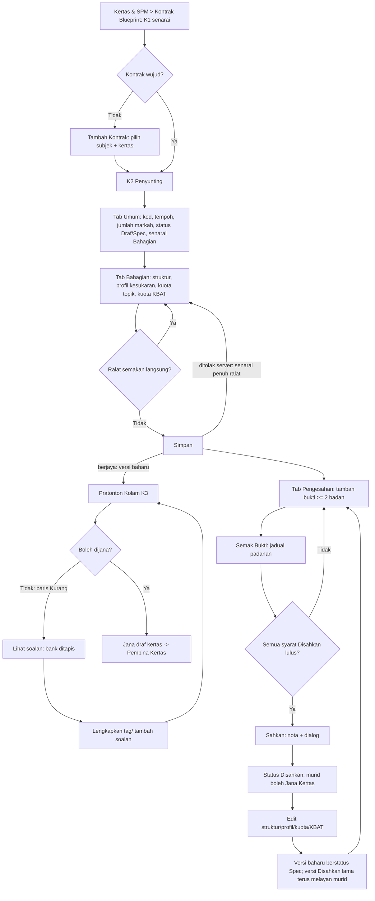
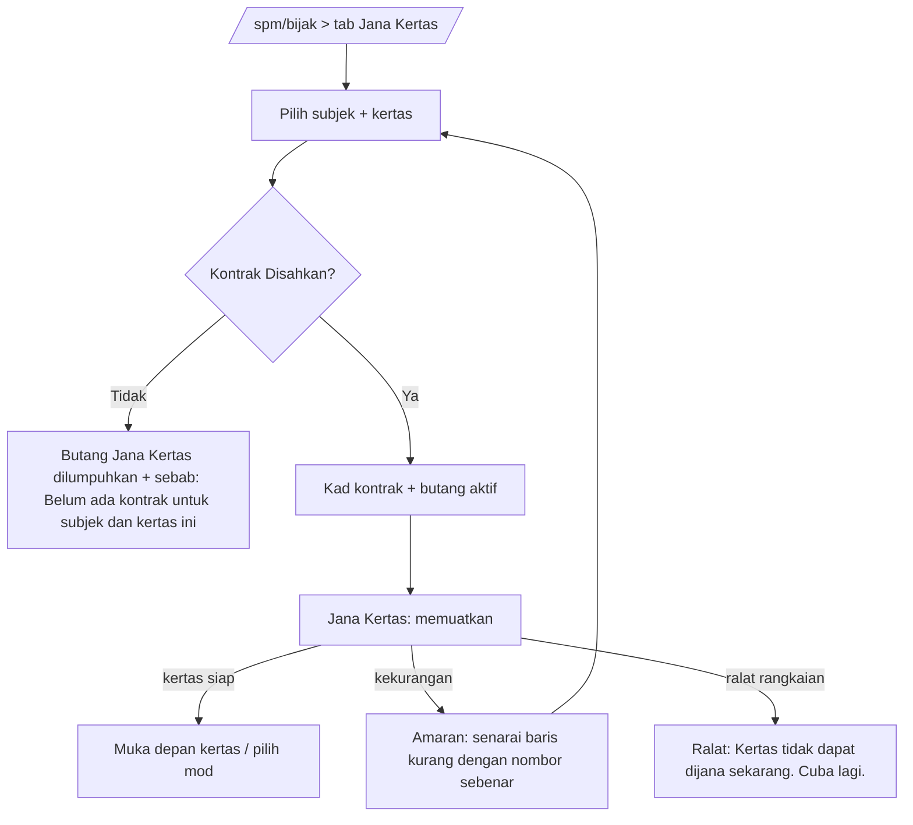

# Bijak SPM - "Jana Kertas follows the SPM exam standard" (UX/UI design spec)

| Field | Value |
|---|---|
| Slug | `v2-bijak-spm-standards` (feature `bijak-spm`, enhancement US-34 to US-40) |
| Version | 1.0, 2026-10-29 |
| Author | ui-ux-designer |
| Status | **Proposed - needs user approval** (decisions in section 12) |
| Gate | G2 Design (UX/UI). Architecture (data model, API) is written in parallel in `docs/architecture/v2-bijak-spm-standards.md`. |
| Requirements | `docs/requirements/v2-bijak-spm.md`: US-25 (AC-25.1, 25.2, 25.5, 25.7, 25.8), US-29 (AC-29.1 to 29.5), US-03 (AC-03.2, 03.6), US-34 to US-40, AC-28.3, NFR-16 |
| Evidence base | `docs/discovery/SPM-paper-patterns.md` (SPP) for the shape of the numbers |
| Builds on | `v2-admin-page-templates.md` (A list, B form, F tabbed, H detail; rules 1.1 to 1.13), `v2-design-system.md` (tokens, type scale, a11y baseline), `v2-question-bank.md` (R6 list, R8 editor, N14 gate list, P1/P2 hooks), `v2-copy-glossary.md` |
| Language | Doc English. UI copy BM. `[PROPOSED]` = new copy, not yet approved. Field names for data that the architect defines are written "(field name per architecture doc)". |

## 0. What exists today and what this spec adds

Findings from the code search (2026-10-29):

| Item | State in the repo | Consequence for this spec |
|---|---|---|
| Kontrak Blueprint editor screen | **Does not exist as a page.** The Portal menu has the placeholder `KS-08 "Kontrak Simulasi"` with no route (`src/shells/pentadbiran/menu.ts`). Only the API schemas exist (`packages/contract/src/bijak/builder/schema.ts`: `BijakBlueprintAdminCreate`, `...VersionInput`, `BijakBlueprintView`) and the read-only conformance panel inside the paper editor. | Section 4 specifies the whole editor (Umum + Bahagian + Pengesahan), not only the additions. The additions are marked **[NEW 2026-10-29]** so the developer can tell base from addition. |
| Pratonton kolam | Does not exist. The bank design only says "count + link Lihat soalan" (`v2-question-bank.md` section P2). | Section 5 specifies it in full. |
| Student Jana Kertas tab | Exists in `BijakHubPage.vue` (subject + kertas selects, contract card, `Jana Kertas` button, `UAlert` shortage list). Disabled state exists but is a bare muted line. | Section 7 changes only: disabled reason placement/ARIA, richer shortage lines, Mod Pelajar "Spec" badge. |
| Bank ineligibility | Not present. | Section 6 adds a filter, a row badge and a field warning to R6/R8, nothing else. |

Routes proposed (admin; role Admin Pusat only, others 403 per AC-22.4 style, no notice page):

| ID | Screen | Route |
|---|---|---|
| K1 | Senarai Kontrak Blueprint | `/admin/spm/kontrak` |
| K2 | Penyunting Kontrak (tabs: Umum, one tab per Bahagian, Pengesahan) | `/admin/spm/kontrak/:subjek/:kertas` (tab by `?paparan=umum\|bahagian-{n}\|pengesahan`) |
| K2a | Pemilih Unit DSKP (drawer) | inside K2 |
| K2b | Bukti pengesahan (drawer: add/edit one evidence row) | inside K2 |
| K2c | Dialog Sahkan | inside K2 |
| K3 | Pratonton Kolam | `/admin/spm/kontrak/:subjek/:kertas/kolam` |
| B1 | Bank Soalan additions (R6 filter, row badge, R8 field warning) | existing `/admin/spm/soalan` (KS-02) and editor |
| S1 | Student Jana Kertas tab states | existing `/spm/bijak` tab "Jana Kertas" |

## 1. User flows

### 1.1 Admin Pusat: author, check, verify



### 1.2 Murid: Jana Kertas



Admin Pusat in Mod Pelajar follows the same flow but state C accepts "Spec" as well (AC-39.6); the card carries a "Spec - ujian" badge (section 7.3).

## 2. Design rules used (no new tokens, no one-off styles)

- Page frame, anatomy order (back link, header, tabs, KPI, filter, body) and all state components follow `v2-admin-page-templates.md` sections 1 and 2. No page prints an `h1` (shell navbar does). No `class`/`:ui` in pages (R1/R3): everything below is `Ds*` or sanctioned Nuxt UI parts; repeated structures are **domain components** under `src/modules/m28-bijak-spm/admin/kontrak/components/` that only compose `Ds*`.
- Colour only through tokens. Status is never colour alone: every state is **icon + word** (Phosphor `i-ph-*`): ok = `check-circle`, short/over/error = `warning-circle`, not verified = `question`, not covered = `minus-circle`.
- Numbers are tabular (`tabular`) and formatted by `format.ts` (`formatCount`); marks are integers.
- Counts shown always equal the rows they describe (NFR-12).
- Quota lines, TP bands and KBAT are shown with BM labels only, never raw identifiers (AC-25.4, AC-25.8). Labels: **Tangga mengikut nombor soalan**, **Mengikut Bahagian**, **Blok tema** [PROPOSED].
- New DS proposal **DsSumMeter** (small, reused in 5 places): a labelled sum against a target, states `ok | short | over`, always icon + text ("Jumlah 98 / 100 - kurang 2"), `aria-live="polite"` text updated on blur/500 ms debounce (not per keystroke), `value`, `target`, `unit`. Fallback until it exists: `DsProgress` + `DsBadge` in the domain component. Everything else uses existing DS parts. `DsAccordion` (G5) is **not** needed: Bahagian are tabs.

## 3. K1 - Senarai Kontrak Blueprint

Template: **A (List)**. Menu label (see decision D-1): **Kontrak Blueprint**.

```
DsPage layout="list" subtitle="Satu kontrak bagi setiap subjek dan kertas. Jana Kertas membaca kontrak ini."
  #actions  UButton primary icon=plus  "Tambah Kontrak"
  DsLoadError v-if=error
  DsStatRow density=roomy (4): Jumlah Kontrak | Disahkan | Spec | Draf       (first tile = total, rule 1.3)
  DsFilterBar: [Cari subjek atau kod...][Cari] [Semua Subjek v] [Semua Kertas v] [Semua Status v]
  DsDataTable variant=flush layout=fixed density=cozy
```

1280 columns (fixed widths):

| Column | Content | Width |
|---|---|---|
| Subjek | `DsIdentity`-style: subject dot (`--ds-cat-n` slot), name, under it "Kertas 2 - 1449/2" | 24% |
| Tempoh | "150 minit" | 9% |
| Markah | "100" right aligned, tabular | 8% |
| Bahagian | "3 (A, B, C)" | 10% |
| Status | `DsStatusBadge`: Draf (neutral), Spec (warning), Disahkan (success). Under it, for a newer unverified version while an older Disahkan serves: "Versi 4 Spec - murid guna v3" (caption) | 16% |
| Pengesahan (AC-39.5) | Disahkan: "{peranan} - 12 Nov 2026" + "2 badan: SBP, Selangor". Spec seeded from study: "Kajian kertas percubaan 2025". Draf: "-" | 21% |
| Tindakan | `DsRowActions :inline=2`: Edit (pencil), Pratonton Kolam (stack icon, tooltip + aria-label), "..." menu: Padam (danger, confirm; blocked text when a Terbit paper depends, AC-25.5) | 112 px |

Behaviour per width:

| Width | Behaviour |
|---|---|
| 375 | Header actions stacked full width. KPI 2 columns (tile 1 full width: 1+... 4 tiles = 2x2, template rule 1.7). Filter bar: search + "Penapis" (count chip), drawer with the three selects + **Guna** / **Set Semula**. Table becomes cards: title = "Matematik - Kertas 2", fields = Kod, Tempoh/Markah ("150 minit - 100 markah"), Status, Pengesahan; row actions inline: Edit, Pratonton Kolam, "...". "Isih" select. |
| 768 | KPI 4 across is not allowed below `xl` (2x2). Filter inline (search + 3 selects). Table columns: Subjek, Markah/Tempoh merged under Subjek, Status, Pengesahan, Tindakan. |
| 1280 | All columns, KPI 4 across, pager with size select. |

States: loading = `loading` prop on `DsStatRow`/`DsDataTable`; empty (never created) = `DsEmptyState item="kontrak"` "Belum ada kontrak." + primary "Tambah Kontrak"; no match = filtered empty "Tiada kontrak dijumpai."; error = `DsLoadError` "Tidak dapat memuatkan senarai kontrak. Sila cuba semula."

"Tambah Kontrak" opens `DsDialog` (small): `DsNativeSelect` Subjek, `DsNativeSelect` Kertas (1/2), both required; the pair must be unique (AC-25.1): if it exists the dialog shows `DsCallout error` "Kontrak untuk subjek dan kertas ini sudah wujud." with the link "Buka kontrak". Buttons "Batal" / "Teruskan" -> K2 with an empty Draf.

## 4. K2 - Penyunting Kontrak

Template: **B (Form)** with `DsSplit ratio="8-4" stack-below="xl" sticky-aside`, one `DsPillNav` in `#tabs` (rule 1.7: sibling views of one frame). Back link "Kembali" to K1.

### 4.1 Frame

```
DsPage layout="form" backTo="/admin/spm/kontrak" subtitle="Matematik - Kertas 2 - 1449/2"
  #meta     DsStatusBadge (Draf|Spec|Disahkan)  DsBadge "Versi 4"   [DsBadge "Murid guna v3 (Disahkan)" when newer Spec exists]
  #actions  UButton tonal icon=stack  "Pratonton Kolam"   (disabled + text when dirty: "Simpan dahulu")
  #tabs     DsPillNav label="Bahagian kontrak": Umum | Bahagian A | Bahagian B | Bahagian C | Pengesahan
            (each tab shows a count pill = number of Ralat + Belum lengkap in that tab; sr-only "masalah")
  DsCallout (banner AC-25.2, collapsible, storageKey="kontrak-dikongsi")
  DsCallout (version banner, 4.6)                     [only if status Disahkan or newer Spec]
  DsCallout tone=error (save refused summary, focus target)  [after a refused save]
  DsSplit 8-4
     main: active tab content (DsFormSection per block)
     #aside DsPanel title="Semakan Kontrak"           (4.7)
  DsFormBar :saving submitLabel="Simpan" cancelTo="/admin/spm/kontrak"   (sticky bottom)
```

Shared-contract banner (AC-25.2, `DsCallout tone="info"`, default open, remembered once collapsed): "Kontrak ini dikongsi. Mengubahnya mengubah syarat terbit dan Jana Kertas bagi **semua** kertas {subjek} Kertas {k}." [PROPOSED]

Tab labels: "Bahagian A" uses the section label as authored (max 12 characters shown, full label as `aria-label`). When a tab has problems the count pill is neutral and the text lives in the Semakan panel (the pill alone never carries the meaning).

Wireframe 1280 (tab Bahagian B, illustrative values from the Matematik K2 skeleton; values are examples only):

```
+--sidebar--+-----------------------------------------------------------------------------------------------+
|           | [< Kembali]                                              [Pratonton Kolam]                    |
|           | Matematik - Kertas 2 - 1449/2         (Spec) (Versi 2)                                        |
|           | [Umum] [Bahagian A] [*Bahagian B  (2)] [Bahagian C] [Pengesahan]                                  |
|           | (i) Kontrak ini dikongsi ... semua kertas Matematik Kertas 2.                              [^]  |
|           | +-----------------------------------------------------------+ +------------------------------+ |
|           | | Struktur Bahagian                                         | | Semakan Kontrak              | |
|           | | Label [Bahagian B]  Arahan [Jawab semua soalan.      ]    | | Jumlah markah  100 / 100  ok | |
|           | | Peraturan (o) Jawab semua  ( ) Jawab N daripada M         | | A  ok ok ok ok               | |
|           | | Bil. soalan (M) [5]  Jawab (N) [-]  Markah [45]           | | B  ok x  ! ok                | |
|           | | Mod jawapan dibenarkan [x] Struktur [ ] Esei ...          | | C  ok ok ok ok               | |
|           | | Soalan 11 - 15 (dikira)  [ ] Sub-bahagian menaik          | | Ralat (2)                    | |
|           | +-----------------------------------------------------------+ |  > B: slot 14-15 belum ...   | |
|           | | Profil Kesukaran                                          | | Belum lengkap (1)            | |
|           | | (o) Mengikut Bahagian ( ) Tangga mengikut nombor soalan   | |  > B: kuota KBAT belum diisi | |
|           | |  Slot 11-15 | TP min [3] | TP maks [5] | Kiraan TP [..]   | +------------------------------+ |
|           | |  Slot dilitupi: 5 / 5 ok                                  |                                  |
|           | +-----------------------------------------------------------+                                  |
|           | | Kuota Topik (JSU)   Kira dalam: (o) Markah ( ) Soalan     |                                  |
|           | |  Unit                    Tingkatan  Nilai tepat  [ ]       |                                  |
|           | |  T4 7.0 Graf Gerakan        T4       [9]         [x]       |                                  |
|           | |  T5 5.0 Transformasi        T5       [9]         [x]       |                                  |
|           | |  ...                                                      |                                  |
|           | |  [+ Tambah unit]  [+ Baldi T1-T3, luar DSKP]              |                                  |
|           | |  Jumlah kuota 43 / 45 - kurang 2 (!)    T4 : T5 = 9 : 34   |                                  |
|           | +-----------------------------------------------------------+                                  |
|           | | Kuota KBAT   Markah KBAT [ 6 ]  daripada 45 markah ditawarkan                                  | |
|           | +-----------------------------------------------------------+                                  |
|           | [Batal]                                                                          [Simpan]      |
+-----------+-----------------------------------------------------------------------------------------------+
```

### 4.2 Tab "Umum"

`DsFormSection` blocks (full width, 2-up fields from `md`, rule 1.4; no narrowed column):

| Block | Fields (label -> control -> rule) |
|---|---|
| Maklumat Kertas | Subjek, Kertas (read-only text after create). **Kod kertas** `UInput` (e.g. 1449/2). **Tempoh (minit)** `UInput` number, min 1. **Jumlah markah** number, min 1. **Boleh dimarkah automatik** `DsSwitchField`. **Status** `DsNativeSelect` Draf / Spec only; when Disahkan it is replaced by the `DsStatusBadge` (a Disahkan status is only reached through "Sahkan", AC-39.1; there is no manual downgrade). **Nota** `UTextarea` (cosmetic: does not reset Disahkan, with hint "Perubahan medan ini tidak menjejaskan status Disahkan."). |
| Arahan Muka Depan | Numbered instruction lines, existing behaviour (one line = one instruction), cosmetic. |
| Piawaian Peringkat Kertas **[NEW]** (optional) | **Nisbah Tingkatan 4 : 5** two number fields "Tingkatan 4" / "Tingkatan 5" (exact figures, T1-T3 bucket excluded from the denominator). Hint: "Pilihan. Jika diisi, mesti sama dengan nisbah daripada nilai unit di setiap Bahagian." **Kuota KBAT kertas** number (optional). Hint: "Pilihan. Jika diisi, mesti sama dengan jumlah kuota KBAT semua Bahagian." |
| Senarai Bahagian | A `DsPanel padding=none` list of `DsListRow` per Bahagian: leading = order number, title = label, sub = "Soalan 11-15 - 45 markah - Jawab semua", trailing = completeness badge ("Lengkap" success / "Belum lengkap" warning, icon + text) and actions: **Edit** (switches to that tab), **Naik** / **Turun** (icon buttons, `aria-label` "Naikkan {Bahagian}"; reorder is by buttons, not drag), **Padam**. Footer button "Tambah Bahagian" (tonal, max 20). Question ranges recompute live (continuous numbering, AC-34.5). The total row: "Jumlah markah selepas pilih N: 100 / 100" (`DsSumMeter`). |
| Zon Bahaya | `DsFormSection tone=error` "Padam Kontrak". Blocked state (AC-25.5): button disabled, visible text "Tidak boleh dipadam: {n} kertas Terbit bergantung pada kontrak ini." Otherwise `useConfirm` "Padam kontrak ini?" body "Ini akan memberi kesan kepada {n} kertas draf dan Jana Kertas bagi {subjek} Kertas {k}." [PROPOSED]. |

### 4.3 Tab "Bahagian {label}" - four `DsFormSection` blocks

**(a) Struktur Bahagian** (existing + AC-34.3/38.4 additions)

| Field | Control | Rules / copy |
|---|---|---|
| Label | `UInput` | required, e.g. "Bahagian A" |
| Arahan bahagian | `UTextarea` (cosmetic) | free text; default shown to students when empty is the system line "Jawab semua soalan." / "Jawab {N} daripada {M} soalan" (AC-06.1) |
| Peraturan | `URadioGroup` horizontal: "Jawab semua" / "Jawab N daripada M" | choose-N reveals **Jawab (N)**. |
| Bilangan soalan (M) | number | min 1; error if M < N (AC-25.7) |
| Belanjawan markah (selepas pilih N) | number | the effective marks (AC-34.1) |
| Markah setiap soalan **[NEW]** | `DsSwitchField` "Tetapkan markah mengikut slot" | Off (default): only the section total is checked (hint: "Markah soalan boleh berbeza dalam bahagian ini."). On: run-length list "Slot {dari} - {hingga} - {markah} markah" with add/remove rows; sum rule: effective sum must equal the budget (choose-N: every question has the same marks and marks x N = budget, AC-34.2). |
| Mod jawapan dibenarkan | `UCheckboxGroup` with BM labels | at least one |
| Sub-bahagian menaik **[NEW]** | `DsSwitchField` | hint "Semakan bank akan menanda soalan berbilang bahagian yang tidak menaik dari tuntutan rendah ke tinggi. Ini bukan syarat terbit." |
| Julat soalan | read-only text | "Soalan 11 - 15" |

**(b) Profil Kesukaran [NEW]**

```
Profil kesukaran
( ) Tangga mengikut nombor soalan   TP naik mengikut nombor soalan
(o) Mengikut Bahagian               Satu jalur TP untuk seluruh bahagian
    (Blok tema is not shown until it is built, decision D-9)

Kumpulan slot                                             Slot dilitupi 5 / 5  [ok]
 # | Slot dari | hingga | TP min | TP maks | Kiraan tepat TP (pilihan)      |
 1 |    11     |   15   |  [3]   |  [5]    | TP3 [ 2 ] TP4 [ 2 ] TP5 [ 1 ]  | [Padam]
 [+ Tambah kumpulan slot]
```

- **Radio descriptions** are shown under each option (BM, [PROPOSED]): Tangga: "TP naik mengikut nombor soalan dalam bahagian ini."; Mengikut Bahagian: "Satu jalur TP untuk semua soalan bahagian ini; susunan dalam bahagian tidak diisih."
- Kind **Mengikut Bahagian** = exactly one group, slot range locked to 1..M of the section (the row's from/to are read-only text); the "Tambah kumpulan slot" button is hidden.
- Kind **Tangga**: groups are consecutive and ordered; the slot-from of group n+1 is auto-filled as hi+1 of group n and read-only unless the author edits the previous end. Validation: min and max never decrease from one group to the next (AC-35.3), no overlap, no uncovered slot.
- Choose-N section: forced to one group (AC-35.7); the add button is hidden with hint "Bahagian pilih N menggunakan satu kumpulan slot."
- TP fields are `DsNativeSelect` 1..6 labelled "TP 1" .. "TP 6" (selects, not typed, so no invalid value).
- **Kiraan tepat TP** is a disclosure ("Tetapkan kiraan tepat") that reveals one number field per TP between min and max. Running line: "Jumlah kiraan {x} / {slot dalam kumpulan} slot" (`DsSumMeter`). Rule proposed: when any count is set, the counts must add to the group's slot count (flag for architect, section 11 item 6).
- A coverage strip under the table is text only: "Slot dilitupi: 1-10 (kumpulan 1). Belum dilitupi: 11-12." with `DsBadge` ok/short. Mobile does not draw a bar chart; text is the signal.

**(c) Kuota Topik (JSU) [NEW]**

```
Kuota topik (JSU)             Kira dalam: ( ) Soalan  (o) Markah          [Tetapan: dikira atas soalan ditawarkan]
 Unit                                  Tingkatan   Nilai tepat    Tindakan
 T4 7.0 Graf Gerakan                    T4         [  9 ]        [x]
 T5 5.0 Transformasi                    T5         [  9 ]        [x]
 T1-T3, luar DSKP                       (baldi)    [  0 ]        [x]
 [+ Tambah unit]   [+ Tambah baldi T1-T3, luar DSKP]
 Jumlah kuota 43 / 45 markah  - kurang 2   [DsSumMeter short]
 Nisbah Tingkatan 4 : 5 daripada nilai unit = 9 : 34   (hanya baca)
 Nisbah ditetapkan (pilihan)  [T4] : [T5]
```

- **Kira dalam** (`URadioGroup`): "Soalan" / "Markah". Default = Soalan for objective sections, Markah for structured (AC-36.1). Switching converts nothing; lines keep their numbers and the sum target changes, so the sum meter explains the change.
- **Sum target** = the section's offered amount (offered, not effective, per the Terms table): Soalan -> Bilangan soalan (M); Markah -> offered marks (for compulsory = budget; for equal-mark choose-N = budget / N x M; with per-slot marks = their sum). For choose-N marks with unequal question marks and no per-slot marks, the offered mark total is not defined, so the Markah option shows the error "Tetapkan markah mengikut slot atau kira dalam soalan." (decision D-7).
- **Unit column** shows the DSKP label "T4 7.0 Graf Gerakan" (level + code + title); Tingkatan is a `DsBadge` T4/T5 derived from the unit (units are keyed by level and code; `T4 3.0` differs from `T5 3.0`). The T1-T3 bucket row is pinned last, labelled "T1-T3, luar DSKP", badge "Baldi".
- **Tambah unit** opens **K2a** (drawer). The picker cannot add a unit twice, so "duplicate unit" is not a possible error.
- **Nilai tepat**: integer >= 0, `inputmode="numeric"`, step 1. Hint under the table: "Unit tanpa baris tidak akan dipilih untuk bahagian ini." (AC-36.2).
- **Derived T4 : T5** is read-only text, recalculated live. Optional "Nisbah ditetapkan" (section level) is a two-field control collapsed under "Tetapkan nisbah Tingkatan 4 : 5 (pilihan)"; if set and different from the derived split -> error (AC-25.7).
- Section with zero quota lines = **Belum lengkap** (not an error). Section with at least one line must add up exactly, otherwise **Ralat**.
- Row remove: `UButton` icon, `aria-label` "Buang {unit}"; after removal focus moves to the next row's value field, or "Tambah unit" when none.

**(d) Kuota KBAT [NEW]**

| Field | Control | Copy |
|---|---|---|
| Markah KBAT bahagian | number, min 0 (0 allowed and counts as filled) | label "Markah KBAT (tepat)"; hint "KBAT ialah bahagian soalan pada tahap kognitif Mengaplikasi, Menganalisis, Menilai atau Mencipta. Dikira atas markah ditawarkan." |
| Reference | `DsText` | "daripada {offered} markah ditawarkan" (`DsSumMeter` value/target without "short"; states: ok, or over when KBAT > offered) |

No TP threshold field exists (AC-37.1). Error when KBAT > section offered marks, and when the KBAT quota contradicts the profile (AC-37.5, copy in 4.8). A short help line: "TP mengukur kesukaran; KBAT ialah tahap kognitif. Keduanya ditetapkan berasingan."

### 4.4 K2a - Pemilih Unit DSKP (`DsDrawer side=right size=md`; bottom sheet < `sm`)

```
Tambah Unit DSKP                                   [x]
[Cari unit atau kod...]
Tingkatan 4
  [ ] T4 1.0 Kuadratik
  [x] T4 2.0 Asas Nombor
  [-] T4 3.0 Logik        (sudah ada)   <- disabled, text "Sudah ada"
Tingkatan 5
  [ ] T5 1.0 Ubahan ...
-------------------------------------------------
{n} dipilih                [Batal]  [Tambah {n} unit]
```

- Source: DSKP units of the contract's subject (M03). Checkbox list (multi-select) so a whole JSU is entered in one pass. Grouped by Tingkatan with `h3` group headings; units already used are disabled with the visible words "Sudah ada" (not only dimmed).
- Empty search: `DsEmptyState size=sm` "Tiada unit dijumpai." Subject without DSKP loaded: "Tiada unit DSKP untuk subjek ini. Gunakan baldi T1-T3, luar DSKP atau hubungi pentadbir." [PROPOSED].
- Added units get value empty ("-") and the new first empty field takes focus; empty value counts as 0 for the sum and as **Ralat** only if any line is empty at Save ("Isi nilai untuk {unit}.").

### 4.5 Tab "Pengesahan" (verification panel) [NEW]

Blocks in order (main column), aside = same Semakan Kontrak panel.

```
+ Status Pengesahan ---------------------------------------------------------------+
| (Spec)  Versi 4          Murid sedang guna: v3 (Disahkan oleh Admin Pusat, 12 Nov 2026)   |
| Pengesah: -     Tarikh: -     Nota: -                                           |
+ Bukti Pengesahan ----------------------------------------------[+ Tambah Bukti]+
| Badan     Tahun  Kod kertas  Skema     Nilai dibaca                    Tindakan |
| SBP       2025   1449/2      Ada       3 bahagian, 17 soalan, 100 mk,150 min [e][x]|
| Selangor  2025   1449/2      Ada       3 bahagian, 17 soalan, 100 mk,150 min [e][x]|
| Kajian*   2025   1449/2      Belum dibaca  (dari kajian, belum disahkan)      [e]  |
|  Badan berbeza dengan skema: 2 / 2  [ok]                                        |
+ Semakan Bukti ---------------------------------------------[Semak Bukti]------+
| Nilai              Blueprint   Bukti                    Padanan                 |
| Tempoh             150 min     SBP 150 - Selangor 150   Sepadan                 |
| Jumlah markah      100         SBP 100 - Selangor 100   Sepadan                 |
| Bahagian A markah  40          SBP 40 - Selangor 40     Sepadan                 |
| Bahagian C peraturan Jawab 1 drp 2  SBP 1/2 - Selangor 2/2  Berbeza             |
| Bahagian D ...     (tiada)     (tiada)                  Tiada dalam bukti       |
| Disemak 29 Okt 2026, 10:42                                                      |
+ Syarat Disahkan ------------------------------------------------------------- +
| ok  Struktur dan markah konsisten                                               |
| x   Bahagian B: profil kesukaran belum ditetapkan           [Pergi ke medan]    |
| ... (a to e of AC-39.1)                                                         |
+ Sahkan Kontrak -------------------------------------------------------------- +
| Nota pengesahan [textarea, wajib]                                               |
| Pengesah: {nama pengguna semasa}, Admin Pusat     Tarikh: auto                  |
| [Sahkan]   Selesaikan 2 syarat di atas dahulu.                                  |
+---------------------------------------------------------------------------------+
```

**Evidence list (`DsDataTable variant=bare` in a `DsPanel padding=none`, `pager=none`).**
- Columns: Badan, Tahun, Kod kertas, Skema (`DsBadge`: "Ada" success / "Tiada" warning), Nilai dibaca (one-line summary), Tindakan (`DsRowActions`: Edit, Padam). Rows of seeded study evidence carry a `DsBadge` "Kajian" and the caption "Dari kajian, belum disahkan oleh manusia" (AC-39.5/39.8). They are read-only until edited; editing converts them to verifier-entered evidence.
- Counter line above the table: "Badan berbeza dengan skema: {n} / 2" (`DsSumMeter`, ok at >= 2). Which rows count towards the 2 bodies is decision D-5.
- Read-only after verification: once Disahkan the table loses Tambah/Edit/Padam, shows a lock icon with "Rekod pengesahan tidak boleh diubah." (AC-39.2). A new Spec version starts with the same evidence, editable again, and the earlier record stays in history (decision D-5 note).
- Empty: `DsEmptyState size=sm` "Belum ada bukti. Tambah kertas percubaan dan skema dari sekurang-kurangnya dua badan." [PROPOSED].

**K2b - Bukti drawer (`DsDrawer`, `DsFormSection` fields):**

| Field | Control | Rule |
|---|---|---|
| Jenis bukti | `URadioGroup`: "Kertas percubaan + skema" / "Dokumen format atau JSU LPM" | LPM document counts alone (AC-39.2) |
| Badan penerbit | `UInput` with suggestions | required, e.g. SBP, Selangor |
| Tahun | number 2000 to current year | required |
| Kod kertas | `UInput` | required |
| Skema jawapan dirujuk | `DsSwitchField` "Skema jawapan ada" | |
| Tempoh dibaca (minit) | number | |
| Jumlah markah dibaca | number | effective marks |
| Nilai setiap Bahagian | rows: Label, Markah, Peraturan (Semua / N daripada M), Bilangan soalan | add/remove rows; each value is an integer |

There is deliberately **no** "Salin daripada kontrak" button: copying the blueprint into the evidence would make the AC-39.7 check pass trivially (decision D-4). Footer: **Batal** / **Simpan Bukti**. Copy under Nilai: "Isi nilai seperti yang dicetak pada kertas sebenar, bukan daripada kontrak ini."

**Evidence check table (AC-39.7).** Compares: tempoh, jumlah markah, and per Bahagian: markah, peraturan Jawab (semua / N daripada M), bilangan soalan. Topic and KBAT quotas are not compared and the panel says so: "Kuota topik dan KBAT ditetapkan oleh penulis kontrak; tidak dibandingkan dengan bukti." Columns: **Nilai | Blueprint | Bukti | Padanan**. "Bukti" lists each body as "{Badan} {nilai}" separated by " - ".

| Padanan | Meaning | Badge |
|---|---|---|
| Sepadan | at least two bodies give the blueprint value | success, `check-circle` |
| Berbeza | a body's value differs from the blueprint | error, `x-circle` |
| Tidak disahkan | fewer than two bodies agree (AC-39.7) | warning, `question` |
| Tiada dalam bukti | the blueprint section/value is not covered by any evidence | warning, `minus-circle` |

Table is `DsDataTable variant=bare density=tight`, grouped by Bahagian (a group label row). Button **Semak Bukti** re-runs the server check (loading label "Menyemak..."), and the result auto-refreshes after any evidence change. The "Sahkan" action runs the same check again on the server; its failure list uses the same rows.

**Syarat Disahkan (gate list, AC-39.1 a to e).** `DsGateList`-style list (bank design N14; if that composite is not shipped, `DsListRow` with a leading icon): each row icon + text + "Pergi ke medan" link that switches tab and focuses the field. Rows [PROPOSED copy]: "Markah, tempoh, Bahagian dan peraturan konsisten", "{Bahagian}: profil kesukaran meliputi semua slot", "{Bahagian}: kuota topik lengkap", "{Bahagian}: kuota KBAT diisi (0 dikira diisi)", "Rekod pengesahan lengkap (>= 2 badan, nota)", "Semakan bukti lulus".

**Sahkan block.** Fields: **Nota pengesahan** (`UTextarea`, required, 2000 chars), Pengesah and Tarikh are read-only text (current user and role, date set by the server). Button **Sahkan** (primary, `aria-disabled` while any gate fails or the form is dirty; the reason is written next to it: "Selesaikan {n} syarat di atas dahulu." or "Simpan perubahan dahulu."). Only Admin Pusat reaches this page at all (AC-39.3); no role-specific UI.

**K2c - Dialog Sahkan (`DsDialog`):**

```
Sahkan kontrak ini?
Matematik - Kertas 2 (1449/2), versi 4
Selepas disahkan, murid boleh menjana kertas daripada kontrak ini.
Rekod pengesahan (bukti dan nota) tidak boleh diubah.
Bukti: SBP 2025, Selangor 2025                      [Batal]  [Sahkan]
```

On success: toast "Kontrak berjaya disahkan.", status badge turns Disahkan, Bukti table locks, page keeps focus on the status block. On server failure (409/422): `DsCallout tone=error` with the list returned, and the dialog closes.

### 4.6 Version banner (AC-39.4, AC-25.3)

Shown at the top of K2 (below the shared banner) for a Disahkan blueprint and for a Spec version that sits above a Disahkan one.

| Situation | Callout | Copy [PROPOSED] |
|---|---|---|
| Disahkan, no unsaved structural edit | info | "Kontrak ini Disahkan (v{n}). Mengubah markah, struktur, profil, kuota atau KBAT akan disimpan sebagai versi baharu berstatus Spec. Murid terus menggunakan v{n} sehingga versi baharu disahkan." |
| Disahkan, structural field edited (dirty) | warning | "Perubahan ini akan disimpan sebagai v{n+1} (Spec). Murid masih menggunakan v{n} (Disahkan)." |
| Latest is Spec above a Disahkan v{m} | warning | "Versi terkini (v{n}) berstatus Spec. Murid menggunakan v{m} (Disahkan) sehingga v{n} disahkan." |
| Cosmetic field edited (nota, arahan) | none | field hint only |

Which fields are structural vs cosmetic: structural = tempoh, jumlah markah, anything in Struktur Bahagian except label/arahan, profil, kuota topik, KBAT, T4:T5; cosmetic = nota, arahan muka depan, arahan bahagian, label. When Save is pressed on a structural change of a Disahkan contract, a `DsDialog` confirms: title "Simpan sebagai versi baharu?" body "Versi {n+1} akan berstatus Spec. Murid masih menggunakan v{n} sehingga versi baharu disahkan." buttons "Batal" / "Simpan Versi Baharu".

### 4.7 Semakan Kontrak panel (live sums and validation)

`DsPanel title="Semakan Kontrak"` in the aside (sticky at `xl`). Contents:

1. **Jumlah markah**: `DsSumMeter` "Markah bahagian (selepas pilih N) {x} / {jumlah kertas}".
2. **Matrix** (text, not colour): rows = Bahagian, four columns Struktur, Profil, Kuota topik, KBAT; each cell icon + word at 1280 ("Lengkap" / "Ralat" / "Belum"), icon with `aria-label` below.
3. **Ralat ({n})** list: each item is a link "Bahagian B: ..." that switches tab and focuses the field. These block Save (AC-25.7).
4. **Belum lengkap untuk Disahkan ({n})** list: the same style; these do not block Save (AC-35.1) but block Sahkan.
5. If there are no problems: `DsCallout tone=success` "Tiada ralat. Kontrak boleh disimpan."

Below `xl` the panel stacks **above** the tab content as a collapsible `DsCallout` (title "Semakan Kontrak - {n} masalah"; collapsed by default when there are no errors, open when there are). A summary chip "{n} masalah" sits left of the Simpan button in the sticky `DsFormBar` and scrolls to the panel.

### 4.8 Save behaviour and validation copy

- Live validation runs on blur and 500 ms after typing stops; inline errors under the field (`DsFormField error`) and in the panel. **Simpan is never disabled**; if it is pressed with errors, the server/client check lists them all in `DsCallout tone=error` at the top: title "Kontrak tidak dapat disimpan. Sila betulkan {n} masalah di bawah." focus moves to it (AC-25.7 "every problem listed"). Server refusal returns the same list (field name per architecture doc).
- Saving: button label "Menyimpan...", form inert except Cancel. Success toast "Kontrak berjaya disimpan." and new version number appears in `#meta`.
- Version conflict (another admin saved first): `DsCallout error` "Kontrak ini telah diubah oleh pengguna lain. Muat semula untuk melihat versi terkini." with button "Muat Semula" [PROPOSED].
- Unsaved changes: leaving the page or switching route asks `useConfirm` "Tinggalkan halaman? Perubahan belum disimpan akan hilang." Switching tab inside K2 never prompts (one form).

| Rule | Error copy [PROPOSED] | AC |
|---|---|---|
| Section budgets (after choose-N) <> total marks | "Jumlah markah bahagian ({x}) tidak sama dengan jumlah markah kertas ({y})." | 25.7 |
| M < N | "{Bahagian}: bilangan soalan ({m}) kurang daripada bilangan dipilih ({n})." | 25.7 |
| Group overlap | "{Bahagian}: kumpulan slot bertindih pada slot {a} - {b}." | 25.7 |
| Slot uncovered | "{Bahagian}: slot {a} - {b} belum dilitupi oleh mana-mana kumpulan." | 25.7 |
| Ladder decreases | "{Bahagian}: jalur TP tidak boleh menurun pada slot {a}." | 35.3 |
| TP min > max | "{Bahagian}: TP minimum tidak boleh melebihi TP maksimum." | 35.2 |
| TP counts <> slots | "{Bahagian} slot {a} - {b}: jumlah kiraan TP ({x}) tidak sama dengan bilangan slot ({y})." | 35.2 |
| Choose-N group count | "{Bahagian}: bahagian pilih N mesti menggunakan satu kumpulan slot." | 35.7 |
| Per-slot marks sum | "{Bahagian}: jumlah markah slot ({x}) tidak sama dengan belanjawan bahagian ({y})." | 34.3 |
| Quota sum | "{Bahagian}: jumlah kuota topik ({x}) tidak sama dengan {y} {soalan atau markah} bahagian ini." | 25.7 |
| T4:T5 contradiction | "{Bahagian}: nisbah Tingkatan 4 : 5 daripada nilai unit ({a} : {b}) bercanggah dengan nisbah ditetapkan ({c} : {d})." | 25.7 |
| KBAT over marks | "{Bahagian}: kuota KBAT ({x} markah) melebihi markah ditawarkan ({y})." | 37.5 |
| KBAT vs TP band | "{Bahagian}: kuota KBAT {x} markah bercanggah dengan jalur TP profil ({a} - {b})." (exact rule per architecture doc) | 37.5 |
| Empty quota value | "{Bahagian}: isi nilai untuk {unit}." | 36.1 |
| Incomplete (Belum lengkap) | "{Bahagian}: profil kesukaran belum ditetapkan." / "...kuota topik belum ditetapkan." / "...kuota KBAT belum diisi." | 35.1, 39.1 |

### 4.9 K2 responsive summary

| Width | Behaviour |
|---|---|
| 375 | One column. `DsPillNav` scrolls inside itself, active tab scrolled into view, full label as `aria-label`. Banners collapsible. Semakan Kontrak collapsed callout above content; sticky `DsFormBar` with "{n} masalah" chip + Batal (tonal) + Simpan (full-width stack: Batal then Simpan). Fields one per row. **Slot-group table -> cards**: each group a card (title "Slot 1 - 10"), fields in a 2x2 grid (Dari, Hingga, TP min, TP maks), "Kiraan tepat TP" disclosure, "Buang" button. **Quota table -> cards**: title = unit (`h4`), badge Tingkatan, one value field (full width, 44 px high), "Buang". Footer sum meter is sticky above the form bar while the quota section is in view (text "Jumlah 43 / 45 - kurang 2"). **Evidence list -> cards** (Badan + Tahun title; Skema, Kod, Nilai dibaca; Edit/Padam). **Evidence check table -> one card per row group**: title "Bahagian C", then 3 lines each "Peraturan: blueprint Jawab 1 daripada 2 - bukti SBP 1/2, Selangor 2/2 - [Berbeza]". Pemilih unit = bottom sheet, footer buttons full width. |
| 768 | One column; sections 2-up where fields are short; slot-group and quota tables show as tables with the "Kiraan tepat" disclosure as a row below; Semakan Kontrak is a collapsible callout; form bar sticky. Evidence check as table with columns Nilai, Blueprint, Bukti (wraps to 2 lines), Padanan. |
| 1280 | 8/4 split, aside sticky with the Semakan panel; tables full; drawers are right slide-overs (md width, 480 px). |

States: loading = skeleton for header meta + one `DsStateView skeleton="cards"` per section block; error loading = `DsLoadError` replacing the body ("Tidak dapat memuatkan kontrak. Sila cuba semula."); contract not found = `DsEmptyState` "Kontrak tidak ditemui." with "Kembali"; saving = form bar loading and fields `readonly`; empty (new Draf): each new block shows its own empty hint ("Tiada kumpulan slot. Tambah kumpulan pertama.", "Tiada baris kuota.") and the matrix shows "Belum" (not error).

## 5. K3 - Pratonton Kolam

Template: **report/detail** (`DsPage layout="report"` frame, no tabs). Back link "Kembali" to K2. The pool is computed from the **saved** version by the same solver/query as Jana Kertas (AC-29.1, 29.4, 29.5).

```
DsPage layout="report" backTo=".../kontrak/mat/2" subtitle="Matematik - Kertas 2 - versi 4 (Spec)"
  #actions  UButton tonal icon=arrow-clockwise "Muat Semula"
            UButton tonal icon=list-magnifying-glass to=bank "Lihat Soalan"
            UButton primary icon=magic-wand "Jana Draf Kertas"
  DsCallout (verdict)               tone=success|error
  DsStatRow (4): Soalan Terbit | Soalan layak | Soalan tidak layak | Baris kurang
  DsPanel "Soalan Tidak Layak"  (reasons table)
  DsSwitchField "Tunjuk baris kurang sahaja"
  per Bahagian: DsPanel title="Bahagian A - Soalan 1 - 10 - 40 markah" with status DsBadge
      DsSplit 7-5:  [Kuota topik table]  |  [Sasaran TP table] + [KBAT table]
```

### 5.1 Verdict banner

| Verdict | Callout | Copy [PROPOSED] |
|---|---|---|
| Boleh dijana | success, `check-circle` | Title "Boleh dijana". Description "Semua kekangan dapat dipenuhi daripada {n} soalan layak." |
| Tidak boleh dijana | error, `warning-circle` | Title "Tidak boleh dijana". Description "Kekangan pertama yang gagal: {Bahagian}: perlu {n} soalan {unit}, hanya {m} tersedia." plus link "Lihat soalan" for that line. |
| Tidak boleh dijana (every line individually enough) | error | Description "Setiap baris cukup secara berasingan, tetapi gabungan kekangan tidak dapat dipenuhi. Kekangan pertama yang gagal: {teks daripada penyelesai}." (the solver's first-failing-constraint text, same strings as the student shortage lines) |

The verdict comes from the generator's solver, never from the table colours. Under it, a caption line: "Dikira {tarikh masa} - versi {n} ({status})." If the editor has unsaved changes the preview button in K2 is disabled; the preview itself never reads unsaved data.

### 5.2 KPI strip and reasons panel

KPIs (4, each with `to` where it drills down): **Soalan Terbit** (all Terbit questions for the subject and kertas), **Soalan layak**, **Soalan tidak layak** (links to the bank prefiltered, section 6), **Baris kurang** (number of lines marked "Kurang"). Counts equal rows (NFR-12).

`DsPanel "Soalan Tidak Layak"` (`DsDataTable variant=bare density=tight pager=none`):

| Sebab | Bilangan | |
|---|---|---|
| Tiada unit | 12 | [Lihat soalan] |
| Tiada TP | 7 | [Lihat soalan] |
| Tiada tahap kognitif | 5 | [Lihat soalan] |
| Tiada markah | 1 | [Lihat soalan] |
| Mod jawapan tidak dibenarkan | 4 | [Lihat soalan] |

A footer line states: "Satu soalan boleh dikira dalam lebih daripada satu sebab. Jumlah soalan tidak layak: {unique}." (decision D-8). Empty (no ineligible): `DsEmptyState size=sm` "Semua soalan Terbit layak." The "Mod jawapan tidak dibenarkan" row exists here because the context is a contract (section 6.4).

### 5.3 Quota-fill per Bahagian

Panel header: title "Bahagian B - Soalan 11 - 15 - 45 markah" and a `DsBadge`: "Cukup" (success) or "Kurang {k} baris" (error). Three tables, each with `cardTitle` / `cardFields` for < `md`:

| Table | Columns | Short rule |
|---|---|---|
| **Kuota topik** | Unit (e.g. "T5 5.0 Transformasi"), Perlu (exact quota, in the section's counting unit "soalan"/"markah"), Ada (qualifying available, same unit), Status, Tindakan (Lihat soalan) | status "Kurang {perlu - ada}" when Ada < Perlu |
| **Sasaran TP** | Kumpulan slot ("Slot 11 - 15, TP 3 - 5"), TP (a band or an exact-count line such as "TP 4"), Perlu (slots or exact count), Ada, Status, Tindakan | same |
| **KBAT** | Baris ("Markah KBAT"), Perlu (exact marks), Ada (marks available), Status, Tindakan | same |

- Status cell: `DsBadge` icon + text. "Cukup" success `check-circle`; "Kurang {n}" error `warning-circle` (word and number, AC-29.4). The row never relies on a coloured background; the left edge of a short row gets a `warning-circle` icon in the first cell as well, so scanning works in dark mode and grayscale.
- Pool count 0 on a line: Ada = "0" and the status cell reads "Kurang {n}"; the section-level empty (no qualifying question at all for a section) shows `DsEmptyState size=sm` "Tiada soalan Terbit untuk tag ini" (AC-29.1, not an error).
- **Lihat soalan** (icon button, `aria-label` "Lihat soalan {unit}") opens the bank in a new tab, prefiltered: status Terbit, subjek, kertas, unit, TP range or cognitive-level group as relevant (query names per architecture/bank doc). The page header "Lihat Soalan" opens the whole pool (all layak + tak layak) with the contract chip.
- "Tunjuk baris kurang sahaja" (`DsSwitchField`) hides "Cukup" lines; when no line is short it shows `DsEmptyState size=sm` "Tiada baris kurang."
- Order is blueprint order; no automatic reordering.

Wireframe 1280:

```
| Boleh dijana? [x] Tidak boleh dijana  -  Kekangan pertama: Bahagian B: perlu 9 markah T5 5.0, hanya 6 tersedia.  [Lihat soalan] |
| [Soalan Terbit 412] [Soalan layak 361] [Soalan tidak layak 51 >] [Baris kurang 3]                                            |
| Soalan Tidak Layak                                                                                                          |
|  Tiada unit 12 [Lihat] | Tiada TP 7 | Tiada tahap kognitif 5 | Tiada markah 1 | Mod jawapan tidak dibenarkan 4              |
| [ ] Tunjuk baris kurang sahaja                                                                                              |
| Bahagian B - Soalan 11-15 - 45 markah                                                  (Kurang 2 baris)                     |
|  Kuota topik (markah)                              |  Sasaran TP                                   |                          |
|  T4 7.0 Graf Gerakan   Perlu 9  Ada 14  Cukup      |  Slot 11-15 TP3-5  Perlu 5 Ada 9  Cukup      |                          |
|  T5 5.0 Transformasi   Perlu 9  Ada 6   (!) Kurang 3 [Lihat] |  KBAT  Perlu 6 Ada 4  (!) Kurang 2 [Lihat]  |                          |
```

### 5.4 Jana draf kertas (AC-29.2, 29.3)

- Button states: enabled when the verdict is "Boleh dijana"; otherwise `aria-disabled` and the reason as visible text beside it ("Tidak boleh dijana - lihat baris kurang di atas.") and `aria-describedby`. Loading: label "Menjana..." (target <= 3 s, NFR-13); the page remains readable.
- Success: navigate to the paper editor (KS-09) with toast "Draf kertas dijana. Kertas belum diterbitkan." The paper is Draf, never published automatically.
- Refusal (solver changed since the preview): stay on the page, `DsCallout error` "Draf kertas tidak dapat dijana." + the shortage lines with real numbers (same strings as 7.2), preview refreshes.
- Network error: `DsCallout error` "Draf kertas tidak dapat dijana sekarang. Cuba lagi." + "Cuba Semula".

### 5.5 K3 responsive and states

| Width | Behaviour |
|---|---|
| 375 | Header actions stacked full width, order Muat Semula, Lihat Soalan, Jana Draf Kertas (primary last). Verdict callout first. KPI 2x2. Reasons table -> list cards (Sebab, Bilangan, Lihat soalan). Each Bahagian panel is collapsed by default **except** those with short lines (open); inside, the three tables are card lists: title = unit, fields = Perlu, Ada, Status; "Lihat soalan" is a full-width tonal button in the card. |
| 768 | KPI 2x2, tables stack one column (Kuota topik, then TP, then KBAT), columns visible (Unit, Perlu, Ada, Status, Tindakan). |
| 1280 | `DsSplit 7-5` inside each Bahagian: topic table left; TP and KBAT stacked right. KPI 4 across. |

States: loading = `DsStateView skeleton` for KPI + panels; error = `DsLoadError` "Tidak dapat memuatkan pratonton kolam. Sila cuba semula."; empty pool (zero Terbit questions) = page-level `DsEmptyState` "Tiada soalan Terbit untuk tag ini" with button "Lihat Soalan" (rule: if every region is empty, one empty state); contract in Draf/Spec still previews (labelled by the status chip); a contract with no quota lines shows only the section totals plus `DsCallout info` "Kontrak ini belum ada kuota topik, profil atau KBAT. Pratonton hanya menunjukkan bilangan soalan." [PROPOSED].

## 6. B1 - Question bank side (what this feature needs only)

Reference: `v2-question-bank.md` R6 (list, route `/admin/spm/soalan` in the Portal), R8 (editor), R2 (review). No layout there changes.

### 6.1 R6 additions

| Addition | Spec |
|---|---|
| Filter "Kelayakan Jana Kertas" | One `DsNativeSelect` in "Lagi Penapis" (not inline; keeps the max-3-inline rule). Options: "Semua", "Layak", "Tidak layak", "Tiada unit", "Tiada TP", "Tiada tahap kognitif", "Tiada markah", and, only when the list is opened from a contract (query `kontrak=`), "Mod jawapan tidak dibenarkan". Chip text = the selected value. The Pratonton Kolam links pre-set this filter plus subject/kertas/unit and show a removable chip "Kontrak: Matematik Kertas 2". |
| Row badge | In the identity cell under the title: for an ineligible Terbit question a `DsBadge tone=warning icon=warning-circle` "Tidak layak Jana Kertas" followed by the reasons as plain text (caption): "Tiada TP (b)(ii), tiada tahap kognitif (c)". Eligible rows show nothing. Draft/archived questions show nothing (only Terbit questions are in the pool). |
| Mobile card | Same badge + reason line inside the card, above the actions. |
| Counts | The table total and the "Soalan tidak layak" KPI link both come from the same query, so counts equal rows. |

### 6.2 R8 editor additions (per leaf part)

Each leaf part already carries TP and Tahap kognitif (Q-B19, D76). When one is empty on a Terbit-bound question the field shows a **non-blocking** warning under it (`DsFormField` hint tone warning, icon + text): "TP diperlukan supaya soalan ini layak untuk Jana Kertas." / "Tahap kognitif diperlukan supaya soalan ini layak untuk Jana Kertas." / "Markah diperlukan (sekurang-kurangnya 1)." / "Unit DSKP atau asal Tingkatan 1 - 3 diperlukan." [PROPOSED]. These do not block publishing of the question (AC-38.1 only controls pool entry); they add an entry to the existing gate list as a **warning row** "Layak untuk Jana Kertas: tidak" (icon `warning-circle`, not a blocker) in the R7 publish dialog. Cognitive level uses the labels Mengingat, Memahami, Mengaplikasi, Menganalisis, Menilai, Mencipta; the four last labels carry a small `DsBadge` "KBAT" next to the field value (info, text).

### 6.3 R2 review checklist hook (AC-38.4)

One extra checklist item (owned by the bank design) shown only for questions of subjects whose contract has "Sub-bahagian menaik" on: "Bahagian soalan disusun daripada tuntutan rendah ke tinggi." with `UCheckbox` and note "Bukan syarat terbit." Result = review flag, not a gate.

### 6.4 Reason scope

The first four reasons (tiada unit, TP, tahap kognitif, markah) are properties of the question and appear in the plain bank list. "Mod jawapan tidak dibenarkan" depends on the target section, so it only appears in the K3 breakdown and in the bank when opened from a contract (see AC note in section 11, item 8).

## 7. S1 - Student: Jana Kertas tab

Existing page `BijakHubPage.vue`, tab Jana Kertas. Only the items below change; the card, selects and layout stay.

### 7.1 States

| # | State | What the student sees |
|---|---|---|
| S1-a | Idle, usable | Intro text (existing), selects, contract card (existing: "{Subjek} Kertas {k} - {kod} - {tempoh} minit" and "{Bahagian}: {n} soalan" lines), primary button **Jana Kertas** enabled. |
| S1-b | Disabled (AC-03.6, AC-39.6) | No contract card. The button has `aria-disabled="true"` (still focusable, press does nothing) and `aria-describedby` pointing to the reason line. Directly **between the selects and the button**: `DsCallout tone=info icon=info`, no title, text **"Belum ada kontrak untuk subjek dan kertas ini"** (exact AC-03.6 copy; reuses the existing `no-contract` testid). The same copy for "no contract", "Draf", "Spec" and "Spec for a real student" (the student never learns the status; AC-39.6). Updates (`role="status"`) when subject/kertas changes. |
| S1-c | Generating | Button `loading`, label "Menjana..." and `aria-busy` on the region; selects disabled; caption "Menyusun kertas mengikut kontrak..." (`role="status"`). |
| S1-d | Shortage (AC-03.2 and sibling ACs) | The existing `UAlert color=warning role=alert` stays. Title (existing) **"Kertas tidak dapat dijana kerana soalan tidak mencukupi."** List of up to 5 lines (the first is the first failing constraint, per NFR-13); more lines collapse behind "Tunjuk {n} lagi". Closing line (caption): "Cuba subjek atau kertas lain, atau cuba lagi kemudian." [PROPOSED]. Focus moves to the alert. Lines (all [PROPOSED]): see table 7.2. |
| S1-e | Network/other error | Existing `UAlert color=error` "Kertas tidak dapat dijana sekarang. Cuba lagi." with a **Cuba Semula** button. |

### 7.2 Shortage line formats

| Cause | Line | AC |
|---|---|---|
| Not enough in a section | "{Bahagian}: perlu {n} soalan, hanya {m} tersedia" | 03.2 |
| Marks cannot be composed | "{Bahagian}: tidak dapat menyusun {b} markah daripada soalan yang tersedia" | 34.4 |
| No question at a TP band | "{Bahagian} soalan {no}: tiada soalan layak pada TP {a}-{b}" | 35.8 |
| Topic quota (soalan) | "{Bahagian}: perlu {n} soalan {unit}, hanya {m} tersedia" | 36.7 |
| Topic quota (markah) | "{Bahagian}: perlu {n} markah {unit}, hanya {m} tersedia" | 36.7 |
| T4 : T5 | "{Bahagian}: nisbah Tingkatan 4 : 5 tidak dapat dipenuhi daripada soalan yang tersedia" | 36.8 |
| KBAT | "{Bahagian}: perlu {n} markah KBAT, hanya {m} tersedia" | 37.4 |

`{unit}` prints the DSKP label ("T5 5.0 Transformasi"). Numbers are the real eligible counts, never the raw Terbit count (AC-38.3).

### 7.3 Admin Pusat in Mod Pelajar (AC-39.6) and the "Format: Disahkan" question

- The requirements give students **no** indicator of the blueprint's status (AC-03.6 is the only student-facing copy). **No "Format: Disahkan" indicator is added** for real students (decision D-3). A student can only ever reach a Disahkan contract, so the badge would carry no information.
- For the Admin Pusat tester only (Mod Pelajar, where "Spec" is allowed), the contract card shows a `DsBadge tone=warning` **"Spec - ujian sahaja"** and caption "Data ujian: tidak dikira dalam analitik, kedudukan atau ganjaran." (AC-28.3) so the tester knows the paper is built on an unverified standard. Draf remains blocked (AC-25.6 Default). This is the one addition beyond the ACs and is flagged D-3.

### 7.4 Retry from Semakan

"Cuba Lagi" on a Jana Kertas result (AC-17.1) calls the same generator. On shortage the result page shows the S1-d alert directly under the button (same lines); the earlier result stays untouched. On no-longer-usable contract (not expected, since the last Disahkan keeps serving) it shows the S1-b copy.

### 7.5 S1 responsive

| Width | Behaviour |
|---|---|
| 375 | Single column. Selects stacked full width. Reason callout and shortage alert full width above the button; button full width (44 px). Contract card lines wrap. |
| 768 | Selects 2-up (`sm:grid-cols-2`, existing). Button auto width, left aligned. |
| 1280 | Same as 768 inside the learner content width (72 rem). Alert max-width prose. |

## 8. Interaction and keyboard notes

- **Tab order in K2:** back link, tabs (arrow keys move within `DsPillNav`; the active tab is `aria-current="page"`), banners, first field of the active tab, ... , Semakan panel, form bar. Skip link first (shell). The Semakan panel precedes the form bar in DOM order below `xl`; at `xl` it follows the main column.
- **Error summary focus:** after a refused Save, focus goes to the summary callout (`tabindex="-1"`); each list item is a link whose click moves focus to the field and sets its `aria-invalid`. Inline errors use `aria-describedby` and the text prefix "Ralat:" for screen readers.
- **Sum meters:** one visually hidden `aria-live="polite"` region per meter; text updates on blur or after 500 ms idle, e.g. "Jumlah kuota 43 daripada 45, kurang 2". No announcement per keystroke.
- **Dynamic rows:** add focuses the first field of the new row; remove moves focus to the neighbouring row's first field or to the Add button. The row's remove button names the row.
- **Number inputs:** native number semantic (`inputmode="numeric"`), min/max attributes, mouse-wheel does not change value, 44 px high on `pointer-coarse`.
- **Drawers/dialogs:** focus trap, Esc closes (drawer with unsaved evidence asks to discard), focus returns to the trigger.
- **Disabled actions** are `aria-disabled` with a visible reason; tooltips are supplementary only.
- **Touch:** every control, row action and tab >= 44 px on coarse pointers; row action icons keep a 44 px hit area.
- **Dates/time:** Asia/Kuala_Lumpur, format "12 Nov 2026"; times 24 h.
- **Dark mode:** only semantic tokens; badge tones `success/warning/error/info` use the dark-mode values of section 3.2 of the design system; the only coloured meaning is always paired with icon + text, so the screens pass in grayscale.
- **Reduced motion:** drawers and callouts use DS motion; no custom animation is added.
- **Role gating:** all K1 to K3 routes Admin Pusat only; other roles get 403 without a notice page; no UI state per other roles exists.

## 9. Component inventory

| Source | Components |
|---|---|
| `src/ds` (existing) | `DsPage`, `DsPageHeader`, `DsBackLink` (via `backTo`), `DsStatRow`, `DsFilterBar`, `DsNativeSelect`, `DsDataTable`, `DsRowActions`, `DsPanel`, `DsFormSection`, `DsFormField`, `DsFormBar`, `DsSplit`, `DsPillNav`, `DsDrawer`, `DsDialog` + `useConfirm`, `DsCallout`, `DsBadge`, `DsStatusBadge`, `DsDefinitionList`, `DsSwitchField`, `DsListRow`, `DsEmptyState`, `DsLoadError`, `DsStateView`, `DsProgress`, `DsText`, `DsHeading`, `DsStack`, `DsGrid`, `DsIcon`, `DsStickyActions` |
| Nuxt UI (sanctioned, props only) | `UButton`, `UInput`, `UTextarea`, `URadioGroup`, `UCheckbox` / `UCheckboxGroup`, `USkeleton`, `UTooltip` (supplementary) |
| Student page (existing) | `DsPage`, `UFormField`, `USelect`, `UCard`, `UAlert`, `UButton`, `DsCallout` (new use) |
| New DS proposal | `DsSumMeter` (value, target, unit, states ok/short/over, live text) |
| Bank design composite reused | `DsGateList` (N14) for Syarat Disahkan; fallback `DsListRow` |
| New domain components (`src/modules/m28-bijak-spm/admin/kontrak/components/`, compose DS only) | `ContractSectionForm`, `SlotGroupsEditor`, `QuotaLinesEditor`, `KbatQuotaField`, `PerSlotMarksEditor`, `UnitPickerDrawer`, `ContractCheckPanel` (Semakan Kontrak), `EvidenceTable`, `EvidenceDrawer`, `EvidenceCheckTable`, `VerifyPanel`, `PoolVerdict`, `PoolReasonsTable`, `PoolFillTable` |
| Phosphor icons | `check-circle`, `warning-circle`, `x-circle`, `question`, `minus-circle`, `info`, `stack`, `magic-wand`, `list-magnifying-glass`, `lock-simple`, `arrow-clockwise`, `plus`, `pencil-simple`, `trash` |

## 10. Copy table (BM)

Copy is exact. `[PROPOSED]` = new, needs approval; `AC` = quoted from the requirements; `EXIST` = already in the repo.

| Where | Copy | Tag |
|---|---|---|
| Menu label (KS-08) | Kontrak Blueprint | [PROPOSED] (D-1) |
| K1 subtitle | Satu kontrak bagi setiap subjek dan kertas. Jana Kertas membaca kontrak ini. | [PROPOSED] |
| K1 buttons / dialog | Tambah Kontrak - Teruskan - Batal | [PROPOSED] (verb per glossary 1.13) |
| K1 duplicate | Kontrak untuk subjek dan kertas ini sudah wujud. | EXIST (contract text, shortened) |
| K1 empty / no match | Belum ada kontrak. - Tiada kontrak dijumpai. | glossary |
| K1 statuses | Draf - Spec - Disahkan | AC-25.1 |
| Seed evidence label | Kajian kertas percubaan 2025 | AC-39.5 [PROPOSED] |
| K2 shared banner | Kontrak ini dikongsi. Mengubahnya mengubah syarat terbit dan Jana Kertas bagi semua kertas {subjek} Kertas {k}. | AC-25.2 [PROPOSED] |
| K2 tabs | Umum - Bahagian {label} - Pengesahan | [PROPOSED] |
| Profile kinds | Tangga mengikut nombor soalan - Mengikut Bahagian - Blok tema | AC-25.8 [PROPOSED] |
| Profile help | TP naik mengikut nombor soalan dalam bahagian ini. - Satu jalur TP untuk semua soalan bahagian ini; susunan dalam bahagian tidak diisih. | [PROPOSED] |
| Slot-group fields | Kumpulan slot - Slot dari - Slot hingga - TP minimum - TP maksimum - Kiraan tepat TP - Tambah kumpulan slot - Slot dilitupi: {a} / {b} | [PROPOSED] |
| Quota block | Kuota topik (JSU) - Kira dalam - Soalan - Markah - Unit - Tingkatan - Nilai tepat - Tambah unit - Tambah baldi T1-T3, luar DSKP - Jumlah kuota {x} / {y} - Nisbah Tingkatan 4 : 5 - Unit tanpa baris tidak akan dipilih untuk bahagian ini. | [PROPOSED]; "T1-T3, luar DSKP" AC-36.1 |
| KBAT block | Kuota KBAT - Markah KBAT (tepat) - KBAT ialah bahagian soalan pada tahap kognitif Mengaplikasi, Menganalisis, Menilai atau Mencipta. Dikira atas markah ditawarkan. - TP mengukur kesukaran; KBAT ialah tahap kognitif. Keduanya ditetapkan berasingan. | [PROPOSED] |
| Sub-bahagian menaik | Sub-bahagian menaik - Semakan bank akan menanda soalan berbilang bahagian yang tidak menaik dari tuntutan rendah ke tinggi. Ini bukan syarat terbit. | AC-38.4 [PROPOSED] |
| Per-slot marks | Tetapkan markah mengikut slot - Markah soalan boleh berbeza dalam bahagian ini. | AC-34.3 [PROPOSED] |
| Semakan panel | Semakan Kontrak - Ralat ({n}) - Belum lengkap untuk Disahkan ({n}) - Tiada ralat. Kontrak boleh disimpan. - {n} masalah | [PROPOSED] |
| Save refusal | Kontrak tidak dapat disimpan. Sila betulkan {n} masalah di bawah. | [PROPOSED]; pattern glossary |
| Save success | Kontrak berjaya disimpan. | glossary |
| Conflict | Kontrak ini telah diubah oleh pengguna lain. Muat semula untuk melihat versi terkini. | [PROPOSED] |
| Validation messages | see table in 4.8 | [PROPOSED] |
| Verification | Pengesahan - Bukti Pengesahan - Tambah Bukti - Badan penerbit - Tahun - Kod kertas - Skema jawapan ada - Ada - Tiada - Belum dibaca - Dari kajian, belum disahkan oleh manusia - Badan berbeza dengan skema: {n} / 2 - Belum ada bukti. Tambah kertas percubaan dan skema dari sekurang-kurangnya dua badan. | [PROPOSED] |
| Evidence note | Isi nilai seperti yang dicetak pada kertas sebenar, bukan daripada kontrak ini. | [PROPOSED] |
| Check table | Semakan Bukti - Semak Bukti - Menyemak... - Nilai - Blueprint - Bukti - Padanan - Sepadan - Berbeza - Tidak disahkan - Tiada dalam bukti - Disemak {masa} - Kuota topik dan KBAT ditetapkan oleh penulis kontrak; tidak dibandingkan dengan bukti. | "tidak disahkan" AC-39.7; rest [PROPOSED] |
| Gates | Syarat Disahkan - Pergi ke medan - Selesaikan {n} syarat di atas dahulu. - Simpan perubahan dahulu. | [PROPOSED] |
| Sahkan | Nota pengesahan - Pengesah - Tarikh - Sahkan - Sahkan kontrak ini? - Selepas disahkan, murid boleh menjana kertas daripada kontrak ini. Rekod pengesahan (bukti dan nota) tidak boleh diubah. - Kontrak berjaya disahkan. | [PROPOSED] |
| Locked | Rekod pengesahan tidak boleh diubah. | AC-39.2 [PROPOSED] |
| Version banner | see 4.6 - Simpan sebagai versi baharu? - Simpan Versi Baharu | AC-39.4 [PROPOSED] |
| Delete | Tidak boleh dipadam: {n} kertas Terbit bergantung pada kontrak ini. - Padam kontrak ini? | AC-25.5 [PROPOSED] |
| K3 | Pratonton Kolam - Muat Semula - Lihat Soalan - Jana Draf Kertas - Boleh dijana - Tidak boleh dijana - Soalan Terbit - Soalan layak - Soalan tidak layak - Baris kurang - Soalan Tidak Layak - Sebab - Bilangan - Kuota topik - Sasaran TP - KBAT - Perlu - Ada - Cukup - Kurang {n} - Tunjuk baris kurang sahaja - Tiada baris kurang. - Semua soalan Terbit layak. | verdict AC-29.5; "Kurang {n}" AC-29.4; rest [PROPOSED] |
| K3 empty pool | Tiada soalan Terbit untuk tag ini | AC-29.1 |
| K3 draf | Draf kertas dijana. Kertas belum diterbitkan. - Draf kertas tidak dapat dijana. - Draf kertas tidak dapat dijana sekarang. Cuba lagi. | [PROPOSED] |
| Ineligibility reasons | Tiada unit - Tiada TP - Tiada tahap kognitif - Tiada markah - Mod jawapan tidak dibenarkan | AC-38.2 (capitalised) |
| Bank | Kelayakan Jana Kertas - Layak - Tidak layak - Tidak layak Jana Kertas - TP diperlukan supaya soalan ini layak untuk Jana Kertas. - Tahap kognitif diperlukan supaya soalan ini layak untuk Jana Kertas. - Markah diperlukan (sekurang-kurangnya 1). - Unit DSKP atau asal Tingkatan 1 - 3 diperlukan. - Bahagian soalan disusun daripada tuntutan rendah ke tinggi. | [PROPOSED] |
| Student disabled | Belum ada kontrak untuk subjek dan kertas ini | AC-03.6 / EXIST |
| Student generating | Menjana... - Menyusun kertas mengikut kontrak... | [PROPOSED] |
| Student shortage | Title (EXIST): Kertas tidak dapat dijana kerana soalan tidak mencukupi. Lines: table 7.2. Closing: Cuba subjek atau kertas lain, atau cuba lagi kemudian. | lines AC; closing [PROPOSED] |
| Student network error | Kertas tidak dapat dijana sekarang. Cuba lagi. | EXIST |
| Mod Pelajar badge | Spec - ujian sahaja - Data ujian: tidak dikira dalam analitik, kedudukan atau ganjaran. | [PROPOSED] (D-3) |

## 11. Ambiguities and testability notes (from a UX view)

1. **AC-25.7 vs AC-35.1**: a section without a profile can be saved, but a quota that does not add up cannot. The editor therefore cannot hold a half-entered quota, even as Draf. Design keeps the AC (quota with >= 1 line must add up; zero lines = incomplete) and relies on the unsaved-changes guard. Confirm this friction is accepted.
2. **Offered marks in choose-N sections** (Terms table, AC-36.1, AC-37.2): "quota counts offered marks", but a choose-N section with unequal question marks and no per-slot marks has no defined offered-mark total. Design: marks basis requires per-slot marks or equal-mark derivation (D-7).
3. **AC-39.1(c) vs AC-36.3**: (c) asks for a T4:T5 share while AC-36.3 says the share is implied by the unit values and needs no input. Design treats the derived share as satisfying (c).
4. **AC-39.2 "at least two bodies"** and skema: does a body without a skema count? And do seeded study rows count (AC-39.8 says their skema is unread)? Design proposes: a body counts only if skema = Ada; seeded rows do not count until the verifier edits them (D-5).
5. **AC-39.7 matching key**: sections are matched by Bahagian order and label; the AC does not say how a differently named Bahagian in the evidence is aligned. Design uses order (A/B/C) and displays the evidence label.
6. **AC-35.2 exact TP counts**: whether counts must sum to the slot count of the group is not stated. Design assumes yes when any count is set (and unset TPs in the band are 0).
7. **AC-37.5** "KBAT quota that contradicts a TP band": the exact rule (for example, band maximum <= 2 and KBAT > 0) is not defined. Design shows the error only; the rule comes from the architecture doc.
8. **AC-29.5 breakdown counts**: one question can fail several reasons, so reasons do not add up to the total; also "mod jawapan tidak dibenarkan" only exists relative to a section. Design shows a unique total plus per-reason counts with a note (D-8).
9. **AC-29.4 "available" per line** is computed independently per line, yet the verdict is from the joint solver; all lines can read "Cukup" while the verdict is "Tidak boleh dijana". Design adds the explanatory verdict text (5.1). Testable only if QA has a fixture of such a pool.
10. **AC-25.6 Default** (Draf generates only for Admin Pusat in Mod Pelajar) and AC-39.6 (Spec likewise): the student UI hides the status entirely; QA cannot verify "which status" from the student side except via the Mod Pelajar badge.
11. **AC-39.4** "cosmetic fields": the structural/cosmetic list in 4.6 is the designer's proposal; the architect must use the same list server-side.
12. Untestable as UX only: AC-36.6 (sample of 30 papers), AC-35.9, AC-37.3 (statistics over generated papers) are generator tests, not screen tests.

## 12. Decisions needing USER approval (with recommendation)

| # | Decision | Recommendation |
|---|---|---|
| D-1 | Rename menu item KS-08 "Kontrak Simulasi" to **"Kontrak Blueprint"** (the requirements name the screen Kontrak Blueprint; the menu title is the page h1). | Yes. One name for one thing (as D32 did for Bijak SPM). |
| D-2 | Editor structure: **tabs** (Umum, one per Bahagian, Pengesahan) with the Semakan Kontrak panel always visible, instead of one very long page. | Yes: matches rule 1.7 (one DsPillNav), keeps each block short on phones. |
| D-3 | Student side: **no "Format: Disahkan" indicator** for real students (no AC requires it); add a **"Spec - ujian sahaja" badge for Admin Pusat in Mod Pelajar only**. | Yes to both. The badge is the only addition beyond the ACs. |
| D-4 | No "copy from contract" shortcut in the evidence drawer (it would make the AC-39.7 check meaningless). | Yes: leave out. |
| D-5 | Evidence counting: a body counts towards "2 badan" only when its skema is "Ada" (or it is an LPM format/JSU document); seeded study rows do not count until edited by the verifier; evidence is locked after Sahkan, and a new Spec version starts with an editable copy. | Yes. Needs the product-analyst to confirm AC-39.2/39.8. |
| D-6 | Pool preview shows per-line status plus a joint verdict with an explanation when they disagree (5.1). | Yes. |
| D-7 | In choose-N sections, the quota basis "Markah" requires per-slot marks or equal-mark derivation; otherwise it is an error and the author must use "Soalan". | Yes. |
| D-8 | Ineligible breakdown: unique total plus per-reason counts that may overlap, with an explanatory note. | Yes, simplest and honest. |
| D-9 | "Blok tema" (Should, no launch blueprint uses it): **hide** the option until it is built, rather than showing a disabled option. | Yes. Build it with the first user (Geografi K1). |
| D-10 | "Sahkan" never disabled silently: `aria-disabled` with the reason next to it, and a server-side re-check with the full failure list. | Yes (accessibility). |
| D-11 | Student shortage lines show DSKP unit labels and TP ranges (as the ACs word them) even though they are technical; capped at 5 lines with "Tunjuk {n} lagi". | Yes; AC wording is binding. Revisit with pilot feedback. |

## 13. Accessibility checklist (WCAG 2.2 AA)

- [ ] 1.4.3/1.4.11 Contrast: all text and UI glyphs use tokens already asserted in the design system (G-9); verified in light and dark for badges, callouts, sum meters, disabled states.
- [ ] 1.4.1 Colour is never the sole signal: Cukup/Kurang, Sepadan/Berbeza, ok/ralat all carry icon + word; short rows also carry a leading icon.
- [ ] 1.3.1 Tables are real tables with `th scope`; below `md` card lists keep a heading per card; fieldsets with legends for radio groups (kind, kira dalam); `dl` for definition lists.
- [ ] 1.4.10 Reflow: no horizontal page scroll at 320 px; tables become cards; long unit labels wrap.
- [ ] 2.1.1/2.1.2 Everything operable by keyboard: tabs (arrow keys), add/remove rows, unit picker (arrow + space), reorder Bahagian by buttons (no drag), drawers/dialogs with trap and Esc, no keyboard trap.
- [ ] 2.4.3 Focus order matches visual order; error summary receives focus after a refused save; focus returns to the trigger after drawers/dialogs; focus moves sensibly after row add/remove.
- [ ] 2.4.7/2.4.11 Focus visible (2 px primary ring); sticky form bar and sticky aside never hide the focused element (scroll-padding).
- [ ] 2.5.5/2.5.8 Targets >= 44 px on coarse pointers (inputs, tab pills, row-action icons, drawer checkboxes rows).
- [ ] 3.3.1/3.3.3 Errors are text, name the field and the fix; 3.3.2 every field has a visible label (the DS filter-bar exception does not apply here); required marked in text.
- [ ] 3.3.7 Redundant entry: evidence drawer does not ask for data already in the contract except the values being verified (deliberately, D-4).
- [ ] 4.1.2/4.1.3 Status messages via `aria-live="polite"` (sums, verdict refresh, saving) and `role="alert"` only for save refusal and shortage; disabled-but-focusable buttons expose `aria-disabled` and `aria-describedby` to the reason.
- [ ] Tabs: current tab `aria-current`, count pills have an sr-only "masalah".
- [ ] `lang="ms"`; dates and numbers formatted by the DS formatter; reduced motion honoured by DS components.
- [ ] Light + dark parity checked for K1, K2 (all tabs), K3, S1 at 375 / 768 / 1280 (G-10 Playwright snapshots and axe 0 serious/critical).
- [ ] E2E at 375 / 768 / 1280: no `scrollWidth > clientWidth` on K1, K2, K3, S1.
