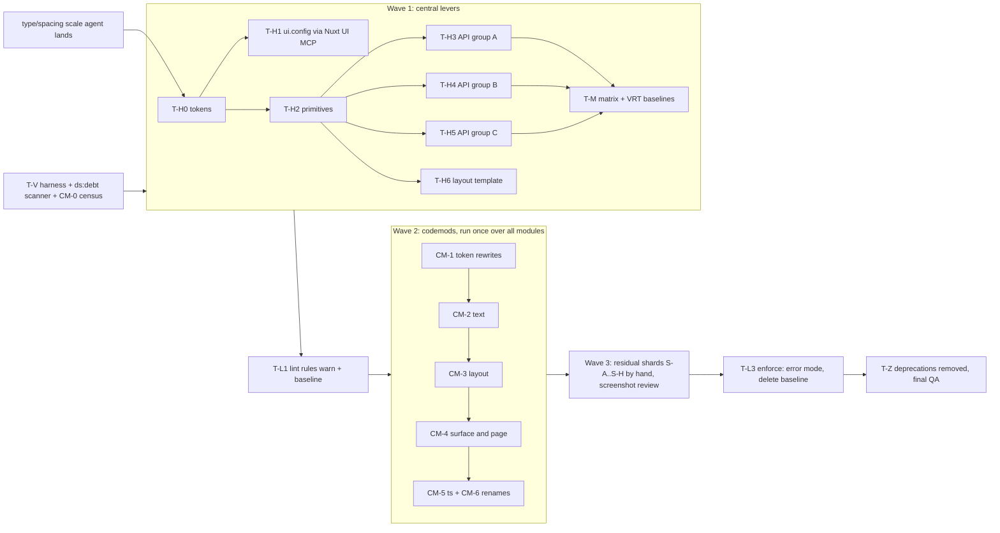

# PrestasiPlus v2 - Design-System Hardening

| Field | Value |
|---|---|
| Slug | `v2-design-system` (hardening part) |
| Version | 1.0, 2026-10-19 |
| Author | ui-ux-designer |
| Status | Proposed, needs user approval (section 10) before any developer task starts |
| Trigger | User, 2026-10-18: "design system teruk ka? macam custom class bersepah. takda proper state, types, semantic ke?" |
| User direction, 2026-10-19 (mandatory) | Fix the design system **centrally** so every screen follows. No per-screen fixing. Page-level cleanup is **codemods plus lint autofix** across all modules, not manual per-module redesign. |
| Inputs | `v2-design-language.md`, `v2-copy-glossary.md`, `v2-ds-consolidation.md`, `v2-design-system.md`, `src/ds/*`, `src/theme/tokens.css`, `src/theme/ui.config.ts`, `config/ds-strict.json`, `eslint.config.ts`, `eslint/*` |
| Pending input | A parallel agent is changing the **type and spacing scale** in `src/theme` and `src/ds`. At the time of writing it has **not landed** (`v2-design-language.md` is still v1.0). This spec fixes role names, prop APIs and mechanisms; every px value below is marked "(type/spacing scale pending)" and comes from `tokens.css` once that lands. |
| Tooling note | The official **Nuxt UI MCP server** is now in `.mcp.json`. Every agent that edits `ui.config.ts` or wraps a Nuxt UI part must use it to read the component's real props, slots and theme keys instead of guessing (see section 7.4). |

Scope: docs only. Nothing here is code. Existing specs stay authoritative for values; this spec changes **where decisions are made** and **how that is enforced**.

---

## 0. Where the problem really is (measured 2026-10-19) and the central levers

### 0.1 What the numbers say

Counts are lines containing a match (ripgrep, `src/modules/**/*.vue`, 604 files unless stated). The coordinator's figures (6,863 `class=`; 2,078 text-size; 842 arbitrary) are from a different counting method; section 6.1 makes one scanner the single source so the numbers stop drifting.

| Finding | Count | Meaning |
|---|---|---|
| Type-scale utilities on pages (`text-body`, `text-label`, `text-caption`, ...) | 2,196 lines / 455 files | **Allowed today** by `pp/ds-class-allowlist`. This is the bulk of the 2,078. Pages choose type roles by hand. |
| `gap-*` | 2,216 lines / 502 files | Allowed (steps 0-16). |
| `p*-N` | 446 lines / 231 files | Allowed. |
| `m*-N`, `space-*` | 438 lines / 163 files | Allowed. |
| `flex-col` | 1,128 lines / 433 files; `grid-cols-*` 275 / 186 | Layout by hand. |
| Text colour tokens (`text-muted`, `text-error`, ...) | 2,487 lines / 468 files | Allowed, repeated on every paragraph. |
| `rounded-* / shadow-* / bg-gradient` | 171 lines / 71 files | **Should already be banned.** Leak: **40 "ds"-level entries** in `config/ds-strict.json` (39 in modules, e.g. `m03 TopicDetailPage`, `m16 .../solo/*`) get the permissive `ds` rule block, which is applied last and overrides the `page` block. |
| `font-bold/semibold/...`, `leading-*`, `tracking-*`, `uppercase` | 129 lines / 60 files | Banned at page level, still present (same leak, plus non-strict legacy files). |
| Palette colours (`bg-slate-*`, `amber`, `indigo`) | 100 lines / 8 files | Non-strict files: `m02 RenewalInvoicePage` (print invoice), `m04 report/ReportQuestionModal`, `ReportModalHarnessPage`, `m14 student-b/Kad*Card`, `AchievementShareModal`. |
| Stock `text-xs/sm/...` | 86 lines / 11 files | Same files. |
| `:ui="{...}"` overrides on pages | 65 lines / 48 files | Escape hatch; layout utilities inside are allowed. |
| Raw `<button> <input> <label> <table> <a> ` | 53 lines / 25 files | Mostly legacy. |
| Arbitrary values `[..]` | 6-14 lines / 4-5 files (the variant-selector form `[&..]`: 8 / 4) | Almost solved. The 842 figure must include variants like `data-[state=..]`, which are legitimate; the scanner will classify them. |
| Class literals hidden in `.ts` helpers | 41 lines / 12 files (`hub-cards.ts`, `welcome-tiles.ts`, `tints.ts`, `dashboard-lib.ts`, `practice-config.ts`, `users-format.ts`, `room-lib.ts`, `heatmap-copy.ts`, `lib/analitik/index.ts`, `admin-media/common.ts`) | Invisible to the SFC lint unless the variable name ends in `class/cls`. Contains palette and `text-sm`. |
| Opacity-tinted semantic fills (`bg-primary/10,12,15,16,18,20,22,35,60`) | 60+ places in `src/ds`, shells and modules | Nine different alphas for "a soft tint". No token. |
| Card padding variants in the DS itself | `p-3 sm:p-4` (Panel), `p-4 sm:p-6` (FormSection), `p-5 sm:p-6` (UCard), `p-6` (StatTile roomy), `px-2.5 pt-3.5 pb-3` (StatTile), `p-4.5` (Hero), `p-3.5` (FeedbackSheet) | No padding scale. Off-grid values (`2.5`, `3.5`, `4.5`) inside the DS. |
| Hover / focus / disabled classes in `src/ds` | 15 hits in 10 of 62 files; no themed `focus-visible` anywhere except form fields in `ui.config.ts` | Interactive tiles, pills, rows rely on the browser default outline. |
| Copy defaults outside `src/ds/copy.ts` | `DsQuizOption` ("Betul/Salah"), `DsBadgeTile` ("BARU/Terkunci"), `DsLeaderRow` ("Anda"), `DsHeatGrid`, `DsAudioPlayer`, `DsLevelMap`, `DsWheel`, `DsErrorPage`, `DsFriendPicker`, `useConfirm` ("Pengesahan/Ya/Batal") | Breaks the single-source rule of the glossary. |

Conclusion: the **banned families are already nearly zero where lint reaches**. The mess is (a) what lint *allows* (type, spacing, layout, colour utilities written by hand 2-3 thousand times), (b) 40 leaking exemptions, (c) a DS whose components have loose string props and thin state coverage, and (d) Nuxt UI parts configured only for ~20 of the components pages use. Fixing pages one by one cannot fix (b)-(d), so the order of work below starts at the centre.

### 0.2 Central levers, ranked by reach

| Rank | Lever | What it fixes once, for every screen | Reach (evidence) | Remaining after the lever |
|---|---|---|---|---|
| **1** | **Theme tokens and the Tailwind scale** (`src/theme/tokens.css`, `@theme`) | Type roles with weight/leading/tracking baked in (add `body-strong`, `meta`, `kpi`); one **spacing scale** and **padding scale** named by role; **semantic tint tokens** (`bg-primary-soft`, `-strong`) replacing 9 alphas; overlay, z-layer and duration tokens; fix `text-primary` contrast in learner dark (section 2.8). Because Nuxt UI and the DS both read tokens, a value changes everywhere in one commit. | Every element on every screen, including Nuxt UI parts. | Pages still choose *which* role; handled by 3-5. |
| **2** | **Nuxt UI `ui.config` defaults** (`src/theme/ui.config.ts`, defined with the Nuxt UI MCP) | Today only ~22 components are themed. Add or complete: `formField` (label, hint, error, required type styles), `alert`, `avatar`, `accordion`, `dropdownMenu`, `popover`, `tooltip`, `skeleton`, `pagination`, `breadcrumb`, `chip`, `kbd`, `separator`, `empty`, `stepper`, `slider`, `inputMenu`, `commandPalette`. In each: `defaultVariants`, **all states** (`hover`, `focus-visible`, `active`, `disabled`, `aria-invalid`, `data-[state=checked]`, `loading`) in the theme, so `:ui` and per-use classes are never needed. | 65 `:ui` overrides, every `UButton/UInput/UBadge/...` on every page. | Domain-specific compositions. |
| **3** | **DS components with typed APIs + new primitives** (`src/ds`) | `DsText`, `DsHeading`, `DsStack`, `DsCluster`, `DsGrid`, `DsSplit`, `DsSurface`, `DsSection`, `DsStateView`; literal-union props; full state set; prop-level tones instead of `valueClass` strings. Every DS component picks the new tokens and the scale internally. | 62 components + whatever pages compose from them. | Pages that still hand-write markup. Handled by 5. |
| **4** | **Layout template** (`DsPage` archetypes, shells) | `DsPage layout="list|form|report|dashboard|detail|learner"` owns width, section gap, slot order and bottom clearance (tab bar). The page root and header are then identical across modules, and `gap-*`/`max-w-*` on the root disappear. Shell paddings come from the same tokens. | Every route (root + section rhythm). | Inner composition. |
| **5** | **Codemods + lint autofix** (`scripts/codemods/*`, `eslint/` fixers) | Mechanical rewrite of residual page-level styling to levers 1-4: class tokens, element conversion to primitives, `.ts` class constants, `:ui` removal where the theme now covers it. Run once over all modules, then enforced forever by lint. | All 604 files in one pass per codemod. | Long tail that does not match a pattern (estimated 15-25 %, to be measured by the dry-run, section 8.3). |

Rule of the order: **no codemod runs before the lever it targets exists**, and no page is edited by hand to "make it look right". If a screen looks wrong after the levers, the fix is a change to a lever (a token, a `ui.config` entry, a DS prop) that then fixes every screen; this is G-13 of the design system made operational.

---

## 1. Principles

| # | Principle | Test a reviewer or the CI can run |
|---|---|---|
| H1 | **Pages compose; they do not style.** A page file contains DS components, primitives and domain components. No type, colour, spacing, radius, shadow or motion decision is made in a page or a domain component. | Scanner (section 6) reports 0 for the stage-1 rule families in the module; `git grep` for `class="` on a page returns only layout hooks from the whitelist (6.3). |
| H2 | **Only semantic tokens exist.** Colour by role (surface layer, text role, tone, accent, category), never by palette step, hex, arbitrary value or opacity modifier. Raw palette lives only in `tokens.css`. | `tokens-drift` test + lint codes `palette`, `arbitrary`, `opacity` = 0 outside `src/theme`. |
| H3 | **Every interactive component covers the full state set**: default, hover, focus-visible, active/pressed, selected, disabled, loading, empty, error, read-only (definitions in 4.1). A state that does not apply is declared "n/a" in the component's matrix entry, never silently missing. | Matrix registry test (5.4) fails when a component lacks an entry or a required state. |
| H4 | **Every variant is typed.** `variant`, `size`, `tone`, `accent`, `state`, `density`, `align`, `gap`, `cols` are literal unions (or numeric literal unions). No `string` for a style input, no `*Class` or `ui` prop. | `ds-api-types.test.ts` parses every `defineProps` (6.5). |
| H5 | **The theme owns state and shape.** Hover/focus/disabled/invalid and radius/shadow/motion live in tokens and `ui.config`, so a Nuxt UI part and a DS component behave the same. | A `UButton` and a `DsPillNav` item show the same focus ring in the matrix screenshots. |
| H6 | **Fix at the highest lever.** A defect seen on N screens is fixed once in tokens, `ui.config`, a DS component or the page template. A page-level edit is allowed only as a codemod or lint autofix. | Review checklist item; PRs that touch >3 module pages by hand are rejected unless produced by a codemod. |
| H7 | **Escape hatches are counted and shrink.** `class` for styling, `:ui`, local `.ts` class constants, `ds`-level module exemptions: each has a baseline that can only go down (section 6.4). | Ratchet test. |
| H8 | **Replicate working behaviour (D9/D10)** : this is a styling hardening, not a redesign. `data-testid`, routes, query params, BM copy and ARIA stay 1:1. | Test-id set diff per module, unchanged. |

---

## 2. Token audit

Authority for values: `tokens.css`, `v2-design-system.md`, and the scale tasks pending. This section lists **roles**, who may use them, and **what must change**.

### 2.1 Surface layers

| Role (utility) | Layer | Used by | Status |
|---|---|---|---|
| `bg-muted` | 0 page canvas | shell, `DsPage` | OK |
| `bg-default` | 1 raised (cards, tables, nav) | `DsSurface raised`, `DsPanel` | OK |
| `bg-elevated` | 2 fields, chips, segmented track, bulk bar | fields, `DsPillNav` track | OK |
| `bg-accented` | 3 hover/pressed step of layer 2, unchecked control fill | fields hover, checkbox | OK |
| `bg-soft` | zebra, inner groups (`--ds-bg-soft`) | table rows, inset | OK; **not in Nuxt UI naming**, document next to `elevated` |
| `bg-seg-active` | active segment | tabs, `DsPillNav` | OK |
| `bg-inverted` | tooltips, toasts on inverse | `ui.config` | OK |
| overlay `--ds-overlay` | scrim | modal/slideover/drawer | **Flag**: used as `bg-(--ds-overlay)` (arbitrary form) in `ui.config`. Add `--color-overlay` to the bridge so the class is `bg-overlay`. |
| tint layers (`bg-primary/10` ...) | tinted sub-surface | Panel `tint`, QuizOption, HeatGrid, chips | **Flag**: nine alphas. Replace with **tint tokens** (2.3). |

### 2.2 Text roles and borders

| Role | Utility | Notes |
|---|---|---|
| Strongest | `text-highlighted` | headings, values |
| Body | `text-default` | paragraphs |
| Toned | `text-toned` | secondary body |
| Muted | `text-muted` | hints, labels under values |
| Dimmed | `text-dimmed` | placeholders, disabled, axes |
| Inverse | `text-inverted` | on `bg-inverted` |
| On-colour | `text-primary-on`, `text-on-sem`, `text-on-secondary`, `text-on-highlight` | text on solid fills; **must be chosen by the component** |
| Link / primary text | `text-primary-t` | readable primary |
| Border | `--ui-border*` all transparent | layers, not lines; focus ring `ring-2 ring-primary` and error ring only |

**Flag (contrast)**: pages and DS write `text-primary` (e.g. `m03 TopicDetailPage`, `font-bold text-primary`). `--ui-primary` has **no learner-dark override** (only `--ds-primary-t` does). Calculation: `#2f5bff` on `#15181f` is about 3.4 : 1, below the 4.5 : 1 AA minimum for normal text. Fix at lever 1: `DsText tone="primary"` maps to `text-primary-t`, `text-primary` is removed from the page allowlist, and the codemod rewrites `text-primary` to `tone="primary"` (D-H8).

### 2.3 Semantic colour roles

| Role | Token | Tint tokens to add (lever 1) | Used for |
|---|---|---|---|
| primary | `--ui-primary`, `-t`, `-on` | `bg-primary-soft` (12 %), `bg-primary-strong` (20 %) | actions, links, focus, active nav |
| secondary | `--ui-secondary`, `highlight`, `on-highlight` | `bg-highlight-soft` | win, "Baharu" |
| success | `--ui-success`, `on-sem` | `bg-success-soft`, `-strong` | done, correct, positive delta |
| warning | `--ui-warning` | `bg-warning-soft`, `-strong` | pending, risk mid |
| error | `--ui-error` | `bg-error-soft`, `-strong`, and `bg-error-field` for invalid fields | wrong, destructive, invalid |
| info | `--ui-info` | `bg-info-soft`, `-strong` | notices, selected radio card |
| neutral | `elevated` / `muted` | n/a | default tonal |

Two alpha steps only: **soft 12 %** (chips, panel tint, row highlight) and **strong 20 %** (verdict fills: quiz correct/wrong, selected). Replaces `/10 /12 /14 /15 /16 /18 /20 /22`. The heat-map ramp (`/15 /35 /60`) becomes 3 named ramp tokens `--ds-ramp-1..4` (a data scale, not a tint). Decision D-H7 (small pixel changes accepted).

### 2.4 Accents and categories

| Concept | Today | Flag / change |
|---|---|---|
| Categorical accent (`DsAccent`) | `action, win, heat, friend, trial` | Utility names differ from accent names (`win`->`highlight`, `trial`->`amber`/`bg-trial`, `friend`->`--ds-c4`, `heat`->`--ds-c3`, `ai`). Keep the five names, add `ai`, publish one table `accent -> solid/soft/on` in `accent.ts` (exists) and in this doc; do not rename tokens. |
| Raw-looking aliases | `--ds-c1..c4`, `--ds-amber`, `--ds-ic-flame`, `--ds-ic-theme` | Documented as internal; pages never see them. |
| Data-viz categorical | `--ds-cat-1..8` (`bg-cat-1..8`) | **Bug**: `DsChart` `CAT_FALLBACK` lists `--color-ungu-600` twice; slot 6 should be the `--ds-cat-6` value (`#a33f05` / `#ff8a2b`). Fix in T-H4. |
| Sequential ramp | opacity of primary/heat | token ramp (2.3) |
| Subject identity dot | slot number -> `cat-N` | OK |

### 2.5 Typography roles

Roles (names are final; px values are "(type/spacing scale pending)" and come from `--text-*`):

| Role | Today | Add / change |
|---|---|---|
| `display` | `text-display` | weight baked 800 |
| `title` | `text-title` | components currently add `font-extrabold` by hand (28 hits in 18 DS files); weight moves into the token |
| `heading` | `text-heading` | same |
| `subheading` | `text-subheading` | same |
| `body` | `text-body` | |
| **`body-strong`** | missing: pages write `text-body font-semibold` | add token, weight 600 |
| `label` | `text-label` (600) | pages add redundant `font-semibold` |
| `caption` | `text-caption` | |
| **`meta`** | missing | caption size, tabular figures, `dimmed` tone default (timestamps, units, ids) |
| `overline` | `text-overline` | uppercase by CSS |
| **`kpi`**, **`kpi-lg`** | StatTile hand-builds `font-display text-heading font-extrabold tabular` and `text-title ...` | roles baked: display family, tabular, weight 800 |
| `mono`/`code` | none | out of scope unless a page needs it |

`font-display` and `tabular` are applied by the **role map inside `DsText`** (ds-level files may use them); pages never write them. Weights/leading/tracking come from `--text-<role>--*` (Tailwind v4 theme variables) so Nuxt UI parts (`text-label` in `ui.config`) get the same result.

### 2.6 Spacing, padding, radius, elevation, motion, layers

| Family | Roles / steps | Flags |
|---|---|---|
| **Spacing (gap)** (type/spacing scale pending) | Role names `none, 2xs, xs, sm, md, lg, xl, 2xl, section`. Intended mapping to current steps: `xs`=4, `sm`=8, `md`=12, `lg`=16, `xl`=24, `2xl`=32, `section` = the page section rhythm (today `gap-5 md:gap-6 lg:gap-8`). Responsive stepping lives **in the token** (`--spacing-sp-lg` changes at `md`), so no `md:gap-6` on pages. Exposed to Tailwind as `--spacing-sp-*` (utilities `gap-sp-md`, `p-sp-lg`) for ds-level files only. | Today pages write `gap-1..16` plus `md:`/`lg:` pairs 2,216 times. Off-grid values `1.5, 2.5, 3.5, 4.5` appear inside `src/ds`. |
| **Padding** | `pad-none, pad-sm, pad-md, pad-lg` for surfaces; each with its responsive step in the token | Seven different card paddings today (table in 0.1). One scale, `DsSurface padding`. |
| **Radius** | xs 4, sm 8, md 12, lg 16, xl 24, full; `rounded-card/sheet/chip` | OK. Nesting rule (language 4) is enforced centrally by `DsSurface` (depth context, 3.8) instead of by reviewers. |
| **Elevation** | `shadow-ds-xs`, `lift`, `card`, `modal`, `bar`, `bar-up`, `cta`, `hero` | Learner uses `shadow-lift` where staff uses `shadow-ds-xs`; components hand-write `learner:shadow-lift` (DsCharacterCard, DsLeaderRow, DsRewardChip, DsSubjectStrip, DsStatTile). Fix: semantic token `--ds-shadow-raised` that resolves per personality, utility `shadow-raised`. |
| **Motion** | `ds-rise`, `rise-quick`, `bob`, `hop`, `party`, `flicker`, `nudge`, `sheet`, `floatup`, `stamp`, `live-pulse`; `--ease-pop`, `--ds-ease-out` | No duration tokens (`duration-200`, `100ms` repeated). Add `--duration-fast 100ms`, `--duration-base 200ms`, `--duration-slow 400ms` and bridge `--ease-ds-out`. Reduced motion already central in `tokens.css`. |
| **Layers (z)** | `z-20` (sticky/float), `z-30` (shell chrome), `z-50` (overlays) written as literals in Panel and `ui.config` | Document as `src/ds/layers.ts` constants + `ui.config` only; not exposed to pages. |
| **Icon size / weight** | 16/20/24; weight by personality | Full classes still accepted (`DsGameTile`, `DsBadgeTile`, `DsMediaCard` default to `...-duotone` classes, so staff would show Duotone). Base names only (R1). |

### 2.7 Raw / palette / non-token usage to eliminate (explicit list)

| Where | Problem | Resolution (central first) |
|---|---|---|
| `src/theme/ui.config.ts` `bg-(--ds-overlay)` x3 | arbitrary form | `bg-overlay` token |
| `ui.config` `disabled:bg-elevated/50`, `has-data-[state=checked]:bg-info/20`, `disabled:opacity-40` | opacity modifiers | `disabled` token set (`--ds-disabled-opacity`), `bg-info-strong` |
| `DsNativeSelect` `bg-error/10` | opacity | `bg-error-field` |
| `DsPanel tint` `bg-primary/10`, `DsLeaderRow own`, `DsStatRow active (bg-primary p-0.5)` | tint by opacity / fake ring | `bg-primary-soft`; selected state via `DsSurface selected` |
| `DsHeatGrid` ramps, `m08 lib/analitik/index.ts`, `m25 heatmap-copy.ts` | opacity ramp in `.ts` | ramp tokens |
| `DsScoreRing` `opacity-25/30` track | opacity | `text-muted` with a `--ds-track` token |
| `m02 RenewalInvoicePage`, `m04 ReportQuestionModal/Harness`, `m14 Kad*Card`, `AchievementShareModal` | palette, stock sizes, borders | Print scope (`DsPrintSheet` already) and share-card scope with fixed `--ds-share-*` tokens (decision D-H4); otherwise normal codemod |
| `.ts` class constants (41 lines / 12 files) | hidden styling | codemod CM-5 + lint `pp/ds-no-class-literal-in-ts` |
| `#a33f05`, `#ff8a2b` in `tokens.css` | raw hex | allowed (tokens file); name them as palette steps `mangga-*` |

### 2.8 Token deliverables (lever 1 task T-H0)

`tint tokens`, `ramp tokens`, `overlay`, `spacing/padding scale` (after pending scale), `text roles body-strong/meta/kpi/kpi-lg`, weights baked into every role, `--duration-*`, `shadow-raised`, `--ds-disabled-opacity`, `--ds-track`, learner-dark `--ui-primary` fix or `text-primary` removal, token tests extended (every new token has staff/learner x light/dark values; AA pairs recalculated).

---

## 3. New primitives (lever 3)

All live in `src/ds`, are ds-level files (they may use spacing, font, radius, shadow tokens), accept pass-through attributes, and have a matrix entry. Shared types go in `src/ds/types.ts` (re-exported from `index.ts`).

```ts
// src/ds/types.ts (additions)
export type DsSpace = 'none' | '2xs' | 'xs' | 'sm' | 'md' | 'lg' | 'xl' | '2xl' | 'section'
export type DsPadding = 'none' | 'sm' | 'md' | 'lg'
export type DsBreakpoint = 'sm' | 'md' | 'lg' | 'xl'
export type DsTone = 'neutral' | 'primary' | 'success' | 'warning' | 'error' | 'info'   // semantic
export type DsAccent = 'action' | 'win' | 'heat' | 'friend' | 'trial' | 'ai'            // categorical (+ai)
export type DsSize = 'sm' | 'md' | 'lg'
export type DsTextRole =
  | 'display' | 'title' | 'heading' | 'subheading'
  | 'body' | 'body-strong' | 'label' | 'caption' | 'meta' | 'overline'
  | 'kpi' | 'kpi-lg'
export type DsTextTone =
  | 'highlighted' | 'default' | 'toned' | 'muted' | 'dimmed' | 'inverted'
  | 'primary' | 'success' | 'warning' | 'error' | 'info'
  | 'on-primary' | 'on-sem'
export type DsIconName = string & { readonly __brand?: 'DsIconName' } // generated union from src/theme/ds-icons.ts (see R1)
```

### 3.1 `DsText`

Prop name: **`variant`** (not `role`) because `role` is the ARIA attribute and a declared prop would swallow `role="status"` (decision D-H1; `role` kept as the *concept* name in docs).

```ts
interface DsTextProps {
  variant: DsTextRole
  as?: 'p' | 'span' | 'div' | 'label' | 'legend' | 'dt' | 'dd' | 'li' | 'strong' | 'em' | 'small' | 'time' | 'figcaption'
        // default by variant: body/body-strong/caption/meta -> 'p'; label/overline -> 'span'; kpi/kpi-lg -> 'span'; display/title/heading/subheading -> 'p' (use DsHeading for headings)
  tone?: DsTextTone                     // default per variant (table below)
  align?: 'start' | 'center' | 'end'
  truncate?: boolean                    // single line ellipsis, adds min-w-0
  clamp?: 1 | 2 | 3 | 4 | 5 | 6         // line-clamp-N, mutually exclusive with truncate (dev warning)
  wrap?: 'normal' | 'balance' | 'anywhere'   // balance = text-balance, anywhere = break-words
  tabular?: boolean                     // default true for kpi, kpi-lg, meta; false otherwise
  prose?: boolean                       // adds max-w-prose (body copy)
  srOnly?: boolean
  for?: string                          // only when as='label'
}
```

| Variant | Utility (from tokens) | Family | Default tone | Default element |
|---|---|---|---|---|
| display | `text-display` | display | highlighted | p |
| title | `text-title` | display | highlighted | p |
| heading | `text-heading` | display | highlighted | p |
| subheading | `text-subheading` | display | highlighted | p |
| body | `text-body` | ui | default | p |
| body-strong | `text-body-strong` | ui | highlighted | p |
| label | `text-label` | ui | default | span |
| caption | `text-caption` | ui | muted | p |
| meta | `text-meta` | ui | dimmed | span |
| overline | `text-overline` (CSS uppercase) | ui | muted | span |
| kpi | `text-kpi` + tabular | display | highlighted | span |
| kpi-lg | `text-kpi-lg` + tabular | display | highlighted | span |

Rules: `tone` maps to `text-highlighted ... text-primary-t, text-on-sem`; `on-primary` only inside primary-filled parents. Colour-by-state is a tone, never a class.

### 3.2 `DsHeading`

```ts
interface DsHeadingProps {
  level: 1 | 2 | 3 | 4 | 5 | 6                 // semantic element
  variant?: 'display' | 'title' | 'heading' | 'subheading' | 'label' | 'overline'
        // default from level: 1 title, 2 heading, 3 subheading, 4-6 label
  tone?: 'highlighted' | 'muted' | 'primary' | 'on-primary' | 'inverted'   // default highlighted
  align?: 'start' | 'center' | 'end'
  truncate?: boolean
  clamp?: 1 | 2 | 3
  wrap?: 'normal' | 'balance' | 'anywhere'     // default balance for level 1-2
  focusable?: boolean                          // tabindex=-1 + exposed focus() for route-change/verdict focus (DsWinHero, DsPageHeader)
}
```
Dev-only guard: a second mounted `level=1` logs a warning (one h1 per page, language 8.1). `DsPageHeader`, `DsPanel`, `DsFormSection`, `DsSection` use it; pages use it only for headings outside those.

### 3.3 `DsStack` (vertical)

```ts
interface DsStackProps {
  as?: 'div' | 'section' | 'article' | 'header' | 'footer' | 'main' | 'aside' | 'nav' | 'form' | 'ul' | 'ol' | 'fieldset'
  gap?: DsSpace                                // default 'md'
  align?: 'start' | 'center' | 'end' | 'stretch'  // default 'stretch'
  justify?: 'start' | 'center' | 'end' | 'between'
  fill?: boolean                               // flex-1 + min-h-0 inside a flex parent
  padding?: DsPadding                          // default 'none'
}
```
Always `min-w-0`. `ul/ol` children get `list-none`.

### 3.4 `DsCluster` (horizontal wrap)

```ts
interface DsClusterProps {
  as?: 'div' | 'span' | 'ul' | 'ol' | 'nav' | 'header' | 'footer' | 'form' | 'fieldset'
  gap?: DsSpace                                // default 'sm'
  rowGap?: DsSpace                             // default = gap
  align?: 'start' | 'center' | 'end' | 'baseline' | 'stretch'   // default 'center'
  justify?: 'start' | 'center' | 'end' | 'between'
  wrap?: boolean                               // default true
  stackBelow?: DsBreakpoint                    // column (stretch) below the breakpoint: replaces "flex-col md:flex-row"
  reverseBelow?: boolean                       // action bars: primary last on desktop, first on mobile when needed
}
```
Companion `DsSpacer` (`<span class="grow">`, no props) replaces `ml-auto` / `flex-1` spacers.

### 3.5 `DsGrid` and `DsGridItem`

```ts
type DsCols = 1 | 2 | 3 | 4 | 5 | 6 | 12
interface DsGridProps {
  as?: 'div' | 'ul' | 'ol' | 'section'
  gap?: DsSpace                                // default 'md'
  cols?: DsCols | Partial<Record<'base' | DsBreakpoint, DsCols>>   // e.g. { base: 1, md: 2, xl: 3 }
  minItem?: 'xs' | 'sm' | 'md' | 'lg' | 'xl'   // auto-fit: min column width token (xs 9rem, sm 12rem, md 16rem, lg 20rem, xl 24rem; scale pending). Overrides cols.
  fit?: 'fit' | 'fill'                         // auto-fit (collapse empty tracks) or auto-fill; default 'fit'
  align?: 'start' | 'center' | 'end' | 'stretch'
  equalHeight?: boolean                        // default true (stretch + h-full children via [data-ds-grid-item])
}
interface DsGridItemProps {
  as?: 'div' | 'li' | 'article' | 'section'
  span?: DsCols | Partial<Record<'base' | DsBreakpoint, DsCols>>   // col-span
  start?: Partial<Record<'base' | DsBreakpoint, 1 | 2 | 3 | 4 | 5 | 6 | 7 | 8 | 9 | 10 | 11 | 12>>
}
```
Implementation note: class strings are literal lookup tables (5 breakpoints x 7 values) so Tailwind and the allowlist see them; `minItem` uses theme `@utility grid-fit-{xs..xl}` / `grid-fill-*` defined in `src/theme` (no arbitrary values, no inline style).

### 3.6 `DsSplit` (main + aside, the 8/4 pattern)

```ts
interface DsSplitProps {
  ratio?: '1-1' | '2-1' | '3-1' | '1-2' | '8-4'     // default '8-4' (12-col 8/4)
  stackBelow?: 'md' | 'lg' | 'xl'                   // default 'xl' (as GuruDashboardPage)
  gap?: DsSpace                                     // default 'lg'
  asideFirstWhenStacked?: boolean                   // default false
  stickyAside?: boolean
  align?: 'start' | 'stretch'                       // default 'start'
}
// slots: default (main), aside
```

### 3.7 `DsSection`

```ts
interface DsSectionProps {
  title: string
  description?: string
  level?: 2 | 3                                     // default 2
  variant?: 'heading' | 'subheading'                // default 'heading' (bare section); panels use subheading
  icon?: DsIconName
  accent?: DsAccent
  gap?: DsSpace                                     // between header and content, default 'md'
  as?: 'section' | 'div'
  headingId?: string                                // aria-labelledby wiring is automatic
}
// slots: default, actions (right of the header, DsCluster), footer
```
Replaces the bare `<section class="flex flex-col gap-3"><h2 class="text-heading">` that appears on learner pages.

### 3.8 `DsSurface` (and `DsPanel` built on it)

```ts
type DsSurfaceLevel = 'raised' | 'elevated' | 'soft' | 'accented' | 'inverted'
interface DsSurfaceProps {
  as?: 'div' | 'section' | 'article' | 'aside' | 'li' | 'form' | 'nav' | 'header' | 'footer' | 'ul' | 'ol'
  level?: DsSurfaceLevel                            // default 'raised' (bg-default); 'elevated' bg-elevated; 'soft' bg-soft; 'accented'; 'inverted'
  tone?: DsTone                                     // 'neutral' default; others = tint ('bg-<tone>-soft'), strong via emphasis
  emphasis?: 'soft' | 'strong'                      // tint strength, default 'soft'; verdict surfaces use 'strong'
  padding?: DsPadding                               // default 'md'
  radius?: 'auto' | 'chip' | 'card' | 'sheet' | 'none'   // 'auto' = one step below the enclosing DsSurface (depth context), 'card' at top level
  shadow?: 'auto' | 'none' | 'raised' | 'card' | 'lift' | 'modal'   // 'auto' by level and personality (raised for level raised, none for elevated/soft)
  interactive?: boolean                             // hover lift + focus-visible ring; becomes <a>/<button> via `to`/`href`/`type`
  to?: RouteLocationRaw
  selected?: boolean                                // aria-selected/pressed + soft primary layer
  disabled?: boolean                                // opacity token, pointer-events none, aria-disabled
  loading?: boolean                                 // aria-busy + skeleton overlay slot
  invalid?: boolean                                 // error layer
  clip?: boolean                                    // overflow-clip (tables, images), default true
}
// slots: default, skeleton
```
Nesting: `DsSurface` provides its depth; a child `radius="auto"` takes one step down (card -> chip), which enforces the language-4 rule (no `rounded-card` inside a card) in code.

`DsPanel` becomes `DsSurface` + header (`title`, `description`, `icon`, `accent`, `#actions`) + the positional behaviours (`sticky`, `float`); see R5.

### 3.9 `DsStateView` (full state coverage helper)

```ts
interface DsStateViewProps {
  status: 'loading' | 'error' | 'empty' | 'ready'
  error?: string
  retryLabel?: string
  filtered?: boolean                                // empty copy: "Tiada ... dijumpai" vs "Belum ada ..."
  item?: string                                     // noun for glossary copy
  skeleton?: 'list' | 'cards' | 'table' | 'stats' | 'text' | 'chart' | 'none'
  rows?: number                                     // skeleton rows/cards, default 5
  size?: 'sm' | 'md'
  emptyIcon?: DsIconName
}
// emits: retry, reset ; slots: default (ready), skeleton (override), empty-actions
```
One component per page region replaces the hand-built `v-if loading skeleton / v-else-if error / v-else-if empty` chains and gives loading/error/empty identical anatomy everywhere.

### 3.10 `DsDivider` - decision: not built

"Layers, not lines" bans `border`, `divide`, `ring`. A divider component would reintroduce a line. Separation is done with `DsStack gap`, `DsSurface level="soft"` blocks and table zebra. If a visual break is needed inside a list, use `DsSpacer`-free spacing (`gap="xl"`). Recorded as D-H9; the print invoice is the only place a rule is wanted and it lives under `DsPrintSheet` tokens.

### 3.11 Optional, measured first

`DsScroller { axis: 'x'|'y'; bleed?: boolean; snap?: boolean }` for horizontal strips (`-mx-4 overflow-x-auto px-4` now in `DsSubjectStrip` and several pages). Add only if the dry-run (8.3) finds more than 20 uses.

---

## 4. Typed API for every existing Ds component

### 4.1 State definitions (apply to all)

| State | Definition | How it is expressed |
|---|---|---|
| default | at rest | |
| hover | pointer over | token step (`bg-accented`, shadow lift); only `@media (hover:hover)` |
| focus-visible | keyboard focus | one themed ring (`ring-2 ring-primary`, inset on fields) from `ui.config`/`DsSurface`; **no UA default outline reliance** |
| active / pressed | pointer down | `press` motion; toggle: `aria-pressed` |
| selected | chosen in a set | `aria-selected/current/checked` + soft primary layer + a non-colour cue (check, weight) |
| disabled | not available | `disabled`/`aria-disabled`, disabled opacity token, reason via `title`/text where the action matters |
| loading | pending | `aria-busy`, skeleton or spinner inside a button; never layout shift |
| empty | no data | `DsEmptyState` (never created / filtered / no period data) |
| error | failed | field `invalid`, region `DsLoadError`, submit summary; `role="alert"` |
| read-only | visible, copyable, not editable | `readonly` prop; field renders on `bg-soft` without caret/hover |

### 4.2 Per-component API table

Legend for **States**: D default, H hover, F focus-visible, A active, S selected, X disabled, L loading, E empty, R error, RO read-only; lower-case "n/a" = not applicable; **bold missing** = gap. Props shown with their literal unions; "(string)" marks a gap.

**Layout and page**

| Component | Props (current, with unions) | States covered | Gaps |
|---|---|---|---|
| `DsPage` | `title, subtitle, backTo, backLabel, showTitle: 'auto'\|boolean, titleTestid, subtitleTestid` | D | root width/gap hard-coded (`max-w-6xl`, `gap-5 md:gap-6 lg:gap-8`, `staff:max-w-none`); no archetype, no `width`, no bottom clearance; no loading/error region |
| `DsPageHeader` | `title, subtitle, backTo, backLabel, titleTestid, subtitleTestid, showTitle: 'auto'\|boolean`; slots leading/breadcrumb/subtitle/actions/tabs/meta | D | boolean/union mix on `showTitle`; builds h1 by hand; no `size` for in-card use |
| `DsPanel` | `tone: 'raised'\|'bulk'\|'bar'\|'inset'\|'tint'\|'float', as (string), flush, sticky, title, description, icon (string), accent: DsAccent` | D | `as` untyped; `tone` mixes surface (raised/inset/tint) with behaviour (bulk/bar/float); `flush` boolean replaces a padding scale; no loading/error; `tint` uses `bg-primary/10`; padding hard-coded |
| `DsFormSection` | `title, description, icon (string), accent, tone: 'default'\|'danger', columns: 1\|2` | D | duplicates chip markup for `danger` instead of `DsIconChip tone="error"`; no collapsed/disabled/loading |
| `DsFormBar` | `submitLabel, cancelLabel, cancelTo, saving, disabled, showCancel, sticky, submitIcon (string)` | D, X, L | `submitIcon` is a class string; no `dirty`/`error` state |
| `DsBackLink` | `to, label` | D, H, F (via UButton) | none significant |
| `DsBreadcrumb` | `items: CrumbItem[], ariaLabel, moreLabel` | D, H, F (via UButton) | hand-set `text-body` and gaps |
| `DsPillNav` | `items: PillItem[], active, label, testidPrefix`; emits select | D, H, S | **no F style, no A, no X (item `disabled`), no `size`/`orientation`**; hand-written classes |
| `DsRtlScope` | `rtl: boolean` | D | none |
| `DsThemeScope` | `personality: Personality, scheme: Scheme` | n/a | fixed `p-4`, `rounded-card` |
| `DsPrintSheet` | `personality, printLabel` | n/a | none |
| `DsErrorPage` | `code: 403\|404\|500, title, description, friend` | D | copy inline, not in `copy.ts` |
| `DsDialog` | `title, description, dismissible`; model `open` | D, F (Nuxt UI), X (dismissible) | no `size`, `tone: 'default'\|'danger'`, `loading` (submit pending); footer layout hand-set |
| `DsConfirmHost` / `useConfirm` | `ConfirmOptions { message, title, confirmLabel, cancelLabel, tone: 'primary'\|'danger' }` | D, A | `'danger'` vs system `error` tone; defaults ("Pengesahan", "Ya", "Batal") outside `copy.ts`; no `loading` while the confirmed action runs |

**Data, filters and status**

| Component | Props | States | Gaps |
|---|---|---|---|
| `DsDataTable<T>` | `data, columns, caption, rowKey, variant: 'card'\|'flush'\|'bare', layout: 'auto'\|'fixed', density: 'cozy'\|'tight', stickyHeader, stickyFirstColumn, loading, error, retryLabel, emptyTitle, emptyDescription, filtered, total, pageSizeOptions, cardTitle, cardFields, sortItems, sortLabel, selectable, compactCells`; models page/pageSize/sort/selection | D, H (row), S (selection), L, E, E-filtered, R | `compactCells` overlaps `density`; no per-row state (`disabled`, `highlighted`); no `emptyIcon`; row focus-visible; no `RO` |
| `DsDrillTable<T>` | `data, columns, caption, loading, emptyLabel` | D, L, E, H | wrapper `overflow-x-auto`; no error; no focus style on drill row |
| `DsFilterBar` | `activeCount, chips, moreCount, tone: 'panel'\|'plain', showReset: 'auto'\|boolean, loading, applyLabel, resetLabel, filterLabel, moreLabel, sheetApplyLabel, sheetTitle` | D, L | `tone` is a surface, not a semantic tone (rename `surface`); six label props (copy overrides) |
| `DsActiveFilters` | `chips, label, resetLabel` | D, H, F (UButton) | none |
| `DsRowActions` | `actions: RowAction[], inline, label, testid` | D, H, F, X (per action), confirm | no `loading` per action, no `size` |
| `DsStatTile` | `value, unit, sub, icon, accent: DsAccent, tone: 'success'\|'warning'\|'error'\|'info', art, compact, roomy, valueClass (string), to, delta, loading, partPrefix, valueTestid, subTestid, clickable` | D, H (link), L | **`valueClass` is a style escape hatch**; `compact` + `roomy` are exclusive booleans; no F, no A, no X, no R, no `selected`; `p-6`, `px-2.5 pt-3.5 pb-3` off-scale |
| `DsStatRow` | `items: StatItem[], prefix, cols: 'auto'\|2..5, roomy, compact, loading, partPrefix`; item `active, valueClass, onClick` | D, S (`active`), L | selected drawn as `bg-primary p-0.5` fake ring; `valueClass`; function in data |
| `DsStatusBadge` | `status: DsStatus, label, size: 'sm'\|'md'` | D | OK; add `emphasis: 'soft'\|'strong'` (live/new) |
| `DsEmptyState` | `title, description, icon, friend, size: 'sm'\|'md', filtered, item, resetLabel` | E | `icon` accepts class; no `tone`, no `actions` typing |
| `DsLoadError` | `message, title, retryLabel, inline, testid, retryTestid` | R | no `loading` on retry; `inline` boolean -> `variant: 'alert'\|'inline'` |
| `DsChart` | `type: 'bar'\|'line'\|'doughnut', title, labels, series, unit, horizontal, tableLabel, level: 2\|3` | D | **no loading/empty/error**; no `height` union; `CAT_FALLBACK` bug; `level` -> `headingLevel` |
| `DsHeatGrid` | `columns, rows, label, lowLabel, highLabel, unit, noDataLabel` | D, E (cell) | copy defaults inline; ramp by opacity; no loading |
| `DsIdentity` | `name, sub, src, initials` | D | none |
| `DsLiveTiles` / `DsLiveBadge` | `tiles, label, liveLabel` / `label` | D | grid classes hand-set |

**Forms**

| Component | Props | States | Gaps |
|---|---|---|---|
| `DsFormField` | `label, name, for, required, hint, help, description, error, native, size: 'md'\|'lg'` | D, R, required | `hint`/`help`/`description` overlap; no `readonly`, `disabled` propagation, `loading`; hand classes (`gap-2`) |
| `DsNativeSelect` | `placeholder: string\|boolean, required, disabled, invalid, items`; model | D, X, R | **no H, F, RO, L; no `size`**; `placeholder` mixed type; `bg-error/10` |
| `DsFileField` | `accept, maxSizeMb, multiple, preview: 'none'\|'image', label, hint, required, disabled, name, variant: 'area'\|'button', icon (string)` | D, X, R (reject) | no H/F drag-over spec, no `readonly`, `icon` is a class |
| `DsRtlScope` | see above | | |

**Learner and game**

| Component | Props | States | Gaps |
|---|---|---|---|
| `DsQuizOption` | `letter, state: 'idle'\|'selected'\|'correct'\|'wrong'\|'dimmed', correctLabel, wrongLabel` | D, H, S, correct, wrong, dimmed | no F spec beyond UButton, no `disabled` (dimmed doubles as disabled), BM defaults inline, `bg-primary/18` etc. |
| `DsHeroCard` | `overline, title, subtitle, progress, ringLabel, art, ctaLabel` | D, H (CTA) | no loading/disabled; hand-set `mt-3 p-4.5` |
| `DsCharacterCard` | `variant: 'trial'\|'warning'\|'info'\|'win'\|'action', title, description, icon, art, ctaLabel` | D | `variant` here is really `accent`; no H/F if CTA absent |
| `DsBadgeTile` | `state: BadgeState, title, date, art, icon (default full duotone class), progress, isNew, newLabel, lockedLabel, progressLabel` | earned, locked, progress | default icon is a **full class** (weight not personality-aware); labels inline; no F/H |
| `DsGameTile` | `name, art, icon (default full class), accent, mode, liveLabel` | D, H, F (UButton) | full-class default; no `disabled`/`loading` |
| `DsMediaCard` | `kind: 'video'\|'article'\|'audio', title, thumb, thumbAlt, duration, category, meta, progress, progressLabel, to` | D | glyph classes hard-coded duotone; no H/F on card, no loading |
| `DsShopCard` | `name, price, priceIcon, priceArt, art, imageSrc, imageAlt, stock, actionLabel, disabledReason` | D, X | no `loading` (purchase), no `selected` |
| `DsLeaderRow` | `rank, name, school, points, unit, own, medal, avatarSrc, ownLabel` | D, own | `ownLabel` default inline; no H/F if it becomes a link |
| `DsLevelMap` | `levels: LevelNode[], label, selected, doneLabel, currentLabel, lockedLabel` | done, current, locked, S | labels inline |
| `DsSubjectStrip` | `items: SubjectTile[], label` | D, H, F (UButton) | `-mx-4 px-4` bleed hand-set |
| `DsScoreRing` | `value, max, size: 'sm'\|'md'\|'lg', tone: 'action'\|'win'\|'onPrimary', label, unit, display` | D | `tone` values are accents/inversion (camelCase `onPrimary`); track by `opacity-25` |
| `DsWinHero` / `DsWinScreen` | `art, title, subtitle, tone: 'win'\|'keep'` / `+ score, max, ringLabel, ringUnit, rewards, stickers` | D | fine; `tone` vocabulary differs |
| `DsFeedbackSheet` | `tone: 'good'\|'bad', title, body, aiLine, aiLabel, combo, continueLabel, testids` | D | `FeedbackTone` good/bad vs success/error |
| `DsFriendPicker` | `friends, title, description, confirmLabel, cancelLabel, groupLabel, selectedLabel, modal`; models open/selected | S, X (no draft) | inline default |
| `DsFriendAvatar` / `DsFriendFace` | `friend, mood: FriendMood, size: FriendSize, animated, interactive, label` | D, H, F (interactive) | none |
| `DsSpeechBubble` | `name, typing, typingLabel, live` | D, typing | none |
| `DsQuizHeader` | `closeLabel, progress, progressLabel, combo, comboLabel` | D | none |
| `DsRewardChip` | `value, icon, art, label` | D | `learner:shadow-lift` branch hard-coded |
| `DsSticker` / `DsFloatScore` | `art` / `text` | animation | none |
| `DsWheel` | `label, spinLabel, spinningLabel, resetLabel, duration, hideButton` | D, L (spinning), result | labels inline |
| `DsAudioPlayer` | `src, title, transcript, speeds, playLabel, pauseLabel, seekLabel, speedLabel, transcriptLabel` | D, playing | labels inline; no loading/error (media failure) |
| `DsCarousel<T>` | `items, label, arrows, dots, loop` | D, H, F | none |
| `DsArt3D` | `name, size: 'xs'..'hero', float, label, variant: '3d'\|'plain', src, alt, ratio` | D | `plain` variant is an image primitive, rename candidate; no loading/error |
| `DsIcon` / `DsIconChip` | `name, weight` / `icon (string), accent, tone: 'success'\|'warning'\|'error'\|'info', size: 'xs'..'lg'` | n/a | `icon` accepts any string (class or base name) |
| `DsBrandLogo` | `backed, size: 'md'\|'xl'` | n/a | none |
| `DsProse` | `html` | n/a | no typography scope for rich text (headings/lists/links inside article HTML) |

### 4.3 Required API changes and migration (R-list)

All renames keep the old prop for **one release**: the component accepts it, logs a dev warning, and the codemod rewrites call sites; the old form is deleted at T-Z (section 8).

| # | Change | Migration |
|---|---|---|
| R1 | `icon` props typed `DsIconName` = generated union from `src/theme/ds-icons.ts`; **base names only**. Applies to `DsIconChip, DsStatTile, DsPanel, DsFormSection, DsEmptyState, DsFormBar.submitIcon, DsGameTile, DsBadgeTile, DsMediaCard, DsFileField.icon, DsPillNav item.icon, DsRewardChip, DsShopCard`. | Codemod CM-1c strips `i-ph-` and `-duotone/-bold/-fill` from props of these components; lint `pp/ds-icon-names` already guards the set. |
| R2 | `valueClass: string` removed -> `valueTone?: 'highlighted'\|'primary'\|'success'\|'warning'\|'error'\|'info'\|'muted'` on `DsStatTile` and `StatItem`. | Codemod maps `text-success` -> `success`, `text-primary` -> `primary`, etc.; unknown classes reported. |
| R3 | Vocabulary: `tone` = semantic (`DsTone`), `accent` = categorical (`DsAccent`), `variant` = structural form. Rename: `DsFilterBar.tone -> surface`; `DsCharacterCard.variant -> accent` (+ `warning` -> `heat`, `info` -> `friend`); `DsScoreRing.tone: 'action'\|'win'\|'onPrimary' -> accent: 'action'\|'win'` + `inverted: boolean`; `DsFeedbackSheet.tone 'good'\|'bad' -> 'success'\|'error'`; `ConfirmOptions.tone 'danger' -> 'error'`; `DsWinHero.tone 'win'\|'keep' -> accent 'win'\|'action'`. | One-to-one prop codemod (AST on SFC templates); `useConfirm` call sites by TS codemod. |
| R4 | Exclusive booleans -> `size`: `DsStatTile`/`DsStatRow` `compact`+`roomy` -> `size: 'compact'\|'default'\|'roomy'`; `DsDataTable.compactCells` merged into `density: 'cozy'\|'tight'\|'compact'`. | Codemod. |
| R5 | `DsPanel`: `as` typed; `flush` -> `padding: DsPadding` (`flush` = `'none'`); split behaviour from surface: keep `tone: 'raised'\|'inset'\|'tint'` as `level/tone` aliases and `behavior: 'static'\|'bulk'\|'bar'\|'float'`; adds `loading`, `error`, `retry` through `DsStateView`; built on `DsSurface`. | Old props accepted one release. |
| R6 | `DsPage`: add `layout: 'list'\|'form'\|'report'\|'dashboard'\|'detail'\|'learner'` (default `'detail'`), `width: 'prose'\|'default'\|'wide'\|'full'`, `gap: DsSpace` (default `'section'`). Root width/gap come from tokens. | Pages add `layout`, never set widths; codemod CM-4b adds `layout` from the route archetype map. |
| R7 | `DsPageHeader.showTitle` -> `titleMode: 'auto'\|'visible'\|'hidden'`; headings via `DsHeading`. | Codemod maps `true/false`. |
| R8 | `DsNativeSelect`: add `size: 'md'\|'lg'`, `readonly`, `loading`, themed `hover/focus-visible/invalid`, `placeholder?: string` + `blank?: boolean` (replace `string\|boolean`), invalid fill via `bg-error-field`. | `placeholder` boolean true -> `blank`. |
| R9 | Missing states: `DsPillNav` (F, A, X per item, `size`), `DsStatTile` (F, A, X, R, selected), `DsQuizOption` (`disabled`, F), `DsChart` (loading/empty/error via `DsStateView`), `DsFormField` (`readonly`, `disabled` propagation, `loading`), `DsFileField` (drag-over, `readonly`), `DsDialog` (`size`, `tone`, `loading`), `DsRowActions` (per-action `loading`), `DsLoadError` (`loading` on retry), `DsHeatGrid` (loading), `DsDrillTable` (error). | Additive. |
| R10 | Copy defaults only from `src/ds/copy.ts`: move strings out of `DsQuizOption, DsBadgeTile, DsLeaderRow, DsHeatGrid, DsAudioPlayer, DsLevelMap, DsWheel, DsErrorPage, DsFriendPicker, useConfirm`. Lint L5 covers `src/ds`. | Additive, same text. |
| R11 | Personality-driven shadow/padding/radius via tokens (`shadow-raised`, `pad-*`), removing hand-written `learner:shadow-lift` / `staff:` pairs from components. | Internal; visual identical by construction. |
| R12 | `DsChart`: fix `CAT_FALLBACK` slot 6; add `height: 'sm'\|'md'\|'lg'`; `level -> headingLevel`. | Additive + rename. |
| R13 | `DsProse`: typography scope (headings, lists, links, tables, images) for article HTML so rich text no longer needs page classes. | Additive. |
| R14 | `inheritAttrs` policy: Ds components pass `class` through for **layout hooks only** (`DsGridItem span`, `min-w-0`, `w-full`, `grow`). Lint (6.3) flags any other class on a Ds tag in pages. | Lint. |
| R15 | Remove `src/ds` exports that are only wrappers after migration (`DsPage` header duplicates, deprecated aliases) at T-Z. | Ratchet. |

---

## 5. `/__ds` state matrix (visual-regression fixtures)

### 5.1 Structure

New route `/__ds/matrix` (dev only, next to the existing gallery `src/dev/ds/DsGallery*.vue`). Registry-driven, not hand-built pages:

```ts
// src/dev/ds/matrix/types.ts
interface MatrixEntry {
  id: string                              // 'DsStatTile'
  klass: 'action' | 'field' | 'surface' | 'collection' | 'overlay' | 'display'
  axes: Record<string, readonly (string | boolean | number)[]>   // variant axes, e.g. { size: ['compact','default','roomy'], tone: [undefined,'success','warning','error','info'] }
  states: readonly MatrixState[]          // required set per class (5.2) or 'n/a' with reason
  render: (ctx: { axes: Record<string, unknown>; state: MatrixState }) => VNode
  widths?: readonly (375 | 768 | 1280)[]  // default [1280]; responsive components also 375
}
type MatrixState = 'default' | 'hover' | 'focus-visible' | 'active' | 'selected' | 'disabled'
                 | 'loading' | 'empty' | 'empty-filtered' | 'error' | 'read-only'
```
Layout: one section per component; rows = variant combinations (cap 12 rows, otherwise sampled per axis once), columns = states. Every cell carries `data-matrix-cell="<id>/<axes>/<state>"`. Each section is rendered four times, inside `DsThemeScope` for **staff light, staff dark, learner light, learner dark** (tabs or a `?theme=` param; one theme per screenshot).

### 5.2 Required states per component class

| Class | Components (examples) | Required |
|---|---|---|
| action | `DsBackLink, DsRowActions, DsQuizOption, DsGameTile, DsSubjectStrip, DsPillNav, DsActiveFilters, DsStatTile[to], DsHeroCard CTA, DsShopCard` | default, hover, focus-visible, active, selected (toggle only), disabled, loading (async only) |
| field | `DsFormField` + each control, `DsNativeSelect, DsFileField` | default, hover, focus-visible, filled, disabled, read-only, error, loading (async options only) |
| surface | `DsSurface, DsPanel, DsFormSection, DsCharacterCard, DsStatTile, DsHeroCard` | default, loading, error (when it fetches), selected/interactive when `interactive` |
| collection | `DsDataTable, DsDrillTable, DsHeatGrid, DsChart, DsLeaderRow list, DsLevelMap, DsStatRow` | default, loading, empty, empty-filtered, error, selected rows, row hover/focus |
| overlay | `DsDialog, DsFriendPicker, DsConfirmHost` | open, focus trap, loading, error, danger tone |
| display | `DsIconChip, DsStatusBadge, DsText, DsHeading, DsScoreRing, DsEmptyState, DsLoadError` | all variants x sizes; for text: every role x every tone |

Primitives matrix: `DsText` = 12 roles x allowed tones; `DsHeading` = 6 levels x variants; `DsStack/DsCluster/DsGrid/DsSplit` = gap steps, `stackBelow` at 375 and 1280, cols maps, `minItem` auto-fit with 3 and 9 children (no snapshots of empty boxes: coloured placeholder children).

### 5.3 Visual-regression plan (Playwright)

- Spec `e2e/ds/matrix.spec.ts`, one `test` per component x theme (about 62 x 4 = 248 screenshots of the static states) plus **interaction shots** for action and field components (about 40 components x 3 interactions x 4 themes = 480), taken by real `hover()`, `keyboard.press('Tab')` and `mouse.down()` on the first cell of each variant row, clipped to the cell.
- Settings: chromium only; viewport 1280x900 for all, plus 375 for `DsDataTable, DsFilterBar, DsPageHeader, DsStatRow, DsDialog, DsFormBar, DsPillNav, DsBreadcrumb, DsGrid, DsSplit, DsCluster`; `animations: 'disabled'`, `reducedMotion: 'reduce'`, `caret: 'hide'`; wait for `document.fonts.ready`; fixed locale and a frozen clock; mock data from fixtures (no random).
- Tolerance: `maxDiffPixelRatio: 0.002`, `threshold: 0.2`. Baselines committed under `e2e/ds/__screenshots__/` (about 700 PNGs, order of 15-25 MB; decision D-H5: git vs CI artifact).
- axe-core on every theme page: 0 serious/critical; a contrast check for every tone x role pair is part of the token test (G-9), not the screenshots.
- **Matrix coverage test** `src/dev/ds/__tests__/matrix-registry.test.ts`: every export of `src/ds/index.ts` that is a component has an entry or an explicit `exempt` with a reason; the entry's `states` is a superset of the class requirement or lists "n/a: reason"; failing the test blocks the PR that adds a component without states (H3).
- Run: `pnpm e2e:ds` (local), CI job on every PR touching `src/ds`, `src/theme`, `src/dev/ds`. Update baselines only with `--update-snapshots` in a PR labelled `ds-visual`; the diff of PNGs is the review artefact.

### 5.4 Page-level shots (for codemod acceptance, not for the DS)

A separate harness (`scripts/page-shots.mjs`, task T-V) renders every routed page of a module at 375/768/1280 in its primary personality/scheme (staff light, learner dark) from the mock server, saves `before/` and `after/` PNGs and a pixel diff; used by section 8 acceptance. Not committed to git.

---

## 6. Lint tightening and ratchet

### 6.1 What "page" and "ds" levels allow today

| Level | Files | Allows | Bans |
|---|---|---|---|
| `page` (`pp/ds-class-allowlist`, 175 entries) | `src/modules/**` and `src/dev/ds/**` | layout utilities, spacing steps 0-16, type-scale `text-*`, colour tokens, `i-ph-*` | stock `text-xs..9xl`, palette, hex, arbitrary, rounded, shadow, gradients, z/animate/transition/opacity, font-*/leading/tracking/uppercase, border/divide/ring/outline |
| `ds` (40 entries, 39 in modules) | `src/ds/**` plus module files granted by glob | everything above plus rounded, shadow, motion, font, any spacing | palette, arbitrary, lines |

Weaknesses: (1) `ds` globs in modules defeat the page rules (the 171 `rounded/shadow/gradient` hits); (2) type, spacing, layout and colour utilities are legal on pages; (3) `.ts` class constants are mostly invisible; (4) `:ui` is not banned; (5) there is no per-file budget, only an append-only file list, so "strict" files cannot be made stricter without breaking.

### 6.2 New rules (names, scope, autofix)

All in the `pp` plugin (`eslint/rules/*.mjs`), all re-using `classifyToken` codes so counts are comparable. "Fix" = ESLint `--fix` support (the autofix layer of the codemods, section 7.5).

| Rule | Bans on pages and domain components | Autofix | Stage |
|---|---|---|---|
| `pp/ds-no-type-utility` | `text-{display..overline}`, `text-kpi*`, `font-*`, `leading-*`, `tracking-*`, `uppercase/lowercase/capitalize/italic/underline/line-through`, `tabular` | Removes redundant weights; rewrites a lone element `class="text-X text-Y"` to `<DsText variant tone>` when every token is covered (via the CM-2 transformer) | 1 |
| `pp/ds-no-spacing-utility` | `p*-N`, `m*-N`, `gap*-N`, `space-*`, `inset-*`, `top/right/bottom/left-N` (except whitelist 6.3) | Folds `flex flex-col gap-N` into `DsStack`/`DsCluster`/`DsGrid` and `p-N` into a `DsSurface padding`; unmatched ones report only | 1 |
| `pp/ds-no-surface-utility` | `bg-default/elevated/accented/soft/muted/inverted`, `bg-<tone>(-soft)`, `rounded-*`, `shadow-*`, `bg-gradient-*`, `ring-*`, `border*`, `divide*` | Wrap-element conversion to `DsSurface` where the element has only those tokens plus covered layout | 1 |
| `pp/ds-no-colour-utility` | any `text-*` colour, `bg-*`, `fill-*`, `stroke-*`, `accent-*`, opacity modifiers `/N`; palette, hex, `bg-(--x)` | `text-primary` -> `text-primary-t`; opacity -> tint tokens; palette -> nearest token (table `eslint/palette-map.json`); icon colours -> `DsIcon tone` | 1 (palette/opacity/arbitrary), 2 (token colours on pages) |
| `pp/ds-no-layout-utility` | `flex`, `inline-flex`, `grid`, `flex-col`, `flex-row`, `flex-wrap`, `grid-cols-*`, `col-span-*`, `items-*`, `justify-*`, `place-*`, `self-*`, `order-*`, `basis-*` | Primitive conversion (CM-3) | 2 |
| `pp/ds-no-ui-prop` | `:ui="{...}"` and `ui=` on any Nuxt UI/Ds tag in pages | Removes the prop when the key/value pair is covered by the new `ui.config` entry (table `eslint/ui-prop-map.json`), else reports | 1 |
| `pp/ds-no-class-on-ds` | `class` on a `Ds*` tag except layout hooks (6.3) | Removes covered tokens | 1 |
| `pp/ds-no-class-literal-in-ts` | utility-class string literals in `src/modules/**/*.ts` and `*.vue` `<script>` (any variable name) | Replaces known constant maps with component props (CM-5 report); manual list for the rest | 1 |
| `pp/ds-no-raw-html` | extends the existing `vue/no-restricted-html-elements` list with `label`, `h1-h6`, `p`, `span`? **no**: allow `p`, `span`, `ul`, `li`, `section`, `div` for structure; ban `h1-h6` (use `DsHeading`) and `label` (use `DsFormField`) | h1-h6 -> `DsHeading` | 2 |
| `pp/ds-icon-names` (existing) | adds: `icon="i-ph-*"` full class on DS props (R1) | strips class form | 1 |

Existing rules stay: `ds-no-inline-style`, `ds-no-style-block`, `ds-no-remote-assets`, `ds-no-dynamic-class` (warn -> error at stage 2).

Plus two **non-ESLint tests** under `src/ds/__tests__/` and `eslint/__tests__/`:

- `ds-api-types.test.ts` (H4): parses each `src/ds/*.vue` with `@vue/compiler-sfc`; for props named `variant|size|tone|accent|state|density|align|justify|gap|cols|layout|width|surface|emphasis` the type must be a union of literals (or `DsSpace`/`DsTone`/... aliases); props named `*Class`, `ui`, `*Classes` are forbidden; `icon`-like props must be `DsIconName`; every `defineProps` default for a label comes from `dsCopy`.
- `ds-states.test.ts` (H3): static check that each interactive component's template contains the `focus-visible`/`hover`/`disabled`/`aria-*` hooks its class demands, or delegates to a themed Nuxt UI part (list maintained in the matrix registry).

### 6.3 Allowlist (the only utilities left on a page)

Decision D-H2: **no spacing whitelist beyond centring and pushing.** Everything else is a primitive prop.

| Allowed on pages / domain components | Why |
|---|---|
| `min-w-0`, `w-full`, `h-full`, `grow`, `shrink-0` | flex/grid containment hooks the primitives cannot infer |
| `mx-auto`, `ms-auto`, `me-auto` | centring / pushing (until `DsSpacer`/`justify` adopted everywhere) |
| `hidden`, `block`, `md:hidden`, `md:block` and the other responsive display pairs, `sr-only`, `print:hidden` | visibility |
| `truncate` (until `DsText truncate` adopted), `line-clamp-N`, `break-words` | text containment (stage 1; moved to `DsText` at stage 2) |
| `sticky`, `relative`, `absolute`, `inset-0`, `z-*` **not allowed** | positioning needs a primitive (`DsSurface`/`DsPanel behavior`) |
| `aspect-video/square`, `object-cover`, `size-N` for media | media boxes (`DsArt3D` covers most) |
| `col-span-*`, `order-*` on `DsGridItem` only | grid placement |
| `i-ph-*` classes **not allowed** on pages (icon via `DsIcon`) | icon rule R1 |

Stage 2 trims the table to `min-w-0 w-full h-full grow shrink-0`, `mx-auto`, display toggles and `sr-only`.

### 6.4 Ratchet mechanics (counts shrink to zero)

1. **Scanner** `scripts/ds-debt.mjs` (`pnpm ds:debt`): parses every `.vue` (template and script) and `.ts` under `src/modules/**`, `src/shells/**`, `src/components/**`, `src/pages/**`, classifies each class token with `classifyToken` extended with the new codes (`type, spacing, surface, colour, layout, ui-prop, class-on-ds, ts-literal`), and prints a table (rule x module x count). It is the **only** source of the numbers quoted in reports (ends the 842 vs 14 confusion).
2. **Baseline** `config/ds-debt.baseline.json`: `{ "<rule>": { "<file>": count } }`, generated by `pnpm ds:debt --write-baseline` (T-L1). Committed.
3. **Test** `eslint/__tests__/ds-debt-ratchet.test.mjs` (runs in the normal test job) fails when: a file count exceeds its baseline; a file absent from the baseline has any count; a baseline entry is `0` or its file no longer exists (forces removal); `--write-baseline` is only allowed to lower numbers (the script refuses to raise). It prints "type 2196 -> N" so every PR shows progress.
4. **Per-module enforce**: `config/ds-strict.json` gets a new array
   `"enforce": [{ "glob": "src/modules/m09-content/**", "rules": ["ds-no-type-utility", "ds-no-spacing-utility", "ds-no-surface-utility", "ds-no-colour-utility", "ds-no-ui-prop", "ds-no-class-on-ds", "ds-no-class-literal-in-ts"] }]`.
   ESLint runs these rules as `warn` on all of `src/**` (visible in the IDE) and as `error` on the `enforce` globs. A module's codemod task ends by appending its glob; the ratchet test (existing `ds-strict-ratchet.test.mjs`) also refuses removal of an `enforce` entry.
5. **Leak closure**: the 39 module `ds` entries move to the debt baseline under a rule `ds-level-in-module`; a file leaves the list by one of: (a) codemod makes it pass at `page` level (preferred), (b) the styled part is promoted into `src/ds` as a component (listed in `config/ds-promote.json`, owner + reason), (c) it is a legitimate share/print scope (D-H4). Target 0.
6. **Final**: when every rule is `0` repo-wide, the baseline file is deleted, the rules become `error` for all `src/**` outside `src/ds` and `src/theme`, and stage 2 rules are switched on the same way.
7. **Legacy code** (`src/components`, `src/shells`, `src/pages`): shells are migrated with the layout-template lever (R6); `src/components` is deleted after M-H of the consolidation (already planned there).

---

## 7. Central fix first: what each lever changes and who does it

### 7.1 Lever 1 - tokens and scale (T-H0)

Starts **only after** the parallel type/spacing scale agent has merged (otherwise both edit `tokens.css`). Deliverables in 2.8. Gate: token tests (G-9) extended and green; the matrix screenshots for tokens (surface swatches, role x tone contrast grid) re-baselined; `tokens.mjs` regenerates the lint allowlist.

### 7.2 Lever 2 - Nuxt UI defaults (T-H1)

Use the **Nuxt UI MCP** to list every component, its slots and theme keys, then for each component pages use (frequency from a grep of `<U[A-Z]\w+` in modules; expected to cover at least the 22 in 0.2 rank 2): add `defaultVariants`, a size scale that matches the DS control heights, and the **state classes** (hover, `focus-visible`, active, disabled, `aria-invalid`, `data-[state=...]`, loading) so no page needs `:ui`. Output: `ui.config.ts` split into `src/theme/ui/<component>.ts` files (one per component) re-exported by `ui.config.ts`, plus `eslint/ui-prop-map.json` (the `:ui` fragments now covered, consumed by the autofix).

### 7.3 Lever 3 - DS components and primitives (T-H2 ... T-H5)

Section 3 (new) and section 4 (existing). Three parallel API groups, each owning disjoint files (see 8.2).

### 7.4 Lever 4 - layout template (T-H6)

`DsPage layout`/`width`/`gap` (R6), shell paddings on the spacing tokens, archetype slot rules from design language 9, and the bottom-clearance rule in one place. Output: the codemod's archetype map (route -> `layout`) in `eslint/page-archetypes.json`.

### 7.5 Lever 5 - codemods and lint autofix (page-level cleanup)

Principle: **mechanical, scripted, reviewed by diff and screenshot**, never a hand redesign. Tooling: `@vue/compiler-sfc` + `magic-string` (position-preserving edits, keeps formatting) for templates; `ts-morph` for `.ts`; `prettier` after each run. Each codemod is idempotent, supports `--dry-run` (writes a JSON report: matched, converted, skipped with reason) and `--module mNN`. ESLint `--fix` hosts the safe class-token rewrites so they also run in editors and CI forever; element-conversion codemods are scripts (a lint fixer must not restructure markup).

| Codemod | Does | Mode |
|---|---|---|
| **CM-0 inventory** (`ds-debt` + dry-run) | Pattern census: how many `div`/`p`/`span`/`h*` fit each conversion; the real automation coverage; decides D-H3 stage 2 timing | read-only |
| **CM-1 token class rewrites** | (a) drop redundant weight/leading next to a scale class; (b) stock `text-xs/sm/lg...` -> nearest scale role (map table); (c) icon props to base names (R1); (d) `text-primary` -> `text-primary-t`; (e) opacity -> tint tokens; (f) palette -> tokens (`palette-map.json`); (g) spacing off-step -> nearest step | ESLint `--fix` |
| **CM-2 text** | `<p|span|div|dt|dd|li|label class="text-ROLE [text-TONE] [truncate|line-clamp-N|text-center|tabular]">` -> `<DsText variant tone ...>`; `<h1-h6 class=...>` -> `<DsHeading level variant tone>` (level from the tag); keeps unmatched classes in `class` and reports | script |
| **CM-3 layout** | `div|ul|section|header|nav|form class="flex flex-col gap-N [items-*]"` -> `DsStack gap=`; `flex [flex-wrap] items-* [justify-*] gap-N [md:flex-row...]` -> `DsCluster` (with `stackBelow`); `grid grid-cols-A [sm:..md:..] gap-N` -> `DsGrid cols=`; `xl:grid-cols-12` + `xl:col-span-8/4` pairs -> `DsSplit`; `gap-N`/`md:gap-M` pairs map to the nearest `DsSpace`; responsive pairs that do not map are reported | script |
| **CM-4 surface and page** | `rounded-card bg-default shadow-* p-N` -> `DsSurface`; page root wrappers -> `DsPage layout=` from the archetype map; `<section>+<h2>` -> `DsSection` | script |
| **CM-5 `.ts` constants** | class-string maps in `.ts` -> `tone`/`accent`/`variant` values consumed by the component (e.g. `room-lib.ts` status colours -> `DsStatusBadge status`), generated as a report + patch; unmatched listed for the owner | script + report |
| **CM-6 prop renames** | R2, R3, R4, R7 call-site rewrites | script |
| **CM-7 `:ui` removal** | strip `:ui` fragments in `ui-prop-map.json` | ESLint `--fix` |

Safety net for each run: `pnpm lint --fix` + `type-check` + module unit tests + test-id set diff (script compares the multiset of `data-testid` before/after) + `scripts/page-shots.mjs` before/after (5.4). A codemod that changes a test-id, a route, or BM copy is a defect.

---

## 8. Migration plan and re-estimate

### 8.1 Order of work



Order matches the brief: primitives and API changes first (in `src/ds`), then lint in warn mode, then module migrations (now codemods), then lint in error mode. The scale agent is a hard prerequisite for T-H0; T-V and CM-0 can start now (read-only, no `src/ds` or `src/theme` edits).

### 8.2 Tasks, file ownership (no overlap) and estimates

Unit: **session** = one Sonnet subagent run that finishes and verifies one coherent unit (about half a working day). Ranges allow for review loops.

**Wave 0 - tooling (parallel, no conflict with the scale agent)**

| ID | Task | Files owned | Est. |
|---|---|---|---|
| T-V | Page-shot harness `scripts/page-shots.mjs` (before/after/diff, per module, 3 widths) + test-id diff script | `scripts/page-shots.mjs`, `scripts/testid-diff.mjs` | 1 |
| T-S | `scripts/ds-debt.mjs` scanner + CM-0 dry-run census report (coverage % per conversion) | `scripts/ds-debt.mjs`, `scripts/codemods/census.mjs` | 1 |

**Wave 1 - central levers (`src/theme`, `src/ds`, `src/dev/ds`)**

| ID | Task | Files owned | Est. |
|---|---|---|---|
| T-H0 | Tokens: roles, tints, ramps, overlay, spacing/padding scale (from the scale agent), durations, shadow-raised, learner-dark primary fix, token tests | `src/theme/tokens.css`, `src/theme/ds-icons.ts`, `eslint/tokens.mjs`, token tests | 1-2 |
| T-H1 | `ui.config` per-component themes with full states (Nuxt UI MCP); `ui-prop-map.json` | `src/theme/ui.config.ts`, `src/theme/ui/**` | 2 |
| T-H2 | Primitives: `DsText, DsHeading, DsStack, DsCluster(+DsSpacer), DsGrid(+Item), DsSplit, DsSection, DsSurface, DsStateView`, `types.ts`, `layers.ts`, `grid-fit` utilities, unit tests | new `src/ds/Ds{Text,Heading,Stack,Cluster,Spacer,Grid,GridItem,Split,Section,Surface,StateView}.vue`, `src/ds/types.ts`, `src/ds/layers.ts`, `src/theme/utilities.css`, tests | 2 |
| T-H3 | API group A (data/status): `DsDataTable, DsDrillTable, DsFilterBar, DsActiveFilters, DsRowActions, DsStatTile, DsStatRow, DsStatusBadge, DsEmptyState, DsLoadError, DsChart, DsHeatGrid, DsPillNav, DsBreadcrumb` (R1-R4, R9, R12) | those files, their tests | 2 |
| T-H4 | API group B (forms/overlays/page): `DsFormField, DsFormSection, DsFormBar, DsNativeSelect, DsFileField, DsDialog, DsConfirmHost, useConfirm, DsPage, DsPageHeader, DsPanel, DsBackLink, DsErrorPage, DsProse, DsIdentity` (R5-R8, R13) | those files, tests | 2 |
| T-H5 | API group C (learner/game): `DsQuizOption, DsHeroCard, DsCharacterCard, DsBadgeTile, DsGameTile, DsMediaCard, DsShopCard, DsLeaderRow, DsLevelMap, DsWheel, DsScoreRing, DsWin*, DsFeedbackSheet, DsFriend*, DsAudioPlayer, DsCarousel, DsSubjectStrip, DsRewardChip, DsSticker, DsSpeechBubble, DsLiveTiles, DsLiveBadge, DsQuizHeader, DsArt3D, DsIcon, DsIconChip` (R1, R3, R9-R11) | those files, tests | 2 |
| T-H6 | Layout template: `DsPage layout/width/gap` wiring (with T-H4 coordination: T-H4 owns `DsPage.vue`, T-H6 owns shells and the archetype map), shells on spacing tokens | `src/shells/**`, `eslint/page-archetypes.json` | 1 |
| T-M | Matrix route, registry, `matrix-registry.test.ts`, Playwright spec, baselines, a11y run | `src/dev/ds/matrix/**`, `e2e/ds/**` | 2-3 |

H3-H5 run in parallel after H2 merges (they import primitives). T-M follows H3-H5; each H task supplies its own registry entries file `src/dev/ds/matrix/entries/<group>.ts` (disjoint).

**Wave 1.5 - lint (warn)**

| ID | Task | Files owned | Est. |
|---|---|---|---|
| T-L1 | New `pp` rules (6.2) with autofix hooks, `enforce` array in `ds-strict.json`, baseline generation, ratchet test, `ds-api-types` and `ds-states` tests, ESLint config `warn` block | `eslint/**`, `config/**`, `eslint.config.ts` | 2 |

**Wave 2 - codemods (authoring, then one run each across all modules)**

| ID | Task | Author est. | Run + review est. |
|---|---|---|---|
| CM-1 | Token class rewrites (ESLint fixers + maps) | 1 | 0.5 |
| CM-2 | Text/heading conversion | 1.5 | 1 |
| CM-3 | Layout conversion | 2 | 1.5 |
| CM-4 | Surface, page root, section | 1.5 | 1 |
| CM-5/6/7 | `.ts` constants, prop renames, `:ui` removal | 1.5 | 1 |
| | subtotal | **7-8** | **5-6** |

"Run + review" = apply to all modules in shards, regenerate the baseline, inspect the skip report, run `page-shots` before/after, fix codemod bugs (never the page). Shards run in parallel by module group because the shard owns its folders exclusively.

**Wave 3 - residual shards (hand fix of what the codemods skipped; no redesign)**

Measured weight = lines with a type-scale or spacing utility (4,463 total); the residual is expected at **15-25 %** of that, to be confirmed by CM-0.

| Shard | Modules / folders (same grouping as consolidation M-A..M-H) | Hit lines / files now | Est. residual sessions |
|---|---|---|---|
| S-A | `m09-content`, `m07-pksk` | 290 / 41 | 0.5 |
| S-B | `m02-users-schools` (+ `RenewalInvoicePage` print scope) | 354 / 30 | 0.5 |
| S-C | `m04-question-bank`, `m03-curriculum` (+ `ReportQuestionModal`, `tints.ts`) | 409 / 42 | 0.5-1 |
| S-D | `m10-teacher-class`, `m27-school-admin` (+ `users-format.ts`) | 551 / 80 | 1 |
| S-E | `m08-student-performance` | 482 / 48 | 0.5-1 |
| S-F | `m11-teacher-analytics`, `m12-kirkpatrick`, `m17-admin-dashboard` | 644 / 95 | 1 |
| S-G1 | `m05-practice`, `m06-spm` | 526 / 48 | 1 |
| S-G2 | `m28-bijak-spm`, `m01-authentication` (+ `welcome-tiles.ts`) | 289 / 35 | 0.5 |
| S-G3 | `m16-battle-games` (+ `hub-cards.ts`, `room-lib.ts`) | 472 / 50 | 1 |
| S-G4 | `m13-cikgu-alesa`, `m14-gamification` (share cards, D-H4), `m15-rewards-shop`, `m20-marketplace`, `m21-sponsorship`, `m22-support-tickets`, `m25-ai-centre` | 446 / 65 | 1 |
| S-H | `src/shells/**`, `src/components/**`, `src/pages/**` (legacy; measure first) | not measured | 0.5 |
| | subtotal | 4,463 / 534 | **8-9** |

**Wave 4 - close**

| ID | Task | Est. |
|---|---|---|
| T-L3 | Switch rules to `error` repo-wide, delete baseline when all zero, stage 2 rules (D-H3) | 1 |
| T-Z | Remove deprecated props/aliases (R-list), final matrix re-baseline, `v2-design-system.md` sections 12-13 updated, QA sweep (375/768/1280, light/dark, axe, copy lint, `registry-boot`) | 2 |

### 8.3 Re-estimate on the codemod basis

| Phase | Previous plan basis (manual M-A..M-H module redesign, consolidation style) | New basis (central + codemods) |
|---|---|---|
| Tooling | n/a | 2 |
| Central levers (tokens, `ui.config`, primitives, API groups, layout, matrix) | about 10-12 | **14-17** (T-H0 1-2, T-H1 2, T-H2 2, T-H3/4/5 6, T-H6 1, T-M 2-3) |
| Lint (warn) | 2 | 2 |
| Page-level cleanup | about 30-35 (11 module tasks of 2-4 sessions) | **codemods 12-14** (author 7-8 + run/review 5-6) **+ residual 8-9** = 20-23 |
| Close | 3 | 3 |
| **Total** | about 45-52 sessions | **about 41-47 sessions** |

The total is similar, the distribution is the point: about 40 % of the effort goes into the central levers (which fix all 604 files at once), the page work is scripted and repeatable (a second run after new code lands costs minutes), and the lint autofix keeps new code clean. The **critical path** is shorter in wall-clock because Wave 2 shards and Wave 3 shards run in parallel (up to the 3 browser lanes for screenshot review) while Wave 1 is a short serial spine: T-H0 -> T-H2 -> (H3 || H4 || H5 || H6) -> T-M. Estimate risk: the 15-25 % residual is an assumption; CM-0 replaces it with a measured number before Wave 2 is committed. If automation coverage is under 60 %, CM-3 grows by 1-2 sessions and residual by 3-4.

### 8.4 Acceptance criteria

**Per central task (Wave 1)**

1. T-H0: token tests green; every new token has all four theme values; AA pairs pass; `tokens-drift` green; lint allowlist regenerated; no visual change in the existing gallery except the listed intentional diffs (tints 9->2 alphas, `text-primary` in learner dark).
2. T-H1: every Nuxt UI component used by pages (census) has a theme entry with all 10 states where applicable; Nuxt UI MCP property names verified (no unknown slot keys); the 65 `:ui` fragments are covered or listed as exceptions.
3. T-H2: each primitive has unit tests (every prop value produces its literal class; dev warnings), a matrix entry, `ds-api-types.test.ts` green, no arbitrary value, no inline style.
4. T-H3/4/5: every R item implemented, old props still accepted with a dev warning, `ds-states.test.ts` and matrix-registry test green, component tests unchanged or extended, no copy outside `copy.ts`.
5. T-M: 4 themes x all components baselined; axe 0 serious/critical; second run produces 0 diffs (determinism check).

**Per codemod run and per residual shard**

1. `pnpm ds:debt --module <m>` shows **0** for every stage-1 rule in the module; the glob is appended to `enforce` in `config/ds-strict.json`; `ds-level-in-module` entries of the module are 0 or listed in `ds-promote.json` / D-H4.
2. `pnpm lint` (error mode for the module), `pnpm type-check`, the module's unit tests and `src/mock/server/__tests__/registry-boot.test.ts` pass (real output attached).
3. `scripts/testid-diff.mjs`: the multiset of `data-testid`, routes, query parameters and BM strings is **identical** before/after.
4. `scripts/page-shots.mjs` at 375/768/1280, staff light and learner dark (or the module's primary pair): every page **identical (pixel diff ratio <= 0.5 %) or better**, where "better" is limited to the intentional-diff list: spacing snapped to the scale, type snapped to roles, radius nesting fix, tint alpha unification, learner-dark primary contrast, off-grid values (`2.5/3.5/4.5`) rounded. Any other diff is a codemod bug.
5. No horizontal page scroll at 320/375/768/1280 (`scrollWidth <= clientWidth`); controls >= 44px; axe 0 serious/critical on the module's route sample.
6. Targeted `qa-engineer` pass on the module's ACs (per project track "Standard": targeted G5), no Critical/High.

**Whole effort**

| # | Criterion | Check |
|---|---|---|
| 1 | Scanner total = 0 for stage-1 rules; baseline file deleted | `pnpm ds:debt` |
| 2 | Pages contain no `class` except the 6.3 whitelist (stage 1) / reduced whitelist (stage 2) | lint error mode |
| 3 | Every `src/ds` component has a matrix entry with its class's required states | matrix-registry test |
| 4 | All style-ish props are literal unions; no `valueClass`/`ui` props | `ds-api-types.test.ts` |
| 5 | 40 `ds`-level module exemptions reduced to the promoted list and share/print scopes | `ds-promote.json` reviewed |
| 6 | Deprecated props removed; `DsPagedTable`-style aliases gone | T-Z |
| 7 | Responsive 375/768/1280, light/dark, both personalities | e2e sweep + matrix |

---

## 9. Interaction with existing docs

- `v2-design-language.md` (v1.0): keep. After the scale agent lands, section 3 (type) and "Density scale" are updated by that agent; this spec only adds roles `body-strong, meta, kpi, kpi-lg`, the spacing role names and the tint tokens. Section 11 checklist gains: "no `class` styling on the page; matrix entry exists".
- `v2-design-system.md` section 13 guard rules: G-2 (spacing steps) is superseded by the scale + `DsSpace`; G-3 extended with type/colour/layout stages; G-11 becomes the matrix registry test; G-13 is enforced by `enforce`/`ds-promote.json`.
- `v2-ds-consolidation.md`: its L1-L8 lint ideas stay; this spec reuses its module grouping M-A..M-H for the residual shards.

---

## 10. Decisions needing user approval

| # | Decision | Default applied |
|---|---|---|
| D-H1 | `DsText` prop is `variant` (not `role`) because `role` is the ARIA attribute | Yes |
| D-H2 | Page-level spacing: **ban all** `p/m/gap/space` utilities; whitelist only `mx-auto, ms-auto, me-auto` (and containment hooks in 6.3); everything else through primitives | Yes |
| D-H3 | Stage 2 (ban layout and token-colour utilities on pages, `h1-h6`/`label` raw tags) switched on after CM-0 shows coverage >= 80 %; otherwise stay at stage 1 | Yes |
| D-H4 | Share cards (`m14 Kad*Card, AchievementShareModal`) and the print invoice (`m02 RenewalInvoicePage`) get fixed-palette token scopes (`--ds-share-*`, `DsPrintSheet`) instead of being forced into the app tokens | Yes |
| D-H5 | Matrix screenshot baselines (about 15-25 MB PNG) committed to git vs stored as CI artifact | Git |
| D-H6 | The 39 module-level `ds` exemptions are removed in the codemod waves (migrate, promote to `src/ds`, or scope) | Yes |
| D-H7 | Nine tint alphas collapse to two (12 % soft, 20 % strong) and the heat ramp to named ramp tokens: small, intentional pixel changes | Yes |
| D-H8 | `text-primary` is removed from pages; `tone="primary"` maps to `text-primary-t` (fixes about 3.4 : 1 contrast in learner dark) | Yes |
| D-H9 | No `DsDivider` (it would reintroduce lines) | Yes |
| D-H10 | `T-H0` waits for the type/spacing scale agent to land; T-V and T-S/CM-0 start immediately | Yes |
| D-H11 | Prop vocabulary: `tone` = semantic, `accent` = categorical, `variant` = structural; renames in R3 with one-release aliases | Yes |
| D-H12 | `DsPage layout="list|form|report|dashboard|detail|learner"` becomes the page root contract (lever 4) | Yes |
