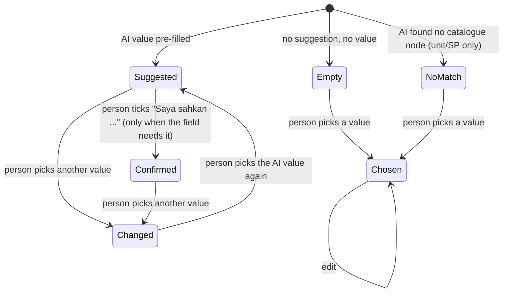
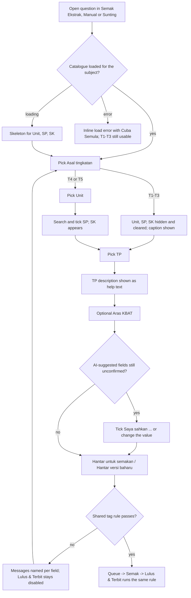

# v2 DSKP integration: UX spec (Tag DSKP block, gates, bank and queue filters, tag history)

| Field | Value |
|---|---|
| Slug | `v2-dskp-integration` |
| Task | DSKP-T00 (ui-ux-designer) |
| Date | 2026-10-24 |
| Status | Proposed, for the frontend tasks DSKP-T07 (editor) and DSKP-T08 (bank and queue) |
| Requirements | `docs/requirements/v2-dskp-integration.md` (US-04 to US-10, AC-02.2, AC-03.2, AC-03.3, AC-08.3) |
| Architecture | `docs/architecture/v2-dskp-integration.md` (tag v2 shape 2.6, AI fields 2.7, flags 2.3, TP resolver 2.4, gates 5.2, filters 5.4, history 5.6, A1 to A10) |
| Design system | `docs/design/v2-design-system.md` (staff personality), `docs/design/v2-copy-glossary.md` |
| Code read | `src/modules/m28-bijak-spm/admin/intake/components/QuestionEditor.vue` (Tag DSKP block), `admin/intake/domain/validation.ts`, `admin/papers/{BankPage,BankEditPage,ReviewQueuePage,ReviewItemPage}.vue`, `src/ds/*` |
| Language | Doc English; all UI strings Bahasa Melayu. **[PROPOSED]** marks copy that does not exist yet in the code, G1 or G2. Existing strings are kept letter for letter. |

## 0. Rules this spec follows

1. **Convert and fix, no redesign.** The Tag DSKP block keeps its place (a `fieldset` with legend "Tag DSKP" at the end of `QuestionEditor`), its container-query grid, its confirmation checkbox pattern and its test ids. It is used unchanged in structure by Semak Ekstrak, Tulis Soalan Manual and Sunting. **No new screen, route, drawer or dialog is added.**
2. **Existing DS components only** (section 1). No one-off colours, radii or fonts. The one new local component is `DskpSpPicker` (already named in G2 section 1.1); it is composed only from DS and Nuxt UI parts listed here.
3. **Responsive.** Every part is specified at 375, 768 and 1280 px and has no horizontal page scroll down to 320 px. The block is a container (`@container`), so its layout follows the width of the container, not the viewport. Section 2.2 maps viewport to container for each host page.
4. **Accessibility = existing patterns** (D10). Nothing beyond the DS baseline (section 11).

## 1. Design-system parts used

| Need | Part | Notes |
|---|---|---|
| Field row (label, required star, hint, error) | `DsFormField` (`native` mode, as `IntakeMetaFields` does) | `required`, `hint`, `error`, `loading`, `disabled`; the `label-extra` slot carries the AI badge |
| Tingkatan, Unit, TP, Aras KBAT, filter selects | `DsNativeSelect` (`blank`/`placeholder`, `invalid`, `disabled`, `loading`) | Unit uses raw `<optgroup>` in the default slot (supported; the `items` prop is flat only) |
| Search of SP | `UInput` with leading icon `i-ph-magnifying-glass` | same control the bank search uses |
| SP rows and confirmation boxes | `UCheckbox` with `#label` slot | already used by the block; DS gives it a 44 px hit box |
| Selected SP chips | `UBadge` (`variant="subtle"`, `color="neutral"`) plus a 44 px icon `UButton` (`variant="ghost"`) to remove | |
| Flag, AI and state badges | `UBadge` (always icon + word), `DsStatusBadge` only for real statuses (it has no "perlu semakan" status, so it is not used for the flag) | |
| Notices inside the block | `UAlert` (`variant="subtle"`) for the question-level flag; a caption line (`DsText variant="caption"`) for field notices | |
| Derived SK, TP descriptor text | `DsText`, `DsStack` | read-only text, not controls |
| Jawi text | `DsRtlScope` (RTL, `font-jawi`, `text-body`) | decision in 3.9 |
| Loading, error, empty | `DsFormField loading` (skeleton), `DsLoadError variant="inline"`, `DsStateView`/`DsDataTable` empty states already on the pages | |
| Filter bar | `DsFilterBar` (inline from `md`, `more` slot = "Lagi Penapis" popover, below `md` = "Penapis" bottom sheet), `DsActiveFilters` chips | already used by both pages |
| Table and cards | `DsDataTable` (table from `md`, card list below `md`; `cardFields`) | |
| Panels | `DsPanel` | existing |

**`USelectMenu` for the SP multi-select: not used.** Evidence: it is themed in `src/theme/ui.config.ts` (`selectMenu: menuField`) but no page in `src/` uses it, so there is no tested pattern, no 44 px option sizing and no wrapping of long option text. SP text can be a full sentence, and for Pendidikan Islam it is RTL Jawi. A floating menu truncates or wraps unpredictably, closes on scroll on touch devices and cannot show the chip list and count beside the options. The inline list (search + checkbox rows) is the same decision G2 already took (`DskpSpPicker.vue`: "search input + scrollable checkbox list + chips"). `USelectMenu` stays available for other work.

## 2. Where the block appears and how wide it is

### 2.1 Hosts

| Host | Route / page | Notes |
|---|---|---|
| Semak Ekstrak | `IntakeReviewPage` (batch from a PDF) | questions are accordion cards; page is two columns (source | questions) from `lg` |
| Tulis Soalan Manual | `IntakeReviewPage` with `sourceKind = manual` | no source column, editor takes the full width |
| Sunting (versi baharu) | `BankEditPage` (`hide-number`) | one `DsPanel` "edit-question" |

The block always sits in the same `fieldset`. When the page disables it (`fieldset disabled`: batch not Draf, or Sunting locked while a new version waits) every control is disabled, the descriptor and chips stay visible, and the confirmations are not editable. No other read-only variant is introduced.

### 2.2 Container width per host (approximate; build against the container, not these numbers)

| Host | 375 viewport | 768 viewport | 1280 viewport |
|---|---|---|---|
| Semak Ekstrak (split) | about 290 px (base) | about 660 px (single column, `@md`) | about 480 px (right column of the 5/7 split, `@md`; **just above the 448 px threshold, so it must also be correct at base**) |
| Tulis Soalan Manual | about 290 px (base) | about 660 px (`@md`) | about 880 px (`@3xl`) |
| Sunting | about 280 px (base) | about 650 px (`@md`) | about 870 px (`@3xl`) |

At 320 px the container is about 235 px: the base layout must hold there (no overflow; chips and badges wrap).

Container steps used: base (under 28rem), `@md` (28rem = 448 px), `@3xl` (48rem = 768 px). There is no 4-column layout in Semak Ekstrak at any viewport.

## 3. Tag DSKP block

### 3.1 Field order (DOM order = tab order = reading order)

| # | Field | Control | Required | Notes |
|---|---|---|---|---|
| 0 | Legend "Tag DSKP", caption "Subjek: {nama subjek}" | text | n/a | **[PROPOSED]** the subject is fixed by the batch or the question; showing it removes the guess when 13 subjects exist. Not a control, so no tab stop. |
| 0a | Question flag alert "Perlu semakan tag" | `UAlert warning subtle` | n/a | only for a seed or migrated question with `review = 'perlu-semakan'`; disappears as soon as the tag is complete (3.8) |
| 1 | Asal tingkatan (label unchanged) | `DsNativeSelect`, `blank`, placeholder "Pilih tingkatan" | yes | options: Tingkatan 4, Tingkatan 5, Tingkatan 1-3 (di luar DSKP); **no default**, the old `T4+T5` default is gone |
| 2 | Unit | `DsNativeSelect`, placeholder "Pilih unit", `optgroup` per Bidang/Tema where printed | yes for T4/T5; **not rendered for T1-T3** | option text "{kod} - {tajuk}" as printed; hint "Mengikut {Tajuk / Topic / Learning Area / Kemahiran / Modul / Bidang / Tema} dalam DSKP" [PROPOSED] |
| 3 | SP (Standard Pembelajaran) | `DskpSpPicker` | yes for T4/T5; not rendered for T1-T3 | replaces "SP (asingkan dengan koma)" |
| 4 | SK (Standard Kandungan) | read-only text list | n/a; not rendered for T1-T3 | derived from the chosen SP |
| 5 | TP (1-6) (label unchanged) | `DsNativeSelect`, placeholder "Pilih TP", options "TP 1" to "TP 6" | yes, every tingkatan | replaces the number input; **no default** |
| 6 | Aras KBAT (pilihan) | `DsNativeSelect`, blank option text "Bukan KBAT" (value empty) + Mengaplikasi, Menganalisis, Menilai, Mencipta | no | placed after TP, independent of it; hint "Tidak ditentukan oleh TP." [PROPOSED]. The parallel draft select must be reconciled with this (same options, same position). If Q-D1 becomes a yes/no switch, only this control and the filter option list change. |
| 7 | TP description | text block, `id` referenced by the TP select's `aria-describedby` | n/a | 3.5 |

The confirmation checkboxes (3.6) move from the end of the fieldset to **directly under the control they confirm**, so the reviewer confirms in context. The `data-testid="confirm-{field}"` values are kept.

Test ids kept: `q-form`, `q-unit`, `confirm-tag.unit`, `confirm-tag.sp`. `q-sp` moves from the old text input to the picker root. New: `q-tp`, `q-kbat`, `sp-search`, `sp-option-{kod}`, `sp-chip-{kod}`, `q-sk`, `tp-descriptor`, `tag-notice`, `tag-review-alert`, `confirm-tag.tp`, `confirm-tag.kbat`. The e2e spec (`e2e/m06-spm/bijak-spm.spec.ts`) is updated by DSKP-T07 (the T1-T3 unit select is no longer present, see 3.7).

### 3.2 Layout

Grid on the fieldset body: `grid gap-3`, then per container step:

| Container | Rows |
|---|---|
| base | one column: Tingkatan, Unit, SP, SK, TP, Aras KBAT, TP description |
| `@md` | one column for Tingkatan, Unit, SP, SK (full width: unit titles and SP text are long); then two columns: TP, Aras KBAT; then the description across both |
| `@3xl` | row 1: Tingkatan (1 of 4) + Unit (3 of 4); SP and SK full width; row 4: TP (1 of 4), Aras KBAT (1 of 4), TP description (2 of 4) |

Fieldset padding stays `p-3`. Gap 3 (12 px) between fields, gap 2 (8 px) inside a field. All controls `w-full min-w-0`; no fixed widths.

```
BASE (375, container about 290)             @md (768 Manual/Sunting; 1280 Semak Ekstrak)
+----------------------------------+        +---------------------------------------------+
| Tag DSKP                         |        | Tag DSKP                                    |
| Subjek: Matematik                |        | Subjek: Matematik                           |
| Asal tingkatan *                 |        | Asal tingkatan *                            |
| [Tingkatan 4                 v]  |        | [Tingkatan 4                            v]  |
| Unit *            [AI badge]     |        | Unit *                                      |
| [1.0 - Persamaan Kuadratik   v]  |        | [1.0 - Persamaan Kuadratik              v]  |
| Mengikut Tajuk dalam DSKP        |        | Mengikut Tajuk dalam DSKP                   |
| SP (Standard Pembelajaran) *     |        | SP (Standard Pembelajaran) *                |
| [Q Cari kod atau teks SP...   ]  |        | [Q Cari kod atau teks SP...              ]  |
| [1.1.6 x]                        |        | [1.1.6 x] [1.1.7 x]                         |
| +------------------------------+ |        | +-----------------------------------------+ |
| |[x] 1.1.6                     | |        | |[x] 1.1.6  Menentukan punca suatu ...    | |
| |    Menentukan punca ...      | |        | |[ ] 1.1.7  ...                           | |
| |[ ] 1.1.7                     | |        | +-----------------------------------------+ |
| +------------------------------+ |        | 1 SP dipilih . 8 SP dalam unit ini          |
| 1 SP dipilih . 8 SP dalam unit   |        | SK (Standard Kandungan)                     |
| SK (Standard Kandungan)          |        | 1.1  Persamaan kuadratik ...                |
| 1.1  Persamaan kuadratik ...     |        | TP (1-6) *            Aras KBAT (pilihan)   |
| TP (1-6) *                       |        | [TP 3             v]  [Bukan KBAT        v] |
| [TP 3                        v]  |        | Penerangan TP 3: ...                        |
| Aras KBAT (pilihan)              |        +---------------------------------------------+
| [Bukan KBAT                  v]  |
| Penerangan TP 3: ...             |        @3xl (1280 Manual/Sunting)
+----------------------------------+        +---------------------------------------------------------------+
                                            | Asal tingkatan * | Unit *                                      |
                                            | [Tingkatan 4  v] | [1.0 - Persamaan Kuadratik               v] |
                                            | SP ... (full width)                                            |
                                            | SK ... (full width)                                            |
                                            | TP (1-6) *  | Aras KBAT (pilihan) | Penerangan TP 3: ...     |
                                            +---------------------------------------------------------------+
```

### 3.3 Tingkatan (asal tingkatan)

- Blank option is the placeholder; unset is a valid Draf state, every gate refuses it with "Subjek dan tingkatan perlu ditetapkan.".
- Changing it:
  - T4 to T5 or T5 to T4: Unit and SP are cleared (they belong to the other tingkatan).
  - Any to T1-T3: Unit, SP (and SK) are cleared and hidden.
  - From unset to a value: nothing to clear.
  - If something was actually cleared, show the notice (3.7) directly under the Tingkatan select. If nothing was set, no notice.
- A value saved earlier that is no longer valid (null `formOrigin` on a flagged seed) shows the placeholder, not a guessed value.

### 3.4 Unit and SP

**Unit select**

- Options come from the catalogue for the fixed subject and the chosen tingkatan only. Order is print order (never sorted: "10.0" stays after "9.0").
- Grouping: where the subject prints a Bidang / Tema / Learning Area, render `<optgroup label="{kod} {tajuk}">` (code only if the group has one, for example Pendidikan Moral "5.0 INSAN BERMORAL"); otherwise a flat list. Option text is "{kod} - {tajuk}" with the case as printed ("Tajuk 9 - ..." for Sejarah, "1" for Pendidikan Islam bidang).
- Unit with a node flag (reconstructed, inferred, tpUnaligned, draftEdition, textDefect): append " (perlu semakan)" to the option text, because a native option cannot hold a badge. The all-subject Pendidikan Islam flag is **not** repeated on every unit option (it is shown on SK/SP rows, 3.9).
- Disabled until Tingkatan is T4 or T5; while the catalogue chunk loads it shows `loading` (skeleton); on a load error it stays disabled (3.10).
- Choosing a different unit keeps the SP that also belong to the new unit (none, in practice) and clears the rest; if any SP was cleared show "SP dikosongkan kerana unit berubah." [PROPOSED] under the Unit select.
- A stored `unitId` that no longer exists in the catalogue (AC-07.7) is shown as one disabled selected option "{id} (tidak dijumpai dalam katalog)" and the gate fails "Unit DSKP tidak wujud dalam katalog.". The reviewer picks a valid unit; no silent clearing.

**SP picker (`DskpSpPicker`)**

Anatomy, top to bottom (all inside one `role="group"` labelled by the field label "SP (Standard Pembelajaran)"):

```
SP (Standard Pembelajaran) *        [Cadangan AI . Keyakinan rendah]   <- label-extra slot
[Q  Cari kod atau teks SP...                                    ]      <- UInput, aria-label "Cari SP"
[1.1.6  x] [1.1.7  x]                                                  <- selected chips (hidden when none)
+--------------------------------------------------------------+
| [x]  1.1.6   [perlu semakan]                                 |  <- UCheckbox row, min 44 px
|      Menentukan punca suatu persamaan kuadratik ...          |
| [ ]  1.1.7                                                   |
|      Menyelesaikan masalah yang melibatkan ...               |
|  ... (scrolls inside the list, max-h-72)                     |
+--------------------------------------------------------------+
1 SP dipilih . 8 SP dalam unit ini                                     <- caption, aria-live polite
Tanda "perlu semakan" bermaksud ...                                    <- caption, only if a visible row is flagged
[ ] Saya sahkan SP (keyakinan rendah)                                  <- 3.6
```

- **Scope**: the list contains only the selectable SP of the chosen unit (non-selectable "No learning standard" slots never appear). With no unit chosen the picker is disabled and shows "Pilih unit dahulu untuk melihat SP." in place of the list.
- **Search**: `UInput`, filters as you type (no button, no debounce delay the user can feel; NFR-01). Case, diacritic and Arabic-tashkil insensitive; matches code or text; token AND (G2 search contract). Searches the chosen unit only. `dir="auto"` so Jawi typed in the box aligns correctly. `Enter` is swallowed (`@keydown.enter.prevent`) so it never submits a surrounding form.
- **Rows**: `UCheckbox` whose label slot is a block `min-h-11 cursor-pointer`: line 1 = SP code (`font-semibold tabular`, `dir="ltr"`) followed by the flag badge if any; line 2 = SP text, wrapped in full (no truncation). Row spacing gap 1; list container `bg-elevated rounded-chip p-1` (elevated layer inside the card, no border), row hover `bg-accented`. A checked row is shown by the checked checkbox (check glyph), not by colour alone.
- **Selection**: multi-select, no cap (Q-D6). Checking a row adds a chip; unchecking removes it. Chips and rows stay in sync; a selected SP hidden by the search remains in the chips.
- **Chips**: `UBadge` "{kod}" plus a ghost icon button `i-ph-x-bold` with `aria-label="Buang SP {kod}"` and a 44 px hit area. A chip of a flagged SP also shows `i-ph-warning` before the code (icon, not colour only). Chips wrap (`flex flex-wrap gap-2`).
- **Count line**: "{n} SP dipilih . {m} SP dalam unit ini"; during search "{k} SP sepadan . {n} SP dipilih". Polite live region so a screen reader hears the count change.
- **Free text is never accepted.** There is no "tambah SP" field.
- **List height**: `max-h-72` (18rem) at every size, scrolls inside the list (own scroll, never the page). With fewer rows the list shrinks. On a phone with the keyboard open the list may be clipped by the viewport; the page scrolls around it (no fixed positioning).
- **No match**: inside the list area "Tiada SP sepadan dengan "{carian}"." and a ghost button "Kosongkan Carian" (min 44 px) that clears the box and returns focus to it.
- **Unit has no selectable SP**: "Tiada SP yang boleh dipilih dalam unit ini." (no checkbox; the gate then cannot pass, which is correct).
- **Order of selected codes** in the chips and in the data follows catalogue print order, not click order.

**SK (derived)**

- Label "SK (Standard Kandungan)", a `role="group"` block with `aria-labelledby`, on `bg-soft rounded-chip p-3` (read-only layer, as `DsFormField readonly` looks). Not focusable.
- One row per distinct SK of the chosen SP, in print order: "{kod}" (`font-semibold tabular`, LTR) then the title, wrapped in full. Several SK are listed when SPs span SK.
- Empty: "Dipaparkan selepas SP dipilih." (muted). Hint under the block: "Dikira daripada SP dan tidak boleh diubah." [PROPOSED].
- Not rendered for T1-T3.

### 3.5 TP and the TP description

- `DsNativeSelect`, label "TP (1-6)" with the required star, placeholder "Pilih TP", options "TP 1" to "TP 6" (value 1 to 6). Never pre-selected except by an AI suggestion (3.6) or a stored value.
- **Description** (help text, AC-02.2): a block directly below the TP/KBAT row (full row width at base and `@md`; the right half at `@3xl`), `id="tp-desc-{questionId}"`, wired as `aria-describedby` of the TP select. Muted caption text, never an error colour. It never changes the selected TP.

| Situation | Content |
|---|---|
| T4/T5, unit and SP chosen, TP chosen, descriptor found | Line 1 (label weight): "TP {n}" plus the printed level name if the subject prints one (for example Bahasa Melayu "Sangat Terhad"). Line 2: the descriptor text exactly as printed. Line 3 (caption, dimmed is not allowed for essential info, use muted): "Mengikut {Tajuk / Topic / Learning Area / Kemahiran / Modul} {kod}" for unit-level descriptors, "Mengikut SK {kod}" for SK-level descriptors (one block per distinct SK, stacked), "Mengikut jadual TP am subjek ini" [PROPOSED] when the general table is the fallback |
| Landskap `tpUnaligned` row matched by a range (for example "1-4") | the printed row text, and line 3 adds the range: "Berlaku untuk TP 1-4" [PROPOSED] |
| T4/T5, TP chosen, no descriptor (G2 2.4 step 4: Bahasa Inggeris 5.0, Landskap pooled units) | "Tiada penerangan TP dalam DSKP untuk unit ini." (G2 text) |
| T4/T5, TP not chosen | hint: "Pilih TP untuk melihat penerangannya mengikut DSKP." [PROPOSED] |
| T4/T5, unit or SP not yet chosen (SK-level subjects need the SP) | hint: "Pilih unit dan SP untuk melihat penerangan TP." [PROPOSED] |
| T1-T3 | "Tiada penerangan TP DSKP untuk Tingkatan 1-3." [PROPOSED] |
| Pendidikan Islam | the descriptor text is Jawi: wrapped in `DsRtlScope` (3.9) |

- A long descriptor is shown in full, wrapped (no inner scroll, no clamp, no tooltip: touch has no hover). The line length stays within the field width; at `@3xl` the half-width column wraps more, which is acceptable.

### 3.6 AI suggestion state and confirmation, per field

Fields that can carry a suggestion: Unit, SP, TP, Aras KBAT (Tingkatan is implied by the unit and carries no badge).

State machine of one field (unit, sp, tp, kbat):



| State | Badge on the label (`label-extra`, `UBadge size="sm" variant="subtle"`) | Under the control | Counts toward the gate |
|---|---|---|---|
| Empty, no AI | none | none | missing-field message |
| No match (unit/SP) | none | caption with `i-ph-warning`: "AI tidak menjumpai {unit / SP} yang sepadan. Pilih secara manual." [PROPOSED] | missing-field message |
| Suggested, needs confirmation (unit/SP with Low confidence; **every** AI-suggested TP and KBAT) | `color="warning"` for Low confidence, `color="info"` otherwise; icon `i-ph-sparkle`; text "Cadangan AI . Keyakinan {tinggi / sederhana / rendah}" (existing `CONFIDENCE_LABEL` words) | the checkbox row (below) | "belum disahkan" message until ticked or changed |
| Suggested, no confirmation needed (unit/SP with High or Medium confidence) | `color="info"`, same text | none | passes |
| Confirmed | `color="success"`, icon `i-ph-check-bold`, text "Disahkan" | the ticked checkbox stays visible | passes |
| Changed by the person | badge removed | caption (muted): "Diubah daripada cadangan AI: {nilai}" [PROPOSED] | passes (resolved by editing); a stale `confirmed` entry is dropped |

- **Checkbox copy**, built from the existing pattern (`UCheckbox`, label slot `block min-h-11 cursor-pointer`):
  - unit, SP: "Saya sahkan unit DSKP (keyakinan rendah)" and "Saya sahkan SP (keyakinan rendah)" (existing words).
  - TP, KBAT: "Saya sahkan TP (cadangan AI)" and "Saya sahkan Aras KBAT (cadangan AI)" [PROPOSED] (G2 section 5.1). The "(keyakinan rendah)" wording is not used here because TP and KBAT need confirmation at any confidence.
- The checkbox is shown only when the field has a value to confirm and the person has not changed it away from the suggestion. For an empty or no-match field there is nothing to confirm; the gate asks for a value instead.
- The suggestion is pre-selected visibly (the select shows it) so the reviewer sees what AI proposed; it is never styled as final.
- T1-T3: no unit or SP confirmation is asked (existing `fieldsToConfirm` rule); TP and KBAT still follow the table.

### 3.7 Notices, T1-T3 and the question flag

**Notices** (`role="status"`, caption size, `i-ph-info` icon, text info colour, shown directly under the control that caused them, not toasts):

| Trigger | Copy | Where | Cleared when |
|---|---|---|---|
| Tingkatan changed and unit/SP were cleared | "Unit dan SP dikosongkan kerana tingkatan berubah." [PROPOSED, G1 AC-04.7] | under Tingkatan, `data-testid="tag-notice"` | the next change to any control of the block |
| Unit changed and SP were cleared | "SP dikosongkan kerana unit berubah." [PROPOSED] | under Unit | same |

**T1-T3 state (D-UX1 — lead decision 13.x: render the three fields disabled with the caption below; the "hide" variant described here was not taken).** When Tingkatan is "Tingkatan 1-3 (di luar DSKP)":

- Unit, SP and SK are rendered **disabled** and empty (`aria-disabled`; values cleared). Under them, one caption line spanning the grid, `i-ph-info`: "Tingkatan 1-3 berada di luar DSKP. Unit dan SP tidak diperlukan; TP masih wajib." [PROPOSED]
- TP stays required; Aras KBAT stays optional; the TP description shows its T1-T3 line (3.5).
- Switching back to T4/T5 renders the three fields empty.
- Why hide rather than disable (G1 AC-04.6 says "disabled"): a disabled empty select and an empty disabled picker take about 300 px of height at 375 px for fields that can never be used; the caption says the same thing in one line. The G1 intent (not operable, not required, `unit`/`sp` stay empty) is met; only the e2e assertion "q-unit disabled" changes to "q-unit absent". If the lead prefers G1's wording, render the three fields disabled with the same caption and `aria-disabled` (no other change).

**Question flag "Perlu semakan tag"** (seed or migrated question with `review = 'perlu-semakan'`, Sunting only in practice):

- `UAlert color="warning" variant="subtle" icon="i-ph-warning"`, at the top of the block, `data-testid="tag-review-alert"`:
  - title "Perlu semakan tag"
  - description "Tag soalan ini belum disahkan. Pilih tingkatan, unit dan SP daripada DSKP, kemudian hantar versi baharu." [PROPOSED]
- Controls open empty (no tingkatan, unit, SP); TP shows the stored value with no AI badge.
- The alert disappears live as soon as the tag is complete (the data layer clears the marker); it is not dismissible.

### 3.8 Required and error display

- Required stars (`DsFormField required`, sr-only "wajib"): Tingkatan always; Unit and SP for T4/T5; TP always; Aras KBAT never ("(pilihan)" in the label).
- **Inline error [PROPOSED, small]:** once the page has shown the gate list (Semak Ekstrak: issues list opened or a submit was refused; Sunting: after "Hantar versi baharu" is refused), each required control that is empty gets `invalid` on `DsNativeSelect` (2 px inset error ring + `bg-error/10`, as the DS defines) and the `DsFormField error` text equals the gate message of section 4. Before that, no inline error text (same as today). The existing list stays the primary message.

### 3.9 Jawi (Pendidikan Islam) and the font decision

- **Decision D-UX2: reuse the existing token and component, add nothing.** Arabic/Jawi text uses `font-jawi` (`--font-jawi: 'Scheherazade New', 'Lateef', serif`, in `src/theme/tokens.css`; the Scheherazade New 400 and 700 files are bundled by `@fontsource/scheherazade-new`). The component is `DsRtlScope` (`dir="rtl"`, `font-jawi`, `text-body`). The old `font-arabic` token of the legacy theme is not used in v2 code. Add `leading-loose` on Jawi blocks (as `QuizRunner` does) so the marks above and below the line do not clip. Add `lang="ms-Arab"` to the scope (attribute falls through to its root).
- **Which text is RTL** (`rtlFields` of the subject: sk, sp, tp): SK titles, SP text, TP descriptor text of Pendidikan Islam. **Not RTL:** unit titles and unit codes (Latin), every code (always `dir="ltr"`), labels, badges, counts.
- **Rows with Jawi** (SP picker row, SK row): line 1 is the LTR code and badge; line 2 is the Jawi text in a `DsRtlScope`, right-aligned, wrapping in full.
- **Search box** uses `dir="auto"`. Native `<option>` text in the Unit select is Latin for Pendidikan Islam, so no font issue there. In the bank SP filter (section 6) Jawi text appears in a native `<option>` in the system Arabic font; accepted, because a native select cannot be styled (listed in the QA notes).
- **Flag label for Pendidikan Islam:** every SK and SP row carries the badge "perlu semakan ejaan" (`UBadge color="warning" variant="subtle" size="sm" icon="i-ph-warning"`). A flagged node is selectable (AC-03.3).
- **Node flag badges** for other subjects: the same badge with the text "perlu semakan" (reconstructed, inferred, tpUnaligned, draftEdition, textDefect). The specific reason (G2 2.3 labels) is the `UTooltip` text on pointer devices; on touch the picker shows the legend line "Tanda "perlu semakan" bermaksud teks DSKP ini belum disahkan sepenuhnya. SP masih boleh dipilih." [PROPOSED] under the count line whenever at least one visible row is flagged. The legend for Pendidikan Islam reads "Ejaan Jawi bagi SP ini belum disahkan. SP masih boleh dipilih." [PROPOSED].
- QA: a G5 screenshot of the picker with Jawi rows at 375 and 1280 px in light and dark is required (risk R-E in G2).

### 3.10 States of the block

| State | Where | Behaviour and copy |
|---|---|---|
| Loading the subject catalogue | Unit, SP picker, SK, TP description | Tingkatan and TP/KBAT stay usable (they do not need the catalogue). Unit: `DsFormField loading` (skeleton `h-11`). SP picker: skeleton of one search bar and three rows (`USkeleton h-11`), `aria-busy="true"`. SK and description: one skeleton line. The block does not jump after loading beyond the list appearing. A short, accessible status text "Memuatkan..." (existing `dsCopy.loading`, sr-only). |
| Load error | Unit and SP area | `DsLoadError variant="inline"` replaces Unit/SP/SK: "Tidak dapat memuatkan senarai DSKP bagi subjek ini. Sila cuba semula." [PROPOSED, glossary pattern] with "Cuba Semula". T1-T3 is still usable. A failed chunk is not cached, so retry works. |
| Empty (no units for this subject and tingkatan) | Unit | Unit stays disabled with the hint "Tiada unit dalam DSKP untuk subjek dan tingkatan ini." [PROPOSED]. Not expected for the 13 subjects. |
| Empty (unit has no selectable SP) | SP | see 3.4 |
| Empty (no search match) | SP | see 3.4 |
| Not yet picked | Unit/SP/SK/TP description | prompts in 3.4 and 3.5 |
| Disabled by the page (`fieldset disabled`) | whole block | controls disabled (DS disabled look: dimmed text, no hover), chips without remove buttons, checkboxes disabled; descriptor still shown |
| Success | n/a | no toast; the live count line, SK list and descriptor are the feedback. The batch/Sunting save message is unchanged. |

### 3.11 Behaviour at 375 / 768 / 1280 (per host)

| Host | 375 | 768 | 1280 |
|---|---|---|---|
| Semak Ekstrak | Page is a single column with the "Soalan / Sumber" tab switch; block at base layout, all fields stacked; SP list `max-h-72` | Single column; block at `@md` layout (TP and KBAT side by side) | Two columns; block in the right column at `@md` layout (or base if the container is under 448 px); no horizontal scroll |
| Tulis Soalan Manual | Base layout | `@md` layout | `@3xl` layout (Tingkatan + Unit in one row, TP + KBAT + description in one row) |
| Sunting | Base layout inside `DsPanel` | `@md` layout | `@3xl` layout |

No horizontal page scroll at any width down to 320 px: selects and the search input are `w-full min-w-0`; chips and badges wrap; SP text and descriptors wrap (`break-words` behaviour of normal text, no `nowrap` on content); only the SP list scrolls, vertically, inside itself.

## 4. Gate messages (submit, revision, publish)

One rule feeds all three paths (G2 5.2), so the wording is identical everywhere. The tag messages below are the only strings the three paths produce for the tag.

| Check | Message (exact BM) | Status |
|---|---|---|
| Tingkatan or subject not set | Subjek dan tingkatan perlu ditetapkan. | existing |
| T4/T5, no unit | Unit DSKP belum dipilih. | existing (submit); replaces the publish text "topik DSKP belum dipilih" |
| T4/T5, unit not in the catalogue or of another subject/tingkatan | Unit DSKP tidak wujud dalam katalog. | [PROPOSED] (G2 5.2) |
| T4/T5, no SP | Standard Pembelajaran (SP) belum dipilih. | existing |
| T4/T5, an SP not in the chosen unit or not selectable | SP tidak wujud dalam unit yang dipilih. | [PROPOSED] (G2 5.2) |
| TP not chosen | Tahap Penguasaan (TP) belum dipilih. | [PROPOSED] (G2 5.2) |
| TP not an integer 1 to 6 | Tahap Penguasaan (TP) mesti antara 1 dan 6. | existing |
| KBAT not a valid level | Aras KBAT tidak sah. | [PROPOSED] (G2 5.2) |
| T1-T3 with a unit or SP (defensive; the editor cannot produce it) | Tingkatan 1-3 (di luar DSKP) tidak mempunyai unit atau SP. | [PROPOSED] (G2 5.2) |
| Unit or SP AI-suggested with Low confidence, not confirmed or changed | Medan keyakinan rendah belum disahkan: unit DSKP. and Medan keyakinan rendah belum disahkan: SP. | existing |
| TP or KBAT AI-suggested, not confirmed or changed | Cadangan AI belum disahkan: TP. and Cadangan AI belum disahkan: Aras KBAT. | [PROPOSED] (the existing "keyakinan rendah" wording is wrong for a High-confidence TP, which must still be confirmed) |
| Bulk action skipped questions (no bulk UI exists in the prototype; wording reserved) | {n} diterbitkan, {m} dilangkau. (existing QB copy) followed by the list of skipped questions with the messages above | existing pattern, [PROPOSED] use |

Where each surface shows them:

| Surface | Format | Change |
|---|---|---|
| Semak Ekstrak issues toggle and list | "{where}: {message}", for example "Soalan 3: Unit DSKP belum dipilih."; each item is a 44 px button that opens the question | none in structure; more messages possible |
| Sunting issues list | "{message}" (the "Soalan 1" prefix is dropped as today) | the legacy exception for a missing SP is removed (AC-07.5): "Standard Pembelajaran (SP) belum dipilih." now always applies |
| Ruang kerja semakan, panel "Pintu terbit" | "Soalan {n}: {message}" in the red list; "Lulus & Terbit" stays disabled while the list is not empty | the publish gate now shows the same tag messages |
| Ruang kerja semakan, a flagged question | the same missing-field messages (a flagged seed has no tingkatan, unit or SP) | no separate "flagged" message |

## 5. Flow



## 6. Bank Soalan SPM (`BankPage`) and Baris Gilir Semakan (`ReviewQueuePage`)

### 6.1 Filter bar

Existing inline fields stay: search, Subjek, Kertas, Jenis soalan, Status (bank); Subjek, Kertas, Jenis soalan (queue). The five curriculum filters go into the **`more` slot of `DsFilterBar`** so the inline bar does not grow from 5 to 11 controls:

- `md` and wider: a "Lagi Penapis" popover (width 20rem, `max-w-dvw`), button shows the count of active curriculum filters on its chip (`moreCount`).
- Below `md`: everything is inside the "Penapis" bottom sheet, in this order: Subjek, Kertas, Jenis soalan, Status (bank only), then the curriculum group. The sheet scrolls inside (`max-h-dvh`); "Guna" and "Set Semula" at its end (existing).

Both pages share one local component `DskpFilterFields` [PROPOSED name, `admin/papers/`] so the two bars cannot drift. It holds the five selects and the bank-only checkbox.

| Order | Field | Control | Options and rules |
|---|---|---|---|
| 1 | Tingkatan | `DsNativeSelect`, `aria-label="Tingkatan"` | "Semua tingkatan", "Tingkatan 4", "Tingkatan 5", "Tingkatan 1-3 (di luar DSKP)" |
| 2 | Unit | `DsNativeSelect`, `aria-label="Unit"` | "Semua unit". **Disabled until a Subjek is chosen** (hint under it: "Pilih subjek dahulu." [PROPOSED]) and disabled when Tingkatan is T1-T3. With one tingkatan chosen: that tingkatan's units, grouped by Bidang/Tema where printed. With no tingkatan chosen: two `optgroup`s "Tingkatan 4" and "Tingkatan 5", each with "{kod} - {tajuk}" (codes repeat across the two forms, the group label tells them apart). |
| 3 | SP | `DsNativeSelect`, `aria-label="SP"` | "Semua SP". **Disabled until a Unit is chosen** (hint "Pilih unit dahulu." [PROPOSED]). Options "{kod} - {teks}" of that unit's selectable SP. Kept as a native select (not the picker): one SP per filter, and the select wraps long text on touch devices. |
| 4 | TP | `DsNativeSelect`, `aria-label="TP"` | "Semua TP", "TP 1" to "TP 6" |
| 5 | KBAT | `DsNativeSelect`, `aria-label="Aras KBAT"` | "Semua", "Ya", "Tidak", Mengaplikasi, Menganalisis, Menilai, Mencipta ("Ya" = any level, "Tidak" = empty, G1 AC-06.5) |
| 6 (bank only) | Perlu semakan tag | `UCheckbox`, label "Perlu semakan tag" | shows seed questions still flagged (AC-08.3). The count is the table's own "Menunjukkan {dari}-{hingga} daripada {jumlah} hasil" once ticked, so the number always equals the rows (AC-09.2); no second count is printed next to the checkbox. |

Dependencies, applied when the bar state changes (before "Cari"/"Guna" is pressed):

- Subjek changed: Unit and SP are cleared; Tingkatan, TP, KBAT stay.
- Tingkatan changed: if the chosen Unit does not belong to it, Unit and SP are cleared.
- Unit changed or cleared: SP is cleared.
- The Subjek select lists all 13 catalogue subjects (the same list the intake declaration uses, section 8). A subject with no questions simply returns the filtered empty state.
- Subject KPI tiles are unchanged (they still act as Subjek quick filters).

Active-filter chips (`DsActiveFilters`, labels are the values; remove has aria "Buang penapis {nama}"): "Tingkatan 4", "Unit 1.0 Persamaan Kuadratik" (code + title, truncated by the chip), "SP 1.1.6", "TP 3", "KBAT: Menilai" (or "KBAT: Ya" / "KBAT: Tidak"), "Perlu semakan tag". Removing "Unit" also removes "SP". Reset ("Set Semula") clears all of them, including the curriculum group, and returns Status to its default as today.

Queue: same five fields, no "Perlu semakan tag" (a flagged question reaches the queue only after the reviewer has tagged it). The queue's `activeCount`/chips include the new ones.

### 6.2 Columns, rows and cards (no new table column)

The tables are already eight columns wide at 1280, so the tag is **not** a new column; it goes in the existing "Soalan" cell, which already holds a wrapping badge row.

Soalan cell, badge row order (wraps; each badge `max-w-full whitespace-normal`, so a long unit title wraps instead of widening the table):

| Badge | Text | Rule |
|---|---|---|
| Unit | `{unit.title}` (existing `topic` badge, now from the catalogue); T1-T3: "Tingkatan 1-3 (di luar DSKP)"; flagged: **replaced** by the warning badge `i-ph-warning` "Perlu semakan tag" | `neutral` subtle; flagged `warning` subtle |
| SP | "SP 1.1.6", or "SP 1.1.6, 1.1.7" up to 2 codes, then "SP 1.1.6 +2" | `neutral` subtle; hidden for T1-T3 and flagged |
| TP | "TP 3" | `neutral` subtle |
| KBAT | "KBAT: Menilai" | only when set |
| existing | "Kumpulan n soalan", "v2" (bank); "Kumpulan", "Versi n", confidence, source (queue) | unchanged |

Cards (below `md`): add to `cardFields`: `{ key: 'topic', label: 'Unit', cell: true, wide: true }`, `{ key: 'spCodes', label: 'SP', cell: true }`, `{ key: 'tp', label: 'TP' }` (KBAT is appended to the TP value as "TP 3 . KBAT Menilai" when set). Existing fields (Subjek, Markah, Digunakan, Status) keep their positions; the new three come after Markah/Digunakan and before Status so the status badge stays last. Cards stack in one column at 375, two columns of fields inside a card at 768 (existing `DsDataTable` behaviour).

Search placeholder in the bank stays "Cari teks, ID atau topik..."; the search also matches SP codes (G2 5.4), so the placeholder becomes "Cari teks, ID, topik atau kod SP..." [PROPOSED].

### 6.3 States

| State | Bank | Queue |
|---|---|---|
| Loading | existing `DsDataTable loading` skeleton rows; the Unit/SP selects show `loading` while their subject's catalogue loads | same |
| Load error | existing `DsLoadError` "Tidak dapat memuatkan bank soalan." / "Tidak dapat memuatkan baris gilir." with "Cuba Semula" | same |
| Catalogue error (Unit/SP selects only) | the Unit select stays disabled with hint "Senarai unit tidak dapat dimuatkan." [PROPOSED] and a "Cuba Semula" ghost button under it; the other filters keep working | same |
| Empty, no filter | existing empty state | existing "Baris gilir kosong" / "Tiada soalan menunggu semakan." |
| Empty, filtered (any curriculum filter active) | "Tiada soalan dijumpai" + "Cuba ubah atau set semula penapis." + "Set Semula" (existing `DsEmptyState filtered`) | same |
| Empty, "Perlu semakan tag" ticked | title "Tiada soalan dijumpai"; description "Semua soalan sudah bertag." [PROPOSED] (the good outcome, shown only when this filter is the only one active); otherwise the default filtered text | n/a |

### 6.4 Behaviour at 375 / 768 / 1280

| Part | 375 | 768 | 1280 |
|---|---|---|---|
| Filter bar | Search + "Penapis" button (count chip = all active filters) on one row; sheet holds all selects and the checkbox; chips below the bar | Same inline bar as today (search, Subjek, Kertas, Jenis, Status, Cari); curriculum filters in "Lagi Penapis" popover; chips below | Same; the popover is 20rem wide |
| Results | card list, one column; new Unit/SP/TP fields in the card | `DsDataTable` as a table (flexible Soalan column wraps badges), or cards when the container is under `md` | table; badges wrap inside Soalan cell |
| Page scroll | none sideways; the table scrolls inside its own container if ever wider (existing) | same | same |

## 7. Tag in the details, and the tag history

### 7.1 Bank drawer ("Pratonton soalan") and Ruang kerja semakan

No new panel. The existing caption line of the status header gets a second line of badges built from the same badge set as the Soalan cell (Unit, SP, TP, KBAT, flag): `data-testid="bank-tag"` in the drawer, `data-testid="review-tag"` in `review-meta`. In the review meta panel the old text `{topic}` in the caption is replaced by these badges so the reviewer sees exactly the tag being approved, including in the "Sunting penuh" revision (whose alert already says the tag below is the proposed version).

A flagged Terbit question in the drawer shows, above the preview, `UAlert color="warning" variant="subtle" icon="i-ph-warning"`: title "Perlu semakan tag", description "Soalan ini masih melayani murid. Sunting untuk menetapkan tag DSKP sebelum versi baharu boleh diterbitkan." [PROPOSED] (G2 5.5: a flagged Terbit question keeps serving). The "Sunting (versi baharu)" button is unchanged.

### 7.2 Tag history inside the existing history lists

Both lists are the existing `<ol class="... text-caption">`: "Sejarah versi" (bank drawer) and "Sejarah" (Ruang kerja semakan). Each history `<li>` keeps its line "{tarikh} . {oleh} . v{n} . **{tindakan}** . {nota}". When the entry has `tag` changes, add under it a nested `<ul>` (indent 4, `text-muted`, caption size), one `<li>` per changed field, in this order: Tingkatan, Unit, SP, TP, Aras KBAT. The person is the entry's existing `by`. No edit or delete control exists (AC-10.4).

| Case | Line (exact pattern) |
|---|---|
| First tagging | "Tag: Tingkatan: Tingkatan 4" . "Tag: Unit: {kod} - {tajuk}" . "Tag: SP: {kod}, {kod}" . "Tag: TP: 3" . "Tag: Aras KBAT: Menilai" |
| Change | "Tag: TP: 2 -> 4" where "->" is rendered as `<span aria-hidden="true">&rarr;</span><span class="sr-only">kepada</span>` |
| Empty side | "(kosong)" for a missing value, "(bukan KBAT)" for an empty KBAT |
| T1-T3 | "Tag: Tingkatan: Tingkatan 1-3 (di luar DSKP)"; unit/SP lines are omitted |
| AI suggestion present and final differs | append " (cadangan AI: {nilai}, keyakinan {tinggi / sederhana / rendah})", for example "Tag: TP: 2 -> 4 (cadangan AI: 3, keyakinan sederhana)" |
| AI suggestion present and final equals it | append " (cadangan AI diterima, keyakinan {tinggi / sederhana / rendah})" [PROPOSED] |
| No AI suggestion (typed by the person) | no suffix (AC-10.2) |
| Catalogue node no longer found | "{id} (tidak dijumpai dalam katalog)" in place of the code and title |

Long values wrap; the line never forces sideways scroll. For a Pendidikan Islam SP the history shows the **code only**, never Jawi text (history is a Latin audit line).

## 8. Other places that touch the subject list (no layout change)

- Muat Naik Kertas and Tulis Soalan Manual, field "Subjek" (`IntakeMetaFields`, `DsNativeSelect`): lists the 13 catalogue subjects in the order Matematik, Matematik Tambahan, Fizik, Sains, Bahasa Melayu, Bahasa Inggeris, Sejarah, Pendidikan Islam, Tasawwur Islam, Pendidikan Moral, Pendidikan Seni Visual, Landskap dan Nurseri, Katering dan Penyajian. Paper-authoring and Jana Kertas screens keep their blueprint-driven list.
- Intake list ("Subjek" filter), bank and queue Subjek filters: the same 13.
- The description "Subjek, kertas dan tahun. Tahap Tingkatan 4-5." in `IntakeMetaFields` is left unchanged here (outside this feature).

## 9. Complete copy list

Existing strings keep exact wording. [PROPOSED] = new.

| Where | String |
|---|---|
| Legend / caption | Tag DSKP (existing) . Subjek: {nama} [PROPOSED] |
| Tingkatan | Asal tingkatan (existing) . Pilih tingkatan [PROPOSED, G2] . Tingkatan 4 . Tingkatan 5 . Tingkatan 1-3 (di luar DSKP) (existing) |
| Unit | Unit (existing) . Pilih unit (existing) . Mengikut {Tajuk / Topic / Learning Area / Kemahiran / Modul / Bidang / Tema} dalam DSKP [PROPOSED] . {kod} - {tajuk} . (perlu semakan) [PROPOSED] . Tiada unit dalam DSKP untuk subjek dan tingkatan ini. [PROPOSED] . {id} (tidak dijumpai dalam katalog) [PROPOSED] |
| SP | SP (Standard Pembelajaran) [PROPOSED label] . Cari SP (aria) . Cari kod atau teks SP... [PROPOSED] . Pilih unit dahulu untuk melihat SP. [PROPOSED] . {n} SP dipilih . {m} SP dalam unit ini [PROPOSED] . {k} SP sepadan [PROPOSED] . Tiada SP sepadan dengan "{carian}". [PROPOSED] . Kosongkan Carian [PROPOSED] . Tiada SP yang boleh dipilih dalam unit ini. [PROPOSED] . Buang SP {kod} (aria) [PROPOSED] |
| SK | SK (Standard Kandungan) [PROPOSED label] . Dipaparkan selepas SP dipilih. . Dikira daripada SP dan tidak boleh diubah. [PROPOSED] |
| TP | TP (1-6) (existing) . Pilih TP [PROPOSED] . TP 1 ... TP 6 . TP {n} . Mengikut {noun} {kod} . Mengikut SK {kod} . Mengikut jadual TP am subjek ini . Berlaku untuk TP {a}-{b} . Tiada penerangan TP dalam DSKP untuk unit ini. . Pilih TP untuk melihat penerangannya mengikut DSKP. . Pilih unit dan SP untuk melihat penerangan TP. . Tiada penerangan TP DSKP untuk Tingkatan 1-3. (all [PROPOSED] except the G2 text) |
| KBAT | Aras KBAT (pilihan) [PROPOSED] . Bukan KBAT . Mengaplikasi . Menganalisis . Menilai . Mencipta . Tidak ditentukan oleh TP. [PROPOSED] |
| AI | Cadangan AI . Keyakinan tinggi / sederhana / rendah (existing words) . Disahkan [PROPOSED] . Diubah daripada cadangan AI: {nilai} . AI tidak menjumpai {unit / SP} yang sepadan. Pilih secara manual. [PROPOSED] |
| Confirm | Saya sahkan unit DSKP (keyakinan rendah) . Saya sahkan SP (keyakinan rendah) (existing) . Saya sahkan TP (cadangan AI) . Saya sahkan Aras KBAT (cadangan AI) [PROPOSED] |
| Flags | perlu semakan . perlu semakan ejaan [PROPOSED] . Tanda "perlu semakan" bermaksud teks DSKP ini belum disahkan sepenuhnya. SP masih boleh dipilih. . Ejaan Jawi bagi SP ini belum disahkan. SP masih boleh dipilih. [PROPOSED] |
| Notices | Unit dan SP dikosongkan kerana tingkatan berubah. . SP dikosongkan kerana unit berubah. . Tingkatan 1-3 berada di luar DSKP. Unit dan SP tidak diperlukan; TP masih wajib. [PROPOSED] |
| Question flag | Perlu semakan tag . Tag soalan ini belum disahkan. Pilih tingkatan, unit dan SP daripada DSKP, kemudian hantar versi baharu. . Soalan ini masih melayani murid. Sunting untuk menetapkan tag DSKP sebelum versi baharu boleh diterbitkan. [PROPOSED] |
| States | Memuatkan... (existing) . Tidak dapat memuatkan senarai DSKP bagi subjek ini. Sila cuba semula. [PROPOSED] . Cuba Semula (existing) |
| Gates | section 4 |
| Filters | Tingkatan . Semua tingkatan . Unit . Semua unit . SP . Semua SP . TP . Semua TP . Aras KBAT (aria) . Semua . Ya . Tidak . Perlu semakan tag . Pilih subjek dahulu. . Pilih unit dahulu. . Senarai unit tidak dapat dimuatkan. . Semua soalan sudah bertag. . Cari teks, ID, topik atau kod SP... (all [PROPOSED] except Penapis, Lagi Penapis, Set Semula, Cuba ubah atau set semula penapis.) |
| Chips | Tingkatan 4 . Unit {kod} {tajuk} . SP {kod} . TP {n} . KBAT: {aras / Ya / Tidak} . Perlu semakan tag [PROPOSED] |
| History | Tag: {Medan}: {nilai} . {a} -> {b} . kepada (sr-only) . (kosong) . (bukan KBAT) . (cadangan AI: {nilai}, keyakinan {tahap}) . (cadangan AI diterima, keyakinan {tahap}) . {id} (tidak dijumpai dalam katalog) [PROPOSED] |

## 10. Interaction notes

- Typing in the SP search never changes the selection; only checkboxes and chip remove buttons do. Changing Unit, Tingkatan or Subjek filters triggers the clearing rules in 3.3, 3.4 and 6.1 immediately and announces the notice (`role="status"`).
- Pressing Space on a focused row toggles it; Tab moves row to row (each row is one checkbox, no custom arrow-key model; this is the existing checkbox behaviour). A list of 40 SP is 40 tab stops; the search box narrows it. After a chip is removed with the keyboard, focus moves to the next chip, or to the search box if none is left.
- Clicking the label or any part of the 44 px row toggles the checkbox.
- Autosave (Semak Ekstrak) already saves on every change; picking an SP does not need a separate save.
- The TP description updates as soon as TP, unit or SP changes; no animation (staff motion is `press` only).
- Filters apply on "Cari" (inline) or "Guna" (sheet), as today; the dependency clearing in 6.1 happens on change, not on apply.
- Stale data: a Sunting draft whose stored unit disappears from the catalogue keeps the value until the reviewer picks another (3.4).

## 11. Accessibility checklist (WCAG 2.2 AA, existing patterns only)

- [ ] Every control has a visible label or an `aria-label` (SP search "Cari SP", chip remove "Buang SP {kod}", filter selects by name); the SP group is a `role="group"` named by its label; the SK block is a named group.
- [ ] Required fields use `DsFormField required` (star plus sr-only "wajib"); Aras KBAT says "(pilihan)".
- [ ] Hint and description texts are wired with `aria-describedby` (TP select to the description, Unit select to its noun hint, inline errors to their field).
- [ ] Tab order equals reading order (3.1); read-only SK is not a tab stop; no focus trap; the SP list scrolls inside itself and its rows are focusable, so keyboard users can reach every row.
- [ ] Every interactive target is at least 44 px: selects (`min-h-11`), SP rows (`min-h-11`), checkbox hit box (DS), chip remove button, "Kosongkan Carian", "Cuba Semula".
- [ ] Colour is never the only signal: AI badge has icon and words (Cadangan AI, tahap keyakinan); confirmed has a check icon and "Disahkan"; flag badge has a warning icon and words; checked SP shows a check glyph; invalid select adds the error text.
- [ ] Contrast uses only DS tokens (text-default, text-muted, warning/info/success/error subtle badges, bg-elevated, bg-soft). No new colour value was introduced. Essential information is not `text-dimmed`.
- [ ] Focus is the DS 2 px primary ring on every control (selects, search, checkboxes, chip buttons); error ring is the DS inset error ring.
- [ ] Live changes announced politely only where they carry information the user needs: count line (`aria-live="polite"`), notices (`role="status"`); inline errors use the existing `role="alert"` of `DsFormField`. Nothing else is live.
- [ ] Jawi text has `dir="rtl"` and `lang="ms-Arab"`; codes and numerals are `dir="ltr"`; the surrounding labels stay LTR.
- [ ] Layout reflows to a single column at 320 px with no horizontal page scroll and works at 200 % zoom; text uses the DS type scale (no text below 12 px).
- [ ] Reduced motion: no animation is added (skeleton pulse is already disabled by the DS under `prefers-reduced-motion`).
- [ ] The history `->` arrow has a screen-reader word ("kepada").
- [ ] Disabled controls (fieldset disabled) are dimmed by DS and keep readable text (chips, count, description remain visible).
- [ ] The DS has no borders around inputs (accepted risk R-1); the label, placeholder, focus ring and inline error compensate as elsewhere.

## 12. Hand-over notes for DSKP-T07 and DSKP-T08

- T07 builds: the rewritten block, `DskpSpPicker.vue`, the T1-T3 caption, the notices, the question flag alert and the per-field AI badges and confirmations; updates `fieldName()` so the refusal text names `tag.tp` as "TP" and `tag.kbat` as "Aras KBAT" (the unit/SP words are existing).
- T08 builds: `DskpFilterFields` shared by both pages, the badge row in the Soalan cell and the three card fields, the tag badges in the drawer and review meta, the flagged-Terbit alert, and the tag lines in both history lists. It needs `BankRow` fields `formOrigin`, `unitTitle`, `spCodes`, `tp`, `kbat`, `tagReview` and `QueueItem` equivalents (G2 5.4).
- Component tests (T07): picker search by code and by text, clear on tingkatan change with notice, T1-T3 hides unit/SP/SK, confirmation checkbox appears only for a suggested value and disappears when changed, TP description fallback lines, Jawi row carries `dir="rtl"` and `lang="ms-Arab"`. T08: filter dependency clearing, chips, row count equals rows, empty states.
- Screenshots required at 375, 768, 1280 in light and dark: block (base, `@md`, `@3xl`), picker with Jawi rows and flagged rows, filter sheet, popover, bank card, history with tag lines.

## 13. Decisions needing approval and open UX questions

| # | Item | Default used here | Needs |
|---|---|---|---|
| D-UX1 | T1-T3: **hide** Unit, SP and SK (instead of G1's "disabled") and show one caption line. Changes the e2e assertion for `q-unit`. | hide | lead/user |
| D-UX2 | Jawi font: reuse `font-jawi` through `DsRtlScope` (+ `leading-loose`, `lang="ms-Arab"`), no new token. | reuse | none unless a screenshot at G5 shows clipping |
| D-UX3 | The five curriculum filters live in the `more` slot ("Lagi Penapis" / "Penapis" sheet) of both bars, and the tag goes in the existing Soalan cell instead of a new column. | as described | lead/user |
| D-UX4 | SP picker is an inline searchable checkbox list, not `USelectMenu` (reasons in section 1). | inline list | none |
| D-UX5 | New message wording for unconfirmed AI TP/KBAT: "Cadangan AI belum disahkan: TP." (G1 AC-05.3 only says the field name is in the message; the existing wording "keyakinan rendah" is wrong for a High-confidence TP). | new wording | lead/user |
| UQ-1 | Queue filters: G1 US-09 names only the bank; the task brief asks for both. Spec gives the queue the same five filters (no "Perlu semakan tag"). | same five | confirm the queue needs them |
| UQ-2 | A read-only "Subjek: {nama}" caption inside the block. Not in G1/G2; added because 13 subjects now exist. | included, small | confirm |
| UQ-3 | Seed TP (R-A): TP shows the stored value with no AI badge on a flagged seed. If the lead decides TP must also be flagged, the block would need a "TP perlu disahkan" state (not designed). | no TP flag | lead (G2 8.3) |

Open questions where the G1 and G2 documents give no answer: D-UX1, D-UX3 and UQ-1 (placement choices), D-UX5 (message wording) and UQ-3 (already open in G2). Everything else follows the documents.

### 13.x Lead decisions (2026-10-24, under the user's rule "convert from the old system, fix what is broken, ask only when the old system has no answer")
- **D-UX1:** follow G1 AC-04.6 — for T1-T3 the Unit, SP and SK fields stay visible but **disabled**, with the same one-line caption (matches today's disabled Unit; e2e `q-unit` stays "disabled").
- **D-UX3, D-UX5, UQ-1, UQ-2:** accepted as proposed (filters in the "more" slot of both filter bars; tag badges in the Soalan cell; new message for unconfirmed AI TP/KBAT; the queue gets the same five filters; read-only "Subjek: {nama}" caption).
- **UQ-3:** seed TP is not flagged for review (G2 default); no extra state is designed.
