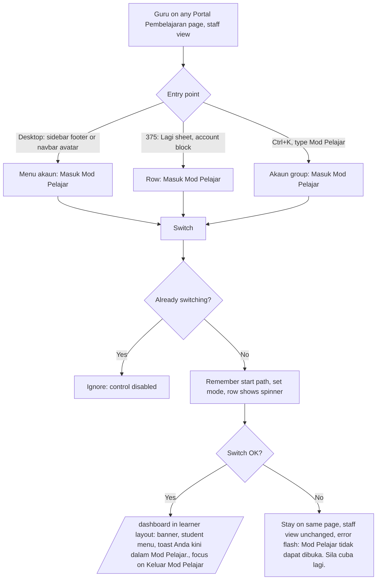
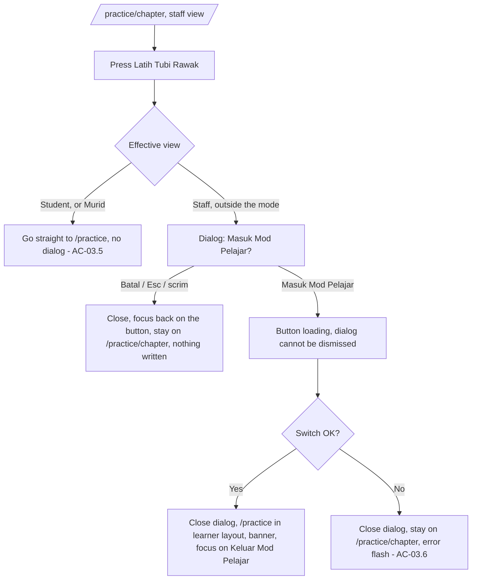
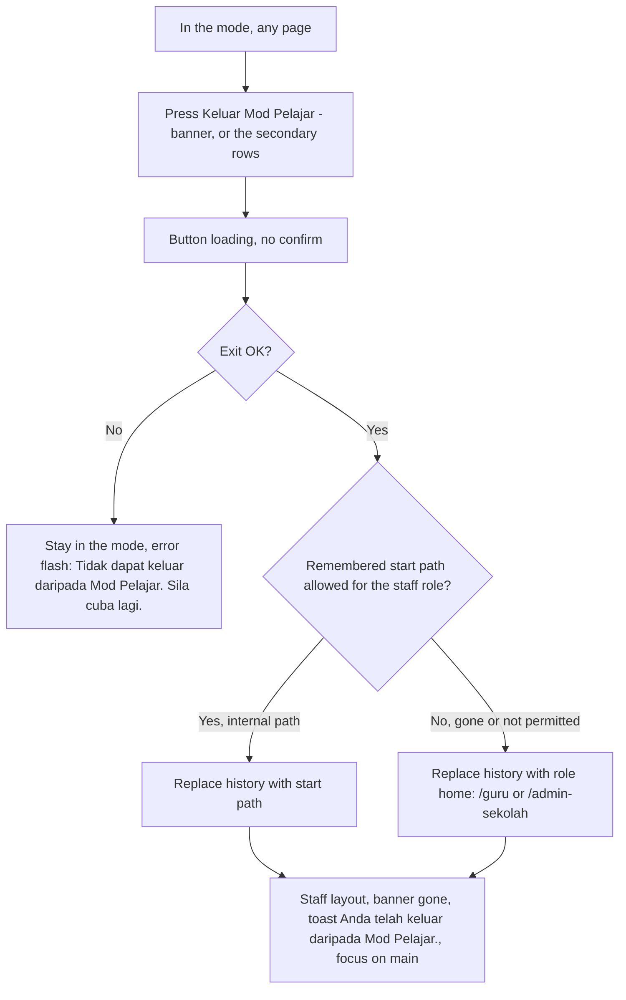
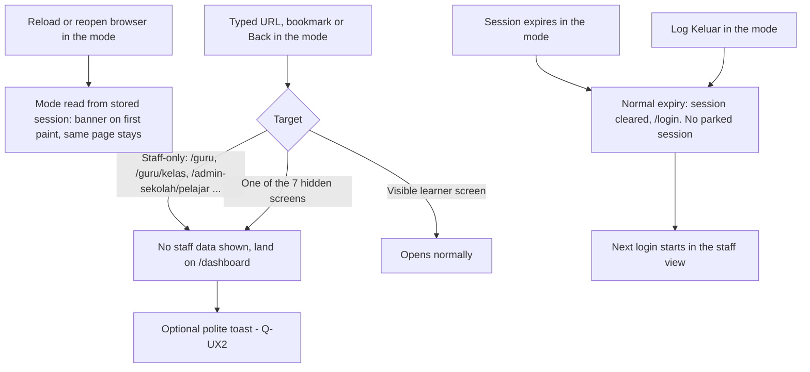

# v2 Guru and Admin Sekolah Mod Pelajar - UX/UI Design (`guru-mod-pelajar`)

| Field | Value |
|---|---|
| Slug | `v2-guru-mod-pelajar` (feature `guru-mod-pelajar`) |
| Status | **G2 design, proposed - needs user approval of section 11 and of every string marked PROPOSED** |
| Date | 2026-10-25 |
| Author | ui-ux-designer |
| Requirements | `docs/requirements/v2-guru-mod-pelajar.md` (US-01..US-10, AC-01.1..AC-10.6) - source of truth |
| Design sources | `v2-design-system.md`, `v2-design-language.md`, `v2-shells.md` (3 Mod Pelajar, 5.1 Murid, 5.2 quiz), `v2-copy-glossary.md` |
| Built UI reused | `src/shells/shared/ModPelajarBanner.vue`, `src/shells/pembelajaran/PembelajaranLayout.vue` (account menu, "Lagi" sheet, `UDashboardSearch`), `src/shells/pentadbiran/PentadbiranLayout.vue` ("Masuk Mod Pelajar" item), `src/modules/m05-practice/pages/ChapterIndexPage.vue`, `src/ds/DsDialog.vue` + `useConfirm.ts` + `DsConfirmHost.vue` |
| Language | Doc English; UI copy Bahasa Melayu (staff voice: **anda**) |
| Labels | **[AS-BUILT]** seen in the repo. **PROPOSED** = new wording or behaviour. |

Conventions: widths 375 / 768 / 1280; `lg` (1024) switches mobile and desktop chrome; no horizontal page scroll at >= 320 px; tokens only (no literal colours); icons by Phosphor base name.

---

## 0. Decisions in this spec (summary)

1. **One entry action, four places.** Account menu (desktop sidebar footer + navbar avatar), the "Lagi" sheet (mobile), Ctrl+K "Akaun" group, and the "Latih Tubi Rawak" confirm dialog (guru only). All call the same action; only the dialog path asks first (AC-01.5, AC-03.2).
2. **Banner = the existing `ModPelajarBanner`, grown to fit own-account copy and a 44 px exit button.** Lime `highlight` bar, fixed to the top, outside the scrolling area, never dismissible, `role="status"`. Its height is variable (52 px minimum), so the layout must offset by the **measured** height, not the hard-coded 40 px (`top-10!`) used today.
3. **Full-screen overlays must stop covering the banner.** [AS-BUILT] `QuizRunner.vue` and `m28 AttemptShell.vue` use `fixed inset-0 z-50`, which hides the z-40 banner during a quiz: the staff member could not see the mode cue or exit. Overlays are offset below the banner (section 5.6).
4. **The "Game" tab disappears in the mode.** The student bottom bar has Home / SPM / Game / Topik / Lagi; "Game" points at Permainan (hidden by US-10). In the mode the bar shows Home, SPM, Topik, Lagi (4 equal columns). Nothing is disabled or padlocked (v2-shells "hidden, not disabled").
5. **Learner personality for the whole view** (dark by default, Elektrik, Phosphor Duotone). The shell switch is a deliberate "you are somewhere else" cue; it follows `v2-shells.md` 3.1/3.2.
6. **Exit never asks.** One press, then back to where the mode started (AC-05.1..05.4).

---

## 1. Flows

### 1.1 Guru - enter from account menu, "Lagi" sheet or Ctrl+K (AC-01.1..01.8)



No confirm dialog on this path (AC-01.5). No half-switched state: the mode flag, layout and route change together or not at all (AC-01.8).

### 1.2 Guru - "Latih Tubi Rawak" -> dialog -> /practice (AC-03.1..03.7)



The remembered start path is `/practice/chapter` (AC-05.3). Chapter cards on this page stay plain links for a guru: `/practice/chapter/:code` is a Murid + Guru route [AS-BUILT: `roles-matrix L14`, FR-M05-130], so only the random-drill button needs the dialog.

### 1.3 Admin Sekolah - enter (AC-02.1..02.4)

Same as 1.1 (menu, "Lagi", Ctrl+K), same copy, same icon. There is **no** "Latih Tubi Rawak" path: `/practice/chapter` is not in the Admin Sekolah menu (AC-02.4). Exit falls back to `/admin-sekolah`.

### 1.4 Exit and return (AC-05.1..05.7)



History is **replaced**, not pushed, so Back does not re-enter the mode. Pressing Back from the staff page to a learner URL goes through the normal guard (learner URL outside the mode -> staff home).

### 1.5 Reload, direct URL, session end



---

## 2. Entry points

### 2.1 Labels, icon, position

| Place | Label (exact) | Icon | Position | Notes |
|---|---|---|---|---|
| Account menu, sidebar footer (>= lg) and navbar avatar (all widths) | **Masuk Mod Pelajar** | `i-ph-student` (base `student`) | In the third group, **after** the colour-mode row and before the "Log Keluar" group - the same slot as the Admin Pusat item [AS-BUILT `PentadbiranLayout.vue`: third item of the theme group] | `UDropdownMenu` item; `onSelect` (not `to`) |
| "Lagi" sheet, account block | **Masuk Mod Pelajar** | same | Last row before "Log Keluar" | `UNavigationMenu` row, **min height 44 px** (AC-01.2) |
| Ctrl+K palette, group "Akaun" | **Masuk Mod Pelajar** | same | After the four account links, before "Log Keluar" | `UDashboardSearch` item with an action (not a route); matches "Mod Pelajar", "mod", "pelajar" (label match) |
| Dialog button (guru only) | **Masuk Mod Pelajar** | none | Primary button | Section 3 |

Shown only when: role is `teacher` or `school_admin` **and** the mode is off (AC-01.4, AC-08.3). Not rendered (never disabled) for Murid, Ibu Bapa, Penaja, or Admin Pusat inside Pembelajaran. Admin Pusat keeps its Pentadbiran item unchanged.

Glyph weight comes from the shell personality (`phClass`): staff Regular before entry, learner Duotone in the mode. `student` and `arrow-u-up-left` must be listed in `src/theme/ds-icons.ts`.

### 2.2 Secondary exit rows (in the mode only) - carried from `v2-shells.md` 3.2

While in the mode the same three places show **Keluar Mod Pelajar** (icon `i-ph-arrow-u-up-left`, base `arrow-u-up-left`) instead of "Masuk Mod Pelajar", as the **first** row of the third group in the account menu, last row before "Log Keluar" in "Lagi", and in the "Akaun" palette group. Reason: the "Lagi" sheet and the palette overlay the banner on mobile, so a second labelled exit stays inside the overlay. It is the same action as the banner button.

### 2.3 Entry states of the control

| State | Account menu row | "Lagi" row / palette item |
|---|---|---|
| Idle | label + icon | same |
| Switching | menu stays open (`preventDefault` in `onSelect`), row `disabled`, leading icon replaced by a 20 px spinner (`i-ph-spinner` with `animate-spin`; static under reduced motion), `aria-busy="true"`, label unchanged | row `disabled`, spinner, sheet / palette stay open until the route changes |
| Success | route change closes the menu / sheet / palette (the layout already closes the sheet on `route.fullPath`) | same |
| Failure | menu closes, error flash (section 5.8) | sheet / palette close, error flash |

A second activation while switching is ignored (AC-01.7).

### 2.4 Layout per width

| Width | Account menu | "Lagi" sheet | Palette |
|---|---|---|---|
| 375 | Navbar avatar opens the dropdown (right aligned, `min-w-60`, max `calc(100vw - 2rem)`). Avatar hit area **44 x 44** (today 40 px: make the button `size-11` with the same 32 px visual disc) | Slide-over from the right, `min(88vw, 360px)`; account block at the end of the list | Full-height sheet per `v2-shells.md` 2.6; row 56 px |
| 768 | Same dropdown from the navbar avatar; rows 44 px (coarse pointer) | Same | `min(90vw, 560px)` |
| 1280 | Sidebar footer button (dropdown opens upward, `min-w-60`) and navbar avatar; rows 36-40 px with a mouse (44 on coarse pointers) | n/a (no bottom bar >= lg) | Centred 640 px |

### 2.5 Wireframes (entry)

```
1280  account menu (sidebar footer, opens upward)           375  "Lagi" sheet, bottom of the list
┌──────────────────────────┐                                ┌──────────────────────────────┐
│ Guru Demo                │ label                          │ ...student/staff menu...     │
│ SMK DEMO                 │ label (muted)                  │ AKAUN                        │
│ [person] Profil Saya     │                                │ [person] Profil Saya     44  │
│ [gear]   Tetapan Peribadi│                                │ [gear]   Tetapan Peribadi 44 │
│ [book]   Panduan         │                                │ [book]   Panduan          44 │
│ [buoy]   Tiket Bantuan   │                                │ [buoy]   Tiket Bantuan    44 │
│ [circle] Tukar ke tema.. │                                │ [student] Masuk Mod Pelajar 44│  <- new
│ [student] Masuk Mod Pelajar  <- new                       │ [out] Log Keluar (error)  44 │
│ [out]    Log Keluar      │                                └──────────────────────────────┘
└──────────────────────────┘
```

Note: today the "Lagi" rows are `h-10` (40 px). The new row, and for consistency every row of that sheet, gets `min-h-11` (44 px). This is a style-only change to the shared `navUi`.

---

## 3. Confirm dialog (guru, "Latih Tubi Rawak")

### 3.1 Component

Reuse **`useConfirm()` + `DsConfirmHost`** (already mounted at the end of `PembelajaranLayout.vue`), which renders `DsDialog`: `UModal` from `sm` up, bottom-sheet `UDrawer` below `sm`, focus trap and Esc/scrim handling from Nuxt UI, no dividers. No new component.

Options passed: `tone: 'primary'` (not destructive), `title`, `message`, `confirmLabel`, `cancelLabel`, and **`run`** = the mode switch so the dialog shows its own loading state (confirm button `loading`, Batal `disabled`, Esc and scrim blocked, `aria-busy`).

### 3.2 Final copy

| Element | Text |
|---|---|
| Title | **Masuk Mod Pelajar?** |
| Body | **Latih Tubi Rawak ialah skrin pelajar. Anda akan masuk Mod Pelajar dengan akaun sendiri. Jawapan dan ganjaran direkod sebagai data ujian. Anda boleh keluar bila-bila masa.** |
| Confirm (primary, right) | **Masuk Mod Pelajar** |
| Cancel (ghost, left) | **Batal** (default `dsCopy.cancel`) |

All four strings are PROPOSED in the requirements; this spec finalises them. Checks against the glossary: Title Case for title and buttons; body in sentence case, staff voice "anda"; "Batal" is the canonical dialog cancel; "direkod" matches the banner second line; no exclamation mark.

### 3.3 Layout

```
>= sm (640+): UModal, max-w-lg (size md), centred, scrim --ds-overlay, shadow-modal, radius xl
┌────────────────────────────────────────────────────────┐
│ Masuk Mod Pelajar?                                     │ text-subheading, text-highlighted
│                                                        │
│ Latih Tubi Rawak ialah skrin pelajar. Anda akan masuk  │ text-body, text-default, max-w-prose
│ Mod Pelajar dengan akaun sendiri. Jawapan dan ganjaran │
│ direkod sebagai data ujian. Anda boleh keluar          │
│ bila-bila masa.                                        │
│                                                        │
│                        [ Batal ]  [ Masuk Mod Pelajar ]│ footer, right aligned, gap 8
└────────────────────────────────────────────────────────┘

< sm (375): UDrawer bottom sheet, radius xl on top, max 90dvh, full-width stacked buttons, 16px gutter
┌──────────────────────────────┐
│ Masuk Mod Pelajar?           │
│ Latih Tubi Rawak ialah skrin │
│ pelajar. Anda akan ...       │
│ [        Batal         ] 44+ │  ghost
│ [ Masuk Mod Pelajar    ] 44+ │  primary
└──────────────────────────────┘
```

Button order in the DOM is Batal then Masuk (the `DsConfirmHost` order); on the stacked mobile sheet this puts the primary action at the bottom, within thumb reach. Not changed here (shared DS behaviour).

768 uses the 1280 modal (>= 640). The 375 sheet is also used at 320-639.

### 3.4 States

| State | Behaviour |
|---|---|
| Open | Initial focus on **Batal** (first focusable, `DsConfirmHost` order); safe default. Tab cycles Batal -> Masuk Mod Pelajar -> (Nuxt close handling); Esc = Batal. |
| Loading | Primary shows the `UButton` loading spinner (label stays); Batal disabled; Esc/scrim ignored; `aria-busy`. |
| Success | Dialog closes, route goes to `/practice`, focus moves to the banner button. |
| Failure | Dialog closes (the shared host settles after `run`), the caller shows the error flash on `/practice/chapter` (section 5.8) and focus returns to "Latih Tubi Rawak". `run` must catch its own error so the host never leaves a rejected promise. |
| Cancel | Closes; focus returns to the trigger; nothing written (AC-03.4). |

### 3.5 The "Latih Tubi Rawak" button

[AS-BUILT] `UButton to="/practice"`, neutral soft, icon `i-ph-shuffle-duotone`, `min-h-11`, in the `DsPage` actions slot, `data-testid="chapter-random"`.

| Effective view | Element | Behaviour |
|---|---|---|
| Staff, outside the mode (Guru) | `button type="button"`, `aria-haspopup="dialog"` | Opens the dialog |
| Student (Murid) or any user already in the mode | Link to `/practice` (as today) | No dialog |

Look, size, label, icon, slot and test id are unchanged. At 375 the `DsPage` actions wrap under the title (full width allowed, still 44 px high); at 768 and 1280 they sit right of the title.

---

## 4. Banner

### 4.1 Copy (final)

| Part | Text | Visible |
|---|---|---|
| Primary | **Mod Pelajar: anda melihat portal pelajar sebagai diri sendiri** | all widths, wrapping allowed |
| Secondary | **Aktiviti direkod sebagai data ujian.** | visible from `sm` (640); below that it is `sr-only` but present for assistive tech |
| Button | **Keluar Mod Pelajar** | all widths |

Admin Pusat variant is unchanged: "Mod Pelajar: anda melihat portal pelajar sebagai {nama}" (no secondary line; the admin writes to the shared test student, so the "data ujian" sentence would be inaccurate for it). The component picks the variant from the mode kind (own account vs impersonation), not from the role.

### 4.2 Anatomy and tokens (light and dark identical - fixed tokens)

| Part | Spec |
|---|---|
| Bar | `bg-highlight` (lime `#BCEB27`), text `text-on-highlight` (`#0D1120`), **15.2:1** in both modes. No border, no shadow. Full width, fixed to the top of the viewport, `z-40`. |
| Padding | `px-4` (375) / `px-6` (>= sm) / `px-8` (>= lg); `py-1`; **min height 52 px**; grows with wrapped text. Gap between parts 12 px. Top padding adds `env(safe-area-inset-top)`; side padding adds `env(safe-area-inset-left/right)`. |
| Icon | `i-ph-student`, 20 px, `shrink-0`, `aria-hidden`; the icon is not the only cue - the words carry the mode (WCAG 1.4.1). |
| Text column | `min-w-0 flex-1`. Primary: `text-caption` (13) semibold at 375, `text-label` semibold from `sm`. Secondary (>= sm): `text-caption`, regular, below the primary. No truncation: words wrap, never clip. |
| Exit button | Fill `bg-on-highlight`, label `text-highlight` (lime on ink, 15.2:1, same in both modes), `rounded-md` (12), `text-label` semibold, `min-h-11` and `min-w-11` (**44 x 44**), `px-3`. Below `sm` the label may wrap to two lines ("Keluar / Mod Pelajar", centred, `leading-tight`); from `sm` it is one line. `shrink-0`. |
| Hover / pressed | Fill and label do not change on hover (contrast is already maximal, and an opacity step on the fill would lower it). Pressed uses the DS `press` motion (translateY 1 px; none under reduced motion). |
| Focus | 2 px focus ring in `on-highlight` with a 2 px offset in `highlight` (ink on lime, 15.2:1); the default primary ring has too little contrast margin on lime in the learner dark theme. |
| Loading | While leaving: button `disabled`, label unchanged, 16 px spinner left of the label. |
| ARIA | Container `role="status"`, `data-testid="mod-pelajar-banner"` [AS-BUILT]. Button `data-testid="mod-pelajar-leave"` [AS-BUILT]. Not dismissible: no close control, no swipe, no Esc. |

Why not the existing `bg-inverted text-inverted` button: in the staff dark tokens `--ui-bg-inverted` `#262D40` against `--ui-text-inverted` `#0D1120` is about 1.4:1 (calculated from the design-system hex values), so the label would be nearly unreadable if the bar ever renders under staff dark tokens. The highlight / on-highlight pair is the same in every personality and mode.

### 4.3 Placement and offset (all widths)

DOM order [AS-BUILT, kept]: skip link -> **banner** -> `UDashboardGroup` (sidebar, panel: navbar, main) -> floating Alesa button -> bottom nav -> "Lagi" slide-over -> dialogs.

| Rule | Spec |
|---|---|
| Position | Fixed at the very top of the viewport, above sidebar and navbar. Nothing is hidden behind it. |
| Offset | The banner publishes its **measured height** as a layout variable (proposed name `--pp-banner-h`, `0` when absent). `UDashboardGroup` is placed `top: var(--pp-banner-h)`. The hard-coded `top-10!` (40 px) and the `modeOn ? 'min-h-0! h-full!'` sidebar fix keep their purpose but must use the variable. The height is re-measured on resize and when the text wraps (zoom 200%, 320 px). |
| Safe area | With the banner present the **banner** takes `env(safe-area-inset-top)`; the navbar's own `pt-[env(safe-area-inset-top)]` becomes 0 so the inset is not applied twice. |
| Scroll | The banner does not scroll; only `main` scrolls. Page content never starts under it (AC-04.4). |
| Overlays above it | Modals, the "Lagi" slide-over, the palette and toasts sit above the banner and dim it (they are `z-50`). The two overlays that are not modals - see 5.6 - are offset instead. |
| Tab title | Prefix **"[Mod Pelajar] "** on `document.title` (PROPOSED, from `v2-shells.md` 3.2; helps with multiple tabs, AC-04.6). |

### 4.4 Wireframes

```
1280 (banner 52, text on one block, sidebar + navbar below it)
┌──────────────────────────────────────────────────────────────────────────────────────────┐
│ [student] Mod Pelajar: anda melihat portal pelajar sebagai diri sendiri   [Keluar Mod Pelajar]│ lime
│           Aktiviti direkod sebagai data ujian.                                              │
├───────────────────┬──────────────────────────────────────────────────────────────────────┤
│ PRESTASI+         │ Dashboard                       [Cari menu Ctrl K] (hari)(Koin) [☾] (GD)│ navbar
│ student menu...   │ ...                                                                    │
│ (GD) Guru Demo  ▾ │                                                                        │

768 (same bar; sidebar not shown, bottom nav shown)
┌──────────────────────────────────────────────────────┐
│ [student] Mod Pelajar: anda melihat portal pelajar   │
│           sebagai diri sendiri        [Keluar Mod Pelajar]│
│           Aktiviti direkod sebagai data ujian.       │
├──────────────────────────────────────────────────────┤
│ PRESTASI+            [🔍] (hari)(Koin) [☾] (GD)      │
│ ...                                                   │
│ [Home][SPM][Topik][Lagi]                             │

375 (secondary line sr-only; button label may wrap to 2 lines)
┌────────────────────────────────┐
│ [st] Mod Pelajar: anda melihat │
│      portal pelajar sebagai    │ [Keluar    ]  <- 44x44 min
│      diri sendiri              │ [Mod Pelajar]
├────────────────────────────────┤
│ PRESTASI+             [☾] (GD) │ navbar (starts under the banner)
│ ...                             │
│ [Home] [SPM] [Topik] [Lagi]    │
└────────────────────────────────┘
At 320 the primary text takes 3 lines; bar grows to about 64 px. At 200% zoom it wraps further; nothing clips.
```

### 4.5 Focus order

1. Skip link "Langkau ke kandungan" (first stop, visible on focus).
2. **Banner: "Keluar Mod Pelajar"** (second stop; reachable in one Tab).
3. Sidebar / navbar controls, then `main#kandungan`, then (< lg) the bottom bar and floating Cikgu Alesa button.

Focus moves programmatically only at transitions: on entry -> the banner button (v2-shells a11y item 8); on exit -> `main#kandungan` (`tabindex="-1"`); on dialog cancel or failure -> the trigger.

---

## 5. What the learner shell shows for a staff member

The shell uses the **effective** role (student) for every decision (menu, personality, tabs, search, landing, guard, 403/404). The account's own role is unchanged and returns on exit. Today `PembelajaranLayout.vue` derives `learner` and `personality` from `role === 'student'`, which must read the effective role.

### 5.1 Identity

| Element | Behaviour |
|---|---|
| Name / avatar | The staff member's real name; avatar disc shows initials (up to two letters) on the learner gradient, e.g. "GD". Same disc as a murid. |
| School line | The real school name (muted), as in the staff view. |
| Form chip | The Tingkatan 4 / Tingkatan 5 chips on Topik (`aria-label="Tingkatan"`) and Peta Belajar default to **Tingkatan 4** when the account has no form (AC-06.2). Selecting Tingkatan 5 works and is kept for the rest of the mode; the account record is not changed. |
| Reward chips (>= sm) | "hari" streak and "Koin" show the staff member's own test values, starting at 0. |
| Friend | Learner default friend avatar and "Tukar Rakan Belajar" row as for a new murid; first-run prompt see Q-UX1. |
| Theme | Learner personality, dark by default; the theme toggle works as for a murid (Q-UX3). |
| Profile / Tetapan | Operate on the real account (AC-06.6); learner-only fields (form, class, parent) are not shown. |

### 5.2 Menus (AC-08.3, AC-10.1)

| Surface | In the mode |
|---|---|
| Sidebar >= lg, "Lagi" sheet < lg, Ctrl+K "Halaman" groups | The 30 visible Murid items; **no staff items**; the 7 hidden items are **absent** (not disabled, no padlock, no "tidak tersedia" row). A group left with no items is not rendered (no empty group label). |
| Bottom bar < lg | **Home - SPM - Topik - Lagi** (the "Game" tab is dropped because its target is hidden). Four equal columns, same 56 px tab height. Active tab keeps the filled gradient pill. |
| Account menu | Name, school, the four account links, "Tukar Rakan Belajar", theme row, **Keluar Mod Pelajar**, "Log Keluar". No "Masuk Mod Pelajar", no role switcher (AC-08.4). |
| Floating Cikgu Alesa button | Stays (Cikgu Alesa is a visible screen). |

The 7 hidden items (labels as in the student menu, matrix rows): **Mohon Keluarga Angkat** (15), **Permainan** (21, whole game family), **Cabutan Bertuah** (22), **Tournament** (23), **Marketplace** (32), **Rujuk Kawan** (36), **Jemput Ibu Bapa** (40).

Entry points into them are also removed from visible screens - dashboard cards, banners, in-page buttons - and the surrounding grid reflows with **no gap and no dead link** (AC-10.5). A direct URL goes to `/dashboard` (section 6.3).

### 5.3 Class-dependent screens (AC-06.3)

Principle: use the screen's **existing** empty state and BM copy; only add copy where a screen has none. Known existing copy [AS-BUILT]:

| Screen | Existing empty state |
|---|---|
| Kelas Saya | "Belum Sertai Mana-Mana Kelas" |
| Prestasi Kelas (pilih) | "Anda belum mempunyai kelas aktif." |

For a screen that depends on class, teacher or parent links and has **no** empty state, the developer uses the generic pattern below and QA records the screen (PROPOSED; glossary section 5 "Belum ada {benda}."):

| Element | Text |
|---|---|
| Title | Belum ada kelas |
| Description | Akaun anda tidak tergolong dalam mana-mana kelas pelajar. |
| Action | none |

Rendered with `DsEmptyState` inside the card area (never full page), learner variant (friend `encouraging` or neutral glyph on a solid chip), centred, max 28rem, no layout jump. Widgets on the dashboard (class rank, teacher sets) show the same pattern at `size="sm"` or are simply empty cards per their existing design; no spinner that never ends.

### 5.4 Ranking and "my position" (AC-06.5)

Kedudukan and Papan Pendahulu show the real list. The staff member is not a ranked row; "my position" shows the screen's existing not-ranked / no-data state.

### 5.5 Test-data cue

No per-record "Data ujian" badge in this feature (that appears only to an admin viewing records, `v2-shells.md` 3.2, and no admin-facing screen is built here). The banner second line is the staff member's cue.

### 5.6 Full-screen overlays (quiz, win, Bijak SPM / SPM attempt)

The quiz hides the shell chrome by covering the viewport. In the mode the banner **stays** (AC-04.1 "on every page") and the overlay starts below it:

| Overlay | Today | In the mode |
|---|---|---|
| `QuizRunner.vue` (practice, chapter, revision quizzes, win screen) | `fixed inset-0 z-50` | top offset `var(--pp-banner-h)`, inner heights `100dvh - var(--pp-banner-h)` |
| `m28 AttemptShell.vue` (Bijak SPM / SPM attempts) | `fixed inset-0 z-50 flex flex-col` | same |
| Any other learner overlay found by the developer sweep (`fixed inset-0` in `src/`) | - | same rule; game overlays (`m16`) are unreachable (hidden) |

Pressing "Keluar Mod Pelajar" in the middle of a quiz does **not** ask (the attempt is test data and the quiz already confirms its own Esc/close). The quiz timer, if the mode has one, is unaffected by the banner.

### 5.7 Layout per screen width (the dashboard as the reference)

| Width | Layout in the mode |
|---|---|
| 375 | Banner (52-64 px) -> navbar (logo, theme/avatar) -> `main` single column, 16 px gutter, bottom padding clears the 4-tab bar and the Alesa button. |
| 768 | Banner -> navbar (logo, search icon, chips, theme, avatar) -> `main` 2 columns for card grids, 24 px gutter, bottom bar still shown. |
| 1280 | Banner -> sidebar (272 px, resizable, rail) + panel with navbar; `main` max 72rem, 3-column grids, 32 px gutter. |

No horizontal page scroll at any width >= 320; wide strips (subjects) scroll inside their own container as for a murid.

### 5.8 Loading and error states

| State | Spec |
|---|---|
| Entering (menu / Lagi / palette) | Section 2.3. If the switch takes more than 300 ms the learner skeleton shows in `main` (no blank screen, no flash of the staff page in the learner layout - the route and the mode change together). |
| Entering (dialog) | Section 3.4. |
| Error entering | Persistent flash above the content (`FlashOutlet`, `role="alert"`, same component as the Admin Pusat item): **Mod Pelajar tidak dapat dibuka. Sila cuba lagi.** [AS-BUILT copy]. The user is still in the staff view with the same menu and data (AC-01.8). |
| Exiting | Banner button loading (4.2). |
| Error exiting | The mode stays on; flash **Tidak dapat keluar daripada Mod Pelajar. Sila cuba lagi.** (PROPOSED). In the mock the exit is local and should not fail; the string covers the server-session case. |
| Exited | Toast 4 s, polite: **Anda telah keluar daripada Mod Pelajar.** |
| Entered | Toast 4 s, polite: **Anda kini dalam Mod Pelajar.** (shortened from `v2-shells.md` 3.1; the banner already explains the rest). |
| Session expired in the mode | Existing expiry: session cleared, `/login`. The banner lives in the layout, so it disappears with it. No parked session, no "parked session expired" case. The next login is the staff view. No new message is added by this feature (the app has no expiry notice today). |

---

## 6. Guard outcomes as the user sees them

### 6.1 Staff-only URL in the mode (AC-08.2)

`/guru`, `/guru/kelas`, `/guru/command-center`, `/admin-sekolah`, `/admin-sekolah/pelajar` ... -> **no staff content is rendered, not even briefly** -> `/dashboard`.

### 6.2 Learner URL outside the mode

Unchanged: redirect to the staff home (`/guru` or `/admin-sekolah`) [AS-BUILT]. After exit, Back to a learner page behaves this way.

### 6.3 Hidden-screen URL in the mode (AC-10.2)

The seven routes (and their families, AC-10.1) -> `/dashboard`. The "Belum tersedia dalam prototaip" page is **not** used.

### 6.4 Optional notice after a guard redirect (Q-UX2)

The requirements say no message is required. Because the problem that started this feature was a click that "does nothing", a short polite toast is recommended for a typed or bookmarked URL:

| Cause | Toast (PROPOSED) |
|---|---|
| Staff-only URL in the mode | Anda sedang dalam Mod Pelajar. Keluar Mod Pelajar untuk ke halaman itu. |
| Hidden learner screen | Skrin itu tidak tersedia dalam Mod Pelajar. |

---

## 7. Copy table

All BM. **Source** column: *existing* = already in the repo or approved docs; *PROPOSED* = new, needs approval.

| # | Where | String | Source |
|---|---|---|---|
| 1 | Menu item, "Lagi" row, palette item, dialog confirm | Masuk Mod Pelajar | existing (`PentadbiranLayout.vue`) |
| 2 | Banner button, secondary exit rows | Keluar Mod Pelajar | existing (`ModPelajarBanner.vue`) |
| 3 | Banner primary (own account) | Mod Pelajar: anda melihat portal pelajar sebagai diri sendiri | PROPOSED (adapted from existing "... sebagai {nama}") |
| 4 | Banner secondary | Aktiviti direkod sebagai data ujian. | PROPOSED |
| 5 | Banner primary (Admin Pusat, unchanged) | Mod Pelajar: anda melihat portal pelajar sebagai {nama} | existing |
| 6 | Dialog title | Masuk Mod Pelajar? | PROPOSED (title from `v2-shells.md` 3.1) |
| 7 | Dialog body | Latih Tubi Rawak ialah skrin pelajar. Anda akan masuk Mod Pelajar dengan akaun sendiri. Jawapan dan ganjaran direkod sebagai data ujian. Anda boleh keluar bila-bila masa. | PROPOSED |
| 8 | Dialog cancel | Batal | existing (`dsCopy.cancel`) |
| 9 | Palette group | Akaun | existing |
| 10 | Button on Soalan by Chapter | Latih Tubi Rawak | existing |
| 11 | Error entering | Mod Pelajar tidak dapat dibuka. Sila cuba lagi. | existing |
| 12 | Error exiting | Tidak dapat keluar daripada Mod Pelajar. Sila cuba lagi. | PROPOSED |
| 13 | Toast after entering | Anda kini dalam Mod Pelajar. | PROPOSED (shortened from `v2-shells.md`) |
| 14 | Toast after exiting | Anda telah keluar daripada Mod Pelajar. | existing text in `v2-shells.md` 3.3 |
| 15 | Tab title prefix | [Mod Pelajar]  (followed by the page title) | PROPOSED (`v2-shells.md` 3.2) |
| 16 | Redirect toast, staff-only URL (optional, Q-UX2) | Anda sedang dalam Mod Pelajar. Keluar Mod Pelajar untuk ke halaman itu. | PROPOSED |
| 17 | Redirect toast, hidden screen (optional, Q-UX2) | Skrin itu tidak tersedia dalam Mod Pelajar. | PROPOSED |
| 18 | Generic class-less empty state title | Belum ada kelas | PROPOSED (fallback only; use the screen's own text first) |
| 19 | Generic class-less empty state description | Akaun anda tidak tergolong dalam mana-mana kelas pelajar. | PROPOSED (fallback only) |
| 20 | Kelas Saya empty title | Belum Sertai Mana-Mana Kelas | existing |
| 21 | Prestasi Kelas empty | Anda belum mempunyai kelas aktif. | existing |
| 22 | Skip link | Langkau ke kandungan | existing |
| 23 | Account menu: theme row | Tukar ke tema cerah / Tukar ke tema gelap | existing |
| 24 | Account menu: log out | Log Keluar | existing |

Accessible names (not visible text): menu trigger `aria-label="Menu akaun"` [existing]; secondary line of the banner is `sr-only` below 640 px; spinner rows use `aria-busy`, no extra string.

No emoji, no exclamation marks, no English words in the new strings.

---

## 8. Accessibility notes (WCAG 2.2 AA)

Consistent with `v2-shells.md` section 9 (items 4, 5, 8, 12, 13, 14, 16).

| # | Check |
|---|---|
| 1 | **Banner** `role="status"` (polite live region), non-dismissible, always in the DOM while the mode is on; the entry toast carries the announcement because a region that is inserted with its content is not reliably announced. |
| 2 | Mode is never conveyed by colour alone: lime bar + student icon + the words "Mod Pelajar"; tab title prefix. |
| 3 | **Contrast**: ink `#0D1120` on lime `#BCEB27` = 15.2:1 (text and button label); focus ring ink on lime 15.2:1; dialog text uses `text-default`/`text-highlighted` tokens (>= 7:1 staff light, >= 14:1 dark; design-system 3.4). Light and dark both verified at the token level; the banner colours do not change between modes. |
| 4 | **Targets >= 44 x 44**: banner button (was 32 px high), "Lagi" rows (was 40), navbar avatar (was 40), dialog buttons (UButton md = 44), "Latih Tubi Rawak" (`min-h-11`), palette rows 56. |
| 5 | **Focus order**: skip link -> banner exit -> shell -> main. Focus is placed on the exit button after entering, on `main` after exiting, back on the trigger after cancel/failure. Visible 2 px focus ring on every control. |
| 6 | **Dialog**: `UModal` / `UDrawer` through `DsDialog`: focus trap, `aria-modal`, title and description wired (`DsConfirmHost` passes the message as description), Esc closes, focus returns to the trigger, blocked while loading. |
| 7 | **Keyboard**: menu item, "Lagi" row, palette item and dialog all operable with Enter/Space; palette keeps combobox semantics; Ctrl/Cmd+K as today. |
| 8 | **Reflow**: banner wraps instead of clipping at 320 px and at 200% zoom; no horizontal page scroll; layout offset follows the measured banner height (1.4.10). |
| 9 | **Reduced motion**: no banner animation; the row spinner becomes a static glyph; toasts fade only. |
| 10 | **Tokens only**: `bg-highlight`, `text-on-highlight`, `bg-on-highlight`, `text-highlight`, `bg-default`, `text-default`, `text-muted`, `bg-muted`, `shadow-modal`, `rounded-md/xl`. No literal hex, no `border-*`. The only ring is the focus ring. |
| 11 | **No silent dead end** (the original defect): every guru click on "Latih Tubi Rawak" either opens the dialog or navigates; a guard redirect in the mode can show a polite toast (Q-UX2). |
| 12 | Label in name (2.5.3): the banner and menu buttons use their visible text as the accessible name. |
| 13 | Session / timing: no time limits introduced; toasts 4 s and also reflected in the banner state. |

---

## 9. Component inventory

| Need | Reuse / new | Maps to |
|---|---|---|
| Mode banner | **Reuse + change** `src/shells/shared/ModPelajarBanner.vue`: own-account variant, secondary line, 44 px button, variable height published as the layout offset, focus ring, loading | `UIcon`, `UButton`-equivalent (native button styled with tokens or `UButton` with `ui` classes), tokens `highlight` / `on-highlight` |
| Layout offset | **Change** `PembelajaranLayout.vue`: `top: var(--pp-banner-h)` instead of `top-10!`; navbar safe-area handling; effective-role `learner` / `personality` / `tabs` / menus / palette | `UDashboardGroup`, `UDashboardSidebar`, `UDashboardNavbar` |
| Account menu row | **Reuse** `UDropdownMenu` item (add one item, one conditional swap) | same list as `accountMenu` |
| "Lagi" row | **Reuse** `UNavigationMenu` row in `lagiGroups`; row `min-h-11` | `USlideover` |
| Palette command | **Reuse** `UDashboardSearch` group "Akaun" with an action item | `searchGroups` |
| Confirm dialog | **Reuse** `useConfirm()` + `DsConfirmHost` (+ `run` for loading) | `DsDialog` -> `UModal` / `UDrawer` |
| "Latih Tubi Rawak" | **Change** `ChapterIndexPage.vue`: button vs link by effective view, keep look | `UButton` in `DsPage` actions |
| Error / success messages | **Reuse** `FlashOutlet` + `useFlash` (errors), `useToast` (entered / exited) | |
| Class-less empty state | **Reuse** `DsEmptyState` (only where the screen has none) | |
| Overlay offset | **Change** `QuizRunner.vue`, `m28 AttemptShell.vue` (+ any `fixed inset-0` learner overlay) to start below the banner | |
| New DS component | **None.** No new `Ds*` pattern is introduced. The entry action is one shared function used by the four entry points (architect's task), not a design component. | |
| Icons | `student` (existing), `arrow-u-up-left` (new base name), `spinner` (existing or add), all via `src/theme/ds-icons.ts` | Phosphor |

---

## 10. Responsive and state matrix (quick reference for QA)

| Item | 375 | 768 | 1280 |
|---|---|---|---|
| Banner | 52-64 px, 3-line primary at 320; secondary sr-only; button 44 px, label may wrap | 52 px, secondary visible | 52 px, secondary visible |
| Entry: account menu | Avatar dropdown | Avatar dropdown | Sidebar footer + avatar dropdown |
| Entry: "Lagi" | Yes (row 44 px) | Yes (< lg) | No |
| Entry: Ctrl+K | Search icon (hidden < sm: use "Lagi" or keyboard) | Search icon button | Search button + Ctrl+K |
| Dialog | Bottom sheet, stacked buttons | Centred modal | Centred modal |
| Bottom bar | Home, SPM, Topik, Lagi | same | n/a (sidebar) |
| Quiz / win overlay | Starts below banner | same | same |
| Light / dark | Banner identical; page follows learner theme (dark default) | same | same |

At 375 the navbar search icon is `hidden sm:inline-flex` [AS-BUILT]; the palette is reachable by Ctrl+K only on a keyboard, so on touch the entry point is the "Lagi" sheet or the avatar menu (both present).

---

## 11. Open UX questions for user approval (3)

| # | Question | Options | Recommendation |
|---|---|---|---|
| **Q-UX1** | Should a staff member in the mode get the **first-run "Pilih rakan belajar awak" prompt** on `/dashboard`? It is a bottom card that covers the Alesa button and tab bar on mobile, and the choice is learner-only data (AC-06.6 says learner-only fields are not written for a staff account). | A. Do not show the prompt; default friend Aiman is used; "Tukar Rakan Belajar" stays in the menu. B. Show it exactly as for a new murid. C. Remove the friend entirely in the mode. | **A**: the preview stays faithful (friend visible), nothing blocks the entry, and no learner-only profile field is written. |
| **Q-UX2** | After a **guard redirect in the mode** (typed or bookmarked staff-only URL, or one of the 7 hidden screens) show a short polite toast? The requirements make it optional. | A. Yes, two short toasts (rows 16-17 of the copy table). B. No message (silent redirect to `/dashboard`). | **A**: the feature exists because of a click that "does nothing"; a 4 s polite toast is cheap and removable. |
| **Q-UX3** | **Colour mode on entry.** The learner view is dark by default; a guru who works in light staff mode will see the page switch to dark on entry (a clear "you moved" cue) and back on exit. | A. Learner dark default for the view, as `v2-shells.md` 3.1 (unless the user already chose a mode explicitly for the learner view). B. Keep the colour mode the user had before entering. | **A**: it shows the real student experience and strengthens the mode cue; the toggle is available in the navbar and menu. |

Not asked (decided here, recorded for transparency): no confirm on exit; banner stays in full-screen quizzes; "Game" tab removed rather than replaced; the secondary "Keluar Mod Pelajar" rows; tab title prefix; chapter cards remain plain links for a guru.

---

## 12. Fidelity and scope notes

- Unchanged flows are replicated: Admin Pusat "Masuk Mod Pelajar" (no dialog, banner copy with {nama}, exit to `/admin/command-center`); the only shared change is the banner's 44 px button and measured height (style-only for admin, AC-04.5).
- No staff menu item, route or matrix row is added (D10 of the requirements): the entry is an account action.
- No real person's name appears in this spec. "Guru Demo" and "SMK DEMO" are the fictitious demo account and school from the seeds.
- Observations for the lead (not design questions): (1) the banner is currently hidden behind the quiz overlay (section 5.6); (2) the student "Game" tab must be removed in the mode (section 5.2); (3) the "Lagi" rows (40 px) and navbar avatar (40 px) are below 44 px today, fixed only where this feature touches them.
