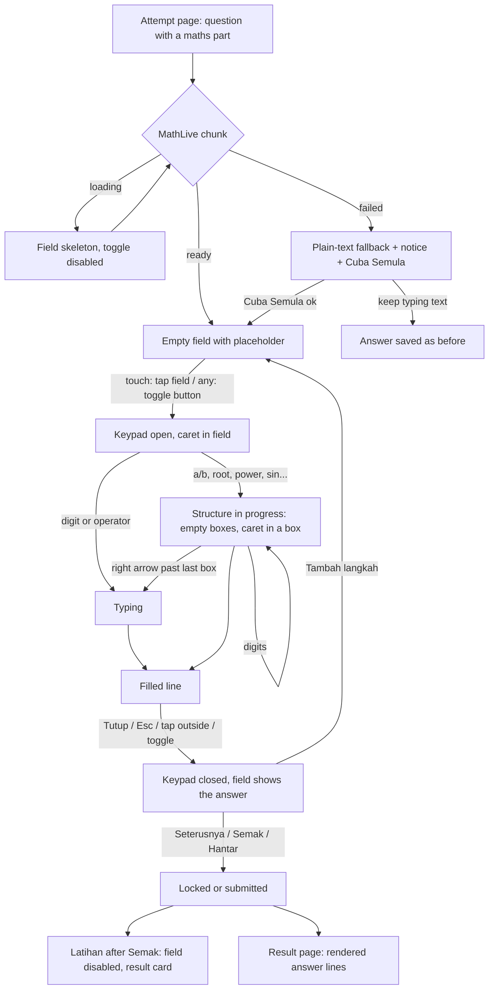

# v2 WYSIWYG maths answer field (FB-069): UX spec

| Field | Value |
|---|---|
| Slug | `v2-math-wysiwyg` |
| Task | FB-069 / Q-B13 option (a), G2 UX (ui-ux-designer) |
| Date | 2026-10-25 |
| Status | Proposed. **Built after go-live** (Full track, G1 to G6; the new runtime dependency needs an ADR from the solution-architect, who is writing the system design in parallel). Nothing in this file changes the current build. |
| Requirements | `docs/requirements/v2-bijak-spm.md` US-09 (AC-09.1 to AC-09.6 and the "Planned (FB-069, after go-live)" block), AC-08.1, AC-11.x, Q-B13, R15 |
| Decisions this builds on | FB-045 (Casio keypad, "dah elok"), FB-047 (sheet keeps the field in view, Tutup key, closes on outside tap), FB-050 (numeric final answer flag), FB-056 (44 px fields below 768, 52 px from 768), FB-064 (not touched) |
| Evidence | `docs/qa/audit-sistem/evidence/FB-069-notes.md`, `FB-069-current-{375,1280}.png`, `FB-069-wysiwyg-{375,1280}.png`, `FB-045-keypad-{375,1280}-light.png` |
| User words | FB-045 new request: "maksud aku masukkan jawapan dalam paparan macam pratonton tu" (the student types the answer in a display that looks like the preview) |
| Code read | `src/modules/m28-bijak-spm/components/{MathField,MathKeyboard,PartInput,PartResultCard,QuestionBlock,AttemptShell}.vue`, `lib/math-keys.ts`, `domain/math-expr.ts`, `domain/paper-model.ts` (`isAnswered`), `pages/AttemptPage.vue`, `pages/ResultPage.vue`, `src/theme/{tokens.css,ui.config.ts}`, `src/ds/*` |
| Language | Doc English; all UI strings Bahasa Melayu. Existing strings are kept letter for letter. **[PROPOSED]** marks copy that does not exist yet. |

## 0. Rules this spec follows

1. **Change only what FB-069 changes.** The Casio keypad (layers, keys, tones, labels, aria names, sheet and dock behaviour), the working/final split, the unit field, the photo button, autosave, the FB-050 hint and the result card keep their current look and copy. What changes: the answer line itself, the removed preview, how a key press lands in the line, how the keypad is opened on touch, and the loading and failure states of the new editor.
2. **No new screen, route, dialog or drawer.** The field lives where `MathField` lives today (the "Langkah n" lines and "Jawapan akhir" of a working or numeric part on the attempt page; the stored answer on the result page).
3. **Existing DS parts only** (section 2). The one addition is a token-only CSS block in `src/theme` that styles the third-party `<math-field>` element (section 4.3). No page-level `ring`, `rounded`, `opacity` or colour utilities (the page class allowlist forbids them).
4. **Responsive at 375, 768, 1280** and no horizontal page scroll down to 320 px. A long formula scrolls **inside** the field, never the page.
5. **Accessibility replicates the current build (D10), no extras.** Section 13 lists what MathLive changes by its nature (screen reader output, the OS keyboard, caret animation) so QA and the user know about them; none of these is an enhancement.
6. **Dark mode** is supported through the existing tokens (`--ui-*`, `--ds-*`); the learner portal is dark by default.
7. **No real names** appear in this file.

## 1. What changes and what does not

| Area | Today (current build) | After FB-069 |
|---|---|---|
| Answer line | `UInput` showing friendly text such as `(7)/(3)^2+sin(30°)` | MathLive `<math-field>`: the line itself shows the stacked fraction, raised power, radical (WYSIWYG) |
| Preview row | KaTeX strip under the line (from `md`), and the display row inside the phone sheet | **Removed** (section 5.3) |
| Phone sheet display row | preview + "Tutup" | "Tutup" only |
| Casio keypad | 2 layers + number block | **Unchanged** in look, labels, order and tones (FB-045 screenshots stay valid). Each key now drives the field instead of inserting text |
| Key order for powers | `a/b`, 7, `▶`, 3, `▶`, `x²` gives 7 over 3 squared (the `^2` lands after the closing bracket) | `x²` squares what is just before the caret: `a/b`, 7, `▶`, 3, `x²`, `▶`, `+`, ... (section 5.2) |
| Phone keyboard | opens when the keypad is closed (`inputmode` text or decimal); hidden while the keypad is open | **Never opens** (user decision Q-B13: keypad only). On touch devices a tap on the field opens the keypad (section 6) |
| Typing with a physical keyboard | works (plain input) | works (MathLive turns `1/2`, `x^2`, `sqrt` into structures, AC-09.3), with a trimmed shortcut list (section 5.5) |
| Numeric final answer | `inputmode="decimal"` while the keypad is closed; FB-050 hint | Same field and same hint. The phone decimal keyboard is gone with the rest; the number block of the keypad takes its place (section 8) |
| Result page | KaTeX render of the stored LaTeX | Same look; the renderer must draw everything the field can produce (section 9.2) |
| Editor fails to load | not applicable | plain-text fallback with a notice (section 10) |

## 2. Design-system parts used

| Need | Part | Notes |
|---|---|---|
| Layout of label, field row, hint | `DsStack`, `DsCluster`, `DsText` | as `MathField.vue` today |
| Keypad surface and sheet | `DsSurface` (`level="accented"`), `DsStack`, `DsGrid`, `UButton` | unchanged (`MathKeyboard.vue`, `MathField.vue` dock) |
| Keypad toggle, "Tutup", remove-step, "Tambah langkah" | `UButton` | unchanged; `size-11` (44 px) |
| Loading placeholder of the field | `USkeleton` | same primitive `AttemptPage` already uses |
| Failure notice | `DsLoadError variant="inline"` | icon, message, retry button ("Cuba Semula" is the DS default `dsCopy.retry`) |
| FB-050 hint | `DsText variant="caption" tone="error"` | unchanged |
| Result lines | `RichText` (KaTeX) in `PartResultCard` | unchanged component |
| Fallback field | the current `UInput` based `MathField` | kept as the fallback component (section 10) |

**Not used:** `UTextarea`, `UInputMenu`, MathLive's own virtual keyboard, its menu, its toggle button, its sounds.

## 3. Flow



## 4. The answer field

### 4.1 Anatomy

```
 Langkah 1                                   <- label (DsText label, toned), unchanged
 +--------------------------------------+ +------+ +------+
 |   7                                  | | [kbd]| |  x   |   field | toggle 44 | remove 44 (steps only)
 |  ---  +  sin(30°)                    | +------+ +------+
 |   3²                                 |
 +--------------------------------------+
```

- One `<math-field>` per line (each "Langkah n", and "Jawapan akhir"). Same wrapper, label, toggle and remove button as today; `DsCluster gap="xs"`, no wrap.
- The field grows in height with its content (a stacked fraction is taller than a digit row); it never wraps to a second line. Long content scrolls horizontally inside the field (thin scrollbar, no page scroll). The caret stays in view.
- The label stays a visible `label` (click focuses the field); with `hideLabel` the `aria-label` stays (section 13).
- Placeholder text and the removable "x" button are unchanged.

### 4.2 Size and spacing

| Property | < 768 px | >= 768 px | Source |
|---|---|---|---|
| Min height | 44 px | 52 px | FB-056, same as `UInput size="sm"` / `"lg"` in the learner portal |
| Horizontal padding | 14 px | 14 px | `px-3.5` as the DS field |
| Radius | DS field radius (`rounded-sm`, 8 px) | same | `ui.config.ts` |
| Gap field / toggle / remove | 8 px | 8 px | `DsCluster gap="xs"` |
| Math size | same visual size as the old preview (about 19 px digits); numerator and denominator at the library's script size | same | Use the library default; do not shrink below it |
| Toggle and remove | 44 x 44 | 44 x 44 | unchanged (`size-11`) |

### 4.3 Look (tokens only; dark mode follows the tokens)

A single CSS block in `src/theme` (token-only, no hex, no palette steps) maps the `<math-field>` variables and parts to the DS:

| Part | Light and dark token | Notes |
|---|---|---|
| Background | `--ui-bg-elevated`; hover `--ui-bg-accented` | as `UInput` (`bg-elevated`, `hover:bg-accented`) |
| Text and math | `--ui-text-highlighted` | |
| Caret | `--ui-primary` | learner dark `#5b86ff` is 4.8:1 on the elevated field; light is about 4.4:1 (computed); both are above the 3:1 needed for a non-text indicator |
| Focus | 2 px inset ring `--ui-primary` on `:focus-within` | same as the DS field `focus-visible:ring-2 ring-inset ring-primary` |
| Selection | `--ds-tint-primary-strong` | |
| Matching-bracket band (`--contains-highlight-background-color`) | `--ds-tint-primary-soft` | the prototype's default light blue band is replaced |
| Empty box (structure not filled) | outlined square glyph in `--ui-text-muted` (6:1 on the light field, same on dark), drawn like the box in the keypad's a/b key | the glyph is the cue, no decorative line is added |
| Active empty box (caret is in it) | the same glyph with `--ds-tint-primary-strong` fill behind it | |
| Placeholder | `--ui-text-dimmed` (as `UInput placeholder:text-dimmed`) | text, not math (section 4.5) |
| Disabled | `--ds-disabled-opacity`, `cursor-not-allowed`, no hover | as every DS control |
| MathLive's own toggle button, menu button, context menu, keypress sounds, popovers | **off** (parts hidden, menu emptied, sounds off, `mathVirtualKeyboardPolicy = manual`) | the keypad is the only keyboard |
| Caret blink | stops under `prefers-reduced-motion: reduce` | the DS rule cannot reach into the shadow DOM, so the theme block carries it (section 13) |

Fonts: the field uses the KaTeX-compatible math fonts, so the digits look the same as the stem, the old preview and the result page. The app already ships KaTeX for `RichText`; MathLive must be pointed at the same self-hosted font files (no CDN request; see section 10).

### 4.4 States

| # | State | What the student sees | Notes |
|---|---|---|---|
| 1 | **Empty, closed** | Field with placeholder text in `text-dimmed`: steps "cth. 2x + 6", final answer "cth. 13" (copy table). No caret. | Keypad toggle idle. |
| 2 | **Empty, focused, keypad open** | 2 px primary ring, blinking caret at the start, placeholder hidden once the first key is pressed. | Phone: the sheet is open (section 7). |
| 3 | **Typing** | Characters appear in place: `1 2 + 3`. Operators `+ −` and `×` `÷` are spaced as maths. Caret at baseline. | Autosave per section 11. |
| 4 | **Structure in progress** | Boxes are visible: `a/b` shows two stacked boxes; the box with the caret is tinted. A power shows the base then a raised box. A root shows the radical with a box under the bar. `sin` shows `sin(` box `)`. | Fill with digits; `▶` goes to the next box, then out of the structure (section 5.2). Empty boxes can stay empty; the line is then flagged as incomplete where it matters (section 11). |
| 5 | **Filled, keypad open** | Finished formula, e.g. 7 over 3 squared plus sin(30°). Bracket pairs around the caret are lightly banded. | The formula the student sees is the formula that is stored and marked. |
| 6 | **Filled, keypad closed** | Same formula, no ring, no caret. | After Tutup, Esc or an outside tap. |
| 7 | **Selected** | Selected part in `--ds-tint-primary-strong`. The next key replaces it (an `a/b` key moves the selection into the numerator). | Long press or drag selects on touch. |
| 8 | **Disabled** | Same content at the DS disabled opacity; not focusable; toggle disabled. | Today's disabled cases: Latihan after "Semak", a question locked by the Mod Peperiksaan choose-N rule, while submitting. Looks like a disabled `UInput` today. |
| 9 | **Numeric final answer unreadable (FB-050)** | The caption below the field, `tone="error"`, `role="status"`: "Masukkan nombor sahaja, cth. 13 atau 3.5. Pecahan dan tanda tolak ada pada papan kekunci." No ring or fill on the field (as today). | Appears after the field is left (`focusout` of the answer block), or at once for a stored answer the marker cannot read. Unreadable now also covers an unfilled template (a fraction with an empty box). Clears as soon as the value is readable. Not shown for working-kind final answers. |
| 10 | **Loading** | Skeleton or static answer (section 10.1). | |
| 11 | **Fallback** | Plain-text field plus notice (section 10.2). | |

```
state strip (field at 375, content area ~299 px wide; light theme shown)

1 empty            2 focused + typing         4 structure in progress
+---------------+  +---------------+          +---------------+
| cth. 2x + 6   |  |2 + 3|         |          |  [#]          |   [#] = active box (tinted)
+---------------+  +---------------+          |  ---  + [ ]   |   [ ] = empty box (outlined square)
                                              |  [ ]          |
5 filled           8 disabled                 +---------------+
+---------------+  +---------------+
|  7            |  |  7   (40%)    |
| ---  + sin(30°)|  | ---  + ...    |
|  3²           |  |  3²           |
+---------------+  +---------------+
```

### 4.5 Placeholder

The current placeholders are kept ("cth. 2x + 6" for steps, "cth. 13" for the final answer). MathLive draws its placeholder as maths, which would collapse spacing and italicise the letters; the placeholder must be passed as text so it reads exactly as above.

## 5. The keypad drives the field

### 5.1 Keypad: unchanged

Layout, 5 columns, tones, key labels, `aria-label`s and the layer status text stay as in `MathKeyboard.vue` and AC-09.6. Keys keep `@mousedown.prevent` so the field keeps focus and the caret. The layer key still names the layer it switches to ("Simbol" / "Fungsi").

### 5.2 Key to on-screen result

Rule for every key: it acts at the caret, or replaces the selection. Boxes are the outlined squares of section 4.3. "Leaves" means the caret goes out of the structure to the baseline when `▶` is pressed from its last box.

**Layer "Fungsi" (default)**

| Key (label) | Accessible name (unchanged) | Result in the field | Caret afterwards |
|---|---|---|---|
| a/b (box over box icon) | Pecahan | Stacked fraction with two empty boxes. A selection moves into the numerator. Digits before the caret are **not** pulled in (same as today's empty `()/()`). | Numerator box |
| √ | Punca kuasa dua | Radical sign with a box under the bar. A selection moves inside. | Inside the radical; `▶` leaves |
| x² | Kuasa dua | A raised "2" after the term just before the caret (a digit, a bracket group, a whole fraction, a root). Nothing before the caret (start, after an operator or "(") : a base box appears with the "2" already raised. | After the raised 2 at the same level (inside the same fraction box if there is one). With the base box case: in the base box |
| xⁿ | Kuasa | A raised empty exponent box after the term before the caret (base box first if nothing precedes). | Exponent box; `▶` leaves the exponent |
| x⁻¹ | x⁻¹ salingan | A raised "−1" after the term before the caret (same base rule as x²). | After the raised "−1" |
| sin, cos, tan, log, ln | sin, cos, tan, "log, logaritma asas 10", "ln, logaritma asli" | Upright function name followed by brackets with a box between them: sin( box ). | In the box; `▶` leaves the closing bracket |
| ( | Kurungan buka | One "(" only; no matching ")" is added. | After the bracket |
| ) | Kurungan tutup | One ")" only. | After the bracket |
| π | Pi | The π symbol. | After it |
| ° | ° darjah | A degree sign as **text** after the number (small raised ring, but not an exponent box). Never creates a raised box. | After the sign, at baseline |
| Simbol / Fungsi | Papar kekunci simbol / fungsi | Switches the layer; announces "Lapisan simbol" / "Lapisan fungsi" (unchanged). | Unchanged |

**Layer "Simbol"** (rows replace the two function rows; the `( ) π °` row and layer key stay)

| Key | Result | Caret |
|---|---|---|
| x, y | Italic letter | After it |
| , | A comma followed by a space ("2, 3"), so the marker reads a list, not a decimal comma. A decimal is the "." key. | After the space |
| % | A percent sign | After it |
| ± | The plus-minus sign | After it |
| <, >, ≤, ≥, = | The symbol with maths spacing | After it |

**Number block (always visible)**

| Key | Result | Caret |
|---|---|---|
| 0 to 9 | The digit | After it |
| . | Decimal point | After it |
| × | Multiplication sign | After it |
| ÷ | Division sign. **Not** a fraction (as today); `a/b` is the fraction key | After it |
| + | Plus | After it |
| − | Minus (shown as a minus sign, not a hyphen) | After it |
| ×10ˣ | "×10" with a raised empty exponent box | Exponent box; `▶` leaves |
| DEL | Deletes the selection, or the item before the caret. A structure whose boxes are **all** empty is removed by one DEL (today's `()` pair also goes in one step). Otherwise MathLive's default applies to structures. | Where the deleted item was |
| AC | Clears **this line** only (as today). The keypad stays open, focus stays in the field. | Empty line |
| ◀ | Caret one step left, entering boxes in order | |
| ▶ | Caret one step right. From a numerator it goes to the denominator; from the last box it leaves the structure | |

**Box order:** left to right, top to bottom. Fraction: numerator, then denominator, then out. Power: base, then exponent, then out. `◀` retraces. At the start or end of the line `◀`/`▶` do nothing.

### 5.3 Preview removed

- The preview row (`math-preview`) under the line (from `md`) is **deleted**, not hidden. The keypad block follows the field directly (8 px gap).
- The phone sheet's display row (`math-display`) loses its preview. The row stays: a 44 px high row holding "Tutup" aligned to the end, still sticky at the top of the sheet in short landscape screens. (As in `FB-069-wysiwyg-375.png`.) The sheet height does not change, so the spacer height logic stays.
- The sr-only "Pratonton: " strings go with it.

### 5.4 Worked sequences (acceptance, section 15 repeats them as a table)

1. `7/3² + sin(30°)`: a/b, 7, ▶, 3, x², ▶, +, sin, 3, 0, °. The old order (`...3, ▶, x²`) no longer gives the same result; this is the accepted order change (Q-B13).
2. Square a whole fraction: a/b, 3, ▶, 4, ▶ (out), x² gives (3 over 4) squared.

### 5.5 Physical keyboard (desktop, tablet with keyboard)

- Digits, `+ - * . ( ) , = < >` type as expected. `/` after a term makes a fraction with that term as numerator; `^` makes a raised box; `_` a subscript; `sqrt` makes a radical; `pi` gives π; `sin`, `cos`, `tan`, `log`, `ln` become upright names (AC-09.3: "1/2, x^2, √3 accepted").
- MathLive's long list of other shortcuts (arrows, Greek names, sums, integrals) is **trimmed** to the ones above so a student typing words does not get surprise symbols. Final list is the architect's, within this rule.
- Enter does nothing (no new line, as today). Tab moves to the next empty box while one exists, then leaves the field (never a trap). Esc closes the keypad and keeps the focus in the field.
- Paste: MathLive default, no custom conversion (QA case: pasting `1/2`).

## 6. Opening and closing the keypad; the phone keyboard

**Decision D-W2 (needs user approval):** MathLive keeps the OS keyboard closed always (`inputmode="none"`), as accepted in Q-B13. So, on a touch device, a tap on the field must open the keypad, otherwise the field would look dead.

| Input | Opens the keypad | Closes the keypad |
|---|---|---|
| Touch (coarse pointer), any width | Tap on the field (places the caret there) **or** the toggle button | "Tutup" (phone sheet), toggle button, Esc, a tap or focus outside the field and the keypad (FB-047). Key taps and scrolling never close it |
| Mouse or keyboard (fine pointer) | Toggle button only; a click focuses the field and places the caret; physical typing works at once | toggle button, Esc, a click or focus outside |

- One keypad is open at a time (unchanged `openKeypad` owner).
- After "Tutup": focus goes to the toggle (unchanged). After Esc: focus stays in the field.
- The `aria-pressed` and the toggle names stay: "Buka papan kekunci matematik" / "Tutup papan kekunci matematik".
- **Explanation copy for "the phone keyboard does not open":** the current build has none (the closed-keypad field simply opens the OS keyboard), and none is needed here, because the keypad opens by itself on the tap, so nothing looks broken. **No new copy is added.** The accepted consequence (letters other than x and y) is Q-W1.
- Unit field and "Tulis jawapan..." text areas are not maths fields and still open the phone keyboard (a focus on them closes the keypad, as today).

## 7. Where it appears: layouts

The attempt frame (`AttemptShell`) is unchanged: below `lg` one column with the sticky "Lihat Rajah" strip; from `lg` stimulus | question | map. The field sits in the question column.

### 7.1 375 px (phone): keypad is a bottom sheet over the footer

```
+---------------------------------------+
| X  [====== progress ======]      0    |  header (unchanged)
| Percubaan SPM Matematik K2 Set A ...  |
| Menyimpan...         [ 2:29:56 ]      |
| [ Lihat Rajah 1                     ] |  sticky strip (FB-046 clearance)
| Jalan kerja                           |
| Langkah 1                             |
| +-------------------------------+ +--+|
| |   7                           | |kb||  field 44 min, grows; toggle 44
| |  ---  +  sin(30°)             | +--+|
| |   3²                          |     |
| +-------------------------------+     |
|              (free area)              |
+=======================================+  sheet: fixed bottom, z-30, DsSurface accented
|                          [v  Tutup ]  |  display row 44 px: Tutup only, sticky
| [a/b][ √ ][ x² ][ xⁿ ][x⁻¹]           |
| [sin][cos][tan][log][ ln ]            |
| [ ( ][ ) ][ π ][ ° ][Simbol]          |
| [ 7 ][ 8 ][ 9 ][DEL][ AC ]            |
| [ 4 ][ 5 ][ 6 ][ × ][ ÷ ]             |
| [ 1 ][ 2 ][ 3 ][ + ][ − ]             |
| [ 0 ][ . ][×10ˣ][ ◀ ][ ▶ ]            |
+---------------------------------------+
```

- Field width: about 299 px (375 less page padding 12 + 12, toggle 44, gap 8); with the remove button about 247 px. At 320 px: about 244 px, or about 192 px with the remove button. Content beyond the width scrolls inside the field.
- The sheet and its spacer (`h-96`) are unchanged. The "Seterusnya / Semak / Hantar" footer is under the sheet while it is open, so it is reachable by Tutup or an outside tap (FB-047).
- **Reveal rule (FB-047, simplified):** the label and field are scrolled into the free area above the sheet and below the sticky strip; if there is too little room the field has priority, flush under the strip, label hidden. The preview no longer takes part. Because the field can grow when a fraction or power is inserted, the reveal is **re-run whenever the field's height changes** (this replaces the old trigger "the preview appeared"). On 320 x 640 the field must remain fully visible above the sheet (FB-056).

### 7.2 768 px (tablet): keypad is an in-flow block under the field

```
+------------------------------------------------------------+
| question stem, part prompt [2 markah]                      |
| Jalan kerja                                                |
| Langkah 1                                                  |
| +--------------------------------------------+ +--+ +--+   |
| |  7                                         | |kb| | x|   |  field min 52
| | ---  +  sin(30°)                           | +--+ +--+   |
| |  3²                                        |            |
| +--------------------------------------------+            |
|      +----------------------------------------+            |
|      | [a/b][ √ ][x²][xⁿ][x⁻¹]  ... (max-w-md, centred)     |
|      | ... number block ...                   |            |
|      +----------------------------------------+            |
| [+ Tambah langkah]                                         |
+------------------------------------------------------------+
```

- The keypad is a normal block (`md:static`), not a sheet; it pushes later content down. No "Tutup" key and no display row (the in-flow block has none today). It closes with the toggle, Esc or an outside tap/click.
- On a touch tablet a tap on the field opens the keypad (D-W2).
- Reveal rule: the whole field (label first) is brought under any sticky strip, then as much of the keypad as fits, never at the cost of the field (unchanged logic, minus the preview).

### 7.3 1280 px (desktop): attempt grid 4 | 5 | 3 columns

```
+---------------------+-------------------------------------+-----------------+
| stimulus (pinned)   | Soalan 1 [2 markah]        [Tanda]  |  question map   |
|  triangle ABC       | (a) Hitung panjang AC. [2 markah]   |  (Peta)         |
|                     | Jalan kerja                         |                 |
|                     | Langkah 1                           |                 |
|                     | +------------------------+ +--+   |                 |
|                     | |  7                     | |kb|   |                 |
|                     | | ---  +  sin(30°)       | +--+   |                 |
|                     | |  3²                    |        |                 |
|                     | +------------------------+        |                 |
|                     |  +-------------------------+      |                 |
|                     |  | keypad dock (max-w-md)  |      |                 |
|                     |  +-------------------------+      |                 |
+---------------------+-------------------------------------+-----------------+
```

- The question column is about 500 px: the field is about 450 px wide, the keypad block 448 px, centred. Without the preview row the keypad sits about 48 px higher than in `FB-069-current-1280.png`, so more of the keypad fits above the footer on short screens (1280 x 700).
- Mouse users open the keypad with the toggle; the physical keyboard types straight into the field (section 5.5).

### 7.4 Summary of behaviour per width

| | 375 | 768 | 1280 |
|---|---|---|---|
| Keypad | bottom sheet over the footer, with "Tutup" | in-flow block under the field | in-flow block under the field |
| Field min height | 44 | 52 | 52 |
| Open by | tap on field or toggle | tap on field (touch) or toggle | toggle (mouse) |
| Display row in keypad | "Tutup" only | none | none |
| Long formula | scrolls inside the field | scrolls inside the field | scrolls inside the field |

## 8. Numeric-only answers (numeric part, FB-050)

- The "Jawapan akhir" of a numeric part uses the **same** math field and the same keypad as every other line; it is just one line, with the unit field below it when the part defines a unit (unchanged `UFormField label="Unit"`, a plain `UInput`).
- Placeholder "cth. 13" (unchanged).
- What the student can enter is unchanged: a number, a fraction made with the a/b key, a negative number, a list ("3, 5"), `1.2E3` style, a number then a unit word. The marker reads the result as today.
- FB-050 asked for the decimal keyboard on phones. That keyboard cannot open any more (Q-B13). The nearest thing is already on screen: the number block (`0-9`, `.`, `−`, `a/b`, `DEL`). **Q-W2**: whether to show a reduced keypad for numeric parts; recommended default is no (full keypad, as today).
- The FB-050 hint is kept word for word and is now accurate by construction ("Pecahan dan tanda tolak ada pada papan kekunci"); see state 9 in section 4.4. A fraction with an empty box counts as unreadable and shows the hint after the field is left.
- No `aria-invalid` ring is added (the current build shows only the caption).

## 9. Read-only: review, Latihan check, result page

### 9.1 In the attempt (Latihan after "Semak"; locked question)

State 8 of section 4.4: the same field, disabled. Nothing new. Below it, `PartResultCard` shows the marked answer ("Jalan kerja anda", "Jawapan akhir:") as today.

### 9.2 Result page "Semakan soalan" (`ResultPage` > `PartResultCard`)

- No MathLive on this page (the lazy chunk is only loaded on the attempt page). The stored answer is drawn by the existing `RichText math-only` (KaTeX), in the same markup as today: numbered "Jalan kerja anda" lines, then "Jawapan akhir:" in bold with the unit.
- The page now shows what the student actually saw in the field: a stacked fraction, a raised power, an upright `sin`, a degree sign.
- **Renderer rule:** it must draw every construct the field can store: upright function names, degree sign, `\left ... \right` brackets, × ÷ ±, ≤ ≥. An **empty box** (unfilled template) is drawn as the outlined square glyph, never as an error or a red code string.
- A line made only of empty boxes counts as blank: it is not listed; if every line is blank the card says "Tiada jawapan." (unchanged copy).
- At 320 to 375 px each maths line has `max-width: 100%` and scrolls inside itself (`overflow-x: auto`) so a long formula never makes the page scroll. At 768 and 1280 the lines are in the card (full card width).
- Dark mode: KaTeX inherits `--ui-text`; unchanged.

```
375 px                                   1280 px (card is within the 9-col column)
+----------------------------------+     +------------------------------------------+
| Bahagian a        [Separa] 1 / 2 |     | Bahagian a                 [Separa] 1 / 2|
| Jalan kerja anda                 |     | Jalan kerja anda                         |
| 1.   7                           |     | 1.   7                                   |
|     ---  +  sin(30°)             |     |     ---  +  sin(30°)                     |
|      3²                          |     |      3²                                  |
| Jawapan akhir: 1.28 cm           |     | Jawapan akhir: 1.28 cm                   |
+----------------------------------+     +------------------------------------------+
```

## 10. Loading and failure

MathLive (about 216 KB gzip, 801 KB raw) is a lazy chunk fetched once per session the first time a maths field mounts. One shared load for all fields on the page.

### 10.1 Loading

- Each field renders at its final size (44 / 52 px min height) so nothing shifts when the editor arrives.
- Empty line: a `USkeleton` filling the field box. Line with a stored answer (reload, resume): the answer drawn statically by `RichText math-only` inside the same box, so the student can read their work at once.
- The box is not focusable; the keypad toggle is disabled; `aria-busy="true"` on the wrapper; a visually hidden `role="status"` text "Memuatkan medan jawapan matematik..." [PROPOSED].
- No timeout. When the chunk is ready the field is swapped in place, the toggle is enabled, and a visually hidden status "Medan jawapan matematik sedia." [PROPOSED] is announced. Focus is not moved.

### 10.2 Failure (offline, network error, a new deploy invalidated the chunk)

- Every maths field of the page falls back to **today's plain-text field** (the current `UInput` based component with the friendly notation, `(7)/(3)^2`, and the same keypad inserting text), so a student can keep answering in an exam. This keeps the current component as the fallback; it must read any stored value without showing LaTeX source (functions as `sin`, the degree sign and empty boxes must convert to friendly text).
- **One** notice per question (not per field), at the top of the question's answer area, inside `QuestionBlock` before the parts. `DsLoadError variant="inline"`, role alert:
  - message: "Medan matematik tidak dapat dimuatkan. Anda masih boleh menjawab dengan teks, cth. 1/2 atau x^2." [PROPOSED]
  - button: "Cuba Semula" (DS default), loading state while the import retries.
- On a successful retry the notice disappears and every field upgrades in place with its current value, caret and focus kept where possible; the status "Medan jawapan matematik sedia." is announced.
- The fallback is invisible to autosave: the stored value is the same LaTeX string either way (AC-08.1, AC-11.1).

```
375 px, failure
+---------------------------------------+
| ! Medan matematik tidak dapat         |
|   dimuatkan. Anda masih boleh         |
|   menjawab dengan teks, cth. 1/2 atau |
|   x^2.            [ Cuba Semula ]     |
| Jalan kerja                           |
| Langkah 1                             |
| +-------------------------------+ +--+|
| | (7)/(3)^2+sin(30°)            | |kb||  plain input, phone keyboard allowed
| +-------------------------------+ +--+|
+---------------------------------------+
```

## 11. Answered, autosave and restore (UX rules)

| Rule | Behaviour |
|---|---|
| Answered | A line counts as answered when it holds something other than boxes and structure marks. An unfilled template (`a/b` with both boxes empty, an empty root, an empty `sin( )`) is **not** an answer. A partly filled structure (`3` over an empty box) is, as today. This feeds the navigator "Dijawab" dot, the progress, the "Belum dijawab: n soalan" count in the submit dialog, choose-N auto tick, and the Latihan "Semak" result. The current "has content" rule on the friendly text moves to the stored value. |
| Autosave | Unchanged: local first, server within 1 s of the last change, indicator "Menyimpan...", "Disimpan", etc. A key press that only moves the caret does not save. |
| Stored value | LaTeX string per line plus the derived plain form (`latexToPlain`), as now (AC-09.5). The 11 sample answers of the prototype were all accepted by the marker without change. |
| Restore (reload, another device, resume) | The field loads the stored value. Answers saved by the current build (`sin(30°)` as letters, `°` as a character) must appear exactly like new ones: upright `sin`, degree sign, never italic s-i-n (a read-time conversion; the architect decides where). |
| Unfilled boxes on reload | Restored as boxes. |
| Degree key | Stores the degree as text (the marker ignores it); never an exponent, otherwise the marker reads `sin(30^())` as unparseable. |
| Comma key | Stores a comma plus space (list), never a bare comma between digits (read as a decimal comma). |
| Mixed numbers | A whole number followed by a stacked fraction now **looks** like a mixed number; the marker reads the plain form `1((1)/(2))` as 1 times 1/2. Not caused by FB-069, but made visible by it. See Q-W3. |

## 12. Copy table

All strings Bahasa Melayu. "Kept" = already in the code and unchanged.

| Where | Text | Status |
|---|---|---|
| Part legend | Jalan kerja | Kept |
| Step label | Langkah {n} | Kept |
| Final label | Jawapan akhir | Kept |
| Step placeholder | cth. 2x + 6 | Kept (drawn as text, section 4.5) |
| Final placeholder | cth. 13 | Kept |
| Unit label / placeholder | Unit / Tulis unit | Kept |
| Toggle aria, closed | Buka papan kekunci matematik | Kept |
| Toggle aria, open | Tutup papan kekunci matematik | Kept |
| Remove step aria | Buang Langkah {n} | Kept |
| Add step | Tambah langkah | Kept |
| Keypad group name | Papan kekunci matematik | Kept |
| Sheet close key, text / aria | Tutup / Tutup papan kekunci | Kept |
| Layer key text | Simbol / Fungsi | Kept |
| Layer key aria | Papar kekunci simbol / Papar kekunci fungsi | Kept |
| Layer status (sr only) | Lapisan simbol / Lapisan fungsi | Kept |
| Every key's aria name | as in `lib/math-keys.ts` (Pecahan, Punca kuasa dua, Kuasa dua, Kuasa, x⁻¹ salingan, sin, cos, tan, log logaritma asas 10, ln logaritma asli, Kurungan buka, Kurungan tutup, Pi, ° darjah, Pemboleh ubah x, Pemboleh ubah y, Koma, Peratus, Tambah atau tolak, Kurang daripada, Lebih daripada, Kurang daripada atau sama dengan, Lebih daripada atau sama dengan, Sama dengan, Padam, AC kosongkan semua, Darab, Bahagi, Tambah, Tolak, Titik perpuluhan, ×10ˣ darab sepuluh kuasa, Kursor ke kiri, Kursor ke kanan) | Kept |
| FB-050 hint | Masukkan nombor sahaja, cth. 13 atau 3.5. Pecahan dan tanda tolak ada pada papan kekunci. | Kept |
| Save status | Menyimpan... / Disimpan / Luar talian — jawapan disimpan pada peranti ini / Gagal simpan — cuba lagi | Kept |
| Result card | Jalan kerja anda / Jawapan akhir: / Tiada jawapan. | Kept |
| **Removed** | "Pratonton: " (two sr-only strings) | Removed with the preview |
| Loading status (sr only) | Memuatkan medan jawapan matematik... | [PROPOSED] |
| Ready status (sr only) | Medan jawapan matematik sedia. | [PROPOSED] |
| Fallback notice | Medan matematik tidak dapat dimuatkan. Anda masih boleh menjawab dengan teks, cth. 1/2 atau x^2. | [PROPOSED] |
| Fallback retry | Cuba Semula | DS default |
| Layer key, if Q-W1 approved | Huruf; aria "Papar kekunci huruf"; status "Lapisan huruf"; shift key aria "Huruf besar" / "Huruf kecil" | [PROPOSED], only with Q-W1 |

## 13. Accessibility

D10: the current build's accessibility is replicated, nothing is added. The items below are **differences MathLive brings by its nature**, to be known by QA and the user.

| Topic | Current build | After FB-069 | Handling |
|---|---|---|---|
| Control type | Native `<input>`, label via `label for` | Custom element `<math-field>` (a textbox for assistive tech) | Name it with `aria-label` / `aria-labelledby` from the same label text; a click on the visible label focuses the field |
| Screen reader output | Reads the typed text `(7)/(3)^2+sin(30°)`, then the sr-only "Pratonton:" and the KaTeX text | MathLive speaks the maths itself ("the fraction 7 over 3 squared. End fraction", English wording, even on a BM page) and announces caret moves | **Accepted limitation, untested.** TalkBack and VoiceOver were not tested in the prototype; QA must test and report. No extra sr-only text is added (D10). |
| OS keyboard | Opens when the keypad is closed | Never opens; keypad keys are the input | Q-B13 consequence. The keypad keys are real buttons with names; Tab reaches them; the field can still be typed into with a hardware keyboard |
| Keyboard operation | Tab, type, Esc closes the keypad | Same, plus Tab walks the empty boxes then leaves; arrow keys move the caret through structures | No trap: Tab always leaves after the last box |
| Caret blink and reduced motion | Browser caret (follows OS) | Animated element inside the shadow DOM; the DS reduced-motion rule does not reach it | Theme block stops the blink under `prefers-reduced-motion: reduce` (parity, not an enhancement) |
| Touch targets | Field 44/52, toggle 44, keys >= 44 | Same. Empty boxes inside the formula are smaller than 24 px | Equivalent control exists: the `◀` `▶` keys (44 px) move through the boxes (WCAG 2.5.8 exception) |
| Focus order | label, field, toggle, remove, then keypad keys, then the next control | Same | |
| Focus visible | 2 px primary ring | Same ring on `:focus-within` of the field | |
| Contrast | DS tokens | DS tokens (section 4.3); caret and box glyph above 3:1 in light and dark | Placeholder keeps `text-dimmed` as `UInput` |
| Colour not the only cue | Box cue is a shape (outlined square) and the tint only marks the active one | | |
| Forced colours / high contrast | Not specified | Not tested | Out of scope (D10) |
| Zoom 200 percent | Field wraps nothing, scrolls | Same | |

Checklist for the build and QA:

- [ ] Field has a programmatic name equal to its visible label at 375, 768, 1280.
- [ ] Field, toggle and remove button are at least 44 x 44 below 768 and at least 52 px high (field) from 768.
- [ ] Tab: label, field, toggle, remove, keys, next control; no trap in a structure.
- [ ] Esc closes the keypad and keeps focus in the field; "Tutup" returns focus to the toggle.
- [ ] Layer switch announces "Lapisan simbol" / "Lapisan fungsi".
- [ ] FB-050 hint is `role="status"` and appears after the field is left.
- [ ] Disabled field is not focusable and the toggle is disabled.
- [ ] Dark and light renders checked at 375 and 1280 (caret, selection, boxes, bracket band).
- [ ] `prefers-reduced-motion`: no caret blink, no sheet slide beyond the DS rule.
- [ ] TalkBack and VoiceOver reading of a fraction, a power and a root recorded with the result (untested so far).
- [ ] No horizontal page scroll at 320, 375, 768, 1280 with a very long formula in a step line.

## 14. Component inventory

| Component | Status | Notes |
|---|---|---|
| `MathField.vue` | **Changed** | Hosts the `<math-field>` instead of `UInput`; keeps label, toggle, remove, keypad ownership (`openKeypad`), click-outside, `focusin`, reveal logic, dock and spacer. Loses the preview, `hasContent` on text, `text`/friendly state. Gains lazy loading, the touch tap-to-open rule (D-W2), the reveal re-run on field height change. |
| `MathKeyboard.vue` | **Changed (logic only)** | Look, layout, labels, aria, tones unchanged. Emits a field command per key instead of friendly text (`lib/math-keys.ts` keeps the key table and gains the per key action; `applyKey` stays only for the fallback) |
| `MathFieldPlain` (the current component, renamed) | **Kept as fallback** | Section 10.2 |
| Math-field theme block (`src/theme`) | **New, token-only CSS** | Section 4.3. The only addition to the design system layer; needs approval |
| `PartInput.vue` | Unchanged API | `inputmode` prop only reaches the fallback |
| `QuestionBlock.vue` | Small change | Hosts the one fallback notice (`DsLoadError`) |
| `PartResultCard.vue` / `RichText.vue` | Unchanged markup | Renderer must cover every stored construct (section 9.2); each maths line scrolls inside itself |
| `domain/paper-model.ts` `isAnswered` | Changed rule | Unfilled templates are not answers (section 11) |
| Removed | `math-preview`, `math-display` test ids, sr-only "Pratonton: ", sheet preview | |
| Kept test ids | `math-field`, `math-input` (now the math-field host), `math-keypad-toggle`, `math-keyboard`, `math-keyboard-dock`, `math-keyboard-close`, `math-keyboard-spacer`, `math-layer`, `math-layer-status`, `data-key` | MathLive does not run in jsdom: tests that drive the field need a real browser (Playwright at 375, 768, 1280) or a stub |
| New test ids | `math-loading`, `math-fallback-notice`, `math-fallback-retry` | |

## 15. Acceptance scenarios (key sequences and expected display)

| # | Keys | Expected display | Marker reads |
|---|---|---|---|
| 1 | a/b, 3, ▶, 4 | three over four, stacked | 0.75 |
| 2 | a/b, 7, ▶, 3, x², ▶, +, sin, 3, 0, ° | 7 over 3 squared, plus sin(30°), upright sin | 1.2778 |
| 3 | 2, xⁿ, 3 | 2 with raised 3 | 8 |
| 4 | √, 1, 6 | radical over 16 | 4 |
| 5 | 2, ×10ˣ, 3 | 2 ×10 with raised 3 | 2000 |
| 6 | −, 5 | minus 5 | -5 |
| 7 | 2, xⁿ, −, 1 | 2 with raised minus 1 (or 2, x⁻¹) | 0.5 |
| 8 | a/b, then DEL | the empty fraction is removed in one press | blank |
| 9 | a/b, 3, ▶, then AC | line is empty; keypad still open | blank |
| 10 | x², with nothing typed | base box with raised 2, caret in the base box | unparseable until filled |
| 11 | Simbol, x, ",", y | `x, y`; layer shown as "Fungsi" on the layer key | list |
| 12 | Tap the field on a touch device with the keypad closed | keypad opens, no OS keyboard | |

Each is checked at 375 (sheet), 768 and 1280 (in flow), in light and dark.

## 16. Decisions and open questions

### Decisions needing user approval

| ID | Decision | Why |
|---|---|---|
| D-W1 | The preview is deleted; the phone sheet row keeps only "Tutup" | The field is the preview (user words). The row is kept so FB-047's "Tutup key" and the sheet height stay |
| D-W2 | On touch devices a tap on the field opens the keypad; with a mouse the toggle button opens it | With the OS keyboard blocked, the field would look dead on tap |
| D-W3 | If MathLive fails to load, the current plain-text field is the fallback, with one notice and "Cuba Semula" | A student must be able to keep answering (exams; US-11) |
| D-W4 | One theme CSS block styles the third-party element (tokens only) | The DS has no part for it and pages may not use ring/radius utilities |

### Open questions (minimum, with defaults)

| ID | Question | Recommended default |
|---|---|---|
| **Q-W1** | **Letters.** Today a phone student can type any letter by closing the keypad (for example "AC", "t", "cm" in a working line). With the OS keyboard gone, only `x` and `y` (layer "Simbol") remain. Add a third layer "Huruf"? | **Yes, add it** (Appendix A): letters are needed for variables and point names in working lines. If the user declines, nothing else in this spec changes; physical keyboards still type letters. |
| Q-W2 | Same keypad for a numeric part, or a reduced one (section 8)? | Same full keypad (no change). |
| Q-W3 | Mixed numbers (`1` then a/b) look like 1 1/2 but the marker reads them as 1 times 1/2. Fix in the marker (a whole number directly followed by a stacked fraction is a mixed number)? | Yes, as a marker task in the architect's list. Not a UX change. |

Not questions (decided here): the "Tutup"-only sheet row, the empty-box look, the fallback copy.

## Appendix A. Layer "Huruf" (only if Q-W1 is approved)

- The layer key cycles Fungsi, Simbol, Huruf, then back; its label always names the next layer ("Simbol", "Huruf", "Fungsi"); the status text announces "Lapisan huruf".
- Huruf replaces the function area (not the number block, so digits stay) with 7 columns x 4 rows (keys stay at least 44 px wide at 375: 351 px / 7 columns):

```
[ a ][ b ][ c ][ d ][ e ][ f ][ g ]
[ h ][ i ][ j ][ k ][ l ][ m ][ n ]
[ o ][ p ][ q ][ r ][ s ][ t ][ u ]
[ v ][ w ][ x ][ y ][ z ][ABC][Fungsi]
 --- number block unchanged below ---
```

- "ABC" is a one-shot shift (next letter capital; label then "abc"). Letters insert maths letters. The "(" ")" keys are not on this layer, so brackets need a switch back.
- Cost: this layer is one key row taller than the other two (about 48 px). On 375 x 667 the sheet grows from about 384 to about 432 px; the reveal rule (section 7.1) keeps the field in view, with the line first if room is short. On 320 x 640 the free area becomes about 208 px; QA must check that the field is still fully visible, otherwise the sheet scrolls inside itself (it already has `max-h-dvh overflow-y-auto`).
- In-flow keypad at 768 and 1280 grows by one row; no other change.
- Not in the user-confirmed FB-045 layout ("dah elok"), which is why it is a question and not part of the baseline.
