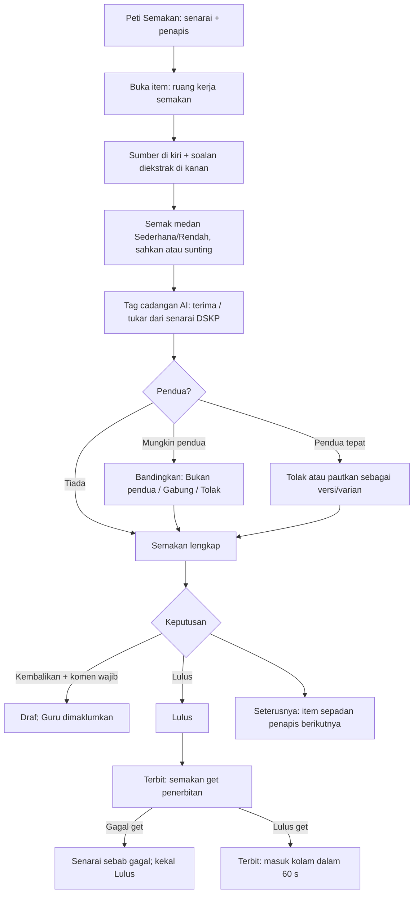
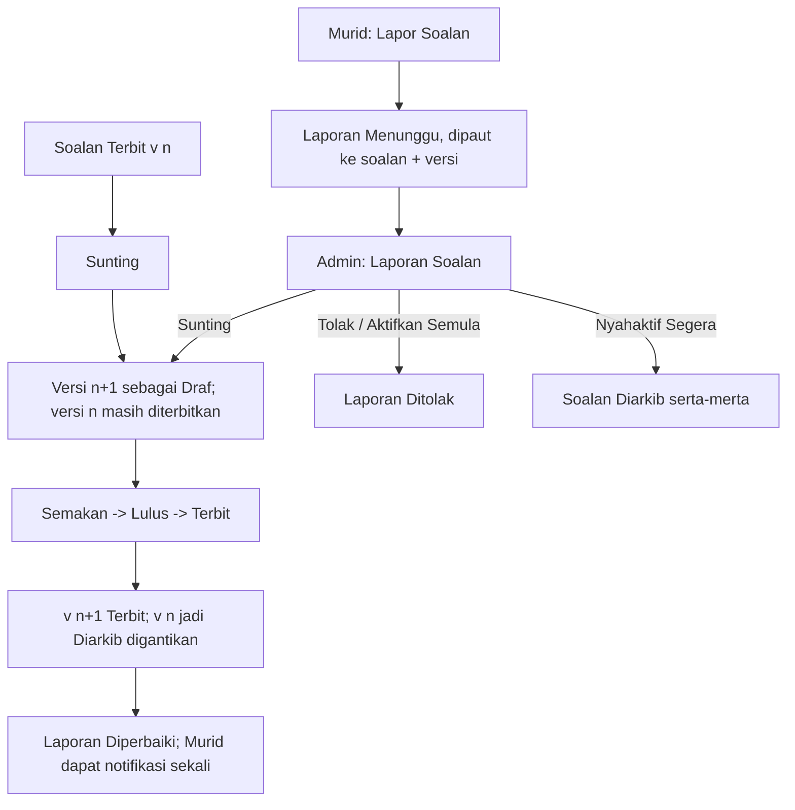

# v2 Question bank: UX design (intake, review, editor, publish hooks, student display)

- **Slug:** `v2-question-bank`
- **Status:** Draft for G2, **pending the user's exam schema** (everything schema-dependent is a `[SKEMA]` placeholder; no final field list is invented here)
- **Date:** 2026-10-16
- **Owner:** ui-ux-designer
- **Inputs read:** `docs/requirements/v2-question-bank.md` (US-01..US-32, AC refs below), `docs/requirements/v2-portals.md` (BS-01..BS-07, KS-01..KS-09), `docs/design/v2-design-system.md` v2.0, `docs/design/v2-shells.md`, `docs/design/v2-learner-prototype.html` (quiz, lines 704-724), TRACKER D33-D40.
- **Decisions applied:** D33a (themed dialogs, BM pagination, 8 subject dot slots), D35/D36/D38 (learner "Elektrik", Phosphor Duotone, friend "awak"), D39a (question screens held until this passes G2), D40 (a: Guru verifies own, only Admin Pusat approves and publishes; b: SPM Tingkatan 4-5 first; c: any paper may be uploaded with a source declaration; d: AI provider undecided, so no provider name appears in any UI copy).
- **Theme note:** D34 (theme A or B) is still pending. This spec uses **token and component names only** (no hex, no theme-specific values), so the choice changes `tokens.css` / `theme.config.ts`, not this document. "Layers, not lines" (design system section 4) is assumed.
- **Schema legend:** `[SKEMA]` = wait for the user's exam schema (question types, fields, answer modes, mark scheme, sections, blueprint, vocabularies). `[PROPOSED]` = copy or default proposed by the designer.

---

## 0. Scope, personalities, and what is fixed vs pluggable

| Area | Personality | Portal / menu | Primary breakpoint |
|---|---|---|---|
| Guru intake (Sumbang Soalan, Soalan Saya, Semak Soalan) | Staff (calm, B+) inside **Portal Pembelajaran, Guru variant** (`DsShellPembelajaran` `guru`) | new Guru menu item "Sumbang Soalan" [PROPOSED; see Q-D3] | **Phone first** (upload) plus tablet/desktop |
| Peti Semakan, Bank list, Editor, Publish, Laporan Soalan, Sumber Kertas | Staff, **Portal Pentadbiran**, groups **Bank Soalan** (BS-01 Bank Soalan, BS-02 Import & Semakan = "Peti Semakan", BS-03 Sumber Kertas, BS-04 Kualiti Soalan = intake dashboard, BS-05 Laporan Soalan) and **Kertas & SPM** (KS-02/05/06/08/09) | Admin Pusat only | **Tablet and desktop first**; usable on phone |
| Student question display, report flow | **Learner "Elektrik"** | Portal Pembelajaran, Murid | Phone first |

**Fixed (schema-agnostic) chrome** on every question surface: status, version, provenance, subject/level/chapter/DSKP/difficulty/language tags, source link, stimulus link, figures with alt text, audit/history, report entry.

**Pluggable "Kawasan Struktur Soalan"** (the question-structure slot): the block that holds stem, options/parts, answer key, mark scheme, marks. It is rendered from a **question-type definition** (blueprint-driven, US-28 AC-28.3), never from a hard-coded screen. This spec fixes its **frame** (header "Jenis soalan", validation list, preview), not its **content**. See section 9.

---

## 1. User flows

### 1.1 Guru: upload and verify own questions (US-01, US-04, US-09)

```mermaid
flowchart TD
  A[Guru: Sumbang Soalan] --> B{Pilih kaedah}
  B -->|Muat naik kertas| C[Borang pengisytiharan + fail]
  B -->|Templat Excel| X[Muat naik Excel, laporan baris]
  B -->|Soalan tunggal| M[Penyunting soalan: mod Guru]
  C -->|Fail tidak sah / terlalu besar| C1[Ralat sebaris, tiada penghantaran]
  C -->|Kertas sama sudah diimport (AC-06.4)| C2[Amaran: Teruskan / Batal]
  C --> D[Hantar: status Diterima -> Sedang diproses]
  C2 -->|Teruskan| D
  D --> E{Hasil pengekstrakan}
  E -->|Gagal| F[Gagal: Cuba lagi / Isi manual]
  E -->|Berjaya| G[N dikesan: Sedia untuk semakan]
  G --> H[Semak Soalan: bandingkan dengan sumber, sahkan medan Rendah]
  H --> I{Lulus semakan kendiri?}
  I -->|Tidak, ada medan Rendah / pendua / data tidak lengkap| H
  I -->|Ya: tanda 'Sepadan dengan sumber'| J[Hantar untuk semakan: Draf -> Semakan]
  J --> K[Soalan Saya: status Semakan, hanya lihat]
  K -->|Admin kembalikan + sebab| H
  K -->|Admin lulus / terbit| L[Soalan Saya: Lulus / Terbit + notifikasi]
```

### 1.2 Admin Pusat: Peti Semakan to Terbit (US-07, US-08, US-10, US-11)



### 1.3 Edit a published question (US-13) and report loop (US-18, US-19)



### 1.4 Paper assembly hooks (flow level only; US-12, US-28, D32)

```mermaid
flowchart TD
  A[Soalan Terbit dalam kertas] --> B[Sumber Kertas: kertas + bilangan Terbit]
  B --> C{Semua soalan Terbit?}
  C -->|Tidak| C1[Senarai soalan belum Terbit; tidak boleh terbit kertas]
  C -->|Ya| D{Blueprint wujud untuk subjek x kertas?}
  D -->|Tidak| D1[Hanya sumbang ke kolam; bukan Kertas Pilihan]
  D -->|Ya| E[Semak kesesuaian blueprint: bahagian, bilangan, jumlah markah]
  E -->|Tidak sepadan| E1[Senarai setiap ketidakpadanan]
  E -->|Sepadan| F[Terbit kertas -> Bijak SPM Kertas Pilihan]
  G[Kontrak Simulasi / Blueprint KS-08] --> H[Jana Kertas: Bijak SPM menarik dari kolam ikut blueprint]
```



---

## 2. Global patterns used by every screen

### 2.1 Status and band chips (always icon + word, never colour alone)

| Chip | Icon base (`DsIcon`) | `UBadge` | Where |
|---|---|---|---|
| Draf | `pencil-simple` | subtle, neutral | all |
| Semakan | `magnifying-glass` | subtle, `info` | all |
| Lulus | `seal-check` | subtle, `success` | admin, Guru |
| Terbit | `broadcast` | solid, `success` | all |
| Diarkib | `archive` | subtle, neutral | all |
| Ditolak (item) | `x-circle` | subtle, `error` | all |
| Dijana / Perlu semakan / Diterima / Pendua (extraction item) | `sparkle` / `warning` / `check` / `copy` | subtle: neutral / `warning` / `success` / `warning` | queue |
| Submission: Dihantar / Sedang diproses / Sedia untuk semakan / Gagal | `paper-plane-tilt` / `circle-notch` (spin, static in reduced motion) / `check-circle` / `warning-octagon` | subtle: neutral / `info` / `success` / `error` | Guru |
| Keyakinan Tinggi (>= 0.90) | `check-circle` | subtle `success` | admin; Guru sees no chip (see 2.3) |
| Keyakinan Sederhana (0.70-0.89) | `warning` | subtle `warning` | admin |
| Keyakinan Rendah (< 0.70) | `warning-octagon` | solid `warning` | admin and Guru ("Perlu sahkan") |

### 2.2 Layers, not lines
Page `bg-muted` > panels `bg-default` > fields/chips `bg-elevated`. Panels are separated by gaps (`gap-4`/`gap-6`), not borders. Focus ring and error ring are the only rings.

### 2.3 Confidence on a field (`DsConfidenceField`)
A field wrapper around any extracted value (stem, option, answer, marks, tag):
- **Tinggi**: pre-filled, no highlight; admin sees a small `check-circle` caption.
- **Sederhana**: pre-filled, background `bg-warning/10` plus `warning` icon plus caption "Sederhana - semak".
- **Rendah**: **not pre-filled as accepted**: the value is shown as a suggestion in the field with caption "Rendah - perlu sahkan", field background `bg-warning/10`, and a required action row: **[Sahkan]** (accept as is) and **[Sunting]** (edit; editing also counts as confirmed). Until confirmed: a solid `warning` chip "Perlu sahkan" sits on the field label and the field counts toward the gate list (AC-05.4).
- After confirmation: chip becomes "Disahkan oleh {nama}" (icon `user-check`), and an edited field shows "Disunting oleh manusia" (AC-08.2) with "Lihat teks AI asal" link (history popover).
- **Guru** sees only "Perlu sahkan" (Rendah) and "Semak" (Sederhana) captions, **no numeric score** [PROPOSED; Q-D5]. Admin Pusat can show the numeric value on hover/focus tooltip (`UTooltip`): "Keyakinan 0.64".
- Next-field shortcut: **"Medan Rendah seterusnya"** button (and key `N`) scrolls and focuses the next unconfirmed Rendah field (AC-08.4).

### 2.4 Responsive rules shared
No horizontal page scroll at >= 320px. Tables become card lists below `md` (`DsDataTable`). Modals become bottom sheets below `sm` (`DsDialog`). Wide math, wide tables and the source image scroll **inside** their container. All hit targets >= 44px on `pointer-coarse`. Body text 16px on mobile.

---

## 3. Guru screens (Portal Pembelajaran, Guru variant)

Screens G1-G6.

### G1. Sumbang Soalan (hub) - route [PROPOSED] `/guru/soalan/sumbang`

Purpose: choose the intake method (US-01/02/03).

```
375px                                  1280px (content column max 72rem)
+---------------------------------+    +-----------------------------------------------------+
| Sumbang Soalan                  |    | Sumbang Soalan                                      |
| Pilih cara menambah soalan.     |    | Pilih cara menambah soalan.                         |
| +-----------------------------+ |    | +-----------------+ +-----------------+ +---------+ |
| | [ph:file-arrow-up]          | |    | | Muat naik kertas| | Templat Excel   | | Soalan  | |
| | Muat naik kertas            | |    | | PDF / gambar... | | Banyak soalan...| | tunggal | |
| | PDF atau gambar kertas...   | |    | | [Mula]          | | [Mula]          | | [Mula]  | |
| | [Mula]                      | |    | +-----------------+ +-----------------+ +---------+ |
| +-----------------------------+ |    |                                                     |
| | Templat Excel ...           | |    | Penghantaran terkini (3)            [Soalan Saya >] |
| | Soalan tunggal ...          | |    |  row cards (DsDataTable md+)                        |
| Penghantaran terkini            |    +-----------------------------------------------------+
| (kad, 3 terkini)                |
+---------------------------------+
```

- Layout: `grid grid-cols-1 md:grid-cols-3 gap-4`. Three `UCard`s, each: `DsIconChip` (staff 32px, 12% tint), title `text-heading`, one-line `text-muted`, `UButton` "Mula" (md 44px coarse), full-width on mobile.
- Below: "Penghantaran terkini" = 3 latest Submissions (card list on all sizes; table `lg+`), link "Lihat semua" -> Soalan Saya.
- 768: cards `md:grid-cols-3` collapse to 1 column when container < 640; use `grid-cols-1 md:grid-cols-2 lg:grid-cols-3` (third card wraps).
- States: loading = 3 `USkeleton` cards; empty recent = `UEmpty` "Belum ada penghantaran. Mulakan dengan memuat naik kertas."; no error state except fetch error `UAlert` + "Cuba lagi".
- Access: Murid, Ibu bapa, Admin Sekolah, PPD get 403 page (`DsErrorPage`, AC-01.5).

### G2. Muat naik kertas - route `/guru/soalan/sumbang/kertas`

Purpose: declaration plus file(s) (US-01, US-17). Single page form; two sections as stacked cards; no multi-step wizard so it works on a phone without losing context.

```
375px
+---------------------------------+
| < Sumbang Soalan                |
| Muat naik kertas                |
|                                 |
| [Card 1] Maklumat kertas        |
|  Jenis kertas       [v Pilih  ] |
|  Subjek *           [v Pilih  ] |
|  Tahap *            [v Pilih  ] |
|  Tahun *            [ 2026    ] |
|  Catatan (pilihan)  [         ] |
|                                 |
| [Card 2] Sumber & hak cipta *   |
|  ( ) Hasil kerja sendiri        |
|  ( ) Milik sekolah              |
|  ( ) Kertas rasmi KPM / LPM     |
|  ( ) Buku komersial / pihak     |
|      ketiga                     |
|  (i) Teks bantuan ikut pilihan  |
|  [ ] Saya mengesahkan ...       |
|                                 |
| [Card 3] Fail                   |
|  [ph:upload] Seret fail ke sini |
|  atau [Pilih fail] [Ambil gambar]|
|  PDF / JPG / PNG, maks 20 MB    |
|  setiap satu, 5 fail            |
|  - kertas.pdf  12.4 MB  [x] ==  |
|  - skema.pdf   3.1 MB   [x] ==  |
+---------------------------------+
| [   Hantar untuk diproses   ]   |  <- sticky bottom bar (shadow-bar-up)
+---------------------------------+
```

- 768: single column `max-w-2xl`, cards stacked. 1280: two columns `lg:grid-cols-[1fr_1fr]`: left = Card 1 + Card 2, right = Card 3 (file list sticky `top-0`). Submit button stays in a sticky bottom bar on < `lg`, inline at bottom of right column on `lg+`.
- Fields (all `UFormField` + labelled, filled inputs): **Jenis kertas** `USelect` (Sebenar, Percubaan, Modul; **User decision 2026-10-25, FB-040** (was Soalan Umum, Percubaan/Trial, DSKP, Buku Teks, Buku Latihan, Peperiksaan, Lain-lain - the .cloud list). The field carries no required marker: an item that is none of the three is saved without a paper type (P-040 mapping), see `v2-question-bank.md` requirements 4.2); **Subjek** `USelectMenu` (searchable; subject dot slot shown); **Tahap** `USelect` (launch default Tingkatan 4 and 5 only, D40b; other levels hidden, not disabled); **Tahun** `UInputNumber`; **Catatan** `UTextarea` max 500 with counter. Bilingual-paper flag and language fields are `[SKEMA]` (not on this form until the schema defines language codes).
- **Source declaration** (`URadioGroup variant="card"`, mandatory, AC-17.1): Hasil kerja sendiri; Milik sekolah; Kertas rasmi KPM/LPM; Buku komersial / pihak ketiga. D40c = "any paper is allowed", so no option is blocked. For the last option, show an inline `UAlert` (info): "Kertas pihak ketiga memerlukan keputusan hak cipta daripada Admin Pusat sebelum soalan boleh diterbitkan. Anda masih boleh memuat naik dan menyemak." Plus a required `UCheckbox`: "Saya mengesahkan maklumat sumber ini benar. Fail asal tidak akan dipaparkan kepada murid." (NFR-05).
- **Files** `UFileUpload` (multiple, drag-drop, `accept` PDF/JPG/PNG, [PROPOSED] per Q10 default). Buttons: "Pilih fail" and, on `pointer-coarse`, **"Ambil gambar"** (opens `capture="environment"`; multiple photos allowed up to the 5-file limit) so a Guru can photograph a paper on a phone. Each file row: icon, name (truncate), size `tabular`, per-file upload `UProgress` (value in `status`), remove `x` (44px, `aria-label` "Buang {nama fail}"). Files are validated on selection (type, size, count) before any upload (AC-01.2).
- Submit: `UButton` solid primary "Hantar untuk diproses", disabled until required fields + declaration + at least 1 valid file. On click: button `loading`, then navigate to G4 (detail) with toast "Kertas dihantar. Pemprosesan bermula." Status "Sedang diproses" must show within 5 s (AC-01.3).
- **Duplicate-source warning (AC-06.4)**: on submit, if file hash/paper+year already imported, `DsDialog`: title "Kertas ini mungkin sudah diimport"; body "Kertas {subjek} {tahun} sudah ada dalam bank ({n} soalan). Meneruskan akan menggunakan kos pemprosesan."; buttons "Batal" (tonal) and "Teruskan juga" (primary).
- States: **error** per field (inset error ring + icon + text), file errors inline per row ("Jenis fail tidak disokong", "Fail melebihi 20 MB", "Maksimum 5 fail"); network failure keeps all input and shows `UAlert` "Muat naik terganggu. Fail anda tidak hilang." with "Cuba lagi"; password-protected/malicious file is rejected later at processing (G4 "Gagal" with reason). **Leave guard**: if files are selected and the Guru navigates away, themed confirm (`useConfirm`) "Tinggalkan halaman? Fail yang belum dihantar akan hilang."
- Keyboard: tab order Jenis > Subjek > Tahap > Tahun > Catatan > Sumber > Pengesahan > Fail > Hantar. Drop zone is a button (Enter/Space opens picker).

### G3. Import Excel - route `/guru/soalan/sumbang/excel`

Purpose: US-02. Same screen for Admin Pusat (route under admin Peti Semakan > "Import Excel").

```
+------------------------------------------------+
| Import Excel                                    |
| 1  Muat turun templat   [Muat turun v3]         |
|    Versi templat semasa: v3                     |
| 2  Isi templat dan muat naik                    |
|    [ drop zone: .xlsx, maks 20 MB ]             |
| [ Import ]                                      |
|------------------ keputusan (selepas import) --|
| (i) 18 baris berjaya menjadi Draf. 2 baris gagal.|
|  Baris | Sebab                                   |
|   7    | Medan wajib 'jawapan' kosong            |
|  12    | Tahap tidak sah                         |
| [Lihat 18 Draf]   [Muat turun laporan ralat]    |
+------------------------------------------------+
```
- 375: steps stacked; error rows become cards (row number chip + reason). 768/1280: `DsDataTable` Baris | Medan | Sebab.
- Template columns are generated from the question structure `[SKEMA]`; the screen shows only the version, not the columns.
- Messages: old version -> `UAlert` error "Templat versi lama (v2). Sila guna versi semasa v3." Partial result per AC-02.2. Duplicates in file or bank: row listed "Mungkin pendua dengan soalan sedia ada" (flag raised, row still a Draf).
- States: uploading (progress), importing (indeterminate `UProgress`), result, fatal error ("Fail tidak dapat dibaca"), empty file ("Tiada baris data dalam fail").

### G4. Butiran penghantaran (Submission detail) - route `/guru/soalan/penghantaran/:id`

Purpose: extraction progress and status (US-01.3, US-04.6, US-31.2).

```
375px                               1280px
+------------------------------+    +---------------------------------------------+
| < Soalan Saya                |    | < Soalan Saya                               |
| Fizik T5 2025 (Percubaan)    |    | Fizik T5 2025 (Percubaan)    [Sedang diproses]|
| [Sedang diproses]            |    | +---------------------+ +-------------------+ |
| o Dihantar         10:02     |    | | Kemajuan (UStepper) | | Maklumat          | |
| o Sedang diproses  10:03 ... |    | | o Dihantar          | | Sumber: Hasil...  | |
| o Sedia untuk semakan        |    | | o Sedang diproses   | | Fail: 2 (15.5 MB) | |
| 38 dikesan                   |    | |   Halaman 6 / 12    | | Dihantar 10:02    | |
| [Semak Soalan]               |    | | o Sedia untuk semakan| +-------------------+ |
+------------------------------+    | | [Semak 38 soalan]   |                       |
                                    +---------------------------------------------+
```
- Components: `UStepper` (read-only; vertical `< lg`, horizontal `lg+`), `UProgress` ("Halaman {n} / {jumlah}" when known; otherwise indeterminate), `UCard` info card, `UBadge` status.
- Live update: polling/stream; `aria-live="polite"` on the status line. Do not move focus on updates.
- **Result summary** when ready: "38 dikesan" + breakdown chips: "31 sedia", "5 perlu semak manual" (placeholder drafts, AC-04.5), "2 mungkin pendua". CTA "Semak {n} soalan" -> G6.
- **Missing question**: link "Soalan hilang? Tambah secara manual" -> editor with source page pre-attached (AC-04.6).
- **Failed** (AC-01.4, 04.7): `UAlert` error title "Pemprosesan gagal", reason line (e.g. "Fail dilindungi kata laluan", "Fail tidak boleh dibaca", "Masa pemprosesan tamat"), buttons "Cuba lagi", "Ganti fail", "Isi secara manual" (links to editor). Logged.
- Stuck > 30 min: Guru sees info "Pemprosesan mengambil masa lebih lama daripada biasa. Admin telah dimaklumkan." (US-31).
- Empty (0 detected): `UEmpty` "Tiada soalan dikesan." + same three actions.

### G5. Soalan Saya - route `/guru/soalan`

Purpose: list of own submissions and questions with statuses (US-09.1, US-30).

```
1280
+--------------------------------------------------------------------------------+
| Soalan Saya                                           [Sumbang Soalan] (primary)|
| [Soalan | Penghantaran]   <- UTabs (segmented)                                  |
| [Cari...] [Status v] [Subjek v] [Tahap v]                                       |
| +---+---------+--------+-------+-------+--------------+--------+--------------+ |
| | # | Soalan  |Subjek  | Tahap |Kertas | Status       | Dikemas| Tindakan     | |
| |12a| Hitung..|Fizik ● | T5    |FZ25   | [Draf]       | 2j lalu| [Semak]      | |
| |13 | ...     |        |       |       | [Dikembalikan]| ...   | [Lihat sebab]| |
| +---+---------+--------+-------+-------+--------------+--------+--------------+ |
| < Sebelum   Menunjukkan 1-20 daripada 143 hasil   Seterusnya >                  |
+--------------------------------------------------------------------------------+
375: filters collapse into one [Tapis (2)] button -> bottom sheet; rows become cards:
 | 12(a) Fizik ●  T5          [Draf] |
 | "Hitung daya paduan..." (2 baris)|
 | Fizik T5 2025   2 jam lalu   [Semak >] |
```
- Tabs: "Soalan" (question level) and "Penghantaran" (submission level). Tab counts via `UBadge`.
- Status filter chips: Semua, Draf, Semakan, Lulus, Terbit, Diarkib, Ditolak. A returned item shows status **Draf** with a secondary chip "Dikembalikan" and the reason in the row (second line, `text-muted`), plus action "Lihat sebab".
- Row actions by status (AC-09.3): Draf = "Semak" (opens G6, editable); Semakan/Lulus/Terbit/Diarkib = "Lihat" (read-only, G6 in view mode, **no edit controls rendered**).
- Bulk: checkbox column (desktop) / long-press select not used; on mobile a "Pilih" toggle reveals checkboxes. Bulk action bar (sticky bottom): "Hantar untuk semakan ({n})" -> result dialog lists passed and skipped with reasons (AC-07.4).
- Empty: `UEmpty` "Belum ada soalan. Muat naik kertas pertama anda." + CTA. Empty filter result: "Tiada soalan sepadan dengan penapis." + "Kosongkan penapis".
- A Guru requesting another Guru's id gets `DsErrorPage` 403 (AC-09.4); no data leaked in the message.

### G6. Semak Soalan (verify own extraction) - route `/guru/soalan/:id/semak`

Purpose: Guru verifies one extracted question against the source, then marks it matched and submits (US-09, US-05 AC-05.4). Same layout components as the admin review workspace (section 4, R2) in a **simplified Guru mode**: no duplicate-merge action, no approve, no numeric confidence, no "Seterusnya mengikut penapis admin" (Guru has "Soalan seterusnya milik saya").

```
1280 (focus layout, sidebar collapsed to rail)
+-----------------------------------------------------------------------------------+
| < Soalan Saya   Fizik T5 2025 · No. 12(a)    [Draf]      Soalan 3 / 38 [<] [>]    |
+---------------------------------+-------------------------------------------------+
| SUMBER (DsSourceViewer)         | SOALAN DIEKSTRAK                                |
| [- 100% +] [Halaman 4 / 12]     | (i) 2 medan perlu disahkan   [Medan Rendah >]   |
| +-----------------------------+ | Kawasan Struktur Soalan [SKEMA]                 |
| |  page image                 | |   ... stem / options / parts / key ...          |
| |   ########## highlighted    | | Tag                                             |
| |   region                    | |   Subjek  Fizik            ✓                    |
| +-----------------------------+ |   Bab/DSKP [Perlu sahkan] 5.2.1 Daya   [Sahkan] |
| [Lukis semula kawasan]          | Rajah / media (1) alt teks ...                  |
|                                 | [ ] Soalan ini sepadan dengan sumber            |
|                                 | [Simpan draf]        [Hantar untuk semakan]     |
+---------------------------------+-------------------------------------------------+
```
- The checkbox **"Soalan ini sepadan dengan sumber"** is mandatory (AC-09.2); "Hantar untuk semakan" is disabled until it is ticked and all gate rules pass. A `UAlert` above the buttons lists the unmet rules by field name when the button is pressed while disabled-by-gates (the button is `aria-disabled`, not removed, so the list can be announced): "Belum boleh dihantar: {nama medan}, {nama medan}."
- Breakpoints: see R2 (the same responsive rules apply: 375 = tab switch "Sumber | Soalan" with sticky action bar; 768 = side by side 5/7; 1280 = side by side 5/7 with rail).
- Read-only mode for Semakan/Lulus/Terbit/Diarkib: same layout, fields rendered as text, banner "Soalan ini sedang disemak. Anda hanya boleh melihat." (`UAlert` info), no checkbox/buttons.
- Returned-by-admin: top `UAlert` warning: title "Dikembalikan oleh Admin Pusat", the comment verbatim, date, and "Selepas pembetulan, hantar semula."

---

## 4. Admin Pusat screens (Portal Pentadbiran)

Screens R1-R8, A1-A3 listed below. Menu: Bank Soalan > "Import & Semakan" is titled **"Peti Semakan"** in the UI (BS-02, [PROPOSED] label; Q-D2).

### R1. Peti Semakan (queue) - route `/admin/bank-soalan/semakan`

Purpose: US-07, US-31. Tablet/desktop primary.

```
1280 (sidebar visible)
+-------------------------------------------------------------------------------------------+
| Peti Semakan                                  [Import Excel] [Tambah soalan]               |
| [Menunggu semakan 124 | Semua | Pendua 9 | Gagal/tersekat 2]   <- UTabs (counts = rows)    |
| [Cari nombor/teks...] [Subjek v] [Tahap v] [Status v] [Keyakinan v] [Sumber v] [Penghantar v]|
|  (chips of active filters) x Fizik  x Rendah           [Kosongkan penapis]                 |
| [ ] | No. | Soalan (2 baris)    | Subjek | Tahap | Kertas   | Keyakinan | Pendua | Penghantar| Umur |
| [ ] | 12a | Hitung daya...      | Fizik ●| T5    | FZ25 Perc.| [Rendah ] |  —     | Cikgu A    | 2h  |
| [ ] | 12b | ...                 | Fizik ●| T5    | FZ25 Perc.| [Sed.  ]  | [Mungkin]| ...      | 2h  |
|  Dipilih: 3   [Hantar ke Semakan] [Tukar tag] [Arkib]                                      |
|  < Sebelum   Menunjukkan 1-20 daripada 124 hasil   Seterusnya >                            |
+-------------------------------------------------------------------------------------------+
```
- Components: `DsPage`, `UTabs`, `DsFilterBar` (search + `USelectMenu` filters; filter chips below), `DsDataTable` (zebra rows, min row 44/48px, sortable by Umur and Keyakinan), `UPagination` (BM), bulk bar (sticky bottom, `shadow-bar-up`), `UBadge` status/band.
- Filters (AC-07.2): status, subjek, tahap, penghantar (Guru), kertas sumber, band keyakinan (lowest field), tanda pendua, tarikh. Filter state in URL so "Seterusnya" in the workspace respects it (AC-07.3).
- Confidence column = band of the **lowest** field, icon + word.
- Tab "Gagal/tersekat" lists Submissions (not questions): columns Kertas, Penghantar, Status, Umur, Tindakan (Cuba lagi, Ganti fail, Isi manual) (US-31). Stuck > 30 min highlighted with `warning` chip "Tersekat".
- Row click / Enter opens R2. Row checkbox for bulk (does not open).
- 768: columns reduce to: checkbox, No., Soalan, Subjek, Keyakinan, Pendua, (Kertas, Penghantar, Umur hidden into a second line under Soalan). Table scrolls inside its card only if still needed.
- 375: card list. Card: `[ ] 12(a)  Fizik ●  T5`, 2-line stem, chips row (Keyakinan, Pendua, Status), meta line (Kertas · Penghantar · Umur), full-card tap opens R2. Filters in a bottom sheet [Tapis (n)]; bulk via "Pilih" mode with sticky bar.
- Bulk "Hantar ke Semakan" (for Admin): applies the gate; result dialog "12 dihantar, 3 dilangkau" with the skipped list and reasons (AC-07.4, E9).
- "Terima semua Tinggi" appears **inside R2 on tags only** (AC-07.5), never here.
- States: loading = `USkeleton` rows (8); empty (no items) `UEmpty` "Peti semakan kosong. Tiada soalan menunggu."; empty filter "Tiada soalan sepadan."; error `UAlert` + "Cuba lagi"; stale-selection safeguard: if a selected row changed status meanwhile, bulk result skips it with "Status berubah".

### R2. Ruang kerja semakan (side-by-side) - route `/admin/bank-soalan/semakan/:id`

Purpose: US-08, US-05, US-06, US-10. The core screen. Uses a **focus layout**: on entering, `DsShellPentadbiran` sidebar collapses to its icon rail (collapsible `UDashboardSidebar`, state remembered) so 1280 yields ~1200px of work width. [Needs approval; Q-D1.]

```
1280 (rail)
+----------------------------------------------------------------------------------------------+
| < Peti Semakan   Fizik T5 · FZ25 Percubaan · No. 12(a)  [Semakan]   [<] 3/124 [>]   [⋯ Lagi]  |   header (shadow-bar)
+--------------------------------------+-------------------------------------------------------+
| SUMBER                               | SOALAN DIEKSTRAK                                      |
| [Halaman 4/12 v] [-][100%][+] [Muat] | Banner: 2 medan perlu disahkan [Medan Rendah seterusnya]|
| +----------------------------------+ | Banner (jika ada): Mungkin pendua → [Lihat banding]   |
| | page image (zoom/pan inside)     | | +---------------------------------------------------+ |
| |                                  | | | Jenis soalan: [SKEMA picker]  Markah: [SKEMA]     | |
| |   +----------------------+       | | +---------------------------------------------------+ |
| |   | highlighted region   |       | | | Kawasan Struktur Soalan [SKEMA]                   | |
| |   +----------------------+       | | |  (stem · pilihan/bahagian · kunci · skema)        | |
| |                                  | | |  each field = DsConfidenceField                   | |
| +----------------------------------+ | | |  Pratonton (DsQuestionContent) toggle             | |
| Thumbnails: [3][4*][5]               | | +---------------------------------------------------+ |
| [Lukis semula kawasan]               | | Tag (DsTagPanel)                                    | |
| [Ekstrak semula soalan ini]          | |  Subjek  Fizik        [Tinggi 0.97]  ✓            | |
| Sumber: Hasil kerja sendiri          | |  Tahap   Tingkatan 5  [Tinggi 0.95]  ✓            | |
| Penghantar: Cikgu A (Sek. X)         | |  {Jenis nod} 5 Daya   [Sederhana 0.81] [Tukar]    | |
|                                      | |  SK/SP   5.2 / 5.2.1  [Rendah 0.58] [Sahkan][Pilih]|
|                                      | |  Kesukaran [SKEMA skala] [Rendah]  [Sahkan]       | |
|                                      | |  [Terima semua Tinggi (tag sahaja)]               | |
|                                      | | Rajah/media & Rangsangan · Sejarah · Audit        | |
|                                      | +---------------------------------------------------+ |
|                                      | | [Kembalikan ke Draf]  [Simpan]  [Lulus ▸]          | |  sticky action bar
+--------------------------------------+-------------------------------------------------------+
```

**Regions and behaviour**
- **Source pane** (`DsSourceViewer`, new): page image (rendered from the stored source; never exposed to Murid), toolbar: page select, zoom -/+ (25% steps, 50-300%), "Muat lebar". Highlighted extracted region = semi-opaque token fill (`--ds-hl-region`, proposed token) with a small caption tab "Soalan 12(a)"; sub-regions for each option/part are lighter fills, and **hovering or focusing a field in the editor highlights its sub-region and scrolls it into view** (and vice versa: clicking a sub-region focuses the field). The page image is `role="img"` with alt "Halaman {n} kertas {nama}, kawasan soalan {no.} ditandakan"; region list available as a text list (keyboard users use the field-focus link; AC-08.1). Pinch-zoom and pan work inside the pane only; the pane never causes page scroll.
- **Redraw region** (AC-08.3): "Lukis semula kawasan" toggles draw mode (cursor crosshair; touch drag; keyboard alternative: region "Sunting kawasan" dialog with numeric x/y/lebar/tinggi inputs `UInputNumber`). Confirm bar: "Guna kawasan ini" / "Batal". Then "Ekstrak semula soalan ini" (per-question only) with confirm dialog "Teks yang telah anda sunting akan diganti. Teruskan?" when human edits exist.
- **Editor pane**: top banners (stacked `UAlert`s) for: unresolved Rendah fields (count + "Medan Rendah seterusnya"), duplicate (R4), gate failures. Then the **Kawasan Struktur Soalan** `[SKEMA]` frame (section 9), the **Tag panel**, **Media and stimulus**, collapsible (`UAccordion`) **Sejarah & Audit**.
- **Tag panel** rows: label | value | band chip | actions. Actions per row: "Terima" (only for Tinggi/Sederhana pre-filled; implicit), "Sahkan" (Rendah), "Tukar" (opens picker: simple `USelectMenu` for subject/level/difficulty/language; **DSKP picker** R3 for chapter/topic). Free text is not accepted for chapter, topic, difficulty (AC-05.2) so those controls are selects only. "Terima semua Tinggi" confirms only Tinggi tag fields and shows toast "{n} tag diterima". The suggested vs final value is recorded (AC-05.5); the panel shows "Cadangan AI: {nilai} (0.58)" caption under a changed value.
- **Action bar** (sticky within the editor pane, `shadow-bar-up`): Admin in Semakan: **"Kembalikan ke Draf"** (opens return dialog), "Simpan", **"Lulus"** (primary). In Lulus: "Terbitkan" (primary, opens publish dialog R7) and "Kembalikan ke Draf". In Draf (admin editing): "Hantar ke Semakan". If a gate fails: the primary button is `aria-disabled` with `UTooltip` and a click opens a `DsDialog` "Belum boleh diluluskan" listing failing rules (named) with "Pergi ke medan" links.
- **Seterusnya** (`>` in header, key `J`) opens the next item matching the queue filter without returning (AC-07.3). After Lulus/Kembalikan the app auto-advances with toast "Soalan 12(a) diluluskan. Membuka soalan seterusnya." (with "Buat asal" for 6 s). Autosave: edits save on blur (inline, AC-08.2) with status caption "Disimpan 10:41" / "Menyimpan..." / "Gagal disimpan - Cuba lagi".
- **Keyboard** (NFR-10; shown in a `UKbd` help dialog opened by `?`): `J`/`K` next/previous item, `N` next Rendah field, `E` edit focused field, `Enter` confirm focused field, `Ctrl+Enter` Lulus, `[`/`]` previous/next page of source, `+`/`-` zoom. Single-key shortcuts are disabled while typing in an input and can be turned off (WCAG 2.1.4).

**Responsive**
- **1280**: two columns `lg:grid-cols-[5fr_7fr]`, each pane scrolls independently (`overflow-y-auto`, `h-[calc(100dvh-header)]` realised by the layout component), source pane may be collapsed to 0 with a "Sorokkan sumber" toggle (editor then full width).
- **768 (tablet, primary)**: sidebar is a drawer (< `lg`), so the full 768px is available: still side by side `md:grid-cols-[5fr_7fr]` (about 300 / 420px); tags move to an `UAccordion` below the structure area; source toolbar compacts to icons with `aria-label`s. Portrait tablets below 700px behave as phone.
- **375**: single pane with a sticky segmented switch **"Sumber | Soalan"** (`UTabs`, 44px) at the top below the header; default tab "Soalan"; the sticky bottom action bar holds the primary action and "Lagi" (`UDropdownMenu`: Kembalikan, Simpan, Seterusnya). A floating chip on the Soalan tab "Lihat sumber" jumps to the source tab at the right region and a "Kembali ke soalan" chip returns, keeping scroll position. No function is lost (AC-08.5).
- States: loading = skeleton for both panes (image placeholder `aspect-[3/4]` via `USkeleton`); source image failed = `UAlert` in pane "Halaman sumber tidak dapat dimuatkan" + "Cuba lagi" (editor remains usable); extraction placeholder item (AC-04.5): banner "Perlu semak manual: pengekstrakan gagal untuk soalan ini. Teks mentah ditunjukkan di bawah." with raw text in a read-only box and "Ekstrak semula" / "Taip secara manual"; item already acted on by someone else: banner "Status soalan ini telah berubah oleh {nama}. Muat semula." and actions disabled; read-only for Admin when status is Terbit/Diarkib with "Sunting (versi baharu)".

### R3. Pemilih DSKP (tag picker) - `DsDskpPicker`, in a `USlideover` (right, `lg+`) or full-height `UDrawer` (< `lg`)

Purpose: choose curriculum tags from the controlled list. **User decision (2026-10-16): one GENERIC hierarchy for every KSSM subject, no per-subject special cases:**

`Subjek > Tahap > nod pengelompokan (satu atau lebih peringkat) > SK > SP`

- **Grouping nodes carry a type label taken from the subject data**, never hard-coded in the UI: one of *Bab, Unit, Tajuk, Tema, Bidang, Kemahiran, Modul*. The tree row shows the type as a small caption before the name (e.g. "Tema  Kesihatan"), the search field placeholder and the group headings use the label from data. A subject may have more than one grouping level (e.g. Bidang > Tajuk); the tree simply nests them.
- **Tahap Penguasaan (TP1-TP6)** attaches either to a grouping node (unit level) or to an SK, depending on the subject data; the picker shows the TP row under whichever node carries it (see below), never both rules in code.
- **SP flagged "tidak boleh diuji secara bertulis"** (attitude/practical SPs, per `docs/reference/dskp/_notes-batch*.md`) are **hidden from AI suggestions and from the tree by default**; a switch "Tunjuk SP tidak boleh diuji" reveals them (shown dimmed with an icon `prohibit` and the caption "Tidak boleh diuji secara bertulis", still selectable by an admin with a confirm line, since a practical question may legitimately exist).
- **Subjects without official DSKP data loaded** show their curriculum as **"belum disahkan"** (`UBadge` subtle `warning`, icon `seal-warning`) in the picker header and in coverage views. The picker **still works**: it lists whatever nodes exist (including provisional/admin-added ones) and each carries the "belum disahkan" badge; nothing is blocked. If no nodes exist at all, free text is still forbidden (AC-05.2) and no "add node" is offered; the picker shows `UEmpty` "Senarai kurikulum belum disahkan untuk subjek ini. Pilih tag peringkat Tahap sahaja atau minta Admin Pusat menambah kurikulum." and the question can still be saved (publish gate rule on DSKP follows Q-S4).
- List content comes from M03 / D9 and `docs/reference/dskp/*.json`; the picker reads a generic node shape (kod, nama, jenis, induk, kebolehujian, status pengesahan) `[SKEMA-kurikulum]`.

```
+------------------------------------------+
| Pilih topik kurikulum          [x Tutup] |
| Fizik · Tingkatan 5   [Disahkan]         |    <- or [Belum disahkan] badge
| [Cari kod atau kata kunci...         ]   |
| [ ] Tunjuk SP tidak boleh diuji          |
| Cadangan AI (3)                          |
|  ( ) SP 5.2.1 Daya paduan  0.58  Rendah  |
|  ( ) SP 5.2.2 ...          0.31          |
| Semua                                    |
|  v Bab   5  Daya dan Gerakan             |    <- type label from data (Bab/Tema/Bidang/...)
|    v SK  5.2 Dinamik                     |
|       ( ) SP 5.2.1 Daya paduan           |
|       ( ) SP 5.2.4 [prohibit] Tidak boleh|
|           diuji secara bertulis (disorok)|
|    Tahap Penguasaan (pada SK 5.2):       |
|      [TP1][TP2][TP3][TP4][TP5][TP6]      |
| ------------------------------------------ |
| Dipilih: SP 5.2.1 Daya paduan            |
| [Batal]                    [Guna pilihan]|
+------------------------------------------+
```
- Components: `UInput` search (debounced, matches code, name and node type; highlights match), `UTree` for the generic hierarchy (any depth of grouping nodes, then SK, then SP; single select; the selectable leaf level is the tag level `[SKEMA]`, default SP), AI suggestions list first as `URadioGroup` items showing level badge (SK/SP), code, name, score band chip. TP selection (if TP is a tag, Q-S4) as a `URadioGroup` row of numbered chips under the node that carries TP.
- Subject and level are fixed from the question (change those first); the picker lists only that subject x level.
- Search empty: "Tiada topik sepadan dengan '{carian}'." Selection never allows free text. "Guna pilihan" is disabled until a leaf is chosen. Esc/Batal returns focus to the invoking "Pilih" button.
- **Coverage views (new, below)** use the same hierarchy and flags.
- 375: full-height drawer with the search pinned at top and the action row pinned at bottom (safe-area padding). Tree rows 48px.
- A11y: tree uses `role="tree"` semantics from `UTree` (arrow keys expand/collapse, type-ahead), selected leaf has check icon (not colour only).

### R4. Amaran pendua dan paparan banding - `DsDuplicateCompare`

Purpose: US-06. Triggered from a banner in R2 and a column filter in R1.

**Warning panel (in R2 editor pane)**
```
+--------------------------------------------------------------+
| [copy] Mungkin pendua (92% serupa)                           |
| Padanan: Soalan #4821 · Fizik T5 · Terbit v2 · 2025          |
| "Hitung daya paduan yang bertindak ke atas..."               |
| [Banding sebelah-menyebelah]                                 |
+--------------------------------------------------------------+
```
`Pendua tepat` variant: `error` subtle alert "Pendua tepat dengan soalan #4821. Tidak boleh dihantar ke Semakan melainkan ditolak atau dipaut sebagai versi/varian." Actions in the compare view differ (below).

**Compare view** - `DsDialog` large (`UModal` `lg+`, full-screen `UDrawer` < `lg`).
```
1280
+------------------------------------------------------------------------------+
| Banding soalan                                              [x]              |
| BAHARU (Draf, ini)                | SEDIA ADA #4821 (Terbit v2)              |
| Stem   ...text with ⟦differences⟧ | Stem   ...                               |
| [Pilihan / Bahagian [SKEMA]]      | [Pilihan / Bahagian [SKEMA]]             |
| Kunci jawapan: B                  | Kunci jawapan: B                         |
| Tag: Fizik T5 5.2.1               | Tag: Fizik T5 5.2.1                      |
| Sumber: FZ25 Percubaan            | Sumber: FZ24 SPM                         |
| Perbezaan: 3 perkataan  [Tunjuk perbezaan v]  <- switch                      |
+------------------------------------------------------------------------------+
| (Bukan pendua)   (Gabung - kekalkan satu)   (Tolak sebagai pendua)  [Tutup]  |
+------------------------------------------------------------------------------+
```
- Both sides rendered with the same `DsQuestionContent` (math/RTL/figures identical). Difference marks use **underline-free** treatment: inserted text on `bg-success/15`, removed text on `bg-error/15` with strike-through and `+`/`-` sr-only prefixes ("Ditambah:", "Dibuang:") so colour is not the only cue.
- Choices (`URadioGroup variant="card"` then confirm): **Bukan pendua** (suppresses flag for this pair only, AC-06.5), **Gabung** (choose which to keep: radio "Kekalkan yang baharu" / "Kekalkan yang sedia ada"; destructive confirm), **Tolak** (reason required). Exact duplicates offer "Tolak" and "Pautkan sebagai versi/varian" only. Decision + reviewer logged.
- 768: stacked two columns narrower or tabbed "Baharu | Sedia ada" with a "Banding" tab toggle; 375: `UTabs` "Baharu | Sedia ada" plus a "Perbezaan" tab with a unified diff list.
- Multiple matches: left list of candidates (`URadioGroup` cards with % and status) above/besides the compare area.
- Error: "Soalan padanan tidak dapat dimuatkan" `UAlert` + retry; the matched question is Diarkib: chip "Diarkib" and note "Soalan ini telah diarkibkan."

### R5. Dialog Kembalikan / Lulus - `DsDialog`

- **Kembalikan ke Draf**: title "Kembalikan soalan kepada penghantar?"; `UTextarea` label "Sebab atau komen (wajib)" max 500 with counter; hint "Penghantar akan menerima notifikasi bersama komen ini."; buttons "Batal" / "Kembalikan" (primary, disabled until comment non-empty). Optional quick-reason chips (insert text): "Teks tidak sepadan dengan sumber", "Kunci jawapan salah", "Tag tidak tepat", "Rajah tidak jelas".
- **Lulus**: no dialog when gate passes (one-tap, undo toast 6 s). If a gate fails: dialog "Belum boleh diluluskan" with failing rules list.
- **Mod langkah** for self-uploaded items: audit shows both (Q3 default); a caption in the header "Anda juga penghantar soalan ini" (info chip).

### R6. Senarai Bank Soalan (BS-01) - route `/admin/bank-soalan`

One list and one editor for the whole bank (AC-27.4). Same pattern as R1 with extra filters (tab-less): status, subjek, tahap, bab, topik DSKP, kesukaran, jenis `[SKEMA]`, sumber, tahun, bahasa `[SKEMA]`, pendua, dilaporkan. Row actions menu `UDropdownMenu`: Lihat, Sunting, Arkib/Pulihkan, Sejarah versi. Bulk: Arkib, Pulihkan, Tukar tag (gated, logged). Export "Eksport" (Terbit sahaja kecuali penapis status dipilih; confirm dialog states this). Same 375/768/1280 behaviour as R1. Empty: "Bank soalan masih kosong. Mulakan dengan Peti Semakan." Counts in tabs/headers always equal rows (AC-19.1, 27.1).

### R7. Dialog Terbit (publish gate) - `DsDialog`

```
Terbitkan soalan?
Soalan ini akan tersedia kepada murid dalam masa 60 saat.
Senarai semak (automatik):
 ✓ Kunci jawapan / skema markah lengkap
 ✓ Kesukaran ditetapkan
 ✓ Topik DSKP dipilih
 ✗ Hak cipta: keputusan belum direkodkan   [Rekod keputusan]
 ✓ Tiada bendera pendua terbuka
[Batal]                         [Terbitkan] (disabled while any ✗)
```
- Each ✓/✗ line = icon + text (not colour only). ✗ rows link to the field (closes dialog and focuses it) or to the rights decision panel. Bulk publish (from R1/R6): result dialog "{n} diterbitkan, {m} dilangkau" with reasons list (E9: no bypass for single, paper or bulk).
- **Rights decision panel** (`USlideover`): shows source declaration, radio "Dibenarkan terbit" / "Tidak dibenarkan" + note; logged. Available when declaration = third-party/commercial (AC-17.2).
- **Withdraw** (Terbit to Diarkib): `useConfirm` destructive: "Tarik balik soalan ini?" body "Soalan tidak akan disampaikan lagi dalam masa 60 saat. Sesi yang sedang berjalan menamatkan soalan semasa." mandatory reason; if inside a published paper add warning "Kertas {nama} akan ditandakan Perlu semakan." (AC-14.2).
- **Takedown by source** (AC-17.3): from Sumber Kertas detail, "Tarik balik semua soalan sumber ini" with typed confirmation (type the source code).

### R8. Penyunting soalan (question editor) - route `/admin/bank-soalan/:id/sunting` and `/admin/bank-soalan/baharu`; Guru mode at `/guru/soalan/baharu` and `/guru/soalan/:id/sunting`

Purpose: US-03, US-13, manual create and edit. This is the same editor component that R2 embeds on its right pane.

```
1280 (full width; no source pane when created manually)
+-----------------------------------------------------------------------------------------+
| < Bank Soalan   Soalan baharu / Sunting #4821        [Draf] Versi 3      [Pratonton] [⋯] |
| Banner (UBanner/UAlert info), only when editing a Terbit question:                       |
| (i) Versi baharu sebagai Draf; versi 2 masih diterbitkan.   [Lihat versi 2]              |
+-------------------------------------------------+---------------------------------------+
| 1 Jenis soalan  [SKEMA: pilih jenis v]          | PRATONTON LANGSUNG (DsQuestionContent)|
| 2 Kawasan Struktur Soalan [SKEMA]               |  seperti dilihat murid (toggle        |
|   - Soalan/stem  (editor teks kaya + math + RTL)|  "Tema murid / Tema staf")            |
|   - Pilihan atau bahagian [SKEMA]               |                                       |
|   - Kunci jawapan [SKEMA]                       |                                       |
|   - Skema markah [SKEMA]                        |                                       |
|   - Markah [SKEMA]                              |                                       |
| 3 Rangsangan & rajah   [Lampirkan]              |                                       |
| 4 Tag  (Subjek, Tahap, Bab, DSKP, Kesukaran,    |                                       |
|         Bahasa)                                 |                                       |
| 5 Sumber & hak cipta                            |                                       |
| Senarai semak penerbitan: 4 daripada 7 lengkap  |                                       |
+-------------------------------------------------+---------------------------------------+
| [Simpan draf]  [Hantar untuk semakan]                                                   |
+-----------------------------------------------------------------------------------------+
```
- Layout: form column + preview column at `lg+` (`lg:grid-cols-[7fr_5fr]`, preview `sticky top-0`); at 768 the preview is a toggle (`UTabs` "Sunting | Pratonton"); at 375 the preview opens in a full-height `UDrawer` via the header button "Pratonton". The numbered sections are `UCard`s (no wizard, no hidden steps).
- **Versioning banner** (Terbit being edited; US-13): `UAlert variant="subtle" color="info"` pinned at top, not dismissible: **"Versi baharu sebagai Draf; versi {n} masih diterbitkan."** with link "Lihat versi {n}". When n+1 becomes Terbit: toast "Versi {n+1} diterbitkan. Versi {n} diarkibkan (digantikan)." If the change alters the correct answer: warning chip "Jawapan berubah" and in the publish dialog "Mempengaruhi {x} percubaan murid yang direkodkan." (AC-13.4). Linked reports are shown in a panel "Laporan berkaitan ({n})".
- **Sejarah versi** (`USlideover`, `UTimeline`): version n, status, who, when, why; "Banding dengan versi ini" opens a compare view (reuses `DsDuplicateCompare` in "versi" mode).
- **Guru mode**: same editor with sections 5 prefilled/read-only from the Submission; no "Lulus"; button "Hantar untuk semakan" (requires the "Sepadan dengan sumber" tick only when the item came from an upload; manual items skip it).
- **Save behaviours**: "Simpan draf" always allowed with gaps (AC-03.2); a gap list `UAlert` "Belum lengkap: {medan}, {medan}" and a checklist progress `UProgress`. "Hantar untuk semakan" enforces the gate. Autosave to local draft every 10 s plus unsaved-changes guard (`useConfirm`).
- **Math input (KaTeX)** - `DsMathField`:
  ```
  +--------------------------------------------------------------+
  | Stem   [B][I][x²][x₂][√][a/b][Ω][ ∑ ][Unit v][Formula kimia][ع Arab/Jawi][Rajah]|
  | +----------------------------------------------------------+ |
  | | Cari nilai $\frac{3}{4}+\frac{1}{8}$ . Jawapan dalam ... | |   <- source
  | +----------------------------------------------------------+ |
  | Pratonton:  Cari nilai ¾ + ⅛ ...                             |
  | [ ] Mod LaTeX     Teks bacaan skrin (pilihan) [............] |
  +--------------------------------------------------------------+
  ```
  Toolbar buttons insert KaTeX templates at the caret (pecahan, kuasa, subskrip, punca, simbol, unit, formula kimia) so authors need not know LaTeX; a "Mod LaTeX" switch shows the raw source for experts. Inline math in `$...$`, display math in `$$...$$` [PROPOSED storage form; Q-D6]. Live preview below (debounced 250 ms) uses the same renderer as students. Parse errors: the preview shows the offending fragment in an inline error chip "Formula tidak sah di sini" (error icon + text) and the field gets the inset error ring; the question can be saved as Draf but cannot move to Semakan. "Teks bacaan skrin" is an optional author override of the auto-generated spoken form (KaTeX MathML output is the default accessible form).
- **Jawi/Arabic (RTL) input** - same field: the "ع Arab/Jawi" button wraps the selection (or inserts a segment) as an RTL span `dir="rtl" lang="ar"` (Arab) or `lang="ms-Arab"` (Jawi) via a small menu "Arab" / "Jawi"; the span is shown in the editor with the proper direction and the Scheherazade New font, with a small `ع` label chip so authors can see where RTL begins. Whole-field direction toggle "Arah teks: Auto / Kiri-ke-kanan / Kanan-ke-kiri" in the field menu for fully Arabic stems/options. Mixed-direction sentences must render without garbling in editor and preview (AC-26.1). Pasting Arabic/Jawi from PDF text keeps direction (`dir="auto"` on pasted blocks).
- **Stimulus / diagram attach** - `DsStimulusAttach`: section 3 offers three actions: "Pilih rangsangan sedia ada" (search a stimulus by title/paper, shows preview, reuse across questions, AC-24.2), "Cipta rangsangan baharu" (type `[SKEMA]`: teks, jadual, rajah, imej, audio; editor dialog), "Muat naik rajah" (image: crop from source page when from upload, or upload JPG/PNG up to 5 MB [PROPOSED]). Each figure row: thumbnail, **"Teks alternatif" (required, AC-§4.10)** with AI-suggested text marked "Cadangan AI - sahkan" (counts as a Rendah field until confirmed), size, "Gantikan", "Buang". A shared stimulus shows "Digunakan oleh {n} soalan" and edits warn "Perubahan akan terpakai pada {n} soalan lain." Missing media file: row error "Fail media tiada - soalan tidak boleh dilulus/diterbit" (AC-24.4).
- **Answer key and mark scheme area**: the frame is fixed, content `[SKEMA]` (section 9). Always present: an "Kunci jawapan" block and a "Skema markah" block each with a status chip "Lengkap / Belum lengkap" feeding the publish gate (hard gate).

---

## 5. Publish and paper assembly (flow-level screens)

Screens P1-P2 (list-level specs only; detailed layouts wait for the schema and blueprint).

### P1. Sumber Kertas (BS-03) and Kertas detail - `/admin/bank-soalan/sumber`

Register list (`DsDataTable`): Subjek, Tahun, Kertas `[SKEMA]`, Jenis, Lembaga/Badan `[SKEMA]`, Soalan (n), Terbit (n), Tanda hak cipta, status kertas (Draf / Sedia terbit / Terbit / Perlu semakan). Row opens a paper detail: section list (`UAccordion`) of the paper's questions with status chips, a **Conformance panel** ("Kesesuaian blueprint": per-rule check list with ✓/✗: bilangan bahagian, bilangan soalan setiap bahagian, jumlah markah `[SKEMA]`), and buttons "Terbitkan kertas" (disabled with the unmet list), "Batal terbit kertas", "Tarik balik semua soalan sumber ini". Paper publish uses the same R7 dialog pattern (gate list) and is refused with named missing questions (AC-12.1/12.2). A paper without a blueprint shows `UAlert` info: "Tiada blueprint untuk subjek dan kertas ini. Soalan masih menyumbang kepada kolam, tetapi kertas tidak boleh menjadi Kertas Pilihan." (AC-12.3). Cards at 375, table at `md+`.

### P2. Hooks to Kertas & SPM (KS-02/05/06/08/09)

- **Kertas Pilihan** (Bijak SPM): a published paper (P1) appears in KS-06 "Bijak SPM (Simulasi)" paper list; the KS-06 editor edits sections/stimulus references using the same `DsStimulusAttach`; nothing is copied, KS-06 stores question id + version (AC-21.5).
- **Jana Kertas**: KS-08 "Kontrak Simulasi" (blueprint editor, US-28) is the single contract; Jana Kertas reads it. Each pool preview ("Pratonton kolam") shows the count computed from the same query as students will get and a link "Lihat soalan" -> R6 prefiltered by the pool tags. Empty pool: "Tiada soalan Terbit untuk tag ini" (not an error, AC-21.3).
- **Set Builder** (KS-09) and teacher class sets (M10) may only add Terbit questions; the question picker in those screens is the R6 list in picker mode (`DsDialog` large + checkbox rows). Their screens are specified elsewhere.

---

## 6. Admin extras

### A1. Laporan Soalan (BS-05) - `/admin/bank-soalan/laporan`

`UTabs`: Menunggu / Disemak / Diperbaiki / Ditolak / Dikeluarkan / Semua, with counts equal to rows (AC-19.1). `DsDataTable` columns: Soalan (stem excerpt), Subjek, Sebab (chips), Pelapor, Masa, Versi dilapor, Status. Row opens a `USlideover` (right, `lg+`) / full drawer (< `lg`) with: the question **as the student saw it** (reported version rendered with `DsQuestionContent` in learner mode), reasons, comment (verbatim, escaped), reporter, time, other open reports for the same question (n). Actions: "Sunting (versi baharu)" (opens R8 and links the report), "Tandakan Selesai", "Tolak & Aktifkan Semula", "Nyahaktif Segera" (destructive confirm, reason). Auto-hide indicator: chip "Disembunyikan automatik (3 laporan)" (Q7 default). Empty: "Tiada laporan menunggu."

### A4. Liputan Kurikulum (coverage view) - `/admin/bank-soalan/liputan` (tab in A2 Papan intake)

Purpose: show which curriculum nodes have Terbit questions, using the **same generic hierarchy** as R3 (no per-subject layouts).

```
1280
+---------------------------------------------------------------------------------+
| Liputan Kurikulum        [Subjek v] [Tahap v] [Tunjuk SP tidak boleh diuji]       |
| Fizik T5  [Belum disahkan]?   Liputan: 38 / 52 SP boleh diuji (73%)  [progress]  |
| Nod                              | Jenis   | SP boleh diuji | Ada soalan Terbit | Draf/Semakan |
| v 5 Daya dan Gerakan             | Bab     | 12             | 9 / 12  [progress]| 4            |
|   v 5.2 Dinamik                  | SK      | 5              | 3 / 5             | 2            |
|      5.2.1 Daya paduan           | SP      | -              | 14 soalan         | 1            |
|      5.2.4 [prohibit] Sikap      | SP      | tidak boleh diuji (dikecualikan)                                     |
+---------------------------------------------------------------------------------+
```
- `DsDataTable` as a tree table (expand/collapse rows, `aria-expanded`); node type column from data; counts are **computed from the bank** (never stored). Percent = SP with at least one Terbit question / SP boleh diuji; SPs flagged not testable are excluded from the denominator by default (switch includes them). Row click filters R6 by that node. A cell with 0 shows "Tiada soalan" (`UBadge` subtle `warning`, icon + word).
- Subjects without verified DSKP data show the "Belum disahkan" badge next to the title and in the subject filter list; coverage is computed over whatever nodes exist, with caption "Peratusan berdasarkan kurikulum yang belum disahkan."
- 768: columns reduce to Nod, Ada soalan Terbit, Draf/Semakan; 375: tree list with a progress bar per node and counts as chips. Export is not in scope.
- States: loading skeleton rows; empty "Tiada nod kurikulum untuk subjek dan tahap ini."; error `UAlert` + retry.

### A2. Papan intake (BS-04) - summary only
Stat tiles (`DsStat`): penghantaran mengikut status, saiz peti semakan + umur tertua, kadar kejayaan pengekstrakan, % tag diterima tanpa ubah setiap medan, kadar pendua, kos AI bulan ini vs had (progress with 80%/100% states). `DsChart` for trend. Alert list for stuck/failed Submissions. No question content here.

### A3. Notifikasi
Guru receives in-app notifications (US-30) in the existing bell: "Soalan 12(a) dikembalikan: {sebab}", "Soalan 12(a) diluluskan", "Soalan 12(a) diterbitkan", "Soalan 12(a) ditarik balik". Grouped per submission: "Fizik T5 2025: 5 soalan dikemas kini". Tapping opens G6 (view/edit per status).

---

## 7. Student question display (Portal Pembelajaran, learner "Elektrik")

Screens S1-S6. All inherit the approved prototype quiz screen: full-screen, one question at a time, top row (close `x`, progress bar `role="progressbar"`, combo chip), meta row (subject chip + "Soalan n/N"), question `h2` (`text-heading`, focus target), answer area, footer with "Semak" (disabled until answered) and the feedback sheet with "Teruskan". Quiz column max 40rem (centered at 768/1280). Icons Phosphor Duotone. Friend (Aiman/Aisyah) reacts per mood rules. Nothing about the mode (Latih Tubi / Bijak SPM) changes the shell; Simulasi hides the instant mark (AC-23.3).

New in the meta row: a **"Lapor"** ghost icon button (`flag` icon, 44px, `aria-label` "Lapor Soalan", tooltip on hover) at the end of the row (AC-18.1). In the feedback sheet the same action appears as a text link button "Ada masalah dengan soalan ini? Lapor". It is available before answering, so the report never depends on "Semak".

### S1. MCQ (US-22)

```
375
+-------------------------------+
| [x]  =======-------   🔥 2    |
| [● Fizik]      Soalan 3/10 [⚑]|
|                               |
| Apakah unit SI bagi daya?     |   <- h2 text-heading, scrolls inside .qa if long
|                               |
| +---------------------------+ |
| | (A)  Joule                | |   DsOption, min-h 60px, radius 18
| +---------------------------+ |
| | (B)  Newton           (o) | |
| +---------------------------+ |
| | (C)  Watt                 | |
| | (D)  Pascal               | |
| +---------------------------+ |
|                               |
| [          Semak            ] |   disabled until a choice is made
+-------------------------------+
```
- 768/1280: same single column (`max-w-[40rem]` realised by the quiz layout component) centered; options may form a 2x2 grid ONLY if every option text is short? **No** (consistency): always one column.
- Long stem/options: the question area (`.qa`: stem + options) scrolls vertically inside; the footer with "Semak" stays pinned (AC-22.4). Option text wraps (never truncated); the option grows in height beyond 60px.
- Number of options follows the structure `[SKEMA]` (default 4, A-D).
- Option states: default, selected, locked-correct (check), locked-wrong (x, nudge), dimmed (55%). Tap anywhere on the card selects (also for formula/RTL/image options).
- Feedback sheet (`DsFeedback`): good/bad variants, explanation text when present (rendered with `DsQuestionContent`), friend line, "Teruskan". Titles from the prototype (verbatim). No new learner copy except the report strings in S5.

### S2. Structured question with parts (US-23)

Answer input per part depends on the answer mode `[SKEMA]` (text, numeric+unit, selection, etc.). The frame is fixed.

```
375 (scrolls inside the question area)
+-------------------------------+
| [x]  ====----------   🔥 0    |
| [● Matematik]  Soalan 2/5  [⚑] |
| Satu zarah bergerak ... (stem) |
| [Lihat rajah]  [Lihat teks]    |   <- stimulus chips (S3), only when present
| Jumlah: 6 markah               |
|                                |
| (a)  Hitung halaju...  [2 markah]
|  +-------------------------+   |
|  | Ruang jawapan [SKEMA]   |   |   <- UTextarea / UInputNumber / options, by answer mode
|  +-------------------------+   |
| (b)  (i) Nyatakan...  [1 markah]
|  [Ruang jawapan]               |
|      (ii) Terangkan... [3 markah]
|  [Ruang jawapan]               |
+--------------------------------+
| [          Semak          ]    |   pinned; enabled when required parts have an answer [SKEMA rule]
+--------------------------------+
```
- Each part is a `UCard` (raised, radius 20, `shadow-lift`) with label chip "(a)", prompt, mark chip `{n} markah` (`UBadge` subtle, `tabular`), and its answer control. Nested parts (i)/(ii) are indented using the level step `ms-4` inside the parent card, not extra lines. Part order fixed; focus moves to the first unanswered part with a "Bahagian seterusnya" scroll helper when parts exceed the viewport.
- Total marks "Jumlah: {n} markah" is **computed** as the sum of part marks (AC-23.2), never a stored separate figure.
- After "Semak" (practice mode): per-part result row (icon + "Betul / Separa / Salah / Belum dimarkah" `[SKEMA]` marking states), mark obtained `{m}/{n}`, and **Skema jawapan** revealed per part (`UAccordion` "Lihat skema"), friend line. In **Bijak SPM Simulasi**: no per-page instant mark and no scheme; the button reads "Seterusnya" instead of "Semak" and the review comes at the end of the paper. (Behaviour per F-74; button word [PROPOSED].)
- 768/1280: same 40rem column; with a stimulus at `lg+` see S3 (two columns).
- Long answers: textarea auto-grows to a max of 8 lines then scrolls inside; character counter only if the schema defines a limit `[SKEMA]`.

### S3. Stimulus / diagram (US-24)

- **Short reference** (one-action reach, always while answering): the chips "Lihat teks" / "Lihat rajah" / "Lihat jadual" (labels by stimulus type `[SKEMA]`) sit under the stem. Behaviour by size:
  - **375/768**: tap opens a **bottom sheet** (`UDrawer`, `bg-elevated`, radius 28 top, 85dvh) with the stimulus; the question stays mounted behind, answers are preserved; sheet is dismissed by swipe, "Tutup", Esc; it can be reopened any time. The sheet is *not* modal-blocking audio playback.
  - **lg+ (1280)**: two columns `lg:grid-cols-[1fr_1fr]` with page content max 72rem: left = stimulus panel (sticky, scrolls independently), right = question column. The chips are hidden at this size; the panel has the heading "Teks/Rajah".
- **Shared stimulus**: heading "Soalan 3-5 berdasarkan teks di atas" appears on every dependent question (the label pulls the range from the stimulus links); the stimulus is the same stored item.
- **Figures** (`DsArt3D` is NOT used; plain image component `UAvatar` is not used either: a new `DsFigure` composite, section 10): scales to container width, `max-height` 40dvh in the inline view, tap to enlarge to a full-screen viewer (pinch-zoom, Esc, "Tutup", focus returns), `alt` from the author field; long description link "Huraian" when a longer description exists.
- **Tables** in stimuli: semantic `<table>` inside a scroll container (`overflow-x-auto`, tabindex 0, `role="region"` + `aria-label` "Jadual, boleh digulung"); no page scroll.
- **Audio** `[SKEMA]`: `DsAudioPlayer` (play/pause, seek, 0.75x/1x speed, transcript link when provided), no autoplay.
- **Missing stimulus** (AC-24.4): the question is never served; if the file fails at runtime (network): inline `UAlert` in place of the stimulus "Rajah tidak dapat dimuatkan." with "Cuba lagi" and the "Lapor" action; "Semak" stays disabled for questions that require it.
- Loading: `USkeleton` block with the correct aspect ratio to prevent layout shift.

### S4. Math and Jawi/Arabic rendering (US-25, US-26)

Shared renderer `DsQuestionContent` (reviewer preview uses the same one):
- **Math** (KaTeX): inline math sits in the text flow at the paragraph's font size; display math is centered inside a block with `overflow-x-auto` (own horizontal scroll, focusable, `role="region"`, `aria-label` "Formula, boleh digulung"); never causes page scroll at 320px (AC-25.2). Output is HTML + MathML so assistive tech reads it; an author "Teks bacaan" overrides when provided. Units, superscripts, subscripts, chemical formulas (mhchem) supported. Formula text in options must be tappable anywhere on the card (AC-25.3); formula inside an option wraps or scrolls inside the option (never overflows the card).
- **Jawi/Arabic**: `lang` and `dir` set per segment; Scheherazade New for Arabic script, line-height 1.9 for readability, size one step larger than Latin (1.125rem min) so diacritics are legible; mixed sentences use Unicode isolation (`<bdi>`/`dir="auto"` on segments) so punctuation and numerals do not jump. **UI chrome does not mirror.** In options: the letter chip (A-D) keeps its position at the left (start of UI) in every option; the option text area is `dir="rtl"` and right-aligned within its box (AC-26.3). Question stem fully RTL: stem block is `dir="rtl"`, aligned to the right; subject chip, counter and buttons stay in the UI direction.
- Fonts failing to load: fall back to the system Arabic font; do not block render.

```
Opsyen Arab (dir=rtl text area; chip fixed left)
+-------------------------------------------+
| (A)                         الجواب الأول |
+-------------------------------------------+
```

### S5. Report a question (US-18)

Entry points: the flag button (meta row) and the link in the feedback sheet. Opens `DsDialog` -> a **bottom sheet** (`UDrawer`, elevated, 28px top radius, `sheet` animation) at < `md`, centered modal at `md+`. The question pauses (no timer is running in Latih Tubi; in timed modes the timer pauses while the sheet is open - `[SKEMA]` mode rules).

```
375 sheet
+----------------------------------+
| Lapor Soalan                [x]  |
| Apa masalah dengan soalan ini?   |
| [ ] Jawapan tidak tepat          |   UCheckbox list, 48px rows
| [ ] Soalan mengelirukan          |   (reasons by question kind)
| [ ] Set jawapan tidak tepat      |
| [ ] Pilihan jawapan tidak lengkap|
| [ ] Soalan berulang / pendua     |
| [ ] Kesalahan ejaan / taip       |
| [ ] Lain-lain                    |
| Komen (pilihan)                  |
| [................................]|
|                          12/500  |
| [      Hantar Laporan          ] |  disabled until >= 1 reason
+----------------------------------+
Success (same sheet, replaced content, friend mood happy):
|  (friend)  Terima Kasih!          |
|  Laporan awak sudah dihantar.     |
|  Pasukan kami akan menyemaknya.   |
|  [ Kembali ke soalan ]            |
```
- Reasons: MCQ list as above; structured list: **Skema jawapan tidak tepat, Soalan mengelirukan, Markah tidak adil, Kesalahan ejaan / taip, Lain-lain** (replicated from .cloud, requirements 4.7). Reasons come from the question kind; the list is data.
- Comment `UTextarea` max 500, live counter "{n}/500" (`aria-live="off"`, announced at 450 and 500).
- Already reported this version (AC-18.3): the sheet shows an info state instead of the form: "Awak sudah melaporkan soalan ini. Terima kasih kerana membantu!" with "Lihat Laporan Saya" and "Tutup". Server rejection of a second report uses the same message.
- Error (network): inline `UAlert` "Laporan tidak dapat dihantar. Cuba lagi." (form content kept). Success toast not needed (sheet shows the thank-you).
- If the question gets auto-hidden by Q7 while the student is answering: the student finishes the current question; it is not served again (requirements 4.6); no message about hiding.
- Report text and student identity never leave to AI (shown nowhere to the student; policy only).
- Focus: opens with focus on the sheet title; on close, focus returns to the flag button.

### S6. Laporan Saya (US-20)

Route [PROPOSED] `/murid/laporan-saya`, reached from "Lagi" (more) tab and the success sheet. Header counters `DsStat` mini-tiles: Jumlah / Menunggu / Disemak / Diperbaiki / Ditolak (equal the list). List of cards: excerpt of question stem (2 lines), reasons chips, date, status chip with icon + word, and the admin note when present (elevated bubble labelled "Nota pasukan"). Empty: `UEmpty` with friend `encouraging`: "Awak belum buat sebarang laporan." In-app notification when status becomes Diperbaiki: "Soalan yang awak lapor sudah dibaiki. Terima kasih!" (once). Tabs `UTabs` segmented with learner filled active.

---

## 8. Responsive summary (375 / 768 / 1280)

| Screen | 375 | 768 | 1280 |
|---|---|---|---|
| G1 Hub | 1-col cards | 2-col grid | 3-col grid |
| G2 Muat naik | single column, sticky submit bar, camera button | `max-w-2xl`, single column | 2 columns (details / files) |
| G3 Excel | stacked steps, error cards | stacked, table | stacked, table |
| G4 Penghantaran | vertical stepper | vertical stepper + info card | horizontal stepper + side card |
| G5 Soalan Saya | filter sheet, card rows | table (compact) | full table |
| G6 / R2 Semak | tab switch Sumber/Soalan, sticky action bar | side by side 5/7, tags accordion | side by side 5/7, rail, independent scroll |
| R1 Peti Semakan | card list, filter sheet, bulk bar | reduced columns | full table |
| R3 Pemilih DSKP | full-height drawer | slideover 420px | slideover 480px |
| R4 Banding | tabs Baharu / Sedia ada / Perbezaan | tabs or stacked | two columns |
| R5, R7 dialogs | bottom sheets | centered modal | centered modal |
| R8 Penyunting | form only; preview in drawer | tabs Sunting/Pratonton | form 7 / preview 5 sticky |
| P1 Sumber Kertas | cards | table | table + detail panel |
| A1 Laporan | cards, drawer detail | table, drawer detail | table, slideover detail |
| S1-S6 Murid | full-screen column | centered 40rem | centered 40rem; S3 two columns (72rem) |

Rules: reflow at 320px; 200% zoom keeps all functions; images/tables/formulas scroll inside containers; the `scrollWidth <= clientWidth` e2e check (G-10) runs for every route at 320/375/768/1280.

---

## 9. The pluggable "Kawasan Struktur Soalan" (question-structure slot)

Everything in this section is the **frame**; field content is `[SKEMA]`.

**Contract the UI expects from a question-type definition (names indicative, not a final data model):**

| UI need | Source in definition |
|---|---|
| Which blocks to render and order (stem, options, parts, key, scheme, marks) | `[SKEMA]` blocks list per type |
| Block widget (rich text, option list, numeric+unit, short text, ordering, matching, rubric...) | `[SKEMA]` answer mode per block |
| Required flags and validation messages | `[SKEMA]` |
| Parts: label format, nesting depth, per-part marks | `[SKEMA]` |
| Marks rule (sum of parts) | fixed by AC-23.2 / NFR-08 (computed) |
| Student answer control per part | `[SKEMA]` answer mode |
| Tag vocabularies (difficulty scale, language codes, cognitive level) | `[SKEMA]` D8 |
| Number of options and label style | `[SKEMA]` |

**Frame (fixed UI):**
1. "Jenis soalan" selector (`USelectMenu`) - options from the definition list. Changing type on a non-empty question asks `useConfirm`: "Menukar jenis akan mengosongkan medan yang tidak sepadan. Teruskan?"
2. A **block renderer** (`DsStructureForm`, new) that renders each block as a `UFormField` with the right widget, wrapped in `DsConfidenceField` when from extraction, with inline validation messages from the definition.
3. A **Pratonton** using `DsQuestionContent` with the student renderer (same data -> same look).
4. A **gate list** ("Senarai semak") derived from required flags, each line linking to its field.
5. Placeholder when the schema is not defined for a type: `UEmpty` "Jenis soalan ini belum disediakan." (developer-facing fallback; never shown in production once schema lands).

Until the schema arrives, the build can implement this frame against a **mock definition** with 2 types (MCQ and structured) and the controls named above, and replace it without touching screens (US-28).

---

## 10. Component mapping

**Existing / Nuxt UI (L1):** `UButton`, `UCard`, `UBadge`, `UChip`, `UAlert`, `UBanner`, `UEmpty`, `USkeleton`, `UProgress`, `UStepper`, `UTimeline`, `UTabs`, `UAccordion`, `UCollapsible`, `UDropdownMenu`, `UTooltip`, `UKbd`, `UToast`/`useToast`, `UFormField`, `UInput`, `UTextarea`, `UInputNumber`, `USelect`, `USelectMenu`, `UCheckbox`, `URadioGroup` (`variant="card"`), `USwitch`, `UFileUpload`, `UTree`, `UPagination`, `UModal`/`UDrawer`/`USlideover` (via `DsDialog`), `UCommandPalette` (not used).
**Existing L2 (design system 12.3):** `DsPage`, `DsDataTable`, `DsFilterBar`, `DsStat`, `DsIconChip`, `DsIcon`, `DsDialog`, `useConfirm`, `DsErrorPage`, `DsChart`, `DsQuizHeader`, `DsOption`, `DsFeedback`, `DsFriendAvatar`, `DsBubble`, `DsFloatScore`, `DsShellPentadbiran`, `DsShellPembelajaran`.

**New L2 composites proposed** (each needs an entry in design system section 12.3 and a Galeri DS page per G-11 before build):

| # | Composite | Built from | Used by |
|---|---|---|---|
| N1 | `DsQuestionContent` | KaTeX renderer, RTL segments, `DsFigure`, tables, stimulus ref; personality-neutral | S1-S4, R2 preview, R4, R8, A1 |
| N2 | `DsQuestionStatusBadge` | `UBadge` + `DsIcon` | all lists |
| N3 | `DsConfidenceField` | `UFormField` + `UBadge` + `UButton` + `UTooltip` | R2, G6, R8 |
| N4 | `DsSourceViewer` | image pan/zoom + region overlay + page nav + redraw mode | R2, G6, R6 detail |
| N5 | `DsDskpPicker` | `USlideover`/`UDrawer` + `UInput` + `UTree` + `URadioGroup` | R2, R8 |
| N6 | `DsDuplicateCompare` | `DsDialog` + two `DsQuestionContent` + diff marks + `URadioGroup` | R2, R8 (versi) |
| N7 | `DsStructureForm` | block renderer driven by a question-type definition `[SKEMA]` | R2, R8, G6 |
| N8 | `DsMathField` | `UTextarea` + toolbar of `UButton`s + KaTeX preview + RTL span controls | R8, R2 |
| N9 | `DsStimulusAttach` / `DsStimulusPanel` | `UCard` list + search + `UDrawer`/side panel | R8, S3 |
| N10 | `DsFigure` | image + enlarge viewer + alt text + long description link | S3, R8, R2 |
| N11 | `DsReportSheet` | `DsDialog` (sheet) + `UCheckbox` group + `UTextarea` + success state with `DsFriendAvatar` | S5 |
| N12 | `DsReviewActionBar` | sticky bar + `UButton`s + gate tooltip/dialog | R2, G6, R8 |
| N13 | `DsUploadQueue` | `UFileUpload` + per-file `UProgress` rows + camera capture | G2, G3 |
| N14 | `DsGateList` | icon + text rows linking to fields (publish/approve/submit dialogs) | R7, R2, R8, P1 |
| N15 | `DsAudioPlayer` | native media element wrapper `[SKEMA]` (deferred until schema defines audio) | S3 |

New token proposal: `--ds-hl-region` (source region fill, both personalities, both modes, with contrast checked by G-9 as a UI glyph >= 3:1 against a white page image) and `--ds-diff-add` / `--ds-diff-del` (compare marks, backed by `success`/`error` at low mix). No new fonts (Scheherazade New exists); dependencies to confirm in DS-T0: `katex` (+ `mhchem`), Arabic font loading.

---

## 11. UI copy (BM, all PROPOSED unless it is quoted from .cloud or the prototype; English equivalent in brackets only where useful)

### 11.1 Guru

| Key | Copy |
|---|---|
| Menu | Sumbang Soalan · Soalan Saya |
| G1 title / sub | Sumbang Soalan / Pilih cara menambah soalan. |
| G1 cards | Muat naik kertas - "Muat naik PDF atau gambar kertas. Soalan akan dikesan secara automatik." · Templat Excel - "Import banyak soalan sekaligus menggunakan templat." · Soalan tunggal - "Taip satu soalan menggunakan borang." |
| G1 empty recent | Belum ada penghantaran. Mulakan dengan memuat naik kertas. |
| G2 title | Muat naik kertas |
| G2 fields | Jenis kertas · Subjek · Tahap · Tahun · Catatan (pilihan) · Sumber kertas |
| G2 jenis options | Sebenar · Percubaan · Modul (User decision 2026-10-25, FB-040; was Soalan Umum · Percubaan (Trial) · DSKP · Buku Teks · Buku Latihan · Peperiksaan · Lain-lain) |
| G2 source options | Hasil kerja sendiri · Milik sekolah · Kertas rasmi KPM / LPM · Buku komersial / pihak ketiga |
| G2 third-party note | Kertas pihak ketiga memerlukan keputusan hak cipta daripada Admin Pusat sebelum soalan boleh diterbitkan. Anda masih boleh memuat naik dan menyemak. |
| G2 confirm | Saya mengesahkan maklumat sumber ini benar. Fail asal tidak akan dipaparkan kepada murid. |
| G2 drop | Seret fail ke sini, atau pilih fail |
| G2 hint | PDF, JPG atau PNG. Maksimum 20 MB setiap fail, sehingga 5 fail. |
| G2 buttons | Pilih fail · Ambil gambar · Hantar untuk diproses · Buang {nama fail} |
| G2 file errors | Jenis fail tidak disokong. · Fail melebihi 20 MB. · Maksimum 5 fail. · Fail ini sudah dipilih. |
| G2 dup dialog | Kertas ini mungkin sudah diimport / Kertas {subjek} {tahun} sudah ada dalam bank ({n} soalan). Meneruskan akan menggunakan kos pemprosesan. / Batal · Teruskan juga |
| G2 toast | Kertas dihantar. Pemprosesan bermula. |
| G2 leave | Tinggalkan halaman? Fail yang belum dihantar akan hilang. |
| G2 net error | Muat naik terganggu. Fail anda tidak hilang. · Cuba lagi |
| G3 | Import Excel · Muat turun templat · Versi templat semasa: {v} · Isi templat dan muat naik · Import · "{n} baris berjaya menjadi Draf. {m} baris gagal." · Baris · Sebab · Muat turun laporan ralat · Templat versi lama ({v}). Sila guna versi semasa {v2}. · Tiada baris data dalam fail. |
| G4 statuses | Dihantar · Sedang diproses · Sedia untuk semakan · Gagal |
| G4 progress | Halaman {n} / {jumlah} · {n} dikesan · {n} sedia · {n} perlu semak manual · {n} mungkin pendua |
| G4 CTA | Semak {n} soalan · Soalan hilang? Tambah secara manual |
| G4 failed | Pemprosesan gagal · Fail dilindungi kata laluan. · Fail tidak boleh dibaca. · Masa pemprosesan tamat. · Cuba lagi · Ganti fail · Isi secara manual |
| G4 slow | Pemprosesan mengambil masa lebih lama daripada biasa. Admin telah dimaklumkan. |
| G4 empty | Tiada soalan dikesan. |
| G5 | Soalan Saya · tabs Soalan / Penghantaran · Semak · Lihat · Lihat sebab · Dikembalikan · Hantar untuk semakan ({n}) · Pilih · Tapis ({n}) |
| G5 empty | Belum ada soalan. Muat naik kertas pertama anda. · Tiada soalan sepadan dengan penapis. · Kosongkan penapis |
| G5 bulk result | {n} dihantar untuk semakan. {m} dilangkau. · Dilangkau kerana: {sebab} |
| G6 | Semak Soalan · Soalan {n} / {jumlah} · Soalan ini sepadan dengan sumber · Hantar untuk semakan · Simpan draf · {n} medan perlu disahkan · Medan Rendah seterusnya · Belum boleh dihantar: {medan}, {medan}. |
| G6 readonly | Soalan ini sedang disemak. Anda hanya boleh melihat. |
| G6 returned | Dikembalikan oleh Admin Pusat · Selepas pembetulan, hantar semula. |

### 11.2 Admin Pusat

| Key | Copy |
|---|---|
| Menu | Bank Soalan > Bank Soalan · Peti Semakan · Sumber Kertas · Kualiti Soalan · Laporan Soalan |
| R1 | Peti Semakan · Menunggu semakan · Semua · Pendua · Gagal / tersekat · Cari nombor atau teks... · Subjek · Tahap · Status · Keyakinan · Sumber · Penghantar · Kosongkan penapis · Dipilih: {n} · Hantar ke Semakan · Tukar tag · Arkib |
| R1 columns | No. · Soalan · Subjek · Tahap · Kertas · Keyakinan · Pendua · Penghantar · Umur |
| R1 bulk result | {n} dihantar, {m} dilangkau. · Status berubah. |
| R1 empty | Peti semakan kosong. Tiada soalan menunggu. · Tiada soalan sepadan. |
| Bands | Tinggi · Sederhana - semak · Rendah - perlu sahkan · Perlu sahkan · Disahkan oleh {nama} · Disunting oleh manusia · Lihat teks AI asal · Keyakinan {0.00} |
| R2 | Sumber · Soalan diekstrak · Halaman {n} / {jumlah} · Muat lebar · Lukis semula kawasan · Guna kawasan ini · Batal · Ekstrak semula soalan ini · Sorokkan sumber · Lihat sumber · Kembali ke soalan |
| R2 re-extract | Teks yang telah anda sunting akan diganti. Teruskan? |
| R2 banners | {n} medan perlu disahkan · Mungkin pendua ({peratus}% serupa) · Pendua tepat · Perlu semak manual: pengekstrakan gagal untuk soalan ini. Teks mentah ditunjukkan di bawah. · Status soalan ini telah berubah oleh {nama}. Muat semula. · Halaman sumber tidak dapat dimuatkan · Anda juga penghantar soalan ini |
| R2 actions | Kembalikan ke Draf · Simpan · Lulus · Terbitkan · Hantar ke Semakan · Seterusnya · Sebelumnya · Buat asal |
| R2 autosave | Menyimpan... · Disimpan {masa} · Gagal disimpan - Cuba lagi |
| R2 toasts | Soalan {no} diluluskan. Membuka soalan seterusnya. · {n} tag diterima |
| R2 gate dialog | Belum boleh diluluskan / Belum boleh diterbitkan · Pergi ke medan |
| Tag panel | Tag · Subjek · Tahap · Bab · Topik DSKP · Kesukaran · Bahasa · Cadangan AI: {nilai} ({skor}) · Terima semua Tinggi · Sahkan · Tukar · Pilih |
| R3 | Pilih topik kurikulum · Cari kod atau kata kunci... · Cadangan AI · Semua · {Jenis nod dari data: Bab / Unit / Tajuk / Tema / Bidang / Kemahiran / Modul} · SK · SP · Tahap Penguasaan · Tunjuk SP tidak boleh diuji · Tidak boleh diuji secara bertulis · Disahkan · Belum disahkan · Dipilih: {kod} {nama} · Guna pilihan · Tiada topik sepadan dengan "{carian}". · Senarai kurikulum belum disahkan untuk subjek ini. Pilih tag peringkat Tahap sahaja atau minta Admin Pusat menambah kurikulum. |
| A4 | Liputan Kurikulum · Liputan: {a} / {b} SP boleh diuji ({c}%) · Ada soalan Terbit · Draf / Semakan · Tiada soalan · Peratusan berdasarkan kurikulum yang belum disahkan. · Tiada nod kurikulum untuk subjek dan tahap ini. |
| R4 | Banding soalan · Baharu · Sedia ada · Perbezaan · Tunjuk perbezaan · Bukan pendua · Gabung (kekalkan satu) · Tolak sebagai pendua · Pautkan sebagai versi / varian · Ditambah: · Dibuang: · Soalan padanan tidak dapat dimuatkan. · Soalan ini telah diarkibkan. |
| R5 | Kembalikan soalan kepada penghantar? · Sebab atau komen (wajib) · Penghantar akan menerima notifikasi bersama komen ini. · Kembalikan · Teks tidak sepadan dengan sumber · Kunci jawapan salah · Tag tidak tepat · Rajah tidak jelas |
| R7 | Terbitkan soalan? · Soalan ini akan tersedia kepada murid dalam masa 60 saat. · Kunci jawapan atau skema markah lengkap · Kesukaran ditetapkan · Topik DSKP dipilih · Hak cipta: keputusan belum direkodkan · Rekod keputusan · Tiada bendera pendua terbuka · Terbitkan · {n} diterbitkan, {m} dilangkau |
| R7 withdraw | Tarik balik soalan ini? · Soalan tidak akan disampaikan lagi dalam masa 60 saat. Sesi yang sedang berjalan menamatkan soalan semasa. · Kertas {nama} akan ditandakan Perlu semakan. · Sebab (wajib) |
| R7 takedown | Tarik balik semua soalan sumber ini · Taip kod sumber untuk mengesahkan. |
| R8 | Soalan baharu · Sunting soalan · Versi {n} · Pratonton · Jenis soalan · Rangsangan dan rajah · Sumber dan hak cipta · Senarai semak penerbitan: {a} daripada {b} lengkap · Simpan draf · Hantar untuk semakan · Belum lengkap: {medan}, {medan} |
| R8 version banner | **Versi baharu sebagai Draf; versi {n} masih diterbitkan.** · Lihat versi {n} · Versi {n+1} diterbitkan. Versi {n} diarkibkan (digantikan). · Jawapan berubah · Mempengaruhi {x} percubaan murid yang direkodkan. · Laporan berkaitan ({n}) |
| R8 type change | Menukar jenis akan mengosongkan medan yang tidak sepadan. Teruskan? |
| R8 leave | Ada perubahan yang belum disimpan. Tinggalkan halaman? |
| Math | Pecahan · Kuasa · Subskrip · Punca kuasa · Simbol · Unit · Formula kimia · Arab / Jawi · Mod LaTeX · Teks bacaan skrin (pilihan) · Formula tidak sah di sini · Arah teks: Auto / Kiri ke kanan / Kanan ke kiri |
| Stimulus | Pilih rangsangan sedia ada · Cipta rangsangan baharu · Muat naik rajah · Teks alternatif (wajib) · Cadangan AI - sahkan · Digunakan oleh {n} soalan · Perubahan akan terpakai pada {n} soalan lain. · Fail media tiada |
| P1 | Sumber Kertas · Bilangan soalan · Terbit · Kesesuaian blueprint · Terbitkan kertas · Batal terbit kertas · Tiada blueprint untuk subjek dan kertas ini. Soalan masih menyumbang kepada kolam, tetapi kertas tidak boleh menjadi Kertas Pilihan. · Perlu semakan |
| A1 | Laporan Soalan · Menunggu · Disemak · Diperbaiki · Ditolak · Dikeluarkan · Semua · Sunting (versi baharu) · Tandakan Selesai · Tolak & Aktifkan Semula · Nyahaktif Segera · Disembunyikan automatik ({n} laporan) · Tiada laporan menunggu. |
| Notifikasi | Soalan {no} dikembalikan: {sebab} · Soalan {no} diluluskan · Soalan {no} diterbitkan · Soalan {no} ditarik balik · {kertas}: {n} soalan dikemas kini |
| Keyboard help | Pintasan papan kekunci · Item seterusnya / sebelumnya · Medan Rendah seterusnya · Sunting medan · Sahkan medan · Lulus |

### 11.3 Murid

| Key | Copy |
|---|---|
| Quiz | Semak · Teruskan · Soalan {n}/{N} · Tutup latihan dan kembali ke Home · Kemajuan latihan · Pilihan jawapan (all as the prototype) |
| Part | Jumlah: {n} markah · {n} markah · Bahagian {label} · Ruang jawapan · Lihat skema · Seterusnya (Simulasi) |
| Stimulus | Lihat teks · Lihat rajah · Lihat jadual · Soalan {a}-{b} berdasarkan teks di atas · Tutup · Rajah tidak dapat dimuatkan. · Cuba lagi · Huraian |
| Math/table | Formula, boleh digulung · Jadual, boleh digulung |
| Report | Lapor Soalan · Apa masalah dengan soalan ini? · Komen (pilihan) · {n}/500 · Hantar Laporan · Terima Kasih! · Laporan awak sudah dihantar. · Pasukan kami akan menyemaknya. · Kembali ke soalan · Awak sudah melaporkan soalan ini. Terima kasih kerana membantu! · Lihat Laporan Saya · Laporan tidak dapat dihantar. Cuba lagi. · Ada masalah dengan soalan ini? Lapor |
| Reasons MCQ | Jawapan tidak tepat · Soalan mengelirukan · Set jawapan tidak tepat · Pilihan jawapan tidak lengkap · Soalan berulang / pendua · Kesalahan ejaan / taip · Lain-lain |
| Reasons structured | Skema jawapan tidak tepat · Soalan mengelirukan · Markah tidak adil · Kesalahan ejaan / taip · Lain-lain |
| Laporan Saya | Laporan Saya · Jumlah · Menunggu · Disemak · Diperbaiki · Ditolak · Nota pasukan · Awak belum buat sebarang laporan. · Soalan yang awak lapor sudah dibaiki. Terima kasih! |

(Learner voice uses "awak". Staff copy is formal.)

---

## 12. States matrix (summary)

| Screen | Loading | Empty | Error | Success / other |
|---|---|---|---|---|
| G1 | 3 skeleton cards | no recent: text + CTA | fetch `UAlert` + retry | n/a |
| G2 | button loading, per-file progress | n/a | per-field, per-file, network, duplicate dialog | toast + redirect to G4 |
| G3 | importing progress | empty file | old version, unreadable | partial result with row errors |
| G4 | stepper + progress | 0 detected | Gagal + 3 recovery actions | N dikesan summary |
| G5 | skeleton rows | none / filter none | `UAlert` retry; 403 for foreign id | bulk result dialog |
| G6 / R2 | two-pane skeleton | placeholder draft banner | image fail, save fail, stale status | autosave caption, toast, undo |
| R1 | skeleton rows | queue empty / filter empty | `UAlert` retry | bulk result dialog |
| R3 | skeleton tree | no DSKP data / no match | fetch error + retry | selection check |
| R4 | skeleton both sides | n/a | match not loadable | decision toast |
| R7 | n/a | n/a | gate list with failed lines; stale-state guard | undo / toast |
| R8 | skeleton form | `UEmpty` when type has no definition | KaTeX error chip; save fail | version banner, toasts |
| S1-S2 | skeleton stem + options | none (no question is not shown; "Tiada soalan untuk topik ini" is owned by the host feature) | media fail inline | feedback sheet |
| S3 | aspect-ratio skeleton | n/a | image/audio fail inline | enlarge viewer |
| S5 | button loading | n/a | inline `UAlert`, content kept | thank-you state, already-reported state |
| S6 | skeleton cards | friend empty state | `UAlert` retry | n/a |

---

## 13. Interaction and motion notes

- Staff screens use only `press`, `count-up`, `live-pulse`, 120 ms fade (design system 9). The spin on the "Sedang diproses" icon is the only continuous motion and stops under reduced motion (a static `circle-notch` remains with the text).
- Learner quiz keeps the prototype motions (`sheet`, `nudge`, `hop`, `floatup`); the report sheet uses `sheet`; the thank-you friend uses `hop` once.
- Region highlight changes fade over 100 ms; scrolling a sub-region into view uses `scrollIntoView` without smooth behaviour under reduced motion.
- Optimistic updates: tag accept/confirm update immediately and roll back with an inline error if the save fails.
- Concurrency: if another admin acts on the same item, the open workspace shows the stale banner and disables actions (no silent overwrite).
- Undo: Lulus and Kembalikan have a 6 s "Buat asal" toast (toast time for errors stays 6000; success 4000 is extended to 6000 for undo toasts only).

---

## 14. Accessibility checklist (WCAG 2.2 AA)

- [ ] All text and states meet the design system contrast table; confidence/status bands use **icon + word**, never colour only; diff marks carry sr-only prefixes.
- [ ] Every field has a visible label (R-1 mitigations); errors are linked via `aria-describedby`; on submit failure focus moves to an error summary listing fields.
- [ ] Review workspace is fully keyboard operable: field edit, confirm, next/previous item, next Rendah field, zoom/page of source, redraw region by numeric inputs (2.5.7 drag alternative); focus order: header, source toolbar, source (skippable), editor fields in visual order, tags, action bar. A "Langkau ke penyunting" skip link is first in the pane.
- [ ] Single-key shortcuts can be disabled and never fire in inputs (2.1.4); a help dialog lists them.
- [ ] Source page image has alt text; region list is available as text; highlighted region is not colour-only (it also has a caption tab and an outline-free fill with sufficient 3:1 contrast against the page, verified in G-9/G-10).
- [ ] Touch targets >= 44px: toolbar buttons, option cards (60px), checkbox rows (48px), stepper, table rows (48 coarse), flag button.
- [ ] Dialogs/sheets trap focus, close with Esc, return focus to the invoker; the report sheet's initial focus is its title; the compare dialog's initial focus is its title.
- [ ] Live regions: submission status (`polite`), autosave status (`polite`, only on state change), counters announce at limits, student feedback sheet `role="status"` (as prototype).
- [ ] Math has MathML/text form; wide formulas and tables are keyboard-scrollable regions with labels; RTL segments carry `lang` and `dir`; bidi isolation prevents punctuation jumps.
- [ ] Figures have required alt text (author supplied, AI suggestion must be confirmed); long description available; the enlarge viewer is keyboard- and Esc-friendly.
- [ ] Drag/draw interactions (region redraw, pinch zoom) have non-drag alternatives (numeric inputs, +/- buttons) (2.5.7, 2.5.1).
- [ ] No auto-advance without warning: the review auto-advance shows a toast with "Buat asal" and moves focus to the next item's heading; no time limits on staff screens.
- [ ] Reduced motion honored; no content flashes; dark and light parity for all screens (G-10 snapshots 375/768/1280, both modes, both personalities).
- [ ] Reflow at 320px and 200% zoom: no horizontal page scroll (`scrollWidth <= clientWidth`) on every route listed in section 8.
- [ ] Target size and consistent help: report/help entry points are in the same place on every question screen (2.4/3.2.6).
- [ ] Redundant entry: file selections and form data persist after a validation error (3.3.7).

---

## 15. Screen inventory (count)

| Group | Screens | Count |
|---|---|---|
| Guru | G1 hub, G2 muat naik, G3 Excel, G4 butiran penghantaran, G5 Soalan Saya, G6 Semak Soalan | 6 |
| Admin Pusat | R1 Peti Semakan, R2 ruang kerja semakan, R3 pemilih DSKP, R4 banding pendua, R5 dialog kembalikan/lulus, R6 senarai Bank Soalan, R7 dialog terbit/tarik balik/hak cipta, R8 penyunting soalan | 8 |
| Publish and paper hooks | P1 Sumber Kertas, P2 hooks to Kertas & SPM (flow level) | 2 |
| Admin extras | A1 Laporan Soalan, A2 papan intake (summary), A3 notifikasi (copy only), A4 Liputan Kurikulum | 4 |
| Murid | S1 MCQ, S2 structured, S3 stimulus/diagram, S4 math and Jawi/Arabic rendering, S5 report sheet, S6 Laporan Saya | 6 |
| **Total** | | **26** (of which 6 are dialogs/sheets/overlays: R3, R4, R5, R7, S3 sheet, S5) |

---

## 16. Design decisions needing user approval

| ID | Decision | Default applied |
|---|---|---|
| D-1 | **Focus layout for the review workspace**: the Pentadbiran sidebar collapses to its icon rail inside R2/G6 so the 5/7 split gets ~1200px at 1280. | Yes (state remembered; restore on leaving) |
| D-2 | UI label for BS-02 is **"Peti Semakan"** (menu item "Import & Semakan" in the portals doc). | Menu: "Import & Semakan"; page title "Peti Semakan" if the user prefers one name, use only "Peti Semakan" |
| D-3 | Guru menu item **"Sumbang Soalan"** and "Soalan Saya" in Portal Pembelajaran (Guru). Shells doc must add them. | Add both; position after "Penilaian" |
| D-4 | **Region highlight** is a token-filled overlay with a caption tab, not an outlined box (keeps "no lines"). | Fill overlay + caption |
| D-5 | **Guru does not see numeric confidence**, only "Perlu sahkan / Semak" captions; admins see the number on hover/focus. | Hide numbers from Guru |
| D-6 | **Math storage as KaTeX LaTeX** (`$...$` inline, `$$...$$` display) with toolbar templates; plain-text form from MathML. | Yes |
| D-7 | **Camera capture** ("Ambil gambar") for phone uploads and JPG/PNG acceptance (Q10 default). | Yes |
| D-8 | **MCQ options always one column** at every width (no 2x2 grid), consistent with the prototype. | Yes |
| D-9 | Simulasi structured questions show **"Seterusnya"** instead of "Semak" (no instant mark, F-74). | Yes |
| D-10 | Six new tokens/composites (section 10) incl. `--ds-hl-region`, `--ds-diff-add/del` added to the design system. | Add after approval |

---

## 17. Open questions (blocking only)

| ID | Question | Blocks | Default |
|---|---|---|---|
| Q-S1 | **The exam schema** (question types, fields, answer modes, mark scheme, sections, blueprint, vocabularies: requirements 8.1 D1-D12). | The content of "Kawasan Struktur Soalan", the part/answer controls in S2, difficulty and language vocabularies, the Excel columns, blueprint conformance panel (P1), Kertas detail layout | Build the frame (section 9) against a mock definition with two types (MCQ, structured). Final field screens wait. |
| Q-S2 | **Sample PDFs** (requirements 8.2) to validate region overlay behaviour (scans, skew, two-column pages, figures). | Region overlay tuning in `DsSourceViewer`, redraw interaction, thresholds | Design for pages as images with rectangular regions; sub-regions per option/part. |
| Q-S3 | **AI provider decision (D40d)** affects whether Guru-facing copy mentions external processing/PDPA notice on the upload form. | Upload form notice text | No provider mentioned; neutral line under the drop zone: "Kandungan kertas dihantar untuk dikesan secara automatik. Maklumat peribadi guru dan sekolah pada muka depan tidak disimpan dalam soalan." (adjust when Q5 is answered). |
| Q-S4 | **Whether TP (Tahap Penguasaan) is tagged per question** or only SK/SP. (Hierarchy itself is decided: generic Subjek > Tahap > nod pengelompokan > SK > SP; TP attaches at unit or SK level per subject data.) | TP chips in `DsDskpPicker` | TP chips shown only if the schema marks TP as a question tag. Also: whether a question may be published when its subject's curriculum is "belum disahkan" - default yes, with the DSKP gate line shown as "Kurikulum belum disahkan (diterima)". |
| Q-S5 | **Timed modes**: does opening the report sheet pause the timer in Bijak SPM/other timed practice? | S5 behaviour in timed modes | Pause while the sheet is open; Simulasi exam mode keeps the timer running and defers the report to the end-of-paper review. |
