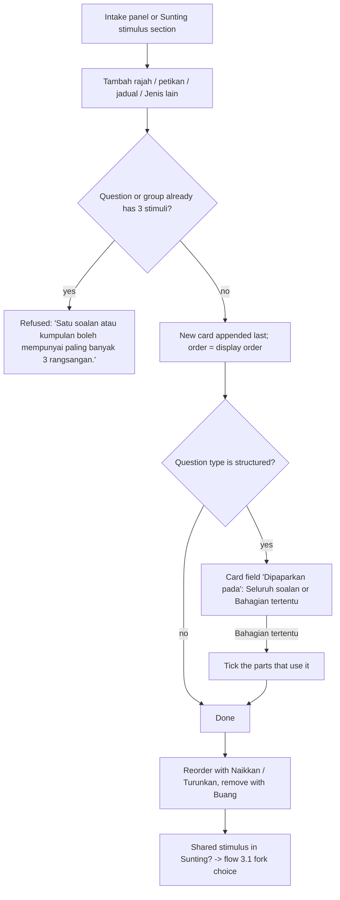
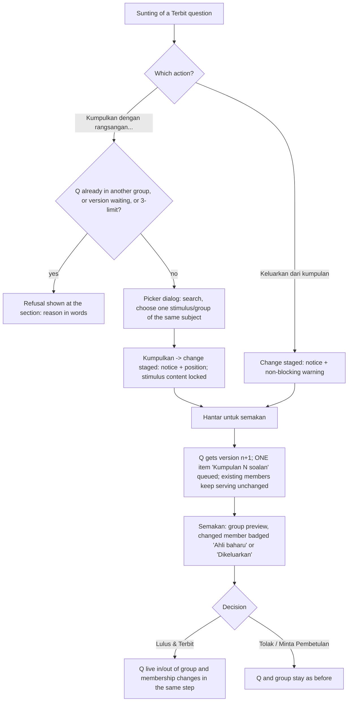
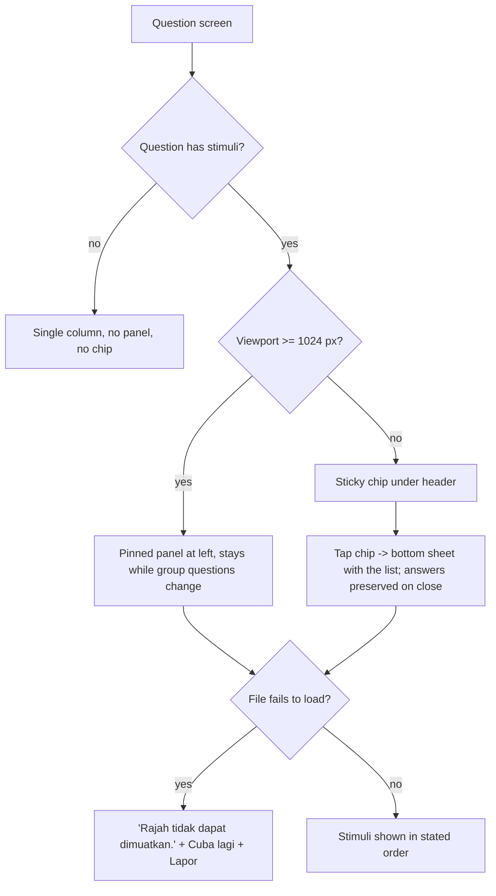

# v2 Shared stimulus: UX spec (fork choice, multiple and part-level stimuli, kinds, attach/detach, student pin)

| Field | Value |
|---|---|
| Slug | `v2-shared-stimulus` |
| Gate / task | G2 UX (ui-ux-designer). The data/API design is written in parallel by the solution-architect (`docs/architecture/v2-shared-stimulus.md`); this spec states the fields and rules the UI needs and does not decide storage. |
| Date | 2026-10-25 |
| Status | Proposed, for user approval at G2. Items marked **[PROPOSED]** are copy or behaviour with no old-system or earlier-spec source. Existing strings are kept letter for letter. |
| Requirements | `docs/requirements/v2-shared-stimulus.md` (US-01 to US-10, AC-01.x to AC-10.x; user decisions: pin breakpoint 1024 px, one reviewer) |
| Audit rows | FB-027, FB-028, FB-029, FB-030 (proposals P-027 to P-030 in `docs/qa/audit-sistem/FIXLOG.md`); FB-001/002/003/043/046 are delivered and must not regress |
| Code read | `m28-bijak-spm/admin/intake/components/QuestionEditor.vue`, `admin/intake/pages/IntakeReviewPage.vue`, `admin/papers/{BankEditPage,BankPage,ReviewItemPage,ReviewQueuePage,QuestionPreview}.vue`, `admin/papers/ui.ts` (`sharersText`), `admin/intake/domain/{grouping,validation}.ts`, `components/{StimulusView,AttemptShell,QuestionBlock}.vue`, `pages/AttemptPage.vue`, `src/ds/{DsDialog,DsFileField,DsPanel,DsEmptyState}.vue` |
| Format reference | `docs/design/v2-dskp-integration.md`, `docs/design/v2-question-bank.md` S3/S4 (stimulus, table, formula rules reused, not re-specified) |
| Language | Doc English; all UI strings Bahasa Melayu |

## 0. Rules this spec follows

1. **No new screen, route or module.** Every capability lives on a surface that already exists (section 1). The only overlay added is one picker dialog opened from the Sunting page (6.4); it is a `DsDialog` over the same page, not a screen. Decision D-1 asks the user to confirm it.
2. **Convert and fix, no redesign.** The Rajah dan petikan panel, the group header, the member checkbox list ("Soalan dalam kumpulan ini"), the sharer sentence, the chip "Kumpulan N soalan", the sticky chip + bottom sheet and the pinned panel keep their place and look. Changes are additions inside them.
3. **Existing components only** (section 2). No one-off colour, radius, font or shadow; no `border-*`/`ring-*` utilities in pages (design-system rule G-3b); layout utilities from the G-1 allowlist only. The local compositions named in 2.2 are assembled from DS and Nuxt UI parts and add no new DS primitive.
4. **Responsive at 375 / 768 / 1280 px**, no horizontal page scroll down to 320 px. Wide tables, formulas and code scroll inside their own container, never the page.
5. **Accessibility replicates live (D10)**: no enhancement beyond the DS baseline, plus the alt-text rule that the requirements add (AC-06.5). Sheet, chip and panel keep the existing attempt-shell keyboard behaviour.
6. **Copy is Bahasa Melayu**, exact strings in section 10. No real person names in any example.

## 1. Surfaces affected (all existing)

| # | Surface | Route / file | What changes | FB |
|---|---|---|---|---|
| S1 | Sunting soalan (bank edit of a Terbit question) | `/admin/spm/soalan/:qid/sunting`, `BankEditPage.vue` | Stimulus section becomes a list of 1-3 cards; fork choice; "Kumpulkan dengan rangsangan…" / "Keluarkan dari kumpulan"; part usage | 027, 028, 029, 030 |
| S2 | Semak Ekstrak and Tulis Soalan Manual | `IntakeReviewPage.vue` (panel `stimulus-panel`, question card select `q-stimulus`) | Every kind addable (also on the manual path, with image upload); 1-3 stimuli per group; part usage; ordering | 028, 029 |
| S3 | Ruang kerja semakan | `/admin/spm/semakan/:key`, `ReviewItemPage.vue` | One group item for "Ubah untuk semua", attach, detach; fork notice; before/after of the stimulus | 027, 030 |
| S4 | Baris Gilir Semakan, Bank Soalan SPM, Pratonton | `ReviewQueuePage.vue`, `BankPage.vue` (drawer), `QuestionPreview.vue`, paper preview | Several stimuli per question, part stimulus, sharers include parts, history lines | 027, 028, 029, 030 |
| S5 | Student attempt (Mod Peperiksaan and Mod Latihan) | `AttemptPage.vue`, `AttemptShell.vue`, `QuestionBlock.vue`, `StimulusView.vue` | Pinned panel / chip + sheet show the list; part stimulus; per-kind render; load failure | 028, 029 |
| S6 | Latih Tubi (practice drills) | uses the same attempt components | Shows all stimuli, not only the first (AC-10.9). No separate layout. | 028 |

Not touched: the paper builder (groups already move whole, AC-10.10), the extraction pipeline (AC-07.7 is a dependency), migration.

## 2. Components

### 2.1 Existing parts used

| Need | Part | Notes |
|---|---|---|
| Page frame, panels | `DsPage` (`layout="detail" width="wide"`), `DsPanel`, `DsStack`, `DsCluster`, `DsGrid`/`DsGridItem` | as the current pages |
| Field row | `DsFormField native` | label, hint, error, required |
| Selects (kind, usage) | `DsNativeSelect` | native `<option>`; 44 px |
| Text inputs | `UInput`, `UTextarea` | as the current stimulus fields |
| File upload | `DsFileField` (`variant="area"`, `preview="image"`, `accept`, `maxSizeMb`) | already refuses a file over the limit with "Fail melebihi saiz maksimum {n} MB." |
| Fork choice (two options, no default) | `URadioGroup` inside a `<fieldset>`/legend, items with `description` | already used in 18 files; items keep a 44 px hit area |
| Member / part checklists | `UCheckbox` | as today |
| Kind menu "Jenis lain" | `UDropdownMenu` | used by DS components and pages |
| Picker dialog | `DsDialog` (`size="md"`; modal from `sm`, bottom sheet below `sm`) | footer actions; Esc and scrim close it unless `loading` |
| Search field | `UInput` with leading icon `i-ph-magnifying-glass` | same control the bank search uses |
| Notices | `UAlert` (`variant="subtle"`), caption `DsText variant="caption"` | `role="status"` for non-blocking, `role="alert"` for refusals |
| Badges | `UBadge` (`variant="subtle"`, icon + word always) | never colour alone |
| Empty, error, loading | `DsEmptyState`, `DsLoadError`, `USkeleton` | existing patterns |
| Student chip, sheet | `UButton` (existing `stimulus-chip`), `UDrawer` (existing), `DsIconChip` (thumb icon tile) | unchanged |
| Rich text and formulas | `RichText` (`$latex$` spans, D41-2) | shared by admin preview and student |
| Figure, table, text, code, formula render | `StimulusView.vue` (module component) | **the single renderer** for admin preview, review, Pratonton and student (AC-06 "same renderer"); it is extended per kind (4.3), not duplicated |

### 2.2 Local compositions (module components, built only from 2.1)

| Name [PROPOSED] | Used by | Composition |
|---|---|---|
| `StimulusCard` | S1, S2 | `DsStack` + header row (label, kind badge, sharer badge, 3 icon buttons) + preview (`StimulusView`) + fields (4.1). One card per stimulus. |
| `StimulusForkChoice` | S1 | `DsPanel` + fieldset + `URadioGroup` (section 5.2) |
| `StimulusPicker` | S1 | `DsDialog` + search `UInput` + `URadioGroup` card list (section 6.4) |
| `StimulusStack` | S5, S4 | vertical list of `StimulusView` with the per-stimulus caption; used by the pinned panel, the sheet, Pratonton and Latih Tubi so all show the same list |
| `StimulusLoadFailure` | S5 | `UAlert` + two `UButton` (section 8.6) |

### 2.3 Not used
`USelectMenu`, `UTabs`/`UAccordion` for the stimulus list (stacking is simpler and nothing is hidden), any new modal besides 6.4, any drag-and-drop (reorder uses buttons, no pointer-only gesture).

## 3. Flows

### 3.1 Edit a shared stimulus: fork prompt (FB-027, US-01 to US-03)

```mermaid
flowchart TD
  A[Bank: Pratonton -> Sunting (versi baharu)] --> B{Version waiting for review?}
  B -- yes --> B1[Page locked, alert 'Versi baharu menunggu semakan']
  B -- no --> C[Edit page: stimulus cards + question editor]
  C --> D{Changed a stimulus field or the stimulus list?}
  D -- no --> H[Normal revision: only this question]
  D -- yes --> E{Stimulus used by N >= 2 sharers?}
  E -- no, N = 1 --> H
  E -- yes --> F[Fork choice block appears, nothing selected, Hantar untuk semakan disabled]
  F --> G{Choice}
  G -- Ubah untuk semua N soalan --> G1[Submit: N versions n+1, ONE review item 'Kumpulan N soalan']
  G -- Salin untuk soalan ini sahaja --> G2[Submit: new stimulus, this question n+1 leaves group, normal single review]
  G1 --> R1[Semakan: stimulus before/after once; Lulus & Terbit makes all N live together]
  G2 --> R2[Semakan: single question; info notice about the copy]
  G2 --> N{Original also used by other papers?}
  N -- yes --> N1[Notice 'Petikan telah dikemas kini...' + counts]
  H --> R3[Normal single review]
```

Refusal path: if any sharer already has a version waiting, the save is refused with "Sudah ada versi baharu menunggu semakan: {Soalan n}." naming that question; the choice block stays visible with the refusal in the gate alert.

### 3.2 Several stimuli and a part-level stimulus (FB-028, US-04, US-05)



### 3.3 Choose a stimulus kind (FB-029, US-06, US-07)

```mermaid
flowchart TD
  A[Add button or 'Jenis lain' menu] --> B[Card created with the chosen kind and default label word + number]
  B --> C[Jenis rangsangan select can change the kind]
  C --> D{Same field family?}
  D -- yes --> E[Content kept]
  D -- no --> F[Old content kept hidden in the draft, notice shown; reverting the kind restores it]
  E --> G[Kind-specific fields appear: 4.2]
  F --> G
  G --> H{Image-like kind?}
  H -- yes --> I[DsFileField upload + 'Teks alternatif (wajib)']
  H -- no --> J[Text / table / code / formula fields; alt not asked]
  I --> K{File type, size, readable image?}
  K -- no --> K1[Refusal message under the field, nothing stored]
  K -- yes --> L[Preview in the card via StimulusView]
  J --> L
```

### 3.4 Attach / detach on a Terbit question, with review (FB-030, US-09)



### 3.5 Student reads the pinned stimulus (FB-028, FB-029, US-10)



## 4. Shared pieces

### 4.1 Stimulus card anatomy (S1 and S2)

Root: `DsStack gap="sm"` inside the existing panel, `@container`, data-testid `stimulus-card` (S2, kept) and `edit-stimulus-card` (S1). Order of content, top to bottom (DOM = reading = tab order):

| # | Element | Control | Rule |
|---|---|---|---|
| 1 | Header row | `DsCluster justify="between"`: left `label` as bold text + `UBadge` kind (icon + word) + `UBadge` use ("Dikongsi oleh {N} soalan" / "Soalan ini sahaja" / "Baharu"); right three ghost icon `UButton` 44 px: up, down, bin | up disabled on the first card, down on the last; icon-only buttons carry the aria-labels in section 10 |
| 2 | Preview | `StimulusView` | shown when there is content (text, table, code, formula, image); otherwise a muted line "Tiada pratonton" (existing intake copy) |
| 3 | Jenis rangsangan | `DsNativeSelect` | options in section 4.2 |
| 4 | Label | `UInput` | default = kind word + running number ("Rajah 3"); editable; trimmed; must not be empty; descriptive text allowed ("Sajak 1", "E-mel 1" per AC-06.4) |
| 5 | Tajuk kapsyen | `UInput` | existing label, optional; placeholder = the default caption word for graf ("Graf") and peta ("Rajah"), empty for other kinds |
| 6 | Kind fields | see 4.2 | |
| 7 | Dipaparkan pada | `DsNativeSelect` + part checklist | only when the question type is structured with at least one part (US-05) |
| 8 | Member list (S2 only) | existing fieldset "Soalan dalam kumpulan ini" with `UCheckbox` per question | unchanged; see 4.4 for the new disabled reasons |

Layout of the card by container width (build against the container, not the viewport):

| Container | Layout |
|---|---|
| base (under `@md`, 448 px) | one column; header buttons stay on the right of the label row; badges wrap onto their own line |
| `@md` | one column; Jenis rangsangan and Label side by side (2 columns), everything else full width |
| `@2xl` (672 px) | two columns: preview on the left (5/12), fields on the right (7/12); the member list spans both under them |

Container width per host: S1 about 280 px at 375, about 650 at 768 (stacked), about 870 at 1280 (two columns). S2 extracted batch at 1280 is the 5/12 left column (about 480 px, `@md` layout); S2 manual path is full width (about 290 / 660 / 880 px). A card must be correct at 235 px (320 px viewport).

### 4.2 Kinds: offered list, field families, alt text, defaults

The select lists the kinds below (priority M, S, C of AC-06.1). Disabled kinds (audio, video) are not listed. The option text is also the default label word.

| Option text (and default label word) | Old kind | Field family | Renders as | Alt text |
|---|---|---|---|---|
| Petikan | passage | text | rich-text block; source line under it | not asked |
| Bahan | box | text | same as Petikan inside a boxed panel (Q1 default) | not asked |
| Jadual | table | table | table or table image | asked only in "Imej jadual" mode |
| Rajah | diagram | image | figure | required |
| Graf | graph | image | figure, caption default "Graf" | required |
| Gambar | image | image | figure | required |
| Infografik | infographic | image | figure | required |
| Peta | map | image | figure, caption default "Rajah" | required |
| Kartun | cartoon | image | figure | required |
| Kod | code, pseudocode, sql | code | monospaced block | not asked |
| Formula | math | formula | formula block | not asked |

Field families (rows 6 in the card):

| Family | Fields (labels in section 10) | Notes |
|---|---|---|
| text | "Teks petikan" (`UTextarea`, 4 rows) ; "Sumber petikan" (`UInput`, optional) | the existing field "Teks alternatif (wajib)" is no longer shown for text (AC-06 table); the source line is stored and printed under the text |
| table | Mode selector (two `UButton` toggles in a group: "Jadual teks", "Imej jadual"). "Jadual teks": grid editor with header cells and row cells (`UInput` per cell), "Tambah lajur", "Tambah baris", per-row and per-column bin buttons. "Imej jadual": image fields below | grid editor sits in an `overflow-x-auto` container (own scroll, never the page); each cell input is at least 8rem wide so it stays usable at 375 |
| image | "Imej rangsangan" (`DsFileField` area, preview shown), after a file exists the area shows the thumbnail and a "Ganti imej" button; "Teks alternatif (wajib)" with hint | alt is never prefilled; empty or whitespace is invalid |
| code | "Jenis kod" (`DsNativeSelect`: Kod, Pseudokod, SQL; choosing sets the label word, label stays editable) ; "Teks kod" (`UTextarea`, 6 rows) | no syntax colour; the renderer keeps spaces and line breaks and scrolls inside its own container |
| formula | "Formula" (`UTextarea`, 3 rows) with the hint on `$...$`; live preview in the card preview slot | MathML baking is not replicated |

Changing the kind (flow 3.3):
- same family (for example Rajah to Graf, Petikan to Bahan): nothing is lost, label word is **not** rewritten if the admin already edited the label.
- different family: the old family's content stays in the draft but is hidden; a caption under the select (`role="status"`, info icon): "Kandungan jenis sebelumnya akan dibuang apabila disimpan." Changing back restores it. Validation of the new kind runs before save (AC-06.8).

Defaults and validation messages are in section 10. Each message is shown in the gate list in the format "{label}: {message}" (the intake validator already does this, AC-04.7).

### 4.3 Renderer behaviour (one component, all kinds, all widths)

`StimulusView` keeps its root `<figure>`, caption line "{label} · {caption}" and `thumb` mode. Additions:

| Kind family | Normal render | `thumb` (48 px slot of the sticky chip, below 1024 px) |
|---|---|---|
| image (incl. inline vector) | scales to the container width (`max-w-full`, no fixed height; `max-w-md` kept for inline vector); the figure is a button that opens the enlarged view (`DsDialog size="lg"`, the figure at full width, title = label, one "Tutup" button; QB AC-24.3) | the image shrinks into the 48 px slot (existing behaviour for diagrams) |
| text | `bg-elevated` block as today; source line under the text in caption size, muted | icon tile (`DsIconChip` `file-text`, existing) |
| table | `overflow-x-auto` container (region rules of QB design S3) | icon tile `table` (existing) |
| code | block with `overflow-x-auto`, spaces preserved, label as caption | icon tile `file-text` |
| formula | block, display math centred, `overflow-x-auto` (QB design S4) | icon tile `file-text` |

A figure whose file fails to load swaps the figure for `StimulusLoadFailure` (8.6). The caption line shows `label`, then ` · caption` when a caption exists; for Graf with no caption it shows ` · Graf`, for Peta ` · Rajah`.

### 4.4 Group membership rules shown in the UI (S2)

The member list is unchanged ("Soalan {label}" per question). Disabled states and their suffix, in this priority order (first match wins):

| Case | Suffix on the label | Source |
|---|---|---|
| Question is already in a different group of two or more questions | " (dalam kumpulan lain)" | existing |
| Question already has 3 stimuli (group stimuli plus its own plus part stimuli) | " (sudah ada 3 rangsangan)" [PROPOSED] | AC-04.3 |

A stimulus with exactly one member is "Soalan ini sahaja" and is not a group; a question may be in one group of two or more questions and also have its own single-member stimuli, up to 3 in total. A group has an ordered list of 1-3 stimuli shared by all its members (AC-04.5). In the panel the cards of one group follow each other and share one member list, shown once under the **last** card of the group; the earlier cards of that group show the caption "Ahli sama dengan {label of the last card}" [PROPOSED] instead of repeating the list. The link-style button "Tambah rangsangan kepada kumpulan ini" is also on the last card only, and is hidden when the group already has 3 stimuli. Contiguity, renumbering and the validator text "Soalan dalam satu kumpulan mesti berturutan." are unchanged (AC-07.8).

> Architect check needed: this grouping presentation assumes group = ordered stimuli + one member list, and "own" stimuli = a stimulus used by one question. If the data model differs, only 4.4 changes.

## 5. S1 Sunting soalan (BankEditPage)

Page structure stays: `DsPage layout="detail" width="wide"` with panels `edit-meta`, [locked alert], **stimulus panel**, `edit-question`, note panel, gate alert, actions. Order of the new parts inside the page:

1. Stimulus panel `edit-stimulus` (legend, intro line, staged-change notices, cards, add buttons).
2. **Fork choice block** (only when required, 5.2) directly below the stimulus panel and above `edit-question`, so it sits next to what caused it. It is also the last thing announced before the gate alert.
3. Question editor, note, gate alert, actions (unchanged; the primary button keeps the label "Hantar untuk semakan").

### 5.1 Stimulus panel

Legend (DsText `subheading`): "Rajah dan petikan". Under it a caption line:
- when the question has a shared stimulus: the sharer sentence of FB-002 (first sentence only, 5.2 explains why), e.g. "Rajah 1 dikongsi oleh 4 soalan: Soalan 1, 2 (soalan ini), 3, 4." For more than 12 names show the first 12 then "dan {n} lagi" and a link-style button "Tunjuk semua" (AC-01.5 needs all N names; the button reveals them) [PROPOSED].
- when it has several stimuli: "Rangsangan dipaparkan mengikut susunan ini." [PROPOSED]

Below: the cards (4.1), then the add row.

Add row (one `DsCluster`, wraps): `UButton` "Tambah rajah", "Tambah petikan", "Tambah jadual" (outline, neutral, `size="sm"` with `min-h-11`), then a `UDropdownMenu` trigger "Jenis lain" with items Graf, Gambar, Infografik, Peta, Kartun, Bahan, Kod, Formula. A caption below: "Rangsangan baharu hanya untuk soalan ini." [PROPOSED] (D-3). At the limit the buttons stay enabled; pressing one shows, under the row, `role="alert"`: "Satu soalan atau kumpulan boleh mempunyai paling banyak 3 rangsangan." and adds nothing.

Group actions row (right of the legend from `@md`, below it at base), shown only for a Terbit question:
- not in a group: "Kumpulkan dengan rangsangan…" (outline, `i-ph-link`).
- member of a group: "Keluarkan dari kumpulan" (outline neutral, `i-ph-link-break`).
Both `min-h-11`. Refusal reasons (AC-09.5) are shown in a `UAlert` (`color="warning"`, `role="alert"`) directly under this row, not as a tooltip.

### 5.2 Fork choice block (`StimulusForkChoice`)

Appears when **all** hold: the question is in a stimulus used by N >= 2 sharers (questions or parts), and at least one stimulus field or the stimulus list differs from the live version. It disappears again when the admin reverts the change (the choice is cleared). It never appears for N = 1 or for a question-only edit (AC-01.3, AC-01.4). If several shared stimuli changed, one block per changed stimulus is shown (each with its own N and label), stacked.

Anatomy (`DsPanel` > `fieldset` > legend):

```
+--------------------------------------------------------------+
| Rajah 1 dikongsi oleh 4 soalan: Soalan 1, 2 (soalan ini),    |   <- caption, FB-002 first sentence
| 3, 4.                                                        |
| Pilih cara perubahan ini digunakan *                         |   <- legend (required star)
| ( ) Ubah untuk semua 4 soalan                                |   <- radio 1, min-h 44
|     Perubahan di sini terpakai untuk semua soalan tersebut.  |
|     Semua 4 soalan mendapat versi baharu dan disemak         |
|     bersama.                                                 |
| ( ) Salin untuk soalan ini sahaja                            |   <- radio 2, min-h 44
|     Hanya soalan ini mendapat versi baharu dan keluar        |
|     daripada kumpulan. 3 soalan lain tidak berubah.          |
+--------------------------------------------------------------+
```

Behaviour:
- Neither radio is selected on first render and when the block reappears (AC-01.2). No default, no remembered choice.
- While unselected, "Hantar untuk semakan" is disabled and the gate alert lists "Pilih sama ada mengubah untuk semua soalan atau menyalin untuk soalan ini sahaja." (counted in "n perkara perlu dibaiki sebelum dihantar").
- The second sentence of FB-002 ("Perubahan di sini terpakai untuk semua soalan tersebut.") appears only in the description of option 1, never as a standing sentence above the choice (requirement section 3 and AC-01.5).
- N in the labels is the live sharer count including this question and parts that use the stimulus; the names list shows parts as "Soalan 6 (b)" (AC-05.5).
- After choosing "Salin untuk soalan ini sahaja" the stimulus cards that were shared show the badge "Salinan baharu" instead of "Dikongsi oleh {N} soalan" (the edit becomes a private copy), and the sharer caption in 5.1 is replaced by "Salinan untuk soalan ini sahaja. Kumpulan asal tidak berubah." [PROPOSED].
- Fork notice after submit (AC-03.4): when the original stimulus is also used by M >= 1 papers, the success flash after "Hantar untuk semakan" is followed, on the same redirect, by an `info` flash with the verbatim sentence "Petikan telah dikemas kini. Ia dikongsi dengan kertas lain, jadi satu salinan dibuat untuk kertas ini sahaja." and the line "Masih digunakan oleh {M} kertas dan {K} soalan lain." [PROPOSED]. The same two sentences stay as a persistent `UAlert` (info) in the review item (S3) and as the note of the history entry, because a flash disappears. The word "Petikan" and "kertas ini" are the old wording, kept verbatim even for a figure (see requirement section 8, D-5).

### 5.3 Staged attach / detach (FB-030)

Staging means the change is held in the page like any other edit and is saved only by "Hantar untuk semakan".

| Action | UI after the admin confirms | Rules |
|---|---|---|
| Attach (picker "Kumpulkan") | A `UAlert` (info, `role="status"`) at the top of the stimulus panel: "Soalan ini akan menyertai {label} selepas versi baharu diluluskan. Kedudukan dalam kumpulan: {n} (terakhir)." and a ghost button "Batalkan perubahan kumpulan". The group's stimulus cards appear below it in the stated order; each card has the badge "Dikongsi oleh {N+1} soalan" (the badge "Ahli baharu" is only for the reviewer, S3). | Cards of the group are read-only in this save (fields disabled, up/down/bin hidden). A caption says "Kandungan rangsangan kumpulan tidak boleh disunting dalam versi yang sama dengan perubahan kumpulan." [PROPOSED]. The question's own stimuli stay editable. The group is not a candidate if it would make the total exceed 3 (AC-09.5). |
| Detach ("Keluarkan dari kumpulan") | `UAlert` (info): "Soalan ini akan dikeluarkan daripada {label} selepas versi baharu diluluskan." plus a second `UAlert` (warning, icon `i-ph-warning`, non-blocking): "Semak sama ada soalan ini masih boleh dijawab tanpa rangsangan." and the ghost button "Batalkan perubahan kumpulan". The group's cards are shown greyed (disabled) with the badge "Akan dikeluarkan". | A detached question keeps no group stimulus (AC-09.4). Own stimuli stay. The warning never blocks submit. |

No fork choice is shown in a save that only attaches or detaches (nothing in the group's content changes; the other members keep serving unchanged, AC-09.2). Attach or detach together with an edit of the group's stimulus content is prevented by the lock above, so the two choices never combine.

### 5.4 States of S1

| State | What the admin sees | Notes |
|---|---|---|
| Loading | `DsPage` skeleton: existing behaviour (page content appears when `data` arrives). Inside the stimulus panel while the picker list loads: 3 `USkeleton h-11` rows in the dialog, `aria-busy="true"` | no layout jump beyond the panel appearing |
| Load error | `DsLoadError` "Tidak dapat memuatkan soalan untuk disunting." with "Cuba Semula" (existing) | |
| Empty (question has no stimulus) | `DsText muted` "Tiada rajah atau petikan." then the add row and, for a Terbit question, "Kumpulkan dengan rangsangan…" | the panel is always rendered now (today it is hidden when there is no stimulus) |
| Filled, single own stimulus | one card, badge "Soalan ini sahaja"; no fork choice ever | AC-01.4 |
| Filled, shared (N >= 2) and untouched | cards + sharer caption; no choice | AC-01.3 |
| Filled, shared and edited | fork choice block appears, submit disabled until chosen | 5.2 |
| 2 or 3 stimuli (old data) | all cards shown and editable; saving never drops one | AC-04.4 |
| Staged attach / detach | alert + undo, group cards locked | 5.3 |
| Upload in progress | `DsFileField` shows its own progress; the card's Hantar stays disabled with gate line "{label}: Imej sedang dimuat naik." [PROPOSED] | |
| Upload refused | message under the field (section 10), field stays empty; gate lists "{label}: Kandungan rangsangan diperlukan." | AC-07.3, AC-07.4 |
| Server refusal | gate alert lists the server message, e.g. "Sudah ada versi baharu menunggu semakan: Soalan 3." | AC-01.7 |
| **Read-only: version waiting** | the existing `edit-locked` alert; every fieldset is `disabled` (cards, add row, choice, group buttons); no cards can be added | existing lock extended to the new controls |
| **Read-only after publish** | the live version is never edited in place: the page always works on version n+1 ("Versi baharu: v{n}"); the live version is read from the bank drawer (S4) | AC for Terbit questions |
| Success | existing flash "Versi baharu dihantar untuk semakan. Versi semasa terus melayani pelajar." then redirect to the bank with the drawer open | plus the fork flash (5.2) when it applies |

### 5.5 Wireframes (S1)

375 px (single column; container about 280 px):

```
+-----------------------------------+
| < Bank Soalan SPM                 |
| Sunting soalan                    |
| [Terbit] SPM-0412 Fizik . K1 ...  |
| [Versi baharu: v3]                |
+-----------------------------------+
| Rajah dan petikan                 |
| Rajah 1 dikongsi oleh 4 soalan:   |
| Soalan 1, 2 (soalan ini), 3, 4.   |
| [Keluarkan dari kumpulan]         |
|                                   |
| Rajah 1  [Rajah] [Dikongsi 4]     |
|                       [^] [v] [x] |
| +-------------------------------+ |
| |        (figure)               | |
| +-------------------------------+ |
| Jenis rangsangan                  |
| [Rajah                       v]   |
| Label                             |
| [Rajah 1                      ]   |
| Tajuk kapsyen                     |
| [                             ]   |
| Imej rangsangan                   |
| [ drop zone / thumbnail       ]   |
| Teks alternatif (wajib)           |
| [                             ]   |
| Petikan 2 ... (second card)       |
|                                   |
| [Tambah rajah] [Tambah petikan]   |
| [Tambah jadual] [Jenis lain  v]   |
| Rangsangan baharu hanya untuk     |
| soalan ini.                       |
+-----------------------------------+
| Pilih cara perubahan ini          |
| digunakan *                       |
| ( ) Ubah untuk semua 4 soalan     |
|     Perubahan di sini ...         |
| ( ) Salin untuk soalan ini sahaja |
|     Hanya soalan ini ...          |
+-----------------------------------+
| (question editor, note, gate)     |
| [Batal]  [Hantar untuk semakan]   |
+-----------------------------------+
```

768 px: same order, single column. Differences: the group action buttons sit on the right of the legend row; in a card Jenis rangsangan and Label are side by side; add buttons fit on one row; actions row right-aligned.

1280 px (container about 870 px): card in two columns (preview left, fields right); the member badges inline with the label; the fork choice block full width of the page column with the two radios stacked (their descriptions are short, no side-by-side layout).

```
| Rajah dan petikan                         [Keluarkan dari kumpulan] |
| Rajah 1 dikongsi oleh 4 soalan: Soalan 1, 2 (soalan ini), 3, 4.     |
| +-----------------------+------------------------------------------+
| | Rajah 1 [Rajah] [Dikongsi oleh 4 soalan]            [^] [v] [x]  |
| | (figure preview)      | Jenis rangsangan  | Label                |
| |                       | Tajuk kapsyen                            |
| |                       | Imej rangsangan                          |
| |                       | Teks alternatif (wajib)                  |
| +-----------------------+------------------------------------------+
| [Tambah rajah] [Tambah petikan] [Tambah jadual] [Jenis lain v]      |
```

Native `<option>` lists open as the browser's own sheet on touch devices; no custom popover is added.

## 6. S2 Semak Ekstrak and Tulis Soalan Manual (IntakeReviewPage)

### 6.1 Stimulus panel

Panel `stimulus-panel`, legend "Rajah dan petikan" and the intro line "Satu rajah disimpan sekali. Pilih soalan yang berkongsinya; soalan itu kekal berturutan." are unchanged. What changes:

1. Cards use the anatomy of 4.1 (kind select, label, family fields, usage, member list).
2. The add row is the same row as S1 (5.1): "Tambah rajah", "Tambah petikan", "Tambah jadual", "Jenis lain". **"Tambah rajah" now also appears on the manual path** (today it is hidden when `isManual`). On the manual path "Tambah rajah" creates an image-family card with the upload field (AC-07.2). On an extracted batch it creates a card linked to the page region as today (page preview shown, existing `previewImage`); the upload field is available there too, to replace a poor crop.
3. A group can hold up to 3 stimuli: the last card of a group has the link button "Tambah rangsangan kepada kumpulan ini" (4.4). Reorder with the up/down buttons (order of cards = display order).
4. Limit refusal and the `group-note` status line behave as before; the limit message is the one in section 10.

Layout: extracted batch at 1280 is the left column (5/12): cards use the `@md` card layout (a long column of cards inside the existing panel; the page does not scroll sideways). At 768 and 375 the panel is under the "Sumber" tab (extracted) or above the questions (manual) as today.

### 6.2 Question card

- The header badge `stimulus label` (one `UBadge`) becomes one badge per stimulus, wrapping, in order; a part-level one reads "{label} ({part label})" [PROPOSED].
- The select "Rajah / petikan dikongsi" (`q-stimulus`) becomes a repeatable row (`DsCluster`, `max-w-sm` each): select with "Tiada" + the stimuli, and a 44 px bin button "Buang {label}" per row; below it the ghost button "Tambah rangsangan" while fewer than 3 rows exist. Changing a row uses the existing `quickAttach` messages (`group-note`). The member checklist and this select stay in sync.
- The group header (`group-header`) shows all stimuli of the group in order, each once (`StimulusView`), with the heading "{label 1}, {label 2} · Soalan {a} - {b} berkongsi rajah ini" using the existing `groupLabel` and kind word (the kind word is a data lookup of the 11 kinds, lower case: rajah, petikan, jadual, bahan, graf, gambar, infografik, peta, kartun, kod, formula; two kinds in one group read "rangsangan ini" [PROPOSED]).

### 6.3 Part usage (US-05)

In the stimulus card, row 7: `DsNativeSelect` "Dipaparkan pada" with "Seluruh soalan" and "Bahagian tertentu". Choosing the second reveals a fieldset (legend "Bahagian yang menggunakan rangsangan ini") with a `UCheckbox` per part of the question that the card belongs to, labelled with the part label ("(a)", "(b)(i)"). A stimulus can be ticked on several parts of the same question (AC-05.2). Each part in `QuestionEditor` shows, under its prompt, a caption `DsText caption muted`: "Rangsangan: {label}" (read-only trace; the edit happens in the card). If the question has no parts the select is not rendered.

### 6.4 Picker dialog (S1 only, used by "Kumpulkan dengan rangsangan…")

`DsDialog size="md"` (modal from 640 px, bottom sheet below). Title "Kumpulkan dengan rangsangan", description "Pilih rangsangan sedia ada untuk subjek ini. Soalan ini menjadi ahli kumpulannya." Body:

```
[Q  Cari label, kapsyen atau teks      ]   <- UInput, aria-label "Cari rangsangan"
( ) [thumb] Teks 2 . Petikan      3 soalan
            "Baca petikan di bawah ..."
( ) [thumb] Rajah 5 . Rajah       4 soalan
( ) [thumb] Rajah 7 . Rajah       2 soalan
            Sudah ada versi baharu menunggu semakan: Soalan 14.   <- disabled row, reason in words
...                                         (list scrolls inside, max-h-96)
                          [Batal]  [Kumpulkan]
```

- Rows: `URadioGroup` (card variant), min height 44 px, meta line "{N} soalan"; the thumb is `StimulusView thumb`; the snippet is the first 80 characters of text, caption, or alt.
- Only same-subject stimuli with at least one live sharer other than this question are listed (A3, AC-03.6). The group of the question's own copy is not listed.
- A row that cannot be chosen is disabled and prints the reason under the label: "Sudah ada versi baharu menunggu semakan: {Soalan n}." or "Satu soalan atau kumpulan boleh mempunyai paling banyak 3 rangsangan."
- "Kumpulkan" is disabled until a row is chosen. Confirming closes the dialog and stages the change (5.3); focus returns to the "Kumpulkan dengan rangsangan…" button, which stays disabled until the staged change is cancelled with "Batalkan perubahan kumpulan".
- States: loading (3 skeleton rows), error (`DsLoadError` "Tidak dapat memuatkan senarai rangsangan." with "Cuba Semula"), empty ("Tiada rangsangan lain untuk subjek ini."), no match (`DsEmptyState filtered` "Tiada rangsangan dijumpai" with the standard "Set Semula" that clears the search).
- At 375 the dialog is the bottom sheet (`DsDialog` below `sm`), footer buttons stacked full width; at 768 and 1280 a modal of `sm:max-w-lg`.

### 6.5 Upload and refusal copy (US-07)

The `DsFileField` hint under the drop zone: "Muat naik fail imej. Had saiz: {n} MB." [PROPOSED; type list and limit = open question Q2 of the requirements, the number comes from the old handler]. Refusals appear under the field, `role="alert"`, and nothing is stored:

| Case | Message |
|---|---|
| Too large | "Fail melebihi saiz maksimum {n} MB." (existing `dsCopy.fileTooLarge`) |
| Type not allowed | "Jenis fail tidak dibenarkan. Gunakan {senarai jenis}." [PROPOSED] |
| Not readable as an image | "Fail ini tidak dapat dibaca sebagai imej." [PROPOSED] |

The preview never executes anything inside an uploaded vector file (security requirement AC-07.4): the preview is an image element, never inlined markup.

### 6.6 States of S2

| State | Behaviour |
|---|---|
| Loading | existing `DsStateView` skeleton |
| Error | existing "Tidak dapat memuatkan kumpulan ekstrak." |
| Empty (no stimulus in batch) | existing line "Tiada rajah atau petikan." and the add row |
| Filled | cards in order; group headers above member questions |
| Read-only (batch in Semakan or beyond) | the existing `fieldset disabled` and the existing alert "Kumpulan ini kini dalam status Semakan dan tidak boleh disunting..."; add row, up/down/bin and uploads are disabled |
| Upload / save failure | the existing save status text "Gagal menyimpan"; the card keeps its content |

### 6.7 Behaviour at 375 / 768 / 1280 (S2)

| Part | 375 | 768 | 1280 |
|---|---|---|---|
| Extracted batch | "Sumber" tab holds the page and the stimulus panel; cards at base layout; the add row wraps to two lines | same single column; cards at `@md` | two columns, stimuli under the page image in the left column; cards at base or `@md`; questions on the right |
| Manual path | panel above the questions, base layout | `@md` layout | full width, `@2xl` two-column card |
| Question card select rows | stacked, bin button on the right | same | same |
| Wide table editor / code | scrolls inside its own container | same | same |

## 7. S3 Ruang kerja semakan (ReviewItemPage)

The page keeps its order: `review-meta`, reason, `revision-diff`, `revision-full-note`, group note, sharers alert, `QuestionPreview`, gate, history, sticky decision bar. Additions:

### 7.1 "Ubah untuk semua N soalan" item (US-02)

- Title area: the queue and the meta heading show the existing group style; the badge row reads "Kumpulan N soalan" (existing queue badge).
- The group note (`group-note`, "Keputusan ini terpakai untuk semua {N} soalan dalam kumpulan rangsangan.") now also shows for revision items (today it is hidden when `isRevision`). N is the true member count (AC-02.2).
- The sharer alert (`revision-sharers`) with the FB-002 sentence stays.
- **Stimulus before/after**, shown once, in two `DsPanel`s side by side from `md` (same grid as `revision-diff`, `grid gap-4 md:grid-cols-2`), stacked below `md`: headings "Rangsangan sebelum (versi {n-1})" and "Rangsangan selepas (versi {n})" [PROPOSED], each rendering the stimulus list with `StimulusStack`. Only stimuli that differ get a `UBadge` "Diubah".
- Stem diffs: the existing `revision-diff` panels are kept for the question(s) whose own text changed, with the heading prefixed by the question ("Soalan 2: Versi 2 (sedang melayani pelajar)"). A question in the unit whose own text did not change shows no diff, only its preview.
- Member list for large groups: `QuestionPreview` renders every member today. For a unit of more than 5 members the page renders the first 5 previews and a ghost `UButton` "Tunjuk semua soalan ({N})" that renders the rest; the button then reads "Sembunyikan soalan". Above the list, `DsCluster` of `UBadge`s "Soalan {n}" for all members (wraps) so the reviewer always sees the whole membership (up to 76) without scrolling through previews [PROPOSED, risk R2].
- Decision: unchanged buttons "Tolak", "Minta Pembetulan", "Lulus & Terbit". All N versions go live in one step or none (AC-02.3). Success flash for a unit: "{N} soalan diluluskan dan diterbitkan." [PROPOSED]; single-question flash unchanged. If the atomic approval fails, the page keeps the item and lists "Kumpulan tidak dapat diluluskan. Tiada soalan diubah." in the gate panel [PROPOSED].
- History list: one line per affected question gets the same note; the review history shows "Kumpulan N soalan" as the action text for the unit entry [PROPOSED].

### 7.2 Fork item

- A single-question item (not a group). A `UAlert` (info, `i-ph-copy`) under the meta panel, title "Salinan untuk soalan ini sahaja", description: "Petikan telah dikemas kini. Ia dikongsi dengan kertas lain, jadi satu salinan dibuat untuk kertas ini sahaja." followed by "Masih digunakan oleh {M} kertas dan {K} soalan lain." The second line is omitted when M = 0 (the sentence is only for the case the original is used by papers, AC-03.4). The sharers alert is not shown (the question left the group).
- The before/after stimulus panels of 7.1 are used for the copy as well.

### 7.3 Attach and detach items (US-09)

- Unit "Kumpulan {N+1} soalan" (attach) or the remaining-members unit plus the leaving question (detach).
- Under the meta panel a `UAlert` (info): attach title "Soalan menyertai kumpulan", description "Soalan {n} ditambah ke {label}. Ahli sedia ada tidak berubah."; detach title "Soalan dikeluarkan daripada kumpulan", description "Soalan {n} dikeluarkan daripada {label}. Ahli lain kekal."
- In the preview list the changed member's `DsPanel` has a heading badge: `UBadge color="primary"` "Ahli baharu" (attach) or `UBadge color="warning"` "Dikeluarkan" (detach), each with an icon and the word; the member is moved to its stated position (attach: last). A short caption under the group stimulus: "Kedudukan dalam kumpulan: {n}." Existing members show no badge.
- Detach with a stem that may depend on the stimulus: the warning from 5.3 is repeated as a `UAlert` (warning) in this item "Semak sama ada soalan ini masih boleh dijawab tanpa rangsangan." Never blocks the decision.

### 7.4 States of S3

| State | Behaviour |
|---|---|
| Loading | existing |
| Error | `DsLoadError` "Tidak dapat memuatkan item semakan." (existing) |
| Pending (status Semakan) | all of the above; sticky decision bar |
| Decided (Terbit / Ditolak / Betulkan) | read-only: no decision bar for Terbit; the existing "Hantar semula untuk semakan" for the others; the history shows the decision. The "Diubah"/"Ahli baharu" badges stay for traceability |
| Stale (a sharer got another version meanwhile) | server refuses with "Sudah ada versi baharu menunggu semakan: {Soalan n}." in the gate panel |

### 7.5 Behaviour at 375 / 768 / 1280 (S3)

| Part | 375 | 768 | 1280 |
|---|---|---|---|
| Before/after stimulus | two panels stacked (sebelum above selepas) | two columns | two columns |
| Member badge cluster | wraps over several lines | wraps | wraps |
| Previews | one column | one column | one column (the page is a single wide column) |
| Decision bar | existing: Tolak and Minta Pembetulan share a row, Lulus & Terbit full width below | 3 columns | 12-column placement as today |

## 8. S4 and S5

### 8.1 S4 Pratonton, Bank drawer, Baris Gilir Semakan, paper preview

- **Bank list and drawer:** the chip "Kumpulan N soalan" is shown for N >= 2 sharers where a part counts as a sharer (AC-08.2). "Dikongsi dengan:" lists siblings as today; a part sharer reads "Soalan 6 (b) · {id}". The `QuestionPreview` header line is "Rangsangan dikongsi oleh {N} soalan" (existing) and now covers a list.
- **QuestionPreview:** the stimulus `DsPanel` renders `StimulusStack` (the 1-3 question/group stimuli, each once, in order, each with its caption line and, for text, the source line). Part stimuli print under the part prompt, before the part's scheme, with the caption "Untuk bahagian {part label}" (AC-05.3). Loading and failure of a figure use the same `StimulusLoadFailure` (8.6), without the "Lapor" button on admin pages (the admin has the Laporan Soalan list).
- **History lines** (Sejarah versi / Sejarah) get action texts written by the server: "Disalin untuk soalan ini sahaja", "Disertakan ke kumpulan", "Dikeluarkan daripada kumpulan", "Kumpulan N soalan diluluskan" [PROPOSED], with the note "Ahli: Soalan 1, 2, 3, 4" listing members (AC-02.5, AC-09.8). Long lists wrap.
- **Queue rows:** no new column or filter. A group item keeps the existing badge "Kumpulan {n} soalan" and "Versi {n}".

Responsive: the drawer is `USlideover` (`max-w-2xl`; full width at 375); stimulus blocks scroll inside their own containers; at 768 and 1280 the stimulus panel sits above the questions in a single column, as today.

### 8.2 S5 Student attempt: layout by width (pin breakpoint 1024 px)

The existing `AttemptShell` already pins at `lg` (1024 px). This is the decided breakpoint (user decision) and matches FB-043. The v2 documents that say 1280 (Bijak AC-07.1, NFR-01, design S3) are updated to 1024 px when this spec is approved (D-4).

| Viewport | Stimulus placement | Question column | Question map |
|---|---|---|---|
| 375 px | sticky chip full width under the header (`bg-default`, `py-2`); tap opens the bottom sheet (`UDrawer`) | single column, `px-3` | in the footer "Peta n/m" sheet (existing) |
| 768 px | same as 375 (chip + sheet): the pin is **not** used below 1024 | single column, `px-6`; the sheet shows figures at `max-w-md`, text full width | footer sheet |
| 1024 to 1279 px | pinned panel, left 4/12 (about 300 px), scrolls inside itself; chip hidden | middle 5/12 (about 400 px) | right 3/12 rail |
| 1280 px | pinned panel left 4/12 (about 380 px) | middle 5/12 (about 480 px) | right 3/12 rail |

Panel behaviour (>= 1024 px):
- The aside (`aria-label` "Rajah kekal dipapar", existing) holds `StimulusStack`. Inside the sticky wrapper the content has its own vertical scroll; its maximum height equals the visible height of the attempt scroll area minus the top padding, so a tall passage never hides its end below the footer. (Mechanism left to the developer; the shell already writes `scrollPaddingTop` from script, so a measured value from the same place is acceptable.)
- The panel is keyed by the group, not by the question: moving between questions of one group keeps the panel and its scroll position; moving to a question with a different or no stimulus swaps or removes it (the grid changes `col-span-5` to `col-span-9` as today). Pinning works per group, and per question for own stimuli, not per section (AC-10.4).
- Tables and formulas wider than the panel scroll inside their own container.

Chip and sheet (< 1024 px):
- Chip: existing button `stimulus-chip` with the 48 px thumb of the first stimulus and the label text `text-label`. One stimulus: "Lihat {label}". Two or three: "Lihat {label 1}, {label 2}" (and ", {label 3}"), one line, `truncate`. Part stimuli are included after the question/group ones.
- Sheet: existing `UDrawer`. Title = the labels joined with ", " (for one stimulus, the label); description unchanged: "Rajah kekal boleh dibuka semasa menjawab." Body = `StimulusStack`. Closing the sheet never touches answers (AC-10.2).
- The sticky strip height stays about 70 px; the FB-046 clearance (`scroll-padding-top` 5 rem) is unchanged, so a focused field is never hidden by the chip.

### 8.3 `StimulusStack` (what is shown and in which order)

1. The stimuli of the question or group, in the stated order (1 to 3).
2. Then, for a structured question, the stimuli that parts use, in part order, each preceded by a caption line "Untuk bahagian {label}" (`DsText caption muted`).
3. A stimulus used by several parts is shown once, with "Untuk bahagian (a), (b)" listing them.
4. The total is at most 3 (AC-04.3), so the stack is short; stimuli are stacked with `gap` 4 and separated by whitespace only (no lines).

Showing part stimuli for the whole question (instead of only while a part is current, AC-10.6) is the recommended default; see open question U-2.

### 8.4 Question block

- Group member heading: "Soalan 6 · berdasarkan Rajah 2" (existing). With two or three group stimuli: "berdasarkan Rajah 2 dan Teks 3" ("dan" between the last two, commas before) [PROPOSED].
- A part with its own stimulus shows a caption under its prompt "berdasarkan {label}" (existing wording).
- Latih Tubi (S6): the same `StimulusStack` is used, so all stimuli show, not only the first (AC-10.9). Jana Kertas / set builder include groups whole (AC-10.10), no UI change.

### 8.5 Kinds on the student side (AC-06.1, AC-06.7)

Rendering rules of 4.3 apply. Figures scale to the width of the panel or sheet and open an enlarged view on tap (`DsDialog size="lg"`, "Tutup"), the question stays mounted behind it. Alt text is not shown visually unless the image fails; then the alt text replaces the image inside the failure block (8.6). Code and formula blocks scroll inside their container; the page never scrolls sideways at 320 px.

### 8.6 Stimulus load failure (`StimulusLoadFailure`, AC-10.7, AC-10.8)

Shown in the panel or the sheet **in place of** the failed stimulus (other stimuli of the list still show):

```
+-----------------------------------------+
| (!) Rajah tidak dapat dimuatkan.        |   <- UAlert color="warning" variant="subtle"
|     {alt text of the stimulus}          |   <- description, only when alt exists
|     [Cuba lagi]  [Lapor]                |   <- two UButtons, min-h 44
+-----------------------------------------+
```

- "Cuba lagi" reloads that stimulus: the block turns into a `USkeleton` of the same size with sr-only "Memuatkan..." and returns to the figure on success or to the same alert on failure. No toast.
- "Lapor" opens the existing "Lapor Soalan" report flow of the question bank (reasons and comment as in the QB design); this spec adds no report UI.
- The chip stays; its thumb shows the icon tile (`DsIconChip` `file-text`) when the image failed.
- "Seterusnya" and "Semak" stay enabled where the question does not need the stimulus. Where it does (a question in a group, or a part with its own stimulus), they are disabled and the alert gains a second line: "Soalan ini memerlukan rangsangan. Muatkan semula sebelum meneruskan." [PROPOSED]. The question map (Peta) stays usable so the student is never stuck.
- A Terbit question whose asset is missing **at serve time** is not served at all (AC-10.8); the student never sees this screen for it. The admin sees it as a blocked publish gate message "{label}: Fail rangsangan tidak ditemui." [PROPOSED] in the gate panel and as a flag in the bank list (QB design, owned there).

### 8.7 States of S5

| State | Behaviour |
|---|---|
| Loading | `USkeleton` block with the stimulus aspect ratio in the panel / sheet; the chip shows the thumb slot as a skeleton; sr-only "Memuatkan..." |
| Error | 8.6 |
| Empty | question without stimulus: no panel, no chip, grid `col-span-9` |
| Filled | list in order |
| Read-only (after submit, review mode) | same panel, chip and sheet; no editing exists on the student side |
| Group of any size at any position in a section (Q5-8 of 40) | pinned only on those questions |

## 9. Interaction notes

- **Order of events on S1 save:** validation (client) -> fork choice required? -> `Hantar untuk semakan` -> server re-checks the sharer count and pending revisions (AC-01.7) -> success flash(es) -> bank drawer opens on the question.
- **Counting:** N in the labels is recalculated when the page loads, not at save; if it changed meanwhile the server refuses with the AC-01.7 message and the reloaded page shows the new N. No silent change of N.
- **Reorder:** up/down buttons swap the card with its neighbour and move focus to the same button on the moved card; the new position is announced through the existing polite status line (`group-note` style, "Susunan dikemas kini.") [PROPOSED].
- **Remove (bin):** removes the card at once without a confirmation dialog when it is unsaved; for a saved stimulus that other questions share, removal goes through the fork choice (it changes the stimulus list). The removed card is not restorable except by cancelling the edit ("Batal").
- **Focus:** after adding a card, focus moves to its "Jenis rangsangan" select; after the picker closes, focus returns to the button that opened it; after "Batalkan perubahan kumpulan", focus goes to "Kumpulkan dengan rangsangan…".
- **Dirty state:** nothing is saved until the page's main button, as today. Leaving the page uses the existing behaviour (no new prompt).
- **Dark and light:** all colours come from tokens; badges carry icon + word; no state depends on colour alone.
- **Motion:** none added; the sheet and dialog use the existing component motion.

## 10. Copy table

Source: E = exists in code or old system, verbatim; R = verbatim from the requirements or earlier design docs; P = [PROPOSED] (no source). `{x}` are variables.

### 10.1 Stimulus panel, cards and add row (S1, S2)

| ID | String | Source | Where |
|---|---|---|---|
| C-01 | Rajah dan petikan | E | panel legend (S1 and S2) |
| C-02 | Satu rajah disimpan sekali. Pilih soalan yang berkongsinya; soalan itu kekal berturutan. | E | S2 intro |
| C-03 | Tiada rajah atau petikan. | E | empty state (S1 and S2) |
| C-04 | Rangsangan dipaparkan mengikut susunan ini. | P | caption when 2 or more cards |
| C-05 | Rangsangan baharu hanya untuk soalan ini. | P | caption under the add row (S1) |
| C-06 | Tambah rajah | E | button |
| C-07 | Tambah petikan | E | button |
| C-08 | Tambah jadual | P | button |
| C-09 | Jenis lain | P | menu trigger; items: Graf, Gambar, Infografik, Peta, Kartun, Bahan, Kod, Formula (P) |
| C-10 | Tambah rangsangan kepada kumpulan ini | P | link button on the last card of a group (S2) |
| C-11 | Tambah rangsangan | P | button in the question card (S2) |
| C-12 | Buang {label} | E | bin button aria-label |
| C-13 | Naikkan {label} / Turunkan {label} | P | up / down aria-labels |
| C-14 | Jenis rangsangan | P | kind select label |
| C-15 | Petikan, Bahan, Jadual, Rajah, Graf, Gambar, Infografik, Peta, Kartun, Kod, Formula | P (Petikan, Rajah, Jadual, Bahan: words in E/R) | kind options, in this order |
| C-16 | Label | E (part editor word) | label field |
| C-17 | Tajuk kapsyen | E | caption field |
| C-18 | Teks alternatif (wajib) | E | alt field (image kinds and "Imej jadual") |
| C-19 | Terangkan apa yang ditunjukkan oleh rajah ini. | P | alt hint |
| C-20 | Teks petikan | E | text field |
| C-21 | Sumber petikan | P | source field (placeholder: cth. nama penerbit atau lembaga peperiksaan) |
| C-22 | Jadual teks / Imej jadual | P | table mode buttons |
| C-23 | Tambah lajur / Tambah baris / Buang lajur {n} / Buang baris {n} | P | table editor buttons |
| C-24 | Tajuk lajur {n} / Sel baris {r} lajur {c} | P | cell aria-labels |
| C-25 | Imej rangsangan / Ganti imej | P | upload label / button |
| C-26 | Jenis kod; Kod, Pseudokod, SQL; Teks kod | P | code fields |
| C-27 | Formula; Tulis formula di antara tanda $, contohnya $x^2 + 1$. | P | formula field and hint |
| C-28 | Kandungan jenis sebelumnya akan dibuang apabila disimpan. | P | kind family change notice |
| C-29 | Dipaparkan pada; Seluruh soalan; Bahagian tertentu | P | usage select |
| C-30 | Bahagian yang menggunakan rangsangan ini | P | part checklist legend |
| C-31 | Rangsangan: {label} | P | read-only caption under a part prompt |
| C-32 | Dikongsi oleh {N} soalan; Soalan ini sahaja; Baharu; Salinan baharu; Diubah; Akan dikeluarkan | P | card badges |
| C-33 | Ahli sama dengan {label} | P | caption on non-last cards of a group (S2) |
| C-34 | Soalan dalam kumpulan ini | E | S2 member legend |
| C-35 | Soalan {label} (dalam kumpulan lain) | E | S2 disabled member |
| C-36 | Soalan {label} (sudah ada 3 rangsangan) | P | S2 disabled member |
| C-37 | Tiada pratonton | E | empty preview |
| C-38 | Rajah / petikan dikongsi | E | S2 question-card select label (kept) |

### 10.2 Sharers, fork choice, notices (S1, S3)

| ID | String | Source | Where |
|---|---|---|---|
| C-40 | {label} dikongsi oleh {N} soalan: Soalan 1, 2 (soalan ini), 3, 4. Perubahan di sini terpakai untuk semua soalan tersebut. | E | full FB-002 sentence (S3 alert, drawer). In S1 only the first sentence is shown; the second sits in C-43. |
| C-41 | {label} hanya digunakan oleh soalan ini. | E | N = 1 |
| C-42 | Pilih cara perubahan ini digunakan | P | fork legend |
| C-43 | Ubah untuk semua {N} soalan | R | radio 1; description: "Perubahan di sini terpakai untuk semua soalan tersebut. Semua {N} soalan mendapat versi baharu dan disemak bersama." (first sentence E, second P) |
| C-44 | Salin untuk soalan ini sahaja | R | radio 2; description: "Hanya soalan ini mendapat versi baharu dan keluar daripada kumpulan. {N-1} soalan lain tidak berubah." (P) |
| C-45 | Pilih sama ada mengubah untuk semua soalan atau menyalin untuk soalan ini sahaja. | P | gate line while unchosen |
| C-46 | Salinan untuk soalan ini sahaja. Kumpulan asal tidak berubah. | P | sharer caption after choosing the copy |
| C-47 | Petikan telah dikemas kini. Ia dikongsi dengan kertas lain, jadi satu salinan dibuat untuk kertas ini sahaja. | R (old Panel, verbatim) | flash and review alert |
| C-48 | Masih digunakan oleh {M} kertas dan {K} soalan lain. | P | line after C-47 (omitted when M = 0) |
| C-49 | Sudah ada versi baharu menunggu semakan: {Soalan n}. | R + P (name) | refusal |
| C-50 | Tunjuk semua / dan {n} lagi | P | long name list |
| C-51 | Versi baharu dihantar untuk semakan. Versi semasa terus melayani pelajar. | E | success flash (unchanged) |
| C-52 | Hantar untuk semakan; Batal | E | page buttons (unchanged) |

### 10.3 Limits and validation (gate list, format "{label}: {message}" where a stimulus is named)

| ID | String | Source |
|---|---|---|
| C-60 | Satu soalan atau kumpulan boleh mempunyai paling banyak 3 rangsangan. | R (marked PROPOSED in the requirements) |
| C-61 | Teks alternatif (alt) bagi rajah diperlukan. | E (named: "{label}: ...") |
| C-62 | Kandungan rangsangan diperlukan. | P (text, table, code, formula, image missing) |
| C-63 | Label rangsangan diperlukan. | P |
| C-64 | Imej sedang dimuat naik. | P |
| C-65 | Fail rangsangan tidak ditemui. | P (publish gate, AC-10.8) |
| C-66 | Soalan dalam satu kumpulan mesti berturutan. | E (intake validator) |
| C-67 | Fail melebihi saiz maksimum {n} MB. | E (`dsCopy.fileTooLarge`) |
| C-68 | Jenis fail tidak dibenarkan. Gunakan {senarai jenis}. | P |
| C-69 | Fail ini tidak dapat dibaca sebagai imej. | P |
| C-70 | Muat naik fail imej. Had saiz: {n} MB. | P |

### 10.4 Attach and detach (S1, S3)

| ID | String | Source |
|---|---|---|
| C-80 | Kumpulkan dengan rangsangan… | R |
| C-81 | Keluarkan dari kumpulan | R |
| C-82 | Kumpulkan dengan rangsangan (dialog title) | R + P |
| C-83 | Pilih rangsangan sedia ada untuk subjek ini. Soalan ini menjadi ahli kumpulannya. | P |
| C-84 | Cari rangsangan (aria-label); placeholder Cari label, kapsyen atau teks | P |
| C-85 | {N} soalan | P (picker row meta) |
| C-86 | Kumpulkan; Batal | P / E |
| C-87 | Tiada rangsangan lain untuk subjek ini. | P |
| C-88 | Tiada rangsangan dijumpai | E pattern (`DsEmptyState filtered`) |
| C-89 | Tidak dapat memuatkan senarai rangsangan. | P (glossary pattern) |
| C-90 | Soalan ini akan menyertai {label} selepas versi baharu diluluskan. Kedudukan dalam kumpulan: {n} (terakhir). | P |
| C-91 | Soalan ini akan dikeluarkan daripada {label} selepas versi baharu diluluskan. | P |
| C-92 | Semak sama ada soalan ini masih boleh dijawab tanpa rangsangan. | P |
| C-93 | Batalkan perubahan kumpulan | P |
| C-94 | Kandungan rangsangan kumpulan tidak boleh disunting dalam versi yang sama dengan perubahan kumpulan. | P |
| C-95 | (dalam kumpulan lain) | E |
| C-96 | Soalan menyertai kumpulan; Soalan {n} ditambah ke {label}. Ahli sedia ada tidak berubah. | P |
| C-97 | Soalan dikeluarkan daripada kumpulan; Soalan {n} dikeluarkan daripada {label}. Ahli lain kekal. | P |
| C-98 | Ahli baharu; Dikeluarkan; Kedudukan dalam kumpulan: {n}. | P |
| C-99 | Disalin untuk soalan ini sahaja; Disertakan ke kumpulan; Dikeluarkan daripada kumpulan; Kumpulan {N} soalan diluluskan; Ahli: Soalan 1, 2, 3, 4 | P (history entries) |

### 10.5 Review item (S3)

| ID | String | Source |
|---|---|---|
| C-110 | Keputusan ini terpakai untuk semua {N} soalan dalam kumpulan rangsangan. | E (now also for revision items) |
| C-111 | Rajah / petikan dikongsi | E (alert title) |
| C-112 | Salinan untuk soalan ini sahaja | P (alert title) |
| C-113 | Rangsangan sebelum (versi {n-1}); Rangsangan selepas (versi {n}) | P |
| C-114 | Tunjuk semua soalan ({N}); Sembunyikan soalan | P |
| C-115 | {N} soalan diluluskan dan diterbitkan. | P (flash, unit) |
| C-116 | Kumpulan tidak dapat diluluskan. Tiada soalan diubah. | P |
| C-117 | Soalan diluluskan dan diterbitkan.; Soalan ditolak.; Pembetulan diminta daripada penghantar.; Lulus & Terbit; Tolak; Minta Pembetulan | E |
| C-118 | Rangsangan dikongsi oleh {N} soalan (dipaparkan sekali); Rangsangan dikongsi oleh {N} soalan; Rangsangan soalan ini | E (QuestionPreview) |

### 10.6 Student (S5)

| ID | String | Source |
|---|---|---|
| C-120 | Lihat {label} / Lihat {label 1}, {label 2} | E / P |
| C-121 | Rajah kekal boleh dibuka semasa menjawab. | E (sheet description) |
| C-122 | Rajah kekal dipapar | E (aside aria-label) |
| C-123 | Soalan {n} · berdasarkan {label} ; berdasarkan {label 1} dan {label 2} | E / P |
| C-124 | Untuk bahagian {label} | P |
| C-125 | Rajah tidak dapat dimuatkan. | R |
| C-126 | Cuba lagi; Lapor | R |
| C-127 | Soalan ini memerlukan rangsangan. Muatkan semula sebelum meneruskan. | P |
| C-128 | Memuatkan... | E (`dsCopy.loading`) |
| C-129 | Tutup; Besarkan {label} | E / P |
| C-130 | Seterusnya; Semak | E |

## 11. Accessibility checklist (replicates live, D10; additions only where the requirements add them)

- [ ] Every input has a visible label (`DsFormField` or the existing `label` pattern); icon-only buttons (up, down, bin, remove) have an aria-label from C-12/C-13; touch targets are at least 44 px (`min-h-11`, 44 px icon buttons).
- [ ] The fork choice is a `fieldset` with a `legend`, two real radios, arrow-key navigation from the radio group, neither pre-selected; the required state is stated in the legend (star + sr-only "wajib" as `DsFormField` does).
- [ ] Refusal and error messages use `role="alert"`; non-blocking notices and the staged-change notices use `role="status"`; the gate alert keeps `aria-live="polite"` as today.
- [ ] Badges and alerts pair an icon with a word (Dikongsi, Baharu, Diubah, Ahli baharu, Dikeluarkan); no state is shown by colour only.
- [ ] Alt text: required for Rajah, Graf, Gambar, Infografik, Peta, Kartun and for "Imej jadual"; an empty or whitespace value blocks save and approval and is named by the stimulus label; the alt text is the accessible name of the figure and replaces it visually only on load failure.
- [ ] Tab order = DOM order: legend, cards in order (header buttons, kind, label, caption, family fields, usage, members), add row, fork choice, question editor, note, gate, actions. The reorder buttons are keyboard operable (no drag).
- [ ] Dialog (picker, enlarged figure): focus is trapped, Esc closes, focus returns to the opener (component behaviour of `DsDialog`).
- [ ] Student chip and sheet keep the existing keyboard behaviour (the chip is a button; the `UDrawer` traps focus and closes with Esc); the pinned panel is an `aside` with the existing aria-label; the stimulus stays readable at 200 % zoom with reflow, no horizontal page scroll at 320 px.
- [ ] Tables, code and formula blocks that scroll horizontally are keyboard-focusable regions with an accessible name, as already specified in the question-bank design S3/S4.
- [ ] Contrast: tokens only (CI-checked in the design system); the same text and badge combinations as the existing pages.
- [ ] No new motion; reduced-motion handling is the component default.

## 12. Responsive checklist (per screen, 375 / 768 / 1280 px, no horizontal page scroll)

| Screen | 375 | 768 | 1280 |
|---|---|---|---|
| S1 Sunting | cards one column; add buttons wrap; fork radios stacked; picker is a bottom sheet | one column; kind + label side by side | cards two columns (preview + fields); picker modal |
| S2 Semak Ekstrak / Manual | panel in "Sumber" tab / above questions; base cards | `@md` cards | extracted: left column cards; manual: full-width two-column cards |
| S3 Ruang kerja semakan | before/after stacked; badge cluster wraps | before/after side by side | same |
| S4 Bank drawer, Pratonton | drawer full width; stimulus blocks scroll inside | drawer `max-w-2xl` | same |
| S5 Student | chip + sheet | chip + sheet | pinned panel (pin starts at 1024 px) |
| Table editor, code, formula | scroll inside their container | same | same |

## 13. Traceability

| Story | Sections |
|---|---|
| US-01, US-02, US-03 (FB-027) | 3.1, 5.2, 7.1, 7.2, C-40 to C-49, C-110 to C-116 |
| US-04, US-05 (FB-028) | 3.2, 4.1, 4.4, 5.1, 6.1 to 6.3, 8.3, 8.4 |
| US-06, US-07 (FB-029) | 3.3, 4.2, 4.3, 6.1, 6.5, 8.5 |
| US-08 | 8.1 |
| US-09 (FB-030) | 3.4, 5.3, 6.4, 7.3 |
| US-10 | 3.5, 8.2 to 8.7 |
| Delivered FB-001/002/003/043/046 | 4.4 (renumbering and contiguity untouched), 5.2 (sentence kept), 8.1 (chip kept), 8.2 (chip and clearance kept) |

## 14. Design decisions needing user approval

| ID | Decision | Why |
|---|---|---|
| D-1 | The fork choice is an **inline radio block** on the Sunting page, not a confirmation dialog; the attach picker is a **dialog** (`DsDialog`) over the same page. | The choice must be visible together with the edit it concerns and must keep "no default"; a modal could be dismissed with a default. The picker needs a searchable list that a native select cannot give for hundreds of stimuli. Neither is a new screen. |
| D-2 | A stimulus group = ordered list of 1-3 stimuli + one member list; a question may have one such group plus its own single-member stimuli, 3 in total (4.4). | Reconciles AC-04.3 ("group's + its own") with AC-04.6 ("exactly one group"). The architect must confirm the model. |
| D-3 | New stimuli added in Sunting to a member of a group are **own** stimuli of that question only; adding to the whole group is not offered there (changing a shared stimulus list goes through the fork choice). | Avoids a second kind of group edit on a published question; no old-system source. |
| D-4 | Pin breakpoint 1024 px for the student panel; update Bijak AC-07.1, NFR-01 and design S3 from 1280 px to 1024 px. | User decision already taken; docs must follow. |
| D-5 | The old fork sentence is kept verbatim ("Petikan telah dikemas kini ... kertas ini sahaja.") even for figures and per-question forks. | User asked to replicate; wording difference recorded in the requirement deviation table. |

## 15. Open UX questions (kept to the minimum)

| ID | Question | Recommended default |
|---|---|---|
| U-1 | BM names of the 11 kinds in the select and as default label words (only Petikan, Rajah, Jadual and Bahan have a source). Q1 of the requirements (look of "Bahan") is still open. | Use the words in 4.2; Bahan renders as a boxed passage until the old page is read. |
| U-2 | Student panel/sheet: show the stimulus of every part of the current question all the time (recommended) or only the part being answered (AC-10.6 wording)? | Show all (at most 3 in total), each part stimulus captioned "Untuk bahagian {label}"; no focus tracking is needed and nothing is hidden. |
| U-3 | Upload limits (Q2 of the requirements): allowed types and maximum size. | Developer copies the old handler's limits; the UI text takes the numbers from one config value. |
| U-4 | Large group review (up to 76 members): render all previews or the first 5 plus "Tunjuk semua soalan"? | First 5 plus the badge cluster of all members; the button reveals the rest. |

No other question blocks the build.
