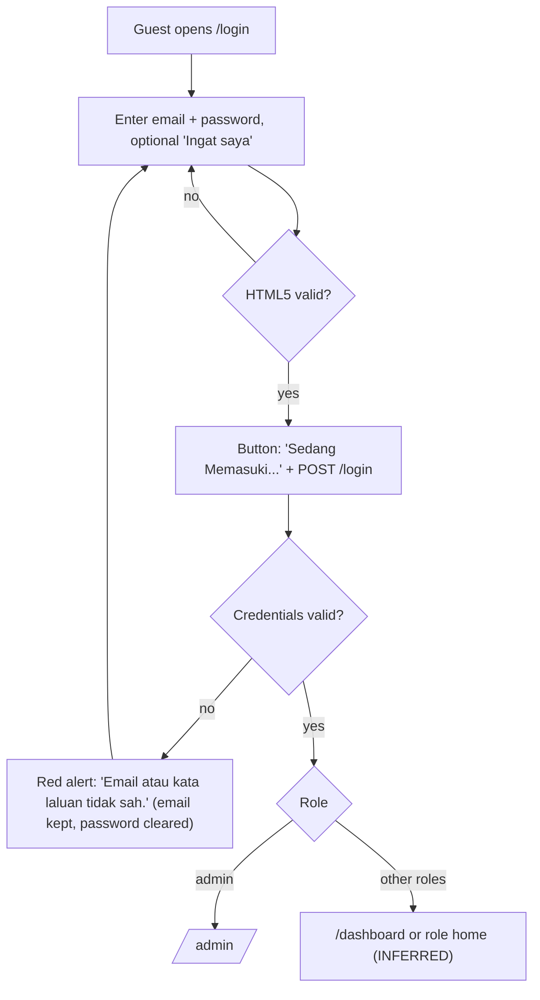
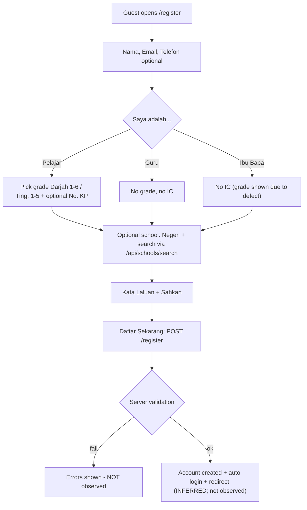
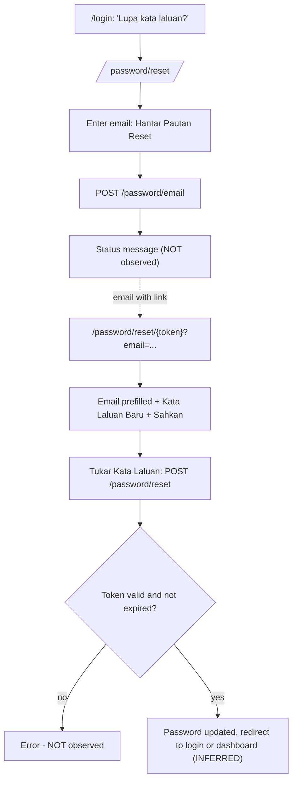
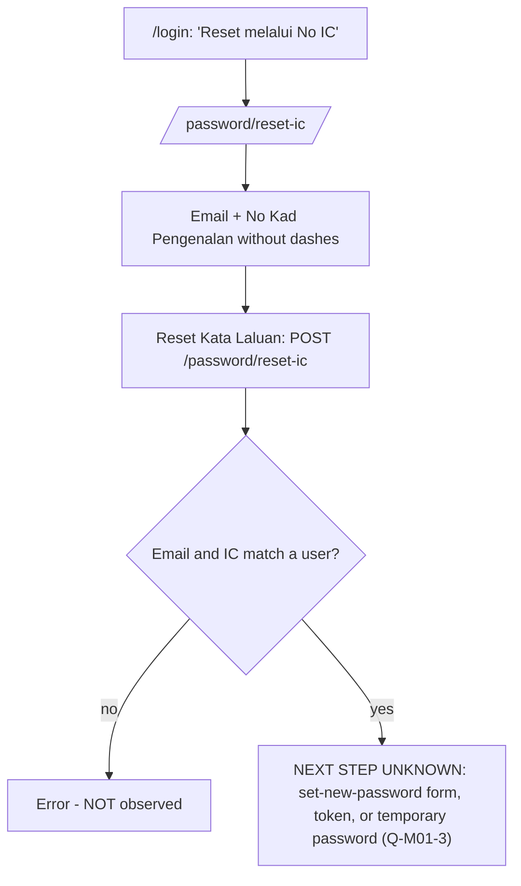
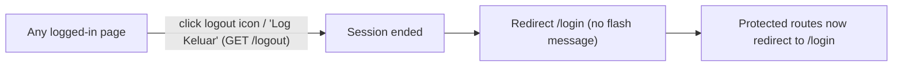
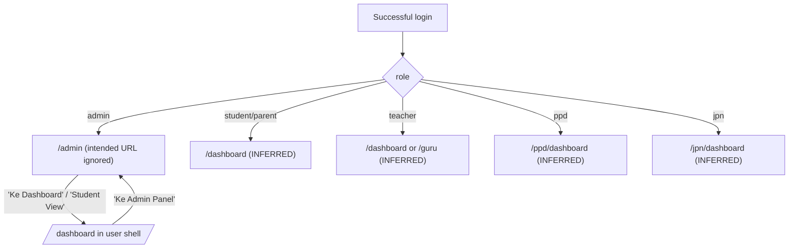

# M01 — Authentication & Account (Discovery)

- **Source:** live walk-through of https://prestasiplus.my on 2026-09-25, read-only, admin account plus guest session.
- **Screenshots:** `docs/discovery/img/M01/`. Shell and design tokens are in [00-global-ui.md](00-global-ui.md).
- **Language:** UI copy is quoted in its exact Bahasa Melayu.
- **Privacy edit (2026-09-30):** the live register name placeholder (person-like name) is written as the generic `Muhammad Fulan bin Fulan`, and the live S5 IC example as the fictitious `000101010000`, under the privacy rule. The raw captures in `inventory/` carry the same replacements.
- **Personal data:** personal values are replaced with `<placeholders>`, and screenshots of logged-in pages were masked in the DOM before capture.
- **Element inventory (added in inventory pass):** a machine-generated, exhaustive inventory exists for every screen below. It covers 363 content elements over 58 captured UI states, and each element has a stable ID `EL-M01-S#-nnn`.
  - Per-screen files: `docs/discovery/inventory/M01/<S#-key>.json`.
  - Reconciliation, crawl results and read-only limits: `docs/discovery/inventory/M01/_summary.md`.
  - Tools: `docs/discovery/tools/`.
  - Items this narrative lacked have been added below, marked "(added in inventory pass)". Where the two differ, the inventory JSON is authoritative for attributes and conditions.

---

## 1. Overview

M01 covers public authentication and the logged-in user's own account pages.

| # | Route | Screen | Access | Status |
|---|---|---|---|---|
| S1 | `/login` | Log Masuk | Guest. Also reachable while logged in; there is no redirect | Documented |
| S2 | `/register` | Daftar | Guest | Documented, not submitted |
| S3 | `/password/reset` | Lupa Kata Laluan (email link request) | Guest | Documented, not submitted |
| S4 | `/password/reset/{token}` | Reset Kata Laluan (set new password) | Guest with emailed token | Form rendered with a dummy token; not submitted |
| S5 | `/password/reset-ic` | Reset Melalui No IC | Guest | Step 1 documented; the result step cannot be seen read-only |
| S6 | `/logout` | Log out (action) | Logged in | Documented |
| S7 | `/profile` | Profil Saya | Logged in | Documented |
| S8 | `/profile/edit` | Kemaskini Profil (includes password change) | Logged in | Documented, not submitted |
| S9 | `/tetapan` | Tetapan Peribadi (spiritual and faith preferences) | Logged in | Documented, not submitted |
| S10 | `/settings` | **404**. No such route exists | — | See §2.10 |
| S11 | `/notifikasi` | Notifikasi / Peti Masuk | Logged in | Documented. Items were not clicked, because clicking marks them read |
| S12 | (behaviour) | Redirect after login by role | — | Documented for admin |

**Stack observed:** Laravel with Blade, Laravel's standard auth routes, Alpine.js and Tailwind v4. See global §1.

**Auth layout** (S1–S5): a standalone page with no app shell.
- Body: `min-h-screen flex items-center justify-center p-3 sm:p-4` on the animated pastel gradient (`coolGradient` 15s).
- Floating emoji: 📚 ✏️ ⭐ 🎨 🚀 💡 and a page emoji, using class `.float-icon` (absolute, `floatBounce 6s`, opacity 0.6, positions by `nth-child`).
- SVG `.wave` at the bottom.
- White card: `rounded-2xl sm:rounded-3xl shadow-2xl p-5 sm:p-8 md:p-10`.
- Footer text: "© 2026 PRESTASIPLUS. Platform Pendidikan Malaysia."

---

## 2. Screens

### 2.1 S1 — `/login` "Log Masuk - PRESTASIPLUS"
Screenshots: `login-desktop.png`, `login-tablet.png`, `login-mobile.png`, `login-error-desktop.png`.

**Access:** guest. A logged-in user can still open `/login`; it is not redirected to the dashboard (defect/rule gap). Protected pages redirect guests here.

**Layout**
- Container `relative z-10 w-full max-w-6xl`, `grid md:grid-cols-2 gap-8 items-center`.
- **Left panel** (`hidden md:block space-y-6`, hidden on mobile):
  1. A mascot bubble: a large circle (white, soft shadow) containing a 🎓 emoji.
  2. A translucent white card (`rounded-3xl`, shadow):
     - H2 "Selamat Kembali! 👋" (Outfit 30px/700, gray-800).
     - Paragraph "Teruskan pembelajaran anda dengan lebih **128,989** soalan latihan dalam **31** subjek berbeza!" (the numbers are dynamic, rendered by the server).
     - 3 feature tiles (`flex items-center gap-3 rounded-xl p-3`, pastel tints):
       - 🏆 "Pencapaian Terbuka" / "Kumpul lencana dan skor tertinggi" (bg blue-50, blue text)
       - 📈 "Jejak Kemajuan" / "Lihat statistik pembelajaran anda" (green-50)
       - 🎯 "Latihan Tersusun" / "Dari mudah hingga mencabar" (yellow-50)
- **Right panel**:
  - The **form card**: logo (`/images/logo-custom.png`), then "Platform Latih Tubi Nasional 🇲🇾", then the form.
  - Under the card, a **stats strip**: a white translucent `rounded-2xl` bar with "❓ 128,989+ Soalan • 📚 31 Subjek • 🎓 11 Tahap".
  - Then the footer.

**Form**: `POST /login`, hidden `_token`. `@submit="loading = true"` (Alpine `{ loading: false }`).

| Label (BM) | Name | Type | Placeholder | Required | Other |
|---|---|---|---|---|---|
| ✉ "Alamat Email" | `email` | email | `nama@email.com` | yes | `autocomplete=email`; an `@` icon sits at the right edge inside the input |
| 🔒 "Kata Laluan" | `password` | password (toggles to text) | `••••••••` | yes | `autocomplete=current-password`; eye toggle button (`showPassword`, `fa-eye`) |
| "Ingat saya" | `remember` | checkbox | — | no | Unchecked by default |

**Buttons and links**
| Element | Target / behaviour |
|---|---|
| "Lupa kata laluan?" (blue, right-aligned under the password field) | `/password/reset` |
| 🪪 "Reset melalui No IC" (small indigo link under the one above) | `/password/reset-ic` |
| **"Log Masuk"** (full-width `cta-gradient`, `fa-sign-in-alt`, min-h 48/56px, `.btn-bounce`) | Submits. While loading it is disabled (opacity 50%) and shows `fa-circle-notch` spinner + "Sedang Memasuki..." |
| "Belum ada akaun? **Daftar Sekarang 🚀**" (wavy underline) | `/register` |
| "← Kembali ke Laman Utama" | `/` |

**Validation and messages**
- Client side: native HTML5 only (required, type=email), using the browser's default English messages (e.g. "Please fill out this field.", "Please include an '@' in the email address…"). There are no custom BM client messages.
- Server-side failure (tested once, with a non-existent email): a red alert box appears above the fields. Box: `bg-red-50 border-2 border-red-200 text-red-700 rounded-2xl`, `fa-exclamation-circle`. Text: **"Email atau kata laluan tidak sah."** The email value is kept; the password is cleared. The message is generic, so it does not reveal whether the account exists.
- A logout does not show any flash message on the login page.

**Added in inventory pass** (inventory: `inventory/M01/S1-login.json`)
- The password eye toggle (EL-M01-S1-029) switches its icon from `fa-eye` to `fa-eye-slash` while the password is visible.
- Link icons are Font Awesome, not emoji: "Reset melalui No IC" uses `fa-id-card`, and "Kembali ke Laman Utama" uses `fa-arrow-left`.
- Loading: the button label comes from two `x-if` templates, `!loading` → `fa-sign-in-alt` "Log Masuk" and `loading` → `fa-circle-notch` "Sedang Memasuki...". The button is `:disabled="loading"` (EL-M01-S1-034/047).
- There is no flash or welcome message after a successful login.
- Opened while logged in, `/login` renders the same 46 elements as for a guest. There is no "already logged in" notice.
- Cookies: `prestasiplus-session` (HttpOnly) and `XSRF-TOKEN`. Both expire in less than 1 day when "Ingat saya" is unticked. No remember cookie is set without "Ingat saya".
- At 375, 13 elements are desktop-only (`hidden md:block`): the whole left welcome panel (mascot, heading, text, 3 tiles).

**Responsive behaviour**
| Width | Behaviour |
|---|---|
| 1280 | Two columns (welcome panel on the left, form card 560px on the right). Stats strip on one line |
| 768 | Still two columns (`md`). Both columns are narrow: the welcome text wraps, and the **stats strip wraps "11 Tahap" onto a second line** (minor defect) |
| 375 | One column. The left panel is hidden. The form card is full width (margin 12px) and the stats strip is compact on one line. No horizontal overflow. Emoji partly overlap the card edges (decorative) |

**Visual tokens**
- Input: `border-2 border-gray-200 rounded-2xl px-4 py-3.5` with a custom `.input-focus` (blue focus).
- Label: 14px/600 gray-700, with a coloured FA icon before it (envelope blue, lock green).

---

### 2.2 S2 — `/register` "Daftar - PRESTASIPLUS"
Screenshots: `register-desktop.png` (Pelajar selected by default), `register-parent-desktop.png`, `register-tablet.png`, `register-mobile.png`.

**Access:** guest.

**Layout:** the same auth layout as login. Page emoji 🎒.
- **Left panel** (`md+`):
  - H2 "Sertai Kami! 🌟", paragraph "Daftar sekarang dan mulakan perjalanan pembelajaran yang menyeronokkan!"
  - 3 tiles:
    - 🎮 "Pembelajaran Gamifikasi" / "Belajar sambil bermain" (pink)
    - 👥 "Komuniti Aktif" / "Belajar bersama rakan" (purple)
    - 📊 "Laporan Terperinci" / "Pantau prestasi anda" (orange)
- **Right card**:
  - Logo, "Daftar Akaun Baru 🇲🇾".
  - A **step indicator 1 — 2 — 3**, which is static and decorative only: the form is one page and step 1 is always "active". This is misleading, so do not copy it without a real stepper.

**Form**: `POST /register`, hidden `_token`, plus hidden fields bound by Alpine:
- `role` (default `student`)
- `grade` (default empty)
- `school_id` (`selectedSchool?.id`)

| Order | Label (BM) | Name | Type | Placeholder | Req | Constraints / notes |
|---|---|---|---|---|---|---|
| 1 | 👤 "Nama Penuh" | `name` | text | `Muhammad Fulan bin Fulan` | yes | — |
| 2 | ✉ "Alamat Email" | `email` | email | `nama@email.com` | yes | — |
| 3 | 📞 "No. Telefon (Pilihan)" | `phone` | tel | `Cth: 0191234567` | no | `maxlength=14`, `inputmode=tel` |
| 4 | "Saya adalah..." | → hidden `role` | 3 selectable cards | — | yes (defaults to student) | See the role table below |
| 5 | 🎓 "Pilih Tahap Anda" | → hidden `grade` | Grade button grid | — | Shown only when role = student (see defect) | Sub-headings "SEKOLAH RENDAH" (Darjah 1–6 → values 1–6) and "SEKOLAH MENENGAH" (Ting. 1–5 → values **7–11**). Nothing is selected by default |
| 6 | 🪪 "No. Kad Pengenalan (Pilihan)" | `ic_number` | text | `Cth: 031215101234` | no | `maxlength=14`, `inputmode=numeric`; shown only for student. Hint (green shield): "Dilindungi PDPA. Hanya 2 digit terakhir akan dipaparkan." |
| 7 | 🏫 "Sekolah (Pilihan)" | → hidden `school_id` | State select + search box with dropdown | Select: "Negeri"; search: "Taip nama sekolah..." | no | Select options: see below. Search needs ≥2 characters **or** a chosen state; typing is debounced; calls `GET /api/schools/search?q=&state=&limit=15`. Empty result: "Tiada sekolah dijumpai". Once chosen, a chip shows name · type · state, with an ✕ (`clearSchool()`) |
| 8 | 🔒 "Kata Laluan" | `password` | password | `••••••••` | yes | Eye toggle. Hint: "ⓘ Minimum 6 aksara" (no `minlength` attribute, so the rule is server-side) |
| 9 | 🔒 "Sahkan Kata Laluan" | `password_confirmation` | password | `••••••••` | yes | Eye toggle |

**Role ("Saya adalah...") options.** These are cards: `.role-card`, 2px border, radius 16px, hover lifts 4px. The selected card has an indigo border `#6366F1`, a gradient `#EEF2FF→#E0E7FF` and a 3px ring `rgba(99,102,241,.2)`.

| Card | Emoji | Title | Subtitle | Value |
|---|---|---|---|---|
| 1 (default) | 👨‍🎓 | "Pelajar" | "Saya ingin belajar" | `student` |
| 2 | 👨‍🏫 | "Guru" | "Saya ingin mengajar" | `teacher` |
| 3 | 👨‍👩‍👧 | "Ibu Bapa" | "Pantau anak saya" | `parent` |

Other roles (PPD, JPN, Duta, Sponsor, etc.) cannot self-register here. Sponsors have a separate link, "Mewakili organisasi? **Daftar sebagai Penaja**", which goes to `/sponsor/register` (out of M01 scope; flag for M02/M19).

**Grade buttons** (`.grade-btn`):
- Unselected: `bg-gray-100 text-gray-700`, rounded-xl, small label "Darjah"/"Ting." over a large number.
- Selected: gradient `#6366F1→#8B5CF6`, white, shadow `0 4px 15px rgba(99,102,241,.3)`.
- Hover: `scale(1.05)`.

**State options (Negeri select):** "Negeri" (empty value), Johor, Kedah, Kelantan, Kuala Lumpur (label "KL"), Labuan, Melaka, Negeri Sembilan ("N.Sembilan"), Pahang, Perak, Perlis, Pulau Pinang ("P.Pinang"), Putrajaya, Sabah, Sarawak, Selangor, Terengganu. That is **16 states/territories**; the value is the full name.

**Buttons and links**
| Element | Target |
|---|---|
| **"Daftar Sekarang"** (`cta-gradient`, `fa-user-plus`) | Submit (NOT clicked). The loading state follows the login pattern |
| "Sudah ada akaun? **Log Masuk 🔑**" | `/login` |
| "🤝 Mewakili organisasi? **Daftar sebagai Penaja**" | `/sponsor/register` |
| "🏠 Kembali ke Laman Utama" | `/` |

**Client-side rules / behaviour**
- Choosing "Guru" hides both the grade picker and the IC field. A fallback script also sets grade `required=false`.
- **Defect:** for "Ibu Bapa", the IC field is hidden, but the fallback script forces the grade section back to `display:block`. So parents see "Pilih Tahap Anda". INFERRED intent: grade is for students only. Rebuild: show grade and IC only for Pelajar (confirm with the owner whether a parent should pick a child's grade).
- The password hint says min **6** characters, but the profile password change says min **8** ("Sekurang-kurangnya 8 aksara"). This is an inconsistency to resolve in the SRS.
- No terms/PDPA consent checkbox is shown.
- No CAPTCHA is visible.

**Added in inventory pass** (inventory: `inventory/M01/S2-register.json`, 13 states)
- **Loading label:** "Sedang Mendaftar..." with `fa-circle-notch` (EL-M01-S2-083). The idle label is `fa-user-plus` "Daftar Sekarang". Both come from `x-if` templates, and the button is `:disabled="loading"`.
- **Query parameters are ignored:**
  - `/register?role=teacher` and `?role=parent` still preselect "Pelajar".
  - `/register?ref=<code>` adds no referral field or hidden input.
  - The submitted fields are always `_token, name, email, phone, role, grade, ic_number, school_id, password, password_confirmation`.
- The hidden `grade` input is bound `:required="selectedRole === 'student'"`. The grade buttons come from `x-for` over `[1..6]` (Darjah n → value n) and `[1..5]` (Ting. n → value n+6).
- The role cards and grade buttons are `div`s with `@click`. They are not buttons or radios, and have no keyboard or ARIA semantics (accessibility gap; the rebuild should use real controls).
- **Icons:**
  - The sub-headings: "Sekolah Rendah" uses `fa-school` and "Sekolah Menengah" uses `fa-building`.
  - The hints: the password hint uses `fa-info-circle` and the PDPA hint uses `fa-shield-alt`.
  - The links: the sponsor line uses `fa-handshake` and "Kembali ke Laman Utama" uses `fa-home`. These are FA icons, not the 🤝/🏠 emoji.
  - The empty state uses `fa-search`, and the chip clear button uses `fa-times`.
- Both password toggles (`showPassword`, `showPasswordConfirm`) switch `fa-eye` → `fa-eye-slash`.
- **School dropdown:**
  - It opens on input focus (`@focus="showSchoolDropdown = true"`) and closes on click outside (`@click.outside`).
  - It is visible when `showSchoolDropdown && (schoolResults.length > 0 || schoolSearch.length >= 2)`.
  - It shows up to 15 rows. Each row has the school NAME in bold, then "`type` · `state` · `PPD <district>`". Clicking a row calls `pickSchool(s)`.
  - Choosing a state with an empty query loads that state's schools, which appear when the input is focused.
  - The empty state's condition is `schoolResults.length === 0 && schoolSearch.length >= 2 && !searchingSchool`.
- The chosen-school chip on register shows the name, then only "`type` · `state`" (no district, unlike `/profile/edit`).

**Responsive behaviour**
| Width | Behaviour |
|---|---|
| 1280 | Two columns. The form card is 560px. Role cards are 3 across; Darjah 3×2; Ting 5 across; state select and school search side by side |
| 768 | Two columns, but the form column is only about 350px. **Defects:** role card subtitles wrap to 3 lines, the state select is clipped ("Negei"), and the search placeholder is clipped. Recommendation for the rebuild: use one column at `md` and only switch to two columns at `lg` |
| 375 | One column. The left panel is hidden. Grids keep 3 / 3×2 / 5 columns (they fit, but are tight). No overflow |

---

### 2.3 S3 — `/password/reset` "Lupa Kata Laluan - PRESTASIPLUS"
Screenshots: `password-reset-desktop.png`, `password-reset-tablet.png`, `password-reset-mobile.png`.

**Access:** guest.

**Layout:** a single centred card (448px wide on desktop, full width minus 12px margins on mobile). No floating emoji and no left panel.
- 🔑 emoji (60px).
- H "Lupa Kata Laluan?" (Outfit 700).
- Text: "Masukkan email anda dan kami akan hantar pautan untuk reset kata laluan."

**Form**: `POST /password/email`, `_token`, `{ loading:false }`, `@submit="loading = true"`.

| Label | Name | Type | Placeholder | Req | Notes |
|---|---|---|---|---|---|
| ✉ "Alamat Email" | `email` | email | `nama@email.com` | yes | **autofocus**, `autocomplete=email` |

**Buttons:**
- **"Hantar Pautan Reset"** (`fa-paper-plane`, `cta-gradient`, NOT clicked). While loading: spinner + "Menghantar...".
- "← Kembali ke Log Masuk" → `/login`.

There is no link from this page to the IC reset.

**Added in inventory pass:** the back link uses `fa-arrow-left`, and the form carries its own `x-data="{ loading: false }"` (inventory `S3-password-reset.json`).

**Responsive:** a centred card at all widths. No defects.

**Not observable:** the success or failure messages after submitting. INFERRED: Laravel's standard "We have emailed your password reset link" status (possibly translated), plus a throttle message.

---

### 2.4 S4 — `/password/reset/{token}` "Reset Kata Laluan - PRESTASIPLUS"
Screenshot: `password-reset-token-desktop.png`. Opened with a dummy token; nothing was submitted.

**Access:** guest with a token (from the email link). The form renders even with an invalid token; the token is checked on submit (INFERRED).

- 🔒 emoji, H "Reset Kata Laluan", text "Masukkan kata laluan baru anda."
- **Form**: `POST /password/reset`, hidden `_token` and `token`.

| Label | Name | Type | Placeholder | Req | Notes |
|---|---|---|---|---|---|
| "Alamat Email" | `email` | email | `nama@email.com` | yes | Pre-filled from `?email=` |
| "Kata Laluan Baru" | `password` | password | `Minimum 6 aksara` | yes | Eye toggle (`showPass`), `autocomplete=new-password` |
| "Sahkan Kata Laluan" | `password_confirmation` | password | `Taip semula kata laluan` | yes | Eye toggle (`showConfirm`) |

- Buttons: **"Tukar Kata Laluan"** (`fa-check-circle`) and "Kembali ke Log Masuk".

**Added in inventory pass** (inventory: `S4-password-reset-token.json`)
- **Loading label:** "Menukar..." with `fa-circle-notch`. The button is disabled (EL-M01-S4-021).
- Without `?email=` the email field is **empty**, not prefilled. It stays editable and required.
- Both password fields have `autocomplete=new-password`. The toggles switch `fa-eye` → `fa-eye-slash`.
- The back link uses `fa-arrow-left`.

---

### 2.5 S5 — `/password/reset-ic` "Reset Kata Laluan (No IC) - PRESTASIPLUS"
Screenshots: `password-reset-ic-desktop.png`, `-tablet.png`, `-mobile.png`.

**Access:** guest.

**Layout:** a centred card, like S3.
- Icon: a large FA `id-card` in indigo-400.
- H "Reset Melalui No IC".
- Text: "Masukkan email dan No Kad Pengenalan yang didaftarkan dalam profil anda."

**Form**: `POST /password/reset-ic`, `_token`, loading pattern.

| Label | Name | Type | Placeholder | Req | Constraints |
|---|---|---|---|---|---|
| ✉ "Alamat Email" | `email` | email | `nama@email.com` | yes | autofocus |
| 🪪 "No Kad Pengenalan" | `ic_number` | text | `000101010000` | yes | `maxlength=20` (register uses 14). No pattern or inputmode. Hint: "Tanpa tanda sempang (-). Contoh: 000101010000" |

**Buttons:**
- **"Reset Kata Laluan"** (`fa-unlock-alt`, NOT clicked).
- "Kembali ke Log Masuk".

**Added in inventory pass:** the loading label is **"Memproses..."** with `fa-circle-notch`, and the button is disabled (EL-M01-S5-016). The back link uses `fa-arrow-left`. Probed paths `/password/reset-ic/verify` and `/password/reset-ic/result` both return 404, so there is no separate result route to discover.

**Flow after submit: NOT observable read-only.** INFERRED options:
- (a) the server matches email + IC and then shows or redirects to a set-new-password form; or
- (b) it issues a reset token or a temporary password.

This is an open question (Q-M01-3). It only works for accounts that stored an IC. At registration, IC is optional and only offered to students.

**Responsive:** a centred card at all widths. No defects.

---

### 2.6 S6 — `/logout`
- It is a **plain GET link** (sidebar footer, header icon, admin "Lagi" menu → "Log Keluar"). There is no confirmation dialog.
- It redirects to `/login` with **no flash message**.
- After logout, all protected routes (`/dashboard`, `/admin`, `/profile`, `/tetapan`, `/notifikasi`) redirect to `/login`.
- Security note for the SRS: logging out via GET can be triggered by cross-site requests (CSRF). Recommend POST with CSRF in the rebuild.
- (Added in inventory pass) This was re-verified in a separate session: `GET /logout` → 302 `/login`, with no flash message. For a guest, JSON endpoints such as `/notifikasi/unread-count` also answer **302 → /login**, not 401/JSON.

---

### 2.7 S7 — `/profile` "Profil Saya - PRESTASIPLUS"
Screenshot: `profile-desktop.png` (email masked).

**Access:** logged in. It uses the user portal shell. Header: "Profil Saya" / "Statistik & Pencapaian Anda".

**Content (as seen for admin):** one hero card only.
- The card: `rounded-3xl`, gradient indigo → purple (≈ `#667EEA → #764BA2`).
- Contents, in order:
  - Large avatar circle (initials on indigo, white 6px ring) with an orange crown badge (INFERRED: marks admin or premium).
  - Name (Outfit 30px/700, slate-800 on purple, which is **low contrast**; do not copy).
  - `<email>`.
  - "📅 Ahli sejak `<d MMMM yyyy>`" (BM month names, e.g. "6 Februari 2026").
  - Button "✏ Kemaskini Profil" → `/profile/edit` (translucent white pill).
- The subtitle promises "Statistik & Pencapaian", but no stats show for admin. INFERRED: learner stats and achievements appear for student accounts. Needs confirmation (Q-M01-5).

**Responsive:** the card is full width and stacks centred at all widths.

**Added in inventory pass** (inventory: `S7-profile.json`)
- Icons: "Ahli sejak" uses `fa-calendar-alt` and "Kemaskini Profil" uses `fa-pen`.
- `main` also contains the global **tournament banner** (`tournamentBanner()`, owned by M16; see global UI).
  - It is hidden when `GET /api/tournament/active` returns `[]`.
  - It has `x-if` templates "LIVE:" + "MAIN" (a live match) and "DAFTAR" (registration open), and the x-text labels "Pendaftaran dibuka" / "Sedang berlangsung".
  - The same banner is present on `/profile/edit` and `/notifikasi`.

---

### 2.8 S8 — `/profile/edit` "Kemaskini Profil - PRESTASIPLUS"
Screenshots: `profile-edit-desktop.png`, `profile-edit-mobile.png`, `profile-edit-school-search.png` (all masked).

**Access:** logged in. Header: "Kemaskini Profil" / "Maklumat peribadi & sekolah anda".

**Layout:** a stack of white cards (`rounded-2xl`, padding 24px, soft shadow), full width of main.

**Card A — 📷 "Gambar Profil"** (form `POST /profile/picture`, multipart)
- Avatar square: 96px, rounded-2xl, initials.
- Button "⬆ Pilih Gambar" (indigo-50 pill) opens a hidden file input `profile_picture`, `accept="image/jpeg,image/png,image/webp"`.
- Hint "JPG, PNG atau WEBP. Maks 2MB."
- A hidden "✓ Simpan" button appears after a file is chosen (INFERRED from markup; it has `display:none` until then).

**Card B — 👤 "Maklumat Peribadi"** and **Card C — 🏫 "Maklumat Sekolah"**. Both belong to **one form** `POST /profile` with `_method=PUT` and hidden `school_id`.

| Label | Name | Type | Placeholder | Req | Notes |
|---|---|---|---|---|---|
| 👤 "Nama Penuh" | `name` | text | — | yes | Pre-filled `<name>` |
| ✉ "Email" | (none) | email | — | — | **Read-only/disabled** (grey background). Hint "Email tidak boleh diubah" |
| 📞 "No. Telefon" | `phone` | tel | `012-3456789` | no | — |
| 💬 "Bio / Motto" | `bio` | textarea | `Tulis sesuatu tentang diri anda...` | no | `maxlength=500`; live counter "Baki: 500 aksara" |
| 🎓 "Tahap" | `grade` | radio (styled as cards) | — | — | Sub-heading "SEKOLAH RENDAH". **Only Darjah 1–6 are shown** (values 1–6), in a 6-column grid. The current value is highlighted with the indigo→purple gradient. INFERRED: the list is filtered by the user's current level (primary vs secondary). Confirm (Q-M01-6) |
| (Card C) "Pilih sekolah anda untuk sambung dengan rakan sekelas" | → `school_id` | Selected-school chip **or** state select + search | Select default "Semua Negeri"; search "Taip nama sekolah (min. 2 huruf)..." | no | See below |

**School picker** (`profileForm()`):
- When a school is selected, a green chip (`bg-emerald-50 border-emerald-200 rounded-xl`) shows: school icon tile, `<NAMA SEKOLAH>`, and "`<type>` · `<state>` · `<PPD>`". The ✕ button calls `clearSchool()`.
- When cleared: a full-width select (options "Semua Negeri", then the same 16 states as register, with full labels) and a search input with a magnifier icon. Input is debounced 300ms. It calls `GET /api/schools/search?q=&state=&limit=20` (limit 20 here vs 15 on register).
- Results dropdown: a scrollable white panel. Each row has a school icon, the name in uppercase bold, and "`type` · `state` · `PPD …`".
- Empty state: "Tiada sekolah dijumpai" / "Cuba tukar negeri atau kata kunci lain".
- Data observation: schools of type SJK(C) show as "SK", and a Maahad Tahfiz shows as "SMK". The school "type" field is coarse (flag for M02).

**Actions row** (between Card C and Card D):
- "← Kembali" → `/profile`.
- **"💾 Simpan Profil"** (`save-gradient`, NOT clicked).

**Card D — 🔒 "Tukar Kata Laluan"** (a separate form `POST /profile/password`)

| Label | Name | Type | Req (HTML) | Notes |
|---|---|---|---|---|
| 🔑 "Kata Laluan Semasa" | `current_password` | password | no attribute (server-side) | `autocomplete=current-password` |
| 🔒 "Kata Laluan Baharu" | `password` | password | no attribute | Hint "Sekurang-kurangnya 8 aksara" |
| 🔒 "Sahkan Kata Laluan Baharu" | `password_confirmation` | password | no attribute | — |

Button **"🛡 Tukar Kata Laluan"** (`warn-gradient` amber→orange, NOT clicked). There are no eye toggles on this form.

**Added in inventory pass** (inventory: `S8-profile-edit.json`, 8 states)
- **Avatar hover overlay:** a `label[for=profilePicInput]` covering the avatar (`bg-black/40`, `fa-camera`). It is `opacity-0` until hover (`group-hover:opacity-100`), and clicking it opens the file picker, like "Pilih Gambar".
- **`previewAvatar(input)`** was confirmed from the page source. On `change` a `FileReader` sets `#avatarPreview.src` to the chosen image and removes `hidden` from `#uploadBtn` ("Simpan", `fa-check`). It does **not** auto-submit; the user must press "Simpan", which posts `/profile/picture`. The picture form has its own `_token`.
- The school chip shows `x-text` bound name, `type`, then "·" + `state` and "·" + `district`. Each "·" is shown only if that value exists (`x-show`). The clear button uses `fa-times-circle`.
- **School dropdown:**
  - It opens on focus (`@focus="showDropdown = true"`) and closes on click outside.
  - It is visible when `showDropdown && (schools.length > 0 || searchQuery.length >= 2)`.
  - It shows up to 20 rows. Each row has a `fa-school` icon tile, the NAME, then "`type` · `state` · `district`". Clicking a row calls `selectSchool(s)`.
  - Choosing a state with an empty query loads that state's schools (for example 20 for Perlis).
  - There is **no searching indicator**: while `searching` is true nothing is shown, and the empty state waits for `!searching`.
  - A failed search only logs `console.error('Search error:', …)`. No error is shown to the user.
- Password card: "Kata Laluan Baharu" and "Sahkan Kata Laluan Baharu" have `autocomplete=new-password`.
- Icons:
  - "Kembali" uses `fa-arrow-left`.
  - "Simpan Profil" uses `fa-save`.
  - "Tukar Kata Laluan" uses `fa-shield-alt`.
  - The "Sekolah Rendah" sub-heading uses `fa-school`.
- The grade radios are `display:none`. Their `<label>`s are the visible cards, and the current grade's radio is `checked`.
- The Alpine component is `profileForm()`, with keys `searchQuery, stateFilter, schools, selectedSchool, showDropdown, searching`.

**Visual tokens**
- Inputs: `border-2 border-slate-200 rounded-xl px-4 py-3`, 52px high.
- Focus: `border-indigo-400 ring-2 ring-indigo-100`.
- Labels: 14px/600 slate-700 with a coloured FA icon.

**Responsive behaviour**
| Width | Behaviour |
|---|---|
| 1280 | Cards full width. Grade grid 6 columns |
| 768 | Same as desktop, but the mobile shell is used. No overflow |
| 375 | Grade grid **keeps 6 columns** (~45px each, cramped but legible). **Defects:** the "Simpan Profil" button touches the right edge of the viewport, and the header subtitle is truncated ("Maklumat peribadi & sekola..."). Recommendation: use a 3-column grade grid on mobile, and a full-width stacked button row |

---

### 2.9 S9 — `/tetapan` "Tetapan Peribadi"
Screenshots: `tetapan-desktop.png`, `tetapan-mobile.png`.

**Access:** logged in (all roles; it is linked from both the admin and user sidebars as "Tetapan Peribadi").
- For admin it renders inside the **admin shell**. Defect: the header shows "Dashboard / Selamat datang, Admin".
- The tab title is "Tetapan Peribadi" with no suffix.

**Layout:** a centred column (`.pref-shell`, max-width ≈ 728px).
1. **Hero banner**: slate gradient (`#475569 → #64748B` approx.), rounded-2xl, white text. H1 "⚙️ Tetapan Peribadi" and the text "Atur pengalaman PrestasiPlus mengikut keperluan rohani & masa anda."
2. **Card "🕌 Mod Rohani"**, with the intro "Personalisasi pembelajaran ikut nilai keagamaan anda. Boleh toggle off bila-bila masa."
3. **Card "🌍 Latar Agama (opsyen)"**, with the intro "Bagi konteks supaya AI dan content lebih relevan. Tidak diwajibkan."
4. Button **"💾 Simpan Tetapan"** (teal→cyan gradient, NOT clicked).

**Form**: `POST /tetapan`, `_method=PUT`.

| Setting (bold label) | Name | Type | Default seen | Description text (BM, exact) |
|---|---|---|---|---|
| "Aktifkan Mod Rohani" | `spiritual_mode` | checkbox (value 1) | off | "Master toggle — kalau off, semua spiritual touchpoints disable." |
| "Tunjuk doa sebelum quiz" | `show_bismillah_splash` | checkbox | off | "Splash 2-saat sebelum mula quiz: \"Bismillahi tawakkaltu 'alallah\". Tetapan untuk Muslim." |
| "Push waktu Subuh" | `subuh_push_enabled` + `subuh_push_time` | checkbox + time | off, **05:30** | "Push notifikasi pagi awal untuk yang bangun Subuh — 30 minit study window selepas Subuh = paling produktif." |
| "Mod Ramadan" | `ramadan_mode_enabled` + `sahur_push_time` | checkbox + time | off, **04:30** | "Push waktu sahur (~4:30am) untuk study sebelum Subuh. Pace lebih ringan waktu Ramadan." |
| "Agama / kepercayaan" | `faith` | select | "— Tidak nyatakan —" | "Untuk mod rohani yang sesuai. Future: Hindu/Buddhist/Christian content akan ditambah." |

**`faith` options:** `""` "— Tidak nyatakan —", `muslim` "Islam", `hindu` "Hindu", `buddhist` "Buddha", `christian` "Kristian", `none` "Tiada".

**Rules seen in the copy:**
- The master toggle disables all spiritual touchpoints.
- The time inputs are enabled even when their checkbox is off (there is no client-side dependency).
- (Added in inventory pass) Ticking all 4 checkboxes reveals no extra UI, and the page has no Alpine component at all. The checkboxes submit value `1`, and the time inputs are `type=time`. The "💾" on "Simpan Tetapan" is an emoji; there is no FA icon. The admin-shell "Lagi" menu at 375 was also captured (`inventory/M01/SHA-admin-shell.json`).

**Responsive behaviour**
| Width | Behaviour |
|---|---|
| 1280 | Rows are "checkbox + text" on the left and a time input on the right |
| 768 | Same layout, narrower |
| 375 | **Defects:** rows do not stack, so the description text is squeezed into a ~100px column. The `faith` select **overflows the viewport** (page scrollWidth 408 vs 360), which causes horizontal scroll. Recommendation: stack the control under the label below `sm` |

---

### 2.10 S10 — `/settings`
- It returns **HTTP 404** ("Halaman Tidak Dijumpai"; see global §5).
- These candidates were also probed and all return 404: `/guru/settings`, `/guru/tetapan`, `/cikgu/settings`, `/profile/settings`, `/account`, `/akaun`, `/user/settings`.
- No link to `/settings` exists in either desktop sidebar. **Correction (added in inventory pass):** the user-shell **mobile drawer** (<1024px) has a "Tetapan" link → `/settings` (EL-M01-SHU-315). It sits next to "Profil Saya" and "Log Keluar" in the drawer's account section, so on mobile it leads to this 404 page. The drawer also links "Tetapan Peribadi" → `/tetapan` (EL-M01-SHU-228).
- (Added in inventory pass) The 404 page content, captured at 1280 and 375:
  - Title "404 - Halaman Tidak Dijumpai | PRESTASIPLUS". It uses a standalone layout with no shell.
  - "404", 🔍, then H1 "Halaman Tidak Dijumpai".
  - The text "Maaf, halaman yang anda cari tidak wujud atau telah dipindahkan. Mungkin URL salah taip?".
  - The links "Halaman Utama" → `/` and **"Mula Latihan" → `/latih-tubi`, which itself returns 404 (a broken link; a fidelity-deviation candidate)**.
  - The caption "PRESTASIPLUS".
  - The user-shell mobile drawer's "Tetapan" link points to `/settings`, so on mobile it lands on this page (see the correction below).
- (Added in inventory pass) More paths were probed, and all return 404: `/password/confirm`, `/forgot-password`, `/reset-password/{x}`, `/two-factor-challenge`, `/user/profile`, `/profile/show`, `/profile/{id}`, `/tetapan/edit`, `/account/settings`, `/profil`, `/daftar`, `/log-masuk`, `/masuk`, `/guru/register`, `/register/guru`, `/register/teacher`, `/sponsor/login`, `/home`, `/api/user`. A GET on `/profile/password`, `/profile/picture`, `/notifikasi/read-all`, `/notifikasi/{id}` or `/notifikasi/bulk-read` returns 405 (they are POST/DELETE only).
- Conclusion: the TRACKER entry "`/settings` — Settings (teacher)" is **stale**. Account settings are split between `/profile/edit` and `/tetapan`. Teacher-specific settings, if any, were not found.

---

### 2.11 S11 — `/notifikasi` "Notifikasi - PRESTASIPLUS" (shared with M22)
Screenshots: `notifikasi-desktop.png`, `notifikasi-select-mode.png`, `notifikasi-empty-mobile.png` (names masked).

**Access:** logged in. It uses the user shell. Header: "Notifikasi" / "Peti masuk mesej anda". The bell icon in the header links here.

**Layout:** a centred narrow column (≈ 640px, `max-w-2xl`).
- **Title row**: "Peti Masuk" plus a red count pill (the unread count, e.g. 166). On the right:
  - "✔✔ Tanda semua dibaca": a form button, `POST /notifikasi/read-all`. NOT clicked.
  - "✓ Pilih": toggles select mode (client only).
- **Filter pills** (a horizontal scroll strip; links):
  - "Semua (N)" → `/notifikasi`
  - "Belum Dibaca (N)" → `?filter=unread`
  - "Sudah Dibaca" → `?filter=read`
  - a divider "|"
  - "⚙ Sistem" → `?type=system` (blue tint)
  - "🕒 Peringatan" → `?type=reminder` (amber tint)
  - "🏆 Pencapaian" → `?type=milestone` (green tint)
  - Active pill: `bg-indigo-600 text-white rounded-lg text-xs font-bold`. Inactive pill: `bg-gray-100 text-gray-600`.
- **Select mode bar** (after "Pilih"): a checkbox "Pilih Semua" and "Batal". When items are selected, the actions "✓ Tanda Dibaca" (`bulkMarkRead()` → `POST /notifikasi/bulk-read {ids}`) and "🗑 Padam" (`bulkDelete()` → confirm `Padam {n} notifikasi yang dipilih?` → `POST /notifikasi/bulk-delete {ids}`) appear. Each item gets a checkbox.
- **Item card** (`.notif-item`, `data-id`, `data-read`):
  - White `rounded-xl border p-4`. Unread items have `border-indigo-200 bg-indigo-50/30`, a bold indigo title and a small indigo dot at the right.
  - A round icon (`w-10 h-10`, indigo-100 background, `fa-bell`).
  - Title (14px semibold), body (14px gray-600), and a meta line "🕒 `<relative time in BM>`" (e.g. "13 jam yang lepas", "1 minggu yang lepas", "1 bulan yang lepas") with a small uppercase **type code** badge (`CHATBOT_NEW_CONVERSATION`, `SPACED_REVIEW`).
  - Clicking the body calls `markRead` → `POST /notifikasi/{id}/read` (the item turns grey and the dot is removed). **Not clicked.**
  - A trash icon appears on hover: `deleteSingle(id)` → `confirm('Padam notifikasi ini?')` → `DELETE /notifikasi/{id}`, then fade and reload.
- **Pagination**: 20 per page, Laravel links "Next »", 2…7.
- **Empty state**: a slashed bell icon, "Tiada notifikasi" / "Notifikasi baru akan muncul di sini".

**Notification examples** (structure only):
- "Chatbot: Perbualan Baru" / "`<nama pelajar>` memulakan perbualan dari `<laluan>`" (sent to admin).
- "📚 Nota menunggu kamu, `<nama>`" / "Hai `<nama>`! Cikgu Alesa ada 9 nota ringkas tunggu kamu ulangkaji (`<subjek>`). Klik buka — 5 minit sahaja." (type `SPACED_REVIEW`).

**Added in inventory pass** (inventory: `S11-notifikasi.json`, 15 states)
- **Selection counter:** "`{n}` dipilih" (`x-text="selected.length + ' dipilih'"`) is shown when at least one item is ticked. "Pilih Semua" (`toggleAll()`) ticks only the items on the current page (e.g. "20 dipilih").
- **In select mode** the title-row actions ("Tanda semua dibaca" and "Pilih") are hidden (`x-show="!selectMode"`), and so is each item's trash button. Item clicks do nothing (`!selectMode && markRead($event, id)`).
- **"Pilih" is not rendered when the list is empty.** "Tanda semua dibaca" is still shown on empty filters.
- Deleted items are hidden on the client at once via `deletedIds` (`x-show="!deletedIds.includes(id)"`) before the reload.
- The item trash button starts at opacity 0 and uses inline `onmouseenter`/`onmouseleave`, so it appears only when the pointer is over the button itself. On touch screens it is effectively invisible (defect).
- **Pagination:**
  - At ≥640 it shows the English Laravel summary "Showing `<from>` to `<to>` of `<total>` results" plus numbered page links (1…9 for 167 items).
  - The prev/next links there are chevron icons whose accessible text is the double-escaped "&laquo; Previous" / "Next &raquo;".
  - Below 640 (mobile-only) it shows only the English "« Previous" / "Next »".
  - Links keep the active filter (e.g. `?filter=unread&page=2`). The last page (`?page=9`) has 7 items.
- Counts: the unread pill and "Belum Dibaca" (166) differ from "Semua" (167). "Sudah Dibaca" has no count.
- For the admin, `?filter=read` has 1 item, and `?type=system|reminder|milestone` all show the empty state.
- **Type codes observed:** `chatbot_new_conversation`, `spaced_review` and `new_ticket`. They are stored in lowercase and shown uppercase through CSS.
- **Icons:**
  - The header actions: "Tanda semua dibaca" uses `fa-check-double` and "Pilih" uses `fa-check-circle`.
  - The filters: Sistem uses `fa-cog`, Peringatan uses `fa-clock` and Pencapaian uses `fa-trophy`.
  - The bulk actions: "Tanda Dibaca" uses `fa-check` and "Padam" uses `fa-trash`.
  - The items: the trash uses `fa-trash-alt` and the meta time uses `far fa-clock`.
- The Alpine component is `notifInbox()`, with keys `selectMode, selectAll, selected, deletedIds, csrfToken`.

**Defects:**
- The filter strip overflows its container even on desktop, and shows a native scrollbar.
- When a `type` filter is active, no pill appears active ("Semua" loses its highlight and the type pill is not highlighted).
- The type code (e.g. `CHATBOT_NEW_CONVERSATION`) is shown raw to users. It should map to a BM label.

**Responsive:**
- 1280: a centred 640px column.
- 768 / 375: full width. Filter pills scroll horizontally. The header action "Tanda semua dibaca" stays on the title row. No page overflow at 375.

---

### 2.12 S12 — Redirect after login by role, and view switching
| Scenario | Observed |
|---|---|
| Admin logs in from `/login` | Redirected to **`/admin`** (Dashboard - Admin Panel) |
| Guest opens `/tetapan`, gets bounced to `/login`, then logs in as admin | Still lands on **`/admin`**. The intended URL is **not** honoured (differs from Laravel's default `redirect()->intended()`) |
| Admin clicks "Ke Dashboard" (admin sidebar) / "Student View" (admin mobile "Lagi" menu) | Plain link to `/dashboard`. The **user portal** renders with the admin's identity: the sidebar shows every role's sections, including "Ke Admin Panel" → `/admin`. There is no impersonation and no mode flag; it is simply a different layout |
| Other roles | Not observable (only an admin account is available). INFERRED: student/parent → `/dashboard`; teacher → `/dashboard` or `/guru`; PPD → `/ppd/dashboard`; JPN → `/jpn/dashboard` |
| Logged-in user opens `/login` or `/register` | The page renders (HTTP 200). There is no redirect away from guest pages |
| (Added in inventory pass) Re-test in a separate session: guest opens `/notifikasi` → `/login` → logs in | Lands on `/admin` ("Dashboard - Admin Panel"). There is no success or welcome flash. `/register` still renders afterwards; `/logout` → `/login` with no flash |
| (Added in inventory pass) `/dashboard` | The user-portal home that "Ke Dashboard" / "Student View" / "Home" link to. It is **not in any TRACKER module checklist** (see `inventory/M01/_summary.md` §3) |

---

## 3. Flows

### 3.1 Login

### 3.2 Register

### 3.3 Forgot password (email link)

### 3.4 Reset via IC

### 3.5 Logout

### 3.6 Role redirect and view switch

---

## 4. Inferred server-side rules (all INFERRED, not verified)
1. **R1** Login uses email + password (Laravel session guard). "Ingat saya" sets a long-lived remember cookie. The error message is generic and does not reveal whether the account exists.
2. **R2** Login is probably rate-limited (Laravel default: 5 attempts per minute per email+IP). Not tested on purpose.
3. **R3** Registration validates:
   - name required;
   - email required, valid and **unique**;
   - phone optional (max 14);
   - `role ∈ {student, teacher, parent}`;
   - `grade` 1–11 required when role = student;
   - `ic_number` optional, numeric, max 14, probably unique, and stored masked or encrypted ("Hanya 2 digit terakhir akan dipaparkan");
   - `school_id` optional and must exist;
   - password required, **min 6**, confirmed.
4. **R4** After a successful registration the user is logged in and redirected to the dashboard (no email-verification route exists: `/email/verify` returns 404).
5. **R5** The email reset uses Laravel's password broker: token table, expiry (default 60 min), throttle (default 60s between requests).
6. **R6** The IC reset looks up a user by email **and** `ic_number`. This is weaker than an emailed token, because an IC number is semi-public; flag it for security review.
7. **R7** The redirect after login depends on role (admin → `/admin`) and ignores the intended URL.
8. **R8** Profile update: email is immutable. Name required; phone optional; bio max 500; grade 1–11; school_id nullable. The picture is JPG/PNG/WEBP up to 2MB, stored and shown as the avatar; without one, the avatar shows initials.
9. **R9** Password change requires the current password; new password **min 8**, confirmed. This conflicts with R3's min 6.
10. **R10** Tetapan: `spiritual_mode` is a master switch. Subuh and sahur times feed a push-notification scheduler (M22). `faith` personalises AI content.
11. **R11** Notifications belong to the user and have a `type` (system / reminder / milestone, plus event codes such as `CHATBOT_NEW_CONVERSATION` and `SPACED_REVIEW`) and a `read_at`. The unread count is capped at "99+" in the UI.
12. **R12** Guest-only pages (`/login`, `/register`) are not protected by `guest` middleware. The rebuild should redirect logged-in users to their home page.

---

## 5. Data entities and fields implied

### User
| Field | Type | Source / notes |
|---|---|---|
| id | int | — |
| name | string | register, profile |
| email | string, unique | register; immutable in profile |
| password | hash | — |
| phone | string ≤14, nullable | register, profile |
| role | enum `student \| teacher \| parent \| admin \| …` | register cards; admin label "Admin". Other roles are in TRACKER §5 |
| grade | int 1–11, nullable | 1–6 = Darjah 1–6, 7–11 = Tingkatan 1–5 |
| ic_number | string ≤14, nullable, sensitive (PDPA) | register (students); used by the IC reset |
| school_id | FK School, nullable | register, profile |
| bio | text ≤500, nullable | profile |
| profile_picture | image path, nullable | profile |
| remember_token | string | "Ingat saya" |
| created_at | datetime | "Ahli sejak …" |
| coins ("koin"), points ("mata"), streak_days ("hari") | int | header chips (M-gamification) |

### UserPreference (or columns on User)
`spiritual_mode` bool, `show_bismillah_splash` bool, `subuh_push_enabled` bool, `subuh_push_time` time (default 05:30), `ramadan_mode_enabled` bool, `sahur_push_time` time (default 04:30), `faith` enum `muslim|hindu|buddhist|christian|none|null`.

### School (lookup, owned by M02)
`id` int, `name` string, `code` string, `type` string (SK/SMK/…), `state` string, `district` string (e.g. "PPD …"), `city` string.

### Notification (shared with M22)
`id` int, `user_id`, `title` string, `body` string, `type` string/enum, `category` (system/reminder/milestone; INFERRED), `read_at` datetime nullable, `created_at`, optional `link` (INFERRED).

### PasswordResetToken (Laravel)
`email`, `token` (hash), `created_at`.

---

## 6. API / endpoints observed

| Method | Endpoint | Used by | Request | Response shape |
|---|---|---|---|---|
| GET | `/login` | S1 | — | HTML |
| POST | `/login` | S1 | `_token, email, password, remember` | 302 redirect; error flash |
| GET | `/register` | S2 | — | HTML |
| POST | `/register` | S2 | `_token, name, email, phone, role, grade, ic_number, school_id, password, password_confirmation` | NOT observed |
| GET | `/password/reset` | S3 | — | HTML |
| POST | `/password/email` | S3 | `_token, email` | NOT observed |
| GET | `/password/reset/{token}?email=` | S4 | — | HTML |
| POST | `/password/reset` | S4 | `_token, token, email, password, password_confirmation` | NOT observed |
| GET/POST | `/password/reset-ic` | S5 | `_token, email, ic_number` | NOT observed |
| GET | `/logout` | S6 | — | 302 → `/login` |
| GET | `/profile`, `/profile/edit` | S7, S8 | — | HTML |
| POST | `/profile/picture` | S8 | multipart `_token, profile_picture` | NOT observed |
| POST (PUT) | `/profile` | S8 | `_token, _method=PUT, name, phone, bio, grade, school_id` | NOT observed |
| POST | `/profile/password` | S8 | `_token, current_password, password, password_confirmation` | NOT observed |
| GET | `/api/schools/search?q=&state=&limit=` | S2 (limit 15), S8 (limit 20) | query | `[{id:number, name:string, code:string, type:string, state:string, district:string, city:string}]`. It is public: it works for guests, and was called from the register page |
| GET | `/tetapan` / POST (PUT) `/tetapan` | S9 | `spiritual_mode, show_bismillah_splash, subuh_push_enabled, subuh_push_time, ramadan_mode_enabled, sahur_push_time, faith` | NOT observed |
| GET | `/notifikasi?filter=unread\|read&type=system\|reminder\|milestone&page=` | S11 | — | HTML |
| GET | `/notifikasi/unread-count` | header bell | — | `{count:number}` |
| POST | `/notifikasi/read-all` | S11 | form `_token` | NOT observed |
| POST | `/notifikasi/{id}/read` | S11 | header `X-CSRF-TOKEN` | `{success:bool}` (from JS) |
| DELETE | `/notifikasi/{id}` | S11 | header `X-CSRF-TOKEN` | `{success:bool}` |
| POST | `/notifikasi/bulk-read` | S11 | JSON `{ids:number[]}` | `{success:bool}` |
| POST | `/notifikasi/bulk-delete` | S11 | JSON `{ids:number[]}` | `{success:bool}` |
| GET | `/admin/server-status` | admin header | — | `{cpu:{load_1m,cores,percent}, ram:{total,used,percent}, disk:{total,used,percent}, uptime:string}` |
| GET | `/api/tournament/active` | user shell | Accept JSON | `[]` (array of active tournaments) |
| GET | `/chatbot/history?session_id=` | chatbot widget | — | not inspected |

Login page stats (128,989 soalan / 31 subjek / 11 tahap) are **server-rendered**; no XHR was made. The admin dashboard shows 130,152 "Soalan Aktif", so the login count uses a different definition (Q-M01-8).

CSRF: meta `csrf-token`, form field `_token`, header `X-CSRF-TOKEN`, cookie `XSRF-TOKEN`. The session cookie is HttpOnly and was not visible.

---

## 7. Open questions / not observable read-only
| ID | Question |
|---|---|
| Q-M01-1 | Registration success path: auto-login? welcome screen? which landing page per role? Any email verification? |
| Q-M01-2 | Exact server validation messages (BM) for register, forgot password, reset, profile and password change. The login error "Email atau kata laluan tidak sah." is the only one observed |
| Q-M01-3 | **Reset via IC**: what happens after a match? (new password form, temporary password, or token?) Is the IC reset limited to students? Is it rate-limited? |
| Q-M01-4 | Password policy: register and reset say min 6; profile change says min 8. Which is correct? |
| Q-M01-5 | `/profile` for students: which stats/achievements appear under "Statistik & Pencapaian Anda"? What does the crown badge mean? |
| Q-M01-6 | Profile "Tahap" shows only Darjah 1–6 for this user. Is it filtered by current level, and can a user move from primary to secondary themselves? |
| Q-M01-7 | Should parents choose a grade at registration (currently visible because of a script defect)? How is a parent linked to a child? |
| Q-M01-8 | Login page question count (128,989) vs admin "Soalan Aktif" (130,152). Which definition? |
| Q-M01-9 | Landing pages for teacher, parent, PPD, JPN, Duta, Sponsor and tuition centre roles (only admin could be tested) |
| Q-M01-10 | `/settings` (teacher) does not exist (404). Remove it from scope, or is there a teacher settings page elsewhere? |
| Q-M01-11 | Should logged-in users be kept away from `/login` and `/register`, and should the intended URL be honoured? (recommend yes) |
| Q-M01-12 | Account lockout / throttle thresholds and BM message (not tested, to avoid locking the admin account) |
| Q-M01-13 | Sponsor self-registration (`/sponsor/register`): which module owns it? (suggest M02 or M19) |
| Q-M01-14 | Notification "type" codes: the full list and a BM display label for each |

---

## 8. Screenshot index (`docs/discovery/img/M01/`)
| File | Content |
|---|---|
| `login-desktop.png` / `login-tablet.png` / `login-mobile.png` | Login at 1280 / 768 / 375 |
| `login-error-desktop.png` | Login with the invalid-credentials alert (fake email) |
| `register-desktop.png` / `register-tablet.png` / `register-mobile.png` | Register (Pelajar default) at 3 widths |
| `register-parent-desktop.png` | Register with "Ibu Bapa" selected (shows the grade-picker defect) |
| `password-reset-desktop.png` / `-tablet.png` / `-mobile.png` | Forgot password (email) |
| `password-reset-token-desktop.png` | Set new password form (dummy token) |
| `password-reset-ic-desktop.png` / `-tablet.png` / `-mobile.png` | Reset via IC |
| `profile-desktop.png` | Profil Saya (email masked) |
| `profile-edit-desktop.png` / `profile-edit-mobile.png` | Kemaskini Profil (values masked) |
| `profile-edit-school-search.png` | School search dropdown (public school names only) |
| `tetapan-desktop.png` / `tetapan-mobile.png` | Tetapan Peribadi (mobile shows the overflow defect) |
| `notifikasi-desktop.png` / `notifikasi-select-mode.png` | Inbox list and select mode (names masked) |
| `notifikasi-empty-mobile.png` | Empty state at 375 |
