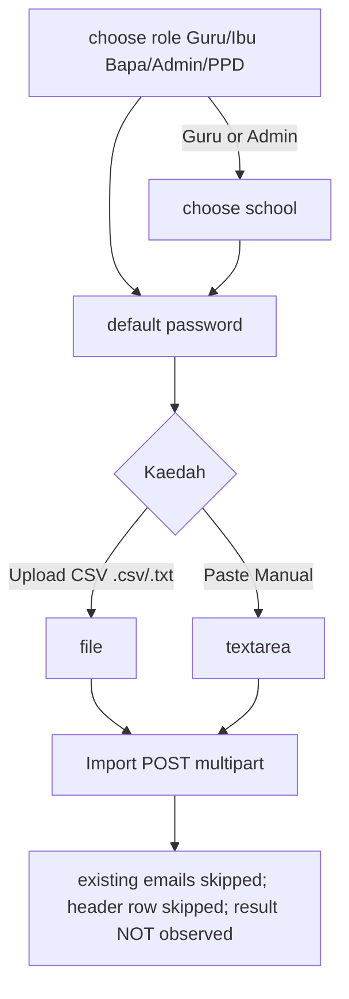
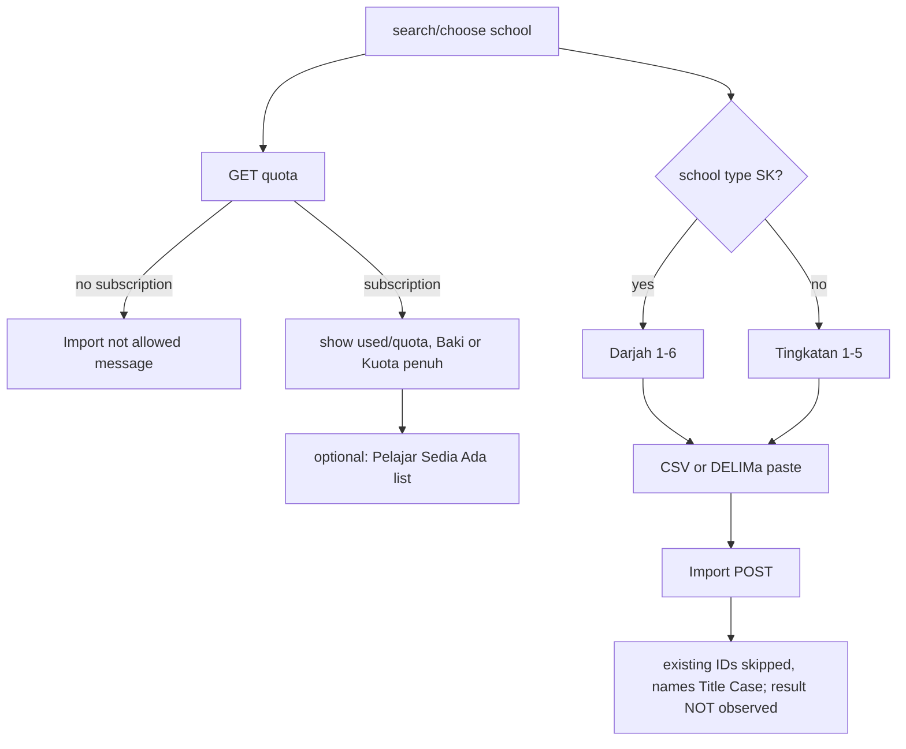
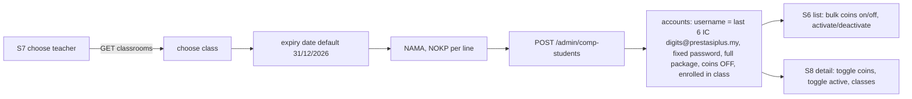
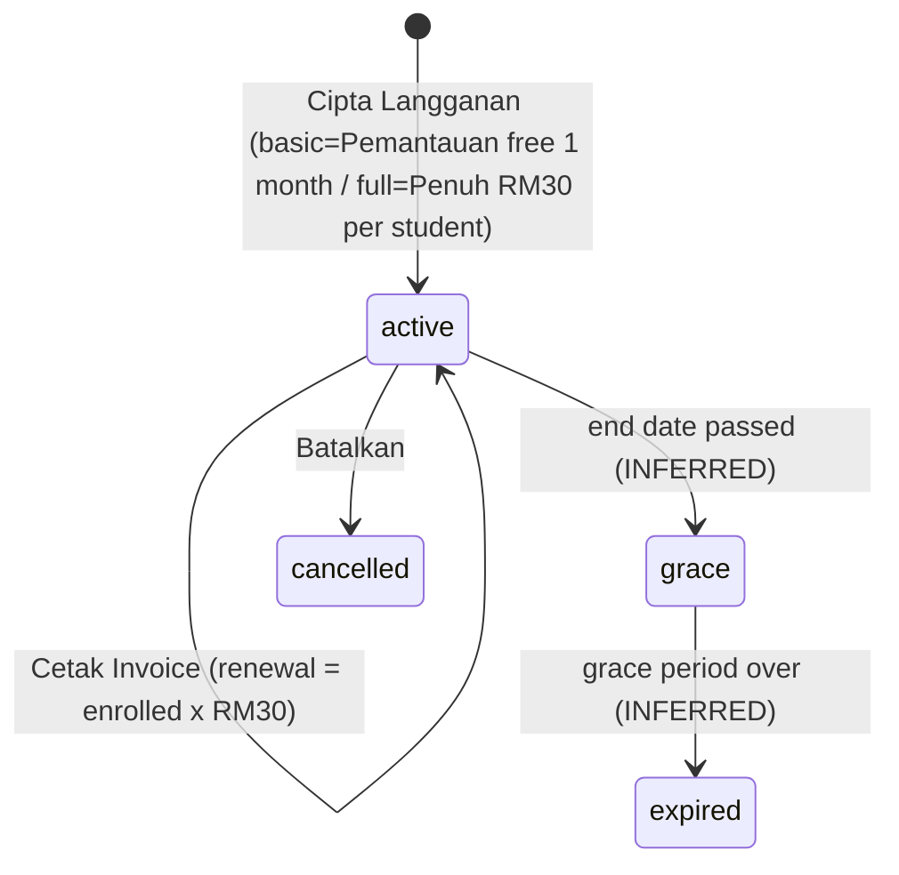

# M02 — Users & Schools Management (Discovery)

- **Source:** live walk-through of https://prestasiplus.my on 2026-09-25, read-only, admin account.
- **Screenshots:** `docs/discovery/img/M02/` (40, all masked in the DOM before capture). Shell and design tokens: [00-global-ui.md](00-global-ui.md) (not repeated here).
- **Language:** UI copy is quoted in its exact Bahasa Melayu (English where the live site is English).
- **Privacy edit (2026-09-30):** the person-like sample name in the S4/S5/S7 examples is written as the generic `Muhammad Fulan bin Fulan` (upper-case on S7) under the privacy rule. The raw captures in `inventory/` carry the same replacement.
- **Personal data:** every screen was scrubbed in the page by `tools/sanitize.js` before any inventory or screenshot. Names, emails, phones, IC numbers, usernames, teacher names, and the school/class of the individual students whose detail pages were opened appear as `<name>`, `<email>`, `<phone>`, `<ic>`, `<person>`, `<masked>`. Person-record ids are shown as `{id}`. School names are public and kept.
- **Redacted security values:** two fixed default passwords shown by the UI are written as `<default-password-A>` (pre-filled for generated school-admin accounts) and `<default-password>` (placeholder of the bulk-import default password; the inventory stores it as `<default-password>` too). The comp-student password is shown as `<digits:8>`. The live values are visible in the page source; they are deliberately not repeated in the docs (see §8 finding F1).
- **Element inventory:** 1,056 content elements over 16 screens and 139 captured UI states, IDs `EL-M02-S#-nnn` → `docs/discovery/inventory/M02/<S#-key>.json`. Reconciliation, crawl and read-only limits: `docs/discovery/inventory/M02/_summary.md`. The inventory JSON is authoritative for attributes and conditions.

---

## 1. Overview

M02 is the admin panel's "PENGGUNA" sidebar group (shell: admin panel, see global doc). Sidebar items in this group: "Senarai Pengguna" (`/admin/users`), "Sekolah" (`/admin/schools`), "Langganan Sekolah" (`/admin/school-subscriptions`), "Import Pelajar" (`/admin/import-students`), "Pelajar Komplimen" (`/admin/comp-students`), "Import Pengguna" (`/admin/users/bulk-import`); the group also lists "Penajaan", "Anak Angkat", "Permohonan" (→ M21).

| # | Route | Screen (page header title / subtitle) | Status |
|---|---|---|---|
| S1 | `/admin/users` | "Pengurusan Pengguna" / "Urus akaun pengguna PRESTASIPLUS" | Documented |
| S2 | `/admin/users/create` | "Tambah Pengguna Baru" / "Daftarkan akaun pengguna baru ke sistem" (tab title "Tambah Pengguna - Admin Panel") | Documented, not submitted |
| S3 | `/admin/users/{id}/edit` | "Edit Pengguna" / "Kemaskini maklumat pengguna" | 2 records opened (a student, a parent); not submitted |
| S4 | `/admin/users/bulk-import` | "Import Pengguna Pukal" / "Daftarkan guru, ibu bapa, atau admin sekolah secara pukal melalui CSV atau paste" | Not submitted |
| S5 | `/admin/import-students` | "Import Pelajar (ID Delima)" / "Daftarkan pelajar sekolah secara pukal menggunakan ID Delima KPM" | Not submitted |
| S6 | `/admin/comp-students` | "Pelajar Komplimen" / "Pelajar bantuan QA — pakej penuh percuma, syiling dimatikan" | Documented |
| S7 | `/admin/comp-students/create` | "Daftar Pelajar Komplimen" / "Pelajar bantuan QA — akaun percuma, pakej penuh, syiling dimatikan" | Not submitted |
| S8 | `/admin/comp-students/{id}` | `<name>` / "Detail pelajar komplimen" (tab "Pelajar Komplimen - <name>") | 1 record opened |
| S9 | `/admin/schools` | "Sekolah" / "Urus senarai sekolah" (tab "Urus Sekolah - Admin PRESTASIPLUS") | Documented |
| S10 | `/admin/schools/create` | "Tambah Sekolah" / "Daftarkan sekolah baru" | Not submitted |
| S11 | `/admin/schools/{id}/edit` | "Edit Sekolah" / `<school name>` | 1 record opened; not submitted |
| S12 | `/admin/school-subscriptions` | "Langganan Sekolah" / "Urus langganan pakej SPM untuk semua sekolah" | Documented |
| S13 | `/admin/school-subscriptions/create` | "Langganan Sekolah Baru" / "Daftarkan langganan pakej SPM untuk sekolah" (tab "Langganan Baru") | Not submitted |
| S14 | `/admin/school-subscriptions/{id}` | "Detail Langganan" / `<school name>` (tab "Langganan <school>") | 2 records opened |
| S15 | `/admin/school-subscriptions/{id}/renewal-invoice` | Standalone print page "Invoice Pembaharuan" (tab "Invoice Pembaharuan - <school>") | 2 records opened **(new route)** |
| S16 | `/admin/users/{id}/packages` | "Assign Pakej SPM" / `<name> — <school name>` (tab "Assign Pakej SPM - <name>") | 1 school-admin record **(new route)** |

**Stack:** same as M01 (Laravel Blade + Alpine.js + Tailwind, Font Awesome). Lists are server-rendered Laravel paginators; forms are classic POST forms with `_token` (+ `_method` spoofing); dynamic pickers are Alpine components calling JSON endpoints (§6).

**Role values (the user-type enumeration).** Stored codes and BM labels, as used by the filters, badges and forms:

| Code | Label | Where offered |
|---|---|---|
| `student` | Pelajar | list filter, create, edit |
| `teacher` | Guru | list filter, create, edit, bulk import |
| `parent` | Ibu Bapa | list filter, create, edit, bulk import |
| `sponsor` | Penaja | list filter, create, edit |
| `school_admin` | Admin Sekolah (bulk import: "Admin") | list filter, create, edit, bulk import |
| `ppd_officer` | Pegawai PPD (bulk import: "PPD") | list filter, create, edit, bulk import |
| `jpn_officer` | Pegawai JPN | **create only** (not in the list filter, not in the edit select, no stat card) |
| `admin` | Admin | list filter, create, edit |

Live counts (stat cards, 2026-09-25): 4533 Pelajar, 551 Guru, 38 Ibu Bapa, 6 Penaja, 16 Admin Sekolah, 5 Pegawai PPD, 2 Admin; total 5159 users. `?role=jpn_officer` returns 2 users whose badge shows the raw code **`jpn_officer`** (no label mapping — defect D-3).

---

## 2. Screens

### 2.1 S1 — `/admin/users` "Pengurusan Pengguna - Admin Panel"
Screenshots: `users-list-desktop.png`, `users-list-tablet.png`, `users-list-mobile.png`, `users-list-bulk-bar.png`, `users-delete-modal.png`, `users-list-school-admin.png`.

**Role stat cards** (7 `card` links, grid 2 / 3 / 4 / 7 columns at base / sm / md / lg): icon circle + count + label, each linking to `?role=<code>`:
| Label | Icon | Colour | Link |
|---|---|---|---|
| Pelajar | `fa-user-graduate` | blue | `?role=student` |
| Guru | `fa-chalkboard-teacher` | purple | `?role=teacher` |
| Ibu Bapa | `fa-users` | amber | `?role=parent` |
| Penaja | `fa-hand-holding-heart` | emerald | `?role=sponsor` |
| Admin Sekolah | `fa-school` | teal | `?role=school_admin` |
| Pegawai PPD | `fa-building-columns` | cyan | `?role=ppd_officer` |
| Admin | `fa-user-shield` | red | `?role=admin` |
The card of the active role gets `ring-2 ring-indigo-500`, but the `.card` box-shadow overrides it, so the highlight is not visible (corrected after audit, AUD-M02-02/21). At 1280 all 7 labels truncate with an ellipsis (e.g. "Ibu ...", "Adm...", "Pega..."), see §7 (corrected after audit: all 7, not 3).

**Filter form** (`GET /admin/users`, card):
| Label (icon) | Name | Control | Options / placeholder |
|---|---|---|---|
| Peranan (`fa-user-tag`) | `role` | select | "Semua Peranan", Pelajar, Guru, Ibu Bapa, Penaja, Admin Sekolah, Pegawai PPD, Admin |
| Sekolah (`fa-school`) | `school` | select | "Semua Sekolah" + 60 schools (only schools that have users; value = school id, label = school name, alphabetical) |
| Status (`fa-toggle-on`) | `is_active` | select | "Semua", `1` "Aktif", `0` "Tidak Aktif" |
| Cari (`fa-search`) | `search` | text | placeholder "Nama atau emel..." |
| — | — | submit | "Cari" (`fa-filter`) |

**Action buttons:** "Tambah" (`fa-user-plus`, → `/admin/users/create`), "Import Pelajar" (`fa-file-import`, → `/admin/import-students`), "Import Pengguna" (`fa-users-cog`, → `/admin/users/bulk-import`).

**Table** (Alpine `bulkSelect()`; 25 rows per page; newest first). Columns: [checkbox] | "#" | "Nama" | "Emel" | "Telefon" | "Peranan" | "Sekolah" | "Aktif?" | "Tarikh" | "Tindakan".
- Header checkbox `toggleAll($event)` ticks every row on the page except the admin's own account (the script excludes it from `allIds`).
- Row checkbox `toggleRow(id)`.
- Nama: avatar (ui-avatars.com image generated from the name, colour 4f46e5) + name. Emel: email. Telefon: phone or "-". Sekolah: school name or "-". Tarikh: registration date `dd/mm/yyyy`.
- Peranan: pill badge with the role label (Pelajar blue, Guru purple, Ibu Bapa amber, Penaja, Admin Sekolah, Admin; `jpn_officer` raw).
- Aktif?: a toggle form `POST /admin/users/{id}/toggle-active` whose button shows "Aktif" (`fa-check-circle`, emerald) or "Tidak" (`fa-times-circle`, red). Submit is intercepted: `confirm('Pasti untuk menukar status pengguna ini?')`, then a spinner (`fa-spinner fa-spin`) replaces the label while `toggling`.
- Tindakan:
  - "Edit" (`fa-edit`, title "Edit") → `/admin/users/{id}/edit`.
  - **"Pakej"** (`fa-box-open`, title "Pakej") → `/admin/users/{id}/packages` — **only on `school_admin` rows** (S16).
  - "Login As" (`fa-sign-in-alt`, title "Login As"; label "Login As" at ≥640, "LA" below) — form `POST /admin/users/{id}/impersonate`, `onsubmit="return confirm('Login sebagai <name>?')"`. Not triggered.
  - Trash icon (`fa-trash-alt`, title "Padam") → opens the delete modal (`showDeleteModal = true; deleteUserId = {id}; deleteUserName = '<name>'`).

**Bulk bar** (x-show `selectedIds.length > 0`, red tint): `fa-check-square` "`{n}` dipilih" + button "Padam" (`fa-trash-alt`) → bulk delete modal.

**Delete modal** "Padam Pengguna?" (backdrop click closes): text "Anda pasti mahu memadam pengguna ini?" + the user's name in bold (x-text `deleteUserName`); buttons "Batal" and "Ya, Padam" (`fa-trash-alt`) submitting `DELETE /admin/users/{id}` (form action bound `'…/admin/users/' + deleteUserId`; renders `/admin/users/null` until opened).

**Bulk delete modal** "Padam Pengguna Terpilih?": "Anda pasti mahu memadam **`{n}`** pengguna?" + "Tindakan ini tidak boleh dibatalkan."; buttons "Batal" and "Ya, Padam Semua" (`fa-trash-alt`) submitting `POST /admin/users/bulk-destroy` with hidden `ids[]` (one per selected id, generated by `x-for`).

**Empty state** (search/filter with no rows, `colspan=10`): `fa-users` + "Tiada pengguna dijumpai" / "Cuba ubah kriteria carian anda".

**Pagination:** Laravel default (English): ≥640 "Showing 1 to 25 of 5159 results" + numbered links (1…10 … 206 207) with chevron prev/next (aria "&laquo; Previous" / "Next &raquo;"); <640 "« Previous" / "Next »". Links keep the active filters (e.g. `?role=student&page=2`, `?is_active=0&page=2`). Last page of all users = 207.

Filter results observed: `?is_active=0` → 58 pages of inactive users; `?school=987` → 2 users; `?role=parent` → 2 pages.

**Responsive:** see §7 — the table (1881 px wide) scrolls horizontally inside its card at every width; at 1280 the "Aktif?", "Tarikh" and "Tindakan" columns are off-screen until scrolled (defect D-1).

---

### 2.2 S2 — `/admin/users/create` "Tambah Pengguna - Admin Panel"
Screenshots: `users-create-default.png`, `users-create-student.png`, `users-create-school-admin-generated.png`, `users-create-ppd-officer.png`, `users-create-parent-search.png`, `users-create-mobile.png`.

Card "Borang Pendaftaran Pengguna" / "Isi maklumat untuk mendaftarkan pengguna baru". Form `POST /admin/users` (Alpine `createUserForm()`). **The form is role-driven:** by default only "Peranan *" is shown; every other field appears after a role is chosen, and the `name` attribute of each input is bound (`:name=…`) so only the active section is submitted.

**Peranan \*** — `select name=role` required (`x-model=selectedRole`, `@change=onRoleChange()` which resets every section): "-- Pilih Peranan --", Pelajar, Guru, Ibu Bapa, Penaja, Admin Sekolah, Pegawai PPD, **Pegawai JPN**, Admin.

**A. Standard roles** (`isStandardRole` = student, teacher, parent, sponsor, admin):
| Label | Submitted name | Type | Placeholder / rule |
|---|---|---|---|
| Nama * | `name` | text | "Nama penuh" |
| Emel * | `email` | email | "contoh@email.com" |
| No. Telefon (Pilihan) | `phone` | tel, maxlength 14 | "Cth: 0191234567" |
| Tahap Pendidikan (student only) | `grade` | radio cards | sub-heading "Sekolah Rendah": Darjah 1–6 (values 1–6); "Sekolah Menengah": Ting. 1–5 (values 7–11) |
| No. Kad Pengenalan (Pilihan) (student only) | `ic_number` | text, maxlength 14, `inputmode=numeric` | "Cth: 031215101234"; hint `fa-shield-alt` "12 digit MyKad. Dilindungi PDPA." |
| Sekolah (student + teacher only) | `school_id` (hidden) | search | input "Cari nama sekolah..." (x-model `stdSchoolSearch`, debounce 300 ms, ≥2 chars → `/api/schools/search?q=`); dropdown rows "`<school>` (`<type>`, `<state>`)"; picking sets the hidden id and shows the name |
| Pautkan Anak (Pelajar) (parent only) | `linked_students[]` (hidden, one per child) | search | see below |
| Kata Laluan * | `password` | password | "Minimum 6 aksara" |
| Sahkan Kata Laluan * | `password_confirmation` | password | "Taip semula kata laluan" |
| Aktifkan Akaun / "Pengguna yang tidak aktif tidak boleh log masuk" | `is_active` | toggle checkbox (value 1, checked) | |

**Parent ↔ child linking (create):** input placeholder "Cari nama atau emel pelajar..." (`parentStudentSearch`, debounce 300 ms, ≥2 chars → `GET /api/students/search?q=`, max 15 results). Each result row: name, class-level badge (e.g. "T5"), school name badge; clicking `addLinkedStudent(s)` adds a chip (duplicates ignored). Empty state `fa-search` "Tiada pelajar dijumpai". Chips section "Anak yang dipautkan:" — name + class badge + remove button (`fa-times-circle`, title "Buang"). Hint `fa-info-circle` "Boleh pautkan lebih dari satu pelajar. Boleh juga ditambah kemudian."

**B. `school_admin`** (generator flow):
1. "Cari Sekolah *" — input "Taipkan nama sekolah atau kod sekolah (cth: JBA0001)..." (debounce 300 ms, ≥2 chars → `/api/schools/search?q=`). Result rows: school name, "`state` • `district` • `type`" and the code (or "Tiada kod"). Empty "Tiada sekolah dijumpai".
2. "Sekolah Dipilih" panel: code, name, state, district, type + reset (`fa-times-circle`, title "Reset").
3. Button "Janakan Akaun Admin Sekolah" (`fa-magic`), disabled when the school has no code; warning `fa-exclamation-triangle` "Sekolah ini tiada kod KPM. Sila isi maklumat secara manual di bawah."
4. After generating, "Maklumat Dijana": "Nama Pentadbir" (pre-filled `Pentadbir <School Name In Title Case>`, submitted as `name`), "ID Login (Emel)" (generated `<school code lower-case>@prestasiplus.my`, submitted as `email`, copy button `fa-copy` title "Salin"), "Kata Laluan" (pre-filled `<default-password-A>`, copy button; submitted as hidden `password` + `password_confirmation`), "Telefon (Pilihan)" (placeholder "012-345 6789", `phone`), badges "JPN: `<state>`" (`fa-landmark`) and "PPD: `<district>`" (`fa-building`). Hidden fields `school_id`, `ppd_state`, `ppd_district`, `is_active`.
5. Toast "Disalin!" after a copy (2 s).
6. "Daftar Pengguna" is **disabled until credentials are generated** (`selectedRole === 'school_admin' && !generated`).

**C. `ppd_officer` / `jpn_officer`:** "Nama *" ("Nama penuh pegawai"), "Emel *" ("contoh@email.com"), "Negeri (JPN) *" select ("-- Pilih Negeri --" + 16 JPN from `/api/jpn`: Johor, Kedah, Kelantan, Kuala Lumpur, Labuan, Melaka, Negeri Sembilan, Pahang, Perak, Perlis, Pulau Pinang, Putrajaya, Sabah, Sarawak, Selangor, Terengganu), "PPD *" (ppd_officer only; "-- Pilih PPD --", loaded from `/api/jpn/{id}/ppd`, disabled until a JPN is chosen / while loading; e.g. Selangor → PPD Gombak, PPD Hulu Langat, PPD Hulu Selangor, PPD Klang, PPD Kuala Langat, PPD Kuala Selangor, PPD Petaling Perdana, PPD Petaling Utama, PPD Sabak Bernam, PPD Sepang), "Kata Laluan *", "Sahkan Kata Laluan *". Hidden `ppd_state` = JPN name, `ppd_district` = PPD code, `is_active`.

**Footer:** "Batal" (`fa-arrow-left`, → `/admin/users`), "Daftar Pengguna" (`fa-user-plus`, submit). Both appear only once a role is chosen.

JS console strings: "JPN load error:".

---

### 2.3 S3 — `/admin/users/{id}/edit` "Edit Pengguna - Admin Panel"
Screenshots: `users-edit-student.png`, `users-edit-parent.png`, `users-edit-mobile.png`.

**Profile header card:** avatar, name (H3), email line, "Daftar: `dd/mm/yyyy`" (`fa-calendar`), "Kemaskini: `dd/mm/yyyy hh:mm`" (`fa-clock`).

**Form** `POST /admin/users/{id}` with `_method=PUT`:
| Label | Name | Type / rule |
|---|---|---|
| Nama * | `name` | text, required |
| Emel * | `email` | email, required (editable, unlike the user's own profile) |
| No. Telefon (Pilihan) | `phone` | tel, maxlength 14, "Cth: 0191234567" |
| Peranan * | `role` | select: Pelajar, Guru, Ibu Bapa, Penaja, Admin Sekolah, Pegawai PPD, Admin (**no Pegawai JPN** — defect D-2) |

**Role-specific sections are server-rendered for the record's saved role** (they do not follow the select; see D-4):
- **Student record:**
  - "Tahap Pendidikan": "Sekolah Rendah" Darjah 1–6, "Sekolah Menengah" Ting. 1–5 (`grade` radios 1–11). Its x-show is `document.getElementById('role')?.value === 'student' || '<saved role>' === 'student'` — evaluated once, not reactive.
  - "No. Kad Pengenalan (Pilihan)" `ic_number` (maxlength 14, `inputmode=numeric`, "Cth: 031215101234") + `fa-shield-alt` "12 digit MyKad. Dilindungi PDPA."
  - **"Pakej Langganan"** block: "Pakej Soalan" `select name=subscription_package` — `none` "Tiada (Percuma / Trial)", `regular_monthly` "Regular Bulanan — RM10/bulan (1 bulan)", `personal` "Personal Per Sesi — RM90 (hingga 10 Jan)"; checkbox `has_pksk_subscription` "Pakej PKSK RM20 — Akses penuh PKSK (tiada tarikh tamat)" with status badge "Tiada Akses"; hint `fa-info-circle` "Tukar pakej secara manual. Tarikh tamat dikira automatik mengikut jenis pakej." (Individual packages → M19/M07.)
  - "Sekolah": selected chip (name · type · state · district, x-text bound to `selectedSchool`) + clear button (`fa-times-circle`, `clearSchool()`). When cleared: state select (`stateFilter`: "Semua Negeri", Johor, Kedah, Kelantan, "KL", Labuan, Melaka, "N. Sembilan", Pahang, Perak, Perlis, "P. Pinang", Putrajaya, Sabah, Sarawak, Selangor, Terengganu) + input "Taip nama sekolah (min. 2 huruf)..." → `/api/schools/search?q=&state=&limit=20`; rows "`<school>`" + "`type` · `state` · `district`"; empty "Tiada sekolah dijumpai"; hidden `school_id`. Same component (`adminSchoolPicker()`) as the profile page in M01. Console "Search error:".
- **Parent record:** card "Anak yang Dipautkan" (`fa-child`, pink; `parentStudentLinker()`): current children as chips (name, class badge, school) with remove "Buang pautan" (`fa-times-circle`); hidden `linked_students[]` per child; empty "Tiada pelajar dipautkan lagi"; search input "Cari nama atau emel pelajar untuk dipautkan..." (≥2 chars → `/api/students/search?q=`, results name + class + school badges, `addStudent(s)`); empty "Tiada pelajar dijumpai"; hint `fa-info-circle` "Tambah atau buang pautan anak. Perubahan disimpan apabila klik "Kemaskini"." No grade, IC, package or school fields for a parent.

**Common tail:**
- Toggle button "Tukar Kata Laluan" / "Klik untuk buka bahagian reset kata laluan" (`fa-key`) reveals "Kata Laluan Baru" (`new_password`, "Minimum 6 aksara"), "Sahkan Kata Laluan Baru" (`new_password_confirmation`, "Taip semula kata laluan baru"), hint `fa-info-circle` "Kosongkan jika tidak mahu tukar kata laluan. Kata laluan baru akan berkuat kuasa serta-merta."
- "Status Aktif" / "Pengguna yang tidak aktif tidak boleh log masuk" (`is_active` toggle).
- "Batal" (`fa-arrow-left`, → `/admin/users`), "Kemaskini" (`fa-save`).
- Side card **"Nota Keselamatan"** (4 × `fa-check`): "Pengguna akan menerima notifikasi jika maklumat akaun diubah" · "Kata laluan boleh ditukar melalui bahagian "Tukar Kata Laluan"" · "Perubahan peranan akan berkuat kuasa serta-merta" · "Pengguna tidak aktif tidak boleh log masuk ke sistem".

No delete / impersonate on this page (only on S1). `GET /admin/users/{id}` returns **405** (no show page).

---

### 2.4 S4 — `/admin/users/bulk-import` "Import Pengguna Pukal - Admin PRESTASIPLUS"
Screenshots: `bulk-import-desktop.png`, `bulk-import-csv-mobile.png`.

Hero card "Import Pengguna Pukal" / "Daftarkan guru, ibu bapa, atau pentadbir sekolah secara pukal." with badges "Guru" (`fa-chalkboard-teacher`), "Ibu Bapa" (`fa-user-friends`), "Admin" (`fa-user-shield`).

Card "Borang Import Pengguna", form `POST /admin/users/bulk-import` multipart (`bulkImportForm()`):
- **"Peranan Pengguna \*"** radio cards `role`: `teacher` "Guru" (`fa-chalkboard-teacher`), `parent` "Ibu Bapa" (`fa-user-friends`), `school_admin` "Admin" (`fa-user-shield`), `ppd_officer` "PPD" (`fa-building`). No default.
- **"Sekolah \* (taip untuk cari)"** — shown only for Guru and Admin (`role === 'teacher' || role === 'school_admin'`); `schoolSearch()` input "-- Cari nama atau kod sekolah..." (placeholder becomes the chosen school), debounce 300 ms, ≥2 chars → `/api/schools/search?q=`; rows "`<school>` (`<code>`)" + state; clear `fa-times`; "Dipilih: `<school> (<code>)`"; empty "Tiada sekolah dijumpai"; hidden `school_id`.
- **"Kata Laluan Default (untuk pengguna tanpa kata laluan)"** `default_password` text, placeholder `<default-password>`; help "Kata laluan jika tidak dinyatakan dalam data import."
- **"Kaedah Import \*"** — buttons "Upload CSV" (`fa-file-csv`) / "Paste Manual" (`fa-paste`); hidden `import_mode` (default `paste`).
  - CSV mode: drop zone "Seret & Lepas fail CSV di sini" / "atau" / "Pilih Fail" (`csv_file`, accept **`.csv,.txt`**); status "Tiada fail dipilih" → "Fail dipilih: `<file>`". Drag & drop copies the file into the input (`handleDrop`).
  - Paste mode: textarea `paste_content`, placeholder "Paste data CSV:\n\nNama, Emel, Telefon\nMuhammad Fulan bin Fulan, ahmad@email.com, 0123456789".
- Format box (`fa-info-circle`): "Format CSV:" "Nama, Emel, Telefon (pilihan), Kata Laluan (pilihan)"; "Contoh: Muhammad Fulan bin Fulan, <email>, <digits:10>, pass123"; "Baris pertama akan dilangkau jika ia mengandungi tajuk (header)."
- "Kembali" (`fa-arrow-left`, → `/admin/users`), "Import" (`fa-users-cog`, submit).
- Card "Nota Penting:": "Emel sedia ada akan dilangkau automatik" · "Guru & admin sekolah dikaitkan dengan sekolah dipilih" · "Kata laluan boleh dinyatakan per-pengguna di lajur ke-4" · "Pelajar DELIMa →" link "Import Pelajar" (→ `/admin/import-students`).

No template download exists (`/admin/users/bulk-import/template` 404). **Parents imported here cannot be linked to children** (no column for it).

---

### 2.5 S5 — `/admin/import-students` "Import Pelajar (ID Delima) - Admin PRESTASIPLUS"
Screenshots: `import-students-desktop.png`, `import-students-quota.png`, `import-students-nosub-sk.png`, `import-students-mobile.png`.

Hero "Import Pelajar via ID Delima" / "Import pelajar dari Darjah 1 hingga Tingkatan 5 menggunakan ID Delima KPM." badges "Kata laluan DELIMa" (`fa-key`), "Email DELIMa" (`fa-envelope`).

Card "Borang Import Pelajar", form `POST /admin/import-students` multipart (`importForm()`):
1. **"Sekolah \*"** — state select (same short labels as S3: "Semua Negeri", "KL", "N. Sembilan", "P. Pinang" …) + input "Taip nama sekolah (min. 2 huruf)..." (`/api/schools/search?q=&state=&limit=20`, triggered by typing ≥2 chars or by choosing a state). Rows: name + "`type` · `state` · `district`". Empty `fa-search` "Tiada sekolah dijumpai". Selected chip: name, type, state, district + clear (`fa-times-circle`). Hidden `school_id` required while no school is picked. Console: "Search error:", "Load school error:".
2. **Quota panel** (after a school is picked, `GET /admin/api/schools/{id}/quota`):
   - loading "Memeriksa kuota...";
   - with subscription: "Kuota Pelajar" (`fa-users`) + "`used` / `quota`" + "Baki kuota: `n` pelajar" or **"Kuota penuh! Sila tingkatkan kuota dahulu."**;
   - without: `fa-exclamation-triangle` **"Sekolah ini tiada langganan aktif. Import pelajar tidak dibenarkan."**;
   - if used > 0: toggle "Pelajar Sedia Ada (`n` orang)" (`fa-users`) → search "Cari nama / email / ID..." + class filter ("Semua Kelas", D1–D6 for SK, T1–T5 otherwise) → `GET /admin/api/schools/{id}/students?search=&class_level=`; table "#" | "Nama" | "Email / ID Delima" | "Kelas"; "Memuatkan..." (`fa-circle-notch`); empty `fa-search` "Tiada pelajar dijumpai"; at ≥200 rows `fa-info-circle` "Menunjukkan 200 pertama sahaja. Gunakan carian untuk cari pelajar tertentu." Console "Quota fetch error:", "Fetch students error:".
3. **"Darjah / Tingkatan \*"** radio cards `class_level`: "Sekolah Rendah" (`fa-school`) D1–D6 labelled "Darjah 1"…"Darjah 6"; "Sekolah Menengah" (`fa-university`) T1–T5 labelled "Tingkatan 1"…"Tingkatan 5". Before a school is chosen both groups show; after, **SK schools show only Darjah, every other type only Tingkatan** (`selectedSchool.type === 'SK'`).
4. **"Kaedah Import \*"** — "Upload CSV" / "Paste Manual" (default paste), hidden `import_mode`.
   - CSV: drop zone as S4 ("Seret & Lepas fail CSV di sini", "atau", "Pilih Fail", `csv_file` accept `.csv,.txt`, "Tiada fail dipilih" / "Fail dipilih: …"); "Format CSV:" **"Nama, Email DELIMa, Kata Laluan, No KP (pilihan)"**; "Contoh: Muhammad Fulan bin Fulan, <email>, katalaluan123, <digits:12>".
   - Paste: textarea `paste_content` placeholder "Paste data dari DELIMa (3-4 baris per pelajar):\n\nNAMA PELAJAR\nm-XXXXXXXX@moe-dl.edu.my\nkatalaluan\n031215101234\n\nNAMA PELAJAR 2\nm-YYYYYYYY@moe-dl.edu.my\nkatalaluan2"; help "Format DELIMa (3-4 baris per pelajar):" NAMA PELAJAR / `m-XXXXXXXX@moe-dl.edu.my` / katalaluan123 / 031215101234 "(No. KP — pilihan)". Records are separated by a blank line.
5. "Kembali" (`fa-arrow-left`, → **`/admin`**, not the user list), "Import" (`fa-users-cog`).
6. "Nota Penting:": "Pelajar login guna **email DELIMa** dan **kata laluan DELIMa**" · "ID yang sudah wujud akan dilangkau automatik" · "Nama pelajar akan ditukar ke Title Case".

A template exists at `GET /admin/import-students/template` (xlsx attachment "template-import-pelajar.xlsx") but **no link on the page** (found by probe; see §8).

---

### 2.6 S6 — `/admin/comp-students` "Pelajar Komplimen - Admin Panel"
Screenshots: `comp-students-desktop.png`, `comp-students-bulk-bar.png`, `comp-students-mobile.png`.

- Summary `fa-coins` "Syiling OFF: **90** / 90 pelajar komplimen" + button "Daftar Baru" (`fa-user-plus`, → create).
- Form `POST /admin/comp-students/bulk-action` wrapping the table. **Bulk bar** (sticky, x-show `selected.length > 0`): "`{n}` dipilih"; submit buttons `name=action`: `coins_off` "Matikan syiling" (`fa-ban`, rose), `coins_on` "Hidupkan syiling" (`fa-coins`, amber), `deactivate` "Nyahaktif akaun" (`fa-user-slash`, grey), `activate` "Aktifkan akaun" (`fa-user-check`, emerald); "Batal pilihan" clears. **No confirmation** on any bulk action.
- Table (50 per page): [header checkbox selects all ids on the page] | "Nama" (link → `/admin/comp-students/{id}`) | "Username" (DELIMa email or generated login) | "IC" (or empty) | "Sekolah" | "Kelas" (e.g. "5 MARIKH") | "Cikgu" | "Akaun" ("AKTIF" emerald / inactive) | "Syiling" ("OFF" rose / "ON") | "Pakej tamat" (`dd/mm/yyyy`). Header row upper-case (CSS).
- Empty: "Tiada pelajar komplimen lagi. Daftar baru." (link to create).
- Pagination as S1 ("Showing 1 to 50 of 90 results", 2 pages).

---

### 2.7 S7 — `/admin/comp-students/create` "Daftar Pelajar Komplimen - Admin Panel"
Screenshot: `comp-create-desktop.png`.

- Info alert (`fa-info-circle`, blue): "Setiap pelajar dapat: username **6 digit akhir IC**@prestasiplus.my, kata laluan **`<digits:8>`**, pakej penuh percuma, dan **syiling dimatikan** (tak boleh kumpul/claim walaupun jawab soalan / main game)."
- Form `POST /admin/comp-students` (`compStudentForm()`):
| Label | Name | Control |
|---|---|---|
| Guru | (not submitted; `teacherId`) | select "— Pilih guru —" + **every teacher** (551 options, label "`<name>` (`<email>`)") |
| Kelas guru | `classroom_id` | select required, disabled until a teacher is chosen; "— Pilih kelas —" + the teacher's classes from `GET /admin/comp-students/teacher/{id}/classrooms`, label "`name` (`class_code`)"; if none: "Guru ini tiada kelas aktif." |
| Tarikh tamat pakej | `package_expires_at` | date, required, default **2026-12-31** |
| Senarai pelajar | `students` | textarea rows 8 required, mono; help "Satu pelajar setiap baris, format: `NAMA, NOKP` (cth: `MUHAMMAD FULAN BIN FULAN, <digits:12>`)"; placeholder "NAMA PENUH, NOMBOR KP" ×2 |
- "← Senarai pelajar komplimen" (link), "Daftar Pelajar Komplimen" (`fa-user-plus`, submit). Console "[comp-students] load classrooms failed".

---

### 2.8 S8 — `/admin/comp-students/{id}` (detail)
Screenshot: `comp-show-desktop.png`.

- "← Senarai pelajar komplimen".
- Card (2-column label/value grid): "Username", "No. KP" ("—" if none), "Sekolah asal", "Tingkatan" (e.g. "T5"), "Status akaun" ("AKTIF"), "Syiling" ("OFF (tak boleh kumpul/claim)" rose / ON), "Pakej tamat" (`dd/mm/yyyy`), "Baki syiling / coins" ("`n` syiling · `n` coins").
- Buttons (no confirmation): "Hidupkan syiling" (form `POST /admin/comp-students/{id}/toggle-coins`; label flips to "Matikan syiling" when ON — inferred), "Nyahaktif akaun" (form `POST /admin/comp-students/{id}/toggle-active`; "Aktifkan akaun" when inactive — inferred).
- Card "Kelas didaftar (`n`)" (`fa-chalkboard`): table "Kelas" (name + class code in grey) | "Subjek" (or "—") | "Cikgu" | "Status" ("ACTIVE"). One comp student is enrolled in several classes.
- No edit / delete routes (`/admin/comp-students/{id}/edit` 404).

---

### 2.9 S9 — `/admin/schools` "Urus Sekolah - Admin PRESTASIPLUS"
Screenshots: `schools-list-desktop.png`, `schools-list-mobile.png`, `schools-empty.png`.

- Stat cards: "10,220" "Jumlah Sekolah", "10,212" "Aktif", "8" "Tidak Aktif"; card with "Tambah Sekolah" (`fa-plus`, → create).
- Filter (GET): `search` "Cari nama atau kod sekolah...", `state` ("Semua Negeri" + 16 full state names), `type` (**"Semua Jenis", SK, SMK** — only the types present in data), "Cari" (`fa-search`); when a filter is active a reset link (`fa-times`, title "Reset", → `/admin/schools`).
- Table (30 per page, 341 pages): "Nama Sekolah" | "Kod" | "Jenis" (badge SK/SMK) | "Negeri" | "Daerah" (e.g. "PPD KUCHING", "PPW SENTUL") | "Pelajar" (count) | "Guru" (count) | "Status" (badge "Aktif" / "Tidak Aktif") | "Tindakan": edit (`fa-pen`, title "Edit") + toggle form `POST /admin/schools/{id}/toggle` (`fa-toggle-on`, title "Nyahaktif"; `fa-toggle-off` "Aktifkan" when inactive — inferred), **no confirmation**. No delete, no show page (`GET /admin/schools/{id}` 405).
- Empty (`colspan=9`): `fa-school` "Tiada sekolah dijumpai".
- Pagination as S1 ("Showing 1 to 30 of 10220 results").

### 2.10 S10 — `/admin/schools/create` "Tambah Sekolah" and 2.11 S11 — `/admin/schools/{id}/edit` "Edit Sekolah"
Screenshots: `schools-create-desktop.png`, `schools-edit-desktop.png`.

Identical form (edit adds `_method=PUT`, action `/admin/schools/{id}`, pre-filled values, button "Kemaskini"; create posts to `/admin/schools`, button "Simpan"):
| Label | Name | Control |
|---|---|---|
| Nama Sekolah * | `name` | text required, "cth: SK TAMAN KLUANG BARU" |
| Kod Sekolah * | `code` | text required, "cth: JBA1234" |
| Jenis * | `type` | select required: "Pilih jenis", **SK, SMK, SJK(C), SJK(T), MRSM, SBP** |
| Negeri * | `state` | select required: "Pilih negeri" + 16 states |
| Daerah | `district` | text, "cth: KLUANG" |
| Bandar | `city` | text, "cth: KLUANG" |
| "Sekolah Aktif" | `is_active` | toggle (hidden 0 + checkbox 1) |
Links "Kembali ke Senarai Sekolah" (`fa-arrow-left`) and "Batal" → `/admin/schools`; submit icon `fa-save`.

---

### 2.12 S12 — `/admin/school-subscriptions` "Langganan Sekolah - Admin PRESTASIPLUS"
Screenshots: `subscriptions-list-desktop.png`, `subscriptions-list-mobile.png`.

- Stat cards: "9" "Aktif", "0" "Tempoh Ihsan", "1" "Tamat Tempoh", "5,738" "Jumlah Kuota Pelajar".
- Filter (GET): `search` "Cari sekolah...", `status` ("Semua Status", `active` "Aktif", `grace` "Tempoh Ihsan", `expired` "Tamat", `cancelled` "Dibatalkan"), `form_level` ("Semua Tingkatan", `t4` "Tingkatan 4", `t5` "Tingkatan 5" — the D1_D6 and T1_T3 packages are not filterable), "Cari" (`fa-search`); "Langganan Baru" (`fa-plus`, → create).
- Table (14 rows, no pagination observed): "Sekolah" (name + code) | "Tingkatan" (badge T4/T5) | "Pakej" (badge "Pemantauan" `fa-eye` or "Penuh" `fa-infinity`) | "Kuota" ("used/quota", e.g. 150/1000, 562/500) | "Status" (badge "Aktif", "Batal", "Tamat"; grace label not observed) | "Mula" | "Tamat" (`dd/mm/yyyy`) | "Lihat" (`fa-arrow-right`, → `/admin/school-subscriptions/{id}`).
- Empty (`colspan=8`): `fa-file-contract` "Tiada langganan dijumpai."

### 2.13 S13 — `/admin/school-subscriptions/create` "Langganan Baru - Admin PRESTASIPLUS"
Screenshot: `subscriptions-create-full.png`.

Card "Borang Langganan Baru", form `POST /admin/school-subscriptions` (`subscriptionForm(packages)` + `schoolPicker()`):
- **"Sekolah \*"** — input "Taip nama atau kod sekolah..." (debounce 300 ms, ≥2 chars → `/api/schools/search?q=&limit=15`); rows "`<school>`" + "`code` — `district`, `state`"; selected card (name + meta + clear `fa-times-circle`); empty `fa-search-minus` "Tiada sekolah dijumpai"; hidden `school_id` required.
- **"Jenis Pakej \*"** radio cards `package_tier`: `basic` "Pemantauan" / "500 soalan/bulan · PERCUMA" / "1 bulan (demo/trial)" (default) and `full` "Penuh" / "Tanpa had · RM30/pelajar" / "1 tahun".
- **"Tingkatan \*"** radio cards `school_package_id` (from the packages JSON): `1` "T4" "Pakej SPM Tingkatan 4" "2 tahun"; `2` "T5" "Pakej SPM Tingkatan 5" "1 tahun"; `3` "D1_D6" "Pakej Rendah (Darjah 1-6)" "6 tahun"; `4` "T1_T3" "Pakej Menengah Rendah (Tingkatan 1-3)" "3 tahun". (Years = `max_renewals + 1`.)
- **"Bilangan Pelajar \*"** `student_quota` number, min 1, max 2000, default 100.
- Live summary: tier basic → "Pakej Pemantauan: **PERCUMA** · 500 soalan/bulan/pelajar · 1 bulan" + "Sekolah boleh naik taraf ke Pakej Penuh bila-bila masa."; tier full + package → "`quota` pelajar × RM`price`/tahun = RM `total`" and "Jumlah `years` tahun: RM `total × years`" (e.g. 100 × RM30.00 = RM 3,000.00; T4 2 tahun → RM 6,000.00; `toLocaleString('en-MY')`).
- "Rujukan Pembayaran" `payment_reference` ("cth: Bank transfer ref, nombor resit"), "Nota" `payment_notes` ("Nota tambahan (opsional)").
- "Kembali" (`fa-arrow-left`), "Cipta Langganan" (`fa-check`).

### 2.14 S14 — `/admin/school-subscriptions/{id}` "Langganan <school> - Admin PRESTASIPLUS"
Screenshots: `subscription-show-basic.png` (upgrade + extend panels open), `subscription-show-full.png` (quota panel open), `subscription-show-mobile.png`.

- "Senarai Langganan" back link (`fa-arrow-left`).
- Summary card: school name (H3), "`code` · `package name`", badges tier ("Pemantauan" `fa-eye` / "Penuh" `fa-infinity`) + status ("Aktif"). "Kuota Pelajar" (`fa-users`) "`used` / `quota`" + progress bar + "`p`% digunakan" + "Baki: `n` pelajar" (100% and "Baki: 0 pelajar" when over quota, e.g. 562/500).
  - Basic: box "Pakej Pemantauan" / "99999 soalan/bulan/pelajar · PERCUMA · Tamat `dd/mm/yyyy`"; tiles "Mula", "Tamat", "Had Soalan" "99999/bulan", "Kos" "PERCUMA".
  - Full: tiles "Mula", "Tamat", "Harga / Pelajar" "RM30.00", "Jumlah" (quota × price, e.g. "RM15,000.00").
  - "Nota:" (`fa-sticky-note`) free-text admin/system note, e.g. "[Naik taraf Pemantauan → Penuh pada `dd/mm/yyyy hh:mm`]".
- Card **"Tindakan"**:
  - "Ubah Kuota" (`fa-sliders-h`) toggles form `PUT /admin/school-subscriptions/{id}/quota`: "Kuota baru:" `student_quota` (number 1–2000, required), `notes` "Sebab perubahan (opsional)", "Simpan" (`fa-save`).
  - "Cetak Invoice" (`fa-print`) → S15.
  - "Naik Taraf ke Penuh" (`fa-arrow-up`, **basic tier only**) toggles: `fa-info-circle` "Naik taraf dari **Pemantauan (80 soalan/bulan)** ke **Penuh (Tanpa Had)**. Langganan akan dilanjutkan 1 tahun dari sekarang dengan harga RM30.00/pelajar."; `payment_reference` "Rujukan pembayaran (opsional)", `payment_notes` "Nota (opsional)", "Sahkan Naik Taraf" (`fa-arrow-up`) → `POST …/upgrade` with `confirm('Naik taraf ke Pakej Penuh? Ini akan menukar langganan ke tanpa had soalan.')`.
  - "Batalkan" (`fa-times`) → `POST …/cancel` with `confirm('Adakah anda pasti mahu batalkan langganan ini?')`.
  - "Lanjutkan Tempoh" (`fa-calendar-plus`) toggles form `POST …/extend`: `fa-info-circle` "Tamat semasa: `dd/mm/yyyy hh:mm`"; "Tambah:" presets "7 Hari", "14 Hari", "1 Bulan" (30), "2 Bulan" (60), "3 Bulan" (90), "6 Bulan" (180), "1 Tahun" (365) that fill `days` (number 1–365, required) + "hari"; `reason` "Sebab lanjutan (opsional)"; "Lanjutkan" (`fa-calendar-plus`) with `confirm('Lanjutkan tempoh langganan?')`.
- Card "Senarai Pelajar (`n`)": table "#" | "Nama" | "Email ID Delima" | "Tingkatan"; "Tunjuk" select 25 / 50 / 100 / 200 (default 50; `onchange` → `?per_page=`) + "perbarisan · Memaparkan `a`-`b` dari `n`"; Laravel pagination (keeps `per_page`).
- Status actions for cancelled/expired/grace subscriptions could not be observed on the two opened records (§8).

### 2.15 S15 — `/admin/school-subscriptions/{id}/renewal-invoice` (standalone print page)
Screenshots: `renewal-invoice-desktop.png`, `renewal-invoice-mobile.png`.

No admin shell. Buttons "Cetak Invoice" (`window.print()`) and "Kembali" (→ S14). Content: "PRESTASIPLUS" / "Platform Pembelajaran Interaktif" / "https://prestasiplus.my"; H "Invoice Pembaharuan", "Tarikh: `dd/mm/yyyy`" (today), "Ref: INV-`{subscription id}`-`yyyymmdd`"; "Maklumat Sekolah": name, "Kod: `code` · `state` · `district`"; "Pakej" (package name), "Tempoh Semasa" (`start - end`), "Pembaharuan" (`end - end+1y`); "Senarai Pelajar (`n` orang)" table "No." | "Nama Pelajar" | "ID Delima" | "Tingkatan" (all students, no pagination); totals "Bilangan pelajar" "`n` orang", "Harga per pelajar / tahun" "RM30.00", "JUMLAH" "RM`n × 30`" (e.g. RM4,500.00; RM16,860.00 — based on **enrolled students, not the quota**); "Maklumat Pembayaran": "Sila buat pembayaran melalui pemindahan bank atau tunai kepada pihak pentadbir." "Selepas pembayaran dibuat, sila maklumkan rujukan pembayaran kepada pentadbir untuk pengesahan." Footer "Dokumen ini dijana secara automatik oleh sistem PRESTASIPLUS." "Untuk sebarang pertanyaan, hubungi pentadbir sistem."

### 2.16 S16 — `/admin/users/{id}/packages` "Assign Pakej SPM - <name>" (school admins)
Screenshot: `user-packages-desktop.png`.

- Header card: school name (H3), "`type` · `state` · `district`", badges `<name>` (`fa-user`), "Admin Sekolah" (`fa-shield-alt`), school code (`fa-barcode`).
- Two package cards: "T4" "Pakej Tingkatan 4" "RM 30/pelajar · 2 tahun" and "T5" "Pakej Tingkatan 5" "RM 30/pelajar · 1 tahun", each with status badge "Belum Ditetapkan" and a form `POST /admin/users/{id}/packages` (hidden `form_level` t4/t5, `package_id` 1/2) with "Kuota Pelajar T4" / "Kuota Pelajar T5" `student_quota` (number 1–5000, required, "Cth: 150" / "Cth: 120") and "Tetapkan Pakej T4" / "Tetapkan Pakej T5" (`fa-plus-circle`). T5 card note `fa-info-circle` "`n` pelajar T5 sedia ada dalam sistem".
- Links "Kembali ke Senarai" (`fa-arrow-left`, → `/admin/users?role=school_admin`) and "Edit Pengguna" (`fa-edit`).
- The observed school admin's school already has a (cancelled) Penuh subscription in S12, yet both packages show "Belum Ditetapkan": S16 appears to be an older assignment path parallel to S13 (open question).

---

## 3. Flows

### 3.1 Create a user (role-driven form)
```mermaid
flowchart TD
  A[S1 Tambah] --> B[S2 choose Peranan]
  B -->|student/teacher/parent/sponsor/admin| C[Nama, Emel, Telefon, password, Aktifkan]
  C -->|student| C1[grade Darjah/Ting + IC + Sekolah search]
  C -->|teacher| C2[Sekolah search]
  C -->|parent| C3[search students -> link chips linked_students[]]
  B -->|school_admin| D[search school] --> D1{school has KPM code?}
  D1 -->|yes| D2[Janakan Akaun -> name/email/password generated] --> E
  D1 -->|no| D3[button disabled; warning] 
  B -->|ppd_officer| F[Negeri JPN -> PPD list] --> E
  B -->|jpn_officer| G[Negeri JPN] --> E
  C1 & C2 & C3 & C --> E[Daftar Pengguna POST /admin/users]
  E --> H[redirect + flash - NOT observed]
```

### 3.2 Parent ↔ child linking
```mermaid
flowchart LR
  P1[S2 create role=parent] -->|/api/students/search ≥2 chars| L[pick students → chips]
  P2[S3 edit parent record] -->|same search| L
  L -->|linked_students[] on submit| DB[(parent ↔ student link, many-to-many)]
  S4[S4 bulk import role=parent] -.no link column.-> X[parent created unlinked]
  R[M01 /register as Ibu Bapa] -.no child field.-> X
```

### 3.3 Bulk user import (S4)


### 3.4 DELIMa student import (S5)


### 3.5 Complimentary students (S6–S8)


### 3.6 School subscription lifecycle (S12–S15)


### 3.7 Admin actions on a user row (S1)
Toggle active (confirm) · Edit (S3) · Pakej (school_admin → S16) · Login As (confirm "Login sebagai …?", POST impersonate → session switches to that user; not triggered) · Padam (modal → DELETE) · bulk Padam (modal → bulk-destroy).

---

## 4. Inferred server-side rules (INFERRED unless marked OBSERVED)
1. **R1** Users list excludes nothing by role; default order newest first; 25/page; search matches name or email (placeholder).
2. **R2** Role enumeration = `student, teacher, parent, sponsor, school_admin, ppd_officer, jpn_officer, admin` (OBSERVED in forms/filters). `jpn_officer` is creatable but has no label mapping in list/edit.
3. **R3** Create validation mirrors the fields: name, email (unique), password min 6 + confirmed (placeholder "Minimum 6 aksara"), phone ≤14, IC ≤14, grade 1–11 for students; `school_admin` requires `school_id` + generated name/email; PPD officers require JPN + PPD. Password policy here = 6 (consistent with M01 register, not with the profile's 8).
4. **R4** School-admin login id = `<school code lower-case>@prestasiplus.my` (OBSERVED in JS), default password fixed (OBSERVED) — security finding F1.
5. **R5** Parent ↔ student is a many-to-many link table; the edit form replaces the full set (`linked_students[]` "Perubahan disimpan apabila klik Kemaskini").
6. **R6** Edit: blank `new_password` keeps the password; role change "berkuat kuasa serta-merta"; the user "akan menerima notifikasi" when account info changes (M22).
7. **R7** Toggle active: inactive users cannot log in ("Pengguna yang tidak aktif tidak boleh log masuk").
8. **R8** Bulk import: existing emails skipped; row format `Nama, Emel, Telefon?, Kata Laluan?`; header row auto-skipped; teachers/school admins attached to the chosen school; missing password → `default_password`.
9. **R9** DELIMa import: requires an active school subscription with remaining quota; existing DELIMa ids skipped; names converted to Title Case; login = DELIMa email + DELIMa password; optional IC.
10. **R10** Students can exceed the quota (OBSERVED 562/500, 423/415) — quota is enforced only at import time (and possibly not for other paths).
11. **R11** `/api/schools/search` returns **active schools only** (OBSERVED: inactive BFT4001/JEB2037 not found while active ones are); supports `q` (name or code substring), `state`, `limit`, `id`.
12. **R12** Complimentary students: username `<last 6 IC digits>@prestasiplus.my`, fixed 8-digit password, full package until `package_expires_at`, coins disabled (cannot earn/claim), auto-enrolled in the chosen teacher class.
13. **R13** Subscription tiers: `basic` "Pemantauan" (free, limited questions/month) and `full` "Penuh" (unlimited, RM30/student/year). Package years = `max_renewals + 1` (T4 2, T5 1, D1_D6 6, T1_T3 3). Status set = active, grace, expired, cancelled. Upgrade extends 1 year from now at RM30/student.
14. **R14** Renewal invoice total = enrolled students × price (not quota); Ref = `INV-{id}-{yyyymmdd}`; payment is offline (bank transfer/cash) and recorded manually via `payment_reference`.
15. **R15** Schools: 10,220 records, soft enable/disable only (no delete); list counts of students/teachers per school.

---

## 5. Data entities implied

### User (extends M01)
| Field | Type | Notes |
|---|---|---|
| id | int | |
| name, email, phone | string | email unique; phone ≤14 |
| role | enum (8 values above) | |
| grade | int 1–11 nullable | students |
| ic_number | string ≤14 nullable | students; "Dilindungi PDPA" |
| school_id | FK School nullable | students, teachers, school admins |
| ppd_state, ppd_district | string nullable | school admin (JPN/PPD of school), PPD/JPN officers (JPN name / PPD code) |
| is_active | bool | |
| subscription_package | enum `none, regular_monthly, personal` + expiry (auto) | individual package (M19) |
| has_pksk_subscription | bool | PKSK RM20 (M07) |
| created_at, updated_at | datetime | "Daftar:", "Kemaskini:" |
| id_delima | string nullable | DELIMa-imported students (email `m-…@moe-dl.edu.my`) |
| class_level | string `D1…D6, T1…T5` | returned by student APIs (parallel to grade) |

### ParentStudentLink
`parent_id` FK User(parent), `student_id` FK User(student) — many-to-many.

### School
`id`, `name`, `code` (KPM code, may be empty → "Tiada kod"), `type` (form enum SK, SMK, SJK(C), SJK(T), MRSM, SBP; data only SK/SMK), `state`, `district` (PPD/PPW name), `city`, `is_active`; derived counts students, teachers.

### JPN / PPD
JPN `{id, code (JHR, KDH, KTN…), name}` ×16; PPD `{id, code ("PPD GOMBAK"), name ("PPD Gombak")}` per JPN.

### SchoolPackage
`{id, name, slug (spm-t4, spm-t5, primary-d1-d6, lower-sec-t1-t3), education_level (spm, primary, lower_secondary), form_level (t4, t5, d1_d6, t1_t3), price_annual "30.00", is_active, max_renewals (1,0,5,2), created_at, updated_at}`.

### SchoolSubscription
`id, school_id, school_package_id, package_tier (basic|full), student_quota (1–2000), used (derived), status (active|grace|expired|cancelled), starts_at, ends_at (datetime), question_limit (99999 / 500 / 80 — inconsistent), payment_reference, payment_notes, notes (history text)`. Actions log: quota change (+notes), extend (+days, reason), upgrade (+payment), cancel.

### SchoolAdminPackage (S16; may be the same table)
`user_id (school_admin), form_level t4|t5, package_id, student_quota (1–5000)`.

### ImportJob (not persisted as a screen)
Bulk user import: `role, school_id?, default_password, import_mode csv|paste, csv_file | paste_content`. DELIMa import: `school_id, class_level, import_mode, csv_file | paste_content`. No import history route (`/admin/import-students/history` 404).

### CompStudent (User + flags)
`user (student)`, `username`, `ic_number?`, `school` (original), `classroom_id(s)`, `teacher`, `is_active`, `coins_enabled` (false by default), `package_expires_at`, balances `coins`/`syiling`.

### Classroom (M10)
`{id, name ("5 AL-KHAWARIZMI"), class_code ("RBO181"), subject?}`.

---

## 6. Endpoints observed

| Method | Endpoint | Used by | Request | Response (structure only) |
|---|---|---|---|---|
| GET | `/admin/users?role=&school=&is_active=&search=&page=` | S1 | query | HTML |
| POST | `/admin/users/{id}/toggle-active` | S1 | `_token` | not observed |
| POST | `/admin/users/{id}/impersonate` | S1 | `_token` | not observed |
| DELETE | `/admin/users/{id}` | S1 modal | `_token,_method` | not observed |
| POST | `/admin/users/bulk-destroy` | S1 modal | `_token, ids[]` | not observed |
| GET/POST | `/admin/users/create` → `/admin/users` | S2 | role-dependent: `name,email,phone,role,grade,ic_number,school_id,linked_students[],password,password_confirmation,is_active,ppd_state,ppd_district` | not observed |
| GET/PUT | `/admin/users/{id}/edit` → `/admin/users/{id}` | S3 | `name,email,phone,role,grade,ic_number,subscription_package,has_pksk_subscription,school_id,linked_students[],new_password,new_password_confirmation,is_active` | not observed |
| GET/POST | `/admin/users/{id}/packages` | S16 | `form_level, package_id, student_quota` | not observed |
| GET/POST | `/admin/users/bulk-import` | S4 | multipart `role, school_id, default_password, import_mode, csv_file, paste_content` | not observed |
| GET/POST | `/admin/import-students` | S5 | multipart `school_id, class_level, import_mode, csv_file, paste_content` | not observed |
| GET | `/admin/import-students/template` | (unlinked) | — | xlsx attachment `template-import-pelajar.xlsx` |
| GET | `/admin/api/schools/{id}/quota` | S5 | — | `{has_subscription:bool, quota?:number, used?:number, remaining?:number}` |
| GET | `/admin/api/schools/{id}/students?search=&class_level=` | S5 | — | `[{id, name, email, id_delima:string|null, class_level:string, is_active:0|1}]` (max 200) |
| GET | `/api/schools/search?q=&state=&limit=&id=` | S2,S3,S4,S5,S13 | — | `[{id, name, code, type, state, district, city}]`; public (guest 200); active schools only |
| GET | `/api/students/search?q=` | S2,S3 | — | `[{id, name, class_level, school_name}]` (15); guest → 401 `{message}` |
| GET | `/api/jpn` | S2 | — | `[{id, code, name}]` ×16; public |
| GET | `/api/jpn/{id}/ppd` | S2 | — | `[{id, code, name}]`; public |
| GET/POST | `/admin/comp-students` (+`?page=`) | S6, S7 | `classroom_id, package_expires_at, students` | not observed |
| POST | `/admin/comp-students/bulk-action` | S6 | `action=coins_off|coins_on|deactivate|activate, ids[]` | not observed |
| GET | `/admin/comp-students/{id}` | S8 | — | HTML |
| POST | `/admin/comp-students/{id}/toggle-coins`, `/toggle-active` | S8 | `_token` | not observed |
| GET | `/admin/comp-students/teacher/{id}/classrooms` | S7 | Accept JSON | `[{id, name, class_code}]`; guest 401 |
| GET | `/admin/schools?search=&state=&type=&page=` | S9 | — | HTML |
| POST | `/admin/schools/{id}/toggle` | S9 | `_token` | not observed |
| GET/POST | `/admin/schools/create` → `/admin/schools` | S10 | `name, code, type, state, district, city, is_active` | not observed |
| GET/PUT | `/admin/schools/{id}/edit` → `/admin/schools/{id}` | S11 | same | not observed |
| GET | `/admin/school-subscriptions?search=&status=&form_level=` | S12 | — | HTML |
| GET/POST | `/admin/school-subscriptions/create` → `/admin/school-subscriptions` | S13 | `school_id, package_tier, school_package_id, student_quota, payment_reference, payment_notes` | not observed |
| GET | `/admin/school-subscriptions/{id}?per_page=&page=` | S14 | — | HTML |
| PUT | `/admin/school-subscriptions/{id}/quota` | S14 | `student_quota, notes` | not observed |
| POST | `/admin/school-subscriptions/{id}/extend` | S14 | `days, reason` | not observed |
| POST | `/admin/school-subscriptions/{id}/upgrade` | S14 | `payment_reference, payment_notes` | not observed |
| POST | `/admin/school-subscriptions/{id}/cancel` | S14 | `_token` | not observed |
| GET | `/admin/school-subscriptions/{id}/renewal-invoice` | S15 | — | HTML (print) |

Probes (GET): `/admin/users/{id}` 405, `/admin/schools/{id}` 405 (no show pages); `/admin/comp-students/{id}/edit` 404, `/admin/school-subscriptions/{id}/edit` 404, `/admin/users/bulk-import/template` 404, `/admin/import-students/history` 404, `/admin/comp-students/export` 404.

---

## 7. Responsive behaviour (375 / 768 / 1280) and live defects

Shell behaviour (sidebar ≥1024, drawer + bottom bar below) is as in the global doc.

| Screen | 1280 | 768 | 375 |
|---|---|---|---|
| S1 users | Stat cards 7 across, labels truncated ("Ibu ...", "Adm...", "Pega..."). **Table 1881 px in a 911 px scroller: "Aktif?", "Tarikh", "Tindakan" hidden until horizontal scroll (D-1)** | cards 4 across; table scroller 1881>667 | cards 2 across; compact text (9–10 px); table scroller 1238>318; "Login As" → "LA"; simple prev/next pagination |
| S2 create | single card, 2-col field grid | 1 col | 1 col; no overflow |
| S3 edit | single column: one card with the profile header and the form at full content width, "Nota Keselamatan" card below it (corrected after audit, AUD-M02-11) | stacked | stacked; no overflow |
| S4/S5 imports | form + notes | stacked | stacked; radio cards wrap |
| S6 comp list | **table 984 px inside an `overflow-hidden` card (957 px): last column clipped (D-5)** | clipped at 713 px: Kelas…Pakej tamat unreachable | clipped at 340 px: most columns unreachable |
| S8 comp show | 2-col label grid | ok | ok (classes table 503 px, fits) |
| S9 schools | table fits (911) | table 813>715 scroller | table 789>342 scroller |
| S12 subscriptions | fits | 909>715 scroller | 885>342 scroller |
| S14 subscription | fits | fits | student table 365>318 scroller; action buttons wrap |
| S15 invoice | fixed-width A4-like page | fits | **page scrolls horizontally (428 px > 375) (D-6)** |
| S16 packages | 2 package cards side by side | stacked | stacked |

**Live defects / inconsistencies (candidates for D9 fixes):**
- **D-1** S1 table actions off-screen at 1280 (needs horizontal scroll to toggle/edit/delete).
- **D-2** Edit role select lacks `jpn_officer` → opening a JPN officer shows the wrong role and saving would silently change it.
- **D-3** List badge shows raw `jpn_officer`; no stat card / filter option for JPN officers.
- **D-4** Edit role-specific sections are fixed to the saved role (non-reactive `document.getElementById('role')` x-show); switching the role select does not show/hide grade/IC/school/children sections.
- **D-5** S6 comp-students table clipped by `overflow-hidden` at every width.
- **D-6** S15 invoice overflows horizontally at 375.
- **D-7** Contradictory Pemantauan question limits: "500 soalan/bulan" (S13) vs "99999 soalan/bulan/pelajar" (S14 tile) vs "Pemantauan (80 soalan/bulan)" (S14 upgrade text); S13 says 1 month but the observed basic record runs 1 year.
- **D-8** Quota maximum 2000 (S13/S14) vs 5000 (S16).
- **D-9** Status label mismatch: filter "Dibatalkan"/"Tamat" vs badge "Batal"/"Tamat", stat "Tamat Tempoh".
- **D-10** S5 "Kembali" goes to `/admin` (dashboard) while S4 goes to `/admin/users`.
- **D-11** Inactive schools still hold active subscriptions (BFT4001, JEB2037) and cannot be found by the school search API used for imports/subscriptions.
- **D-12** School type list: form offers 6 types but data/filter only SK and SMK (SJK(C)/SJK(T)/SAM/Kolej are stored as SK/SMK); import-students decides primary vs secondary by `type === 'SK'` only.
- **D-13** English Laravel pagination text on a BM UI (as M01).
- **D-14** Delete confirmation for single delete lacks "Tindakan ini tidak boleh dibatalkan." (bulk has it) — minor inconsistency; school toggle and comp-student bulk actions have no confirmation while user toggle does.

---

## 8. Open questions / not observable read-only

| ID | Question |
|---|---|
| Q-M02-1 | Success/error flash messages and validation messages for every POST (create/update/delete user, toggle, impersonate, imports, school save/toggle, subscription create/quota/extend/upgrade/cancel, packages, comp-students). None observed (read-only). |
| Q-M02-2 | Import result screens: summary counts (created/skipped/failed), error rows, and whether imported users receive email. |
| Q-M02-3 | **F1 (security):** generated school-admin accounts use a predictable login (`<school code>@prestasiplus.my`) plus a fixed default password, and comp-student logins are `<last 6 IC digits>@prestasiplus.my` with a fixed password. Should the rebuild keep fixed defaults (fidelity) or force a change on first login? (User decision; values redacted in docs.) |
| Q-M02-4 | What does "Login As" (impersonate) look like after switching, and how does the admin return (banner / "Kembali ke Admin")? |
| Q-M02-5 | Relationship between S16 "Assign Pakej SPM" (per school admin) and S13 school subscriptions — legacy duplicate or separate entitlement? |
| Q-M02-6 | Grace period length and automatic transitions active → grace → expired; what the S14 page shows for cancelled/expired/grace subscriptions (only active records were opened). |
| Q-M02-7 | Pemantauan limit: 80, 500 or 99999 questions/month? Trial length 1 month or 1 year? (D-7) |
| Q-M02-8 | Can a student have several parents, and where does a parent see the linked child (parent portal, M-parent)? Is linking by the parent possible (no self-service UI found)? |
| Q-M02-9 | `jpn_officer`: intended label and edit support (D-2/D-3). |
| Q-M02-10 | Sponsor (`sponsor`) users: created here, but `/sponsor/register` (M21) is the self-service path — which fields do sponsors have? |
| Q-M02-11 | Individual student packages on S3 ("Regular Bulanan RM10", "Personal Per Sesi RM90 (hingga 10 Jan)", PKSK RM20) — owned by M19/M07; expiry calculation rules. |
| Q-M02-12 | Contents of the unlinked `template-import-pelajar.xlsx` (columns) — not downloaded; assumed same as the CSV format "Nama, Email DELIMa, Kata Laluan, No KP". |

**Answers to M01 questions:**
- **M01 parent ↔ child linking (Q8 in the brief / Q-M01-7):** Linking is done **only by an admin**: on S2 (create, role Ibu Bapa) and S3 (edit a parent) via a student search (`/api/students/search`, name or email, ≥2 chars, 15 results showing name, class level, school) that adds chips submitted as `linked_students[]`. A parent can have several children ("Boleh pautkan lebih dari satu pelajar"). Registration (M01) and the bulk import (S4) create parents without links.
- **M01 school types (Q12 in the brief):** the school form offers **SK, SMK, SJK(C), SJK(T), MRSM, SBP**; the 10,220 stored schools use only **SK** and **SMK** (filter "Semua Jenis / SK / SMK"); vernacular, religious (SAM), vocational (Kolej Vokasional) and technical (SMT) schools are typed SK or SMK.

**Could not reveal read-only:** submissions and their messages; impersonation; native `confirm()` dialogs (texts taken from the DOM); cancelled/expired/grace subscription detail pages and "Tempoh Ihsan" badge; S8 toggled labels ("Matikan syiling", "Aktifkan akaun" inferred); school toggle `fa-toggle-off` label for inactive rows (inferred); the xlsx template content; students' own view of packages.

---

## 9. Screenshot index (`docs/discovery/img/M02/`, all masked)
| File | Content |
|---|---|
| `users-list-desktop.png` / `-tablet.png` / `-mobile.png` | S1 at 1280 / 768 / 375 |
| `users-list-bulk-bar.png`, `users-delete-modal.png`, `users-list-school-admin.png` | S1 bulk bar, delete modal, school-admin rows with "Pakej" |
| `users-create-default.png`, `users-create-student.png`, `users-create-school-admin-generated.png`, `users-create-ppd-officer.png`, `users-create-parent-search.png`, `users-create-mobile.png` | S2 states |
| `users-edit-student.png`, `users-edit-parent.png`, `users-edit-mobile.png` | S3 |
| `user-packages-desktop.png` | S16 |
| `bulk-import-desktop.png`, `bulk-import-csv-mobile.png` | S4 |
| `import-students-desktop.png`, `import-students-quota.png`, `import-students-nosub-sk.png`, `import-students-mobile.png` | S5 |
| `comp-students-desktop.png`, `comp-students-bulk-bar.png`, `comp-students-mobile.png`, `comp-create-desktop.png`, `comp-show-desktop.png` | S6–S8 |
| `schools-list-desktop.png`, `schools-list-mobile.png`, `schools-empty.png`, `schools-create-desktop.png`, `schools-edit-desktop.png` | S9–S11 |
| `subscriptions-list-desktop.png`, `subscriptions-list-mobile.png`, `subscriptions-create-full.png`, `subscription-show-basic.png`, `subscription-show-full.png`, `subscription-show-mobile.png` | S12–S14 |
| `renewal-invoice-desktop.png`, `renewal-invoice-mobile.png` | S15 |

---

## Appendix A — Exact DOM strings and observed data values (inventory reconciliation)

The inventory records some copy as the DOM concatenates it (label + hint in one element, text split around a bold value). These are the exact strings, listed so every inventoried string is traceable. Data values are live test data at capture time (public school records only); the rebuild uses dummy data in their place.

**Concatenated UI copy (exact):**
- S1: button text "Login AsLA" (= "Login As" at ≥640 + "LA" below 640); paginator text "Showing to of results" (numbers in child spans); the prev/next chevrons are inline `svg` icons.
- S2/S3 grade cards: "Darjah 1", "Darjah 2", "Darjah 3", "Darjah 4", "Darjah 5", "Darjah 6", "Ting. 1", "Ting. 2", "Ting. 3", "Ting. 4", "Ting. 5".
- S2 toggle label: "Aktifkan Akaun Pengguna yang tidak aktif tidak boleh log masuk". S3 toggle label: "Status Aktif Pengguna yang tidak aktif tidak boleh log masuk". S3 password toggle: "Tukar Kata Laluan Klik untuk buka bahagian reset kata laluan".
- S2 school-admin badges: "JPN: Selangor", "PPD: PPD HULU LANGAT" (pattern "JPN: `<state>`", "PPD: `<district>`"); selected code sample "BBD4051".
- S3 header: "Daftar: 21/09/2026", "Kemaskini: 21/09/2026 01:45" (student record); "Daftar: 20/09/2026", "Kemaskini: 20/09/2026 11:28" (parent record).
- S4: "Peranan Pengguna *", "Sekolah * (taip untuk cari)", "Dipilih: <name>" (the selected school, masked by the scrubber), "Kaedah Import *"; paste placeholder "Paste data CSV: Nama, Emel, Telefon Muhammad Fulan bin Fulan, ahmad@email.com, 0123456789".
- S5: "Darjah / Tingkatan *", "Kaedah Import *", class cards "Darjah 1", "Darjah 2", "Darjah 3", "Darjah 4", "Darjah 5", "Darjah 6", "Tingkatan 1", "Tingkatan 2", "Tingkatan 3", "Tingkatan 4", "Tingkatan 5"; class-filter option templates D1, D2, D3, D4, D5, D6, T1, T2, T3, T4, T5; toggle "Pelajar Sedia Ada ( orang)" → "Pelajar Sedia Ada (423 orang)"; quota "423 / 415"; note text "Pelajar login guna dan" (bold parts "email DELIMa", "kata laluan DELIMa"); paste placeholder "Paste data dari DELIMa (3-4 baris per pelajar): NAMA PELAJAR m-XXXXXXXX@moe-dl.edu.my katalaluan 031215101234 NAMA PELAJAR 2 m-YYYYYYYY@moe-dl.edu.my katalaluan2".
- S6: "Syiling OFF: / 90 pelajar komplimen" (bold count between).
- S7: alert "Setiap pelajar dapat: username 6 digit akhir <email>, kata laluan <digits:8>, pakej penuh percuma, dan syiling dimatikan (tak boleh kumpul/claim walaupun jawab soalan / main game)." (the inventory's email scrubber turned "IC@prestasiplus.my" into `<email>`); help "Satu pelajar setiap baris, format: (cth: )" with code parts "NAMA, NOKP" / "MUHAMMAD FULAN BIN FULAN, <digits:12>"; textarea placeholder "NAMA PENUH, NOMBOR KP NAMA PENUH, NOMBOR KP".
- S8: "0 syiling · 0 coins", "Kelas didaftar (5)".
- S13: "Jenis Pakej *", "Tingkatan *", "Bilangan Pelajar *"; tier cards "Pemantauan 500 soalan/bulan · PERCUMA 1 bulan (demo/trial)", "Penuh Tanpa had · RM30/pelajar 1 tahun"; package cards "T4 Pakej SPM Tingkatan 4 2 tahun", "T5 Pakej SPM Tingkatan 5 1 tahun", "D1_D6 Pakej Rendah (Darjah 1-6) 6 tahun", "T1_T3 Pakej Menengah Rendah (Tingkatan 1-3) 3 tahun"; summary texts "pelajar × RM/tahun", "Jumlah tahun:", "Pakej Pemantauan: · 500 soalan/bulan/pelajar · 1 bulan"; selected meta sample "BBD4051 — PPD HULU LANGAT, Selangor".
- S14: "Naik taraf dari ke . Langganan akan dilanjutkan 1 tahun dari sekarang dengan harga RM30.00/pelajar." (bold "Pemantauan (80 soalan/bulan)" and "Penuh (Tanpa Had)" in child elements); "Senarai Pelajar (150)"; per-page text "perbarisan · Memaparkan 1-50 dari 150", "perbarisan · Memaparkan 51-100 dari 150", "perbarisan · Memaparkan 1-25 dari 150"; "Showing to of results".
- S15: "Senarai Pelajar (150 orang)", "150 orang".
- S16: "776 pelajar T5 sedia ada dalam sistem".

**Observed data values (live records at capture time):**
- S1 "Sekolah" filter options (60 schools that have users): KOLEJ ISLAM SULTAN ALAM SHAH; KOLEJ VOKASIONAL KAJANG; SAM HULU LANGAT; SAM MUHAMMADIAH; SEKOLAH JENIS KEBANGSAAN (CINA) CHONG HWA I; SEKOLAH KEBANGSAAN AMBUAL; SEKOLAH KEBANGSAAN BALING; SEKOLAH KEBANGSAAN BANDAR BARU BANGI; SEKOLAH KEBANGSAAN BANDAR BARU DARULAMAN; SEKOLAH KEBANGSAAN BANDAR RINCHING; SEKOLAH KEBANGSAAN BERANANG; SEKOLAH KEBANGSAAN CHUKAI; SEKOLAH KEBANGSAAN CONVENT; SEKOLAH KEBANGSAAN JELI (1); SEKOLAH KEBANGSAAN KAJANG; SEKOLAH KEBANGSAAN KAMPONG CHAMEK; SEKOLAH KEBANGSAAN KHIR JOHARI; SEKOLAH KEBANGSAAN KLANG; SEKOLAH KEBANGSAAN KUALA SELANGOR; SEKOLAH KEBANGSAAN MASJID TANAH; SEKOLAH KEBANGSAAN PANDAN INDAH; SEKOLAH KEBANGSAAN PEKAN TUARAN; SEKOLAH KEBANGSAAN SAUJANA IMPIAN; SEKOLAH KEBANGSAAN SERI KENCANA; SEKOLAH KEBANGSAAN TELOK GADONG; SEKOLAH KEBANGSAAN TEMAI; SEKOLAH KEBANGSAAN TOH TANDEWA SAKTI; SEKOLAH KEBANGSAAN TOK JEMBAL; SEKOLAH KEBANGSAAN TUANKU FATIMAH; SEKOLAH MENENGAH KEBANGSAAN AGAMA MAAHAD HAMIDIAH; SEKOLAH MENENGAH KEBANGSAAN AMINUDDIN BAKI; SEKOLAH MENENGAH KEBANGSAAN BALING; SEKOLAH MENENGAH KEBANGSAAN BANDAR BARU BANGI; SEKOLAH MENENGAH KEBANGSAAN BANDAR RINCHING; SEKOLAH MENENGAH KEBANGSAAN BANDAR SERI PUTRA; SEKOLAH MENENGAH KEBANGSAAN BANDAR TASIK KESUMA; SEKOLAH MENENGAH KEBANGSAAN BENTONG; SEKOLAH MENENGAH KEBANGSAAN BUKIT JELUTONG; SEKOLAH MENENGAH KEBANGSAAN ENGKU HUSAIN; SEKOLAH MENENGAH KEBANGSAAN GHAFAR BABA; SEKOLAH MENENGAH KEBANGSAAN HAMID KHAN; SEKOLAH MENENGAH KEBANGSAAN JALAN EMPAT; SEKOLAH MENENGAH KEBANGSAAN JALAN REKO; SEKOLAH MENENGAH KEBANGSAAN JALAN TIGA; SEKOLAH MENENGAH KEBANGSAAN KENINGAU; SEKOLAH MENENGAH KEBANGSAAN KHIR JOHARI; SEKOLAH MENENGAH KEBANGSAAN LAYANG-LAYANG; SEKOLAH MENENGAH KEBANGSAAN PANDAN INDAH; SEKOLAH MENENGAH KEBANGSAAN RAJA MAHADI; SEKOLAH MENENGAH KEBANGSAAN SUBANG BESTARI; SEKOLAH MENENGAH KEBANGSAAN TAMAN JASMIN 2; SEKOLAH MENENGAH KEBANGSAAN TAMAN KLUANG BARAT; SEKOLAH MENENGAH KEBANGSAAN TAMBULION; SEKOLAH MENENGAH KEBANGSAAN TINGGI KLANG; SEKOLAH MENENGAH KEBANGSAAN TINGGI KLUANG; SEKOLAH MENENGAH KEBANGSAAN TUN HUSSEIN ONN; SEKOLAH MENENGAH SAINS ALAM SHAH; SEKOLAH MENENGAH SAINS TENGKU MUHAMMAD FARIS PETRA; SMK Leqoe; SMT CHERAS.
- S2/S3 student-search results showed school badges such as SEKOLAH MENENGAH KEBANGSAAN PANDAN INDAH, SEKOLAH MENENGAH KEBANGSAAN KHIR JOHARI, SEKOLAH MENENGAH KEBANGSAAN JALAN REKO; school search "bangi" returned SEKOLAH JENIS KEBANGSAAN (TAMIL) BANGI (code BBD4051) first. S5 SK sample: SEKOLAH KEBANGSAAN BANDAR BARU BANGI.
- S14 basic record: SAM HULU LANGAT, "BFT4001 · Pakej SPM Tingkatan 5", "150 / 1000", "15% digunakan", "Baki: 850 pelajar", "99999 soalan/bulan/pelajar · PERCUMA · Tamat 12/05/2027", Mula 12/05/2026, Tamat 12/05/2027, extend "Tamat semasa: 12/05/2027 03:53", note "Demo subscription added 2026-05-12 - school had data but no subscription, dashboard hidden".
- S14 full record: SEKOLAH MENENGAH KEBANGSAAN BANDAR RINCHING, "BEA4632 · Pakej SPM Tingkatan 5", "100% digunakan", 21/04/2026, 08/05/2027, "08/05/2027 03:09", note "[Naik taraf Pemantauan → Penuh pada 08/05/2026 03:09]".
- S15: "Tarikh: 25/09/2026", "Ref: INV-14-<digits:8>", "Kod: BFT4001 · Selangor · PPD HULU LANGAT", "12/05/2026 - 12/05/2027", "12/05/2027 - 12/05/2028"; full record "Ref: INV-10-<digits:8>", "Kod: BEA4632 · Selangor · PPD HULU LANGAT", "21/04/2026 - 08/05/2027", "08/05/2027 - 08/05/2028".
- S16: SEKOLAH MENENGAH KEBANGSAAN BANDAR TASIK KESUMA, "SMK · Selangor · PPD HULU LANGAT", code BEA4628.
- Every screen's script contains the admin-header server-status tooltip fragment "GB /" (shell, global doc).
