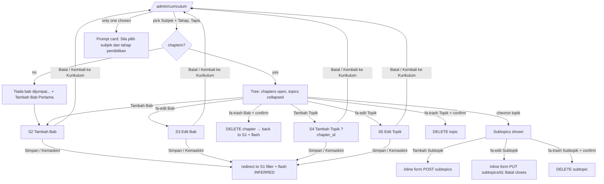
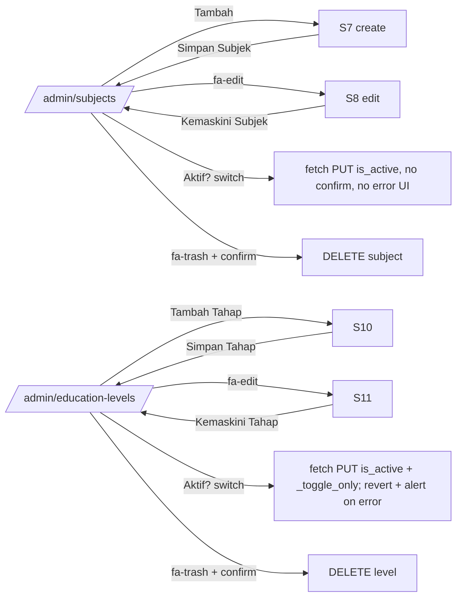
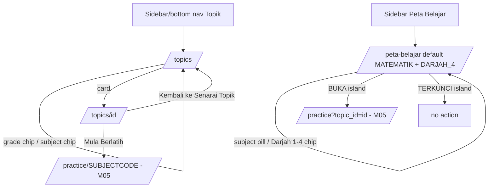

# M03 — Curriculum: Subjects, Levels, Topics (Discovery)

- **Source:** live walk-through of https://prestasiplus.my on 2026-09-25, read-only, admin account (browser lane 1).
- **Screenshots:** `docs/discovery/img/M03/` (37 PNG). Shell and design tokens: [00-global-ui.md](00-global-ui.md) (not repeated here).
- **Language:** UI copy is quoted in its exact Bahasa Melayu (English where the live site uses English).
- **Personal data:** none on these screens. Curriculum data (subjects, levels, chapters, topics, subtopics) is reference data and is recorded in full. The only account name shown is the system account "Admin PRESTASI+". CSRF tokens embedded in Alpine `fetch()` headers were replaced by `CSRF` before inventory.
- **Element inventory:** 807 content elements over 14 screens and 71 captured UI states, IDs `EL-M03-S#-nnn` → `docs/discovery/inventory/M03/<S#-key>.json`. Reconciliation, crawl and read-only limits: `docs/discovery/inventory/M03/_summary.md`. The inventory JSON is authoritative for attributes and conditions.
- **Full curriculum dataset:** `docs/discovery/inventory/M03/_curriculum-data.json` (11 levels, 31 subjects, all 194 subject × level trees with every chapter, topic and subtopic, and the 125 student "Topik" records). Use it as the dummy-data seed.

---

## 1. Overview

M03 covers two **separate** curriculum data sets that the live site keeps side by side:

1. **Admin curriculum (DSKP tree)** — `education_levels` (11) ↔ `subjects` (31) many-to-many; per subject × level a tree **Bab (chapter) → Topik (topic) → Subtopik (subtopic)**. Managed in the admin panel ("PENGURUSAN" group → collapsible "KURIKULUM" sub-group: "Kurikulum", "Subjek", "Tahap Pendidikan").
2. **Student "Topik" catalogue (legacy topics)** — a flat list of 125 topics, each with a `grade_level` code (`DARJAH_1`…`TINGKATAN_5`), an upper-case `subject` code (`MATEMATIK`, `BAHASA_MELAYU`, …) and its own subtopics. It feeds `/topics`, `/topics/{id}` and `/peta-belajar`. It is **not** linked to the admin tree (different ids, names and subject codes). INFERRED from the data: no admin screen edits it (open question Q-M03-1).

| # | Route | Screen (page header title / subtitle) | Shell | Status |
|---|---|---|---|---|
| S1 | `/admin/curriculum` (`?subject_id=&education_level_id=`) | "Pengurusan Kurikulum" / "Urus struktur kurikulum (Bab → Topik → Subtopik)" | admin | Documented; inline subtopic forms opened, not submitted |
| S2 | `/admin/curriculum/chapters/create` (`?subject_id=&education_level_id=`) | "Tambah Bab Baru" / "Cipta bab baharu dalam kurikulum" (tab "Tambah Bab") | admin | **new route**; not submitted |
| S3 | `/admin/curriculum/chapters/{id}/edit` | "Edit Bab" / "Kemaskini maklumat bab" | admin | **new route**; chapter 91 opened |
| S4 | `/admin/curriculum/topics/create?chapter_id={id}` | "Tambah Topik Baru" / "Cipta topik baharu dalam bab" (tab "Tambah Topik") | admin | **new route**; not submitted |
| S5 | `/admin/curriculum/topics/{id}/edit` | "Edit Topik" / "Kemaskini maklumat topik" | admin | **new route**; topic 126 opened |
| S6 | `/admin/subjects` | "Pengurusan Subjek" / "Urus subjek pembelajaran dalam sistem" | admin | Documented |
| S7 | `/admin/subjects/create` | "Tambah Subjek Baru" / "Cipta subjek pembelajaran baharu" (tab "Tambah Subjek") | admin | **new route**; not submitted |
| S8 | `/admin/subjects/{id}/edit` | "Edit Subjek" / "Kemaskini maklumat subjek" | admin | **new route**; subject 3 opened |
| S9 | `/admin/education-levels` | "Pengurusan Tahap Pendidikan" / "Urus tahap pendidikan dalam sistem" | admin | Documented |
| S10 | `/admin/education-levels/create` | "Tambah Tahap Pendidikan" / "Cipta tahap pendidikan baharu" | admin | **new route**; not submitted |
| S11 | `/admin/education-levels/{id}/edit` | "Edit Tahap Pendidikan" / "Kemaskini maklumat tahap pendidikan" | admin | **new route**; level 10 opened |
| S12 | `/topics` (`?grade_level=&subject=`) | "Topik Pembelajaran" / "Terokai semua topik pembelajaran" (tab "Topik - PRESTASIPLUS") | user portal | Documented |
| S13 | `/topics/{id}` | `<topic name>` / `<SUBJECT>` (tab "`<topic name>` - PRESTASIPLUS") | user portal | **new route**; topics 7 and 68 opened |
| S14 | `/peta-belajar` (`?subject=&grade=`) | header shows **"Dashboard" / "Selamat datang kembali"** (defect D-1); tab "Peta Belajar — PRESTASIPLUS" | user portal | Documented |

Tab titles: admin pages `<Title> - Admin PRESTASIPLUS` (S1 "Pengurusan Kurikulum", S3 "Edit Bab", S5 "Edit Topik", S6 "Pengurusan Subjek", S8 "Edit Subjek", S9 "Pengurusan Tahap Pendidikan", S10 "Tambah Tahap Pendidikan", S11 "Edit Tahap Pendidikan"); user pages `<Title> - PRESTASIPLUS`, except S14 which uses an em dash "Peta Belajar — PRESTASIPLUS".

**Stack:** Laravel Blade + Alpine.js + Tailwind + Font Awesome (as M01/M02). Lists are server-rendered, **no pagination** on any M03 screen. Forms are classic POST with `_token` (+ `_method` spoofing). The only client-side data calls are the two "Aktif?" switches (S6, S9), which `fetch()` a JSON `PUT`.

**Sidebar active state:** "Kurikulum" is active on S1–S5 (also on chapter/topic sub-pages), "Subjek" on S6–S8, "Tahap Pendidikan" on S9–S11. In the user portal, "Topik" is active on S12/S13 (sidebar, drawer and bottom nav); "Peta Belajar" is active on S14 (sidebar and drawer; it has no bottom-nav item).

### 1.1 Data hierarchy and counts (live, 2026-09-25)

```
EducationLevel (11)  ←— many-to-many —→  Subject (31)      (194 subject×level links)
        └──────────── per (subject, level) ───────────┘
                         Chapter "Bab" (1,251)
                           └─ Topic "Topik" (2,423)
                                └─ Subtopic "Subtopik" (234)

Legacy student topics (separate): Topic (125, grade_level + SUBJECT code) └─ subtopics (1–6 each)
```

- 194 subject × level combinations; **140 have chapters, 54 are empty**. Subtopics exist **only** for BM, BI, Matematik and Sains in Darjah 1–6 (24 combinations); every secondary combination has "`n` / 0".
- Per level (chapters / topics / subtopics): D1 41/55/35, D2 41/57/37, D3 33/47/40, D4 34/48/36, D5 35/51/43, D6 36/51/43, T1 183/356/0, T2 329/418/0, T3 296/334/0, T4 117/530/0, T5 106/476/0.
- Per subject: see Appendix B.3. Subjects with **no chapters at any level**: Pendidikan Muzik, Sains Rumah Tangga, Pembuatan Pakaian Wanita, Pertanian, Sains Sukan (the last four also have no levels). Fizik has 2 chapters and 0 topics; Bahasa Cina 1 chapter / 1 topic.
- Question counts ("Soalan" columns): sum over subjects 129,389; sum over levels 129,380 (9 questions not attributed to a level — INFERRED).

### 1.2 The 11 education levels (S9)

| id | Kod | Nama (BM) | Nama (EN) | Peringkat (stage code → label, icon, colour) | Kurikulum | Soalan | Subjek |
|---|---|---|---|---|---|---|---|
| 1 | D1 | Darjah 1 | Year 1 | `primary` → "Rendah", `fa-child`, blue | KSSR | 11396 | 16 |
| 2 | D2 | Darjah 2 | Year 2 | primary | KSSR | 10245 | 16 |
| 3 | D3 | Darjah 3 | Year 3 | primary | KSSR | 5776 | 16 |
| 4 | D4 | Darjah 4 | Year 4 | primary | KSSR | 4787 | 17 |
| 5 | D5 | Darjah 5 | Year 5 | primary | KSSR | 3874 | 17 |
| 6 | D6 | Darjah 6 | Year 6 | primary | KSSR | 4464 | 17 |
| 7 | T1 | Tingkatan 1 | Form 1 | `lower_secondary` → "Menengah Rendah", `fa-book-reader`, purple | KSSM | 19455 | 15 |
| 8 | T2 | Tingkatan 2 | Form 2 | lower_secondary | KSSM | 15700 | 15 |
| 9 | T3 | Tingkatan 3 | Form 3 | lower_secondary | KSSM | 13800 | 15 |
| 10 | T4 | Tingkatan 4 | Form 4 | `upper_secondary` → "Menengah Atas", `fa-user-graduate`, indigo | KSSM | 19113 | 25 |
| 11 | T5 | Tingkatan 5 | Form 5 | upper_secondary | KSSM | 20770 | 25 |

All 11 are active. Order = id = "Susunan Paparan" (level 10 has order 10).

### 1.3 The 31 subjects (S6)

Full table with colours, icons, core flag, question counts and linked levels: Appendix B.1. Summary:
- **Teras** (core, `is_core`=1, emerald badge with `fa-star`): 1 BM, 2 BI, 3 MATH, 4 SCI, 5 SEJ, 6 PI, 7 PM.
- **Elektif** (slate badge, no icon): 8 ADDMATH, 9 PHY, 10 CHEM, 11 BIO, 12 GEO, 13 PSV, 14 MUZ, 15 PJK, 16 RBT, 17 SK, 18 BA, 19 BC, 20 BT, 21 AKAUN, 22 EKON, 23 PERNIAGA, 24 PQS, 25 TI, 26 JAWI, 27 PSI, 28 SRT, 29 PPW, 30 PN, 31 SS.
- Level links: D1–T5 for BM, BI, MATH, SCI, SEJ, PI, PM, GEO, PSV, PJK, RBT, BA, BC, BT; T4–T5 for ADDMATH, PHY, CHEM, BIO, AKAUN, EKON, PERNIAGA, PQS, TI, PSI; D1–D6 for MUZ, JAWI; D4–T5 for SK; none for SRT, PPW, PN, SS.
- **Colour** (`color`, hex) drives the icon tile (`background-color: <hex>20`, i.e. 12.5 % alpha) and the icon colour, plus a swatch + hex text in the "Warna" column.
- **Icon** (`icon`, free text "Ikon (Font Awesome)") — stored values are inconsistent: subjects 1–23 hold bare Lucide-style names (`book-open`, `globe`, `calculator`, `beaker`, `clock`, `moon`, `heart`, `variable`, `zap`, `flask-round`, `leaf`, `map`, `palette`, `music`, `heart-pulse`, `wrench`, `monitor`, `languages`, `receipt`, `trending-up`, `briefcase`), 24–27 hold Font Awesome classes (`fas fa-quran`, `fas fa-mosque`, `fas fa-pen-nib`, `fas fa-scale-balanced`), 28–29 hold emoji (🍽, 👗), 30–31 are empty. The admin list renders the value as `<i class="<icon> …">`, so **only rows 24–27 show an icon**; every other tile is an empty coloured square (defect D-2).
- Ordering: rows appear by id 1→31; subject 3 has "Susunan Paparan" 3 (INFERRED: order = id for all; list sorted by `order` then id).

### 1.4 Student topic catalogue (S12–S14) enumerations

- `grade_level` codes: `DARJAH_1`…`DARJAH_6`, `TINGKATAN_1`, `TINGKATAN_4`, `TINGKATAN_5` hold topics (17, 11, 9, 9, 8, 8, 34, 19, 10 = 125). `TINGKATAN_2`/`TINGKATAN_3` are valid filters with 0 topics.
- `subject` codes (label = code with "_" → space): `MATEMATIK` (34), `BAHASA_MELAYU` (15), `BAHASA_INGGERIS` (6), `SAINS` (35), `PENDIDIKAN_ISLAM` (7), `PENDIDIKAN_MORAL` (12), `SEJARAH` (11), `GEOGRAFI` (5).
- Practice links from S13 use the admin subject code: `MATEMATIK` → `/practice/MATH`, `BAHASA_MELAYU` → `/practice/BM` (OBSERVED); the other six are also observed: `BAHASA_INGGERIS` → `/practice/BI`, `SAINS` → `/practice/SCI`, `PENDIDIKAN_ISLAM` → `/practice/PI`, `PENDIDIKAN_MORAL` → `/practice/PM`, `SEJARAH` → `/practice/SEJ`, `GEOGRAFI` → `/practice/GEO` (corrected after audit).
- Every topic has 1–6 subtopics. The full list (id, grade, subject, name, description, subtopic count, first three subtopics) is in `_curriculum-data.json` → `legacyTopics` and Appendix B.5.

---

## 2. Screens

### 2.1 S1 — `/admin/curriculum` "Pengurusan Kurikulum - Admin PRESTASIPLUS"
Screenshots: `curriculum-default-desktop.png`, `curriculum-default-mobile.png`, `curriculum-tree-desktop.png`, `curriculum-tree-tablet.png`, `curriculum-tree-mobile.png`, `curriculum-subtopics-desktop.png`, `curriculum-no-chapters.png`, `curriculum-flash-error.png`.

**Flash area** (top of content, only after a redirect): red alert `bg-red-50 border-red-200 text-red-700`, `fa-exclamation-circle` + message. Observed messages: "Chapter ID diperlukan." (from `/admin/curriculum/topics/create` without `chapter_id`), "Bab tidak dijumpai." (missing chapter id on `/chapters/{id}/edit` or `/topics/create?chapter_id=`), "Topik tidak dijumpai." (missing topic id on `/topics/{id}/edit`) (corrected after audit). INFERRED: a green success variant exists for save/delete (not observable read-only).

**Filter card** "Tapis Kurikulum" (`fa-filter`) — form `GET /admin/curriculum`, grid 2 columns (3 from md):
| Label | Name | Control | Options |
|---|---|---|---|
| Subjek | `subject_id` | select (not required) | "-- Pilih Subjek --" + the 31 subjects by id (value = id, label = Nama BM) |
| Tahap | `education_level_id` | select | "-- Pilih Tahap --" + Darjah 1 … Darjah 6, Tingkatan 1 … Tingkatan 5 (value 1–11) |
| — | — | submit "Tapis" (`fa-search`, full width, spans 2 columns below md) | |
The selects keep the current query values (selected). Subject options are **not** filtered by level and vice versa.

**No selection** (either parameter missing, e.g. `?subject_id=3`): card with `fa-info-circle` "Sila pilih subjek dan tahap pendidikan" / "Gunakan penapis di atas".

**Selection made** (both parameters):
1. **Summary cards** (grid 2 → 4 at md): "Subjek" (blue, `fa-book`, subject name), "Tahap" (purple, `fa-graduation-cap`, level name), "Jumlah Bab" (emerald, `fa-book-open`, count), "Topik / Subtopik" (amber, `fa-list`, "`topics` / `subtopics`").
2. Button "Tambah Bab" (`fa-plus`) → `/admin/curriculum/chapters/create?subject_id=<s>&education_level_id=<l>`.
3. **Tree card**:
   - **Empty** (no chapters): `fa-inbox` "Tiada bab dijumpai untuk subjek dan tahap ini." + link "Tambah Bab Pertama" (`fa-plus`) → same create URL. This also shows for a level that is not linked to the subject (e.g. Matematik Tambahan + Darjah 1): the page does not check the subject–level link; the create links still point at that pair.
   - **Chapter block** (Alpine `{ open: true }` — expanded by default): left border indigo; chevron toggle (`fa-chevron-down` ↔ `fa-chevron-right`), `fa-book-open`, heading "Bab `<chapter_number>`: `<name>`" (truncate), optional description line under it; actions: edit link (`fa-edit`, title "Edit Bab") → `/admin/curriculum/chapters/{id}/edit`; delete form `DELETE /admin/curriculum/chapters/{id}` (`fa-trash`, title "Padam Bab", `onsubmit="return confirm('Adakah anda pasti mahu padam bab ini?')"`).
   - **Topic list** (x-show `open`, x-collapse, indented): each topic (Alpine `{ topicOpen: false, showAddSubtopic: false, editingSubtopic: null }` — **collapsed by default**): chevron toggle, `fa-list` (purple), heading "Topik `<n>`: `<name>`" (truncate), description line; actions: edit (`fa-edit`, title "Edit Topik") → `/admin/curriculum/topics/{id}/edit`; delete `DELETE /admin/curriculum/topics/{id}` (`fa-trash`, title "Padam Topik", confirm "Adakah anda pasti mahu padam topik ini?").
   - After the topics: link "Tambah Topik" (`fa-plus`) → `/admin/curriculum/topics/create?chapter_id={id}`.
   - **Subtopic list** (x-show `topicOpen`): "Tiada subtopik" (italic) when empty; otherwise one row per subtopic (x-show `editingSubtopic !== <id>`): `fa-chevron-right` + name (truncate) + edit button (`fa-edit`, title "Edit Subtopik", sets `editingSubtopic = <id>`) + delete form `DELETE /admin/curriculum/subtopics/{id}` (`fa-trash`, title "Padam Subtopik", confirm "Adakah anda pasti mahu padam subtopik ini?").
   - **Inline edit form** (x-show `editingSubtopic === <id>`, purple panel) `PUT /admin/curriculum/subtopics/{id}`: `name` text required (placeholder "Nama Subtopik (BM)", pre-filled), `name_en` text (placeholder "Nama Subtopik (EN)"), `learning_objective` textarea rows 2 (placeholder "Objektif Pembelajaran"); buttons "Simpan" (`fa-save`, submit) and "Batal" (type button, `editingSubtopic = null`). "Batal" only hides the form; the inputs are not reset, so text typed before "Batal" is still there when the form is reopened, until the page reloads. The add-subtopic form behaves the same (corrected after audit). Only one subtopic per topic can be in edit mode.
   - **Add subtopic toggle**: button `fa-plus` "Tambah Subtopik" ↔ `fa-minus` "Batal" (x-text `showAddSubtopic ? 'Batal' : 'Tambah Subtopik'`). Opens an inline form `POST /admin/curriculum/subtopics` with hidden `curriculum_topic_id`, `name` required "Nama Subtopik (BM)", `name_en` "Nama Subtopik (EN)", `learning_objective` textarea "Objektif Pembelajaran", submit "Tambah Subtopik" (`fa-plus`).
   - Topic descriptions observed include machine-generated text, e.g. "Auto-created from DSKP SK 1.1 for chapter scale-up." and chapter description "Auto-created from textbook coverage audit: T4-BT-MAT---MATEMATIK.pdf" (data, replicate as data).

Ordering: chapters appear in stored order, **not by chapter number** (Matematik D1: Bab 3,4,5,6,7,8,1,2; Perniagaan T5: 1,6,2,7,3,4,5; Sains Komputer T3 uses numbers 902–961). Topic numbers repeat inside a chapter (478 duplicates across the tree, e.g. two "Topik 1" in Matematik T4 Bab 1). INFERRED: sorted by an `order` column then id; the "Bab n"/"Topik n" prefix is the stored `chapter_number` / `topic_number`.

### 2.2 S2 — `/admin/curriculum/chapters/create` "Tambah Bab - Admin PRESTASIPLUS"
Screenshots: `chapter-create-desktop.png`, `chapter-create-mobile.png`.

Back link "Kembali ke Kurikulum" (`fa-arrow-left`) → `/admin/curriculum?subject_id=<s>&education_level_id=<l>` (the link carries exactly the `subject_id` / `education_level_id` S2 received: `?subject_id=3` alone → `/admin/curriculum?subject_id=3`; none → `/admin/curriculum` (corrected after audit)). Form `POST /admin/curriculum/chapters`:
| Label | Name | Control | Rules / placeholder |
|---|---|---|---|
| Subjek * | `subject_id` | select required | "-- Pilih Subjek --" + 31 subjects; pre-selected from `?subject_id` |
| Tahap Pendidikan * | `education_level_id` | select required | "-- Pilih Tahap --" + 11 levels; pre-selected from `?education_level_id` |
| Nama Bab (Bahasa Melayu) * | `name` | text required | "cth: Nombor Bulat" |
| Nama Bab (English) | `name_en` | text | "e.g: Whole Numbers" |
| Nombor Bab | `chapter_number` | number, min 1 | "cth: 1"; hint `fa-info-circle` "Contoh: 1, 2, 3 (opsional)" |
| Penerangan | `description` | textarea rows 4 | "Penerangan ringkas tentang bab ini..." |
Buttons: "Batal" (link, same target as the back link) and "Simpan Bab" (`fa-save`, submit). No "Aktif" checkbox on create (INFERRED: new chapters default to active).

### 2.3 S3 — `/admin/curriculum/chapters/{id}/edit` "Edit Bab - Admin PRESTASIPLUS"
Screenshot: `chapter-edit-desktop.png`. Same fields as S2, pre-filled, form `PUT /admin/curriculum/chapters/{id}` (`_method=PUT`), plus checkbox **"Aktif"** (`is_active` value 1, checked) with hint "Nyahtanda jika bab ini tidak mahu dipaparkan buat masa ini". Submit "Kemaskini Bab" (`fa-save`). Back/Batal → the curriculum filter of the chapter's subject + level. Chapter 91 values: Matematik, Tingkatan 4, "Fungsi dan Persamaan Kuadratik" / "Functions and Quadratic Equations", Nombor Bab 1, empty description. A missing id redirects to S1 with "Bab tidak dijumpai.". (Topic edit with a missing id: S1 with "Topik tidak dijumpai." (corrected after audit).)

### 2.4 S4 — `/admin/curriculum/topics/create?chapter_id={id}` "Tambah Topik - Admin PRESTASIPLUS"
Screenshot: `topic-create-desktop.png`. Back link "Kembali ke Kurikulum" → curriculum filter of the chapter. **Chapter context card**: `fa-book-open` tile, small label "Bab", heading "Bab 1: Fungsi dan Persamaan Kuadratik", chips `fa-book` "Matematik" and `fa-graduation-cap` "Tingkatan 4". Form `POST /admin/curriculum/topics` with hidden `chapter_id`:
| Label | Name | Control | Rules / placeholder |
|---|---|---|---|
| Nama Topik (Bahasa Melayu) * | `name` | text required | "cth: Nombor hingga 1000" |
| Nama Topik (English) | `name_en` | text | "e.g: Numbers up to 1000" |
| Nombor Topik | `topic_number` | text | "cth: 1.1"; hint `fa-info-circle` "Contoh: 1.1, 1.2, 2.1 (opsional)" |
| Penerangan | `description` | textarea rows 4 | "Penerangan ringkas tentang topik ini..." |
| Standard Pembelajaran | `learning_standard` | textarea rows 4 | "Standard pembelajaran mengikut kurikulum KSSM/KSSR..."; hint `fa-info-circle` "Rujuk dokumen standard kurikulum KPM" |
Buttons "Batal" and "Simpan Topik" (`fa-save`). Without `chapter_id` → redirect to S1 with "Chapter ID diperlukan."; unknown id → "Bab tidak dijumpai.".

### 2.5 S5 — `/admin/curriculum/topics/{id}/edit` "Edit Topik - Admin PRESTASIPLUS"
Screenshots: `topic-edit-desktop.png`, `topic-edit-mobile.png`. Same as S4 (chapter card + fields pre-filled), form `PUT /admin/curriculum/topics/{id}`, plus checkbox "Aktif" (`is_active`, checked) with hint "Nyahtanda jika topik ini tidak mahu dipaparkan buat masa ini"; submit "Kemaskini Topik" (`fa-save`). Topic 126: "Fungsi" / "Functions", Nombor Topik "1", Penerangan "Konsep fungsi dan graf", Standard Pembelajaran empty. The chapter cannot be changed here (no chapter select).

### 2.6 S6 — `/admin/subjects` "Pengurusan Subjek - Admin PRESTASIPLUS"
Screenshots: `subjects-desktop.png`, `subjects-tablet.png`, `subjects-mobile.png`, `subjects-flash-error.png`.

Header row: "Senarai Subjek" / "Jumlah: 31 subjek" + button "Tambah" (`fa-plus`) → `/admin/subjects/create`. Flash area as S1 (observed "Subjek tidak dijumpai." after `/admin/subjects/999/edit`).

**Table** (all 31 rows, no pagination, no search/filter). Columns: "#" | "Ikon" | "Nama (BM)" | "Nama (EN)" | "Kod" | "Warna" | "Teras?" | "Soalan" | "Aktif?" | "Tindakan" (headers rendered upper-case).
- "#": subject id. "Ikon": coloured tile (see §1.3). "Nama (BM)": name + a second line `fa-graduation-cap` with the comma-separated linked level names (e.g. "Tingkatan 4, Tingkatan 5"); empty when none.
- "Kod": grey mono pill. "Warna": round swatch + hex text (below 640 px the hex is hidden, `hidden sm:inline` (corrected after audit)). "Teras?": "Teras" (emerald, `fa-star`) or "Elektif" (slate). "Soalan": amber pill "`n` soalan" (below 640 px the number only; "soalan" is `hidden sm:inline` (corrected after audit)).
- "Aktif?": switch (Alpine `{ active: 1 }`), emerald/slate. **Clicking toggles immediately** and sends `fetch('/admin/subjects/{id}', {method:'POST', headers:{'Content-Type':'application/json','X-CSRF-TOKEN':…}, body: JSON.stringify({_method:'PUT', is_active: active ? 1 : 0})})` — no confirmation, no error handling (compare S9). Not clicked.
- "Tindakan": edit (`fa-edit`, title "Edit") → `/admin/subjects/{id}/edit`; delete form `DELETE /admin/subjects/{id}` (`fa-trash`, title "Padam", confirm "Adakah anda pasti mahu padam subjek ini?").

### 2.7 S7 — `/admin/subjects/create` "Tambah Subjek - Admin PRESTASIPLUS"
Screenshot: `subject-create-desktop.png`. Back link "Kembali ke Senarai" (`fa-arrow-left`) → `/admin/subjects`. Form `POST /admin/subjects`:
| Label | Name | Control | Default / placeholder / rule |
|---|---|---|---|
| Nama Subjek (Bahasa Melayu) * | `name` | text required | "cth: Matematik" |
| Nama Subjek (English) * | `name_en` | text required | "e.g: Mathematics" |
| Kod Subjek * | `code` | text required, maxlength 20, CSS upper-case, mono | "cth: MATH01" (displayed "CTH: MATH01" (corrected after audit)); hint `fa-info-circle` "Kod akan ditukar ke huruf besar automatik" |
| Ikon (Font Awesome) | `icon` | text | default `fas fa-book`, placeholder "cth: fas fa-calculator"; hint `fa-lightbulb` "Lihat ikon di" + link "Font Awesome" → https://fontawesome.com/icons (new tab) |
| Warna Tema | `color` | colour picker (default `#4f46e5`) + read-only text `color_text` mirroring it (inline script: `input` event copies the value) | |
| Subjek Teras (Core Subject) | `is_core` | checkbox value 1 (unchecked) | hint "Tandakan jika subjek ini adalah subjek wajib" |
| Susunan Paparan | `order` | number min 0, default 0 | hint `fa-sort` "Nombor lebih kecil akan dipaparkan dahulu" |
| Tahap Pendidikan Berkaitan | `education_levels[]` | 11 checkboxes (value 1–11) in a single-column list inside a bordered box with max height 16 rem (256 px) that scrolls on its own, about 5 rows visible (corrected after audit) | labels "Darjah 1 (Year 1)" … "Darjah 6 (Year 6)", "Tingkatan 1 (Form 1)" … "Tingkatan 5 (Form 5)" (full list Appendix A) |
Buttons "Batal" (→ `/admin/subjects`) and "Simpan Subjek" (`fa-save`). No "Aktif" field (active is only switched from the list).

### 2.8 S8 — `/admin/subjects/{id}/edit` "Edit Subjek - Admin PRESTASIPLUS"
Screenshots: `subject-edit-desktop.png`, `subject-edit-mobile.png`. Same form pre-filled, `PUT /admin/subjects/{id}`, submit "Kemaskini Subjek" (`fa-save`). Subject 3: "Matematik" / "Mathematics", code MATH, icon `calculator`, colour `#EF4444`, core checked, order 3, all 11 levels ticked. Unknown id → redirect to S6 with "Subjek tidak dijumpai.".

### 2.9 S9 — `/admin/education-levels` "Pengurusan Tahap Pendidikan - Admin PRESTASIPLUS"
Screenshots: `levels-desktop.png`, `levels-mobile.png`.

Header "Senarai Tahap Pendidikan" / "Jumlah: 11 tahap" + button "Tambah Tahap" (`fa-plus`, pink gradient; S9–S11 use a pink accent for buttons and focus rings, S6–S8 indigo (corrected after audit)) → `/admin/education-levels/create`. Flash area (observed "Tahap Pendidikan tidak dijumpai."). **Table** columns: "#" | "Nama (BM)" | "Nama (EN)" | "Kod" (grey mono pill) | "Peringkat" (badge per stage, §1.2) | "Kurikulum" (plain text) | "Soalan" (amber "`n` soalan") | "Subjek" (emerald "`n` subjek") | "Aktif?" | "Tindakan". Values: §1.2.
- "Aktif?" switch sends `fetch('/admin/education-levels/{id}', {method:'POST', headers: {… 'Accept':'application/json'}, body: {_method:'PUT', is_active, _toggle_only: true}})`; on `!r.ok` it reverts and `alert('Gagal kemaskini status')`; on network error it reverts and `alert('Ralat rangkaian')`.
- Tindakan: edit (`fa-edit`, "Edit") → `/admin/education-levels/{id}/edit`; delete `DELETE /admin/education-levels/{id}` (`fa-trash`, "Padam", confirm "Adakah anda pasti mahu padam tahap pendidikan ini?").

### 2.10 S10 — `/admin/education-levels/create` "Tambah Tahap Pendidikan - Admin PRESTASIPLUS"
Screenshot: `level-create-desktop.png`. Back "Kembali ke Senarai" → `/admin/education-levels`. Form `POST /admin/education-levels`:
| Label | Name | Control | Placeholder / rule |
|---|---|---|---|
| Nama Tahap (Bahasa Melayu) * | `name` | text required | "cth: Tahun 1" |
| Nama Tahap (English) * | `name_en` | text required | "e.g: Year 1" |
| Kod Tahap * | `code` | text required, maxlength 10, CSS upper-case, mono | "cth: Y1" (displayed "CTH: Y1"); hint `fa-info-circle` "Kod akan ditukar ke huruf besar automatik" (corrected after audit) |
| Peringkat * | `stage` | select required | "-- Pilih Peringkat --", `primary` "Rendah (Primary)", `lower_secondary` "Menengah Rendah (Lower Secondary)", `upper_secondary` "Menengah Atas (Upper Secondary)" |
| Kurikulum * | `curriculum` | text required | "cth: KSSR, KSSM"; hint `fa-book-open` "Nama kurikulum yang diguna pakai" |
| Susunan Paparan | `order` | number min 0, default 0 | hint `fa-sort` "Nombor lebih kecil akan dipaparkan dahulu" |
Buttons "Batal", "Simpan Tahap" (`fa-save`).

### 2.11 S11 — `/admin/education-levels/{id}/edit` "Edit Tahap Pendidikan - Admin PRESTASIPLUS"
Screenshot: `level-edit-desktop.png`. Same form pre-filled (`PUT`), submit "Kemaskini Tahap" (`fa-save`). Level 10: Tingkatan 4 / Form 4 / T4 / upper_secondary / KSSM / order 10. No "Aktif" field. Unknown id → S9 with "Tahap Pendidikan tidak dijumpai.".

### 2.12 S12 — `/topics` "Topik - PRESTASIPLUS" (student)
Screenshots: `topics-desktop.png`, `topics-tablet.png`, `topics-mobile.png`, `topics-filter-d1-sains.png`, `topics-empty.png`.

Tournament banner slot (global widget, hidden when no tournament; strings "LIVE:", "MAIN", "DAFTAR", "Pendaftaran dibuka", "Sedang berlangsung" — owned by M16/global).

**Grade chips** (green when active `bg-green-600`, else white bordered; hover green): "Semua Darjah", "Darjah 1" … "Darjah 6" → `?grade_level=DARJAH_n`. **Subject chips** (purple when active `bg-purple-600`): "Semua Subjek", "MATEMATIK", "BAHASA MELAYU", "BAHASA INGGERIS", "SAINS", "PENDIDIKAN ISLAM", "PENDIDIKAN MORAL", "SEJARAH" → `?subject=<CODE>`. Each chip link **keeps the other filter** (e.g. with `?subject=SAINS` the grade chips link to `?subject=SAINS&grade_level=DARJAH_n`; "Semua Darjah" → `?subject=SAINS`). There are **no chips** for Tingkatan levels or GEOGRAFI although such topics exist and the filters work by URL (defect D-4).

**Topic cards** (grid 1 / 2 at sm / 3 at lg; whole card is a link to `/topics/{id}`): purple→pink gradient header with a white `fa-book-open` circle, pill "`n` Subtopik", title (h3), subject code label (e.g. "MATEMATIK"); body: description (2-line clamp), "Subtopik:" (upper-case label) + up to 3 subtopic names each with green `fa-check-circle`, then "+`n` lagi..." when more; footer button "Lihat Topik" (`fa-eye`). The green tick is decorative (shown for everyone, not progress).

Filters match case-insensitively (`?grade_level=darjah_1` lists the 17 Darjah 1 topics) and then no grade chip is active, not even "Semua Darjah" (corrected after audit). Default list = all 125 topics, one page. Order INFERRED: by a sequence/order field then id (1,3,4,6,7,10,12,…). **Empty state** (e.g. `?grade_level=TINGKATAN_2`, unknown subject): `fa-book-open` (slate) "Tiada topik tersedia buat masa ini.".

### 2.13 S13 — `/topics/{id}` "`<topic>` - PRESTASIPLUS" (student)
Screenshots: `topic-show-desktop.png`, `topic-show-mobile.png`. Header title = topic name, subtitle = subject code label.
- Back link "Kembali ke Senarai Topik" (`fa-arrow-left`) → `/topics` (filters are not preserved).
- Hero (purple→pink): h1 topic name, subject label, description (clamped to 3 lines (corrected after audit)), `fa-book-open` icon.
- **Stat cards** (3 columns at all widths): `fa-list` (purple) "`n`" "Subtopik"; `fa-question-circle` (green) "`n`" "Dijawab"; `fa-chart-line` (amber) "`n`%" "Kemajuan" (corrected after audit) (admin: 0 / 0%).
- Section "Subtopik": cards (1 col, 2 from sm) each with a numbered gradient circle (1, 2, …), subtopic name, three difficulty badges "Level 1" (green), "Level 2" (yellow), "Level 3" (red) each with `fa-circle`, a progress row "Kemajuan" "`n`%" with a purple→pink bar (`width: n%`), and button "Mula Berlatih" (`fa-play`) → `/practice/<ADMIN SUBJECT CODE>` (same link for every subtopic of the topic: topic 7 → `/practice/MATH`, topic 68 → `/practice/BM`).
- Topic 7 subtopics: "Membilang 1-20", "Membilang 21-50", "Membilang 51-100", "Menulis Nombor dalam Perkataan". Topic 68 ("Kemahiran Bahasa Tingkatan 5", BAHASA MELAYU, "Kemahiran Bahasa Melayu SPM Tingkatan 5 berdasarkan DSKP KSSM") has 1 subtopic "Kemahiran Bahasa Tingkatan 5".
- Unknown id → global 404 page.

### 2.14 S14 — `/peta-belajar` "Peta Belajar — PRESTASIPLUS" (student learning map)
Screenshots: `peta-belajar-desktop.png`, `peta-belajar-math-d1.png`, `peta-belajar-empty.png`, `peta-belajar-tablet.png`, `peta-belajar-mobile.png`.

**Hero** (`journey-hero`: emerald gradient `#059669 → #10B981 → #34D399`, radius 2rem): h1 "🗺️ Peta Belajar"; subtitle "Terokai perjalanan `<Subject label>` — takluki setiap pulau! 🏝️"; stat tiles (**md and up only**): "`done`/`total`" "Topik Selesai" and "`n`%" "Kemajuan"; full-width progress bar (yellow→amber gradient, `width: n%`; it references `animation: shimmer` but no `@keyframes shimmer` exists, so the highlight is static (corrected after audit)). The subtitle uses the pill label without emoji ("Pend. Islam", "Pend. Moral"), not the full subject name (corrected after audit).

**Selectors card:** subject pills (`subject-pill`; active pill filled with the subject colour and white text, inactive slate) — "🔢 Matematik" (#3B82F6 when active; other active colours: Bahasa Melayu #10B981, Bahasa Inggeris #8B5CF6, Sains #F59E0B, Pend. Islam #14B8A6, Pend. Moral #F97316, Sejarah #EF4444, Geografi #06B6D4 (corrected after audit)), "📝 Bahasa Melayu", "🇬🇧 Bahasa Inggeris", "🔬 Sains", "☪️ Pend. Islam", "🤝 Pend. Moral", "🏛️ Sejarah", "🌍 Geografi"; each links `?subject=<CODE>&grade=<current grade>`. Grade chips **"Darjah 1" … "Darjah 4" only** (active = indigo→purple gradient), each `?subject=<current>&grade=DARJAH_n`.

**Map** (`map-container`): vertical green path line (`map-path`, md and up) with one **island node** per topic of that subject + grade, alternating left/right (odd/even `nth-child`); on ≤768 px the cards are centred and the path and dots are hidden. Each node: path dot (`path-dot <state>`, top 0 %…100 %), and an **island card** in one of four states:
| State | Card / icon style | Label | Content | Link |
|---|---|---|---|---|
| `mastered` | green gradient, border #34D399 | (not observed) | (not observed) | INFERRED `/practice?topic_id=` |
| `started` | blue gradient, border #60A5FA | (not observed) | (not observed) | INFERRED |
| `unlocked` | amber gradient, border #FBBF24, `pulse-glow` animation | "🎯 BUKA" (amber) | topic emoji icon, title, progress bar (blue) + "`n`%", "`s` sesi · `q` soalan dijawab" | `/practice?topic_id={id}` |
| `locked` | slate gradient, 60 % opacity, `cursor: not-allowed` | "🔒 TERKUNCI" | 🔒 icon, title, "Selesaikan topik sebelumnya dulu" | none (div) |
Observed with no progress: the **first two** topics are "BUKA", every later topic is "TERKUNCI" (INFERRED rule §4). Topic emoji come from the topic record (e.g. 🔢 Nombor, ✖️ Pendaraban, 🥧 Pecahan, 🔣 Perpuluhan, 🔤 Huruf, 📖 Membaca dan Menulis, 🐾 Haiwan, 🌿 Hidupan, 🕌 Asas Akidah, 🤲 Ibadah Asas, 💖 Nilai Diri, 👨‍👩‍👦 Diri Saya dan Keluarga — full list Appendix B.6).
Nodes fade in on scroll (IntersectionObserver: opacity 0 → 1, `translateY(30px)` → 0, staggered 0.1 s).

**Empty state** ("🗺️" / "Tiada Topik Dijumpai" / "Pilih subjek dan darjah yang lain untuk melihat peta belajar") — e.g. Geografi at every grade, or an unknown subject.

**Parameter handling (OBSERVED):** default = `MATEMATIK` + `DARJAH_4`; `grade` values other than DARJAH_1–4 (DARJAH_5, DARJAH_6, TINGKATAN_*) are served as **Darjah 4** (chip "Darjah 4" active, D4 topics); an unknown subject shows no active pill, the subtitle title-cases the code ("Terokai perjalanan Zzz — …") and the empty state. Topics per subject × grade (open/locked): Appendix B.6.

---

## 3. Flows

### 3.1 Browse and edit the curriculum tree (S1–S5)


### 3.2 Subjects and levels (S6–S11)


### 3.3 Student: topics and learning map (S12–S14)


---

## 4. Inferred server-side rules (INFERRED unless marked OBSERVED)

1. Curriculum tree requires both `subject_id` and `education_level_id` (OBSERVED: otherwise the prompt card). The subject–level link is not enforced when viewing (OBSERVED) — INFERRED also not enforced when creating a chapter.
2. Chapters/topics are ordered by a stored order field, then id — not by `chapter_number`/`topic_number` (OBSERVED ordering anomalies §2.1).
3. "Topik / Subtopik" counts are all topics and all subtopics of the selected pair (OBSERVED, match the tree).
4. `code` values are upper-cased on save (hint text); codes are probably unique (INFERRED, no evidence).
5. Delete of a chapter/topic cascades to its topics/subtopics (INFERRED; no warning text beyond the confirm).
6. Inactive chapters/topics (`is_active` unchecked) are hidden from students ("tidak mahu dipaparkan") but INFERRED still shown in the admin tree (no inactive marker exists in the tree markup).
7. The subject "Aktif?" switch persists via `PUT /admin/subjects/{id}` JSON; the level switch uses `_toggle_only: true` so validation of the other fields is skipped (INFERRED from the flag name).
8. Level/subject "Soalan" and "Subjek" counts are computed live (OBSERVED: "Subjek" per level equals the number of subjects linked to it).
9. Student `/topics` and `/peta-belajar` read the legacy topic table filtered by `grade_level` and `subject` codes; only active topics INFERRED.
10. Peta Belajar: island state per topic from the learner's practice history — `mastered` (INFERRED high accuracy/complete), `started` (some sessions), `unlocked`, `locked`. With no history the first two topics are unlocked (OBSERVED on every subject/grade with ≥2 topics); INFERRED: topic *k* unlocks when topic *k−1* (or *k−2*) is started/mastered. "Topik Selesai" = count of mastered topics; "Kemajuan" = average progress (INFERRED).
11. Peta Belajar grade is clamped to Darjah 1–4 (OBSERVED); INFERRED default grade comes from the learner's own level, falling back to Darjah 4 for the admin.
12. `/topics/{id}` progress ("Dijawab", "Kemajuan", per-subtopic %) is per learner (INFERRED; admin shows 0).

---

## 5. Data entities implied

### EducationLevel
`id`, `name` (BM), `name_en`, `code` (≤10, upper-case, unique INFERRED), `stage` enum `primary | lower_secondary | upper_secondary`, `curriculum` (free text: KSSR/KSSM), `order` (int ≥0), `is_active` (bool). Derived: `question_count`, `subject_count`.

### Subject
`id`, `name`, `name_en`, `code` (≤20, upper-case), `icon` (free text), `color` (hex), `is_core` (bool → "Teras"/"Elektif"), `order` (int ≥0), `is_active` (bool); many-to-many `education_levels` (pivot). Derived: `question_count`.

### CurriculumChapter
`id`, `subject_id`, `education_level_id`, `name`, `name_en?`, `chapter_number?` (int ≥1), `description?`, `is_active`, order (INFERRED).

### CurriculumTopic
`id`, `chapter_id`, `name`, `name_en?`, `topic_number?` (text, e.g. "1.1"), `description?`, `learning_standard?`, `is_active`, order (INFERRED).

### CurriculumSubtopic
`id`, `curriculum_topic_id`, `name`, `name_en?`, `learning_objective?`.

### LegacyTopic (student catalogue)
`id`, `grade_level` enum `DARJAH_1..6 | TINGKATAN_1..5`, `subject` enum (8 codes §1.4), `name`, `description`, `icon` (emoji, used on Peta Belajar), order (INFERRED); has many `LegacySubtopic` (`name`; difficulty levels 1–3 shown for each). Progress per learner: sessions, questions answered, % (from M05 practice data).

---

## 6. Endpoints observed

| Method | URL | Used by | Payload / response |
|---|---|---|---|
| GET | `/admin/curriculum?subject_id=&education_level_id=` | S1 | HTML |
| GET | `/admin/curriculum/chapters/create?subject_id=&education_level_id=` | S1 → S2 | HTML (query optional) |
| POST | `/admin/curriculum/chapters` | S2 | form: `_token, subject_id, education_level_id, name, name_en, chapter_number, description` |
| GET | `/admin/curriculum/chapters/{id}/edit` | S3 | HTML; missing id → 302 `/admin/curriculum` + flash "Bab tidak dijumpai." |
| PUT (POST + `_method`) | `/admin/curriculum/chapters/{id}` | S3 | + `is_active` |
| DELETE | `/admin/curriculum/chapters/{id}` | S1 | `_token, _method=DELETE` |
| GET | `/admin/curriculum/topics/create?chapter_id=` | S1 → S4 | no id → 302 + "Chapter ID diperlukan."; bad id → "Bab tidak dijumpai." |
| POST | `/admin/curriculum/topics` | S4 | `chapter_id, name, name_en, topic_number, description, learning_standard` |
| GET | `/admin/curriculum/topics/{id}/edit` | S5 | HTML |
| PUT / DELETE | `/admin/curriculum/topics/{id}` | S5 / S1 | + `is_active` |
| POST | `/admin/curriculum/subtopics` | S1 inline | `curriculum_topic_id, name, name_en, learning_objective` |
| PUT / DELETE | `/admin/curriculum/subtopics/{id}` | S1 inline | `name, name_en, learning_objective` |
| GET | `/admin/subjects`, `/admin/subjects/create`, `/admin/subjects/{id}/edit` | S6–S8 | bad id → 302 `/admin/subjects` + "Subjek tidak dijumpai." |
| POST / PUT / DELETE | `/admin/subjects`, `/admin/subjects/{id}` | S7, S8, S6 | `name, name_en, code, icon, color, is_core, order, education_levels[]` |
| POST (JSON, `_method: PUT`) | `/admin/subjects/{id}` | S6 switch | `{_method:'PUT', is_active: 0|1}`; response not read |
| GET | `/admin/education-levels`, `/create`, `/{id}/edit` | S9–S11 | bad id → "Tahap Pendidikan tidak dijumpai." |
| POST / PUT / DELETE | `/admin/education-levels`, `/admin/education-levels/{id}` | S10, S11, S9 | `name, name_en, code, stage, curriculum, order` |
| POST (JSON, `_method: PUT`) | `/admin/education-levels/{id}` | S9 switch | `{_method:'PUT', is_active, _toggle_only:true}`, `Accept: application/json`; non-2xx → alert |
| GET | `/topics?grade_level=&subject=` | S12 | HTML |
| GET | `/topics/{id}` | S13 | HTML; unknown → 404 |
| GET | `/peta-belajar?subject=&grade=` | S14 | HTML |
| GET | `/practice/{CODE}`, `/practice?topic_id={id}` | S13, S14 | M05 targets (both return 200) |
| GET | `/admin/server-status`, `/api/tournament/active`, `/notifikasi/unread-count`, `/chatbot/*`, `/fcm/token` | shells | owned by M23 / M16 / M01+M22 |

Probed and **absent**: `/admin/curriculum/create`, `/admin/curriculum/subtopics/{id}/edit` (404); `/admin/curriculum/chapters`, `/topics`, `/subtopics` index, `/chapters/{id}`, `/topics/{id}`, `/subtopics/{id}`, `/subtopics/create`, `/admin/subjects/{id}`, `/admin/education-levels/{id}` as GET (405 — resource routes without index/show); `/api/subjects`, `/api/education-levels`, `/api/chapters`, `/api/topics`, `/api/curriculum`, `/subjects`, `/levels` (404). No JSON endpoints exist for M03.

---

## 7. Responsive behaviour (375 / 768 / 1280) and live defects

No screen causes horizontal page scroll at any width (document width = viewport on all 71 states).

| Screen | 1280 | 768 | 375 |
|---|---|---|---|
| S1 | filter 3 columns, stat cards 4 columns, tree indentation 8/6 | same (md) | filter 2 columns + full-width "Tapis"; stat cards 2×2; tree indentation reduced; very small text (9–10 px); **chapter/topic titles truncated with ellipsis** (10 truncated headings on Matematik T4) |
| S2–S5, S7, S8, S10, S11 | single form card, max width; buttons right | same | full width; "Batal" and the submit button stay side by side, right-aligned (they fit) (corrected after audit) |
| S6 | table 983 px in a 911 px scroller → **"Tindakan" column cut off at 1280** | "Soalan", "Aktif?", "Tindakan" off-screen | table scrolls inside card; "Teras?" onwards off-screen; level list wraps into a tall column |
| S9 | table fits (911 px) | "Aktif?", "Tindakan" off-screen | 890 px table in 318 px scroller; "Peringkat" onwards off-screen |
| S12 | 3 card columns | 2 columns | 1 column; chips wrap |
| S13 | stat cards 3 columns; subtopics 2 columns | same | stat cards stay 3 columns; subtopics 1 column |
| S14 | islands alternate left/right with centre path + dots; hero stat tiles | islands centred, path/dots hidden (≤768 media query), hero tiles shown (md) | islands centred; **hero stat tiles hidden** (only the bar remains) |

**Live defects (fix under D9):**
- **D-1** S14 page header shows "Dashboard" / "Selamat datang kembali" instead of the page title (wrong label).
- **D-2** S6 subject icons are invisible for 27 of 31 subjects: stored values are Lucide names or emoji, rendered as Font Awesome classes. The create form also asks for a Font Awesome class while seeded data uses other formats (contradictory).
- **D-3** S6 table is wider than its card at 1280 ("Tindakan" requires horizontal scrolling); S9/S6 key columns off-screen at 768/375.
- **D-4** S12 has no chips for Tingkatan 1/4/5 topics (63 topics) or GEOGRAFI (5 topics); they are reachable only through "Semua" or a typed URL. Grade chip set "Semua Darjah" ignores secondary levels.
- **D-5** S14 grade chips only Darjah 1–4; Darjah 5/6 and Tingkatan requests silently show Darjah 4 data; the Geografi pill always leads to the empty state (contradictory: offered but never has data).
- **D-6** S1 chapters display in stored order, so "Bab 3…8, 1, 2" appear out of sequence; chapter numbers such as 902–961 (SK T3) and duplicated "Topik 1" labels (data quality; also a sorting rule issue).
- **D-7** S1 mobile: chapter/topic names truncated with no way to read the full name (unreadable text).
- **D-8** S6 subject switch has no error handling (UI shows the new state even if the save fails), unlike S9 (inconsistent).
- **D-9** S13 "Mula Berlatih" on every subtopic goes to the same subject practice page (`/practice/MATH`), ignoring the subtopic; the "Level 1/2/3" badges are not links.
- **D-10** S14 island nodes stay invisible (opacity 0) until scrolled into view; in a full-page capture/print the lower nodes are blank.
- **D-11** Flash "Chapter ID diperlukan." mixes English ("Chapter ID") into BM copy.
- **D-12** S1 filter shows every level for every subject (e.g. Matematik Tambahan + Darjah 1) and then an empty tree offering "Tambah Bab Pertama" for a pair the subject is not linked to.

---

## 8. Open questions / not observable read-only

| ID | Question / item | Why |
|---|---|---|
| Q-M03-1 | Where is the student "Topik" catalogue (125 legacy topics, emoji icons, subtopics, difficulty levels) maintained? No admin screen found in M03; maybe M04/M05 or seeded only. | Not linked from any admin page crawled. |
| Q-M03-2 | Should the rebuild keep two separate topic data sets (admin DSKP tree vs student catalogue) or join them? Replicate-as-live = keep separate. | Architectural; live keeps them separate. |
| Q-M03-3 | Island states `mastered` / `started` and the exact unlock rule, "Topik Selesai" and "Kemajuan" formulas. | Admin account has no practice history; CSS classes exist for all 4 states. |
| Q-M03-4 | Default Peta Belajar grade for a real student (own level vs fixed Darjah 4). | Only the admin account is available. |
| Q-M03-5 | Success/validation flash texts after create/update/delete (chapters, topics, subtopics, subjects, levels) and the toggle responses. | Would change data. |
| Q-M03-6 | Does deleting a subject/level/chapter cascade, or is it blocked when questions exist? | Would change data. |
| Q-M03-7 | Practice code mapping for BI, SAINS, PI, PM, SEJ, GEO topics on `/topics/{id}`. | Only 2 topic detail pages opened (limit). **Closed (corrected after audit): all 8 codes observed (§1.4).** |
| Q-M03-8 | Does the student side hide inactive subjects/levels/chapters/topics? No inactive records exist to test. | No inactive data; toggling forbidden. |

---

## 9. Screenshot index (`docs/discovery/img/M03/`)

| File | Content |
|---|---|
| `curriculum-default-desktop.png`, `curriculum-default-mobile.png` | S1 without filter (prompt card) |
| `curriculum-tree-desktop.png` | S1 Matematik T4: first topic expanded + "Tambah Subtopik" form open |
| `curriculum-tree-tablet.png`, `curriculum-tree-mobile.png` | S1 tree at 768 / 375 (truncated titles) |
| `curriculum-subtopics-desktop.png` | S1 BM Darjah 1: subtopic rows + inline edit form |
| `curriculum-no-chapters.png` | S1 empty tree (BI T3) |
| `curriculum-flash-error.png` | S1 with "Chapter ID diperlukan." |
| `chapter-create-desktop.png`, `chapter-create-mobile.png`, `chapter-edit-desktop.png` | S2, S3 |
| `topic-create-desktop.png`, `topic-edit-desktop.png`, `topic-edit-mobile.png` | S4, S5 |
| `subjects-desktop.png`, `subjects-tablet.png`, `subjects-mobile.png`, `subjects-flash-error.png` | S6 |
| `subject-create-desktop.png`, `subject-edit-desktop.png`, `subject-edit-mobile.png` | S7, S8 |
| `levels-desktop.png`, `levels-mobile.png`, `level-create-desktop.png`, `level-edit-desktop.png` | S9–S11 |
| `topics-desktop.png`, `topics-tablet.png`, `topics-mobile.png`, `topics-filter-d1-sains.png`, `topics-empty.png` | S12 |
| `topic-show-desktop.png`, `topic-show-mobile.png` | S13 |
| `peta-belajar-desktop.png`, `peta-belajar-math-d1.png`, `peta-belajar-empty.png`, `peta-belajar-tablet.png`, `peta-belajar-mobile.png` | S14 (islands forced visible) |

---

## Appendix A — Exact UI strings (M03 content)

- S1: "Tapis Kurikulum", "Subjek", "Tahap", "-- Pilih Subjek --", "-- Pilih Tahap --", "Tapis", "Sila pilih subjek dan tahap pendidikan", "Gunakan penapis di atas", "Jumlah Bab", "Topik / Subtopik", "Tambah Bab", "Tiada bab dijumpai untuk subjek dan tahap ini.", "Tambah Bab Pertama", "Edit Bab", "Padam Bab", "Edit Topik", "Padam Topik", "Tambah Topik", "Tiada subtopik", "Tambah Subtopik", "Batal", "Edit Subtopik", "Padam Subtopik", "Simpan", "Nama Subtopik (BM)", "Nama Subtopik (EN)", "Objektif Pembelajaran", "Adakah anda pasti mahu padam bab ini?", "Adakah anda pasti mahu padam topik ini?", "Adakah anda pasti mahu padam subtopik ini?", "Chapter ID diperlukan.", "Bab tidak dijumpai.".
- S2/S3: "Kembali ke Kurikulum", "Subjek *", "Tahap Pendidikan *", "Nama Bab (Bahasa Melayu) *", "Nama Bab (English)", "Nombor Bab", "Penerangan", "cth: Nombor Bulat", "e.g: Whole Numbers", "cth: 1", "Contoh: 1, 2, 3 (opsional)", "Penerangan ringkas tentang bab ini...", "Simpan Bab", "Kemaskini Bab", "Aktif", "Nyahtanda jika bab ini tidak mahu dipaparkan buat masa ini".
- S4/S5: "Bab", "Nama Topik (Bahasa Melayu) *", "Nama Topik (English)", "Nombor Topik", "Standard Pembelajaran", "cth: Nombor hingga 1000", "e.g: Numbers up to 1000", "cth: 1.1", "Contoh: 1.1, 1.2, 2.1 (opsional)", "Penerangan ringkas tentang topik ini...", "Standard pembelajaran mengikut kurikulum KSSM/KSSR...", "Rujuk dokumen standard kurikulum KPM", "Simpan Topik", "Kemaskini Topik", "Nyahtanda jika topik ini tidak mahu dipaparkan buat masa ini".
- S6–S8: "Senarai Subjek", "Jumlah: 31 subjek", "Tambah", "#", "Ikon", "Nama (BM)", "Nama (EN)", "Kod", "Warna", "Teras?", "Soalan", "Aktif?", "Tindakan", "Teras", "Elektif", "`n` soalan", "Edit", "Padam", "Adakah anda pasti mahu padam subjek ini?", "Subjek tidak dijumpai.", "Kembali ke Senarai", "Nama Subjek (Bahasa Melayu) *", "Nama Subjek (English) *", "Kod Subjek *", "Ikon (Font Awesome)", "Warna Tema", "Subjek Teras (Core Subject)", "Tandakan jika subjek ini adalah subjek wajib", "Susunan Paparan", "Nombor lebih kecil akan dipaparkan dahulu", "Tahap Pendidikan Berkaitan", "Kod akan ditukar ke huruf besar automatik", "Lihat ikon di", "Font Awesome", "cth: Matematik", "e.g: Mathematics", "cth: MATH01", "cth: fas fa-calculator", "Simpan Subjek", "Kemaskini Subjek"; level checkbox labels "Darjah 1 (Year 1)", "Darjah 2 (Year 2)", "Darjah 3 (Year 3)", "Darjah 4 (Year 4)", "Darjah 5 (Year 5)", "Darjah 6 (Year 6)", "Tingkatan 1 (Form 1)", "Tingkatan 2 (Form 2)", "Tingkatan 3 (Form 3)", "Tingkatan 4 (Form 4)", "Tingkatan 5 (Form 5)".
- S9–S11: "Senarai Tahap Pendidikan", "Jumlah: 11 tahap", "Tambah Tahap", "Peringkat", "Kurikulum", "Subjek", "`n` subjek", "Rendah", "Menengah Rendah", "Menengah Atas", "Adakah anda pasti mahu padam tahap pendidikan ini?", "Gagal kemaskini status", "Ralat rangkaian", "Tahap Pendidikan tidak dijumpai.", "Nama Tahap (Bahasa Melayu) *", "Nama Tahap (English) *", "Kod Tahap *", "Peringkat *", "Kurikulum *", "-- Pilih Peringkat --", "Rendah (Primary)", "Menengah Rendah (Lower Secondary)", "Menengah Atas (Upper Secondary)", "cth: Tahun 1", "e.g: Year 1", "cth: Y1", "cth: KSSR, KSSM", "Nama kurikulum yang diguna pakai", "Simpan Tahap", "Kemaskini Tahap".
- S12/S13: "Topik Pembelajaran", "Terokai semua topik pembelajaran", "Semua Darjah", "Semua Subjek", "`n` Subtopik", "Subtopik:", "+`n` lagi...", "Lihat Topik", "Tiada topik tersedia buat masa ini.", "Kembali ke Senarai Topik", "Subtopik", "Dijawab", "Kemajuan", "Level 1", "Level 2", "Level 3", "Mula Berlatih"; subject chip labels "MATEMATIK", "BAHASA MELAYU", "BAHASA INGGERIS", "SAINS", "PENDIDIKAN ISLAM", "PENDIDIKAN MORAL", "SEJARAH" (+ "GEOGRAFI" as a card label).
- S14: "🗺️ Peta Belajar", "Terokai perjalanan `<Subjek>` — takluki setiap pulau! 🏝️", "Topik Selesai", "Kemajuan", "🎯 BUKA", "🔒 TERKUNCI", "Selesaikan topik sebelumnya dulu", "`s` sesi · `q` soalan dijawab", "Tiada Topik Dijumpai", "Pilih subjek dan darjah yang lain untuk melihat peta belajar", pills "🔢 Matematik", "📝 Bahasa Melayu", "🇬🇧 Bahasa Inggeris", "🔬 Sains", "☪️ Pend. Islam", "🤝 Pend. Moral", "🏛️ Sejarah", "🌍 Geografi", chips "Darjah 1"–"Darjah 4".
- Page headers (shell, §1 table) and tab titles are listed in §1.

---

## Appendix B — Enumerations and live data values (generated from _curriculum-data.json)

### B.1 Subjects (S6)

| id | Kod | Nama (BM) | Nama (EN) | Warna | Ikon (stored) | Renders in admin? | Teras? | Soalan | Levels |
|---|---|---|---|---|---|---|---|---|---|
| 1 | BM | Bahasa Melayu | Malay Language | #3B82F6 | `book-open` | no | Teras | 11688 soalan | Darjah 1, Darjah 2, Darjah 3, Darjah 4, Darjah 5, Darjah 6, Tingkatan 1, Tingkatan 2, Tingkatan 3, Tingkatan 4, Tingkatan 5 |
| 2 | BI | Bahasa Inggeris | English Language | #8B5CF6 | `globe` | no | Teras | 8039 soalan | Darjah 1, Darjah 2, Darjah 3, Darjah 4, Darjah 5, Darjah 6, Tingkatan 1, Tingkatan 2, Tingkatan 3, Tingkatan 4, Tingkatan 5 |
| 3 | MATH | Matematik | Mathematics | #EF4444 | `calculator` | no | Teras | 13872 soalan | Darjah 1, Darjah 2, Darjah 3, Darjah 4, Darjah 5, Darjah 6, Tingkatan 1, Tingkatan 2, Tingkatan 3, Tingkatan 4, Tingkatan 5 |
| 4 | SCI | Sains | Science | #10B981 | `beaker` | no | Teras | 12165 soalan | Darjah 1, Darjah 2, Darjah 3, Darjah 4, Darjah 5, Darjah 6, Tingkatan 1, Tingkatan 2, Tingkatan 3, Tingkatan 4, Tingkatan 5 |
| 5 | SEJ | Sejarah | History | #F59E0B | `clock` | no | Teras | 6508 soalan | Darjah 1, Darjah 2, Darjah 3, Darjah 4, Darjah 5, Darjah 6, Tingkatan 1, Tingkatan 2, Tingkatan 3, Tingkatan 4, Tingkatan 5 |
| 6 | PI | Pendidikan Islam | Islamic Education | #059669 | `moon` | no | Teras | 9154 soalan | Darjah 1, Darjah 2, Darjah 3, Darjah 4, Darjah 5, Darjah 6, Tingkatan 1, Tingkatan 2, Tingkatan 3, Tingkatan 4, Tingkatan 5 |
| 7 | PM | Pendidikan Moral | Moral Education | #EC4899 | `heart` | no | Teras | 15414 soalan | Darjah 1, Darjah 2, Darjah 3, Darjah 4, Darjah 5, Darjah 6, Tingkatan 1, Tingkatan 2, Tingkatan 3, Tingkatan 4, Tingkatan 5 |
| 8 | ADDMATH | Matematik Tambahan | Additional Mathematics | #DC2626 | `variable` | no | Elektif | 2101 soalan | Tingkatan 4, Tingkatan 5 |
| 9 | PHY | Fizik | Physics | #2563EB | `zap` | no | Elektif | 1261 soalan | Tingkatan 4, Tingkatan 5 |
| 10 | CHEM | Kimia | Chemistry | #7C3AED | `flask-round` | no | Elektif | 2245 soalan | Tingkatan 4, Tingkatan 5 |
| 11 | BIO | Biologi | Biology | #16A34A | `leaf` | no | Elektif | 4235 soalan | Tingkatan 4, Tingkatan 5 |
| 12 | GEO | Geografi | Geography | #0891B2 | `map` | no | Elektif | 5997 soalan | Darjah 1, Darjah 2, Darjah 3, Darjah 4, Darjah 5, Darjah 6, Tingkatan 1, Tingkatan 2, Tingkatan 3, Tingkatan 4, Tingkatan 5 |
| 13 | PSV | Pendidikan Seni Visual | Visual Arts Education | #F97316 | `palette` | no | Elektif | 4910 soalan | Darjah 1, Darjah 2, Darjah 3, Darjah 4, Darjah 5, Darjah 6, Tingkatan 1, Tingkatan 2, Tingkatan 3, Tingkatan 4, Tingkatan 5 |
| 14 | MUZ | Pendidikan Muzik | Music Education | #A855F7 | `music` | no | Elektif | 1800 soalan | Darjah 1, Darjah 2, Darjah 3, Darjah 4, Darjah 5, Darjah 6 |
| 15 | PJK | Pendidikan Jasmani & Kesihatan | Physical & Health Education | #F43F5E | `heart-pulse` | no | Elektif | 2900 soalan | Darjah 1, Darjah 2, Darjah 3, Darjah 4, Darjah 5, Darjah 6, Tingkatan 1, Tingkatan 2, Tingkatan 3, Tingkatan 4, Tingkatan 5 |
| 16 | RBT | Reka Bentuk & Teknologi | Design & Technology | #64748B | `wrench` | no | Elektif | 200 soalan | Darjah 1, Darjah 2, Darjah 3, Darjah 4, Darjah 5, Darjah 6, Tingkatan 1, Tingkatan 2, Tingkatan 3, Tingkatan 4, Tingkatan 5 |
| 17 | SK | Sains Komputer | Computer Science | #0EA5E9 | `monitor` | no | Elektif | 1100 soalan | Darjah 4, Darjah 5, Darjah 6, Tingkatan 1, Tingkatan 2, Tingkatan 3, Tingkatan 4, Tingkatan 5 |
| 18 | BA | Bahasa Arab | Arabic Language | #047857 | `languages` | no | Elektif | 5400 soalan | Darjah 1, Darjah 2, Darjah 3, Darjah 4, Darjah 5, Darjah 6, Tingkatan 1, Tingkatan 2, Tingkatan 3, Tingkatan 4, Tingkatan 5 |
| 19 | BC | Bahasa Cina | Chinese Language | #B91C1C | `languages` | no | Elektif | 0 soalan | Darjah 1, Darjah 2, Darjah 3, Darjah 4, Darjah 5, Darjah 6, Tingkatan 1, Tingkatan 2, Tingkatan 3, Tingkatan 4, Tingkatan 5 |
| 20 | BT | Bahasa Tamil | Tamil Language | #92400E | `languages` | no | Elektif | 6300 soalan | Darjah 1, Darjah 2, Darjah 3, Darjah 4, Darjah 5, Darjah 6, Tingkatan 1, Tingkatan 2, Tingkatan 3, Tingkatan 4, Tingkatan 5 |
| 21 | AKAUN | Prinsip Perakaunan | Principles of Accounting | #4338CA | `receipt` | no | Elektif | 2970 soalan | Tingkatan 4, Tingkatan 5 |
| 22 | EKON | Ekonomi | Economics | #065F46 | `trending-up` | no | Elektif | 2770 soalan | Tingkatan 4, Tingkatan 5 |
| 23 | PERNIAGA | Perniagaan | Business Studies | #78350F | `briefcase` | no | Elektif | 2732 soalan | Tingkatan 4, Tingkatan 5 |
| 24 | PQS | Pendidikan Al-Quran & As-Sunnah | Quranic & Sunnah Education | #059669 | `fas fa-quran` | yes | Elektif | 1000 soalan | Tingkatan 4, Tingkatan 5 |
| 25 | TI | Tasawwur Islam | Islamic Worldview | #7C3AED | `fas fa-mosque` | yes | Elektif | 1300 soalan | Tingkatan 4, Tingkatan 5 |
| 26 | JAWI | Jawi | Jawi Script | #D97706 | `fas fa-pen-nib` | yes | Elektif | 2100 soalan | Darjah 1, Darjah 2, Darjah 3, Darjah 4, Darjah 5, Darjah 6 |
| 27 | PSI | Pendidikan Syariah Islamiah | Islamic Syariah Education | #0f766e | `fas fa-scale-balanced` | yes | Elektif | 1228 soalan | Tingkatan 4, Tingkatan 5 |
| 28 | SRT | Sains Rumah Tangga | Home Science | #10B981 | `🍽` | no | Elektif | 0 soalan | — |
| 29 | PPW | Pembuatan Pakaian Wanita | Womens Garment Making | #EC4899 | `👗` | no | Elektif | 0 soalan | — |
| 30 | PN | Pertanian | Agriculture | #16A34A | (empty) | no | Elektif | 0 soalan | — |
| 31 | SS | Sains Sukan | Sports Science | #F59E0B | (empty) | no | Elektif | 0 soalan | — |

### B.2 Subject × level matrix — chapters / topics / subtopics ("–" = level not linked to the subject)

| Kod | D1 | D2 | D3 | D4 | D5 | D6 | T1 | T2 | T3 | T4 | T5 |
|---|---|---|---|---|---|---|---|---|---|---|---|
| BM | 3/3/7 | 8/8/8 | 4/4/9 | 3/3/8 | 4/4/10 | 4/4/10 | 23/34/0 | 18/18/0 | 15/15/0 | 1/2/0 | 1/48/0 |
| BI | 3/3/6 | 4/4/8 | 4/4/9 | 3/3/8 | 4/4/10 | 4/4/10 | 17/17/0 | 5/5/0 | 0/0/0 | 1/1/0 | 1/4/0 |
| MATH | 8/12/15 | 8/12/14 | 3/5/12 | 6/9/11 | 3/6/13 | 4/6/12 | 13/59/0 | 13/38/0 | 25/38/0 | 10/24/0 | 1/8/0 |
| SCI | 10/11/7 | 2/3/7 | 3/4/10 | 3/4/9 | 3/4/10 | 3/4/11 | 9/64/0 | 13/27/0 | 42/50/0 | 12/121/0 | 9/85/0 |
| SEJ | 2/2/0 | 2/2/0 | 2/2/0 | 2/2/0 | 2/2/0 | 2/2/0 | 8/40/0 | 10/27/0 | 8/31/0 | 1/14/0 | 1/48/0 |
| PI | 3/9/0 | 4/12/0 | 4/12/0 | 3/9/0 | 4/12/0 | 4/12/0 | 15/15/0 | 15/15/0 | 15/15/0 | 1/1/0 | 1/1/0 |
| PM | 3/3/0 | 4/4/0 | 4/4/0 | 3/3/0 | 4/4/0 | 4/4/0 | 13/22/0 | 15/1/0 | 19/19/0 | 11/20/0 | 11/21/0 |
| ADDMATH | – | – | – | – | – | – | – | – | – | 10/27/0 | 8/25/0 |
| PHY | – | – | – | – | – | – | – | – | – | 1/0/0 | 1/0/0 |
| CHEM | – | – | – | – | – | – | – | – | – | 9/18/0 | 5/22/0 |
| BIO | – | – | – | – | – | – | – | – | – | 15/225/0 | 26/123/0 |
| GEO | 2/2/0 | 2/2/0 | 2/2/0 | 2/2/0 | 2/2/0 | 2/2/0 | 13/30/0 | 11/48/0 | 12/9/0 | 1/1/0 | 1/0/0 |
| PSV | 0/0/0 | 0/0/0 | 0/0/0 | 0/0/0 | 0/0/0 | 0/0/0 | 17/8/0 | 66/66/0 | 64/64/0 | 4/12/0 | 4/12/0 |
| MUZ | 0/0/0 | 0/0/0 | 0/0/0 | 0/0/0 | 0/0/0 | 0/0/0 | – | – | – | – | – |
| PJK | 0/0/0 | 0/0/0 | 0/0/0 | 0/0/0 | 0/0/0 | 0/0/0 | 16/16/0 | 24/24/0 | 8/10/0 | 0/0/0 | 0/0/0 |
| RBT | 0/0/0 | 0/0/0 | 0/0/0 | 0/0/0 | 0/0/0 | 0/0/0 | 0/0/0 | 48/48/0 | 0/0/0 | 0/0/0 | 0/0/0 |
| SK | – | – | – | 0/0/0 | 0/0/0 | 0/0/0 | 4/6/0 | 57/57/0 | 61/61/0 | 0/0/0 | 0/0/0 |
| BA | 4/4/0 | 4/4/0 | 4/4/0 | 5/5/0 | 5/5/0 | 5/5/0 | 6/16/0 | 5/15/0 | 5/15/0 | 6/18/0 | 6/18/0 |
| BC | 0/0/0 | 0/0/0 | 0/0/0 | 0/0/0 | 0/0/0 | 0/0/0 | 0/0/0 | 0/0/0 | 1/1/0 | 0/0/0 | 0/0/0 |
| BT | 0/0/0 | 0/0/0 | 0/0/0 | 0/0/0 | 0/0/0 | 0/0/0 | 29/29/0 | 29/29/0 | 21/6/0 | 0/0/0 | 0/0/0 |
| AKAUN | – | – | – | – | – | – | – | – | – | 7/19/0 | 7/19/0 |
| EKON | – | – | – | – | – | – | – | – | – | 5/3/0 | 5/2/0 |
| PERNIAGA | – | – | – | – | – | – | – | – | – | 7/0/0 | 7/2/0 |
| PQS | – | – | – | – | – | – | – | – | – | 5/12/0 | 5/12/0 |
| TI | – | – | – | – | – | – | – | – | – | 5/12/0 | 5/15/0 |
| JAWI | 3/6/0 | 3/6/0 | 3/6/0 | 4/8/0 | 4/8/0 | 4/8/0 | – | – | – | – | – |
| PSI | – | – | – | – | – | – | – | – | – | 5/0/0 | 1/11/0 |
| SRT | – | – | – | – | – | – | – | – | – | – | – |
| PPW | – | – | – | – | – | – | – | – | – | – | – |
| PN | – | – | – | – | – | – | – | – | – | – | – |
| SS | – | – | – | – | – | – | – | – | – | – | – |

### B.3 Totals per subject (chapters / topics / subtopics)

BM 84/143/52 · BI 46/49/51 · MATH 94/217/77 · SCI 109/377/54 · SEJ 40/172/0 · PI 69/113/0 · PM 91/105/0 · ADDMATH 18/52/0 · PHY 2/0/0 · CHEM 14/40/0 · BIO 41/348/0 · GEO 50/100/0 · PSV 155/162/0 · MUZ 0/0/0 · PJK 48/50/0 · RBT 48/48/0 · SK 122/124/0 · BA 55/109/0 · BC 1/1/0 · BT 79/64/0 · AKAUN 14/38/0 · EKON 10/5/0 · PERNIAGA 14/2/0 · PQS 10/24/0 · TI 10/27/0 · JAWI 21/42/0 · PSI 6/11/0

### B.4 Trees captured in the inventory states (S1)

**Matematik — Tingkatan 4** ("Jumlah Bab" 10, "Topik / Subtopik" 24 / 0)

- Bab 1: Fungsi dan Persamaan Kuadratik
  - Topik 1: Fungsi — _Konsep fungsi dan graf_
  - Topik 1: Fungsi dan Persamaan Kuadratik — _Auto-created from DSKP SK 1.1 for chapter scale-up._
  - Topik 2: Persamaan kuadratik — _Menyelesaikan persamaan kuadratik_
- Bab 2: Asas Nombor
  - Topik 1: Persamaan serentak — _Dua pemboleh ubah_
  - Topik 1: Asas Nombor — _Auto-created from DSKP SK 2.1 for chapter scale-up._
- Bab 3: Penaakulan Logik
  - Topik 1: Hukum indeks — _Operasi indeks_
  - Topik 1: Pernyataan — _Auto-created from DSKP SK 3.1 for chapter scale-up._
  - Topik 2: Surd dan logaritma — _Pengiraan surd dan log_
  - Topik 2: Hujah — _Auto-created from DSKP SK 3.2 for chapter scale-up._
- Bab 4: Operasi Set — _Auto-created from textbook coverage audit: T4-BT-MAT---MATEMATIK.pdf_
  - Topik 1: Persilangan Set — _Auto-created from DSKP SK 4.1 for chapter gap generation._
  - Topik 2: Kesatuan Set — _Auto-created from DSKP SK 4.2 for chapter gap generation._
  - Topik 3: Gabungan Operasi Set — _Auto-created from DSKP SK 4.3 for chapter gap generation._
- Bab 5: Rangkaian dalam Teori Graf — _Auto-created from textbook coverage audit: T4-BT-MAT---MATEMATIK.pdf_
  - Topik 1: Rangkaian — _Auto-created from DSKP SK 5.1 for chapter gap generation._
- Bab 6: Ketaksamaan Linear dalam Dua Pemboleh Ubah — _Auto-created from textbook coverage audit: T4-BT-MAT---MATEMATIK.pdf_
  - Topik 1: Ketaksamaan Linear dalam Dua Pemboleh Ubah — _Auto-created from DSKP SK 6.1 for chapter gap generation._
  - Topik 2: Sistem Ketaksamaan Linear dalam Dua Pemboleh Ubah — _Auto-created from DSKP SK 6.2 for chapter gap generation._
- Bab 7: Graf Gerakan — _Auto-created from textbook coverage audit: T4-BT-MAT---MATEMATIK.pdf_
  - Topik 1: Graf Jarak-Masa — _Auto-created from DSKP SK 7.1 for chapter gap generation._
  - Topik 2: Graf Laju-Masa — _Auto-created from DSKP SK 7.2 for chapter gap generation._
- Bab 8: Sukatan Serakan Data Tak Terkumpul — _Auto-created from textbook coverage audit: T4-BT-MAT---MATEMATIK.pdf_
  - Topik 1: Serakan — _Auto-created from DSKP SK 8.1 for chapter gap generation._
  - Topik 2: Sukatan Serakan — _Auto-created from DSKP SK 8.2 for chapter gap generation._
- Bab 9: Kebarangkalian Peristiwa Bergabung — _Auto-created from textbook coverage audit: T4-BT-MAT---MATEMATIK.pdf_
  - Topik 1: Peristiwa Bergabung — _Auto-created from DSKP SK 9.1 for chapter gap generation._
  - Topik 2: Peristiwa Bersandar dan Peristiwa Tak Bersandar — _Auto-created from DSKP SK 9.2 for chapter gap generation._
  - Topik 3: Peristiwa Saling Eksklusif dan Peristiwa Tidak Saling Eksklusif — _Auto-created from DSKP SK 9.3 for chapter gap generation._
  - Topik 4: Aplikasi Kebarangkalian Peristiwa Bergabung — _Auto-created from DSKP SK 9.4 for chapter gap generation._
- Bab 10: Matematik Pengguna: Pengurusan Kewangan — _Auto-created from textbook coverage audit: T4-BT-MAT---MATEMATIK.pdf_
  - Topik 1: Perancangan dan Pengurusan Kewangan — _Auto-created from DSKP SK 10.1 for chapter gap generation._

**Bahasa Melayu — Darjah 1** ("Jumlah Bab" 3, "Topik / Subtopik" 3 / 7)

- Bab 1: Kemahiran Mendengar dan Bertutur
  - Topik 1: Mendengar dan Memahami — _Kemahiran mendengar asas_
    - Mendengar sebutan dan intonasi / Listening to pronunciation and intonation — Mendengar dengan teliti
    - Bertutur untuk menyatakan permintaan / Speaking to make requests — Bertutur dengan sopan
- Bab 2: Kemahiran Membaca
  - Topik 1: Membaca Perkataan — _Asas bacaan_
    - Mengenal huruf dan suku kata / Recognizing letters and syllables — Asas membaca BM
    - Membaca perkataan mudah / Reading simple words — KV + KVK
    - Membaca ayat mudah / Reading simple sentences — Ayat tunggal mudah
- Bab 3: Kemahiran Menulis
  - Topik 1: Menulis Huruf dan Perkataan — _Asas menulis_
    - Menulis huruf kecil dan besar / Writing lowercase and uppercase — Latihan menulis
    - Menulis perkataan mudah / Writing simple words — Menyalin dan menulis

**Bahasa Inggeris — Tingkatan 3** ("Jumlah Bab" 0, "Topik / Subtopik" 0 / 0) — empty tree


**Matematik Tambahan — Darjah 1** (level not linked): "Jumlah Bab" 0, "Topik / Subtopik" 0 / 0, empty tree.

The other 191 trees are in `_curriculum-data.json` → `tree`.

### B.5 Student topic catalogue (S12, default order)

Format: id · grade_level · SUBJECT · name — description (subtopic count; first three subtopics; "+n lagi...").

- 1 · DARJAH_1 · MATEMATIK · **Nombor** — Belajar nombor 1 hingga 100 (3 Subtopik: Tambah 1-10; Tolak 1-10; Kiraan 1-100)
- 3 · DARJAH_1 · BAHASA MELAYU · **Huruf** — Mengenal huruf A-Z (2 Subtopik: Huruf Besar; Huruf Kecil)
- 4 · DARJAH_1 · SAINS · **Haiwan** — Mengenal jenis-jenis haiwan (2 Subtopik: Haiwan Peliharaan; Haiwan Liar)
- 6 · DARJAH_2 · MATEMATIK · **Pendaraban** — Sifir 2, 3, 4, 5 (2 Subtopik: Sifir 2; Sifir 3)
- 7 · DARJAH_1 · MATEMATIK · **Nombor Bulat Hingga 100** — Mengenal, membilang dan menulis nombor 1 hingga 100 (4 Subtopik: Membilang 1-20; Membilang 21-50; Membilang 51-100; +1 lagi...)
- 10 · DARJAH_1 · BAHASA MELAYU · **Membaca dan Menulis** — Mengenal huruf, suku kata dan membaca perkataan mudah (4 Subtopik: Huruf Vokal dan Konsonan; Suku Kata KV dan KVK; Membaca Perkataan Mudah; +1 lagi...)
- 12 · DARJAH_1 · BAHASA INGGERIS · **Phonics and Vocabulary** — Learn basic phonics and everyday vocabulary (4 Subtopik: Alphabet Sounds; Simple Words (CVC); Classroom Objects; +1 lagi...)
- 13 · DARJAH_1 · SAINS · **Hidupan** — Mengenal haiwan dan tumbuhan di persekitaran (3 Subtopik: Jenis-jenis Haiwan; Bahagian Tumbuhan; Keperluan Asas Hidupan)
- 15 · DARJAH_1 · PENDIDIKAN ISLAM · **Asas Akidah** — Mengenal Rukun Iman dan Rukun Islam (3 Subtopik: Rukun Iman; Rukun Islam; Sifat Allah)
- 17 · DARJAH_1 · PENDIDIKAN MORAL · **Nilai Diri** — Belajar nilai baik hati, bertanggungjawab dan berdikari (3 Subtopik: Baik Hati; Berdikari; Bertanggungjawab)
- 18 · DARJAH_1 · SEJARAH · **Diri Saya dan Keluarga** — Mengenali diri sendiri, keluarga dan sekolah (3 Subtopik: Mengenali Diri; Keluarga Saya; Sekolah Saya)
- 19 · DARJAH_2 · MATEMATIK · **Nombor Hingga 1000** — Membilang, membanding dan menyusun nombor hingga 1000 (3 Subtopik: Membilang 100-500; Membilang 500-1000; Membanding Nombor)
- 22 · DARJAH_2 · BAHASA MELAYU · **Tatabahasa Asas** — Kata nama, kata kerja, penjodoh bilangan (3 Subtopik: Kata Nama Am dan Khas; Kata Kerja; Penjodoh Bilangan)
- 24 · DARJAH_2 · BAHASA INGGERIS · **Simple Sentences** — Forming sentences, greetings and daily expressions (3 Subtopik: Greetings and Introductions; Simple Present Tense; Daily Routines)
- 25 · DARJAH_2 · SAINS · **Bumi dan Alam Semesta** — Mengenal siang, malam, cuaca dan musim (3 Subtopik: Siang dan Malam; Cuaca; Bumi, Bulan dan Matahari)
- 26 · DARJAH_2 · PENDIDIKAN ISLAM · **Sirah Rasulullah** — Mengenal Nabi Muhammad SAW dan kisah nabi-nabi (2 Subtopik: Kelahiran Nabi Muhammad; Kisah Nabi Adam dan Nuh)
- 27 · DARJAH_2 · PENDIDIKAN MORAL · **Nilai Keluarga** — Kasih sayang, hormat-menghormati dalam keluarga (3 Subtopik: Kasih Sayang; Hormat Menghormati; Kerjasama)
- 28 · DARJAH_2 · SEJARAH · **Komuniti dan Masyarakat** — Mengenali jiran, komuniti dan budaya Malaysia (2 Subtopik: Jiran Saya; Perayaan di Malaysia)
- 29 · DARJAH_3 · MATEMATIK · **Nombor Hingga 10 000** — Operasi asas nombor bulat hingga 10 000 (3 Subtopik: Nilai Tempat; Tambah dan Tolak Hingga 10 000; Darab dan Bahagi)
- 32 · DARJAH_3 · BAHASA MELAYU · **Tatabahasa Pertengahan** — Imbuhan, kata majmuk, kata ganda (4 Subtopik: Imbuhan Awalan meN-, ber-; Kata Majmuk; Kata Ganda; +1 lagi...)
- 33 · DARJAH_3 · BAHASA INGGERIS · **Reading and Writing** — Reading stories, past tense, adjectives (3 Subtopik: Short Stories; Past Tense; Adjectives)
- 34 · DARJAH_3 · SAINS · **Daya dan Tenaga** — Mengenal daya tolakan, tarikan dan sumber tenaga (3 Subtopik: Tolak dan Tarik; Sumber Tenaga; Magnet)
- 35 · DARJAH_3 · PENDIDIKAN ISLAM · **Ibadah dan Akhlak** — Solat lima waktu dan adab harian (3 Subtopik: Solat Lima Waktu; Adab Makan dan Minum; Akhlak Terhadap Ibu Bapa)
- 36 · DARJAH_3 · PENDIDIKAN MORAL · **Nilai Masyarakat** — Toleransi, perpaduan dan cinta negara (3 Subtopik: Toleransi; Perpaduan Kaum; Cinta Negara)
- 37 · DARJAH_3 · SEJARAH · **Warisan Negara** — Lambang negara, lagu kebangsaan dan warisan budaya (3 Subtopik: Jalur Gemilang; Lagu Negaraku; Warisan Budaya Malaysia)
- 38 · DARJAH_4 · MATEMATIK · **Nombor Hingga 100 000** — Operasi nombor besar, anggaran dan penyelesaian masalah (3 Subtopik: Nilai Tempat Hingga 100 000; Operasi Bergabung; Penyelesaian Masalah)
- 41 · DARJAH_4 · BAHASA MELAYU · **Karangan dan Tatabahasa** — Menulis karangan, ayat majmuk, frasa (4 Subtopik: Ayat Tunggal dan Majmuk; Karangan Pendek; Kata Sendi Nama; +1 lagi...)
- 42 · DARJAH_4 · BAHASA INGGERIS · **Composition and Grammar** — Writing paragraphs, continuous tenses, prepositions (3 Subtopik: Continuous Tenses; Prepositions; Paragraph Writing)
- 43 · DARJAH_4 · SAINS · **Penyiasatan Saintifik** — Kaedah saintifik, pemboleh ubah dan eksperimen (3 Subtopik: Kaedah Saintifik; Pemboleh Ubah; Eksperimen Mudah)
- 44 · DARJAH_4 · PENDIDIKAN ISLAM · **Tilawah dan Sirah** — Membaca al-Quran dan kisah para sahabat (3 Subtopik: Bacaan Al-Quran: Surah Pendek; Hukum Tajwid Asas; Kisah Para Sahabat)
- 45 · DARJAH_4 · PENDIDIKAN MORAL · **Nilai Alam Sekitar** — Menjaga alam sekitar dan kelestarian (3 Subtopik: Menjaga Kebersihan; Kitar Semula; Kelestarian Alam)
- 46 · DARJAH_4 · SEJARAH · **Kerajaan Melayu Awal** — Kerajaan-kerajaan Melayu awal dan sistem pemerintahan (3 Subtopik: Kerajaan Melayu Melaka; Sistem Pembesar Melaka; Perdagangan Melaka)
- 47 · DARJAH_5 · MATEMATIK · **Nombor dan Operasi Lanjutan** — Nombor hingga 1 000 000, pecahan dan perpuluhan lanjutan (4 Subtopik: Nombor Hingga 1 Juta; Pecahan Tak Wajar dan Nombor Bercampur; Perpuluhan Dua Tempat; +1 lagi...)
- 49 · DARJAH_5 · BAHASA MELAYU · **Tatabahasa Lanjutan** — Cakap ajuk dan pindah, ayat pasif, peribahasa (4 Subtopik: Cakap Ajuk dan Cakap Pindah; Ayat Aktif dan Pasif; Peribahasa; +1 lagi...)
- 50 · DARJAH_5 · BAHASA INGGERIS · **Creative Writing** — Essay writing, reported speech, comprehension (3 Subtopik: Narrative Writing; Reported Speech; Comprehension Skills)
- 51 · DARJAH_5 · SAINS · **Sistem dalam Hidupan** — Sistem respirasi, pencernaan dan peredaran darah (3 Subtopik: Sistem Pencernaan; Sistem Pernafasan; Sistem Peredaran Darah)
- 52 · DARJAH_5 · PENDIDIKAN ISLAM · **Akidah dan Ibadah Lanjutan** — Sifat-sifat Allah, solat sunat dan puasa (3 Subtopik: Sifat Wajib Allah; Solat Sunat; Puasa Ramadan)
- 53 · DARJAH_5 · PENDIDIKAN MORAL · **Nilai Negara** — Kewarganegaraan, patriotisme dan demokrasi (3 Subtopik: Semangat Patriotik; Hak Asasi Manusia; Prinsip Rukun Negara)
- 54 · DARJAH_5 · SEJARAH · **Penjajahan dan Kemerdekaan** — Zaman penjajahan dan perjuangan kemerdekaan (4 Subtopik: Penjajahan Portugis, Belanda, Inggeris; Pendudukan Jepun; Perjuangan Kemerdekaan; +1 lagi...)
- 55 · DARJAH_6 · MATEMATIK · **Nombor dan Operasi UPSR** — Nombor bulat, pecahan, perpuluhan dan peratus lanjutan (3 Subtopik: Operasi Bergabung Lanjutan; Nisbah dan Kadaran; Peratus dalam Kehidupan)
- 57 · DARJAH_6 · BAHASA MELAYU · **Persediaan UPSR BM** — Rumusan, karangan lanjutan, komsas (4 Subtopik: Rumusan; Karangan Lanjutan; Komsas (Pantun, Sajak, Cerpen); +1 lagi...)
- 58 · DARJAH_6 · BAHASA INGGERIS · **UPSR English Preparation** — Comprehension, essay writing and literature (3 Subtopik: Reading Comprehension; Essay Writing (Narrative, Descriptive); Literature Component)
- 59 · DARJAH_6 · SAINS · **Teknologi dan Kelestarian** — Teknologi dalam kehidupan dan kelestarian alam (3 Subtopik: Mesin Ringkas; Teknologi Hijau; Kelestarian Bumi)
- 60 · DARJAH_6 · PENDIDIKAN ISLAM · **Muamalat dan Tamadun** — Konsep muamalat Islam dan sumbangan tamadun Islam (3 Subtopik: Jual Beli dalam Islam; Tamadun Islam; Akhlak Mulia)
- 61 · DARJAH_6 · PENDIDIKAN MORAL · **Nilai Global dan Digital** — Etika digital, keamanan global dan masyarakat madani (3 Subtopik: Etika Digital; Keamanan Dunia; Masyarakat Madani)
- 62 · DARJAH_6 · SEJARAH · **Malaysia Moden** — Pembentukan Malaysia, Rukun Negara dan cabaran masa depan (3 Subtopik: Pembentukan Malaysia 1963; Rukun Negara; Wawasan dan Cabaran)
- 63 · TINGKATAN_1 · BAHASA MELAYU · **Kemahiran Membaca dan Memahami** — undefined (2 Subtopik: Membaca dan memahami pelbagai bahan; Membuat inferens dan rumusan)
- 67 · TINGKATAN_4 · BAHASA MELAYU · **Kemahiran Bahasa Tingkatan 4** — undefined (2 Subtopik: Penulisan karangan lanjutan; Tatabahasa lanjutan)
- 69 · TINGKATAN_1 · GEOGRAFI · **Kemahiran Geografi** — undefined (2 Subtopik: Peta dan skala; Koordinat dan grid)
- 73 · TINGKATAN_4 · GEOGRAFI · **Geografi Tingkatan 4** — undefined (1 Subtopik: Geografi fizikal lanjutan)
- 74 · TINGKATAN_1 · MATEMATIK · **Nombor Nisbah** — undefined (3 Subtopik: Integer; Pecahan dan Perpuluhan; Nombor Nisbah)
- 86 · TINGKATAN_4 · MATEMATIK · **Fungsi dan Persamaan Kuadratik** — undefined (2 Subtopik: Fungsi; Persamaan kuadratik)
- 89 · TINGKATAN_1 · PENDIDIKAN MORAL · **Kepercayaan kepada Tuhan** — undefined (1 Subtopik: Mempercayai dan menghormati Tuhan)
- 94 · TINGKATAN_4 · PENDIDIKAN MORAL · **Pendidikan Moral Tingkatan 4** — undefined (1 Subtopik: Nilai-nilai universal)
- 95 · TINGKATAN_1 · SAINS · **Pengenalan kepada Sains** — undefined (2 Subtopik: Kaedah saintifik; Alat pengukuran)
- 100 · TINGKATAN_4 · SAINS · **Alat pemadam api** — undefined (3 Subtopik: Peralatan perlindungan diri; Pelupusan bahan buangan; Alat pemadam api)
- 112 · TINGKATAN_5 · SAINS · **Dunia mikroorganisma** — undefined (3 Subtopik: Dunia mikroorganisma; Mikroorganisma yang berguna; Pencegahan dan rawatan penyakit yang disebabkan oleh mikroorganisma)
- 121 · TINGKATAN_1 · SEJARAH · **Sejarah dan Kita** — undefined (2 Subtopik: Pengenalan ilmu sejarah; Sumber sejarah)
- 125 · TINGKATAN_4 · SEJARAH · **Sejarah Tingkatan 4** — undefined (2 Subtopik: Kemunculan tamadun awal; Penjajahan dan penentangan)
- 2 · DARJAH_1 · MATEMATIK · **Bentuk** — Mengenali bentuk-bentuk asas (2 Subtopik: Segi Empat; Bulatan)
- 5 · DARJAH_1 · SAINS · **Tumbuhan** — Mengenal bahagian-bahagian tumbuhan (1 Subtopik: Bahagian Tumbuhan)
- 8 · DARJAH_1 · MATEMATIK · **Operasi Tambah dan Tolak** — Tambah dan tolak dalam lingkungan 18 (4 Subtopik: Tambah Hingga 10; Tambah Hingga 18; Tolak Hingga 10; +1 lagi...)
- 11 · DARJAH_1 · BAHASA MELAYU · **Mendengar dan Bertutur** — Kemahiran mendengar dan bertutur asas (2 Subtopik: Arahan Mudah; Perbualan Harian)
- 14 · DARJAH_1 · SAINS · **Fizikal dan Bahan** — Mengenal objek dan sifat bahan (2 Subtopik: Sifat Bahan (Keras, Lembut); Timbul dan Tenggelam)
- 16 · DARJAH_1 · PENDIDIKAN ISLAM · **Ibadah Asas** — Belajar cara berwuduk dan solat (2 Subtopik: Cara Berwuduk; Bacaan Solat Asas)
- 20 · DARJAH_2 · MATEMATIK · **Pendaraban dan Pembahagian** — Sifir 2, 3, 4, 5 dan pembahagian asas (3 Subtopik: Sifir 2 dan 3; Sifir 4 dan 5; Pembahagian Asas)
- 23 · DARJAH_2 · BAHASA MELAYU · **Pemahaman dan Penulisan** — Membaca dan memahami teks pendek, menulis ayat (2 Subtopik: Membaca Teks Pendek; Menulis Ayat Mudah)
- 30 · DARJAH_3 · MATEMATIK · **Pecahan** — Mengenal pecahan wajar dan setara (3 Subtopik: Pecahan Wajar; Pecahan Setara; Tambah dan Tolak Pecahan)
- 39 · DARJAH_4 · MATEMATIK · **Perpuluhan** — Mengenal perpuluhan dan operasi asas (2 Subtopik: Perpuluhan Satu Tempat; Tambah dan Tolak Perpuluhan)
- 48 · DARJAH_5 · MATEMATIK · **Data dan Statistik** — Carta palang, carta pai dan purata (3 Subtopik: Carta Palang; Carta Pai; Purata)
- 56 · DARJAH_6 · MATEMATIK · **Ruang dan Ukuran Lanjutan** — Isipadu, luas permukaan, koordinat (3 Subtopik: Isipadu Kuboid; Koordinat; Transformasi (Pantulan, Putaran))
- 64 · TINGKATAN_1 · BAHASA MELAYU · **Kemahiran Menulis** — undefined (3 Subtopik: Penulisan karangan; Penulisan kreatif; Rumusan)
- 70 · TINGKATAN_1 · GEOGRAFI · **Bentuk Muka Bumi** — undefined (2 Subtopik: Bumi dan pembentukan muka bumi; Tanah tinggi dan tanah rendah)
- 75 · TINGKATAN_1 · MATEMATIK · **Faktor dan Gandaan** — undefined (2 Subtopik: Faktor, Faktor Sepunya Terbesar; Gandaan, Gandaan Sepunya Terkecil)
- 87 · TINGKATAN_4 · MATEMATIK · **Sistem Persamaan** — undefined (1 Subtopik: Persamaan serentak)
- 90 · TINGKATAN_1 · PENDIDIKAN MORAL · **Baik Hati** — undefined (2 Subtopik: Kasih sayang; Bertimbang rasa)
- 96 · TINGKATAN_1 · SAINS · **Sel sebagai Unit Asas Kehidupan** — undefined (2 Subtopik: Struktur sel; Organisma unisel dan multisel)
- 101 · TINGKATAN_4 · SAINS · **Heimlich Maneuver** — undefined (2 Subtopik: Resusitasi kardiopulmonari (CPR); Heimlich Maneuver)
- 113 · TINGKATAN_5 · SAINS · **Diet seimbang dan nilai kalori** — undefined (6 Subtopik: Diet seimbang dan nilai kalori; Keperluan nutrien dalam tumbuhan; Kitar nitrogen; +3 lagi...)
- 122 · TINGKATAN_1 · SEJARAH · **Kerajaan Melayu Awal** — undefined (2 Subtopik: Kerajaan Melayu di Nusantara; Kerajaan Angkor dan Champa)
- 9 · DARJAH_1 · MATEMATIK · **Bentuk dan Ruang** — Mengenal bentuk 2D dan 3D asas (2 Subtopik: Bentuk 2D: Segi Empat, Bulatan, Segi Tiga; Bentuk 3D: Kubus, Kuboid, Silinder)
- 21 · DARJAH_2 · MATEMATIK · **Wang dan Masa** — Mengenal wang Malaysia dan membaca jam (2 Subtopik: Wang Syiling dan Kertas; Membaca Jam)
- 31 · DARJAH_3 · MATEMATIK · **Ukuran dan Sukatan** — Panjang (cm, m), jisim (g, kg) dan isipadu (ml, l) (3 Subtopik: Panjang: cm dan m; Jisim: g dan kg; Isipadu Cecair: ml dan l)
- 40 · DARJAH_4 · MATEMATIK · **Geometri** — Perimeter, luas dan sudut (3 Subtopik: Perimeter; Luas Segi Empat dan Segi Tiga; Sudut)
- 65 · TINGKATAN_1 · BAHASA MELAYU · **Tatabahasa** — undefined (3 Subtopik: Morfologi; Sintaksis; Peribahasa dan simpulan bahasa)
- 71 · TINGKATAN_1 · GEOGRAFI · **Cuaca dan Iklim** — undefined (2 Subtopik: Unsur cuaca; Iklim Malaysia)
- 76 · TINGKATAN_1 · MATEMATIK · **Kuasa Dua, Punca Kuasa Dua, Kuasa Tiga** — undefined (2 Subtopik: Kuasa dua dan punca kuasa dua; Kuasa tiga dan punca kuasa tiga)
- 88 · TINGKATAN_4 · MATEMATIK · **Indeks, Surd dan Logaritma** — undefined (2 Subtopik: Hukum indeks; Surd dan logaritma)
- 91 · TINGKATAN_1 · PENDIDIKAN MORAL · **Bertanggungjawab** — undefined (2 Subtopik: Amanah dan jujur; Rajin dan tekun)
- 97 · TINGKATAN_1 · SAINS · **Jirim** — undefined (2 Subtopik: Sifat jirim; Ketumpatan)
- 102 · TINGKATAN_4 · SAINS · **Indeks Jisim Badan (BMI)** — undefined (4 Subtopik: Suhu badan; Kadar nadi; Tekanan darah; +1 lagi...)
- 114 · TINGKATAN_5 · SAINS · **Kelestarian Alam Sekitar** — undefined (4 Subtopik: Kitaran hayat produk; Pencemaran alam sekitar; Pemuliharaan dan pengekalan alam sekitar; +1 lagi...)
- 123 · TINGKATAN_1 · SEJARAH · **Kesultanan Melayu Melaka** — undefined (3 Subtopik: Pengasasan Melaka; Pentadbiran dan undang-undang; Zaman kegemilangan Melaka)
- 66 · TINGKATAN_1 · BAHASA MELAYU · **Komsas** — undefined (3 Subtopik: Novel dan cerpen; Puisi tradisional dan moden; Drama)
- 72 · TINGKATAN_1 · GEOGRAFI · **Sumber dan Kelestarian** — undefined (2 Subtopik: Sumber asli; Kelestarian sumber)
- 77 · TINGKATAN_1 · MATEMATIK · **Nisbah, Kadar dan Kadaran** — undefined (2 Subtopik: Nisbah; Kadar dan kadaran)
- 92 · TINGKATAN_1 · PENDIDIKAN MORAL · **Hormat dan Taat** — undefined (2 Subtopik: Hormat ibu bapa dan guru; Taat kepada undang-undang)
- 98 · TINGKATAN_1 · SAINS · **Unsur, Sebatian dan Campuran** — undefined (2 Subtopik: Unsur dan jadual berkala; Sebatian dan campuran)
- 103 · TINGKATAN_4 · SAINS · **Teknologi Hijau untuk Kelestarian Alam Sekitar** — Bidang DSKP 4.0 Sains Tingkatan 4 (6 Subtopik: Kelestarian alam sekitar; Sektor tenaga; Sektor pengurusan sisa dan air sisa; +3 lagi...)
- 115 · TINGKATAN_5 · SAINS · **Aplikasi kadar tindak balas** — undefined (3 Subtopik: Pengenalan kepada kadar tindak balas; Faktor yang mempengaruhi kadar tindak balas; Aplikasi kadar tindak balas)
- 124 · TINGKATAN_1 · SEJARAH · **Pembaharuan dan Pengaruh Islam** — undefined (2 Subtopik: Kedatangan Islam ke Asia Tenggara; Pengaruh Islam dalam masyarakat Melayu)
- 78 · TINGKATAN_1 · MATEMATIK · **Ungkapan Algebra** — undefined (2 Subtopik: Pemboleh ubah dan ungkapan algebra; Operasi ungkapan algebra)
- 93 · TINGKATAN_1 · PENDIDIKAN MORAL · **Kasih Sayang terhadap Alam** — undefined (2 Subtopik: Menjaga alam sekitar; Kitar semula)
- 99 · TINGKATAN_1 · SAINS · **Tenaga dan Haba** — undefined (2 Subtopik: Bentuk tenaga; Haba dan suhu)
- 104 · TINGKATAN_4 · SAINS · **Mutasi** — undefined (5 Subtopik: Pembahagian sel; Pewarisan; Mutasi; +2 lagi...)
- 116 · TINGKATAN_5 · SAINS · **Alkohol** — undefined (5 Subtopik: Pengenalan kepada sebatian karbon; Hidrokarbon; Alkohol; +2 lagi...)
- 79 · TINGKATAN_1 · MATEMATIK · **Persamaan Linear** — undefined (2 Subtopik: Persamaan linear dalam satu pemboleh ubah; Persamaan linear dalam dua pemboleh ubah)
- 105 · TINGKATAN_4 · SAINS · **Pergerakan dan pertumbuhan manusia** — undefined (3 Subtopik: Sokongan, pergerakan dan pertumbuhan dalam haiwan; Pergerakan dan pertumbuhan manusia; Sokongan, pertumbuhan dan kestabilan dalam tumbuhan)
- 117 · TINGKATAN_5 · SAINS · **Sel elektrolisis** — undefined (2 Subtopik: Sel elektrolisis; Sel kimia)
- 80 · TINGKATAN_1 · MATEMATIK · **Ketaksamaan Linear** — undefined (1 Subtopik: Ketaksamaan linear dalam satu pemboleh ubah)
- 106 · TINGKATAN_4 · SAINS · **Gangguan terhadap koordinasi badan** — undefined (3 Subtopik: Sistem endokrin manusia; Gangguan terhadap koordinasi badan; Minda yang sihat)
- 118 · TINGKATAN_5 · SAINS · **Alat optik** — undefined (2 Subtopik: Pembentukan imej oleh kanta; Alat optik)
- 81 · TINGKATAN_1 · MATEMATIK · **Garis dan Sudut** — undefined (2 Subtopik: Garis lurus dan sudut; Sudut berkaitan garis selari)
- 107 · TINGKATAN_4 · SAINS · **Isotop** — undefined (3 Subtopik: Jirim; Jadual Berkala Unsur Moden; Isotop)
- 119 · TINGKATAN_5 · SAINS · **Tekanan dalam bendalir** — undefined (1 Subtopik: Tekanan dalam bendalir)
- 82 · TINGKATAN_1 · MATEMATIK · **Poligon Asas** — undefined (2 Subtopik: Segi tiga; Sisi empat)
- 108 · TINGKATAN_4 · SAINS · **Aloi** — undefined (3 Subtopik: Aloi; Kaca dan seramik; Polimer)
- 120 · TINGKATAN_5 · SAINS · **Satelit** — undefined (2 Subtopik: Satelit; Sistem Penentududukan Global (GPS))
- 83 · TINGKATAN_1 · MATEMATIK · **Perimeter dan Luas** — undefined (2 Subtopik: Perimeter dan luas segi tiga; Perimeter dan luas sisi empat)
- 109 · TINGKATAN_4 · SAINS · **Antioksidan** — undefined (4 Subtopik: Perubatan tradisional, perubatan moden dan perubatan komplementari; Radikal bebas; Antioksidan; +1 lagi...)
- 84 · TINGKATAN_1 · MATEMATIK · **Pengenalan Set** — undefined (1 Subtopik: Konsep set)
- 110 · TINGKATAN_4 · SAINS · **Gerakan linear** — undefined (4 Subtopik: Gerakan linear; Graf gerakan linear; Pecutan graviti dan jatuh bebas; +1 lagi...)
- 85 · TINGKATAN_1 · MATEMATIK · **Pengendalian Data** — undefined (2 Subtopik: Pengumpulan dan penyusunan data; Sukatan kecenderungan memusat)
- 111 · TINGKATAN_4 · SAINS · **Aplikasi tenaga nuklear** — undefined (4 Subtopik: Aplikasi tenaga nuklear; Penghasilan tenaga nuklear; Kesan penggunaan tenaga nuklear; +1 lagi...)
- 68 · TINGKATAN_5 · BAHASA MELAYU · **Kemahiran Bahasa Tingkatan 5** — Kemahiran Bahasa Melayu SPM Tingkatan 5 berdasarkan DSKP KSSM (1 Subtopik: Kemahiran Bahasa Tingkatan 5)

### B.6 Peta Belajar islands per subject × grade (admin, no progress; state:title:icon:link)

- `?subject=MATEMATIK&grade=DARJAH_1` — 0/5 Topik Selesai ; 0% Kemajuan — unlocked:Nombor:🔢:/practice?topic_id=1 || unlocked:Nombor Bulat Hingga 100:🔢:/practice?topic_id=7 || locked:Bentuk:🔒: || locked:Operasi Tambah dan Tolak:🔒: || locked:Bentuk dan Ruang:🔒:
- `?subject=MATEMATIK&grade=DARJAH_2` — 0/4 Topik Selesai ; 0% Kemajuan — unlocked:Pendaraban:✖️:/practice?topic_id=6 || unlocked:Nombor Hingga 1000:🔢:/practice?topic_id=19 || locked:Pendaraban dan Pembahagian:🔒: || locked:Wang dan Masa:🔒:
- `?subject=MATEMATIK&grade=DARJAH_3` — 0/3 Topik Selesai ; 0% Kemajuan — unlocked:Nombor Hingga 10 000:🔢:/practice?topic_id=29 || unlocked:Pecahan:🥧:/practice?topic_id=30 || locked:Ukuran dan Sukatan:🔒:
- `?subject=MATEMATIK&grade=DARJAH_4` — 0/3 Topik Selesai ; 0% Kemajuan — unlocked:Nombor Hingga 100 000:🔢:/practice?topic_id=38 || unlocked:Perpuluhan:🔣:/practice?topic_id=39 || locked:Geometri:🔒:
- `?subject=BAHASA_MELAYU&grade=DARJAH_1` — 0/3 Topik Selesai ; 0% Kemajuan — unlocked:Huruf:🔤:/practice?topic_id=3 || unlocked:Membaca dan Menulis:📖:/practice?topic_id=10 || locked:Mendengar dan Bertutur:🔒:
- `?subject=BAHASA_MELAYU&grade=DARJAH_2` — 0/2 Topik Selesai ; 0% Kemajuan — unlocked:Tatabahasa Asas:📝:/practice?topic_id=22 || unlocked:Pemahaman dan Penulisan:✍️:/practice?topic_id=23
- `?subject=BAHASA_MELAYU&grade=DARJAH_3` — 0/1 Topik Selesai ; 0% Kemajuan — unlocked:Tatabahasa Pertengahan:📚:/practice?topic_id=32
- `?subject=BAHASA_MELAYU&grade=DARJAH_4` — 0/1 Topik Selesai ; 0% Kemajuan — unlocked:Karangan dan Tatabahasa:✍️:/practice?topic_id=41
- `?subject=BAHASA_INGGERIS&grade=DARJAH_1` — 0/1 Topik Selesai ; 0% Kemajuan — unlocked:Phonics and Vocabulary:🔤:/practice?topic_id=12
- `?subject=BAHASA_INGGERIS&grade=DARJAH_2` — 0/1 Topik Selesai ; 0% Kemajuan — unlocked:Simple Sentences:💬:/practice?topic_id=24
- `?subject=BAHASA_INGGERIS&grade=DARJAH_3` — 0/1 Topik Selesai ; 0% Kemajuan — unlocked:Reading and Writing:📖:/practice?topic_id=33
- `?subject=BAHASA_INGGERIS&grade=DARJAH_4` — 0/1 Topik Selesai ; 0% Kemajuan — unlocked:Composition and Grammar:📝:/practice?topic_id=42
- `?subject=SAINS&grade=DARJAH_1` — 0/4 Topik Selesai ; 0% Kemajuan — unlocked:Haiwan:🐾:/practice?topic_id=4 || unlocked:Hidupan:🌿:/practice?topic_id=13 || locked:Tumbuhan:🔒: || locked:Fizikal dan Bahan:🔒:
- `?subject=SAINS&grade=DARJAH_2` — 0/1 Topik Selesai ; 0% Kemajuan — unlocked:Bumi dan Alam Semesta:🌍:/practice?topic_id=25
- `?subject=SAINS&grade=DARJAH_3` — 0/1 Topik Selesai ; 0% Kemajuan — unlocked:Daya dan Tenaga:⚡:/practice?topic_id=34
- `?subject=SAINS&grade=DARJAH_4` — 0/1 Topik Selesai ; 0% Kemajuan — unlocked:Penyiasatan Saintifik:🔬:/practice?topic_id=43
- `?subject=PENDIDIKAN_ISLAM&grade=DARJAH_1` — 0/2 Topik Selesai ; 0% Kemajuan — unlocked:Asas Akidah:🕌:/practice?topic_id=15 || unlocked:Ibadah Asas:🤲:/practice?topic_id=16
- `?subject=PENDIDIKAN_ISLAM&grade=DARJAH_2` — 0/1 Topik Selesai ; 0% Kemajuan — unlocked:Sirah Rasulullah:📗:/practice?topic_id=26
- `?subject=PENDIDIKAN_ISLAM&grade=DARJAH_3` — 0/1 Topik Selesai ; 0% Kemajuan — unlocked:Ibadah dan Akhlak:🕌:/practice?topic_id=35
- `?subject=PENDIDIKAN_ISLAM&grade=DARJAH_4` — 0/1 Topik Selesai ; 0% Kemajuan — unlocked:Tilawah dan Sirah:📗:/practice?topic_id=44
- `?subject=PENDIDIKAN_MORAL&grade=DARJAH_1` — 0/1 Topik Selesai ; 0% Kemajuan — unlocked:Nilai Diri:💖:/practice?topic_id=17
- `?subject=PENDIDIKAN_MORAL&grade=DARJAH_2` — 0/1 Topik Selesai ; 0% Kemajuan — unlocked:Nilai Keluarga:👨‍👩‍👧‍👦:/practice?topic_id=27
- `?subject=PENDIDIKAN_MORAL&grade=DARJAH_3` — 0/1 Topik Selesai ; 0% Kemajuan — unlocked:Nilai Masyarakat:🤝:/practice?topic_id=36
- `?subject=PENDIDIKAN_MORAL&grade=DARJAH_4` — 0/1 Topik Selesai ; 0% Kemajuan — unlocked:Nilai Alam Sekitar:🌳:/practice?topic_id=45
- `?subject=SEJARAH&grade=DARJAH_1` — 0/1 Topik Selesai ; 0% Kemajuan — unlocked:Diri Saya dan Keluarga:👨‍👩‍👦:/practice?topic_id=18
- `?subject=SEJARAH&grade=DARJAH_2` — 0/1 Topik Selesai ; 0% Kemajuan — unlocked:Komuniti dan Masyarakat:🏘️:/practice?topic_id=28
- `?subject=SEJARAH&grade=DARJAH_3` — 0/1 Topik Selesai ; 0% Kemajuan — unlocked:Warisan Negara:🇲🇾:/practice?topic_id=37
- `?subject=SEJARAH&grade=DARJAH_4` — 0/1 Topik Selesai ; 0% Kemajuan — unlocked:Kerajaan Melayu Awal:👑:/practice?topic_id=46
- `?subject=GEOGRAFI&grade=DARJAH_1` — 0/0 Topik Selesai ; 0% Kemajuan —  EMPTY: 🗺️ Tiada Topik Dijumpai Pilih subjek dan darjah yang lain untuk melihat peta belajar
- `?subject=GEOGRAFI&grade=DARJAH_2` — 0/0 Topik Selesai ; 0% Kemajuan —  EMPTY: 🗺️ Tiada Topik Dijumpai Pilih subjek dan darjah yang lain untuk melihat peta belajar
- `?subject=GEOGRAFI&grade=DARJAH_3` — 0/0 Topik Selesai ; 0% Kemajuan —  EMPTY: 🗺️ Tiada Topik Dijumpai Pilih subjek dan darjah yang lain untuk melihat peta belajar
- `?subject=GEOGRAFI&grade=DARJAH_4` — 0/0 Topik Selesai ; 0% Kemajuan —  EMPTY: 🗺️ Tiada Topik Dijumpai Pilih subjek dan darjah yang lain untuk melihat peta belajar
- `?subject=ZZZ&grade=DARJAH_1` — 0/0 Topik Selesai ; 0% Kemajuan —  EMPTY: 🗺️ Tiada Topik Dijumpai Pilih subjek dan darjah yang lain untuk melihat peta belajar

Grades DARJAH_5, DARJAH_6, TINGKATAN_1, TINGKATAN_4 return the DARJAH_4 map for every subject (OBSERVED).

---

## Appendix C — Inventory reconciliation strings

Strings below appear in the inventory only as concatenations of whole cards, in the diff tool's normalised form (lower-case; the emoji variation selector U+FE0F and the listed emoji removed), or as literals in shared shell scripts. Their parts are documented in §2 and Appendix B; they are listed so the automated narrative diff is empty.

### C.1 Card link texts (whole-card links on S12 / S14)

- S12 link: 1 subtopik geografi tingkatan 4 geografi subtopik: geografi fizikal lanjutan lihat topik
- S12 link: 1 subtopik pendidikan moral tingkatan 4 pendidikan moral subtopik: nilai-nilai universal lihat topik
- S12 link: 1 subtopik tumbuhan sains mengenal bahagian-bahagian tumbuhan subtopik: bahagian tumbuhan lihat topik
- S12 link: 2 subtopik bentuk muka bumi geografi subtopik: bumi dan pembentukan muka bumi tanah tinggi dan tanah rendah lihat topik
- S12 link: 2 subtopik cuaca dan iklim geografi subtopik: unsur cuaca iklim malaysia lihat topik
- S12 link: 2 subtopik fizikal dan bahan sains mengenal objek dan sifat bahan subtopik: sifat bahan (keras, lembut) timbul dan tenggelam lihat topik
- S12 link: 2 subtopik fungsi dan persamaan kuadratik matematik subtopik: fungsi persamaan kuadratik lihat topik
- S12 link: 2 subtopik haiwan sains mengenal jenis-jenis haiwan subtopik: haiwan peliharaan haiwan liar lihat topik
- S12 link: 2 subtopik huruf bahasa melayu mengenal huruf a-z subtopik: huruf besar huruf kecil lihat topik
- S12 link: 2 subtopik kemahiran bahasa tingkatan 4 bahasa melayu subtopik: penulisan karangan lanjutan tatabahasa lanjutan lihat topik
- S12 link: 2 subtopik kemahiran geografi geografi subtopik: peta dan skala koordinat dan grid lihat topik
- S12 link: 2 subtopik pendaraban matematik sifir 2, 3, 4, 5 subtopik: sifir 2 sifir 3 lihat topik
- S12 link: 2 subtopik sejarah tingkatan 4 sejarah subtopik: kemunculan tamadun awal penjajahan dan penentangan lihat topik
- S12 link: 2 subtopik sumber dan kelestarian geografi subtopik: sumber asli kelestarian sumber lihat topik
- S12 link: 3 subtopik alat pemadam api sains subtopik: peralatan perlindungan diri pelupusan bahan buangan alat pemadam api lihat topik
- S12 link: 3 subtopik bumi dan alam semesta sains mengenal siang, malam, cuaca dan musim subtopik: siang dan malam cuaca bumi, bulan dan matahari lihat topik
- S12 link: 3 subtopik daya dan tenaga sains mengenal daya tolakan, tarikan dan sumber tenaga subtopik: tolak dan tarik sumber tenaga magnet lihat topik
- S12 link: 3 subtopik hidupan sains mengenal haiwan dan tumbuhan di persekitaran subtopik: jenis-jenis haiwan bahagian tumbuhan keperluan asas hidupan lihat topik
- S12 link: 3 subtopik nombor matematik belajar nombor 1 hingga 100 subtopik: tambah 1-10 tolak 1-10 kiraan 1-100 lihat topik
- S12 link: 3 subtopik penyiasatan saintifik sains kaedah saintifik, pemboleh ubah dan eksperimen subtopik: kaedah saintifik pemboleh ubah eksperimen mudah lihat topik
- S12 link: 3 subtopik sistem dalam hidupan sains sistem respirasi, pencernaan dan peredaran darah subtopik: sistem pencernaan sistem pernafasan sistem peredaran darah lihat topik
- S12 link: 4 subtopik membaca dan menulis bahasa melayu mengenal huruf, suku kata dan membaca perkataan mudah subtopik: huruf vokal dan konsonan suku kata kv dan kvk membaca perkataan mudah +1 lagi... lihat topik
- S12 link: 4 subtopik nombor bulat hingga 100 matematik mengenal, membilang dan menulis nombor 1 hingga 100 subtopik: membilang 1-20 membilang 21-50 membilang 51-100 +1 lagi... lihat topik
- S12 link: 4 subtopik phonics and vocabulary bahasa inggeris learn basic phonics and everyday vocabulary subtopik: alphabet sounds simple words (cvc) classroom objects +1 lagi... lihat topik
- S14 link: ✍ 🎯 buka pemahaman dan penulisan 0% 0 sesi · 0 soalan dijawab
- S14 link: 📝 🎯 buka tatabahasa asas 0% 0 sesi · 0 soalan dijawab
- S14 link: 🔢 🎯 buka nombor 0% 0 sesi · 0 soalan dijawab
- S14 link: 🔢 🎯 buka nombor bulat hingga 100 0% 0 sesi · 0 soalan dijawab
- S14 link: 🔢 🎯 buka nombor hingga 100 000 0% 0 sesi · 0 soalan dijawab
- S14 link: 🔣 🎯 buka perpuluhan 0% 0 sesi · 0 soalan dijawab

### C.2 Other normalised strings

- S14 heading: 🗺 peta belajar
- S14 link: ☪ pend. islam
- S14 link: 🏛 sejarah
- S14 text: terokai perjalanan bahasa melayu — takluki setiap pulau! 🏝
- S14 text: terokai perjalanan geografi — takluki setiap pulau! 🏝
- S14 text: terokai perjalanan matematik — takluki setiap pulau! 🏝
- S14 text: terokai perjalanan zzz — takluki setiap pulau! 🏝

### C.3 Shell script / attribute literals harvested on M03 pages (owned by the global shell, M22 chatbot, PWA/FCM scripts; not M03 copy)

- (display-mode: standalone)  [script#3]
- [app] sw registered, scope:  [script#3]
- [app] sw registration failed:  [script#3]
- [fcm] foreground message:  [script#3]
- [fcm] save token failed:  [script#3]
- [fcm] sdk load failed:  [script#3]
- [fcm] token error:  [script#3]
- [fcm] token saved:  [script#3]
- apakah prestasiplus?  [attr:@click@button]
- bagaimana cara mendaftar?  [attr:@click@button]
- berapakah harga langganan?  [attr:@click@button]
- cubic-bezier(0.22, 0.85, 0.32, 1)  [script#2]
- gb /  [attr::title@div]
- maaf, berlaku ralat. sila cuba semula.  [script#4]
- maaf, berlaku ralat. sila cuba semula.  [script#5]
- tekan pasang untuk arahan pemasangan  [script#3]
- translate(0, 0) scale(1)  [script#2]

"gb /" is the admin header server-status widget tooltip fragment (`:title` binding, M23).
