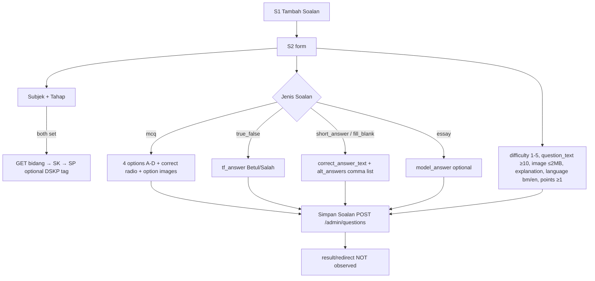
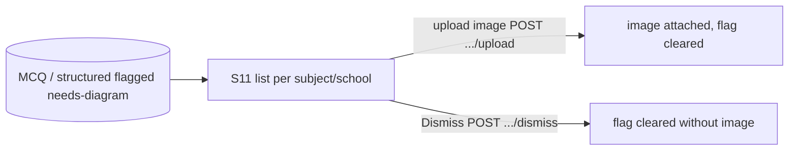
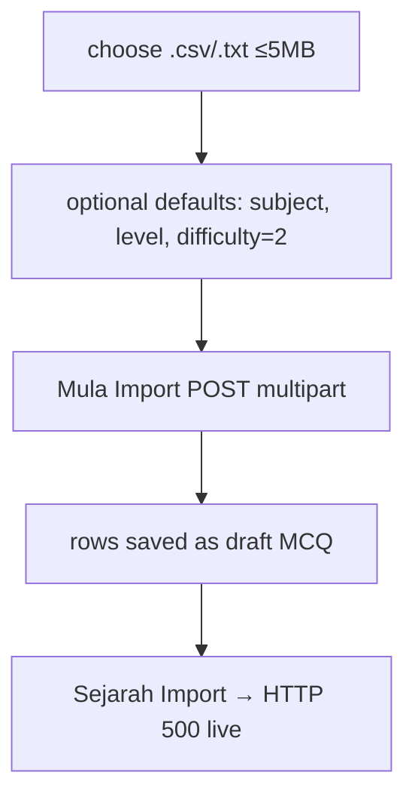
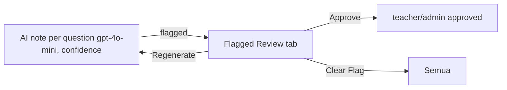

# M04 — Question Bank (Discovery)

- **Source:** live read-only walk-through of https://prestasiplus.my on 2026-09-25 with the admin account (browser lane 2).
- **Screenshots:** `docs/discovery/img/M04/` (50 files). Every page was masked in the DOM before capture. The shell and design tokens are in [00-global-ui.md](00-global-ui.md) and are not repeated here.
- **Language:** UI copy is quoted in its exact Bahasa Melayu, or in English where the live site uses English.
- **Personal data:** before any inventory or screenshot, `tools/jobs/M04.js` → `M04MASK` masked the following, and `tools/sanitize.js` then ran:
  - submitter, creator and reporter names ("Oleh: …", "Dicipta oleh: …", "oleh …", "Soalan Oleh: Cikgu …");
  - the teacher column of the question-paper list (name, Cloudflare-obfuscated e-mail `data-cfemail`, school);
  - admin notes in editable textareas.
  
  These appear as `<person>`, `<email>`, `<school>` and `<note>`. One dataset code that embeds a teacher's first name is stored as `tracking_a_<redacted>_math_20260326`. Question content is not personal data. Short examples are quoted.
- **Element inventory:** 1,226 content elements over 14 screens and 91 captured UI states, with IDs `EL-M04-S#-nnn`, in `docs/discovery/inventory/M04/<S#-key>.json`. Reconciliation, the crawl and read-only limits are in `docs/discovery/inventory/M04/_summary.md`. The inventory JSON is authoritative for attributes and conditions.

---

## 1. Overview

M04 covers the **question bank**. It has six parts:
1. The **objective/short-answer bank** ("Soalan", table `questions`, about 465k rows), with admin list, create, show and edit screens, CSV import and a quality dashboard.
2. The **structured (SPM Kertas 2) bank** ("Soalan Berstruktur", about 4k rows). Admins only list and view it; create and edit live in the teacher portal (`/guru/soalan-berstruktur/...`, M10).
3. **Question reports** raised by students, with the admin triage screen (S7), the student's "my reports" page (S13) and the report modal (S14) on practice pages.
4. **Teacher question papers** ("Kertas Soalan Guru"): uploaded files that admins process into questions.
5. The **diagram audit** ("Soalan Perlu Gambar Rajah"): questions flagged as needing a diagram. Admins upload an image or dismiss the flag.
6. **Master Notes review**: AI "misconception" notes per question, with Approve, Regenerate and Clear Flag actions.

Admin sidebar group "SOALAN" (`toggle('soalan')`): "Senarai Soalan" (`/admin/questions`), "Import CSV" (`/admin/questions/import`), "Kualiti Soalan" (`/admin/questions/quality`), "Laporan Soalan" (`/admin/question-reports`), "Soalan Berstruktur" (`/admin/structured-questions`), "Kertas Soalan Guru" (`/admin/question-submissions`). The group also lists "Databank Soalan" (`/spm/tahun-lepas`, M06) and "PKSK Soalan" (`/admin/pksk/questions`, M07).

`/admin/soalan-gambar` and `/admin/master-notes` are **not** in the admin sidebar. They are reached from the **user-portal** sidebar (🛡️ KAWALAN KUALITI section): "Gambar Rajah" with a red count badge "6,144", and "Semakan Nota Master". The user-portal sidebar also carries "Laporan Soalan" (`/laporan-soalan`) and "Kertas Soalan Guru".

| # | Route | Tab title (`<title>`) · shell header title / subtitle | Layout | Status |
|---|---|---|---|---|
| S1 | `/admin/questions` | "Pengurusan Soalan" · header "Dashboard" / "Selamat datang, Admin" (wrong, D-2) | admin | Documented |
| S2 | `/admin/questions/create` | "Tambah Soalan Baru" · "Dashboard" / "Selamat datang, Admin" | admin | Every question type opened, not submitted |
| S3 | `/admin/questions/{id}` | "Lihat Soalan" · "Dashboard" / "Selamat datang, Admin" | admin | 2 records (564159 approved, 129114 archived) |
| S4 | `/admin/questions/{id}/edit` | "Edit Soalan" · "Dashboard" / "Selamat datang, Admin" | admin | Same 2 records, not submitted |
| S5 | `/admin/questions/import` | "Import Soalan" · "Import Soalan Secara Pukal" / "Muat naik fail CSV untuk menambah soalan secara pukal" | admin | No file chosen |
| S6 | `/admin/questions/quality` | "Kualiti Soalan - Admin" · "Dashboard Kualiti Soalan" / "Analisa kualiti keseluruhan bank soalan" | admin | Audit not run |
| S7 | `/admin/question-reports` | "Laporan Soalan — Admin Panel" · "Dashboard" / "Selamat datang, Admin" | admin | All 10 reports read, no action |
| S8 | `/admin/structured-questions` | "Soalan Berstruktur" · "Dashboard" / "Selamat datang, Admin" | admin | Documented |
| S9 | `/admin/structured-questions/{id}` | "Detail Soalan Berstruktur" · "Dashboard" / "Selamat datang, Admin" | admin | 2 records (3698, 4454) |
| S10 | `/admin/question-submissions` | "Kertas Soalan - Admin" · "Kertas Soalan Guru" / "Semak dan proses fail soalan yang dihantar oleh guru" | admin | All 4 rows read, nothing downloaded or saved |
| S11 | `/admin/soalan-gambar` | "Soalan Perlu Gambar Rajah - Admin" · "Soalan Perlu Gambar Rajah" / "Audit soalan yang memerlukan gambar rajah dilengkapkan" | admin | No upload, no dismiss |
| S12 | `/admin/master-notes` | "Master Notes — Admin Review" · "Dashboard" / "Selamat datang kembali" | **user portal** | No buttons pressed |
| S13 | `/laporan-soalan` | "Laporan Soalan Saya" · "Laporan Soalan Saya" / "Jejak status laporan soalan yang anda hantar" | user portal | The admin has sent no reports, so only the empty state is visible |
| S14 | Report modal "Lapor Soalan" on `/latihan-berstruktur/{id}/jawab` and `/spm/latih-tubi/{code}/quiz` (M05/M06 host pages) | — | user portal | Markup read via GET, nothing sent |

**Stack:** same as M01/M02: Laravel Blade, Alpine.js, Tailwind and Font Awesome 6.5.1. Lists are Laravel paginators (English copy). Forms are classic POST with `_token`, plus `_method` spoofing for PUT, PATCH and DELETE. The DSKP pickers call teacher-portal JSON endpoints. The question show page calls an AI endpoint (§6).

**Rich text / math / images (editor type):** there is **no rich-text or math editor**. Question text, options, explanation and model answer are plain `<textarea>` / `<input type=text>`. Math is typed as plain ASCII (e.g. "34^-1/2 =", "1/34^(1/2)"). Structured-question text keeps its line breaks (`whitespace-pre-line`, e.g. "Soalan Oleh: … / Kertas 2 Bab 7 … / Item 1 …"). Images are separate uploads:
- one question image;
- one image per MCQ option;
- for diagram-audit items, one image per MCQ or structured question.

S2 adds an **Arabic/Jawi virtual keyboard** to the question-text textarea (`data-virtual-keyboard`), described in §2.2.

---

## 2. Screens

### 2.1 S1 — `/admin/questions` "Pengurusan Soalan"
Screenshots: `questions-list-desktop.png`, `questions-list-tablet.png`, `questions-list-mobile.png`, `questions-list-bulk-bar.png`, `questions-list-subject-filter.png`, `questions-list-archived.png`, `questions-list-empty.png`.

Alpine root `questionManager()` (`selectedIds`, `bulkAction`).

**Page header:** h1 "📚 Pengurusan Soalan" / "Urus bank soalan untuk platform PRESTASIPLUS". Button `fa-plus` goes to `/admin/questions/create`. Its label is "Tambah Soalan" at ≥640 px and "Tambah" below 640 px.

**"Ringkasan Bank Soalan"** card. The header reads "Jumlah: **439,478** soalan". Two groups of subject tiles follow. Each tile is a link to `?subject_id=N` showing an icon, the name truncated to about 12 characters with "..." (e.g. "Bahasa Melay..."), the total, and "`n` lulus" (the number approved; hidden when 0).
- **"Subjek Teras"** (7 tiles):
  - Bahasa Melayu (`fa-book-open`) 32,905 / 13,081 lulus
  - Bahasa Inggeris (`fa-globe`) 18,902 / 8,879
  - Matematik (`fa-calculator`) 38,504 / 16,645
  - Sains (`fa-flask`) 42,335 / 15,067
  - Sejarah (`fa-clock`) 20,414 / 10,301
  - Pendidikan Islam (`fa-moon`) 27,962 / 10,455
  - Pendidikan Moral (`fa-heart`) 38,481 / 15,996
- **"Subjek Elektif"** (22 tiles):
  - Matematik Tambahan (`fa-square-root-alt`) 7,580 / 2,579
  - Fizik (`fa-bolt`) 2,818 / 2,185
  - Kimia (`fa-flask`) 7,303 / 2,670
  - Biologi (`fa-leaf`) 14,001 / 4,580
  - Geografi (`fa-map`) 21,318 / 6,886
  - Pendidikan Seni Visual (`fa-palette`) 48,360 / 4,910
  - Pendidikan Muzik (`fa-music`) 18,305 / 1,800
  - Pendidikan Jasmani & Kesihatan (`fa-heartbeat`) 17,345 / 2,900
  - Reka Bentuk & Teknologi (`fa-wrench`) 1,811 / 200
  - Sains Komputer (`fa-desktop`) 21,504 / 1,100
  - Bahasa Arab (`fa-language`) 21,913 / 5,400
  - Prinsip Perakaunan (`fa-receipt`) 6,052 / 2,329
  - Ekonomi (`fa-chart-line`) 5,591 / 3,051
  - Perniagaan (`fa-briefcase`) 5,410 / 2,732
  - Pendidikan Al-Quran & As-Sunnah (`fa-quran`) 3,970 / 1,000
  - Tasawwur Islam (`fa-mosque`) 4,990 / 1,300
  - Jawi (`fa-pen-nib`) 8,316 / 2,100
  - Pendidikan Syariah Islamiah (`fa-scale-balanced`) 3,388 / 1,243
  - Sains Rumah Tangga, Pembuatan Pakaian Wanita, Pertanian and Sains Sukan (`fa-book`) 0 each
  
  Bahasa Cina (19) and Bahasa Tamil (20) have **no tile** but are in the filter select.
- **Active tile** (when `subject_id` is set): indigo border with `bg-indigo-50 shadow-md`. Other tiles: slate border, white. A link `fa-times-circle` "Padam filter subjek — tunjuk semua" then appears and goes to `/admin/questions`.

**Filter form** (`GET /admin/questions`; 8 fields; submitted by the icon button `fa-search`, which has no text):

| Label | Name | Options (value = label) |
|---|---|---|
| Subjek | `subject_id` | "" Semua Subjek; 1 Bahasa Melayu … 31 Sains Sukan (all 31 subjects, id order) |
| Tahap | `education_level_id` | "" Semua Tahap; 1–6 Darjah 1–6; 7–11 Tingkatan 1–5 |
| Kesukaran | `difficulty_level` | "" Semua; 1 "⭐ Sangat Mudah"; 2 "⭐⭐ Mudah"; 3 "⭐⭐⭐ Sederhana"; 4 "⭐⭐⭐⭐ Sukar"; 5 "⭐⭐⭐⭐⭐ Sangat Sukar" |
| Status | `status` | "" Semua Status; `draft` Draf; `pending_review` Menunggu Semakan; `approved` Diluluskan; `rejected` Ditolak; `archived` Diarkibkan |
| DSKP | `dskp_filter` | "" Semua; `tagged` Ada DSKP Tag; `untagged` Belum Ditag |
| Compliance | `compliance_filter` | "" Semua; `verified` Verified; `pending_mapping` Pending Mapping; `quarantined` Quarantined; `rejected` Rejected; `draft` Draft; `missing_source` Tiada Source PDF; `verified_generated` AI Verified |
| Source | `source_filter` | "" Semua; `textbook` Textbook; `dskp` DSKP; `trial` Trial; `marking_scheme` Skema |
| Cari | `search` | text, placeholder "Cari soalan..." |

Live result sizes:

| Filter | Results |
|---|---|
| none | 465,278 |
| `status=archived` | 319,589 |
| `status=draft`, `pending_review` or `rejected` | 0 |
| `compliance_filter=quarantined` | 124,299 |
| `compliance_filter=pending_mapping` | 2,756 |
| `compliance_filter=missing_source` | 128,372 |
| `compliance_filter=draft` | 27,652 |
| `compliance_filter=rejected` | 0 |
| `dskp_filter=untagged` | 14,933 |
| `source_filter=trial` | 19,219 |
| `source_filter=dskp` | 35,401 |
| `source_filter=marking_scheme` | 199 |
| `difficulty_level=1` | 45,686 |
| `education_level_id=1` | 14,778 |

Unknown params (`type`, `question_type`, `sort`) are ignored. **There is no question-type filter, no sort control and no KBAT filter** on this list.

**Bulk action bar** (`x-show="selectedIds.length > 0"`): `fa-check-double` "`{n}` soalan dipilih", a form `POST /admin/questions/bulk-action` (`@submit.prevent="submitBulkAction"`), a select `action` (required) with options "" "Pilih Tindakan", `approve` "Luluskan", `reject` "Tolak", `archive` "Arkibkan", `delete` "Padam", and a button "Laksanakan".
- With no action chosen: `alert('Sila pilih tindakan terlebih dahulu')`.
- Otherwise: `confirm('Adakah anda pasti mahu ${label} ${n} soalan?')`, with label from `{approve: 'meluluskan', reject: 'menolak', archive: 'mengarkibkan', delete: 'memadamkan'}`. The script then appends hidden `ids[]` and submits.

**Table** (20 rows per page, newest created first with ties by id ascending — page 1 reads 564159, 564160, 564161, 564157, 564158, 564155 … (corrected after audit; was "newest id first")). Columns: [checkbox] | "#" | "Soalan" | "Subjek" | "Tahap" | "Kesukaran" | "Status" | "Tindakan".
- Header checkbox `@change="toggleAll"` selects every row checkbox on the page. Row checkbox `:value="{id}" x-model="selectedIds"`.
- "#" is the numeric id.
- **Soalan cell:**
  - Line 1: the question text truncated to 80 characters + "...".
  - Line 2 (badges):
    - DSKP tag: "✓ DSKP" (`fa-check-circle`, green) when tagged, otherwise "📖 Latihan Tambahan" (`fa-book-open`).
    - Compliance badge in upper case: `VERIFIED`, `QUARANTINED`, `PENDING_MAPPING` or `DRAFT`.
    - Optional "AI Verified" badge.
  - Line 3 (small): "Source: TEXTBOOK", "Source: DSKP", "Source: TRIAL", "Source: MARKING_SCHEME" or "Source: TIADA", then the source file name (e.g. "DSKP KSSM Science Form 4 and 5.pdf", "KIMIA K1 SBP-2024.pdf", "BT-Sejarah-Darjah-6.pdf").
- **Subjek:** a pill with the subject icon and name. **Tahap:** e.g. "Tingkatan 5".
- **Kesukaran:** 5 `fa-star` icons; the first N are filled.
- **Status:** a status pill ("Diluluskan", or "Arkib" for archived) plus an active flag "ACTIVE" or "INACTIVE" underneath.
- **Tindakan:**
  - `fa-eye` (title "Lihat") → `/admin/questions/{id}`.
  - `fa-edit` (title "Edit") → `/admin/questions/{id}/edit`.
  - `fa-trash` (title "Padam"): form `DELETE /admin/questions/{id}`, `@submit.prevent="confirmDelete($event)"` → `confirm('Adakah anda pasti mahu memadamkan soalan ini?')`.

**Empty state** (e.g. `?search=zzqxv`, `?status=draft`): an icon, "Tiada soalan dijumpai", and a button `fa-plus` "Tambah Soalan Pertama" → `/admin/questions/create`. The table is not rendered.

**Pagination:** Laravel default (English).
- ≥640 px: "Showing 1 to 20 of 465278 results" plus page links 1…10 … 23263 23264 and chevrons (aria "&laquo; Previous" / "Next &raquo;").
- <640 px: "« Previous" / "Next »".
- Links keep the active filters, e.g. `?status=archived&page=2`.

### 2.2 S2 — `/admin/questions/create` "Tambah Soalan Baru"
Screenshots: `question-create-mcq.png`, `question-create-true-false.png`, `question-create-short-answer.png`, `question-create-fill-blank.png`, `question-create-essay.png`, `question-create-dskp-tagged.png`, `question-create-keyboard-jawi.png`, `question-create-mobile.png`, `question-create-keyboard-mobile.png`.

**Header:** back link `fa-arrow-left` → `/admin/questions`, h1 "✨ Tambah Soalan Baru" / "Isi maklumat di bawah untuk menambah soalan baharu". The page has a comment slot for error messages (validation errors are not observable).

**Form:** `POST /admin/questions`, `enctype="multipart/form-data"`, `x-data="{ questionType: 'mcq' }"`.

**Card "Maklumat Soalan"** (`fa-question-circle`):

| Label | Name | Control / rule |
|---|---|---|
| Subjek * | `subject_id` | select required; "Pilih Subjek" + 31 subjects |
| Tahap Pendidikan * | `education_level_id` | select required; "Pilih Tahap Pendidikan" + Darjah 1–6, Tingkatan 1–5 |
| `fa-tags` DSKP Tagging (Pilihan) | `dskp_sp_id` | three cascading selects, see below |
| Tahap Kesukaran * | `difficulty_level` | 5 radio cards (required, **no default**): 1 "Sangat Mudah" (1 star) … 5 "Sangat Sukar" (5 stars) |
| Jenis Soalan * | `question_type` | select `x-model=questionType`, default `mcq` |
| Teks Soalan * | `question_text` | textarea, 4 rows, required, placeholder "Masukkan teks soalan di sini...", hint "Minimum 10 aksara", `data-virtual-keyboard` |
| `fa-image` Gambar Soalan (Pilihan) | `question_image` | file (hidden input inside a drop-zone label) `accept="image/jpeg,image/png,image/webp"`; zone text `fa-cloud-upload-alt` "Klik untuk muat naik gambar" / "JPG, PNG, WebP — Maks 2MB"; after choosing, a FileReader preview `` with a remove button (`fa-times`) that clears the input |

**Question types** (`question_type`):

| Value | Label | Answer card shown |
|---|---|---|
| `mcq` | Objektif (MCQ) | "Pilihan Jawapan" (`fa-list-check`) |
| `true_false` | Betul / Salah | "Jawapan Betul / Salah" (`fa-check-double`) |
| `short_answer` | Jawapan Pendek | heading x-text "Jawapan Pendek" (`fa-pen-fancy`) |
| `fill_blank` | Isi Tempat Kosong | same card, heading "Jawapan Isi Tempat Kosong" |
| `essay` | Esei / Subjektif | "Jawapan Contoh (Esei)" (`fa-file-alt`) |

- **MCQ card** "Pilihan Jawapan" (x-show `questionType === 'mcq'`). It always has exactly 4 options, A–D, and **no add/remove**. Each option row has:
  - radio `correct_answer` value 0–3 (A is checked by default), with `:required="questionType === 'mcq'"`;
  - label "Pilihan A *" to "Pilihan D *";
  - text `options[]` with placeholder "Masukkan pilihan A" to "…D" (required only for MCQ);
  - an image picker label `fa-image` "Gambar" → file `option_images[0..3]` (same accept list), with a preview and remove button.
  
  Info box: `fa-info-circle` "**Nota:** Pilih butang radio di sebelah pilihan yang merupakan jawapan yang betul."
- **True/false card** (x-show `true_false`): radio `tf_answer` with the cards "Betul" (`value=true`, `fa-check-circle`) and "Salah" (`value=false`, `fa-times-circle`). No default and not required.
- **Short-answer / fill-blank card** (x-show `short_answer || fill_blank`):
  - "Jawapan Betul *" → `correct_answer_text` (placeholder "Masukkan jawapan betul"; not `required` in the DOM);
  - "Jawapan Alternatif (pisahkan dengan koma)" → `alt_answers` (placeholder "cth: jawapan1, jawapan2"), hint "Jawapan lain yang juga diterima".
- **Essay card** (x-show `essay`): "Jawapan Model (pilihan — ditunjukkan sebagai rujukan)" → textarea `model_answer`, 6 rows, placeholder "Tulis jawapan contoh di sini...".

**Card "Maklumat Tambahan"** (`fa-info-circle`):
- "Penjelasan" → textarea `explanation`, 3 rows, placeholder "Penjelasan untuk jawapan (pilihan)", hint "Penjelasan akan ditunjukkan kepada pelajar selepas menjawab".
- "Bahasa" → select `language`: `bm` "Bahasa Melayu" (selected), `en` "English".
- "Nilai Mata" → number `points_value`, value 1, `min=1`, hint "Mata yang diperoleh jika jawapan betul".

**Actions:** link `fa-times` "Batal" → `/admin/questions`; submit `fa-save` "Simpan Soalan".

**Not on this form:** KBAT level, tags/keywords, topic/chapter, status, marks-per-part, source. Topic linkage is only through the DSKP SP. Status on create is not observable.

**DSKP cascade** (`dskpDropdown()`, create version):
1. Changing Subjek or Tahap Pendidikan calls `loadBidang()`. When both are set, it runs `GET /guru/api/dskp/bidang?subject_id=&education_level_id=` → `[{id, code, name}]`. The "Bidang" select (no name) lists "-- Pilih Bidang --" + "`code` - `name`" (or just the name when there is no code). Example for Sains T5: "T5-SUB4-TEXTBOOK - Sains T5 - Sokongan Bab Buku Teks", "1.0 - Mikroorganisma" … "9.0 - Teknologi Angkasa".
2. Bidang `@change=loadSk()` → `GET /guru/api/dskp/sk?dskp_bidang_id=` → `[{id, code, description}]`. The "Standard Kandungan" select is disabled until a Bidang is chosen and lists "-- Pilih SK --" + "`code` - `description`".
3. SK `@change=loadSp()` → `GET /guru/api/dskp/sp?dskp_sk_id=` → `[{id, code, description}]`. The "Standard Pembelajaran" select (`name="dskp_sp_id"`) is disabled until an SK is chosen and lists "-- Pilih SP --" + "`code` - `description`".
4. When an SP is chosen, a line appears: `fa-check-circle` "DSKP tagged".

**Virtual keyboard** (Alpine `virtualKeyboard()`; this page only). A toggle button (`.vkb-toggle-btn`, `fa-keyboard`, title "Papan kekunci Arab / Jawi") is injected at the bottom-left inside the question-text textarea. It opens a shared panel:
- **Header:** mode buttons "عربي" (Arab, blue when active) and "جاوي" (Jawi, emerald when active), a caption x-text "Papan Kekunci Arab" / "Papan Kekunci Jawi", and a close button `fa-times`.
- **Rows:**
  - Arab: ض ص ث ق ف غ ع ه خ ح ج د / ش س ي ب ل ا ت ن م ك ط / ئ ء ؤ ر لا ى و ز ظ.
  - Jawi adds ڤ ڠ چ (row 1), ڽ ݢ (row 2) and ۏ (row 3).
- **Harakat row** (◌ + mark; title = name): Fathah (atas), Kasrah (bawah), Dammah, Sukun, Tanwin Fathah, Tanwin Kasrah, Tanwin Dammah, Shadda (sabdu), Superscript Alif (alif kecil).
- **Bottom row:** "SPACE", "ال", "ة", backspace (`fa-delete-left`), newline (`fa-turn-down`).
- **Behaviour:**
  - Keys insert at the cursor, and opening sets the textarea to `dir="rtl"` with the Scheherazade New font.
  - Esc closes the panel.
  - Keys are 44 px touch targets.
- **Placement:**
  - <640 px: a bottom sheet with a backdrop (`sm:hidden`) that closes on tap.
  - Otherwise: a 580 px panel below the textarea, or above it when there is no room.

### 2.3 S3 — `/admin/questions/{id}` "Lihat Soalan"
Screenshots: `question-show-approved.png`, `question-show-archived.png`, `question-show-mobile.png`.

**Header:** back link `fa-arrow-left` → list, h1 "📝 Detail Soalan", subtitle "Soalan #{id}". Buttons:
- `fa-edit` "Edit" → `/edit`.
- `fa-trash` "Padam": form `DELETE /admin/questions/{id}`, `onsubmit="return confirm('Adakah anda pasti mahu memadamkan soalan ini?')"`.

**Main column (lg: 2/3):**
- Card "Soalan" (`fa-question-circle`) with a status pill ("Diluluskan"; archived → "Diarkibkan") and the full question text.
- Card "Pilihan Jawapan" (`fa-list-check`): letter bubbles A–D with the option text. The correct option carries `fa-check-circle` "Jawapan Betul" and a green tint.
- Card "Penjelasan" (`fa-lightbulb`), shown only when an explanation exists (absent on 129114).
- **Card "Penjelasan AI"** (`fa-robot`, id `penjelasan-ai-card`), sub-label "Dijana AI · Boleh ada kesilapan, sahkan dengan cikgu":
  - **Empty state:** "Belum ada Penjelasan AI untuk soalan ini. Klik butang untuk jana." with button `fa-wand-magic-sparkles` "Jana Penjelasan AI" (`#btn-jana-penjelasan-ai`).
  - **Loading** (hidden): `fa-spinner fa-spin` "Sedang menjana penjelasan... (anggaran 5-15 saat)".
  - **Error** (hidden): `fa-exclamation-triangle` + `#penjelasan-ai-error-msg`, default "Ralat tidak diketahui", fallback "Gagal jana penjelasan" or "HTTP {status}".
  - **Request:** `POST /admin/questions/{id}/generate-penjelasan-ai` (JSON, CSRF header; `?force=1` to regenerate). On `{ok:true}` the page reloads, and the saved markdown is rendered with `.prose-ai` styles (headings, lists, tables, code).
  - When a note already exists, a regenerate button `#btn-regen-penjelasan-ai` asks `confirm('Jana semula Penjelasan AI? Versi lama akan ditimpa.')`. This branch was not observed; the button id is in the script.

**Sidebar (lg: 1/3):**
- Card "Maklumat" (`fa-info-circle`), label → value:
  - "Subjek" (`fa-book`) e.g. "Sains"
  - "Tahap Pendidikan" (`fa-graduation-cap`) "Tingkatan 5"
  - "Tahap Kesukaran": 5 stars + "(3/5)"
  - "DSKP": three lines, each truncated with "..." — `fa-layer-group` bidang name "Sains T5 - Sokongan Bab Buku Teks", `fa-bookmark` SK "T5SN.B9 - Menguasai konsep utama Bab 9: Satelit berdasarkan buku teks...", `fa-tag` SP "T5SN.B9.1 - Menjawab soalan objektif berkaitan konsep dan aplikasi Bab 9..." (untagged → "Belum ditag")
  - "Bahasa" (`fa-language`) "Bahasa Melayu"
  - "Nilai Mata" (`fa-coins`) "1 mata"
  - "Dicipta Pada" (`fa-calendar`) "18/05/2026 23:21" (`dd/mm/yyyy HH:MM`)
- Statistics card: `fa-info-circle` "Soalan Baharu" / "Soalan ini belum digunakan dalam sebarang kuiz atau latihan." The used-question variant with attempt statistics was not observed; both opened questions were unused.
- An empty "Quick Actions" slot. The page script defines `updateStatus(status)`, which asks `confirm('Adakah anda pasti mahu mengubah status soalan ini?')` and then POSTs `/admin/questions/bulk-action` with `action` = `pending_review` or `approve` and `ids[]` = {id}. Its buttons are presumably rendered only for draft or pending questions (INFERRED); none exist live.

### 2.4 S4 — `/admin/questions/{id}/edit` "Edit Soalan"
Screenshots: `question-edit-desktop.png`, `question-edit-remove-dskp.png`, `question-edit-mobile.png`.

**Header:** back link → `/admin/questions/{id}`, h1 "✏️ Edit Soalan", "Kemaskini maklumat soalan #{id}".

**Form:** `POST /admin/questions/{id}` + `_method=PUT`, multipart. Fields are pre-filled.

**Differences from S2:**
- **No "Jenis Soalan" select.** The edit form is **MCQ-only**: the options card is always shown, and `options[]` and `correct_answer` are hard `required`. There are no true/false, short-answer or essay cards (D-6).
- No virtual keyboard.
- Question image:
  - x-data `{ preview, removeImg }`;
  - the zone text is x-text `preview ? 'Tukar gambar' : 'Klik untuk muat naik gambar'`;
  - removing sets hidden `remove_question_image` = 1.
- Per option: hidden `remove_option_image_0..3` (1 when removed).
- DSKP (`dskpDropdown()` edit version):
  - The saved ids are preloaded (e.g. `bidangId '515'`, `skId '2667'`, `spId '6191'`) and the three lists load in a chain on init. **However, the three selects display their placeholders** ("-- Pilih Bidang --", "-- Pilih SK --", "-- Pilih SP --") while "DSKP tagged" shows, and the form posts `dskp_sp_id = ""`, so saving drops the tag (corrected after audit; `docs/qa/audit/img/M04/s4-dskp-preload-placeholders-1280.png`).
  - If a saved id no longer belongs to the new parent list, it is cleared.
  - Extra button `fa-times` "Buang tag DSKP" (resets all three). It is rendered only when `bidangId && !spId`, i.e. **only after the SP has already been cleared** (D-7).
- Submit `fa-save` "Kemaskini Soalan"; "Batal" → `/admin/questions/{id}`.

### 2.5 S5 — `/admin/questions/import` "Import Soalan"
Screenshots: `import-desktop.png`, `import-mobile.png`, `import-history-500.png`.

**Top links:**
- `fa-history` "Sejarah Import" → `/admin/questions/import-history`. **This returns HTTP 500** ("500 ⚙️ Ralat Pelayan" / "Sesuatu tidak kena di pihak kami. Pasukan teknikal telah dimaklumkan. Sila cuba sebentar lagi." with buttons "Halaman Utama" and "Cuba Semula"). Defect D-1.
- `fa-arrow-left` "Kembali" → `/admin/questions`.

**Card "Muat Naik Fail CSV"** (`fa-file-upload`): form `POST /admin/questions/import`, multipart.
- "Fail CSV *" → file `csv_file`, `accept=".csv,.txt"`, required. Hint `fa-info-circle` "Saiz maksimum: 5MB. Format: CSV atau TXT".
- Sub-section "Tetapan Lalai (Opsional)", "Nilai ini digunakan jika kolum berkaitan tiada dalam CSV.":
  - "Subjek Lalai" → `default_subject_id` ("-- Tidak ditetapkan --" + 31 subjects);
  - "Tahap Pendidikan" → `default_education_level_id` ("-- Tidak ditetapkan --" + 11 levels);
  - "Kesukaran" → `default_difficulty_level` ("-- Tidak ditetapkan --", 1 Sangat Mudah, **2 Mudah (selected)**, 3 Sederhana, 4 Sukar, 5 Sangat Sukar).
- Footer: `fa-shield-alt` "Soalan disimpan sebagai draf" and submit `fa-upload` "Mula Import".

**Side cards:**
- "Muat Turun Template" (`fa-download`): "Template CSV dengan contoh soalan" and link `fa-file-csv` "Download Template" → `/admin/questions/import-template`. Not fetched.
- **"Format CSV"** (`fa-info-circle`):
  - "Kolum diperlukan:"
    - `question_text` — Teks soalan
    - `option_a`, `option_b` — Pilihan
    - `correct_answer` — Jawapan (A/B/C/D)
    - `subject_id` — ID subjek
    - `education_level_id` — ID tahap
  - "Kolum opsional:"
    - `option_c`, `option_d`
    - `difficulty_level` — Kesukaran (1-5)
    - `marks`, `explanation`
- "Tips" (`fa-lightbulb`, `fa-check` bullets): "Fail CSV mesti encoding UTF-8"; "Guna petikan dua (") untuk teks yang ada koma"; "Baris pertama = header kolum"; "Semua soalan disimpan sebagai "draf"".

**CSV column spec** (from the page):

| Column | Required | Meaning / rule |
|---|---|---|
| `question_text` | yes | question text |
| `option_a`, `option_b` | yes | options A, B |
| `option_c`, `option_d` | no | options C, D |
| `correct_answer` | yes | letter A/B/C/D |
| `subject_id` | yes* | subject id (1–31). *The page lists it as required, yet the default subject is used "jika kolum berkaitan tiada" (contradiction D-8). |
| `education_level_id` | yes* | level id 1–11 (same contradiction) |
| `difficulty_level` | no | 1–5 (default from the form, preset 2) |
| `marks` | no | points (INFERRED → `points_value`) |
| `explanation` | no | explanation |

The first row is the header. The file is UTF-8, comma-separated, with double-quote escaping. At most 5 MB, `.csv` or `.txt`. Imported rows are saved as **draft**. The import is MCQ-only (no type column).

### 2.6 S6 — `/admin/questions/quality` "Kualiti Soalan - Admin"
Screenshots: `quality-desktop.png`, `quality-mobile.png`.

**KPI cards** (4; `grid-cols-2 sm:grid-cols-4` — 2 columns at 375 (corrected after audit)): "466,041" "Jumlah Soalan"; "94.1" "Purata Skor"; "146,275" "Cemerlang (76-100)"; "2" "Perlu Tindakan Aktif (≤ 50)".

**Bucket cards** (3; `lg:grid-cols-3`):
- "Skor 51-75" **749** "Perlu semakan ringan atau pengayaan metadata."
- "Skor ≤ 50" **2** "Bucket ini patut jadi fokus tindakan segera."
- "Legacy Generic" **373** "Row legacy seperti `tracking_a_feed_20260308`, `spm_tracking_auto_seed_v1`, dan `source_type=ai_generated` diasingkan daripada senarai tindakan aktif."

**"Taburan Kualiti":** a stacked bar with segment labels "99.5%" and "0.5%", and a legend "Cemerlang", "Baik", "Lemah", "Kritikal" (4 colour dots).

**"Mengikut Subjek"** table (columns "Subjek", "Soalan", "Purata", "Cemerlang"; the Purata value is a coloured pill; sorted by average, descending). Rows:
- Pendidikan Moral 9,817 / 96.4 / 100%
- Ekonomi 3,193 / 96.0 / 100%
- Sejarah 9,192 / 96.0 / 100%
- Fizik 1,884 / 95.9 / 100%
- Tasawwur Islam 1,370 / 95.8 / 100%
- Pendidikan Islam 11,443 / 95.5 / 100%
- Pendidikan Syariah Islamiah 2,488 / 95.5 / 100%
- Perniagaan 4,740 / 95.4 / 100%
- Bahasa Melayu 10,037 / 95.3 / 100%
- Geografi 7,283 / 95.2 / 100%
- Bahasa Tamil 6,300 / 95.0 / 100%
- Bahasa Inggeris 8,313 / 94.8 / 98%
- Kimia 5,842 / 94.6 / 100%
- Prinsip Perakaunan 2,452 / 94.0 / 100%
- Pendidikan Seni Visual 4,560 / 93.9 / 100%
- Biologi 11,397 / 93.4 / 100%
- Sains 17,012 / 93.2 / 97%
- Sains Komputer 1,104 / 93.0 / 100%
- Pendidikan Muzik 1,805 / 93.0 / 100%
- Jawi 2,016 / 93.0 / 100%
- Reka Bentuk & Teknologi 1,211 / 92.9 / 100%
- Matematik 13,335 / 91.9 / 99%
- Pendidikan Jasmani & Kesihatan 2,945 / 91.6 / 100%
- Matematik Tambahan 2,279 / 90.8 / 100%
- Bahasa Arab 4,008 / 88.1 / 100%
- Pendidikan Al-Quran & As-Sunnah 1,000 / 88.0 / 100%

**"Mengikut Tingkatan"** (label, "`n` soalan · `avg`", and a progress bar):
- Darjah 1 4,325 · 95.4
- Darjah 2 3,941 · 94.7
- Darjah 3 5,906 · 96.6
- Darjah 4 7,242 · 95.4
- Darjah 5 8,696 · 96.9
- Darjah 6 10,048 · 95.6
- Tingkatan 1 18,746 · 93.6
- Tingkatan 2 13,530 · 93.3
- Tingkatan 3 14,702 · 93.2
- Tingkatan 4 32,942 · 93.8
- Tingkatan 5 26,718 · 93.4

**"Soalan Untuk Semakan Aktif"**, "Memaparkan hanya soalan skor ≤ 50 selepas menolak sumber generic legacy.", with a count pill "2 soalan". Table columns: "ID", "Soalan", "Subjek", "Tingkatan", "Sumber", "Skor", and a blank action column. Rows:
- "#129114" "34^-1/2 =" Matematik / Tingkatan 5 / source set `…_matematik_johor_set2_k1` / skor pill 50 / link `fa-edit` "Edit" → `/admin/questions/129114/edit`
- "#129216" "(-21)(1 3) =" / … / 50 / Edit

**Audit button:** form `POST /admin/questions/quality/run-audit` (`x-data="{ submitting: false }"`). Button `fa-clipboard-check` "Jalankan Audit Semula"; while submitting it is disabled and shows `fa-spinner fa-spin` "Sedang audit...". There is no confirm. Not pressed.

**Quality metric (INFERRED):**
- Every question has a 0–100 score.
- Buckets: Cemerlang 76–100, Baik 51–75, Lemah and Kritikal ≤ 50 (the exact Lemah/Kritikal split is not shown).
- Legacy generic sources are excluded from the action list.
- The audit is a server batch job.
- The scoring formula is unknown.

### 2.7 S7 — `/admin/question-reports` "Laporan Soalan — Admin Panel"
Screenshots: `reports-pending-desktop.png`, `reports-all-desktop.png`, `reports-all-mobile.png`, `reports-dismissed-empty.png`.

**Header:** h1 `fa-flag` "Laporan Soalan" / "Soalan yang dilaporkan oleh pelajar dari kuiz, latihan & Papan Bijak".

**Status tabs** (links `?status=`; the active tab is a solid colour with white text):

| Tab | Value | Count | Colour |
|---|---|---|---|
| `fa-clock` "Menunggu (2)" | `pending` | 2 | amber (**default when `status` is absent**) |
| `fa-eye` "Disemak (3)" | `reviewed` | 3 | blue |
| `fa-check` "Diperbaiki (5)" | `fixed` | 5 | emerald |
| `fa-times` "Ditolak (0)" | `dismissed` | 0 | slate |
| `fa-list` "Semua (10)" | `all` | 10 | violet |

An unknown value (e.g. `?status=zzz`) shows the empty state "Tiada laporan buat masa ini" and no tab is active (corrected after audit).

**Report card** (one per report, newest first, no pagination at 10). The card is split into an info column and an action column (`lg:flex-row`).
- **Badge row:**
  1. Status badge: `fa-clock` "Menunggu" (amber), `fa-eye` "Disemak" (blue), `fa-check` "Diperbaiki" (emerald), `fa-ban` "Dikeluarkan" (red; a fixed report whose question was removed from the live bank), or "Ditolak".
  2. Reason-category badge: `fa-info-circle` "Lain-lain" (slate), `fa-question-circle` "Tak Jelas" (amber), `fa-times-circle` "Jawapan Salah" (red).
  3. `fa-ban` "Dinyahaktif" (red) when the question is currently inactive.
  4. Source-set badge `fa-database` (e.g. "trial", "ai_generated", "tracking_a_<redacted>_math_20260326").
  5. "Oleh: **<person>**", relative time (e.g. "2 minggu yang lepas", "3 bulan yang lepas"), optional "Bilik: Y31OBA" (Papan Bijak room code).
  6. Violet badge `fa-hashtag` "ID Soalan: {id}".
- **Reason detail pill:** the stored reason label, e.g. "Lain-lain", "Soalan mengelirukan", "Set jawapan tidak tepat", "Jawapan tidak tepat", or the **raw code** "unclear" (D-9).
- **Question block:**
  - Structured: `fa-file-alt` "Soalan Struktur #{id}:" + stimulus.
  - MCQ: "Soalan #{id}:" + text, then options "A. …" to "D. …" with `fa-check` on the correct one.
  - Then "`Subjek` — `Tingkatan N`" and "Compliance: verified|draft". A deleted question shows "Soalan tidak dijumpai".
- `fa-comment` "Komen pelajar:" + the comment (when present).
- `fa-sticky-note` "Status tindakan admin:" + admin notes (when present), e.g. "Dinyahaktifkan segera oleh admin", "Soalan telah dikeluarkan daripada live bank kerana sumber prediction legacy / silibus tidak relevan. Ditutup selepas semakan admin.".

**Actions** (rendered for `pending` and `reviewed` reports; none on fixed or removed ones). All three forms are `POST /admin/question-reports/{id}/update`:
1. "Tandakan Selesai" (`fa-check`): hidden `status=fixed`, textarea `admin_notes` (2 rows, placeholder "Contoh: Soalan diperbaiki / Soalan dikeluarkan kerana silibus lama...", pre-filled with existing notes).
2. "Tolak & Aktifkan Semula" (`fa-times`): hidden `status=dismissed`, `admin_notes="Soalan dan jawapan disemak — tiada masalah"`, `reactivate=1`.
3. "Nyahaktif Segera" (`fa-ban`): hidden `status=reviewed`, `admin_notes="Dinyahaktifkan segera oleh admin"`, `force_deactivate=1`. Shown only while the question is still active (absent on "Dinyahaktif" cards).

None of the three has a confirm dialog. Links:
- Structured question: `fa-eye` "Lihat Soalan Struktur #{id}" → `/admin/structured-questions/{id}`.
- MCQ: `fa-edit` "Edit Soalan #{id}" → `/admin/questions/{id}/edit`.
- `fa-external-link-alt` "Buka Soalan Sama" (new tab): → `/latihan-berstruktur/{id}/jawab?scope=spm` for structured, or `/spm/latih-tubi/{SUBJECTCODE}/quiz?question_id={id}&count=1` for MCQ (e.g. `MATH`).

**Empty state** (Ditolak tab): `fa-check-double` "Tiada laporan buat masa ini". Unknown status: the same block, with no active tab (corrected after audit; was "Tiada laporan").

### 2.8 S8 — `/admin/structured-questions` "Soalan Berstruktur"
Screenshots: `structured-list-desktop.png`, `structured-list-mobile.png`, `structured-list-empty.png`.

**Header:** h1 "Soalan Berstruktur" / "Semua soalan berstruktur SPM dalam sistem". Button `fa-plus` "Tambah Soalan" → **`/guru/soalan-berstruktur/cipta`** (teacher-portal create form, M10).

**Stats:** "4,064" "Jumlah Soalan"; "4,064" "Published"; card "Agihan Mengikut Subjek" with pills "Subjek: **n**":
- Bahasa Inggeris 774
- Bahasa Melayu 560
- Biologi 219
- Ekonomi 42
- Fizik 246
- Geografi 21
- Kimia 232
- Matematik 299
- Matematik Tambahan 256
- Perniagaan 763
- Prinsip Perakaunan 76
- Sains 204
- Sains Komputer 22
- Sejarah 328
- Tasawwur Islam 22

**Filter form** (`GET`, `sm:grid-cols-4`):
- "Subjek" `subject_id`: "Semua Subjek" + 31 subjects in **alphabetical** order.
- "Tingkatan" `education_level_id`: "Semua" + Darjah 1–6 and Tingkatan 1–5.
- "KBAT" `kbat_level`: "Semua KBAT", 2 "Memahami (L2)", 3 "Mengaplikasi (L3)", 4 "Menganalisis (L4)", 5 "Menilai/Mencipta (L5)".
- Submit `fa-search` "Cari".
- A "Reset" link → `/admin/structured-questions` appears when any filter is set.

**Table** (25 per page). Columns: "#" | "Stimulus / Soalan" | "Subjek" (hidden <640) | "Tgk" (hidden <640) | "KBAT" | "Markah" (hidden <640) | "Sub-Q" (hidden <768) | "Aksi".
- Stimulus: first 100 characters + "...".
- Subjek: pill. Tgk: "Tingkatan 5". KBAT: pill "L2" to "L5". Markah: "8m". Sub-Q: the number of sub-questions.
- Aksi: `fa-eye` "Lihat" → `/admin/structured-questions/{id}`.

**Counter under the table:** "Menunjukkan 1–25 daripada 4,064 soalan" (Malay), in addition to the English Laravel pager "Showing … results". **Empty** (e.g. `subject_id=18`): table row "Tiada soalan berstruktur ditemui" and counter "Menunjukkan – daripada 0 soalan" (D-10). Pages: 163. `kbat_level=5` → 483 rows.

### 2.9 S9 — `/admin/structured-questions/{id}` "Detail Soalan Berstruktur"
Screenshots: `structured-show-desktop.png`, `structured-show-mobile.png`.

- Back link `fa-arrow-left` "Kembali ke senarai".
- Header card:
  - Pills: subject, "Tingkatan 5", "KBAT: Mengaplikasi (L3)", "10 Markah". Right side: "ID: #3698".
  - Box "Stimulus / Konteks Soalan" + stimulus text (pre-line).
  - Meta line: `fa-user` "Dicipta oleh: <person>", `fa-calendar` "08 Apr 2026" (`dd Mon yyyy`), `fa-eye` "Visibiliti: Public", `fa-circle` "Published".
- h2 "Bahagian Soalan (3 sub-soalan)". One card per sub-question:
  - Label pill: "3(A)", "3(B)", "3(C)" (question number + letter), or "A" when unnumbered.
  - Question text and a marks chip "2m".
  - Box "Jawapan Model" + model answer (pre-line).
  
  Example 3698: 3(A) 2m, 3(B) 4m, 3(C) 4m, total 10.
- Actions: `fa-edit` "Edit Soalan" → `/guru/soalan-berstruktur/{id}/edit` (M10); `fa-list` "Balik ke Senarai".

**Structured question fields (observed):**
- id, subject, level, `kbat_level` (2–5), total marks, stimulus;
- creator, created date, visibility ("Public"), status ("Published");
- sub-questions: label, text, marks, model answer;
- plus `compliance` (seen on S7) and `needs diagram` (S11).

### 2.10 S10 — `/admin/question-submissions` "Kertas Soalan - Admin"
Screenshots: `submissions-desktop.png`, `submissions-row-open.png`, `submissions-mobile.png`.

**Counter cards** (4): "4" "Jumlah" (slate), "0" "Pending" (amber), "3" "Processing" (blue), "1" "Selesai" (emerald). There is no card for Ditolak.

**Filter:** form `GET` (no action), select `status`: "" "Semua Status", `pending` "Pending", `processing` "Processing", `done` "Selesai", `rejected` "Ditolak". Button `fa-filter` "Tapis". A "Reset" link appears when filtered. Empty: "Tiada rekod ditemui".

**Table** (4 rows). Columns: "Guru / Sekolah" | "Soalan" | "Fail" | "Status" | "Tarikh" | "Tindakan".
- **Guru / Sekolah:** teacher name, e-mail (Cloudflare-obfuscated link), `fa-school` school. All masked.
- **Soalan:**
  - Line 1: the subject as typed by the teacher (free text, e.g. "Perniagaan", "SEJARAH SPM", "EKONOMI") + level chip "T5" + "(2026)" year.
  - Line 2: the paper type in blue: "Buku Latihan", "Soalan Peperiksaan" or "Lain-lain".
  - Line 3: "Oleh: <person>" (author credit).
  - Line 4: optional italic note (truncated), e.g. "Latih tubi kelas 5 Alfa pada 13 Mac 2026".
- **Fail:** one link per file, `fa-download` + file name (truncated) → `/admin/question-submissions/{id}/download/{index}`. Not fetched.
- **Status pill:** `fa-check-circle` "Selesai" (green), `fa-cogs` "Processing" (blue); pending and rejected pills are INFERRED. The admin note is shown under the pill in italics.
- **Tarikh:** "09 Mar 2026" and "08:49" on the next line.
- **Tindakan:** button `fa-edit` "Kemaskini" toggles (`x-data="{ open: false }"`, `@click="open = !open"`) an inline panel with:
  - form `POST /admin/question-submissions/{id}/status` + `_method=PATCH`;
  - select `status` (required, current value selected): `pending` Pending, `processing` Processing, `done` Selesai, `rejected` Ditolak;
  - textarea `admin_notes` (2 rows, `maxlength=1000`, placeholder "Nota admin (pilihan)...", pre-filled);
  - button "Simpan" (no confirm).

**Status workflow:** `pending → processing → done | rejected`. Admins can set any value. The teacher side (`/guru/soalan`, M10) is where papers are uploaded.

### 2.11 S11 — `/admin/soalan-gambar` "Soalan Perlu Gambar Rajah - Admin"
Screenshots: `gambar-desktop.png`, `gambar-structured-section.png`, `gambar-mobile.png`.

**Stat cards** (3): `fa-list-ol` "6,144" "MCQ Perlu Gambar"; `fa-pen-fancy` "522" "Struktur Perlu Gambar"; `fa-chart-bar` "6,666" "Jumlah". These are **global** and do not change with the filter.

**Card "MCQ Perlu Gambar Mengikut Mata Pelajaran":** pills "Biologi: 1,587", "Kimia: 1,077", "Fizik: 718", "Sains: 662", "Ekonomi: 570", "Prinsip Perakaunan: 393", "Matematik: 336", "Geografi: 320", "Perniagaan: 249", "Pendidikan Moral: 60". These are the top 10 subjects, sorted by count.

**Filter** (`GET`, no action; `sm:grid-cols-3`):
- `subject_id`: "Semua Mata Pelajaran" + 31 subjects (alphabetical).
- `school_id`: "Semua Sekolah" + **10,220 schools** (every school, alphabetical; the inventory keeps 25 of them).
- Button `fa-filter` "Tapis".

**Section h2 `fa-list-ol` "MCQ (6144)"** (count after the filter). Cards (20 per page, pager param `mcq_page`, 308 pages). Each card has:
- "#{id}", a subject pill, and "oleh <person>" (creator, e.g. the admin account or "Guru Pakar");
- the question text (full);
- `fa-file-pdf` "`source file` ms.`page`" (e.g. "T5-BT-BIO---BIOLOGI.pdf ms.1");
- the actions:
  - upload form `POST /admin/soalan-gambar/mcq/{id}/upload` (multipart) with file `image`, `accept="image/*"`, required, and an icon submit `fa-upload`;
  - form `POST /admin/soalan-gambar/mcq/{id}/dismiss` with button `fa-times` "Dismiss".
  
  Neither has a confirm.

**Section h2 `fa-pen-fancy` "Struktur (522)"**: same card layout, pager `str_page` (27 pages). Actions post to `/admin/soalan-gambar/structured/{id}/upload` and `/dismiss`. The text is shown as structured text (e.g. "Soalan Oleh: <person> / Kertas 2 Bab 5 Tingkatan 5 (2020) / Item 30 …", truncated at about 400 characters). The section is **omitted when its count is 0** (e.g. `subject_id=18` → only "MCQ (5)").

**Empty** (e.g. `subject_id=19`): "Semua soalan sudah lengkap dengan gambar rajah!". The two pagers are independent; each keeps only its own page param (the other list resets to page 1) **and drops every filter** — links are `?mcq_page=2` / `?str_page=2` without `subject_id` or `school_id`, so page 2 of a filtered list shows the unfiltered list. The **school filter applies to the MCQ list only** (the structured list stays unfiltered); the **MCQ section (heading and pager) is also omitted when its count is 0** (e.g. `?school_id=380` shows only "Struktur (522)"); the subject pills stay global under both filters (corrected after audit).

### 2.12 S12 — `/admin/master-notes` "Master Notes — Admin Review" (user-portal layout)
Screenshots: `master-notes-default.png`, `master-notes-all.png`, `master-notes-mobile.png`.

This page is rendered in the **user-portal layout** (student/teacher shell with coins, points and streak chips), not the admin panel. It has its own un-Tailwind CSS classes (`.adminhdr`, `.tabs`, `.row`, `.meta`, `.q`, `.note`, `.actions`, `.confidence-badge confidence-high`).

- h1 "Master Notes — Admin Review"; p "Self-healing nota AI: 0 flagged · 0 teacher-approved · 525 total. Review yang flagged untuk improve quality."
- Tabs (links, active tab has class `active`): "Flagged Review" (`?tab=flagged`, **default**), "Teacher Approved" (`?tab=approved`), "Semua" (`?tab=all`).
- Empty: "Tiada nota dalam tab ini." (flagged and approved tabs are empty live).
- Row (15 per page; 35 pages for 525 notes; Laravel pager `?tab=all&page=N`):
  - Meta line: "**question_id:** 129732 · **subject:** Bahasa Inggeris · **chapter:** — · **model:** gpt-4o-mini · **tokens:** 1313 ·" + a badge "conf 85".
  - "**Soalan:**" + the question truncated at about 200 characters.
  - The note text (Malay, e.g. "Mungkin anda keliru sebab …").
  - A yellow box "**Trap:**" + the misconception.
  - Buttons "Approve" (`data-action=approve`), "Regenerate" (`regen`) and "Clear Flag" (`unflag`).
- **Button script:**
  - Clicking POSTs `/admin/master-notes/{id}/{action}` (fetch, CSRF header) immediately — **no confirmation**.
  - While waiting, the button shows "...". On success the row dims to 50% opacity and the button reads "Done". On error the label is restored.
  - Not clicked.

### 2.13 S13 — `/laporan-soalan` "Laporan Soalan Saya" (user portal)
Screenshots: `my-reports-desktop.png`, `my-reports-mobile.png`.

- 5 counter cards (`sm:grid-cols-5`): "Jumlah", "Menunggu", "Disemak", "Diperbaiki", "Ditolak" (all 0 for the admin).
- Empty state: "📋" / h3 "Tiada Laporan" / "Anda belum menghantar sebarang laporan soalan."
- The populated list (one row per report the user sent, with status and admin notes) could not be observed read-only.

### 2.14 S14 — "Lapor Soalan" modal (hosted on M05/M06 practice pages)
Screenshots: `report-modal-mcq.png`, `report-modal-structured.png`, `report-modal-mcq-mobile.png`. The modal was rendered from the live markup; nothing was sent.

**Triggers:**
- MCQ quiz (`/spm/latih-tubi/{code}/quiz`): button `fa-flag` "Lapor Soalan" (`openReport(currentQuestion.id)` resets the form and opens the modal).
- Structured practice (`/latihan-berstruktur/{id}/jawab`): a small link-button `fa-flag` "Lapor" (title "Lapor soalan ini"), next to the hint `fa-info-circle` "Jawab semua sub-soalan, kemudian klik Hantar."

**Modal layout:**
- Fixed overlay `bg-black/40` (click closes), Esc closes. Card `max-w-lg`, scrollable (`max-h-[90vh]`).
- Header: red flag icon, h3 "Lapor Soalan", subtitle — MCQ: "Soalan ini akan dinyahaktifkan sementara"; structured: "Soalan ini akan dinyahaktifkan selepas 3 laporan". Close button `fa-times`.
- "Sebab Laporan *": checkbox cards (multi-select, `x-model=reportReasons`).

| Value | MCQ label / description | Structured label / description |
|---|---|---|
| `wrong_answer` | Jawapan tidak tepat / Jawapan yang ditandakan betul sebenarnya salah | Skema jawapan tidak tepat / Keyword/rubrik yang ditandakan tidak sepadan dengan jawapan sebenar |
| `confusing_question` | Soalan mengelirukan / Ayat soalan tidak jelas atau mengelirukan | Soalan mengelirukan / Ayat soalan atau arahan tidak jelas |
| `wrong_options` | Set jawapan tidak tepat / Pilihan jawapan yang diberikan tidak betul | Markah tidak adil / Pembahagian markah atau pemarkahan auto tidak tepat |
| `missing_options` | Pilihan jawapan tidak lengkap / Soalan tiada cukup pilihan jawapan | — |
| `duplicate` | Soalan berulang / pendua / Soalan yang sama muncul lebih dari sekali | — |
| `typo` | Kesalahan ejaan / taip / Ada kesilapan ejaan dalam soalan atau jawapan | Kesalahan ejaan / taip / Ada kesilapan ejaan dalam soalan atau skema |
| `other` | Lain-lain / Sebab lain yang tidak disenaraikan | Lain-lain / Sebab lain yang tidak disenaraikan |

- Selected cards are tinted by reason: red (`wrong_answer`), amber (`confusing_question`), orange (`wrong_options`), indigo (`typo`), slate (`other`).
- "Komen Tambahan (pilihan)": textarea `x-model=reportComment`, `maxlength=500`, placeholder "Terangkan masalah soalan ini...", with a live counter "`n`/500".
- Buttons: "Batal" and `fa-paper-plane` "Hantar Laporan" (disabled while no reason is ticked or while loading; loading text `fa-spinner fa-spin` "Menghantar...").
- **Submitted state:** a green check, h4 "Terima Kasih!", `reportMessage` (server `message`, fallback "Laporan berjaya dihantar."; on network error "Ralat. Sila cuba lagi."), and button "Tutup".
- **Request:** `POST /report-question`, JSON:
  - MCQ: `{question_id, reasons[], comment, quiz_session_id, source:'spm'}`.
  - Structured: `{question_id, question_type:'structured', reasons[], comment, source:'structured_attempt'}`.
  - Header `X-CSRF-TOKEN`.

---

## 3. Flows

### 3.1 Create a question (S2)


### 3.2 Question lifecycle (status and flags)
```mermaid
stateDiagram-v2
  [*] --> draft: CSV import (always) / create? (not observed)
  draft --> pending_review: updateStatus(pending_review) (show page script)
  draft --> approved: bulk approve / updateStatus
  pending_review --> approved: bulk "Luluskan"
  pending_review --> rejected: bulk "Tolak"
  approved --> archived: bulk "Arkibkan"
  approved --> [*]: delete (row / show / bulk "Padam")
  note right of approved: independent flags: is_active ACTIVE/INACTIVE (report deactivation), compliance_status, dskp tag, needs_diagram, quality score
```
Live: every question is either `approved` (145,689) or `archived` (319,589). The `draft`, `pending_review` and `rejected` statuses are empty.

### 3.3 Question report triage
```mermaid
flowchart LR
  S[Student taps Lapor / Lapor Soalan in quiz or structured practice] --> M[S14 modal: reasons[] + comment] -->|POST /report-question| R[(report status=pending)]
  R -->|auto rule: MCQ "dinyahaktifkan sementara"; structured after 3 reports| X[question inactive]
  R --> A[S7 Menunggu card]
  A -->|Tandakan Selesai + notes| F[fixed "Diperbaiki"]
  A -->|Tolak & Aktifkan Semula| D[dismissed + question reactivated]
  A -->|Nyahaktif Segera| V[reviewed "Disemak" + question deactivated]
  V -->|Tandakan Selesai / Tolak & Aktifkan| F & D
  F -. question removed from live bank .-> K["Dikeluarkan" label]
  S --> MY[S13 Laporan Soalan Saya counts by status]
```

### 3.4 Teacher question paper processing (S10)
```mermaid
flowchart LR
  T[Teacher uploads paper /guru/soalan M10] --> P[pending] -->|admin Kemaskini| PR[processing] -->|questions keyed in| DN[done "Selesai" + note]
  P & PR -->|admin| RJ[rejected "Ditolak"]
  A[Admin downloads file /download/n] -.-> PR
```

### 3.5 Diagram audit (S11)


### 3.6 CSV import (S5)


### 3.7 Master notes review (S12)


---

## 4. Inferred server-side rules (INFERRED unless marked OBSERVED)

1. **Question text** is at least 10 characters (the hint says so; server validation is not observed). The image is at most 2 MB and must be JPG, PNG or WebP (accept + hint). Options are required only for MCQ.
2. **The MCQ correct answer** is stored as an index 0–3 (radio values). The CSV uses the letters A–D.
3. `alt_answers` is a comma-separated list of other accepted answers for `short_answer` and `fill_blank`.
4. `points_value` is at least 1 and defaults to 1. `language` is `bm` or `en`, default `bm`.
5. **Import** always creates `draft` questions (OBSERVED copy: "Soalan disimpan sebagai draf" and "Semua soalan disimpan sebagai "draf""). The defaults fill empty columns.
6. **Bulk actions** apply to the ids ticked on the current page only (`toggleAll` selects page rows). Actions: approve, reject, archive, delete, plus `pending_review` from the show page.
7. **Report outcomes** (OBSERVED from the hidden fields):
   - "Tandakan Selesai" → `fixed` (with notes);
   - "Tolak & Aktifkan Semula" → `dismissed` + `reactivate=1`, with the fixed note text;
   - "Nyahaktif Segera" → `reviewed` + `force_deactivate=1`, with the fixed note text.
   
   A report on a question that is later removed displays "Dikeluarkan".
8. **Auto-deactivation:** the MCQ modal says reporting deactivates the question "sementara" (immediately). The structured modal says it happens after 3 reports. A reactivation path exists.
9. **Reason category mapping (S7 badge):**
   - `wrong_answer` / `wrong_options` → "Jawapan Salah";
   - `confusing_question` / `unclear` → "Tak Jelas";
   - `other` → "Lain-lain".
   
   The detail pill shows the submitted label. Legacy rows store free text such as "Jawapan tidak tepat" or "unclear".
10. **Question-paper status** can be set to any of the 4 values in any order. Notes are at most 1000 characters.
11. **Diagram flag:** a question enters S11 when flagged as needing a diagram (probably by an AI/import audit). Upload or dismiss clears it.
12. **Quality score** is 0–100 per question and is recomputed by "Jalankan Audit Semula". Buckets: 76–100 Cemerlang, 51–75 Baik, ≤50 Lemah/Kritikal. Legacy generic sources are excluded from the active list.
13. **Compliance status** (`compliance_status`): verified, pending_mapping, quarantined, rejected or draft. It is separate from `status`. Quarantined questions are also archived and inactive in the samples. "AI Verified" (`verified_generated`) is a separate flag. "Tiada Source PDF" (`missing_source`) means no source document.
14. **Source type** (`source_type`): textbook, dskp, trial, marking_scheme, ai_generated, legacy tracking sets. It comes with a source file name and page ("ms.N").
15. **KBAT** exists only on structured questions (`kbat_level` 2–5, labels L2 Memahami, L3 Mengaplikasi, L4 Menganalisis, L5 Menilai/Mencipta). **Difficulty** exists only on objective questions (1–5).
16. **No tags/keywords field** exists anywhere in M04. The only taxonomy is subject, level and the DSKP SP (→ SK → Bidang).

## 5. Data entities implied

### Question (objective bank)
| Field | Type / values | Seen on |
|---|---|---|
| id | int (up to 564161) | S1 |
| subject_id | FK Subject (1–31, M03) | S1–S5 |
| education_level_id | FK EducationLevel 1–11 (Darjah 1–6, Tingkatan 1–5) | S1–S5 |
| dskp_sp_id | FK DSKP Standard Pembelajaran (nullable) → SK → Bidang | S2–S4 |
| question_type | `mcq`, `true_false`, `short_answer`, `fill_blank`, `essay` | S2 |
| question_text | text | S2–S4 |
| question_image | image path (nullable) | S2/S4 |
| options | array of 4 strings (MCQ) | S2–S4 |
| option_images | up to 4 image paths | S2/S4 |
| correct_answer | int 0–3 (MCQ) / `tf_answer` true/false / `correct_answer_text` | S2 |
| alt_answers | string (comma list) | S2 |
| model_answer | text (essay) | S2 |
| explanation | text (nullable) | S2–S4 |
| penjelasan_ai | markdown (AI generated, nullable) | S3 |
| difficulty_level | 1–5 | all |
| language | `bm` / `en` | S2–S4 |
| points_value | int ≥1 | S2–S4 |
| status | `draft`, `pending_review`, `approved`, `rejected`, `archived` | S1/S3 |
| is_active | bool (ACTIVE/INACTIVE) | S1, S7 |
| compliance_status | `verified`, `pending_mapping`, `quarantined`, `rejected`, `draft` | S1, S7 |
| ai_verified | bool ("AI Verified") | S1 |
| source_type / source_file / source_page | textbook/dskp/trial/marking_scheme/tiada · file name · page | S1, S11 |
| source_set | string (e.g. `trial`, `ai_generated`, tracking set codes) | S6, S7 |
| quality_score | 0–100 | S6 |
| needs_diagram | bool | S11 |
| created_by, created_at | FK User, datetime | S3, S11 |
| usage stats | attempts etc. ("Soalan Baharu" when none) | S3 |

### StructuredQuestion / StructuredSubQuestion
- StructuredQuestion: id, subject_id, education_level_id, kbat_level (2–5), total marks, stimulus (text), created_by, created_at, visibility (`Public`…), status (`Published`), compliance, needs_diagram.
- StructuredSubQuestion: label ("3(A)", "A"), text, marks, model_answer.

### QuestionReport
id, question_id, question_type (mcq/structured), reporter (user), reasons[] (`wrong_answer`, `confusing_question`, `wrong_options`, `missing_options`, `duplicate`, `typo`, `other`; legacy free text), comment (≤500), source (`spm`, `structured_attempt`, quiz, Papan Bijak room code), quiz_session_id, status (`pending`, `reviewed`, `fixed`, `dismissed`), admin_notes, created_at.

### QuestionSubmission (teacher question paper)
id, teacher (user + school), subject (free text), level (T1–T5), year, paper type ("Buku Latihan", "Soalan Peperiksaan", "Lain-lain"), author credit ("Oleh"), note, files[] (name, download index), status (`pending`, `processing`, `done`, `rejected`), admin_notes (≤1000), created_at.

### MasterNote
id, question_id, subject, chapter, model (`gpt-4o-mini`), tokens, confidence (e.g. 85), note text, trap text, flags: flagged / teacher_approved.

### DSKP (read from M03 data)
Bidang {id, code, name} → SK {id, code, description} → SP {id, code, description}.

## 6. Endpoints observed

| Method | URL | Purpose | Seen on |
|---|---|---|---|
| GET | `/admin/questions?subject_id&education_level_id&difficulty_level&status&dskp_filter&compliance_filter&source_filter&search&page` | list + filters | S1 |
| POST | `/admin/questions/bulk-action` (`action`, `ids[]`) | approve/reject/archive/delete/pending_review | S1, S3 |
| DELETE | `/admin/questions/{id}` | delete | S1, S3 |
| GET | `/admin/questions/create` | form | S2 |
| POST | `/admin/questions` (multipart) | store | S2 |
| GET | `/admin/questions/{id}` | show | S3 |
| POST | `/admin/questions/{id}/generate-penjelasan-ai[?force=1]` → `{ok, message}` | AI explanation | S3 |
| GET | `/admin/questions/{id}/edit` | form | S4 |
| PUT | `/admin/questions/{id}` (multipart) | update | S4 |
| GET/POST | `/admin/questions/import` | CSV import | S5 |
| GET | `/admin/questions/import-template` | template download (not fetched) | S5 |
| GET | `/admin/questions/import-history` | **HTTP 500** | S5 |
| GET | `/admin/questions/quality` | dashboard | S6 |
| POST | `/admin/questions/quality/run-audit` | re-run audit | S6 |
| GET | `/admin/question-reports?status=pending|reviewed|fixed|dismissed|all` | triage | S7 |
| POST | `/admin/question-reports/{id}/update` (`status`, `admin_notes`, `reactivate`, `force_deactivate`) | resolve | S7 |
| GET | `/admin/structured-questions?subject_id&education_level_id&kbat_level&page` | list | S8 |
| GET | `/admin/structured-questions/{id}` | show | S9 |
| GET | `/admin/question-submissions?status` | list | S10 |
| PATCH | `/admin/question-submissions/{id}/status` (`status`, `admin_notes`) | update | S10 |
| GET | `/admin/question-submissions/{id}/download/{n}` | file download (not fetched) | S10 |
| GET | `/admin/soalan-gambar?subject_id&school_id&mcq_page&str_page` | audit list | S11 |
| POST | `/admin/soalan-gambar/{mcq|structured}/{id}/upload` (multipart `image`) | attach diagram | S11 |
| POST | `/admin/soalan-gambar/{mcq|structured}/{id}/dismiss` | clear flag | S11 |
| GET | `/admin/master-notes?tab=flagged|approved|all&page` | review | S12 |
| POST | `/admin/master-notes/{id}/{approve|regen|unflag}` (JSON) | actions | S12 |
| GET | `/laporan-soalan` | my reports | S13 |
| POST | `/report-question` (JSON) | send report | S14 |
| GET | `/guru/api/dskp/bidang?subject_id&education_level_id` → `[{id,code,name}]` | DSKP (M10/M03 API) | S2, S4 |
| GET | `/guru/api/dskp/sk?dskp_bidang_id` → `[{id,code,description}]` | DSKP | S2, S4 |
| GET | `/guru/api/dskp/sp?dskp_sk_id` → `[{id,code,description}]` | DSKP | S2, S4 |
| GET | `/api/tournament/active` → `[]` | tournament banner (user layout, M16) | S12–S14 |
| GET | `/admin/server-status` | header widget (M23) | admin screens |

Probed and absent (404): `/admin/structured-questions/create`, `/admin/structured-questions/{id}/edit`, `/admin/question-reports/{id}`, `/admin/question-submissions/{id}`, `/admin/question-submissions/create`, `/admin/master-notes/{id}`, `/admin/questions/{id}/preview`, `/admin/soalan-gambar/mcq/{id}`, `/admin/questions/quality/details`, `/laporan-soalan/{id}`, `/admin/questions/import/history`. `/admin/questions/import-logs` → 500. This is probably the `{question}` show route catching a non-numeric id, and is the same cause as D-1 (INFERRED).

## 7. Responsive behaviour (375 / 768 / 1280) and live defects

| Screen | 375 | 768 | 1280 |
|---|---|---|---|
| S1 list | No page h-scroll. The table (499 px) scrolls inside its card (302 px). The "Soalan" column is squeezed to about 82 px, so each question wraps into 8–10 short lines (`questions-list-mobile.png`, page about 7,500 px tall). Subject tiles: 4 per row. "Tambah" short label. Pager "« Previous / Next »". | Table 780 px in a 635 px scroller. **The pager strip overflows the viewport (right edge 827 px) and is clipped** (D-3). | OK |
| S2 create | Single column. Keyboard becomes a bottom sheet with a backdrop. DSKP selects stack. | 2-column grids from `md`. | OK |
| S3 show | Sidebar cards stack below. `scrollWidth` 370 at 375 (scrollbar) – OK. | stacked (lg breakpoint) | 2/3 + 1/3 |
| S4 edit | OK | OK | OK |
| S5 import | Side cards stack below the form. | stacked | 2/3 + 1/3 |
| S6 quality | KPI 2 columns (corrected after audit). Subject table fits; the action table (524 px) scrolls inside (294 px). | tables fit | OK |
| S7 reports | Cards stack, action column below the info. Status tabs wrap. | OK | OK |
| S8 structured | Subjek, Tgk and Markah columns hidden (<640); Sub-Q hidden (<768). | **Pager strip clipped (right edge 786 px)** (D-3). | OK |
| S9 structured show | OK | OK | OK |
| S10 submissions | Table 945 px in a 340 px scroller (h-scroll inside the card). | scrolls inside (713 px) | OK |
| S11 gambar | Cards single column, upload/dismiss below the text. The 10,221-option school select is usable but very long. | OK | OK |
| S12 master notes | User layout (bottom nav). Rows full width. | OK | OK |
| S13 / S14 | OK. The modal fits within 90vh and scrolls. | OK | OK |

**Live defects** (candidates for D9 "fix"):
- **D-1** "Sejarah Import" (`/admin/questions/import-history`) returns **HTTP 500**, a dead link.
- **D-2 Wrong header titles.** The admin shell header shows the fallback "Dashboard / Selamat datang, Admin" on S1, S2, S3, S4, S7, S8 and S9. S12 shows "Dashboard / Selamat datang kembali". There is no sidebar active item on S2–S4 or S11, and S11 is missing from the admin sidebar entirely.
- **D-3** Laravel pager strip clipped at 768 on S1 and S8. At 375, the S1 question column is unreadably narrow.
- **D-4 Contradictory question totals:**

  | Source | Count |
  |---|---|
  | S1 summary "Jumlah" | 439,478 |
  | S1 paginator | 465,278 |
  | S6 "Jumlah Soalan" | 466,041 |
  | M01 landing / earlier admin | 128,989 / 130,152 |

  Per-subject figures also disagree: e.g. Pendidikan Seni Visual 48,360 on S1 vs 4,560 on S6; Sains 42,335 vs 17,012.
- **D-5 Inconsistent status labels.** Archived shows as "Arkib" in the S1 badge but "Diarkibkan" in the filter and on S3. Compliance badges show raw upper-case codes (`PENDING_MAPPING`). Submissions mix English ("Pending", "Processing") with Malay ("Selesai", "Ditolak"). Master Notes UI is mixed English/Malay.
- **D-6** The edit form cannot edit non-MCQ questions: there is no type select, and the MCQ fields are hard-required. Create offers 5 types that edit cannot round-trip.
- **D-7** "Buang tag DSKP" appears only after the SP select has been cleared manually (condition `bidangId && !spId`), so removing a full tag is not discoverable.
- **D-8** The CSV spec lists `subject_id` and `education_level_id` as required, but the defaults section says they are used when the column is missing.
- **D-9** Report cards show raw reason codes ("unclear") for legacy rows. Structured `wrong_options` is labelled "Markah tidak adil" in the modal, yet a structured report displays "Set jawapan tidak tepat" (the MCQ label).
- **D-10** Structured-list empty counter reads "Menunjukkan – daripada 0 soalan" (a missing range).
- **D-11** Destructive, one-click actions without confirmation: S7 "Nyahaktif Segera" and "Tolak & Aktifkan Semula", S11 "Dismiss", S12 "Approve", "Regenerate" and "Clear Flag". Per D9, these work, so replicate them; listed for awareness.
- **D-12** The S11 school filter renders every school (10,221 options) in a plain select.
- **D-13** Subject tiles on S1 omit Bahasa Cina and Bahasa Tamil, although both are filterable and S6 shows 6,300 Bahasa Tamil questions.

## 8. Open questions / not observable read-only

1. Post-submit behaviour of create, update, delete, bulk actions, import, run-audit, report update, submission update, diagram upload and dismiss, and master-note actions: redirects, flash messages and validation messages.
2. The status a new question gets from S2 (draft vs approved). Only import is documented as draft.
3. How non-MCQ questions are displayed on S3 and S4. None were found: there is no type filter, and all sampled rows were MCQ.
4. The "used question" statistics card on S3 and the "Quick Actions" buttons (which conditions render them).
5. The import-template CSV contents and the import result/history screen (500).
6. The populated `/laporan-soalan` list (the admin has no reports) and the student-visible status labels.
7. The quality-score formula and the Lemah/Kritikal boundary.
8. What sets `needs_diagram`, and whether dismiss can be undone.
9. Whether the structured-report threshold ("selepas 3 laporan") and the MCQ immediate deactivation are enforced server-side.
10. The Master Notes flagged/approved lifecycle (no flagged rows live) and who "teacher-approves".
11. The teacher-portal structured create/edit form (`/guru/soalan-berstruktur/cipta`, `/{id}/edit`). It is owned by M10 and linked from S8/S9.

## 9. Screenshot index (`docs/discovery/img/M04/`, all masked)

questions-list-desktop / -tablet / -mobile / -bulk-bar / -subject-filter / -archived / -empty; question-create-mcq / -true-false / -short-answer / -fill-blank / -essay / -dskp-tagged / -keyboard-jawi / -mobile / -keyboard-mobile; question-show-approved / -archived / -mobile; question-edit-desktop / -remove-dskp / -mobile; import-desktop / -mobile / import-history-500; quality-desktop / -mobile; reports-pending-desktop / reports-all-desktop / reports-all-mobile / reports-dismissed-empty; structured-list-desktop / -mobile / -empty; structured-show-desktop / -mobile; submissions-desktop / -row-open / -mobile; gambar-desktop / gambar-structured-section / gambar-mobile; master-notes-default / -all / -mobile; my-reports-desktop / -mobile; report-modal-mcq / -structured / -mcq-mobile.

## Appendix A — Exact DOM strings and observed data values (inventory reconciliation)

Strings present in the inventory that the sections above do not quote verbatim: concatenated DOM text of composite elements (label + description, tile name + counts), live data samples (question text, options, notes, file names, DSKP option lists, the first 25 school names of the S11 filter), icons, and inline-script strings of the shared layouts (PWA/FCM/chatbot, not M04 behaviour). Generated with `node tools/jobs/M04-appendix.js inventory/M04 M04-question-bank.md`; afterwards `tools/diff-narrative.js` reports 0 candidates. Data samples are illustrative, not fixed copy. `<person>` = masked name; `svg` = inline SVG icon (paginator chevrons).

### S4-question-edit (heading)
- heading: `✏ Edit Soalan` (same as "✏️ Edit Soalan" in §2.4; written here without the emoji variation selector for the diff tool)

### S1-questions (`/admin/questions`)
- link: `Tambah Soalan Tambah`
- text: `Jumlah: soalan`
- link: `Bahasa Melay... 32,905 13,081 lulus`
- link: `Bahasa Ingge... 18,902 8,879 lulus`
- link: `Matematik 38,504 16,645 lulus`
- link: `Sains 42,335 15,067 lulus`
- link: `Sejarah 20,414 10,301 lulus`
- link: `Pendidikan I... 27,962 10,455 lulus`
- link: `Pendidikan M... 38,481 15,996 lulus`
- link: `Matematik Ta... 7,580 2,579 lulus`
- link: `Fizik 2,818 2,185 lulus`
- link: `Kimia 7,303 2,670 lulus`
- link: `Biologi 14,001 4,580 lulus`
- link: `Geografi 21,318 6,886 lulus`
- link: `Pendidikan S... 48,360 4,910 lulus`
- link: `Pendidikan M... 18,305 1,800 lulus`
- link: `Pendidikan J... 17,345 2,900 lulus`
- link: `Reka Bentuk... 1,811 200 lulus`
- link: `Sains Komput... 21,504 1,100 lulus`
- link: `Bahasa Arab 21,913 5,400 lulus`
- link: `Prinsip Pera... 6,052 2,329 lulus`
- link: `Ekonomi 5,591 3,051 lulus`
- link: `Perniagaan 5,410 2,732 lulus`
- link: `Pendidikan A... 3,970 1,000 lulus`
- link: `Tasawwur Isl... 4,990 1,300 lulus`
- link: `Jawi 8,316 2,100 lulus`
- link: `Pendidikan S... 3,388 1,243 lulus`
- link: `Sains Rumah... 0`
- link: `Pembuatan Pa... 0`
- link: `Pertanian 0`
- link: `Sains Sukan 0`
- text: `Showing to of results`
- icon: `svg`
- inline-script string (attr::title@div): `GB /`

### S2-questions-create (`/admin/questions/create`)
- label: `Klik untuk muat naik gambar JPG, PNG, WebP — Maks 2MB`
- name: `option_images[0]`
- label: `Pilihan B *`
- placeholder: `Masukkan pilihan B`
- name: `option_images[1]`
- label: `Pilihan C *`
- placeholder: `Masukkan pilihan C`
- name: `option_images[2]`
- placeholder: `Masukkan pilihan D`
- name: `option_images[3]`
- button: `◌َ`
- button: `◌ِ`
- button: `◌ُ`
- button: `◌ْ`
- button: `◌ً`
- button: `◌ٍ`
- button: `◌ٌ`
- button: `◌ّ`
- button: `◌ٰ`
- inline-script string (script#1): `'Scheherazade New', 'Lateef', serif`
- inline-script string (attr::title@div): `GB /`

### S3-question-show (`/admin/questions/{id}`)
- text: `Soalan #564159`
- text: `Topup Sains T5 Bab 9 item 1: Apakah maksud satelit buatan? Pilih jawapan yang paling tepat.`
- text: `Objek yang dilancarkan manusia untuk mengorbit Bumi atau jasad lain`
- text: `Planet semula jadi yang menghasilkan cahaya sendiri`
- text: `Meteor yang jatuh ke Bumi`
- text: `Awan yang bergerak mengikut angin`
- text: `Satelit buatan direka dan dilancarkan untuk tujuan komunikasi, pemantauan atau penyelidikan. Item ini khusus untuk T5 Sains Bab 9: Satelit.`
- card: `Penjelasan AI Dijana AI · Boleh ada kesilapan, sahkan dengan cikgu`
- text: `1/34^2`
- text: `-1/34^2`
- text: `-1/34^(1/2)`
- text: `(1/5)`
- text: `20/03/2026 17:08`
- inline-script string (attr::title@div): `GB /`

### S4-question-edit (`/admin/questions/{id}/edit`)
- heading: `✏️ Edit Soalan`
- text: `Kemaskini maklumat soalan #564159`
- option: `2.0 - Nutrisi dan Teknologi Makanan`
- option: `3.0 - Kelestarian Alam Sekitar`
- option: `4.0 - Kadar Tindak Balas`
- option: `5.0 - Sebatian Karbon`
- option: `6.0 - Elektrokimia`
- option: `7.0 - Cahaya dan Optik`
- option: `8.0 - Daya dan Tekanan`
- option: `T5S4.B1 - Menguasai konsep utama Bab 1: Dunia mikroorganisma berdasarkan buku teks Sains T5.`
- option: `BAB1 - Sokongan pembelajaran BAB1: Dunia mikroorganisma`
- option: `T5SN.B2 - Menguasai konsep utama Bab 2: Diet seimbang dan nilai kalori berdasarkan buku teks Sains Tingkatan 5.`
- option: `BAB2 - Sokongan pembelajaran BAB2: Diet seimbang dan nilai kalori`
- option: `T5S4.B3 - Menguasai konsep utama Bab 3: Kelestarian Alam Sekitar berdasarkan buku teks Sains T5.`
- option: `T5SN.B3 - Menguasai konsep utama Bab 3: Kelestarian Alam Sekitar berdasarkan buku teks Sains Tingkatan 5.`
- option: `BAB3 - Sokongan pembelajaran BAB3: Kelestarian Alam Sekitar`
- option: `T5SN.B4 - Menguasai konsep utama Bab 4: Aplikasi kadar tindak balas berdasarkan buku teks Sains Tingkatan 5.`
- option: `BAB4 - Sokongan pembelajaran BAB4: Aplikasi kadar tindak balas`
- option: `T5SN.B5 - Menguasai konsep utama Bab 5: Alkohol berdasarkan buku teks Sains Tingkatan 5.`
- option: `BAB5 - Sokongan pembelajaran BAB5: Alkohol`
- option: `T5SN.B6 - Menguasai konsep utama Bab 6: Sel elektrolisis berdasarkan buku teks Sains Tingkatan 5.`
- option: `BAB6 - Sokongan pembelajaran BAB6: Sel elektrolisis`
- option: `T5SN.B7 - Menguasai konsep utama Bab 7: Alat optik berdasarkan buku teks Sains Tingkatan 5.`
- option: `BAB7 - Sokongan pembelajaran BAB7: Alat optik`
- option: `T5SN.B8 - Menguasai konsep utama Bab 8: Tekanan dalam bendalir berdasarkan buku teks Sains Tingkatan 5.`
- option: `BAB8 - Sokongan pembelajaran BAB8: Isotop`
- option: `T5SN.B9 - Menguasai konsep utama Bab 9: Satelit berdasarkan buku teks Sains Tingkatan 5.`
- option: `BAB9 - Sokongan pembelajaran BAB9: Satelit`
- option: `T5SN.B9.1 - Menjawab soalan objektif berkaitan konsep dan aplikasi Bab 9: Satelit.`
- label: `Klik untuk muat naik gambar JPG, PNG, WebP — Maks 2MB`
- name: `option_images[0]`
- label: `Pilihan B *`
- placeholder: `Masukkan pilihan B`
- name: `option_images[1]`
- name: `remove_option_image_1`
- label: `Pilihan C *`
- placeholder: `Masukkan pilihan C`
- name: `option_images[2]`
- name: `remove_option_image_2`
- placeholder: `Masukkan pilihan D`
- name: `option_images[3]`
- name: `remove_option_image_3`
- inline-script string (attr::title@div): `GB /`

### S5-import (`/admin/questions/import`)
- text: `, — Pilihan`
- inline-script string (attr::title@div): `GB /`

### S6-quality (`/admin/questions/quality`)
- text: `4,325 soalan · 95.4`
- text: `3,941 soalan · 94.7`
- text: `5,906 soalan · 96.6`
- text: `7,242 soalan · 95.4`
- text: `8,696 soalan · 96.9`
- text: `10,048 soalan · 95.6`
- text: `18,746 soalan · 93.6`
- text: `13,530 soalan · 93.3`
- text: `14,702 soalan · 93.2`
- text: `32,942 soalan · 93.8`
- text: `26,718 soalan · 93.4`
- inline-script string (attr::title@div): `GB /`

### S7-reports (`/admin/question-reports`)
- badge: `ID Soalan: 3698`
- text: `Soalan Struktur #3698:`
- text: `Kedaulatan ialah konsep kenegaraan yang diasaskan sejak tamadun Yunani dan ditafsirkan oleh pelbagai tokoh mengikut perubahan zaman.`
- text: `Sejarah — Tingkatan 5`
- text: `Lambat`
- link: `Lihat Soalan Struktur #3698`
- badge: `ID Soalan: 3700`
- text: `Soalan Struktur #3700:`
- text: `Petikan 2: Dialog Kerabu Rumpai Laut.`
- text: `Bahasa Melayu — Tingkatan 5`
- link: `Lihat Soalan Struktur #3700`
- badge: `ID Soalan: 3699`
- text: `Soalan Struktur #3699:`
- text: `Petikan 1: Rencana Wau Kapal.`
- empty-state: `Tiada soalan???`
- text: `tidak dapat melihat petikan tersebut.`
- text: `4 bulan yang lepas`
- text: `Soalan #136891:`
- text: `Rajah 16 menunjukkan dua segi tiga, GHIJ dan PQR, dilukis di atas satah Cartes. Segi tiga GHIJ ialah objek bagi segi tiga PQR di bawah suatu pembesaran. Tentukan pusat pembesaran dan faktor skala bagi pembesaran itu.`
- text: `A. A`
- text: `B. B`
- text: `C. C`
- text: `D. D`
- text: `Matematik — Tingkatan 5`
- link: `Edit Soalan #136891`
- text: `Part 1 email response to cousin Fairuz about planning an outing after exams.`
- text: `Bahasa Inggeris — Tingkatan 5`
- text: `This is supposed to be an email and obviously marks depends on what we say.. why is there already an answer set???? I wanna talk about going to a cafe. I don't wanna go to 'the beach'.`
- text: `5 bulan yang lepas`
- text: `Jadual 1 menunjukkan markah Irfan bagi empat subjek dalam asas yang berbeza.`
- text: `Matematik — Tingkatan 4`
- text: `Compliance: draft`
- text: `Bende ni AI`
- inline-script string (attr::title@div): `GB /`

### S8-structured (`/admin/structured-questions`)
- badge: `Bahasa Inggeris: 774`
- badge: `Bahasa Melayu: 560`
- badge: `Biologi: 219`
- badge: `Ekonomi: 42`
- badge: `Fizik: 246`
- badge: `Geografi: 21`
- badge: `Kimia: 232`
- badge: `Matematik: 299`
- badge: `Matematik Tambahan: 256`
- badge: `Perniagaan: 763`
- badge: `Prinsip Perakaunan: 76`
- badge: `Sains: 204`
- badge: `Sains Komputer: 22`
- badge: `Sejarah: 328`
- badge: `Tasawwur Islam: 22`
- text: `Showing to of results`
- icon: `svg`
- text: `Menunjukkan 1–25 daripada 483 soalan`
- text: `Menunjukkan 26–50 daripada 4,064 soalan`
- inline-script string (attr::title@div): `GB /`

### S9-structured-show (`/admin/structured-questions/{id}`)
- text: `Kedaulatan ialah konsep kenegaraan yang diasaskan sejak tamadun Yunani dan ditafsirkan oleh pelbagai tokoh mengikut perubahan zaman.`
- text: `Apakah yang anda faham dengan konsep kedaulatan?`
- text: `Kedaulatan ialah kekuasaan tertinggi sesebuah negara yang bebas daripada campur tangan kuasa luar dan mempunyai hak mentadbir wilayah serta rakyatnya sendiri.`
- text: `Bagaimanakah pemerintah dan rakyat berperanan bagi mengekalkan kedaulatan negara?`
- text: `Pemerintah perlu mentadbir dengan cekap, menjaga keselamatan, menguatkuasakan undang-undang dan memelihara perpaduan. Rakyat pula perlu setia kepada negara, mematuhi undang-undang, menyokong usaha kerajaan, mempertahankan negara dan memupuk semangat patriotik.`
- text: `Jelaskan kepentingan mengekalkan kedaulatan negara.`
- text: `Kedaulatan penting untuk menjamin keamanan, kestabilan politik, kemakmuran ekonomi, melindungi maruah negara, memastikan pentadbiran berjalan lancar dan menjamin kesejahteraan hidup rakyat.`
- badge: `8 Markah`
- text: `Soalan Oleh: <person> Kertas 2 Bab 7 Tingkatan 5 (2019) Item 1 Terangkan kepentingan menyediakan rancangan perniagaan kepada usahawan. [8 markah] Negeri Sembilan No (8b)`
- text: `20 May 2026`
- heading: `Bahagian Soalan (1 sub-soalan)`
- text: `Terangkan kepentingan menyediakan rancangan perniagaan kepada usahawan. [8 markah] Negeri Sembilan No (8b)`
- text: `Terangkan kepentingan menyediakan rancangan perniagaan kepada usahawan. JAWAPAN Meyakinkan pihak pelabur / bank Kemampuan menjelaskan hutang / senarai anggaran kos / keuntungan yang relevan / sesuai Merancang keperluan sumber perniagaan Sumber manusia / sumber fizikal / sumber pembiayaan yang sesuai…`
- inline-script string (attr::title@div): `GB /`

### S10-submissions (`/admin/question-submissions`)
- link: `PPSA K1 T4 2026.docx`
- link: `HIMPUNAN_SOALAN_SEJARAH_K1_IKUT_BAB_PERUBAAN_SPM_NEGERI_2024_TINGKATAN copy.pdf`
- link: `OBJ TOPIKAL T5.pdf`
- link: `GEAR UP 1 TINGKATAN 5.pdf`
- inline-script string (attr::title@div): `GB /`

### S11-gambar (`/admin/soalan-gambar`)
- option: `KOLEJ D PATINGGI ABANG HJ ABDILLAH`
- option: `KOLEJ ISLAM SULTAN ALAM SHAH`
- option: `KOLEJ MELAYU KUALA KANGSAR`
- option: `KOLEJ SULTAN ABDUL HAMID`
- option: `KOLEJ TINGKATAN ENAM BANDAR UTAMA`
- option: `KOLEJ TINGKATAN ENAM DATUK PENGIRAN GALPAM`
- option: `KOLEJ TINGKATAN ENAM DESA MAHKOTA`
- option: `KOLEJ TINGKATAN ENAM DESA MURNI`
- option: `KOLEJ TINGKATAN ENAM HAJI ZAINUL ABIDIN`
- option: `KOLEJ TINGKATAN ENAM HULU TERENGGANU`
- option: `KOLEJ TINGKATAN ENAM KOTA KINABALU`
- option: `KOLEJ TINGKATAN ENAM KULIM`
- option: `KOLEJ TINGKATAN ENAM PETALING JAYA`
- option: `KOLEJ TINGKATAN ENAM PONTIAN`
- option: `KOLEJ TINGKATAN ENAM PUDU JAYA`
- option: `KOLEJ TINGKATAN ENAM SARATOK`
- option: `KOLEJ TINGKATAN ENAM SERI IPOH`
- option: `KOLEJ TINGKATAN ENAM SERI PUTERA`
- option: `KOLEJ TINGKATAN ENAM SHAH ALAM`
- option: `KOLEJ TINGKATAN ENAM SRI ISTANA`
- option: `KOLEJ TINGKATAN ENAM SULTAN ABDUL AZIZ`
- option: `KOLEJ TINGKATAN ENAM SULTAN SALLEHUDDIN`
- option: `KOLEJ TINGKATAN ENAM TAPAH`
- option: `KOLEJ TINGKATAN ENAM TAWAU`
- text: `#563393`
- text: `Seorang petani mendapati bahawa pokok getahnya menunjukkan kadar transpirasi yang sangat rendah pada waktu tengah hari yang panas dan kering. Apakah mekanisme yang paling mungkin menyebabkan keadaan ini?`
- text: `#562177`
- text: `Daniel melihat iklan pelaburan dalam talian yang menjanjikan keuntungan luar biasa dalam sehari. Apakah tindakan bijak?`
- text: `T5-BT-PM---PENDIDIKAN-MORAL-MPAK.pdf ms.1`
- text: `#561050`
- text: `Apabila objek diletakkan pada jarak 5 cm dari kanta cembung dengan panjang fokus 8 cm, apakah ciri imej yang terbentuk berdasarkan gambar rajah sinar?`
- text: `T5-BT-SN---SAINS.pdf ms.1`
- text: `Showing to of results`
- icon: `svg`
- text: `Merujuk latihan pembelajaran Unit 1, pilih ejaan Arab yang betul bagi “poster-poster”.`
- text: `Bahasa Arab Tingkatan 3.pdf ms.2`
- text: `Berdasarkan kosa kata Unit 1, pilih ejaan Arab yang betul bagi “poster-poster”.`
- text: `Berdasarkan kosa kata Unit 1, dalam aktiviti lisan, murid hendak menyatakan “poster-poster”. Pilih perkataan Arab yang tepat.`
- text: `Seorang remaja perempuan berumur 14 tahun mempunyai BMI 16.5 kg/m². Apakah tafsiran yang betul berdasarkan carta BMI untuk remaja?`
- text: `T4-BT-SN---SAINS.pdf ms.1`
- text: `Seorang murid lelaki berumur 15 tahun mempunyai BMI 17.2 kg/m². Apakah interpretasi yang betul berdasarkan carta BMI untuk remaja?`
- text: `Graf jarak-masa menunjukkan perjalanan seorang pejalan kaki yang bergerak 3 km dalam 20 minit, kemudian berhenti 10 minit, dan akhirnya bergerak 2 km dalam 15 minit. Berapakah jumlah masa perjalanan itu?`
- text: `T4-BT-MAT---MATEMATIK.pdf ms.1`
- text: `Rajah 28 menunjukkan seorang lelaki melangkah masuk ke sebuah pasar raya dan pintu terbuka secara automatik apabila lelaki itu menghampiri pintu tersebut. Antara berikut, proses manakah yang menyebabkan pintu pasar raya tersebut dapat mengesan kehadiran lelaki itu?`
- text: `SET 1-FIZIK K1 PAHANG(JUJ)-2025.pdf ms.29`
- text: `Jadual 2 menunjukkan maklumat berkaitan reputan satu bahan radioaktif dengan aktiviti awal 2000 bilangan per minit dan separuh hayat 10 hari. Berapakah aktiviti bahan radioaktif tersebut selepas 30 hari?`
- text: `SET 1-FIZIK K1 PAHANG(JUJ)-2025.pdf ms.28`
- text: `Rajah 27 menunjukkan sebuah litar yang mengandungi satu diod dan satu mentol. Apabila suis dihidupkan, mentol tidak menyala. Apakah yang perlu dilakukan untuk menyalakan mentol?`
- heading: `Struktur (6)`
- inline-script string (attr::title@div): `GB /`

### S12-master-notes (`/admin/master-notes`)
- text: `DAFTAR`
- text: `122411 · Fizik · Fizik Tingkatan 5 · gpt-4o-mini · 730 ·`
- text: `Apakah yang berlaku dalam litar apabila berlaku litar pintas (short circuit)?`
- text: `Mungkin anda keliru sebab anda fikir litar berfungsi seperti biasa tetapi sebenarnya litar pintas menyebabkan arus yang sangat besar mengalir. Dalam litar elektrik, apabila terdapat litar pintas, rintangan menjadi sangat rendah, menyebabkan arus meningkat secara mendadak. Contohnya, jika anda mempun…`
- text: `Salah faham tentang arus dalam litar pintas.`
- text: `560001 · Matematik · Fungsi dan Persamaan Kuadratik · gpt-4o-mini · 812 ·`
- text: `Fungsi kuadratik f(x) = x² - 6x + 5 diubah kepada f(x) = x² - 6x + 9. Apakah perubahan yang berlaku pada graf?`
- text: `Mungkin anda keliru sebab perubahan dalam fungsi kuadratik hanya melibatkan perpindahan secara mendatar atau menegak, tetapi sebenarnya ia melibatkan perubahan pada nilai pemalar dalam fungsi. Dalam kes ini, f(x) = x² - 6x + 5 diubah kepada f(x) = x² - 6x + 9. Ini menunjukkan bahawa graf beralih ke …`
- text: `Salah faham tentang perpindahan graf kuadratik yang melibatkan nilai pemalar.`
- text: `559916 · Matematik · Kebarangkalian Peristiwa Bergabung · gpt-4o-mini · 790 ·`
- text: `Adakah peristiwa berikut saling eksklusif atau tidak saling eksklusif: memilih murid yang pemain bola sepak atau pemain badminton?`
- text: `Mungkin anda keliru sebab anda berfikir bahawa peristiwa saling eksklusif bermakna tidak boleh berlaku serentak, tetapi sebenarnya peristiwa tersebut boleh berlaku bersama. Dalam kes ini, memilih murid yang pemain bola sepak atau pemain badminton tidak semestinya saling eksklusif kerana seorang muri…`
- text: `Salah faham tentang definisi peristiwa saling eksklusif.`
- text: `Showing to of results`
- icon: `svg`
- text: `129732 · Bahasa Inggeris · — · gpt-4o-mini · 1313 ·`
- text: `Refer to the texts. How Technology Helps Build Self-Confidence A - Jordan, Gamer and Streamer I used to be shy and found it hard to talk to strangers. Things changed when I started streaming video g...`
- text: `Mungkin anda keliru sebab anda berfikir bahawa semua teks tentang teknologi dan keyakinan diri adalah sama, tetapi sebenarnya setiap teks mempunyai fokus yang berbeza. Dalam kes Anika, dia menggunakan teknologi untuk mengekspresikan kreativiti melalui pembuatan video. Contoh: 'I started making video…`
- text: `Salah faham tentang fokus setiap teks yang berkaitan dengan teknologi dan keyakinan diri.`
- text: `129650 · Bahasa Inggeris · — · gpt-4o-mini · 1194 ·`
- text: `Refer to the passage. For the first time in my life, I felt like I wanted to escape my own body. I felt helpless and invisible. When I was with others at the meet, the noise from the crowd faded into...`
- text: `Mungkin anda keliru sebab anda mungkin berfikir bahawa perasaan marah dan kekeliruan adalah reaksi yang biasa dalam situasi sukar, tetapi sebenarnya, dalam konteks ini, narator merasakan kesedihan dan rasa cemburu. Pada akhir pertemuan renang, walaupun dia berinteraksi dengan rakan-rakannya, dia mer…`
- text: `Salah faham tentang emosi yang dirasai dalam situasi yang sukar.`
- text: `129614 · Bahasa Inggeris · — · gpt-4o-mini · 1359 ·`
- text: `Refer to the passage. Fast fashion refers to the rapid production of inexpensive clothing that follows the latest trends. These clothes are usually made in large quantities, sold cheaply, and replace...`
- text: `Mungkin anda keliru sebab anda berfikir bahawa kain semula jadi seperti kapas tidak memberi kesan kepada alam sekitar, tetapi sebenarnya kapas juga mempunyai kos alam sekitar yang serius. Walaupun kapas boleh terurai, ia memerlukan banyak air dan bergantung kepada racun perosak serta baja yang boleh…`
- text: `Salah faham tentang kelebihan kain semula jadi berbanding kain sintetik.`
- inline-script string (script#2): `.actions button`
- inline-script string (script#3): `translate(0, 0) scale(1)`
- inline-script string (script#3): `cubic-bezier(0.22, 0.85, 0.32, 1)`
- inline-script string (script#4): `(display-mode: standalone)`
- inline-script string (script#4): `Tekan Pasang untuk arahan pemasangan`
- inline-script string (script#4): `[App] SW registered, scope:`
- inline-script string (script#4): `[App] SW registration failed:`
- inline-script string (script#4): `[FCM] Token saved:`
- inline-script string (script#4): `[FCM] Save token failed:`
- inline-script string (script#4): `[FCM] Token error:`
- inline-script string (script#4): `[FCM] Foreground message:`
- inline-script string (script#4): `[FCM] SDK load failed:`
- inline-script string (script#5): `Maaf, berlaku ralat. Sila cuba semula.`
- inline-script string (attr:x-text@span): `Pendaftaran dibuka`
- inline-script string (attr:x-text@span): `Sedang berlangsung`
- inline-script string (attr:@click@button): `Apakah PrestasiPlus?`
- inline-script string (attr:@click@button): `Bagaimana cara mendaftar?`
- inline-script string (attr:@click@button): `Berapakah harga langganan?`

### S13-my-reports (`/laporan-soalan`)
- text: `DAFTAR`
- inline-script string (script#2): `translate(0, 0) scale(1)`
- inline-script string (script#2): `cubic-bezier(0.22, 0.85, 0.32, 1)`
- inline-script string (script#3): `(display-mode: standalone)`
- inline-script string (script#3): `Tekan Pasang untuk arahan pemasangan`
- inline-script string (script#3): `[App] SW registered, scope:`
- inline-script string (script#3): `[App] SW registration failed:`
- inline-script string (script#3): `[FCM] Token saved:`
- inline-script string (script#3): `[FCM] Save token failed:`
- inline-script string (script#3): `[FCM] Token error:`
- inline-script string (script#3): `[FCM] Foreground message:`
- inline-script string (script#3): `[FCM] SDK load failed:`
- inline-script string (script#4): `Maaf, berlaku ralat. Sila cuba semula.`
- inline-script string (attr:x-text@span): `Pendaftaran dibuka`
- inline-script string (attr:x-text@span): `Sedang berlangsung`
- inline-script string (attr:@click@button): `Apakah PrestasiPlus?`
- inline-script string (attr:@click@button): `Bagaimana cara mendaftar?`
- inline-script string (attr:@click@button): `Berapakah harga langganan?`

### S14-report-modal (`(modal on M05 practice pages: /latihan-berstruktur/{id}/jawab, /spm/latih-tubi/{code}/quiz)`)
- heading: `Host trigger (mcq)`
- label: `Jawapan tidak tepat Jawapan yang ditandakan betul sebenarnya salah`
- label: `Soalan mengelirukan Ayat soalan tidak jelas atau mengelirukan`
- label: `Set jawapan tidak tepat Pilihan jawapan yang diberikan tidak betul`
- label: `Pilihan jawapan tidak lengkap Soalan tiada cukup pilihan jawapan`
- label: `Soalan berulang / pendua Soalan yang sama muncul lebih dari sekali`
- label: `Kesalahan ejaan / taip Ada kesilapan ejaan dalam soalan atau jawapan`
- label: `Lain-lain Sebab lain yang tidak disenaraikan`
- button: `Hantar Laporan Menghantar...`
- heading: `Host trigger (structured)`
- label: `Skema jawapan tidak tepat Keyword/rubrik yang ditandakan tidak sepadan dengan jawapan sebenar`
- label: `Soalan mengelirukan Ayat soalan atau arahan tidak jelas`
- label: `Markah tidak adil Pembahagian markah atau pemarkahan auto tidak tepat`
- label: `Kesalahan ejaan / taip Ada kesilapan ejaan dalam soalan atau skema`
- inline-script string (script#1): `translate(0, 0) scale(1)`
- inline-script string (script#1): `cubic-bezier(0.22, 0.85, 0.32, 1)`
- inline-script string (script#2): `(display-mode: standalone)`
- inline-script string (script#2): `Tekan Pasang untuk arahan pemasangan`
- inline-script string (script#2): `[App] SW registered, scope:`
- inline-script string (script#2): `[App] SW registration failed:`
- inline-script string (script#2): `[FCM] Token saved:`
- inline-script string (script#2): `[FCM] Save token failed:`
- inline-script string (script#2): `[FCM] Token error:`
- inline-script string (script#2): `[FCM] Foreground message:`
- inline-script string (script#2): `[FCM] SDK load failed:`
- inline-script string (script#3): `Maaf, berlaku ralat. Sila cuba semula.`
- inline-script string (attr:@click@button): `Apakah PrestasiPlus?`
- inline-script string (attr:@click@button): `Bagaimana cara mendaftar?`
- inline-script string (attr:@click@button): `Berapakah harga langganan?`
