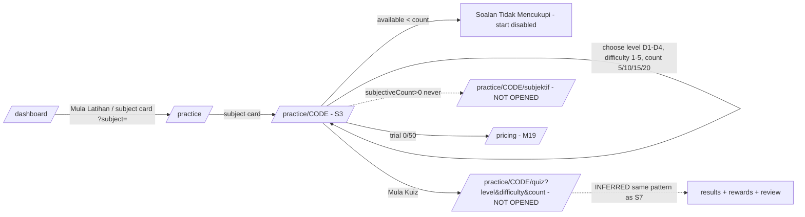
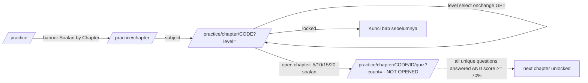
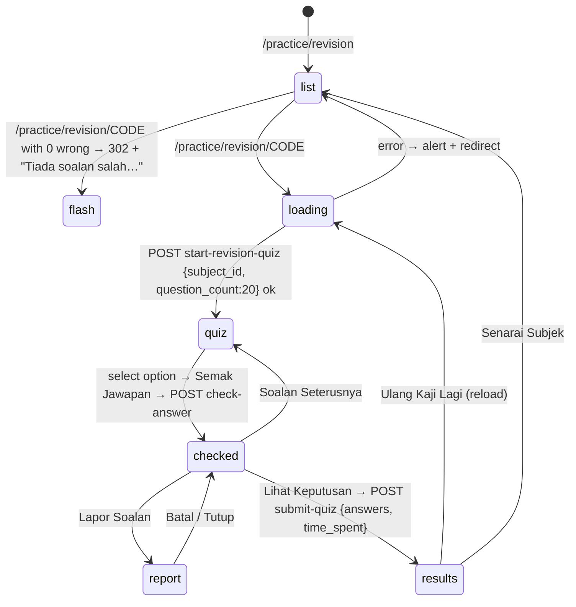

# M05 — Practice & Drills (Latih Tubi) + User-portal Home (Discovery)

- **Source:** live walk-through of https://prestasiplus.my on 2026-09-25, read-only, admin account (browser lane 1).
- **Screenshots:** `docs/discovery/img/M05/` (46 PNG). Shell, sidebar, header pills and design tokens: [00-global-ui.md](00-global-ui.md) (not repeated here).
- **Language:** UI copy is quoted in its exact Bahasa Melayu (English where the live site uses English).
- **Personal data:** the only account on these pages is the system account "Admin PRESTASI+", and its own practice stats are shown. On `/latihan-berstruktur` the question preview contains "Soalan Oleh: `<teacher>`" and each card has an author/school line. These were masked in the inventory (`<masked>`) and in the screenshots. No leaderboard names appear on M05 screens. CSRF tokens were replaced by `CSRF` before inventory.
- **Element inventory:** 860 content elements over 14 rendered screens and 68 captured UI states, IDs `EL-M05-S#-nnn` → `docs/discovery/inventory/M05/<S#-key>.json`. Reconciliation, crawl and read-only limits: `docs/discovery/inventory/M05/_summary.md`. The inventory JSON is authoritative for attributes and conditions.
- **Data seed:** `docs/discovery/inventory/M05/_practice-data.json` holds 31 practice subjects (code, names, icon, colour, listed count, per-level/per-difficulty config counts), 10 chapter-mode subjects with chapters, dashboard level pills and subject stats, the 20 Target SPM subjects, and the 31 structured-practice subject filter ids.
- **Safety:** a Playwright route guard (`tools/jobs/M05-guard.js`) aborted every non-GET request for the whole run. Only Cloudflare RUM beacons were blocked; the app sent no POST. **No session was started, no question answered, nothing saved.** S7 (`/practice/revision/{CODE}`) starts a session on page load, so it was **not rendered**. It is documented from its static HTML, fetched with GET and not executed (§2.7).

---

## 1. Overview

M05 is the student-facing practice engine plus the user-portal home page. Everything is Laravel Blade + Alpine.js + Tailwind + Font Awesome 6. Pages are server-rendered. The only client-side data calls are the practice-session endpoints (`/practice/start-revision-quiz`, `/practice/check-answer`, `/practice/submit-quiz`, `/report-question`), which are all POST JSON. Chart.js 4 (jsDelivr CDN) draws the progress trend.

The platform has **four practice entry routes**:
1. **Latih Tubi rawak (random drill):** `/practice` → `/practice/{CODE}` (choose level, difficulty and count) → `/practice/{CODE}/quiz?level=&difficulty=&count=`.
2. **Soalan by Chapter:** `/practice/chapter` → `/practice/chapter/{CODE}?level=` → `/practice/chapter/{CODE}/{chapterId}/quiz?count=5|10|15|20`. Progressive unlock at 70%.
3. **Soalan Aku Salah (revision):** `/practice/revision` → `/practice/revision/{CODE}` (20 previously-wrong questions, in-page quiz).
4. **Soalan Berstruktur (structured, Kertas 2):** `/latihan-berstruktur` → `/latihan-berstruktur/{id}/jawab`.

It also has tracking pages (progress, history, corrections, mastery, remedial, missions, SPM target) and the dashboard.

| # | Route | Screen (header title / subtitle) | Tab title | Status |
|---|---|---|---|---|
| S1 | `/dashboard` | "Dashboard" / "Selamat datang kembali" | "Dashboard - PRESTASIPLUS" | Documented |
| S2 | `/practice` (`?subject=`, `?level=`, `?topic_id=` ignored) | "Latih Tubi" / "Pilih subjek dan mula berlatih" | "Latih Tubi - PRESTASIPLUS" | Documented |
| S3 | `/practice/{CODE}` | **"Dashboard" / "Selamat datang kembali"** (D-1) | "`<Subject>` - Latihan" | **new route**; pre-start only |
| S4 | `/practice/chapter` | "Soalan by Chapter" / "Latihan tersusun ikut bab buku teks dan DSKP" | "Soalan by Chapter - PRESTASIPLUS" | Documented |
| S5 | `/practice/chapter/{CODE}` (`?level=`) | "Soalan by Chapter" / "`<Subject>`" | "Chapter `<Subject>` - PRESTASIPLUS" | **new route** |
| S6 | `/practice/revision` | **"Dashboard" / "Selamat datang kembali"** (D-1) | "Soalan Aku Salah — PRESTASIPLUS" | Documented |
| S7 | `/practice/revision/{CODE}` | **"Dashboard"** (D-1) | "Ulang Kaji — `<Subject>`" | **new route**; source-only (starts a session on load) |
| S8 | `/practice/progress` (`?period=7|30|90|all`) | "Kemajuan Saya" / "Pantau prestasi dan kenal pasti topik lemah" | "Kemajuan Saya - PRESTASIPLUS" | Documented |
| S9 | `/practice/history` (`?period=week|month|year`) | "Sejarah Latihan" / "Rekod latihan dan prestasi anda" | "Sejarah Latihan - PRESTASIPLUS" | Documented |
| S10 | `/latihan-berstruktur` (`?subject_id=&kbat_level=&page=`) | **"Dashboard" / "Selamat datang kembali"** (D-1) | "Soalan Berstruktur - PRESTASIPLUS" | Documented; answer page not opened |
| S11 | `/pembetulan` (`?bulan=YYYY-MM`) | "Pembetulan" / "Lihat peningkatan selepas pembetulan jawapan" | "Pembetulan — Jejak Peningkatan" | Documented |
| S12 | `/penguasaan` | "Tahap Penguasaan" / "Jejak kemajuan anda dalam setiap subjek" | "Tahap Penguasaan" | Documented |
| S13 | `/remedial/saya` | **"Dashboard" / "Selamat datang kembali"** (D-1) | "Ujian Remedial Saya" | Documented (empty only) |
| S14 | `/misi-harian` | "Misi Harian" / "Selesaikan misi, kumpul syiling!" | "Misi Harian — PrestasiPlus" | Documented (empty only) |
| S15 | `/target-spm` | "Target SPM Saya" / "Tetapkan target gred SPM dan pantau kemajuan anda" | "Target SPM Saya — PrestasiPlus" | Documented; never saved |

**Tab-title formats are inconsistent:** `- PRESTASIPLUS`, `— PRESTASIPLUS`, `— PrestasiPlus`, `- Latihan`, or no suffix at all (S12, S13).

**Sidebar/shell entry points (global shell, 00-global-ui.md):** "Dashboard", "Target SPM", "Misi Harian", "Remedial", plus the practice links (`/practice`, `/practice/chapter`, `/penguasaan`, `/pembetulan`, `/latihan-berstruktur`). The mobile bottom nav has Home · SPM · Game · Topik · Chat · Lagi. The header pills show coins "256 koin", points "8 mata" and streak "1 hari" (owned by M14).

**Admin practice data used as evidence:** 4 sessions (11 May ×2, 19 May ×2, 2026) plus earlier answers (19/02). The 4 sessions are M06 SPM sessions (`/spm/history`: 11 May 14:22 "Latih Tubi" Sejarah 14/40, 14:27 "Latih Tubi" BM 11/34; 19 May 03:26 and 03:49 "Tahun Lepas" BM 1/5 and 0/5), not random drills; the 35 answers of 19/02 belong to no session **(corrected after audit)**. 72 wrong questions (BM 46, SEJ 26). Mastery BM L2 and SEJ L1. Free trial exhausted ("Baki 0 / 50 soalan").

### 1.1 Subject codes (practice) — 31 subjects

The code is the URL segment used by `/practice/{CODE}`, `/practice/chapter/{CODE}` and `/practice/revision/{CODE}`. The full data is in the seed JSON and Appendix B.1.

`BM BI MATH SCI SEJ PI PM` (Teras, badge "Teras") · `ADDMATH PHY CHEM BIO GEO PSV MUZ PJK RBT SK BA BC BT AKAUN EKON PERNIAGA PQS TI JAWI PSI SRT PPW PN SS`.

### 1.2 Enumerations (from page markup and scripts, OBSERVED)

| Enumeration | Values |
|---|---|
| Difficulty (S3) | 1 "Sgt Mudah"/"Sangat Mudah" (green), 2 "Mudah" (lime), 3 "Sederhana" (yellow), 4 "Sukar" (orange), 5 "Sgt Sukar"/"Sangat Sukar" (red); sub-label "Level 1…5"; none = "Semua" / "Campuran" / summary "Semua Tahap" |
| Question count (random) | 5, 10 (default), 15, 20 ("soalan") |
| Question count (chapter) | 5, 10, 15, 20 — buttons "5 soalan" … "20 soalan" |
| Revision session length | fixed 20 (`question_count: 20` in `startQuiz()`) |
| Education level (S3/S5 selectors) | D1–D4 only (Darjah 1–4); dashboard pills show D1–D6, T1–T5 |
| Progress period (S8) | `7` "7 Hari", `30` "30 Hari" (default), `90` "3 Bulan", `all` "Semua" |
| History period (S9) | (none) "Semua" (default), `week` "Minggu Ini", `month` "Bulan Ini", `year` "Tahun Ini" |
| KBAT level (S10 filter) | "" "Semua", 1 "1. Mengingat", 2 "2. Memahami", 3 "3. Mengaplikasi", 4 "4. Menganalisis", 5 "5. Menilai", 6 "6. Mencipta" |
| KBAT badge (S10 card) | "LOTS 1" (green `bg-green-100 text-green-700`), "MOTS 3" (amber `bg-amber-100 text-amber-700`), "HOTS 4" (red `bg-red-100 text-red-700`). Observed values: LOTS 1, LOTS 2, MOTS 3, HOTS 4, HOTS 5, HOTS 6 (`?kbat_level=` 1–6): 1–2 LOTS green, 3 MOTS amber, 4–6 HOTS red **(corrected after audit)** |
| Mastery level (S12) | L0 Pemula, L1 Mula Belajar, L2 Aktif, L3 Tekun, L4 Mahir, L5 Pakar Muda, L6 Cemerlang, L7 Master, L8 Grandmaster, L9 Legend, L10 Mythical |
| SPM target grade (S15) | "" "Target", A+, A, A-, B+, B, C+, C, D, E |
| SPM on-track legend (S15) | "70%+ Ketepatan (On Track)" green · "50-69% (Perlu Usaha)" amber · "<50% (Perlu Fokus)" red |
| Report reasons (S7) | `wrong_answer` "Jawapan tidak tepat", `confusing_question` "Soalan mengelirukan", `wrong_options` "Set jawapan tidak tepat", `missing_options` "Pilihan jawapan tidak lengkap", `duplicate` "Soalan berulang / pendua", `typo` "Kesalahan ejaan / taip", `other` "Lain-lain" |
| Dashboard banner types | HERO, FEATURE, PROMOTIONAL, ANNOUNCEMENT |
| Daily-quest difficulty (S1) | "Mudah", "Sederhana", "Sukar" |

---

## 2. Screens

### 2.1 S1 — `/dashboard` "Dashboard - PRESTASIPLUS" (user-portal home)

Page header "Dashboard" / "Selamat datang kembali". Content column `x-data="dashboard()"` (its `init()` only logs "🎉 PRESTASIPLUS Dashboard - DUOLINGO MEETS KAHOOT MODE ACTIVATED! 🚀"), plus a right `<aside class="hidden lg:block">` (desktop ≥1024 only). Sections in DOM order (Blade comments give the section numbers):

1. **Hero greeting:** "Selamat Petang, Admin PRESTASI+ 👋" (time-of-day greeting, INFERRED Pagi/Tengah Hari/Petang/Malam) and "Jom teruskan latihan hari ini! 🚀". A decorative 🎓 sits on the right of the hero, shown from 768 px only (`hidden md:block`). **Free-trial card:** `fa-hourglass-half` tile (amber→orange), "Percubaan Percuma" (upper-case by CSS), **(corrected after audit)** "Baki 0 / 50 soalan", button "Langgan Sekarang" → `/pricing` (M19).
2. **Announcement carousel** `bannerCarousel(5)`: 5 slides. It auto-advances every 5000 ms, pauses on mouseenter and resumes on mouseleave. Each slide has a type badge, title and body, which is clamped to 2 lines until "Baca Selanjutnya" (toggles to "Tutup"). Prev/next arrows (`prev()`, `next()`) are on every slide. There are 5 dot buttons (`goTo(i)`; active dot is wide and pink→amber) and a counter "`n` / 5".
   - HERO "Selamat Datang ke PRESTASIPLUS" — "Platform pembelajaran interaktif untuk pelajar sekolah. Jom mula belajar hari ini!"
   - FEATURE "2,000+ Soalan Latihan Tersedia!" — "Latih diri dengan ribuan soalan Matematik, Sains, BM dan BI. Kumpul coins dan naik ranking!"
   - PROMOTIONAL "Cabaran Mingguan: Siapa Paling Rajin?" — "Sertai cabaran mingguan dan lihat nama kamu di papan pendahulu. Streak 7 hari = bonus coins!"
   - ANNOUNCEMENT "Tips untuk Ibu Bapa: Bimbing Anak Belajar" — "Panduan untuk ibu bapa membantu anak-anak cemerlang dalam pelajaran. Klik untuk baca lebih lanjut."
   - FEATURE "Kumpul Badge & Tunjukkan Kehebatan!" — "15 badge istimewa menanti! Jawab soalan, kekalkan streak, dan jadi juara kelas."
3. **Kombo (streak) reminder banner:** ⚠️ "Kombo 1 hari akan putus!" — "Jangan lepaskan! Buat sekurang-kurangnya 1 latihan hari ini." with button "Mula Latihan" → `/practice`. INFERRED condition: streak > 0 and no practice today.
4. **Gamification stat cards (5):** 🪙 `256` "Syiling Kamu" · ⭐ `8` "Mata (Lvl 2)" (with a level progress bar) · 🔥 `1` "Hari Berturut" · 📋 `0` "Sesi Minggu Ini" · 🎯 `0`% "Ketepatan". Each number counts up from 0 (Alpine `x-init` interval animation).
5. **Misi Harian widget** `dailyQuestWidget()` (`showReward:false`): "📱 Misi Harian", "Selesaikan semua misi → buka Peti Harian! 🎁", "Progres" `0` / `10`. There are 10 quest cards, each with icon, title, difficulty chip, description, progress "0/n" bar and reward "🪙 +n":

   | Icon | Title | Difficulty | Description | Target | Reward |
   |---|---|---|---|---|---|
   | 📝 | Rajin Berlatih | Mudah | Selesaikan 3 kuiz hari ini | 3 | +15 |
   | 🎯 | Si Tepat | Sederhana | Dapat 80% ketepatan dalam mana-mana kuiz | 80 | +20 |
   | 🗺️ | Penjelajah Topik | Sederhana | Latih 3 topik berbeza hari ini | 3 | +25 |
   | ⚡ | Kilat Matematik | Sukar | Jawab 10 soalan dengan betul | 10 | +30 |
   | 🌟 | Mula Hari Ini | Mudah | Selesaikan 1 sesi latihan hari ini | 1 | +10 |
   | ✅ | Jawab 5 Betul | Mudah | Jawab 5 soalan dengan betul | 5 | +12 |
   | ⏱️ | Latihan 10 Minit | Sederhana | Berlatih sekurang-kurangnya 10 minit hari ini | 10 | +20 |
   | 🔥 | Kombo 2 Hari | Sederhana | Kekalkan kombo latihan selama 2 hari berturut-turut | 2 | +25 |
   | 🎯 | Ketepatan 90% | Sukar | Capai ketepatan 90% dalam sesi latihan | 90 | +35 |
   | ⚡ | Cabaran Kilat | Sukar | Jawab 20 soalan betul dalam satu sesi | 20 | +40 |

   Daily chest: 🎁 "Selesaikan 10 lagi misi untuk buka peti! 🔒" plus 10 progress dots. A "Chest Reward Popup" block exists in the template but renders nothing for this account (chest locked).
6. **Recent badges (trophy shelf):** empty state 🏆 "Belum Ada Lencana Lagi!" — "Jom kumpul lencana pertama dengan menjawab soalan! 🚀".
7. **Quick actions (game menu):** "🚀 Mula Latihan" → `/practice`; "🔄 Soalan Aku Salah" with count badge `72` → `/practice/revision`; "📈 Kemajuan" → `/practice/progress`; "📊 Sejarah Latihan" → `/practice/history`; "🏅 Papan Pendahulu" → `/leaderboard` (M14); "Panel Admin" (`fa-shield-alt`) → `/admin` (admin/staff only, INFERRED).
8. **Conditional sections that rendered empty for this account** (Blade comments only): "3.5 BATTLE STATS", "4.2a PARENT DAILY TARGET", "4.2b WEAK TOPIC ALERT", "4.2b SET SOALAN DARI CIKGU (teacher quiz sets)", "4.3 PENDING ASSIGNMENTS (TUGASAN)", "4.6 NEW REWARDS". Their markup is server-side and not observable (§8).
9. **Articles:** "📚 Artikel Untuk Kamu" with "Lihat Semua" → `/artikel`. A horizontal-scroll strip of 5 article cards (category chip "Tips Belajar" / "Panduan Ibu Bapa", title, relative date "7 bulan yang lepas") → `/artikel/{slug}` (M09).
10. **"📖 Subjek Tersedia"** with count "31 subjek": 31 `.subject-card`, each with an icon, a count chip "`n` soalan" (no thousands separator), name, English name, "⭐ Subjek Teras" (core only) and "Mula Latihan 🚀" → **`/practice?subject={CODE}`** (parameter ignored, D-3).
11. **"📊 Statistik Platform":** 📚 `130152` "Total Soalan" · 📖 `31` "Subjek Aktif" · 🎯 `11` "Tahap Pendidikan" · ✅ `129752` "Soalan Approved" (count-up animation).
12. **"🎓 Tahap Pendidikan":** three groups. "🏫 Sekolah Rendah (KSSR)" has Darjah 1–6; "🎒 Sekolah Menengah Rendah (KSSM)" has Tingkatan 1–3; "🎓 Sekolah Menengah Atas (KSSM)" has Tingkatan 4–5. Each pill reads "Darjah 1 (11396)" → **`/practice?level={D1..T5}`** (parameter ignored, D-3).
13. **"⚡ Soalan Terkini":** 5 latest questions (subject chip, 1–5 star difficulty, text truncated to 100 chars + "...", relative time "4 bulan yang lepas", level chip e.g. "T5"). Not links.
14. **"📈 Tahap Kesukaran":** a bar per difficulty — "Sangat Mudah" 39694, "Mudah" 47138, "Sederhana" 33720, "Sukar" 9600, "Sangat Sukar" 0. Bars animate to width relative to the maximum. Footer: `130152` "Jumlah Keseluruhan".
15. **"📊 Statistik Subjek":** 31 `.subject-stat-card` sorted by question count descending. Each shows icon, name, "`n` soalan", "Kesukaran:" (1–5 ⭐, filled amber) and "Digunakan:" "`n`x" (all "0x").
16. **Aside (desktop only):** "Artikel Terkini" with the same 5 articles (gradient thumbnail with `fa-newspaper`) and link "Lihat Semua Artikel" → `/artikel`.

### 2.2 S2 — `/practice` "Latih Tubi - PRESTASIPLUS"

- Hero "Latih Tubi 🎯" / "Pilih subjek dan mula berlatih!" with 4 bouncing icons (graduation-cap, star, trophy, rocket).
- **Chapter-mode banner** (link → `/practice/chapter`): "Mode Baru", "Soalan by Chapter", "Jawab bab demi bab ikut buku teks dan DSKP. Bab seterusnya terkunci sehingga bab semasa lengkap.", "Mula →".
- **31 subject "game cards"** (grid 1 / md 2 / lg 3 columns). Each card is a whole-card link → `/practice/{CODE}`. It has a coloured icon circle, a "Teras" crown badge for the 7 core subjects, name, English name, "🧠 `n` soalan" (with thousands separator) and a coloured "Mula Latihan →" button. The button is a `<button>` inside the `<a>`, so it has no action of its own.
- `?subject=`, `?level=` and `?topic_id=` return a byte-identical page (OBSERVED). No filtering and no scroll-to.

### 2.3 S3 — `/practice/{CODE}` "`<Subject>` - Latihan" (pre-start configuration)

`x-data="subjectConfig()"`, with server data injected: `educationLevels[] {id,name_bm,name_en,code,stage,question_count}`, `difficultyStats {1..5}`, `difficultyByLevel {levelId:{1..4}}`, `totalQuestions`, `levelNames`, `subjectiveLevelCounts`.

- Back link "Kembali ke Senarai Subjek" → `/practice`.
- Trial notice (blue): "Baki percubaan percuma: **0** soalan lagi." plus link "Langgan untuk akses tanpa had" → `/pricing`.
- Hero: subject icon, `<h1>` name, chip "`6,538` soalan tersedia".
- **"Pilih Tahap Pendidikan":** "Semua Tahap" (`fa-infinity`, "`n` soalan") plus one button per level (code chip "D1", name "Darjah 1", "`n` soalan"). Selected style: indigo fill with ring. **Only Darjah 1–4 are ever offered** (D-4).
- **"Pilih Tahap Kesukaran":** "Semua"/"Campuran" with the current total, then 5 levels ("Sgt Mudah" Level 1 … "Sgt Sukar" Level 5), each with a live count (`getDiffCount`).
- **"Bilangan Soalan":** 5 / 10 / 15 / 20 ("soalan"), default 10.
- **Summary card "Ringkasan"** (sticky): "Tahap Pendidikan:" (`getLevelName()` → "Semua Tahap" / level name / "Tahap `n`"), "Kesukaran:" ("Semua Tahap" or "Sangat Mudah"…"Sangat Sukar"), "Bilangan Soalan:", "Soalan Tersedia:" (ms-MY number format).
  - When `availableQuestions < questionCount`: amber warning "Soalan Tidak Mencukupi" / "Kurangkan bilangan soalan atau tukar tetapan penapisan.", and the start button turns grey (`cursor-not-allowed`; click does nothing).
  - **Start button "Mula Kuiz"** (`fa-play-circle`) is an `<a :href="quizUrl">`. On click it does `window.location.href = quizUrl` if `canStartQuiz`. `quizUrl = /practice/{CODE}/quiz?` + `level=<id>` (if set) + `difficulty=<1-5>` (if set) + `count=<n>`, e.g. `/practice/MATH/quiz?level=2&difficulty=3&count=20`. **Not opened** (starts a session).
  - `<template x-if="subjectiveCount > 0">` "Latihan Subjektif (`n` soalan)" (`fa-pen`) → `/practice/{CODE}/subjektif`. `subjectiveLevelCounts` is `[]` for all 31 subjects, so it never shows (OBSERVED).
  - When ready: "Bersedia untuk bermula!" (green pill).
- **"Tips":** "Mulakan dengan tahap mudah untuk biasakan diri", "Campurkan kesukaran untuk latihan menyeluruh", "Ambil masa untuk faham setiap soalan", "Ulang kaji soalan yang salah".
- Available-count logic (OBSERVED script): no level and no difficulty → `totalQuestions`. Level + difficulty → `difficultyByLevel[level][d]`. Level only → level `question_count`. Difficulty only → `difficultyStats[d]`.
- `/practice/XYZ` (unknown code) → 404 "404 - Halaman Tidak Dijumpai | PRESTASIPLUS".

### 2.4 S4 — `/practice/chapter` "Soalan by Chapter - PRESTASIPLUS"

Hero "Mode Sistematik" / "Soalan by Chapter" / "Pelajar jawab bab demi bab. Bab seterusnya hanya terbuka selepas bab sebelumnya lengkap dan mencapai sekurang-kurangnya 70%." and button "Latih Tubi Rawak" (`fa-random`) → `/practice`. It lists **10 subject cards** (only subjects with chapter data). Each has an icon, name, "`n` bab tersedia" and "`n` soalan chapter" and links → `/practice/chapter/{CODE}`: BM 18 bab / 4,833; BI 14 / 3,521; MATH 25 / 6,538; SCI 18 / 4,903; SEJ 8 / 1,931; PI 14 / 3,371; PM 14 / 3,307; GEO 8 / 800; BA 17 / 1,700; JAWI 13 / 1,300 (Appendix B.2).

### 2.5 S5 — `/practice/chapter/{CODE}` "Chapter `<Subject>` - PRESTASIPLUS"

- Dark teal hero: "Semua Subjek" → `/practice/chapter`; "Progressive Unlock"; `<h1>` subject; "Lengkapkan semua soalan bab semasa dan capai 70% untuk buka bab seterusnya."
- **Level select** `GET /practice/chapter/{CODE}` `name="level"`, auto-submits on change (`onchange="this.form.submit()"`). Options "Darjah 1 — 2,734 soalan" … "Darjah 4 — …" (D1–D4 only; default = first level).
- Chapter cards, one per chapter of the level:
  - **Open (current)**: teal number tile `n`; title "Bab `n`: `<name>`"; stats "`a`/`b` soalan unik · Skor `s`% · `r` baki"; teal progress bar (`width: a/b %`). Four green buttons "5 soalan", "10 soalan", "15 soalan", "20 soalan" → `/practice/chapter/{CODE}/{chapterId}/quiz?count=n`. Chapter ids are global, e.g. MATH D1 Bab 1 = 1, MATH D2 Bab 1 = 3, BM D1 Bab 1 = 35.
  - **Locked**: grey tile with `fa-lock`, `opacity-75`, same stats line, and chip "Kunci bab sebelumnya" in place of the buttons.
  - A "completed" style (≥70% and all answered) exists by rule but was not observed (no chapter completed).
- Empty (e.g. ADDMATH): "Tiada bab tersedia untuk tahap ini." with an **empty level `<select>`** (D-6).
- OBSERVED BM D1: Bab 1 "18/320 soalan unik · Skor 44.4% · 302 baki" is open. Bab 2 (5/317, 60%) and Bab 3 (10/321, 80%) are locked even though they have progress, because answers from random drills count toward them.

### 2.6 S6 — `/practice/revision` "Soalan Aku Salah — PRESTASIPLUS"

- Gradient banner (red→orange→amber) with `fa-redo-alt`: "Soalan Aku Salah" / "Ulang kaji soalan yang pernah dijawab salah". Pill "72 soalan perlu diulang kaji" (`fa-exclamation-circle`).
- Subject cards (1/2/3 columns) for subjects that have wrong answers: icon, name, English name, red pill "`n` soalan salah" (`fa-times-circle`), arrow → `/practice/revision/{CODE}`. Observed: Bahasa Melayu 46, Sejarah 26.
- "Tips Ulang Kaji" (amber box, `fa-lightbulb`): "Soalan yang paling kerap dijawab salah akan dipaparkan dahulu", "Apabila anda jawab betul, soalan itu akan dikeluarkan dari senarai ini", "Anda tetap mendapat syiling dan coin seperti latihan biasa".
- "Kembali ke Latihan" → `/practice`.
- Flash (info, captured by opening `/practice/revision/MATH`, which redirects 302 → `/practice/revision`): "Tiada soalan salah untuk subjek ini. Tahniah!". An unknown code (`/practice/revision/XYZ`) → 404.
- Empty state (no wrong answers at all) was not observable (§9).

### 2.7 S7 — `/practice/revision/{CODE}` "Ulang Kaji — `<Subject>`" (in-session quiz UI; SOURCE ONLY)

Not rendered in a browser: `x-init="startQuiz()"` POSTs `/practice/start-revision-quiz` as soon as the page loads, which would create a quiz session. The markup and script below come from the HTML returned by a plain GET (no JavaScript executed). `x-data="revisionQuizApp()"`, `state ∈ {'loading','quiz','results'}`.

**Loading state:** spinner ring in subject colour with `fa-redo-alt`, "Memuat Soalan Ulang Kaji...", "Menyediakan soalan yang pernah dijawab salah".

**Quiz state:**
- Header card: red/orange tile; "Ulang Kaji — `<Subject>`"; "Soalan `i` daripada `n`"; timer `formatTime(timer)` "MM:SS" counting **up** (1 s interval) labelled "Masa"; progress bar width `(i+1)/n`.
- Chips: "Mode Ulang Kaji — soalan ini pernah dijawab salah"; when `revisionMeta` is present: "`selected` daripada `total_wrong` soalan salah".
- Question card: pill "Soalan `i`"; when `wrong_times > 1` → "Salah `n`x"; "Mengikut DSKP" (`has_dskp`) or "Latihan Tambahan". Question text supports `rtl` / mixed script (`text_direction`, `script_type`). Optional contributor chip: "Soalan oleh:" + name, linked to `profile_url` (opens a new tab) or plain text.
- Options: a button per option (`label` A/B/C/D + `text`). States: idle (hover orange), selected (orange ring), after check the correct option is green with `fa-check-circle`, a wrong selection is red with `fa-times-circle`, and the others are dimmed at opacity 50 and disabled.
- Buttons: "Semak Jawapan" (shown when an option is selected and not yet checked). After checking: "Soalan Seterusnya →", or on the last question "Lihat Keputusan 🏁" (`fa-flag-checkered`).
- After checking: "Lapor Soalan" (`fa-flag`) opens the report modal.
- Feedback card: title "Betul! Kali ini berjaya!" (green) or "Masih belum tepat" (red); server `feedback` text; "Penjelasan:" + `explanation` when present. A correct answer triggers the coin animation `JBCoinFly.play({syiling:1, mata:10, mini:true})`.

**Results state:** "Keputusan Ulang Kaji" / `<Subject>`; big "`score`/`n`"; percentage coloured green ≥80, yellow 50–79, red <50. Message from `getRevisionMessage()`:
- 100 → "Sempurna! Semua soalan salah berjaya diperbetulkan!"
- ≥80 → "Cemerlang! Hampir semua berjaya diperbetulkan!"
- ≥50 → "Bagus! Teruskan ulang kaji!"
- else → "Jangan putus asa! Cuba ulang kaji lagi!"

Below the message:
- "Masa diambil: MM:SS".
- If ≥50%: "`score` soalan salah berjaya diperbetulkan!".
- Animated bar.
- Buttons "Ulang Kaji Lagi" (reloads the page, so it starts a new session) and "Senarai Subjek" → `/practice/revision`.
- **"Ganjaran Anda"** (shown when `gamificationData` exists): 🪙 `coins_earned` "Syiling Diperoleh", 🔥 "`streak_count` hari" "Kombo Semasa", ⭐ `points_earned` "Mata Diperoleh", and "Baki syiling: `total_balance` 🪙". Bonus coins fly = server total − per-question coins already shown.
- **"Semakan Semula Jawapan"** (collapsible, chevron): one card per answer (green/red) with number, question, "Jawapan anda:" "`A. text`", "| Jawapan betul: `B. text`" when wrong, "Penjelasan:" and link "Lapor soalan ini".

**Report modal** "Lapor Soalan" / "Soalan ini akan dinyahaktifkan sementara" (Esc/backdrop/× closes):
- "Sebab Laporan *": 7 checkboxes (§1.2) with helper texts (Appendix A).
- "Komen Tambahan (pilihan)" textarea (maxlength 500, placeholder "Terangkan masalah soalan ini...", counter "`n`/500").
- Buttons "Batal" and "Hantar Laporan" (`fa-paper-plane`; disabled until ≥1 reason; while sending "Menghantar...").
- Success view: "Terima Kasih!" + server message or "Laporan berjaya dihantar."; on a network failure the same "Terima Kasih!" view (green tick) shows "Gagal menghantar laporan. Sila cuba lagi." — there is no separate failure view **(corrected after audit)**; button "Tutup".

**Errors:** a start failure throws `new Error(data.message || 'Failed to load revision quiz')` and shows `alert(error.message || 'Maaf, terdapat masalah memuatkan kuiz ulang kaji.')`, then redirects to `/practice/revision`; so without a server message the alert text is the English "Failed to load revision quiz" **(corrected after audit)**. A check-answer call that returns any JSON (even an error) marks the answer checked (no `is_correct` → red "Masih belum tepat"); only a network failure changes nothing. After checking, "Lapor Soalan" sits between the question card and the feedback card **(corrected after audit)**.

### 2.8 S8 — `/practice/progress` "Kemajuan Saya - PRESTASIPLUS"

- Period chips "7 Hari", "30 Hari" (default, active gradient), "3 Bulan", "Semua" → `?period=`.
- 4 stat tiles (2 columns, lg 4): 📝 "Soalan Dijawab", 🎯 "Ketepatan Keseluruhan" (%), 📋 "Sesi Latihan", ⏱️ "Masa Berlatih" (e.g. "0m", "4m").
- **Empty** (no answers in period; 7/30/90 for admin): 📊 "Belum Ada Data" / "Mula buat latihan untuk lihat kemajuan kamu di sini!" / button "Mula Latihan" → `/practice`.
- **With data** (`period=all`: 119 answered, 38.7%, 4 sessions, 4m):
  - **"Trend Ketepatan"**: Chart.js line chart (`#accuracyChart`, 250 px high). Dataset "Ketepatan (%)" (indigo, filled) and dataset "Soalan" (amber dashed, right axis `y1`). The y axis runs 0–100 titled "Ketepatan (%)". Labels are dd/mm per day (e.g. 19/02, 11/05, 19/05).
  - **"Topik Perlu Perhatian"** (red card, `fa-exclamation-triangle`): one row per weak subject — subject-colour circle with the 2-letter abbreviation ("BM", "SE"), name, "`n` soalan", accuracy % in red, and button "Ulang Kaji" → `/practice/{CODE}`. It lists subjects, not topics (D-9).
  - **"Prestasi Mengikut Subjek"** (1/2/3 columns): abbreviation tile, name, "`n` soalan dijawab", accuracy % (red <50, INFERRED amber 50–69 / green ≥70), bar, "Trend:" SVG sparkline (120×30, min–max scaled: y = 2 + (max − v) ÷ (max − min) × 26, e.g. BM "0,2 60,15.6 120,28" **(corrected after audit)**) with ▲/▼ arrow (only when ≥2 points), "`c` betul" / "`w` salah".

### 2.9 S9 — `/practice/history` "Sejarah Latihan - PRESTASIPLUS"

- 4 achievement cards: "Jumlah Sesi" `4` ✨ · "Soalan Dijawab" `84` 🎯 · "Purata Ketepatan" `21.8%` 📊 · "Syiling Dikumpul" `26` 💰.
- Filter pills: "Semua" (`fa-infinity`), "Minggu Ini", "Bulan Ini", "Tahun Ini" (active = gradient).
- Session cards (newest first; left border in the type colour):
  - type badge "Latihan" (`fa-book`, grey #6B7280) — all 4 listed sessions are M06 SPM "Tahun Lepas" / "Latih Tubi" sessions, so "Latihan" is the badge of SPM sessions **(corrected after audit)**; date "19 May 2026, 03:49" (English month names — D-10)
  - score "`c` / `n`", time badge "MM:SS", "`c` betul", "`w` salah"
  - grade label + %: "💪 Cuba Lagi" (red, observed for 0–35%), progress bar with inner label "`n`%" (hidden at 0), pill "Ketepatan: `x`%"
  - coin badge 🪙 `n` "SYILING"
- Session cards have **no link** to a detail or review page (probed `/practice/history/{id}`, `/practice/result/{id}`, `/practice/review/{id}`, `/practice/session/{id}` → 404).
- Empty (week/month): 📝 ✨ 🎯 "Belum Ada Rekod Latihan" / "Anda belum melengkapkan sebarang latihan lagi. Mulakan latihan pertama anda sekarang dan kumpul syiling! 🚀" / "Mula Latihan" → `/practice`.
- A pagination container is present (empty with 4 sessions; INFERRED Laravel paginator). An unknown `?period=` (e.g. `zzz`) leaves every pill inactive and lists all sessions; on S8 it leaves every chip inactive and shows zero figures **(corrected after audit)**.

### 2.10 S10 — `/latihan-berstruktur` "Soalan Berstruktur - PRESTASIPLUS"

- Heading "Soalan Berstruktur" / "Latih tubi format Kertas 2 — jawab & semak secara automatik".
- **Filter form** `GET` (no action = same URL): "Subjek" `subject_id` ("Semua Subjek" + 31 subjects A–Z by name, ids from the admin subject table) · "Aras KBAT" `kbat_level` ("Semua", 1–6) · button "Cari" (`fa-search`).
- **Cards** (1 / sm 2 / xl 3 columns, 20 per page):
  - chips: subject name, KBAT badge ("LOTS 1"/"MOTS 3"/"HOTS 4"), estimated time "`n`m" (cyan), "Trial" (green)
  - preview text (line-clamp 3; includes the source line "Soalan Oleh: `<teacher>` / Kertas 2 Bab 7 Tingkatan 5 (2019) / Item `n`")
  - topic line (`fa-book-open`) when present
  - author line (`fa-user-pen`) "`<author>` · `<SCHOOL, truncated>`"
  - footer "`n` soalan · Tingkatan `n`" (`fa-list-ol`) and button **"Mula →"** (44×44 minimum) → `/latihan-berstruktur/{id}/jawab` (**not opened**).
- **Pagination** (Laravel default, English): "« Previous" / "Next »", "Showing 1 to 20 of 4061 results", page links 1–10 … 203 204.
- Empty: `fa-…` icon, "Tiada soalan berstruktur buat masa ini" / "Soalan akan ditambah oleh guru dan admin" (e.g. subject Sains Sukan, or Matematik + KBAT 6).
- **SPM variants (same route):** `?scope=spm` renders "Subjektif SPM" (back link "Kembali ke Subjektif SPM", 15-subject list, hidden `scope` input) and `?scope=spm&track=bahasa` renders "Tracking A Bahasa" (back link "Kembali ke Tracking A SPM", BM/BI list, hidden `scope` and `track`); cards add "Tingkatan {n}" and "{n} bahagian · {m} markah"; the pager and "Mula" keep `scope`/`track` (`/latihan-berstruktur/{id}/jawab?scope=spm`). Documented in `M06-spm.md` §2.7/§2.9 and inventory M06 S7/S9 **(corrected after audit)**.

### 2.11 S11 — `/pembetulan` "Pembetulan — Jejak Peningkatan"

- Month bar: "Bulan:" with ‹ link to the previous month (`?bulan=YYYY-MM`), label "September 2026" (BM month names), and › link to the next month. On the current month the › is a disabled grey span.
- **With data** (Mei 2026):
  - **"Ringkasan Keseluruhan"**: "Sebelum" 33.8% (red), "Selepas" 33.8% (green), "Peningkatan" 0.0% (grey when 0; INFERRED green "+x%" when positive), "Berdasarkan 74 soalan bulan ini".
  - **"Mengikut Subjek"**: per subject a colour dot, name, "`n` soalan", "Sebelum" bar (red), "Selepas" bar (green) and a delta pill.
- Empty: 🔄 "Tiada Data Pembetulan" / "Cuba buat pembetulan jawapan semasa sesi latih tubi untuk melihat peningkatan di sini."
- Future months are reachable by URL, and from a future month the › link keeps going forward (D-11). A malformed `bulan` (`abc`, `2026-13`) returns HTTP 500 "500 - Ralat Pelayan" **(corrected after audit)**.

### 2.12 S12 — `/penguasaan` "Tahap Penguasaan"

- **"Skala Penguasaan"** (`fa-info-circle`): 11 chips L0–L10 (§1.2) in grey → blue → green → amber → purple, and L10 with a gradient.
- Subject cards (1 / sm 2 columns), for subjects with answers only:
  - subject-colour icon tile and name "(CODE)"
  - level chip (e.g. "L2 Aktif")
  - 3 stats "Betul" / "Dijawab" / "Tepat" (%; red when <50, INFERRED)
  - "Menuju L`n+1`" with "`c`/`t` betul" and a bar in the subject colour
  - XP multiplier "x1.05 XP" (purple; shown from L2)
  - "Terakhir: 4 bulan yang lepas"
- Observed: BM L2 Aktif, 46 betul / 94 dijawab / 48.9%, "Menuju L3", "46/50 betul", bar 84%, "x1.05 XP". SEJ L1 Mula Belajar, 14/40/35.0%, "Menuju L2", "14/25 betul", bar 26.7%, no multiplier.
- Icons are broken: `<i class="book-open">` / `<i class="clock">` (Lucide names without a Font Awesome prefix) → blank (D-2).
- No empty state was observed (the account has data).

### 2.13 S13 — `/remedial/saya` "Ujian Remedial Saya"

Heading 🔬 "Ujian Remedial Saya" / "Ujian khas untuk topik yang perlu diperbaiki". Empty: 🎯 "Tiada ujian remedial. Bagus — teruskan usaha!". The list or detail of remedial tests (assigned by teachers, M10) was not observable (§9). Probes `/remedial`, `/remedial/1` → 404.

### 2.14 S14 — `/misi-harian` "Misi Harian — PrestasiPlus"

Empty card: `fa-inbox`, "Tiada misi hari ini" / "Misi baru akan muncul bila guru anda assign." (mixed BM/English "assign"). These are **teacher-assigned missions** (teacher side `/guru/misi-harian`, M10). They are a separate system from the 10 built-in daily quests on S1 (D-12).

### 2.15 S15 — `/target-spm` "Target SPM Saya — PrestasiPlus"

- Form `POST /target-spm` (`_token`) in a card: "Target Gred SPM" (`fa-bullseye`) / "Pilih target gred untuk setiap subjek. Sistem akan tunjuk kemajuan anda." / button "Simpan" (`fa-save`). **Never clicked.**
- 20 SPM subject rows (A–Z; Appendix B.5). Each has name, status "Belum mula" (INFERRED otherwise accuracy/answered), a progress bar (empty grey when not started; INFERRED coloured per legend), predicted grade "-", and `<select name="targets[{subject_id}]">` (options §1.2).
- Legend: "70%+ Ketepatan (On Track)", "50-69% (Perlu Usaha)", "<50% (Perlu Fokus)", and "Tip: Jawab lebih banyak soalan untuk ramalan gred yang lebih tepat" (`fa-lightbulb`).
- Admin shows "Belum mula" for BM and SEJ although it has 84 answers in SPM "Tahun Lepas" and "Latih Tubi" sessions (BM, SEJ) → SPM session answers do **not** feed S15; the data source is unknown (LS-10) **(corrected after audit)**.

---

## 3. Flows

### 3.1 Random drill (Latih Tubi)

### 3.2 Chapter mode (progressive unlock)

### 3.3 Revision (Soalan Aku Salah)

### 3.4 Structured practice

`/latihan-berstruktur` → filter (GET subject_id, kbat_level) → paginate → "Mula" → `/latihan-berstruktur/{id}/jawab` (answer page, not opened). The subtitle claims automatic marking ("jawab & semak secara automatik"). Teacher authoring is at `/guru/soalan-berstruktur` (M10).

### 3.5 Tracking

Dashboard quick links → `/practice/progress` (period chips) · `/practice/history` (period pills) · `/practice/revision`. Sidebar → `/penguasaan`, `/pembetulan` (month navigation), `/target-spm` (set targets → Simpan POST), `/remedial/saya`, `/misi-harian`.

---

## 4. Inferred rules (INFERRED unless marked OBSERVED)

1. **Free trial (OBSERVED copy):** non-subscribers get 50 free questions ("Baki `n` / 50 soalan"). The admin account is treated as a trial user with 0 left. INFERRED: starting a quiz with 0 remaining redirects to `/pricing` or blocks, since the start button is not disabled on the client.
2. **Available-question logic (OBSERVED script)**, §2.3. The start is allowed when `available ≥ count`.
3. **Level offer:** S3/S5 offer only education levels 1–4 (Darjah 1–4) for every subject (OBSERVED on all 31). Secondary subjects therefore show 0 there, although S2 lists thousands (e.g. Fizik 1,261). The S2 count is likely all questions across all levels; the S3 count is filtered to D1–D4.
4. **Difficulty 5 "Sangat Sukar"** has 0 questions in every subject (OBSERVED), so choosing it always shows "Soalan Tidak Mencukupi".
5. **Chapter unlock (OBSERVED copy):** the next chapter opens only after the current chapter is complete ("Lengkapkan semua soalan bab semasa") **and** its score is ≥70%. The first chapter of each level is always open. "Skor" = correct / unique answered (INFERRED). Progress counts unique questions.
6. **Revision (OBSERVED copy + script):** wrong questions are ordered by how often they were answered wrong. A correct answer removes the question from the list. The session is 20 questions per subject. Coins/points are earned "seperti latihan biasa". Client per-correct animation: +1 syiling, +10 mata. The server returns `coins_earned`, `points_earned`, `streak_count`, `total_balance` (feeds M14).
7. **Scoring colours (OBSERVED):** result % green ≥80, yellow 50–79, red <50 (S7). History grade "💪 Cuba Lagi" (red) for <50%. INFERRED higher labels exist (not in markup). Progress accuracy red <50%.
8. **Mastery (S12):** level by correct answers per subject. Thresholds INFERRED from the bars: L1 ≥10, L2 ≥25, L3 ≥50 correct (BM 46/50 → bar 84% = (46−25)/(50−25); SEJ 14/25 → 26.7% = (14−10)/(25−10)). Higher thresholds unknown. The XP multiplier is x1.05 at L2 (INFERRED +0.05 per level from L2).
9. **Streak ("Kombo")** = consecutive practice days. The reminder "Kombo `n` hari akan putus!" shows when there is no practice today. The admin still shows 1 hari although its last practice was in May 2026 (D-8).
10. **Daily quests (S1):** 10 fixed quests with coin rewards 10–40 (total 232). Completing all 10 unlocks "Peti Harian". These are separate from teacher missions (S14).
11. **Pembetulan:** "Sebelum" = accuracy at first attempt, "Selepas" = accuracy after correction (re-answering wrong questions), "Peningkatan" = difference, per month.
12. **SPM target:** progress is accuracy on SPM subjects with an on-track band (≥70 / 50–69 / <50). A predicted grade is shown after enough answers ("ramalan gred"). SPM "Tahun Lepas" and "Latih Tubi" answers do not count (admin: all rows "Belum mula" despite 84 SPM answers) **(corrected after audit)**.
13. **Report question:** a report temporarily deactivates the question ("Soalan ini akan dinyahaktifkan sementara") until admin review (M04 `/admin/laporan-soalan`).

---

## 5. Data entities implied

- **PracticeSubject** (= M03 Subject): `code`, `name`, `name_en`, `icon` (FA class), `color`, `is_core`, question counts.
- **QuizSession**: `id`, `user_id`, `subject_id`, `mode` (random / chapter / revision / subjective, plus the M06 SPM types `past_year` / `latih_tubi` / `ramalan` in the same store; the observed history badge "Latihan" belongs to SPM sessions **(corrected after audit)**), `education_level_id?`, `difficulty?`, `chapter_id?`, `question_count`, `score`, `correct`, `wrong`, `time_spent` (s), `coins_earned`, `points_earned`, `started_at`, `completed_at`.
- **QuizAnswer**: `quiz_session_id`, `question_id`, `selected_option_id`, `is_correct`, `answered_at`.
- **WrongQuestion** (revision queue, INFERRED): `user_id`, `question_id`, `wrong_times`, `resolved_at`.
- **ChapterProgress**: `user_id`, `chapter_id`, `unique_answered`, `total`, `score_pct`, `unlocked`.
- **SubjectMastery**: `user_id`, `subject_id`, `level 0–10`, `correct`, `answered`, `accuracy`, `xp_multiplier`, `last_practiced_at`.
- **Correction** (pembetulan, INFERRED): per month and subject — before/after accuracy, question count.
- **SpmTarget**: `user_id`, `subject_id`, `target_grade ∈ {A+,A,A-,B+,B,C+,C,D,E}`.
- **DailyQuest** (catalogue) + **UserDailyQuest** progress; **DailyChest**.
- **TeacherMission** (S14) and **RemedialTest** (S13) — owned by M10.
- **StructuredQuestion** (Kertas 2): `id`, `subject_id`, `kbat_level 1–6`, `estimated_minutes`, `is_trial`, `text`, `topic`, `author`, `school`, `level`, `sub_question_count`.
- **QuestionReport**: `question_id`, `reasons[]`, `comment ≤500`, `quiz_session_id`, `source` ('revision').
- **Announcement** (S1 carousel): `type ∈ {HERO, FEATURE, PROMOTIONAL, ANNOUNCEMENT}`, `title`, `body`.

---

## 6. Endpoints observed

| Method | URL | Used by | Payload / response |
|---|---|---|---|
| GET | `/dashboard` | S1 | HTML |
| GET | `/practice` (`?subject=`, `?level=`, `?topic_id=` ignored) | S2 | HTML |
| GET | `/practice/{CODE}` | S3 | HTML with `subjectConfig()` data; unknown code → 404 |
| GET | `/practice/{CODE}/quiz?level=&difficulty=&count=` | S3 "Mula Kuiz" | **not opened** |
| GET | `/practice/{CODE}/subjektif` | S3 (x-if, never shown) | **not opened** |
| GET | `/practice/chapter`, `/practice/chapter/{CODE}?level=` | S4, S5 | HTML; unknown code → 404 |
| GET | `/practice/chapter/{CODE}/{chapterId}/quiz?count=5|10|15|20` | S5 | **not opened** |
| GET | `/practice/revision` | S6 | HTML |
| GET | `/practice/revision/{CODE}` | S6 → S7 | HTML (fetched, not executed); 0 wrong → 302 `/practice/revision` + flash; unknown → 404 |
| POST JSON | `/practice/start-revision-quiz` | S7 `startQuiz()` | req `{subject_id, question_count:20}`; res `{quiz_session_id, questions[{id, question_text, text_direction, script_type, wrong_times, has_dskp, contributor{name, profile_url}, options[{id,label,text}]}], revision_meta{selected,total_wrong}}`, or `{message}` on error |
| POST JSON | `/practice/check-answer` | S7 (INFERRED also quiz pages) | req `{quiz_session_id, question_id, selected_option_id}`; res `{is_correct, correct_option_id, feedback, explanation}` |
| POST JSON | `/practice/submit-quiz` | S7 | req `{quiz_session_id, answers[{question_id, selected_option_id}], time_spent}`; res `{results:{gamification:{coins_earned, streak_count, points_earned, total_balance}}}` |
| POST JSON | `/report-question` | S7 | req `{question_id, reasons[], comment, quiz_session_id, source:'revision'}`; res `{message}` |
| GET | `/practice/progress?period=7|30|90|all` | S8 | HTML + inline Chart.js data |
| GET | `/practice/history?period=week|month|year` | S9 | HTML |
| GET | `/latihan-berstruktur?subject_id=&kbat_level=&page=` | S10 | HTML (20 per page) |
| GET | `/latihan-berstruktur/{id}/jawab` | S10 "Mula" | **not opened** |
| GET | `/pembetulan?bulan=YYYY-MM` | S11 | HTML |
| GET | `/penguasaan`, `/remedial/saya`, `/misi-harian`, `/target-spm` | S12–S15 | HTML |
| POST (form) | `/target-spm` | S15 "Simpan" | `_token`, `targets[{subject_id}]=<grade|''>` × 20; **never sent** |
| GET | `/api/tournament/active`, `/notifikasi/unread-count`, `/chatbot/*`, `/fcm/token` | shell | M16 / M01+M22 |

Probed and **absent (404)**: `/practice/history/1`, `/practice/result/1`, `/practice/review/1`, `/practice/session/1`, `/practice/sessions`, `/practice/stats`, `/practice/leaderboard`, `/practice/daily-quest`, `/daily-quests`, `/api/practice`, `/remedial`, `/remedial/1`, `/misi-harian/1`, `/penguasaan/1`, `/target-spm/edit`, `/latihan-berstruktur/999999`. There are **no JSON read endpoints**. All read data is server-rendered.

---

## 7. Responsive behaviour (375 / 768 / 1280) and live defects

No state causes horizontal page scroll at any width (scrollWidth = viewport on all 68 states).

| Screen | 1280 | 768 | 375 |
|---|---|---|---|
| S1 | main column + right aside (articles); stat cards 5 across; subject cards 3 columns | aside hidden (`lg:block`); cards 2 columns | 1 column; page 19,744 px tall (31 subject cards ≈6,500 px, 31 stat cards ≈5,700 px) |
| S2 | cards 3 columns | 2 columns | 1 column |
| S3 | options 2/3 of width + sticky summary 1/3 (`lg:grid-cols-3`) | single column (summary below the options) | level buttons 2 columns, difficulty 2 columns, counts 4 columns; tiny text (10 px) |
| S4 | cards 3 columns | 2 columns | 1 column |
| S5 | card row: text left, buttons right | stacked | stacked; buttons wrap 3 + 1; **chapter titles truncated** (`truncate`, e.g. "Bab 6: Panjang, Jisim dan Isi Padu C…") |
| S6 | cards 3 columns | 2 columns | 1 column |
| S8 | tiles 4 columns, subject cards 3 columns | tiles 2 columns, subject cards 2 columns | tiles 2 columns, subject cards 1 column; chart 250 px |
| S9 | session card row layout | stacked | stacked; stat cards 2×2 with 10 px labels |
| S10 | 3 columns | 2 columns | 1 column |
| S11/S12 | 2-column subject grid (S12) | same | 1 column |
| S15 | name · bar · grade · select in one row | same | name column 144 px + select 80 px → **the progress bar is squeezed to ~0 px** and names wrap to 2–3 lines |

Header title on mobile is truncated ("Soalan by Chap…", "Tetapkan target gred SPM d…") — global shell behaviour (00-global-ui.md).

**Live defects (fix under D9):**
- **D-1** Wrong page header "Dashboard" / "Selamat datang kembali" on S3, S6, S7, S10, S13 (wrong label). Same defect as M03 D-1.
- **D-2** Invisible icons: subject icons stored as Lucide names, emoji or double prefixes render as broken Font Awesome classes — `fa-zap`, `fa-flask-round`, `fa-variable`, `fa-monitor`, `fa-trending-up`, `fas fa-fas fa-quran`, `fa-🍽`, `fa-👗`, empty `fa-` (S1, S2, S3). S12 uses `<i class="book-open">` / `<i class="clock">` with no FA prefix.
- **D-3** Dashboard subject cards (`/practice?subject=`) and level pills (`/practice?level=`), and Peta Belajar islands (`/practice?topic_id=`, M03), all land on the unfiltered `/practice` list. The parameter is ignored (dead filter).
- **D-4** S3/S5 offer only Darjah 1–4. Secondary subjects (ADDMATH, PHY, CHEM, BIO, AKAUN, EKON, …) show "0 soalan tersedia" and cannot be started, although S2 advertises e.g. "2,101 soalan" (contradictory). SK offers one level "D4" with 0 questions.
- **D-5** Contradictory counts: S2 card "Matematik 13,872" vs S3 "6,538 soalan tersedia"; S1 stat "Pendidikan Moral 15414" vs card "15,014"; answered totals differ between S8 (119), S9 (84) and S12 (BM 94 + SEJ 40); S6 BM 46 wrong vs S8 BM 47 salah; the S1 carousel says "2,000+ Soalan" while the platform has 130,152.
- **D-6** S5 with no chapters (e.g. ADDMATH) shows an empty level `<select>`.
- **D-7** S5 locked chapters show progress/scores (answers from random drills), and Bab 3 at 80% stays locked. Confusing but follows the rule; replicate the rule and keep the display.
- **D-8** Streak shows "1 hari" and "Kombo 1 hari akan putus!" although the last practice was in May 2026 (stale streak; contradictory).
- **D-9** S8 "Topik Perlu Perhatian" lists subjects, not topics, and its "Ulang Kaji" button opens the random drill (`/practice/{CODE}`), not the revision list (`/practice/revision/{CODE}`) (wrong label/target).
- **D-10** English copy in BM UI: history dates "19 May 2026", Laravel pagination "« Previous", "Next »", "Showing 1 to 20 of 4061 results", mission copy "bila guru anda assign", "Soalan by Chapter", "Mode Ulang Kaji", "Progressive Unlock", "(On Track)".
- **D-11** S11 month navigation lets you go past the current month by URL, and then › stays active indefinitely.
- **D-12** Two unrelated "Misi Harian" features: S1 widget (10 automatic quests, "Progres 0/10") vs S14 page ("Tiada misi hari ini", teacher-assigned). The S1 widget has no link to S14 (contradictory naming).
- **D-13** S5 mobile: chapter names truncated with no way to read them in full. S15 mobile: progress bar squeezed to nothing (layout breakage).
- **D-14** S2 subject cards contain a `<button>` "Mula Latihan" nested inside the `<a>` (invalid interactive nesting; keyboard focus lands twice).
- **D-15** Inconsistent tab-title suffixes (§1) and S12/S13 tab titles with no site suffix.
- **D-16** S7 start error message fallback "Failed to load revision quiz" is English (only shown if the server sends no message).

---

## 8. Open questions / not observable read-only

| ID | Question / item | Why |
|---|---|---|
| Q-M05-1 | Exact quiz UI for random drill (`/practice/{CODE}/quiz`), chapter drill (`/practice/chapter/{CODE}/{id}/quiz`) and subjective drill (`/practice/{CODE}/subjektif`). Same as S7 or different (timer countdown vs count-up, skip, question navigation)? | Opening them starts a session (not approved). |
| Q-M05-2 | Behaviour when the free trial is exhausted (0/50) and the user starts a quiz: redirect to `/pricing`, block, or allow admins? | Needs a session start. |
| Q-M05-3 | History grade labels beyond "💪 Cuba Lagi" and their thresholds; session type badges other than "Latihan" (chapter, revision, subjective). | Only 4 random-drill sessions exist, all <50%. |
| Q-M05-4 | Mastery thresholds for L4–L10 and the XP multiplier per level. | Only L1/L2 observed. |
| Q-M05-5 | Completed-chapter card style and what happens after all chapters of a level are done. | No chapter completed. |
| Q-M05-6 | S13 remedial list/detail and S14 mission cards: layout, statuses and actions. | No remedial tests or missions assigned to the admin. |
| Q-M05-7 | S15 row with data: colour of the progress bar, predicted-grade formula, status texts other than "Belum mula"; the success flash after "Simpan". | No SPM-level answers; saving is forbidden. |
| Q-M05-8 | Dashboard conditional sections (battle stats, parent daily target, weak-topic alert, teacher quiz sets, pending assignments, new rewards, chest reward popup) and the greeting variants by time of day. | Not rendered for this account/time. |
| Q-M05-9 | Structured answer page `/latihan-berstruktur/{id}/jawab`: input type, auto-marking ("semak secara automatik"), feedback, scoring. | Opening it may create an attempt; not approved. |
| Q-M05-10 | Is the revision queue shared with the "Soalan Aku Salah" dashboard badge (72) in real time, and does a correction feed S11? | Needs a session. |
| Q-M05-11 | Why S3/S5 only offer Darjah 1–4 (config or bug)? Replicate-as-live vs fix under D-4. | Server-side. |

---

## 9. States requiring a live practice session

None of the states below can be reached without creating practice records. Each one needs the user's approval (e.g. a throwaway student account, or permission to practise on the admin account).

| # | State | Route / trigger | Why it needs a session |
|---|---|---|---|
| LS-1 | Random-drill quiz: loading, question, option selected, answer checked (correct / wrong), feedback + explanation, last-question button, timer | `/practice/{CODE}/quiz?…` ("Mula Kuiz") | The page (INFERRED like S7) creates a quiz session on load; answers are POSTed to `/practice/check-answer`. The template is not in any read-only page. |
| LS-2 | Random-drill results: score, rewards ("Ganjaran"), answer review, retry | end of LS-1 | `POST /practice/submit-quiz` writes the session, coins, XP and streak. |
| LS-3 | Chapter-drill quiz + results, and the chapter card after completion (≥70% unlock, "completed" style) | `/practice/chapter/{CODE}/{id}/quiz?count=` | Creates a session and chapter progress. |
| LS-4 | Revision quiz states, rendered live (loading, quiz, checked, results, rewards, review, report modal, error alert) | `/practice/revision/{CODE}` | `x-init` POSTs `/practice/start-revision-quiz` on load. Template and logic are captured from source (§2.7), but not rendered. Rendering with locally mocked responses was declined by the permission system. |
| LS-5 | Report-question success/failure messages from the server | "Hantar Laporan" | `POST /report-question` deactivates a live question. |
| LS-6 | Subjective drill | `/practice/{CODE}/subjektif` | A session start; also never offered (no subjective counts). |
| LS-7 | Structured answer page, marking and feedback | `/latihan-berstruktur/{id}/jawab` | May create an attempt; submitting certainly does. |
| LS-8 | Trial-exhausted gate (0/50) at quiz start | "Mula Kuiz" with trial 0 | Only reachable by starting a quiz. |
| LS-9 | Streak/daily-quest progress, the "Peti Harian" chest popup, badge shelf with badges | S1 after practice | Requires answering questions today. |
| LS-10 | S15 saved targets, success flash, rows with progress/predicted grade | "Simpan" + SPM answers | Writes targets and needs T4/T5 answers. |
| LS-11 | S11 "Peningkatan" > 0, S12 higher levels, S9 other grade labels/session types, S6 empty state (no wrong answers) | after more sessions / corrections | Depends on new attempts. |
| LS-12 | S13 remedial test list/detail/start, S14 mission cards | teacher assigns (M10) | Needs a teacher to create data for the account. |

---

## 10. Screenshot index (`docs/discovery/img/M05/`)

| File | State |
|---|---|
| dashboard-desktop.png, dashboard-top-desktop.png, dashboard-tablet.png, dashboard-mobile.png | S1 full page / top / 768 / 375 |
| dashboard-carousel-slide2-expanded.png | S1 slide 2 with "Baca Selanjutnya" expanded |
| practice-desktop.png, practice-tablet.png, practice-mobile.png | S2 |
| subject-config-default-desktop.png, subject-config-selected-desktop.png, subject-config-insufficient-desktop.png, subject-config-addmath-empty.png, subject-config-tablet.png, subject-config-mobile.png | S3 default / D2+L3+20 / L5 insufficient / ADDMATH 0 / 768 / 375 |
| chapter-index-desktop.png, chapter-index-mobile.png | S4 |
| chapter-math-desktop.png, chapter-bm-progress-desktop.png, chapter-addmath-empty.png, chapter-math-tablet.png, chapter-math-mobile.png | S5 |
| revision-desktop.png, revision-flash-none.png, revision-mobile.png | S6 list / flash / 375 |
| progress-empty-desktop.png, progress-all-desktop.png, progress-all-tablet.png, progress-all-mobile.png | S8 |
| history-desktop.png, history-empty-desktop.png, history-mobile.png | S9 |
| berstruktur-desktop.png, berstruktur-empty.png, berstruktur-tablet.png, berstruktur-mobile.png | S10 (teacher/school masked) |
| pembetulan-empty-desktop.png, pembetulan-may-desktop.png, pembetulan-may-mobile.png | S11 |
| penguasaan-desktop.png, penguasaan-mobile.png | S12 |
| remedial-empty-desktop.png, remedial-empty-mobile.png, misi-harian-empty-desktop.png, misi-harian-empty-mobile.png | S13, S14 |
| target-spm-desktop.png, target-spm-mobile.png | S15 |

Full-page captures show the fixed mobile bottom nav mid-page; this is a capture artefact, not a defect.

---

## Appendix A — Exact UI strings (M05 content, not already quoted above)

- S3 summary labels: "Ringkasan", "Tahap Pendidikan:", "Kesukaran:", "Bilangan Soalan:", "Soalan Tersedia:"; section heads "Pilih Tahap Pendidikan", "Pilih Tahap Kesukaran", "Bilangan Soalan", "Tips".
- S7 report reason helper texts: "Jawapan yang ditandakan betul sebenarnya salah" · "Ayat soalan tidak jelas atau mengelirukan" · "Pilihan jawapan yang diberikan tidak betul" · "Soalan tiada cukup pilihan jawapan" · "Soalan yang sama muncul lebih dari sekali" · "Ada kesilapan ejaan dalam soalan atau jawapan" · "Sebab lain yang tidak disenaraikan".
- S7 labels: "Masa", "Soalan", "daripada", "Penjelasan:", "Jawapan anda:", "Jawapan betul:", "Lapor soalan ini", "Syiling Diperoleh", "Kombo Semasa", "Mata Diperoleh", "Baki syiling:", "Masa diambil:".
- S1 counters: "Syiling Kamu", "Mata (Lvl 2)", "Hari Berturut", "Sesi Minggu Ini", "Ketepatan", "Total Soalan", "Subjek Aktif", "Tahap Pendidikan", "Soalan Approved", "Jumlah Keseluruhan", "Kesukaran:", "Digunakan:".
- Shell literals harvested on M05 pages (owned by global shell / M22 chatbot / PWA / FCM, not M05): "Tekan Pasang untuk arahan pemasangan", "Maaf, berlaku ralat. Sila cuba semula.", "Apakah PrestasiPlus?", "Bagaimana cara mendaftar?", "Berapakah harga langganan?", "Pendaftaran dibuka", "Sedang berlangsung", "LIVE:", "MAIN", "DAFTAR", "[App] SW registered, scope:", "[App] SW registration failed:", "[FCM] Token saved:", "[FCM] Save token failed:", "[FCM] Token error:", "[FCM] Foreground message:", "[FCM] SDK load failed:".

## Appendix B — Enumerations and live data values (from `_practice-data.json`)

### B.1 Practice subjects (S2 listed count / S3 config total, D1–D4)

| Code | Name | English | Teras | Icon (FA class as stored) | Colour | S2 count | S3 total |
|---|---|---|---|---|---|---|---|
| BM | Bahasa Melayu | Malay Language | ✓ | fa-book-open | #3B82F6 | 11,688 | 4,833 |
| BI | Bahasa Inggeris | English Language | ✓ | fa-globe | #8B5CF6 | 8,039 | 3,521 |
| MATH | Matematik | Mathematics | ✓ | fa-calculator | #EF4444 | 13,872 | 6,538 |
| SCI | Sains | Science | ✓ | fa-beaker | #10B981 | 12,165 | 4,903 |
| SEJ | Sejarah | History | ✓ | fa-clock | #F59E0B | 6,508 | 1,931 |
| PI | Pendidikan Islam | Islamic Education | ✓ | fa-moon | #059669 | 9,154 | 3,371 |
| PM | Pendidikan Moral | Moral Education | ✓ | fa-heart | #EC4899 | 15,014 | 3,307 |
| ADDMATH | Matematik Tambahan | Additional Mathematics | | fa-variable (broken) | #DC2626 | 2,101 | 0 |
| PHY | Fizik | Physics | | fa-zap (broken) | #2563EB | 1,261 | 0 |
| CHEM | Kimia | Chemistry | | fa-flask-round (broken) | #7C3AED | 2,245 | 0 |
| BIO | Biologi | Biology | | fa-leaf | #16A34A | 4,235 | 0 |
| GEO | Geografi | Geography | | fa-map | #0891B2 | 5,997 | 800 |
| PSV | Pendidikan Seni Visual | Visual Arts Education | | fa-palette | #F97316 | 4,910 | 0 |
| MUZ | Pendidikan Muzik | Music Education | | fa-music | #A855F7 | 1,800 | 0 |
| PJK | Pendidikan Jasmani & Kesihatan | Physical & Health Education | | fa-heart-pulse | #F43F5E | 2,900 | 0 |
| RBT | Reka Bentuk & Teknologi | Design & Technology | | fa-wrench | #64748B | 200 | 0 |
| SK | Sains Komputer | Computer Science | | fa-monitor (broken) | #0EA5E9 | 1,100 | 0 (D4 only) |
| BA | Bahasa Arab | Arabic Language | | fa-languages | #047857 | 5,400 | 1,700 |
| BC | Bahasa Cina | Chinese Language | | fa-languages | #B91C1C | 0 | 0 |
| BT | Bahasa Tamil | Tamil Language | | fa-languages | #92400E | 6,300 | 0 |
| AKAUN | Prinsip Perakaunan | Principles of Accounting | | fa-receipt | #4338CA | 2,970 | 0 |
| EKON | Ekonomi | Economics | | fa-trending-up (broken) | #065F46 | 2,770 | 0 |
| PERNIAGA | Perniagaan | Business Studies | | fa-briefcase | #78350F | 2,732 | 0 |
| PQS | Pendidikan Al-Quran & As-Sunnah | Quranic & Sunnah Education | | fas fa-fas fa-quran (broken) | #059669 | 1,000 | 0 |
| TI | Tasawwur Islam | Islamic Worldview | | fas fa-fas fa-mosque (broken) | #7C3AED | 1,300 | 0 |
| JAWI | Jawi | Jawi Script | | fas fa-fas fa-pen-nib (broken) | #D97706 | 2,100 | 1,300 |
| PSI | Pendidikan Syariah Islamiah | Islamic Syariah Education | | fas fa-fas fa-scale-balanced (broken) | #0f766e | 1,228 | 0 |
| SRT | Sains Rumah Tangga | Home Science | | fa-🍽 (broken) | #10B981 | 0 | 0 |
| PPW | Pembuatan Pakaian Wanita | Womens Garment Making | | fa-👗 (broken) | #EC4899 | 0 | 0 |
| PN | Pertanian | Agriculture | | fa- (empty) | #16A34A | 0 | 0 |
| SS | Sains Sukan | Sports Science | | fa- (empty) | #F59E0B | 0 | 0 |

S3 per-level and per-difficulty counts for each subject are in `_practice-data.json` → `practiceSubjects[].config_levels / difficultyStats / difficultyByLevel`. Example MATH: D1 2,734 · D2 2,129 · D3 682 · D4 993; difficulty 1: 1,340 · 2: 2,130 · 3: 2,511 · 4: 557 · 5: 0.

### B.2 Chapter mode — default level (Darjah 1) chapters

- **BM** (D1 958 · D2 2,540 · D3 805 · D4 530): Bab 1: Kemahiran Mendengar dan Bertutur (18/320 · 44.4%) · Bab 2: Kemahiran Membaca (5/317 · 60%, locked) · Bab 3: Kemahiran Menulis (10/321 · 80%, locked).
- **BI** (926 · 1,225 · 846 · 524): Bab 1: Listening and Speaking (309) · Bab 2: Reading (306) · Bab 3: Writing (311).
- **MATH** (2,734 · 2,129 · 682 · 993): Bab 1: Nombor Bulat hingga 100 (464) · Bab 2: Sukatan dan Geometri (302) · Bab 3: Pecahan (316) · Bab 4: Wang (319) · Bab 5: Masa dan Waktu (352) · Bab 6: Panjang, Jisim dan Isi Padu Cecair (316) · Bab 7: Bentuk (329) · Bab 8: Data (336). D2: Nombor Bulat hingga 1000 (333) · Sukatan dan Geometri D2 (325) · Pecahan dan Perpuluhan (310) · Wang (325) · Masa dan Waktu (100) · Panjang, Jisim dan Isi Padu Cecair (322) · Bentuk (314) · Data (100).
- **SCI** (3,230 · 611 · 515 · 547): Sains Hayat (314) · Sains Fizikal (343) · Sains Bahan (330) · Manusia (332) · Haiwan (326) · Tumbuhan (325) · Magnet (307) · Penyerapan (315) · Bumi (319) · Asas Binaan (319).
- **SEJ** (650 · 451 · 418 · 412): Asas Sejarah D1 (342) · Sumber Sejarah D1 (308).
- **PI** (985 · 1,124 · 893 · 369): Akidah D1 (319) · Ibadah D1 (333) · Adab dan Akhlak D1 (333).
- **PM** (1,013 · 1,265 · 717 · 312): Nilai Diri D1 (327) · Nilai Keluarga D1 (343) · Nilai Sekolah D1 (343).
- **GEO** (200 each): Asas Geografi D1 (100) · Cuaca Harian D1 (100).
- **BA** (400 · 400 · 400 · 500): Kemahiran Mendengar dan Bertutur (الاستماع والتحدث) (100) · Kemahiran Membaca (القراءة) (100) · Kemahiran Menulis (الكتابة) (100) · Perbendaharaan Kata (المفردات) (100).
- **JAWI** (300 · 300 · 300 · 400): Mengenal Huruf Jawi (100) · Suku Kata Terbuka (100) · Menulis Huruf Jawi (100).

### B.3 Dashboard level pills (S1)

D1 11396 · D2 10245 · D3 5776 · D4 4787 · D5 3874 · D6 4464 · T1 19455 · T2 15700 · T3 13800 · T4 19113 · T5 20770.

### B.4 Dashboard "Statistik Subjek" (S1, sorted; stars = difficulty)

Pendidikan Moral 15414 ★2 · Matematik 13872 ★2 · Sains 12165 ★2 · Bahasa Melayu 11688 ★2 · Pendidikan Islam 9154 ★2 · Bahasa Inggeris 8039 ★2 · Sejarah 6508 ★2 · Bahasa Tamil 6300 ★2 · Geografi 5997 ★2 · Bahasa Arab 5400 ★2 · Pendidikan Seni Visual 4910 ★2 · Biologi 4235 ★3 · Prinsip Perakaunan 2970 ★2 · Pendidikan Jasmani & Kesihatan 2900 ★1 · Ekonomi 2770 ★3 · Perniagaan 2732 ★2 · Kimia 2245 ★2 · Matematik Tambahan 2101 ★3 · Jawi 2100 ★1 · Pendidikan Muzik 1800 ★2 · Tasawwur Islam 1300 ★3 · Fizik 1261 ★3 · Pendidikan Syariah Islamiah 1228 ★3 · Sains Komputer 1100 ★2 · Pendidikan Al-Quran & As-Sunnah 1000 ★2 · Reka Bentuk & Teknologi 200 ★2 · Sains Sukan 0 · Pertanian 0 · Bahasa Cina 0 · Pembuatan Pakaian Wanita 0 · Sains Rumah Tangga 0. All "Digunakan: 0x".

### B.5 Target SPM subjects (S15, `targets[id]`)

Bahasa Arab 18 · Bahasa Inggeris 2 · Bahasa Melayu 1 · Biologi 11 · Ekonomi 22 · Fizik 9 · Geografi 12 · Kimia 10 · Matematik 3 · Matematik Tambahan 8 · Pendidikan Al-Quran & As-Sunnah 24 · Pendidikan Islam 6 · Pendidikan Moral 7 · Pendidikan Seni Visual 13 · Pendidikan Syariah Islamiah 27 · Perniagaan 23 · Prinsip Perakaunan 21 · Sains 4 · Sejarah 5 · Tasawwur Islam 25.

### B.6 Structured-practice subject filter (S10, `subject_id`)

Bahasa Arab 18 · Bahasa Cina 19 · Bahasa Inggeris 2 · Bahasa Melayu 1 · Bahasa Tamil 20 · Biologi 11 · Ekonomi 22 · Fizik 9 · Geografi 12 · Jawi 26 · Kimia 10 · Matematik 3 · Matematik Tambahan 8 · Pembuatan Pakaian Wanita 29 · Pendidikan Al-Quran & As-Sunnah 24 · Pendidikan Islam 6 · Pendidikan Jasmani & Kesihatan 15 · Pendidikan Moral 7 · Pendidikan Muzik 14 · Pendidikan Seni Visual 13 · Pendidikan Syariah Islamiah 27 · Perniagaan 23 · Pertanian 30 · Prinsip Perakaunan 21 · Reka Bentuk & Teknologi 16 · Sains 4 · Sains Komputer 17 · Sains Rumah Tangga 28 · Sains Sukan 31 · Sejarah 5 · Tasawwur Islam 25.

## Appendix C — Inventory reconciliation strings

Strings the scripted inventory holds that are not quoted verbatim above. They are covered by the screen descriptions as data-driven concatenations or values, icons, field names, or shell script literals.

### C.1 Icons used by M05 content (Font Awesome 6 classes)

`fa-arrow-left` · `fa-arrow-right` · `fa-calendar` · `fa-calendar-alt` · `fa-calendar-week` · `fa-chevron-down` · `fa-chevron-left` · `fa-chevron-right` · `fa-circle` · `fa-crown` · `fa-rocket` · `fa-star`

### C.2 Whole-link / button text concatenations and data-driven labels (cards, selectors, pills)

- S2: Mode Baru Soalan by Chapter Jawab bab demi bab ikut buku teks dan DSKP. Bab seterusnya terkunci sehingga bab semasa lengkap. Mula
- S1: 🔄 Soalan Aku Salah 72
- S1: Tips Belajar AI Ini Apa Sebenarnya? Jom Fahami Bersama! 7 bulan yang lepas
- S1: Tips Belajar 5 Tips Belajar Matematik yang Menyeronokkan 7 bulan yang lepas
- S1: Tips Belajar Cara Baca Buku Cerita dalam Bahasa Inggeris 7 bulan yang lepas
- S1: Tips Belajar Sains Menyeronokkan: Eksperimen Mudah di Rumah 7 bulan yang lepas
- S1: Panduan Ibu Bapa Panduan Ibu Bapa: Jadual Belajar untuk Anak 7 bulan yang lepas
- S1: Darjah 2 (10245)
- S1: Darjah 3 (5776)
- S1: Darjah 4 (4787)
- S1: Darjah 5 (3874)
- S1: Darjah 6 (4464)
- S1: Tingkatan 1 (19455)
- S1: Tingkatan 2 (15700)
- S1: Tingkatan 3 (13800)
- S1: Tingkatan 4 (19113)
- S1: Tingkatan 5 (20770)
- S1: 15414 soalan
- S1: 13872 soalan
- S1: 12165 soalan
- S1: AI Ini Apa Sebenarnya? Jom Fahami Bersama! 7 bulan yang lepas
- S1: 5 Tips Belajar Matematik yang Menyeronokkan 7 bulan yang lepas
- S1: Cara Baca Buku Cerita dalam Bahasa Inggeris 7 bulan yang lepas
- S1: Sains Menyeronokkan: Eksperimen Mudah di Rumah 7 bulan yang lepas
- S1: Panduan Ibu Bapa: Jadual Belajar untuk Anak 7 bulan yang lepas
- S11: Oktober 2026
- S2: Mode Baru Soalan by Chapter Jawab bab demi bab ikut buku teks dan DSKP. Bab seterusnya terkunci sehingga bab s
- S2: Teras Bahasa Melayu Malay Language 11,688 soalan Mula Latihan
- S2: Teras Bahasa Inggeris English Language 8,039 soalan Mula Latihan
- S2: Teras Matematik Mathematics 13,872 soalan Mula Latihan
- S3: Semua Tahap 0 soalan
- S3: Semua Campuran 0
- S3: Sgt Mudah Level 1 0
- S3: Mudah Level 2 0
- S3: Sederhana Level 3 0
- S3: Sukar Level 4 0
- S3: Sgt Sukar Level 5 0
- S3: Latihan Subjektif ( soalan)
- S3: Semua Tahap 4,833 soalan
- S3: D1 Darjah 1 958 soalan
- S3: D2 Darjah 2 2,540 soalan
- S3: D3 Darjah 3 805 soalan
- S3: D4 Darjah 4 530 soalan
- S3: Semua Campuran 4,833
- S3: Sgt Mudah Level 1 792
- S3: Mudah Level 2 1,868
- S3: Sederhana Level 3 1,727
- S3: Sukar Level 4 446
- S3: Semua Tahap 6,538 soalan
- S3: D1 Darjah 1 2,734 soalan
- S3: Semua Campuran 2,129
- S3: Mudah Level 2 635
- S3: Sederhana Level 3 780
- S3: Semua Campuran 682
- S3: Sederhana Level 3 27
- S3: Sukar Level 4 13
- S3: Semua Campuran 6,538
- S3: Sgt Mudah Level 1 1,340
- S3: Mudah Level 2 2,130
- S3: Sederhana Level 3 2,511
- S3: D4 Darjah 4 0 soalan
- S4: Bahasa Melayu 18 bab tersedia 4,833 soalan chapter
- S4: Bahasa Inggeris 14 bab tersedia 3,521 soalan chapter
- S4: Matematik 25 bab tersedia 6,538 soalan chapter
- S4: Sains 18 bab tersedia 4,903 soalan chapter
- S4: Sejarah 8 bab tersedia 1,931 soalan chapter
- S4: Pendidikan Islam 14 bab tersedia 3,371 soalan chapter
- S4: Pendidikan Moral 14 bab tersedia 3,307 soalan chapter
- S4: Geografi 8 bab tersedia 800 soalan chapter
- S4: Bahasa Arab 17 bab tersedia 1,700 soalan chapter
- S4: Jawi 13 bab tersedia 1,300 soalan chapter
- S5: Bab 2: Sukatan dan Geometri D2
- S5: Bab 3: Pecahan dan Perpuluhan
- S6: Bahasa Melayu Malay Language 46 soalan salah
- S6: Sejarah History 26 soalan salah

### C.3 Data values rendered in text (live counts, dates, percentages for the admin account)

- S1: 1 / 5
- S1: 0/80
- S1: 0/2
- S1: 0/20
- S1: 11688 soalan
- S1: 8039 soalan
- S1: 13872 soalan
- S1: 12165 soalan
- S1: Topup Sains T5 Bab 9 item 1: Apakah maksud satelit buatan? Pilih jawapan yang paling tepat.
- S1: Topup Sains T5 Bab 9 item 2: Mengapakah satelit komunikasi diletakkan pada orbit tertentu? Pilih jaw...
- S1: 15414 soalan
- S10: 8m
- S10: Merancang Pengendalian Perniagaan
- S10: 1 soalan · Tingkatan 5
- S10: 7m
- S10: 6m
- S10: Showing to of results
- S10: 2 soalan · Tingkatan 4
- S10: 3 soalan · Tingkatan 4
- S10: 3m
- S10: Kewangan Perniagaan
- S10: Bahagian Fungsian Utama dalam Organisasi Perniagaan
- S10: 1 soalan · Tingkatan 4
- S10: Perniagaan Antarabangsa
- S11: Oktober 2026
- S11: 40 soalan
- S11: 32.4%
- S12: (BM)
- S12: (SEJ)
- S3: Baki percubaan percuma: soalan lagi.
- S5: 5/317 soalan unik · Skor 60% · 312 baki
- S5: 10/321 soalan unik · Skor 80% · 311 baki
- S5: 0/464 soalan unik · Skor 0% · 464 baki
- S5: 0/302 soalan unik · Skor 0% · 302 baki
- S5: 0/316 soalan unik · Skor 0% · 316 baki
- S5: Bab 2: Sukatan dan Geometri D2
- S5: Bab 3: Pecahan dan Perpuluhan
- S6: 46 soalan salah
- S6: 26 soalan salah
- S8: 79 soalan
- S8: 40.5%
- S8: 40 soalan
- S8: 79 soalan dijawab
- S8: 32 betul
- S8: 40 soalan dijawab
- S8: 14 betul
- S8: 26 salah
- S9: 00:14
- S9: Ketepatan: 0.0%
- S9: 19 May 2026, 03:26
- S9: 00:36
- S9: 20.0%
- S9: 20%
- S9: Ketepatan: 20.0%

### C.4 Field names

- S15: `targets[18]`
- S15: `targets[2]`
- S15: `targets[1]`
- S15: `targets[11]`

### C.5 Shell script literals harvested on M05 pages (global shell / PWA / chatbot; not M05 copy)

`Accept` · `translate(0, 0) scale(1)` · `cubic-bezier(0.22, 0.85, 0.32, 1)` · `(display-mode: standalone)` · `Year 1` · `Darjah 2` · `Year 2` · `Darjah 3` · `Year 3` · `Year 4` · `rgba(99, 102, 241, 0.1)` · `'Outfit', sans-serif` · `Jumlah Soalan`
