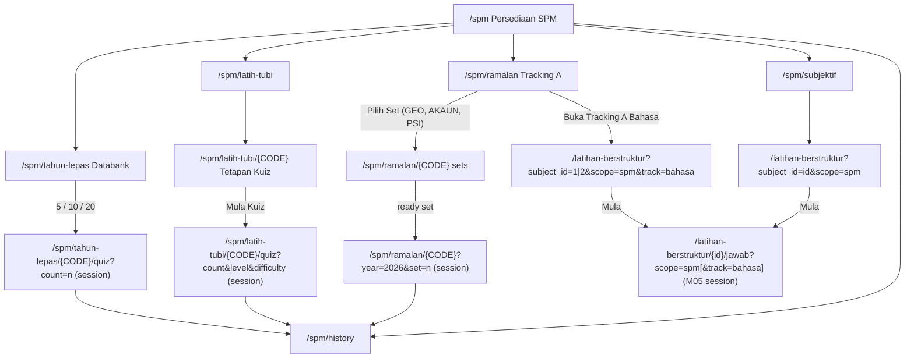
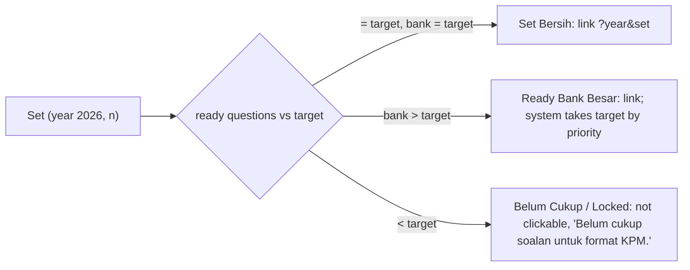

# M06 — SPM (Discovery)

- **Source:** live read-only walk-through of https://prestasiplus.my on 2026-09-25 with the admin account (browser lane 3, `playwright3`).
- **Screenshots:** `docs/discovery/img/M06/` (34 files). Every page was masked in the DOM before capture. The shell and design tokens are in [00-global-ui.md](00-global-ui.md) and are not repeated here.
- **Language:** UI copy is quoted in its exact Bahasa Melayu, or in English where the live site uses English (the mock and walkthrough pages mix both).
- **Personal data:** before any inventory or screenshot, `tools/jobs/M06.js` → `M06MASK` masked:
  - the Duta / "Cikgu Maestro" recommendation card (`.duta-card`): name → `<person>`, avatar initials → `<in>`, `/bilik-duta/<slug>` → `/bilik-duta/{slug}`;
  - the author line of structured sets on `/latihan-berstruktur` lists (`fa-user-pen` "<teacher> · <school>") → `<person> · <school>`;
  
  then `tools/sanitize.js` ran. Question text is not personal data; short samples are quoted.
- **Element inventory:** 1,315 content elements over 13 screens and 72 captured UI states, with IDs `EL-M06-S#-nnn`, in `docs/discovery/inventory/M06/<S#-key>.json`. Reconciliation, the crawl and read-only limits are in `docs/discovery/inventory/M06/_summary.md`. The inventory JSON is authoritative for attributes and conditions.
- **Safety:** no quiz, practice, Tracking A set, structured set, mock exam or walkthrough session was started; no `/quiz`, `/jawab`, `/start`, `/mula`, `/spm-mock/{id}` (in-progress) or `/spm/ramalan/{CODE}?year=&set=` URL was opened; nothing was submitted. See §9 "States requiring a live session".

---

## 1. Overview

M06 is the student-facing **SPM preparation** area ("Mod SPM"). It has seven parts:

1. **Hub** `/spm` "Persediaan SPM": four module cards, headline counts and the user's SPM quiz stats, with a link to the SPM quiz history.
2. **Databank Soalan** `/spm/tahun-lepas` (the "past-year" route): one card per subject (18) with set sizes 5 / 10 / 20 that start a random-question quiz directly. There is **no year selector**; the hub even shows "0 Tahun Tersedia".
3. **Latih Tubi SPM** `/spm/latih-tubi` → `/spm/latih-tubi/{CODE}` "Tetapan Kuiz": pick Tingkatan (T4/T5), difficulty and question count, then "Mula Kuiz" → `/spm/latih-tubi/{CODE}/quiz?count=&level=&difficulty=`.
4. **Tracking A** `/spm/ramalan` (the "prediction" route; the UI calls it "Tracking A"): two lanes.
   - *Objektif*: fixed 2026 question sets per subject, each classified as "Set Bersih", "Ready Bank Besar" or "Belum Cukup" (locked) against a per-subject target size. `/spm/ramalan/{CODE}` lists the sets; a ready set starts via `/spm/ramalan/{CODE}?year=2026&set=N`.
   - *Bahasa*: BM and BI open the structured-question list `/latihan-berstruktur?subject_id={1|2}&scope=spm&track=bahasa` ("Tracking A Bahasa").
   - An "ADMIN READINESS" panel shows set readiness for every subject.
5. **Subjektif** `/spm/subjektif`: stats, Semua / Teras / Elektif tabs, and 15 subject cards → `/latihan-berstruktur?subject_id={id}&scope=spm` ("Subjektif SPM" list of structured/essay sets) → `/latihan-berstruktur/{id}/jawab?scope=spm` (answer page; M05 engine).
6. **SPM Mock Exam** `/spm-mock`: subject + paper form (POST `/spm-mock/jana`), "Mock Sebelum Ini" list, result page `/spm-mock/{id}/result` with grade, weak topics and per-question review.
7. **SPM Walkthrough** `/pusat-ai/spm`: an AI form (subject, optional year, question text or image) that POSTs to `/pusat-ai/spm/solve` and prints a walkthrough. In the rebuild it is AI-simulated (D4).

Plus the **SPM quiz history** `/spm/history` (filter Semua / Tahun Lepas / Latih Tubi / Tracking A).

Entry points: the user-portal sidebar item "SPM" (amber "SPM" pill) under section heading `SPM`; the bottom tab "SPM" on mobile; the admin sidebar group "SPM" (see 00-global-ui.md). `/spm-mock` and `/pusat-ai/spm` render in the **admin-panel layout** for the admin account (sidebar "Command Center", header "Dashboard" / "Selamat datang, Admin"); every `/spm*` page and the `/latihan-berstruktur` lists render in the **user-portal layout**.

| # | Route | Tab title (`<title>`) · header title | Layout | Status |
|---|---|---|---|---|
| S1 | `/spm` | "Mod SPM - PRESTASIPLUS" · "Mod SPM" | user | Documented |
| S2 | `/spm/tahun-lepas` | "Databank Soalan SPM - PRESTASIPLUS" | user | Set links recorded, not opened |
| S3 | `/spm/latih-tubi` | "Latih Tubi SPM - PRESTASIPLUS" | user | Documented |
| S4 | `/spm/latih-tubi/{CODE}` | "Latih Tubi SPM — {Subjek}" · header "Dashboard" / "Selamat datang kembali" | user | All 19 subject configs read; "Mula Kuiz" not clicked |
| S5 | `/spm/ramalan` | "Tracking A SPM - PRESTASIPLUS" · "Tracking A SPM" | user | Documented |
| S6 | `/spm/ramalan/{CODE}` | "Tracking A SPM — {Subjek}" | user | GEO, AKAUN, PSI, MATH, BA read; sets not started |
| S7 | `/latihan-berstruktur?subject_id={1\|2}&scope=spm&track=bahasa` | "Soalan Berstruktur - PRESTASIPLUS" | user | List only; "Mula" not clicked |
| S8 | `/spm/subjektif` | "Latihan Subjektif SPM - PRESTASIPLUS" | user | Documented |
| S9 | `/latihan-berstruktur?subject_id={id}&scope=spm` | "Soalan Berstruktur - PRESTASIPLUS" | user | List only; "Mula" not clicked |
| S10 | `/spm/history` | "Sejarah Kuiz SPM - PRESTASIPLUS" | user | 4 filters incl. empty |
| S11 | `/spm-mock` | "SPM Mock Exam" · "Dashboard" / "Selamat datang, Admin" | admin | Form not submitted; "Sambung →" not opened |
| S12 | `/spm-mock/{id}/result` | "Result Mock SPM — {Subjek}" | admin | Existing result 16 read |
| S13 | `/pusat-ai/spm` | "SPM Walkthrough — Cikgu Alesa" | admin | Form not submitted |

S7 and S9 are the M05 route `/latihan-berstruktur` in its SPM variants (`scope=spm`, `track=bahasa`). The header copy and back link differ from the plain M05 list, so M06 documents them; the shared list template, the answer page `/latihan-berstruktur/{id}/jawab` and the marking engine belong to M05.

**Subject codes seen in M06** (admin codes from M03): BM, BI, MATH, SCI, SEJ, PI, PM, GEO, BIO, CHEM, PHY, PERNIAGA, AKAUN, EKON, ADDMATH, PSV, BA, TI, PSI. Structured-bank subject ids used in S8/S9 links: 1 BM, 2 BI, 3 MATH, 4 SCI, 5 SEJ, 8 ADDMATH, 9 PHY, 10 CHEM, 11 BIO, 12 GEO, 17 Sains Komputer (SK), 21 AKAUN, 22 EKON, 23 PERNIAGA, 25 TI. Tingkatan ids: 10 = Tingkatan 4, 11 = Tingkatan 5.

---

## 2. Screens

### 2.1 S1 — `/spm` "Mod SPM"

Screenshots: `spm-hub-desktop.png`, `spm-hub-tablet.png`, `spm-hub-mobile.png`.

- Amber pill `fa-graduation-cap` "MOD SPM". h1 (gradient text) "Persediaan SPM". Lead: "Latihan lengkap untuk pelajar Tingkatan 4 & 5. Soalan tahun lepas, latih tubi, Tracking A, dan latihan bahasa berformat sebenar."
- **Stat row** (4 cards, 2 cols → 4 from md): "20,529" "Jumlah Soalan" (amber), "25" "Subjek SPM" (blue), "0" "Tahun Tersedia" (green), "1,797" "Soalan Tracking A" (purple).
- **Module cards** (whole card is a link; 1 → 2 (md) → 4 (lg) cols), each with an icon tile, title, description, count chip and "Mula" + `fa-arrow-right`:
  1. `fa-database` "Databank Soalan" — "Bank soalan SPM mengikut subjek, dipaparkan secara rawak." — chip `fa-file-alt` "14,673 soalan" → `/spm/tahun-lepas`.
  2. `fa-brain` "Latih Tubi SPM" — "Latihan ikut topik dan bab untuk Tingkatan 4 & 5." — chip `fa-dumbbell` "14,673 soalan" → `/spm/latih-tubi`.
  3. `fa-crystal-ball` "Tracking A" — "Set objektif penuh dan lane bahasa khas untuk latihan intensif menjelang SPM." — chip `fa-stars` "1,797 soalan" → `/spm/ramalan`. (Both icons are Font Awesome Pro names: the tile and chip icon render blank, D-3.)
  4. `fa-pen-fancy` "Subjektif" — "Latihan soalan esei & jawapan panjang, disemak oleh guru." — chip "4,059 set subjektif" → `/spm/subjektif`.
- **"Prestasi SPM Anda"** card: "4" "Sesi Kuiz", "21.8%" "Purata Ketepatan", "26" "Syiling Diperoleh", "84" "Soalan Dijawab".
- Button-link `fa-history` "Sejarah Kuiz SPM" → `/spm/history`.
- Hidden: the user-layout tournament banner (`tournamentBanner()`, `x-show="tournaments.length > 0"`; "LIVE:", "MAIN", "DAFTAR", "Pendaftaran dibuka" / "Sedang berlangsung") is a shell widget (00-global-ui.md, M16).

### 2.2 S2 — `/spm/tahun-lepas` "Databank Soalan SPM"

Screenshots: `databank-desktop.png`, `databank-mobile.png`.

- Back link `fa-arrow-left` "Kembali ke Mod SPM" → `/spm`. h1 `fa-database` "Databank Soalan SPM". Sub: "Pilih subjek dan mula jawab dari bank soalan".
- **18 subject cards** (1 → 2 (md) → 3 (lg) cols; white, not links). Each: colour icon tile, h3 subject name, English name, "`n` soalan dalam databank", row "Pilih set:" + three links **5 / 10 / 20** → `/spm/tahun-lepas/{CODE}/quiz?count={5|10|20}` + a plain amber text "Mula" at the right (not a link, D-5).
- Card order and counts (live): Bahasa Melayu / Malay Language 514 · Bahasa Inggeris / English Language 1,114 · Matematik / Mathematics 1,681 · Sains / Science 2,076 · Sejarah / History 1,539 · Biologi / Biology 1,999 · Ekonomi / Economics 1,986 · Fizik / Physics 1,261 · Geografi / Geography 1,228 · Kimia / Chemistry 1,009 · Matematik Tambahan / Additional Mathematics 501 · Pendidikan Islam / Islamic Education 483 · Pendidikan Moral / Moral Education 1,353 · Pendidikan Seni Visual / Visual Arts Education 545 · Pendidikan Syariah Islamiah / Islamic Syariah Education 510 · Perniagaan / Business Studies 934 · Prinsip Perakaunan / Principles of Accounting 1,770 · Tasawwur Islam / Islamic Worldview 530. Codes in the same order: BM, BI, MATH, SCI, SEJ, BIO, EKON, PHY, GEO, CHEM, ADDMATH, PI, PM, PSV, PSI, PERNIAGA, AKAUN, TI.
- Card icons (FA, colour inline): BM `fa-book-open` #3B82F6, and one per subject as on S3.
- The query `?subject=` is ignored (same page). No empty state was observed.

### 2.3 S3 — `/spm/latih-tubi` "Latih Tubi SPM"

Screenshots: `latih-tubi-desktop.png`, `latih-tubi-mobile.png`.

- Back link "Kembali ke Mod SPM". h1 `fa-brain` "Latih Tubi SPM". Sub: "Pilih subjek untuk mula berlatih (Tingkatan 4 & 5)".
- Section `fa-crown` **"Subjek Teras (7)"** and section `fa-puzzle-piece` **"Subjek Elektif (12)"**. Each subject card is a link → `/spm/latih-tubi/{CODE}` with icon tile, name, English name, chip `fa-brain` "`n` soalan" (indigo), optional target chip `fa-bullseye` (emerald) and `fa-chevron-right`.
- Target chip variants: "Target Custom: 34" (BM), "Target Custom: 36" (BI), "Target SPM: 40" (MATH, SCI, SEJ, GEO, BIO, CHEM, PHY), "Target Latihan: 40" (PI, PM, EKON, BA, PSI), "Target Latihan: 20" (ADDMATH); none for PERNIAGA, AKAUN, PSV, TI.
- **Locked card** (BA "Bahasa Arab" / "Arabic Language", "0 soalan", "Target Latihan: 40", amber chip `fa-lock` "Locked: 0/40", amber border/background, `fa-lock` instead of the chevron): `href="javascript:void(0)"` + `pointer-events-none`.
- Teras: BM `fa-book-open`, BI `fa-globe`, MATH `fa-calculator`, SCI `fa-beaker`, SEJ `fa-clock`, PI `fa-moon`, PM `fa-heart`. Elektif: GEO `fa-map`, BIO `fa-leaf`, CHEM `fa-flask-round`, PHY `fa-zap`, PERNIAGA `fa-briefcase`, AKAUN `fa-receipt`, EKON `fa-trending-up`, ADDMATH `fa-variable`, PSV `fa-palette`, BA `fa-languages`, TI `fa-fas fa-mosque`, PSI `fa-fas fa-scale-balanced`. The Lucide-style names (`fa-beaker`, `fa-flask-round`, `fa-trending-up`, `fa-variable`, `fa-languages`) render **blank** (D-3).
- Counts on this page differ from S4's header totals for the same subject (D-1). Every S3 card count equals the S2 databank count of the same subject (18/18; BA, not in the databank, shows 0). **(corrected after audit)**

### 2.4 S4 — `/spm/latih-tubi/{CODE}` "Tetapan Kuiz" (pre-start)

Screenshots: `latih-tubi-subject-math.png`, `latih-tubi-subject-t5-sukar.png`, `latih-tubi-subject-free-count.png`, `latih-tubi-subject-mobile.png`.

- Back link `fa-arrow-left` "Kembali" → `/spm/latih-tubi`. Icon tile + h1 subject name. Sub: "`n` soalan tersedia" and, when a target exists, " · Target {SPM|Custom|Latihan} set: `n` soalan".
- Card `fa-cog` **"Tetapan Kuiz"**, Alpine `quizConfig()`:
  - **"Tingkatan"**: two option buttons "Tingkatan 4" / "`n` soalan" and "Tingkatan 5" / "`n` soalan". Click toggles `selectedLevel` (10 / 11, click again → null). Selected: `border-blue-500 bg-blue-50 shadow-md`.
  - **"Tahap Kesukaran"**: four buttons "Asas", "Pertengahan", "Sukar", "Sangat Sukar", each with `x-text="getDiffCount(k)"` + " soalan". Keys **2, 3, 4, 5** (toggle). Selected colours: green / yellow / orange / red. Helper text: "Biarkan kosong untuk campuran semua tahap". With a level selected, the counts switch to that level's numbers (`difficultyByLevel`).
  - **"Bilangan Soalan"**: `x-for="option in countOptions"`, click sets `questionCount`. Subjects with a target have one option "`n` (Target SPM|Custom|Latihan)" (emerald when not selected, blue when selected), with helper "Set penuh target {spm|custom|latihan} untuk {Subjek} disasar pada `n` soalan.". Subjects without a target (PERNIAGA, AKAUN, PSV, TI) show "5", "10", "20", "30", "40", "50", "60" (default 10) and helper "Pilih bilangan soalan ikut keperluan latihan anda.".
  - Big button-link `fa-play-circle` **"Mula Kuiz"** with `:href="quizUrl()"` → `/spm/latih-tubi/{CODE}/quiz?count={n}[&level={10|11}][&difficulty={2..5}]`. Observed: `/spm/latih-tubi/MATH/quiz?count=40`, `…?count=40&level=10`, `…?count=40&level=11&difficulty=4`, `/spm/latih-tubi/BM/quiz?count=34`, `/spm/latih-tubi/ADDMATH/quiz?count=20`, `/spm/latih-tubi/PERNIAGA/quiz?count=10` / `count=30`, `/spm/latih-tubi/BA/quiz?count=40`.
- Inline script (per subject, server-rendered):
  ```js
  function quizConfig() {
    const difficultyStats = {"1":775,"2":790,"3":886,"4":130};          // MATH
    const difficultyByLevel = {"10":{"1":306,"2":475,"3":630,"4":89},"11":{"1":469,"2":315,"3":256,"4":41}};
    return { selectedLevel: null, selectedDifficulty: null,
      countOptions: [{"value":40,"label":"40 (Target SPM)","is_target":true}], questionCount: 40,
      getDiffCount(level) { if (!this.selectedLevel) return difficultyStats[level] || 0;
        return (difficultyByLevel[this.selectedLevel] && difficultyByLevel[this.selectedLevel][level]) || 0; },
      quizUrl() { let url = '/spm/latih-tubi/MATH/quiz?count=' + this.questionCount;
        if (this.selectedLevel) url += '&level=' + this.selectedLevel;
        if (this.selectedDifficulty) url += '&difficulty=' + this.selectedDifficulty; return url; } };
  }
  ```
  The buttons read keys 2–5 while the data has keys 1–4. On the site-wide 1–5 difficulty scale (M04: 1 Sangat Mudah, 2 Mudah, 3 Sederhana, 4 Sukar, 5 Sangat Sukar) this is consistent: "Asas" = 2, "Pertengahan" = 3, "Sukar" = 4, "Sangat Sukar" = 5, and no question has difficulty 5, so "Sangat Sukar 0 soalan" is true; difficulty 1 is only reachable with no difficulty selected (D-2, not a defect). **(corrected after audit)** All 19 configurations are in Appendix A.2.
- `/spm/latih-tubi/BA` works (1,200 soalan) although the S3 card is locked with "0 soalan" (D-1). An unknown code (`/spm/latih-tubi/XYZ`) → HTTP 404 page "404" "🔍" "Halaman Tidak Dijumpai" "Maaf, halaman yang anda cari tidak wujud atau telah dipindahkan. Mungkin URL salah taip?" with "Halaman Utama" → `/` and "Mula Latihan" → `/latih-tubi` (itself a 404, D-8).
- The option buttons are `<button>` without `type` inside no form (harmless). Difficulty counts are unformatted ("2143") while Tingkatan counts use thousands separators ("1,933") (D-6).

### 2.5 S5 — `/spm/ramalan` "Tracking A SPM"

Screenshots: `tracking-a-desktop.png`, `tracking-a-mobile.png`.

- Back link "Kembali ke Mod SPM". h1 `fa-hat-wizard` "Tracking A SPM" + purple pill "TRACKING A". Sub: "Soalan Tracking A SPM — bersedia untuk apa yang mungkin keluar!".
- Two lane cards:
  - "TRACKING A OBJEKTIF" / "Subjek objektif penuh" / "Khusus untuk kertas objektif penuh yang boleh terus berjalan ikut set." — badge "3 subjek", chips `fa-layer-group` "18 set", `fa-file-circle-check` "747 soalan".
  - "TRACKING A BAHASA" / "BM dan BI format sebenar" / "Lane khas untuk kertas bahasa tanpa memaksa format menjadi 40 MCQ." — badge "2 subjek", chips "1,332 set", `fa-language` "Paper-based tracking".
- **"ADMIN READINESS"** card: h2 "Status set Tracking A SPM semasa", text "Laporan ini bezakan set bersih, set bank besar, dan set yang masih lock supaya bacaan readiness lebih jujur." Chips "Set Bersih: 1 set", "Bank Besar: 1 set", "Locked: 58 set". Then one tile per subject (15; corrected after audit — BM, BI, MATH, SCI, SEJ, PI, PM, ADDMATH, PHY, CHEM, BIO, GEO, BA, EKON, PSI): h3 subject, "{CODE} · Target set: `n` soalan", badge "`x`/`y` set bersih", four mini stats "Set Bersih" / "Bank Besar" / "Locked" / "Readiness" (%), optional note (GEO only) "Set bank besar boleh dibuka, tetapi bank sumber melebihi target set. Rujuk page subjek untuk beza set bersih vs bank besar.", and "SET MASIH LOCK" + up to 6 chips "2026 Set `n` · `have`/`target`". Full values in Appendix A.3. INFERRED: this panel is admin-only (its title says so); a student view was not available.
- Second "TRACKING A BAHASA" section: h2 "BM dan BI ikut format kertas sebenar", text "Subjek bahasa tidak dipaksa menjadi 40 MCQ. Ia dibuka melalui set berstruktur dan komponen sebenar peperiksaan.", pill "Paper-based tracking". Cards:
  - Bahasa Melayu / Malay Language — "559 set", "Berstruktur / respons sebenar", "Buka Tracking A Bahasa" → `/latihan-berstruktur?subject_id=1&scope=spm&track=bahasa`.
  - Bahasa Inggeris / English Language — "773 set", same labels → `…subject_id=2…`.
- Open objective subjects (cards → `/spm/ramalan/{CODE}`, footer "Pilih Set" + `fa-chevron-right`):
  - Geografi / Geography — `fa-file-alt` "40 soalan kuiz siap guna", `fa-layer-group` "1 bank besar", `fa-bullseye` "Target SPM: 40", `fa-database` "Bank source: 67", "1 set".
  - Prinsip Perakaunan / Principles of Accounting — "640 soalan kuiz siap guna", "16 set".
  - Pendidikan Syariah Islamiah / Islamic Syariah Education — "40 soalan kuiz siap guna", "1 set bersih", "Target Latihan: 40", "1 set".
- The lane card says "3 subjek · 18 set · 747 soalan"; the open cards add up to 18 sets and 720 ready questions, and the readiness chips say "Set Bersih: 1 set" while AKAUN alone shows 16 clean sets (D-7). The hub says "1,797 Soalan Tracking A".

### 2.6 S6 — `/spm/ramalan/{CODE}` Tracking A set list (pre-start)

Screenshots: `tracking-a-subject-geo.png`, `tracking-a-subject-akaun.png`, `tracking-a-subject-empty-ba.png`, `tracking-a-subject-mobile.png`.

- Back link "Kembali" → `/spm/ramalan`. Icon tile + h1 subject; sub "Tracking A SPM" [+ " · Target {SPM|Latihan} set: `n` soalan" when a target exists].
- Summary chips (purple panel): `fa-circle-check` "`n` set bersih", `fa-layer-group` "`n` set bank besar", `fa-file-circle-check` "`n` soalan kuiz siap guna", `fa-lock` "`n` set belum cukup" (only when > 0), `fa-bullseye` "Target {SPM|Latihan}: 40 / set" (only with a target).
- h2 `fa-calendar` "Tracking A 2026", then set cards (1 → 2 cols from md):
  - **Set Bersih** (emerald badge): "Set `n`", "`n` soalan kuiz siap guna", optional "Format set: 40 / 40", `fa-tag` "DSKP: `a`/`b` (`p`%)", play tile → link `/spm/ramalan/{CODE}?year=2026&set={n}`.
  - **Ready Bank Besar** (blue badge): as above plus "Bank source: 67. Sistem tetap ambil 40 soalan ikut prioriti semasa." → link `?year=2026&set=1`.
  - **Belum Cukup** (amber card, `javascript:void(0)`, `pointer-events-none`, lock tile): "`n` soalan kuiz siap guna", "Format set: `n` / 40", "Belum cukup soalan untuk format KPM.", DSKP line.
- Observed: GEO 1 Ready Bank Besar + 9 Belum Cukup (309 ready questions); AKAUN 16 Set Bersih (no target line, no "Format set"); PSI Set 4 Bersih + Sets 3, 5–8 Belum Cukup (clean set listed first); MATH Sets 43–53 all Belum Cukup (reachable by URL, not linked from S5).
- **Empty** (`/spm/ramalan/BA`): chips "0 set bersih", "0 set bank besar", "0 soalan kuiz siap guna", "Target Latihan: 40 / set", then empty state "Belum Ada Set Tracking A" / "Set Tracking A untuk subjek ini akan ditambah tidak lama lagi.".
- **Redirects:** `/spm/ramalan/BM` → `/latihan-berstruktur?subject_id=1&scope=spm&track=bahasa`; `/spm/ramalan/BI` → `…subject_id=2…` (S7). Unknown code → 404.

### 2.7 S7 — Tracking A Bahasa list `/latihan-berstruktur?subject_id={1|2}&scope=spm&track=bahasa`

Screenshots: `tracking-bahasa-desktop.png`, `tracking-bahasa-mobile.png`.

- Back link "Kembali ke Tracking A SPM" → `/spm/ramalan`. Pill `fa-language` "TRACKING A BAHASA", h1 "Tracking A Bahasa", sub "Set bahasa dibuka ikut format kertas sebenar. BM dan BI tidak dipaksa menjadi 40 MCQ, dan dipaparkan mengikut susunan BM kemudian BI."
- Info card: "Subjek bahasa tidak dipaksa menjadi 40 MCQ. Laluan ini menggunakan paper-based tracking dengan pendekatan berstruktur / respons sebenar." + chips `fa-book-open` "BM dahulu, BI kemudian", `fa-file-lines` "Format kertas sebenar", "Paper-based tracking", `fa-pen-fancy` "Berstruktur / respons sebenar", `fa-layer-group` "`n` set ditemui" (BM 559, BI 773).
- GET filter form (hidden `scope=spm`, `track=bahasa`): select "Subjek" `subject_id` (Semua Subjek, Bahasa Melayu, Bahasa Inggeris), select "Aras KBAT" `kbat_level` (Semua, 1. Mengingat … 6. Mencipta), button `fa-search` "Cari".
- Set cards (1 → 2 (sm) → 3 (xl) cols, 20 per page): chips subject, KBAT band ("LOTS 1/2", "MOTS 3", "HOTS 4"…), minutes ("7m"), "Tingkatan 5", optional "Trial"; question stem (3-line clamp); `fa-layer-group` "`n` bahagian · `m` markah"; `fa-user-pen` author · school (masked); footer `fa-list-ol` "`n` soalan · Tingkatan 5" and "Mula" `fa-arrow-right` → `/latihan-berstruktur/{id}/jawab?scope=spm&track=bahasa` (not opened).
- Laravel pagination: "Showing `a` to `b` of `n` results" + numbered links (desktop), "« Previous" / "Next »" (mobile). `kbat_level=6` on BM gave 3 sets.

### 2.8 S8 — `/spm/subjektif` "Latihan Subjektif SPM"

Screenshots: `subjektif-desktop.png`, `subjektif-tab-core.png`, `subjektif-mobile.png`.

- Back link "Kembali ke Mod SPM". h1 "Latihan Subjektif SPM". Sub "Pilih subjek untuk menjawab set struktur dan esei SPM berasaskan bank subjektif Tingkatan 4 dan 5."
- Info box: "Bagaimana ia berfungsi? Pilih subjek → jawab set struktur/subjektif SPM → semak markah dan model jawapan. Bank ini ditarik daripada soalan berstruktur Tingkatan 4 dan 5 yang telah diterbitkan."
- 4 stat cards: "SET DIJAWAB" 0 "Percubaan subjektif SPM yang telah dihantar"; "SUBJEK DICUBA" 0 "Bilangan subjek subjektif SPM yang pernah dicuba"; "SKOR TERBAIK" "Belum Ada" "Skor tertinggi merentas semua set subjektif SPM"; "SET TERBAIK DISIMPAN" 0 "Bilangan set yang mempunyai percubaan terbaik tersimpan".
- Tabs (`x-data="{ tab: 'all' }"`): "Semua" 15 (active `bg-slate-900`), "Teras" 5 (active `bg-teal-600`), "Elektif" 10 (active `bg-amber-500`). Each tab shows its own grid (`x-show`). Live, the active "Semua" tab renders as white text on a near-white pill (the `bg-slate-900` class does not take effect), so the active tab is unreadable (D-15). The layout header title on this page is "Subjektif SPM".
- Subject cards → `/latihan-berstruktur?subject_id={id}&scope=spm`: name + badge "Teras" (teal) / "Elektif" (amber), English name, chip `fa-pen` "`n` set subjektif". Order and counts: Bahasa Inggeris 773 · Bahasa Melayu 559 · Matematik 298 · Sains 204 · Sejarah 328 (Teras); Biologi 217 · Ekonomi 42 · Fizik 246 · Geografi 21 · Kimia 232 · Matematik Tambahan 256 · Perniagaan 763 · Prinsip Perakaunan 76 · Sains Komputer / Computer Science 22 · Tasawwur Islam 22 (Elektif). Sum 4,059 (= hub).
- Marking: the page promises "semak markah dan model jawapan"; the hub says "disemak oleh guru". The actual marking happens on the M05 answer page (not opened, §9).

### 2.9 S9 — Subjektif SPM list `/latihan-berstruktur?subject_id={id}&scope=spm`

Screenshots: `subjektif-list-desktop.png`, `subjektif-list-mobile.png`.

- Back link "Kembali ke Subjektif SPM" → `/spm/subjektif`. h1 "Subjektif SPM". Sub "Pilih set struktur dan esei Tingkatan 4 atau 5 mengikut subjek semasa".
- GET filter (hidden `scope=spm`): "Subjek" (Semua Subjek + the 15 subjects above), "Aras KBAT" (Semua, 1–6), "Cari".
- Same set-card template as S7; "Mula" → `/latihan-berstruktur/{id}/jawab?scope=spm`. Matematik: 15 pages; Semua Subjek: 203 pages; Sains Komputer: 2 pages; Matematik + `kbat_level=6`: no cards; empty state "Tiada soalan berstruktur buat masa ini" / "Soalan akan ditambah oleh guru dan admin" (EL-M06-S9-094/095) **(corrected after audit)**.

### 2.10 S10 — `/spm/history` "Sejarah Kuiz SPM"

Screenshots: `history-desktop.png`, `history-empty.png`, `history-mobile.png`.

- Back link "Kembali ke Mod SPM". h1 "Sejarah Kuiz SPM". 4 stat cards: "4" "Sesi Kuiz", "21.8%" "Purata Ketepatan", "26" "Jumlah Syiling", "84" "Soalan Dijawab" (the hub labels the same number "Syiling Diperoleh").
- Filter links: "Semua" → `/spm/history`, `fa-scroll` "Tahun Lepas" → `?type=past_year`, `fa-brain` "Latih Tubi" → `?type=latih_tubi`, `fa-hat-wizard` "Tracking A" → `?type=ramalan`. The active filter is solid (observed: "Tahun Lepas" `bg-amber-500 text-white shadow-md`); inactive filters are white with a slate border and a coloured hover border (indigo, blue, purple). Stats do **not** change with the filter.
- Rows (not links): score tile "`p`%" (red `bg-red-100 text-red-600` for all observed values 0–35%), type badge ("Tahun Lepas" amber, "Latih Tubi" blue), "`c`/`n` betul", "`dd Mon yyyy, hh:mm AM` · `m`m `s`s", right "+`n` 🪙". Observed: 0% 0/5 (19 May 2026, 03:49 AM · 0m 14s, +0), 20% 1/5 (+1), 32% Latih Tubi 11/34 (1m 45s, +11), 35% 14/40 (2m 11s, +14). Coins = correct answers (INFERRED).
- Empty (`?type=ramalan`): "Belum Ada Sejarah" / "Mulakan kuiz SPM untuk melihat sejarah prestasi anda di sini." + button `fa-play-circle` "Mula Kuiz SPM" → `/spm`.
- Mock exams and subjective sets are not listed here.

### 2.11 S11 — `/spm-mock` "SPM Mock Exam"

Screenshots: `mock-desktop.png`, `mock-mobile.png`.

- Hero (brown/orange gradient `.sm-hero`): h1 "📝 SPM Mock Exam", "Mock SPM penuh dengan timer + auto-grade + weakness analysis. Boleh attempt setiap bulan."
- **Duta recommendation block**: "⭐ Maestro SPM Untuk Anda", "Cikgu pakar yg dah bantu pelajar score A+ — tonton video mereka sebelum mula mock." + one `.duta-card tier-bintang` → `/bilik-duta/{slug}` (M24): avatar initials, name, tagline "Maestro Matematik · 22 tahun ajar pelajar B40 capai cita-cita.", pills "🥇 Duta Bintang", "📚 Matematik", "📍 Johor", "⭐ 4.92". Tier classes in CSS: `bintang`, `inspirasi`, `tetamu`.
- Warning box `.warning`: bold "Persediaan sebelum mula:" inside the text node "⚠️ Pastikan masa anda cukup. Setelah klik "Mula", timer akan jalan dan tak boleh stop. Kalau pause, score akan jejas." (text without the emoji variation selector: "⚠ Pastikan masa anda cukup. Setelah klik "Mula", timer akan jalan dan tak boleh stop. Kalau pause, score akan jejas."; rendered as "⚠️ **Persediaan sebelum mula:** Pastikan masa anda cukup. …").
- **Form** `POST /spm-mock/jana` (`_token`): "Subjek" `subject` required — "Pilih subjek", Bahasa Melayu, English, Matematik, Matematik Tambahan, Fizik, Kimia, Biologi, Sains, Sejarah, Pendidikan Islam (values = labels); "Paper" `paper_number` required — "Paper 1 (Objektif)" (1, default), "Paper 2 (Esei/Struktur)" (2); submit "🎯 Jana Mock SPM". Not submitted.
- **"📚 Mock Sebelum Ini"** list (`.sm-card`): "`Subjek` · Paper `n`", "`relative time` · " + either red "Belum submit" or "Score: `a`/`b` (`p`%)", grade chip (`.grade grade-{X}`), link. Observed: "Sejarah · Paper 1", "2 bulan yang lepas · Belum submit", chip "Belum" (`grade-pending`), "Sambung →" → `/spm-mock/317` (in-progress, not opened); "Bahasa Melayu · Paper 1", "4 bulan yang lepas · Score: 0/30 (0.00%)", chip "G", "Lihat →" → `/spm-mock/16/result`.
- Grade chip colours (CSS): A+/A emerald, B+/B blue, C amber, D/E/G red, pending slate. The A+ / B+ selectors are written `.grade-A\\+`, which does not match the class `grade-A+` (D-10, INFERRED from CSS).

### 2.12 S12 — `/spm-mock/{id}/result` "Result Mock SPM — {Subjek}"

Screenshots: `mock-result-desktop.png`, `mock-result-mobile.png`.

- Hero `.mr-hero` (green; `.bad` red, `.mid` yellow — mock 16 is `bad`): h1 "Bahasa Melayu · Paper 1", big grade "G", "0.00%", "0 / 30 markah".
- Duta block "🎓 Cikgu Pakar Bahasa Melayu" / "Lemah dlm topik tertentu? Cikgu pakar ni boleh bantu anda naik ke A+ next round." + one `.duta-card` (subject-matched on one load: "Pakar Bahasa Melayu SPM · Sasterawan Negeri Johor 2020.", "📚 Bahasa Melayu", "⭐ 4.88"; on another load the Matematik maestro appeared — the pick varies per request).
- **"📉 Topik Lemah — Fokus Belajar Ke Sini"**: `.weak-item` rows "Sastra" "9 soalan tersilap", "Penulisan" 8, "Sosiobudaya" 4, "Kosa Kata" 2, "Tatabahasa" 2; tip "💡 Cikgu Alesa cadang anda fokus belajar topik atas dulu. Boleh start dengan jana nota ringkas untuk topik tersebut." ("jana nota ringkas" → `/pusat-nota-ringkas`, M25).
- **"📋 Review Setiap Soalan"**: `.q-review.wrong|.correct` items: "✗ Soalan `n` · `m`/1 markah", question text, "**Anda:** (tiada jawapan)", "**Jawapan:** A", italic feedback "Jawapan betul: A". 27 items for a 30-mark paper; weak topics add up to 25 (D-9).
- Actions: "📝 Mock Lain" → `/spm-mock`, "📚 Belajar Topik Lemah" → `/pusat-nota-ringkas`.
- Unknown id → 404.

### 2.13 S13 — `/pusat-ai/spm` "SPM Walkthrough — Cikgu Alesa"

Screenshots: `walkthrough-desktop.png`, `walkthrough-mobile.png`.

- h1 "📝 SPM Walkthrough", "Snap soalan SPM, AI walk-through step-by-step dengan mark scheme + sebutan buku teks. Faham bukan hafal."
- Form `#spmForm` (no action/method, no `novalidate`; JS submit): "Subjek" `subject` **`required`** — "Pilih" (empty), Bahasa Melayu, English, Matematik, Matematik Tambahan, Fizik, Kimia, Biologi, Sains, Sejarah, Pendidikan Islam, Pendidikan Moral, Geografi, Ekonomi, Perdagangan, Prinsip Akaun; "Tahun (opsyen)" `year` text, `maxlength="8"`, placeholder "Cth: 2023"; "Soalan (taip atau snap)" `question_text` textarea (not required), placeholder "Salin soalan SPM di sini, atau upload gambar di bawah..."; upload label "📷 Klik atau drag gambar soalan SPM (auto-extract via AI Vision)" over a hidden file input `image` (`#imgInput`, accept `image/*`); submit `#solveBtn` "Bagi Walkthrough". Labels are upper case by CSS. **(corrected after audit)**
- Hidden result card `#result` (`display:none`): h2 "✨ Walkthrough Cikgu Alesa" + `<pre id="walkBody">` (whitespace and line breaks kept). **(corrected after audit)**
- Duta block "🎓 Cikgu Maestro SPM" / "Setelah baca walkthrough, tonton video penjelasan dari Duta SPM." + one duta card.
- Inline script: choosing a file sets the label to "📎 {filename}"; submit → `preventDefault`, button disabled + "AI sedang fikir... (mungkin 15-30s)", `#result` hidden, `POST /pusat-ai/spm/solve` (FormData, `X-CSRF-TOKEN`, `Accept: application/json`); `d.ok` → `#walkBody.textContent = d.walkthrough || ''`, show `#result`, smooth scroll; else `alert(d.error || 'Ralat')`; network error → `alert('Ralat: ' + err.message)`; finally button re-enabled "Bagi Walkthrough". Because Subjek is `required`, an empty subject is stopped by the browser's native bubble before the script runs (no busy state, request or alert). **(corrected after audit)**

---

## 3. Flows

### 3.1 SPM navigation



### 3.2 Latih Tubi configuration (client-side)

```mermaid
stateDiagram-v2
  [*] --> Default: level=null, difficulty=null, count=target or 10
  Default --> LevelSet: click Tingkatan 4/5
  LevelSet --> Default: click same Tingkatan
  LevelSet --> LevelSet: click other Tingkatan (counts per level)
  Default --> DiffSet: click Asas/Pertengahan/Sukar/Sangat Sukar
  DiffSet --> Default: click same difficulty
  Default --> Start: Mula Kuiz (href = quizUrl())
  LevelSet --> Start
  DiffSet --> Start
```

### 3.3 Tracking A set status



### 3.4 Mock exam

```mermaid
sequenceDiagram
  participant U as Student
  participant P as /spm-mock
  participant S as Server
  U->>P: choose Subjek + Paper
  U->>S: POST /spm-mock/jana (subject, paper_number)
  S-->>U: redirect to /spm-mock/{id} (timer starts; INFERRED)
  U->>S: answer + submit (not observed)
  S-->>U: /spm-mock/{id}/result (grade, %, weak topics, review)
  Note over P: unsubmitted mock listed "Belum submit" + "Sambung →" /spm-mock/{id}
```

### 3.5 Walkthrough (AI)

Fill subject (+ optional year) and question text and/or image → "Bagi Walkthrough" → busy label → `POST /pusat-ai/spm/solve` → result card with plain-text walkthrough, or an `alert`. In the rebuild the response is canned (D4).

---

## 4. Inferred server-side rules (INFERRED unless marked OBSERVED)

1. Databank = random questions per subject from the SPM pool (hub: "dipaparkan secara rawak"); set size limited to 5, 10, 20 (OBSERVED links). "Tahun Tersedia" counts distinct past-year years in the pool — 0 today, so the route name "tahun-lepas" no longer matches content.
2. Latih Tubi pool per subject = T4 + T5 questions (OBSERVED: header total = T4 + T5 counts). The S3 card count uses a different query (smaller, e.g. MATH 1,681 vs 2,581) (D-1).
3. Each subject has an optional **target set size** with a type: `spm` (40: MATH, SCI, SEJ, GEO, BIO, CHEM, PHY), `custom` (BM 34, BI 36), `latihan` (40: PI, PM, EKON, BA, PSI; 20: ADDMATH). With a target the quiz count is fixed to it; without, the user chooses 5–60 (default 10) (OBSERVED).
4. Latih Tubi hub lock: a subject is "Locked: `have`/`target`" when its S3 count is below target (BA 0/40). The subject page stays reachable.
5. Tracking A objective sets are fixed per subject and year (2026) and numbered; set status: **Set Bersih** when ready questions = target (or all 40 for no-target AKAUN); **Ready Bank Besar** when the source bank exceeds the target ("Sistem tetap ambil 40 soalan ikut prioriti semasa"); **Belum Cukup** when below target — not startable. Readiness % = (bersih + bank besar) / total sets (GEO 1/10 = 10%, PSI 1/6 = 17%) (OBSERVED arithmetic). "DSKP: a/b (p%)" = share of set questions with a DSKP tag.
6. A subject appears as an open Tracking A card on S5 only when it has at least one startable set (GEO, AKAUN, PSI). BM/BI use the structured "bahasa" lane and `/spm/ramalan/BM|BI` redirects there (OBSERVED).
7. SPM quiz sessions are typed `past_year`, `latih_tubi`, `ramalan` (history filter values, OBSERVED). Coins earned = number of correct answers (OBSERVED on 4 rows). Accuracy = correct / total.
8. Mock exam: one mock per subject+paper generated on demand ("Jana"); monthly attempts ("Boleh attempt setiap bulan"); timer cannot be paused; results graded with SPM grades A+, A, B+, B, C, D, E, G (CSS). Weak topics = topics of wrong answers grouped and sorted by count.
9. Subjective sets = published structured questions (M04 structured bank) of T4/T5 with `scope=spm`; attempts and best scores are stored per set (S8 stats).
10. Duta recommendation: a `bintang`-tier ambassador is chosen per request, subject-matched when possible (result page), otherwise a default maestro.

---

## 5. Data entities implied

- **SpmSubject** (view over M03 Subject): code, name_ms, name_en, icon, colour, group (Teras/Elektif), target_type (`spm`|`custom`|`latihan`|null), target_size, databank_count, latih_tubi_count, subjective_set_count, structured_subject_id.
- **LatihTubiConfig** (per subject, server-rendered): total, per-level counts {10, 11}, difficultyStats {1..4}, difficultyByLevel, countOptions [{value, label, is_target}], default questionCount.
- **TrackingASet**: subject_code, year (2026), set_no, ready_count, target, bank_source_count, status (`bersih`|`bank_besar`|`belum_cukup`), dskp_tagged, dskp_total.
- **SpmQuizSession**: id, user, type (`past_year`|`latih_tubi`|`ramalan`), subject, count, level?, difficulty?, year?/set?, correct, total, accuracy, duration (m s), coins, created_at.
- **SpmUserStats**: sessions, avg_accuracy, coins, answered (S1, S10); subjective: sets_answered, subjects_tried, best_score, best_sets_saved (S8).
- **MockExam**: id, user, subject (label string), paper_number (1|2), status (in progress / submitted), created_at, score, max_score, percent, grade (A+…G), weak_topics [{topic, wrong_count}], items [{no, question, student_answer, model_answer, marks, max_marks, correct, feedback}].
- **WalkthroughRequest**: subject, year?, question_text?, image? → {ok, walkthrough | error}.
- **DutaCard** (M24): slug, name, initials/avatar, tier, tagline, subject, state, rating.
- **StructuredSet** (M04/M05): id, subject, kbat band, minutes, level, trial flag, stem, parts, marks, author, school.

---

## 6. Endpoints observed

| Method | URL | Purpose | Seen on |
|---|---|---|---|
| GET | `/spm` | hub | S1 |
| GET | `/spm/tahun-lepas` | databank list | S2 |
| GET | `/spm/tahun-lepas/{CODE}/quiz?count={5,10,20}` | start databank quiz — **not opened** | S2 |
| GET | `/spm/latih-tubi` | subject list | S3 |
| GET | `/spm/latih-tubi/{CODE}` | quiz settings (404 on unknown code) | S4 |
| GET | `/spm/latih-tubi/{CODE}/quiz?count=&level=&difficulty=` | start Latih Tubi quiz — **not opened** | S4 |
| GET | `/spm/ramalan` | Tracking A hub | S5 |
| GET | `/spm/ramalan/{CODE}` | set list; BM/BI → 302 to S7; 404 unknown | S6 |
| GET | `/spm/ramalan/{CODE}?year=2026&set={n}` | start Tracking A set — **not opened** | S6 |
| GET | `/latihan-berstruktur?subject_id=&scope=spm[&track=bahasa]&kbat_level=&page=` | structured set list (M05 route) | S7, S9 |
| GET | `/latihan-berstruktur/{id}/jawab?scope=spm[&track=bahasa]` | answer structured set (M05) — **not opened** | S7, S9 |
| GET | `/spm/subjektif` | subjective hub | S8 |
| GET | `/spm/history?type={past_year,latih_tubi,ramalan}` | history | S10 |
| GET | `/spm-mock` | mock form + list | S11 |
| POST | `/spm-mock/jana` | `_token, subject, paper_number` → new mock — **not submitted** | S11 |
| GET | `/spm-mock/{id}` | in-progress mock ("Sambung →") — **not opened** | S11 |
| GET | `/spm-mock/{id}/result` | result (404 unknown) | S12 |
| GET | `/pusat-ai/spm` | walkthrough form | S13 |
| POST | `/pusat-ai/spm/solve` | multipart `subject, year, question_text, image` → JSON `{ok, walkthrough}` or `{ok:false, error}` — **not called** | S13 script |
| GET | `/bilik-duta/{slug}` | Duta profile (M24) | S11–S13 |
| GET | `/pusat-nota-ringkas` | notes centre (M25) | S12 |
| GET | `/api/tournament/active`, `/notifikasi/unread-count`, `/admin/server-status`, `/chatbot/*`, `/fcm/token` | shell widgets | all |

Response shapes of the session endpoints are unknown (not called).

---

## 7. Responsive behaviour (375 / 768 / 1280) and live defects

No captured state has horizontal page overflow at 375, 768 or 1280.

- **S1**: stats 2 → 4 cols (md); module cards 1 → 2 (md) → 4 (lg). The h1 has conflicting classes (`text-2xl sm:text-4xl md:text-2xl sm:text-5xl`), so it is small on desktop.
- **S2/S3**: cards 1 → 2 → 3 cols. **S4**: difficulty buttons 4 in a row at 375; "Pertengahan" overflows its button at 375 (text clipped over the border). The bottom nav covers "Mula Kuiz" until scrolled.
- **S5/S6**: lane cards stack on mobile; set cards 1 → 2 cols (md).
- **S7/S9**: cards 1 → 2 (sm) → 3 (xl); pagination numbers hidden below sm (only "« Previous" / "Next »").
- **S8**: tabs wrap; cards 1 → 2 → 3.
- **S11**: `.sm-form .grid { grid-template-columns: 2fr 1fr }` has no breakpoint: at 375 the "Paper" select is truncated to "Pape"; in "Mock Sebelum Ini" the "Belum" chip overlaps "Sambung →".
- **S12/S13**: single column (max 880px); fine.

**Live defects (candidates for D9 fixes):**

| # | Defect |
|---|---|
| D-1 | Contradictory counts: S3 card counts equal the S2 databank counts (18/18) but differ from the S4 header (MATH 1,681 vs 2,581; SCI 2,076 vs 3,425; BM 514 vs 644); BA "0 soalan · Locked: 0/40" on S3 vs 1,200 available and startable on S4. Hub "Databank Soalan" and "Latih Tubi SPM" both 14,673 vs Σ S2 21,033. **(corrected after audit)** |
| D-2 | Not a defect: S4 difficulty buttons use keys 2–5 of the site-wide 1–5 scale; "Sangat Sukar" (5) is 0 because no question has difficulty 5; difficulty 1 is reachable only with no difficulty chosen. **(corrected after audit)** |
| D-3 | Blank icons: `fa-crystal-ball`, `fa-stars` (S1 Tracking A), `fa-beaker`, `fa-flask-round`, `fa-trending-up`, `fa-variable`, `fa-languages` (S3 Sains, Kimia, Ekonomi, Matematik Tambahan, Bahasa Arab; the same icons on S8, plus `fa-monitor` for Sains Komputer). |
| D-4 | "Tahun Tersedia 0" on the hub and route `/spm/tahun-lepas` while the page is a random databank with no year. |
| D-5 | S2 "Mula" is plain text that looks like a button; only the 5/10/20 chips are links. |
| D-6 | Number formatting: difficulty counts unformatted ("2143") vs Tingkatan "1,933". |
| D-7 | Tracking A totals: the S6 pages (incl. EKON Sets 7–8 = 19 / 18, SCI Sets 32–34 = 2 / 1 / 1, CHEM Set 9 = 2, read in the audit) add up to 1,769 ready questions, while the hub shows 1,797. The readiness chips (1 / 1 / 58; target subjects only, so AKAUN has no tile) and the lane "747 soalan" (67 + 640 + 40) are consistent with the sets. **(corrected after audit)** |
| D-8 | 404 page "Mula Latihan" → `/latih-tubi` is itself 404 (global). |
| D-9 | Mock result: "0 / 30 markah" but 27 reviewed questions and 25 wrong answers in weak topics; each review repeats the answer ("Jawapan: A" and "Jawapan betul: A"). |
| D-10 | Grade CSS rules `.grade-A, .grade-A\\+` and `.grade-B, .grade-B\\+` are invalid as a whole, so A, A+, B and B+ chips are all unstyled (OBSERVED from computed styles). **(corrected after audit)** |
| D-11 | Header titles: S4, S6, S7 and S9 show "Dashboard" / "Selamat datang kembali" (user portal); `/spm-mock`, `/spm-mock/{id}/result` and `/pusat-ai/spm` render in the admin shell for the admin (the shell follows the role, as on `/tetapan`) with the stale header "Dashboard" / "Selamat datang, Admin". **(corrected after audit)** |
| D-12 | At 375px: S11 Paper select 82px wide; "Belum" chip renders at 1.5rem (`.sm-card .grade` outranks `.grade-pending .85rem`) and runs into "Sambung →". S4 "Pertengahan" overflows its button. S13 year field 82px, placeholder "Cth: 20", label "TAHUN (OPSYEN)" on two lines (audit screenshots `docs/qa/audit/img/M06/`). **(corrected after audit)** |
| D-13 | Mixed language/slang in copy ("yg", "dlm", "next round", "Paper", "Sambung →"). Working copy — replicate (not a defect under D9). |
| D-14 | Labels differ for the same stat: "Syiling Diperoleh" (S1) vs "Jumlah Syiling" (S10). Replicate. |
| D-15 | S8 active tab unreadable: "Semua" (default) shows white text on a near-white background. |

---

## 8. Open questions / not observable read-only

1. Student view of S5: is "ADMIN READINESS" hidden for students? Are Belum Cukup sets hidden?
2. Premium gating: no paywall, "PRO" badge or package link appeared on any M06 page for admin. Whether students without an SPM package (M19 "Assign Pakej SPM") or PKSK (M07) are blocked is unknown.
3. Mock generation source (AI or bank), duration per subject/paper, sections, auto-save, "tak boleh stop" enforcement, monthly limit message.
4. Structure of the three quiz pages (question card, timer, navigation, "Lapor Soalan" modal from M04 S14), result pages and coin animation (`JBCoinFly`).
5. Subjective marking: AI vs teacher ("disemak oleh guru" vs "semak markah dan model jawapan").
6. Past-year questions with a year (none today).
7. Why the Latih Tubi counts differ between S3 and S4.

---

## 9. States requiring a live session

These states exist but cannot be seen without starting a session or submitting (not approved). Each needs a live run with user permission (ideally a test student account):

| # | State / screen | How it is reached |
|---|---|---|
| L-1 | Databank quiz page (question, options, progress, timer if any, "Lapor Soalan") | `/spm/tahun-lepas/{CODE}/quiz?count={5,10,20}` |
| L-2 | Databank quiz answer feedback, finish/submit, result/summary, coins animation | L-1 → answer/submit |
| L-3 | Latih Tubi quiz page with level/difficulty filters, zero-question case (e.g. `difficulty=5`) | `/spm/latih-tubi/{CODE}/quiz?count=&level=&difficulty=` |
| L-4 | Latih Tubi result page and its history entry | L-3 → submit |
| L-5 | Tracking A set quiz page (40-question set, format KPM) and result | `/spm/ramalan/{CODE}?year=2026&set={n}` |
| L-6 | Tracking A Bahasa structured answer page (BM/BI paper format, parts, marks) | `/latihan-berstruktur/{id}/jawab?scope=spm&track=bahasa` |
| L-7 | Subjective answer page, submission, marking, model answer, best-attempt save, S8 stat changes | `/latihan-berstruktur/{id}/jawab?scope=spm` |
| L-8 | Mock generation result and in-exam UI (timer, sections, navigation, pause penalty, submit) | POST `/spm-mock/jana`; `/spm-mock/{id}` ("Sambung →") |
| L-9 | Mock result with correct answers, grades other than G, `.mid` / green hero, subjective (Paper 2) review with feedback | submit a mock |
| L-10 | Mock monthly-limit / validation messages | POST `/spm-mock/jana` repeatedly / empty subject |
| L-11 | Walkthrough busy state, success card with walkthrough text, error alerts ("Ralat", "Ralat: …"), image label "📎 {file}" | submit `/pusat-ai/spm` (POST `/pusat-ai/spm/solve`) |
| L-12 | History rows of type Tracking A and higher-accuracy colour bands | after L-5 / high scores |
| L-13 | Student-role views (gating, readiness panel visibility) | log in as a student |

---

## 10. Screenshot index (`docs/discovery/img/M06/`, all masked)

| Files | Screen |
|---|---|
| `spm-hub-desktop.png`, `spm-hub-tablet.png`, `spm-hub-mobile.png` | S1 |
| `databank-desktop.png`, `databank-mobile.png` | S2 |
| `latih-tubi-desktop.png`, `latih-tubi-mobile.png` | S3 |
| `latih-tubi-subject-math.png`, `latih-tubi-subject-t5-sukar.png`, `latih-tubi-subject-free-count.png`, `latih-tubi-subject-mobile.png` | S4 |
| `tracking-a-desktop.png`, `tracking-a-mobile.png` | S5 |
| `tracking-a-subject-geo.png`, `tracking-a-subject-akaun.png`, `tracking-a-subject-empty-ba.png`, `tracking-a-subject-mobile.png` | S6 |
| `tracking-bahasa-desktop.png`, `tracking-bahasa-mobile.png` | S7 |
| `subjektif-desktop.png`, `subjektif-tab-core.png`, `subjektif-mobile.png` | S8 |
| `subjektif-list-desktop.png`, `subjektif-list-mobile.png` | S9 |
| `history-desktop.png`, `history-empty.png`, `history-mobile.png` | S10 |
| `mock-desktop.png`, `mock-mobile.png` | S11 |
| `mock-result-desktop.png`, `mock-result-mobile.png` | S12 |
| `walkthrough-desktop.png`, `walkthrough-mobile.png` | S13 |
| `not-found-404.png` | 404 page (S4/S6/S12 unknown ids) |

---

## Appendix A — Enumerations and live data values

### A.1 Hub and module counts (2026-09-25)

Jumlah Soalan 20,529 · Subjek SPM 25 · Tahun Tersedia 0 · Soalan Tracking A 1,797 · Databank 14,673 · Latih Tubi 14,673 · Tracking A 1,797 · Subjektif 4,059 set. User stats: 4 sessions, 21.8%, 26 coins, 84 answered.

### A.2 Latih Tubi configuration per subject (`quizConfig()`)

Difficulty keys 1/2/3/4 (UI buttons read keys 2/3/4/5). Level ids 10 = T4, 11 = T5.

| Code | Subject | Header total | Target line | Count options (default) | T4 / T5 | difficultyStats 1/2/3/4 | T4 by difficulty | T5 by difficulty |
|---|---|---|---|---|---|---|---|---|
| BM | Bahasa Melayu | 644 soalan tersedia | Target Custom set: 34 soalan | 34 (Target Custom) (34) | 257 / 387 | 16/245/303/80 | 4/127/100/26 | 12/118/203/54 |
| BI | Bahasa Inggeris | 1,114 soalan tersedia | Target Custom set: 36 soalan | 36 (Target Custom) (36) | 362 / 752 | 228/447/293/146 | 0/134/166/62 | 228/313/127/84 |
| MATH | Matematik | 2,581 soalan tersedia | Target SPM set: 40 soalan | 40 (Target SPM) (40) | 1,500 / 1,081 | 775/790/886/130 | 306/475/630/89 | 469/315/256/41 |
| SCI | Sains | 3,425 soalan tersedia | Target SPM set: 40 soalan | 40 (Target SPM) (40) | 1,933 / 1,492 | 77/2143/889/316 | 33/1321/405/174 | 44/822/484/142 |
| SEJ | Sejarah | 1,539 soalan tersedia | Target SPM set: 40 soalan | 40 (Target SPM) (40) | 777 / 762 | 386/503/493/157 | 385/184/122/86 | 1/319/371/71 |
| PI | Pendidikan Islam | 483 soalan tersedia | Target Latihan set: 40 soalan | 40 (Target Latihan) (40) | 239 / 244 | 0/150/212/121 | 0/79/109/51 | 0/71/103/70 |
| PM | Pendidikan Moral | 4,690 soalan tersedia | Target Latihan set: 40 soalan | 40 (Target Latihan) (40) | 2,470 / 2,220 | 0/2881/1488/321 | 0/1489/777/204 | 0/1392/711/117 |
| GEO | Geografi | 1,228 soalan tersedia | Target SPM set: 40 soalan | 40 (Target SPM) (40) | 250 / 978 | 217/405/448/158 | 0/52/121/77 | 217/353/327/81 |
| BIO | Biologi | 4,235 soalan tersedia | Target SPM set: 40 soalan | 40 (Target SPM) (40) | 2,283 / 1,952 | 11/2431/1119/674 | 11/1305/673/294 | 0/1126/446/380 |
| CHEM | Kimia | 2,245 soalan tersedia | Target SPM set: 40 soalan | 40 (Target SPM) (40) | 1,350 / 895 | 44/1568/501/132 | 0/983/274/93 | 44/585/227/39 |
| PHY | Fizik | 1,261 soalan tersedia | Target SPM set: 40 soalan | 40 (Target SPM) (40) | 461 / 800 | 68/450/545/198 | 0/182/213/66 | 68/268/332/132 |
| PERNIAGA | Perniagaan | 2,732 soalan tersedia | — | 5, 10, 20, 30, 40, 50, 60 (10) | 727 / 2,005 | 475/1532/641/84 | 0/637/69/21 | 475/895/572/63 |
| AKAUN | Prinsip Perakaunan | 2,970 soalan tersedia | — | 5, 10, 20, 30, 40, 50, 60 (10) | 845 / 2,125 | 480/1766/545/179 | 0/660/118/67 | 480/1106/427/112 |
| EKON | Ekonomi | 2,770 soalan tersedia | Target Latihan set: 40 soalan | 40 (Target Latihan) (40) | 1,251 / 1,519 | 326/895/1037/512 | 98/420/525/208 | 228/475/512/304 |
| ADDMATH | Matematik Tambahan | 2,101 soalan tersedia | Target Latihan set: 20 soalan | 20 (Target Latihan) (20) | 1,150 / 951 | 0/1001/982/118 | 0/553/538/59 | 0/448/444/59 |
| PSV | Pendidikan Seni Visual | 1,100 soalan tersedia | — | 5, 10, 20, 30, 40, 50, 60 (10) | 550 / 550 | 0/333/512/255 | 0/175/272/103 | 0/158/240/152 |
| BA | Bahasa Arab | 1,200 soalan tersedia | Target Latihan set: 40 soalan | 40 (Target Latihan) (40) | 600 / 600 | 408/396/396/0 | 204/198/198/0 | 204/198/198/0 |
| TI | Tasawwur Islam | 1,300 soalan tersedia | — | 5, 10, 20, 30, 40, 50, 60 (10) | 675 / 625 | 291/192/500/317 | 97/158/259/161 | 194/34/241/156 |
| PSI | Pendidikan Syariah Islamiah | 865 soalan tersedia | Target Latihan set: 40 soalan | 40 (Target Latihan) (40) | 737 / 128 | 0/177/366/322 | 0/146/334/257 | 0/31/32/65 |

S3 card counts: BM 514, BI 1,114, MATH 1,681, SCI 2,076, SEJ 1,539, PI 483, PM 1,353, GEO 1,228, BIO 1,999, CHEM 1,009, PHY 1,261, PERNIAGA 934, AKAUN 1,770, EKON 1,986, ADDMATH 501, PSV 545, BA 0, TI 530, PSI 510.

### A.3 Tracking A readiness (S5 "ADMIN READINESS")

| Subject | Code · target | x/y set bersih | Bersih | Bank Besar | Locked | Readiness | "SET MASIH LOCK" chips (first 6) |
|---|---|---|---|---|---|---|---|
| Bahasa Melayu | BM · 34 | 0/1 | 0 | 0 | 1 | 0% | 2026 Set 1 · 9/34 |
| Bahasa Inggeris | BI · 36 | 0/0 | 0 | 0 | 0 | 0% | — |
| Matematik | MATH · 40 | 0/11 | 0 | 0 | 11 | 0% | Set 43 · 34/40, Set 44 · 31/40, Set 45 · 34/40, Set 46 · 32/40, Set 47 · 35/40, Set 48 · 30/40 |
| Sains | SCI · 40 | 0/9 | 0 | 0 | 9 | 0% | Set 25 · 22/40, Set 26 · 3/40, Set 27 · 1/40, Set 28 · 1/40, Set 30 · 3/40, Set 31 · 1/40 |
| Sejarah | SEJ · 40 | 0/1 | 0 | 0 | 1 | 0% | Set 37 · 31/40 |
| Pendidikan Islam | PI · 40 | 0/0 | 0 | 0 | 0 | 0% | — |
| Pendidikan Moral | PM · 40 | 0/0 | 0 | 0 | 0 | 0% | — |
| Matematik Tambahan | ADDMATH · 20 | 0/0 | 0 | 0 | 0 | 0% | — |
| Fizik | PHY · 40 | 0/4 | 0 | 0 | 4 | 0% | Set 1 · 4/40, Set 4 · 1/40, Set 7 · 2/40, Set 9 · 1/40 |
| Kimia | CHEM · 40 | 0/7 | 0 | 0 | 7 | 0% | Set 1 · 4/40, Set 2 · 1/40, Set 3 · 3/40, Set 5 · 5/40, Set 6 · 3/40, Set 8 · 4/40 |
| Biologi | BIO · 40 | 0/3 | 0 | 0 | 3 | 0% | Set 2 · 1/40, Set 5 · 1/40, Set 10 · 1/40 |
| Geografi | GEO · 40 | 0/10 | 0 | 1 | 9 | 10% | Set 2 · 31/40, Set 3 · 34/40, Set 4 · 30/40, Set 5 · 30/40, Set 6 · 31/40, Set 7 · 30/40 |
| Bahasa Arab | BA · 40 | 0/0 | 0 | 0 | 0 | 0% | — |
| Ekonomi | EKON · 40 | 0/8 | 0 | 0 | 8 | 0% | Set 1 · 23/40, Set 2 · 17/40, Set 3 · 12/40, Set 4 · 14/40, Set 5 · 19/40, Set 6 · 23/40 |
| Pendidikan Syariah Islamiah | PSI · 40 | 1/6 | 1 | 0 | 5 | 17% | Set 3 · 31/40, Set 5 · 33/40, Set 6 · 33/40, Set 7 · 38/40, Set 8 · 30/40 |

AKAUN (16 clean sets) is not in the readiness panel. S6 set lists: GEO Set 1 Ready Bank Besar (40, bank 67, DSKP 67/67), Sets 2–10 Belum Cukup 31, 34, 30, 30, 31, 30, 32, 20, 31 (DSKP 100%); AKAUN Sets 1–16 Set Bersih 40 each (DSKP 40/40); PSI Set 4 Bersih 40 + Sets 3, 5, 6, 7, 8 Belum Cukup 31, 33, 33, 38, 30; MATH Sets 43–53 Belum Cukup 34, 31, 34, 32, 35, 30, 35, 34, 31, 33, 33.

### A.4 Other enumerations

- History types: `past_year` "Tahun Lepas", `latih_tubi` "Latih Tubi", `ramalan` "Tracking A".
- KBAT filter (`kbat_level`): 1. Mengingat, 2. Memahami, 3. Mengaplikasi, 4. Menganalisis, 5. Menilai, 6. Mencipta. Card band labels: LOTS (1–2), MOTS (3), HOTS (4+).
- Mock subjects (10) and papers (2), walkthrough subjects (15) — see S11 / S13.
- Grades: A+, A, B+, B, C, D, E, G; pending "Belum".
- Duta tiers: bintang ("🥇 Duta Bintang"), inspirasi, tetamu.
- Tracking A set statuses: "Set Bersih", "Ready Bank Besar", "Belum Cukup".
- Target types: "Target SPM", "Target Custom", "Target Latihan".

## Appendix B — Exact DOM strings (inventory reconciliation)

Strings from the inventory not already quoted above, generated by `tools/jobs/M06-appendix.js`.

### S1-spm-hub (`/spm`)
- link: `Databank Soalan Bank soalan SPM mengikut subjek, dipaparkan secara rawak. 14,673 soalan Mula`
- link: `Latih Tubi SPM Latihan ikut topik dan bab untuk Tingkatan 4 & 5. 14,673 soalan Mula`
- link: `Tracking A Set objektif penuh dan lane bahasa khas untuk latihan intensif menjelang SPM. 1,797 soalan Mula`
- link: `Subjektif Latihan soalan esei & jawapan panjang, disemak oleh guru. 4,059 set subjektif Mula`
- inline-script string (script#2): `translate(0, 0) scale(1)`
- inline-script string (script#2): `cubic-bezier(0.22, 0.85, 0.32, 1)`
- inline-script string (script#3): `(display-mode: standalone)`
- inline-script string (script#3): `Tekan Pasang untuk arahan pemasangan`
- inline-script string (script#3): `[App] SW registered, scope:`
- inline-script string (script#3): `[App] SW registration failed:`
- inline-script string (script#3): `[FCM] Token saved:`
- inline-script string (script#3): `[FCM] Save token failed:`
- inline-script string (script#3): `[FCM] Token error:`
- inline-script string (script#3): `[FCM] Foreground message:`
- inline-script string (script#3): `[FCM] SDK load failed:`
- inline-script string (script#4): `Maaf, berlaku ralat. Sila cuba semula.`
- inline-script string (attr:@click@button): `Apakah PrestasiPlus?`
- inline-script string (attr:@click@button): `Bagaimana cara mendaftar?`
- inline-script string (attr:@click@button): `Berapakah harga langganan?`

### S2-databank (`/spm/tahun-lepas`)
- text: `514 soalan dalam databank`
- text: `1,114 soalan dalam databank`
- text: `1,681 soalan dalam databank`
- text: `2,076 soalan dalam databank`
- text: `1,539 soalan dalam databank`
- text: `1,999 soalan dalam databank`
- text: `1,986 soalan dalam databank`
- text: `1,261 soalan dalam databank`
- text: `1,228 soalan dalam databank`
- text: `1,009 soalan dalam databank`
- text: `501 soalan dalam databank`
- text: `483 soalan dalam databank`
- text: `1,353 soalan dalam databank`
- text: `545 soalan dalam databank`
- text: `510 soalan dalam databank`
- text: `934 soalan dalam databank`
- text: `1,770 soalan dalam databank`
- text: `530 soalan dalam databank`

### S3-latih-tubi (`/spm/latih-tubi`)
- link: `Bahasa Melayu Malay Language 514 soalan Target Custom: 34`
- alert: `514 soalan`
- link: `Bahasa Inggeris English Language 1,114 soalan Target Custom: 36`
- link: `Matematik Mathematics 1,681 soalan Target SPM: 40`
- alert: `1,681 soalan`
- link: `Sains Science 2,076 soalan Target SPM: 40`
- alert: `2,076 soalan`
- link: `Sejarah History 1,539 soalan Target SPM: 40`
- link: `Pendidikan Islam Islamic Education 483 soalan Target Latihan: 40`
- link: `Pendidikan Moral Moral Education 1,353 soalan Target Latihan: 40`
- alert: `1,353 soalan`
- link: `Geografi Geography 1,228 soalan Target SPM: 40`
- link: `Biologi Biology 1,999 soalan Target SPM: 40`
- link: `Kimia Chemistry 1,009 soalan Target SPM: 40`
- link: `Fizik Physics 1,261 soalan Target SPM: 40`
- link: `Perniagaan Business Studies 934 soalan`
- link: `Prinsip Perakaunan Principles of Accounting 1,770 soalan`
- link: `Ekonomi Economics 1,986 soalan Target Latihan: 40`
- link: `Matematik Tambahan Additional Mathematics 501 soalan Target Latihan: 20`
- link: `Pendidikan Seni Visual Visual Arts Education 545 soalan`
- link: `Bahasa Arab Arabic Language 0 soalan Target Latihan: 40 Locked: 0/40`
- link: `Tasawwur Islam Islamic Worldview 530 soalan`
- link: `Pendidikan Syariah Islamiah Islamic Syariah Education 510 soalan Target Latihan: 40`

### S4-latih-tubi-subject (`/spm/latih-tubi/{CODE}`)
- text: `2,581 soalan tersedia Target SPM set: 40 soalan`
- button: `Tingkatan 4 1,500 soalan`
- button: `Tingkatan 5 1,081 soalan`
- button: `Asas 790 soalan`
- button: `Pertengahan 886 soalan`
- button: `Sukar 130 soalan`
- button: `Sangat Sukar 0 soalan`
- text: `Set penuh target spm untuk Matematik disasar pada 40 soalan.`
- text: `644 soalan tersedia Target Custom set: 34 soalan`
- button: `Tingkatan 4 257 soalan`
- button: `Tingkatan 5 387 soalan`
- button: `Sukar 80 soalan`
- text: `Set penuh target custom untuk Bahasa Melayu disasar pada 34 soalan.`
- button: `Tingkatan 5 2,005 soalan`
- button: `Sukar 84 soalan`
- text: `1,200 soalan tersedia Target Latihan set: 40 soalan`
- button: `Sukar 0 soalan`
- text: `Set penuh target latihan untuk Bahasa Arab disasar pada 40 soalan.`
- text: `2,101 soalan tersedia Target Latihan set: 20 soalan`
- text: `Set penuh target latihan untuk Matematik Tambahan disasar pada 20 soalan.`
- button: `Sukar 89 soalan`
- button: `Sukar 41 soalan`

### S5-tracking-a (`/spm/ramalan`)
- text: `BM · Target set: 34 soalan`
- badge: `0/1 set bersih`
- text: `BI · Target set: 36 soalan`
- badge: `0/0 set bersih`
- text: `MATH · Target set: 40 soalan`
- badge: `0/11 set bersih`
- badge: `2026 Set 43 · 34/40`
- badge: `2026 Set 44 · 31/40`
- badge: `2026 Set 45 · 34/40`
- badge: `2026 Set 46 · 32/40`
- badge: `2026 Set 47 · 35/40`
- badge: `2026 Set 48 · 30/40`
- text: `SCI · Target set: 40 soalan`
- badge: `0/9 set bersih`
- badge: `2026 Set 25 · 22/40`
- badge: `2026 Set 26 · 3/40`
- badge: `2026 Set 27 · 1/40`
- badge: `2026 Set 28 · 1/40`
- badge: `2026 Set 30 · 3/40`
- badge: `2026 Set 31 · 1/40`
- text: `SEJ · Target set: 40 soalan`
- badge: `2026 Set 37 · 31/40`
- text: `PI · Target set: 40 soalan`
- text: `PM · Target set: 40 soalan`
- text: `ADDMATH · Target set: 20 soalan`
- text: `PHY · Target set: 40 soalan`
- badge: `0/4 set bersih`
- badge: `2026 Set 1 · 4/40`
- badge: `2026 Set 4 · 1/40`
- badge: `2026 Set 7 · 2/40`
- badge: `2026 Set 9 · 1/40`
- text: `CHEM · Target set: 40 soalan`
- badge: `0/7 set bersih`
- badge: `2026 Set 2 · 1/40`
- badge: `2026 Set 3 · 3/40`
- badge: `2026 Set 5 · 5/40`
- badge: `2026 Set 6 · 3/40`
- badge: `2026 Set 8 · 4/40`
- text: `BIO · Target set: 40 soalan`
- badge: `0/3 set bersih`
- badge: `2026 Set 5 · 1/40`
- badge: `2026 Set 10 · 1/40`
- text: `GEO · Target set: 40 soalan`
- badge: `0/10 set bersih`
- badge: `2026 Set 2 · 31/40`
- badge: `2026 Set 3 · 34/40`
- badge: `2026 Set 4 · 30/40`
- badge: `2026 Set 5 · 30/40`
- badge: `2026 Set 6 · 31/40`
- badge: `2026 Set 7 · 30/40`
- text: `BA · Target set: 40 soalan`
- text: `EKON · Target set: 40 soalan`
- badge: `0/8 set bersih`
- badge: `2026 Set 1 · 23/40`
- badge: `2026 Set 2 · 17/40`
- badge: `2026 Set 3 · 12/40`
- badge: `2026 Set 4 · 14/40`
- badge: `2026 Set 5 · 19/40`
- badge: `2026 Set 6 · 23/40`
- text: `PSI · Target set: 40 soalan`
- badge: `1/6 set bersih`
- badge: `2026 Set 3 · 31/40`
- badge: `2026 Set 5 · 33/40`
- badge: `2026 Set 6 · 33/40`
- badge: `2026 Set 7 · 38/40`
- badge: `2026 Set 8 · 30/40`
- link: `Bahasa Melayu Malay Language 559 set Berstruktur / respons sebenar Buka Tracking A Bahasa`
- link: `Bahasa Inggeris English Language 773 set Berstruktur / respons sebenar Buka Tracking A Bahasa`
- link: `Geografi Geography 40 soalan kuiz siap guna 1 bank besar Target SPM: 40 Bank source: 67 1 set Pilih Set`
- link: `Prinsip Perakaunan Principles of Accounting 640 soalan kuiz siap guna 16 set Pilih Set`
- link: `Pendidikan Syariah Islamiah Islamic Syariah Education 40 soalan kuiz siap guna 1 set bersih Target Latihan: 40 1 set Pilih Set`

### S6-tracking-a-subject (`/spm/ramalan/{CODE}`)
- text: `Tracking A SPM Target SPM set: 40 soalan`
- badge: `1 set bank besar`
- badge: `309 soalan kuiz siap guna`
- badge: `9 set belum cukup`
- badge: `Target SPM: 40 / set`
- link: `Set 1 Ready Bank Besar 40 soalan kuiz siap guna Format set: 40 / 40 Bank source: 67. Sistem tetap ambil 40 soalan ikut prioriti semasa. DSKP: 67/67 (100%)`
- link: `Set 2 Belum Cukup 31 soalan kuiz siap guna Format set: 31 / 40 Belum cukup soalan untuk format KPM. DSKP: 31/31 (100%)`
- link: `Set 3 Belum Cukup 34 soalan kuiz siap guna Format set: 34 / 40 Belum cukup soalan untuk format KPM. DSKP: 34/34 (100%)`
- link: `Set 4 Belum Cukup 30 soalan kuiz siap guna Format set: 30 / 40 Belum cukup soalan untuk format KPM. DSKP: 30/30 (100%)`
- link: `Set 5 Belum Cukup 30 soalan kuiz siap guna Format set: 30 / 40 Belum cukup soalan untuk format KPM. DSKP: 30/30 (100%)`
- link: `Set 6 Belum Cukup 31 soalan kuiz siap guna Format set: 31 / 40 Belum cukup soalan untuk format KPM. DSKP: 31/31 (100%)`
- link: `Set 7 Belum Cukup 30 soalan kuiz siap guna Format set: 30 / 40 Belum cukup soalan untuk format KPM. DSKP: 30/30 (100%)`
- link: `Set 8 Belum Cukup 32 soalan kuiz siap guna Format set: 32 / 40 Belum cukup soalan untuk format KPM. DSKP: 32/32 (100%)`
- link: `Set 9 Belum Cukup 20 soalan kuiz siap guna Format set: 20 / 40 Belum cukup soalan untuk format KPM. DSKP: 20/20 (100%)`
- link: `Set 10 Belum Cukup 31 soalan kuiz siap guna Format set: 31 / 40 Belum cukup soalan untuk format KPM. DSKP: 31/31 (100%)`
- badge: `11 set belum cukup`
- link: `Set 43 Belum Cukup 34 soalan kuiz siap guna Format set: 34 / 40 Belum cukup soalan untuk format KPM. DSKP: 34/34 (100%)`
- link: `Set 44 Belum Cukup 31 soalan kuiz siap guna Format set: 31 / 40 Belum cukup soalan untuk format KPM. DSKP: 31/31 (100%)`
- link: `Set 45 Belum Cukup 34 soalan kuiz siap guna Format set: 34 / 40 Belum cukup soalan untuk format KPM. DSKP: 34/34 (100%)`
- link: `Set 46 Belum Cukup 32 soalan kuiz siap guna Format set: 32 / 40 Belum cukup soalan untuk format KPM. DSKP: 32/32 (100%)`
- link: `Set 47 Belum Cukup 35 soalan kuiz siap guna Format set: 35 / 40 Belum cukup soalan untuk format KPM. DSKP: 35/35 (100%)`
- link: `Set 48 Belum Cukup 30 soalan kuiz siap guna Format set: 30 / 40 Belum cukup soalan untuk format KPM. DSKP: 30/30 (100%)`
- link: `Set 49 Belum Cukup 35 soalan kuiz siap guna Format set: 35 / 40 Belum cukup soalan untuk format KPM. DSKP: 35/35 (100%)`
- link: `Set 50 Belum Cukup 34 soalan kuiz siap guna Format set: 34 / 40 Belum cukup soalan untuk format KPM. DSKP: 34/34 (100%)`
- link: `Set 51 Belum Cukup 31 soalan kuiz siap guna Format set: 31 / 40 Belum cukup soalan untuk format KPM. DSKP: 31/31 (100%)`
- link: `Set 52 Belum Cukup 33 soalan kuiz siap guna Format set: 33 / 40 Belum cukup soalan untuk format KPM. DSKP: 33/33 (100%)`
- link: `Set 53 Belum Cukup 33 soalan kuiz siap guna Format set: 33 / 40 Belum cukup soalan untuk format KPM. DSKP: 33/33 (100%)`
- link: `Set 1 Set Bersih 40 soalan kuiz siap guna DSKP: 40/40 (100%)`
- link: `Set 2 Set Bersih 40 soalan kuiz siap guna DSKP: 40/40 (100%)`
- link: `Set 3 Set Bersih 40 soalan kuiz siap guna DSKP: 40/40 (100%)`
- link: `Set 4 Set Bersih 40 soalan kuiz siap guna DSKP: 40/40 (100%)`
- link: `Set 5 Set Bersih 40 soalan kuiz siap guna DSKP: 40/40 (100%)`
- link: `Set 6 Set Bersih 40 soalan kuiz siap guna DSKP: 40/40 (100%)`
- link: `Set 7 Set Bersih 40 soalan kuiz siap guna DSKP: 40/40 (100%)`
- link: `Set 8 Set Bersih 40 soalan kuiz siap guna DSKP: 40/40 (100%)`
- link: `Set 9 Set Bersih 40 soalan kuiz siap guna DSKP: 40/40 (100%)`
- link: `Set 10 Set Bersih 40 soalan kuiz siap guna DSKP: 40/40 (100%)`
- link: `Set 11 Set Bersih 40 soalan kuiz siap guna DSKP: 40/40 (100%)`
- card: `Set 11`
- link: `Set 12 Set Bersih 40 soalan kuiz siap guna DSKP: 40/40 (100%)`
- card: `Set 12`
- link: `Set 13 Set Bersih 40 soalan kuiz siap guna DSKP: 40/40 (100%)`
- card: `Set 13`
- link: `Set 14 Set Bersih 40 soalan kuiz siap guna DSKP: 40/40 (100%)`
- card: `Set 14`
- link: `Set 15 Set Bersih 40 soalan kuiz siap guna DSKP: 40/40 (100%)`
- card: `Set 15`
- link: `Set 16 Set Bersih 40 soalan kuiz siap guna DSKP: 40/40 (100%)`
- card: `Set 16`
- text: `Tracking A SPM Target Latihan set: 40 soalan`
- badge: `5 set belum cukup`
- link: `Set 4 Set Bersih 40 soalan kuiz siap guna Format set: 40 / 40 DSKP: 40/40 (100%)`
- link: `Set 3 Belum Cukup 31 soalan kuiz siap guna Format set: 31 / 40 Belum cukup soalan untuk format KPM. DSKP: 31/31 (100%)`
- link: `Set 5 Belum Cukup 33 soalan kuiz siap guna Format set: 33 / 40 Belum cukup soalan untuk format KPM. DSKP: 33/33 (100%)`
- link: `Set 6 Belum Cukup 33 soalan kuiz siap guna Format set: 33 / 40 Belum cukup soalan untuk format KPM. DSKP: 33/33 (100%)`
- link: `Set 7 Belum Cukup 38 soalan kuiz siap guna Format set: 38 / 40 Belum cukup soalan untuk format KPM. DSKP: 38/38 (100%)`
- link: `Set 8 Belum Cukup 30 soalan kuiz siap guna Format set: 30 / 40 Belum cukup soalan untuk format KPM. DSKP: 30/30 (100%)`

### S7-tracking-bahasa (`/latihan-berstruktur?subject_id={1|2}&scope=spm&track=bahasa`)
- badge: `559 set ditemui`
- text: `LOTS 2`
- text: `Petikan 2: Dialog Kerabu Rumpai Laut.`
- text: `5 bahagian · 7 markah`
- text: `5 soalan · Tingkatan 5`
- text: `Petikan 3: Berita Pakaian Terpakai Jadi Pilihan.`
- badge: `8m`
- text: `Petikan 4: Cerpen Gerai Karipap Parkir.`
- text: `5 bahagian · 8 markah`
- text: `Showing to of results`
- icon: `svg`
- badge: `1,332 set ditemui`
- badge: `10m`
- text: `Part 2 essay on teenagers and communication.`
- text: `4 bahagian · 10 markah`
- text: `4 soalan · Tingkatan 5`
- text: `Part 3 article: Crime in the modern age.`
- text: `Part 3 report: Canteen Day to raise funds for a local charity.`
- badge: `3 set ditemui`
- text: `HOTS 6`
- text: `Tulis permulaan sebuah cereka bertemakan "Pengorbanan Seorang Sahabat". Gunakan teknik penulisan kreatif yang berkesan.`
- text: `Berdasarkan dua genre berbeza dalam antologi Komsas yang anda pelajari (cerpen dan sajak, atau drama dan cerpen), jawab...`
- text: `Berdasarkan sebuah novel yang anda pelajari, jawab soalan KBAT berikut.`
- badge: `30m`
- text: `Keselamatan Kemalangan jalan raya merupakan isu yang sering diperkatakan dalam kalangan masyarakat. Kerajaan telah mela...`
- text: `1 bahagian · 30 markah`
- text: `1 soalan · Tingkatan 5`
- text: `Jati Diri, Patriotisme dan Kewarganegaraan Semangat patriotisme dalam kalangan masyarakat di negara kita semakin luntur...`
- text: `Perpaduan Perpaduan kaum di Malaysia adalah aspek penting dalam mengekalkan keharmonian dan kemakmuran negara. Bincangk...`

### S8-subjektif (`/spm/subjektif`)
- tab: `Semua 15`
- tab: `Teras 5`
- tab: `Elektif 10`
- link: `Bahasa Inggeris Teras English Language 773 set subjektif`
- link: `Bahasa Melayu Teras Malay Language 559 set subjektif`
- link: `Matematik Teras Mathematics 298 set subjektif`
- link: `Sains Teras Science 204 set subjektif`
- link: `Sejarah Teras History 328 set subjektif`
- link: `Biologi Elektif Biology 217 set subjektif`
- link: `Ekonomi Elektif Economics 42 set subjektif`
- link: `Fizik Elektif Physics 246 set subjektif`
- link: `Geografi Elektif Geography 21 set subjektif`
- link: `Kimia Elektif Chemistry 232 set subjektif`
- link: `Matematik Tambahan Elektif Additional Mathematics 256 set subjektif`
- link: `Perniagaan Elektif Business Studies 763 set subjektif`
- link: `Prinsip Perakaunan Elektif Principles of Accounting 76 set subjektif`
- link: `Sains Komputer Elektif Computer Science 22 set subjektif`
- link: `Tasawwur Islam Elektif Islamic Worldview 22 set subjektif`

### S9-subjektif-list (`/latihan-berstruktur?subject_id={id}&scope=spm`)
- badge: `4m`
- text: `Rajah 2 menunjukkan gambar rajah Venn bagi set semesta, ξ, set P, set Q dan set R.`
- text: `2 bahagian · 4 markah`
- text: `2 soalan · Tingkatan 4`
- text: `Rajah 5 menunjukkan graf laju-masa bagi gerakan kereta Danial untuk tempoh masa 42 minit.`
- text: `3 bahagian · 6 markah`
- text: `3 soalan · Tingkatan 4`
- text: `Rajah 5 menunjukkan graf jarak-masa pergerakan sebuah lori dalam tempoh t saat. Diberi purata laju yang dilalui oleh lor...`
- text: `3 bahagian · 4 markah`
- text: `Soalan Oleh: Cikgu Rossa Kertas 2 Bab 7 Tingkatan 5 (2019) Item 1 Terangkan kepentingan menyediakan rancangan perniagaa...`
- text: `Merancang Pengendalian Perniagaan`
- text: `1 bahagian · 8 markah`
- text: `Soalan Oleh: Cikgu Rossa Kertas 2 Bab 7 Tingkatan 5 (2019) Item 2 b) Apakah yang dimaksudkan dengan rancangan perniagaa...`
- text: `1 bahagian · 7 markah`
- text: `Soalan Oleh: Cikgu Rossa Kertas 2 Bab 7 Tingkatan 5 (2019) Item 3 (c) Jelaskan maksud rancangan perniagaan? [ 2 markah...`
- text: `1 bahagian · 6 markah`
- empty-state: `Tiada soalan berstruktur buat masa ini`
- text: `Soalan akan ditambah oleh guru dan admin`
- text: `Dari rumah Ahmad (R), masjid (M) berada pada bearing 300° dan jarak 500 m. Sekolah (S) berada pada bearing 030° dari rum...`
- text: `3 bahagian · 8 markah`
- text: `3 soalan · Tingkatan 5`
- text: `HOTS 5`
- badge: `9m`
- text: `Sebuah helikopter berlepas dari pangkalan A dan terbang pada bearing 070° sejauh 80 km ke B. Dari B, helikopter terbang...`
- text: `3 bahagian · 9 markah`
- text: `Tiga buah bandar P, Q dan R terletak pada satah mengufuk. Bearing Q dari P ialah 055° dan bearing R dari P ialah 145°. P...`
- text: `3 bahagian · 7 markah`
- badge: `20m`
- text: `Soalan 4 berkaitan Projek Laluan Rel Pantai Timur (ECRL), eksternaliti positif, kesan jangka panjang kepada ekonomi Mala...`
- text: `3 bahagian · 20 markah`
- text: `Soalan 5 berkaitan penyasaran subsidi diesel dan program BUDI MADANI kepada petani dan pekebun kecil. Rujuk imej rangsan...`
- text: `Soalan 6 berkaitan perubahan Nisbah Rizab Berkanun (SRR) oleh Bank Negara Malaysia dan kesannya terhadap bekalan wang se...`

### S10-history (`/spm/history`)
- text: `0/5 betul`
- text: `+0 🪙`
- text: `1/5 betul`
- text: `19 May 2026, 03:26 AM · 0m 36s`
- text: `+1 🪙`
- text: `11/34 betul`
- text: `11 May 2026, 02:27 PM · 1m 45s`
- text: `+11 🪙`
- text: `14/40 betul`
- text: `11 May 2026, 02:22 PM · 2m 11s`
- text: `+14 🪙`

### S11-mock (`/spm-mock`)
- link: `<in> <person> Maestro Matematik · 22 tahun ajar pelajar B40 capai cita-cita. 🥇 Duta Bintang 📚 Matematik 📍 Johor ⭐ 4.92`
- text: `⚠️ Pastikan masa anda cukup. Setelah klik "Mula", timer akan jalan dan tak boleh stop. Kalau pause, score akan jejas.`
- inline-script string (attr::title@div): `GB /`

### S12-mock-result (`/spm-mock/{id}/result`)
- link: `<in> <person> Pakar Bahasa Melayu SPM · Sasterawan Negeri Johor 2020. 🥇 Duta Bintang 📚 Bahasa Melayu 📍 Johor ⭐ 4.88`
- text: `8 soalan tersilap`
- text: `4 soalan tersilap`
- text: `2 soalan tersilap`
- text: `💡 Cikgu Alesa cadang anda fokus belajar topik atas dulu. Boleh start dengan untuk topik tersebut.`
- text: `Soalan 1 · 0/1 markah`
- text: `Apakah maksud perkataan 'inovatif' dalam konteks sains dan teknologi?`
- text: `Soalan 2 · 0/1 markah`
- text: `Apakah tema utama dalam puisi 'Bumi Bertuah' karya A. Samad Said?`
- text: `Jawapan betul: B`
- text: `Soalan 3 · 0/1 markah`
- text: `Siapakah penulis novel 'Salina'?`
