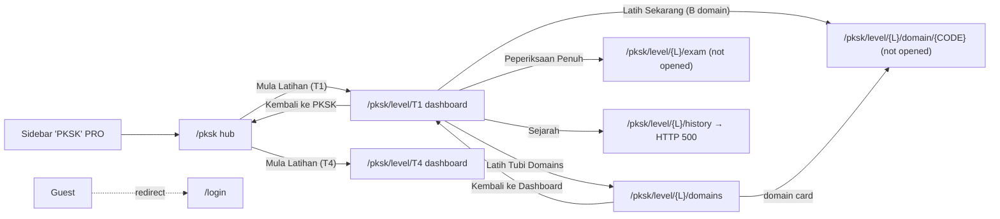
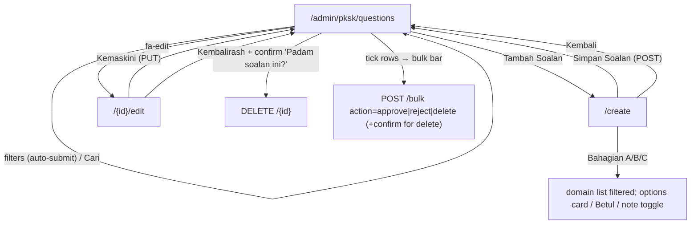
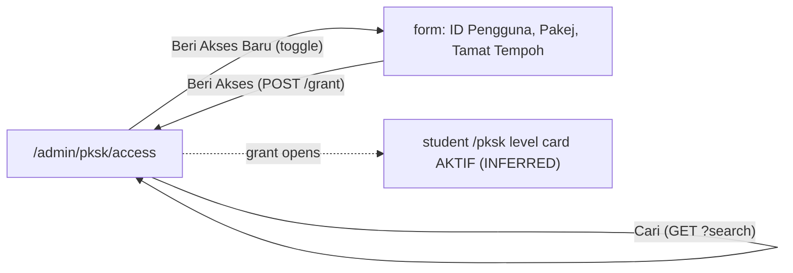

# M07 — Premium PKSK (Discovery)

- **Source:** live read-only walk-through of https://prestasiplus.my on 2026-09-25 with the admin account (browser lane 3, `playwright3`).
- **Screenshots:** `docs/discovery/img/M07/` (25 files). Every page was masked in the DOM before capture. The shell and design tokens are in [00-global-ui.md](00-global-ui.md) and are not repeated here.
- **Language:** UI copy is quoted in its exact Bahasa Melayu (English where the live site uses English, e.g. the Laravel paginator).
- **Personal data:** `/admin/pksk/access` lists real users. Before any inventory or screenshot, `tools/jobs/M07.js` → `M07MASK` replaced the "Pengguna" cell (name → `<person>`, e-mail/username → `<email>`) and a non-empty "Diberi Oleh" cell (→ `<person>`); then `tools/sanitize.js` ran with `{titleName:false}`. Only structure is recorded here. Question text is content, not personal data; short samples are quoted.
- **Element inventory:** 486 content elements over 8 screens and 53 captured UI states, IDs `EL-M07-S#-nnn`, in `docs/discovery/inventory/M07/<S#-key>.json`. Reconciliation, the crawl and read-only limits are in `docs/discovery/inventory/M07/_summary.md`. The inventory JSON is authoritative for attributes and conditions.
- **Safety:** nothing was submitted or saved. No `/pksk/level/{L}/exam` or `/pksk/level/{L}/domain/{CODE}` URL was opened (they may start an exam or a practice session); only their targets are recorded. "Simpan Soalan", "Kemaskini", "Luluskan", "Tolak", "Padam", "Beri Akses" and "Tarik" were never clicked. See §9.

---

## 1. Overview

**PKSK** stands for **"Pentaksiran Kemasukan Sekolah Khusus"** (admin header subtitle on `/admin/pksk/questions`: "Urus soalan Pentaksiran Kemasukan Sekolah Khusus"). The student side presents it as **"Persediaan Kemasukan SBP / MRSM / SMKA"** (entrance preparation for fully-residential schools SBP, MARA junior science colleges MRSM and religious secondary schools SMKA). The user-portal sidebar item is "PKSK" with an indigo "PRO" pill (the TRACKER's "PKSK PRO").

M07 has two halves:

1. **Student (user portal)** — a premium practice area for two entry points: **T1** (entry to Tingkatan 1, i.e. Darjah 6 pupils) and **T4** (entry to Tingkatan 4, i.e. Tingkatan 3 students).
   - `/pksk` hub: exam format (Bahagian A/B/C) and two level cards.
   - `/pksk/level/{T1|T4}` level dashboard: readiness score and grade, exam count, Bahagian B average, three shortcuts, domain mastery bars.
   - `/pksk/level/{L}/domains`: domain list by Bahagian with question counts.
   - `/pksk/level/{L}/history`: **HTTP 500 on live** (D-1).
   - `/pksk/level/{L}/exam` ("Peperiksaan Penuh") and `/pksk/level/{L}/domain/{CODE}` ("Latih Sekarang"): session starts, not opened.
2. **Admin (admin panel, sidebar group "Premium")** — "PKSK Soalan" (`/admin/pksk/questions`: list, filters, bulk approve/reject/delete, create, edit, delete) and "PKSK Akses" (`/admin/pksk/access`: grant a package to a user id with an optional expiry, list and revoke access).

**Content structure (OBSERVED):**

| Bahagian | Name (create form / hub) | Filter label | Exam format (hub) | Domains |
|---|---|---|---|---|
| A | Kecerdasan Insaniah | "A - Insaniah" | 30 soalan · Pemberat: 20% · "Nilai, akhlak & sahsiah" | 1: Kecerdasan Insaniah |
| B | Kecerdasan Intelek | "B - Intelek" | 70 soalan · Pemberat: 70% · "Kognitif & penaakulan" | 13: Matematik … Isu Global |
| C | Artikulasi Penulisan | "C - Esei" | 1 esei · Pemberat: 10% · "Penulisan kreatif" | 1: Artikulasi Penulisan |

- **Levels ("Sasaran"):** T1 "Tingkatan 1 (Darjah 6)" and T4 "Tingkatan 4 (Tingkatan 3)". Every question targets exactly one level.
- **Question types:** Bahagian B = multiple choice with one or more options ticked "Betul"; Bahagian A = multiple choice with "(Tiada jawapan betul/salah)" (situational judgement; existing A questions still store one `is_correct: true` option); Bahagian C = essay prompt with no options (e.g. "(150-200 patah perkataan)").
- **No sets and no subjects.** Practice is per domain; the full exam is per level.
- **Relation to the M04 question bank (OBSERVED):** PKSK questions live in the same `questions` store: their ids (e.g. #178460, #178349) open in the M04 detail page `/admin/questions/{id}` ("Detail Soalan", options, "Jawapan Betul", "Penjelasan AI"). They are **excluded** from the M04 list `/admin/questions` (a search for a PKSK question text returns "Tiada soalan dijumpai"). They carry PKSK-only fields `pksk_domain_id` and `pksk_target_level` and have no subject or education level. PKSK questions are managed only in M07.

**Access model (OBSERVED + INFERRED):**
- Admin grants a **PKSK package** to a **user id** (`POST /admin/pksk/access/grant`: `user_id`, `pksk_package_id`, `expires_at` optional date). Packages: 1 "PKSK Tingkatan 1 (SBP/MRSM) (T1)", 2 "PKSK Tingkatan 4 (SBP/MRSM) (T4)", 3 "PKSK Kombo (T1 + T4) (ALL)". Grants are per user only; no school or bulk grant exists on this screen.
- An access row shows the package, the granter ("Diberi Oleh", "-" when none), the grant date ("Tarikh", `dd/mm/yyyy`), the expiry ("Tamat", "Tiada had" when there is none) and status "Aktif". "Tarik" revokes it (`POST /admin/pksk/access/revoke`, `access_id`, confirm "Tarik balik akses?").
- Stats "Akses T1" / "Akses T4" count Kombo grants in both (3 Kombo grants → 3 / 3 / 3).
- A **second, separate flag** exists in M02: the user edit form's "Pakej PKSK" switch `has_pksk_subscription` ("RM20 — Akses penuh PKSK (tiada tarikh tamat)", badge "Tiada Akses"). How it relates to the `pksk_access` grants is unknown (OQ-1).
- **Student gating:** for the admin account, both level cards show a green "AKTIF" badge (`fa-unlock`) and "Mula Latihan". The locked variant, the gate on the level routes, and any upsell are **not observable** with the admin account (§9 L-1). `/pricing` (M19) has no PKSK package and no page links to it from M07: **no upsell or price link exists** on any M07 page.
- Guests: `/pksk`, `/pksk/level/T1` and `/admin/pksk/questions` all redirect to `/login`; the audit also verified `/pksk/level/T1/domains`, `/pksk/level/T4/history`, `/admin/pksk/questions/create` and `/admin/pksk/access` → 302 `/login` (corrected after audit, AUD-M07-07).

| # | Route | Tab title · header title / subtitle | Layout | Status |
|---|---|---|---|---|
| S1 | `/pksk` | "PRESTASIPLUS - Platform Latih Tubi Nasional" · "PKSK" / "Persediaan Kemasukan SBP / MRSM / SMKA" | user | Documented (admin view) |
| S2 | `/pksk/level/{T1\|T4}` | same generic tab title · "Dashboard PKSK - T1" / "Pantau kemajuan latihan anda" | user | T1, T4, 404 |
| S3 | `/pksk/level/{T1\|T4}/domains` | generic · "Domain PKSK - T1" / "Pilih domain untuk latih tubi" | user | T1, T4, 404 |
| S4 | `/pksk/level/{T1\|T4}/history` | "500 - Ralat Pelayan \| PRESTASIPLUS" | error page | **HTTP 500** |
| S5 | `/admin/pksk/questions` | "Soalan PKSK - Admin" · "Soalan PKSK" / "Urus soalan Pentaksiran Kemasukan Sekolah Khusus" | admin | Documented |
| S6 | `/admin/pksk/questions/create` | "Tambah Soalan PKSK - Admin" · "Tambah Soalan PKSK" / "Cipta soalan baru untuk PKSK" | admin | Not submitted |
| S7 | `/admin/pksk/questions/{id}/edit` | "Edit Soalan PKSK - Admin" · "Edit Soalan PKSK" / "Kemaskini soalan #<?php echo e($question->id); ?>" (D-2) | admin | A, B, C records; not submitted |
| S8 | `/admin/pksk/access` | "Akses PKSK - Admin" · "Akses PKSK" / "Urus akses premium pengguna" | admin | Form not submitted |

Entry points: user sidebar "PKSK" + "PRO" (`fa-shield-halved`, `/pksk`) in the desktop sidebar and in the mobile drawer ("drawer-nav-item"); admin sidebar collapsible group **"Premium"** (`toggle('premium')`, `fa-shield-halved`, indigo) with "PKSK Soalan" (`fa-shield-halved`) and "PKSK Akses" (`fa-key`); the admin mobile "Lagi" sheet lists the same two links under "Premium" (see 00-global-ui.md).

---

## 2. Screens

### 2.1 S1 — `/pksk` "PKSK" (student hub)

Screenshots: `pksk-hub-desktop.png`, `pksk-hub-tablet.png`, `pksk-hub-mobile.png`.

- Hidden shell widget: tournament banner `tournamentBanner()` (00-global-ui.md / M16).
- **Hero** (rounded-3xl, gradient indigo-600 → purple-600 → pink-500, dotted SVG overlay): `fa-graduation-cap` (6xl, white), h1 **"Persediaan Kemasukan"**, sub "SBP / MRSM / SMKA", lead "Latih tubi soalan dan peperiksaan penuh untuk persediaan kemasukan sekolah berasrama penuh".
  - Observed colour: the h1 has class `text-white` but renders **rgb(30, 41, 59)** (slate-800, dark on the purple gradient) because the global heading style wins (D-4).
- **"Format Peperiksaan"** card (`fa-clipboard-list` indigo): three tiles (1 col → 3 from md):
  - A (blue-500 circle): "Kecerdasan Insaniah", "**30** soalan", "Pemberat: 20%", chip `fa-heart` "Nilai, akhlak & sahsiah".
  - B (purple-500): "Kecerdasan Intelek", "**70** soalan", "Pemberat: 70%", chip `fa-brain` "Kognitif & penaakulan".
  - C (pink-500): "Artikulasi Penulisan", "**1** esei", "Pemberat: 10%", chip `fa-pen-fancy` "Penulisan kreatif".
- **"Pilih Tingkatan Anda"** (`fa-layer-group`): two cards (1 col → 2 from md), each with `border-4 border-green-400 shadow-xl shadow-green-500/30`. These classes and the badge are static in the server-rendered markup; the page source has no locked variant (`:class`, `x-show` or template), so the locked state is not derivable (corrected after audit, AUD-M07-08):
  - badge `fa-unlock` **"AKTIF"** (green-500, white text, top-right);
  - tile "T1" (indigo → purple) / "T4" (purple → pink); h3 "Tingkatan 1" / "Tingkatan 4"; text "Persediaan untuk kemasukan ke tingkatan 1 di SBP/MRSM/SMKA" / "… tingkatan 4 di SBP/MRSM/SMKA";
  - button-link `fa-play` **"Mula Latihan"** → `/pksk/level/T1` / `/pksk/level/T4`.
- No price, no package name, no upsell link.

### 2.2 S2 — `/pksk/level/{T1|T4}` "Dashboard PKSK - {L}"

Screenshots: `level-dashboard-desktop.png`, `level-dashboard-mobile.png`.

- Back link `fa-arrow-left` "Kembali ke PKSK" → `/pksk`.
- **Readiness hero** (same gradient): "Skor Kesediaan Anda", "0%" (7xl), grade pill "E", "Teruskan usaha anda!"; right column (stacks under from < md): "Jumlah Peperiksaan" "0", "Purata Bahagian B" "0.0%".
- **Three shortcut cards** (1 → 3 cols from md; whole card is a link; hover scale-105):
  - `fa-brain` (blue) "Latih Tubi Domains" / "Fokus pada topik tertentu" → `/pksk/level/{L}/domains`;
  - `fa-file-alt` (purple) "Peperiksaan Penuh" / "Simulasi peperiksaan sebenar" → `/pksk/level/{L}/exam` (**not opened**);
  - `fa-history` (pink) "Sejarah" / "Lihat prestasi lepas" → `/pksk/level/{L}/history` (HTTP 500, D-1).
- **"Penguasaan Domain"** (`fa-chart-line`): one card per **Bahagian B domain only** (13; A and C are not listed), 1 → 2 (md) → 3 (lg) cols. Each: icon tile (domain colour at 13% alpha), h3 name, code (e.g. "PKSK_MATH"), "Penguasaan" + "0%" (domain colour), progress bar, button `fa-play` **"Latih Sekarang"** → `/pksk/level/{L}/domain/{CODE}` (**not opened**).
  - The domain icons have no `fas` base class (`<i class="fa-calculator">`) and render **blank** (D-3).
- T1 and T4 are identical apart from the URLs. `/pksk/level/T9` and `/pksk/level/ALL` → 404 page "Halaman Tidak Dijumpai" (with "Halaman Utama" → `/` and "Mula Latihan" → `/latih-tubi`, the global 404, whose second link is itself a 404: M06 D-8).

### 2.3 S3 — `/pksk/level/{T1|T4}/domains` "Domain PKSK - {L}"

Screenshots: `domains-desktop.png`, `domains-mobile.png`.

- Back link `fa-arrow-left` "Kembali ke Dashboard" → `/pksk/level/{L}`.
- Three sections, each with a letter badge (A blue-500, B purple-500, C pink-500), h2 and sub:
  - A "Kecerdasan Insaniah" / "Nilai, akhlak & sahsiah";
  - B "Kecerdasan Intelek" / "Kognitif & penaakulan";
  - C "Artikulasi Penulisan" / "Penulisan kreatif".
- Domain cards (whole card is a link → `/pksk/level/{L}/domain/{CODE}`, hover border in the section colour): icon tile (blank, D-3), h3 name, code, `fa-question-circle` "Soalan" + count for this level, "Penguasaan" + "0%" + bar.
- Counts per level are in Appendix A.2 (T1 total 383, T4 total 380 — they match the admin stat cards).
- `/pksk/level/T9/domains` → 404.

### 2.4 S4 — `/pksk/level/{T1|T4}/history` (live: HTTP 500)

Screenshot: `history-500.png`.

- Both levels return the global **500 page**: "500", "⚙️", "Ralat Pelayan", "Sesuatu tidak kena di pihak kami. Pasukan teknikal telah dimaklumkan. Sila cuba sebentar lagi.", "Halaman Utama", "Cuba Semula". The intended history screen is unknown (D-1, L-4).

### 2.5 S5 — `/admin/pksk/questions` "Soalan PKSK"

Screenshots: `questions-desktop.png`, `questions-bulk-bar.png`, `questions-empty.png`, `questions-tablet.png`, `questions-mobile.png`.

- **Stat cards** (`grid-cols-2 lg:grid-cols-5`; global counts, **not** affected by filters): "763" "Jumlah" (indigo-600), "763" "Diluluskan" (green-600), "0" "Menunggu" (amber-600), "383" "Ting. 1" (blue-600), "380" "Ting. 4" (purple-600).
- **Filter card**: GET form; each select submits on change (`onchange="this.form.submit()"`):
  - `bahagian`: "Semua Bahagian" (''), "A - Insaniah", "B - Intelek", "C - Esei";
  - `level`: "Semua Level" (''), "Tingkatan 1" (T1), "Tingkatan 4" (T4);
  - `status`: "Semua Status" (''), "Menunggu" (pending), "Diluluskan" (approved), "Ditolak" (rejected);
  - text `search` placeholder "Cari soalan..." (w-48);
  - submit `fa-search` "Cari" (indigo-600);
  - selected values are preloaded after reload.
- Button-link `fa-plus` **"Tambah Soalan"** (green-600) → `/admin/pksk/questions/create`, right-aligned (wraps below the filters when narrow).
- **Bulk bar** (Alpine `{ selectedIds: [], selectAll: false }`; `x-show="selectedIds.length > 0"`, indigo-50) inside `POST /admin/pksk/questions/bulk`:
  - "`n` dipilih" (`x-text="selectedIds.length + ' dipilih'"`);
  - `name=action` buttons: **"Luluskan"** (`approve`, green-600), **"Tolak"** (`reject`, amber-600), **"Padam"** (`delete`, red-600, `onclick="return confirm('Padam soalan terpilih?')"`);
  - hidden `ids[]` per selected id (`<template x-for>`).
  - The header checkbox (`x-model="selectAll"`) sets `selectedIds` to the 20 ids of the current page (or `[]`); row checkboxes use `x-model.number="selectedIds"`. Observed: one row → "1 dipilih"; select-all → "20 dipilih". Nothing was submitted.
- **Table** columns: (checkbox), "Soalan", "Bahagian", "Domain", "Level", "Status", "Tindakan".
  - Soalan: text truncated to 80 characters + "..." (`truncate`, `max-w-xs`).
  - Bahagian pill: A purple-100/purple-700, B blue-100/blue-700, C pink-100/pink-700.
  - Domain: domain icon **with** `fas` in the domain colour (e.g. `fa-users` #ec4899) + name (text-xs).
  - Level: T1 blue-100/blue-700, T4 purple-100/purple-700 (square `rounded`).
  - Status: "Diluluskan" green-100/green-700 (the only status on live; pending/rejected pill colours not observable, L-6).
  - Tindakan: `fa-edit` (indigo) → `/admin/pksk/questions/{id}/edit`; `fa-trash` (red-500) form `DELETE /admin/pksk/questions/{id}`, `onsubmit="return confirm('Padam soalan ini?')"`. No view link.
- **Pagination**: Laravel, 20 per page, "Showing 1 to 20 of 763 results"; < sm: "« Previous" / "Next »". **Pager links keep the active filters** (e.g. `?bahagian=A&page=2`).
- **Sort order** (OBSERVED): page 1 starts #178460, then #178432–#178450 in ascending id; the last page (39) holds #178174, #177919, #178175. INFERRED: newest `created_at` first, ties in insertion order.
- **Empty state** (e.g. `?status=pending`, `?status=rejected`, `?search=zzzzqqq`): `fa-inbox` "Tiada soalan PKSK lagi" + link "Tambah soalan pertama" → create. The same copy shows for filtered results.
- Filtered totals: `bahagian=A` 160, `bahagian=C` 30 (2 pages), `level=T1&bahagian=B` 288, `search=inovasi` 13.

### 2.6 S6 — `/admin/pksk/questions/create` "Tambah Soalan PKSK" (not submitted)

Screenshots: `create-desktop.png`, `create-bahagian-a.png`, `create-bahagian-b-max.png`, `create-bahagian-c.png`, `create-mobile.png`.

Form `POST /admin/pksk/questions`, Alpine `questionForm()`, max-w-4xl. Cards:

1. `fa-layer-group` **"Bahagian & Domain"** (1 → 3 cols from md):
   - "Bahagian" `select name=bahagian` `x-model="bahagian"` `@change="filterDomains()"` required: "-- Pilih --" (''), "A - Kecerdasan Insaniah", "B - Kecerdasan Intelek", "C - Artikulasi Penulisan".
   - "Domain" `select name=pksk_domain_id` `x-model="domainId"` required: "-- Pilih domain --" + `<template x-for="d in filteredDomains">` (`:value="d.id"`, `x-text="d.name"`). With no Bahagian, **all 15** domains are listed; A → 1, B → 13, C → 1.
   - "Sasaran" `select name=pksk_target_level` required, **no empty option**: "Tingkatan 1 (Darjah 6)" (T1, default), "Tingkatan 4 (Tingkatan 3)" (T4).
2. `fa-question-circle` (amber) **"Soalan"**:
   - "Teks Soalan" `textarea name=question_text` rows 4, required, placeholder "Tulis soalan di sini...";
   - "Tahap Kesukaran (1-5)" `select name=difficulty_level` required: "1 - Sangat Mudah", "2 - Mudah", "3 - Sederhana" (selected), "4 - Sukar", "5 - Sangat Sukar";
   - "Penjelasan (Opsional)" `textarea name=explanation` rows 2, placeholder "Penjelasan jawapan...".
3. `fa-list-ol` (green) **"Pilihan Jawapan"** (`x-show="bahagian !== 'C'"`), title suffix "(Tiada jawapan betul/salah)" only when Bahagian A:
   - 4 option rows by default (`x-for="(opt, idx) in options"`), each: letter circle A/B/C… (`String.fromCharCode(65 + idx)`), text input `options[idx][text]` placeholder "Teks pilihan" required, checkbox `options[idx][is_correct]` value 1 **"Betul"** (only when Bahagian B; any number may be ticked), remove button `fa-times` (`x-show="options.length > 2"`).
   - Button `fa-plus` **"Tambah Pilihan"** (dashed border, `x-show="options.length < 6"`).
   - Limits (OBSERVED): minimum 2 options (remove buttons hide at 2), maximum 6 (the add button hides at 6).
4. Footer row (`justify-between`, same row at every width): link `fa-arrow-left` **"Kembali"** → `/admin/pksk/questions` (leaves the page; unsaved input is discarded, no confirm); submit `fa-save` **"Simpan Soalan"** (indigo-600).

Behaviour (OBSERVED, client-side only):
- **Bahagian change → domain resets.** After B + "Sains", switching to A shows "-- Pilih domain --" (the DOM value is '' while the Alpine `domainId` keeps the stale 3). No other field resets: text, difficulty, explanation, Sasaran and option texts are kept.
- **Validation is native `required` bubbles only** (no custom alert). On load, invalid: `bahagian`, `pksk_domain_id`, `question_text`, `options[0..3][text]`.
- **Bahagian C cannot be saved (D-5):** the options card is hidden, but its 4 required text inputs stay in the form. With C, "Artikulasi Penulisan" and a question text, `checkValidity()` is still false (invalid `options[0..3][text]`), so the browser blocks submit on invisible fields.
- Create has no Status field. INFERRED: new questions are saved as "Diluluskan" or "Menunggu" (L-5).

### 2.7 S7 — `/admin/pksk/questions/{id}/edit` "Edit Soalan PKSK" (not submitted)

Screenshots: `edit-desktop.png`, `edit-bahagian-c.png`, `edit-mobile.png`.

Form `POST /admin/pksk/questions/{id}` + `_method=PUT`, Alpine `editForm()` with the saved `options` JSON. It differs from create:
- Header subtitle shows raw Blade source: **"Kemaskini soalan #<?php echo e($question->id); ?>"** (D-2).
- **No Bahagian select.** Card "Bahagian & Domain" (3 cols from md):
  - "Domain" `pksk_domain_id` lists all 15 with prefixes "[A] Kecerdasan Insaniah", "[B] Matematik" … "[C] Artikulasi Penulisan"; the saved domain is preselected;
  - "Sasaran" "Tingkatan 1" / "Tingkatan 4" (saved preselected);
  - **"Status"** `status` required: "Menunggu" (pending), "Diluluskan" (approved), "Ditolak" (rejected) (saved preselected).
- Card "Soalan": `question_text` (prefilled, no label, no placeholder); "Kesukaran" `difficulty_level` options "1"–"5" (no captions, saved preselected, not required); "Penjelasan" (prefilled).
- Card "Pilihan Jawapan" (no suffix): prefilled options; "Betul" is shown only when the **saved** Bahagian is B (server-baked `x-show="'B' === 'B'"` / `"'A' === 'B'"`); remove `fa-times` (`options.splice(idx, 1)`, when > 2); "Tambah Pilihan" (`options.push(...)`, when < 6). Option inputs have no placeholder. For a **Bahagian C** record the options card is **not rendered** at all (`options: []`).
- Changing the domain to another Bahagian does not change the options card (it follows the saved Bahagian).
- Footer: "Kembali" → list (discards); submit `fa-save` **"Kemaskini"**.
- `/admin/pksk/questions/99999999/edit` → 404. `GET /admin/pksk/questions/{id}` → **405** (no show page; the route exists only for PUT/DELETE).

### 2.8 S8 — `/admin/pksk/access` "Akses PKSK"

Screenshots: `access-desktop.png`, `access-form-open.png`, `access-empty.png`, `access-mobile.png`.

- **Stat cards** (`grid-cols-3` at every width): "3" "Jumlah Akses Aktif" (indigo-600), "3" "Akses T1" (blue-600), "3" "Akses T4" (purple-600).
- **"Beri Akses"** card (`fa-key` amber, Alpine `{ showForm: false }`): button `fa-plus` **"Beri Akses Baru"** (green-600) toggles (`showForm = !showForm`) the form `POST /admin/pksk/access/grant` (`x-show="showForm"` + `x-transition`, gray-50, 1 → 4 cols from md):
  - "ID Pengguna" `input type=number name=user_id` placeholder "User ID" required (no min);
  - "Pakej" `select name=pksk_package_id` required, no empty option: "PKSK Tingkatan 1 (SBP/MRSM) (T1)" (1, default), "PKSK Tingkatan 4 (SBP/MRSM) (T4)" (2), "PKSK Kombo (T1 + T4) (ALL)" (3);
  - "Tamat Tempoh" `input type=date name=expires_at` (optional, no min);
  - submit `fa-check` **"Beri Akses"** (indigo-600).
  - Toggling closes the form **without clearing it**: a typed User ID was still there after close + reopen. There is no "Batal"; the toggle button is the only close control.
  - The grant takes a raw numeric user id; there is no user search or picker.
- **Search card**: GET form, `search` placeholder "Cari nama / email...", button `fa-search` "Cari".
- **Table** columns: "Pengguna" (name bold + e-mail/username text-xs), "Pakej" (green-100/green-700 chip, e.g. "PKSK Kombo (T1 + T4)"), "Diberi Oleh" ("-" on all 3 live rows), "Tarikh" (`dd/mm/yyyy`), "Tamat" ("Tiada had"), "Status" ("Aktif", green pill), "Tindakan": form `POST /admin/pksk/access/revoke` (`access_id` hidden, `onsubmit="return confirm('Tarik balik akses?')"`) with button `fa-ban` **"Tarik"** (red-500).
- Row order (OBSERVED): one load gave access ids 2, 1, 3 (dates 28/02/2026, 28/02/2026, 22/04/2026); a later load at 375 showed the 22/04/2026 row second. The order is not by id, not newest-first and **not stable between loads** (no ORDER BY, INFERRED) (OQ-4).
- **Empty state** (`?search=zzzzqqq`): `fa-lock` "Tiada rekod akses". `?page=2` gives the same empty state (no pager is rendered for 3 rows).
- Live data: 3 active grants, all "PKSK Kombo (T1 + T4)", no expiry. Status values other than "Aktif" are not observable (L-7).

---

## 3. Flows

### 3.1 Student navigation

### 3.2 Admin question management

### 3.3 Access grant / revoke

---

## 4. Inferred server-side rules (INFERRED unless marked OBSERVED)

| # | Rule |
|---|---|
| R-1 | A user can use a PKSK level when they have an active `pksk_access` whose package level is that level or `ALL`, and it has not expired (`expires_at` null = "Tiada had"). The admin sees both levels "AKTIF" (admin bypass or admin grant — unknown). |
| R-2 | "Jumlah Akses Aktif" counts active grants; "Akses T1" counts grants with level T1 or ALL; "Akses T4" counts T4 or ALL (OBSERVED 3/3/3 with 3 Kombo grants). |
| R-3 | Revoke ("Tarik") ends the grant (status changes or the row is deleted — not observable). |
| R-4 | The question list's stat cards are global; filters apply to the table only (OBSERVED). |
| R-5 | Student pages use only approved questions (`status = approved`); counts on S3 match the admin totals of approved questions per level (OBSERVED equal, all 763 are approved). |
| R-6 | Bahagian of a question = the Bahagian of its domain (edit page has no Bahagian field; list shows the domain's letter). |
| R-7 | Bahagian B questions are scored by the "Betul" options; Bahagian A has no right answer (UI note) although the stored data flags one option; Bahagian C essays are marked by explanation-style rubric ("Dinilai berdasarkan kejelasan idea, susunan hujah, contoh relevan dan ketepatan bahasa."). |
| R-8 | Full exam = 30 A + 70 B + 1 C per level, weighted 20% / 70% / 10% (hub copy). "Skor Kesediaan" is a weighted score with a letter grade (E at 0%); grade bands unknown. |
| R-9 | Domain mastery ("Penguasaan") = per-domain accuracy from practice / exams; shown for B domains on S2, all domains on S3. |
| R-10 | Bulk actions apply to the ticked ids of the current page only (select-all takes the 20 visible ids, OBSERVED). |
| R-11 | Search matches the question text (OBSERVED "inovasi" → 13 rows containing it). The search is case-insensitive and trimmed (`INOVASI`, ` inovasi ` → 13); filter values compare case-insensitively (`?level=t1` → 383); unknown values (`?status=zzz`, `?bahagian=Z`, `?level=T9`) give the empty row — all OBSERVED (corrected after audit, AUD-M07-06). |

---

## 5. Data entities implied

| Entity | Fields (OBSERVED unless marked) |
|---|---|
| **PkskDomain** | `id` (1–15), `bahagian` (A/B/C), `name`, `name_en`, `code` (PKSK_*), `icon` (FA name without `fas`), `color` (hex), `order`, `is_active`, `created_at`, `updated_at` — full JSON in the create page's `allDomains` (Appendix A.1). |
| **Question (PKSK)** | shared `questions` store (M04): `id`, `question_text`, `explanation`, `difficulty_level` 1–5, `status` pending/approved/rejected, `pksk_domain_id`, `pksk_target_level` T1/T4, options `[{text, is_correct}]` (2–6). No subject / education level (INFERRED null). |
| **PkskPackage** | `id` 1–3, name, level `T1` / `T4` / `ALL` (option labels "{name} ({level})"). Price not shown in M07 (M02 shows "Pakej PKSK RM20"). |
| **PkskAccess** | `id` (`access_id`), `user_id` → User, `pksk_package_id`, granted-by user (nullable → "-"), grant date, `expires_at` (nullable → "Tiada had"), status ("Aktif"; others INFERRED). |
| **User.has_pksk_subscription** | M02 boolean (RM20, no expiry); relation to PkskAccess unknown (OQ-1). |
| **PKSK attempt / exam** (INFERRED) | per user and level: readiness score %, grade letter, exam count, Bahagian B average, per-domain mastery %. |

---

## 6. Endpoints observed

| Method | Path | Params / body | Source | Observed |
|---|---|---|---|---|
| GET | `/pksk` | — | S1 | 200 (admin); guest → `/login` |
| GET | `/pksk/level/{T1\|T4}` | — | S2 | 200; other level → 404 |
| GET | `/pksk/level/{L}/domains` | — | S3 | 200; bad level → 404 |
| GET | `/pksk/level/{L}/history` | — | S2 link | **500** |
| GET | `/pksk/level/{L}/exam` | — | S2 link | **not opened** |
| GET | `/pksk/level/{L}/domain/{CODE}` | CODE ∈ PKSK_* | S2, S3 links | **not opened** |
| GET | `/admin/pksk/questions` | `bahagian`, `level`, `status`, `search`, `page` | S5 | 200 |
| POST | `/admin/pksk/questions/bulk` | `_token`, `action` (approve/reject/delete), `ids[]` | S5 | not submitted (GET → 405) |
| GET | `/admin/pksk/questions/create` | — | S5 | 200 |
| POST | `/admin/pksk/questions` | `bahagian`, `pksk_domain_id`, `pksk_target_level`, `question_text`, `difficulty_level`, `explanation`, `options[i][text]`, `options[i][is_correct]` | S6 | not submitted |
| GET | `/admin/pksk/questions/{id}/edit` | — | S5 | 200; unknown id → 404 |
| PUT | `/admin/pksk/questions/{id}` | `pksk_domain_id`, `pksk_target_level`, `status`, `question_text`, `difficulty_level`, `explanation`, `options[i][text]`, `options[i][is_correct]` | S7 | not submitted (GET → 405) |
| DELETE | `/admin/pksk/questions/{id}` | `_token`, `_method=DELETE` | S5 | not submitted |
| GET | `/admin/pksk/access` | `search`, `page` | S8 | 200 |
| POST | `/admin/pksk/access/grant` | `user_id`, `pksk_package_id`, `expires_at` | S8 | not submitted (GET → 405) |
| POST | `/admin/pksk/access/revoke` | `access_id` | S8 | not submitted (GET → 405) |
| GET | `/admin/questions/{id}` (M04) | PKSK question id | — | 200, shows the PKSK question |

`/admin/pksk`, `/admin/pksk/packages`, `/admin/pksk/domains` → 404 (no package or domain admin screen). `/admin/pksk/questions/import` → 405 (matches the `{id}` PUT/DELETE route, not an import screen). No JSON endpoint is called by any M07 page (the only XHRs are the shell's `/admin/server-status` and `/api/tournament/active`).

---

## 7. Responsive behaviour (375 / 768 / 1280) and live defects

No captured state has horizontal **page** overflow (document width = viewport at 375, 768 and 1280).

| Screen | 375 | 768 | 1280 |
|---|---|---|---|
| S1 hub | Format tiles and level cards 1 column; hero h1 text-4xl | tiles 3 cols, level cards 2 cols | same as 768 |
| S2 dashboard | hero stacks (score, then the two stat boxes full width); shortcuts 1 col; domains 1 col | shortcuts 3 cols; domains 2 cols | domains 3 cols |
| S3 domains | 1 col | 2 cols | 3 cols |
| S5 list | stats 2 cols (5th alone); filters wrap (Bahagian + Level / Status + search / Cari); "Tambah Soalan" below; **table 855px inside a 342px scroll card**: Bahagian…Tindakan (edit/delete) are off-screen until the card is scrolled; pager "« Previous" / "Next »" | stats 2 cols; the three selects and the search on one row, **"Cari" wraps to a second row**, "Tambah Soalan" below (corrected after audit, AUD-M07-05); table 855px in a 715px card: **"Tindakan" still off-screen** until the card is scrolled | stats 5 cols; table fits (911 / 959px) |
| S6 create | all grids 1 col; footer "Kembali" (left) and "Simpan Soalan" (right) stay on one row | Bahagian/Domain/Sasaran 3 cols; difficulty 2-col grid | same |
| S7 edit | domain/sasaran/status 1 col; Kesukaran grid stays 2 cols; footer one row | 3 cols | same |
| S8 access | stats 3 cols (narrow); grant form 1 col; **table 705px in a 342px scroll card** (Pakej…Tindakan off-screen) | table fits (705 / 715px) | fits |

Admin pages use the admin drawer below 1024px and the fixed mobile bottom tab bar (00-global-ui.md).

**Live defects (candidates for D9 fixes):**

| # | Defect | Where |
|---|---|---|
| D-1 | "Sejarah" → HTTP 500 "Ralat Pelayan" for T1 and T4. | S2 → S4 |
| D-2 | Edit subtitle prints raw Blade: "Kemaskini soalan #<?php echo e($question->id); ?>" (should be "Kemaskini soalan #{id}"). | S7 |
| D-3 | Domain icons on S2 and S3 lack the `fas` class and render blank (the admin list renders the same icons correctly with `fas`). | S2, S3 |
| D-4 | Hub h1 "Persediaan Kemasukan" renders slate-800 (rgb(30, 41, 59)) on the purple gradient although it is meant to be white (`text-white`). | S1 |
| D-5 | Create form with Bahagian C cannot be submitted: hidden option inputs remain `required` (native validation fails on invisible fields). | S6 |
| D-6 | Student tab title is the generic "PRESTASIPLUS - Platform Latih Tubi Nasional" on S1–S3 (no page title). | S1–S3 |
| D-7 | Question table row actions ("Tindakan") are off-screen at 375 and 768 (only reachable by scrolling inside the card); the access table likewise at 375. | S5, S8 |
| D-8 | Create: after a Bahagian change the Alpine `domainId` keeps the old id while the select shows the placeholder (display and state disagree; the native `required` still blocks submit). | S6 |

Not defects (replicate): different Bahagian labels in the filter ("A - Insaniah"…"C - Esei") and the form ("A - Kecerdasan Insaniah"…); package names "(SBP/MRSM)" vs hub "SBP / MRSM / SMKA"; empty-state copy "Tiada soalan PKSK lagi" for filtered results; edit difficulty "1"–"5" without captions.

---

## 8. Open questions / not observable read-only

| # | Question |
|---|---|
| OQ-1 | How does the M02 user flag `has_pksk_subscription` ("Pakej PKSK RM20 — Akses penuh PKSK (tiada tarikh tamat)") relate to `pksk_access` grants? Does either alone unlock both levels? |
| OQ-2 | What does a student without access see on `/pksk` (locked card copy, badge, button) and on `/pksk/level/{L}` (redirect, 403, or upsell)? Is there a purchase path (M19) for PKSK? None is linked today. |
| OQ-3 | Why does the admin see both levels "AKTIF" (role bypass or own grant)? |
| OQ-4 | Access list sort rule: observed order varies between loads (ids 2, 1, 3, then a different order). The rebuild needs a defined order (D9: contradictory; suggest newest grant first). |
| OQ-5 | Default status of a newly created question (no Status field on create). |
| OQ-6 | Readiness grade bands (only "E" at 0% seen) and the scoring formula. |
| OQ-7 | What happens to an expired grant (status label, hidden from list, counted?) and to a revoked one. |
| OQ-8 | Validation messages for grant (unknown user id, duplicate grant, past expiry date) and for question save (e.g. no "Betul" ticked). |

---

## 9. States requiring a live session

| # | State / screen | How it is reached |
|---|---|---|
| L-1 | Student **without** access: locked level cards, level-route gate, any upsell | log in as a student with no grant |
| L-2 | Domain practice session (question UI, feedback, finish, mastery update) | `/pksk/level/{L}/domain/{CODE}` |
| L-3 | Full exam (30 A + 70 B + 1 C, timer?, sections, submit, result, readiness score/grade) | `/pksk/level/{L}/exam` |
| L-4 | History list (currently HTTP 500) | `/pksk/level/{L}/history` after fixing D-1 |
| L-5 | Create / edit save result (success flash, validation errors, default status) | submit S6 / S7 |
| L-6 | Pending and rejected questions (status pill colours, Menunggu count) | bulk "Tolak" or edit status |
| L-7 | Grant success / error flash, expired and revoked rows, non-"-" "Diberi Oleh" | submit S8 grant / revoke |
| L-8 | Bulk approve / reject / delete result | submit the bulk bar |

---

## 10. Screenshot index (`docs/discovery/img/M07/`, all masked)

| File | Content |
|---|---|
| `pksk-hub-desktop.png` / `-tablet.png` / `-mobile.png` | S1 at 1280 / 768 / 375 |
| `level-dashboard-desktop.png` / `-mobile.png` | S2 T1 |
| `domains-desktop.png` / `-mobile.png` | S3 T1 |
| `history-500.png` | S4 HTTP 500 |
| `questions-desktop.png`, `-tablet.png`, `-mobile.png` | S5 default |
| `questions-bulk-bar.png` | S5 select-all, bulk bar "20 dipilih" |
| `questions-empty.png` | S5 `?status=pending` empty state |
| `create-desktop.png`, `create-bahagian-a.png`, `create-bahagian-b-max.png`, `create-bahagian-c.png`, `create-mobile.png` | S6 states |
| `edit-desktop.png`, `edit-bahagian-c.png`, `edit-mobile.png` | S7 B record, C record, mobile |
| `access-desktop.png`, `access-form-open.png`, `access-empty.png`, `access-mobile.png` | S8 states (users masked) |

---

## Appendix A — Enumerations and live data values

### A.1 PKSK domains (`allDomains` on S6; order = `order`)

| id | Bahagian | name | name_en | code | icon | color |
|---|---|---|---|---|---|---|
| 1 | A | Kecerdasan Insaniah | Soft Skills Intelligence | PKSK_INSANIAH | fa-brain | #8b5cf6 |
| 2 | B | Matematik | Mathematics | PKSK_MATH | fa-calculator | #3b82f6 |
| 3 | B | Sains | Science | PKSK_SCI | fa-flask | #10b981 |
| 4 | B | Bahasa Inggeris | English Language | PKSK_ENG | fa-language | #ef4444 |
| 5 | B | Sejarah Malaysia | Malaysian History | PKSK_SEJ | fa-landmark | #f59e0b |
| 6 | B | Geografi | Geography | PKSK_GEO | fa-globe-asia | #06b6d4 |
| 7 | B | Kebudayaan Kaum | Cultural Heritage | PKSK_BUDAYA | fa-users | #ec4899 |
| 8 | B | Sukan & Pencapaian | Sports & Achievements | PKSK_SUKAN | fa-futbol | #84cc16 |
| 9 | B | Mercu Tanda Malaysia | Malaysian Landmarks | PKSK_MERCU | fa-monument | #f97316 |
| 10 | B | Alam Sekitar | Environment | PKSK_ALAM | fa-leaf | #22c55e |
| 11 | B | Teknologi & IT | Technology & IT | PKSK_TECH | fa-laptop-code | #6366f1 |
| 12 | B | Ekonomi Malaysia | Malaysian Economy | PKSK_EKON | fa-chart-line | #14b8a6 |
| 13 | B | Inovasi & Pencipta | Innovation & Inventors | PKSK_INOV | fa-lightbulb | #eab308 |
| 14 | B | Isu Global | Global Issues | PKSK_GLOBAL | fa-earth-asia | #0ea5e9 |
| 15 | C | Artikulasi Penulisan | Writing Articulation | PKSK_ESSAY | fa-pen-fancy | #a855f7 |

All `is_active: 1`, created 2026-02-07 00:57:33. `fa-earth-asia` is a FA 6 name (renders with `fas` in the admin list).

### A.2 Approved questions per domain and level (S3, 2026-09-25)

| Domain | T1 | T4 |
|---|---|---|
| Kecerdasan Insaniah | 80 | 80 |
| Matematik, Sains, Bahasa Inggeris | 27 each | 27 each |
| Sejarah Malaysia | 27 | 24 |
| Geografi … Isu Global (9 domains) | 20 each | 20 each |
| Artikulasi Penulisan | 15 | 15 |
| **Total** | **383** | **380** |

Admin totals: 763 (A 160, B 573, C 30); 763 approved, 0 pending, 0 rejected.

### A.3 Other enumerations

- Filter `bahagian`: '' "Semua Bahagian", A "A - Insaniah", B "B - Intelek", C "C - Esei". Filter `level`: '' "Semua Level", T1 "Tingkatan 1", T4 "Tingkatan 4". Filter `status`: '' "Semua Status", pending "Menunggu", approved "Diluluskan", rejected "Ditolak".
- Create `bahagian`: '' "-- Pilih --", A "A - Kecerdasan Insaniah", B "B - Kecerdasan Intelek", C "C - Artikulasi Penulisan". Create `pksk_target_level`: T1 "Tingkatan 1 (Darjah 6)", T4 "Tingkatan 4 (Tingkatan 3)". Create `difficulty_level`: 1 "1 - Sangat Mudah", 2 "2 - Mudah", 3 "3 - Sederhana" (default), 4 "4 - Sukar", 5 "5 - Sangat Sukar".
- Edit `pksk_domain_id` labels "[{Bahagian}] {name}"; edit `pksk_target_level` "Tingkatan 1" / "Tingkatan 4"; edit `status` "Menunggu" / "Diluluskan" / "Ditolak"; edit `difficulty_level` "1"–"5".
- Access `pksk_package_id`: 1 "PKSK Tingkatan 1 (SBP/MRSM) (T1)", 2 "PKSK Tingkatan 4 (SBP/MRSM) (T4)", 3 "PKSK Kombo (T1 + T4) (ALL)"; table chip text = name without the level suffix.
- Confirm dialogs: "Padam soalan terpilih?", "Padam soalan ini?", "Tarik balik akses?".
- Sample questions: B "Bagi calon T4, apakah tindakan terbaik apabila berlaku salah faham antara rakan berlainan budaya di sekolah?" (4 options, A "Betul"; explanation "Dialog berhemah dan rujukan kepada guru membantu menyelesaikan salah faham tanpa menjejaskan perpaduan."); A "Bagi calon T1, apabila rakan berlainan kaum menyambut perayaan, tindakan terbaik..."; C "Tulis karangan tentang cara pelajar boleh membantu rakan yang menghadapi masalah pembelajaran. (150-200 patah perkataan)"; English B item "What is the antonym of \"generous\"?".

## Appendix B — Exact DOM strings (inventory reconciliation)

(Generated by `tools/jobs/M07-appendix.js`; strings not already quoted above.)

Shell-owned strings (tournament banner, PWA/FCM scripts, chatbot quick questions, server-status tooltip) are listed where the inventory saw them; they are documented in 00-global-ui.md. Domain-card link texts are the concatenated card contents. Option-row `name` attributes are the Alpine-bound `options[idx][text]` / `options[idx][is_correct]` for idx 0–5. S7 option strings are the saved options of the sampled B (#178460) and A (#178359) records.

### S1-pksk-hub (`/pksk`)
- icon: `fa-circle`
- text: `DAFTAR`
- text: `Persediaan untuk kemasukan ke tingkatan 4 di SBP/MRSM/SMKA`
- inline-script string (script#1,script#4): `Accept`
- inline-script string (script#2): `translate(0, 0) scale(1)`
- inline-script string (script#2): `cubic-bezier(0.22, 0.85, 0.32, 1)`
- inline-script string (script#3): `(display-mode: standalone)`
- inline-script string (script#3): `Tekan Pasang untuk arahan pemasangan`
- inline-script string (script#3): `[App] SW registered, scope:`
- inline-script string (script#3): `[App] SW registration failed:`
- inline-script string (script#3): `[FCM] Token saved:`
- inline-script string (script#3): `[FCM] Save token failed:`
- inline-script string (script#3): `[FCM] Token error:`
- inline-script string (script#3): `[FCM] Foreground message:`
- inline-script string (script#3): `[FCM] SDK load failed:`
- inline-script string (script#4): `Maaf, berlaku ralat. Sila cuba semula.`
- inline-script string (attr:x-text@span): `Pendaftaran dibuka`
- inline-script string (attr:x-text@span): `Sedang berlangsung`
- inline-script string (attr:@click@button): `Apakah PrestasiPlus?`
- inline-script string (attr:@click@button): `Bagaimana cara mendaftar?`
- inline-script string (attr:@click@button): `Berapakah harga langganan?`

### S2-level-dashboard (`/pksk/level/{T1|T4}`)
- link: `Latih Tubi Domains Fokus pada topik tertentu`
- link: `Peperiksaan Penuh Simulasi peperiksaan sebenar`
- link: `Sejarah Lihat prestasi lepas`
- text: `🔍`
- text: `Maaf, halaman yang anda cari tidak wujud atau telah dipindahkan. Mungkin URL salah taip?`

### S3-domains (`/pksk/level/{T1|T4}/domains`)
- link: `Kecerdasan Insaniah PKSK_INSANIAH Soalan 80 Penguasaan 0%`
- link: `Matematik PKSK_MATH Soalan 27 Penguasaan 0%`
- link: `Sains PKSK_SCI Soalan 27 Penguasaan 0%`
- link: `Bahasa Inggeris PKSK_ENG Soalan 27 Penguasaan 0%`
- link: `Sejarah Malaysia PKSK_SEJ Soalan 27 Penguasaan 0%`
- link: `Geografi PKSK_GEO Soalan 20 Penguasaan 0%`
- link: `Kebudayaan Kaum PKSK_BUDAYA Soalan 20 Penguasaan 0%`
- link: `Sukan & Pencapaian PKSK_SUKAN Soalan 20 Penguasaan 0%`
- link: `Mercu Tanda Malaysia PKSK_MERCU Soalan 20 Penguasaan 0%`
- link: `Alam Sekitar PKSK_ALAM Soalan 20 Penguasaan 0%`
- link: `Teknologi & IT PKSK_TECH Soalan 20 Penguasaan 0%`
- link: `Ekonomi Malaysia PKSK_EKON Soalan 20 Penguasaan 0%`
- link: `Inovasi & Pencipta PKSK_INOV Soalan 20 Penguasaan 0%`
- link: `Isu Global PKSK_GLOBAL Soalan 20 Penguasaan 0%`
- link: `Artikulasi Penulisan PKSK_ESSAY Soalan 15 Penguasaan 0%`
- link: `Sejarah Malaysia PKSK_SEJ Soalan 24 Penguasaan 0%`

### S5-questions (`/admin/pksk/questions`)
- text: `Showing to of results`
- inline-script string (attr::title@div): `GB /`

### S6-create (`/admin/pksk/questions/create`)
- card: `Pilihan Jawapan (Tiada jawapan betul/salah)`
- name: `options[0][text]`
- name: `options[0][is_correct]`
- name: `options[1][text]`
- name: `options[1][is_correct]`
- name: `options[2][text]`
- name: `options[2][is_correct]`
- name: `options[3][text]`
- name: `options[3][is_correct]`
- name: `options[4][text]`
- name: `options[4][is_correct]`
- name: `options[5][text]`
- name: `options[5][is_correct]`
- inline-script string (script#1): `Sports \u0026 Achievements`
- inline-script string (script#1): `Technology \u0026 IT`
- inline-script string (script#1): `Innovation \u0026 Inventors`

### S7-edit (`/admin/pksk/questions/{id}/edit`)
- option: `[B] Sains`
- option: `[B] Bahasa Inggeris`
- option: `[B] Sejarah Malaysia`
- option: `[B] Geografi`
- option: `[B] Kebudayaan Kaum`
- option: `[B] Sukan & Pencapaian`
- option: `[B] Mercu Tanda Malaysia`
- option: `[B] Alam Sekitar`
- option: `[B] Teknologi & IT`
- option: `[B] Ekonomi Malaysia`
- option: `[B] Inovasi & Pencipta`
- option: `[B] Isu Global`
- inline-script string (script#1): `Mengadakan dialog secara sopan dan mendapatkan bantuan guru jika perlu.`
- inline-script string (script#1): `Menyebarkan cerita kepada kumpulan lain.`
- inline-script string (script#1): `Menyalahkan budaya rakan tersebut.`
- inline-script string (script#1): `Mengelak terus daripada bergaul dengannya.`
- inline-script string (script#1): `Memaksa rakan mengikut budaya sendiri.`
- inline-script string (script#1): `Mengejek amalan tersebut.`
- inline-script string (script#1): `Mengelak daripada bercakap dengannya.`
- inline-script string (script#1): `Mengucapkan tahniah dan menghormati amalan perayaannya.`
