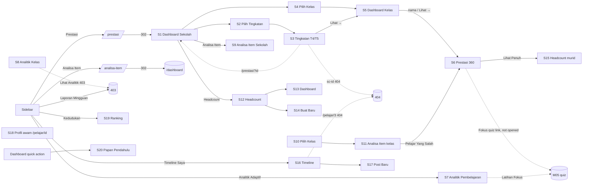
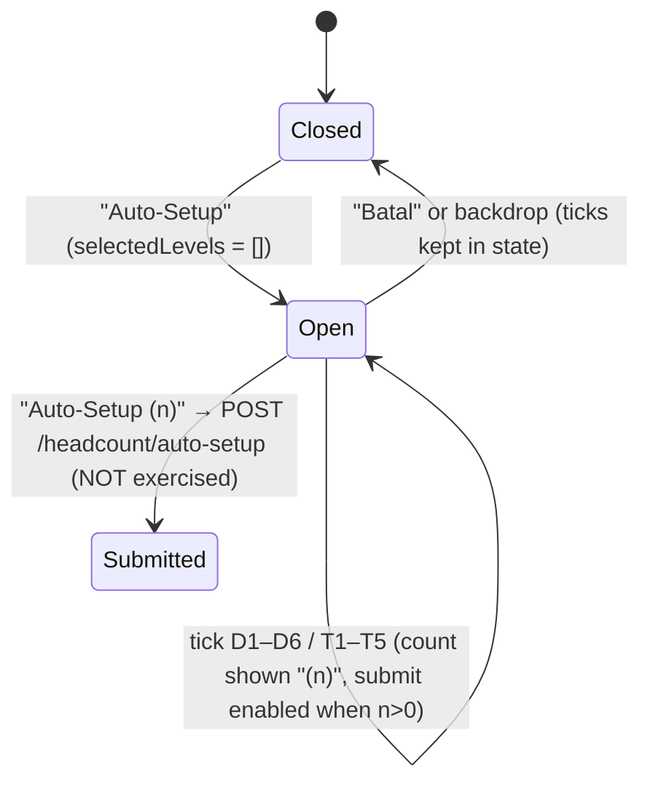
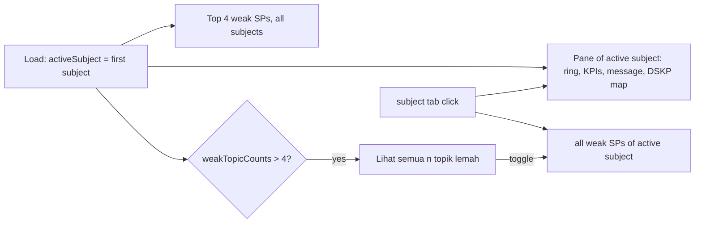

# M08 — Student Performance & Analytics (Discovery)

- **Source:** live read-only walk-through of https://prestasiplus.my on 2026-09-25 with the admin account (browser lane 1, `playwright`).
- **Screenshots:** `docs/discovery/img/M08/` (64 files, incl. 14 from the audit top-up). Every page was masked in the DOM before capture. The shell and design tokens are in [00-global-ui.md](00-global-ui.md) and are not repeated here.
- **Language:** UI copy is quoted in its exact Bahasa Melayu. Some strings are in English on live ("On Track", "Below", "Below Target", "Off Track", "Tracking prestasi murid", "Auto-Setup").
- **Personal data (students are minors):** `tools/jobs/M08.js` → `M08MASK` runs before every inventory and screenshot. It masks:
  - every person name: teacher cards, top and at-risk student lists, the class "Perlu Perhatian" list, the "Pelajar Yang Salah" chips, ranking rows, the leaderboard podium, and the Prestasi 360 and headcount-student headers and tab titles;
  - avatars;
  - school names (`<school>`) and PPD names (`PPD <ppd>`);
  - person-record ids in links (`/prestasi/{id}`, `/prestasi?{id}`, `/headcount/student/{id}`, `/analitik/kelas/pelajar/{id}`).

  Then `tools/sanitize.js` runs with `{selectors:['.m08n'], titleName:false}`. The "Guru", "Nama" and "Pelajar" table columns are masked by `sanitize.js` itself. Only structure, counts, percentages, class names and question text are kept. Question text is not personal data.
- **Element inventory:** 1,553 content elements over 23 screens and 123 captured UI states (the audit top-up added 405 elements, 20 states and screens S22/S23; §2.22), with IDs `EL-M08-S#-nnn`, in `docs/discovery/inventory/M08/<S#-key>.json`. Reconciliation, the crawl and read-only limits are in `docs/discovery/inventory/M08/_summary.md`.
- **Safety:**
  - No quiz or practice session was started. The "Latihan Fokus" and "Fokus" links (`/practice/{CODE}/quiz?level=&dskp_sp_id=&count=`) were recorded and never opened.
  - Nothing was submitted: not `POST /headcount/auto-setup`, `POST /headcount` or `POST /timeline`.
  - The GET filters of `/ranking` and `/analitik/kelas` were driven only by URL.

Cross-references:
- `/practice/progress` ("Kemajuan Saya") and `/practice/history` ("Sejarah Latihan") are the learner's own progress and history pages. They are documented in [M05-practice.md](M05-practice.md) §2.8/§2.9 and are **not** repeated here. The Dashboard quick action "🏅 Papan Pendahulu" → `/leaderboard` (M05 §2.1) lands on S20.

---

## 1. Overview

M08 is the **analytics and performance** area. The TRACKER checklist has 8 menu routes. The crawl found **21 screens** because each menu route opens a small tree:

| # | Route | Tab title (`<title>`) · shell header title / subtitle | Status on admin account |
|---|---|---|---|
| S1 | `/prestasi` → **302** `/prestasi/sekolah` | "Dashboard Sekolah — Prestasi" · header "Dashboard" / "Selamat datang kembali" (D-1) | Documented (school-wide data) |
| S2 | `/prestasi/tingkatan` | "Pilih Tingkatan — Prestasi \| PRESTASIPLUS" · "Dashboard Tingkatan" / "Pilih tingkatan untuk lihat prestasi keseluruhan" | Documented |
| S3 | `/prestasi/tingkatan/{t4\|t5}` | "Tingkatan 4 — Dashboard Tingkatan \| PRESTASIPLUS" · "Tingkatan 4" / "Dashboard Prestasi Tingkatan" | T4, T5; `t1`, `t3` → 404 |
| S4 | `/prestasi/kelas` | "Pilih Kelas — Prestasi" · "Prestasi Kelas" / "Pilih kelas untuk lihat prestasi keseluruhan" | Empty state only (admin owns no class) |
| S5 | `/prestasi/kelas/{id}` | "{kelas} — Dashboard Kelas" · header = class name / "<school> · {subjek} · {tahun}" | Classes 4 and 228 |
| S6 | `/prestasi/{userId}` | "Prestasi 360 — {nama} — PRESTASIPLUS" · "Dashboard" / "Selamat datang kembali" (D-1) | Own id 1 (empty) and one student (masked) |
| S7 | `/analitik/pelajar` | "Analitik Pembelajaran" · "Analitik Pembelajaran" / "Pantau prestasi dan kenal pasti topik yang perlu diperkukuhkan" | Admin's own data (BM, Sejarah) |
| S8 | `/analitik/kelas` | "Analitik Kelas" · "Analitik Kelas" / "Pantau prestasi pelajar dan kenal pasti yang memerlukan perhatian" | **New route**; data via `?classroom_id=4` only |
| S9 | `/analisa-item/sekolah` (`?tingkatan=T4\|T5`) | "Analisa Item Sekolah \| PRESTASIPLUS" · "Analisa Item — Sekolah" / "<school>[ — Tingkatan n]" | **New route**; empty ("Tiada Data Pelajar") |
| S10 | `/analisa-item/kelas` | "Analisa Item — Papan Guru \| PRESTASIPLUS" · "Analisa Item" / "Analisis tahap kesukaran dan diskriminasi soalan mengikut kelas" | **New route**; 750 classes |
| S11 | `/analisa-item/kelas/{id}` | same as S10 | **New route**; class 228 (596 items), class 6 (empty) |
| S12 | `/headcount` | "Headcount - PRESTASIPLUS" · "Dashboard" / "Selamat datang kembali" (D-1) | Empty ("Belum ada headcount."); modal opened, not submitted |
| S13 | `/headcount/dashboard` | "Dashboard Headcount - PRESTASIPLUS" · D-1 | **New route**; empty |
| S14 | `/headcount/create` | "Buat Headcount Baru - PRESTASIPLUS" · D-1 | **New route**; form not submitted |
| S15 | `/headcount/student/{id}` | "Headcount {nama} - PRESTASIPLUS" · D-1 | **New route**; one student (masked) |
| S16 | `/timeline` | "Timeline Saya - PRESTASIPLUS" · "Timeline Saya" / "Kongsi pencapaian & cerita anda" | Empty |
| S17 | `/timeline/create` | "Tambah Post - Timeline" · "Tambah Post" / "Kongsi pencapaian atau cerita baru" | **New route**; not submitted |
| S18 | `/pelajar/{id}` | "{nama} — Pelajar PRESTASIPLUS" (standalone public layout, no shell) | **New route**; own profile id 1 |
| S19 | `/ranking` (`?scope=&subject_id=&tingkatan=&negeri=`) | "Kedudukan Nasional" / "Kedudukan {negeri}" · D-1 | 4 scopes |
| S20 | `/leaderboard` (`?period=all\|week\|month`) | "Papan Pendahulu - PRESTASIPLUS" · "Papan Pendahulu" / "Siapa juara minggu ini?" | 3 periods |
| S21 | `/laporan-mingguan` | "403 - Akses Ditolak \| PRESTASIPLUS" | **403** for admin; content not observable |
| S22 | `/headcount/{id}/summary` | "Ringkasan Kelas - PRESTASIPLUS" · D-1 | **New route** (added in audit top-up); config 213 |
| S23 | `/headcount/{id}` (`?sort=ranking\|name`) | "Headcount {Subjek} - PRESTASIPLUS" · D-1 | **New route** (added in audit top-up); modals opened only |

Other access outcomes found by the crawl (they are recorded as states of the screens above):
- `/analisa-item` → **302 `/dashboard`** with no flash message. The sidebar item "Analisa Item" is therefore a dead end for this account (D-2).
- `/analitik/kelas/pelajar/{id}` ("Lihat Analitik" on S8) → **403** (D-3).
- `/prestasi/kelas/sc-{id}` (school-class links on S3) → **404** (D-4).
- `/prestasi?{id}` (at-risk student links on S3) → `/prestasi` → S1 instead of the student (D-5).
- `/pelajar/3` ("Profil Awam Anda" on S16) → **404**; the admin's own profile is `/pelajar/1` (D-6).
- `/timeline/{id}` GET → **405** "An Error Occurred: Method Not Allowed" (Symfony error page).
- `/analisa-item/kelas/99999999` → **403**.
- `/prestasi/99999999`, `/headcount/student/99999999`, `/prestasi/tingkatan/t3`, `/analitik`, `/analitik/guru`, `/analisa-item/pelajar`, `/analisa-item/{id}`, `/headcount/{id}` → **404**.
- `/guru/laporan-mingguan-kelas` → 403 (M11).

**Entry points:**
- User-portal sidebar: "Headcount" → `/headcount`, "Prestasi" → `/prestasi`, "Analitik Adaptif" → `/analitik/pelajar`, "Analisa Item" → `/analisa-item`, "Laporan Mingguan" → `/laporan-mingguan`, "Kedudukan" → `/ranking`, "Timeline Saya" → `/timeline`.
- The teacher group in the same sidebar also has "Headcount" and "Prestasi" → `/prestasi/kelas`.
- The dashboard quick action "🏅 Papan Pendahulu" → `/leaderboard`.
- The admin panel sidebar has none of these routes.

Every M08 screen except S18 renders in the **user-portal layout** (shell `SHU`), even for the admin account.

### 1.1 Overlaps and recommended owner module

| Route | What it is (observed) | Recommendation |
|---|---|---|
| `/ranking` (M08 vs M16) | **Academic** ranking of students by correct answers and accuracy. It has scope pills Nasional / Negeri / Daerah / Sekolah, Subjek and Tingkatan filters, and level badges (L4…L10). There is no battle data. | **M08** (keep). Remove the "verify overlap" line from M16; M16 owns `/battle/ranking-sekolah` and `/battle/leaderboard`. |
| `/leaderboard` (M08) | "Papan Pendahulu": a **coins** leaderboard for Semua Masa / Minggu Ini / Bulan Ini. It has a podium, the viewer's rank card, and a table of at most 50 rows with Koin, Sesi and Ketepatan. | **M08** documents it as listed. It is a gamification leaderboard, so M14 may reuse the same component; build it once and share. |
| `/gamification/leaderboard` (M14) | "🏆 Papan Pendahulu" / "Siapa paling rajin belajar?". It ranks by **lifetime syiling** with tier badges ("💎 Platinum", "Mitos · Level 39"), "#4…" rows and about 50 rows. It has no period filter. The data and layout differ from `/leaderboard`. | **M14**. Not inventoried here. |
| `/battle/leaderboard` (M16) | "Ranking Pelajar Battle": Mingguan / Bulanan buttons (Alpine `period`) and table columns # · Pelajar · Sekolah · M/S/K · Ketepatan · Streak · Skor. It is empty: "Belum ada data ranking. Mula battle untuk muncul di sini!". | **M16**. Not inventoried here. |
| `/prestasi/kelas`, `/prestasi/kelas/{id}` (M11 in TRACKER) | Class dashboard (S4, S5). Reached from S1 and S3. | **M11** owns them. M08 captured them because they are `/prestasi/*` children; the M11 URS can reuse S4/S5 of this inventory. |
| `/analitik/kelas` (new) | Teacher-side adaptive analytics per class (S8). | **M11** (teacher analytics). Captured here as the sibling of `/analitik/pelajar`. |
| `/analisa-item/kelas[/{id}]` (new) vs `/guru/analisis-item` (M11) | The item-analysis board "Papan Guru" (S10, S11). | Keep in **M08** as the `/analisa-item` tree. M11 must check whether `/guru/analisis-item` is the same view. |
| `/headcount/*` (M08) | TOV/OTR/ETR target tracking per class, subject and year, created by teachers. | **M08** (as TRACKER). It feeds S1, S3 and S6. |
| `/pelajar/{id}` (new) | Public student profile ("Kongsi"), linked from `/timeline`. | **M08**, together with Timeline. |

---

## 2. Screens

### 2.1 S1 — `/prestasi` → `/prestasi/sekolah` "Dashboard Sekolah"

Screenshots: `prestasi-sekolah-desktop.png`, `-tablet.png`, `-mobile.png`.

- **Header card:** 🏫 tile (`background: rgba(245,158,11,0.12)`); `<h1>` "Dashboard Sekolah"; subtitle "Ringkasan prestasi keseluruhan · 750 kelas · 4533 murid". Two outline pills on the right:
  - "Tingkatan" (indigo-300 border, indigo-600 text) → `/prestasi/tingkatan`;
  - "Kelas" (blue) → `/prestasi/kelas`.
- **7 stat cards** (`grid-cols-2 sm:grid-cols-4 lg:grid-cols-7`, value `text-sm sm:text-2xl font-bold`):

  | Label | Value | Value colour |
  |---|---|---|
  | Murid | `4533` | slate-800 |
  | Guru | `551` | indigo-400 |
  | Kelas | `750` | blue-400 |
  | Subjek | `27` | purple-400 |
  | Sesi Latihan | `32122` | emerald-400 |
  | Soalan Dijawab | `478,499` | amber-400 |
  | Purata Ketepatan | `79.8%` | cyan-400 |

  Formatting is inconsistent: only "Soalan Dijawab" has a thousands separator.
- **"📊 GPS Anggaran"** card: "Gred Purata Sekolah (lebih rendah = lebih baik)".
  - Big value `3.45` (blue-400, in a `border-blue-500` ring) and label "GPS".
  - Pill "Sederhana" (blue-400 text, `border-blue-500/40`).
  - "Berdasarkan **744** entri headcount" and footnote "* Anggaran dari markah OTR, bukan SPM sebenar".
- **"📈 Taburan Gred (Anggaran)"** (`lg:col-span-2`): one row per grade (A+, A, A-, B+, B, C+, C, D, E, G). Each row has a label, a bar (`grade-bar`, width = count ÷ max count), the count and the % of total. Footer: "Jumlah: 744 rekod". Bar colours (observed):

  | Grade | Bar colour |
  |---|---|
  | A+ | emerald-500 |
  | A | emerald-400 |
  | A- | green-400 |
  | B+ | blue-400 |
  | B | blue-500 |
  | C+ | amber-400 |
  | C | amber-500 |
  | D | orange-500 |
  | E | red-400 |
  | G | red-600 |

- **"📉 Trend GPS (5 Tahun)"**: "2022–2026 · lebih rendah = lebih baik"; "Paksi Y diterbalikkan: 0 (A+) di atas, 9 (G) di bawah." A Chart.js line chart `#gpsTrendChart` (280 px high; §6.1) is followed by a table with columns Tahun · GPS Keseluruhan · Tahap · Calon · Sumber · Perubahan.
  - Rows 2022–2025: GPS 5.20 / 4.80 / 4.50 / 4.30 (amber-400); Tahap pill "Sederhana" (`bg-amber-50 border-amber-300 text-amber-400`); Calon 150/160/175/180; Sumber "SPM Sebenar"; Perubahan "—", "▼ 0.4", "▼ 0.3", "▼ 0.2" (emerald-400, because down is better).
  - Last row: "2026 Semasa", "Tiada data", "—" ×4.
- **"📚 GPS Mengikut Subjek"** table: # · Subjek · GPS · Gred · Entri · On Track (emerald-400) · Below (red-400) · Tiada Sasaran (amber-500) · Pencapaian.
  - 18 subject rows, sorted by GPS ascending; subjects without data ("—") come last.
  - GPS and Gred share a colour: emerald-400 ≤2, blue-400 ≤4, amber-400 ≤6, red-400 >6 (observed: 1.96 emerald, 2.50 blue, 4.54 amber, 7.15 red).
  - Pencapaian is a `h-2.5` bar whose width = `round((9.5 − GPS) / 9.5 × 100)` % (INFERRED; it fits all 16 rows). Colour: emerald-500 / blue-500 / amber-500 / red-500 by the same bands. No bar when there is no data.
- **"🎓 Perbandingan Tingkatan"**: one link card per level → `/prestasi/tingkatan/t4|t5`.
  - Content: "Tingkatan 4", accuracy `63.9%` (amber-400), bar (amber-500, width = floor of %), "11 kelas", "148 murid", "10 sesi latihan".
  - Tingkatan 5: `79.8%` emerald-400 / emerald-500.
  - INFERRED colour: emerald ≥70, amber 50–69.
- **"👩‍🏫 Prestasi Guru"**: a scroll box (`space-y-3 max-h-96 overflow-y-auto`, 384 px) with **310 teacher cards**, sorted by name A→Z.
  - Each card: name (masked), "`n` kelas · `m` murid", and "Ketepatan: **x%**". The colour is slate-500 <50, amber-400 50–69.7, emerald-400 ≥70.1 (observed; boundaries 50/70 INFERRED).
  - Then either "Tiada data headcount", or "On Track: **n**" (emerald-400) + "Below: **n**" (red-400) with a `h-1.5` emerald-500 bar of width `round(onTrack ÷ (onTrack + below) × 100)`%.
- **"🔗 Navigasi Pantas"** (`grid-cols-2 sm:grid-cols-4`):
  - "🎓 Dashboard Tingkatan" (indigo) → `/prestasi/tingkatan`;
  - "📊 Dashboard Kelas" (blue) → `/prestasi/kelas`;
  - "📈 Headcount" (amber) → `/headcount`;
  - "🔬 Analisa Item" (emerald) → `/analisa-item/sekolah`.
- There is **no school selector**. For the admin account the page aggregates all data (750 classes, 4533 students). INFERRED: a school admin sees only their own school.

### 2.2 S2 — `/prestasi/tingkatan` "Dashboard Tingkatan"

Two link cards (`grid-cols-1 sm:grid-cols-2`), each with an indigo-50 tile icon (svg), an `<h3>`, and "`n` kelas | `m` murid":
- "Tingkatan 4 — 13 kelas | 149 murid" → `/prestasi/tingkatan/t4`
- "Tingkatan 5 — 645 kelas | 3911 murid" → `/prestasi/tingkatan/t5`

S1 reports 11 classes / 148 students and 560 / 3467 for the same levels (D-7). Only T4 and T5 exist; `t1`, `t3` → 404.

### 2.3 S3 — `/prestasi/tingkatan/{t4|t5}` "Dashboard Tingkatan"

Screenshots: `tingkatan-t4-desktop.png`, `tingkatan-t4-mobile.png`.
- Header: "←" → `/prestasi/tingkatan`; tile; `<h1>` "Tingkatan 4"; "Dashboard Prestasi Tingkatan · 13 kelas · 5 subjek" (T5: "· 645 kelas · 26 subjek"). Level switch pills "T4" / "T5": active `bg-indigo-600 text-white`, inactive `bg-gray-100 text-gray-600`.
- **6 stat cards** (`grid-cols-2 sm:grid-cols-3 lg:grid-cols-6`):

  | Label | T4 | T5 | Colour |
  |---|---|---|---|
  | Kelas | 13 | 645 | gray-800 |
  | Murid | 149 | 3911 | indigo-600 |
  | Purata Ketepatan | 63.9% | 79.7% | blue-600 |
  | Jumlah Sesi | 10 | 29,971 | emerald-600 |
  | On Track | 34 | 114 | green-600 |
  | Below Target | 41 | 289 | red-600 |

- **"Headcount Keseluruhan"** card: "`45%` On Track" (T5 "28% On Track"); a stacked `h-3` bar (emerald-500 on-track width, red-500 below width, unrounded %); legend dots "On Track: 34" · "Below Target: 41".
- **"Perbandingan Kelas"** table: Kelas · Subjek · Guru (masked) · Murid · Sesi · Ketepatan · On Track · Below · Aksi ("Lihat →", blue-700 → `/prestasi/kelas/{id}`, or `/prestasi/kelas/sc-{id}` for "Kelas Sekolah" rows = 404, D-4).
  - Rows are sorted by subject group: "Tiada Subjek" first, then subject A–Z, then "Kelas Sekolah"; then by class name.
  - Ketepatan colour: red-600 <50, amber-600 50.3–69.7, emerald-600 ≥70.4 (observed over 645 rows).
  - On Track: green-600 when >0, else gray-400. Below: red-600 when >0, else gray-400.
  - All 645 T5 rows are on one page (no pagination).
- **"Murid Terbaik"** (`card p-5`): top 10 (T4 shows 2). Each row: rank number (1 amber-500, 2 gray-400, 3 amber-700, others gray-400), name, "`n` sesi · `m` soalan", accuracy % (emerald-600).
  - T5 shows values **above 100%** (126.7%, 120%, 118.3% …) (D-8).
- **"Murid Berisiko"**: up to 15 red link rows (`bg-red-50 border-red-100`), each "name / `{kelas}` · OTR`n`: `x.xx%` (sasaran `y.yy%`)" with the gap in red ("-26", "-33.3").
  - Sorted by gap, largest shortfall first.
  - The link is `/prestasi?{userId}` (D-5).

### 2.4 S4 — `/prestasi/kelas` "Dashboard Kelas" (picker)

Screenshot: `kelas-pilih-empty.png`. Tile 📊; `<h1>` "Dashboard Kelas"; "Pilih kelas untuk lihat prestasi keseluruhan". The admin owns no class, so the empty state shows: 📭 "Anda belum mempunyai kelas aktif." / "Cipta kelas terlebih dahulu untuk mula memantau prestasi murid." / button "Cipta Kelas" → `/guru/kelas/cipta` (M10). The populated picker (a teacher's own classes) was not observable (§9).

### 2.5 S5 — `/prestasi/kelas/{id}` "Dashboard Kelas"

Screenshots: `kelas-dashboard-desktop.png`, `kelas-dashboard-mobile.png`.
- Header: "←" (title "Kembali ke senarai kelas") → `/prestasi/kelas`; 📊; `<h1>` class name; "<school> · {subjek} · {tahun} · Kod: **KCC904**" (join code blue-600).
- Right side: `<select>` "Tukar Kelas..." (`onchange` navigates to the selected option's URL). For the admin it has only the placeholder.
- **6 stat cards**: Jumlah Murid · Purata Ketepatan (blue-600) · Jumlah Sesi · Soalan Dijawab · Purata Masa/Sesi ("0m", "10.4m") · Aktif 7 Hari. Observed for class 228: 93 / 77.6% / 1618 / 34882 / 10.4m / 2.
- **"⚠️ Perlu Perhatian (n)"** (`lg:col-span-1`, scroll list): links → `/prestasi/{userId}`. Each shows the name and either "Belum mula berlatih" with badge "Tak Aktif", or "`n` sesi · `x`% ketepatan" with badge "`x`%".
  - Observed members: students with no practice, or accuracy <50%. Sorted by accuracy descending (48.3, 45, 44.6 …).
- **"📈 Trend Aktiviti Kelas (30 Hari)"** (`lg:col-span-2`): the Chart.js `#classTrendChart` (160 px, §6.2). Empty state: 📭 "Belum ada aktiviti dalam 30 hari terakhir."
- **"🏆 Kedudukan Murid"** table: # (🥇 amber-500, 🥈 gray-400, 🥉, then numbers) · Nama · Sesi · Soalan · Ketepatan · Headcount (badge, e.g. "N/A") · Terakhir Aktif (relative, e.g. "4 bulan yang lepas") · Aksi "Lihat →" → `/prestasi/{userId}`.
  - Sorted by accuracy descending. The first row showed **125%** (D-8).
  - No pagination (93 rows).

### 2.6 S6 — `/prestasi/{userId}` "Prestasi 360 — Dashboard Individu"

Screenshots: `prestasi-360-empty.png`, `prestasi-360-day-tooltip.png`, `prestasi-360-data-desktop.png`, `prestasi-360-data-mobile.png`.
- **Hero** (gradient, white text):
  - back link `javascript:history.back()` (`fa-arrow-left`);
  - initial avatar (`bg-white/20`);
  - `<h1>` name; "Prestasi 360 — Dashboard Individu";
  - `hidden lg:flex` mini stats "`74%` Ketepatan" and "`1` Hari Kombo".
- **4 stat cards** (`grid-cols-2 lg:grid-cols-4`):

  | Label | Icon | Example |
  |---|---|---|
  | Sesi Kuiz | `fa-clipboard-list` on blue-100 | `17` |
  | Ketepatan | `fa-check-circle` on green-100 | `74.0%` |
  | Soalan Dijawab | `fa-question-circle` on purple-100 | `540` |
  | Masa Belajar | `fa-clock` on amber-100 | `2j 9m`; empty `0m` |

- **"Headcount — Prestasi SPM"** (only when the student has headcount entries): one card per config. Each card shows the subject `<h3>` ("Kimia"), "{kelas} · {tahun}", and a status pill ("—", `bg-slate-100 text-slate-500`).
  - Chip row: "TOV: 69%" (amber-50/700) → "OTR1: 68%" → "OTR2: 43%" → "OTR3: 88%" (OTR chips `bg-red-50 text-red-700`) → "ETR: —" (purple-50/700), joined by chevron icons.
  - Link "Lihat Penuh" (`fa-external-link-alt`) → `/headcount/student/{id}` (S15).
  - The chip row does **not wrap** and overflows at 375 (D-9).
- **"Penguasaan Subjek"** (`lg:col-span-2`, `grid-cols-1 sm:grid-cols-2`): per subject:
  - a 2-letter tile in the subject colour ("CH" #7C3AED, "SE" #F59E0B, "PI" #059669, "BI" #8B5CF6, "BM" #3B82F6, "PH" #2563EB);
  - name; a bar (width = accuracy %, colour #10b981 ≥≈80, #f59e0b 65–79, #ef4444 ≤53 observed; INFERRED bands ≥80 / 60–79 / <60);
  - % (green-600 / amber-600 / red-600) and "`n` sesi · `m` soalan".
  - Empty: `fa-chart-pie` "Belum ada data latihan." + button "Mula Berlatih" (`fa-play`) → `/practice`.
- **"Aktiviti"**: "Kombo Hari" (orange-500), "Rekod Terbaik" (slate-700), "Koin" (amber-500, e.g. `342,703` for admin), "Hari Latihan" (indigo-500).
- **"Peta Aktiviti (90 Hari)"** (`x-data="{ activeDay: '' }"`):
  - 90 `heatmap-cell` squares, oldest first. Each cell's `@click` toggles `activeDay` to "dd/mm (Hari) — Tiada aktiviti" (weekday names Ahad … Sabtu). INFERRED active form "dd/mm (Hari) — n sesi".
  - The tooltip `bg-slate-800 text-white` (`fa-calendar-day`) shows the text.
  - Legend: "0" #f1f5f9, "1-1" #bbf7d0, "2-2" #4ade80, "3-3" #16a34a, "4+" #15803d, "sesi/hari". The "1-1 / 2-2 / 3-3" labels are a live quirk (buckets of width 1).
- **"Topik Perlu Perhatian"**: red rows (`bg-red-50 border-red-100`). Each row has:
  - an accuracy tile "0%";
  - the topic name; "CHEM · `n` percubaan"; a badge "Fokus `n`" (`fa-bolt`, blue-100/700);
  - a small button (title "Klik untuk `n` soalan fokus", `fa-bolt`, "Fokus" text `hidden sm:inline`) → `/practice/{CODE}/quiz?level={levelId}&dskp_sp_id={id}&count={n}`. It was **not followed**.

  Legend: "Fokus" badge + "Klik untuk buka set latihan tertumpu pada topik lemah itu sahaja." Empty: `fa-check-circle` green "Tiada topik lemah! Teruskan usaha."
- **"Cadangan"** (rules in §5.4): alternating blue-50 / amber-50 rows with an icon bubble.
- Admin (id 1) empty state: the headcount card is absent; "Belum ada data latihan."; "Tiada topik lemah! Teruskan usaha."; Cadangan "Sudah 127 hari tiada latihan. Mulakan semula dengan 10 soalan mudah untuk pemanasan." and "Mulakan perjalanan belajar kamu — setiap sesi latihan membina asas yang kukuh!".
- This contradicts M05 S8, where the same admin has 119 answered questions (period "Semua"). Prestasi 360 shows "0" Sesi Kuiz (D-10).

### 2.7 S7 — `/analitik/pelajar` "Analitik Pembelajaran" (Analitik Adaptif)

Screenshots: `analitik-pelajar-desktop.png`, `analitik-pelajar-all-weak.png`, `analitik-pelajar-tab-sejarah.png`, `analitik-pelajar-mobile.png`.

Root `x-data="{ activeSubject: 1, weakTopicCounts: {"5":13,"1":17} }"`. The first subject is active by default. There is no `<h1>` in content; the title is in the shell header.

1. **"Topik Perlu Perhatian Utama (4)"** (`fa-exclamation-triangle` on amber-100): 4 `suggestion-card`s (`grid-cols-1 sm:grid-cols-2`). They are not filtered by the subject tab. Each card has:
   - an accuracy pill "0%" (`bg-red-100 text-red-700`) and a trend icon (`fa-minus` slate-400);
   - a DSKP code and title truncated at ~70 chars with "..." ("5.1.2 — Mengaplikasi pelbagai kata terbitan dalam pelbagai laras bah...");
   - "Bahasa Melayu · 3 soalan dijawab";
   - a full-width button "Latihan Fokus (16 soalan)" (`fa-dumbbell`) → `/practice/{CODE}/quiz?level=4&dskp_sp_id={id}&count={min(n,25)}`.
2. When `weakTopicCounts[activeSubject] > 4`: a bar "Masih ada topik lemah lain untuk subjek ini. **13**" and a toggle.
   - The toggle reads `Lihat semua ${n} topik lemah` (`fa-chevron-down`), or "Sembunyi senarai penuh" (`fa-chevron-up`) when open.
   - The extra count shown is `n − 4`.
3. The expanded list (`x-show="showAllWeakTopics && …"`, `x-collapse`, `md:grid-cols-2`) holds **all** weak topics of all subjects; each card has `x-show="activeSubject === id"`.
   - Card: DSKP title (truncated ~100 chars), "{Subjek} · `n` soalan dijawab", pill "`x`%", and a "Latihan Fokus (`n` soalan)" button.
   - Sorted by accuracy ascending (0% … 20%, 25%, 33%, 44%).
   - The count in the label is the SP's available questions; the `count=` in the link is capped at 25 ("Latihan Fokus (50 soalan)" → `count=25`) (D-11).
4. **Subject tabs** (`flex overflow-x-auto`): one button per practised subject, showing the name and "`41%`" (`text-xs opacity-75`).
   - Active: `bg-blue-600 text-white shadow-md`. Inactive: `bg-white text-slate-600 hover:bg-slate-50`.
   - Switching the tab keeps `showAllWeakTopics` (state is not reset).
5. **Per-subject pane** (`x-show="activeSubject === id"`, `grid-cols-1 lg:grid-cols-3`):
   - **Progress ring** (SVG r=50, stroke-width 12, track #f1f5f9, arc #22c55e, `stroke-dasharray = 314×ratio 314×(1−ratio)`): centre "`3`" / "`/ 3 SP`"; label "Standard Dikuasai". Legend dots with counts: green-500 (mahir) `3`, yellow-400 (sederhana) `6`, red-500 (lemah) `17`, slate-200 (belum) `0`.
     - The ring denominator (3, 2) is the DSKP-map SP count, while the numerators count sub-SPs (8 / 2 SP → dasharray "1256 -942") (D-12).
   - **4 KPIs** (`grid-cols-2 sm:grid-cols-4`):

     | KPI | Example | Colour |
     |---|---|---|
     | Ketepatan | "40.5%" | red-600 (INFERRED <50) |
     | Soalan Dijawab | "79" | slate-700 |
     | Trend 30 Hari | `fa-minus` icon | slate-400 |
     | Unjuran Gred | "G-C" / "G-D" | blue-600 (projected grade range "low-high") |

   - Message box: `bg-red-50 border-red-100`, `fa-hand-holding-heart`, "Jangan putus asa! Latihan konsisten akan membantu. Mulakan dengan topik yang paling lemah di bawah." INFERRED other bands exist for higher accuracy.
   - **"Peta DSKP — Standard Pembelajaran"** (`fa-map`): caption "KSSR Bahasa Melayu Darjah 4".
     - One tile per SP code ("1.1", "2.1", "3.1") with title "1.1: Menguasai kandungan Kemahiran Membaca D4 bagi Darjah 4 — Belum cuba". Observed style: `bg-slate-100 text-slate-400 border-slate-200` (Belum cuba).
     - Legend: "Mahir (75%+)" green-100 · "Sederhana (50-74%)" yellow-100 · "Lemah (<50%)" red-100 · "Belum Cuba" · "Fokus" badge "Klik untuk latihan fokus".
     - The legend row does not wrap and overflows at 375 (D-9).
   - All tiles show "Belum cuba" although the same subject has 17 weak SPs. The map uses a different (Darjah 4) standard set from the weak-topic list (D-12).

### 2.8 S8 — `/analitik/kelas` "Analitik Kelas" (new route)

Screenshots: `analitik-kelas-empty.png`, `analitik-kelas-desktop.png`, `analitik-kelas-mobile.png`.
- **GET filter form** (no action → same URL). Every select has `onchange="this.form.submit()"`:
  - "Kelas" `classroom_id` — **no options** for the admin (D-13);
  - "Mata Pelajaran" `subject_id` — the class's subjects, first selected by default;
  - "Risiko" `risk_level`: "Semua Risiko" (''), "Kritikal" (critical), "Tinggi" (high), "Sederhana" (medium), "Rendah" (low).
- Without a class: `fa-chart-line` "Tiada data analitik untuk kelas dan subjek ini."
- With `?classroom_id=4`:
  - **4 cards**: "Jumlah Pelajar" `6` (slate-700); "Purata Ketepatan" `0.0%` (blue-600); "Pelajar Berisiko" `0` (green-600); "Prestasi Baik" `4` (emerald-600).
  - INFERRED: Berisiko = critical + high; Prestasi Baik = low.
- **"Senarai Pelajar"** table: # · Pelajar (link + `fa-arrow-up-right-from-square`) · Ketepatan (red-600 "0.0%") · Soalan · Trend (`fa-minus`) · Unjuran ("E-B", "D-A-", "A--A+", "C+-A", "G-B", "C-A-") · Risiko badge · Tindakan.
  - Risiko badge: "Sederhana" amber-100/700, "Rendah" green-100/700; INFERRED "Tinggi" orange and "Kritikal" red.
  - Tindakan: "Lihat Analitik" (`fa-chart-line`, blue-50 bordered) → `/analitik/kelas/pelajar/{id}` = **403** (D-3).
  - The range format "A--A+" joins grades with "-" (D-14).
  - `risk_level=low` keeps the filters (URL) and shows 4 rows. The subject change reloads with the same class.

### 2.9 S9 — `/analisa-item/sekolah` "Analisa Item Sekolah" (new route)

Screenshots: `analisa-item-sekolah-desktop.png`, `analisa-item-sekolah-mobile.png`.
- Breadcrumb: "Papan Pemuka" (`fa-arrow-left`) → `/dashboard` / "Analisa Item Sekolah".
- School card: gradient `#EFF6FF → #EEF2FF`, border #C7D2FE; icon tile `#4F46E5 → #3730A3`.
  - `<h2>` school name; a type pill "SK" (`background: #E2E8F0`); "PPD <ppd> • Perak".
  - Counters "`0` Pelajar", "`0` Jawapan".
- "Tingkatan:" (`fa-graduation-cap`) chips "Semua" / "Tingkatan 4" / "Tingkatan 5" → `?tingkatan=T4|T5`. Active: `bg-indigo-600 text-white`. The shell subtitle appends " — Tingkatan n".
- Empty: `fa-users-slash` "Tiada Data Pelajar" / "Tiada data pelajar untuk sekolah ini. Pastikan pelajar telah berdaftar dan menjawab soalan latihan."
- The admin's own school has no student data, so the populated view (INFERRED: same tables as S11, school-wide) was not observable.

### 2.10 S10 — `/analisa-item/kelas` "Pilih Kelas untuk Analisis" (new route)

Screenshots: `analisa-item-kelas-pilih-desktop.png`, `-mobile.png`.
- Breadcrumb "Papan Pemuka" → `/dashboard`. Tile (`#6366F1 → #4F46E5`, `fa-chalkboard-teacher`); `<h2>` "Pilih Kelas untuk Analisis"; "Klik mana-mana kelas untuk melihat analisa item".
- **750 class cards** (`grid-cols-1 sm:grid-cols-2 lg:grid-cols-3`), newest id first (1156, 1155 …). Each card → `/analisa-item/kelas/{id}`:
  - border and background tinted with the subject colour (`#10B98130` / `#10B98110`); icon tile in that colour;
  - class name `<h3>` and subject;
  - green dot `title="Aktif"`;
  - "`n` pelajar" (`fa-users` indigo-400), year (`fa-calendar`), join code;
  - "Lihat Analisa" (`fa-arrow-right`).
- Not paginated. Observed tints: #10B981, #7C3AED, #78350F, #EF4444, #DC2626, #065F46, #F59E0B, #F97316, #2563EB, #3B82F6, #4338CA, #16A34A, #8B5CF6, #EC4899, #0EA5E9, #059669, #B91C1C, #94A3B8, #F43F5E, #0891B2, #0f766e, #D97706, #047857.

### 2.11 S11 — `/analisa-item/kelas/{id}` "Analisa Item — Papan Guru" (new route)

Screenshots: `analisa-item-difficulty-desktop.png`, `analisa-item-row-open.png`, `analisa-item-discrimination.png`, `analisa-item-empty.png`, `analisa-item-empty-disc.png`, `analisa-item-mobile.png`.

Root `x-data="{ diffSort: 'difficulty_desc', discSort: 'disc_desc', diffSearch: '', activeTab: 'difficulty' }"`.
- Breadcrumb: "Papan Pemuka" → `/dashboard` / "Pilih Kelas" → `/analisa-item/kelas` / class name.
- Class card: `<h2>` "ALFA - Bahasa Inggeris"; "Bahasa Inggeris • tingkatan-5 • Tahun 2026" (the raw slug "tingkatan-5" is shown); counters "`93` Pelajar", "`596` Soalan Diuji".
- **3 summary cards** (`grid-cols-3`, CSS uppercase labels):

  | Label | Example | Gradient / border | Icon tile |
  |---|---|---|---|
  | Mudah | `381`, "64% daripada soalan" | #F0FDF4→#DCFCE7 / #86EFAC | #22C55E→#16A34A |
  | Sederhana | `78`, "13%" | #FFFBEB→#FEF3C7 / #FCD34D | #F59E0B→#D97706 |
  | Sukar | `137`, "23%" | #FEF2F2→#FEE2E2 / #FCA5A5 | — |

  Empty class: the counts are `0` and there is no "% daripada soalan" line.
- **Tabs**: "Indeks Kesukaran" (`fa-chart-bar`) and "Indeks Diskriminasi" (`fa-filter`), each with a count badge (`bg-indigo-100 text-indigo-700`, "596"). Active: `border-b-2 border-indigo-600 text-indigo-700 font-bold`; inactive: `text-slate-500`.
- **Difficulty tab:**
  - Search input "Cari soalan..." (`x-model="diffSearch"`) and sort select (`x-model="diffSort"`) with "Paling Sukar Dahulu" (difficulty_desc, default), "Paling Mudah Dahulu" (difficulty_asc), "Ketepatan Rendah Dahulu" (accuracy_asc), "Ketepatan Tinggi Dahulu" (accuracy_desc), "Paling Banyak Percubaan" (attempts_desc).
  - **Neither is bound to the rows.** After selecting "Paling Mudah Dahulu" and typing "fact", all 596 rows stayed visible in the same order (captured `sort-changed` state: `rows=596 visible=596`) (D-15).
  - Table header row gradient #EEF2FF→#E0E7FF, indigo-800 text: # · Soalan · Subjek / Topik (`hidden sm:table-cell`) · Percubaan · Ketepatan · Indeks · Tahap.
  - Each item is a `tbody x-data="{ open: false }"`; the row `@click="open = !open"`.
    - Soalan: `line-clamp-2`. Below `sm` it adds "{Subjek} — {Topik} — {Subtopik}".
    - Then `fa-users` + "`n` pelajar salah" (red-500) and a chevron that rotates when open.
    - Subjek / Topik: three lines.
    - Percubaan: "`2`" + "`2` pelajar".
    - Ketepatan colour: #DC2626 <40, #D97706 40–66.7, #16A34A ≥75 (observed).
    - Indeks: mono, 2 decimals.
    - Tahap pill: "Sukar" (`fa-frown`, #FEE2E2/#991B1B), "Sederhana", "Mudah" (INFERRED icons `fa-meh` / `fa-smile`).
  - **Expanded row** (`x-show="open"`, background rgb(255,245,245)):
    - "Jawapan Betul" (option-letter tile #16A34A, box #DCFCE7) with the option text;
    - "Jawapan Salah Popular (2x dipilih)" (tile #D97706, box #FEF3C7);
    - "Pelajar Yang Salah" (`fa-exclamation-triangle`): chips (`#FEE2E2 / #991B1B`, `fa-user`) name + "1x salah" (`#FECACA`) → `/prestasi/{userId}`.
  - Default order: difficulty descending (server-side). 596 rows, no pagination.
  - Empty: `fa-inbox` "Tiada Data Lagi" / "Pelajar dalam kelas ini belum menjawab sebarang soalan lagi."
- **Discrimination tab:**
  - Guide box "Panduan Indeks Diskriminasi" (`fa-info-circle`) with 4 chips: "≥ 0.40 = Sangat Baik" (#DCFCE7/#166534), "0.30 – 0.39 = Baik" (#D1FAE5/#065F46), "0.20 – 0.29 = Sederhana" (#FEF3C7/#92400E), "< 0.20 = Lemah" (#FEE2E2/#991B1B).
  - Text: "Indeks dikira berdasarkan perbezaan prestasi antara **27% pelajar terbaik** dan **27% pelajar bawah** dengan menggunakan semua sesi latihan." In the DOM the connecting word "dan" sits between the two `<strong>` elements.
  - Table: # · Soalan · Kumpulan Atas ("100.0%" green-700 + "betul") · Kumpulan Bawah ("0.0%" red-700 + "betul") · Indeks (mono, 3 decimals; #16A34A ≥0.30, #D97706 0.20–0.29, #DC2626 <0.20) · Status pill.
  - Sorted by index descending (default `discSort: 'disc_desc'`, no control on the page). The index ranges −1.000 … 1.000.
  - Fewer than 4 students with finished sessions: `fa-chart-line` "Data Tidak Mencukupi" / "Perlu sekurang-kurangnya 4 pelajar dengan sesi latihan selesai untuk mengira indeks diskriminasi."
- **"Tukar Kelas"** box (#F8FAFC): a chip per class (all 750, white with #E2E8F0 border); the current class is a gradient `#6366F1 → #4F46E5` white chip.
- Unknown class id → **403** "Akses Ditolak".

### 2.12 S12 — `/headcount` "Headcount"

Screenshots: `headcount-empty-desktop.png`, `headcount-auto-setup.png`, `headcount-auto-setup-mobile.png`.

Root `x-data="{ filterLevel: '', showAutoSetup: false, selectedLevels: [] }"`.
- Gradient hero: `<h1>` "Headcount" (`fa-chart-line`); "Tracking prestasi murid — TOV, OTR, AR & RS".
- Buttons (translucent white): "Dashboard" (`fa-tachometer-alt`) → `/headcount/dashboard`, "Buat Baru" (`fa-plus`) → `/headcount/create`, and "Auto-Setup" (`fa-magic`, `bg-emerald-500/80`, `@click="showAutoSetup = true; selectedLevels = []"`). Below `sm` the buttons use `text-[10px]`.
- Empty: `fa-clipboard-list` "Belum ada headcount." + "Buat Sekarang" (`fa-plus`) → `/headcount/create`.
- **Auto-Setup modal** (`x-show="showAutoSetup"`, backdrop `bg-black/50` closes it on click):
  - emerald icon; `<h3>` "Auto-Setup Headcount"; "Pilih tingkatan untuk auto-cipta headcount";
  - form `POST /headcount/auto-setup` with `_token`;
  - "Darjah" grid (3 columns) of checkbox labels D1–D6 (`levels[]` = 1…6; checked style `bg-amber-50 border-amber-300 text-amber-800`);
  - "Tingkatan" grid T1–T5 (`levels[]` = T1…T5; checked `bg-blue-50 border-blue-300 text-blue-800`);
  - buttons "Batal" (`type=button`, `showAutoSetup = false`) and submit "Auto-Setup" (`fa-magic`).
  - The submit is **disabled** and `bg-slate-300 cursor-not-allowed` while nothing is ticked. With a selection it is `bg-emerald-600` and shows "(2)" (`x-text`, hidden at 0).
  - **Batal only hides** the modal (ticks stay in `selectedLevels`). Reopening via "Auto-Setup" **resets** the selection to `[]` (captured: `checked=0` after reopen).
  - At 375 the modal is full width with the two buttons side by side (`flex gap-3`, each `flex-1`).
- The populated list (INFERRED: cards per class/subject/year with a level filter `filterLevel`) was not observable.

### 2.13 S13 — `/headcount/dashboard` "Dashboard Headcount" (new route)

Root `x-data="hcDashboard()"` (§6.4).
- Hero: `<h1>` "Dashboard Headcount" (`fa-tachometer-alt`); "Ringkasan prestasi semua kelas anda"; "Senarai Penuh" (`fa-list`) → `/headcount`.
- "Tapis:" (`fa-filter`) button "Semua (0)" plus one button per level (`x-for`). Active `bg-blue-600 text-white`, inactive `bg-slate-100 text-slate-600`.
- 4 cards:

  | Label | Value | Colour |
  |---|---|---|
  | Konfigurasi | `filtered.length` | blue-600 |
  | Jumlah Murid | `0` | server value, not filtered (D-16) |
  | On Track | `stats.onTrack` | emerald-600 |
  | Off Track | `stats.offTrack` | red-500 |

- `x-show="stats.tracked > 0"`: "Keseluruhan On-Track" and "`onPct`%".
  - The % colour class: ≥70 emerald-600, ≥50 amber-600, else red-500.
  - Stacked bar with widths `onPct` / `offPct`; legend "On Track:" · "Off Track:" · "Tiada Data:".
- Empty: "Belum ada headcount."

### 2.14 S14 — `/headcount/create` "Buat Headcount Baru" (new route)

Screenshots: `headcount-create-desktop.png`, `headcount-create-mobile.png`.

Back link (`fa-arrow-left`) → `/headcount`; `<h1>` "Buat Headcount Baru". Form `POST /headcount`:

| Label | Field | Rules / options |
|---|---|---|
| Pilih Kelas | `select classroom_id` **required** | "— Pilih kelas —" + the user's classes (none for admin) |
| Pilih Subjek | `select subject_id` **required** | "— Pilih subjek —" + 31 subjects "Name (CODE)" A–Z (Appendix A.3) |
| Tingkatan | `select education_level_id` **required** | "— Pilih tingkatan —", 10 "Tingkatan 4", 11 "Tingkatan 5" |
| Tahun Akademik | `input number academic_year` **required** | value 2026, min 2020, max 2100 |
| Bilangan OTR | radio `active_otrs` | "2 OTR" / "3 OTR" (checked) / "4 OTR" / "5 OTR"; hint "Minimum 2 OTR · Default 3 OTR · Boleh tukar 2/3/4/5 ikut keperluan kelas." |
| Mod Pengiraan Markah | radio `mode` (label cards) | "🤖 Auto — Markah dikira automatik dari soalan latih tubi SPM + Tracking A pelajar di platform PrestasiPlus." (checked) / "✍️ Manual — Cikgu key-in markah pelajar sendiri (cth: dari peperiksaan formal sekolah)."; hint "Boleh ada 1 Auto + 1 Manual untuk kelas + subjek + tahun yang sama." |

- Submit button "Cipta Headcount" (`fa-plus`, full width, blue-600).
- Validation uses **native `required` bubbles** only (no `novalidate`, no JS submit handler). With no class available, submit can never pass.
- The selected mode card gets `border-blue-500 bg-blue-50` through inline `onchange` plus a `DOMContentLoaded` script.
- The "Mod Pengiraan Markah" block is nested inside the "Bilangan OTR" `<div>` (markup quirk, no visual effect).
- No field resets when another changes.

### 2.15 S15 — `/headcount/student/{id}` "Headcount — Prestasi Individu" (new route)

Screenshots: `headcount-pelajar-desktop.png`, `headcount-pelajar-mobile.png`.
- Back (`javascript:history.back()`); `<h1>` name (`fa-user-graduate`); "Headcount — Prestasi Individu · <school>".
- One section per headcount config. The student had 3: BM, Kimia (Auto) and Kimia (Manual; INFERRED, the duplicate subject).
  - Subject `<h2>`; chips: school (`fa-school`, blue-50), "Tingkatan 5" (`fa-layer-group`), class (`fa-users`), year.
  - Status pill "Belum Ada Data" (slate), shown although TOV/OTR values exist (D-17).
  - "TOV: 91.2% (A+)" (amber) · "ETR: —" (purple).
  - "Unjuran: 94.1% (A+)" (red-50 bordered, `fa-arrow-trend-up`).
  - Trend chip "Stabil" (`fa-minus`, amber-50) or "Meningkat" (`fa-arrow-up`, green-50).
  - "Keyakinan: Sederhana" (amber-600) or "Tinggi" (green-600).
  - Chart `chart_{n}` (200 px, §6.3).
  - Table: Checkpoint · Target (%) · Gred Target · AR (%) · Gred AR · Status.
    - Rows: OTR1, OTR2, OTR3 (per `active_otrs`), then "ETR (Sasaran Akhir)" (purple row, "Sasaran akhir").
    - Target "—" and Gred Target "-" (blue-100 pill); AR "88.2"; Gred AR pill "A" (`bg-red-100 text-red-700` even for A/A+); Status "—".
- Grade from % follows the SPM scale (§5.1).

### 2.16 S16 — `/timeline` "Timeline Saya"

Screenshots: `timeline-desktop.png`, `timeline-mobile.png`.
- Content `<h2>` "📸 Timeline Saya"; "Kongsi sijil, pencapaian, aktiviti & cerita anda"; button "Tambah Post" (`fa-plus`, indigo→purple gradient) → `/timeline/create`.
- Empty state: circle `fa-images`; "Timeline Kosong"; "Mula kongsi pencapaian, sijil, dan cerita anda untuk ditunjukkan pada profil awam anda!"; "Tambah Post Pertama" → `/timeline/create`.
- **"Profil Awam Anda"** box (`fa-globe`): link `https://prestasiplus.my/pelajar/3` (new tab) and a copy button (`fa-copy`).
  - The button's `onclick` writes the URL to the clipboard, swaps its icon to `fa-check`, and restores it after a timeout.
  - The URL uses the wrong id and is a 404 (D-6).
- Post cards (with data) were not observable; INFERRED from S17 fields: category, title, date, story, photos.

### 2.17 S17 — `/timeline/create` "Post Baru" (new route)

Screenshots: `timeline-create-desktop.png`, `timeline-create-mobile.png`.
- "Kembali ke Timeline" (`fa-arrow-left`) → `/timeline`. Card `<h2>` "📸 Post Baru". Form `#timelineForm` `POST /timeline` (multipart INFERRED):

| Label | Field | Rules |
|---|---|---|
| Tajuk * | `input text title` | required, maxlength 150, placeholder "cth: Sijil Kecemerlangan Matematik 2026" |
| Kategori * | `select category` | required; "🏆 Sijil" (sijil), "🥇 Pencapaian" (pencapaian), "🏃 Aktiviti" (aktiviti), "✍️ Cerita" (cerita, **selected**), "⭐ Lain-lain" (lain) |
| Tarikh Acara | `input date event_date` | optional |
| Cerita / Keterangan | `textarea story` | maxlength 2000, placeholder "Ceritakan pengalaman anda..."; hint "Maks 2000 aksara" |
| Gambar * (Maks 5 gambar, 2MB setiap satu) | `input file photos[]` `#photoInput` | `accept="image/jpeg,image/png,image/webp"`; drop zone `#dropZone` with "Klik atau seret gambar ke sini" / "JPG, PNG, WEBP • Maks 2MB • 1-5 gambar" |

- Buttons: "Batal" (link → `/timeline`, grey) and "Terbitkan" (submit, `fa-paper-plane`, gradient).
- **Client script** (§6.5):
  - `handleFiles` appends up to 5 files and skips a file over 2 MB with `alert(f.name + ' terlalu besar (maks 2MB)')`.
  - It renders previews in `#photoPreview` (remove button `fa-times`).
  - `#captionFields` gets the heading "Keterangan Gambar (opsional)" (`fa-tag`) and inputs `captions[i]` (placeholder "Keterangan gambar `i+1`...", maxlength 200).
- The photo "*" is only visual: the file input has no `required` (the server INFERRED enforces 1–5).
- Native `required` bubbles for Tajuk/Kategori.

### 2.18 S18 — `/pelajar/{id}` Public student profile (new route)

Screenshots: `profil-awam-desktop.png`, `profil-awam-mobile.png`.

This is a standalone layout (no shell, no login required INFERRED) on a `bg-gradient-to-br from-slate-50 via-white to-indigo-50` page.
- **Top bar:** logo "PRESTASIPLUS" (`fa-graduation-cap`) → `/`. Button "Kongsi" (`fa-share-alt`) uses `navigator.share` if available, else clipboard. Button "Utama" (`fa-home`, label `hidden sm:inline`) → `/`.
- **Cover** (`h-48 sm:h-56 md:h-64`): decorative circles; `hidden lg:flex` chips "Pelajar PRESTASIPLUS" and "334 hari bersama" (`fa-clock`).
- **Profile card:**
  - avatar (112/128 px) with tier emoji badge "🥉" (border `#CD7F3220`);
  - `<h1>` name + tier pill "🥉 Bronze" (`#CD7F3215` / `#CD7F32`);
  - "Pelajar PRESTASIPLUS";
  - chips school (`fa-school`), "Darjah 6" (`fa-layer-group`), "Ahli sejak 25 Oktober 2025" (`fa-calendar`);
  - right side: coin card "🪙 Syiling `103`", mini cards "`0` 🔥 Kombo" and "`0%` 🎯 Tepat".
- **Left column:**
  - tier card "🥉 Bronze · Tahap 1" with a progress bar (20.6%) and "397 syiling lagi ke Silver";
  - "Ringkasan Aktiviti" (`fa-chart-bar`): "0 sesi latihan", "0 hari berlatih", "0 jawapan betul", "0 kombo terpanjang".
- **Right column:** 4 stat cards "🪙 Syiling", "🔥 Kombo Hari", "📚 Sesi Latihan", "🎯 Ketepatan". Then a sponsor CTA "Ingin menyokong pelajar ini?" / "Jadilah penaja "Anak Angkat" dan bantu pelajar cemerlang!" / "Jadi Penaja" (`fa-heart`) → `/sponsor/register` (M21).
- **Footer:** "Teruskan usaha Admin!" (first name) / "Setiap latihan membawa kejayaan ⭐"; "— Platform Latih Tubi Interaktif Malaysia" + "PRESTASIPLUS" → `/`.
- Timeline posts would appear here (INFERRED; none exist).
- Sections fade in via an `IntersectionObserver` that adds `.visible` to `.reveal` elements (threshold 0.1).
- The profile shows 103 syiling while S20/S6 show 256 / 342,703 coins for the same account (different wallets; D-18).

### 2.19 S19 — `/ranking` "Kedudukan"

Screenshots: `ranking-nasional-desktop.png`, `ranking-negeri-empty.png`, `ranking-mobile.png`.
- Hero (`from-blue-600 via-indigo-600 to-purple-600`, `fa-trophy`): `<h1>` "Kedudukan"; subtitle "Nasional", or the chosen negeri name. The subtitle and tab title stay "Nasional" for the Negeri / Daerah / Sekolah scopes (D-19).
- **Scope pills** (links, horizontal scroll row):
  - "Nasional" (`fa-globe-asia`) → `?scope=nasional`;
  - "Negeri" (`fa-map-marked-alt`) → `?scope=negeri`;
  - "Daerah" (`fa-map-pin`) → `?scope=daerah`;
  - "Sekolah" (`fa-school`) → `?scope=sekolah`.
  - Active: `bg-indigo-600 text-white`. The pill hrefs **keep the current filters** (e.g. `?subject_id=3&scope=negeri`, `?negeri=Selangor&scope=daerah`).
  - Unknown scope (`xyz`) → treated as nasional, no pill active.
- **GET form** `/ranking` with hidden `scope`. Every select has `onchange="this.form.submit()"`:
  - "Subjek" `subject_id`: "Semua Subjek" + 31 subjects A–Z;
  - "Tingkatan" `tingkatan`: "Semua" / "Tingkatan 4" (T4) / "Tingkatan 5" (T5);
  - "Negeri" `negeri`: "Pilih Negeri" + only "Selangor". This select is shown for the **negeri and daerah** scopes; there is no daerah selector (D-20).
- **Ranking list** (12-column grid, not a `<table>`): header # · Pelajar · Tahap · Betul · Tepat.
  - Rank 🥇 (yellow-500), 🥈 (gray-400), 🥉 (amber-600).
  - Name + school (masked); level badge "L8" (`bg-indigo-100 text-indigo-700`); Betul "2,223"; Tepat "93.48%" (green-600 high, red-500 for 48.85% and 35.50%; INFERRED threshold 50%).
  - Footer "Menunjukkan 3 dari 3 pelajar" (Nasional scope only; see §2.22.7, added in audit top-up).
  - Only 3 students are ever listed (national, Selangor, Matematik) (D-21).
  - The order is neither by Betul nor by Tepat (93.48 / 83.79 / 89.94; 2,223 / 5,293 / 17,612). INFERRED: by an XP/score not shown.
- Empty (negeri without selection, daerah, sekolah, tingkatan=T4): "🏆 Tiada data kedudukan" / "Mula menjawab soalan untuk muncul di papan kedudukan!" / button "Mula Latihan" → `/practice`.

### 2.20 S20 — `/leaderboard` "Papan Pendahulu"

Screenshots: `leaderboard-desktop.png`, `leaderboard-mobile.png`.
- Hero `hero-gradient` (🏆, `<h2>` "Papan Pendahulu", "Siapa juara minggu ini?", decorative 🏅 ⭐). The subtitle does not change with the period.
- Period links (`tab-active` / `tab-inactive`): "Semua Masa" (`fa-infinity`, `?period=all`), "Minggu Ini" (`fa-calendar-week`, `?period=week`), "Bulan Ini" (`fa-calendar-alt`, `?period=month`).
  - **No parameter or an unknown value → Minggu Ini active** (week).
- **"Kedudukan Anda"** card (`current-user-card`, `fa-user-circle`): "#-" or "#1050" (indigo-600) "Ranking"; Koin (amber-600); Sesi (blue-600); Ketepatan (green-600). An unranked viewer sees "#-", 0, 0, 0%.
- **Podium** (`podium-container`, order 2-1-3): avatar, name (`truncate`, max-width 110 px), "`98%` ketepatan", coins (`fa-coins` amber-600), base "`1`". Rank 1 has "👑". Values over 100% occur ("101% ketepatan", all time) (D-8).
- **Table**: # · Pelajar · Koin · Sesi (`hidden md:table-cell`) · Ketepatan (`hidden lg:table-cell`).
  - Rank circle: 1 `bg-amber-100 text-amber-700`, 2 `bg-slate-200`, 3 `bg-orange-100 text-orange-700`, others `bg-slate-50`.
  - Avatar border: amber-300 for the top 3, else slate-200.
  - Koin (`fa-coins` amber-600); Sesi; Ketepatan pill (green-100/700 ≥80, amber-100/700 60–79, red-100/700 <60; a displayed "60%" appears in both red and amber, so the thresholds apply to the unrounded value).
  - Sorted by coins descending; **at most 50 rows** (week 46, month 50).
- Footer: "`46` peserta bersaing" (`fa-users`) and "Dikemaskini real-time" (`fa-sync-alt`, `hidden md:block`).

### 2.21 S21 — `/laporan-mingguan` "Laporan Mingguan"

Screenshot: `laporan-mingguan-403.png`. For the admin account: the standalone error page "403" 🚫 "Akses Ditolak" / "Anda tidak mempunyai kebenaran untuk mengakses halaman ini. Sila log masuk dengan akaun yang betul atau hubungi pentadbir." / "Halaman Utama" → `/`, "Log Masuk" → `/login` / "PRESTASIPLUS". `?week=1` gives the same. The weekly-report content (INFERRED student- or parent-only) is **not observable** (§9 L-1). The sidebar still shows "Laporan Mingguan" to this account (D-2).

### 2.22 Audit top-up (added in audit top-up; lane 3, 2026-09-25)

This section responds to AUD-M08-01 and AUD-M08-05 plus the coordinator's checks.
- **Source of the populated states:** the 11 distinct at-risk students linked from S3 T4 "Murid Berisiko" (ids behind `/prestasi?{id}`), their `/prestasi/{id}` (S6) and `/headcount/student/{id}` (S15) pages, class 516 "4 Simulasi" (S5), and its headcount config 213.
- **New captured states:** 20. New content elements: 405. New screens: S22 and S23. Existing EL ids are unchanged.
- **Masking:** as before (student names, the teacher in the "Guru:" subtitle, schools, ids).

#### 2.22.1 S3 T4 "Perbandingan Kelas" — all 13 rows (added in audit top-up)

Screenshot `tingkatan-t4-class-table.png` (Guru masked). Columns: Kelas · Subjek · Guru · Murid · Sesi · Ketepatan · On Track · Below · Aksi (href).

| # | Kelas | Subjek | Murid | Sesi | Ketepatan | On Track | Below | "Lihat →" |
|---|---|---|---|---|---|---|---|---|
| 1 | 4 Bestari | Tiada Subjek | 5 | 0 | 0% (red-600) | 0 (gray-400) | 0 (gray-400) | `/prestasi/kelas/419` |
| 2 | 4 Simulasi | Tiada Subjek | 15 | 0 | 0% (red-600) | **13** (green-600) | **2** (red-600) | `/prestasi/kelas/516` |
| 3 | 4 Bestari - BM | Bahasa Melayu | 58 | 0 | 0% | 0 | 0 | `/prestasi/kelas/4` |
| 4 | 4 Cemerlang - BM | Bahasa Melayu | 53 | 7 | 51.3% (amber-600) | 0 | 0 | `/prestasi/kelas/5` |
| 5 | 4 Dedikasi - BM | Bahasa Melayu | 54 | 4 | 81.7% (emerald-600) | 0 | 0 | `/prestasi/kelas/6` |
| 6 | MUMTAZ - Biologi | Biologi | 0 | 0 | 0% | 0 | 0 | `/prestasi/kelas/90` |
| 7 | 5 BEST | Fizik | 0 | 0 | 0% | 0 | 0 | `/prestasi/kelas/25` |
| 8 | 4 IBNU SINA | Matematik | 0 | 0 | 0% | 0 | 0 | `/prestasi/kelas/115` |
| 9 | 4 Bestari - SEJ | Sejarah | 58 | 0 | 0% | 0 | 0 | `/prestasi/kelas/8` |
| 10 | 4 Cemerlang - SEJ | Sejarah | 53 | 7 | 51.3% | 0 | 0 | `/prestasi/kelas/9` |
| 11 | 4 Dedikasi - SEJ | Sejarah | 54 | 4 | 81.7% | 0 | 0 | `/prestasi/kelas/10` |
| 12 | T4 4 Bestari | Kelas Sekolah | 5 | 0 | 0% | 0 | 0 | `/prestasi/kelas/sc-419` (404) |
| 13 | T4 4 Khawarizmi | Kelas Sekolah | 1 | 0 | 0% | 0 | 0 | `/prestasi/kelas/sc-806` (404) |

The Guru cell of rows 12–13 is "—" (no teacher). All other rows show a teacher name (masked).

**Same-screen contradiction, table vs stat cards (added in audit top-up; D-27):**

| Figure | Stat card | Sum of the 13 table rows | What each counts (evidence) |
|---|---|---|---|
| Kelas | 13 | 13 rows | Same. No contradiction. |
| Murid | 149 | 356 | The card counts **distinct T4 students**; S2 also says 149. The table counts **enrolments per class**. The subject classes are clones of the same pupils (4 Bestari - BM / - SEJ 58/58, Cemerlang 53/53, Dedikasi 54/54). The rows therefore overlap and cannot be summed. |
| Jumlah Sesi | 10 | 22 | The table shows the same sessions on each clone class (7 + 4 on both the BM and SEJ rows), so the distinct total would be 11. The card shows 10: an off-by-one that is not explainable from the page (INFERRED: one session excluded, e.g. unfinished). |
| Purata Ketepatan | 63.9% | (not summable) | Not a sum. The class values 51.3% and 81.7% (weighted by sessions 7:4 ≈ 62.2%) do not reproduce 63.9% exactly (INFERRED: per-answer average across distinct students). |
| On Track | 34 | 13 | See the next row. |
| Below Target | 41 | 2 | 34 + 41 = **75 = 15 students × 5 headcount configs** of "4 Simulasi". Observed: each of the 11 sampled at-risk students has exactly 5 sections on S15 (BM, BI, Matematik, Sains, Sejarah). The **cards count (student × config) pairs** and put every pair into On Track or Below, with no "tiada data" bucket, although 8 of the 55 sampled pairs show "Belum Ada Data" on S15. The **table counts one status per student** (13 + 2 = 15 = class size) by an unexposed rule. It matches none of the per-config numbers: the Sejarah config gives 6/9 on S23 and 7/8 on S22. "Headcount Keseluruhan" `45% On Track` = 34/75. |

For the writer, minimal D9 options:
- **(a)** Keep both and relabel the cards, e.g. "On Track (murid × subjek)". This is a copy-only fix.
- **(b)** Make the class row count (student × config) pairs, so the row shows 34 / 41 and the table sums to the cards.
- **(c)** Replicate as is.

Murid, Sesi and Ketepatan differ by design (distinct vs per-class) and are not defects, except the Sesi 11 vs 10 off-by-one.

#### 2.22.2 S5 `/prestasi/kelas/516` with headcount (added in audit top-up)

Screenshot `kelas-headcount-516.png`.
- Header "4 Simulasi"; "<school> · 2026 · Kod: **DEMO-4S**". There is no subject in the subtitle because the class has "Tiada Subjek".
- Stats: Jumlah Murid 15, Purata Ketepatan 0%, Jumlah Sesi 0, Soalan Dijawab 0, Purata Masa/Sesi 0m, Aktif 7 Hari 0.
- **New block "📈 Headcount — Ringkasan Kelas"**, shown only when the class has a headcount config (`grid-cols-1 sm:grid-cols-3`):
  - "`7` On Track / Above" (`bg-emerald-50 border-emerald-200`, number emerald-600, label emerald-700);
  - "`8` Below Target" (red-50 / red-600 / red-700);
  - "`0` Tiada Data" (gray-50 / gray-500 / gray-600);
  - a 6 px stacked bar (#22c55e 46.67%, #ef4444 53.33%, #94a3b8 0%);
  - "Purata TOV: 62.1%", "Purata ETR: 71.9%", and link "Lihat Penuh →" → `/headcount/213/summary` (S22).
  - The block uses the **Sejarah** config (213) only; the page does not say which subject.
- "⚠️ Perlu Perhatian (15)": all 15 pupils "Belum mula berlatih" / "Tak Aktif".
- **Kedudukan Murid "Headcount" column:** a `badge-on` "On Track" (6 rows) or `badge-below` "Below" (9 rows). A third class `badge-na` exists in the page CSS (the earlier class-4/228 capture showed "N/A").
  - Styles (page `<style>`), each with radius 9999px, padding 2px 10px, 0.75rem, weight 600:

    | Class | Background | Colour | Border |
    |---|---|---|---|
    | `.badge-on` | rgba(34,197,94,0.12) | #16a34a | rgba(34,197,94,0.25) |
    | `.badge-below` | rgba(239,68,68,0.1) | #dc2626 | rgba(239,68,68,0.25) |
    | `.badge-na` | rgba(148,163,184,0.12) | #64748b | rgba(148,163,184,0.25) |

  - All 15 rows show Sesi 0, Soalan 0, Ketepatan "—", Terakhir Aktif "—". The ranking order (🥇🥈🥉 …) is therefore by id (INFERRED tie order).
- **Three different counts for the same class (D-28):** the block 7/8 (±2% band, as S22), the badges 6/9 (as S23), and the S3 row 13/2.

#### 2.22.3 S6 `/prestasi/{id}` of an at-risk student (added in audit top-up)

Screenshots `prestasi-360-headcount-status.png`, `-mobile.png`.
- **"Headcount — Prestasi SPM"**: 5 cards (Matematik, Bahasa Melayu, Sains, Bahasa Inggeris, Sejarah), each "{kelas} · {tahun}" ("4 Simulasi · 2026").
  - **Status pill:** "On Track" (`bg-green-100 text-green-700`), "**Below**" (`bg-red-100 text-red-700`), or "—" (`bg-slate-100 text-slate-500`) when the config has no OTR targets. S15 labels the same states "Below Target" and "Belum Ada Data".
  - **Chip row when OTR checkpoints have no AR:** only checkpoints *with* an actual result are shown. Observed: "TOV: 55%" → "OTR3: 65%" → "ETR: 65%"; OTR1 and OTR2 (no AR) are omitted, so the row is 3 chips and does not overflow at 375 (contrast D-9).
  - OTR chip colour: `bg-green-50 text-green-700` when AR ≥ target, `bg-red-50 text-red-700` when below (or when there is no target).
  - "Lihat Penuh" → `/headcount/student/{id}`.
- **Penguasaan Subjek** tiles "BM", "SC" (Sains), and others.
- **New card "Lencana (3)"** (badges): tooltips "Pemula Rajin" (`fa-seedling`), "Pelajar Aktif" (`fa-running`), "Pengumpul" (`fa-coins`).
- **Topik Perlu Perhatian:** DSKP-coded topics, e.g. "3.1.6 — Membina pernyataan menggunakan pengkuanti "semua" dan "sebilanga..." ("MATH · 1 percubaan", "Fokus 4"). The Fokus link here has **no `level` parameter**: `/practice/MATH/quiz?dskp_sp_id=34&count=4` (not opened).
- **Cadangan, new rule observed:** "Belum ada sesi latihan lagi. Mulakan dengan subjek yang paling kamu minati!" and, per headcount config below target: "{Subjek} OTR3: markah sebenar (56.00) masih 26 mata di bawah sasaran (82.00). Fokus latihan untuk …" (full strings in Appendix B).

#### 2.22.4 S15 `/headcount/student/{id}` populated (added in audit top-up)

Screenshots `headcount-pelajar-populated.png`, `-selisih-besar.png`, `-hampir-tepat.png`, `-populated-mobile.png`.

The sample is 55 sections over 11 students; every student has 5 configs. Per section:
- **Status pill:** "On Track" (`bg-green-100 text-green-700`, 21×), "Below Target" (`bg-red-100 text-red-700`, 26×), "Belum Ada Data" (`bg-slate-100 text-slate-500`, 8×).
  - OBSERVED rule: the status compares the latest checkpoint that has an AR with its OTR target. When the config has **no OTR targets**, the pill is "Belum Ada Data" even if AR/TOV exist. This corrects D-17.
- **RS badge** beside the pill: `fa-star text-yellow-300`, "RS: 60.0% (B)", on all 55 sections.
- **Summary chips:** "TOV: x% (G)" (amber) · "ETR: x% (G)" (purple) · **"RS: x% (G)"** (`bg-indigo-50 border-indigo-200`, label indigo-600, value indigo-700).
  - "Unjuran:" chip: `bg-green-50 border-green-200 text-green-700` (54×) or `bg-amber-50 border-amber-200` (1×), `fa-arrow-trend-up`, value "60% (B)".
  - Trend chip: "Stabil" (`bg-amber-50`, `fa-minus`, 25×), "Meningkat" (`bg-green-50`, `fa-arrow-up`, 25×), "**Menurun**" (`bg-red-50`, `fa-arrow-down`, 5×).
  - "Keyakinan: **Rendah**" (slate-400) on all 55 sections. Tinggi and Sederhana were seen earlier.
- **Table rows:**
  - OTR`n` rows. Target "58.7" (blue-700) with a Gred Target pill (`bg-blue-100 text-blue-600`); "—" / "-" when there is no target.
  - AR cell and Gred AR pill:
    - AR ≥ target: row `bg-green-50`, AR `text-green-700`, Gred AR `bg-green-100 text-green-700`, Status icon **`fa-check-circle text-green-500`** (21×).
    - AR < target: row **`bg-red-100 border-l-4 border-l-red-400`**, AR `text-red-700`, Gred AR `bg-red-100 text-red-700`, Status **`fa-arrow-down text-red-500`** (26×).
    - No AR: AR "—" slate-400, Status "—" (`text-slate-300`, 118×).
    - AR without a target: AR slate-400 with a Gred AR pill `bg-red-100 text-red-700` and Status "—".
  - "ETR (Sasaran Akhir)" row (purple) with "Sasaran akhir".
  - **"RS (SPM Sebenar)" row:** `fa-star text-yellow-500`, row `bg-indigo-50 border-l-4 border-l-indigo-400`, value indigo-700 `text-base`, Gred pill `bg-indigo-200 text-indigo-800`. The last cell (`colspan=3`, indigo-500 `text-xs`) is "**Direkod: 13 Apr 2026**" (11 of 55) or empty.
- **Box "Ketepatan Ramalan ETR vs RS"** (`rounded-xl border p-4 space-y-2`): "ETR (Ramalan): x% (G)" (purple-700), "RS (Sebenar): x% (G)" (indigo-700), "Selisih: ±n markah", and a verdict. Three variants were observed:

  | Verdict (bold) | Box | Header icon | Selisih colour | Note (`text-xs slate-400`) |
  |---|---|---|---|---|
  | "Ramalan Tepat" (green-700) | `bg-green-50 border-green-200` | `fa-check-circle text-green-500` | green-700 ("+0", "+0.4", "+3", "-5", "-1.4 markah") | "Ramalan ETR sangat tepat — selisih dalam lingkungan ±5 markah." |
  | "Hampir Tepat" (amber-700) | `bg-amber-50 border-amber-200` | `fa-exclamation-circle text-amber-500` | amber-700 ("-10 markah") | "Ramalan ETR agak tepat — selisih dalam lingkungan ±10 markah. Boleh diperbaiki lagi." |
  | "Selisih Besar" (red-700) | `bg-red-50 border-red-200` | `fa-times-circle text-red-500` | red-700 ("-32", "-29.9 markah") | "Selisih melebihi 10 markah. Semak semula kaedah penetapan ETR." |

  Rule (OBSERVED from values): Selisih = RS − ETR; |d| ≤ 5 → Tepat, ≤ 10 → Hampir Tepat, > 10 → Selisih Besar.
- **Chart:** with an RS value, labels are `["TOV","OTR1","OTR2","OTR3","ETR","RS"]` and the "RS (SPM Sebenar)" star point renders. This **withdraws D-24**.

#### 2.22.5 S22 `/headcount/{id}/summary` "Ringkasan Kelas" (new route; added in audit top-up)

Screenshots `headcount-ringkasan-desktop.png`, `-mobile.png`.
- Back link (`fa-arrow-left`) → `/headcount/{id}`; `<h1>` "Ringkasan Kelas" (`fa-chart-bar`); "Sejarah · 4 Simulasi · Tingkatan 4 · 2026".
- 4 cards (`grid-cols-2 lg:grid-cols-4`): "15" Jumlah Murid (blue-700), "62.1" Purata TOV (%) (amber-700), "71.9" Purata ETR (%) (purple-700), "3" OTR Aktif.
- **"Taburan Prestasi Per OTR":** per checkpoint `<h3>` "OTR1" …, with counts "Above: n" (green-600, `fa-arrow-up`), "On Track: n" (blue-600, `fa-check`), "Below: n" (red-600, `fa-arrow-down`), "N/A: n" (slate-400).
  - A stacked bar: green-500 / blue-500 / red-500 / slate-300, with widths in % and `title` "Above: 5" etc.
  - OTR1/OTR2 "N/A: 15"; OTR3 Above 5 · On Track 2 · Below 8 · N/A 0.
- Legend: "Above Target", "On Track (±2%)", "Below Target", "Belum Diisi".
- Buttons: "Lihat Table Penuh" (`fa-table`, blue-600) → `/headcount/{id}`, and "Export CSV" (`fa-download`) → `/headcount/{id}/export` (**not opened**: download).
- Rule (OBSERVED legend): Above = AR > OTR; On Track = OTR − 2 ≤ AR ≤ OTR; Below = AR < OTR − 2 _(corrected after audit round 2: live S22 counts a pupil at +2 as Above, giving 5/2/8 on class 516 Sejarah; the earlier "Above = AR > OTR + 2" reading would give 4/3/8)_.

#### 2.22.6 S23 `/headcount/{id}` headcount table (new route; added in audit top-up)

Screenshots `headcount-kelas-desktop.png`, `headcount-kelas-reset-modal.png`, `headcount-kelas-mobile.png`.
- **Header:** back → `/headcount`; `<h1>` subject "Sejarah"; "4 Simulasi · Tingkatan 4 · 2026 · Guru: <person>"; status pill "Active" (green-100/700).
- **Chips:**
  - "On Track: 6 (40%)" (`fa-check-circle`, green-50/200/700);
  - "Below: 9 (60%)" (`fa-arrow-down`, red);
  - "Belum Diisi: 0" (`fa-minus-circle`, slate);
  - "Jumlah: 15" (`fa-users`, blue).
- **Actions** (none clicked through):
  - "Key-in AR" (`fa-pen`, emerald) is a dropdown (`x-data="{ open: false }"`) listing "OTR1", "OTR2", "OTR3" → `/headcount/{id}/results/{n}`.
  - "Edit TOV/ETR" (`fa-edit`, amber) → `/edit`.
  - "Export CSV" → `/export`.
  - "Ringkasan Kelas" → `/summary`.
  - "Unjuran" (`fa-arrow-trend-up`, amber-50) → `/unjuran`.
  - "Tetapan" (`fa-cog`) → `/settings`.
  - "Reset Data" (`fa-rotate-left`, orange-50) and "Padam" (`fa-trash`, red-50) open modals.
- **Reset modal** (opened only, never confirmed):
  - "Reset Semua Data?" / "Semua markah murid akan dikosongkan — **TOV, ETR, OTR, AR & RS**.";
  - green box "Yang kekal selamat:" · "Senarai murid (tidak dipadam)" · "Tetapan headcount (subjek, kelas, tahun)";
  - buttons "Batal" / "Ya, Reset" (POST `/headcount/{id}/reset-ar`). Backdrop click closes it.
- **Padam modal:** "Padam Headcount?" / "Anda pasti mahu padam headcount **Sejarah** (4 Simulasi, 2026)?" / "Semua data murid, TOV, ETR, OTR, AR & RS akan dipadam secara kekal." / "Batal" / "Ya, Padam" (POST `/headcount/{id}` with `_method=DELETE`).
- **"Susun:"** links "Ranking" (`fa-trophy`, `?sort=ranking`, default active blue-600) and "A-Z" (`fa-sort-alpha-down`, `?sort=name`).
- **Table** (`x-data="dropManager()"`): select-all checkbox · # · Nama (link → `/headcount/student/{id}`) · TOV · OTR1 · AR1 · OTR2 · AR2 · OTR3 · AR3 · ETR. Each value column has a "%" and "Gred" sub-header.
  - Colours: TOV amber-50 / amber-700 (pill amber-100); OTR blue; AR slate. An AR cell is `bg-green-100 text-green-700` (pill green-200) when AR ≥ OTR, and `bg-red-100` when below. ETR is purple.
  - The last row is "Purata Kelas" (62.1 B · 67.1 B+ · 72.1 A- · 77.1 A- · 71.9 A- · 71.9 A-).
- **Row selection:** a ticked row shows the orange bar "`1` murid dipilih" with "Gugurkan" (`fa-user-slash`), "Kembalikan" (`fa-user-check`) (both POST `/headcount/{id}/drop-students` with `student_ids[]`; **not clicked**) and "Batal" (`fa-times`, clears the selection).
- On Track here = AR ≥ OTR at the latest checkpoint. That gives 6/9, versus S22's ±2% band giving 7/8 (D-28).
- **Not opened (edit / result forms, download):** `/headcount/{id}/results/{n}`, `/edit`, `/unjuran`, `/settings`, `/export` (§9 L-12).

#### 2.22.7 Other checks (added in audit top-up)

- **S10 sort order:** 750 cards in **descending class id**, except blocks created together, which appear in ascending id order (e.g. "…1074, 1072, 1073, 1071…", "…962, 809, 810, 811, … 817…"). The list ends "… 7, 8, 9, 10, 11, 4, 5, 6".
  - This is consistent with `ORDER BY created_at DESC`, with equal timestamps in insertion order (INFERRED).
  - All 750 are year 2026 and "Aktif", so neither year nor status explains the order.
- **S19 ranking footer:** "Menunjukkan `n` dari `n` pelajar" (`px-4 py-3 bg-gray-50 text-center text-xs text-gray-400`) appears **only on the Nasional scope** (also with `subject_id`). The Negeri scope with data (`negeri=Selangor`, 4 rows) has **no footer**.
  - Live data changed during the day: the national list now has 4 rows ("Menunjukkan 4 dari 4 pelajar").
- **S17 caption reset:**
  - Selecting a photo shows the `.preview-grid` with the `.preview-item` (`` + `.preview-remove` `fa-times` → `removeFile(i)`) and "Keterangan Gambar (opsional)" with `captions[0]` ("Keterangan gambar 1...", maxlength 200).
  - After typing a caption and **adding a second photo**, all caption inputs are **re-rendered empty** (`captions[0]` "ujian" → ""); removing a photo also clears every caption. `renderPreviews()` rebuilds `#captionFields.innerHTML` each time.
  - Typed captions are lost on any change (D-29).
  - The test used synthetic 1×1 PNG `File` objects passed to the page's own `handleFiles()`; nothing was uploaded or submitted.

---

## 3. Flows

### 3.1 Navigation



### 3.2 Headcount auto-setup (client side; submit not exercised)



### 3.3 Item analysis

```mermaid
flowchart TD
  A[S10 pick class] --> B{class has answers?}
  B -- no --> E1["Tiada Data Lagi" + tab 2 "Data Tidak Mencukupi"]
  B -- yes --> C[Tab Indeks Kesukaran: rows sorted by difficulty desc]
  C -->|click row| C2[expand: Jawapan Betul / Salah Popular / Pelajar Yang Salah]
  C -->|sort select / search| C3[no effect — D-15]
  C --> D[Tab Indeks Diskriminasi]
  D --> F{>= 4 students with finished sessions?}
  F -- no --> E2["Data Tidak Mencukupi"]
  F -- yes --> G[table sorted by index desc]
```

### 3.4 Analitik Adaptif (S7)



### 3.5 Timeline

S16 "Tambah Post" → S17 → fill (Tajuk, Kategori, Tarikh, Cerita, 1–5 Gambar with optional captions) → "Terbitkan" `POST /timeline` (not exercised) → INFERRED redirect to S16 with the new card; posts are also shown on the public profile S18.

---

## 4. Data entities implied

| Entity | Fields (observed or INFERRED) | Used by |
|---|---|---|
| PracticeSession / Answer | user, subject, level, DSKP SP, correct, duration, created_at | S1, S3, S5, S6, S7, S11 |
| HeadcountConfig | id, classroom_id, subject_id, education_level_id, academic_year, active_otrs (2–5), mode (auto/manual), level (for the S13 filter) | S12–S15, S1, S3 |
| HeadcountEntry | config, student, TOV %, OTR1..OTRn target % and AR %, ETR %, RS (SPM result) | S15, S6, S3 (Murid Berisiko), S1 (GPS) |
| SchoolSpmHistory | year, overall GPS, candidates (Calon), source ("SPM Sebenar"), per-subject GPS | S1 trend |
| Classroom | id, name, subject, school, year, join code, colour, active, students | S5, S8, S10, S11 |
| DskpStandard (SP) | id, code "5.1.2", title, subject, level, parent SK | S7, S6 |
| RiskProfile (per student + subject) | accuracy, answered, trend, grade range (low-high), risk_level (critical/high/medium/low) | S8, S7 |
| ItemStat (per class + question) | attempts, distinct students, p (correct ratio), difficulty = 1−p, upper-27% p, lower-27% p, D, most-chosen wrong option, wrong students with counts | S11 |
| TimelinePost | id, user, title (≤150), category (sijil/pencapaian/aktiviti/cerita/lain), event_date, story (≤2000), photos (1–5, ≤2 MB, jpeg/png/webp) + captions (≤200) | S16–S18 |
| Tier / Coins | syiling, tier (Bronze → Silver …), level, streak (kombo) | S18, S20 |
| Ranking row | student, school, level Ln, correct count, accuracy, (hidden score) | S19 |

---

## 5. Metrics, formulas and inferred rules

(OBSERVED = verified against the numbers on the page; INFERRED = consistent with the data but not provable read-only.)

### 5.1 Grades and GPS (S1, S15, S7, S8)
- **Grade points (OBSERVED, y-axis map in the S1 script):** A+ 0, A 1, A- 2, B+ 3, B 4, C+ 5, C 6, D 7, E 8, G 9.
- **GPS** = mean grade point of the headcount entries. OBSERVED: (125·0 + 146·1 + 96·2 + 47·3 + 107·4 + 24·5 + 23·6 + 76·7 + 28·8 + 72·9) / 744 = 2569 / 744 = **3.45**.
- **Subject grade from GPS** = `gradeMap[round(GPS)]` (OBSERVED on 16 rows: 2.50 → B+, 3.56 → B, 4.54 → C+).
- **Band labels:**
  - The chart tooltip uses ≤2 "Cemerlang", ≤4 "Baik", ≤6 "Sederhana", else "Perlu Perhatian".
  - The chart point colours are ≤2 #10b981, ≤4 #3b82f6, ≤6 #f59e0b, else #ef4444.
  - The **GPS badge shows 3.45 "Sederhana"** in blue, which contradicts the tooltip rule (3.45 = "Baik") (D-22).
- **Percent → SPM grade** (OBSERVED on S15: 91.2 A+, 88.2 A, 71.2 A-, 69.0 B+, 67.5 B+, 42.5 E; INFERRED full table): A+ 90–100, A 80–89, A- 70–79, B+ 65–69, B 60–64, C+ 55–59, C 50–54, D 45–49, E 40–44, G <40.
- "Unjuran Gred" / "Unjuran" = a projected grade range "low-high", e.g. "G-C", "A--A+" (INFERRED from accuracy ± spread).

### 5.2 Headcount
- TOV (take-off value) → OTR1…OTRn (operational targets / checkpoints; `active_otrs` 2–5) → ETR (final target, "Sasaran Akhir"). AR = actual result per checkpoint; RS = real SPM result ("RS (SPM Sebenar)" chart dataset).
- **On Track** when AR ≥ target at the latest checkpoint, else **Below** (INFERRED from the S3 at-risk rows "OTR3: 56.00% (sasaran 82.00%) -26"; the gap = AR − target).
- S3 "Headcount Keseluruhan %" = on ÷ (on + below) (OBSERVED 34/75 = 45.3 → "45%").
- S13 `onPct = round(on / tracked × 100)` (OBSERVED in script).
- Auto mode: marks are computed from the student's SPM latih tubi + Tracking A answers (OBSERVED copy).
- Projection "Unjuran (Trend)" continues from the last actual point (script `projLineData`). Trend chip "Meningkat" / "Stabil"; "Keyakinan" "Tinggi" / "Sederhana" (INFERRED: based on the number of checkpoints with data).

### 5.3 Item analysis (S11)
- **p** = correct ÷ attempts. **Ketepatan** = p × 100 (1 decimal). **Indeks (difficulty)** = 1 − p (2 decimals) (OBSERVED: 25% → 0.75, 66.7% → 0.33).
- **Tahap:** Sukar when index > 0.70 (0.75 Sukar); Sederhana 0.30 < index ≤ 0.70 (0.67, 0.33 Sederhana); Mudah when index ≤ 0.25 (0.25 Mudah). INFERRED cut-offs 0.30 / 0.70.
- Summary cards: count per Tahap and share of tested questions (381/596 = 64%).
- **Discrimination D** = p(upper 27%) − p(lower 27%) (3 decimals, range −1…1; OBSERVED 100.0% − 0.0% = 1.000). Status: ≥0.40 Sangat Baik; 0.30–0.39 Baik; 0.20–0.29 Sederhana; <0.20 Lemah (OBSERVED legend and 596 rows). Requires ≥4 students with finished sessions (OBSERVED copy).
- "Jawapan Salah Popular (Nx dipilih)" = the most-chosen wrong option; "Pelajar Yang Salah" = students with ≥1 wrong answer, with the count "Nx salah".

### 5.4 Prestasi 360 rules (S6)
- **Cadangan** (OBSERVED sentences, INFERRED triggers):
  1. Inactivity: "Sudah `n` hari tiada latihan. Mulakan semula dengan 10 soalan mudah untuk pemanasan." — when the last session is older than a threshold.
  2. For each weak subject (average below ~70%): "Tingkatkan prestasi `{Subjek}` (purata `x`%) dengan 3 sesi latihan fokus minggu ini."
  3. Weakest topic: "Topik '`{topik}`' (`x`% ketepatan) adalah titik lemah utama — buat latihan tertumpu untuk topik ini."
  4. No data: "Mulakan perjalanan belajar kamu — setiap sesi latihan membina asas yang kukuh!"
- **Topik Perlu Perhatian**: topics with low accuracy, sorted by accuracy ascending; "Fokus `n`" = available questions capped at 25.
- **Heatmap buckets**: 0, 1, 2, 3, 4+ sessions/day.
- **Masa Belajar** format "`h`j `m`m" (e.g. "2j 9m"); S5 "Purata Masa/Sesi" in decimal minutes ("10.4m").

### 5.5 Adaptive analytics (S7, S8)
- Weak SP = an SP with accuracy < 50% (INFERRED from the legend "Lemah (<50%)"); Mahir ≥75%; Sederhana 50–74%.
- Top suggestions: 4 weakest SPs across subjects. "Latihan Fokus" count = min(available questions for the SP, 25).
- Risk level (S8) critical / high / medium / low (INFERRED from accuracy, trend and projection).
- S1/S3/S5 accuracy colours: red/slate <50, amber 50–69, emerald ≥70 (OBSERVED across 645 + 310 values).

### 5.6 Rankings
- **S19 `/ranking`:** scope = nasional | negeri (param `negeri`) | daerah | sekolah (own school, INFERRED); filters subject_id and tingkatan. Columns: level Ln, Betul (correct count), Tepat (accuracy, 2 decimals). Page size unknown (only 3 rows exist).
- **S20 `/leaderboard`:** period all | week (default) | month; ranked by coins earned in the period; ≤50 rows; ties INFERRED by accuracy. The viewer's own rank is shown even outside the top 50 ("#1050").

---

## 6. Charts (Chart.js 4.4.0, jsDelivr) and scripts

### 6.1 S1 `#gpsTrendChart` — type `line`
- Labels `[2022, 2023, 2024, 2025, 2026]`.
- Dataset "GPS Keseluruhan": data `[5.2, 4.8, 4.5, 4.3, null]`, borderColor #334155, fill rgba(51,65,85,0.06), borderWidth 3, pointRadius 6. Point colour by value: ≤2 #10b981, ≤4 #3b82f6, ≤6 #f59e0b, else #ef4444; null → transparent. Tension 0.35, `spanGaps:false`.
- One dashed dataset per subject (borderDash [4,3], width 1.5, pointRadius 4, no fill, tension 0.3):
  - Bahasa Melayu #f87171 [4.8, 4.5, 4.2, 4, 2.8];
  - Matematik #60a5fa [5.5, 5.1, 4.75, 4.45, 2.5];
  - Bahasa Inggeris #34d399 [5.2, 4.9, 4.55, 4.3, 3.2];
  - Sains #fbbf24 [5.8, 5.4, 5, 4.7, 2.9];
  - Pendidikan Islam #a78bfa [4.2, 3.9, 3.65, 3.4, null];
  - Sejarah #f472b6 [5.6, 5.2, 4.8, 4.5, 3].
  - The subject lines have 2026 values while the table says "2026 Semasa — Tiada data" (D-23).
- Options:
  - `interaction {mode:'index', intersect:false}`.
  - Legend top/start, circle point style, colour #475569, font 11.
  - Tooltip white: title "Tahun {label}"; label "{dataset}: {v.toFixed(2)} ({Cemerlang|Baik|Sederhana|Perlu Perhatian})" or "{dataset}: Tiada data".
  - x ticks #64748b 12/600.
  - y `reverse:true, min 0, max 9, stepSize 1`; ticks "A+ (0)" … "G (9)".
  - Animation 800 ms easeInOutQuart.
- Plugin `gpsBands` paints horizontal bands (0–2 rgba(16,185,129,.06), 2–4 rgba(59,130,246,.06), 4–6 rgba(245,158,11,.06), 6–9 rgba(239,68,68,.06)). The data is **hard-coded** in the page (seed-like values).

### 6.2 S5 `#classTrendChart` — type `line`
- `trendData = [{date, sessions, avg_accuracy, active_students}]`, days with activity only in the last 30 days. Labels are `date.substring(5)` (MM-DD).
- Dataset 1: "Purata Ketepatan (%)" #10b981, fill rgba(16,185,129,.08), width 2.5, y-axis `y`.
- Dataset 2: "Sesi" #6366f1, no fill, width 2, y-axis `y1`.
- Tension 0.4, pointRadius 3.
- Legend bottom with point style. Tooltip title = full date.
- Scales:
  - y 0–100, title "Ketepatan (%)" left;
  - y1 min 0, title "Sesi" right, `drawOnChartArea:false`, stepSize 1;
  - x no grid, `maxTicksLimit 10`, font 10.
- `activeData` is computed but unused.

### 6.3 S15 `chart_{n}` — type `line`, one per headcount config
- Labels `["TOV","OTR1","OTR2","OTR3","ETR"]` (per active OTR count).
- Datasets:
  - "Target (OTR)": #3b82f6, dash [6,3], pointRadius 4, `spanGaps:true`.
  - "Markah Sebenar (AR)": width 3, pointRadius 7. The first point is #6b7280 and the others #9ca3af. Each **segment** is #10b981 when actual ≥ target, #ef4444 when below, and #9ca3af when either is missing.
  - "Unjuran (Trend)": #f59e0b, dash [8,4], triangle points; shown when `hasProjLine`.
  - "RS (SPM Sebenar)": #7c3aed star point radius 10 at the "RS" label; shown only when `hasRS`.
- Legend bottom font 11. y 0–100 title "Markah (%)". x no grid.
- The RS label index is looked up in a labels array that never contains "RS", so the RS point can never render (D-24).

### 6.4 S13 `hcDashboard()` and chart stub
- Getters:
  - `levels` = the sorted distinct `level` values of `allConfigs`;
  - `filtered` = `allConfigs` filtered by `filterLevel`;
  - `stats` = sums of `on_track`, `off_track`, `no_data`, `total_students`; `tracked = on + off`; `onPct`/`offPct = round(x / tracked × 100)`.
- The DOM "Jumlah Murid" card is server-rendered rather than bound to `stats.totalStudents` (D-16).
- A second script builds a line chart per config (`chart-{id}`): datasets "Sasaran" (#94a3b8 dash [5,5]) and "Sebenar (AR)" (#3b82f6); legend bottom font 10; y 0–100 stepSize 25. With `configs = []` nothing is drawn.

### 6.5 S17 photo script
- `selectedFiles` (max 5). `handleFiles` → size check `alert(f.name + ' terlalu besar (maks 2MB)')` → `renderPreviews()` (FileReader data-URL ``, button `.preview-remove` → `removeFile(i)`, caption inputs) → `updateFileInput()` (DataTransfer rebuild).
- Files over the limit are silently dropped after the 5th.

---

## 7. Endpoints observed

| Method · URL | Kind | Notes |
|---|---|---|
| GET `/prestasi` | 302 → `/prestasi/sekolah` | |
| GET `/prestasi/sekolah`, `/prestasi/tingkatan`, `/prestasi/tingkatan/{t4\|t5}` | HTML | other levels 404 |
| GET `/prestasi/kelas`, `/prestasi/kelas/{id}` | HTML | `sc-{id}` 404 |
| GET `/prestasi/{userId}` | HTML | unknown 404 |
| GET `/analitik/pelajar` | HTML | |
| GET `/analitik/kelas?classroom_id=&subject_id=&risk_level=` | HTML (GET form) | |
| GET `/analitik/kelas/pelajar/{id}` | 403 for admin | |
| GET `/analisa-item` | 302 → `/dashboard` (admin) | |
| GET `/analisa-item/sekolah?tingkatan=` | HTML | |
| GET `/analisa-item/kelas`, `/analisa-item/kelas/{id}` | HTML | unknown id 403 |
| GET `/headcount`, `/headcount/dashboard`, `/headcount/create`, `/headcount/student/{id}` | HTML | `/headcount/1` 404 (no such config) |
| GET `/headcount/{id}` (`?sort=ranking|name`), `/headcount/{id}/summary` | HTML (added in audit top-up) | S23, S22 |
| GET `/headcount/{id}/results/{n}`, `/edit`, `/unjuran`, `/settings` | HTML (edit forms; not opened) | added in audit top-up |
| GET `/headcount/{id}/export` | CSV download | **not opened** |
| POST `/headcount/{id}/reset-ar`, POST `/headcount/{id}` (`_method=DELETE`), POST `/headcount/{id}/drop-students` (`action`, `student_ids[]`) | forms | **not submitted** (added in audit top-up) |
| POST `/headcount/auto-setup` (`_token`, `levels[]`) | form | **not submitted** |
| POST `/headcount` (`_token`, `classroom_id`, `subject_id`, `education_level_id`, `academic_year`, `active_otrs`, `mode`) | form | **not submitted** |
| GET `/timeline`, `/timeline/create` | HTML | `/timeline/{id}` GET 405 (PUT/DELETE route INFERRED) |
| POST `/timeline` (`_token`, `title`, `category`, `event_date`, `story`, `photos[]`, `captions[i]`) | form | **not submitted** |
| GET `/pelajar/{id}` | HTML (public layout) | |
| GET `/ranking?scope=&subject_id=&tingkatan=&negeri=` | HTML (GET form) | |
| GET `/leaderboard?period=` | HTML | |
| GET `/laporan-mingguan` | 403 (admin) | |
| GET `/practice/{CODE}/quiz?level=&dskp_sp_id=&count=` | quiz start (M05) | **not opened** |

There are no JSON endpoints specific to M08. Every page is server-rendered Blade + Alpine. The shell endpoints (`/notifikasi/unread-count`, `/api/tournament/active`, `/chatbot/*`, `/fcm/token`, `/api/offline/snapshot`) belong to the global UI.

---

## 8. Responsive behaviour (375 / 768 / 1280) and live defects

### 8.1 Layout per screen
| Screen | 1280 | 768 | 375 |
|---|---|---|---|
| S1 | stats 7 columns; GPS card + distribution 1/3 + 2/3; tingkatan/guru 2 columns | stats 4 columns; sections stacked | stats 2 columns (`text-sm` values); tables scroll inside `overflow-x-auto`; header pills wrap under the title |
| S2 | 2 cards | 2 cards | 1 column |
| S3 | stats 6 columns; lists 2 columns | stats 3 columns | stats 2 columns; the 9-column table scrolls inside its card |
| S5 | stats 6; attention 1/3 + trend 2/3 | stats 3 | stats 2; select below the title |
| S6 | stats 4; mastery 2/3 + activity 1/3; hero mini-stats visible | stats 2; hero mini-stats hidden (`lg:flex`) | stats 2; **page overflows to 392 px** (headcount chip row) (D-9) |
| S7 | ring 1/3 + KPIs 2/3 | stacked | tabs scroll horizontally; **page overflows to 418 px** (DSKP legend row) (D-9) |
| S8 | filters in a row | wrap | filters stacked, table scrolls |
| S10 | 3 columns of cards | 2 | 1 |
| S11 | full table | full table | "Subjek / Topik" column hidden, shown inline under the question (`sm:hidden`); table scrolls; summary stays 3 columns with `text-xl` numbers |
| S12 | hero buttons right | — | hero buttons wrap, `text-[10px]` (D-25); modal full width, buttons side by side |
| S14 | mode cards 2 columns (`md:grid-cols-2`) | 2 columns | 1 column; submit full width |
| S17 | Kategori + Tarikh 2 columns (`sm:grid-cols-2`) | 2 | 1; Batal / Terbitkan side by side |
| S18 | 3 columns (1 + 2); cover chips visible | 1 column; chips hidden | 1 column; "Utama" label hidden |
| S19 | 12-column grid | same | same (name column truncates) |
| S20 | table with Sesi + Ketepatan | Sesi only (`md`) | Koin only; **podium overflows to 385 px** (D-9) |

The measured scroll widths at a 375 px viewport (`documentElement.scrollWidth`) are 392 (S6), 418 (S7) and 385 (S20). All other screens measured ≤ the viewport.

### 8.2 Live defects (candidates for D9 fixes; the rebuild decision is the URS writer's)
| # | Defect | Where | D9 class |
|---|---|---|---|
| D-1 | Shell header title/subtitle "Dashboard" / "Selamat datang kembali" instead of the page name | S1, S6, S12–S15, S19 | wrong label |
| D-2 | Sidebar "Analisa Item" → 302 `/dashboard` and "Laporan Mingguan" → 403 for the admin account (menu shows unusable items) | shell → S21 | dead link |
| D-3 | "Lihat Analitik" and the name links on S8 → 403 | S8 | dead link |
| D-4 | "Lihat →" for "Kelas Sekolah" rows → `/prestasi/kelas/sc-{id}` 404 | S3 | dead link |
| D-5 | Murid Berisiko links `/prestasi?{id}` land on the school dashboard, not the student | S3 | broken link |
| D-6 | "Profil Awam Anda" uses the wrong id (`/pelajar/3` → 404; own profile is `/pelajar/1`) | S16 | dead link |
| D-7 | Level totals disagree: S1 "11 kelas / 148 murid" and "560 / 3467" vs S2/S3 "13 / 149" and "645 / 3911" | S1 vs S2/S3 | contradictory |
| D-8 | Accuracy above 100% (126.7%, 125%, 101%) | S3, S5, S20 | contradictory value |
| D-9 | Horizontal page overflow at 375 (392 / 418 / 385 px) | S6, S7, S20 | layout |
| D-10 | Prestasi 360 shows 0 sessions for the admin while M05 S8 shows 119 answered (different source) | S6 | contradictory |
| D-11 | "Latihan Fokus (50 soalan)" starts a 25-question set (label ≠ link `count`) | S7 | wrong label |
| D-12 | Ring "8 / 2 SP" (numerator > denominator, negative dash) and the DSKP map shows "Belum cuba" for subjects with 26 attempted SPs | S7 | contradictory |
| D-13 | "Kelas" select has no options, so the page can only be used via the URL | S8 | broken control |
| D-14 | Grade range joined with "-" produces "A--A+" | S8 | unreadable |
| D-15 | Sort select and "Cari soalan..." search are not bound to the list (no effect) | S11 | broken control |
| D-16 | "Jumlah Murid" is not filtered by the level filter | S13 | contradictory |
| D-17 | (Revised in audit top-up) "Belum Ada Data" means *no OTR targets* (correct); remaining defect: a Gred AR pill is red (`bg-red-100`) when there is no target to compare, and S6 labels the same states "Below"/"—" while S15 says "Below Target"/"Belum Ada Data" | S15, S6 | wrong label |
| D-18 | Coin totals differ between the profile (103), the header (256) and Prestasi 360 (342,703) | S18/S6 | contradictory (possibly separate wallets; see Q4) |
| D-19 | Hero subtitle and tab title stay "Nasional" on the Negeri/Daerah/Sekolah scopes | S19 | wrong label |
| D-20 | Daerah scope shows a "Negeri" selector and no daerah selector; negeri list has only "Selangor" | S19 | broken control |
| D-21 | National ranking lists only 3 students; order matches no visible column | S19 | contradictory (INFERRED data issue) |
| D-22 | GPS 3.45 labelled "Sederhana" (blue) while the chart legend rules call ≤4 "Baik" | S1 | contradictory |
| D-23 | Trend chart plots 2026 subject values while the table says "Tiada data" for 2026 | S1 | contradictory |
| D-24 | **Withdrawn (audit top-up):** with an RS value the labels include "RS" and the star point renders (§2.22.4) | S15 | — |
| D-25 | 10 px text on the headcount hero buttons/subtitle at 375 | S12 | unreadable (<12 px, as DV-06(b) precedent) |
| D-27 | S3 stat cards vs table: On Track 34 / Below 41 (student × config pairs, 75 = 15 × 5) vs table 13 / 2 (one per student); Jumlah Sesi 10 vs distinct 11 (table sums 22 with clone classes) (§2.22.1, added in audit top-up) | S3 | contradictory |
| D-28 | Same headcount, three different On Track/Below counts: S5 block 7/8 and S22 (±2% band) vs S5 badges and S23 6/9 (AR ≥ OTR) vs S3 row 13/2 (added in audit top-up) | S3, S5, S22, S23 | contradictory |
| D-29 | Typed photo captions are cleared whenever a photo is added or removed (added in audit top-up) | S17 | broken (data loss) |
| D-26 | 11 px / 10 px text on S7 (DSKP tiles `text-[11px]`, "/ 3 SP" `text-[10px]`) and S18 mini labels `text-[10px]` | S7, S18 | unreadable (same precedent) |

Not defects (replicate): the "1-1 / 2-2 / 3-3" heatmap legend labels, the raw "tingkatan-5" slug, the English words in headcount, 750 unpaginated class cards, and 645 unpaginated rows. These work and are only verbose (D9: working behaviour is replicated).

---

## 9. Open questions / not observable read-only

| # | Item | Why |
|---|---|---|
| L-1 | `/laporan-mingguan` content (sections, week navigation, charts) and `/guru/laporan-mingguan-kelas` | 403 for the admin account; needs a student/parent (and teacher) account |
| L-2 | `/analisa-item` for its intended role (student view?) | admin is redirected to `/dashboard` |
| L-3 | `/analitik/kelas/pelajar/{id}` per-student analytics page | 403 |
| L-4 | (Narrowed in audit top-up: populated S15/S6/S5 and the per-config pages S22/S23 are now captured.) Still not observable: the admin's own headcount list and dashboard (no configs owned), auto-setup result, create validation errors | admin owns no configs; POST not allowed |
| L-12 | `/headcount/{id}/results/{n}` (Key-in AR), `/edit` (Edit TOV/ETR), `/unjuran`, `/settings` (edit forms) and `/export` (CSV download) | not opened in the top-up (edit forms / download); candidates for a further read-only look |
| L-5 | Timeline post cards, edit/delete (`/timeline/{id}` PUT/DELETE INFERRED), public profile with posts | no posts; POST not allowed |
| L-6 | S4 populated class picker; S5 "Tukar Kelas..." options | admin owns no class |
| L-7 | S9 populated school item analysis | no student data in the admin's school |
| L-8 | S6 heatmap active cells (colours used, tooltip text with sessions) | no activity in the last 90 days for the sampled accounts |
| L-9 | S7 message box and ring for accuracy ≥50%, "Trend 30 Hari" up/down icons, Tahap Mudah/Sederhana icons in S11 | only low-accuracy data observed |
| L-10 | Risk "Kritikal"/"Tinggi" badge colours (S8) | no such rows |
| L-11 | `/ranking` page size and "Sekolah" scope with data | only 3 ranked students exist |

Questions for the user / Delivery Lead:
- **Q1:** Which role is `/laporan-mingguan` for? A test student (and teacher) login is needed to discover it and `/analisa-item` (student view).
- **Q2:** Should S4/S5 (`/prestasi/kelas*`) and S8 (`/analitik/kelas`) move to M11, as recommended in §1.1?
- **Q3:** Is S1's aggregation over all schools admin-only behaviour, with school admins seeing their own school (INFERRED)?
- **Q4:** Are "syiling" (103), header "koin" (256) and "Koin" (342,703) different balances by design (D-18)?

---

## 10. Screenshot index (`docs/discovery/img/M08/`, all masked)

`prestasi-sekolah-desktop.png`, `prestasi-sekolah-tablet.png`, `prestasi-sekolah-mobile.png`, `tingkatan-pilih-desktop.png`, `tingkatan-t4-desktop.png`, `tingkatan-t4-mobile.png`, `kelas-pilih-empty.png`, `kelas-dashboard-desktop.png`, `kelas-dashboard-mobile.png`, `prestasi-360-empty.png`, `prestasi-360-day-tooltip.png`, `prestasi-360-data-desktop.png`, `prestasi-360-data-mobile.png`, `analitik-pelajar-desktop.png`, `analitik-pelajar-all-weak.png`, `analitik-pelajar-tab-sejarah.png`, `analitik-pelajar-mobile.png`, `analitik-kelas-empty.png`, `analitik-kelas-desktop.png`, `analitik-kelas-mobile.png`, `analisa-item-sekolah-desktop.png`, `analisa-item-sekolah-mobile.png`, `analisa-item-kelas-pilih-desktop.png`, `analisa-item-kelas-pilih-mobile.png`, `analisa-item-difficulty-desktop.png`, `analisa-item-row-open.png`, `analisa-item-discrimination.png`, `analisa-item-empty.png`, `analisa-item-empty-disc.png`, `analisa-item-mobile.png`, `headcount-empty-desktop.png`, `headcount-auto-setup.png`, `headcount-auto-setup-mobile.png`, `headcount-dashboard-desktop.png`, `headcount-create-desktop.png`, `headcount-create-mobile.png`, `headcount-pelajar-desktop.png`, `headcount-pelajar-mobile.png`, `timeline-desktop.png`, `timeline-mobile.png`, `timeline-create-desktop.png`, `timeline-create-mobile.png`, `profil-awam-desktop.png`, `profil-awam-mobile.png`, `ranking-nasional-desktop.png`, `ranking-negeri-empty.png`, `ranking-mobile.png`, `leaderboard-desktop.png`, `leaderboard-mobile.png`, `laporan-mingguan-403.png`.

Added in audit top-up: `tingkatan-t4-class-table.png`, `kelas-headcount-516.png`, `prestasi-360-headcount-status.png`, `prestasi-360-headcount-status-mobile.png`, `headcount-pelajar-populated.png`, `headcount-pelajar-selisih-besar.png`, `headcount-pelajar-hampir-tepat.png`, `headcount-pelajar-populated-mobile.png`, `headcount-ringkasan-desktop.png`, `headcount-ringkasan-mobile.png`, `headcount-kelas-desktop.png`, `headcount-kelas-reset-modal.png`, `headcount-kelas-mobile.png`, `timeline-create-caption-reset.png`.

---

## Appendix A — Enumerations

### A.1 Filter / option values
| Control | Values |
|---|---|
| S3 level switch | T4, T5 (`/prestasi/tingkatan/t4\|t5`) |
| S8 `risk_level` | '' Semua Risiko · critical Kritikal · high Tinggi · medium Sederhana · low Rendah |
| S8 `subject_id` (class 4) | 1 Bahasa Melayu, 11 Biologi, 9 Fizik, 12 Geografi, 10 Kimia, 3 Matematik, 8 Matematik Tambahan, 23 Perniagaan, 17 Sains Komputer, 5 Sejarah |
| S9 `tingkatan` | (none) Semua · T4 Tingkatan 4 · T5 Tingkatan 5 |
| S11 `diffSort` | difficulty_desc Paling Sukar Dahulu · difficulty_asc Paling Mudah Dahulu · accuracy_asc Ketepatan Rendah Dahulu · accuracy_desc Ketepatan Tinggi Dahulu · attempts_desc Paling Banyak Percubaan |
| S12 `levels[]` | 1–6 (D1–D6), T1–T5 |
| S14 `education_level_id` | 10 Tingkatan 4, 11 Tingkatan 5 |
| S14 `active_otrs` | 2, 3 (default), 4, 5 |
| S14 `mode` | auto (default), manual |
| S17 `category` | sijil 🏆 Sijil · pencapaian 🥇 Pencapaian · aktiviti 🏃 Aktiviti · cerita ✍️ Cerita (default) · lain ⭐ Lain-lain |
| S19 `scope` | nasional (default) · negeri · daerah · sekolah |
| S19 `tingkatan` | '' Semua · T4 Tingkatan 4 · T5 Tingkatan 5 |
| S19 `negeri` | '' Pilih Negeri · Selangor |
| S20 `period` | all Semua Masa · week Minggu Ini (default) · month Bulan Ini |

### A.2 S1 subject GPS rows (2026-09-25)
| # | Subjek | GPS | Gred | Entri | On Track | Below | Tiada Sasaran |
|---|---|---|---|---|---|---|---|
| 1 | Tasawwur Islam | 0.29 | A+ | 7 | 0 | 0 | 7 |
| 2 | Pendidikan Islam | 0.98 | A | 48 | 0 | 1 | 47 |
| 3 | Prinsip Perakaunan | 1.40 | A | 5 | 0 | 3 | 2 |
| 4 | Ekonomi | 1.86 | A- | 28 | 9 | 7 | 12 |
| 5 | Biologi | 1.96 | A- | 23 | 19 | 4 | 0 |
| 6 | Fizik | 2.50 | B+ | 2 | 1 | 0 | 1 |
| 7 | Bahasa Inggeris | 2.57 | B+ | 37 | 13 | 16 | 8 |
| 8 | Sains | 2.79 | B+ | 131 | 74 | 36 | 21 |
| 9 | Bahasa Melayu | 2.84 | B+ | 109 | 22 | 4 | 83 |
| 10 | Kimia | 3.21 | B+ | 56 | 8 | 4 | 44 |
| 11 | Pendidikan Moral | 3.44 | B+ | 9 | 3 | 2 | 4 |
| 12 | Sejarah | 3.56 | B | 101 | 27 | 34 | 40 |
| 13 | Matematik Tambahan | 3.67 | B | 3 | 3 | 0 | 0 |
| 14 | Sains Komputer | 4.00 | B | 1 | 1 | 0 | 0 |
| 15 | Matematik | 4.54 | C+ | 100 | 24 | 28 | 48 |
| 16 | Perniagaan | 7.15 | D | 84 | 7 | 61 | 16 |
| 17 | Pendidikan Seni Visual | — | — | 0 | 0 | 0 | 0 |
| 18 | Sains Sukan | — | — | 0 | 0 | 0 | 0 |

### A.3 Subject list (S14 "Name (CODE)", S19 names; id=)
18 Bahasa Arab (BA) · 19 Bahasa Cina (BC) · 2 Bahasa Inggeris (BI) · 1 Bahasa Melayu (BM) · 20 Bahasa Tamil (BT) · 11 Biologi (BIO) · 22 Ekonomi (EKON) · 9 Fizik (PHY) · 12 Geografi (GEO) · 26 Jawi (JAWI) · 10 Kimia (CHEM) · 3 Matematik (MATH) · 8 Matematik Tambahan (ADDMATH) · 29 Pembuatan Pakaian Wanita (PPW) · 24 Pendidikan Al-Quran & As-Sunnah (PQS) · 6 Pendidikan Islam (PI) · 15 Pendidikan Jasmani & Kesihatan (PJK) · 7 Pendidikan Moral (PM) · 14 Pendidikan Muzik (MUZ) · 13 Pendidikan Seni Visual (PSV) · 27 Pendidikan Syariah Islamiah (PSI) · 23 Perniagaan (PERNIAGA) · 30 Pertanian (PN) · 21 Prinsip Perakaunan (AKAUN) · 16 Reka Bentuk & Teknologi (RBT) · 4 Sains (SCI) · 17 Sains Komputer (SK) · 28 Sains Rumah Tangga (SRT) · 31 Sains Sukan (SS) · 5 Sejarah (SEJ) · 25 Tasawwur Islam (TI).

### A.4 S3 "Subjek" column groups (T5)
Tiada Subjek, Bahasa Arab, Bahasa Cina, Bahasa Inggeris, Bahasa Melayu, Biologi, Ekonomi, Fizik, Geografi, Jawi, Kimia, Matematik, Matematik Tambahan, Pembuatan Pakaian Wanita, Pendidikan Islam, Pendidikan Jasmani & Kesihatan, Pendidikan Moral, Pendidikan Seni Visual, Pendidikan Syariah Islamiah, Perniagaan, Prinsip Perakaunan, Sains, Sains Komputer, Sains Rumah Tangga, Sains Sukan, Sejarah, Tasawwur Islam, Kelas Sekolah.

---

## Appendix B — Exact DOM strings (inventory reconciliation)

Generated by `tools/jobs/M08-appendix.js` (strings of the inventory not already quoted above; data samples included).

### S1-prestasi-sekolah (`/prestasi (→ /prestasi/sekolah)`)
- text: `LIVE:`
- icon: `fa-circle`
- text: `MAIN`
- text: `Berdasarkan entri headcount`
- text: `16.8%`
- text: `19.6%`
- text: `12.9%`
- text: `6.3%`
- text: `14.4%`
- text: `3.2%`
- text: `3.1%`
- text: `10.2%`
- text: `3.8%`
- link: `Tingkatan 4 63.9% 11 kelas 148 murid 10 sesi latihan`
- link: `Tingkatan 5 79.8% 560 kelas 3467 murid 25716 sesi latihan`
- text: `1 kelas · 0 murid`
- text: `2 kelas · 76 murid`
- text: `72.5%`
- text: `3 kelas · 89 murid`
- text: `72.7%`
- inline-script string (script#2): `translate(0, 0) scale(1)`
- inline-script string (script#2): `cubic-bezier(0.22, 0.85, 0.32, 1)`
- inline-script string (script#3): `(display-mode: standalone)`
- inline-script string (script#3): `Tekan Pasang untuk arahan pemasangan`
- inline-script string (script#3): `[App] SW registered, scope:`
- inline-script string (script#3): `[App] SW registration failed:`
- inline-script string (script#3): `[FCM] Token saved:`
- inline-script string (script#3): `[FCM] Save token failed:`
- inline-script string (script#3): `[FCM] Token error:`
- inline-script string (script#3): `[FCM] Foreground message:`
- inline-script string (script#3): `[FCM] SDK load failed:`
- inline-script string (script#4): `use strict`
- inline-script string (script#4): `rgba(51, 65, 85, 0.06)`
- inline-script string (script#4): `rgba(255, 255, 255, 0.97)`
- inline-script string (script#4): `rgba(226, 232, 240, 0.8)`
- inline-script string (script#4): `rgba(226, 232, 240, 0.6)`
- inline-script string (script#4): `A (1)`
- inline-script string (script#4): `A- (2)`
- inline-script string (script#4): `B+ (3)`
- inline-script string (script#4): `B (4)`
- inline-script string (script#4): `C+ (5)`
- inline-script string (script#4): `C (6)`
- inline-script string (script#4): `D (7)`
- inline-script string (script#4): `E (8)`
- inline-script string (script#4): `rgba(16, 185, 129, 0.06)`
- inline-script string (script#4): `rgba(59, 130, 246, 0.06)`
- inline-script string (script#4): `rgba(245, 158, 11, 0.06)`
- inline-script string (script#4): `rgba(239, 68, 68, 0.06)`
- inline-script string (script#5): `Maaf, berlaku ralat. Sila cuba semula.`
- inline-script string (attr:x-text@span): `Pendaftaran dibuka`
- inline-script string (attr:x-text@span): `Sedang berlangsung`
- inline-script string (attr:@click@button): `Apakah PrestasiPlus?`
- inline-script string (attr:@click@button): `Bagaimana cara mendaftar?`
- inline-script string (attr:@click@button): `Berapakah harga langganan?`

### S2-prestasi-tingkatan-pilih (`/prestasi/tingkatan`)
- link: `Tingkatan 4 13 kelas | 149 murid`
- link: `Tingkatan 5 645 kelas | 3911 murid`

### S3-prestasi-tingkatan (`/prestasi/tingkatan/{t4|t5}`)
- text: `🔍`
- heading: `Halaman Tidak Dijumpai`
- text: `Maaf, halaman yang anda cari tidak wujud atau telah dipindahkan. Mungkin URL salah taip?`
- card: `45% On Track`
- text: `3 sesi · 30 soalan`
- text: `93.3%`
- text: `4 sesi · 60 soalan`
- link: `<masked> 4 Simulasi · OTR3: 56.00% (sasaran 82.00%) -26`
- link: `<masked> 4 Simulasi · OTR3: 58.00% (sasaran 77.00%) -19`
- link: `<masked> 4 Simulasi · OTR3: 75.00% (sasaran 93.00%) -18`
- link: `<masked> 4 Simulasi · OTR3: 65.00% (sasaran 83.00%) -18`
- link: `<masked> 4 Simulasi · OTR3: 57.00% (sasaran 74.00%) -17`
- link: `<masked> 4 Simulasi · OTR3: 66.00% (sasaran 82.00%) -16`
- link: `<masked> 4 Simulasi · OTR3: 68.00% (sasaran 84.00%) -16`
- link: `<masked> 4 Simulasi · OTR3: 83.00% (sasaran 98.00%) -15`
- link: `<masked> 4 Simulasi · OTR3: 64.00% (sasaran 79.00%) -15`
- link: `<masked> 4 Simulasi · OTR3: 68.00% (sasaran 82.00%) -14`
- link: `<masked> 4 Simulasi · OTR3: 75.00% (sasaran 89.00%) -14`
- link: `<masked> 4 Simulasi · OTR3: 69.00% (sasaran 82.00%) -13`
- link: `<masked> 4 Simulasi · OTR3: 62.00% (sasaran 75.00%) -13`
- link: `<masked> 4 Simulasi · OTR3: 61.00% (sasaran 74.00%) -13`
- link: `<masked> 4 Simulasi · OTR3: 83.00% (sasaran 93.00%) -10`
- text: `Dashboard Prestasi Tingkatan · 645 kelas · 26 subjek`
- text: `On Track: 114`
- text: `Below Target: 289`
- text: `3 sesi · 15 soalan`
- text: `4 sesi · 50 soalan`
- text: `6 sesi · 60 soalan`
- text: `3 sesi · 84 soalan`
- text: `108.6%`
- text: `5 sesi · 30 soalan`
- text: `108%`
- text: `3 sesi · 114 soalan`
- text: `107.8%`
- text: `5 sesi · 100 soalan`
- text: `106%`
- text: `6 sesi · 55 soalan`
- text: `105%`
- text: `3 sesi · 35 soalan`
- text: `103.3%`
- text: `13 sesi · 295 soalan`
- text: `103.1%`
- link: `<masked> 5 LEQOE · OTR3: 0.00% (sasaran 70.00%) -70`
- link: `<masked> 5 ZUHRAH · OTR3: 0.00% (sasaran 69.00%) -69`
- link: `<masked> 5 IMTIAZ · OTR3: 20.00% (sasaran 88.00%) -68`
- link: `<masked> 5 BAKTI · OTR3: 20.00% (sasaran 86.00%) -66`
- link: `<masked> 5 LEQOE · OTR3: 0.00% (sasaran 60.00%) -60`
- link: `<masked> 5 LEQOE · OTR3: 40.00% (sasaran 98.00%) -58`
- link: `<masked> 5 CAMELIA · OTR2: 40.00% (sasaran 90.00%) -50`
- link: `<masked> 5 ZUHRAH · OTR3: 20.00% (sasaran 69.00%) -49`
- link: `<masked> 5 MUSYTARI · OTR3: 40.00% (sasaran 80.00%) -40`
- link: `<masked> 5 SAINS TULEN · OTR3: 40.00% (sasaran 78.00%) -38`
- link: `<masked> 5 IMTIAZ · OTR3: 60.00% (sasaran 96.00%) -36`
- link: `<masked> 5 NURANI · OTR2: 0.00% (sasaran 33.33%) -33.3`
- link: `<masked> 5 IKHLAS · OTR1: 20.00% (sasaran 51.33%) -31.3`
- link: `<masked> 5 JUJUR · OTR3: 40.00% (sasaran 71.00%) -31`

### S5-prestasi-kelas (`/prestasi/kelas/{id}`)
- card: `4 Bestari - BM`
- text: `<school> · Bahasa Melayu · 2026 · Kod:`
- card: `⚠️ Perlu Perhatian (58)`
- link: `<masked> Belum mula berlatih Tak Aktif`
- text: `<school> · Bahasa Inggeris · 2026 · Kod:`
- text: `UDL749`
- card: `⚠️ Perlu Perhatian (57)`
- link: `<masked> 3 sesi · 48.3% ketepatan 48.3%`
- badge: `48.3%`
- link: `<masked> 2 sesi · 45% ketepatan 45%`
- link: `<masked> 5 sesi · 44.6% ketepatan 44.6%`
- badge: `44.6%`
- inline-script string (script#2): `rgba(16, 185, 129, 0.08)`
- inline-script string (script#2): `rgba(99, 102, 241, 0.08)`

### S6-prestasi-360 (`/prestasi/{userId}`)
- text: `5 MARIKH - Kimia · 2026`
- text: `6 sesi · 200 soalan`
- text: `53%`
- text: `3 sesi · 100 soalan`
- text: `95%`
- text: `3 sesi · 80 soalan`
- text: `Sifat Kimia dan Saling Pertukaran`
- text: `CHEM · 1 percubaan`
- badge: `Fokus 7`
- text: `Polimer`
- badge: `Fokus 10`
- text: `Sel Elektrolisis`
- text: `CHEM · 3 percubaan`
- badge: `Fokus 25`
- text: `Getah Asli`
- text: `Siri Homolog`
- text: `CHEM · 2 percubaan`
- text: `Pendidikan Islam Tingkatan 4`
- text: `PI · 1 percubaan`
- badge: `Fokus 2`
- text: `Sudah 104 hari tiada latihan. Mulakan semula dengan 10 soalan mudah untuk pemanasan.`
- text: `Tingkatkan prestasi Sejarah (purata 53%) dengan 3 sesi latihan fokus minggu ini.`
- text: `Tingkatkan prestasi Fizik (purata 65%) dengan 3 sesi latihan fokus minggu ini.`
- text: `Topik 'Sel Elektrolisis' (0% ketepatan) adalah titik lemah utama — buat latihan tertumpu untuk topik ini.`
- inline-script string (attr:@mouseenter@div,attr:@click@div): `28/06 (Ahad) — Tiada aktiviti`
- inline-script string (attr:@mouseenter@div,attr:@click@div): `29/06 (Isnin) — Tiada aktiviti`
- inline-script string (attr:@mouseenter@div,attr:@click@div): `30/06 (Selasa) — Tiada aktiviti`
- inline-script string (attr:@mouseenter@div,attr:@click@div): `01/07 (Rabu) — Tiada aktiviti`
- inline-script string (attr:@mouseenter@div,attr:@click@div): `02/07 (Khamis) — Tiada aktiviti`
- inline-script string (attr:@mouseenter@div,attr:@click@div): `03/07 (Jumaat) — Tiada aktiviti`
- inline-script string (attr:@mouseenter@div,attr:@click@div): `04/07 (Sabtu) — Tiada aktiviti`
- inline-script string (attr:@mouseenter@div,attr:@click@div): `05/07 (Ahad) — Tiada aktiviti`
- inline-script string (attr:@mouseenter@div,attr:@click@div): `06/07 (Isnin) — Tiada aktiviti`
- inline-script string (attr:@mouseenter@div,attr:@click@div): `07/07 (Selasa) — Tiada aktiviti`
- inline-script string (attr:@mouseenter@div,attr:@click@div): `08/07 (Rabu) — Tiada aktiviti`
- inline-script string (attr:@mouseenter@div,attr:@click@div): `09/07 (Khamis) — Tiada aktiviti`
- inline-script string (attr:@mouseenter@div,attr:@click@div): `10/07 (Jumaat) — Tiada aktiviti`
- inline-script string (attr:@mouseenter@div,attr:@click@div): `11/07 (Sabtu) — Tiada aktiviti`
- inline-script string (attr:@mouseenter@div,attr:@click@div): `12/07 (Ahad) — Tiada aktiviti`
- inline-script string (attr:@mouseenter@div,attr:@click@div): `13/07 (Isnin) — Tiada aktiviti`
- inline-script string (attr:@mouseenter@div,attr:@click@div): `14/07 (Selasa) — Tiada aktiviti`
- inline-script string (attr:@mouseenter@div,attr:@click@div): `15/07 (Rabu) — Tiada aktiviti`
- inline-script string (attr:@mouseenter@div,attr:@click@div): `16/07 (Khamis) — Tiada aktiviti`
- inline-script string (attr:@mouseenter@div,attr:@click@div): `17/07 (Jumaat) — Tiada aktiviti`
- inline-script string (attr:@mouseenter@div,attr:@click@div): `18/07 (Sabtu) — Tiada aktiviti`
- inline-script string (attr:@mouseenter@div,attr:@click@div): `19/07 (Ahad) — Tiada aktiviti`
- inline-script string (attr:@mouseenter@div,attr:@click@div): `20/07 (Isnin) — Tiada aktiviti`
- inline-script string (attr:@mouseenter@div,attr:@click@div): `21/07 (Selasa) — Tiada aktiviti`
- inline-script string (attr:@mouseenter@div,attr:@click@div): `22/07 (Rabu) — Tiada aktiviti`
- inline-script string (attr:@mouseenter@div,attr:@click@div): `23/07 (Khamis) — Tiada aktiviti`
- inline-script string (attr:@mouseenter@div,attr:@click@div): `24/07 (Jumaat) — Tiada aktiviti`
- inline-script string (attr:@mouseenter@div,attr:@click@div): `25/07 (Sabtu) — Tiada aktiviti`
- inline-script string (attr:@mouseenter@div,attr:@click@div): `26/07 (Ahad) — Tiada aktiviti`
- inline-script string (attr:@mouseenter@div,attr:@click@div): `27/07 (Isnin) — Tiada aktiviti`
- inline-script string (attr:@mouseenter@div,attr:@click@div): `28/07 (Selasa) — Tiada aktiviti`
- inline-script string (attr:@mouseenter@div,attr:@click@div): `29/07 (Rabu) — Tiada aktiviti`
- inline-script string (attr:@mouseenter@div,attr:@click@div): `30/07 (Khamis) — Tiada aktiviti`
- inline-script string (attr:@mouseenter@div,attr:@click@div): `31/07 (Jumaat) — Tiada aktiviti`
- inline-script string (attr:@mouseenter@div,attr:@click@div): `01/08 (Sabtu) — Tiada aktiviti`
- inline-script string (attr:@mouseenter@div,attr:@click@div): `02/08 (Ahad) — Tiada aktiviti`
- inline-script string (attr:@mouseenter@div,attr:@click@div): `03/08 (Isnin) — Tiada aktiviti`
- inline-script string (attr:@mouseenter@div,attr:@click@div): `04/08 (Selasa) — Tiada aktiviti`
- inline-script string (attr:@mouseenter@div,attr:@click@div): `05/08 (Rabu) — Tiada aktiviti`
- inline-script string (attr:@mouseenter@div,attr:@click@div): `06/08 (Khamis) — Tiada aktiviti`
- inline-script string (attr:@mouseenter@div,attr:@click@div): `07/08 (Jumaat) — Tiada aktiviti`
- inline-script string (attr:@mouseenter@div,attr:@click@div): `08/08 (Sabtu) — Tiada aktiviti`
- inline-script string (attr:@mouseenter@div,attr:@click@div): `09/08 (Ahad) — Tiada aktiviti`
- inline-script string (attr:@mouseenter@div,attr:@click@div): `10/08 (Isnin) — Tiada aktiviti`
- inline-script string (attr:@mouseenter@div,attr:@click@div): `11/08 (Selasa) — Tiada aktiviti`
- inline-script string (attr:@mouseenter@div,attr:@click@div): `12/08 (Rabu) — Tiada aktiviti`
- inline-script string (attr:@mouseenter@div,attr:@click@div): `13/08 (Khamis) — Tiada aktiviti`
- inline-script string (attr:@mouseenter@div,attr:@click@div): `14/08 (Jumaat) — Tiada aktiviti`
- inline-script string (attr:@mouseenter@div,attr:@click@div): `15/08 (Sabtu) — Tiada aktiviti`
- inline-script string (attr:@mouseenter@div,attr:@click@div): `16/08 (Ahad) — Tiada aktiviti`
- inline-script string (attr:@mouseenter@div,attr:@click@div): `17/08 (Isnin) — Tiada aktiviti`
- inline-script string (attr:@mouseenter@div,attr:@click@div): `18/08 (Selasa) — Tiada aktiviti`
- inline-script string (attr:@mouseenter@div,attr:@click@div): `19/08 (Rabu) — Tiada aktiviti`
- inline-script string (attr:@mouseenter@div,attr:@click@div): `20/08 (Khamis) — Tiada aktiviti`
- inline-script string (attr:@mouseenter@div,attr:@click@div): `21/08 (Jumaat) — Tiada aktiviti`
- inline-script string (attr:@mouseenter@div,attr:@click@div): `22/08 (Sabtu) — Tiada aktiviti`
- inline-script string (attr:@mouseenter@div,attr:@click@div): `23/08 (Ahad) — Tiada aktiviti`
- inline-script string (attr:@mouseenter@div,attr:@click@div): `24/08 (Isnin) — Tiada aktiviti`
- inline-script string (attr:@mouseenter@div,attr:@click@div): `25/08 (Selasa) — Tiada aktiviti`
- inline-script string (attr:@mouseenter@div,attr:@click@div): `26/08 (Rabu) — Tiada aktiviti`
- inline-script string (attr:@mouseenter@div,attr:@click@div): `27/08 (Khamis) — Tiada aktiviti`
- inline-script string (attr:@mouseenter@div,attr:@click@div): `28/08 (Jumaat) — Tiada aktiviti`
- inline-script string (attr:@mouseenter@div,attr:@click@div): `29/08 (Sabtu) — Tiada aktiviti`
- inline-script string (attr:@mouseenter@div,attr:@click@div): `30/08 (Ahad) — Tiada aktiviti`
- inline-script string (attr:@mouseenter@div,attr:@click@div): `31/08 (Isnin) — Tiada aktiviti`
- inline-script string (attr:@mouseenter@div,attr:@click@div): `01/09 (Selasa) — Tiada aktiviti`
- inline-script string (attr:@mouseenter@div,attr:@click@div): `02/09 (Rabu) — Tiada aktiviti`
- inline-script string (attr:@mouseenter@div,attr:@click@div): `03/09 (Khamis) — Tiada aktiviti`
- inline-script string (attr:@mouseenter@div,attr:@click@div): `04/09 (Jumaat) — Tiada aktiviti`
- inline-script string (attr:@mouseenter@div,attr:@click@div): `05/09 (Sabtu) — Tiada aktiviti`
- inline-script string (attr:@mouseenter@div,attr:@click@div): `06/09 (Ahad) — Tiada aktiviti`
- inline-script string (attr:@mouseenter@div,attr:@click@div): `07/09 (Isnin) — Tiada aktiviti`
- inline-script string (attr:@mouseenter@div,attr:@click@div): `08/09 (Selasa) — Tiada aktiviti`
- inline-script string (attr:@mouseenter@div,attr:@click@div): `09/09 (Rabu) — Tiada aktiviti`
- inline-script string (attr:@mouseenter@div,attr:@click@div): `10/09 (Khamis) — Tiada aktiviti`
- inline-script string (attr:@mouseenter@div,attr:@click@div): `11/09 (Jumaat) — Tiada aktiviti`
- inline-script string (attr:@mouseenter@div,attr:@click@div): `12/09 (Sabtu) — Tiada aktiviti`
- inline-script string (attr:@mouseenter@div,attr:@click@div): `13/09 (Ahad) — Tiada aktiviti`
- inline-script string (attr:@mouseenter@div,attr:@click@div): `14/09 (Isnin) — Tiada aktiviti`
- inline-script string (attr:@mouseenter@div,attr:@click@div): `15/09 (Selasa) — Tiada aktiviti`
- inline-script string (attr:@mouseenter@div,attr:@click@div): `16/09 (Rabu) — Tiada aktiviti`
- inline-script string (attr:@mouseenter@div,attr:@click@div): `17/09 (Khamis) — Tiada aktiviti`
- inline-script string (attr:@mouseenter@div,attr:@click@div): `18/09 (Jumaat) — Tiada aktiviti`
- inline-script string (attr:@mouseenter@div,attr:@click@div): `19/09 (Sabtu) — Tiada aktiviti`
- inline-script string (attr:@mouseenter@div,attr:@click@div): `20/09 (Ahad) — Tiada aktiviti`
- inline-script string (attr:@mouseenter@div,attr:@click@div): `21/09 (Isnin) — Tiada aktiviti`
- inline-script string (attr:@mouseenter@div,attr:@click@div): `22/09 (Selasa) — Tiada aktiviti`
- inline-script string (attr:@mouseenter@div,attr:@click@div): `23/09 (Rabu) — Tiada aktiviti`
- inline-script string (attr:@mouseenter@div,attr:@click@div): `24/09 (Khamis) — Tiada aktiviti`
- inline-script string (attr:@mouseenter@div,attr:@click@div): `25/09 (Jumaat) — Tiada aktiviti`

### S7-analitik-pelajar (`/analitik/pelajar`)
- text: `3.4.1 — Menulis kerangka karangan dengan menyusun dan menganalisis i...`
- text: `Bahasa Melayu · 1 soalan dijawab`
- text: `5.1.3 — Mengaplikasi bentuk kata ganda dan akronim dalam pelbagai la...`
- link: `Latihan Fokus (7 soalan)`
- text: `4.2.1 — Memahami dan menggunakan perbandingan semacam, kata-kata hik...`
- text: `Bahasa Melayu · 4 soalan dijawab`
- link: `Latihan Fokus (12 soalan)`
- toggle: `Lihat semua 17 topik lemah`
- card: `15.3.2 — Menerangkan peranan Malaysia dalam hubungan ekonomi antarabangsa.`
- text: `Sejarah · 1 soalan dijawab`
- link: `Latihan Fokus (13 soalan)`
- text: `5.3.4 — Mengenal pasti dan menggunakan ayat penyata, ayat tanya, ayat perintah dan ayat seruan yan...`
- text: `2.1.1 — Membaca pelbagai jenis teks untuk mengenal pasti dan membandingkan intonasi serta nada yan...`
- button: `Bahasa Melayu 41%`
- button: `Sejarah 35%`
- tooltip: `2.1: Menguasai kandungan Kemahiran Menulis D4 bagi Darjah 4 — Belum cuba`
- tooltip: `3.1: Menguasai kandungan Aspek Tatabahasa D4 bagi Darjah 4 — Belum cuba`
- card: `35.0%`
- text: `KSSR Sejarah Darjah 4`
- tooltip: `1.1: Menguasai kandungan Kesultanan Melayu D4 bagi Darjah 4 — Belum cuba`
- tooltip: `2.1: Menguasai kandungan Pengaruh Islam D4 bagi Darjah 4 — Belum cuba`
- toggle: `Lihat semua 13 topik lemah`

### S10-analisa-item-kelas-pilih (`/analisa-item/kelas`)
- link: `5 CYBER Sains Rumah Tangga 1 pelajar 2026 JOV330 Lihat Analisa`
- heading: `5 CYBER`
- link: `sains rumah tangga Sains Rumah Tangga 0 pelajar 2026 0VV295 Lihat Analisa`
- link: `Chaos Academy Sains Rumah Tangga 0 pelajar 2026 PVZ601 Lihat Analisa`
- heading: `Chaos Academy`

### S11-analisa-item-kelas (`/analisa-item/kelas/{id}`)
- text: `13% daripada soalan`
- text: `23% daripada soalan`
- button: `Indeks Kesukaran 596`
- button: `Indeks Diskriminasi 596`
- clickable: `1 Which of the following is a fact? Bahasa Inggeris — English Form 4 — English Form 4 2 pelajar salah Bahasa Inggeris English Form 4 English Form 4 2 2 pelajar 0.0% 1.00 Sukar`
- link: `<masked> 1x salah`
- clickable: `2 "By the time we arrived, the movie _____ already started." Choose the correct form: Bahasa Inggeris — English Form 4 — English Form 4 2 pelajar salah Bahasa Inggeris English Form 4 English Form 4 2 2 pelajar 0.0% 1.00 Sukar`
- clickable: `3 "If it rains tomorrow, we _____ cancel the picnic." Choose the correct answer: Bahasa Inggeris — English Form 4 — English Form 4 1 pelajar salah Bahasa Inggeris English Form 4 English Form 4 1 1 pelajar 0.0% 1.00 Sukar`
- text: `Indeks dikira berdasarkan perbezaan prestasi antara dengan menggunakan semua sesi latihan.`
- text: `4 Dedikasi - BM`
- text: `Bahasa Melayu • tingkatan-4 • Tahun 2026`
- button: `Indeks Kesukaran 0`
- button: `Indeks Diskriminasi 0`

### S12-headcount (`/headcount`)
- clickable: `Auto-Setup Headcount Pilih tingkatan untuk auto-cipta headcount Darjah D1 D2 D3 D4 D5 D6 Tingkatan T1 T2 T3 T4 T5 Batal Auto-Setup (0)`
- label: `D5`
- label: `T2`
- button: `Auto-Setup (0)`
- button: `Auto-Setup (2)`

### S14-headcount-create (`/headcount/create`)
- label: `🤖 Auto Markah dikira automatik dari soalan latih tubi SPM + Tracking A pelajar di platform PrestasiPlus.`
- label: `✍️ Manual Cikgu key-in markah pelajar sendiri (cth: dari peperiksaan formal sekolah).`

### S15-headcount-pelajar (`/headcount/student/{id}`)
- text: `MARIKH - Bahasa Melayu`
- text: `5 MARIKH`
- text: `69.0% (B+)`
- text: `71.2% (A-)`
- text: `5 MARIKH - Kimia`
- inline-script string (script#2): `rgba(59, 130, 246, 0.1)`
- inline-script string (script#2): `rgba(245, 158, 11, 0.08)`

### S16-timeline (`/timeline`)
- inline-script string (attr:onclick@button): `<i class='fas fa-check'></i>`
- inline-script string (attr:onclick@button): `<i class='fas fa-copy'></i>`

### S17-timeline-create (`/timeline/create`)
- option: `✍️ Cerita`
- inline-script string (script#4): `<p class="text-xs font-semibold text-slate-600"><i class="fas fa-tag mr-1"></i> Keterangan Gambar (opsional)</p>`

### S18-profil-awam (`/pelajar/{id}`)
- card: `Admin Prestasiplus`
- card: `🔥 0`
- inline-script string (attr:onclick@button): `Link disalin!`

### S19-ranking (`/ranking`)
- card: `# Pelajar Tahap Betul Tepat`
- text: `83.79%`
- text: `89.94%`
- badge: `L7`
- text: `99.78%`

### S20-leaderboard (`/leaderboard`)
- text: `89% ketepatan`
- text: `98% ketepatan`
- text: `99% ketepatan`
- badge: `89%`
- badge: `99%`
- text: `22%`
- text: `88% ketepatan`
- text: `93% ketepatan`
- badge: `93%`
- badge: `84%`
- text: `94% ketepatan`
- text: `85% ketepatan`
- badge: `94%`
- badge: `79%`

### Exact strings with emoji variation selectors (byte-exact from the inventory)
- EL-M08-S14-029: `✍️ Manual Cikgu key-in markah pelajar sendiri (cth: dari peperiksaan formal sekolah).`
- EL-M08-S17-012 option: `🏆 Sijil`
- EL-M08-S17-012 option: `🥇 Pencapaian`
- EL-M08-S17-012 option: `🏃 Aktiviti`
- EL-M08-S17-012 option: `✍️ Cerita`
- EL-M08-S17-012 option: `⭐ Lain-lain`
- EL-M08-S5-029: `⚠️ Perlu Perhatian (58)`
- EL-M08-S5-071: `⚠️ Perlu Perhatian (57)`
- (without U+FE0F, for tools/diff-narrative.js matching): `✍ Manual Cikgu key-in markah pelajar sendiri (cth: dari peperiksaan formal sekolah).`
- (without U+FE0F, for tools/diff-narrative.js matching): `✍ Cerita`
- (without U+FE0F, for tools/diff-narrative.js matching): `⚠ Perlu Perhatian (58)`
- (without U+FE0F, for tools/diff-narrative.js matching): `⚠ Perlu Perhatian (57)`

### Appendix B — additions from the audit top-up (added in audit top-up)

#### S5-prestasi-kelas (`/prestasi/kelas/{id}`)
- card: `⚠️ Perlu Perhatian (15)`

#### S6-prestasi-360 (`/prestasi/{userId}`)
- text: `TOV: 67%`
- text: `OTR3: 56%`
- text: `ETR: 56%`
- text: `TOV: 58%`
- text: `OTR3: 60%`
- text: `ETR: 60%`
- text: `TOV: 70%`
- text: `OTR3: 61%`
- text: `ETR: 61%`
- text: `TOV: 51%`
- text: `OTR3: 74%`
- text: `ETR: 74%`
- text: `8 sesi · 94 soalan`
- text: `6 sesi · 68 soalan`
- text: `6 sesi · 67 soalan`
- text: `4.1.1 — Menentukan persilangan set menggunakan pelbagai perwakilan.`
- badge: `Fokus 9`
- text: `4.2.2 — Menentukan pelengkap bagi kesatuan set.`
- badge: `Fokus 6`
- text: `Warisan Negara Bangsa`
- text: `SEJ · 1 percubaan`
- badge: `Fokus 14`
- badge: `Fokus 16`
- text: `Dunia mikroorganisma`
- text: `SCI · 1 percubaan`
- text: `Tingkatkan prestasi Matematik (purata 67.9%) dengan 3 sesi latihan fokus minggu ini.`
- text: `Tingkatkan prestasi Bahasa Melayu (purata 68.1%) dengan 3 sesi latihan fokus minggu ini.`
- text: `Topik 'Penulisan karangan lanjutan' (33.3% ketepatan) adalah titik lemah utama — buat latihan tertumpu untuk topik ini.`
- text: `Sejarah OTR3: markah sebenar (56.00) masih 26 mata di bawah sasaran (82.00). Fokus latihan untuk kejar target.`
- text: `Matematik OTR3: markah sebenar (65.00) masih 5 mata di bawah sasaran (70.00). Fokus latihan untuk kejar target.`

#### S15-headcount-pelajar (`/headcount/student/{id}`)
- badge: `RS: 69.0% (B+)`
- text: `55.0% (C+)`
- text: `69% (B+)`
- text: `+0 markah`
- badge: `RS: 57.0% (C+)`
- text: `59.0% (C+)`
- text: `57.0% (C+)`
- text: `57% (C+)`
- badge: `RS: 65.0% (B+)`
- text: `65.0% (B+)`
- text: `65% (B+)`
- text: `70.5% (A-)`
- badge: `RS: 47.0% (D)`
- text: `46.0% (D)`
- text: `47.0% (D)`
- text: `58.0% (C+)`
- badge: `RS: 74.0% (A-)`
- text: `51.0% (C)`
- text: `74.0% (A-)`
- text: `74% (A-)`
- badge: `RS: 61.0% (B)`
- text: `70.2% (A-)`
- text: `61.0% (B)`
- text: `61% (B)`
- badge: `RS: 56.4% (C+)`
- text: `67.0% (B+)`
- text: `56.0% (C+)`
- text: `56.4% (C+)`
- text: `56% (C+)`
- text: `+0.4 markah`
- badge: `RS: 81.0% (A)`
- text: `72.0% (A-)`
- text: `81.0% (A)`
- text: `81% (A)`
- badge: `RS: 68.0% (B+)`
- text: `68.0% (B+)`
- text: `68% (B+)`
- badge: `RS: 66.0% (B+)`
- text: `66.0% (B+)`
- text: `66% (B+)`
- badge: `RS: 67.0% (B+)`
- text: `78.4% (A-)`
- text: `67% (B+)`
- badge: `RS: 35.1% (G)`
- text: `35.1% (G)`

#### S17-timeline-create (`/timeline/create`)
- placeholder: `Keterangan gambar 2...`
- name: `captions[1]`

#### S22-headcount-ringkasan (`/headcount/{id}/summary`)
- text: `Above: 0`
- text: `On Track: 0`
- text: `Below: 0`
- text: `On Track: 2`
- text: `Below: 8`
- text: `N/A: 0`

#### S23-headcount-kelas (`/headcount/{id}`)
- clickable: `Reset Semua Data? Semua markah murid akan dikosongkan — TOV, ETR, OTR, AR & RS. Yang kekal selamat: Senarai murid (tidak dipadam) Tetapan headcount (subjek, kelas, tahun) Batal Ya, Reset`
- clickable: `Padam Headcount? Anda pasti mahu padam headcount Sejarah (4 Simulasi, 2026)? Semua data murid, TOV, ETR, OTR, AR & RS akan dipadam secara kekal. Batal Ya, Padam`
- card: `0 murid dipilih`
- icon: `fa-check-square`
- card: `1 murid dipilih`
- inline-script string (script#4): `tbody input[type="checkbox"]`
- EL-M08-S5-093 (byte-exact): `⚠️ Perlu Perhatian (15)`
- (without U+FE0F, for tools/diff-narrative.js matching): `⚠ Perlu Perhatian (15)`
