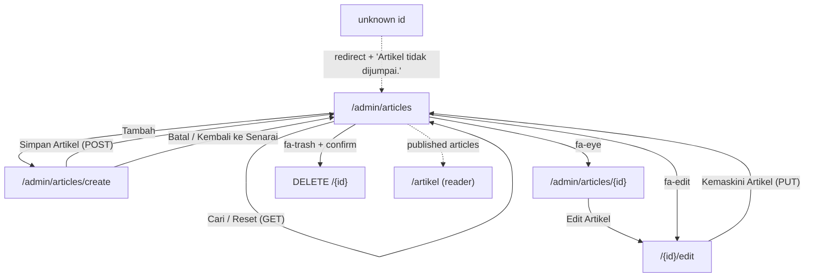
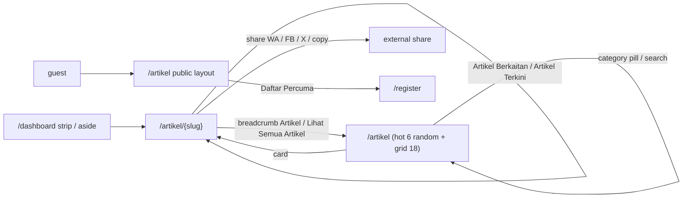
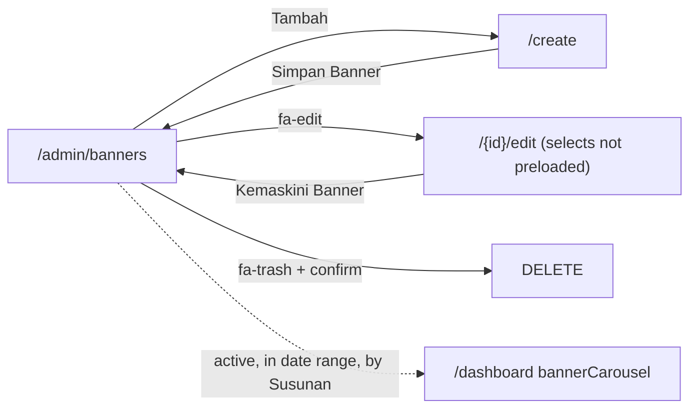
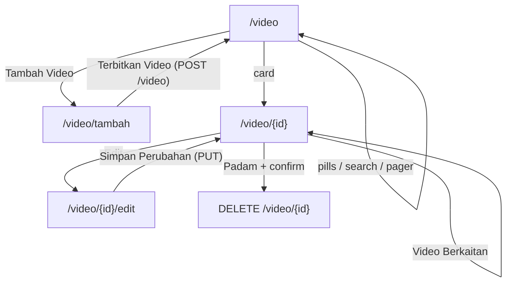
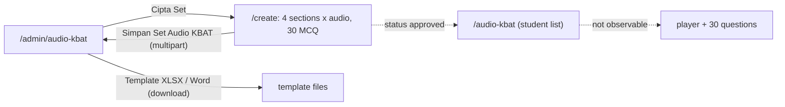
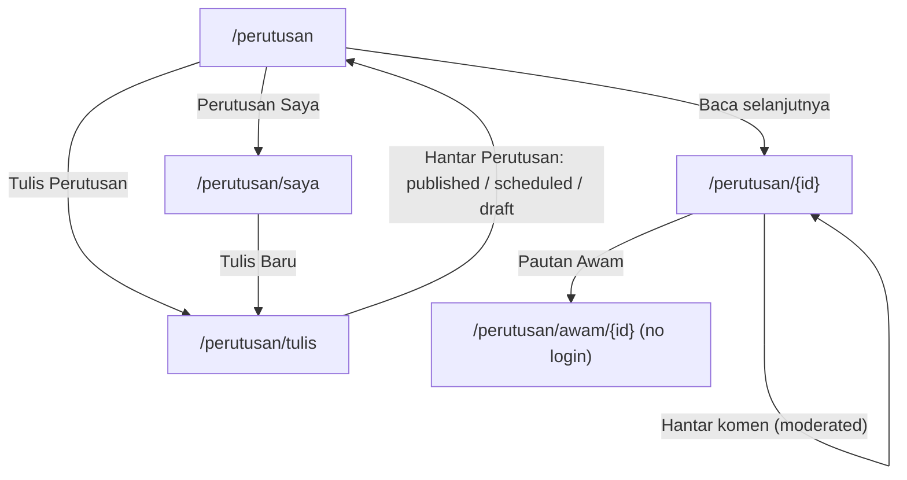

# M09 — Content: Articles, Notes, Banners, Video, Audio KBAT, Perutusan, Panduan (Discovery)

- **Source:** live read-only walk-through of https://prestasiplus.my on 2026-09-25 with the admin account (browser lane 3, `playwright3`), plus a cookie-less guest context for the public pages.
- **Screenshots:** `docs/discovery/img/M09/` (49 files). Every page was masked in the DOM before capture (M09MASK + `tools/sanitize.js`). The admin and user shells and design tokens are in [00-global-ui.md](00-global-ui.md) and are not repeated here.
- **Language:** UI copy is quoted in exact Bahasa Melayu (English where the live site uses English, e.g. the Laravel paginator "Showing 1 to 20 of 72 results", "Approved", "Draft", "Pending Review").
- **Personal data:** author and poster display names (article authors other than "Admin PRESTASI+", perutusan posters) are replaced with `<person>`; teacher names inside copy ("Cikgu X", "Chekgu X") with `Cikgu <name>`. `tools/sanitize.js` additionally replaced the logged-in account's own display name "Admin PRESTASI+" with `<name>` on user-portal pages (it is the platform account, not a person; this document quotes it where it matters). Article, video and perutusan titles are public content and are quoted.
- **Element inventory:** 2,054 content elements over 28 screens and 136 captured UI states (S27 includes the 46 `/login` elements of its guest redirect; S28 added in a top-up), IDs `EL-M09-S#-nnn`, in `docs/discovery/inventory/M09/<S#-key>.json`. Reconciliation, crawl and limits: `docs/discovery/inventory/M09/_summary.md`. The inventory JSON is authoritative for attributes and conditions.
- **Safety:** nothing was submitted, uploaded, liked, commented or deleted. "Simpan Artikel", "Kemaskini Artikel", "Simpan Banner", "Kemaskini Banner", "Simpan Set Audio KBAT", "Terbitkan Video", "Simpan Perubahan", "Hantar Perutusan", "Hantar", "Suka", "Cinta", "Terima Kasih", every "Padam" and every file input / drop zone were never used. The two template downloads were not opened. See §9 for the view-counter handling.

---

## 1. Overview

M09 is the platform's content layer. It has two halves.

**Admin panel (admin shell, see 00-global-ui.md):**

| # | Route | Tab title · header title / subtitle | Purpose |
|---|---|---|---|
| S1 | `/admin/articles` | "Pengurusan Artikel - Admin PRESTASIPLUS" · "Pengurusan Artikel" / "Urus artikel dan konten pendidikan" | Article list, filters, delete |
| S2 | `/admin/articles/create` | "Tambah Artikel - Admin PRESTASIPLUS" · "Tambah Artikel Baru" / "Cipta artikel pendidikan baharu" | Create article (not submitted) |
| S3 | `/admin/articles/{id}/edit` | "Edit Artikel - Admin PRESTASIPLUS" · "Edit Artikel" / "Kemaskini artikel" | Edit article (not submitted) |
| S4 | `/admin/articles/{id}` | "Lihat Artikel - Admin PRESTASIPLUS" · {title} / "Paparan artikel" | Admin preview |
| S5 | `/admin/notes` | "Pengurusan Nota - Admin PRESTASIPLUS" · "Pengurusan Nota" / "Urus nota pembelajaran dan sumber belajar" | Note list |
| S6 | `/admin/notes/create` | "500 - Ralat Pelayan \| PRESTASIPLUS" | **HTTP 500** (D-1) |
| S7 | `/admin/notes/{id}/edit` | same | **HTTP 500** (D-1) |
| S8 | `/admin/notes/{id}` | "Lihat Nota - Admin PRESTASIPLUS" · {title} / "Paparan nota" | Admin preview |
| S9 | `/admin/banners` | "Pengurusan Banner - Admin PRESTASIPLUS" · "Pengurusan Banner" / "Urus banner promosi dan pengumuman" | Banner list |
| S10 | `/admin/banners/create` | "Tambah Banner - Admin PRESTASIPLUS" · "Tambah Banner Baru" / "Cipta banner promosi atau pengumuman" | Create banner |
| S11 | `/admin/banners/{id}/edit` | "Edit Banner - Admin PRESTASIPLUS" · "Edit Banner" / "Kemaskini maklumat banner" | Edit banner |
| S12 | `/admin/audio-kbat` | "Set Audio KBAT" · **"Dashboard" / "Selamat datang, Admin"** (D-9) | Audio KBAT set list |
| S13 | `/admin/audio-kbat/create` | "Cipta Set Audio KBAT" · **"Dashboard" / "Selamat datang, Admin"** (D-9) | Create a 30-question audio set |
| S14 | `/admin/tools/screenshots` | "Upload Screenshot - Admin PRESTASIPLUS" · "Upload Screenshot" / "Tool admin untuk upload & urus gambar (private)" | Image upload tool |

**User portal (user shell) and public pages:**

| # | Route | Tab title · header title / subtitle | Layout |
|---|---|---|---|
| S15 | `/artikel` | "PRESTASIPLUS - Platform Latih Tubi Nasional" · "Artikel" / "Tips belajar, berita pendidikan, motivasi dan panduan" | user shell when logged in; **public layout for guests** ("Artikel — PRESTASIPLUS") |
| S16 | `/artikel/{slug}` | "PRESTASIPLUS - Platform Latih Tubi Nasional" · {title} / "Artikel" | user shell (guest not opened, §9) |
| S17 | `/video` | "Video Pembelajaran - PRESTASIPLUS" · "Video Pembelajaran" / "Tonton video motivasi, tutorial dan tips peperiksaan" | user shell; **public layout for guests** ("Video Pembelajaran — PRESTASIPLUS") |
| S18 | `/video/{id}` | "{title} - Video PRESTASIPLUS" · "Video" / {title} | user shell |
| S19 | `/video/{id}/edit` | "Edit Video - {title}" · "Edit Video" / {title} | user shell |
| S20 | `/video/tambah` | "Tambah Video" · "Tambah Video" / "Kongsi video pembelajaran dari YouTube, Vimeo dan lain-lain" | user shell |
| S21 | `/audio-kbat` | "Audio KBAT" · **"Dashboard" / "Selamat datang kembali"** (D-9) | user shell |
| S22 | `/perutusan` | "Perutusan" · "Perutusan" / "Kata-kata aluan dan maklumat penting dari pihak pengurusan" | user shell |
| S23 | `/perutusan/{id}` | {title} · "Perutusan" / "Sekolah" | user shell |
| S24 | `/perutusan/tulis` | "Tulis Perutusan" · "Tulis Perutusan" / "Sampaikan kata-kata aluan atau maklumat penting" | user shell |
| S25 | `/perutusan/saya` | "Perutusan Saya" · "Perutusan Saya" / "Urus semua perutusan yang anda telah tulis" | user shell |
| S26 | `/panduan` | "Panduan Pengguna — PRESTASIPLUS" | **standalone layout** (own top bar, no sidebar), same for guest and logged-in |
| S27 | `/pusat-tuisyen/panduan` | same | same page as S26; **guest → `/login`** |
| S28 | `/perutusan/awam/{id}` (added in top-up) | "{title} — PRESTASIPLUS" · no shell header | **standalone public layout** (own dark top bar and footer), guest |

Layout rule (OBSERVED): the **admin** sees `/audio-kbat`, `/artikel`, `/video` and `/perutusan` in the **user shell**, not the admin shell. The admin shell is used only for `/admin/*`. Guests get a separate public layout on `/artikel` and `/video` and are redirected to `/login` on `/audio-kbat`, `/perutusan*`, `/video/tambah`, `/pusat-tuisyen/panduan` and `/admin/*`. `/panduan` is public.

Entry points:
- Admin sidebar (00-global-ui.md): collapsible group **"Kandungan"** with "Banner" (`/admin/banners`), "Artikel" (`/admin/articles`), "Nota" (`/admin/notes`), "Push Notifikasi" (`/admin/notifications`, M22) and `fa-cloud-upload-alt` "Upload Screenshot" (`/admin/tools/screenshots`; the same link is repeated in group "Sistem"); `fa-headphones` "Audio KBAT" (`/admin/audio-kbat`) is a separate item outside these groups.
- User sidebar / drawer: `fa-scroll` "Perutusan", `fa-newspaper` "Artikel", `fa-play-circle` "Video", `fa-headphones` "Audio KBAT", `fa-book` "Panduan" (→ `/panduan`); a hidden (role-dependent) `fa-book` "Panduan" → `/pusat-tuisyen/panduan` for tuition-centre users. "Sumbang Artikel" (`/guru/artikel`) is the teacher contribution page and belongs to **M10** (recorded as a link only; it lists articles and links to `/guru/artikel/cipta` "Tulis Artikel Baru" and `/guru/artikel/{id}/edit`).
- Dashboard (M05 S1, `/dashboard`): the announcement carousel `bannerCarousel(5)` shows the 5 banners of S9, and the "📚 Artikel Untuk Kamu" strip plus the desktop aside "Artikel Terkini" show the 5 newest published articles (see §2.16 and §4 R-4).

**Content model at a glance (OBSERVED):**

| Content | Count (live) | Where the count is shown | Definition |
|---|---|---|---|
| Articles | 72 | S1 "Jumlah: 72 artikel" (matches filters); S15 pager "Showing 1 to 18 of 72 results" | S1 = all articles matching the filters (draft + published). S15 = published only (all 72 are published; 0 drafts). |
| Featured articles | 13 | S1 title star `fa-star` (title "Featured"); S15 "HOT" chip; S16 "Pilihan" chip | `is_featured = 1` |
| Notes | 10 | S5 "Jumlah: 10 nota" | all notes matching the filters |
| Banners | 5 | S9 "Jumlah: 5 banner" | all banners (no filter, no pager) |
| Audio KBAT sets | 0 | S12 stat cards "Set 0 / Approved 0 / Draft/Pending 0 / Soalan 0" | global (not filtered) |
| Videos | 2260 | S17 pill "Semua (2260)" and pager "of 2260 results" | videos visible to the viewer, filtered by the search (see R-9) |
| Perutusan | 3 | (no count shown) | posts visible to the viewer |
| Screenshot files | 0 | S14 "Jumlah: 0 fail" | files in the private upload folder |

---

## 2. Screens

### 2.1 S1 — `/admin/articles` "Senarai Artikel"

Screenshots: `admin-articles-desktop.png`, `-tablet.png`, `-mobile.png`, `admin-articles-empty.png`, `admin-articles-not-found-flash.png`.

- **Filter card** (GET form to `/admin/articles`, no auto-submit):
  - input `search` placeholder "Cari artikel...";
  - select `category`: `all` "Semua Kategori" (default), `TIPS_BELAJAR` "Tips Belajar", `BERITA` "Berita", `MOTIVASI` "Motivasi", `PANDUAN_IBU_BAPA` "Panduan Ibu Bapa", `PANDUAN_GURU` "Panduan Guru", `KEJAYAAN` "Kejayaan", `UMUM` "Umum";
  - select `published`: '' "Semua Status", `1` "Diterbitkan", `0` "Draf";
  - button `fa-search` "Cari" (submit) and link "Reset" (→ `/admin/articles`, slate-100 background). Selects keep the submitted values after the reload.
- **List card:** h2 "Senarai Artikel", "Jumlah: {n} artikel", button-link `fa-plus` "Tambah" (→ create).
- **Table** columns (rendered uppercase): "Tajuk", "Kategori", "Tahap", "Status", "Views", "Tarikh", "Tindakan".
  - Tajuk: amber `fa-star` (title "Featured") before the title when featured; title (truncated with "..." in the list, e.g. "Belajar Sains: Cara Ingat Nama Saintifik dengan Mu..."); second line "Oleh: {author}" (`<person>` in captures, or "Admin PRESTASI+").
  - Kategori: pill (blue-100 bg `oklch(0.932 0.032 255.585)`, blue-700 text `oklch(0.488 0.243 264.376)`).
  - Tahap: raw stored value, e.g. "DARJAH_4", "SEMUA" (not the form label, D-6).
  - Status: pill `fa-check-circle` "Diterbitkan" (emerald-100 `oklch(0.95 0.052 163.051)` / emerald-700 `oklch(0.508 0.118 165.612)`); a draft pill is not observable (0 drafts).
  - Views: integer (e.g. 596). Tarikh: `dd/mm/yyyy` (the created date; S16 shows a different, earlier publish date).
  - Tindakan: `fa-eye` (title "Lihat", blue-600) → S4; `fa-edit` (title "Edit") → S3; `fa-trash` (title "Padam") submit of a DELETE form with `onsubmit="return confirm('Adakah anda pasti mahu padam artikel ini?')"` (native confirm; not clicked).
- **Empty state** (e.g. `?published=0`, `?search=zzzqqq`): one colspan row, `fa-inbox` + "Tiada artikel dijumpai.", "Jumlah: 0 artikel".
- **Flash** (after `/admin/articles/9999` or `/admin/articles/9999/edit` or `/admin/articles/categories`): red box `fa-exclamation-circle` "Artikel tidak dijumpai." (bg red-50 `oklch(0.971 0.013 17.38)`, text red-700 `oklch(0.505 0.213 27.518)`, border red-200) above the list.
- **Pager:** Laravel paginator, 20 per page. From sm: "Showing 1 to 20 of 72 results" + numbered links + prev/next chevrons; below sm: "« Previous" / "Next »". **The pager drops the filters** (OBSERVED: on `?category=TIPS_BELAJAR&page=2` the links are `/admin/articles?page=1`) (D-5).
- **Sort (OBSERVED):** created date descending, ties by id ascending: page 1 = ids 10–29 (22/02/2026), …, page 4 = ids 70–72, then id 9 (10/02/2026), then ids 1–8 (06/02/2026).
- Counts observed: all 72; `MOTIVASI` 14; `TIPS_BELAJAR` 21 (page 2 has 1 row); `search=sifir` 2; `published=1` 72; `published=0` 0.

### 2.2 S2 — `/admin/articles/create` "Tambah Artikel Baru" (not submitted)

Screenshots: `admin-article-create.png`, `admin-article-create-mobile.png`.

- Link `fa-arrow-left` "Kembali ke Senarai" (→ S1).
- Form `POST /admin/articles` (no `novalidate`; native `required` bubbles):
  - "Tajuk Artikel *" `title` text, required, placeholder "cth: 10 Tips Belajar Matematik";
  - "Ringkasan" `excerpt` textarea, placeholder "Ringkasan artikel";
  - "Kandungan *" `content` textarea (rows 15), required, placeholder "Tulis kandungan artikel di sini...". The page loads **CKEditor 5 41.4.2** from `cdn.ckeditor.com` with toolbar heading (options "Perenggan", "Tajuk", "Sub-tajuk") | bold italic underline | bulleted/numbered list | link blockQuote | undo redo, `language: 'ms'`, but the script is **blocked by the Content-Security-Policy** (`ReferenceError: ClassicEditor is not defined`), so the editor is a **plain textarea** and articles are stored as raw HTML typed by hand (D-2);
  - "URL Gambar Utama" `featured_image` url, placeholder "https://example.com/image.jpg" (no upload);
  - "Kategori *" `category` select, required: '' "Pilih kategori" + the 7 categories;
  - "Tahap Pendidikan" `grade_level` select: `SEMUA` "Semua" (default), `DARJAH_1`…`DARJAH_6` "Darjah 1"…"Darjah 6" (primary only);
  - checkboxes "Terbitkan Sekarang" `is_published` (value 1, unchecked) and "Artikel Featured" `is_featured` (value 1, unchecked).
- Footer: link "Batal" (→ S1, discards: it is a plain link, nothing is saved) and submit `fa-save` "Simpan Artikel".
- Validation (OBSERVED, native): empty form invalid = `title, content, category`; with title and content filled only `category` remains.
- Layout: at 375, 768 and 1280 "Batal" (78×44) sits left of "Simpan Artikel" (181×44) on one row, right-aligned.

### 2.3 S3 — `/admin/articles/{id}/edit` "Edit Artikel" (not submitted)

Screenshot: `admin-article-edit.png`.

- Same fields as S2, form `POST /admin/articles/{id}` with `_method=PUT`, submit `fa-save` "Kemaskini Artikel", "Batal" → S1.
- **Preloads saved values (OBSERVED):** #10 `category=TIPS_BELAJAR`, `grade_level=DARJAH_4`, "Terbitkan Sekarang" and "Artikel Featured" checked; #11 `DARJAH_5`, featured unchecked. The category select has **no placeholder option** on edit. `content` holds the raw HTML. Form valid as loaded.
- Unknown id → redirect to S1 with the flash "Artikel tidak dijumpai.".

### 2.4 S4 — `/admin/articles/{id}` (admin preview)

Screenshots: `admin-article-show.png`, `admin-article-show-mobile.png`.

- "Kembali ke Senarai"; card with h1 {title}; meta `fa-user` {author}, `fa-calendar` "22 Feb 2026", `fa-eye` "{n} tontonan"; pills `fa-check-circle` "Diterbitkan" (emerald) and, when featured, `fa-star` "Featured" (amber-100 `oklch(0.962 0.059 95.617)` / amber-700 `oklch(0.555 0.163 48.998)`); excerpt; body; button `fa-edit` "Edit Artikel" (indigo-600 `oklch(0.585 0.233 277.117)`, white) → S3.
- **The body is printed as escaped HTML** (the text starts "<h2>Apa Itu Teknik Pomodoro?</h2>
…") instead of rendered (D-3). At 375 the long unbroken string makes the **page scroll sideways** (424 px > 375 px) (D-4).
- Opening S4 does **not** increase the view count (OBSERVED 595 before and after).

### 2.5 S5 — `/admin/notes` "Senarai Nota"

Screenshots: `admin-notes-desktop.png`, `admin-notes-mobile.png`.

- Filter card (GET): `search` "Cari nota..."; `subject`: `all` "Semua Subjek", `matematik` "Matematik", `sains` "Sains", `bahasa_melayu` "Bahasa Melayu", `bahasa_inggeris` "Bahasa Inggeris", `sejarah` "Sejarah"; `note_type`: `all` "Semua Jenis", `summary` "Ringkasan", `mind_map` "Mind Map", `flashcard` "Flashcard", `cheat_sheet` "Cheat Sheet", `full_notes` "Nota Penuh"; "Cari", "Reset".
- List card "Senarai Nota", "Jumlah: {n} nota", `fa-plus` "Tambah Nota" (→ S6, HTTP 500).
- Table: "Tajuk", "Subjek", "Jenis", "Tahap", "Status", "Statistik", "Tindakan".
  - Tajuk + "Oleh: Admin PRESTASI+"; Subjek pill uppercase (e.g. "MATEMATIK", indigo-100 `oklch(0.93 0.034 272.788)` / indigo-700 `oklch(0.457 0.24 277.023)`); Jenis plain text as stored ("FORMULA", "RINGKASAN", "LENGKAP", "TIPS_TRICKS"); Tahap "DARJAH 2"; Status "Diterbitkan"; Statistik `fa-eye` "0 tontonan" / `fa-download` "0 muat turun"; Tindakan eye / edit / trash (confirm "Adakah anda pasti mahu padam nota ini?").
- **Filter defect (D-7):** `subject=matematik` works (3 rows), but `note_type` values (`summary`, …) do not match stored types (`RINGKASAN`, `FORMULA`, `LENGKAP`, `TIPS_TRICKS`): `?note_type=summary` returns "Tiada nota dijumpai." although 5 notes are "RINGKASAN". `search=sifir` → 1.
- 10 notes, one page (no pager). Order observed = ids 1–10.
- Unknown id `/admin/notes/9999` → redirect to S5 **without** a flash message.

### 2.6 S6 / S7 — `/admin/notes/create`, `/admin/notes/{id}/edit` (live: HTTP 500)

Screenshot: `admin-note-create-500.png`. Both return the error page "500" ⚙️ "Ralat Pelayan" — "Sesuatu tidak kena di pihak kami. Pasukan teknikal telah dimaklumkan. Sila cuba sebentar lagi." — "Halaman Utama" (→ `/`) and "Cuba Semula" (`javascript:location.reload()`), "PRESTASIPLUS". Notes can therefore not be created or edited on live (D-1). Fields are not observable (§8 OQ-1).

### 2.7 S8 — `/admin/notes/{id}` (admin preview)

Screenshot: `admin-note-show.png`. Same card as S4: h1, `fa-user` "Admin PRESTASI+", `fa-calendar` "06 Feb 2026", `fa-eye` "0 tontonan", `fa-download` "0 muat turun", "Diterbitkan", summary line, detail grid "Subjek" MATEMATIK / "Tahap" DARJAH 2 / "Jenis" FORMULA, body printed as escaped HTML (D-3), button `fa-edit` "Edit Nota" (→ S7, HTTP 500).

### 2.8 S9 — `/admin/banners` "Senarai Banner"

Screenshots: `admin-banners-desktop.png`, `admin-banners-mobile.png`.

- "Senarai Banner", "Jumlah: 5 banner", `fa-plus` "Tambah". No filter, no search, no pager.
- Table: "#", "Tajuk", "Jenis", "Sasaran", "Susunan", "Mula", "Tamat", "Aktif?", "Tindakan".
  - "#" = row number; Tajuk = title + description truncated to 50 characters + "..."; Jenis pill (slate-100 `oklch(0.968 0.007 247.896)` / slate-700 `oklch(0.372 0.044 257.287)`) with the stored value "HERO" / "FEATURE" / "PROMOTIONAL" / "ANNOUNCEMENT"; Sasaran plain "ALL" / "STUDENT"; Susunan square pill (`rounded-md`) "1"…"5"; Mula / Tamat `dd/mm/yyyy`; Aktif? pill `fa-check-circle` "Aktif" (emerald); Tindakan `fa-edit` (title "Edit", indigo-600) and `fa-trash` (confirm "Adakah anda pasti mahu padam banner ini?"). No "view" action.
- **Live data (sorted by Susunan):** 1 HERO/ALL "Selamat Datang ke PRESTASIPLUS"; 2 FEATURE/STUDENT "2,000+ Soalan Latihan Tersedia!"; 3 PROMOTIONAL/STUDENT "Cabaran Mingguan: Siapa Paling Rajin?"; 4 ANNOUNCEMENT/ALL "Tips untuk Ibu Bapa: Bimbing Anak Belajar"; 5 FEATURE/STUDENT "Kumpul Badge & Tunjukkan Kehebatan!" — all 01/01/2026–31/12/2026, active, each with an Unsplash `image_url`. Full descriptions are in M05 discovery §2.1 item 2.
- Unknown id → redirect with flash "Banner tidak dijumpai." (`animate-fade-in`).

### 2.9 S10 — `/admin/banners/create` "Tambah Banner Baru" (not submitted)

Screenshots: `admin-banner-create-external.png`, `admin-banner-create-mobile.png`.

- "Kembali ke Senarai"; form `POST /admin/banners`, Alpine `{ linkType: 'none' }`:
  - "Tajuk Banner *" `title` required, placeholder "cth: Promosi SPM 2024";
  - "Penerangan" `description` textarea, placeholder "Penerangan ringkas tentang banner";
  - "URL Gambar" `image_url` url, placeholder "https://example.com/image.jpg", hint `fa-info-circle` "Masukkan URL gambar banner";
  - "Jenis Banner *" `banner_type` required: '' "Pilih jenis banner", `hero` "Hero", `promo` "Promo", `announcement` "Pengumuman", `event` "Acara";
  - "Jenis Pautan" `link_type` (`x-model="linkType"`): `none` "Tiada Pautan" (default), `subject` "Subjek", `quiz` "Kuiz", `article` "Artikel", `external` "Pautan Luar";
  - `external_url` url, placeholder "https://example.com", shown only when `linkType === 'external'` (no label). Choosing Subjek / Kuiz / Artikel reveals **no** target picker (D-8). Switching back to "Tiada Pautan" only hides the field; the typed URL is kept in the input.
  - "Sasaran Penonton *" `target_audience` required: `all` "Semua" (default), `student` "Pelajar", `teacher` "Guru", `admin` "Admin";
  - "Susunan Paparan" `display_order` number min 0 (prefilled `0`), hint `fa-sort` "Nombor lebih kecil akan dipaparkan dahulu";
  - "Tarikh Mula" `start_date` date, "Tarikh Tamat" `end_date` date;
  - checkbox "Banner Aktif" `is_active` (checked) + "Tandakan untuk memaparkan banner".
- Footer "Batal" (link → S9) | `fa-save` "Simpan Banner"; same row at all widths.
- Native validation: empty form invalid = `title, banner_type`.

### 2.10 S11 — `/admin/banners/{id}/edit` "Edit Banner" (not submitted)

Screenshot: `admin-banner-edit.png`.

- Same form, `PUT /admin/banners/{id}`, submit "Kemaskini Banner". Title, description, image URL, order, dates and the active box are preloaded.
- **Selects are NOT preloaded (D-6):** stored values are upper case (`HERO`, `FEATURE`, `PROMOTIONAL`, `ANNOUNCEMENT`; `ALL`, `STUDENT`; link type `NONE`) but the options are lower case and the create set differs (`hero/promo/announcement/event`). On load "Jenis Banner" shows "Pilih jenis banner" (form invalid: `banner_type`), "Jenis Pautan" shows "Tiada Pautan" while Alpine `linkType` = `"NONE"`, and "Sasaran Penonton" shows "Semua" even for a STUDENT banner. Saving unchanged would fail validation, and after choosing a type it would silently reset the audience to "Semua".

### 2.11 S12 — `/admin/audio-kbat` "Set Audio KBAT"

Screenshots: `admin-audio-kbat.png`, `admin-audio-kbat-mobile.png`.

- Admin shell, but the header reads "Dashboard" / "Selamat datang, Admin" (D-9). Content:
  - pill `fa-headphones` "Ujian Mendengar" (amber-50 `oklch(0.987 0.022 95.277)` / amber-700), h1 "Set Audio KBAT", "Senarai set soalan audio fixed sequence, bukan rawak.";
  - links `fa-file-excel` "Template XLSX" (`/admin/audio-kbat/template`), `fa-file-word` "Template Word" (`/admin/audio-kbat/template-word`) — downloads, **not opened** — and `fa-plus` "Cipta Set" (→ S13);
  - guide box "Panduan ringkas untuk cikgu yang ingin sumbang soalan Audio KBAT" with two paragraphs (Appendix B);
  - 4 stat cards "Set", "Approved", "Draft/Pending", "Soalan" (all 0; global, not filtered);
  - filter (GET): `education_level_id` '' "Semua Tahap", 1–6 "Darjah 1"–"Darjah 6", 7–11 "Tingkatan 1"–"Tingkatan 5"; `subject_id` '' "Semua Subjek" + 31 subjects sorted A–Z (Appendix A.4); `status` '' "Semua Status", `draft` "Draft", `pending_review` "Pending Review", `approved` "Approved", `archived` "Archived"; `search` "Cari tajuk/sumber..."; submit `fa-search` "Tapis". The selects keep their values after filtering.
  - empty state `fa-headphones` "Belum ada set Audio KBAT." (also with filters). No set exists, so list rows, row actions and pager are not observable (§9).

### 2.12 S13 — `/admin/audio-kbat/create` "Cipta Set Audio KBAT" (not submitted)

Screenshots: `admin-audio-kbat-create-top.png`, `admin-audio-kbat-create-mobile.png`.

- `fa-arrow-left` "Kembali"; h1 "Cipta Set Audio KBAT"; "Format fixed: 4 audio section, 30 soalan MCQ, soalan dipaparkan serentak mengikut section."; box "Apa yang cikgu perlu sediakan?" (two paragraphs) with "Template Word" / "Template XLSX".
- Form `POST /admin/audio-kbat`, `multipart/form-data`:
  - **"Maklumat Set":** "Tajuk Set" `title` required, placeholder "Contoh: BM T4 Ujian Mendengar Set 1"; "Tahap" `education_level_id` required ('' "Pilih Tahap" + 11 levels); "Subjek" `subject_id` required ('' "Pilih Subjek" + 31); "Status" `status`: `approved` "Approved" (**default**), `pending_review` "Pending Review", `draft` "Draft"; "Sumber / Penyumbang" `source_label` placeholder "Contoh: Cikgu <name>" (a teacher-name example, masked); "Arahan Umum" `instructions` textarea, placeholder "Dengar audio bagi setiap bahagian dan jawab semua soalan.".
  - **4 section cards** "Bahagian 1 · Soalan 1-8", "Bahagian 2 · Soalan 9-16", "Bahagian 3 · Soalan 17-24", "Bahagian 4 · Soalan 25-30", each "Audio section ini akan kekal bersama semua soalan dalam range ini." with "Tajuk Audio" `sections[n][title]` (prefilled "Audio 1"…"Audio 4"), "Fail Audio" `sections[n][audio]` file (accept `.mp3,.m4a,.wav,.ogg,.aac,.mp4,audio/*`, **not required**), "Transkrip Audio Untuk Audit" `sections[n][transcript]` textarea, placeholder "Wajib digalakkan untuk semakan admin.".
  - **30 question blocks** (identical except the number; the inventory keeps block 1, `meta.repeats` = 30): h "Soalan {n}", pill "KBAT Audio"; "Teks Soalan" `questions[n][question_text]` required; "Pilihan A"–"Pilihan D" `questions[n][option_a..d]` required; "Jawapan" `questions[n][correct_answer]` required (A/B/C/D, default A); "Markah" `questions[n][marks]` number 1–20 (default 1); "KBAT Level" `questions[n][kbat_level]` number 1–5 (default 3); "DSKP SP ID" `questions[n][dskp_sp_id]` number, placeholder "Optional"; "Skema / Penjelasan" `questions[n][explanation]` textarea.
  - Sticky bottom-right submit `fa-save` "Simpan Set Audio KBAT". **No "Batal" button** (only "Kembali" at the top).
- Native validation: 153 required fields invalid on the empty form (title, level, subject and 5 × 30 question fields).
- At 375 the submit button (254×48) floats bottom-right over the content (sticky).

### 2.13 S14 — `/admin/tools/screenshots` "Upload Screenshot"

Screenshot: `admin-screenshots.png`.

- Card "Upload Gambar": "Format: JPG, PNG, GIF, WebP, BMP. Maks 10MB setiap fail."; form `POST /admin/tools/screenshots` multipart with a hidden file input `files[]` (`accept="image/*"`, multiple) whose `onchange` **submits the form immediately**; drop zone (`onclick` opens the picker, `ondragover` adds `border-indigo-400 bg-indigo-50`, drop submits) `fa-images` "Klik atau seret fail ke sini" / "Boleh pilih banyak fail"; tip "Tip: guna nama fail yang ringkas. Sistem akan auto-sanitize nama fail.".
- Card "Fail Sedia Ada": "Jumlah: 0 fail", empty "Tiada fail lagi.". The file list, copy-link and delete actions are not observable (no file; nothing uploaded).

### 2.14 S15 — `/artikel` (reader list)

Screenshots: `artikel-desktop.png`, `-tablet.png`, `-mobile.png`, `artikel-category.png`, `artikel-empty.png`.

Logged-in (user shell):
1. **"Artikel Paling Hangat"** — 6 cards chosen **at random on every load** (different sets on each visit, OBSERVED) from featured and popular articles; each card has a top gradient panel (purple-400 → pink-400 → orange-400) with 📰 and a badge `fa-star` **"PILIHAN"** (featured) or `fa-fire` **"POPULAR"**; category chip; title (2 lines); excerpt (2 lines); author initial circle + name; relative date ("8 bulan yang lepas"). **Shown only without search and category** (hidden on `?category=` and `?search=`).
2. **Search** (GET `/artikel`): input `search` "Cari artikel..."; when a category is active a hidden `category` input keeps it.
3. **Category pills** (links): "Semua" (→ `/artikel`), "Tips Belajar", "Berita", "Motivasi", "Panduan Ibu Bapa", "Panduan Guru", "Kejayaan", "Umum" (→ `?category=CODE`; they keep `search`). Active pill: gradient 135° `rgb(59,130,246)` → `rgb(139,92,246)` → pink, white text; inactive: white with gray-600 text `oklch(0.446 0.03 256.802)`.
4. **Grid** — 18 per page, 1 col → 2 (sm) → 3 (lg) → 6 (xl); card: gradient panel with 📰, category chip (gradient blue-500 → purple-500, white), `fa-star` **"HOT"** chip (amber-400 → orange-500) **when the article is featured** (13/13 OBSERVED), title, excerpt, author circle + name, views, relative date.
5. **Pager** keeps `category` and `search` (OBSERVED `?category=TIPS_BELAJAR&page=1`).
6. **Empty** (`?search=zzzqqq`): 🔍 "Tiada Artikel Dijumpai" / "Cuba ubah carian atau pilih kategori lain." / `fa-arrow-left` "Lihat Semua Artikel" (→ `/artikel`).

- Sort (OBSERVED, consistent with the dashboard strip and S16 "Artikel Terkini"): newest publish date first. Counts: all 72 (4 pages), BERITA 7, TIPS_BELAJAR 21 (2 pages), search "sifir" 2.

Guest (public layout, title "Artikel — PRESTASIPLUS"): top bar logo | "📰 Artikel" | "Log Masuk" (→ `/login`) | "Daftar Percuma" (→ `/register`); hero chip "Terkini & Menarik", h1 "Artikel Pilihan", "Tips belajar, berita pendidikan, motivasi dan panduan untuk pelajar Malaysia!" (the four topics bold); the same hot section (6 random), search placeholder "Cari artikel menarik..." with 🔍, "Pilih Kategori:" pills prefixed "✨"; the same grid (cards also show `fa-clock` date); CTA "Nak Baca Lebih Banyak?" / "Daftar percuma dan dapat akses penuh ke semua artikel, latih tubi interaktif, ganjaran menarik dan banyak lagi" / `fa-arrow-right` "Daftar Percuma Sekarang" / "100% Percuma • Tiada Kad Kredit Diperlukan"; footer "© 2026 PRESTASIPLUS by GCM Technologies Sdn Bhd. Hak Cipta Terpelihara." and links "Utama", "Artikel", "Video", "Log Masuk", "Daftar".

### 2.15 S16 — `/artikel/{slug}` (reader detail)

Screenshots: `artikel-detail-desktop.png`, `artikel-detail-mobile.png`. Captured once from live (+1 view), then from cache (§9).

- Breadcrumb `fa-th-large` "Dashboard" → `fa-newspaper` "Artikel" → {title truncated to 40 characters + "..."}.
- Chips: category (gradient blue → violet → pink), level "Darjah 4" (gradient lime → green), `fa-star` "Pilihan" when featured; h1 title; excerpt.
- Author card: initial circle "A", name "Admin PRESTASI+", `fa-calendar` "24 Dec 2025" • `fa-clock` "9 bulan yang lepas"; counters 👁️ "{n}" "Pembaca" and ❤️ "{n}" "Suka" (display only; **no like button** on this page).
- Rendered HTML body (h2/p/ol).
- "Kongsi Artikel Ini 🎉" / "Kongsi dengan kawan-kawan supaya mereka pun dapat belajar!": icon links WhatsApp (`https://wa.me/?text={title}+{url}`), Facebook (`sharer.php?u=`), Twitter (`intent/tweet?text=&url=`), and a `fa-link` button that copies `window.location.href` and shows "Link Disalin!" for 2 s.
- "📚 Artikel Berkaitan": 3 cards (📰, title, `fa-clock` relative date, 👁️ views) — same category.
- Desktop-only aside (lg): "Artikel Terkini" — 5 newest (`fa-newspaper`, title, date) and `fa-arrow-right` "Lihat Semua Artikel".
- Unknown slug → HTTP 404 "Halaman Tidak Dijumpai" page ("404", 🔍, "Maaf, halaman yang anda cari tidak wujud atau telah dipindahkan. Mungkin URL salah taip?", "Halaman Utama", "Mula Latihan" → `/latih-tubi`).
- **Every open increments "Pembaca"** (OBSERVED 595 → 596 on article #10).

### 2.16 Dashboard use of M09 content (M05 S1)

- `bannerCarousel(5)` renders the 5 S9 banners in Susunan order with the badge = stored type (HERO / FEATURE / PROMOTIONAL / ANNOUNCEMENT), title and description; no image is shown. The admin sees the STUDENT-targeted banners too (audience filtering for other roles not observable).
- "📚 Artikel Untuk Kamu" + "Lihat Semua" (→ `/artikel`) and the aside "Artikel Terkini" + "Lihat Semua Artikel" list the same 5 newest articles as S16's aside (OBSERVED: "AI Ini Apa Sebenarnya? …", "5 Tips Belajar Matematik …", "Cara Baca Buku Cerita …", "Sains Menyeronokkan …", "Panduan Ibu Bapa: Jadual Belajar …"). Owned by M05 (behaviour), fed by M09 data.

### 2.17 S17 — `/video` "Video Pembelajaran"

Screenshots: `video-desktop.png`, `video-mobile.png`, `video-empty.png`.

- Search (GET) `search` "Cari video...".
- **Category pills with counts:** "Semua (2260)" (→ `/video`), "Motivasi (3)", "Tutorial (12)", "Tips SPM (3)", "Ceramah (2242)" (→ `?category=motivasi|tutorial|tips-spm|ceramah`), "Lain-lain (0)". A pill whose count is 0 links to **`#`** (dead link, D-10). Counts follow the current search (`?search=zzzqqq` → "Semua (0)" and all pills "#"). Active pill: gradient 135° red `rgb(239,68,68)` → orange `rgb(249,115,22)`, white; inactive white / gray-600.
- **Subject pills** (only subjects that have videos under the current category/search): "Matematik (865)", "Sejarah (97)", "Matematik Tambahan (420)", "Fizik (779)", "Kimia (96)" (→ `?subject={id}`, keeping `category`, e.g. `?category=motivasi&subject=5` "Sejarah (1)").
  - (corrected after audit) The subject pills ignore the active subject: with `?subject=5` all five subject pills still show with their full counts (Matematik 865 → `?subject=3`, Sejarah 97, …), the Sejarah pill has no active style, and "Reset Subjek" (`fa-times`) → `/video` appears. The category pill links are then built subject first: `?subject=5&category=motivasi`, …; subject pill links under a category are `?category=motivasi&subject=5`. Order inside `?subject=5`: 2224, 2225, 2226, … 2247 (ascending id), "Showing 1 to 24 of 97 results". `?category=motivasi` lists 18, 17, 16. `?page=95` lists 2220–2223 ("Showing 2257 to 2260 of 2260 results").
- `fa-plus` "Tambah Video" (→ S20).
- **Grid** 24 per page: card = thumbnail (YouTube `hqdefault`; `onerror` swaps to a placeholder), hover overlay `fa-play`, platform chip "YouTube", title, uploader circle + name "Admin PRESTASI+" + role "Admin", "{n} tontonan", relative date ("6 bulan yang lepas").
- Pager (keeps `subject`, `category`, `search`): "Showing 1 to 24 of 2260 results", 1…10 … 94 95.
- Empty (search no match, or `?category=lain-lain`): 🎬 "Tiada Video Dijumpai" / "Cuba ubah carian atau pilih kategori lain." / "Lihat Semua Video".
- Sort (OBSERVED, stable between loads): not by id; ids interleave (2224, 64, 433, 825, 1020, 19, 2225, …); inside one subject ascending id (2224, 2225, …). INFERRED: `created_at` desc with bulk-import timestamps.
- Guest: public layout "Video Pembelajaran — PRESTASIPLUS", chip "VIDEO PEMBELAJARAN", "Tutorial, tips SPM, motivasi dan banyak lagi — semua dalam satu platform!", same pills/grid, CTA "Daftar percuma dan dapat akses penuh ke semua video, latih tubi interaktif, ganjaran menarik dan banyak lagi!" + "Daftar Percuma Sekarang", same footer as S15 guest. No "Tambah Video".

### 2.18 S18 — `/video/{id}` (detail)

Screenshot: `video-detail.png`. Captured once (+1 view: 120 → 121), then from cache.

- `fa-arrow-left` "Semua Video" / {title}; embedded player (`https://www.youtube.com/embed/{videoId}` iframe; not played); h1; "{n} tontonan" · "03 Mar 2026"; owner/admin actions `fa-pen` "Edit" (→ S19) and `fa-trash` "Padam" (DELETE `/video/{id}`, confirm "Padam video ini?"); chips `fa-youtube` "YouTube" (red-100 / red-700), category "Ceramah" (amber-100 `oklch(0.954 0.038 75.164)` / orange `oklch(0.553 0.195 38.402)`), `fa-book` subject "Sejarah" (indigo-100 / indigo-700); uploader circle "A", "Admin PRESTASI+", role "admin"; description (multi-line, credits the original YouTube teacher: "Kredit penuh kepada Cikgu <name> — …").
- "Video Berkaitan": 6 videos of the same subject (thumbnail, title, "{uploader} · {n} tontonan"), newest id first (2260, 2259, 2258, …).
- Unknown id → 404 page.

### 2.19 S19 — `/video/{id}/edit` "Edit Video" (not submitted)

Screenshot: `video-edit.png`. Back arrow (→ S18); h1 "Edit Video", "Kemaskini maklumat video"; form `PUT /video/{id}` with the S20 fields (labels "Penerangan", "Subjek" without "(opsional)"; category select has **no** placeholder); **preloaded** (`category=ceramah`, `subject_id=5`, visibility "Semua Pengguna"); the preview shows "Platform dikesan: Youtube" (stored spelling) and the thumbnail. Footer: `fa-save` "Simpan Perubahan" (left) and "Batal" (→ S18) — **order reversed** relative to the admin forms. Unknown id → 404.

### 2.20 S20 — `/video/tambah` "Tambah Video Baru" (not submitted)

Screenshots: `video-tambah-youtube.png`, `video-tambah-mobile.png`.

- Back arrow (→ `/video`); h1 "Tambah Video Baru", "Paste sahaja link video — kami akan buat selebihnya".
- Form `POST /video`, Alpine `videoForm()`:
  - `fa-link` "URL Video *" `video_url` url required, placeholder "https://www.youtube.com/watch?v=...", `@input.debounce.500ms="parseUrl()"`; hint `fa-info-circle` "Sokongan: YouTube, Vimeo, Dailymotion, TikTok, Facebook". Client-side detection: YouTube (`watch?v=`, `embed/`, `shorts/`, `youtu.be/`; thumbnail `img.youtube.com/vi/{id}/hqdefault.jpg`), Vimeo (no thumbnail), Dailymotion (thumbnail), TikTok (`tiktok.com`), Facebook (`facebook.com` + `video`); preview line `fa-check-circle` "Platform dikesan: {platform}". An unsupported URL shows nothing and is still accepted by the browser (only `type=url`).
  - "Tajuk Video *" `title` required, placeholder "Contoh: Tips Skor A+ Matematik SPM".
  - "Penerangan (opsional)" `description` maxlength 1000, placeholder "Terangkan secara ringkas tentang video ini...".
  - "Kategori *" `category` required: '' "Pilih kategori...", `motivasi` "Motivasi", `tutorial` "Tutorial", `tips-spm` "Tips SPM", `ceramah` "Ceramah", `lain-lain` "Lain-lain".
  - "Subjek (opsional)" `subject_id`: '' "Tiada subjek khusus" + 31 subjects in **id order** (1 Bahasa Melayu … 31 Sains Sukan; Appendix A.4).
  - "Siapa boleh lihat? *" `visibility` radio cards: `global` "Semua Pengguna" / "Boleh dilihat oleh semua" (checked) and `school` "Sekolah Saya" / "Tiada sekolah" — **disabled** for a user without a school (opacity 50 %, `pointer-events: none`; the click does nothing).
    - (corrected after audit) For the admin account `/profile` shows no school, while `/profile/edit` has a selected school in the "Maklumat Sekolah" card (Alpine `selectedSchool`, an SK in Johor, PPD KLUANG; hidden `school_id` bound to it). The video form nevertheless shows "Sekolah Saya" / "Tiada sekolah" disabled, so it reads a different school source than the profile form.
  - Uploader strip: circle "A", "Admin PRESTASI+ · Admin", `fa-info-circle` "Nama anda akan dipaparkan bersama video".
  - `fa-upload` "Terbitkan Video" (left) and "Batal" (→ `/video`) on one row at all widths.
- Native validation: empty = `video_url, title, category`. Inline script string "Maaf, berlaku ralat. Sila cuba semula." belongs to the shell chatbot.

### 2.21 S21 — `/audio-kbat` "Audio KBAT" (student)

Screenshot: `audio-kbat-student.png`.

- Header "Dashboard" / "Selamat datang kembali" (D-9). Hero: pill `fa-headphones` "Ujian Mendengar", h1 "Audio KBAT", "Dengar audio mengikut bahagian dan jawab soalan yang dipaparkan serentak. Set ini tidak dirawak supaya audio kekal selari dengan nombor soalan."
- **Visual defect (D-11), observed colours:** the hero's gradient classes (`from-slate-950 via-amber-900 to-orange-700`) are not in the CSS build, so the hero background is transparent (`rgba(0,0,0,0)`); the pill text is white on white-15 %, the paragraph is amber-100 `oklch(0.962 0.059 95.617)` on the pale page (unreadable), h1 renders slate-800 `rgb(30,41,59)`; the "Tapis" button's `bg-slate-900` is also missing, so it is **white text on white** (invisible).
  - (corrected after audit) The hero container itself carries `text-white` (`rounded-3xl bg-gradient-to-br from-slate-950 via-amber-900 to-orange-700 text-white …`) and the h1 is `text-2xl sm:text-4xl font-black` inside it; "Tapis" is `bg-slate-900 text-white`. The slate-800 h1 is the global heading style overriding the inherited white.
- Filter (GET): `education_level_id` ('' "Semua Tahap" + 11), `subject_id` ('' "Semua Subjek" + 31); `fa-search` "Tapis"; values kept.
- Empty `fa-headphones` "Belum ada set Audio KBAT yang approved." (only `approved` sets are listed, R-11). The player / question screen is not observable (§9).

### 2.22 S22 — `/perutusan` "Perutusan Rasmi"

Screenshots: `perutusan-desktop.png`, `perutusan-mobile.png`.

- Dark hero (slate-900 gradient) with a yellow scroll icon, h1 "Perutusan Rasmi" (white `rgb(255,255,255)`), "Maklumat & berita dari pihak pengurusan"; buttons `fa-pen-fancy` "Tulis Perutusan" (amber, → S24) and `fa-folder-open` "Perutusan Saya" (→ S25).
- Post cards (3 live, all by school principals): pinned cards have an amber left border and top-right `fa-thumbtack` "Disematkan" (text hidden below sm); author initials circle (e.g. "AD", "SA", "SM"), `<person>`, role pill "Pengetua" (uppercase, blue gradient), `fa-school` "Sekolah" (scope), relative date; h3 title; plain-text excerpt (~250 characters + "..."); "Video disertakan" (YouTube icon) when a video link exists; top reaction "👍 1" / "❤️ 5" (hidden when none); `fa-comment` "{n} komen"; `fa-eye` "{n} baca"; "Baca selanjutnya" `fa-arrow-right`.
- Order: pinned first, then newest (OBSERVED: #4 pinned, #2 pinned, #3).
- Live posts: #4 "Video Ucapan Selamat Hari Raya Dari Pihak Pengurusan SMK Bandar Seri Putra" (pinned, 👍 1, 3 baca), #2 "Ucapan Penghargaan & Ramadan – Menyambut Syawal dengan Hikmah" (pinned, 4 baca), #3 "Video Ucapan Selamat Hari Raya 2026" (❤️ 5, 55 baca). No empty state or pager observed.

### 2.23 S23 — `/perutusan/{id}` (detail)

Screenshot: `perutusan-detail.png`. Captured once, then from cache; the "baca" count stayed 3 (INFERRED: unique readers, or the admin is not counted).

- `fa-arrow-left` "Kembali ke senarai"; dark author header: initials "AD", `<person>`, pill "Pengetua" (blue-500/20 bg, blue-200 text), `fa-school` "Sekolah", "17 Mar 2026, 11:23PM", `fa-globe` "Awam" (public), `fa-thumbtack` "Disematkan".
- h1 title; rich HTML body (Quill output, e.g. Jawi/Arabic basmalah, centred lines, bold phrases).
- YouTube embed (when `youtube_url` set).
- Reactions: three POST forms to `/perutusan/{id}/react` with hidden `type` = `like` "👍 Suka {n}", `love` "❤️ Cinta", `thanks` "🙏 Terima Kasih" (`reaction-pill`; never clicked); `fa-eye` "{n} baca", `fa-comment` "{n} komen".
- "Pautan Awam (boleh kongsi tanpa login)": read-only input `https://prestasiplus.my/perutusan/awam/{id}` (click selects and copies) + `fa-whatsapp` "Kongsi ke WhatsApp" (`wa.me/?text={title} — Baca di PrestasiPlus: {public URL}`). Shown because the post is public.
  - (corrected after audit) A cookie-less `GET /perutusan/awam/4` answers **200** (public page, no login); the list still showed "3 baca" afterwards, so that GET did not count a read. Its layout is captured in S28 (added in top-up, §2.27).
- "Komen": form `POST /perutusan/{id}/comment`, textarea `body` required, maxlength 1000, placeholder "Tulis komen anda..."; note "Komen akan disemak sebelum dipaparkan" (moderated); submit "Hantar" (blue-600); empty "Belum ada komen".
- Unknown id → 404.

### 2.24 S24 — `/perutusan/tulis` "Tulis Perutusan" (not submitted)

Screenshots: `perutusan-tulis.png`, `perutusan-tulis-scheduled.png`, `perutusan-tulis-mobile.png`.

- Form `POST /perutusan/tulis` multipart:
  - "Skop Perutusan": read-only text **"Seluruh Malaysia (Kebangsaan)"** for the admin (scope derived from the author's role; INFERRED school / district / state scopes for other roles, §9).
  - "Tajuk Perutusan" `title` required, placeholder "cth: Perutusan Pengetua Semester 2 2026".
  - "Kandungan": **Quill 2.0.3** (snow theme, from jsDelivr — allowed by CSP) with placeholder "Tulis perutusan anda di sini..." and toolbar: header picker (H2, H3, Normal), bold, italic, underline, colour picker (35 swatches), ordered list, bullet list, align picker (left, center, right, justify), link, clean; plus a `fa-code` "HTML" toggle that swaps the editor for a raw HTML textarea (and back, pasting the HTML into Quill). The HTML is copied into hidden `body` on submit (`''` when only `

`). **The body is not required** (form valid with only a title).
  - "Gambar (maks 2MB setiap satu)": `images[]` (accept `image/*`), drop label "Klik untuk muat naik gambar" / "JPG, PNG, GIF - maks 2MB".
  - "Dokumen PDF (maks 5MB setiap satu)": `documents[]` (accept `.pdf`), "Klik untuk muat naik PDF" / "PDF sahaja - maks 5MB".
  - "Pautan Video YouTube (Pilihan)" `youtube_url` url, placeholder "https://www.youtube.com/watch?v=...".
  - checkboxes `fa-thumbtack` "Sematkan di atas (maks 2)" `is_pinned` and `fa-globe` "Jadikan Awam (boleh dibaca tanpa login)" `is_public` (both unchecked).
  - "Status Penerbitan" radio cards `status` (Alpine `{ status: 'published' }`): `published` "Terbit Sekarang" / "Terus dipaparkan" (default), `scheduled` "Jadualkan" / "Pilih tarikh & masa", `draft` "Draf" / "Simpan dahulu". "Jadualkan" reveals "Tarikh & Masa Penerbitan" `scheduled_at` (datetime-local, not required).
  - Footer "Batal" (→ `/perutusan`, 88×50) and `fa-paper-plane` "Hantar Perutusan" (wide) on one row at 375/768/1280.

### 2.25 S25 — `/perutusan/saya` "Perutusan Saya"

Screenshot: `perutusan-saya.png`. `fa-arrow-left` "Kembali" (→ S22), `fa-pen-fancy` "Tulis Baru" (→ S24), empty card "Anda belum menulis perutusan". The list of one's own posts (edit/delete/status) is not observable (§9).

### 2.26 S26 / S27 — `/panduan`, `/pusat-tuisyen/panduan` "Panduan Pengguna PRESTASIPLUS"

Screenshots: `panduan-desktop.png`, `panduan-guru.png`, `panduan-mobile.png`.

- **Standalone layout** (no sidebar, no `<main>`), identical HTML on both routes. Top bar: logo (→ `/`), links `fa-home` "Laman Utama" (→ `/`), `fa-newspaper` "Artikel" (→ `/artikel`), and for a logged-in user `fa-th-large` "Dashboard" (→ `/dashboard`) or for a guest `fa-sign-in-alt` "Log Masuk" + `fa-rocket` "Daftar Percuma". Below lg the links move into a `fa-bars` menu (`mobileOpen`).
- Hero 📖 "Panduan Pengguna PRESTASIPLUS" / "Pilih peranan anda untuk mula. Semua maklumat di hujung jari!".
- **Role tabs** (Alpine `panduanApp()`): 👨‍🎓 "Pelajar" "Darjah 1 – Tingkatan 5", 👩‍🏫 "Guru" "Guru Mata Pelajaran", 👪 "Ibu Bapa" "Pemantauan Anak", 🏫 "Admin Sekolah" "Pengetua / GPK", 📊 "PPD / JPN" "Pegawai Daerah / Negeri". Initial role = URL hash (`#pelajar|#guru|#ibubapa|#admin|#ppd`) or "pelajar"; clicking sets the hash (`history.replaceState`) and smooth-scrolls to the top. Active tab: border `rgb(99,102,241)` + shadow `rgba(99,102,241,0.25) 0 8px 20px`.
  - (corrected after audit) Source rule: `activeRole: window.location.hash.replace('#','') || 'pelajar'`. An empty hash → Pelajar; an unknown hash (e.g. `#xyz`) sets `activeRole` to that value, so no tab is active and no role panel shows (hero, help box and footer still render).
- **Per role:** a numbered "Cara …" step list, a feature grid, and an FAQ accordion (each item `{ open: false }`, `fa-chevron-down`, independent — several can be open). Full copy: Appendix A.6.
- Help box 💬 "Perlukan Bantuan Lanjut?" / "Hubungi pasukan sokongan kami untuk sebarang pertanyaan." with `fa-envelope` "E-mel Kami" (`mailto:support@prestasiplus.my`, obfuscated by Cloudflare) and `fa-whatsapp` "WhatsApp" (`https://wa.me/60123456789` — a placeholder number, D-12). Footer "© 2026 🇲🇾", logo, "Platform Latih Tubi Nasional".
- `/pusat-tuisyen/panduan` for a guest → `/login` (while `/panduan` is public).

### 2.27 S28 — `/perutusan/awam/{id}` public perutusan page (added in top-up)

Screenshots: `perutusan-awam-desktop.png`, `perutusan-awam-tablet.png`, `perutusan-awam-mobile.png`.

**Capture method:** opened **once** as a guest in a fresh cookie-less context (HTTP 200, no redirect). All 4 inventory states and the 3 screenshots were served from a route cache of that single response. The poster name is shown as `<person>` and the school name as `<school>`, using AWAMMASK in `tools/jobs/M09-topup.js` plus sanitize.js.

**Layout:**
- Standalone public page: no `<main>`, no sidebar, no user or admin shell. It is also different from the guest layout of `/artikel` and `/video` (different top bar, CTA and footer).
- Tab title "{title} — PRESTASIPLUS", e.g. "Video Ucapan Selamat Hari Raya Dari Pihak Pengurusan <school> — PRESTASIPLUS".
- Top bar: sticky dark `nav.top-nav` (`rgba(15,23,42,0.97)`) with:
  - the logo "PrestasiPlus" (→ `/`);
  - outline-gold "Daftar Percuma" (→ `/daftar`), hidden below sm;
  - gold `fa-sign-in-alt` "Log Masuk" (→ `/login`).
- Page background `rgb(248,250,252)`.

**Hero:**
- Breadcrumb "Utama" (→ `/`) › "Perutusan" (plain text).
- Author row: amber initials tile "AD", `<person>`, pill "Pengetua" (bg `rgba(245,158,11,0.12)`, text `rgb(252,211,77)`, uppercase), `fa-school` "Sekolah".
- Date line `fa-calendar-alt` "17 Mac 2026 11:23 PM" with a `fa-clock` before the time. The date uses the Malay month "Mac", while the logged-in S23 shows "17 Mar 2026, 11:23PM".
- h1 (white): "Video Ucapan Selamat Hari Raya Dari Pihak Pengurusan <school>".
- Stat chips: "1 Suka" (total reactions), `fa-eye` "3 baca", `fa-comment` "0 komen".

**Body and media:**
- Body card: the same rich HTML body as S23. This post has **no image or PDF attachments**.
- Video block `fa-youtube` "Video" with a YouTube iframe `/embed/{videoId}`. Size: 635×357 at 1280, 636×358 at 768, 267×150 at 375. Only the player UI loaded; it was not played.

**Guest restrictions (OBSERVED):**
- **No reaction buttons**: only the count is shown.
- **No comment form and no comment list**.
- **No public-link input** and no "Kembali ke senarai".

**Sharing, heading "Kongsi Perutusan":**
- `fa-whatsapp` "WhatsApp": `wa.me/?text={title} — Baca di PrestasiPlus: {url}`.
- `fa-telegram-plane` "Telegram": `t.me/share/url?url={url}&text={title}`.
- `fa-facebook-f` "Facebook": `facebook.com/sharer/sharer.php?u={url}`.
- `fa-link` "Salin Pautan": the button calls `copyLink(this)`, copies `location.href`, then shows `fa-check` "Disalin!" (captured).
- At 375 the four buttons wrap onto 2 rows.

**Login CTA:**
- Amber card with h2 "Jom Sertai PrestasiPlus!" and "Platform latih tubi interaktif untuk pelajar SPM. Beri reaksi, komen, dan banyak lagi!".
- `fa-rocket` "Daftar Percuma Sekarang" (→ `/daftar`; gradient `rgb(245,158,11)` → `rgb(234,179,8)`, text `rgb(15,23,42)`).
- `fa-sign-in-alt` "Log Masuk" (→ `/login`).
- The two buttons stack at full width at 375.

**Footer:**
- Dark: bg `rgb(15,23,42)`, text `rgb(100,116,139)`.
- Logo and "Platform Latih Tubi Interaktif Malaysia".
- Links "Utama", "Tentang" (→ `/tentang`), "Hubungi" (→ `/hubungi`) and "Log Masuk".
- "© 2026 PRESTASIPLUS. Hak Cipta Terpelihara.".

**Defects and other notes:**
- `/daftar`, `/tentang` and `/hubungi` return 404 for a guest (D-16).
- No horizontal overflow at 375, 768 or 1280.
- A hidden inline style string "@media(min-width:640px){display:inline}" appears in the stat row; it is not visible.

---

## 3. Flows

### 3.1 Admin article management

### 3.2 Reader: articles and dashboard

### 3.3 Banners

### 3.4 Video

### 3.5 Audio KBAT

### 3.6 Perutusan

---

## 4. Inferred server-side rules (INFERRED unless marked OBSERVED)

| # | Rule |
|---|---|
| R-1 | `/artikel` lists only published articles (`is_published`); admin S1 lists all. (All 72 are published, so the difference is not observable.) |
| R-2 | "HOT" chip on `/artikel` = `is_featured` (OBSERVED 13/13); "Pilihan" chip on S16 = featured. |
| R-3 | "Artikel Paling Hangat" = 6 random articles from featured ("PILIHAN") and most-viewed ("POPULAR") on every request, shown only with no search / category (OBSERVED random and hidden). |
| R-4 | "Artikel Terkini" (S16 aside, dashboard strip) = 5 newest published; "Artikel Berkaitan" = 3 of the same category. |
| R-5 | Opening `/artikel/{slug}` or `/video/{id}` increments the view counter by 1 per request (OBSERVED); admin S4 does not (OBSERVED). Perutusan "baca" did not increase for the admin (OBSERVED; rule unknown, OQ-6). |
| R-5a | (corrected after audit) Perutusan reads: the admin's open of #4 (admin is not the author) left "3 baca" unchanged, and a guest GET of `/perutusan/awam/4` left it at 3. The counting rule itself is not observed. |
| R-6 | Admin article list sort = `created_at` desc (OBSERVED); reader sort = publish date desc. |
| R-7 | Banners shown on the dashboard = `is_active` and today within [start, end], ordered by `display_order` asc; `target_audience` filters by role (admin sees all, OBSERVED). |
| R-8 | Deleting (article, note, banner, video) is a hard delete after a native confirm (not observable). |
| R-9 | Video pill counts = videos matching the current search (and, for subject pills, the current category); a 0 count renders `#`. |
| R-10 | Video `visibility=school` limits a video to the uploader's school; "Sekolah Saya" is disabled when the user has no school (OBSERVED). |
| R-11 | Students see only `approved` Audio KBAT sets (empty-state copy). A set is 30 MCQs in fixed order; audio 1 covers Q1–8, audio 2 Q9–16, audio 3 Q17–24, audio 4 Q25–30 (OBSERVED copy). |
| R-12 | Perutusan scope follows the author's role (admin: "Seluruh Malaysia (Kebangsaan)"; principals: "Sekolah"). At most 2 pinned posts ("maks 2"). Scheduled posts appear at `scheduled_at`. Comments are moderated before display. Public posts are readable at `/perutusan/awam/{id}` without login. |
| R-13 | Anyone logged in can add a video (admin observed; other roles not observable). Edit / Padam show for the owner or admin. |
| R-14 | Screenshot upload stores images in a private folder with sanitized file names (copy), max 10 MB each, JPG/PNG/GIF/WebP/BMP. |

---

## 5. Data entities implied

| Entity | Fields (OBSERVED unless marked) |
|---|---|
| **Article** | `id`, `title`, `slug`, `excerpt`, `content` (HTML), `featured_image` (URL, nullable), `category` (7 codes, A.1), `grade_level` (`SEMUA`, `DARJAH_1`…`DARJAH_6`), `is_published`, `is_featured`, `views`, `likes` ("Suka"), author → User, `published_at` (S16 date), `created_at` (S1 "Tarikh"). Teacher-contributed articles come from M10 `/guru/artikel`. |
| **Note** | `id`, `title`, `summary`, `content` (HTML), `subject` (stored upper case, e.g. MATEMATIK), `note_type` (stored FORMULA / RINGKASAN / LENGKAP / TIPS_TRICKS; filter offers summary / mind_map / flashcard / cheat_sheet / full_notes), `grade` ("DARJAH 2"), `status` (Diterbitkan), `views`, `downloads`, author, `created_at`. No reader page exists for notes (no `/nota` route linked anywhere). |
| **Banner** | `id`, `title`, `description`, `image_url`, `banner_type` (stored HERO / FEATURE / PROMOTIONAL / ANNOUNCEMENT; form hero / promo / announcement / event), `link_type` (stored NONE; form none / subject / quiz / article / external), `external_url`, `target_audience` (stored ALL / STUDENT; form all / student / teacher / admin), `display_order`, `start_date`, `end_date`, `is_active`. |
| **AudioKbatSet** | `id`, `title`, `education_level_id`, `subject_id`, `status` (draft / pending_review / approved / archived), `source_label`, `instructions`, sections[4] {`title`, `audio` file, `transcript`}, questions[30] {`question_text`, `option_a..d`, `correct_answer` A–D, `marks` 1–20, `kbat_level` 1–5, `dskp_sp_id`, `explanation`}. |
| **Video** | `id`, `video_url`, `platform` (YouTube / Vimeo / Dailymotion / TikTok / Facebook; stored "Youtube"), external video id / thumbnail, `title`, `description` (≤1000), `category` (motivasi / tutorial / tips-spm / ceramah / lain-lain), `subject_id` (nullable), `visibility` (global / school), uploader → User (+ role label), `views`, `created_at`. |
| **Perutusan** | `id`, `title`, `body` (HTML), `images[]`, `documents[]` (PDF), `youtube_url`, `is_pinned`, `is_public`, `status` (published / scheduled / draft), `scheduled_at`, scope (national / school …), author → User (+ role "Pengetua"), `reads`, `created_at`. **PerutusanReaction** {`type` like / love / thanks, user}. **PerutusanComment** {`body` ≤1000, moderation status}. |
| **ScreenshotFile** | file name, size, URL (list not observable). |

---

## 6. Endpoints observed

| Method | Path | Params / body | Source | Observed |
|---|---|---|---|---|
| GET | `/admin/articles` | `search`, `category` (`all`/code), `published` (''/1/0), `page` | S1 | 200 |
| GET | `/admin/articles/create` | — | S1 | 200 |
| POST | `/admin/articles` | `title`, `excerpt`, `content`, `featured_image`, `category`, `grade_level`, `is_published`, `is_featured` | S2 | not submitted |
| GET | `/admin/articles/{id}` | — | S1 | 200; unknown → 302 S1 + flash |
| GET | `/admin/articles/{id}/edit` | — | S1, S4 | 200; unknown → 302 + flash |
| PUT | `/admin/articles/{id}` | as POST | S3 | not submitted |
| DELETE | `/admin/articles/{id}` | `_token`, `_method=DELETE` | S1 | not submitted |
| GET | `/admin/notes` | `search`, `subject`, `note_type` | S5 | 200 |
| GET | `/admin/notes/create`, `/admin/notes/{id}/edit` | — | S5, S8 | **500** |
| GET | `/admin/notes/{id}` | — | S5 | 200; unknown → 302 S5 (no flash) |
| DELETE | `/admin/notes/{id}` | — | S5 | not submitted |
| GET | `/admin/banners` | — | S9 | 200 |
| GET / POST | `/admin/banners/create`, `/admin/banners` | `title`, `description`, `image_url`, `banner_type`, `link_type`, `external_url`, `target_audience`, `display_order`, `start_date`, `end_date`, `is_active` | S10 | POST not submitted |
| GET / PUT / DELETE | `/admin/banners/{id}/edit`, `/admin/banners/{id}` | as POST | S9, S11 | GET 200; unknown → 302 + flash |
| GET | `/admin/audio-kbat` | `education_level_id`, `subject_id`, `status`, `search` | S12 | 200 |
| GET | `/admin/audio-kbat/template`, `/admin/audio-kbat/template-word` | — | S12, S13 | **not opened** (file downloads) |
| GET / POST | `/admin/audio-kbat/create`, `/admin/audio-kbat` (multipart) | see §5 AudioKbatSet | S13 | POST not submitted; `/admin/audio-kbat/1` → 404 |
| POST | `/admin/tools/screenshots` | `files[]` (multipart) | S14 | not submitted |
| GET | `/artikel` | `search`, `category`, `page` | S15 | 200 (guest 200, public layout) |
| GET | `/artikel/{slug}` | — | S15, S16 | 200 (1 live hit); unknown → 404 |
| GET | `/video` | `search`, `category`, `subject`, `page` | S17 | 200 (guest 200) |
| GET | `/video/{id}` | — | S17 | 200 (1 live hit); unknown → 404 |
| GET / PUT / DELETE | `/video/{id}/edit`, `/video/{id}` | `video_url`, `title`, `description`, `category`, `subject_id`, `visibility` | S18, S19 | GET 200; unknown → 404; guest `/video/2224/edit` → 302 `/login` (corrected after audit) |
| GET / POST | `/video/tambah`, `/video` | same | S17, S20 | POST not submitted |
| GET | `/audio-kbat` | `education_level_id`, `subject_id` | S21 | 200; guest → `/login` |
| GET | `/perutusan`, `/perutusan/saya` | — | S22, S25 | 200; guest → `/login` |
| GET | `/perutusan/{id}` | — | S22 | 200 (1 live hit); unknown → 404 |
| POST | `/perutusan/{id}/react` | `type` = like / love / thanks | S23 | not submitted |
| POST | `/perutusan/{id}/comment` | `body` | S23 | not submitted |
| GET | `/perutusan/awam/{id}` | — | S23 (public link) | guest 200 for #4, no read counted; layout = S28 (added in top-up) |
| GET / POST | `/perutusan/tulis` | `title`, `body`, `images[]`, `documents[]`, `youtube_url`, `is_pinned`, `is_public`, `status`, `scheduled_at` (multipart) | S22, S24 | POST not submitted |
| GET | `/panduan` | hash `#pelajar…#ppd` | shell | 200 (guest 200) |
| GET | `/pusat-tuisyen/panduan` | — | shell | 200; guest → `/login` |

No JSON endpoint is called by any M09 page; the only XHRs are the shells' (`/admin/server-status`, `/api/tournament/active`, `/notifikasi/unread-count`, `/chatbot/history`, `/api/offline/snapshot`). `/admin/tools` → 404; `/admin/articles/categories` → 302 (matches `{id}`; no category admin). External requests: YouTube embed / thumbnails, `ui-avatars.com`, Unsplash banner images, Google Fonts, CKEditor CDN (blocked).

---

## 7. Responsive behaviour (375 / 768 / 1280) and live defects

Captured states have **no horizontal page overflow except S4 at 375** (424 px > 375 px).

| Screen | 375 | 768 | 1280 |
|---|---|---|---|
| S1 articles | filters wrap (search full width; "Cari" 56×27 + "Reset" on one row); "Tambah" right; **table 498 px in a 318 px scroll card** (Status…Tindakan off-screen); fonts 9–10 px; pager "« Previous / Next »" | table 773 px in a 667 px card ("Tindakan" off-screen) | fits |
| S2/S3/S10/S11 forms | 1 column; "Batal" + submit on one row, right-aligned | 2-column grids | same |
| S4 / S8 show | **S4 page h-scroll** (escaped HTML string) | fits | fits |
| S5 notes | table 766 px in 318 px card | 766 in 667 ("Tindakan" off-screen) | fits |
| S9 banners | table 610 px in 318 px card | 948 in 667 | fits |
| S12 / S21 audio | filters stack; "Tapis" full width | 2 cols (sm) | S12 filter grid 6 cols (lg) |
| S13 audio create | 1 column; option inputs stacked; sticky save button bottom-right | options 2 cols (md) | options 2 cols |
| S15 artikel | 1 column cards | 2 cols | 6 cols (xl): meta line wraps "7 / bulan / yang / lepas" in narrow cards |
| S16 detail | aside hidden (lg) | aside hidden | aside shown |
| S17 video | 1 column; pills wrap | 2 cols | 6 cols (xl) |
| S20 / S19 video forms | one row "Terbitkan Video" + "Batal" | same | same |
| S22–S24 perutusan | "Disematkan" text hidden (pin icon only); tulis footer one row | same | same |
| S26 panduan | top links in a `fa-bars` menu; role tabs 2 cols | role tabs 3 cols | role tabs 5 cols |

**Live defects (candidates for D9 fixes):**

| # | Defect | Where |
|---|---|---|
| D-1 | "Tambah Nota" (`/admin/notes/create`) and every note edit (`/admin/notes/{id}/edit`) return **HTTP 500** "Ralat Pelayan"; notes cannot be created or edited; the S8 "Edit Nota" button leads to the error. | S5, S6, S7, S8 |
| D-2 | CKEditor 5 is blocked by the site's CSP (`cdn.ckeditor.com` not in `script-src`), so article "Kandungan" is a raw textarea where admins must type HTML (console `ReferenceError: ClassicEditor is not defined`). | S2, S3 |
| D-3 | Admin article and note previews print the body as escaped HTML text ("<h2>…</h2>
…") instead of rendering it. | S4, S8 |
| D-4 | S4 at 375: the unbroken escaped-HTML string makes the page scroll horizontally (424 px). | S4 |
| D-5 | Admin article pager drops the filters (`?category=TIPS_BELAJAR&page=2` → links `?page=1`). | S1 |
| D-6 | Enum mismatches between stored data and forms/labels: banner edit selects not preloaded (type / link / audience; `HERO` vs `hero`, and FEATURE / PROMOTIONAL not offered at all); admin list shows raw "DARJAH_4" / "SEMUA" / "ALL" / "STUDENT"; note types. | S1, S9, S11 |
| D-7 | Note filter "Jenis" never matches (options `summary`… vs stored `RINGKASAN`…). | S5 |
| D-8 | Banner "Jenis Pautan" Subjek / Kuiz / Artikel offer no target field; only "Pautan Luar" has one. The link type has no visible effect on the dashboard carousel. | S10, S11 |
| D-9 | Wrong page header "Dashboard" / "Selamat datang, Admin" (admin) and "Dashboard" / "Selamat datang kembali" (student) on the Audio KBAT pages. | S12, S13, S21 |
| D-10 | Video pills with a 0 count link to `#` (dead link), e.g. "Lain-lain (0)". | S17 |
| D-11 | Student Audio KBAT hero gradient and the "Tapis" button background are missing from the CSS build: white / amber-100 text on a light background and an invisible white-on-white "Tapis" button. | S21 |
| D-12 | Panduan "WhatsApp" support link points to the placeholder number `60123456789`. | S26, S27 |
| D-13 | Admin tables overflow inside their cards at 375 and 768 ("Tindakan" reachable only by scrolling the card). | S1, S5, S9 |
| D-14 | `/pusat-tuisyen/panduan` requires login while the identical `/panduan` is public (contradictory access). | S27 |
| D-15 | Article card meta (author, views, relative date) wraps word-by-word in the 6-column grid at 1280 with the sidebar open. | S15 |
| D-16 | (added in top-up) Public perutusan page: "Daftar Percuma" / "Daftar Percuma Sekarang" → `/daftar`, footer "Tentang" → `/tentang`, "Hubungi" → `/hubungi` all return **404** for a guest (registration lives at `/register`). | S28 |

Not defects (replicate): the different subject orders (A–Z on Audio KBAT, by id on video forms); guest vs logged-in layouts for `/artikel` and `/video`; admin reading user-portal pages in the user shell; "Views" (English) column label; "Approved" / "Draft" English status labels in Audio KBAT; video edit footer order (save left, "Batal" right); moderated comments; the random hot list.

---

## 8. Open questions / not observable read-only

| # | Question |
|---|---|
| OQ-1 | Note create/edit fields (HTTP 500). Is there a student-facing notes page? None is linked; notes have views/downloads counters but no reader route was found. |
| OQ-2 | Article draft pill colour/label in S1 (0 drafts) and whether drafts are visible to non-admin readers. |
| OQ-3 | Audio KBAT: list row layout, row actions (edit / approve / archive / delete), student player (4 audio sections, 30 questions shown per section, scoring, submission). Template file contents (downloads not opened). |
| OQ-4 | Banner audience/date rules for students/teachers; what `link_type` subject/quiz/article do (no target field). |
| OQ-5 | Perutusan scope values for other roles (school / PPD / JPN), pin limit enforcement message, scheduled publishing, draft visibility, comment moderation screen (where are comments approved?), `/perutusan/awam/{id}` layout, edit/delete of own posts in S25. |
| OQ-6 | Perutusan "baca" counting rule (did not increase for the admin's open). |
| OQ-7 | Who may add videos (all roles?) and who sees Edit / Padam (owner, school admin, admin). |
| OQ-8 | Screenshot tool: file list columns, copy URL, delete, size errors. |
| OQ-9 | Validation / success flash texts after saving articles, banners, videos, perutusan, comments, reactions. |

---

## 9. States requiring a live action

View counters: `/artikel/{slug}`, `/video/{id}` and `/perutusan/{id}` were each opened **once** from live (article #10 "Pembaca" 595 → 596; video #2224 "tontonan" 120 → 121; perutusan #4 "baca" unchanged at 3). All later states and screenshots of those pages were served from a Playwright route cache of that single response (`tools/jobs/M09.js` header), verified by re-reading the counters afterwards.

| # | State / screen | How it is reached |
|---|---|---|
| L-1 | Save / update / delete results and flashes for articles, banners, videos, audio sets, perutusan | submit S2, S3, S10, S11, S13, S19, S20, S24 or a Padam |
| L-2 | Notes create / edit form | fix D-1 |
| L-3 | Audio KBAT set rows, student player and scoring | create an approved set |
| L-4 | Perutusan reactions, comments (moderation), pinned limit, scheduled, draft, (public page `/perutusan/awam/{id}` now captured as S28) | react / comment / publish |
| L-5 | Screenshot upload list | upload a file |
| L-6 | Role-dependent views: student / teacher / principal on `/perutusan/tulis` (scope), `/video/tambah` ("Sekolah Saya" enabled), banner audience on the dashboard | log in as those roles |
| L-7 | Guest article / video detail pages | open `/artikel/{slug}` as guest (adds a view) |

---

## 10. Screenshot index (`docs/discovery/img/M09/`, all masked)

| File | Content |
|---|---|
| `admin-articles-desktop.png` / `-tablet.png` / `-mobile.png` | S1 default |
| `admin-articles-empty.png`, `admin-articles-not-found-flash.png` | S1 empty (`published=0`), flash |
| `admin-article-create.png`, `admin-article-create-mobile.png`, `admin-article-edit.png` | S2, S3 |
| `admin-article-show.png`, `admin-article-show-mobile.png` | S4 (escaped HTML, h-scroll at 375) |
| `admin-notes-desktop.png`, `admin-notes-mobile.png`, `admin-note-create-500.png`, `admin-note-show.png` | S5, S6, S8 |
| `admin-banners-desktop.png`, `admin-banners-mobile.png`, `admin-banner-create-external.png`, `admin-banner-create-mobile.png`, `admin-banner-edit.png` | S9–S11 |
| `admin-audio-kbat.png`, `admin-audio-kbat-mobile.png`, `admin-audio-kbat-create-top.png`, `admin-audio-kbat-create-mobile.png` | S12, S13 |
| `admin-screenshots.png` | S14 |
| `artikel-desktop.png`, `-tablet.png`, `-mobile.png`, `artikel-category.png`, `artikel-empty.png` | S15 |
| `artikel-detail-desktop.png`, `artikel-detail-mobile.png` | S16 (cached) |
| `video-desktop.png`, `video-mobile.png`, `video-empty.png`, `video-detail.png`, `video-edit.png`, `video-tambah-youtube.png`, `video-tambah-mobile.png` | S17–S20 |
| `audio-kbat-student.png` | S21 (D-11 visible) |
| `perutusan-desktop.png`, `perutusan-mobile.png`, `perutusan-detail.png`, `perutusan-tulis.png`, `perutusan-tulis-scheduled.png`, `perutusan-tulis-mobile.png`, `perutusan-saya.png` | S22–S25 |
| `panduan-desktop.png`, `panduan-guru.png`, `panduan-mobile.png` | S26 |
| `perutusan-awam-desktop.png`, `perutusan-awam-tablet.png`, `perutusan-awam-mobile.png` | S28 guest public page (added in top-up) |

---

## Appendix A — Enumerations and live data values

### A.1 Article categories (code → label)
`TIPS_BELAJAR` Tips Belajar · `BERITA` Berita · `MOTIVASI` Motivasi · `PANDUAN_IBU_BAPA` Panduan Ibu Bapa · `PANDUAN_GURU` Panduan Guru · `KEJAYAAN` Kejayaan · `UMUM` Umum. Filter default `all` "Semua Kategori". Article levels: `SEMUA` Semua, `DARJAH_1`…`DARJAH_6` Darjah 1…Darjah 6. Status: `1` Diterbitkan, `0` Draf.

### A.2 Banner enumerations
Form type: `hero` Hero, `promo` Promo, `announcement` Pengumuman, `event` Acara. Stored types seen: HERO, FEATURE, PROMOTIONAL, ANNOUNCEMENT. Link type: `none` Tiada Pautan, `subject` Subjek, `quiz` Kuiz, `article` Artikel, `external` Pautan Luar (stored NONE). Audience: `all` Semua, `student` Pelajar, `teacher` Guru, `admin` Admin (stored ALL, STUDENT).

### A.3 Notes
Subject filter: `all` Semua Subjek, `matematik` Matematik, `sains` Sains, `bahasa_melayu` Bahasa Melayu, `bahasa_inggeris` Bahasa Inggeris, `sejarah` Sejarah. Type filter: `all` Semua Jenis, `summary` Ringkasan, `mind_map` Mind Map, `flashcard` Flashcard, `cheat_sheet` Cheat Sheet, `full_notes` Nota Penuh. Live notes (id: title — subject / type / level): 1 Sifir 1 hingga 12 — Carta Lengkap — MATEMATIK / FORMULA / DARJAH 2; 2 Formula Perimeter dan Luas — MATEMATIK / FORMULA / DARJAH 4; 3 Sistem Pencernaan Manusia — Nota Ringkas — SAINS / RINGKASAN / DARJAH 4; 4 Benda Hidup dan Bukan Hidup — SAINS / RINGKASAN / DARJAH 1; 5 Imbuhan Awalan dan Akhiran — Nota Lengkap — BAHASA MELAYU / LENGKAP / DARJAH 3; 6 Kata Nama, Kata Kerja, Kata Adjektif — BAHASA MELAYU / RINGKASAN / DARJAH 2; 7 Common English Tenses — Quick Guide — BAHASA INGGERIS / RINGKASAN / DARJAH 4; 8 English Prepositions — In, On, At — BAHASA INGGERIS / TIPS_TRICKS / DARJAH 3; 9 Rantai Makanan — Sains Darjah 3 — SAINS / RINGKASAN / DARJAH 3; 10 Pecahan — Nota dan Contoh — MATEMATIK / LENGKAP / DARJAH 3. All "Diterbitkan", 0 tontonan, 0 muat turun, by Admin PRESTASI+.

### A.4 Education levels and subjects
Levels (`education_level_id`): 1–6 Darjah 1–6, 7 Tingkatan 1, 8 Tingkatan 2, 9 Tingkatan 3, 10 Tingkatan 4, 11 Tingkatan 5.
Subjects (id: name): 1 Bahasa Melayu, 2 Bahasa Inggeris, 3 Matematik, 4 Sains, 5 Sejarah, 6 Pendidikan Islam, 7 Pendidikan Moral, 8 Matematik Tambahan, 9 Fizik, 10 Kimia, 11 Biologi, 12 Geografi, 13 Pendidikan Seni Visual, 14 Pendidikan Muzik, 15 Pendidikan Jasmani & Kesihatan, 16 Reka Bentuk & Teknologi, 17 Sains Komputer, 18 Bahasa Arab, 19 Bahasa Cina, 20 Bahasa Tamil, 21 Prinsip Perakaunan, 22 Ekonomi, 23 Perniagaan, 24 Pendidikan Al-Quran & As-Sunnah, 25 Tasawwur Islam, 26 Jawi, 27 Pendidikan Syariah Islamiah, 28 Sains Rumah Tangga, 29 Pembuatan Pakaian Wanita, 30 Pertanian, 31 Sains Sukan (31 options; Audio KBAT lists them A–Z, video forms by id).

### A.5 Video enumerations and counts
Categories: `motivasi` Motivasi (3), `tutorial` Tutorial (12), `tips-spm` Tips SPM (3), `ceramah` Ceramah (2242), `lain-lain` Lain-lain (0); total 2260. Subject pills: Matematik (865), Sejarah (97), Matematik Tambahan (420), Fizik (779), Kimia (96). Visibility: `global` Semua Pengguna, `school` Sekolah Saya. Platforms: YouTube, Vimeo, Dailymotion, TikTok, Facebook.

### A.6 Audio KBAT
Status: `draft` Draft, `pending_review` Pending Review, `approved` Approved (create default), `archived` Archived (filter only). Sections: 1 = Q1–8, 2 = Q9–16, 3 = Q17–24, 4 = Q25–30. Per question: Jawapan A–D, Markah 1–20 (default 1), KBAT Level 1–5 (default 3). Audio accept: `.mp3,.m4a,.wav,.ogg,.aac,.mp4,audio/*`.

### A.7 Perutusan
Status `published` Terbit Sekarang / `scheduled` Jadualkan / `draft` Draf. Reactions `like` 👍 Suka, `love` ❤️ Cinta, `thanks` 🙏 Terima Kasih. Quill header options H2, H3, Normal; align left / center / right / justify; 35 colours (`#e60000` … `#3d1466`, Quill default palette).

### A.8 Confirm dialogs
"Adakah anda pasti mahu padam artikel ini?", "Adakah anda pasti mahu padam nota ini?", "Adakah anda pasti mahu padam banner ini?", "Padam video ini?".

### A.9 Article titles observed (public content)
The 72 articles include (sample): Teknik Pomodoro: Belajar 25 Minit, Rehat 5 Minit (#10, featured, DARJAH_4, 596); Cara Buat Nota Bergambar (Mind Map) yang Berkesan; Rahsia Pelajar Cemerlang: Ulangkaji Sebelum Tidur; Belajar Bahasa Melayu: Teknik KWLH untuk Pemahaman; Cara Mudah Belajar Sifir Darab 6 hingga 9; AI Ini Apa Sebenarnya? Jom Fahami Bersama!; 5 Tips Belajar Matematik yang Menyeronokkan; Cara Baca Buku Cerita dalam Bahasa Inggeris; Sains Menyeronokkan: Eksperimen Mudah di Rumah; Panduan Ibu Bapa: Jadual Belajar untuk Anak; Selamat Datang ke PRESTASIPLUS; Perpustakaan Bergerak Sampai ke Pedalaman Sabah; Pertandingan Menulis Karangan Kreatif Kebangsaan 2026; Pasukan Robotik Sekolah Rendah Menang di Peringkat Antarabangsa. Featured (13): 5 Tips Belajar Matematik yang Menyeronokkan, Cara Baca Buku Cerita dalam Bahasa Inggeris, Panduan Ibu Bapa: Jadual Belajar untuk Anak, Selamat Datang ke PRESTASIPLUS, KPM Umum Penambahbaikan Kurikulum KSSR 2…, Pelajar Darjah 6 Menang Pertandingan Inovasi Kebangsaan, Peranan Ibu Bapa dalam Kejayaan Anak di …, Cara Bantu Anak Buat Kerja Rumah Tanpa Drama, Cara Atasi Rasa Malas Belajar, Belajar Sambil Bermain: Permainan Pendidikan di Rumah, Cara Mudah Belajar Sifir Darab 6 hingga 9, Belajar Bahasa Melayu: Teknik KWLH untuk Pemahaman, Teknik Pomodoro.

## Appendix B — Exact DOM strings (inventory reconciliation)

(Generated by `tools/jobs/M09-appendix.js`; strings not already quoted above.)

### S1-admin-articles (`/admin/articles`)
- text: `Showing to of results`
- icon: `svg`
- text: `Jumlah: 14 artikel`
- text: `Jumlah: 21 artikel`
- text: `Jumlah: 2 artikel`
- inline-script string (attr::title@div): `GB /`

### S2-admin-article-create (`/admin/articles/create`)
- option: `Darjah 5`

### S4-admin-article-show (`/admin/articles/{id}`)
- text: `596 tontonan`
- text: `Teknik Pomodoro bantu pelajar fokus dengan pecahkan masa belajar kepada slot 25 minit.`
- text: `<h2>Apa Itu Teknik Pomodoro?</h2>
Teknik Pomodoro ialah kaedah pengurusan masa yang dicipta oleh Francesco Cirillo. Caranya mudah sahaja — belajar selama 25 minit tanpa gangguan, kemudian rehat 5 minit. Selepas 4 pusingan, ambil rehat panjang 15-30 minit.
<h2>Kenapa Ia Berkesan?</h2>
Otak kit…`
- text: `Mind map bantu pelajar nampak hubungan antara topik dan ingat fakta dengan lebih mudah.`
- text: `<h2>Apa Itu Mind Map?</h2>
Mind map atau peta minda ialah cara buat nota menggunakan gambar rajah yang bermula dari satu topik utama di tengah, kemudian bercabang kepada sub-topik.
<h2>Kenapa Mind Map Lebih Baik dari Nota Biasa?</h2>
Otak kita memproses gambar 60,000 kali lebih laju daripada …`

### S5-admin-notes (`/admin/notes`)
- text: `Jumlah: 1 nota`
- text: `Jumlah: 3 nota`
- text: `Jumlah: 0 nota`

### S8-admin-note-show (`/admin/notes/{id}`)
- text: `Carta sifir lengkap dari 1 hingga 12 untuk hafalan mudah.`
- text: `<h2>Sifir 1 hingga 12</h2> 
Sifir adalah asas kepada semua operasi Matematik. Hafal sifir ini dan Matematik jadi mudah!
 <h3>Sifir 2</h3> 
2, 4, 6, 8, 10, 12, 14, 16, 18, 20, 22, 24
 <h3>Sifir 3</h3> 
3, 6, 9, 12, 15, 18, 21, 24, 27, 30, 33, 36
 <h3>Sifir 4</h3> 
4, 8, 12, 16, 20, 2…`

### S12-admin-audio-kbat (`/admin/audio-kbat`)
- text: `Set ini bukan soalan rawak. Cikgu perlu bekalkan satu set lengkap 30 soalan MCQ bersama 4 fail audio mengikut range tetap: audio 1 untuk soalan 1-8, audio 2 untuk soalan 9-16, audio 3 untuk soalan 17-24 dan audio 4 untuk soalan 25-30.`
- text: `Jika cikgu mahu bahan yang mudah ditaip, gunakan Template Word. Jika mahu format paling senang diimport oleh admin, gunakan Template XLSX. Nama fail audio dalam template mesti sama dengan fail audio yang dihantar.`

### S13-admin-audio-kbat-create (`/admin/audio-kbat/create`)
- text: `Lengkapkan 30 soalan mengikut turutan asal. Upload audio untuk setiap bahagian: soalan 1-8, 9-16, 17-24 dan 25-30. Jangan randomkan nombor soalan kerana audio dirujuk mengikut range tetap.`
- text: `Jika cikgu bekalkan bahan offline, Word lebih mudah untuk menulis soalan dan transkrip. XLSX pula lebih kemas untuk import/admin mapping.`
- name: `sections[1][title]`
- name: `sections[1][audio]`
- name: `sections[1][transcript]`
- name: `questions[1][question_text]`
- name: `questions[1][option_a]`
- label: `Pilihan B`
- name: `questions[1][option_b]`
- label: `Pilihan C`
- name: `questions[1][option_c]`
- name: `questions[1][option_d]`
- name: `questions[1][correct_answer]`
- name: `questions[1][marks]`
- name: `questions[1][kbat_level]`
- name: `questions[1][dskp_sp_id]`
- name: `questions[1][explanation]`
- name: `sections[2][title]`
- name: `sections[2][audio]`
- name: `sections[2][transcript]`
- name: `sections[3][title]`
- name: `sections[3][audio]`
- name: `sections[3][transcript]`
- name: `sections[4][title]`
- name: `sections[4][audio]`
- name: `sections[4][transcript]`

### S14-admin-screenshots (`/admin/tools/screenshots`)
- clickable: `Klik atau seret fail ke sini Boleh pilih banyak fail`

### S15-artikel (`/artikel`)
- icon: `fa-circle`
- link: `📰 POPULAR Tips Belajar Cara Buat Revision Berkesan Seminggu Sebelum Peperiksaan Strategi ulangkaji last minute yang betul dan berkesan. A <name> 8 bulan yang lepas`
- heading: `Cara Buat Revision Berkesan Seminggu Sebelum Peperiksaan`
- link: `📰 Tips Belajar AI Ini Apa Sebenarnya? Jom Fahami Bersama! Pernah dengar perkataan AI? Kecerdasan Buatan sedang mengubah dunia kita. Jom fahami apa itu AI, bagaimana ia berfungsi, dan mengapa pelajar perlu tahu tentangnya! C <person> 310 7 bulan yang lepas`
- link: `📰 Tips Belajar HOT 5 Tips Belajar Matematik yang Menyeronokkan Matematik tak susah kalau kita tahu caranya! Jom belajar 5 cara mudah supaya Matematik jadi seronok. A <name> 543 7 bulan yang lepas`
- link: `📰 Berita Perpustakaan Bergerak Sampai ke Pedalaman Sabah Projek perpustakaan bergerak bawa ribuan buku ke kampung terpencil. C <person> 205 7 bulan yang lepas`
- link: `📰 Berita Pertandingan Menulis Karangan Kreatif Kebangsaan 2026 Peluang untuk pelajar sekolah rendah tunjuk bakat menulis di peringkat kebangsaan. A <name> 549 7 bulan yang lepas`
- link: `📰 Tips Belajar Rahsia Pelajar Cemerlang: Ulangkaji Sebelum Tidur Kajian sains buktikan ulangkaji sebelum tidur bantu ingatan jangka panjang. C <person> 290 8 bulan yang lepas`
- link: `📰 Tips Belajar Cara Buat Nota Bergambar (Mind Map) yang Berkesan Mind map bantu pelajar nampak hubungan antara topik dan ingat fakta dengan lebih mudah. C <person> 605 9 bulan yang lepas`
- text: `🔥`
- text: `, , dan untuk pelajar Malaysia!`
- link: `📰 PILIHAN Tips Belajar Belajar Bahasa Melayu: Teknik KWLH untuk Pemahaman Teknik KWLH bantu pelajar faham karangan dan petikan dengan lebih mendalam. A Admin PRESTASI+ 8 bulan yang lepas`
- link: `📰 POPULAR Tips Belajar Cara Buat Revision Berkesan Seminggu Sebelum Peperiksaan Strategi ulangkaji last minute yang betul dan berkesan. A Admin PRESTASI+ 8 bulan yang lepas`
- link: `📰 PILIHAN Tips Belajar Cara Mudah Belajar Sifir Darab 6 hingga 9 Trik jari tangan untuk sifir 6-9 yang ramai tak tahu! C <person> 8 bulan yang lepas`
- link: `📰 PILIHAN Tips Belajar 5 Tips Belajar Matematik yang Menyeronokkan Matematik tak susah kalau kita tahu caranya! Jom belajar 5 cara mudah supaya Matematik jadi seronok. A Admin PRESTASI+ 7 bulan yang lepas`
- link: `📰 PILIHAN Tips Belajar Belajar Sambil Bermain: Permainan Pendidikan di Rumah Aktiviti mudah yang boleh buat bersama keluarga sambil belajar. A Admin PRESTASI+ 8 bulan yang lepas`
- link: `📰 PILIHAN Panduan Ibu Bapa Cara Bantu Anak Buat Kerja Rumah Tanpa Drama Tips untuk ibu bapa supaya waktu kerja rumah jadi produktif dan harmoni. C <person> 8 bulan yang lepas`
- filter: `✨ Tips Belajar`
- filter: `✨ Berita`
- filter: `✨ Motivasi`
- filter: `✨ Panduan Ibu Bapa`
- filter: `✨ Panduan Guru`
- filter: `✨ Kejayaan`
- filter: `✨ Umum`
- link: `📰 Tips Belajar AI Ini Apa Sebenarnya? Jom Fahami Bersama! Pernah dengar perkataan AI? Kecerdasan Buatan sedang mengubah dunia kita. Jom fahami apa itu AI, bagaimana ia berfungsi, dan mengapa pelajar perlu tahu tentangnya! C <person> 👁️ 310 7 bulan yang lepas`
- link: `📰 Tips Belajar HOT 5 Tips Belajar Matematik yang Menyeronokkan Matematik tak susah kalau kita tahu caranya! Jom belajar 5 cara mudah supaya Matematik jadi seronok. A Admin PRESTASI+ 👁️ 543 7 bulan yang lepas`
- link: `📰 Tips Belajar HOT Cara Baca Buku Cerita dalam Bahasa Inggeris Nak pandai English? Mulakan dengan baca buku cerita yang sesuai dengan tahap kamu! A Admin PRESTASI+ 👁️ 351 7 bulan yang lepas`
- link: `📰 Tips Belajar Sains Menyeronokkan: Eksperimen Mudah di Rumah Belajar Sains tak semestinya di sekolah sahaja. Cuba eksperimen mudah ni di rumah! A Admin PRESTASI+ 👁️ 273 7 bulan yang lepas`
- link: `📰 Panduan Ibu Bapa HOT Panduan Ibu Bapa: Jadual Belajar untuk Anak Anak susah nak fokus belajar? Cuba buat jadual yang sesuai dengan usia dan minat anak. A Admin PRESTASI+ 👁️ 288 7 bulan yang lepas`
- link: `📰 Motivasi Motivasi: Cerita Kejayaan Pelajar Cemerlang Semua pelajar cemerlang pernah bermula dari bawah. Apa rahsia mereka? A Admin PRESTASI+ 👁️ 187 7 bulan yang lepas`
- heading: `Motivasi: Cerita Kejayaan Pelajar Cemerlang`
- link: `📰 Tips Belajar Cara Mudah Hafal Sifir untuk Darjah 2 dan 3 Sifir penting untuk Matematik. Jom belajar cara mudah dan seronok untuk hafal sifir! A Admin PRESTASI+ 👁️ 213 7 bulan yang lepas`
- heading: `Cara Mudah Hafal Sifir untuk Darjah 2 dan 3`
- link: `📰 Panduan Guru Panduan Guru: Menggunakan PRESTASIPLUS dalam Kelas Cara mengintegrasikan PRESTASIPLUS sebagai alat bantu mengajar dalam sesi P&P. A Admin PRESTASI+ 👁️ 158 7 bulan yang lepas`
- heading: `Panduan Guru: Menggunakan PRESTASIPLUS dalam Kelas`
- link: `📰 Tips Belajar Apa Itu Kombo dan Kenapa Ia Penting? Kombo dalam PRESTASIPLUS boleh bantu kamu jadi lebih konsisten. Jom faham macam mana ia berfungsi! A Admin PRESTASI+ 👁️ 152 7 bulan yang lepas`
- heading: `Apa Itu Kombo dan Kenapa Ia Penting?`
- link: `📰 Umum Tabiat Makan Sihat untuk Pelajar Pintar Apa yang kamu makan mempengaruhi cara otak kamu berfungsi. A Admin PRESTASI+ 👁️ 257 7 bulan yang lepas`
- heading: `Tabiat Makan Sihat untuk Pelajar Pintar`
- link: `📰 Umum Cara Jaga Kesihatan Mata Semasa Belajar Pelajar yang banyak guna skrin perlu tahu cara jaga mata dengan betul. C <person> 👁️ 172 7 bulan yang lepas`
- heading: `Cara Jaga Kesihatan Mata Semasa Belajar`
- link: `📰 Umum Kepentingan Tidur Cukup untuk Pelajar Kurang tidur boleh menjejaskan prestasi sekolah. Ini yang kamu perlu tahu. C <person> 👁️ 432 7 bulan yang lepas`
- heading: `Kepentingan Tidur Cukup untuk Pelajar`
- link: `📰 Umum Apa Itu STEM dan Kenapa Ia Penting? Pengenalan kepada STEM untuk pelajar sekolah rendah. A Admin PRESTASI+ 👁️ 421 7 bulan yang lepas`
- heading: `Apa Itu STEM dan Kenapa Ia Penting?`
- link: `📰 Umum Aktiviti Menyeronokkan untuk Cuti Sekolah Idea aktiviti yang produktif dan menyeronokkan untuk cuti sekolah. C <person> 👁️ 400 7 bulan yang lepas`
- heading: `Aktiviti Menyeronokkan untuk Cuti Sekolah`
- link: `📰 Umum Panduan Keselamatan Internet untuk Pelajar Tips penting untuk kekal selamat semasa melayari internet. C <person> 👁️ 539 7 bulan yang lepas`
- heading: `Panduan Keselamatan Internet untuk Pelajar`
- link: `📰 Umum HOT Selamat Datang ke PRESTASIPLUS Ketahui apa itu PRESTASIPLUS dan bagaimana ia boleh membantu pembelajaran anak anda. A Admin PRESTASI+ 👁️ 490 7 bulan yang lepas`
- link: `📰 Berita Perpustakaan Bergerak Sampai ke Pedalaman Sabah Projek perpustakaan bergerak bawa ribuan buku ke kampung terpencil. C <person> 👁️ 205 7 bulan yang lepas`
- link: `📰 Berita Pertandingan Menulis Karangan Kreatif Kebangsaan 2026 Peluang untuk pelajar sekolah rendah tunjuk bakat menulis di peringkat kebangsaan. A Admin PRESTASI+ 👁️ 549 7 bulan yang lepas`
- text: `🎯`
- text: `Daftar percuma dan dapat akses penuh ke semua artikel, latih tubi interaktif, ganjaran menarik dan banyak lagi!`
- link: `📰 POPULAR Panduan Ibu Bapa Memilih Tuisyen yang Tepat untuk Anak Panduan untuk ibu bapa yang sedang mempertimbangkan tuisyen. A <name> 8 bulan yang lepas`
- heading: `Memilih Tuisyen yang Tepat untuk Anak`
- link: `📰 Motivasi Kenapa Kamu Patut Bangun Awal Setiap Pagi Tabiat bangun awal boleh ubah hidup kamu sepenuhnya. A <name> 331 8 bulan yang lepas`
- heading: `Kenapa Kamu Patut Bangun Awal Setiap Pagi`
- link: `📰 Motivasi Kisah Pelajar Kampung yang Berjaya ke Universiti Cerita inspirasi pelajar dari luar bandar yang buktikan kejayaan tiada sempadan. A <name> 480 8 bulan yang lepas`
- heading: `Kisah Pelajar Kampung yang Berjaya ke Universiti`
- link: `📰 Tips Belajar Cara Mudah Hafal Sifir untuk Darjah 2 dan 3 Sifir penting untuk Matematik. Jom belajar cara mudah dan seronok untuk hafal sifir! A <name> 213 7 bulan yang lepas`
- link: `📰 Tips Belajar HOT Cara Mudah Belajar Sifir Darab 6 hingga 9 Trik jari tangan untuk sifir 6-9 yang ramai tak tahu! C <person> 648 8 bulan yang lepas`
- link: `📰 POPULAR Kejayaan Pasukan Robotik Sekolah Rendah Menang di Peringkat Antarabangsa Pelajar Malaysia bawa pulang emas dari pertandingan robotik di Jepun. C <person> 8 bulan yang lepas`
- inline-script string (script#2): `translate(0, 0) scale(1)`
- inline-script string (script#2): `cubic-bezier(0.22, 0.85, 0.32, 1)`
- inline-script string (script#3): `(display-mode: standalone)`
- inline-script string (script#3): `Tekan Pasang untuk arahan pemasangan`
- inline-script string (script#3): `[App] SW registered, scope:`
- inline-script string (script#3): `[App] SW registration failed:`
- inline-script string (script#3): `[FCM] Token saved:`
- inline-script string (script#3): `[FCM] Save token failed:`
- inline-script string (script#3): `[FCM] Token error:`
- inline-script string (script#3): `[FCM] Foreground message:`
- inline-script string (script#3): `[FCM] SDK load failed:`
- inline-script string (attr:x-text@span): `Pendaftaran dibuka`
- inline-script string (attr:x-text@span): `Sedang berlangsung`
- inline-script string (attr:@click@button): `Apakah PrestasiPlus?`
- inline-script string (attr:@click@button): `Bagaimana cara mendaftar?`
- inline-script string (attr:@click@button): `Berapakah harga langganan?`

### S16-artikel-detail (`/artikel/{slug}`)
- text: `Teknik Pomodoro: Belajar 25 Minit, Rehat...`
- text: `Teknik Pomodoro ialah kaedah pengurusan masa yang dicipta oleh Francesco Cirillo. Caranya mudah sahaja — belajar selama 25 minit tanpa gangguan, kemudian rehat 5 minit. Selepas 4 pusingan, ambil rehat panjang 15-30 minit.`
- text: `Kenapa Ia Berkesan?`
- text: `Otak kita sebenarnya tak boleh fokus terlalu lama. Dengan slot 25 minit, otak kita boleh beri perhatian penuh tanpa rasa penat. Rehat 5 minit pula bagi masa untuk otak "reset" sebelum sambung belajar.`
- text: `Cara Guna Teknik Pomodoro`
- text: `Pilih satu tugasan atau subjek untuk belajar`
- text: `Set timer 25 minit — FOKUS penuh!`
- text: `Bila timer berbunyi, rehat 5 minit`
- text: `Ulang 4 kali, kemudian rehat panjang 15-30 minit`
- text: `Catat berapa "pomodoro" kamu siap hari ini`
- text: `Tips Tambahan`
- text: `Semasa rehat, jangan guna telefon! Buat stretching, minum air, atau jalan-jalan sekejap. Ini bantu otak kamu betul-betul rehat.`
- text: `Belajar bukan tentang berapa lama, tapi berapa fokus kamu semasa belajar!`
- icon: `fa-facebook-f`
- icon: `fa-twitter`
- link: `📰 AI Ini Apa Sebenarnya? Jom Fahami Bersama! 7 bulan yang lepas 👁️ 310`
- link: `📰 5 Tips Belajar Matematik yang Menyeronokkan 7 bulan yang lepas 👁️ 543`
- link: `📰 Cara Baca Buku Cerita dalam Bahasa Inggeris 7 bulan yang lepas 👁️ 351`
- link: `AI Ini Apa Sebenarnya? Jom Fahami Bersama! 7 bulan yang lepas`
- link: `5 Tips Belajar Matematik yang Menyeronokkan 7 bulan yang lepas`
- link: `Cara Baca Buku Cerita dalam Bahasa Inggeris 7 bulan yang lepas`
- link: `Sains Menyeronokkan: Eksperimen Mudah di Rumah 7 bulan yang lepas`
- link: `Panduan Ibu Bapa: Jadual Belajar untuk Anak 7 bulan yang lepas`

### S17-video (`/video`)
- link: `YouTube Sejarah Tingkatan 1: Bab 1 - Mengenali Sejarah A <name> admin 121 tontonan 6 bulan yang lepas`
- heading: `Sejarah Tingkatan 1: Bab 1 - Mengenali Sejarah`
- link: `YouTube Pengenalan Asas Nombor Bab 2 Tingkatan 4 A <name> admin 108 tontonan 6 bulan yang lepas`
- heading: `Pengenalan Asas Nombor Bab 2 Tingkatan 4`
- link: `YouTube Kenapa Sejarah Penting Untuk Masa Depan Kita A <name> admin 254 tontonan 6 bulan yang lepas`
- heading: `Kenapa Sejarah Penting Untuk Masa Depan Kita`
- link: `YouTube Semangat Belajar - Kunci Kejayaan Pelajar A <name> admin 143 tontonan 6 bulan yang lepas`
- heading: `Semangat Belajar - Kunci Kejayaan Pelajar`
- link: `Motivasi (0)`
- link: `Tutorial (0)`
- link: `Tips SPM (0)`
- link: `Ceramah (0)`
- heading: `Tonton & Fahami`
- link: `YouTube Sejarah Tingkatan 1: Bab 1 - Mengenali Sejarah A Admin PRESTASI+ admin 121 tontonan 6 bulan yang lepas`
- link: `YouTube Pengenalan Asas Nombor Bab 2 Tingkatan 4 A Admin PRESTASI+ admin 108 tontonan 6 bulan yang lepas`
- link: `YouTube F4 24/12 Pengukuran pt. 2 A Admin PRESTASI+ admin 107 tontonan 6 bulan yang lepas`
- heading: `F4 24/12 Pengukuran pt. 2`
- link: `YouTube Medan lastik - 4.1: Daya keatas konduktor pembawa arus | Keelektromagnetan (Fizik KSSM Tingkatan 5) A Admin PRESTASI+ admin 118 tontonan 6 bulan yang lepas`
- heading: `Medan lastik - 4.1: Daya keatas konduktor pembawa arus | Keelektromagnetan (Fizik KSSM Tingkatan 5)`
- link: `YouTube Fizik Tingkatan 5 KSSM Bab 2 Tekanan | Tekanan Atmosfera | Barometer Ringkas (Soalan Mencabar) A Admin PRESTASI+ admin 122 tontonan 6 bulan yang lepas`
- heading: `Fizik Tingkatan 5 KSSM Bab 2 Tekanan | Tekanan Atmosfera | Barometer Ringkas (Soalan Mencabar)`
- link: `YouTube Reinventing Education for Malaysia - TEDx A Admin PRESTASI+ admin 338 tontonan 6 bulan yang lepas`
- heading: `Reinventing Education for Malaysia - TEDx`
- link: `YouTube Sejarah Tingkatan 1: Bab 2 - Zaman Air Batu A Admin PRESTASI+ admin 103 tontonan 6 bulan yang lepas`
- heading: `Sejarah Tingkatan 1: Bab 2 - Zaman Air Batu`
- link: `YouTube Apikasi Pembezaan: Menentukan kecerunan tangen dan normal A Admin PRESTASI+ admin 99 tontonan 6 bulan yang lepas`
- heading: `Apikasi Pembezaan: Menentukan kecerunan tangen dan normal`
- link: `YouTube F4 23/12 Pengukuran pt. 1 A Admin PRESTASI+ admin 95 tontonan 6 bulan yang lepas`
- heading: `F4 23/12 Pengukuran pt. 1`
- link: `YouTube Faktor pengaruhi daya - 4.1: Daya keatas konduktor | Keelektromagnetan (Fizik KSSM Tingkatan 5) A Admin PRESTASI+ admin 97 tontonan 6 bulan yang lepas`
- heading: `Faktor pengaruhi daya - 4.1: Daya keatas konduktor | Keelektromagnetan (Fizik KSSM Tingkatan 5)`
- link: `YouTube Tenaga Keupayaan Kenyal | Fizik Tingkatan 5 KSSM Bab 1 - Daya dan Gerakan II A Admin PRESTASI+ admin 92 tontonan 6 bulan yang lepas`
- heading: `Tenaga Keupayaan Kenyal | Fizik Tingkatan 5 KSSM Bab 1 - Daya dan Gerakan II`
- link: `YouTube Sejarah Tingkatan 1: Bab 3 - Zaman Prasejarah A Admin PRESTASI+ admin 105 tontonan 6 bulan yang lepas`
- heading: `Sejarah Tingkatan 1: Bab 3 - Zaman Prasejarah`
- link: `YouTube Bab 1 Matematik Tambahan Tingkatan 4: Garis mencancang untuk mengesan suatu graf ialah fungsi A Admin PRESTASI+ admin 96 tontonan 6 bulan yang lepas`
- heading: `Bab 1 Matematik Tambahan Tingkatan 4: Garis mencancang untuk mengesan suatu graf ialah fungsi`
- link: `YouTube Latihan - 6.2: Pantulan dalam penuh | Cahaya & optik (Fizik KSSM Tingkatan 4) A Admin PRESTASI+ admin 106 tontonan 6 bulan yang lepas`
- heading: `Latihan - 6.2: Pantulan dalam penuh | Cahaya & optik (Fizik KSSM Tingkatan 4)`
- link: `YouTube Corak dan kekuatan medan elektrik - 2.1: Arus dan beza keupayaan | Elektrik (Fizik KSSM Tingkatan 5) A Admin PRESTASI+ admin 94 tontonan 6 bulan yang lepas`
- heading: `Corak dan kekuatan medan elektrik - 2.1: Arus dan beza keupayaan | Elektrik (Fizik KSSM Tingkatan 5)`
- link: `YouTube Matematik Tambahan SPM 2023 Kertas 2 - Soalan 1 - 5 (Kertas Sebenar) A Admin PRESTASI+ admin 87 tontonan 6 bulan yang lepas`
- heading: `Matematik Tambahan SPM 2023 Kertas 2 - Soalan 1 - 5 (Kertas Sebenar)`
- link: `YouTube Sejarah Tingkatan 1: Bab 4 - Mengenali Tamadun A Admin PRESTASI+ admin 118 tontonan 6 bulan yang lepas`
- heading: `Sejarah Tingkatan 1: Bab 4 - Mengenali Tamadun`
- link: `YouTube Jawab soalan persamaan linear dalam satu pemboleh ubah dengan kalkulator A Admin PRESTASI+ admin 106 tontonan 6 bulan yang lepas`
- heading: `Jawab soalan persamaan linear dalam satu pemboleh ubah dengan kalkulator`
- link: `YouTube Latihan Teleskop dan Mikroskop - 6.5: Peralatan optik | Cahaya & optik (Fizik KSSM Tingkatan 4) A Admin PRESTASI+ admin 91 tontonan 6 bulan yang lepas`
- heading: `Latihan Teleskop dan Mikroskop - 6.5: Peralatan optik | Cahaya & optik (Fizik KSSM Tingkatan 4)`
- link: `YouTube Sistem Lif - 1.1: Daya paduan | Daya dan Gerakan II (Fizik KSSM Tingkatan 5) A Admin PRESTASI+ admin 88 tontonan 6 bulan yang lepas`
- heading: `Sistem Lif - 1.1: Daya paduan | Daya dan Gerakan II (Fizik KSSM Tingkatan 5)`
- link: `YouTube SPM Add Maths 2023 Paper 2 - Question 1 - 5 (Kertas Sebenar) A Admin PRESTASI+ admin 91 tontonan 6 bulan yang lepas`
- heading: `SPM Add Maths 2023 Paper 2 - Question 1 - 5 (Kertas Sebenar)`
- link: `YouTube Sejarah Tingkatan 1: Bab 5 - Tamadun Awal Dunia A Admin PRESTASI+ admin 102 tontonan 6 bulan yang lepas`
- heading: `Sejarah Tingkatan 1: Bab 5 - Tamadun Awal Dunia`
- link: `YouTube Pengiraan sukatan serakan data tak terkumpul guna kalkulator A Admin PRESTASI+ admin 94 tontonan 6 bulan yang lepas`
- heading: `Pengiraan sukatan serakan data tak terkumpul guna kalkulator`
- link: `YouTube Rekabentuk Teleskop dan Mikroskop - 6.5: Peralatan optik | Cahaya & optik (Fizik KSSM Tingkatan 4) A Admin PRESTASI+ admin 92 tontonan 6 bulan yang lepas`
- heading: `Rekabentuk Teleskop dan Mikroskop - 6.5: Peralatan optik | Cahaya & optik (Fizik KSSM Tingkatan 4)`
- heading: `Nak Tonton Lebih Banyak?`
- link: `YouTube Kimia Tingkatan 4 KSSM Bab 4 Jadual Berkala Unsur | Tindak Balas Unsur Kumpulan 17 dengan Air A <name> admin 38 tontonan 6 bulan yang lepas`
- heading: `Kimia Tingkatan 4 KSSM Bab 4 Jadual Berkala Unsur | Tindak Balas Unsur Kumpulan 17 dengan Air`
- link: `YouTube Kimia Tingkatan 4 KSSM Bab 4 Jadual Berkala Unsur | Unsur dalam Kumpulan 17 A <name> admin 37 tontonan 6 bulan yang lepas`
- heading: `Kimia Tingkatan 4 KSSM Bab 4 Jadual Berkala Unsur | Unsur dalam Kumpulan 17`
- link: `Semua (97)`
- filter: `Motivasi (1)`
- filter: `Ceramah (81)`
- link: `Reset Subjek`
- icon: `fa-times`
- link: `YouTube Sejarah Tingkatan 1: Bab 2 - Zaman Air Batu A <name> admin 103 tontonan 6 bulan yang lepas`

### S18-video-detail (`/video/{id}`)
- text: `120 tontonan`
- text: `Kredit penuh kepada Cikgu <name> — seorang pendidik Sejarah yang luar biasa dan berdedikasi. Terima kasih Cikgu kerana berkongsi ilmu dengan begitu jelas dan mudah difahami. Semoga usaha Cikgu diberkati! Sumber asal: https://www.youtube.com/@<channel> Video ini dikongsi untuk tujuan pendidikan mela…`
- link: `Sejarah Bersama Chekgu <name>: Tamadun Awal Dunia <name> · 126 tontonan`
- heading: `Sejarah Bersama Chekgu <name>: Tamadun Awal Dunia`
- link: `Format PT3 Sejarah <name> · 123 tontonan`
- heading: `Format PT3 Sejarah`

### S20-video-tambah (`/video/tambah`)
- label: `Semua Pengguna Boleh dilihat oleh semua`
- label: `Sekolah Saya Tiada sekolah`

### S22-perutusan (`/perutusan`)
- link: `Video Ucapan Selamat Hari Raya Dari Pihak Pengurusan SMK Bandar Seri Putra ✦ ✦ ✦ بِسْمِ اللهِ الرَّحْمٰنِ الرَّحِيْمِ Dengan Nama Allah Yang Maha Pemurah Lagi Maha Penyayang Selamat Hari Raya Aidilfitri 1 Syawal 1447H / 2026M ✦ ✦ ✦ Ucapan Perutusan Hari Raya Aidilfitri 2026 Daripada Pihak Pengurusan…`
- text: `0 komen`
- link: `Ucapan Penghargaan & Ramadan – Menyambut Syawal dengan Hikmah Assalamualaikum warahmatullahi wabarakatuh. Yang dihormati para ibu bapa, para guru yang berdedikasi, dan anak-anak murid yang saya kasihi sekalian. Pertama sekali, saya ingin merakamkan setinggi-tinggi penghargaan dan terima kasih kepada…`
- link: `Video Ucapan Selamat Hari Raya 2026 ✦ ✦ ✦ بِسْمِ اللهِ الرَّحْمٰنِ الرَّحِيْمِ Dengan Nama Allah Yang Maha Pemurah Lagi Maha Penyayang Selamat Hari Raya Aidilfitri 1 Syawal 1447H / 2026M ✦ ✦ ✦ Ucapan Perutusan Hari Raya Aidilfitri 2026 Daripada Pihak Pengurusan Sekolah Kepada...`
- text: `❤️ 5`

### S23-perutusan-detail (`/perutusan/{id}`)
- text: `✦ ✦ ✦`
- text: `بِسْمِ اللهِ الرَّحْمٰنِ الرَّحِيْمِ`
- text: `Dengan Nama Allah Yang Maha Pemurah Lagi Maha Penyayang`
- text: `Selamat Hari Raya Aidilfitri`
- text: `1 Syawal 1447H / 2026M`
- text: `Ucapan Perutusan Hari Raya Aidilfitri 2026`
- text: `Daripada Pihak Pengurusan Sekolah`
- text: `Kepada Warga Guru dan Pelajar Yang Dihormati`
- text: `Assalamualaikum Warahmatullahi Wabarakatuh dan Salam Sejahtera,`
- text: `Alhamdulillah, segala puji bagi Allah SWT kerana dengan limpah kurnia-Nya, kita masih diberi peluang untuk menyambut tibanya dalam keadaan sihat dan sejahtera.`
- text: `Hari Raya Aidilfitri 1447H`
- text: `Pihak sekolah dengan penuh rasa syukur dan kerendahan hati merakamkan ucapan kepada seluruh warga guru, kakitangan, pelajar, serta ibu bapa dan penjaga yang dihormati sekalian.`
- text: `Selamat Hari Raya Aidilfitri, Maaf Zahir dan Batin`
- text: `Bulan Ramadan yang baru sahaja kita tempuhi adalah sebuah madrasah yang agung — mendidik kita erti . Semoga amalan-amalan mulia yang telah kita tanam sepanjang bulan yang penuh barakah itu, terus subur dalam kehidupan kita seharian.`
- text: `kesabaran, keikhlasan, dan ketaqwaan`
- text: `Kepada para yang dihormati — terima kasih di atas pengorbanan, dedikasi, dan amanah yang terus kalian tunaikan dalam mendidik generasi masa hadapan bangsa. Jasa kalian adalah pelita ilmu yang takkan padam.`
- text: `guru dan kakitangan`
- text: `Kepada para yang dikasihi — jadikanlah Syawal ini sebagai titik permulaan baharu. Tingkatkan semangat belajar, jaga adab, dan teruskan perjuangan menuntut ilmu dengan penuh kesungguhan. Ingatlah, setiap kejayaan yang kalian raih adalah sumbangan kalian kepada keluarga, bangsa, dan agama.`
- text: `Marilah kita manfaatkan perayaan mulia ini sebagai peluang untuk , memohon kemaafan sesama kita, dan memperbaharui niat untuk terus menjadi insan yang lebih baik.`
- text: `mempererat silaturrahim`
- text: `Sekali lagi,`
- text: `"Selamat Hari Raya Aidilfitri — Maaf Zahir dan Batin."`
- text: `"Semoga Allah SWT menerima segala amal ibadah kita,`
- text: `melimpahkan rahmat dan keberkatan-Nya ke atas kita semua,`
- text: `dan menjadikan kita golongan yang sentiasa bersyukur."`
- text: `Aamiin Ya Rabbal 'Alamin.`
- text: `Hormat daripada,`
- text: `Pihak Pengurusan Sekolah`
- text: `Syawal 1447H / 2026M`
- text: `🌙 ⭐`
- text: `Takbir Bergema, Hati Bersatu`
- button: `👍 Suka 1`
- button: `❤️ Cinta`

### S24-perutusan-tulis (`/perutusan/tulis`)
- label: `Klik untuk muat naik gambar JPG, PNG, GIF - maks 2MB`
- label: `Klik untuk muat naik PDF PDF sahaja - maks 5MB`
- label: `Terbit Sekarang Terus dipaparkan`
- label: `Jadualkan Pilih tarikh & masa`
- label: `Draf Simpan dahulu`

### S26-panduan (`/panduan`)
- clickable: `👨‍🎓 Pelajar Darjah 1 – Tingkatan 5`
- clickable: `👩‍🏫 Guru Guru Mata Pelajaran`
- clickable: `👪 Ibu Bapa Pemantauan Anak`
- clickable: `🏫 Admin Sekolah Pengetua / GPK`
- clickable: `📊 PPD / JPN Pegawai Daerah / Negeri`
- card: `Cara Daftar Akaun Pelajar`
- card: `Buka Laman Web`
- text: `Layari menggunakan pelayar web (Chrome/Safari).`
- card: `Klik "Daftar"`
- text: `Di halaman utama, klik butang atau minta guru daftarkan anda.`
- card: `Isi Maklumat`
- text: `Masukkan , dan pilih tingkatan/darjah anda.`
- text: `nama penuh, e-mel, kata laluan`
- card: `Masuk Kelas`
- text: `Minta daripada guru anda dan masukkan untuk sertai kelas.`
- text: `kod kelas`
- card: `Siap! Mula Berlatih`
- text: `Anda kini boleh mula latih tubi, kumpul kombo, dan naik ranking!`
- card: `Apa Yang Boleh Anda Buat`
- text: `📝`
- text: `Jawab soalan mengikut subjek dan topik. Semakin banyak latihan, semakin pandai!`
- card: `Kombo Harian`
- text: `Latih tubi setiap hari untuk kekalkan kombo anda. Jangan putus!`
- card: `Battle`
- text: `Cabaran masa nyata — lawan kawan atau pelajar lain secara langsung!`
- card: `Prestasi 360`
- text: `Lihat kemajuan anda: ketepatan, subjek kuat/lemah, dan cadangan latihan.`
- card: `Ranking & Lencana`
- text: `🏆`
- text: `Naik ranking sekolah dan kumpul lencana pencapaian!`
- card: `Koin & Ganjaran`
- text: `🪙`
- text: `Setiap latihan beri koin. Kumpul dan tukar dengan ganjaran menarik.`
- card: `Soalan Lazim Pelajar`
- clickable: `Macam mana nak reset kata laluan?`
- text: `Pergi ke halaman login, klik "Lupa Kata Laluan", masukkan e-mel anda, dan ikut arahan dalam e-mel yang dihantar.`
- clickable: `Saya tak ada e-mel. Boleh daftar?`
- text: `Ya! Minta guru anda daftarkan akaun untuk anda melalui panel guru. Guru boleh import senarai pelajar.`
- clickable: `Apa itu Kombo?`
- text: `Kombo bermaksud hari berturut-turut anda berlatih. Jika anda berlatih setiap hari tanpa putus, kombo akan bertambah. Putus sehari = mula dari 0!`
- clickable: `Boleh tukar kelas?`
- text: `Minta guru baru anda tambahkan anda ke kelas baharu. Anda boleh berada dalam lebih dari satu kelas.`
- clickable: `Macam mana nak naikkan ketepatan?`
- text: `Fokus pada topik yang lemah (lihat di Prestasi 360), ulang latihan topik tersebut. Kualiti lebih penting dari kuantiti!`
- card: `Cara Daftar Akaun Guru`
- card: `Daftar di prestasiplus.my`
- text: `Klik , pilih peranan , dan isi nama, e-mel, serta kata laluan.`
- card: `Pilih Sekolah`
- text: `Cari dan pilih sekolah anda dari senarai. Jika tiada, hubungi admin untuk tambah.`
- card: `Cipta Kelas`
- text: `Pergi ke , klik . Masukkan nama kelas, subjek, dan tingkatan.`
- text: `"Kelas Saya"`
- text: `"Cipta Kelas"`
- card: `Kongsi Kod Kelas`
- text: `Setiap kelas ada (contoh: LZ0942). Beri kod ini kepada pelajar untuk sertai kelas.`
- text: `kod unik`
- card: `Siap!`
- text: `Kini anda boleh mula pantau prestasi pelajar dan urus kelas anda.`
- card: `Alat-Alat Guru`
- card: `Kelas Saya`
- text: `📋`
- text: `Cipta kelas, tambah/import pelajar, tengok senarai dan status aktiviti setiap pelajar.`
- card: `Prestasi Kelas`
- text: `Dashboard kelas — purata ketepatan, ranking murid, trend prestasi 30 hari.`
- card: `Headcount`
- text: `Set sasaran peperiksaan (TOV, OTR, ETR), jejak kemajuan dalam format rasmi KPM.`
- card: `Amaran Awal`
- text: `Kenal pasti murid berisiko berdasarkan skor risiko — ketepatan, penglibatan, penguasaan.`
- card: `Log Intervensi`
- text: `Rekod tindakan untuk pelajar berisiko — kaunseling, kelas tambahan, hubungi ibu bapa.`
- card: `Kombo Kelas`
- text: `Pantau pelajar dormant (3+ hari tak aktif) dan lihat kombo setiap murid.`
- card: `Analisa Item`
- text: `🔬`
- text: `Analisis soalan yang paling salah dijawab, topik yang perlu ditekankan.`
- text: `Sumbang soalan dari Databank atau cipta soalan baharu untuk murid anda.`
- card: `Soalan Lazim Guru`
- clickable: `Macam mana nak import pelajar secara pukal?`
- text: `Pergi ke Kelas Saya → pilih kelas → klik "Import Pelajar". Muat naik fail CSV dengan nama dan e-mel pelajar.`
- clickable: `Boleh saya ada lebih dari satu kelas?`
- text: `Ya! Anda boleh cipta berapa kelas pun — setiap kelas ada kod unik sendiri.`
- clickable: `Apa itu Headcount?`
- text: `Headcount adalah format rasmi KPM untuk menjejak sasaran peperiksaan. Anda set TOV, OTR, dan ETR untuk setiap murid.`
- clickable: `Macam mana nak tengok murid yang tak aktif?`
- text: `Pergi ke Kombo → pilih kelas anda. Bahagian "Pelajar Dormant" akan tunjuk murid yang tak berlatih 3+ hari.`
- clickable: `Bagaimana Log Intervensi berfungsi?`
- text: `Dari Amaran Awal → klik "Intervensi" di sebelah nama murid → rekod jenis tindakan, tarikh, dan catatan.`
- card: `Cara Daftar Akaun Ibu Bapa`
- card: `Daftar Akaun`
- text: `Layari , klik , dan pilih peranan .`
- card: `Link Anak Anda`
- text: `Selepas daftar, pergi ke profil dan masukkan untuk menghubungkan akaun.`
- text: `e-mel anak`
- card: `Anak Terima Permintaan`
- text: `Anak anda perlu permintaan penghubungan dari akaun mereka.`
- text: `menerima`
- card: `Siap! Pantau Anak Anda`
- text: `Anda kini boleh lihat Prestasi 360 anak — ketepatan, aktiviti harian, dan cadangan.`
- card: `Apa Yang Ibu Bapa Boleh Lihat`
- card: `Prestasi 360 Anak`
- text: `Ketepatan keseluruhan, sesi latihan, koin, dan kombo harian anak anda.`
- card: `Penguasaan Subjek`
- text: `Lihat subjek kuat dan lemah, peratusan ketepatan setiap subjek.`
- card: `Peta Aktiviti`
- text: `📅`
- text: `Heatmap 90 hari — hari mana anak rajin berlatih dan skip.`
- card: `Cadangan Pintar`
- text: `💡`
- text: `Sistem beri cadangan subjek/topik yang anak patut fokuskan.`
- card: `Soalan Lazim Ibu Bapa`
- clickable: `Boleh pantau lebih dari seorang anak?`
- text: `Ya! Anda boleh link beberapa akaun anak dan pilih mana satu untuk dilihat.`
- clickable: `Saya tak nampak data anak?`
- text: `Pastikan anak sudah menerima permintaan link dari akaun mereka.`
- clickable: `Adakah guru boleh lihat bahawa saya pantau?`
- text: `Tidak. Data anda peribadi. Guru hanya nampak data prestasi anak sahaja.`
- card: `Cara Mula Sebagai Admin Sekolah`
- card: `Hubungi Admin PRESTASIPLUS`
- text: `Akaun Admin Sekolah perlu didaftarkan oleh pentadbir sistem. Hubungi kami untuk setup.`
- card: `Daftar Guru`
- text: `Dari panel admin, pergi ke → .`
- text: `"Senarai Guru"`
- text: `"Cipta Pengguna"`
- card: `Import Pelajar`
- text: `Gunakan untuk muat naik senarai pelajar secara pukal menggunakan CSV.`
- text: `"Import Pelajar"`
- text: `Sekolah kini aktif. Guru boleh cipta kelas dan pelajar boleh mula berlatih.`
- card: `Fungsi Admin Sekolah`
- card: `Urus Guru`
- text: `👨‍🏫`
- text: `Daftar guru, edit profil, aktif/nyahaktif akaun guru.`
- card: `Urus Pelajar`
- text: `Import pelajar pukal, edit maklumat, pantau senarai seluruh sekolah.`
- card: `Prestasi Sekolah`
- text: `Dashboard seluruh sekolah — prestasi mengikut kelas, subjek, tingkatan.`
- text: `Ringkasan risiko seluruh sekolah, senarai pelajar berisiko.`
- card: `Ringkasan Eksekutif`
- text: `📑`
- text: `Laporan 1 halaman boleh dicetak — KPI, taburan risiko, pecahan subjek.`
- card: `Statistik Penggunaan`
- text: `Pelajar aktif, sesi latihan, soalan dijawab — gambaran engagement.`
- card: `Soalan Lazim Admin`
- clickable: `Format CSV untuk import pelajar?`
- text: `CSV perlu ada lajur: name, email, grade (T4, T5, D1-D6). Baris pertama adalah header. E-mel mesti unik.`
- clickable: `Boleh reset kata laluan guru/pelajar?`
- text: `Ya! Dari senarai guru/pelajar, klik nama pengguna, kemudian "Reset Kata Laluan".`
- clickable: `Macam mana nak cetak Ringkasan Eksekutif?`
- text: `Amaran Awal → Ringkasan Eksekutif → Cetak / PDF.`
- card: `Cara Mula Sebagai PPD / JPN`
- text: `Akaun PPD/JPN didaftarkan oleh pentadbir sistem. Nyatakan daerah dan negeri anda.`
- card: `Login & Akses Dashboard`
- text: `Selepas akaun aktif, login dan akses menu untuk data daerah/negeri.`
- text: `Anda kini boleh pantau data risiko seluruh daerah atau negeri anda.`
- card: `Fungsi PPD / JPN`
- card: `Dashboard Daerah (PPD)`
- text: `Ringkasan semua sekolah dalam daerah — taburan risiko, ranking sekolah.`
- card: `Dashboard Negeri (JPN)`
- text: `🗺️`
- text: `Gambaran seluruh negeri — perbandingan daerah dan sekolah.`
- text: `Laporan 1 halaman untuk mesyuarat — KPI, taburan risiko. Boleh cetak/PDF.`
- card: `Muat Turun CSV`
- text: `📥`
- text: `Export data risiko dalam CSV untuk analisis lanjut.`
- card: `Direktori Sekolah`
- text: `Cari dan lihat data mana-mana sekolah dalam kawasan anda.`
- card: `Kombo & Penglibatan`
- text: `Pantau kadar penglibatan — purata kombo, pelajar aktif vs dormant.`
- card: `Soalan Lazim PPD / JPN`
- clickable: `Data dari mana?`
- text: `Semua data dijana automatik dari aktiviti latih tubi pelajar. Tiada input manual diperlukan.`
- clickable: `Berapa kerap data dikemas kini?`
- text: `Data dikemas kini secara masa nyata. Setiap kali pelajar selesai latihan, data terus dikira.`
- clickable: `Boleh muat turun laporan?`
- text: `Ya! Gunakan "Muat Turun CSV" atau "Ringkasan Eksekutif" untuk cetak PDF.`
- clickable: `Saya nampak 0 pelajar. Kenapa?`
- text: `Belum ada sekolah dalam daerah/negeri anda yang aktif menggunakan platform.`

### S27-tuisyen-panduan (`/pusat-tuisyen/panduan`)
- text: `🎨`
- card: `Selamat Kembali! 👋`
- text: `Teruskan pembelajaran anda dengan lebih 128,989 soalan latihan dalam 31 subjek berbeza!`
- text: `Pencapaian Terbuka`
- text: `Kumpul lencana dan skor tertinggi`
- text: `📈`
- text: `Jejak Kemajuan`
- text: `Lihat statistik pembelajaran anda`
- text: `Latihan Tersusun`
- text: `Dari mudah hingga mencabar`
- card: `Alamat Email`
- placeholder: `nama@email.com`
- name: `email`
- label: `Kata Laluan`
- placeholder: `••••••••`
- name: `password`
- label: `Ingat saya`
- name: `remember`
- link: `Lupa kata laluan?`
- link: `Reset melalui No IC`
- icon: `fa-id-card`
- text: `Sedang Memasuki...`
- icon: `fa-circle-notch`
- text: `Belum ada akaun?`
- link: `Daftar Sekarang 🚀`
- link: `Kembali ke Laman Utama`
- text: `128,989+ Soalan`
- text: `31 Subjek`
- text: `11 Tahap`
- text: `© 2026 PRESTASIPLUS. Platform Pendidikan Malaysia.`

### Emoji-normalised copies (diff tool strips U+FE0F)
- S15 link (emoji variation selector removed): `📰 Tips Belajar AI Ini Apa Sebenarnya? Jom Fahami Bersama! Pernah dengar perkataan AI? Kecerdasan Buatan sedang mengubah dunia kita. Jom fahami apa itu AI, bagaimana ia berfungsi, dan mengapa pelajar perlu tahu tentangnya! C <person> 👁 310 7 bulan yang lepas`
- S15 link (emoji variation selector removed): `📰 Tips Belajar HOT 5 Tips Belajar Matematik yang Menyeronokkan Matematik tak susah kalau kita tahu caranya! Jom belajar 5 cara mudah supaya Matematik jadi seronok. A Admin PRESTASI+ 👁 543 7 bulan yang lepas`
- S15 link (emoji variation selector removed): `📰 Tips Belajar HOT Cara Baca Buku Cerita dalam Bahasa Inggeris Nak pandai English? Mulakan dengan baca buku cerita yang sesuai dengan tahap kamu! A Admin PRESTASI+ 👁 351 7 bulan yang lepas`
- S15 link (emoji variation selector removed): `📰 Tips Belajar Sains Menyeronokkan: Eksperimen Mudah di Rumah Belajar Sains tak semestinya di sekolah sahaja. Cuba eksperimen mudah ni di rumah! A Admin PRESTASI+ 👁 273 7 bulan yang lepas`
- S15 link (emoji variation selector removed): `📰 Panduan Ibu Bapa HOT Panduan Ibu Bapa: Jadual Belajar untuk Anak Anak susah nak fokus belajar? Cuba buat jadual yang sesuai dengan usia dan minat anak. A Admin PRESTASI+ 👁 288 7 bulan yang lepas`
- S15 link (emoji variation selector removed): `📰 Motivasi Motivasi: Cerita Kejayaan Pelajar Cemerlang Semua pelajar cemerlang pernah bermula dari bawah. Apa rahsia mereka? A Admin PRESTASI+ 👁 187 7 bulan yang lepas`
- S15 link (emoji variation selector removed): `📰 Tips Belajar Cara Mudah Hafal Sifir untuk Darjah 2 dan 3 Sifir penting untuk Matematik. Jom belajar cara mudah dan seronok untuk hafal sifir! A Admin PRESTASI+ 👁 213 7 bulan yang lepas`
- S15 link (emoji variation selector removed): `📰 Panduan Guru Panduan Guru: Menggunakan PRESTASIPLUS dalam Kelas Cara mengintegrasikan PRESTASIPLUS sebagai alat bantu mengajar dalam sesi P&P. A Admin PRESTASI+ 👁 158 7 bulan yang lepas`
- S15 link (emoji variation selector removed): `📰 Tips Belajar Apa Itu Kombo dan Kenapa Ia Penting? Kombo dalam PRESTASIPLUS boleh bantu kamu jadi lebih konsisten. Jom faham macam mana ia berfungsi! A Admin PRESTASI+ 👁 152 7 bulan yang lepas`
- S15 link (emoji variation selector removed): `📰 Umum Tabiat Makan Sihat untuk Pelajar Pintar Apa yang kamu makan mempengaruhi cara otak kamu berfungsi. A Admin PRESTASI+ 👁 257 7 bulan yang lepas`
- S15 link (emoji variation selector removed): `📰 Umum Cara Jaga Kesihatan Mata Semasa Belajar Pelajar yang banyak guna skrin perlu tahu cara jaga mata dengan betul. C <person> 👁 172 7 bulan yang lepas`
- S15 link (emoji variation selector removed): `📰 Umum Kepentingan Tidur Cukup untuk Pelajar Kurang tidur boleh menjejaskan prestasi sekolah. Ini yang kamu perlu tahu. C <person> 👁 432 7 bulan yang lepas`
- S15 link (emoji variation selector removed): `📰 Umum Apa Itu STEM dan Kenapa Ia Penting? Pengenalan kepada STEM untuk pelajar sekolah rendah. A Admin PRESTASI+ 👁 421 7 bulan yang lepas`
- S15 link (emoji variation selector removed): `📰 Umum Aktiviti Menyeronokkan untuk Cuti Sekolah Idea aktiviti yang produktif dan menyeronokkan untuk cuti sekolah. C <person> 👁 400 7 bulan yang lepas`
- S15 link (emoji variation selector removed): `📰 Umum Panduan Keselamatan Internet untuk Pelajar Tips penting untuk kekal selamat semasa melayari internet. C <person> 👁 539 7 bulan yang lepas`
- S15 link (emoji variation selector removed): `📰 Umum HOT Selamat Datang ke PRESTASIPLUS Ketahui apa itu PRESTASIPLUS dan bagaimana ia boleh membantu pembelajaran anak anda. A Admin PRESTASI+ 👁 490 7 bulan yang lepas`
- S15 link (emoji variation selector removed): `📰 Berita Perpustakaan Bergerak Sampai ke Pedalaman Sabah Projek perpustakaan bergerak bawa ribuan buku ke kampung terpencil. C <person> 👁 205 7 bulan yang lepas`
- S15 link (emoji variation selector removed): `📰 Berita Pertandingan Menulis Karangan Kreatif Kebangsaan 2026 Peluang untuk pelajar sekolah rendah tunjuk bakat menulis di peringkat kebangsaan. A Admin PRESTASI+ 👁 549 7 bulan yang lepas`
- S16 link (emoji variation selector removed): `📰 AI Ini Apa Sebenarnya? Jom Fahami Bersama! 7 bulan yang lepas 👁 310`
- S16 link (emoji variation selector removed): `📰 5 Tips Belajar Matematik yang Menyeronokkan 7 bulan yang lepas 👁 543`
- S16 link (emoji variation selector removed): `📰 Cara Baca Buku Cerita dalam Bahasa Inggeris 7 bulan yang lepas 👁 351`
- S22 text (emoji variation selector removed): `❤ 5`
- S23 button (emoji variation selector removed): `❤ Cinta`
- S27 `input` autocomplete: `current-password` (the /login page reached by the guest redirect; M01)
