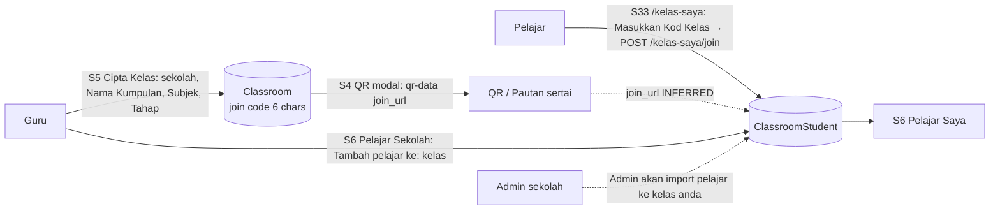
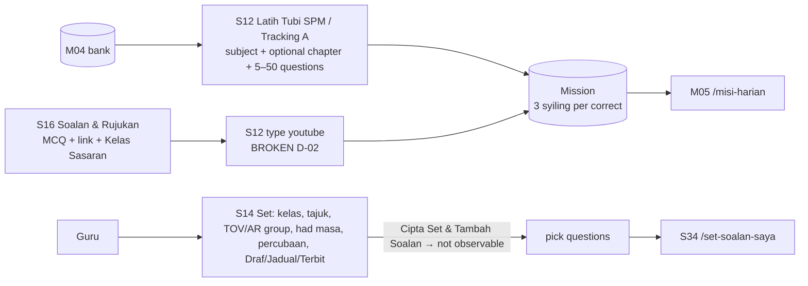
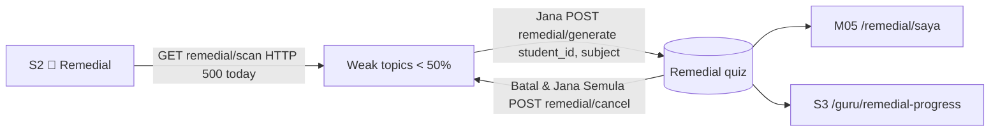
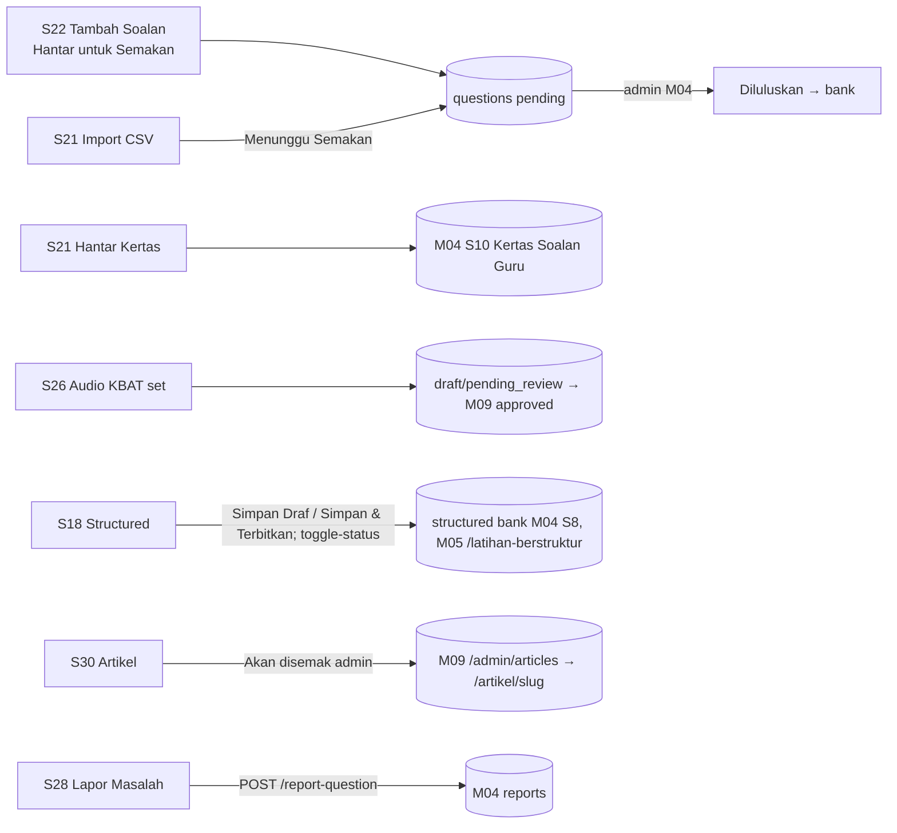

# M10 — Teacher Portal: Class & Teaching (Discovery)

- **Source:** live read-only walk-through of https://prestasiplus.my on 2026-09-25 with the admin account (browser lane 1, `playwright`). The admin account opens every `/guru/*` page. It **owns no class, no student, no set, no mission, no broadcast and no timetable entry**, so most teacher lists show their empty state. The admin does own 16,817 contributed questions, 36 articles and the structured-question bank rows it created.
- **Screenshots:** `docs/discovery/img/M10/` (64 files). Every page was masked in the DOM before capture. The shell and design tokens are in [00-global-ui.md](00-global-ui.md) and are not repeated here.
- **Privacy edit (2026-09-30):** the live S32 IC example is written as the fictitious `000101010000` under the privacy rule.
- **Language:** UI copy is quoted in exact Bahasa Melayu. Some strings are in English or mixed on live ("Command Center", "Rule-based", "PEER TUTOR MATCHING", "Streak Champions", "Most Improved", "Public", "Approved", "Draft/Pending", "Assign misi harian…").
- **Personal data (students are minors):** `tools/jobs/M10.js` → `M10MASK` runs before and after the reveal actions of every inventory state and every screenshot. It:
  - replaces the author name after "Soalan Oleh:", "Dicipta oleh" and "Disediakan oleh" (in text and in textarea values) with `<person>`;
  - replaces upper-case school names (SEKOLAH …, SMK/SK/SJK/SMA/MRSM …) with `<school>`, and tags school-search results and the chosen-school card (`.m10n`);
  - removes avatars;
  - trims the two very large chapter selects (936 options, M03 data) to 12 options and records the total in `data-total-options`.

  Then `tools/sanitize.js` runs with `{selectors:['.m10n'], titleName:false}`. It masks the "Nama" column of the attendance list (130 names), person columns of Command Center drill tables, and the profile name, e-mail and IC inputs. `meta.piiLeakCheck` is 0 leaks in all 167 states. Only structure, counts and question text are kept. Question text is not personal data.
- **Element inventory:** 3,150 content elements over 35 screens and 167 captured UI states, with IDs `EL-M10-S#-nnn`, in `docs/discovery/inventory/M10/<S#-key>.json`. Reconciliation, the crawl and the read-only limits are in `docs/discovery/inventory/M10/_summary.md`.
- **Safety:** see §10. Nothing was submitted, no broadcast or mission was sent, no attendance or toggle was changed, and no quiz, session or live-class link was opened.

Cross-references:
- `/misi-harian` (student missions, M05 S14), `/remedial/saya` (student remedial tests, M05), `/latihan-berstruktur` (student structured practice, M05) are the **student side** of M10 teacher tools. They are documented in [M05-practice.md](M05-practice.md) and not repeated.
- `/analitik/kelas`, `/prestasi/kelas*` belong to M08 (they are linked from S1). `/guru/monitoring`, `/guru/laporan*`, `/guru/analisis-item`, `/guru/perbandingan-kelas` belong to M11. `/guru/kirkpatrick*` belongs to M12. `/guru/gamifikasi` belongs to M14.
- The admin reviews what teachers contribute in M04 (`/admin/questions`, `/admin/question-submissions` "Kertas Soalan Guru", `/admin/structured-questions`, `/laporan-soalan` reports) and in M09 (`/admin/articles`, `/admin/audio-kbat`).
- The DSKP JSON APIs `/guru/api/dskp/{bidang,sk,sp}` and the chapter/topic APIs `/guru/api/{chapters,topics}` are used by M04 and M10 forms (§7).

---

## 1. Overview

The TRACKER M10 checklist has 17 routes. The crawl found **35 screens**. Every M10 page except S2 and the error pages renders in the **user-portal layout** (shell `SHU`) for the admin account. The admin panel sidebar does not link any `/guru/*` page, except the shared "Kelas Guru" / "Sumbang Soalan" / "Databank Soalan" items in the admin's own user sidebar.

| # | Route | Tab title (`<title>`) · shell header title / subtitle | Status on admin account |
|---|---|---|---|
| S1 | `/guru` | "Dashboard Guru - PRESTASIPLUS" · "Dashboard Guru" / "Selamat datang, {nama} 👩‍🏫" | Documented (zero counts) |
| S2 | `/guru/command-center` | "Command Center — Guru: {nama}" · standalone dark layout, no shell | Documented; Evaluate and Badges not opened (§10) |
| S3 | `/guru/remedial-progress` | "Remedial Progress Dashboard" · "Dashboard" / "Selamat datang kembali" (D-01) | **New route**; empty |
| S4 | `/guru/kelas` | "Kelas Saya - Portal Guru" · "Portal Guru" / "Urus kelas dan tugasan anda 🏫" | Empty ("Belum Ada Kelas") |
| S5 | `/guru/kelas/cipta` | "Cipta Kelas - Portal Guru" · "Cipta Kelas Baru" / "Isi butiran kelas anda" | **New route**; not submitted |
| S6 | `/guru/pelajar` | "Pelajar Saya - PRESTASIPLUS" · "Pelajar" / "Urus pelajar dalam kelas anda" | Empty; 2 tabs |
| S7 | `/guru/kehadiran-digital` (`?date=`) | "Kehadiran Digital — Portal Guru" · "Kehadiran Digital" / "Pelajar jawab 5+ soalan = Hadir. Auto-track, zero effort." | Documented (137 students, all "Tidak Hadir") |
| S8 | `/guru/jadual-belajar` | "Jadual Belajar Harian — Portal Guru" · "Jadual Belajar Harian" / "Set fokus subjek harian — pelajar nampak bila login" | Empty week |
| S9 | `/guru/broadcast` | "Broadcast Kelas — Portal Guru" · "Broadcast Kelas" / "Hantar mesej ringkas kepada pelajar — mereka nampak bila login" | Empty history; not sent |
| S10 | `/guru/live-kelas` | "Bilik Darjah Langsung - Portal Guru" · "Bilik Darjah Langsung" / "Pantau semua aktiviti pelajar — Latih Tubi SPM, Tracking A, Misi Harian" | No active students |
| S11 | `/guru/misi-harian` | "Misi Harian — Portal Guru" · "Misi Harian" / "Cipta dan pantau misi latih tubi SPM untuk pelajar" | Empty |
| S12 | `/guru/misi-harian/cipta` | "Cipta Misi Harian — Portal Guru" · "Cipta Misi Harian" / "Assign misi latih tubi SPM atau Tracking A" | **New route**; not submitted |
| S13 | `/guru/set-soalan` | "Set Soalan - PRESTASIPLUS" · "Set Soalan Guru" / "Cipta dan urus set soalan khas untuk kelas anda" | Empty |
| S14 | `/guru/set-soalan/cipta` | "Cipta Set Soalan - PRESTASIPLUS" · "Cipta Set Soalan" / "Sediakan set soalan khas untuk kelas anda" | **New route**; not submitted |
| S15 | `/guru/soalan-guru` | "Soalan & Rujukan — Portal Guru" · "Soalan & Rujukan" / "Cipta soalan peribadi dengan bahan rujukan — khas untuk kelas anda sahaja" | Empty |
| S16 | `/guru/soalan-guru/cipta` | "Soalan & Rujukan — Portal Guru" · "Soalan & Rujukan" / "Cipta soalan MCQ, lampir link rujukan, assign sebagai misi" | **New route**; not submitted |
| S17 | `/guru/soalan-berstruktur` | "Soalan Berstruktur - PRESTASIPLUS" · "Dashboard" / "Selamat datang kembali" (D-01) | 4,061 rows (204 pages) |
| S18 | `/guru/soalan-berstruktur/cipta` | "Cipta Soalan Berstruktur - PRESTASIPLUS" · D-01 | Not submitted |
| S19 | `/guru/soalan-berstruktur/{id}` | "Lihat Soalan Berstruktur - PRESTASIPLUS" · D-01 | **New route**; id 4454 |
| S20 | `/guru/soalan-berstruktur/{id}/edit` | "Edit Soalan Berstruktur - PRESTASIPLUS" · D-01 | Not submitted |
| S21 | `/guru/soalan` | "Sumbang Soalan - PRESTASIPLUS" · "Sumbang Soalan" / "Sumbangan anda kepada bank soalan kebangsaan PrestasiPlus" | 16,817 own questions (841 pages) |
| S22 | `/guru/soalan/cipta` | "Tambah Soalan - PRESTASIPLUS" · "Tambah Soalan Baru" / "Sumbangkan soalan untuk pelajar Malaysia" | **New route**; not submitted |
| S23 | `/guru/soalan/{id}` | "Detail Soalan — Sumbang Soalan" · "Detail Soalan" / "Selamat datang kembali" | **New route**; id 522425 |
| S24 | `/guru/soalan/{id}/edit` | "Edit Soalan — Sumbang Soalan" · "Edit Soalan" / "Selamat datang kembali" | **New route**; not submitted |
| S25 | `/guru/audio-kbat` | "Set Audio KBAT" · D-01 | **New route**; empty |
| S26 | `/guru/audio-kbat/create` | "Cipta Set Audio KBAT" · D-01 | **New route**; not submitted |
| S27 | `/guru/databank` | "Databank Soalan SPM — PRESTASIPLUS" · "Databank Soalan" / "21,033 soalan · 18 subjek" | Documented |
| S28 | `/guru/databank/{CODE}` | "{Subjek} — Databank Soalan" · "{Subjek}" / "{n} soalan" | **New route**; BM (6,048) |
| S29 | `/guru/artikel` | "Sumbang Artikel" · D-01 | 36 articles (3 pages) |
| S30 | `/guru/artikel/cipta` | "Tulis Artikel Baru" · D-01 | **New route**; not submitted |
| S31 | `/guru/artikel/{id}/edit` | "Edit Artikel" · D-01 | **New route**; id 10 |
| S32 | `/guru/profil/edit` | "Edit Profil Guru - PRESTASIPLUS" · "Profil Guru" / "Kemaskini maklumat profesional anda" | **New route**; not submitted |
| S33 | `/kelas-saya` (student) | "Kelas Saya" · "Kelas Saya" / "Sertai kelas guru anda 🏫" | Not joined |
| S34 | `/set-soalan-saya` (student) | "Set Soalan Guru - PRESTASIPLUS" · "Set Soalan Guru" / "Set soalan yang disediakan oleh guru anda" | Empty |
| S35 | error pages | `/settings` → **404**, `/guru/{id}` → **404**, `/guru/set-soalan/{id}` → **405** | §1.2 |

### 1.1 Entry points

- **Teacher group of the user-portal sidebar** (as seen by the admin): "Command Center LIVE" → `/guru/command-center`, "Misi Harian" → `/guru/misi-harian`, "Kelas Saya" → `/guru/kelas`, "Pelajar Saya" → `/guru/pelajar`, "Kehadiran Digital" → `/guru/kehadiran-digital`, "Jadual Belajar" → `/guru/jadual-belajar`, "Broadcast" → `/guru/broadcast`, "Kelas Live" → `/guru/live-kelas`, "Soalan & Rujukan" → `/guru/soalan-guru`, "Soalan Berstruktur" → `/guru/soalan-berstruktur`, "Set Soalan" → `/guru/set-soalan`, "Sumbang Artikel" → `/guru/artikel`.
- **Other sidebar items** of the admin's user sidebar: "Dashboard Guru" → `/guru`, "Kelas Guru" → `/guru/kelas`, "Sumbang Soalan" → `/guru/soalan`, "Databank Soalan" → `/guru/databank`.
- **Student group:** "Kelas Saya" → `/kelas-saya`, "Set Soalan Guru" → `/set-soalan-saya`, and a second "Kelas Saya BARU" item → `/kelas-saya` (the same page twice; shell, see 00-global-ui).
- There are two "Command Center LIVE" items: `/ppd/command-center` (M18) and `/guru/command-center` (M10).
- The mobile drawer's "Tetapan" item → `/settings` → 404 (confirmed again, S35; first found in M01).

### 1.2 Access outcomes found by the crawl

| URL | Result | Note |
|---|---|---|
| `/settings` | **404** "Halaman Tidak Dijumpai" | Teacher settings do not exist. Account settings are `/profile/edit`, `/tetapan` (M01) and `/guru/profil/edit` (S32). |
| `/guru/{id}` (e.g. `/guru/3`, the admin's own "Profil Awam") | **404** | The "Lihat" link and the "Salin Link" URL on S32 point here (D-06). |
| `/guru/pelajar/cipta` ("Cipta Pelajar" on S6) | **302 → `/guru/pelajar`**, no flash | Dead link (D-07). |
| `/guru/soalan/template` ("Template" on S21) | **302 → `/guru/soalan`**, no flash, no file | Dead link (D-08). |
| `/guru/soalan/galeri-rajah` (Galeri Rajah fetch on S22) | **302 → `/guru/soalan`** (HTML), also with `X-Requested-With` | The gallery always shows "Tiada galeri rajah tersedia" (D-09). |
| `/guru/audio-kbat/template`, `/guru/audio-kbat/template-word` | **200** XLSX / DOCX download | Work. Downloaded only as a header check (content not stored). |
| `/guru/kelas/{id}`, `/guru/kelas/{id}/qr-data` for a class the admin does not own (228) | **404** JSON "No query results for model [App\\Models\\Classroom] 228" | Class detail is scoped to the owner; not observable (§10). |
| `/guru/kelas/{id}/edit`, `/guru/kelas/{id}/pelajar` | **404** "route … could not be found" | No such routes. |
| `/guru/set-soalan/{id}`, `/guru/misi-harian/{id}` | **405** Symfony page "Oops! An Error Occurred" | Only non-GET methods exist (PUT/DELETE INFERRED). |
| `/guru/set-soalan/{id}/edit`, `/guru/misi-harian/{id}/edit`, `/guru/audio-kbat/{id}` (id 1) | **404** with empty message | Route exists but record not found or not owned (INFERRED). |
| `/guru/soalan-guru/{id}`, `/guru/broadcast/{id}`, `/guru/jadual-belajar/{id}` | **405** "Supported methods: DELETE." | Delete-only routes. |
| `/guru/pelajar/{id}`, `/guru/artikel/{id}` | **405** "Supported methods: PUT, DELETE." | |
| `/guru/soalan/import`, `/guru/soalan/hantar-kertas` | **405** "Supported methods: POST, PUT, DELETE." | |
| `/guru/soalan/ai-generate` | **405** "Supported methods: PUT, DELETE." | The S21 card "AI Auto-Generate Soalan" has no link or button (D-10). |
| `/guru/profil` | **405** "Supported methods: PUT." | S32 form target. |
| `/guru/soalan-guru/{id}/edit`, `/set-soalan-saya/{id}`, `/guru/kehadiran-digital/export` | **404** "route … could not be found" | No such routes. |
| `/kelas-saya/{id}` | **404** "No query results for model [App\\Models\\ClassroomStudent]." | A per-class student page exists for joined classes (INFERRED). |
| `/guru/live-kelas/cipta`, `/guru/broadcast/cipta` | 404 / 405 | No create page; live class is monitoring only. |
| `/guru/command-center/remedial/scan` | **500** JSON "Server Error" | The Remedial panel shows a JSON parse error (D-03). |

---

## 2. Screens

### 2.1 S1 — `/guru` "Dashboard Guru"

Screenshots: `guru-dashboard-desktop.png`, `-tablet.png`, `-mobile.png`.

- **Guide card** (Alpine `{ showGuide: localStorage.getItem('hideGuruGuide') !== 'true' }`), shown by default:
  - `<h3>` "Mula Di Sini — 3 Langkah Mudah"; "Ikut 3 langkah ini untuk mula menggunakan PrestasiPlus. Ambil masa 5 minit sahaja."
  - Three numbered steps (badges 1, 2, 3): "Buka Kelas" / "Klik "Kelas Saya" di sidebar. Cipta kelas baru atau lihat kelas sedia ada." / link "Kelas Saya →" (`/guru/kelas`); "Lihat Pelajar" / "Semak senarai pelajar anda. Lihat siapa yang aktif dan siapa yang belum mula." / "Pelajar Saya →" (`/guru/pelajar`); "Pantau Prestasi" / "Buka Monitoring untuk lihat penglibatan pelajar dan topik lemah mereka." / "Monitoring →" (`/guru/monitoring`, M11).
  - Tip line (`fa-lightbulb`): "Tip:" "Hover atas mana-mana menu di sidebar untuk lihat penerangan ringkas."
  - Close button `fa-times` → `showGuide = false; localStorage.setItem('hideGuruGuide', 'true')`. After closing, a pill button `fa-question-circle` "Tunjuk panduan Mula Di Sini" appears; it reopens the guide and removes the key. The choice persists per browser.
- **"Checklist Guru"** card: "0/3 langkah selesai", "0%", and three rows, each with a "Lihat" link:
  - "Kelas dah ada" / "Admin sekolah akan sediakan kelas anda" → `/guru/kelas`;
  - "Pelajar dalam kelas" / "Admin akan import pelajar ke kelas anda" → `/guru/pelajar`;
  - "Misi harian pertama" / "Cipta misi latih tubi untuk pelajar anda" → `/guru/misi-harian/cipta`.
- **4 stat cards:**

  | Label | Value (admin) | Caption |
  |---|---|---|
  | Kelas Aktif | 0 | "0 jumlah kelas" |
  | Pelajar | 0 | "Merentasi semua kelas" |
  | Soalan | 20719 | "✅ 19361 diluluskan" |
  | Tugasan | 0 | "Jumlah tugasan dibuat" |

  "Soalan" 20,719 / 19,361 does not match S21 (16,817 total, 16,817 approved). The definitions differ and are not visible (D-12, OQ-05).
- **"Tindakan Hari Ini"** panel: `<h2>` "Fokus guru yang paling penting hari ini"; "Panel ini memprioritikan pelajar, topik, dan tindakan yang paling wajar disemak dahulu."; three counters "Pelajar" 0, "Topik" 0, "Tindakan" 0; three columns:
  - "Pelajar Perlu Dibantu" with chip "Top 3"; empty "Tiada pelajar berkeutamaan tinggi dikesan buat masa ini."
  - "Topik Kritikal" with link "Analitik Kelas →" (`/analitik/kelas`, M08); empty "Tiada topik kritikal menonjol dikesan daripada data semasa."
  - "Tindakan Disyorkan" with chip "Rule-based"; one action card link (`fa-chalkboard`) → `/guru/kelas`: "Bina aktiviti pertama untuk pelajar", badge "Permulaan", "Data tindakan akan muncul selepas pelajar mula membuat latihan.", "Buka Kelas →".
- **"Peer Tutor Matching"** card (label rendered "PEER TUTOR MATCHING"): `<h2>` "Cadangan rakan pembimbing pelajar"; "Cadangan peer tutor akan muncul apabila guru mempunyai pelajar aktif dan data prestasi yang mencukupi."; "Belum cukup signal yang yakin untuk cadangan peer tutor. Modul ini akan jadi lebih tepat apabila data pelajar dan subjek bertambah."
- **"Tindakan Pantas"** (4 link tiles): "Cipta Kelas Baru" / "Tambah kelas pembelajaran" (`fa-plus`, `/guru/kelas/cipta`); "Sumbang Soalan" / "Tambah soalan untuk pelajar" (`fa-pen-fancy`, `/guru/soalan/cipta`); "Lihat Pelajar" / "Pantau prestasi pelajar" (`fa-user-graduate`, `/guru/pelajar`); "Edit Profil Guru" / "Kemaskini maklumat profesional" (`fa-id-card`, `/guru/profil/edit`).
- **"Kelas Saya"** card with "Semua →" (`/guru/kelas`); empty "Belum ada kelas. Cipta sekarang!"
- **"Penghantaran Terkini"** card; empty "Belum ada penghantaran tugasan." / "Buat tugasan di kelas untuk lihat penghantaran di sini."
- Populated states (priority students, topics, peer-tutor pairs, class cards, submissions) were not observable (§10).

### 2.2 S2 — `/guru/command-center` "Command Center"

Screenshots: `command-center-desktop.png`, `-mobile.png`, `command-center-drill-modal.png`, `command-center-remedial-error.png`, `command-center-predictive.png`, `command-center-kelas.png`.

A **standalone dark dashboard** (no user shell, no `<main>`). Tab title "Command Center — Guru: {nama}" (the teacher's name). It polls `GET /guru/command-center/live-data` on load and every 10 s (`setInterval(fetchData, 10000)`), and a clock ticks each second.

- **Top bar:** link "← Dashboard" (`/guru`); title "Command Center" (rendered "COMMAND CENTER"); six nav links: "🔬 Remedial" (`showRemedial()`), "📊 Rekod" (`/guru/remedial-progress`), "⚠ Evaluate" (`showEvaluate()`), "🔮 Ramalan SPM" (`showPredictive()`), "👩‍🏫 Kelas" (`showTeacherPerf()`), "🏆 Badges" (`showAchievements()`); "LIVE" dot, clock "HH:MM:SS" and "MYT". At 375 px only "← Dashboard", the title and "🔬 Remedial" stay visible; the other five links, "LIVE" and the clock are hidden (desktop-only).
- **4 KPI tiles** (each clickable `drill(type)` with a 🔍 hint): "Pelajar Berdaftar" `--` / "0 aktif menjawab" (`drill('students')`); "Soalan Dijawab" `--` / "sepanjang masa" (`drill('today')`); "Ketepatan Purata" `0%` / "keseluruhan sekolah" (`drill('subjects')`); "GPS Sekolah" `4.69` / "purata GPS" (`drill('gps')`).
- **Panels:** "📚 Kelas Saya" ("Tiada data"); "🔬 Kirkpatrick" with T1 "☆☆☆☆☆ 0/10", T2 "0% ketepatan", T3 "0 aktif 30h", T4 "GPS 0" (each `drill('kirk','t1'…'t4')`); "💚 Mood Pelajar" with 😊 Gembira / 😐 OK / 😢 Sedih / 😩 Tekanan counts (each `drill('mood','happy'|'okay'|'sad'|'stressed')`); "🤖 ALESA AI" insight: "0% pelajar terlibat aktif. Ketepatan purata 0%. GPS sekolah: 4.69." (built as `"{active}% pelajar terlibat aktif. Ketepatan purata {acc}%. GPS sekolah: {gps}."`); "📈 Aktiviti Hari Ini" "0 soalan" (`drill('today')`), "Minggu ini:" 0, "Sama dengan minggu lepas" (or "▲ +n% vs minggu lepas" / "▼ …"); "⚡ Live Feed" ("Tiada aktiviti terkini"); "🏆 Leaderboard Minggu Ini" ("Tiada data minggu ini"); "📊 Engagement Pelajar" "Jumlah: 0 pelajar" with five rows Champion / Konsisten / Berkembang / Minimum / Disengaged (tooltip "Klik: senarai pelajar").
- Footer: "Powered by ALESA AI · PrestasiPlus © 2026 · Data dikemaskini setiap 10 saat".
- **Drill modal** `#drillModal`: title "Loading..." → "Memuatkan..." → `d.title || type`; body "Memuatkan data..." then a table, or "Tiada data". Close "×" or click on the backdrop. **Observed:** every drill (students, today, subjects, gps, kirk t1–t4, mood) returned `{"title": "<type>", "students": []}`, so the modal title shows the raw key ("students", "gps", "kirk", "mood") and the body "Tiada data" (D-04). The drill table columns per type are in the script:

  | Drill | Columns |
  |---|---|
  | gps | Subjek · GPS · Gred · Pelajar · Sumber (Sumber labels: Anggaran OTR, Head Count, Manual, Import) |
  | subjects | Subjek · Jawapan · Betul · Ketepatan · Pelajar |
  | sessions (today) | Masa · Pelajar · Subjek · Soalan · Betul · Ketepatan (row → student page) |
  | mood | Pelajar · Tarikh · Sebab |
  | kirk t1 | Pelajar · Purata · Kepuasan · Relevan · Kegunaan · Tarikh |
  | kirk "vs" (t2–t4) | summary cards "Bulan Ini" / "Bulan Lepas" + Ketepatan Kini / Ketepatan Lepas / Perubahan, Jawapan Kini / Jawapan Lepas, Aktif Kini (30h) / Aktif Lepas (30h), Pelajar Baru |
  | students (default) | Pelajar · … · Status (Aktif / Login) |

  Gred from GPS in the drill (script): ≤1.5 A+, ≤2.0 A, ≤2.5 A-, ≤3.0 B+, ≤3.5 B, ≤4.0 C+, ≤4.5 C, ≤5.0 D, else E. Colours: accuracy ≥70 emerald, <50 rose, else amber; GPS ≤2 emerald, ≤3 amber, else rose.
- **"🔬 Remedial"** → modal "Smart Remedial — Scan Pelajar Lemah", "Mengimbas topik lemah pelajar...", `GET /guru/command-center/remedial/scan`. **Observed: HTTP 500**, the modal shows "Ralat: Unexpected token '<', "<!DOCTYPE "... is not valid JSON" (D-03). Script-only states: "Tiada pelajar dengan topik lemah (<50% accuracy). Tahniah!"; "{n} pelajar dikesan lemah dalam topik tertentu (accuracy <50%)"; table Pelajar · Topik Lemah · Accuracy Terendah · Tindakan; per subject a "Jana" button (→ "Menjana...", `POST /guru/command-center/remedial/generate {student_id, subject}`), then "Selesai (…)", "Lihat Quiz (…)", "Batal & Jana Semula" (confirm "Batal set soalan remedial untuk {nama}? Anda boleh jana semula selepas ini." → "Membatal..." → `POST /guru/command-center/remedial/cancel {quiz_id}`), errors "Gagal" / "Ralat".
- **"🔮 Ramalan SPM"** → "Ramalan SPM — Predictive Analytics", "Menganalisis data prestasi semua pelajar...", `GET /guru/command-center/predictive` → `{predictions:[], grade_distribution:[], avg_predicted_gps:0, at_risk_count:0, total_predicted:0}`. Observed: cards "0 Pelajar Dianalisis", "0 Ramalan GPS Purata", "0 Berisiko", "Gred Terbanyak" and grade chips A+ A A- B+ B C+ C D; empty "Tiada data mencukupi untuk ramalan". Script table: Pelajar · Accuracy · Trend · Konsistensi · Ramalan.
- **"👩‍🏫 Kelas"** → "Kelas Saya — Ringkasan Prestasi", "Menganalisis prestasi guru...", reuses `live-data`. Observed: "0 Jumlah Pelajar", "0 Aktif", "0% Ketepatan", table header # · Kelas · Tingkatan · Pelajar · Aktif · Ketepatan (no rows). Class rows link to `/guru/command-center/classroom/{id}` (script; not observable).
- **"⚠ Evaluate"** (`GET /guru/command-center/evaluate`, "Auto Evaluate — Penilaian Risiko Pelajar") and **"🏆 Badges"** (`GET /guru/command-center/achievements`, "Achievement System — Scan & Award Badges") were **not opened**: their names say they evaluate/award, which may write data (§10). Script strings for both are in Appendix B (e.g. "Menilai semua pelajar...", "Semua pelajar dalam keadaan baik! Tiada risiko dikesan.", "Lencana Baru Dianugerah", rarity labels Common / Uncommon / Rare / Epic / Legendary, badge-holder modal "Lencana: {nama}", `GET /guru/command-center/badge-holders?badge_id=`).
- Other script URLs: `/guru/command-center/student/{id}` (student page, opened in a new tab from drill rows) and `/guru/command-center/school/{sid}/teacher/{uid}`.

`live-data` shape (keys only): `teacher_name, total_students(_raw), active_students(_raw), total_answered(_raw), answered_today(_raw), answered_week(_raw), week_change, accuracy, gps_overall, classes[], top_students[], engagement{champion, consistent, developing, minimum, disengaged}, recent_feed[], kirk_t1, kirk_t1_count, kirk_t2_accuracy, kirk_t3_active, kirk_t2_delta, kirk_t2_prev, kirk_t3_delta, kirk_t3_prev, kirk_t4_gps, mood[], generated_at`.

### 2.3 S3 — `/guru/remedial-progress` "Remedial Progress Dashboard" (new route)

Screenshot: `remedial-progress-desktop.png`. Reached only from S2 "📊 Rekod". Header shows the default "Dashboard / Selamat datang kembali" (D-01).
- 📊 `<h1>` "Remedial Progress Dashboard"; "Jejak peningkatan pelajar melalui ujian pemulihan".
- 4 stat cards: "JUMLAH SET" 0, "SELESAI" 0, "PELAJAR" 0, "PURATA PENINGKATAN" "+0%".
- Card "👥 Senarai Pelajar & Progress": 📋 "Belum ada ujian remedial dijana. Buka Command Center → klik Remedial untuk mula."

### 2.4 S4 — `/guru/kelas` "Kelas Saya"

Screenshots: `kelas-empty-desktop.png`, `kelas-empty-mobile.png`, `kelas-qr-modal.png`.
- `<h1>` "Kelas Saya", "0 kelas aktif", button link "Cipta Kelas Baru" (`fa-plus`; gradient indigo-500 → purple-500, white text) → `/guru/kelas/cipta`.
- Empty card: 🏫 "Belum Ada Kelas" / "Cipta kelas pertama anda untuk memulakan pengajaran" / "Cipta Kelas" (`fa-plus`).
- **Quick-QR modal** `#quickQrModal` (hidden; opened by `openQrQuick(classId)` from a class card): fetches `GET /guru/kelas/{id}/qr-data` → `{name, school, join_url}`; shows the class name, school, a 192×192 QR code of `join_url` (QRCode.js, dark `#1e293b`), a read-only URL input "Pautan sertai:" with a copy button (`fa-copy`, alert "Disalin!"), "Cetak" (`window.print()`) and "Tutup". Backdrop click closes. Forced open with no class it shows "-" placeholders and a spinner.
- Class cards (populated list) were not observable (§10).

### 2.5 S5 — `/guru/kelas/cipta` "Cipta Kelas Baru" (new route)

Screenshots: `kelas-cipta-desktop.png`, `kelas-cipta-mobile.png`, `kelas-cipta-school-search.png`.
- Link "Kembali" (`fa-arrow-left`) → `/guru/kelas`. Form `POST /guru/kelas` (Alpine `classroomForm()`).
- **"Pilih Sekolah"** card: hidden `school_id`; search input "Taip nama sekolah untuk cari..." (`@input.debounce.300ms`, from 2 characters) → `GET /api/schools/search?q=&limit=15` (M02 API). Results dropdown: one button per school with the name and "{district}, {state}" (observed e.g. "PPD SEGAMAT, Johor"); spinner while loading; "Tiada sekolah dijumpai" (`fa-search-minus`) when empty. Choosing a school replaces the search with a card (name + "{district}, {state}") and a clear button (`fa-times-circle`).
- **"Maklumat Kelas"** card:
  - "Nama Kumpulan *" (text, `required`, placeholder "cth: 5 Bestari") with help "Nama kumpulan latih tubi anda." The visible input has no name; a hidden `name` input carries the value.
  - "Subjek *" select `subject_id` (`required`): "-- Pilih Subjek --" + 31 subjects in **id order** (Bahasa Melayu … Sains Sukan; Appendix A.2).
  - "Tahap Pendidikan *" radio tiles `education_level`: "Tahun 1"…"Tahun 6" (`tahun-1`…`tahun-6`) and "Ting. 1"…"Ting. 5" (`tingkatan-1`…`tingkatan-5`). With no school all 11 show. When the chosen school's `type` is `SK`, only Tahun tiles show; any other type shows only Ting. tiles. Radios have **no `required`** although the label has "*". A hidden chip "Auto dari kelas sekolah" appears when the level is auto-set.
  - "Penerangan (pilihan)" textarea `description`, placeholder "Penerangan ringkas tentang kelas ini...".
  - Submit "Cipta Kelas" (`fa-plus-circle`, gradient indigo-500 → purple-500).
- **Dead code:** the script also has a "school class" picker (`onSchoolClassChange`, `GET /api/school-classes/{id}/students`, pre-select all students, `gradeMap` T1–T5/D1–D6 → level slug), but the page renders no such select. The rebuild follows the rendered form (INFERRED: students are linked by join code, by the S6 "Tambah pelajar ke:" action, or by the school admin).
- Validation: only `required` on "Nama Kumpulan" and "Subjek". Server messages are not observable.

### 2.6 S6 — `/guru/pelajar` "Pelajar Saya"

Screenshots: `pelajar-mine-desktop.png`, `pelajar-school-tab.png`.
- Header counter "0" / "Pelajar dalam kelas saya"; link "Cipta Pelajar" (`fa-user-plus`; its label is "Cipta" on small screens) → `/guru/pelajar/cipta`, which **redirects back to `/guru/pelajar`** with no message (D-07).
- Tabs (Alpine `studentManager()`, default `tab: 'mine'`): "Pelajar Sekolah" (`fa-school`) and "Pelajar Saya" (`fa-user-check`) with a count badge "0".
- **Pelajar Saya** (default): empty card "Belum ada pelajar dalam kelas anda" / "Buat kelas dan tambah pelajar dari senarai sekolah." / "Cipta Kelas" → `/guru/kelas/cipta`.
- **Pelajar Sekolah:** a bar "Tambah pelajar ke:" with a class select (`x-model="targetClassroom"`, only "-- Pilih kelas --"), and, because the admin has no school, the card "Sekolah belum ditetapkan" / "Sila tetapkan sekolah anda di Profil atau semasa cipta kelas untuk melihat senarai pelajar sekolah." / "Tetapan Profil" (`fa-user-cog`) → `/guru/profil/edit`. The school student list, its search (`searchQuery`) and add/remove actions (`PUT`/`DELETE /guru/pelajar/{id}`, INFERRED) were not observable.

### 2.7 S7 — `/guru/kehadiran-digital` "Kehadiran Digital"

Screenshots: `kehadiran-desktop.png`, `kehadiran-mobile.png`.
- Filter form `GET` (no action): "Tarikh" date input `date` (`max` = today, default today) and "Semak" (`fa-search`, indigo-600). `?date=2026-09-01` changes the list heading to "Senarai Pelajar — 01/09/2026".
- 4 stat cards: "Jumlah Pelajar" 137 (blue label), "Hadir" 0 (green), "Tidak Hadir" 137 (red), "% Kehadiran" 0% (orange label, red value).
- **"Trend Kehadiran 7 Hari"**: seven columns, oldest first, ending today (Sab, Ahd, Isn, Sel, Rab, Kha, Jum on a Friday), each a bar (observed height 2 px, red `#dc2626` at 0%) and "0%".
- **"Senarai Pelajar — {dd/mm/yyyy}"** table: # · Nama · Tingkatan · Soalan · Status · Masa Aktif. 137 rows; status badge "Tidak Hadir" (red-100 / red-700); "Masa Aktif" "-". Rows are grouped T4, T5, then "Tingkatan 4", "Tingkatan 5" (two label formats, D-13); within a group names sort A→Z. At 375 px the table scrolls inside its card (scrollWidth 484 vs 340).
- Footnote (`fa-info-circle`): "Pelajar dianggap "Hadir" apabila menjawab sekurang-kurangnya 5 soalan pada hari tersebut. Data dikemas kini secara automatik."
- **Attendance is derived, not marked:** there is no mark/unmark control. "Hadir" = ≥5 answers on that date (stated rule). The source of the 137 students for an admin with no class and no school is not visible (OQ-03).

### 2.8 S8 — `/guru/jadual-belajar` "Jadual Belajar Harian"

Screenshots: `jadual-belajar-desktop.png`, `jadual-belajar-mobile.png`.
- Card "Tambah Jadual": form `POST /guru/jadual-belajar`: "Hari" select `day_of_week` (`required`; 1 Isnin … 7 Ahad, default Isnin), "Subjek" select `subject_id` (`required`; 31 subjects **A→Z**, no placeholder, default "Bahasa Arab"), "Topik Fokus (opsional)" text `focus_topic`, and "Tambah" (`fa-plus`, indigo-600).
- Seven day cards Isnin … Ahad, each "Tiada jadual ditetapkan"; today's card has the badge "HARI INI" (Jumaat on the capture day).
- Entries (populated cards and their delete, `DELETE /guru/jadual-belajar/{id}`) were not observable.

### 2.9 S9 — `/guru/broadcast` "Broadcast Kelas"

Screenshots: `broadcast-desktop.png`, `broadcast-mobile.png`.
- Card "Hantar Mesej Baru": form `POST /guru/broadcast`: textarea `message` (`required`, `maxlength=500`, placeholder "Tulis mesej ringkas untuk pelajar..."), radio `priority` "Biasa" (`normal`, checked) / "Penting" (`important`), "Hantar" (`fa-paper-plane`, indigo-600).
- History: "Tiada mesej dihantar lagi." There is no class/recipient selector: a broadcast goes to all the teacher's students (INFERRED from the subtitle "Hantar mesej ringkas kepada pelajar — mereka nampak bila login"). History rows and delete (`DELETE /guru/broadcast/{id}`) were not observable. **Never sent** (§10).

### 2.10 S10 — `/guru/live-kelas` "Bilik Darjah Langsung"

Screenshot: `live-kelas-desktop.png`.
- Monitoring only; there is no video room, no join link and no "Mula Kelas Live".
- Status card: count "0" + "pelajar sedang aktif"; "Dikemas kini: {HH:MM:SS} · Auto-muat semula setiap 30 saat"; a countdown "28s"; "Muat Semula" (`fa-refresh`, `fetchSessions()`).
- Alpine `liveClassroom()`: every 30 s (countdown) and on "Muat Semula" it calls `GET /guru/live-kelas` with `Accept: application/json`, `X-Requested-With: XMLHttpRequest` → `{sessions:[], recent:[], total:0, refreshed_at:"HH:MM:SS", topWeekly:[], streakChampions:[], mostImproved:[]}`. On failure: "Gagal mendapatkan data. Periksa sambungan internet anda." (console "Live classroom fetch failed:").
- Empty state: "Tiada pelajar sedang aktif menjawab soalan sekarang" / "Halaman ini akan dikemas kini secara automatik apabila pelajar mula menjawab soalan."
- Session card template (not observable populated): badge "LANGSUNG", labels "Kuiz", "Masa", "Markah", activity label e.g. "Latih Tubi".
- Three side cards: "Pejuang Minggu Ini" ("Tiada data minggu ini"), "Streak Champions" ("Tiada streak aktif"), "Most Improved" ("Perlu data 2 minggu untuk perbandingan").

### 2.11 S11 — `/guru/misi-harian` "Misi Harian"

Screenshot: `misi-harian-empty.png`.
- "Assign misi harian kepada pelajar. Fokus: Latih Tubi SPM & Tracking A."; link "Misi Baru" (`fa-plus`, indigo-600) → `/guru/misi-harian/cipta`.
- Empty: "Belum ada misi" / "Cipta misi harian pertama untuk pelajar anda." / "Cipta Misi".
- Mission list rows, progress and delete were not observable.

### 2.12 S12 — `/guru/misi-harian/cipta` "Cipta Misi Harian" (new route)

Screenshots: `misi-cipta-desktop.png`, `misi-cipta-youtube.png`, `misi-cipta-mobile.png`.
Form `POST /guru/misi-harian` (plain HTML + inline script; no Alpine):

| Field | Control | Rules / default |
|---|---|---|
| Nama Misi | text `title` | `required`; **pre-filled "Misi Harian {dd/mm/yyyy}"** |
| Jenis Misi | select `mission_type` (`#missionType`) | `required`; `latih_tubi` "Latih Tubi SPM" (default), `tracking_a` "Tracking A", `youtube` "Soalan & Rujukan (YouTube/Anyflip/Rujukan)"; `onchange="toggleSource()"` |
| (hidden) | `mission_source` (`#missionSource`) | value `bank_soalan` |
| Tarikh Misi | date `mission_date` | `required`; default today |
| Subjek | select `subject_id` (`#subjectSelect`) | `required`; "Pilih Subjek" + 20 subjects A→Z (Appendix A.3) |
| Bab (Opsional) | select `chapter_id` (`#chapterSelect`) | "Semua Bab" + **935 chapters** of every subject; on subject change the script hides options whose `data-subject` ≠ subject (BM → 85 visible) and resets to "Semua Bab" |
| Bilangan Soalan | number `question_count` | `required`, `min=5`, `max=50`, default 10; help "5 hingga 50 soalan" |
| Ganjaran Syiling | read-only box | "3 syiling per soalan betul" (`fa-coins`); "Auto-kira berdasarkan bilangan soalan betul. Tiada tetapan manual." |
| Bahan Rujukan (Opsional) | `resource_title` (placeholder "Tajuk (cth: Video Bab 3)"), `resource_url` url ("URL (YouTube/PDF/website)"), `resource_note` textarea ("Nota ringkas untuk pelajar (opsional)") | `fa-link`; "Pelajar akan lihat bahan ini sebelum mula menjawab soalan." |

- Hidden `#youtubeSection`: "Soalan Ciptaan Guru" (`fa-youtube`), "Pilih soalan yang anda sudah cipta di **Soalan Saya**." (link → `/guru/soalan-guru`), and alert "Soalan ciptaan anda (berdasarkan video/rujukan) akan digunakan sebagai misi. Pelajar akan tonton video dulu ke…" (full text in Appendix B).
- **Defect D-02:** `toggleSource()` is **not defined** on the page. Choosing "Soalan & Rujukan (YouTube/Anyflip/Rujukan)" throws a ReferenceError; `#youtubeSection` stays hidden and `mission_source` stays `bank_soalan`. "Tracking A" also changes nothing visible.
- Buttons: "Kembali" (`fa-arrow-left`) → `/guru/misi-harian`; "Lancarkan Misi" (`fa-rocket`, indigo-600). **Never clicked.**
- There is **no class or student selector**: a mission goes to all of the teacher's students (INFERRED; OQ-01). Students see it on `/misi-harian` (M05 S14, "Misi baru akan muncul bila guru anda assign.").

### 2.13 S13 — `/guru/set-soalan` "Set Soalan Anda"

Screenshot: `set-soalan-empty.png`. Card `<h2>` "Set Soalan Anda", "0 set dicipta", "Cipta Set Baharu" (`fa-plus`) → `/guru/set-soalan/cipta`. Empty: "Belum Ada Set Soalan" / "Cipta set soalan pertama anda untuk kelas." / "Cipta Set Pertama".

### 2.14 S14 — `/guru/set-soalan/cipta` "Cipta Set Soalan" (new route)

Screenshots: `set-cipta-scheduled.png`, `set-cipta-mobile.png`. Link "Kembali ke Senarai" → `/guru/set-soalan`. Form `POST /guru/set-soalan` (Alpine `{ status: 'draft' }`), three numbered cards:

1. **"Maklumat Asas"**: "Kelas *" select `classroom_id` (`required`, only "-- Pilih Kelas --" because the admin has no class — the form cannot be submitted without a class); "Tajuk Set *" `title` (`required`); "Penerangan" textarea `description`; "Kumpulan Set (untuk TOV/AR tracking)" `group_tag` with help (`fa-info-circle`) "Set pertama dalam kumpulan = TOV (baseline). Set seterusnya = AR (progress)."
2. **"Tetapan"**: "Had Masa (minit)" number `time_limit_minutes` (`min=1`, `max=360`), help "Kosongkan = tiada had masa"; "Had Percubaan" number `max_attempts` (`min=0`, `max=99`), help "0 = tiada had (boleh ulang)".
3. **"Status Penerbitan"**: radio cards `status`: "Draf" / "Simpan dahulu, terbit kemudian" (default), "Jadual" / "Terbit pada masa tertentu", "Terbit" / "Pelajar boleh mula sekarang". "Jadual" reveals "Tarikh & Masa Terbit" `scheduled_at` (`datetime-local`).

Submit "Cipta Set & Tambah Soalan" (`fa-plus`, gradient indigo-600 → purple-600). The next step (adding questions from the M04 bank to the set) opens after the POST and was not observable; `GET /guru/set-soalan/{id}` is 405 and `/guru/set-soalan/{id}/edit` 404 for id 1 (§10).

### 2.15 S15 — `/guru/soalan-guru` "Soalan & Rujukan"

Screenshot: `soalan-guru-empty.png`.
- Info bar (`fa-info-circle`): "**Soalan & Rujukan** adalah soalan peribadi yang anda cipta khas untuk pelajar kelas anda. Lampirkan rujukan dari YouTube, Anyflip, PDF atau mana-mana sumber sebagai bahan pembelajaran tambahan. Soalan ini hanya boleh diakses oleh pelajar anda melalui Misi Harian."
- Card "Cara Soalan & Rujukan": 1 "Cari Bahan Rujukan" / "Video YouTube, Anyflip, PDF, atau apa-apa link rujukan."; 2 "Tulis Soalan MCQ" / "A/B/C/D + gambarajah (optional). Tandakan jawapan betul."; 3 "Assign Misi Harian" / "Pilih "YouTube / Soalan Guru" di Misi Harian." (the S12 option is labelled differently, and broken — D-02).
- "0 soalan dicipta"; "Soalan & Rujukan Baru" (`fa-plus`) → `/guru/soalan-guru/cipta`; empty "Belum ada soalan" / "Cipta soalan MCQ peribadi dengan bahan rujukan untuk pelajar anda." / "Soalan & Rujukan Baru". Delete is `DELETE /guru/soalan-guru/{id}`; there is no edit route.

### 2.16 S16 — `/guru/soalan-guru/cipta` "Soalan & Rujukan" create (new route)

Screenshots: `soalan-guru-cipta-desktop.png`, `soalan-guru-cipta-mobile.png`. Alpine `soalanGuru()`.
- **Guide card** "Panduan: Cara Cipta Soalan & Rujukan" (open by default, `{ showGuide: true }`, not remembered). Toggle label "Sembunyikan Panduan" (`fa-eye-slash`) / "Baca Panduan Dulu!". Content (all strings in Appendix B): "Apa itu Soalan & Rujukan?"; "Langkah Demi Langkah" steps 1–5 ("Cari bahan rujukan di internet", "Copy link & paste di ruangan "Link Rujukan"", "Pilih subjek yang berkaitan", "Tulis soalan MCQ (pilihan berganda)", "Simpan & gunakan dalam Misi Harian"); the embed table: "AUTO EMBED" YouTube (`https://www.youtube.com/watch?v=abc123`), Anyflip (`https://anyflip.com/abcd/efgh`), Canva (`https://www.canva.com/design/abc123/view`), "KLIK BUKA" PDF / Google Drive / Lain-lain (`https://drive.google.com/file/d/abc123`); "Tips Menulis Soalan Yang Baik" (5 ✓ tips and 1 ⚠ tip).
- Form `POST /guru/soalan-guru`, card **"1 Rujukan & Subjek"**:
  - "Link Rujukan (YouTube, Anyflip, PDF, dll.)" url `youtube_url` (`@input=extractTitle()`). Detection chips: "YouTube — auto embed. Pelajar boleh tonton terus." / "Anyflip — auto embed. Pelajar boleh selak buku terus." / "Canva — auto embed. Pelajar boleh lihat slide terus." (`fa-check-circle`); any other URL longer than 5 characters shows "Link rujukan:" + the URL as a link + "Link ini akan dipaparkan kepada pelajar sebagai butang klik. Pelajar perlu klik untuk buka dalam tab baru."
  - "Tajuk Rujukan" `youtube_title`.
  - "Subjek *" `subject_id` (`required`, "Pilih Subjek" + 31 A→Z); "Tahap Pendidikan" `education_level_id` ("-- Pilih Tahap --", Darjah 1–6, Tingkatan 1–5).
  - "Bab" `chapter_id` and "Topik" `topic_id` selects, loaded by `GET /guru/api/chapters?subject_id=&education_level_id=` and `GET /guru/api/topics?chapter_id=` once both subject and level are chosen (BM + Tingkatan 5 → one chapter "Bab 99: Kemahiran Bahasa Tingkatan 5"). Help: "Pilih Subjek + Tahap dahulu untuk muat Bab & Topik secara automatik."
  - Inline add buttons (`fa-plus`, title "Tambah Bab Baru" / "Tambah Topik Baru") are **disabled** until subject + level (chapter) or a chapter (topic) is chosen. Panels: "Bab Baru" (No. 1–99 + "Nama bab...") and "Topik Baru" ("Nama topik..."), each with "Batal" and "Simpan" (`POST /guru/api/chapters`, `POST /guru/api/topics`). **"Batal" only hides the panel; the typed value is kept** when it is reopened (tested).
  - "Gambarajah (optional)" file `image` (`accept=image/*`), "JPG, PNG — max 5MB. Gambarajah akan dipaparkan bersama soalan."
- Card **"Kelas Sasaran"**: "Pilih kelas yang akan menggunakan soalan ini (boleh pilih lebih dari satu)"; admin: "Tiada kelas ditemui." + link "Cipta kelas dahulu" → `/guru/kelas/cipta`.
- Card **"2 Soalan MCQ"** + "Tambah Soalan" (`addQuestion()`): per question "Soalan {n}", delete `fa-trash` (only when >1 question), textarea "Tulis soalan di sini..." (`required`), "Pilihan Jawapan" "*" "— Klik bulatan hijau untuk tandakan jawapan betul", four rows A–D each with a radio `questions[i][correct_answer]` (first one `required`) and textarea "Taip pilihan jawapan {A–D} di sini..." (`required`), "Penjelasan Jawapan" "(opsional — membantu pelajar faham kenapa jawapan itu betul)" textarea "Terangkan kenapa jawapan yang dipilih adalah betul. Ini akan dipaparkan selepas pelajar menjawab."
- Footer: "Kembali" → `/guru/soalan-guru`; counter "{n} soalan"; "Simpan Soalan" (`fa-save`, indigo-600).

### 2.17 S17 — `/guru/soalan-berstruktur` "Soalan Berstruktur"

Screenshots: `berstruktur-list-desktop.png`, `berstruktur-list-mobile.png`. Header D-01.
- `<h1>` "Soalan Berstruktur"; "Cipta & urus soalan berstruktur mengikut piawaian SPM KPM"; "Cipta Soalan" (`fa-plus`, cyan-600) → `/guru/soalan-berstruktur/cipta`.
- Filter card (GET): "Subjek" `subject_id` ("Semua" + 31 A→Z), "Tingkatan" `education_level_id` ("Semua", Darjah 1–6, Tingkatan 1–5), "Status" `status` ("Semua", `draft` "Draf", `published` "Diterbitkan"), "Tapis" (`fa-filter`).
- Table: # · Soalan · Subjek · KBAT · Sub · Markah · Visibility · Status · actions. Row: stimulus text truncated to ~60 characters + "..." and the chapter name below (slate-400); subject chip; KBAT chip "MOTS 3" (amber); sub count; marks "8m"; visibility "Public" (`fa-globe`); status "Terbit" (green); actions `fa-eye` → `/{id}`, `fa-edit` → `/{id}/edit`, and a toggle button (`fa-toggle-on`) in a form `POST /guru/soalan-berstruktur/{id}/toggle-status` (**never clicked**).
- 20 rows per page; "Showing 1 to 20 of 4061 results"; Laravel pager (1–10 … 203 204, "Next »"); mobile shows "« Previous" / "Next »" only. The table scrolls inside its card at 375 (731 vs 340).
- **Pager keeps filters:** with `?subject_id=5&education_level_id=&status=`, page links are `?subject_id=5&page=2` (empty filters dropped).
- Order: page 1 ids 4454–4471 then 3840, 4096; page 2 starts 4352, 3841, 4097 — not id order; the sort key is not visible (INFERRED: `updated_at` desc).
- `status=draft` → empty state "Tiada soalan berstruktur lagi" + "Cipta soalan pertama" (→ cipta).
- The admin sees all 4,061 structured questions (M04 S8 shows 4,064 including 3 newer ones). A teacher presumably sees only their own (INFERRED; OQ-06).

### 2.18 S18 — `/guru/soalan-berstruktur/cipta` "Cipta Soalan Berstruktur"

Screenshots: `berstruktur-cipta-desktop.png`, `berstruktur-cipta-symbols-mobile.png`, `berstruktur-cipta-eksperimen.png`. Header D-01. Back link (`fa-arrow-left`) → list. `<h1>` "Cipta Soalan Berstruktur"; "Format Kertas 2 SPM/PT3 — Piawaian KPM". Form `POST /guru/soalan-berstruktur` (Alpine `structuredForm()`).

**Card "Maklumat Soalan":**
- "Subjek *" `subject_id` (`required`; "-- Pilih Subjek --" + 31 A→Z), "Tingkatan *" `education_level_id` (`required`; "-- Pilih --", Darjah 1–6, Tingkatan 1–5), "Aras KBAT *" `kbat_level` (`required`; 1 "1. Mengingat (LOTS)", 2 "2. Memahami (LOTS)", 3 "3. Mengaplikasi (MOTS)", 4 "4. Menganalisis (HOTS)", 5 "5. Menilai (HOTS)", 6 "6. Mencipta (HOTS)"; default 1).
- "Bab" `chapter_id` + "Topik" `topic_id` (loaded as in S16; Sains + Tingkatan 5 → 9 chapters "Bab 1: Dunia mikroorganisma" …) with inline "Bab Baru" / "Topik Baru" panels.
- **"Pemetaan DSKP"**: "Bidang / Tema" (unnamed select, `GET /guru/api/dskp/bidang?subject_id=&education_level_id=`; Sains T5 → 10 options "T5-SUB4-TEXTBOOK — Sains T5 - Sokongan Bab Buku Teks", "1.0 — Mikroorganisma", …), "Standard Kandungan (SK)" (`/guru/api/dskp/sk?dskp_bidang_id=`), "Standard Pembelajaran (SP)" `dskp_sp_id` (`/guru/api/dskp/sp?dskp_sk_id=`), each with an inline add panel ("Bidang Baru": "Kod" + "Nama bidang..."; "SK Baru": "Kod" + "Penerangan SK..."; "SP Baru": "Kod" + "Penerangan SP..."; `POST /guru/api/dskp/{bidang,sk,sp}`); errors "Gagal menambah bab." / "… topik." / "… bidang." / "… SK." / "… SP." or the server's `error` via `alert()`. Note "Pemetaan DSKP memastikan soalan selaras dengan kurikulum KSSM/KSSR."
- "Jenis Tulisan" `script_type` (`rumi` "Rumi (Latin)", `arab` "Arab", `jawi` "Jawi", `mixed` "Campuran"; `updateDirection()` sets hidden `text_direction` to rtl for Arab/Jawi).
- "Template" `question_template` ("Tiada (manual)", `eksperimen` "Eksperimen Sains"): Eksperimen replaces the sub-questions with 7 fixed parts: (a) "Nyatakan hipotesis eksperimen ini." 1m; (bi) "Nyatakan pemboleh ubah dimanipulasi." 1m; (bii) "Nyatakan pemboleh ubah bergerak balas." 1m; (biii) "Nyatakan pemboleh ubah dimalarkan." 1m; (c) "Senaraikan radas dan bahan yang diperlukan." 2m (2 F rubrics); (d) "Terangkan prosedur eksperimen." 3m (P rubrics); (e) "Jadualkan keputusan eksperimen." 1m (J rubric). Total 10m.
- "Visibility *": radio `visibility` "Public" (checked) and the Alpine values `tingkatan` (reveals `education_level_filter` "-- Pilih Tingkatan --" + levels) and `class` (reveals `classroom_id` "-- Pilih Kelas --"). Only the "Public" radio is rendered as a labelled radio; the other two choices are reachable only through Alpine state (D-11, OQ-07).
- "Stimulus / Teks Soalan Utama *" textarea `stimulus_text` (`required`) with "Simbol & Aksara Khas" (`fa-superscript`) toggle → palette of 72 symbols in groups Asas, Kuasa, Subskrip, Matematik, Anak Panah, Greek, Umum (Appendix A.6); the toggle label becomes "Tutup Simbol". Clicking a symbol inserts it at the cursor (`insertSymbol`).
- "Gambar Stimulus (pilihan)" file `stimulus_image` (`image/*`).

**Card "Sub-Soalan":** "Jumlah markah: {n}m" (sum of sub marks) and "Tambah Sub" (`fa-plus`; next label from 'abcdefghij'). Per sub: label chip "({label})", label input `subs[i][part_label]` (placeholder "a"), delete (only when >1), "Soalan *" textarea (`required`) with its own symbol palette, "Jenis Jawapan" (`text` "Teks" / `numeric` "Numerik"), "Markah *" (`required`, 1–50, default 1); Numerik shows "Jawapan Tepat" (`expected_numeric`) and "Toleransi (±)" (`numeric_tolerance`, min 0); Teks shows "Rubrik Skema (Konstruk KPM)" + "Tambah" (next unused code of F P C H R L J) with rows: konstruk select (F, P, C, H, R, L, J), "Keyword/frasa...", marks 1–10 + "m", remove `fa-times`; "Jalan Kerja / Skema Jawapan Penuh" textarea `subs[i][model_answer]`; hidden `parent_sub_id`.

Footer: note (`fa-info-circle`) "Draf boleh diterbitkan kemudian dari senarai soalan."; "Simpan Draf" (`fa-save`, slate-200) and "Simpan & Terbitkan" (`fa-paper-plane`) — both submit with `publish` = 0/1 (INFERRED from the field list). **Never clicked.**

### 2.19 S19 — `/guru/soalan-berstruktur/{id}` "Preview Soalan" (new route)

Screenshot: `berstruktur-show-desktop.png`. Back arrow → list. `<h1>` "Preview Soalan"; "{Subjek} · {Tingkatan} · {Bab}"; badges "Public", "Terbit"; "Edit" (`fa-edit`). Card: "KBAT 3: Mengaplikasi (MOTS)", "8 markah", "1 sub-soalan", "Eksperimen" (`fa-flask`, the template label is shown even for this non-experiment question); stimulus; per sub "(a)", text, "[8 markah]", answer type "Text", "Jalan Kerja:" (`fa-check-circle`) + model answer; footer "Dicipta oleh {nama} · 20 May 2026, 14:13".

### 2.20 S20 — `/guru/soalan-berstruktur/{id}/edit` "Edit Soalan Berstruktur"

Screenshot: `berstruktur-edit-desktop.png`. Back arrow → show page. `<h1>` "Edit Soalan Berstruktur"; "{Subjek} · {Tingkatan}". Form `POST …/{id}` + `_method` (PUT), Alpine `structuredEditForm()`.
- Same fields as S18 with shorter labels: "Stimulus *", "Gambar Stimulus", sub labels "Jenis", "Markah", "Jawapan", "Toleransi", "Rubrik Skema", "Jalan Kerja"; the sub "Tambah" button; **no DSKP section** (unlike create).
- Selects have no placeholder for Subjek/Tingkatan (31 / 11 options). **Preload (observed after 1.5 s):** `subject_id=23` (Perniagaan), `education_level_id=11`, `kbat_level=3`, `script_type=rumi`, sub answer type and rubric preselected; but **`chapter_id` and `topic_id` are empty** although the show page names the chapter "Merancang Pengendalian Perniagaan" (D-05). Template select shows "Tiada" (not "Tiada (manual)").
- Footer: "Padam" (`fa-trash`), "Simpan Draf", "Simpan & Terbitkan". **Never clicked.** **(corrected after audit)** The page source nests the delete form (`_method=DELETE`, `onsubmit="return confirm('Padam soalan ini?')"`) inside the edit form. The browser discards the inner form, so "Padam" belongs to the edit form (`_method` values PUT and DELETE; the server reads DELETE) and deletes **without the confirm**; `document.forms` has 3 forms and no delete form, which is why the inventory did not capture the confirm (audit AUD-M10-07, `docs/qa/audit/img/M10/s20-padam-nested-form.png`; defect D-26).

### 2.21 S21 — `/guru/soalan` "Sumbang Soalan"

Screenshots: `sumbang-soalan-desktop.png`, `sumbang-soalan-mobile.png`.
- 4 stat cards: "📝 Jumlah" 16817, "✅ Diluluskan" 16817, "⏳ Menunggu" 0, "📊 Digunakan" 0.
- Info (`fa-globe`): "**Sumbang Soalan** adalah platform perkongsian soalan untuk manfaat semua pelajar di seluruh Malaysia. Setiap soalan yang anda sumbangkan akan melalui proses semakan dan seterusnya tersedia dalam bank soalan kebangsaan PrestasiPlus. Sumbangan anda amat dihargai dalam membina masa depan pendidikan negara."
- **"Pencapaian Badge Penyumbang"**: 8 tiers with thresholds: Penyumbang Baru (10) `fa-seedling`, Penyumbang Aktif (100) `fa-fire`, Penyumbang Dedikasi (500) `fa-award`, Penyumbang Cemerlang (1,000) `fa-trophy`, Penyumbang Terbilang (2,500) `fa-crown`, Legenda Soalan (5,000) `fa-gem`, Guru Maestro (10,000) `fa-star`, Legenda Terulung (50,000) `fa-crown`. Reached tiers are highlighted; "Sasaran seterusnya: **Legenda Terulung** — 50,000 soalan".
- **"Pecahan Subjek"** chips (top 10 + "Lain"): Matematik — 3,287; Pendidikan Islam — 2,516; Bahasa Melayu — 2,342; Bahasa Inggeris — 2,214; Sains — 1,935; Pendidikan Moral — 1,823; Sejarah — 795; Lain — 763; Pendidikan Seni Visual — 510; Pendidikan Syariah Islamiah — 363; Geografi — 269. ("Lain" sits in the middle: the list is not sorted by count, D-14.)
- **"Import Soalan (CSV/Excel)"** / "Muat naik banyak soalan sekaligus": "Template" (`fa-download`) → `/guru/soalan/template` (**dead**, D-08); "Import CSV" toggle (`fa-upload`) reveals form `POST /guru/soalan/import`: "Pilih Fail CSV" file `csv_file` (`required`, `accept=.csv,.txt`), "Import" (`fa-cloud-upload-alt`), and "Panduan:" bullets "Muat turun template → isi soalan → import kembali", "Format: subjek, tahap, soalan, 4 pilihan, jawapan (A/B/C/D), kesukaran, penerangan", "Soalan akan dihantar sebagai "Menunggu Semakan" untuk kelulusan admin", "Baris yang ada ralat akan dilaporkan — soalan sah tetap diimport".
- **"Sumbang Set Audio KBAT / Ujian Mendengar"**: "Format khas fixed sequence: 4 audio section, 30 soalan MCQ, skema A-D, dan transkrip untuk semakan admin." / "Sesuai untuk bahan cikgu seperti audio soalan 1-8, 9-16, 17-24 dan 25-30."; links "Template XLSX" (`fa-file-excel`), "Template Word" (`fa-file-word`), "Cipta Set" (`fa-plus`), "Senarai Set" (`fa-list`) → S25/S26.
- **"AI Auto-Generate Soalan"** / "Upload dokumen DOCX/PDF, AI extract soalan automatik": a card with no link, button or form (D-10). `/guru/soalan/ai-generate` exists only for PUT/DELETE.
- **"Soalan Saya"** + "Tambah Soalan" (`fa-plus`) → `/guru/soalan/cipta`. 20 cards per page, 841 pages ("Showing 1 to 20 of 16817 results"); ids ascending (522425 …). Card (click toggles `open`): question text, chips subject / level ("Darjah 6") / difficulty ("Sukar") / "DSKP" (`fa-check-circle`, when mapped) / status "Diluluskan". Expanded: the question, options "A." … "D." (correct highlighted), "Penjelasan" (`fa-lightbulb`) + text, footer "#{id}" (`fa-hashtag`), source "textbook_content_rebuild" (`fa-database`), "Aktif" (`fa-eye`), "Edit" → `/{id}/edit`, "Padam" (`fa-trash`, form `DELETE /guru/soalan/{id}` with `confirm('Padam soalan #{id}? Tindakan ini tidak boleh dibatalkan.')`). **Never clicked.**
- **"Hantar Kertas Soalan kepada Admin"** / "Admin akan proses dan upload ke databank soalan" (Alpine `hantarKertas()`):
  - "Jenis Soalan Yang Diterima" (`fa-info-circle`): Soalan Umum, Trial Paper, Soalan DSKP, Buku Teks, Buku Latihan, Soalan Peperiksaan.
  - "Syarat Fail Yang Dihantar" (`fa-exclamation-triangle`): "Format diterima: PDF (teks), DOCX, XLSX"; "PDF scan imej TIDAK diterima — teks mesti boleh disalin"; "Skema jawapan WAJIB disertakan bersama soalan"; "Maksimum 5 fail, saiz maksimum 20MB setiap fail".
  - Steps "1. Hantar" / "Upload fail anda", "2. Proses" / "Admin extract soalan", "3. Databank" / "Soalan tersedia".
  - Form `POST /guru/soalan/hantar-kertas`: "Jenis Soalan *" `jenis_soalan` (`required`; "-- Pilih Jenis --" + the 6 types + "Lain-lain" (value = label)), "Matapelajaran *" text `subject` (`required`, `maxlength=100`), "Tingkatan" `tingkatan` ("-- Semua / Tidak Pasti --", Tingkatan 1–5), "Tahun" number (2000–2099), "Disediakan Oleh" text `disediakan_oleh` (`maxlength=150`), "Catatan Tambahan" textarea `catatan` (`maxlength=1000`), "Fail Soalan + Skema *" file drop label "Klik untuk pilih fail PDF (teks), DOCX, XLSX — maks 5 fail, 20MB setiap fail" (`files[]`, `accept=.pdf,.doc,.docx,.xls,.xlsx`, `@change=showFiles`), "Hantar kepada Admin" (`fa-paper-plane`). These papers appear in M04 S10 "Kertas Soalan Guru" (`pending → processing → done | rejected`).

### 2.22 S22 — `/guru/soalan/cipta` "Tambah Soalan Baru" (new route)

Screenshots: `soalan-cipta-desktop.png`, `soalan-cipta-arab-keyboard.png`, `soalan-cipta-galeri.png`. Link "Kembali ke Senarai Soalan" → `/guru/soalan`. Form `POST /guru/soalan` (multipart).
- **"Maklumat Soalan"**: "Tahap Pendidikan *" `education_level_id` (`required`), "Mata Pelajaran *" `subject_id` (`required`; "-- Pilih Subjek --" + 31 A→Z), "Bab (Pilihan)" `chapter_id` and "Topik (Pilihan)" `curriculum_topic_id` (API-loaded, inline "Bab Baru"/"Topik Baru"), "Jenis Soalan *" `question_type` (`required`; `mcq` "Aneka Pilihan (MCQ)", `true_false` "Betul / Salah", `short_answer` "Jawapan Pendek", `fill_blank` "Isi Tempat Kosong", `essay` "Esei"), "Tahap Kesukaran *" `difficulty_level` (`required`; "-- Pilih Tahap --", `easy` "Mudah", `medium` "Sederhana", `hard` "Sukar"), "Jenis Tulisan" `script_type` (… `mixed` "Campuran (Rumi + Arab/Jawi)").
- **"Pemetaan DSKP"**: "Dokumen Standard Kurikulum dan Pentaksiran — Bidang → Standard Kandungan → Standard Pembelajaran"; Bidang / SK / SP as in S18 with add panels (placeholders "Kod (cth: B1)", "Kod (cth: 1.1)", "Kod (cth: 1.1.1)").
- **"Soalan"**: textarea `question_text` (`required`, `maxlength=2000`, placeholder "Tuliskan soalan di sini..."; RTL placeholder "اكتب السؤال هنا..." for Arab/Jawi), a keyboard button (`fa-keyboard`), preview "Pratonton paparan soalan:" (`fa-eye`) with "(Tiada teks lagi)" (shown for non-Rumi scripts).
- **Virtual Arabic keyboard** (`virtualKeyboard()`; at <640 px a bottom sheet with a dark backdrop): mode buttons "عربي" / "جاوي", title "Papan Kekunci Arab", close; 31 letter keys + extra Jawi keys, 9 harakat keys (◌َ ◌ِ ◌ُ ◌ْ ◌ً ◌ٍ ◌ٌ ◌ّ ◌ٰ), "SPACE", "ال", "ة", backspace (`fa-delete-left`), enter (`fa-turn-down`).
- "Imej Soalan (Pilihan)": "Muat Naik" (file `question_image`) or "Galeri Rajah" (`fa-images`) + hint "Muat naik imej soalan (pilihan)"; a chosen gallery image shows the badge "Dari Galeri" and a remove button. **Galeri Rajah modal** (`galeriRajah()`): title "Galeri Rajah", breadcrumb "Semua Set / {folder}", loading "Memuatkan...", empty "Tiada galeri tersedia" / "Tiada galeri rajah tersedia" + "Sila muat naik imej se…" (full text Appendix B), folder tiles (`fa-folder`), image tiles, "Semua Set" back, "Batal", "Pilih Rajah Ini" (`fa-check`). Observed empty because `GET /guru/soalan/galeri-rajah` redirects to HTML (D-09).
- **Answer block by type:** MCQ "Pilihan Jawapan" / "Masukkan 4 pilihan dan pilih jawapan yang betul." — four rows with radio `correct_option`, letter, text `options[i][text]` (`required`, `maxlength=500`, "Pilihan A"…"Pilihan D"), optional image per option (preview + remove); hint "Klik butang bulat untuk memilih jawapan yang betul."; Betul/Salah: "Jawapan Betul / Salah" / "Pilih jawapan yang betul untuk pernyataan ini." radios `tf_answer` "Betul" / "Salah"; Jawapan Pendek / Isi Tempat Kosong: "Jawapan Betul", "Masukkan jawapan yang betul. Pelajar akan dipadankan secara automatik." or "Gunakan ___ dalam soalan untuk tempat kosong, dan masukkan jawapan betul di bawah.", "Jawapan Utama *" `correct_answer` (`required`, 500), "Jawapan Alternatif (Pilihan)" `alt_answers` (500) + "Jawapan alternatif yang juga diterima sebagai betul."; Esei: "Jawapan Contoh (Model Answer)" / "Masukkan jawapan contoh sebagai rujukan pelajar selepas menjawab." textarea `model_answer` ("Tulis jawapan contoh di sini...").
- **"Penerangan (Pilihan)"** textarea `explanation` (2000, "Terangkan jawapan yang betul untuk membantu pelajar faham...").
- Footer: "Batal" (link → `/guru/soalan`, discards) and "Hantar untuk Semakan" (`fa-paper-plane`, gradient emerald-500 → teal-600). Contributions enter admin review in M04 (`status` pending → approved; S21 "⏳ Menunggu").

### 2.23 S23 — `/guru/soalan/{id}` "Detail Soalan" (new route)

Screenshot: `soalan-show-desktop.png`. Links "Kembali" → `/guru/soalan`, "Edit Soalan" (`fa-edit`). Chips: subject, source "textbook_content_rebuild", difficulty "Tahap 4", type "mcq". Question, options "A)" … "D)", card "Penerangan", card "Statistik": "0 Kali Digunakan", "0 Jawab Betul", "0% Ketepatan". The list card for the same question says "Sukar" and the edit form offers only Tahap 1–3 (D-15).

### 2.24 S24 — `/guru/soalan/{id}/edit` "Edit Soalan" (new route)

Screenshot: `soalan-edit-desktop.png`. "Kembali" → show page. Form `POST /guru/soalan/{id}` + `_method`:
- Card "Sumber Asal" "textbook_content_rebuild"; "Soalan *" textarea `question_text` (the only `required` field); "Tambah Gambarajah (optional)" file `image` "JPG, PNG, max 5MB."; "Tahap Kesukaran" `difficulty_level` ("-- Pilih --", 1 "Tahap 1 (Mudah)", 2 "Tahap 2 (Sederhana)", 3 "Tahap 3 (Sukar)") — **not preselected** for the observed "Sukar"/"Tahap 4" question (D-15); "Pilihan Jawapan *" four rows (hidden `options[i][id]`, radio `correct_option` = option id, **the correct one is preselected**, "A)"–"D)", textarea `options[i][option_text]`), hint "Pilih radio button untuk tandakan jawapan betul"; "Penerangan (optional)" `explanation`.
- "Simpan Perubahan" (`fa-save`) and "Batal" (link → show page). The edit form only supports MCQ fields (no type/subject/level/DSKP change).

### 2.25 S25 — `/guru/audio-kbat` "Set Audio KBAT" (new route)

Screenshot: `audio-kbat-desktop.png`. Header D-01.
- Badge "Ujian Mendengar" (`fa-headphones`); `<h1>` "Set Audio KBAT"; "Senarai set soalan audio fixed sequence, bukan rawak."; links "Template XLSX", "Template Word", "Cipta Set".
- Guide: "Panduan ringkas untuk cikgu yang ingin sumbang soalan Audio KBAT" + two paragraphs (Appendix B).
- 4 stat cards: "Set" 0, "Approved" 0, "Draft/Pending" 0, "Soalan" 0.
- GET filter: `education_level_id` ("Semua Tahap" …), `subject_id` ("Semua Subjek" + 31), `status` ("Semua Status", `draft` Draft, `pending_review` Pending Review, `approved` Approved, `archived` Archived), `search` ("Cari tajuk/sumber..."), "Tapis" (`fa-search`).
- Empty: "Belum ada set Audio KBAT." (`fa-headphones`). Admin review is M09 `/admin/audio-kbat`; students use `/audio-kbat` (M09).

### 2.26 S26 — `/guru/audio-kbat/create` "Cipta Set Audio KBAT" (new route)

Screenshot: `audio-kbat-create-desktop.png`. Header D-01. "Kembali" → S25. `<h1>` "Cipta Set Audio KBAT"; "Format fixed: 4 audio section, 30 soalan MCQ, soalan dipaparkan serentak mengikut section."; box "Apa yang cikgu perlu sediakan?" + two paragraphs; "Template Word", "Template XLSX".
- Form `POST /guru/audio-kbat` (multipart). Card "Maklumat Set": "Tajuk Set" `title` (`required`), "Tahap" (`required`, "Pilih Tahap"), "Subjek" (`required`, "Pilih Subjek"), "Sumber / Penyumbang" `source_label`, "Arahan Umum" `instructions`.
- Four fixed section cards "Bahagian 1 · Soalan 1-8", "Bahagian 2 · Soalan 9-16", "Bahagian 3 · Soalan 17-24", "Bahagian 4 · Soalan 25-30", each: "Audio section ini akan kekal bersama semua soalan dalam range ini.", "Tajuk Audio" `sections[n][title]`, "Fail Audio" `sections[n][audio]` (`accept=.mp3,.m4a,.wav,.ogg,.aac,.mp4,audio/*`), "Transkrip Audio Untuk Audit" `sections[n][transcript]`, then its questions.
- 30 question blocks "Soalan {n}" with badge "KBAT Audio": "Teks Soalan" (`required`), "Pilihan A"–"Pilihan D" (`required`), "Jawapan" (A/B/C/D, `required`), "Markah" (1–20), "KBAT Level" (1–5), "DSKP SP ID" (number), "Skema / Penjelasan". The inventory keeps 2 of 30 blocks (`meta.repeats`).
- Submit "Simpan Set Audio KBAT" (`fa-save`). **Never clicked.**

### 2.27 S27 — `/guru/databank` "Databank Soalan SPM"

Screenshots: `databank-desktop.png`, `databank-mobile.png`.
- `<h1>` "Databank Soalan SPM"; "Semak & semak semula soalan SPM — Lapor jika ada masalah"; cards "21,033" "Jumlah Soalan" and "18" "Subjek Aktif" (= subjects with >0 questions); tip (`fa-lightbulb`) "Klik mana-mana subjek untuk lihat semua soalan. Anda boleh lapor soalan yang salah atau tidak relevan."
- **"Subjek Teras (7)"** and **"Subjek Elektif (18)"** grids of link cards `/guru/databank/{CODE}`: icon, BM name, English name, "{n} soalan" (Appendix A.4). Zero-question subjects are still links. The 25 counts add up to 21,033.

### 2.28 S28 — `/guru/databank/{CODE}` subject databank (new route)

Screenshots: `databank-bm-desktop.png`, `databank-report-modal.png`, `databank-report-modal-mobile.png`.
- Breadcrumb "Databank" (`fa-arrow-left`) / "Bahasa Melayu"; `<h1>` + English name; chips "6,048 Jumlah", "5,918 Objektif", "105 Subjektif" (5,918 + 105 = 6,023 ≠ 6,048; and S27 says BM has 514 — D-16).
- Filter card "Carian" (GET `/guru/databank/{CODE}`, Alpine `dskpFilter()`): "Carian" `q`; "Jenis" `question_type` ("Semua", `mcq` "Objektif", `essay` "Subjektif"); "Sumber" `source_type` ("Semua", `past_year` "Tahun Lepas", `practice` "Latihan", `prediction` "Ramalan"); "Kesukaran" `difficulty` ("Semua", 1–5); "Bidang" `dskp_bidang_id` ("Semua Bidang" + BM 10 bidang "1.0 — Kemahiran Mendengar dan Bertutur" …), "Standard Kandungan" `dskp_sk_id` ("Semua SK", loaded on Bidang change: 8 SK "1.1 — Mendengar, mengenal dan menyebut …"), "Standard Pembelajaran" `dskp_sp_id` ("Semua SP"); "Tapis" (`fa-search`); "Reset" (`fa-times`) link appears when a filter is active.
- 15 cards per page ("Showing 1 to 15 of 6048 results"; 404 pages), newest id first (525433, 525432 …). Card: chips "Tahap {n}", source ("chapter_textbook_rebuild" / "textbook_content_rebuild"), type "Objektif", chapter/tema (`fa-sitemap`, e.g. "Bahasa Melayu T1 - Sokongan Bab Buku Teks"), "ID Soalan: {id}" (`fa-hashtag`); question; options "A." … "D." (correct highlighted); "Penerangan" toggle (`fa-chevron-right`) revealing the explanation ("Jawapan tepat: …"); level "Tingkatan 1"; "Lapor Masalah" (`fa-flag`, red-50 / red-600).
- **Pager keeps filters:** `?q=&question_type=mcq&source_type=&difficulty=3` → page links `?question_type=mcq&difficulty=3&page=2` (64 pages).
- **"Lapor Masalah Soalan" modal** (`fa-flag`): "Soalan #{id}"; 8 reason checkboxes (Jawapan tidak tepat, Soalan mengelirukan, Set jawapan tidak tepat, Pilihan jawapan tidak lengkap, Soalan berulang / pendua, Soalan sudah tidak relevan, Kesalahan ejaan / taip, Lain-lain); "Komen (pilihan)" textarea (`maxlength=500`); "Hantar Laporan" (→ "Menghantar...", `fetch POST /report-question`, toast `toastMsg`) and "Batal". **Batal only hides the modal, but opening the modal again (any question) resets the reasons and the comment** (tested). Not sent. Reports go to M04 S7 / `/laporan-soalan`.

### 2.29 S29 — `/guru/artikel` "Sumbang Artikel"

Screenshot: `artikel-list-desktop.png`. Header D-01.
- `<h1>` "Sumbang Artikel"; "Kongsi ilmu dan pengalaman anda dengan komuniti PRESTASIPLUS"; "Tulis Artikel Baru" (`fa-feather-alt`) → cipta.
- 4 stat cards: "36" "Jumlah Artikel", "36" "Diterbitkan", "0" "Menunggu Semakan", "12,270" "Jumlah Pembaca".
- List (15 per page, 3 pages): title, status "Diterbitkan" (`fa-check-circle`), category chip ("Tips Belajar", "Motivasi", "Panduan Ibu Bapa", "Panduan Guru" …), date "22 Feb 2026" (`fa-calendar`), "{n} pembaca" (`fa-eye`), excerpt; actions `fa-external-link-alt` → `/artikel/{slug}` (M09 reader) and `fa-edit` → `/guru/artikel/{id}/edit`. No delete button on the list (DELETE route exists).

### 2.30 S30 — `/guru/artikel/cipta` "Tulis Artikel Baru" (new route)

Screenshots: `artikel-cipta-desktop.png`, `artikel-cipta-mobile.png`. Header D-01. Alpine `articleForm()`; form `POST /guru/artikel` (`@submit=syncContent()` copies the rich editor into hidden `content`).
- "Tajuk Artikel *" `title` (`required`); "Kandungan Artikel *" rich-text editor (hidden `content`); "Video YouTube (opsional)" 🎬 "Sila gunakan pautan YouTube sahaja untuk berkongsi video pembelajaran." "PRESTASIPLUS tidak membenarkan muat naik video." url `youtube_url`, hint "Contoh: https://www.youtube.com/watch?v=abc123 atau https://youtu.be/abc123".
- "Lampiran Fail": "PDF, Word, Excel, PowerPoint" chips PDF/Word/Excel/PPT; "Video tidak dibenarkan — sila gunakan ruangan YouTube di atas untuk video."; drop zone "📎 Seret & Lepas fail di sini atau klik untuk pilih fail" "Maks: 20MB setiap fail • Maks 5 fail" (`accept=.pdf,.doc,.docx,.xls,.xlsx,.ppt,.pptx`); per file a "Label (opsional)" input and remove. Client alerts: "Maksimum 5 fail sahaja.", "Muat naik video tidak dibenarkan di PRESTASIPLUS.\nSila gunakan pautan YouTube sahaja untuk berkongsi video.", "Fail "{nama}" terlalu besar. Maks 20MB.", "Fail "{nama}" tidak disokong. Format yang dibenarkan: PDF, Word, Excel, PowerPoint".
- "Tetapan": "Kategori *" `category` (`required`; "Pilih...", TIPS_BELAJAR Tips Belajar, BERITA Berita, MOTIVASI Motivasi, PANDUAN_IBU_BAPA Panduan Ibu Bapa, PANDUAN_GURU Panduan Guru, KEJAYAAN Kejayaan, UMUM Umum), "Tahap *" `grade_level` (`required`; "Pilih...", SEMUA Semua Darjah, DARJAH_1 … DARJAH_6 — no Tingkatan values), "Ringkasan" `excerpt` (500).
- "Gambar Utama": "🖼️ Klik untuk pilih gambar" "JPEG, PNG, WebP • Maks 2MB" (`featured_image`), preview + remove.
- Tips box 💡 "Tips Menulis Artikel": "• Gunakan tajuk yang menarik perhatian", "• Sertakan gambar untuk menarik minat", "• Lampirkan bahan rujukan (PDF/dokumen)", "• Tambah pautan video YouTube!".
- "Hantar Artikel" (`fa-paper-plane`, gradient orange-500 → pink-500) + "Akan disemak admin sebelum diterbitkan" (`fa-shield-alt`). Review: M09 `/admin/articles`.

### 2.31 S31 — `/guru/artikel/{id}/edit` "Edit Artikel" (new route)

"Edit Artikel" / "Kemaskini artikel anda", status badge "Diterbitkan". Same form as S30 with `_method` PUT, the editor pre-filled with the article HTML, "Tambah Lampiran Baru" ("PDF, Word, Excel, PPT", "— sila gunakan ruangan YouTube di atas.", drop zone "📎 Seret & Lepas fail di sini atau klik untuk pilih"), existing attachments with delete (`confirm('Padam lampiran ini?')` → `fetch /guru/artikel/attachment/{id}`), shorter alerts ("Maks 5 fail.", "Muat naik video tidak dibenarkan.\nSila gunakan pautan YouTube sahaja.", ""{nama}" terlalu besar.", ""{nama}" tidak disokong."), "Gambar Utama" "🖼️ Klik untuk pilih gambar". **Selects are preloaded** (`category=TIPS_BELAJAR`, `grade_level=DARJAH_4`) and have no "Pilih..." option. Buttons "Kemaskini Artikel" (`fa-save`) and "Batal" (link → list).

### 2.32 S32 — `/guru/profil/edit` "Profil Guru" (new route)

Screenshot: `profil-guru-desktop.png`. Form `POST /guru/profil` + `_method` PUT.
- "Maklumat Peribadi": "Nama Penuh *" `name` (`required`, 255), "E-mel / Username *" `email` (type email, `required`, 255, placeholder "cth: nama@gmail.com") + "Ini adalah e-mel login anda. Tukar ke e-mel peribadi supaya lebih mudah diingati.", "Bio" (1000, "Ceritakan tentang diri anda sebagai pendidik..."), "No Kad Pengenalan" `ic_number` (20, "cth: 000101010000") + "Digunakan untuk reset kata laluan secara layan diri. Tanpa tanda sempang (-)."
- "Sekolah": school picker (`schoolPicker({currentId, currentName})`, `GET /api/schools/search?q=`; "Taip nama sekolah untuk cari...", "Tiada sekolah dijumpai") → hidden `school_id`.
- "Maklumat Profesional": "Subjek Utama" `subject` ("cth: Matematik, Sains"), "Kelayakan" `qualification` ("cth: Ijazah Sarjana Pendidikan"), "Pengalaman (tahun)" `experience_years` (0–50, default 0).
- "Profil Awam Anda" / "Kongsi profil anda dengan pelajar dan ibu bapa." URL `https://prestasiplus.my/guru/{id}`, "Salin Link" (clipboard, `copied` state) and "Lihat" (`fa-external-link-alt`) → **404** (D-06).
- "Kembali" → `/guru`; "Simpan Profil" (`fa-save`). **Never clicked.**

### 2.33 S33 — `/kelas-saya` "Kelas Saya" (student side)

Screenshots: `kelas-saya-student.png`, `kelas-saya-student-mobile.png`. Card "Masukkan Kod Kelas": form `POST /kelas-saya/join`, text `class_code` (`required`, `maxlength=6`), "Sertai" (`fa-sign-in-alt`, indigo-500). Empty: 📚 "Belum Sertai Mana-Mana Kelas" / "Minta kod kelas daripada guru anda dan masukkan di atas". Joined-class cards were not observable (the admin joined none; `/kelas-saya/{id}` exists, §1.2). **Never submitted.**

### 2.34 S34 — `/set-soalan-saya` "Set Soalan Guru" (student side)

Screenshot: `set-soalan-saya-student.png`. Empty card "Tiada Set Soalan" / "Guru anda belum sediakan set soalan untuk anda." The populated list and the set-taking flow were not observable.

### 2.35 S35 — Error pages

Screenshot: `settings-404.png`. `/settings` and `/guru/{id}` render the standalone 404 page (global §5): "404", 🔍, "Halaman Tidak Dijumpai", "Maaf, halaman yang anda cari tidak wujud atau telah dipindahkan. Mungkin URL salah taip?", "Halaman Utama" → `/`, "Mula Latihan" → `/latih-tubi` (itself 404, M01), "PRESTASIPLUS". `GET /guru/set-soalan/{id}` renders the Symfony error page "Oops! An Error Occurred" / "The server returned a "405 Method Not Allowed"." / "Something is broken. Please let us know what you were doing when this error occurred. We will fix it as soon as possible. Sorry for any inconvenience caused."

---

## 3. Flows

### 3.1 Class, join code and students

### 3.2 Daily missions, sets and teacher questions

### 3.3 Remedial (Command Center → student)

### 3.4 Contributions → review

### 3.5 Monitoring tools

- **Attendance (S7):** date → GET `?date=` → derived "Hadir" (≥5 answers that day) / "Tidak Hadir"; no marking.
- **Timetable (S8):** add day + subject + optional focus topic; students "nampak bila login" (student display belongs to M05 dashboard; not observed there).
- **Broadcast (S9):** message ≤500 + Biasa/Penting → all students; shown at student login (INFERRED).
- **Live (S10):** JSON poll every 30 s; weekly leaders, streaks, most improved.
- **Command Center (S2):** 10-s poll; drill modals; remedial, prediction, class summary; evaluate and badges (not opened).

---

## 4. Data entities implied

| Entity | Fields (observed names) | Source |
|---|---|---|
| Classroom | id, school_id, name, subject_id, education_level (`tahun-1`…`tingkatan-5`), description, join code (6 chars, INFERRED from `maxlength=6`), join_url | S5, S4 qr-data, S33 |
| ClassroomStudent | classroom_id, student_id | 404 model name on `/kelas-saya/{id}` |
| Mission | title, mission_type (`latih_tubi`/`tracking_a`/`youtube`), mission_source (`bank_soalan`/…), mission_date, subject_id, chapter_id?, question_count 5–50, reward 3 syiling per correct, resource_title/url/note | S12 |
| TeacherQuestion (Soalan & Rujukan) | youtube_url, youtube_title, subject_id, education_level_id, chapter_id, topic_id, image, classrooms[], questions[] {question_text, option_a–d, correct_answer, explanation} | S16 |
| QuestionSet | classroom_id, title, description, group_tag (TOV/AR), time_limit_minutes 1–360, max_attempts 0–99, status draft/scheduled/published, scheduled_at | S14 |
| StructuredQuestion | subject_id, education_level_id, kbat_level 1–6, chapter_id, topic_id, dskp_sp_id, script_type, text_direction, question_template, visibility (public/tingkatan/class), education_level_filter, classroom_id, stimulus_text, stimulus_image, status (draft/published), subs[] {part_label, question_text, answer_type text/numeric, marks 1–50, expected_numeric, numeric_tolerance, rubrics[] {konstruk F/P/C/H/R/L/J, keyword, marks 1–10}, model_answer, parent_sub_id} | S18–S20 |
| Question (contributed) | education_level_id, subject_id, chapter_id, curriculum_topic_id, question_type (5), difficulty_level (easy/medium/hard on create; 1–3 on edit; "Tahap 4" shown), script_type, text_direction, dskp_sp_id, question_text ≤2000, question_image / question_image_url, options[4] {text ≤500, image}, correct_option, tf_answer, correct_answer, alt_answers, model_answer, explanation ≤2000, source (e.g. textbook_content_rebuild), status (pending/approved) | S22–S24 |
| QuestionPaperSubmission | jenis_soalan, subject, tingkatan, tahun, disediakan_oleh, catatan, files[] ≤5 × 20MB | S21 → M04 S10 |
| AudioKbatSet | title, education_level_id, subject_id, source_label, instructions, status (draft/pending_review/approved/archived), sections[1–4] {title, audio, transcript}, questions[1–30] {question_text, option_a–d, correct_answer, marks 1–20, kbat_level 1–5, dskp_sp_id, explanation} | S25, S26 |
| Article | title, content (HTML), youtube_url, category (7), grade_level (SEMUA/DARJAH_1–6), excerpt ≤500, featured_image ≤2MB, attachments[] ≤5 × 20MB, status (Diterbitkan/Menunggu Semakan), readers | S29–S31 |
| TimetableEntry | day_of_week 1–7, subject_id, focus_topic | S8 |
| Broadcast | message ≤500, priority normal/important | S9 |
| RemedialQuiz | student_id, subject, quiz_id, status | S2 script, S3 |
| TeacherProfile | name, email, bio, ic_number, school_id, subject, qualification, experience_years | S32 |
| QuestionReport | question_id, reasons[] (8), comment ≤500 | S28 → M04 |

---

## 5. Inferred rules and definitions

1. **Attendance:** "Hadir" ⇔ the student answered ≥5 questions on the date (stated on S7 and in the header). "% Kehadiran" = Hadir ÷ Jumlah Pelajar (INFERRED; 0/137 = 0%). The 7-day trend bar height = the day's %.
2. **Mission reward:** 3 syiling per correct answer, fixed (stated). Target audience = all of the teacher's students (INFERRED, no selector).
3. **Set TOV/AR:** within a `group_tag`, the first set is the TOV baseline and later sets are AR progress (stated).
4. **Structured total marks** = Σ sub marks (script `totalMarks`). New sub labels follow a, b, c … j.
5. **Contributor badges** (S21): thresholds 10, 100, 500, 1,000, 2,500, 5,000, 10,000, 50,000 approved/contributed questions (the counted status is INFERRED as "Jumlah").
6. **Databank "Subjek Aktif"** = subjects with ≥1 question (7 + 11 = 18; observed).
7. **Command Center GPS → Gred** thresholds and colour bands: §2.2 (script).
8. **Remedial scan** threshold: topic accuracy < 50% (script text).
9. **Dashboard "Soalan" (S1)** vs **Sumbang Soalan "Jumlah" (S21)**: different counts for the same teacher (20,719 vs 16,817; approved 19,361 vs 16,817). The definitions are unknown (OQ-05).

---

## 6. Endpoints observed

| Method | URL | Used by | Notes |
|---|---|---|---|
| GET | `/guru` … all S1–S32 pages | | HTML |
| GET | `/guru/command-center/live-data` | S2 | JSON (§2.2), every 10 s |
| GET | `/guru/command-center/drill?type=&filter=` | S2 | `{title, students[], extra?, vs_label?}` |
| GET | `/guru/command-center/remedial/scan` | S2 | **500** |
| POST | `/guru/command-center/remedial/generate` `{student_id, subject}` | S2 | not called |
| POST | `/guru/command-center/remedial/cancel` `{quiz_id}` | S2 | not called |
| GET | `/guru/command-center/evaluate`, `/achievements`, `/badge-holders?badge_id=` | S2 | **not called** (may write) |
| GET | `/guru/command-center/predictive` | S2 | `{predictions[], grade_distribution[], avg_predicted_gps, at_risk_count, total_predicted}` |
| GET | `/guru/command-center/student/{id}`, `/classroom/{id}`, `/school/{sid}/teacher/{uid}` | S2 | pages; not opened |
| GET | `/guru/live-kelas` (XHR, Accept JSON) | S10 | `{sessions[], recent[], total, refreshed_at, topWeekly[], streakChampions[], mostImproved[]}` |
| GET | `/guru/kelas/{id}/qr-data` | S4 | `{name, school, join_url}`; 404 for non-owned |
| POST | `/guru/kelas` | S5 | not submitted |
| GET | `/api/schools/search?q=&limit=15`, `?id=`, `?q=&limit=1&id=` | S5, S32 | M02 API; `[{id, name, district, state, type}]` (keys INFERRED from script) |
| GET | `/api/school-classes/{id}/students` | S5 script only | dead UI |
| PUT/DELETE | `/guru/pelajar/{id}` | S6 | INFERRED from 405 |
| GET | `/guru/kehadiran-digital?date=YYYY-MM-DD` | S7 | |
| POST / DELETE | `/guru/jadual-belajar`, `/guru/jadual-belajar/{id}` | S8 | not submitted |
| POST / DELETE | `/guru/broadcast`, `/guru/broadcast/{id}` | S9 | not submitted |
| POST | `/guru/misi-harian` | S12 | not submitted; PUT/DELETE `/{id}` INFERRED |
| POST | `/guru/set-soalan` | S14 | not submitted |
| POST / DELETE | `/guru/soalan-guru`, `/guru/soalan-guru/{id}` | S16, S15 | not submitted |
| GET | `/guru/api/chapters?subject_id=&education_level_id=` | S16, S18, S20, S22 | `[{id, chapter_number, name}]` |
| GET | `/guru/api/topics?chapter_id=` | same | `[{id, topic_number, name}]` |
| POST | `/guru/api/chapters` `{subject_id, education_level_id, name, chapter_number}`, `/guru/api/topics` | same | returns the new row or `{error}`; not called |
| GET | `/guru/api/dskp/bidang?subject_id=&education_level_id=` | S18, S22, S28, M04 | `[{id, code, name}]` |
| GET | `/guru/api/dskp/sk?dskp_bidang_id=` | same | `[{id, code, description}]` |
| GET | `/guru/api/dskp/sp?dskp_sk_id=` | same | `[{id, code, description}]` |
| POST | `/guru/api/dskp/{bidang,sk,sp}` | S18, S22 | not called |
| GET | `/guru/soalan-berstruktur?subject_id=&education_level_id=&status=&page=` | S17 | |
| POST | `/guru/soalan-berstruktur`, `/{id}` (PUT), `/{id}/toggle-status` | S18, S20, S17 | not submitted |
| POST / DELETE | `/guru/soalan`, `/guru/soalan/{id}` (PUT, DELETE) | S22, S24, S21 | not submitted |
| POST | `/guru/soalan/import` (`csv_file`), `/guru/soalan/hantar-kertas` | S21 | not submitted |
| GET | `/guru/soalan/template` | S21 | **302 → /guru/soalan** (D-08) |
| GET | `/guru/soalan/galeri-rajah`, `?folder=` | S22 | **302 → /guru/soalan** (D-09) |
| GET | `/guru/audio-kbat?education_level_id=&subject_id=&status=&search=` | S25 | |
| GET | `/guru/audio-kbat/template` (XLSX), `/template-word` (DOCX) | S21, S25, S26 | 200 |
| POST | `/guru/audio-kbat` | S26 | not submitted |
| GET | `/guru/databank/{CODE}?q=&question_type=&source_type=&difficulty=&dskp_bidang_id=&dskp_sk_id=&dskp_sp_id=&page=` | S28 | |
| POST | `/report-question` | S28 | not sent (M04) |
| POST / PUT / DELETE | `/guru/artikel`, `/guru/artikel/{id}`; DELETE `/guru/artikel/attachment/{id}` | S29–S31 | not submitted |
| PUT | `/guru/profil` | S32 | not submitted |
| POST | `/kelas-saya/join` (`class_code`) | S33 | not submitted |

---

## 7. Responsive behaviour (375 / 768 / 1280) and live defects

### 7.1 Layout

- **Shell:** S1, S3–S34 use the user-portal shell (00-global-ui §4): sidebar ≥1024 px; at 768 and 375 the mobile shell (compact header, bottom nav "Home · SPM · Game · Topik · Chat · Lagi"). S2 is its own full-screen dark layout; the 404/405 pages are standalone. **The shell does not depend on role for the admin** (same user shell as a teacher is INFERRED; OQ-08).
- **Header subtitle** is one line with ellipsis; at 1280 it is cut on S7, S8, S9, S10, S15, S16 and S21 (e.g. "Pelajar jawab 5+ soalan = Hadir. Auto-track, zer…"). Replicate (deliberate `truncate`; D9 "when unsure, follow live").
- **Grids:** stat cards 4-up at 1280, 2-up at 375 (S1, S7, S21, S29, S25). S1 "Tindakan Hari Ini" columns stack at <1024. S27 subject grids 3-up → 1-up. S8 day cards 2–3-up → 1-up.
- **Buttons at 375:** form footers keep "Kembali" (left, text link) and the primary button (right) on one row (S12 "Kembali" + "Lancarkan Misi"; S16 "Kembali" + counter + "Simpan Soalan"; S22 "Batal" + "Hantar untuk Semakan"); S18/S20 footer buttons wrap to full width. Modal buttons (S28 report) stay side by side.
- **Tables:** S7 (484 px) and S17 (731 px) scroll inside their card at 375; the page itself does not scroll.
- **Pagers:** desktop full Laravel pager; mobile "« Previous" / "Next »" only.
- **Command Center at 375:** KPI tiles 2-up → 1-up; nav reduces to "← Dashboard", title and "🔬 Remedial" (five items unreachable on phones — D-17).

### 7.2 Live defects (candidates for D9 fixes; the rebuild decision is the URS writer's)

| ID | Where | Defect (evidence) | D9 class |
|---|---|---|---|
| D-01 | S3, S17–S20, S25, S26, S29–S31 (and S23/S24 subtitle) | Shell header shows the default "Dashboard" / "Selamat datang kembali" instead of the page title (same issue as M08 D-1) | wrong label |
| D-02 | S12 | `toggleSource()` is undefined: the "Soalan & Rujukan (YouTube/Anyflip/Rujukan)" mission type does nothing; `#youtubeSection` stays hidden, `mission_source` stays `bank_soalan` | broken control |
| D-03 | S2 | `GET /guru/command-center/remedial/scan` → HTTP 500; modal shows "Ralat: Unexpected token '<', "<!DOCTYPE "... is not valid JSON" | broken (500) |
| D-04 | S2 | Drill modal title shows the raw type key ("students", "gps", "kirk", "mood") because the API returns `title = type` | wrong label |
| D-05 | S20 | Edit form does not preselect Bab/Topik (chapter shown on S19) | preload bug |
| D-06 | S32 | "Profil Awam Anda" link and copied URL `/guru/{id}` → 404 | dead link |
| D-07 | S6 | "Cipta Pelajar" → `/guru/pelajar/cipta` → 302 back to `/guru/pelajar`, no message | dead link |
| D-08 | S21 | "Template" → `/guru/soalan/template` → 302 back, no file | dead link |
| D-09 | S22 | Galeri Rajah: `/guru/soalan/galeri-rajah` redirects to HTML, the modal always says "Tiada galeri rajah tersedia" | broken feature |
| D-10 | S21 | "AI Auto-Generate Soalan" card has no action | dead control |
| D-11 | S18/S20 | Visibility "Tingkatan"/"Kelas" choices have no visible radio; only "Public" can be picked | control unusable |
| D-12 | S1 vs S21 | Soalan 20,719 / 19,361 diluluskan vs Jumlah 16,817 / Diluluskan 16,817 for the same teacher | contradictory counts |
| D-13 | S7 | Level labels mix "T4"/"T5" and "Tingkatan 4"/"Tingkatan 5" in one column | inconsistent label |
| D-14 | S21 | "Pecahan Subjek": "Lain — 763" sits between Sejarah (795) and PSV (510), so the chips are not in count order | minor visual |
| D-15 | S21/S23/S24 | Difficulty scales contradict: card "Sukar", detail "Tahap 4", edit options Tahap 1–3 (none preselected); create uses easy/medium/hard; databank filter 1–5 | contradictory rule |
| D-16 | S27/S28 | BM card "514 soalan" vs subject page "6,048 Jumlah"; 5,918 + 105 ≠ 6,048 | contradictory counts |
| D-17 | S2 @375 | Rekod / Evaluate / Ramalan SPM / Kelas / Badges nav links hidden with no alternative on phones | layout breakage |
| D-18 | S12 @375 | Page 416 px wide (resource URL input overflows) | horizontal scroll |
| D-19 | S16 @375 | Page 398 px wide (guide embed examples / code chips) | horizontal scroll |
| D-20 | S18, S20 @375 | Page 414 px wide (rubric row remove button off-screen) | horizontal scroll |
| D-21 | S22 @375 | Page 383 px wide (option image buttons) | horizontal scroll |
| D-22 | S5 | "Tahap Pendidikan *" marked required but radios have no `required`; the school-class picker exists only in script | contradictory rule (label vs validation) |
| D-23 | S15 vs S12 | S15 tells teachers to pick "YouTube / Soalan Guru" in Misi Harian; the S12 option is "Soalan & Rujukan (YouTube/Anyflip/Rujukan)" | wrong label |
| D-25 | S27 | Eight subject cards show an empty icon tile; the banner `<h1>` "Databank Soalan SPM" is dark text on the purple gradient (barely readable, `databank-desktop.png`) | visual bug / unreadable text |
| D-24 | S35 | `/settings` (mobile drawer "Tetapan") → 404; 404 page "Mula Latihan" → `/latih-tubi` 404 (M01) | dead link |
| D-26 | S20 | **(corrected after audit)** "Padam" delete form nested inside the edit form: it submits the edit form with `_method` DELETE and deletes without the source confirm "Padam soalan ini?" (AUD-M10-07) | broken destructive control |

Colours observed (computed): primary buttons indigo-600 `oklch(0.511 0.262 276.966)` (Tambah, Hantar, Misi Baru, Lancarkan Misi, Simpan Soalan, Semak); "Cipta Kelas Baru"/"Cipta Kelas" gradient indigo-500 → purple-500; "Cipta Set & Tambah Soalan" gradient indigo-600 → purple-600; "Cipta Soalan" (S17) cyan-600; "Simpan Draf" slate-200 / slate-700; "Hantar untuk Semakan" gradient emerald-500 → teal-600; "Hantar Artikel" gradient orange-500 → pink-500; "Sertai" indigo-500; "Lapor Masalah" red-50 / red-600; "Tidak Hadir" badge red-100 / red-700; S7 trend bars `#dc2626`.

---

## 8. Open questions

| # | Question |
|---|---|
| OQ-01 | Who receives a mission (S12) and a broadcast (S9) — all the teacher's students, one class, or the whole school? There is no selector. |
| OQ-02 | How are questions added to a set after "Cipta Set & Tambah Soalan", and how does a student take it from `/set-soalan-saya`? (not reachable read-only) |
| OQ-03 | Where do the 137 students of S7 come from for an account with no class and no school? |
| OQ-04 | Class join-code format (6 characters?) and whether the QR `join_url` auto-joins. |
| OQ-05 | Definitions of S1 "Soalan"/"diluluskan" vs S21 "Jumlah"/"Diluluskan"/"Digunakan". |
| OQ-06 | Does a teacher see only their own structured questions (S17), questions (S21) and articles (S29)? The admin sees everything. |
| OQ-07 | How should "Visibility" tingkatan/kelas be chosen (D-11)? |
| OQ-08 | Does a real teacher account get a different sidebar/shell or extra class cards? Only the admin account exists. |
| OQ-09 | What do Evaluate and Badges do on the server (write risk flags / award badges)? |
| OQ-10 | How is "Tracking A" different from "Latih Tubi SPM" for a mission (no visible change on S12)? |
| OQ-11 | Class detail page (`/guru/kelas/{id}`): fields, assignments ("Tugasan", "Penghantaran Terkini"). |

---

## 9. States requiring a live action (not captured)

| State | Needed action | Why not done |
|---|---|---|
| Class list with classes, class detail, QR with a real code, student roster | create a class | writes data |
| Student join success/error on `/kelas-saya` | submit a class code | writes data |
| Pelajar Sekolah list, add/remove student | school on profile + PUT | writes data |
| Attendance "Hadir" rows, "Masa Aktif" | real student activity | not controllable |
| Timetable entries, delete | POST/DELETE | writes data |
| Broadcast history, student view | POST (reaches students) | forbidden |
| Live session cards, leaderboards | real student activity | not controllable |
| Mission list, progress, student mission | POST (reaches students) | forbidden |
| Set builder page, set list, student set list | POST | writes data |
| Soalan & Rujukan list, embeds on the student side | POST | writes data |
| Structured/contributed question validation errors, success flashes | submit | writes data |
| Toggle-status result, delete confirm flow | click | writes data |
| Remedial scan table, Jana, Lihat Quiz, Batal & Jana Semula; S3 populated | server fix + POST | 500 today; writes data |
| Evaluate and Badges panels | GET that may write | risk |
| Report submission toast | POST /report-question | writes data |
| Galeri Rajah folders | server fix | D-09 |
| Audio KBAT set list/status, article "Menunggu Semakan" | POST | writes data |
| Profile save, public profile | PUT; server route | writes data; 404 |

---

## 10. Safety notes

- Browser lane 1 only; logged-in admin session; credentials not stored.
- **Nothing was submitted.** ("Muat Semula" on S10 was clicked; it is a read-only JSON GET.) Never clicked: Cipta Kelas, Sertai, Tambah (jadual), Hantar (broadcast), Lancarkan Misi, Cipta Set & Tambah Soalan, Simpan Soalan, inline "Simpan" (bab/topik/bidang/SK/SP), Simpan Draf, Simpan & Terbitkan, Padam, toggle-status, Hantar untuk Semakan, Simpan Perubahan, Import, Hantar kepada Admin, Simpan Set Audio KBAT, Hantar Laporan, Hantar Artikel, Kemaskini Artikel, Simpan Profil, Jana, Batal & Jana Semula.
- Command Center: only GET drill, predictive, live-data and the (failing) remedial scan were opened. Evaluate and Badges were not opened.
- No broadcast, mission, attendance change or approval was made. No `/quiz`, `/jawab`, `/start`, `/mula` or live-class link was opened.
- Client-side only: tabs, toggles, modals, select changes (chapter/topic/DSKP lookups are GET JSON), typing into school search (GET) and form fields that were never submitted. The Arabic keyboard was opened; nothing typed was saved.
- GETs were sequential in one worker tab, ≥400 ms apart. Two template files were fetched once each (status/content-type check).
- Personal data: see the header. The inline-script copies saved under `inventory/_raw/M10/_scripts/` had their CSRF token replaced by `{csrf}`.

---

## Appendix A — Enumerations

### A.1 Sidebar and header strings (teacher pages)
Header titles/subtitles per page are listed in §1. Sidebar items: §1.1.

### A.2 Subjects in id order (S5 Subjek)
1 Bahasa Melayu, 2 Bahasa Inggeris, 3 Matematik, 4 Sains, 5 Sejarah, 6 Pendidikan Islam, 7 Pendidikan Moral, 8 Matematik Tambahan, 9 Fizik, 10 Kimia, 11 Biologi, 12 Geografi, 13 Pendidikan Seni Visual, 14 Pendidikan Muzik, 15 Pendidikan Jasmani & Kesihatan, 16 Reka Bentuk & Teknologi, 17 Sains Komputer, 18 Bahasa Arab, 19 Bahasa Cina, 20 Bahasa Tamil, 21 Prinsip Perakaunan, 22 Ekonomi, 23 Perniagaan, 24 Pendidikan Al-Quran & As-Sunnah, 25 Tasawwur Islam, 26 Jawi, 27 Pendidikan Syariah Islamiah, 28 Sains Rumah Tangga, 29 Pembuatan Pakaian Wanita, 30 Pertanian, 31 Sains Sukan. Other selects list the same 31 A→Z (S8 without placeholder).

### A.3 Mission subjects (S12, 20, A→Z)
Bahasa Arab, Bahasa Inggeris, Bahasa Melayu, Biologi, Ekonomi, Fizik, Geografi, Kimia, Matematik, Matematik Tambahan, Pendidikan Al-Quran & As-Sunnah, Pendidikan Islam, Pendidikan Moral, Pendidikan Seni Visual, Pendidikan Syariah Islamiah, Perniagaan, Prinsip Perakaunan, Sains, Sejarah, Tasawwur Islam. The chapter select holds 935 chapters (M03 data); the first 11 observed after "Semua Bab": Kemahiran Mendengar dan Bertutur, Kemahiran Mendengar dan Bertutur D2, Kemahiran Membaca D3, Kemahiran Membaca D4, Kemahiran Membaca D5, Kemahiran Membaca D6, Kemahiran Membaca dan Memahami, Kemahiran Bahasa Tingkatan 4, Kesihatan dan Kebersihan, SULUH MASA DEPAN, Kemahiran Membaca.

### A.4 Databank subjects (S27)
Teras: BM Bahasa Melayu / Malay Language 514 (`fa-book-open`); BI Bahasa Inggeris / English Language 1,114 (`fa-globe`); MATH Matematik / Mathematics 1,681 (`fa-calculator`); SCI Sains / Science 2,076 (`fa-beaker`); SEJ Sejarah / History 1,539 (`fa-clock`); PI Pendidikan Islam / Islamic Education 483 (`fa-moon`); PM Pendidikan Moral / Moral Education 1,353 (`fa-heart`).
Elektif: GEO Geografi / Geography 1,228 (`fa-map`); BIO Biologi / Biology 1,999; CHEM Kimia / Chemistry 1,009; PHY Fizik / Physics 1,261; PERNIAGA Perniagaan / Business Studies 934; AKAUN Prinsip Perakaunan / Principles of Accounting 1,770; EKON Ekonomi / Economics 1,986; ADDMATH Matematik Tambahan / Additional Mathematics 501 (`fa-variable`); PSV Pendidikan Seni Visual / Visual Arts Education 545 (`fa-palette`); PJK Pendidikan Jasmani & Kesihatan / Physical & Health Education 0 (`fa-heart-pulse`); RBT Reka Bentuk & Teknologi / Design & Technology 0 (`fa-wrench`); SK Sains Komputer / Computer Science 0 (`fa-monitor`); BA Bahasa Arab / Arabic Language 0, BC Bahasa Cina / Chinese Language 0, BT Bahasa Tamil / Tamil Language 0 (`fa-languages`); PQS Pendidikan Al-Quran & As-Sunnah / Quranic & Sunnah Education 0 (`fa-fas fa-quran`); TI Tasawwur Islam / Islamic Worldview 530 (`fa-fas fa-mosque`); PSI Pendidikan Syariah Islamiah / Islamic Syariah Education 510 (`fa-fas fa-scale-balanced`). In `databank-desktop.png` the icon tiles of Sains, Kimia, Ekonomi, Matematik Tambahan, Sains Komputer, Bahasa Arab, Bahasa Cina and Bahasa Tamil are empty coloured squares (icon names such as `fa-beaker`, `fa-variable`, `fa-monitor` do not render); the `fa-fas fa-quran` / `fa-mosque` / `fa-scale-balanced` icons do render (D-25).

### A.5 Report reasons (S28)
Jawapan tidak tepat · Soalan mengelirukan · Set jawapan tidak tepat · Pilihan jawapan tidak lengkap · Soalan berulang / pendua · Soalan sudah tidak relevan · Kesalahan ejaan / taip · Lain-lain.

### A.6 Symbol palette (S18/S20)
Asas: × ÷ ± ≠ ≥ ≤ ≈ ≡ ∝ ° % · Kuasa: ⁰ ¹ ² ³ ⁴ ⁵ ⁿ ⁻ ⁺ ½ ¼ ¾ · Subskrip: ₀ ₁ ₂ ₃ ₄ ₙ ₓ · Matematik: √ π ∞ ∠ ∥ ⊥ ∴ ∵ ∈ ∉ ⊂ ∪ ∩ ∫ ∂ ∑ Δ · Anak Panah: → ← ↔ ↑ ↓ ⟶ ⇌ · Greek: α β γ θ λ μ φ Ω · Umum: ✓ ✗ • ─.

### A.7 Arabic keyboard (S22)
Letters: ض ص ث ق ف غ ع ه خ ح ج د ش س ي ب ل ا ت ن م ك ط ئ ء ؤ ر لا ى و ز ظ; extra: ال ة; harakat ◌َ ◌ِ ◌ُ ◌ْ ◌ً ◌ٍ ◌ٌ ◌ّ ◌ٰ; SPACE; modes عربي / جاوي.

### A.8 Screenshot index (`docs/discovery/img/M10/`, all masked)
guru-dashboard-{desktop,tablet,mobile}, command-center-{desktop,mobile,drill-modal,remedial-error,predictive,kelas}, remedial-progress-desktop, kelas-empty-{desktop,mobile}, kelas-qr-modal, kelas-cipta-{desktop,mobile,school-search}, pelajar-mine-desktop, pelajar-school-tab, kehadiran-{desktop,mobile}, jadual-belajar-{desktop,mobile}, broadcast-{desktop,mobile}, live-kelas-desktop, misi-harian-empty, misi-cipta-{desktop,youtube,mobile}, set-soalan-empty, set-cipta-{scheduled,mobile}, soalan-guru-empty, soalan-guru-cipta-{desktop,mobile}, berstruktur-list-{desktop,mobile}, berstruktur-cipta-{desktop,symbols-mobile,eksperimen}, berstruktur-show-desktop, berstruktur-edit-desktop, sumbang-soalan-{desktop,mobile}, soalan-cipta-{desktop,arab-keyboard,galeri}, soalan-show-desktop, soalan-edit-desktop, audio-kbat-desktop, audio-kbat-create-desktop, databank-{desktop,mobile}, databank-bm-desktop, databank-report-modal(-mobile), artikel-list-desktop, artikel-cipta-{desktop,mobile}, profil-guru-desktop, kelas-saya-student(-mobile), set-soalan-saya-student, settings-404.

---

## Appendix B — Exact DOM strings (inventory reconciliation)

Generated by `tools/jobs/M10-appendix.js` from the merged inventory: every remaining DOM string, attribute, option, Alpine literal and inline-script string (including the shared user-shell widget strings and live data samples such as clock values and question text) that the sections above do not quote. De-duplicated across screens (a string is listed under the first screen where it occurs). Names are masked; question text is kept.

### S1-guru-dashboard (`/guru`)
- text: `LIVE:`
- icon: `fa-circle`
- link: `Bina aktiviti pertama untuk pelajar Permulaan Data tindakan akan muncul selepas pelajar mula membuat latihan. Buka Kelas →`
- link: `Cipta Kelas Baru Tambah kelas pembelajaran`
- link: `Sumbang Soalan Tambah soalan untuk pelajar`
- link: `Lihat Pelajar Pantau prestasi pelajar`
- link: `Edit Profil Guru Kemaskini maklumat profesional`
- inline-script string (script#2): `translate(0, 0) scale(1)`
- inline-script string (script#2): `cubic-bezier(0.22, 0.85, 0.32, 1)`
- inline-script string (script#3): `(display-mode: standalone)`
- inline-script string (script#3): `Tekan Pasang untuk arahan pemasangan`
- inline-script string (script#3): `[App] SW registered, scope:`
- inline-script string (script#3): `[App] SW registration failed:`
- inline-script string (script#3): `[FCM] Token saved:`
- inline-script string (script#3): `[FCM] Save token failed:`
- inline-script string (script#3): `[FCM] Token error:`
- inline-script string (script#3): `[FCM] Foreground message:`
- inline-script string (script#3): `[FCM] SDK load failed:`
- inline-script string (script#4): `Maaf, berlaku ralat. Sila cuba semula.`
- inline-script string (attr:x-text@span): `Pendaftaran dibuka`
- inline-script string (attr:x-text@span): `Sedang berlangsung`
- inline-script string (attr:@click@button): `Apakah PrestasiPlus?`
- inline-script string (attr:@click@button): `Bagaimana cara mendaftar?`
- inline-script string (attr:@click@button): `Berapakah harga langganan?`

### S2-command-center (`/guru/command-center`)
- text: `17:44:39`
- clickable: `Pelajar Berdaftar 🔍--0 aktif menjawab`
- clickable: `Soalan Dijawab 🔍--sepanjang masa`
- clickable: `Ketepatan Purata 🔍0%keseluruhan sekolah`
- clickable: `GPS Sekolah 🔍4.69purata GPS`
- clickable: `T1☆☆☆☆☆ 0/10`
- clickable: `T20% ketepatan`
- clickable: `T30 aktif 30h`
- clickable: `T4GPS 0`
- clickable: `😊Gembira0`
- clickable: `😐OK0`
- clickable: `😢Sedih0`
- clickable: `😩Tekanan0`
- text: `Jumlah: pelajar`
- clickable: `× Loading... Memuatkan...`
- text: `17:44:53`
- clickable: `× gps Tiada data`
- text: `17:44:57`
- clickable: `× kirk Tiada data`
- text: `17:45:01`
- clickable: `× mood Tiada data`
- text: `17:44:49`
- clickable: `× students Tiada data`
- text: `17:45:16`
- clickable: `× Kelas Saya — Ringkasan Prestasi 0Jumlah Pelajar0Aktif0%Ketepatan#KelasTingkatanPelajarAktifKetepatan`
- text: `17:45:11`
- clickable: `× Ramalan SPM — Predictive Analytics 0Pelajar Dianalisis0Ramalan GPS Purata0BerisikoGred TerbanyakA+AA-B+BC+CDEGTiada data mencukupi untuk ramalan`
- text: `17:45:06`
- clickable: `× Smart Remedial — Scan Pelajar Lemah Ralat: Unexpected token '<', "<!DOCTYPE "... is not valid JSON`
- text: `17:44:42`
- text: `17:44:45`
- text: `17:45:21`
- inline-script string (script#1): `% vs minggu lepas`
- inline-script string (script#1): `Sama dengan minggu lepas`
- inline-script string (script#1): `
`
- inline-script string (script#1): ``
- inline-script string (script#1): ``
- inline-script string (script#1): `plj |`
- inline-script string (script#1): `
`
- inline-script string (script#1): ``
- inline-script string (script#1): ``
- inline-script string (script#1): `</strong> pelajar
`
- inline-script string (script#1): `

`
- inline-script string (script#1): `

`
- inline-script string (script#1): `

`
- inline-script string (script#1): `

`
- inline-script string (script#1): `

`
- inline-script string (script#1): `% dari`
- inline-script string (script#1): ``
- inline-script string (script#1): `Fetch error:`
- inline-script string (script#2): `\u25B2 +`
- inline-script string (script#2): `\u2192 0%`
- inline-script string (script#6): `Amaran`
- inline-script string (script#6): `Cadangan Tindakan`
- inline-script string (script#9): `Mengimbas pencapaian semua pelajar...`
- inline-script string (script#9): `Jenis Lencana Aktif`
- inline-script string (script#9): `Senarai Lencana`
- inline-script string (script#9): `0 4px 15px`
- inline-script string (script#9): `Top Pengumpul Lencana`
- inline-script string (script#9): `Jumlah Lencana`
- inline-script string (script#9): `Baru Dianugerahkan Hari Ini!`
- inline-script string (script#10): `Memuatkan senarai pelajar...`
- inline-script string (script#10): `pelajar memiliki lencana ini`
- inline-script string (script#10): `Belum ada pelajar yang memiliki lencana ini.`
- inline-script string (script#10): `Tarikh Anugerah`
- inline-script string (script#11): `Dibatalkan — boleh jana semula`
- inline-script string (script#11): `Gagal — cuba lagi`
- inline-script string (script#11): `Cancel error:`
- inline-script string (script#11): `Ralat — cuba lagi`

### S4-guru-kelas (`/guru/kelas`)
- clickable: `- - Pautan sertai: Cetak Tutup`
- icon: `fa-spinner`
- icon: `fa-print`

### S5-kelas-cipta (`/guru/kelas/cipta`)
- name: `_token`
- label: `Tahap Pendidikan * Auto dari kelas sekolah`
- label: `Tahun 2`
- label: `Tahun 3`
- label: `Tahun 4`
- label: `Tahun 5`
- label: `Ting. 2`
- label: `Ting. 3`
- label: `Ting. 4`
- button: `<school> PPD SEGAMAT, Johor`
- button: `<school> PPD BATU PAHAT, Johor`
- button: `<school> PPD MUAR, Johor`
- button: `<school> PPD KULIM/BANDAR BAHARU, Kedah`
- button: `<school> PPD TIMUR LAUT, Pulau Pinang`
- button: `<school> PPD LARUT/MATANG/SELAMA, Perak`
- button: `<school> PPD KRIAN, Perak`
- button: `<school> PPD SEBERANG PERAI UTARA, Pulau Pinang`
- button: `<school> PPD KUALA MUDA/YAN, Kedah`
- button: `<school> PPD KUALA SELANGOR, Selangor`
- button: `<school> PPD TAMPIN, Negeri Sembilan`
- button: `<school> PPD ALOR GAJAH, Melaka`
- text: `JPN PERLIS, Perlis`

### S6-guru-pelajar (`/guru/pelajar`)
- link: `Cipta PelajarCipta`
- tab: `Pelajar Saya 0`

### S7-kehadiran-digital (`/guru/kehadiran-digital`)
- card: `Senarai Pelajar — 25/09/2026`

### S8-jadual-belajar (`/guru/jadual-belajar`)
- option: `Selasa`
- option: `Rabu`
- option: `Khamis`
- option: `Sabtu`
- placeholder: `cth: Bab 3 Algebra`
- card: `Jumaat HARI INI`

### S10-live-kelas (`/guru/live-kelas`)
- card: `0 pelajar sedang aktif`
- text: `Dikemas kini: · Auto-muat semula setiap 30 saat`
- text: `09:46:29`

### S12-misi-harian-cipta (`/guru/misi-harian/cipta`)
- text: `Pilih soalan yang anda sudah cipta di .`
- alert: `Soalan ciptaan anda (berdasarkan video/rujukan) akan digunakan sebagai misi. Pelajar akan tonton video dulu kemudian jawab soalan.`

### S14-set-soalan-cipta (`/guru/set-soalan/cipta`)
- placeholder: `cth: Latih Tubi BM Mac 2026 - Set 1`
- placeholder: `Arahan atau penerangan untuk pelajar...`
- placeholder: `cth: BM Mac 2026`
- label: `Draf Simpan dahulu, terbit kemudian`
- label: `Jadual Terbit pada masa tertentu`
- label: `Terbit Pelajar boleh mula sekarang`

### S16-soalan-guru-cipta (`/guru/soalan-guru/cipta`)
- toggle: `Sembunyikan Panduan Baca Panduan Dulu!`
- text: `Feature ini membolehkan anda berdasarkan mana-mana bahan rujukan — video YouTube, buku digital Anyflip, nota PDF, slide Google, atau apa-apa sumber pembelajaran. Soalan yang anda cipta boleh digunakan sebagai untuk pelajar anda.`
- text: `cipta soalan MCQ sendiri`
- icon: `fa-list-ol`
- text: `Contoh: Cari "Sejarah Tingkatan 5 Bab 1" di YouTube. Atau buka buku digital di Anyflip. Atau mana-mana website/PDF yang berkaitan dengan topik anda.`
- text: `Paste link penuh dari mana-mana sumber:`
- text: `YouTube — video terus nampak dalam page`
- text: `Pelajar boleh tonton terus tanpa keluar platform.`
- text: `Anyflip — buku digital nampak dalam page`
- text: `Pelajar boleh selak buku digital terus tanpa keluar platform.`
- text: `Canva — slide presentation nampak dalam page`
- text: `Pelajar boleh lihat slide terus tanpa keluar platform.`
- text: `Pelajar klik butang untuk buka dalam tab baru. Tak auto-embed.`
- text: `Pilih dari dropdown. Ini penting supaya soalan anda dikategorikan dengan betul.`
- text: `Tulis soalan, kemudian isi 4 pilihan jawapan (A, B, C, D). di sebelah jawapan yang BETUL untuk tandakan. Anda boleh tambah berapa banyak soalan pun — klik butang "Tambah Soalan" untuk soalan seterusnya.`
- text: `Klik pada bulatan hijau`
- text: `Selepas simpan, pergi ke → pilih jenis → soalan anda akan digunakan. Pelajar akan nampak link rujukan anda dan menjawab soalan yang anda cipta.`
- text: `Soalan mestilah — elakkan ayat berbelit`
- text: `jelas dan mudah difahami`
- text: `Pastikan — elakkan jawapan yang samar`
- text: `hanya SATU jawapan yang betul`
- text: `Pilihan jawapan salah mestilah — jangan letak jawapan yang jelas salah`
- text: `munasabah`
- text: `Tulis — ini membantu pelajar faham kenapa jawapan tu betul`
- text: `Rujuk — pastikan soalan relevan dengan peperiksaan`
- text: `silibus SPM (DSKP)`
- text: `Elakkan soalan terlalu mudah atau terlalu sukar —`
- text: `campurkan aras`
- placeholder: `https://youtube.com/... atau https://anyflip.com/... atau mana-mana link`
- placeholder: `cth: Video Bab 3 Algebra atau Nota Anyflip Sejarah`
- option: `Darjah 2`
- option: `Darjah 3`
- option: `Darjah 4`
- option: `Darjah 5`
- option: `Tingkatan 2`
- option: `Tingkatan 3`
- option: `-- Pilih Bab --`
- option: `-- Pilih Topik --`
- placeholder: `Taip pilihan jawapan A di sini...`
- placeholder: `Taip pilihan jawapan B di sini...`
- placeholder: `Taip pilihan jawapan C di sini...`
- placeholder: `Taip pilihan jawapan D di sini...`
- name: `questions[0][question_text]`
- name: `questions[0][correct_answer]`
- name: `questions[0][option_a]`
- name: `questions[0][option_b]`
- name: `questions[0][option_c]`
- name: `questions[0][option_d]`
- name: `questions[0][explanation]`
- text: `1 soalan`
- link: `https://example.com/rujukan.pdf`
- name: `questions[1][question_text]`
- name: `questions[1][correct_answer]`
- name: `questions[1][option_a]`
- name: `questions[1][option_b]`
- name: `questions[1][option_c]`
- name: `questions[1][option_d]`
- name: `questions[1][explanation]`
- link: `https://www.youtube.com/watch?v=dQw4w9WgXcQ`

### S17-soalan-berstruktur (`/guru/soalan-berstruktur`)
- link: `Soalan Oleh: <person> 2 Bab 7 Tingkatan 5 (2019) I...`
- text: `Showing to of results`
- icon: `svg`
- link: `Soalan Oleh: <person> 2 Bab 2 Tingkatan 5 (2020) I...`
- link: `Soalan Oleh: <person> 2 Bab 4 Tingkatan 4 (2020) I...`
- link: `Soalan Oleh: <person> 2 Bab 4 Tingkatan 5 (2019) I...`

### S18-berstruktur-cipta (`/guru/soalan-berstruktur/cipta`)
- option: `-- Pilih Bidang --`
- option: `-- Pilih SK --`
- option: `-- Pilih SP --`
- placeholder: `Masukkan teks soalan utama, situasi, petikan, atau arahan...`
- text: `Jumlah markah: 1m`
- placeholder: `Masukkan teks sub-soalan...`
- placeholder: `Jawapan penuh yang akan ditunjukkan kepada pelajar selepas jawab...`
- x-text literal: `+ sub.part_label +`
- name: `subs[0][part_label]`
- name: `subs[0][question_text]`
- name: `subs[0][answer_type]`
- name: `subs[0][marks]`
- name: `subs[0][expected_numeric]`
- name: `subs[0][numeric_tolerance]`
- name: `subs[0][rubrics][0][konstruk]`
- name: `subs[0][rubrics][0][keyword]`
- name: `subs[0][rubrics][0][marks]`
- name: `subs[0][model_answer]`
- name: `subs[0][parent_sub_id]`
- name: `subs[1][part_label]`
- name: `subs[1][question_text]`
- name: `subs[1][answer_type]`
- name: `subs[1][marks]`
- name: `subs[1][expected_numeric]`
- name: `subs[1][numeric_tolerance]`
- name: `subs[1][rubrics][0][konstruk]`
- name: `subs[1][rubrics][0][keyword]`
- name: `subs[1][rubrics][0][marks]`
- name: `subs[1][model_answer]`
- name: `subs[1][parent_sub_id]`
- name: `subs[2][part_label]`
- name: `subs[2][question_text]`
- name: `subs[2][answer_type]`
- name: `subs[2][marks]`
- name: `subs[2][expected_numeric]`
- name: `subs[2][numeric_tolerance]`
- name: `subs[2][rubrics][0][konstruk]`
- name: `subs[2][rubrics][0][keyword]`
- name: `subs[2][rubrics][0][marks]`
- name: `subs[2][model_answer]`
- name: `subs[2][parent_sub_id]`
- name: `subs[3][part_label]`
- name: `subs[3][question_text]`
- name: `subs[3][answer_type]`
- name: `subs[3][marks]`
- name: `subs[3][expected_numeric]`
- name: `subs[3][numeric_tolerance]`
- name: `subs[3][rubrics][0][konstruk]`
- name: `subs[3][rubrics][0][keyword]`
- name: `subs[3][rubrics][0][marks]`
- name: `subs[3][model_answer]`
- name: `subs[3][parent_sub_id]`
- name: `subs[4][part_label]`
- name: `subs[4][question_text]`
- name: `subs[4][answer_type]`
- name: `subs[4][marks]`
- name: `subs[4][expected_numeric]`
- name: `subs[4][numeric_tolerance]`
- name: `subs[4][rubrics][0][konstruk]`
- name: `subs[4][rubrics][0][keyword]`
- name: `subs[4][rubrics][0][marks]`
- name: `subs[4][rubrics][1][konstruk]`
- name: `subs[4][rubrics][1][keyword]`
- name: `subs[4][rubrics][1][marks]`
- name: `subs[4][model_answer]`
- name: `subs[4][parent_sub_id]`
- name: `subs[5][part_label]`
- name: `subs[5][question_text]`
- name: `subs[5][answer_type]`
- name: `subs[5][marks]`
- name: `subs[5][expected_numeric]`
- name: `subs[5][numeric_tolerance]`
- name: `subs[5][rubrics][0][konstruk]`
- name: `subs[5][rubrics][0][keyword]`
- name: `subs[5][rubrics][0][marks]`
- name: `subs[5][rubrics][1][konstruk]`
- name: `subs[5][rubrics][1][keyword]`
- name: `subs[5][rubrics][1][marks]`
- name: `subs[5][rubrics][2][konstruk]`
- name: `subs[5][rubrics][2][keyword]`
- name: `subs[5][rubrics][2][marks]`
- name: `subs[5][model_answer]`
- name: `subs[5][parent_sub_id]`
- name: `subs[6][part_label]`
- name: `subs[6][question_text]`
- name: `subs[6][answer_type]`
- name: `subs[6][marks]`
- name: `subs[6][expected_numeric]`
- name: `subs[6][numeric_tolerance]`
- name: `subs[6][rubrics][0][konstruk]`
- name: `subs[6][rubrics][0][keyword]`
- name: `subs[6][rubrics][0][marks]`
- name: `subs[6][model_answer]`
- name: `subs[6][parent_sub_id]`
- card: `(b)`
- inline-script string (script#5): `Gagal menambah topik.`
- inline-script string (script#5): `Gagal menambah bidang.`
- inline-script string (script#5): `Gagal menambah SK.`
- inline-script string (script#5): `Gagal menambah SP.`

### S19-berstruktur-show (`/guru/soalan-berstruktur/{id}`)
- text: `Perniagaan · Tingkatan 5 · Merancang Pengendalian Perniagaan`
- text: `Soalan Oleh: <person> 2 Bab 7 Tingkatan 5 (2019) Item 1 Terangkan kepentingan menyediakan rancangan perniagaan kepada usahawan. [8 markah] Negeri Sembilan No (8b)`
- text: `Terangkan kepentingan menyediakan rancangan perniagaan kepada usahawan. [8 markah] Negeri Sembilan No (8b)`
- text: `Terangkan kepentingan menyediakan rancangan perniagaan kepada usahawan. JAWAPAN Meyakinkan pihak pelabur / bank Kemampuan menjelaskan hutang / senarai anggaran kos / keuntungan yang relevan / sesuai Merancang keperluan sumber perniagaan Sumber manusia / sumber fizikal / sumber pembiayaan yang sesuai…`
- text: `Dicipta oleh <person> · 20 May 2026, 14:13`

### S20-berstruktur-edit (`/guru/soalan-berstruktur/{id}/edit`)
- text: `Perniagaan · Tingkatan 5`
- option: `Bab 1: Pengurusan dan Kepimpinan`
- option: `Bab 2: Kewangan Perniagaan`
- option: `Bab 3: Pemasaran (Lanjutan)`
- option: `Bab 4: Perniagaan Antarabangsa`
- option: `Bab 5: Etika dan Tanggungjawab Sosial`
- option: `Bab 6: Persediaan Memulakan Perniagaan`
- option: `Bab 7: <name>`
- text: `Jumlah markah: 8m`
- inline-script string (script#5): `Terangkan kepentingan menyediakan rancangan perniagaan kepada usahawan.\n [8 markah]\nNegeri Sembilan\nNo (8b)`
- inline-script string (script#5): `Terangkan kepentingan menyediakan rancangan perniagaan kepada usahawan.\n\nJAWAPAN\n\nMeyakinkan pihak pelabur \/ bank\nKemampuan menjelaskan hutang \/ senarai anggaran kos \/ keuntungan yang relevan \/ sesuai\n\nMerancang keperluan sumber perniagaan\nSumber manusia \/ sumber fizikal \/ sumber pembi…`

### S21-sumbang-soalan (`/guru/soalan`)
- text: `Sasaran seterusnya: — 50,000 soalan`
- card: `Dalam tugasan pengukuhan, pilih ayat dialog yang betul dari segi tanda baca?`
- clickable: `Dalam tugasan pengukuhan, pilih ayat dialog yang betul dari segi tanda baca? Bahasa Melayu Darjah 6 Sukar DSKP 02 May 2026 Diluluskan`
- text: `Danish berkata, "Mari kita kemas bilik ini bersama-sama.".`
- text: `Danish berkata, Mari kita kemas bilik ini bersama-sama.`
- text: `C.`
- text: `Danish berkata, "Mari kita kemas bilik ini bersama-sama."`
- text: `Danish berkata "Mari kita kemas bilik ini bersama-sama."`
- text: `Konsep ini disemak dalam skop bab buku teks yang sama. Pilihan betul dikekalkan kerana ia menerangkan isi pembelajaran utama bagi bab ini.`
- text: `#522425`
- card: `Semasa ulang kaji bab, pilih ayat penutup yang paling berkesan untuk karangan kreatif?`
- clickable: `Semasa ulang kaji bab, pilih ayat penutup yang paling berkesan untuk karangan kreatif? Bahasa Melayu Darjah 6 Sukar DSKP 02 May 2026 Diluluskan`
- text: `Peristiwa itu menjadi pengajaran yang tidak akan saya lupakan.`
- text: `Sejak hari itu, saya belajar menghargai masa dan peluang.`
- text: `Akhirnya, kami sedar bahawa kerjasama membawa kejayaan.`
- text: `Cerita ini habis.`
- text: `#522426`
- card: `Dalam konteks pembelajaran, cerita: Ali menghadapi situasi 'rakan terjatuh'. Apakah sambungan cerita yang paling sesuai?`
- clickable: `Dalam konteks pembelajaran, cerita: Ali menghadapi situasi 'rakan terjatuh'. Apakah sambungan cerita yang paling sesuai? Bahasa Melayu Darjah 6 Sukar DSKP 02 May 2026 Diluluskan`
- text: `Ali bertenang lalu mencari penyelesaian dengan bantuan orang sekeliling.`
- text: `Ali terus panik tanpa berbuat apa-apa.`
- text: `Ali menjerit sepanjang masa tanpa sebab.`
- text: `Ali meninggalkan masalah itu begitu sahaja.`
- text: `#522427`
- icon: `fa-file-pdf`
- icon: `fa-ban`
- text: `Maksimum , saiz maksimum setiap fail`
- placeholder: `Cth: Matematik, Fizik, BM...`
- placeholder: `Cth: 2024`
- placeholder: `Cth: Jabatan Pelajaran Johor, nama guru...`
- placeholder: `Maklumat tambahan untuk admin...`
- card: `Dalam tugasan pengukuhan, cerita: Fatin menghadapi situasi 'lampu terpadam'. Apakah sambungan cerita yang paling sesuai?`
- clickable: `Dalam tugasan pengukuhan, cerita: Fatin menghadapi situasi 'lampu terpadam'. Apakah sambungan cerita yang paling sesuai? Bahasa Melayu Darjah 6 Sukar DSKP 02 May 2026 Diluluskan`
- text: `Fatin berfikir secara rasional dan bertindak dengan berhati-hati.`
- text: `Fatin terus panik tanpa berbuat apa-apa.`
- text: `Fatin menjerit sepanjang masa tanpa sebab.`
- text: `Fatin meninggalkan masalah itu begitu sahaja.`
- card: `Semasa ulang kaji bab, baca petikan prosa: "Nadia berada di sekolah. Nadia bercakap sopan dengan orang lain. Tindakannya`
- clickable: `Semasa ulang kaji bab, baca petikan prosa: "Nadia berada di sekolah. Nadia bercakap sopan dengan orang lain. Tindakannya dipuji oleh orang di sekelili... Bahasa Melayu Darjah 6 Sukar DSKP 02 May 2026 Diluluskan`
- text: `Semasa ulang kaji bab, baca petikan prosa: "Nadia berada di sekolah. Nadia bercakap sopan dengan orang lain. Tindakannya dipuji oleh orang di sekeliling." Apakah nilai murni dalam petikan?`
- text: `tolong-menolong`
- text: `bertanggungjawab`
- text: `cuai`
- text: `berhemah`
- card: `Dalam konteks pembelajaran, baca puisi: Berkawan baik saling membantu, Hidup aman sentiasa padu. Apakah mesej utama puis`
- clickable: `Dalam konteks pembelajaran, baca puisi: Berkawan baik saling membantu, Hidup aman sentiasa padu. Apakah mesej utama puisi ini? Bahasa Melayu Darjah 6 Sukar DSKP 02 May 2026 Diluluskan`
- text: `Dalam konteks pembelajaran, baca puisi: Berkawan baik saling membantu, Hidup aman sentiasa padu. Apakah mesej utama puisi ini?`
- text: `jujur`
- text: `pemarah`
- inline-script string (attr:onsubmit@form): `Padam soalan #522425? Tindakan ini tidak boleh dibatalkan.`
- inline-script string (attr:onsubmit@form): `Padam soalan #522426? Tindakan ini tidak boleh dibatalkan.`
- inline-script string (attr:onsubmit@form): `Padam soalan #522427? Tindakan ini tidak boleh dibatalkan.`
- inline-script string (attr:onsubmit@form): `Padam soalan #522428? Tindakan ini tidak boleh dibatalkan.`
- inline-script string (attr:onsubmit@form): `Padam soalan #522429? Tindakan ini tidak boleh dibatalkan.`
- inline-script string (attr:onsubmit@form): `Padam soalan #522430? Tindakan ini tidak boleh dibatalkan.`
- inline-script string (attr:onsubmit@form): `Padam soalan #522431? Tindakan ini tidak boleh dibatalkan.`
- inline-script string (attr:onsubmit@form): `Padam soalan #522432? Tindakan ini tidak boleh dibatalkan.`
- inline-script string (attr:onsubmit@form): `Padam soalan #522433? Tindakan ini tidak boleh dibatalkan.`
- inline-script string (attr:onsubmit@form): `Padam soalan #522434? Tindakan ini tidak boleh dibatalkan.`
- inline-script string (attr:onsubmit@form): `Padam soalan #522435? Tindakan ini tidak boleh dibatalkan.`
- inline-script string (attr:onsubmit@form): `Padam soalan #522436? Tindakan ini tidak boleh dibatalkan.`
- inline-script string (attr:onsubmit@form): `Padam soalan #522437? Tindakan ini tidak boleh dibatalkan.`
- inline-script string (attr:onsubmit@form): `Padam soalan #522438? Tindakan ini tidak boleh dibatalkan.`
- inline-script string (attr:onsubmit@form): `Padam soalan #522439? Tindakan ini tidak boleh dibatalkan.`
- inline-script string (attr:onsubmit@form): `Padam soalan #522440? Tindakan ini tidak boleh dibatalkan.`
- inline-script string (attr:onsubmit@form): `Padam soalan #522441? Tindakan ini tidak boleh dibatalkan.`
- inline-script string (attr:onsubmit@form): `Padam soalan #522442? Tindakan ini tidak boleh dibatalkan.`
- inline-script string (attr:onsubmit@form): `Padam soalan #522443? Tindakan ini tidak boleh dibatalkan.`
- inline-script string (attr:onsubmit@form): `Padam soalan #522444? Tindakan ini tidak boleh dibatalkan.`
- inline-script string (attr:onsubmit@form): `Padam soalan #522445? Tindakan ini tidak boleh dibatalkan.`
- inline-script string (attr:onsubmit@form): `Padam soalan #522446? Tindakan ini tidak boleh dibatalkan.`
- inline-script string (attr:onsubmit@form): `Padam soalan #522447? Tindakan ini tidak boleh dibatalkan.`
- inline-script string (attr:onsubmit@form): `Padam soalan #522448? Tindakan ini tidak boleh dibatalkan.`
- inline-script string (attr:onsubmit@form): `Padam soalan #522449? Tindakan ini tidak boleh dibatalkan.`
- inline-script string (attr:onsubmit@form): `Padam soalan #522450? Tindakan ini tidak boleh dibatalkan.`
- inline-script string (attr:onsubmit@form): `Padam soalan #522451? Tindakan ini tidak boleh dibatalkan.`
- inline-script string (attr:onsubmit@form): `Padam soalan #522452? Tindakan ini tidak boleh dibatalkan.`
- inline-script string (attr:onsubmit@form): `Padam soalan #522453? Tindakan ini tidak boleh dibatalkan.`
- inline-script string (attr:onsubmit@form): `Padam soalan #522454? Tindakan ini tidak boleh dibatalkan.`
- inline-script string (attr:onsubmit@form): `Padam soalan #522455? Tindakan ini tidak boleh dibatalkan.`
- inline-script string (attr:onsubmit@form): `Padam soalan #522456? Tindakan ini tidak boleh dibatalkan.`
- inline-script string (attr:onsubmit@form): `Padam soalan #522457? Tindakan ini tidak boleh dibatalkan.`
- inline-script string (attr:onsubmit@form): `Padam soalan #522458? Tindakan ini tidak boleh dibatalkan.`
- inline-script string (attr:onsubmit@form): `Padam soalan #522459? Tindakan ini tidak boleh dibatalkan.`
- inline-script string (attr:onsubmit@form): `Padam soalan #522460? Tindakan ini tidak boleh dibatalkan.`
- inline-script string (attr:onsubmit@form): `Padam soalan #522461? Tindakan ini tidak boleh dibatalkan.`
- inline-script string (attr:onsubmit@form): `Padam soalan #522462? Tindakan ini tidak boleh dibatalkan.`
- inline-script string (attr:onsubmit@form): `Padam soalan #522463? Tindakan ini tidak boleh dibatalkan.`
- inline-script string (attr:onsubmit@form): `Padam soalan #522464? Tindakan ini tidak boleh dibatalkan.`

### S22-soalan-cipta (`/guru/soalan/cipta`)
- clickable: `Galeri Rajah Tiada galeri tersedia Semua Set / Memuatkan... Tiada galeri rajah tersedia Sila muat naik imej secara manual menggunakan butang "Muat Naik" Batal Pilih Rajah Ini`
- name: `options[0][text]`
- name: `options[0][image]`
- name: `options[1][text]`
- name: `options[1][image]`
- placeholder: `Pilihan C`
- name: `options[2][text]`
- name: `options[2][image]`
- name: `options[3][text]`
- name: `options[3][image]`
- text: `Gunakan dalam soalan untuk tempat kosong, dan masukkan jawapan betul di bawah.`
- placeholder: `Jawapan yang betul...`
- placeholder: `Pisahkan dengan koma, cth: jawapan1, jawapan2`
- x-text literal: `Papan Kekunci Jawi`
- x-text literal: `textarea[name=question_text]`
- inline-script string (script#2): `Fathah (atas)`
- inline-script string (script#2): `Kasrah (bawah)`
- inline-script string (script#2): `Dammah`
- inline-script string (script#2): `Sukun`
- inline-script string (script#2): `Tanwin Fathah`
- inline-script string (script#2): `Tanwin Kasrah`
- inline-script string (script#2): `Tanwin Dammah`
- inline-script string (script#2): `Shadda (sabdu)`
- inline-script string (script#2): `Superscript Alif (alif kecil)`
- inline-script string (script#2): `'Scheherazade New', 'Lateef', serif`
- inline-script string (script#2): `Papan kekunci Arab / Jawi`
- inline-script string (attr:x-effect@div): `textarea[name=question_text]').value ||`
- inline-script string (attr:x-text@p): `Klik imej untuk pilih`
- inline-script string (attr:x-text@p): `set tersedia`

### S24-soalan-edit (`/guru/soalan/{id}/edit`)
- name: `options[0][id]`
- name: `options[0][option_text]`
- name: `options[1][id]`
- name: `options[1][option_text]`
- name: `options[2][id]`
- name: `options[2][option_text]`
- name: `options[3][id]`
- name: `options[3][option_text]`

### S25-audio-kbat (`/guru/audio-kbat`)
- text: `Set ini bukan soalan rawak. Cikgu perlu bekalkan satu set lengkap 30 soalan MCQ bersama 4 fail audio mengikut range tetap: audio 1 untuk soalan 1-8, audio 2 untuk soalan 9-16, audio 3 untuk soalan 17-24 dan audio 4 untuk soalan 25-30.`
- text: `Jika cikgu mahu bahan yang mudah ditaip, gunakan Template Word. Jika mahu format paling senang diimport oleh admin, gunakan Template XLSX. Nama fail audio dalam template mesti sama dengan fail audio yang dihantar.`

### S26-audio-kbat-create (`/guru/audio-kbat/create`)
- text: `Lengkapkan 30 soalan mengikut turutan asal. Upload audio untuk setiap bahagian: soalan 1-8, 9-16, 17-24 dan 25-30. Jangan randomkan nombor soalan kerana audio dirujuk mengikut range tetap.`
- text: `Jika cikgu bekalkan bahan offline, Word lebih mudah untuk menulis soalan dan transkrip. XLSX pula lebih kemas untuk import/admin mapping.`
- placeholder: `Contoh: BM T4 Ujian Mendengar Set 1`
- placeholder: `Contoh: Cikgu Nur Demo`
- placeholder: `Dengar audio bagi setiap bahagian dan jawab semua soalan.`
- name: `sections[1][title]`
- name: `sections[1][audio]`
- placeholder: `Wajib digalakkan untuk semakan admin.`
- name: `sections[1][transcript]`
- name: `questions[1][marks]`
- name: `questions[1][kbat_level]`
- name: `questions[1][dskp_sp_id]`
- name: `questions[2][question_text]`
- name: `questions[2][option_a]`
- name: `questions[2][option_b]`
- name: `questions[2][option_c]`
- name: `questions[2][option_d]`
- name: `questions[2][correct_answer]`
- name: `questions[2][marks]`
- name: `questions[2][kbat_level]`
- name: `questions[2][dskp_sp_id]`
- name: `questions[2][explanation]`
- name: `sections[2][title]`
- name: `sections[2][audio]`
- name: `sections[2][transcript]`
- name: `sections[3][title]`
- name: `sections[3][audio]`
- name: `sections[3][transcript]`
- name: `sections[4][title]`
- name: `sections[4][audio]`
- name: `sections[4][transcript]`

### S27-databank (`/guru/databank`)
- link: `Bahasa Melayu Malay Language 514 soalan`
- link: `Bahasa Inggeris English Language 1,114 soalan`
- link: `Matematik Mathematics 1,681 soalan`
- link: `Sains Science 2,076 soalan`
- link: `Sejarah History 1,539 soalan`
- link: `Pendidikan Islam Islamic Education 483 soalan`
- link: `Pendidikan Moral Moral Education 1,353 soalan`
- link: `Geografi Geography 1,228 soalan`
- link: `Biologi Biology 1,999 soalan`
- icon: `fa-leaf`
- link: `Kimia Chemistry 1,009 soalan`
- icon: `fa-flask-round`
- link: `Fizik Physics 1,261 soalan`
- icon: `fa-zap`
- link: `Perniagaan Business Studies 934 soalan`
- icon: `fa-briefcase`
- link: `Prinsip Perakaunan Principles of Accounting 1,770 soalan`
- icon: `fa-receipt`
- link: `Ekonomi Economics 1,986 soalan`
- icon: `fa-trending-up`
- link: `Matematik Tambahan Additional Mathematics 501 soalan`
- link: `Pendidikan Seni Visual Visual Arts Education 545 soalan`
- link: `Pendidikan Jasmani & Kesihatan Physical & Health Education 0 soalan`
- link: `Reka Bentuk & Teknologi Design & Technology 0 soalan`
- link: `Sains Komputer Computer Science 0 soalan`
- link: `Bahasa Arab Arabic Language 0 soalan`
- link: `Bahasa Cina Chinese Language 0 soalan`
- link: `Bahasa Tamil Tamil Language 0 soalan`
- link: `Pendidikan Al-Quran & As-Sunnah Quranic & Sunnah Education 0 soalan`
- link: `Tasawwur Islam Islamic Worldview 530 soalan`
- link: `Pendidikan Syariah Islamiah Islamic Syariah Education 510 soalan`

### S28-databank-subjek (`/guru/databank/{CODE}`)
- placeholder: `Cari soalan...`
- option: `2.0 — Kemahiran Membaca`
- option: `3.0 — Kemahiran Menulis`
- option: `4.0 — Aspek Seni Bahasa`
- option: `5.0 — Aspek Tatabahasa`
- badge: `ID Soalan: 525433`
- text: `Apakah tindakan pembaca kritis apabila menemui maklumat tentang keputusan bersama?`
- text: `menyalin pilihan tanpa membaca`
- text: `menilai maklumat dan menyokong jawapan dengan bukti`
- text: `terus meneka`
- text: `mengabaikan bukti`
- text: `Jawapan tepat: menilai maklumat dan menyokong jawapan dengan bukti. Soalan ini menguji kemahiran Bahasa Melayu dalam tema Nilai Demokrasi tanpa menggunakan kandungan indeks atau halaman rujukan.`
- badge: `ID Soalan: 525432`
- text: `Apakah tindakan pembaca kritis apabila menemui maklumat tentang musyawarah?`
- badge: `ID Soalan: 525431`
- text: `Apakah tindakan pembaca kritis apabila menemui maklumat tentang tanggungjawab rakyat?`
- clickable: `Lapor Masalah Soalan Soalan # Jawapan tidak tepat Soalan mengelirukan Set jawapan tidak tepat Pilihan jawapan tidak lengkap Soalan berulang / pendua Soalan sudah tidak relevan Kesalahan ejaan / taip Lain-lain Komen (pilihan) Hantar Laporan Menghantar... Batal`
- placeholder: `Jelaskan masalah secara ringkas...`
- button: `Hantar Laporan Menghantar...`
- alert: `Bahasa Melayu T3 - Sokongan Tema Buku Teks`
- text: `Soalan kefahaman: pernyataan manakah paling tepat tentang hubungan tajuk dengan kehidupan harian?`
- text: `Kesimpulan yang bercanggah dengan maksud tema.`
- text: `Huraian yang terlalu sempit dan tidak menjawab kehendak soalan.`
- text: `hubungan tajuk dengan kehidupan harian ialah fokus pembelajaran yang perlu difahami melalui bahan Tema Destinasi Misteri.`
- text: `Pilihan yang hanya menyebut tajuk tanpa menerangkan maksudnya.`
- text: `Jawapan ini tepat kerana hubungan tajuk dengan kehidupan harian ialah fokus isi pelajaran Tema 15 Destinasi Misteri. Murid perlu memilih pilihan yang selari dengan maksud, konteks dan penggunaan bahasa dalam bahan tema.`
- text: `Soalan kefahaman: pernyataan manakah paling tepat tentang rumusan ringkas Tema Destinasi Misteri?`
- text: `Ayat yang tidak menunjukkan penggunaan bahasa yang tepat.`
- text: `Pernyataan yang tidak berkaitan dengan fokus pembelajaran tema.`
- text: `Maklumat umum yang tidak menepati konteks bahan bacaan.`
- text: `rumusan ringkas Tema Destinasi Misteri ialah fokus pembelajaran yang perlu difahami melalui bahan Tema Destinasi Misteri.`
- text: `Jawapan ini tepat kerana rumusan ringkas Tema Destinasi Misteri ialah fokus isi pelajaran Tema 15 Destinasi Misteri. Murid perlu memilih pilihan yang selari dengan maksud, konteks dan penggunaan bahasa dalam bahan tema.`
- text: `Soalan kefahaman: pernyataan manakah paling tepat tentang ayat gramatis dalam Tema Destinasi Misteri?`
- text: `ayat gramatis dalam Tema Destinasi Misteri ialah fokus pembelajaran yang perlu difahami melalui bahan Tema Destinasi Misteri.`
- text: `Jawapan ini tepat kerana ayat gramatis dalam Tema Destinasi Misteri ialah fokus isi pelajaran Tema 15 Destinasi Misteri. Murid perlu memilih pilihan yang selari dengan maksud, konteks dan penggunaan bahasa dalam bahan tema.`
- clickable: `Lapor Masalah Soalan Soalan #525433 Jawapan tidak tepat Soalan mengelirukan Set jawapan tidak tepat Pilihan jawapan tidak lengkap Soalan berulang / pendua Soalan sudah tidak relevan Kesalahan ejaan / taip Lain-lain Komen (pilihan) Hantar Laporan Menghantar... Batal`
- inline-script string (script#4): `Sudah Dilaporkan`
- inline-script string (script#4): `<i class="fas fa-check-circle"></i> Sudah Dilaporkan`
- inline-script string (script#4): `Gagal menghantar laporan.`
- inline-script string (script#4): `Ralat rangkaian. Sila cuba lagi.`

### S29-sumbang-artikel (`/guru/artikel`)
- card: `Teknik Pomodoro: Belajar 25 Minit, Rehat 5 Minit`
- text: `596 pembaca`
- text: `Teknik Pomodoro bantu pelajar fokus dengan pecahkan masa belajar kepada slot 25 minit.`
- heading: `Belajar Bahasa Melayu: Teknik KWLH untuk Pemahaman`
- text: `448 pembaca`
- text: `Teknik KWLH bantu pelajar faham karangan dan petikan dengan lebih mendalam.`
- heading: `Cara Buat Jadual Belajar yang Realistik`
- text: `430 pembaca`
- text: `Jadual belajar yang terlalu ketat akan gagal. Ini cara buat yang betul.`
- card: `Cara Hadapi Tekanan Peperiksaan`
- text: `Rasa cemas sebelum peperiksaan? Ini cara nak tenangkan diri.`
- heading: `Memilih Tuisyen yang Tepat untuk Anak`
- text: `Panduan untuk ibu bapa yang sedang mempertimbangkan tuisyen.`
- heading: `Teknik Pengajaran Aktif untuk Kelas Matematik`
- text: `Cara buat pelajar aktif dan terlibat dalam kelas Matematik.`

### S30-artikel-cipta (`/guru/artikel/cipta`)
- placeholder: `Contoh: 5 Tips Belajar Matematik yang Menyeronokkan`
- placeholder: `https://www.youtube.com/watch?v=xxxxxxx`
- icon: `fa-file-powerpoint`
- clickable: `📎 Seret & Lepas fail di sini atau klik untuk pilih fail Maks: 20MB setiap fail • Maks 5 fail`
- placeholder: `Ringkasan singkat...`
- clickable: `🖼️ Klik untuk pilih gambar JPEG, PNG, WebP • Maks 2MB`
- inline-script string (script#2): `Mula menulis artikel anda di sini...`

### S31-artikel-edit (`/guru/artikel/{id}/edit`)
- heading: `Apa Itu Teknik Pomodoro?`
- text: `Teknik Pomodoro ialah kaedah pengurusan masa yang dicipta oleh Francesco Cirillo. Caranya mudah sahaja — belajar selama 25 minit tanpa gangguan, kemudian rehat 5 minit. Selepas 4 pusingan, ambil rehat panjang 15-30 minit.`
- heading: `Kenapa Ia Berkesan?`
- text: `Otak kita sebenarnya tak boleh fokus terlalu lama. Dengan slot 25 minit, otak kita boleh beri perhatian penuh tanpa rasa penat. Rehat 5 minit pula bagi masa untuk otak "reset" sebelum sambung belajar.`
- heading: `Cara Guna Teknik Pomodoro`
- text: `Pilih satu tugasan atau subjek untuk belajar`
- text: `Set timer 25 minit — FOKUS penuh!`
- text: `Bila timer berbunyi, rehat 5 minit`
- text: `Ulang 4 kali, kemudian rehat panjang 15-30 minit`
- text: `Catat berapa "pomodoro" kamu siap hari ini`
- heading: `Tips Tambahan`
- text: `Semasa rehat, jangan guna telefon! Buat stretching, minum air, atau jalan-jalan sekejap. Ini bantu otak kamu betul-betul rehat.`
- text: `Belajar bukan tentang berapa lama, tapi berapa fokus kamu semasa belajar!`
- clickable: `🖼️ Klik untuk pilih gambar`
- inline-script string (script#2): `Kemaskini kandungan artikel anda...`

### S32-profil-guru (`/guru/profil/edit`)
- text: `https://prestasiplus.my/guru/3`

### S33-kelas-saya (`/kelas-saya`)
- placeholder: `cth: MAT5B2`

### Exact strings with emoji variation selectors (byte-exact from the inventory)
- S30 image drop zone: `🖼️ Klik untuk pilih gambar JPEG, PNG, WebP • Maks 2MB`
- S31 image drop zone: `🖼️ Klik untuk pilih gambar`
- Same two strings without U+FE0F (as the diff tool normalises them): `🖼 Klik untuk pilih gambar JPEG, PNG, WebP • Maks 2MB` · `🖼 Klik untuk pilih gambar`
