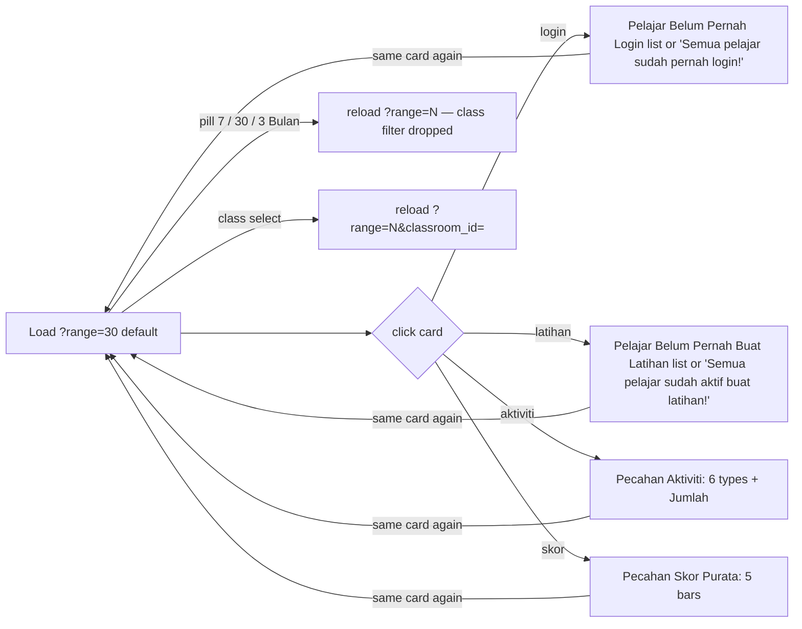
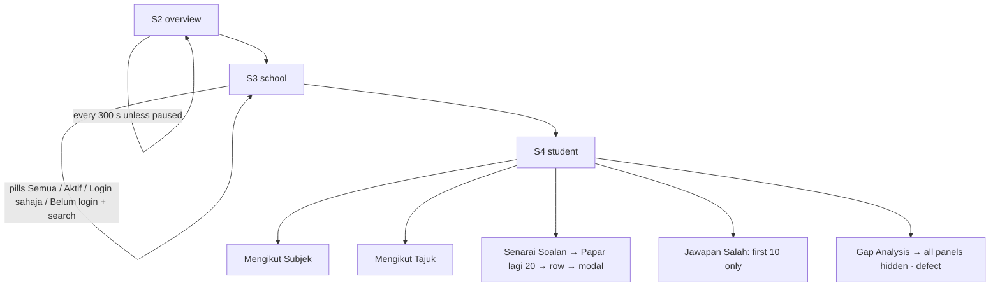

# M11 — Teacher Portal: Analytics & Reports (Discovery)

- **Source:** live read-only walk-through of https://prestasiplus.my on 2026-09-25 with the admin account (browser lane 2, `playwright2`).
- **Screenshots:** `docs/discovery/img/M11/` (31 files). Every page was masked in the DOM before capture. The shells (user portal `SHU`, admin panel `SHA`) and design tokens are in [00-global-ui.md](00-global-ui.md) and are not repeated here.
- **Language:** UI copy is quoted in its exact Bahasa Melayu. Some strings are English on live ("Active", "Tracking A", "Battle", "Gap Analysis", "Drill-Down", "Table Pelajar", "Table Guru", "Best", "Refresh", "hands-on", "Legenda").
- **Personal data (students are minors):** `tools/jobs/M11.js` → `M11MASK` runs before every inventory and screenshot. It masks:
  - student and teacher names: monitoring table links and the e-mail line under them, the drill-down `<h2>` and the admin top bar / breadcrumb / `<title>` that echo it, the laporan student lists;
  - person names embedded in Alpine search expressions (`'<name>'.includes(studentSearch.toLowerCase())`);
  - school names (`<school>`) and school codes (`<kod>`) in tables, the weekly table, attention/suggestion sentences, headers and titles;
  - avatars (`ui-avatars.com/api/?name=…` URLs removed) and person-record ids in links and in the location (`/pelajar/{id}`, `/guru/{id}`).

  Then `tools/sanitize.js` runs with `{selectors:['.m11n'], titleName:false}`. The "Nama" and "Pelajar" table columns are masked by `sanitize.js` itself. Only structure, counts, percentages, subject names and question text are kept (question text is not personal data).
- **Seed snapshot (added in audit top-up):** `docs/discovery/inventory/M11/_snapshot-2026-09-25.json`, captured **2026-09-25 19:24:59–19:26:29 MYT** (11:24:59Z) in one pass: S2 for all four periods (every row with its live school id, every weekly cell with its colour class, KPI cards, lists), S3 for all 34 linked schools (cards, subscription, warning box, status and flag counts, pill results, row-level x-show booleans), S5 for 8080 and S4 topic rows for Student A (2008). School names are `<school:{id}>` tokens; no person names or e-mails. Live values drift (Soalan Dijawab 472,261 at discovery → 472,371 at the snapshot); **the snapshot is the seed source**. Per-school summary: Appendix A.5.
- **Element inventory:** 937 content elements over 8 screens and 63 captured UI states (819 from discovery + 118 appended in the audit top-up; all earlier IDs unchanged), with IDs `EL-M11-S#-nnn`, in `docs/discovery/inventory/M11/<S#-key>.json`. Reconciliation, the crawl and read-only limits are in `docs/discovery/inventory/M11/_summary.md`.
- **Safety:**
  - Nothing was exported, printed or submitted. The monitoring "PDF" and "CSV" links (`/admin/monitoring/export/{pdf|csv}?…`) were recorded from their `href` only and never opened. The monitoring filter form ("Tapis", "Refresh") was never submitted; filters were driven by URL query strings on `/guru/monitoring`.
  - No quiz or practice session was opened.
  - Client-side reveals only: card expanders, tabs, filter pills, the search box, "Papar lagi", the question modal (its data is already in the page), the guide close (Alpine state only; `localStorage` was not written) and the auto-refresh pause.
  - Scripted GETs ran one at a time with at least 350 ms between navigations.

Cross-references (owned elsewhere, not re-inventoried):
- `/prestasi/kelas` and `/prestasi/kelas/{id}` (class performance) → **M08 S4/S5**. The teacher sidebar item "Prestasi" of the PENILAIAN group points to `/prestasi/kelas`.
- `/analitik/kelas` (adaptive class analytics) → **M08 S8**.
- `/analisa-item/kelas[/{id}]` (item-analysis board "Papan Guru") → **M08 S10/S11**. See §1.2 for how it relates to `/guru/analisis-item`.
- `/admin/monitoring` and its `/admin/monitoring/sekolah/…` tree → **M17** (TRACKER). `/guru/monitoring*` renders the same templates (§1.2).
- `/admin/kirkpatrick/pelajar/{id}` (linked from S3 for inactive students) → **M12**.
- `/amaran` "Amaran Awal" (same sidebar group as "Laporan") → **M18** (TRACKER).

---

## 1. Overview

The TRACKER checklist has 5 M11 routes (plus `/prestasi/kelas`, owned by M08). The crawl found **8 screens** because `/guru/monitoring` opens a 3-level drill-down:

| # | Route | Tab title (`<title>`) · shell header title / subtitle | Status on admin account |
|---|---|---|---|
| S1 | `/guru/laporan` (`?range=7\|30\|90&classroom_id=`) | "Laporan Statistik - Portal Guru" · SHU "Laporan Statistik" / "Pantau penglibatan dan prestasi pelajar" | 200. Class select empty (admin owns no class); activity data empty; login counts populated |
| S2 | `/guru/monitoring` (`?period=&state=&tahap=`) | "Monitoring Penglibatan Sekolah - Admin" · **SHA** "Monitoring Penglibatan" / "Pantau penglibatan sekolah & pelajar T4/T5 dalam platform" | 200. Full data (57 schools) |
| S3 | `/guru/monitoring/sekolah/{id}` (**new**) | "{sekolah} - Monitoring" · SHA "Detail Sekolah" / breadcrumb "Monitoring" → `/admin/monitoring` / "{sekolah}" | 200; unknown id → 404 |
| S4 | `/guru/monitoring/sekolah/{id}/pelajar/{id}` (**new**) | "{nama} - Detail Pelajar" · SHA "Detail Pelajar" / breadcrumb "Monitoring" / "{sekolah}" → `/admin/monitoring/sekolah/{id}` / "{nama}" | 200; unknown id → 404 |
| S5 | `/guru/monitoring/sekolah/{id}/guru/{id}` (**new**) | "{nama} - Detail Guru" · SHA "Detail Guru" / same breadcrumb pattern | 200; unknown id → 404 |
| S6 | `/guru/analisis-item` (`?subject_id=&classroom_id=`) | "Analisis Item Soalan - Portal Guru" · SHU "Analisis Item Soalan" / "Kenal pasti soalan yang sukar dan indeks diskriminasi" | 200, always empty for admin ("Tiada data analisis item untuk paparan ini.") |
| S7 | `/guru/perbandingan-kelas` | "500 - Ralat Pelayan \| PRESTASIPLUS" (standalone error page) | **500** (also with `?classroom_id=4`); content not observable |
| S8 | `/guru/laporan-mingguan-kelas` | "403 - Akses Ditolak \| PRESTASIPLUS" (standalone error page) | **403** (also `?week=1`, `/4`); content not observable |

Other access outcomes found by probing (recorded as states or in §7):
- `/guru/laporan/4`, `/guru/analisis-item/1`, `/guru/perbandingan` → **404** "Halaman Tidak Dijumpai".
- `/guru/monitoring/sekolah/99999999`, `…/pelajar/99999999`, `…/guru/99999999` → **404**.
- `/guru/monitoring/sekolah/940/pelajar/{id of a student of school 8080}` → **200** and shows that student (the school segment is not checked; D-M11-10).
- `/guru/laporan?range=999` → 200, falls back to 30 days ("30 Hari" active).

**Entry points:**
- User-portal sidebar (SHU), group "Portal Guru" (collapsed and `display:none` for the admin account):
  - PENILAIAN: "Headcount" → `/headcount` (M08), "Prestasi" → `/prestasi/kelas` (M08), **"Laporan"** (`fa-chart-pie`) → `/guru/laporan`, "Amaran Awal" (`fa-exclamation-triangle`) → `/amaran` (M18).
  - ANALITIK: **"Monitoring"** (`fa-binoculars`) → `/guru/monitoring`, "Kirkpatrick" submenu (M12), **"Analisis Item"** (`fa-chart-pie`) → `/guru/analisis-item`, **"Perbandingan Kelas"** (`fa-balance-scale`) → `/guru/perbandingan-kelas`, **"Laporan Mingguan"** (`fa-calendar-week`) → `/guru/laporan-mingguan-kelas`.
- Admin panel sidebar (SHA), ANALITIK group: "Monitoring" → `/admin/monitoring` (M17; highlighted as active only on `/admin/*`, never on `/guru/monitoring*` — D-M11-12).
- S2 → S3 → S4/S5 drill-down links all point to the **`/admin/…` twins**, not to `/guru/…`.

### 1.1 Shell by screen and role

| Screen | Shell | Evidence |
|---|---|---|
| S1, S6 | `SHU` user portal (top bar with koin / mata / streak, notification bell, "Portal Guru" sidebar group) | title suffix "- Portal Guru"; 30 `/guru/*` links in the sidebar |
| S2–S5 | `SHA` admin panel ("Panel Pentadbir" sidebar, server-status chips "Load: … / 8 cores", RAM, disk, "Uptime") | title suffix "- Admin" / "- Monitoring" / "- Detail Pelajar" / "- Detail Guru"; ~100 `/admin/*` links; `fetch('/admin/server-status')` every 30 s |
| S7, S8, 404 states | none (standalone error layout) | — |

A `/guru/*` route (S2–S5) rendering the admin layout is live behaviour for the admin account. What a teacher account sees is not observable (Q-M11-1).

### 1.2 Relationship to M08 and M17 views

| M11 route | Compared with | Verdict |
|---|---|---|
| `/guru/analisis-item` (S6) | M08 S10/S11 `/analisa-item/kelas[/{id}]` "Analisa Item — Papan Guru" | **Different view.** S6 has a GET filter form (Mata Pelajaran `subject_id` with 31 subjects + Kelas `classroom_id`) in the SHU layout, a legend based on **percentage correct** ("> 70% (Mudah)", "40–70% (Sederhana)", "< 40% (Sukar)") and "Diskriminasi: >0.3 = baik, <0 = semak semula". M08 S11 has no filter form, is per class, classifies by the **difficulty index** (Sukar when index > 0.70) and uses a 4-band discrimination legend (≥ 0.40 / 0.30–0.39 / 0.20–0.29 / < 0.20). The thresholds contradict each other (D-M11-9). S6's populated table was never observable. Build them as two components; they share only the concept. |
| `/guru/monitoring` (S2) | M17 `/admin/monitoring` | **Same template.** Normalised `<main>` markup has identical length (221,285 chars) on both URLs; the filter form, "Reset" and export links of S2 all target `/admin/monitoring*`. Only difference: the admin sidebar item "Monitoring" is highlighted on `/admin/monitoring` and not on `/guru/monitoring`. |
| `/guru/monitoring/sekolah/{id}` (S3), `…/pelajar/{id}` (S4), `…/guru/{id}` (S5) | M17 `/admin/monitoring/sekolah/…` | **Same templates** (identical markup length: 251,999 and 122,784 chars; only live timestamps differ). |
| — | M08 S5 `/prestasi/kelas/{id}`, S8 `/analitik/kelas` | Not duplicated by any M11 screen. |

**Recommendation for the URS writer:** own the monitoring tree once. It is reached from both `/guru/monitoring` (M11) and `/admin/monitoring` (M17); M11 inventoried it first, so M17 can reuse S2–S5. Build one component set mounted on both route prefixes.

---

## 2. Screens

### 2.1 S1 — `/guru/laporan` "Laporan Statistik"

Screenshots: `laporan-desktop.png`, `laporan-tablet.png`, `laporan-mobile.png`, `laporan-card-login.png`, `laporan-card-aktiviti.png`, `laporan-card-skor.png`.

- **Filter card** ("Tapis:" with `fa-filter` indigo-500):
  - GET form `#filterForm` → `/guru/laporan`: hidden `range` (current value) + select `classroom_id` `onchange="this.form.submit()"` (`sm:w-64`, rounded-xl) with only "Semua Kelas" ('') for the admin (no class owned).
  - Range pills (links, `bg-slate-100` track): "7 Hari" → `?range=7`, "30 Hari" → `?range=30`, "3 Bulan" → `?range=90`. Active pill `bg-white shadow-sm text-indigo-700`; inactive `text-slate-500 hover:text-slate-700`. Default range 30. Unknown value → 30.
  - The pills link to `?range=N` only, so switching range **drops `classroom_id`**; changing the class keeps the range (hidden input).
- **4 summary cards** (`grid-cols-2 lg:grid-cols-5`, each a click target `@click="expanded = expanded === 'x' ? null : 'x'"`; the open card gets `ring-2 ring-{colour}-400`; chevron rotates 180°):

  | Card | Tile / colours | Example (admin, 30 days) | Lines |
  |---|---|---|---|
  | "Pernah Login" | `fa-sign-in-alt` on blue-500; blue-50→blue-100, border blue-200 | "54%" | "**1708** / 3152 pelajar"; red-500 "`fa-exclamation-circle` 1444 belum pernah login" (shown only when > 0, INFERRED); "Klik untuk lihat senarai" |
  | "Pernah Buat Latihan" | `fa-pencil-alt` emerald-500 | "0%" | "**0** / 0 pelajar"; "Klik untuk lihat senarai" |
  | "Jumlah Aktiviti" | `fa-chart-bar` purple-500 | "0" | "30 hari lepas" (follows range: "7 hari lepas", "90 hari lepas"); empty chip row (INFERRED per-type chips when > 0); "Klik untuk lihat pecahan" |
  | "Skor Purata" | `fa-star` amber-500 | "-%" | empty chip row; "Klik untuk lihat pecahan" |

- **Expanded panels** (`x-show` + `x-collapse`, one at a time; clicking the same card again closes it — captured `card-toggle`):
  - login: h4 "`fa-user-slash` Pelajar Belum Pernah Login (0)" → "`fa-check-circle` Semua pelajar sudah pernah login!" (emerald-600).
  - latihan: h4 "`fa-moon` Pelajar Belum Pernah Buat Latihan (0)" → "Semua pelajar sudah aktif buat latihan!".
  - aktiviti: h4 "`fa-chart-pie` Pecahan Aktiviti (30 Hari Lepas)" (follows range: "(7 Hari Lepas)", "(90 Hari Lepas)"); 7 tiles (`grid-cols-2 sm:grid-cols-3 lg:grid-cols-7`): "Kuiz" (`fa-question-circle`, indigo-600), "Struktur" (`fa-list-ol`, teal-600), "Latih Tubi" (`fa-dumbbell`, emerald-600), "Tracking A" (`fa-crosshairs`, blue-600), "Battle" (`fa-bolt`, rose-600), "Permainan" (`fa-gamepad`, amber-600), "Jumlah" (`fa-sigma`, purple-700).
  - skor: h4 "`fa-chart-bar` Pecahan Skor Purata"; 5 bar cards (Kuiz, Struktur, Latih Tubi, Tracking A, Battle — **no Permainan**), each "-%" in red-500 with a red-400 bar at `width: 0%`.
- **"Trend Aktiviti"** card (`fa-chart-line` indigo-500, "30 hari lepas" / "7 hari lepas" / "90 hari lepas"), `h-64` canvas `#trendChart` (§6.1).
- **"Paling Aktif"** (`fa-trophy` amber-500) → "Belum ada aktiviti" (slate-400) for the admin. The populated list was not observable.
- **"Belum Pernah Buat Latihan"** (`fa-moon` slate-400): 10 rows (first 10; INFERRED cap). Each row: avatar (`ui-avatars.com` initials, background #94a3b8), name (semibold, truncate), e-mail (10px slate-400), right label "Belum pernah login" (10px red-400). Rows after the first get `border-t border-slate-50`.
- Contradictions on the same page (D-M11-1): the card says "1444 belum pernah login" while its panel says "(0)" / "Semua pelajar sudah pernah login!"; "Pernah Buat Latihan 0 / 0 pelajar" uses a denominator of 0 while "Pernah Login" uses 3152; the "Belum Pernah Buat Latihan" list shows 10 students while the latihan panel says "(0)" / "Semua pelajar sudah aktif buat latihan!".

### 2.2 S2 — `/guru/monitoring` "Monitoring Penglibatan"

Screenshots: `monitoring-desktop.png`, `monitoring-tablet.png`, `monitoring-mobile.png`, `monitoring-mobile-tables.png`, `monitoring-guide-hidden.png`, `monitoring-filter-empty.png`.

Page `<style>`: `html { scroll-behavior: smooth; } [id^="section-"] { scroll-margin-top: 80px; }`.

- **Guide** (`x-data="{ showGuide: localStorage.getItem('hideMonitoringGuide') !== 'true' }"`):
  - Card (indigo-50→blue-50) h3 "`fa-book-open` Panduan Monitoring Penglibatan"; close ✕ (`fa-times`, top-right) → `showGuide = false; localStorage.setItem('hideMonitoringGuide', 'true')`. When hidden, a text button "`fa-question-circle` Tunjuk panduan penggunaan" → `showGuide = true; localStorage.removeItem('hideMonitoringGuide')`. The choice persists per browser (localStorage).
  - 6 tiles (`grid-cols-1 sm:grid-cols-2 lg:grid-cols-3`), each an in-page anchor (dotted underline):
    - "`fa-th-large` Kad Ringkasan" → `#section-ringkasan`: "Gambaran keseluruhan — berapa sekolah, pelajar, yang aktif, dan soalan dijawab. **% Penglibatan** = berapa ramai pelajar yang pernah jawab sekurang-kurangnya 1 soalan."
    - "`fa-chart-bar` Table Pelajar" → `#section-pelajar`: "Setiap sekolah mengikut **% pelajar aktif**. Klik nama sekolah untuk drill-down." + "**Cemerlang** >60% | **Sederhana** 20-60% | **Rendah** <20% | **Tiada** 0%" (green-600 / orange-600 / red-600 / slate-500). This omits "Kritikal" (D-M11-3).
    - "`fa-chalkboard-teacher` Table Guru" → `#section-guru`: "Berapa guru yang **pernah login** ke platform mengikut sekolah."
    - "`fa-calendar-week` Tracking Mingguan" → `#section-mingguan`: "Soalan dijawab setiap minggu. Hijau = naik. Merah = turun. **Best** = minggu paling aktif."
    - "`fa-exclamation-triangle` Perhatian & Cadangan" → `#section-perhatian`: "Sekolah yang **perlu tindakan** — pelajar daftar tapi tak guna, guru login tapi murid tak aktif. Ada cadangan susulan."
    - "`fa-mouse-pointer` Drill-Down" → `#section-pelajar`: "Klik **nama sekolah** → senarai pelajar & guru. Klik **nama pelajar aktif** → detail soalan, jawapan salah, subjek kuat/lemah."
  - Tip bar: "`fa-lightbulb` **Tip:** Guna Filter untuk tapis negeri/tempoh/tahap. Export PDF/CSV untuk pembentangan."
- **Filter form** `GET /admin/monitoring` (it leaves `/guru/monitoring`; D-M11-4). The selects preload the current query values (observed `period=7d` selected):
  - "Tempoh" `period`: "Semua Masa" (''), "7 Hari" (7d), "30 Hari" (30d), "3 Bulan" (3m).
  - "Negeri" `state`: "Semua Negeri" (''), Johor, Kedah, Kelantan, Kuala Lumpur, Melaka, Pahang, Perak, Sabah, Selangor, Terengganu (10; only states with registered schools, INFERRED).
  - "Tahap" `tahap`: "Semua Tahap" (''), Cemerlang, Sederhana, Rendah, Kritikal, "Tiada Langsung".
  - "`fa-filter` Tapis" (submit, indigo-600).
  - "Reset" link → `/admin/monitoring`, shown only when a filter is set (observed on `period=`, `state=`/`tahap=` states).
  - Right group (`ml-auto`): "`fa-file-pdf` PDF" (red-600) → `/admin/monitoring/export/pdf?{current query}`; "`fa-file-csv` CSV" (green-600) → `/admin/monitoring/export/csv?{current query}` (not opened); "`fa-sync-alt` Refresh" (slate-500, **submit button of the same GET form**). A hidden `_token` input sits inside the GET form, so a submit puts the CSRF token in the URL (D-M11-5).
- **Auto-refresh** (`x-data="autoRefresh()"`, right-aligned, slate-400): "`fa-clock` Auto-refresh dalam {m:ss}" (starts at "5:00", 300 s; `window.location.reload()` at 0) + a pause/play toggle (`fa-pause` while running, `fa-play` when paused). Resuming at 0 restarts from 300 s.
- **`#section-ringkasan` — 9 KPI cards.** Row 1 (`grid-cols-2 sm:grid-cols-2 lg:grid-cols-3 xl:grid-cols-6`):

  | Label | Value (default) | Sub-line (icon) | Gradient / icon tile |
  |---|---|---|---|
  | Jumlah Sekolah | 57 | "Berdaftar" (`fa-school`) | blue-50→indigo-50; blue-500→indigo-600 |
  | Pelajar T4/T5 | 4,158 | "Berdaftar" (`fa-user-graduate`) | indigo→violet |
  | Pernah Aktif | 1,462 | "Min. 1 soalan" (`fa-check-circle`) | emerald→green |
  | % Penglibatan | 35.2% | "Keseluruhan" (`fa-chart-line`; tile `fa-percentage`) | amber→orange |
  | Soalan Dijawab | 472,261 | "Total" (`fa-pen`) | purple→fuchsia |
  | Purata/Pelajar | 323 | "Soalan/pelajar aktif" (`fa-calculator`) | rose→pink |

  Row 2 (`grid-cols-2 sm:grid-cols-3`): "Guru Berdaftar" 522 (`fa-chalkboard-teacher`, cyan→teal), "Guru Pernah Login" 277 (`fa-sign-in-alt`, teal→emerald), "% Penglibatan Guru" 53.1% (`fa-percentage`, emerald→green). Labels are 10px on mobile and `sm:text-sm`; values `text-xl sm:text-3xl`.
- **`#section-pelajar` "`fa-chart-bar` Analisis Penglibatan Pelajar T4/T5"** / "Mengikut sekolah — disusun mengikut % penglibatan tertinggi" / right "33 sekolah":
  - Table in `overflow-x-auto` with a right fade (`w-8 bg-gradient-to-l from-white`, `lg:hidden`): # (mono) · Sekolah (link `<school>` → `/admin/monitoring/sekolah/{id}` + "{kod} · {negeri}" 10px) · Daftar · Aktif · % (bold `text-lg`, tahap colour) · Tahap (white pill on tahap colour) · Bar (`min-w-[140px]`, h-4 track).
  - Tahap colours: Cemerlang `#15803d`, Sederhana `#ea580c`, Rendah `#dc2626`, Kritikal `#991b1b`, "Tiada Langsung" `#6b7280`.
  - Bar variants: (a) Cemerlang/Sederhana rows: filled bar with the % label inside (white 9px); (b) Rendah/Kritikal rows: bar + % label outside (10px, tahap colour), bar width never below 3% (0.1% and 2.2% render at 3%); (c) 0%: empty track + slate-400 "0%".
  - Legend: "Legenda:" dots "Cemerlang (> 60%)", "Sederhana (20-60%)", "Rendah (5-20%)", "Kritikal (< 5%)", "Tiada Langsung (0%)".
  - Default counts by tahap: 8 Cemerlang, 7 Sederhana, 1 Rendah, 2 Kritikal, 15 Tiada Langsung (33 rows).
- **`#section-guru` "`fa-chalkboard-teacher` Analisis Penglibatan Guru"** (amber-500 icon) / same subtitle / "13 sekolah": # · Sekolah · Daftar · Login · % · Tahap · Bar (same bands; observed 6 Cemerlang, 7 Sederhana). Legend adds "Tiada Guru (0 daftar)".
- **`#section-mingguan` "`fa-calendar-week` Tracking Mingguan"** / "Jumlah soalan dijawab mengikut minggu — warna menunjukkan trend naik/turun":
  - Columns: Sekolah (sticky left, `max-w-[200px] truncate`, `title=` name, code under it 9px) · M1 … M32 (`title="dd/mm - dd/mm"`) · Trend · Best. 33 rows.
  - Weeks run Monday–Sunday from **M1 = 16/02 - 22/02** to **M32 = 21/09 - 25/09** (the last week is cut at today). Footer lists every week: "**M1**: 16/02 - 22/02" … "**M32**: 21/09 - 25/09".
  - Cell classes (mono, semibold): 0 → "-" `bg-slate-50 text-slate-300`; M1 > 0 → `bg-blue-50 text-blue-700`; later weeks compare with the **previous cell, 0 included**: higher → `bg-green-50 text-green-700` (so the first week after a gap is green), lower → `bg-red-50 text-red-600`, **equal (> 0) → `bg-blue-50 text-blue-700`**; the maximum week also gets `ring-2 ring-amber-400 ring-inset` (OBSERVED on every cell of the four periods in the snapshot, 0 exceptions; corrected after audit). Rows are ordered by total descending, ties by school id ascending (added in audit top-up). Numbers use thousands separators ("13,516").
  - Trend icon (`text-lg`): `fa-arrow-up text-green-500` title "Meningkat", `fa-arrow-down text-red-500` title "Menurun", `fa-minus text-slate-400` title "Sama". Default: 2 up, 4 down, 27 "Sama".
  - Best: "M16" (amber-600, semibold) + value (10px slate-400) or "-" (slate-300) when no answers.
- **`#section-perhatian`** (`grid-cols-1 lg:grid-cols-2`):
  - "`fa-trophy` Sekolah Terbaik" (`border-l-4 border-green-500`): up to 3 × "`fa-star` {sekolah} — 100% penglibatan (1/1 pelajar aktif)" — only Cemerlang schools, in table order (7d: 1, 3m: 2; corrected after audit).
  - "`fa-exclamation-triangle` Perhatian Segera" (`border-l-4 border-red-500`, 18 items = every Rendah, Kritikal and Tiada Langsung school in table order, `fa-exclamation-circle` red-400) — sentence templates in §5.2.
  - "`fa-lightbulb` Cadangan Tindakan" (`border-l-4 border-blue-500 lg:col-span-2`, `grid-cols-1 sm:grid-cols-2` tiles `bg-blue-50/50`, `fa-arrow-right` blue-400, 20 items at discovery, 17 in the snapshot = one per Kritikal / Tiada Langsung school; Rendah schools get none) — templates in §5.2.
  - When nothing qualifies (e.g. `state=Kelantan&tahap=Cemerlang`) the section is one card: "Tiada pemerhatian yang perlu diberi perhatian buat masa ini.".
- **Filter effects (observed):**

  | State | Cards | Pelajar table | Guru table | Weekly | Notes |
  |---|---|---|---|---|---|
  | default | 57 · 4,158 · 1,462 · 35.2% · 472,261 · 323 · 522 · 277 · 53.1% | 33 | 13 | 33 | — |
  | `period=7d` | 57 · 4,158 · 44 · 1.1% · 7,586 · 172.4 · 522 · 277 · 53.1% | 33 (1/0/1/4/27) | 13 | 33 unchanged | period affects student activity only |
  | `period=3m` | 57 · 4,158 · 298 · 7.2% · 86,587 · 290.6 · 522 · 277 · 53.1% | 33 (2/2/3/2/24) | 13 | unchanged | — |
  | `state=Selangor&tahap=Kritikal` | 28 · 4,042 · 1,424 · 35.2% · 460,748 · 323.6 · 517 · 273 · 52.8% | 2 (Kritikal only) | 10 (not filtered by tahap) | 21 | tahap filters only the pelajar table |
  | `state=Kelantan&tahap=Cemerlang` | 2 · 0 · 0 · 0% · 0 · 0 · 0 · 0 · 0% | 0 ("0 sekolah", empty `tbody`, no message) | 0 | 0 rows (headers stay) | empty perhatian card |

### 2.3 S3 — `/guru/monitoring/sekolah/{id}` "Detail Sekolah" (new route)

Screenshots: `sekolah-desktop.png`, `sekolah-filter-never.png`, `sekolah-mobile.png`, `sekolah-no-teacher.png`.

- Top bar: "Detail Sekolah" + breadcrumb "`fa-arrow-left` Monitoring" → `/admin/monitoring` / "{sekolah}".
- **Header card:** h2 school name; "`fa-hashtag` {kod}", "`fa-map-marker-alt` {negeri}", subscription pill "`fa-circle` Active — sehingga 12 May 2027" (green-100/700; English label and English month), "Cancelled — sehingga 12 May 2027" (8102, 8228) or "Expired — sehingga 22 May 2026" (8107), both `bg-slate-100 text-slate-500` (added in audit top-up), or — without a subscription — plain text "Tiada langganan" (`text-xs text-slate-400`, not a pill; corrected after audit); right: tahap pill "Cemerlang — 89.7%" (white on the tahap colour, `px-4 py-2 rounded-full`).
- **5 cards** (`grid-cols-2 lg:grid-cols-5`): "Pelajar T4/T5" 184, "Pernah Aktif" 165, "Soalan Dijawab" 53,494, "Guru Berdaftar" 34, "Guru Pernah Login" 34.
- **"`fa-user-graduate` Senarai Pelajar T4/T5"** (`x-data="{ studentFilter: 'all', studentSearch: '' }"`):
  - Pills: "Semua (184)" (active `bg-indigo-600 text-white`), "● Aktif (165)" (green-100/700 → active green-600), "Login sahaja" (amber-100/700 → amber-600), "Belum login" (slate-100/500 → red-600). Only the first two show counts. **The "Aktif (n)" count is S3 "Pernah Aktif" (ditapis excluded), but the pill shows every answered row including the ditapis ones: at 8080 "Aktif (165)" shows 174 rows** (153 plain + 10 "Perlu Semak" + 9 "ditapis" + 2 answered without a login; D-M11-19; corrected after audit).
  - Search input "Cari nama pelajar..." (`x-model="studentSearch"`, `sm:w-64`) — client-side, lower-cased `includes` on the full name; no "no result" message (captured `search-none`: every row hidden, table header stays).
  - Warning box (amber-50/200/800) "⚠ **19 akaun** menunjukkan aktiviti luar biasa (kelajuan menjawab tidak munasabah — perlu semak). **9** daripadanya dikecualikan dari peratus penglibatan kerana corak seperti automasi. Angka penglibatan di atas ialah nilai tulen selepas tapis." (absent when there are no flagged accounts, school 940). Variant when no account is excluded (added in audit top-up): "⚠ **3 akaun** menunjukkan aktiviti luar biasa (kelajuan menjawab tidak munasabah — perlu semak). Angka penglibatan di atas ialah nilai tulen selepas tapis." (8087; 10220 "1 akaun") — the "{n} daripadanya dikecualikan …" sentence appears only when excluded > 0. Snapshot flagged/excluded: 8078 18/4, 8080 19/9, 8082 20/14, 8090 10/5, 8106 16/3, 8087 3/0, 10220 1/0.
  - Table: # · Nama · Tingkatan · Soalan · Status · Login Terakhir · Aktiviti Terakhir (dates "dd/mm/yyyy HH:mm", "-" when none).
    - Nama: active students link (indigo-600) → `/admin/monitoring/sekolah/{id}/pelajar/{id}`; inactive students (row `opacity-60`, slate-500) link → `/admin/kirkpatrick/pelajar/{id}` (M12). The e-mail is shown under the name (10px slate-400).
    - Flag badges under the name (9px): "⚠ Perlu Semak" (amber-100/700, `title="Aktiviti luar biasa (kelajuan menjawab tidak munasabah) — perlu semak."`) and "⚠ Perlu Semak · ditapis" (rose-100/700, title adds " Dikecualikan dari peratus penglibatan.").
    - Tingkatan shows two formats in one column: "T5" and "Tingkatan 5" (D-M11-7).
    - Soalan: indigo-600 (> 0) or slate-300 "0".
    - Status pill: "Aktif" (green-100/700), "Login sahaja" (amber-100/700), "Belum login" (slate-100/500).
    - Row visibility (OBSERVED from each row's `x-show` and by clicking the pills on all 34 schools; corrected after audit): Aktif = ≥ 1 answer; Login sahaja = 0 answers and a login; **Belum login = no login, so it also lists answered rows without a login** (8080: 6 "Belum login" + 2 Aktif = 8 rows, + the apostrophe row of D-M11-18, which shows under every pill; 8080 pill results: Semua 184, Aktif 174, Login sahaja 5, Belum login 9). Template: `(studentFilter === 'all' || (studentFilter === 'active' && isActive) || (studentFilter === 'login' && !isActive && hasLogin) || (studentFilter === 'never' && !hasLogin)) && (studentSearch === '' || '{nama}'.includes(studentSearch.toLowerCase()))`.
    - Order: grouped by the raw Tingkatan string ("T5" rows first, then "Tingkatan 5"), then by name A→Z. Not paginated (184 rows).
- **"`fa-chalkboard-teacher` Senarai Guru (34)"** (`x-data="{ teacherFilter: 'all' }"`): pills "Semua", "Pernah Login", "Belum Login"; table # · Nama (link → `/admin/monitoring/sekolah/{id}/guru/{id}` + e-mail) · Status ("Pernah login" green-100/700 or INFERRED "Belum login") · Login Terakhir · Daftar ("dd/mm/yyyy"). "Belum Login" on this school shows no rows and no message.
- No teacher: "Senarai Guru (0)" + "Tiada guru berdaftar untuk sekolah ini." (slate-400, centred).
- Unknown id → 404 "Halaman Tidak Dijumpai".

### 2.4 S4 — `/guru/monitoring/sekolah/{id}/pelajar/{id}` "Detail Pelajar" (new route)

Screenshots: `pelajar-desktop.png`, `pelajar-topic.png`, `pelajar-senarai.png`, `pelajar-wrong.png`, `pelajar-gaps-blank.png`, `pelajar-modal.png`, `pelajar-mobile.png`, `pelajar-modal-mobile.png`.

- Top bar "Detail Pelajar" + breadcrumb "Monitoring" → `/admin/monitoring` / "{sekolah}" → `/admin/monitoring/sekolah/{id}` / "{nama}".
- Header card: `fa-user-graduate` tile (indigo-100), h2 name, "{e-mail} · T5" (or "· Tingkatan 5"), "Aktiviti Terakhir: 16/06/2026 14:19".
- **4 cards:** "Soalan Dijawab" 71, "Betul" 53, "Salah" 18, "Ketepatan" 74.6% (value colour green-700 ≥ 70, amber-700 50–69.9 (observed 63.4%, 65%), INFERRED red-700 < 50).
- **Tabs** (`x-data="{ tab: 'subject' }"`; active `bg-indigo-600 text-white shadow-md`, inactive white bordered): "`fa-book` Mengikut Subjek", "`fa-layer-group` Mengikut Tajuk", "`fa-list` Senarai Soalan", "`fa-times-circle` Jawapan Salah {n}" (red count chip), "`fa-crosshairs` Gap Analysis {n}" (amber count chip).
  - **Mengikut Subjek** (default): one row per subject — name (`w-28 sm:w-36`, truncate), h-5 bar with "{p}%" inside (1 decimal), "{betul}/{jumlah}". Bar colour: green-500 ≥ 70, amber-500 50–69.9, red-500 < 50 (observed 20…100).
  - **Mengikut Tajuk**: grouped by subject (uppercase indigo-600 label); rows "Bab n" (or blank for "Umum") · topic name · "{p}%" · "{b}/{j}" · badge "Kuat" (green-100/700, ≥ 80), "Sederhana" (amber-100/700, 50–79.9), "Lemah" (red-100/700, < 50) (observed boundaries 47.4 Lemah, 50 Sederhana, 78.9 Sederhana, 80 Kuat).
  - **Senarai Soalan** "Senarai Soalan ({n} tersedia daripada {n})" (`x-data="{ showAll: 20 }"`): table # · Soalan (indigo-700, truncated to 80 chars + "...", `title` = full text, `fa-external-link-alt`) · Subjek · Jawapan (student's letter, red-600 when wrong / green-600 when right) · Betul (green-600) · Status (`fa-check-circle` green-500 / `fa-times-circle` red-500) · Tarikh. Wrong rows `bg-red-50/30`. Order: newest first. Row click → question modal. Button "`fa-chevron-down` Papar lagi 20 ({shown}/{n})" (`x-show="showAll < n"`) adds 20.
  - **Jawapan Salah** "Jawapan Salah ({n} jawapan, {m} soalan unik)" (`x-data="{ wrongShow: 10 }"`): cards (red-200 border, red-50/30) "#{i} · {Subjek} · {Bab}" + date; question HTML; green box "{letter} {option}" + "Jawapan betul"; red box "{letter} {option}" + "Jawapan pelajar"; blue explanation box (`fa-lightbulb`); "`fa-bookmark` Sumber: {source}". Only the first 10 cards are shown and there is **no control to show more** (D-M11-6).
  - **Gap Analysis** — the panel is a direct child of `<main>` **outside** the `x-data="{ tab }"` scope. It keeps `x-cloak`/`display:none`, so clicking the tab hides every panel and shows nothing (D-M11-2; `pelajar-gaps-blank.png`). Its DOM content (hidden-only in the inventory):
    - h3 "`fa-crosshairs` Gap Analysis & Cadangan Latihan" / "Topik lemah dikesan automatik berdasarkan jawapan pelajar. Soalan latihan dicadangkan untuk isi gap."
    - Gap cards (border and background in the severity colour at 20/05 alpha): topic group name + subject; severity pill "Kritikal" (#991b1b), "Lemah" (#dc2626), "Perlu Perhatian" (#ea580c); h-3 bar (min 3%) + "{p}%"; "{b}/{j} betul"; "`fa-book-open` {n} soalan tersedia untuk latihan".
    - "`fa-star` Topik Kuat": green tiles with a round "{p}%" badge (green-500), topic group name, "{Subjek} · {n} soalan".
    - None: "`fa-check-circle` Tiada topik lemah dikesan!" / "Semua topik yang dicuba mempunyai ketepatan melebihi 60%." (contradicts the "Lemah" topics of the Tajuk tab; D-M11-8).
    - "`fa-exclamation-circle` Subjek Belum Dicuba": slate chips of every subject the student has not tried.
- **"`fa-lightbulb` Pemerhatian"** card (`border-l-4 border-blue-500`, always visible under the tabs): sentences per subject (§5.3).
- **Question modal** (`x-data="questionModal()"`, listens to `open-question-modal.window`; `@click.away` and ✕ close): pill "Betul"/"Salah"; "{subject} · {chapter}"; meta "`fa-bookmark` {source}", "`fa-signal` Aras {difficulty}", "`fa-clock` {answered_at}" (raw "2026-06-16 14:19:57"); question HTML; "Pilihan Jawapan" with option cards (correct `border-green-400 bg-green-50` + "`fa-check-circle` Jawapan Betul"; student's wrong pick `border-red-400 bg-red-50` + "`fa-times-circle` Jawapan Pelajar"); "Pilihan jawapan telah dipadam dari sistem." when there are no options; "`fa-lightbulb` Penjelasan" box when an explanation exists. Modal `max-w-2xl max-h-[85vh] overflow-y-auto`, backdrop rgba(0,0,0,0.5).
- The school segment of the URL is not validated (a student of school 8080 opens under school 940; D-M11-10).

### 2.5 S5 — `/guru/monitoring/sekolah/{id}/guru/{id}` "Detail Guru" (new route)

Screenshots: `guru-desktop.png`, `guru-mobile.png`.

- Header card: `fa-chalkboard-teacher` tile (amber-100), h2 name, e-mail, "Login Terakhir: 15/06/2026 12:37", pill "Pernah Login" (green-100/700).
- 4 cards: "Pelajar T4/T5" 184, "Pelajar Aktif" 174, "% Aktif" 94.6%, "Perlu Perhatian" 10.
- **"`fa-user-graduate` Prestasi Pelajar"**: # · Pelajar · Tingkatan · Soalan · Ketepatan · Status. It lists **every T4/T5 student of the school** (184 rows), not the teacher's classes. Active students link → `/admin/monitoring/sekolah/{id}/pelajar/{id}`; inactive rows (`opacity-50`) show the name as plain text, Soalan "0" and Ketepatan "-" (slate-300). Ketepatan colours: green-600 ≥ 70, amber-600 50–69.9, red-600 < 50 (observed 40…100).
- **"`fa-lightbulb` Cadangan Tindakan"**: red box "`fa-exclamation-triangle` 8 pelajar belum pernah login. Cadangan: Adakan sesi pengenalan platform di kelas."; red box "3 pelajar aktif mempunyai ketepatan bawah 50%. Cadangan: Beri perhatian khas kepada pelajar ini."; green box "`fa-check-circle` 174 pelajar telah mula menjawab soalan. Galakkan mereka kekalkan momentum."
- The numbers disagree with S3 for the same school: S3 "Pernah Aktif 165" / "Cemerlang — 89.7%" (after excluding 9 automated accounts) vs S5 and S2 "174" / "94.6%" (D-M11-11). S5 status counts (added in audit top-up): Aktif 174, Login sahaja 4, Belum login 6; accuracy bands of the 174: 3 < 50, 57 at 50–69.9, 114 ≥ 70; 10 rows "-".

### 2.6 S6 — `/guru/analisis-item` "Analisis Item Soalan"

Screenshots: `analisis-item-desktop.png`, `analisis-item-tablet.png`, `analisis-item-mobile.png`.

- Filter card, GET form `#filterForm` → `/guru/analisis-item` ("`fa-filter` Tapis:"):
  - "Mata Pelajaran" `subject_id` (`onchange` submit): "Semua Subjek" + 31 subjects sorted A→Z (Appendix A.2).
  - "Kelas" `classroom_id` (`onchange` submit): only "Semua Kelas" for the admin.
- Legend row: emerald-500 dot "> 70% (Mudah)", amber-400 dot "40–70% (Sederhana)", red-500 dot "< 40% (Sukar)", "`fa-info-circle` Diskriminasi: >0.3 = baik, <0 = semak semula".
- Empty card: `fa-chart-pie` (5xl slate-200) "Tiada data analisis item untuk paparan ini." / "Pelajar perlu membuat latihan dahulu." Same for `subject_id=1`, `classroom_id=4`, `classroom_id=228` (classes with data in M08; the filter only accepts the teacher's own classes, INFERRED).
- The populated table was not observable (Q-M11-3).

### 2.7 S7 — `/guru/perbandingan-kelas` (HTTP 500)

Screenshot: `perbandingan-kelas-500.png`. Standalone error page: "500" "⚙️" h1 "Ralat Pelayan" / "Sesuatu tidak kena di pihak kami. Pasukan teknikal telah dimaklumkan. Sila cuba sebentar lagi." / "Halaman Utama" → `/`, "Cuba Semula" → `javascript:location.reload()` / "PRESTASIPLUS". The class-comparison content, its dimensions and charts are **not observable** (D-M11-13, Q-M11-2).

### 2.8 S8 — `/guru/laporan-mingguan-kelas` (HTTP 403)

Screenshot: `laporan-mingguan-kelas-403.png`. The standalone "403" 🚫 "Akses Ditolak" page, identical to M08 S21: "Anda tidak mempunyai kebenaran untuk mengakses halaman ini. Sila log masuk dengan akaun yang betul atau hubungi pentadbir." / "Halaman Utama" → `/`, "Log Masuk" → `/login`. `?week=1` and `/4` give the same. The weekly class report sections are **not observable** (Q-M11-2). The SHU sidebar still lists "Laporan Mingguan" for this account.

---

## 3. Flows

### 3.1 Navigation

```mermaid
flowchart TD
  SB[SHU sidebar · Portal Guru] --> S1[S1 /guru/laporan]
  SB --> S2[S2 /guru/monitoring · admin layout]
  SB --> S6[S6 /guru/analisis-item]
  SB --> S7[S7 /guru/perbandingan-kelas → 500]
  SB --> S8[S8 /guru/laporan-mingguan-kelas → 403]
  SB -. M08 .-> PK[/prestasi/kelas]
  S2 -->|school link| A3[/admin/monitoring/sekolah/id  = S3 template]
  S2 -->|Tapis / Refresh / Reset| AM[/admin/monitoring  M17]
  S2 -. PDF / CSV not opened .-> EX[/admin/monitoring/export/pdf or csv]
  A3 -->|active student| A4[/admin/…/pelajar/id = S4 template]
  A3 -->|inactive student| K[/admin/kirkpatrick/pelajar/id  M12]
  A3 -->|teacher| A5[/admin/…/guru/id = S5 template]
  A5 -->|active student| A4
  A4 -->|breadcrumb| A3
```

### 3.2 Laporan cards (S1)



### 3.3 Monitoring drill-down (S2 → S3 → S4)



---

## 4. Data entities implied

| Entity | Fields seen | Screens |
|---|---|---|
| School (monitoring) | id, name, code (3 letters + 4 digits), state (negeri), subscription status ("Active — sehingga {date}" / "Tiada langganan"), registered T4/T5 students, active students, questions answered, teachers registered, teachers logged in, flagged accounts, excluded accounts | S2, S3 |
| Student (monitoring) | id, name, e-mail, tingkatan (raw "T5" or "Tingkatan 5"), questions answered, correct, wrong, accuracy, status (Aktif / Login sahaja / Belum login), last login, last activity, anomaly flag (Perlu Semak / ditapis) | S3, S4, S5 |
| Teacher (monitoring) | id, name, e-mail, status (Pernah login / Belum login), last login, registration date | S3, S5 |
| Answer | question (HTML), subject, chapter (Bab), topic, selected label, correct label, is_correct, answered_at, source, difficulty (Aras), explanation, options (id, option_label, option_text / option_text_html, is_correct) | S4 |
| Weekly bucket | school × week (M1…M32, Mon–Sun), answered count | S2 |
| Teacher report scope | classroom_id (own classes), range (7/30/90) | S1 |
| Activity type | Kuiz, Struktur, Latih Tubi, Tracking A, Battle, Permainan | S1 |

---

## 5. Metrics, formulas and inferred rules

### 5.1 Laporan (S1)
- **Pernah Login %** = students who ever logged in ÷ students in scope × 100, **integer** (1708 / 3152 = 54.19 → "54%"). "{n} belum pernah login" = students in scope − logged in.
- **Pernah Buat Latihan %** = students with ≥ 1 practice ÷ students in scope (here "0 / 0 pelajar" → "0%"). The denominator differs from Pernah Login's (D-M11-1).
- **Jumlah Aktiviti** = number of activities in the range, split into Kuiz, Struktur, Latih Tubi, Tracking A, Battle, Permainan; "Jumlah" = their sum (INFERRED).
- **Skor Purata** = mean score over the range, "-%" when there are no scored activities; per-type bars for 5 types (bar colour bands not observable, all red-400 at 0).
- **Trend Aktiviti** = activities per day for the last `range` days, labels "dd/mm" from today − (range − 1) to today (7, 30 or 90 labels).
- "Belum Pernah Buat Latihan" list: first 10 students with no practice; right label "Belum pernah login" when they never logged in (INFERRED other label when they did).

### 5.2 Monitoring (S2)
- **% Penglibatan** = Pernah Aktif (students with ≥ 1 answered question in the period) ÷ Pelajar T4/T5 × 100, 1 decimal (1,462 / 4,158 = 35.16 → 35.2%).
- **Purata/Pelajar** = Soalan Dijawab ÷ Pernah Aktif, 1 decimal with ".0" dropped (472,261 / 1,462 = 323.02 → "323"; 7,586 / 44 = 172.4).
- **% Penglibatan Guru** = Guru Pernah Login ÷ Guru Berdaftar (277 / 522 = 53.07 → 53.1%). Not affected by `period`.
- **School tahap** (pelajar table: Aktif ÷ Daftar; guru table: Login ÷ Daftar), percentage with 1 decimal and ".0" dropped ("100%", "50%", "94.6%"): Cemerlang > 60; Sederhana 20–60 (20.0% is Sederhana); Rendah 5–< 20; Kritikal > 0 and < 5; Tiada Langsung = 0. Guru table: "Tiada Guru (0 daftar)" band in the legend.
- **Sort:** both tables by % descending. INFERRED ties keep the server order.
- **Lists:** the pelajar table lists only schools with ≥ 1 T4/T5 student (33 of 57 registered schools); the guru table only schools with ≥ 1 teacher (13). INFERRED from counts.
- **Filters:** `state` filters every section; `period` changes Pernah Aktif / Soalan Dijawab / Purata and the pelajar table, not the guru table or the weekly table; `tahap` filters only the pelajar table.
- **Weekly tracking:** fixed start M1 = Monday 16/02 (INFERRED start of the school year) to today; colour rules in §2.2; **Trend** compares the last week with the one before (INFERRED; "Sama" when equal, including all-zero rows); **Best** = week with the maximum count.
- **Perhatian Segera templates** (monitoring signals, one per school below Sederhana):
  - Rendah: "{sekolah} — {aktif}/{daftar} pelajar aktif ({p}%). Tahap rendah."
  - Kritikal: "{sekolah} — Hanya {aktif}/{daftar} pelajar aktif ({p}%). Tahap kritikal."
  - Tiada Langsung: "{sekolah} — {daftar} pelajar berdaftar tetapi tiada seorang pun yang menjawab soalan. Tiada sebarang tanda penggunaan platform." + " (Nota: {n} guru telah login)" when teachers of that school logged in.
- **Sekolah Terbaik:** up to 3 **Cemerlang** schools in table order (corrected after audit): "{sekolah} — {p}% penglibatan ({aktif}/{daftar} pelajar aktif)".
- **Cadangan Tindakan templates** (OBSERVED mapping over 4 periods; corrected after audit — Rendah schools get **no** suggestion):
  - Kritikal → "{sekolah}: Penglibatan sangat rendah. Cadangan: Sesi motivasi dan demonstrasi penggunaan platform kepada pelajar."
  - Tiada Langsung, no teacher login → "{sekolah}: Hubungi pihak sekolah secara langsung untuk mengenal pasti halangan dan memberi taklimat semula."
  - Tiada Langsung, teachers logged in → "{sekolah}: Guru telah login tetapi murid belum aktif. Cadangan: Adakan sesi hands-on dengan pelajar."
- Counts (snapshot, default): 3 Terbaik + 18 Perhatian (1 Rendah, 2 Kritikal, 15 Tiada) = 21 `li`; 17 Cadangan tiles (2 Kritikal + 15 Tiada; 13 "Hubungi", 2 "hands-on"). 7d: 1 / 32 / 31; 30d: 1 / 32 / 31; 3m: 2 / 29 / 26 (added in audit top-up). The discovery count of 20 tiles is superseded by the snapshot (corrected after audit).

### 5.3 Student / teacher detail (S3–S5)
- **Student status:** Aktif = ≥ 1 answered question; Login sahaja = logged in, 0 answers; Belum login = never logged in and 0 answers. Answered students without a login keep status Aktif with Login Terakhir "-" (8080: 2; 8106: 22; 8078: 11). Per-school counts: Appendix A.5 (added in audit top-up).
- **Anomaly flag** (at-risk data-quality rule): "Perlu Semak" = implausible answering speed; "Perlu Semak · ditapis" = automation-like pattern, excluded from S3's engagement % ("19 akaun … 9 … dikecualikan"). The exact speed threshold is not visible (Q-M11-4).
- **School tahap pill (S3)** = Pernah Aktif (after exclusion) ÷ Pelajar T4/T5 (165 / 184 = 89.7%).
- **Accuracy** = Betul ÷ Soalan Dijawab × 100, 1 decimal (53 / 71 = 74.6%).
- **Accuracy colours** (cards, subject bars, S5 Ketepatan): ≥ 70 green; 50–< 70 amber; < 50 red.
- **Topic strength:** Kuat ≥ 80; Sederhana 50–< 80; Lemah < 50.
- **Gap severity** (hidden panel): Kritikal = 0%; Lemah observed 33.3% and 38.9%; Perlu Perhatian observed 50.0%. INFERRED gap = topic group with accuracy ≤ 50%, which contradicts the empty-state copy "melebihi 60%" (D-M11-8).
- **Pemerhatian templates:** "Kekuatan dalam {Subjek} ({p}% ketepatan). Boleh jadikan motivasi." (INFERRED accuracy ≥ 80) and "Kerap salah dalam {Subjek} ({salah}/{jumlah} salah = {p}% ketepatan). Cadangan: Fokus latihan tambahan." (INFERRED < 50).
- **S5 Perlu Perhatian** = students who are not Aktif (8080: 4 Login sahaja + 6 Belum login = 10; corrected after audit). **Cadangan:** "{n} pelajar belum pernah login. Cadangan: Adakan sesi pengenalan platform di kelas." (n = students **without any login**, i.e. 6 Belum login + 2 Aktif without a login = 8 — not the "Belum login" status count; corrected after audit); "{n} pelajar aktif mempunyai ketepatan bawah 50%. Cadangan: Beri perhatian khas kepada pelajar ini."; "{n} pelajar telah mula menjawab soalan. Galakkan mereka kekalkan momentum." (n = Aktif).

### 5.4 Item analysis (S6) — legend only
- Easiness bands by % correct: > 70 Mudah, 40–70 Sederhana, < 40 Sukar.
- Discrimination: > 0.3 "baik", < 0 "semak semula". Compare M08 §5.3 (difficulty index 1 − p, discrimination upper 27% − lower 27%).

---

## 6. Charts (Chart.js 4, jsDelivr `/npm/chart.js@4/dist/chart.umd.min.js`) and scripts

### 6.1 S1 `#trendChart` — type `line`
```js
new Chart(ctx, { type: 'line',
  data: { labels: ["27/08", …, "25/09"],            // range labels dd/mm (7, 30 or 90)
    datasets: [{ label: 'Aktiviti', data: [0, …, 0],
      borderColor: '#6366f1', backgroundColor: 'rgba(99, 102, 241, 0.1)', fill: true, tension: 0.3,
      pointRadius: 2, pointHoverRadius: 5, borderWidth: 2 }] },
  options: { responsive: true, maintainAspectRatio: false,
    plugins: { legend: { display: false },
      tooltip: { backgroundColor: '#1e293b', titleFont: { size: 11 }, bodyFont: { size: 12 },
        callbacks: { label: ctx => ctx.parsed.y + ' aktiviti' } } },
    scales: { x: { grid: { display: false }, ticks: { font: { size: 10 }, maxTicksLimit: 15 } },
              y: { beginAtZero: true, ticks: { font: { size: 10 }, stepSize: 1 } } } } });
```
Created on `DOMContentLoaded`; skipped if `#trendChart` is missing.

### 6.2 S2 `autoRefresh()`
`{ seconds: 300, remaining: 300, running: true, display: '5:00', start() { tick(); setInterval(tick, 1000) }, tick() { if (!running) return; remaining--; display = m + ':' + ss; if (remaining <= 0) location.reload() }, toggle() { running = !running; if (running && remaining <= 0) remaining = seconds } }`.

### 6.3 S4 `questionModal()`
`{ open: false, data: {}, show(detail) { this.data = detail; this.open = true } }` — defined twice in the page (two identical inline scripts). Rows dispatch `open-question-modal` with `{question, subject, chapter, source, difficulty, answered_at, selected_label, is_correct, options[], explanation}`.

### 6.4 Other page scripts
S1/S6 (SHU): `tournamentBanner()` → `GET /api/tournament/active`, `JBCoinFly`, PWA/FCM, `updateNotifBadge()` → `GET /notifikasi/unread-count` every 60 s, chatbot widget. S2–S5 (SHA): `serverStatus()` → `GET /admin/server-status` every 30 s, `adminSidebar()` (localStorage `admin_sidebar`). All are shell scripts documented in 00-global-ui.md.

---

## 7. Endpoints observed

| Method / URL | Used by | Shape / notes |
|---|---|---|
| GET `/guru/laporan?range={7\|30\|90}&classroom_id=` | S1 form + pills | HTML; unknown range → 30 |
| GET `/guru/analisis-item?subject_id=&classroom_id=` | S6 form | HTML |
| GET `/guru/monitoring?period={''\|7d\|30d\|3m}&state=&tahap=` | URL-driven (the page's own form targets `/admin/monitoring`) | HTML |
| GET `/admin/monitoring?period=&state=&tahap=&_token=` | S2 form "Tapis" / "Refresh" (not submitted) | M17 |
| GET `/admin/monitoring/export/pdf?{query}` | S2 "PDF" (href only) | **Export format: PDF** (not opened) |
| GET `/admin/monitoring/export/csv?{query}` | S2 "CSV" (href only) | **Export format: CSV** (not opened) |
| GET `/guru/monitoring/sekolah/{id}` · `/pelajar/{id}` · `/guru/{id}` | S3–S5 | HTML; 404 for unknown ids; parent school not checked |
| GET `/admin/monitoring/sekolah/{id}[/pelajar/{id}\|/guru/{id}]` | S2/S3/S5 links | same templates (M17) |
| GET `/admin/kirkpatrick/pelajar/{id}` | S3 inactive students | M12 |
| GET `/admin/server-status` (every 30 s) | SHA shell | JSON (load, RAM, disk, uptime) |
| GET `/api/tournament/active`, `/notifikasi/unread-count`; POST `/fcm/token`, `/chatbot/send`, `/chatbot/rate`; GET `/chatbot/history?session_id=` | SHU shell | global |
| GET `/guru/perbandingan-kelas` | S7 | **500** |
| GET `/guru/laporan-mingguan-kelas` (`?week=`, `/{id}`) | S8 | **403** |

No M11 screen loads JSON for its own content; everything is server-rendered.

---

## 8. Responsive behaviour (375 / 768 / 1280) and live defects

### 8.1 Layout per screen
- **Breakpoint:** the shells switch at 1024 px (SHU and SHA: sidebar → drawer + bottom nav "Dashboard / Soalan / Penaja / Pengguna / Lagi" in SHA). At 768 the layouts are the mobile ones.
- **S1:** cards 2 columns below `lg`, 5-column grid at `lg` holding 4 cards (one empty slot); filter card stacks (`flex-col sm:flex-row`); the class select is full width below `sm`; "Paling Aktif" / "Belum Pernah Buat Latihan" stack below `md`. **Horizontal page overflow at 375 with real data:** `scrollWidth` 450 > 375 (direct measurement, unmasked page); the grid items of `grid md:grid-cols-2` take the min-content width of the longest student e-mail (10px, not truncated), so both cards grow to 440 px (D-M11-16). The masked inventory and screenshots do not show it because the masked e-mails are short. 768: no overflow.
- **S2:** KPI cards 2 per row at 375/768 (10px labels, `text-xl` values), 6 per row at `xl`; the filter form wraps (`flex-wrap`): at 375 row 1 = Tempoh + Negeri, row 2 = Tahap + "Tapis" (89×36), row 3 = PDF (73×36) · CSV (75×36) · Refresh (97×36) right-aligned (`ml-auto`). The three selects have no padding classes and render only **18 px tall** (D-M11-17). At 375 the open guide fills the whole first screen. All three tables scroll horizontally inside their card (`overflow-x-auto`, the pelajar table has a right fade); the weekly table keeps the school column sticky. No page overflow.
- **S3:** header stacks; 5 cards in 2 columns; the pill row wraps next to the heading; search input full width below `sm`; tables scroll inside the card.
- **S4:** 4 cards in 2 columns; tabs wrap to three lines at 375 (`pelajar-mobile.png`); subject names truncate at `w-28`; the modal fills the width minus `p-4`.
- **S5:** 4 cards in 2 columns; table scrolls inside the card.
- **S6:** filter card stacks (`flex-col`, selects full width); legend wraps, the discrimination note moves under the dots (`ml-auto sm:ml-4`).
- **S7/S8:** centred error card at every width.

### 8.2 Live defects (candidates for D9 fixes; the rebuild decision is the URS writer's)

| ID | Screen | Defect | D9 class |
|---|---|---|---|
| D-M11-1 | S1 | Contradictory counts: "1444 belum pernah login" vs panel "(0) … Semua pelajar sudah pernah login!"; "0 / 0 pelajar" vs 3152 in scope; 10 students listed under "Belum Pernah Buat Latihan" vs panel "(0) … Semua pelajar sudah aktif buat latihan!" | contradictory rules |
| D-M11-2 | S4 | "Gap Analysis" tab: panel outside the Alpine `tab` scope, stays `x-cloak`/hidden; clicking it blanks the tab area | broken control |
| D-M11-3 | S2 | Guide legend "Rendah <20% \| Tiada 0%" omits Kritikal, while the table legend has "Rendah (5-20%)" and "Kritikal (< 5%)" | contradictory labels |
| D-M11-4 | S2 | Filter "Tapis", "Refresh", "Reset", PDF/CSV and every drill-down link leave `/guru/*` for `/admin/*` (teacher access to those is not observable) | dead-link risk / wrong target (Q-M11-1) |
| D-M11-5 | S2 | `_token` hidden input inside a GET form → CSRF token in the URL on submit | security (report to owner) |
| D-M11-6 | S4 | "Jawapan Salah" shows only the first 10 answers (`wrongShow: 10`) and has no "Papar lagi"; the heading promises up to 97 | broken / unreachable content |
| D-M11-7 | S3/S5 | Tingkatan column mixes "T5" and "Tingkatan 5"; sort groups by the raw string | inconsistent labels |
| D-M11-8 | S4 | Gap empty state "Semua topik yang dicuba mempunyai ketepatan melebihi 60%." while the Tajuk tab shows "Lemah" topics (20%, 0%) and gaps include 50% ("Perlu Perhatian") | contradictory rules |
| D-M11-9 | S6 vs M08 S11 | Two item-analysis legends with different bands (S6: Mudah > 70% correct, Sukar < 40%; M08: Sukar when index > 0.70; discrimination "> 0.3 baik" vs "≥ 0.40 Sangat Baik / 0.30–0.39 Baik") | contradictory rules |
| D-M11-10 | S4 | The school segment of `/sekolah/{id}/pelajar/{id}` is not validated (any student opens under any school) | security / data scoping (report to owner) |
| D-M11-11 | S2/S3/S5 | Same school: S2/S5 "174 aktif, 94.6%" vs S3 "Pernah Aktif 165, 89.7%" (S3 excludes flagged accounts, S2/S5 do not). Also (added in audit top-up): 8765 S2 "6 aktif, 37.5%" vs S3 "Pernah Aktif 1"; teacher logins S2 vs S3: 8078 53/52, 8106 18/16, 8087 12/13, 8102 42/43 | contradictory numbers |
| D-M11-12 | S2–S5 | On `/guru/monitoring*` no admin-sidebar item is shown as active (on `/admin/monitoring` "Monitoring" is) | visual bug (active state) |
| D-M11-13 | S7 | `/guru/perbandingan-kelas` returns HTTP 500 | broken page |
| D-M11-14 | S3 | Subscription pill in English ("Active — sehingga 12 May 2027") on a BM page | wrong label (language) |
| D-M11-15 | S2 | Empty filter result: tables render an empty `tbody` with no message ("0 sekolah" only) | missing empty state (INFERRED fix) |
| D-M11-16 | S1 | Horizontal page scroll at 375 (450 px) caused by long, untruncated student e-mails in the "Belum Pernah Buat Latihan" grid card | layout / responsive breakage |
| D-M11-17 | S2 | Filter selects (Tempoh / Negeri / Tahap) are 18 px tall (no padding), too small to use on touch | control unusable on touch |
| D-M11-18 | S3 | The row filter embeds the student name unescaped in a JS string (`'{nama}'.includes(…)`); a name containing an apostrophe throws "Alpine Expression Error: Unexpected identifier …" (observed on school 8080, console), so that row ignores the pills and the search | broken control |
| D-M11-19 | S3 | Pill label "Aktif (n)" uses the ditapis-excluded count (8080: 165) while the pill shows every answered row (174); "Belum login" also lists answered students without a login (added in audit top-up) | contradictory label vs rows |

### 8.3 Audit-lesson checklist (M05–M07 audits)

| Point | M11 answer |
|---|---|
| Close vs discard | No form modal or "Batal" in M11. The S4 question modal closes with ✕ or a click outside (`open = false`); its data is replaced on the next row click. The S2 guide ✕ hides it and persists the choice in `localStorage` (`hideMonitoringGuide`). |
| Button layout at 375 | S2 filter rows as in §8.1; S3 pills wrap beside the heading; S4 tabs wrap onto 3 lines. |
| Observed colours | §2 and Appendix A.4 (tahap hex values, badge pairs, bar colours). |
| Fields that reset | S1: a range pill drops `classroom_id`; the class select keeps `range`. S2: every filter posts to `/admin/monitoring` (leaves `/guru`); "Reset" clears all. S3: pills and search are client-side and reset on reload. S4: tab resets to "Mengikut Subjek" and `showAll` to 20 on reload. |
| Native `required` vs custom alerts | None: no M11 form has `required`, no alert or confirm dialogs. |
| Selects preload values | Yes: S2 `period`/`state`/`tahap`, S6 `subject_id`, S1 `range` hidden input reflect the query string. |
| Pagers keep filters | No pagination anywhere; the S1 range pills do not keep the class filter; the S2 export links carry the current query. |
| Sort order | S2 tables % desc; S3 by raw Tingkatan string then name; S4 Senarai Soalan newest first; S5 as S3 (INFERRED); S6 subjects A→Z. |
| Exact counts | §2.2 filter table, §5 definitions. |
| Shell by role | §1.1. |
| Dead links / 403 / 404 / 500 | §1 table and "Other access outcomes"; D-M11-4, D-M11-13. |
| Chart.js configs | §6.1 (one chart in M11). |

Working-but-odd behaviour that stays as live (not D9): range pills drop `classroom_id`; "Login sahaja" / "Belum login" pills have no counts; the S3 search has no "no results" row; S5 lists every school student rather than the teacher's classes; the 5-minute auto-reload.

---

## 9. Open questions / not observable read-only

| # | Question | Why |
|---|---|---|
| Q-M11-1 | What does a **teacher** account see on `/guru/monitoring*` (admin layout? own school only? can it reach the `/admin/monitoring*` links and exports)? | Admin account only |
| Q-M11-2 | Content of `/guru/perbandingan-kelas` (comparison dimensions, charts) and `/guru/laporan-mingguan-kelas` (weekly class report sections, week navigation) | 500 / 403 for admin; needs a teacher account (and a fix for the 500) |
| Q-M11-3 | Populated `/guru/analisis-item` table (columns, sort, per-item detail), "Paling Aktif" list, S1 per-type chips and score bar colours | Admin owns no class; no activity in scope |
| Q-M11-4 | Anomaly thresholds ("kelajuan menjawab tidak munasabah", "corak seperti automasi") | Server-side |
| Q-M11-5 | Which population S1 uses for "3152 pelajar" when "Semua Kelas" is selected and the teacher owns no class | Server-side |
| Q-M11-6 | Exact gap-analysis rule (topic grouping, ≤ 50% vs 60% copy) and Pemerhatian thresholds | Only outcomes observed |
| Q-M11-7 | PDF/CSV export layouts | Not opened (safety rule) |

---

## 10. Screenshot index (`docs/discovery/img/M11/`, all masked)

`laporan-desktop.png`, `laporan-tablet.png`, `laporan-mobile.png`, `laporan-card-login.png`, `laporan-card-aktiviti.png`, `laporan-card-skor.png`, `monitoring-desktop.png`, `monitoring-tablet.png`, `monitoring-mobile.png`, `monitoring-mobile-tables.png`, `monitoring-guide-hidden.png`, `monitoring-filter-empty.png`, `sekolah-desktop.png`, `sekolah-filter-never.png`, `sekolah-mobile.png`, `sekolah-no-teacher.png`, `pelajar-desktop.png`, `pelajar-topic.png`, `pelajar-senarai.png`, `pelajar-wrong.png`, `pelajar-gaps-blank.png`, `pelajar-modal.png`, `pelajar-mobile.png`, `pelajar-modal-mobile.png`, `guru-desktop.png`, `guru-mobile.png`, `analisis-item-desktop.png`, `analisis-item-tablet.png`, `analisis-item-mobile.png`, `perbandingan-kelas-500.png`, `laporan-mingguan-kelas-403.png`.

---

## Appendix A — Enumerations

### A.1 Filter / option values
- S1 `range`: 7 ("7 Hari"), 30 ("30 Hari", default), 90 ("3 Bulan"); `classroom_id`: '' "Semua Kelas" + own classes.
- S2 `period`: '' "Semua Masa", 7d "7 Hari", 30d "30 Hari", 3m "3 Bulan"; `state`: '' "Semua Negeri", Johor, Kedah, Kelantan, Kuala Lumpur, Melaka, Pahang, Perak, Sabah, Selangor, Terengganu; `tahap`: '' "Semua Tahap", Cemerlang, Sederhana, Rendah, Kritikal, Tiada Langsung.
- S3 `studentFilter`: all / active / login / never; `teacherFilter`: all / active / never.
- S4 `tab`: subject / topic / all / wrong / gaps; `showAll` start 20 step 20; `wrongShow` 10.

### A.2 S6 subjects (`subject_id` = name)
18 Bahasa Arab · 19 Bahasa Cina · 2 Bahasa Inggeris · 1 Bahasa Melayu · 20 Bahasa Tamil · 11 Biologi · 22 Ekonomi · 9 Fizik · 12 Geografi · 26 Jawi · 10 Kimia · 3 Matematik · 8 Matematik Tambahan · 29 Pembuatan Pakaian Wanita · 24 Pendidikan Al-Quran & As-Sunnah · 6 Pendidikan Islam · 15 Pendidikan Jasmani & Kesihatan · 7 Pendidikan Moral · 14 Pendidikan Muzik · 13 Pendidikan Seni Visual · 27 Pendidikan Syariah Islamiah · 23 Perniagaan · 30 Pertanian · 21 Prinsip Perakaunan · 16 Reka Bentuk & Teknologi · 4 Sains · 17 Sains Komputer · 28 Sains Rumah Tangga · 31 Sains Sukan · 5 Sejarah · 25 Tasawwur Islam.

### A.3 Weeks (S2 Tracking Mingguan, 2026)
M1: 16/02 - 22/02 · M2: 23/02 - 01/03 · M3: 02/03 - 08/03 · M4: 09/03 - 15/03 · M5: 16/03 - 22/03 · M6: 23/03 - 29/03 · M7: 30/03 - 05/04 · M8: 06/04 - 12/04 · M9: 13/04 - 19/04 · M10: 20/04 - 26/04 · M11: 27/04 - 03/05 · M12: 04/05 - 10/05 · M13: 11/05 - 17/05 · M14: 18/05 - 24/05 · M15: 25/05 - 31/05 · M16: 01/06 - 07/06 · M17: 08/06 - 14/06 · M18: 15/06 - 21/06 · M19: 22/06 - 28/06 · M20: 29/06 - 05/07 · M21: 06/07 - 12/07 · M22: 13/07 - 19/07 · M23: 20/07 - 26/07 · M24: 27/07 - 02/08 · M25: 03/08 - 09/08 · M26: 10/08 - 16/08 · M27: 17/08 - 23/08 · M28: 24/08 - 30/08 · M29: 31/08 - 06/09 · M30: 07/09 - 13/09 · M31: 14/09 - 20/09 · M32: 21/09 - 25/09.

### A.4 Colour tokens
Tahap: `#15803d` Cemerlang, `#ea580c` Sederhana / Perlu Perhatian, `#dc2626` Rendah / Lemah (gap), `#991b1b` Kritikal, `#6b7280` Tiada Langsung. Accuracy text: green-600/700, amber-600/700, red-600/700. Badges: green-100/700, amber-100/700, slate-100/500, red-100/700, rose-100/700.

---

### A.5 Per-school seed values (snapshot 2026-09-25 19:25 MYT, default period; added in audit top-up)

Source: `inventory/M11/_snapshot-2026-09-25.json` (the 7d / 30d / 3m rows, every weekly cell with its colour class and all S3 row flags are in the file). Rows 1–33 are the S2 pelajar table in live order; 5183 appears only in the guru table. "Aktif without login" = status Aktif with Login Terakhir "-".

| # | School id | Negeri | Daftar | Aktif | % | Tahap | S3 Soalan Dijawab | S3 Pernah Aktif | Status Aktif / Login sahaja / Belum login | Aktif without login | Flags Perlu Semak / ditapis | Subscription | Guru daftar / login | Weekly best · trend |
|---|---|---|---|---|---|---|---|---|---|---|---|---|---|---|
| 1 | 940 | Selangor | 1 | 1 | 100% | Cemerlang | 10 | 1 | 1 / 0 / 0 | 1 | 0 / 0 | Tiada langganan | — | M1 10 · Sama |
| 2 | 987 | Selangor | 1 | 1 | 100% | Cemerlang | 51 | 1 | 1 / 0 / 0 | 0 | 0 / 0 | Tiada langganan | — | M10 20 · Sama |
| 3 | 995 | Selangor | 1 | 1 | 100% | Cemerlang | 20 | 1 | 1 / 0 / 0 | 0 | 0 / 0 | Tiada langganan | — | M11 20 · Sama |
| 4 | 8098 | Selangor | 1 | 1 | 100% | Cemerlang | 30 | 1 | 1 / 0 / 0 | 1 | 0 / 0 | Tiada langganan | — | M20 30 · Sama |
| 5 | 8284 | Selangor | 1 | 1 | 100% | Cemerlang | 5 | 1 | 1 / 0 / 0 | 0 | 0 / 0 | Tiada langganan | — | M32 5 · Meningkat |
| 6 | 8080 | Selangor | 184 | 174 | 94.6% | Cemerlang | 53,494 | 165 | 174 / 4 / 6 | 2 | 10 / 9 | Active — sehingga 12 May 2027 | 34 / 34 | M18 37,748 · Menurun |
| 7 | 8078 | Selangor | 423 | 345 | 81.6% | Cemerlang | 88,968 | 341 | 345 / 40 / 38 | 11 | 14 / 4 | Active — sehingga 12 May 2027 | 60 / 53 | M14 21,286 · Meningkat |
| 8 | 8082 | Selangor | 549 | 393 | 71.6% | Cemerlang | 130,233 | 379 | 393 / 67 / 89 | 5 | 6 / 14 | Active — sehingga 12 May 2027 | 68 / 51 | M16 29,604 · Menurun |
| 9 | 8880 | Johor | 53 | 31 | 58.5% | Sederhana | 10,196 | 31 | 31 / 14 / 8 | 0 | 0 / 0 | Active — sehingga 12 May 2027 | 2 / 1 | M4 2,538 · Sama |
| 10 | 8106 | Selangor | 560 | 306 | 54.6% | Sederhana | 59,201 | 303 | 306 / 69 / 185 | 22 | 13 / 3 | Active — sehingga 08 May 2027 | 60 / 18 | M14 10,554 · Menurun |
| 11 | 8298 | Selangor | 2 | 1 | 50% | Sederhana | 10 | 1 | 1 / 0 / 1 | 1 | 0 / 0 | Tiada langganan | — | M12 10 · Sama |
| 12 | 10220 | Kuala Lumpur | 2 | 1 | 50% | Sederhana | 1,095 | 1 | 1 / 1 / 0 | 0 | 1 / 0 | Active — sehingga 11 May 2027 | 2 / 2 | M13 357 · Sama |
| 13 | 1014 | Selangor | 5 | 2 | 40% | Sederhana | 110 | 2 | 2 / 0 / 3 | 1 | 0 / 0 | Tiada langganan | — | M16 60 · Sama |
| 14 | 8765 | Johor | 16 | 6 | 37.5% | Sederhana | 209 | 1 | 1 / 0 / 15 | 1 | 0 / 0 | Tiada langganan | — | M4 49 · Sama |
| 15 | 8090 | Selangor | 385 | 134 | 34.8% | Sederhana | 119,806 | 129 | 134 / 56 / 195 | 10 | 5 / 5 | Active — sehingga 08 May 2027 | 83 / 42 | M16 37,911 · Menurun |
| 16 | 8087 | Selangor | 312 | 46 | 14.7% | Rendah | 6,779 | 46 | 46 / 14 / 252 | 5 | 3 / 0 | Active — sehingga 19 Apr 2027 | 44 / 12 | M9 2,798 · Sama |
| 17 | 8102 | Selangor | 776 | 17 | 2.2% | Kritikal | 1,130 | 17 | 17 / 4 / 755 | 4 | 0 / 0 | Cancelled — sehingga 12 May 2027 | 118 / 42 | M13 1,105 · Sama |
| 18 | 8107 | Selangor | 675 | 1 | 0.1% | Kritikal | 25 | 1 | 1 / 0 / 674 | 0 | 0 / 0 | Expired — sehingga 22 May 2026 | 20 / 4 | M4 25 · Sama |
| 19 | 7780 | Perak | 6 | 0 | 0% | Tiada Langsung | 0 | 0 | 0 / 0 / 6 | 0 | 0 / 0 | Tiada langganan | — | - · Sama |
| 20 | 8030 | Selangor | 8 | 0 | 0% | Tiada Langsung | 0 | 0 | 0 / 0 / 8 | 0 | 0 / 0 | Tiada langganan | — | - · Sama |
| 21 | 8198 | Selangor | 1 | 0 | 0% | Tiada Langsung | 0 | 0 | 0 / 0 / 1 | 0 | 0 / 0 | Tiada langganan | — | - · Sama |
| 22 | 8228 | Selangor | 5 | 0 | 0% | Tiada Langsung | 0 | 0 | 0 / 0 / 5 | 0 | 0 / 0 | Cancelled — sehingga 20 Feb 2027 | — | - · Sama |
| 23 | 8277 | Selangor | 150 | 0 | 0% | Tiada Langsung | 0 | 0 | 0 / 2 / 148 | 0 | 0 / 0 | Active — sehingga 12 May 2027 | 29 / 16 | - · Sama |
| 24 | 8300 | Selangor | 1 | 0 | 0% | Tiada Langsung | 0 | 0 | 0 / 1 / 0 | 0 | 0 / 0 | Tiada langganan | 1 / 1 | - · Sama |
| 25 | 8302 | Selangor | 1 | 0 | 0% | Tiada Langsung | 0 | 0 | 0 / 0 / 1 | 0 | 0 / 0 | Tiada langganan | — | - · Sama |
| 26 | 8308 | Pahang | 1 | 0 | 0% | Tiada Langsung | 0 | 0 | 0 / 0 / 1 | 0 | 0 / 0 | Tiada langganan | — | - · Sama |
| 27 | 8767 | Johor | 8 | 0 | 0% | Tiada Langsung | 0 | 0 | 0 / 0 / 8 | 0 | 0 / 0 | Tiada langganan | — | - · Sama |
| 28 | 8772 | Johor | 7 | 0 | 0% | Tiada Langsung | 0 | 0 | 0 / 0 / 7 | 0 | 0 / 0 | Tiada langganan | — | - · Sama |
| 29 | 8965 | Kedah | 7 | 0 | 0% | Tiada Langsung | 0 | 0 | 0 / 0 / 7 | 0 | 0 / 0 | Tiada langganan | — | - · Sama |
| 30 | 9167 | Melaka | 8 | 0 | 0% | Tiada Langsung | 0 | 0 | 0 / 0 / 8 | 0 | 0 / 0 | Tiada langganan | — | - · Sama |
| 31 | 9681 | Kuala Lumpur | 1 | 0 | 0% | Tiada Langsung | 0 | 0 | 0 / 1 / 0 | 0 | 0 / 0 | Tiada langganan | — | — |
| 32 | 9801 | Kuala Lumpur | 1 | 0 | 0% | Tiada Langsung | 0 | 0 | 0 / 0 / 1 | 0 | 0 / 0 | Tiada langganan | — | — |
| 33 | 9806 | Sabah | 6 | 0 | 0% | Tiada Langsung | 0 | 0 | 0 / 0 / 6 | 0 | 0 / 0 | Tiada langganan | — | - · Sama |
| — | 5183 | Terengganu | — | — | — | — | 0 | 0 | 0 / 0 / 0 | 0 | 0 / 0 | Tiada langganan | 1 / 1 | — |

Guru table order (default): 5183 1/1, 8080 34/34, 8300 1/1, 10220 2/2, 8078 60/53, 8082 68/51, 8277 29/16, 8090 83/42, 8880 2/1, 8102 118/42, 8106 60/18, 8087 44/12, 8107 20/4.

KPI cards: default 57 · 4,158 · 1,462 · 35.2% · 472,371 · 323.1 · 522 · 277 · 53.1%; 7d 57 · 4,158 · 44 · 1.1% · 7,651 · 173.9; 30d 57 · 4,158 · 89 · 2.1% · 22,207 · 249.5; 3m 57 · 4,158 · 298 · 7.2% · 86,697 · 290.9 (the three guru cards do not change with the period).

### A.6 Student A (2008) — Mengikut Tajuk rows (snapshot; added in audit top-up)

Cards 71 · 53 · 18 · 74.6%.

| Subjek | Bab | Topik | % | Betul/Jumlah | Badge |
|---|---|---|---|---|---|
| Bahasa Inggeris | — | Umum | 20.0% | 2/10 | Lemah |
| Bahasa Inggeris | Bab 1 | Reading for main ideas | 80.0% | 4/5 | Kuat |
| Bahasa Melayu | Bab 1 | SULUH MASA DEPAN | 100.0% | 1/1 | Kuat |
| Bahasa Melayu | Bab 1 | Kemahiran Membaca dan Memahami | 100.0% | 21/21 | Kuat |
| Bahasa Melayu | Bab 1 | Penulisan karangan lanjutan | 100.0% | 1/1 | Kuat |
| Bahasa Melayu | Bab 3 | Tatabahasa | 100.0% | 1/1 | Kuat |
| Bahasa Melayu | Bab 3 | KECERDASAN MENINGKAT, | 100.0% | 1/1 | Kuat |
| Bahasa Melayu | Bab 4 | WASPADA SELALU! | 100.0% | 1/1 | Kuat |
| Bahasa Melayu | Bab 5 | Dunia Baharu Tani | 100.0% | 1/1 | Kuat |
| Bahasa Melayu | Bab 9 | INDAH SENI, ENDAH BUDAYA | 100.0% | 1/1 | Kuat |
| Bahasa Melayu | Bab 10 | SAINS DAN TEKNOLOGI PEMACU | 100.0% | 1/1 | Kuat |
| Bahasa Melayu | Bab 13 | Cergas Aktif | 100.0% | 1/1 | Kuat |
| Bahasa Melayu | Bab 99 | Mendengar, mengenal dan menyebut perkataan, rangkai kata, istilah dan ungkapan serta intonasi ayat dalam pelbagai ujaran. | 100.0% | 1/1 | Kuat |
| Sejarah | Bab 1 | Kemunculan tamadun awal | 0.0% | 0/1 | Lemah |
| Sejarah | Bab 1 | Persekutuan Tanah Melayu 1948 | 100.0% | 1/1 | Kuat |
| Sejarah | Bab 1 | Warisan Negara Bangsa | 60.0% | 12/20 | Sederhana |
| Sejarah | Bab 3 | Lokasi Zaman Prasejarah di Dunia | 100.0% | 2/2 | Kuat |
| Sejarah | Bab 6 | Pentadbiran Barat Berkaitan dengan Ekonomi | 100.0% | 1/1 | Kuat |

## Appendix B — Exact DOM strings (inventory reconciliation)

Generated by `tools/jobs/M11-appendix.js`: every inventoried string that the sections above do not already quote. Masked tokens (`<school>`, `<kod>`, `<name>`, `<person>`, `<email>`) replace personal data.

### S1-laporan (`/guru/laporan`)
- text: `LIVE:`
- clickable: `54% Pernah Login 1708 / 3152 pelajar 1444 belum pernah login Klik untuk lihat senarai`
- clickable: `0% Pernah Buat Latihan 0 / 0 pelajar Klik untuk lihat senarai`
- clickable: `0 Jumlah Aktiviti 30 hari lepas Klik untuk lihat pecahan`
- clickable: `-% Skor Purata Klik untuk lihat pecahan`
- clickable: `0 Jumlah Aktiviti 7 hari lepas Klik untuk lihat pecahan`
- heading: `Pecahan Aktiviti (7 Hari Lepas)`
- clickable: `0 Jumlah Aktiviti 90 hari lepas Klik untuk lihat pecahan`
- heading: `Pecahan Aktiviti (90 Hari Lepas)`
- inline-script string (script#2): `translate(0, 0) scale(1)`
- inline-script string (script#2): `cubic-bezier(0.22, 0.85, 0.32, 1)`
- inline-script string (script#3): `(display-mode: standalone)`
- inline-script string (script#3): `Tekan Pasang untuk arahan pemasangan`
- inline-script string (script#3): `[App] SW registered, scope:`
- inline-script string (script#3): `[App] SW registration failed:`
- inline-script string (script#3): `[FCM] Token saved:`
- inline-script string (script#3): `[FCM] Save token failed:`
- inline-script string (script#3): `[FCM] Token error:`
- inline-script string (script#3): `[FCM] Foreground message:`
- inline-script string (script#3): `[FCM] SDK load failed:`
- inline-script string (script#5): `Maaf, berlaku ralat. Sila cuba semula.`
- inline-script string (attr:x-text@span): `Pendaftaran dibuka`
- inline-script string (attr:x-text@span): `Sedang berlangsung`
- inline-script string (attr:@click@button): `Apakah PrestasiPlus?`
- inline-script string (attr:@click@button): `Bagaimana cara mendaftar?`
- inline-script string (attr:@click@button): `Berapakah harga langganan?`

### S2-monitoring (`/guru/monitoring`)
- text: `Gambaran keseluruhan — berapa sekolah, pelajar, yang aktif, dan soalan dijawab. = berapa ramai pelajar yang pernah jawab sekurang-kurangnya 1 soalan.`
- text: `Setiap sekolah mengikut . Klik nama sekolah untuk drill-down.`
- text: `>60% | 20-60% | <20% | 0%`
- text: `Berapa guru yang ke platform mengikut sekolah.`
- text: `Soalan dijawab setiap minggu. = naik. = turun. = minggu paling aktif.`
- text: `Sekolah yang — pelajar daftar tapi tak guna, guru login tapi murid tak aktif. Ada cadangan susulan.`
- text: `Klik → senarai pelajar & guru. Klik → detail soalan, jawapan salah, subjek kuat/lemah.`
- text: `4:58`
- text: `<school> — 100% penglibatan (1/1 pelajar aktif)`
- text: `<school> — 46/312 pelajar aktif (14.7%). Tahap rendah.`
- text: `<school> — Hanya 17/776 pelajar aktif (2.2%). Tahap kritikal.`
- text: `<school> — Hanya 1/675 pelajar aktif (0.1%). Tahap kritikal.`
- text: `<school> — 6 pelajar berdaftar tetapi tiada seorang pun yang menjawab soalan. Tiada sebarang tanda penggunaan platform.`
- text: `<school> — 8 pelajar berdaftar tetapi tiada seorang pun yang menjawab soalan. Tiada sebarang tanda penggunaan platform.`
- text: `<school> — 1 pelajar berdaftar tetapi tiada seorang pun yang menjawab soalan. Tiada sebarang tanda penggunaan platform.`
- text: `<school> — 5 pelajar berdaftar tetapi tiada seorang pun yang menjawab soalan. Tiada sebarang tanda penggunaan platform.`
- text: `<school> — 150 pelajar berdaftar tetapi tiada seorang pun yang menjawab soalan. Tiada sebarang tanda penggunaan platform. (Nota: 16 guru telah login)`
- text: `<school> — 1 pelajar berdaftar tetapi tiada seorang pun yang menjawab soalan. Tiada sebarang tanda penggunaan platform. (Nota: 1 guru telah login)`
- text: `<school> — 7 pelajar berdaftar tetapi tiada seorang pun yang menjawab soalan. Tiada sebarang tanda penggunaan platform.`
- text: `<school>: Penglibatan sangat rendah. Cadangan: Sesi motivasi dan demonstrasi penggunaan platform kepada pelajar.`
- text: `<school>: Hubungi pihak sekolah secara langsung untuk mengenal pasti halangan dan memberi taklimat semula.`
- text: `<school>: Guru telah login tetapi murid belum aktif. Cadangan: Adakan sesi hands-on dengan pelajar.`
- text: `<school> — 99/560 pelajar aktif (17.7%). Tahap rendah.`
- text: `<school> — 78/549 pelajar aktif (14.2%). Tahap rendah.`
- text: `<school> — 54/423 pelajar aktif (12.8%). Tahap rendah.`
- text: `<school> — Hanya 19/385 pelajar aktif (4.9%). Tahap kritikal.`
- text: `<school> — Hanya 6/312 pelajar aktif (1.9%). Tahap kritikal.`
- text: `<school> — 675 pelajar berdaftar tetapi tiada seorang pun yang menjawab soalan. Tiada sebarang tanda penggunaan platform. (Nota: 4 guru telah login)`
- text: `<school> — 2 pelajar berdaftar tetapi tiada seorang pun yang menjawab soalan. Tiada sebarang tanda penggunaan platform.`
- text: `<school> — 16 pelajar berdaftar tetapi tiada seorang pun yang menjawab soalan. Tiada sebarang tanda penggunaan platform.`
- text: `<school> — 53 pelajar berdaftar tetapi tiada seorang pun yang menjawab soalan. Tiada sebarang tanda penggunaan platform. (Nota: 1 guru telah login)`
- text: `<school> — 12/184 pelajar aktif (6.5%). Tahap rendah.`
- text: `<school> — Hanya 14/560 pelajar aktif (2.5%). Tahap kritikal.`
- text: `<school> — Hanya 10/549 pelajar aktif (1.8%). Tahap kritikal.`
- text: `<school> — Hanya 5/423 pelajar aktif (1.2%). Tahap kritikal.`
- text: `<school> — Hanya 2/385 pelajar aktif (0.5%). Tahap kritikal.`
- text: `<school> — 2 pelajar berdaftar tetapi tiada seorang pun yang menjawab soalan. Tiada sebarang tanda penggunaan platform. (Nota: 2 guru telah login)`
- text: `2 sekolah`
- text: `10 sekolah`
- inline-script string (attr::title@div): `GB /`

### S3-monitoring-sekolah (`/guru/monitoring/sekolah/{id}`)
- text: `menunjukkan aktiviti luar biasa (kelajuan menjawab tidak munasabah — perlu semak). daripadanya dikecualikan dari peratus penglibatan kerana corak seperti automasi. Angka penglibatan di atas ialah nilai tulen selepas tapis.`
- text: `Cemerlang — 100%`
- button: `Semua (1)`
- button: `Aktif (1)`
- text: `🔍`
- text: `Maaf, halaman yang anda cari tidak wujud atau telah dipindahkan. Mungkin URL salah taip?`
- link: `Mula Latihan`

### S4-monitoring-pelajar (`/guru/monitoring/sekolah/{id}/pelajar/{id}`)
- text: `<email> · T5`
- tab: `Jawapan Salah 18`
- tab: `Gap Analysis 0`
- badge: `100.0%`
- text: `31/31`
- badge: `64.0%`
- text: `16/25`
- badge: `40.0%`
- text: `6/15`
- text: `2/10`
- text: `Bab 1`
- text: `Reading for main ideas`
- text: `80.0%`
- text: `4/5`
- text: `Warisan Negara Bangsa`
- text: `60.0%`
- text: `12/20`
- card: `Senarai Soalan (71 tersedia daripada 71)`
- clickable: `1 Apakah ciri negara berdaulat? I II III IV Pentadbiran yang sistematik Sempadan y... Sejarah A D 16/06/2026 14:19`
- clickable: `2 Apakah ciri Moden Perlembangaan Persekutuan? Sejarah C B 16/06/2026 14:19`
- clickable: `5 OIC (Pertubuhan Kerjasama Islam) adalah pertubuhan yang Sejarah D D 16/06/2026 14:19`
- clickable: `7 Apakah kepentingan perayaan bersama seperti Hari Raya, Tahun Baru Cina, dan Deep... Sejarah C C 16/06/2026 14:19`
- button: `Papar lagi 20 (20/71)`
- card: `Jawapan Salah (18 jawapan, 18 soalan unik)`
- text: `#1 · Sejarah · Sejarah Tingkatan 5 KSSM`
- text: `Apakah ciri negara berdaulat? I II III IV Pentadbiran yang sistematik Sempadan yang jelas Rakyat berbilang kaum Naungan kerajaan lain`
- text: `I dan II`
- text: `I dan IV`
- text: `[AI-repaired 2026-04-22] Ciri negara berdaulat termasuk pentadbiran yang sistematik dan sempadan yang jelas. Rakyat berbilang kaum tidak semestinya menjadi ciri utama, dan naungan kerajaan lain menunjukkan ketidakberdaulatan.`
- text: `Sumber: Percubaan SPM 2025 Sejarah Melaka`
- text: `#2 · Sejarah · Sejarah Tingkatan 5 KSSM`
- text: `Apakah ciri Moden Perlembangaan Persekutuan?`
- text: `Sarawak dan Sabah diberi beberapa autonomi`
- text: `Keberkesanan pentadbiran`
- text: `Jawapan yang betul ialah Sarawak dan Sabah diberi beberapa autonomi. Pilihan ini paling tepat kerana sepadan dengan konsep yang diuji dalam soalan.`
- text: `Sumber: Percubaan SPM 2025 Sejarah Johor Muar`
- text: `Kekuatan dalam Bahasa Melayu (100.0% ketepatan). Boleh jadikan motivasi.`
- text: `Kerap salah dalam Bahasa Inggeris (9/15 salah = 40.0% ketepatan). Cadangan: Fokus latihan tambahan.`
- text: `Sejarah · Sejarah Tingkatan 5 KSSM`
- x-text literal: `\u00B7`
- text: `undefined`
- text: `Percubaan SPM 2025 Sejarah Melaka`
- text: `II dan III`
- text: `III dan IV`
- button: `Papar lagi 20 (40/71)`
- text: `Aktiviti Terakhir: 05/07/2026 06:13`
- card: `76.9%`
- tab: `Jawapan Salah 45`
- tab: `Gap Analysis 2`
- badge: `81.3%`
- text: `61/75`
- badge: `87.5%`
- text: `35/40`
- text: `28/35`
- text: `Penulisan karangan lanjutan`
- text: `75.0%`
- text: `3/4`
- text: `Bab 3`
- text: `Kerjaya ke Mercu Impian`
- heading: `Senarai Soalan (195 tersedia daripada 195)`
- clickable: `1 Apakah yang dimaksudkan dengan "Ahlus Sunnah wal Jama'ah" (ASWJ)? Pendidikan Islam A A 05/07/2026 06:13`
- clickable: `2 Apakah yang dimaksudkan dengan "haji mabrur" dan apakah tandanya? Pendidikan Islam C C 05/07/2026 06:13`
- clickable: `8 Hadis "Sebaik-baik kamu ialah yang mempelajari al-Quran dan mengajarkannya" diri... Pendidikan Islam C D 05/07/2026 06:13`
- clickable: `44 Kata kerja "mempercepatkan" mengandungi imbuhan... Bahasa Melayu C D 05/07/2026 05:58`
- button: `Papar lagi 20 (20/195)`
- heading: `Jawapan Salah (45 jawapan, 45 soalan unik)`
- text: `#1 · Pendidikan Islam · Pendidikan Islam Tingkatan 5`
- text: `05/07/2026 06:13`
- text: `Hadis "Sebaik-baik kamu ialah yang mempelajari al-Quran dan mengajarkannya" diriwayatkan oleh:`
- text: `Saidina Uthman bin Affan r.a.`
- text: `Saidina Umar r.a.`
- text: `Hadis ini diriwayatkan oleh Saidina Uthman bin Affan r.a. dalam Sahih al-Bukhari.`
- text: `#2 · Bahasa Melayu · Kemahiran Bahasa Tingkatan 4`
- text: `05/07/2026 05:58`
- text: `Kata kerja "mempercepatkan" mengandungi imbuhan...`
- text: `mem-, per-, -kan`
- text: `me-, -kan`
- text: `"Mempercepatkan" = me(m)- + per- + cepat + -kan. Tiga imbuhan pada kata dasar "cepat".`
- text: `Kemahiran Bahasa Tingkatan 4`
- text: `0/1 betul`
- text: `257 soalan tersedia untuk latihan`
- text: `Kemahiran Bahasa Tingkatan 5`
- text: `0/4 betul`
- text: `246 soalan tersedia untuk latihan`
- text: `Kekuatan dalam Biologi (81.3% ketepatan). Boleh jadikan motivasi.`
- text: `Kekuatan dalam Sejarah (87.5% ketepatan). Boleh jadikan motivasi.`
- text: `Kekuatan dalam Bahasa Melayu (80.0% ketepatan). Boleh jadikan motivasi.`
- text: `Kekuatan dalam Pendidikan Islam (95.0% ketepatan). Boleh jadikan motivasi.`
- text: `Kerap salah dalam Fizik (10/15 salah = 33.3% ketepatan). Cadangan: Fokus latihan tambahan.`
- text: `Kerap salah dalam Matematik (8/10 salah = 20.0% ketepatan). Cadangan: Fokus latihan tambahan.`
- text: `<email> · Tingkatan 5`
- text: `Aktiviti Terakhir: 27/06/2026 14:24`
- tab: `Jawapan Salah 97`
- tab: `Gap Analysis 6`
- text: `63/105`
- badge: `66.0%`
- text: `33/50`
- badge: `84.0%`
- text: `42/50`
- text: `31.6%`
- text: `Bab 9`
- text: `9 Stand by Me`
- text: `Bab 12`
- text: `12 Prudent Lifestyles`
- text: `1/2`
- clickable: `1 Refer to the gapped text. The Impact of Technology on Everyday Life Technology... Bahasa Inggeris B B 27/06/2026 14:24`
- clickable: `2 Refer to the gapped text. The Importance of Spending Money Wisely Spending mon... Bahasa Inggeris A D 27/06/2026 14:24`
- clickable: `3 When analysing an article about global food insecurity, a critical reader should... Bahasa Inggeris B B 27/06/2026 14:24`
- clickable: `4 Refer to the advertisement. Level Up Your Life. Let out Your Genius. Tired of h... Bahasa Inggeris D B 27/06/2026 14:24`
- heading: `Jawapan Salah (97 jawapan, 97 soalan unik)`
- text: `#1 · Bahasa Inggeris · Umum`
- text: `27/06/2026 14:24`
- text: `Refer to the gapped text.`
- text: `The Importance of Spending Money Wisely`
- text: `Spending money is something we all do, whether it is for food, clothes or entertainment. However, it is important to spend money wisely. This means thinking carefully before buying something and making sure it is something you really need. When you spend money in a smart way, you can save more and a…`
- text: `One of the first steps to spending money wisely is knowing the difference between needs and wants. Needs are things you must have, such as food, shelter and clothes. Wants are things you would like to have but can live without, like a new branded phone or expensive shoes. [27] This question can help…`
- text: `Another good habit is making a budget. A budget is a plan that shows how much money you get and how much you can spend. When you make a budget, you can decide how much to spend on different things, like school supplies, food and fun activities. [28] A simple budget can help you stay organised and pr…`
- text: `It is a good idea to learn how to handle money from a young age. [29] For example, giving children a small amount of pocket money can teach them how to manage their spending. When young people learn how to save and spend wisely early in life, they are more likely to become responsible adults.`
- text: `Not spending money wisely can lead to many problems. [30] This can cause stress and even debt. For instance, if someone always buys new clothes but forgets to pay for school fees or food, they may end up in trouble. That is why it is important to think carefully before spending.`
- text: `There are many ways to become a smart shopper. One tip is to compare prices before you buy something. [31] Another tip is to wait for sales or discounts. Buying during sales can help you save a lot of money. Also, try to pay with cash instead of a credit card, so you are more aware of how much you a…`
- text: `Saving money is just as important as spending wisely. [32] You can save for future needs like school trips, gifts or emergencies. Having some money saved gives you peace of mind and more choices. You do not need to save a lot at once; even small amounts add up over time.`
- text: `Sentence options: A. Parents and teachers can help children understand the value of money. B. Sometimes, the same item is cheaper in another shop or online. C. It also helps you to save a little money each month. D. One of the problems can be related to our mental health. E. Before you buy something…`
- text: `Choose the best sentence for gap 31.`
- text: `Sometimes, the same item is cheaper in another shop or online.`
- text: `Parents and teachers can help children understand the value of money.`
- text: `[AI-repaired 2026-04-22] Option B is the best choice as it directly relates to the advice of comparing prices before making a purchase, which aligns with the context of becoming a smart shopper.`
- text: `Sumber: Percubaan SPM 2025 Bahasa Inggeris Johor P1`
- text: `#2 · Bahasa Inggeris · Umum`
- text: `Refer to the advertisement.`
- text: `Level Up Your Life. Let out Your Genius. Tired of homework struggles? Want to create amazing beats or design your own games? Meet Spark - your personal AI assistant! Spark learns you, helps with hard subjects, finds cool projects and even thinks of your next big idea. It's like having a super-smart …`
- text: `Stop dreaming, start doing. Get your Spark today and #InnovateYourFuture! Visit: GetSparkAI.com`
- text: `What does the advertisement say about Spark?`
- text: `It guarantees you personalized features.`
- text: `It provides solutions for all your homework.`
- text: `[AI-repaired 2026-04-22] The advertisement emphasizes that Spark learns about you and assists with various subjects and projects, indicating personalized features.`
- text: `Sumber: Percubaan SPM 2025 Bahasa Inggeris Kelantan P1`
- text: `Fungsi dan Persamaan Kuadratik`
- text: `Matematik Pengguna: Pengurusan Kewangan`
- text: `0/2 betul`
- text: `Operasi Set`
- text: `149 soalan tersedia untuk latihan`
- text: `Matematik Tingkatan 5`
- text: `1/3 betul`
- text: `287 soalan tersedia untuk latihan`
- text: `Sejarah Tingkatan 5 KSSM`
- text: `7/18 betul`
- text: `728 soalan tersedia untuk latihan`
- text: `Sejarah Tingkatan 4`
- text: `6/12 betul`
- text: `750 soalan tersedia untuk latihan`
- badge: `86.8%`
- text: `Pendidikan Islam Tingkatan 5`
- text: `Pendidikan Islam · 38 soalan`
- badge: `88.1%`
- text: `Pendidikan Islam Tingkatan 4`
- text: `Pendidikan Islam · 42 soalan`
- badge: `91.7%`
- text: `Bahasa Melayu · 12 soalan`
- text: `Kekuatan dalam Pendidikan Islam (84.0% ketepatan). Boleh jadikan motivasi.`
- text: `Kerap salah dalam Bahasa Inggeris (25/40 salah = 37.5% ketepatan). Cadangan: Fokus latihan tambahan.`
- text: `Kekuatan dalam Matematik (100.0% ketepatan). Boleh jadikan motivasi.`
- inline-script string (attr:@click@tr): `I and IV`
- inline-script string (attr:@click@tr): `II and III`
- inline-script string (attr:@click@tr): `III and IV`
- inline-script string (attr:@click@tr): `I and II`
- inline-script string (attr:@click@tr): `Apakah yang dimaksudkan dengan \u0022Ahlus Sunnah wal Jama\u0027ah\u0022 (ASWJ)?`
- inline-script string (attr:@click@tr): `ASWJ: kelompok yang berpegang kepada: (1) Akidah \u2014 Asya\u0027irah atau Maturidiyah, (2) Fiqah \u2014 salah satu dari 4 mazhab (Hanafi, Maliki, Syafi\u0027i, Hanbali), (3) Tasawuf \u2014 yang bertepatan dengan syarak. Nabi bersabda umatnya akan berpecah 73 golongan, hanya satu yang selamat \u201…`
- inline-script string (attr:@click@tr): `Golongan yang mengikuti Sunnah Nabi dan amalan jemaah sahabat \u2014 mencakupi akidah Asya\u0027irah\/Maturidiyah dan fiqah 4 mazhab`
- inline-script string (attr:@click@tr): `Golongan yang hanya mengikut sunnah tanpa mengambil pendapat sahabat`
- inline-script string (attr:@click@tr): `ASWJ hanya merujuk kepada satu mazhab fiqah sahaja`
- inline-script string (attr:@click@tr): `ASWJ adalah kelompok politik bukan aliran akidah`
- inline-script string (attr:@click@tr): `Refer to the gapped text.\n\nThe Impact of Technology on Everyday Life\n\nTechnology has become an essential part of our everyday lives. From the moment we wake up to the time we go to bed, we are surrounded by gadgets, applications, and networks that help us carry out our daily tasks. (27) [____] S…`
- inline-script string (attr:@click@tr): `Percubaan SPM 2025 Bahasa Inggeris SABK Set 2 P1`
- inline-script string (attr:@click@tr): `[AI-repaired 2026-04-22] Option B accurately describes how technology, specifically online resources and learning platforms, has facilitated personalized and flexible learning for students, aligning with the context of the paragraph.`
- inline-script string (attr:@click@tr): `This has made it easier for students to study at their own pace and according to their personal learning style.`
- inline-script string (attr:@click@tr): `Many people now struggle to switch off from their screens, even during meals or family time.`
- inline-script string (attr:@click@tr): `However, it is clear that we should avoid all forms of modern technology.`
- inline-script string (attr:@click@tr): `With just a few clicks, we can connect with someone on the other side of the planet.`

### Strings added in audit top-up (2026-09-25 snapshot states)

#### S2-monitoring (`/guru/monitoring`)
- text: `<school> — 18/184 pelajar aktif (9.8%). Tahap rendah.`
- text: `<school> — Hanya 26/549 pelajar aktif (4.7%). Tahap kritikal.`
- text: `<school> — Hanya 23/560 pelajar aktif (4.1%). Tahap kritikal.`
- text: `<school> — Hanya 16/423 pelajar aktif (3.8%). Tahap kritikal.`
- text: `<school> — Hanya 5/385 pelajar aktif (1.3%). Tahap kritikal.`
- text: `<school> — 776 pelajar berdaftar tetapi tiada seorang pun yang menjawab soalan. Tiada sebarang tanda penggunaan platform. (Nota: 42 guru telah login)`

#### S3-monitoring-sekolah (`/guru/monitoring/sekolah/{id}`)
- text: `Kritikal — 2.2%`
- button: `Aktif (17)`
- card: `Senarai Guru (118)`
- text: `Kritikal — 0.1%`
- card: `Senarai Guru (20)`
- text: `Rendah — 14.7%`
- button: `Aktif (46)`
- card: `Senarai Guru (44)`
- text: `Sederhana — 50%`
- button: `Semua (2)`
- card: `Senarai Guru (2)`
