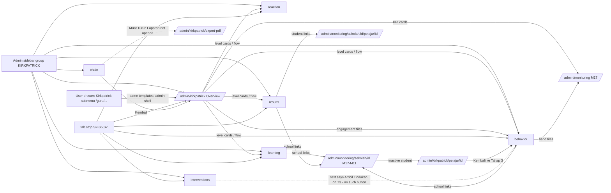
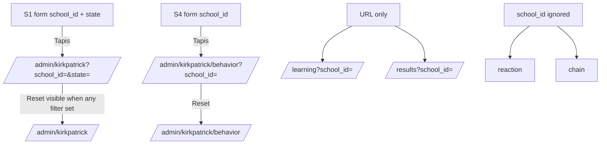
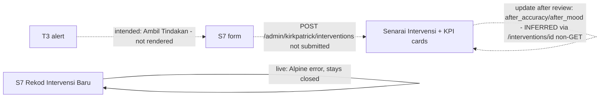

# M12 — Kirkpatrick Evaluation (Discovery)

- **Source:** a live, read-only walk-through of https://prestasiplus.my on 2026-09-25 with the admin account, using browser lane 3 (`playwright3`).
- **Screenshots:** `docs/discovery/img/M12/` (29 files). Every page was masked in the DOM before capture. The shells (admin panel `SHA`, user portal `SHU`) and design tokens are documented in [00-global-ui.md](00-global-ui.md) and are not repeated here.
- **Language:** UI copy is quoted in its exact Bahasa Melayu. Some strings are in English on live: "Overview", "Kirkpatrick Evaluation Flow", "Learning Gain", "Mastered", "Developing", "Beginning", "Champion", "Consistent", "Minimal", "Disengaged", "Predictive Grade", "Streak", "High / Medium / Low", and the 405 page.
- **Personal data (students are minors):** `tools/jobs/M12.js` runs `M12MASK` before every inventory and screenshot. It:
  - tags student links (`/pelajar/{id}`) and the ALESA "Pelajar" cell for `sanitize.js`;
  - replaces the student name on `/kirkpatrick/pelajar/{id}` (h1, `<title>`, the ALESA paragraph) with `<person>`;
  - replaces school names with `<school>` and school codes (e.g. BEA….) with `<kod>`, in text, `<option>` labels and attributes;
  - removes avatars;
  - rewrites person-record ids in links and in the location to `{id}`.

  After that, `tools/sanitize.js` runs with `{selectors:['.m12n'], titleName:false}`. The `Pelajar` columns of the T4 tables are also masked by `sanitize.js` itself. The PII leak check is 0 in all 48 states. No person name, school name or student id is written in any M12 file. The ids 4664 / 4644 used in the capture plan are record ids only.
- **Element inventory:** 755 content elements over 10 screens and 48 captured UI states, with IDs `EL-M12-S#-nnn`, in `docs/discovery/inventory/M12/<S#-key>.json`. The reconciliation, the crawl and the read-only limits are in `docs/discovery/inventory/M12/_summary.md`.
- **Safety:**
  - Nothing was exported, printed, submitted or saved.
  - "Muat Turun Laporan" (`/admin/kirkpatrick/export-pdf`, `target="_blank"`) was recorded from its `href` only and never opened.
  - The filter "Tapis" buttons were never pressed. Filters were driven by GET query strings.
  - "Simpan Intervensi" (POST) was never pressed. The intervention form cannot even be opened on live (§2.7). It was revealed once by a DOM-only change in the worker tab so that its layout could be captured.
  - `/maklum-balas` was only opened. The admin had already answered this month, so the server returned the thank-you state and there was no form to submit.
  - Scripted GETs ran one at a time, each with a full page load plus a settle of at least 400 ms.

Cross-references (owned elsewhere, not re-inventoried):
- `/admin/monitoring` and `/admin/monitoring/sekolah/{id}[/pelajar/{id}]` are linked from S1, S3, S4 and S5. Their routes belong to **M17**; the template belongs to **M11** (see M11 §1.2).
- `/admin/laporan` is in the same sidebar area but is **not** a Kirkpatrick view. See §1.3; recommended owner **M17**.
- Head Count / OTR / TOV data (T4 and S8) comes from **M08** (`/headcount`). The practice answers and sessions behind T2/T3 come from **M05**. The subject list comes from **M03**. Users, schools and roles come from **M01/M02**.
- The "Mood" check-in (T3 mood card, intervention mood fields) is also shown on the M10 teacher dashboard ("💚 Mood Pelajar"). Its owner store is not yet settled (Q-M12-6).
- The teacher dashboard "🔬 Kirkpatrick" panel (T1 "☆☆☆☆☆ 0/10", T2 "0% ketepatan", T3 "0 aktif 30h", T4 "GPS 0") belongs to **M10** (M10 discovery). It is a summary widget, not an M12 screen.

---

## 1. Overview

The TRACKER lists 8 views × 2 prefixes. The crawl found **10 screens**:
- 7 Kirkpatrick views, shared by `/admin/kirkpatrick*` and `/guru/kirkpatrick*`;
- a new student detail, `/admin/kirkpatrick/pelajar/{id}` (and its `/guru` twin);
- a new student page, `/kirkpatrick`;
- the T1 data-collection page, `/maklum-balas`.

`/admin/laporan` is not a Kirkpatrick view (§1.3).

| # | Route (twin) | `<title>` · header h1 / subtitle | Status (admin) |
|---|---|---|---|
| S1 | `/admin/kirkpatrick` (`/guru/kirkpatrick`); `?school_id=&state=` | "Kirkpatrick Evaluation Dashboard" · "Kirkpatrick Evaluation" / "Analisis Keberkesanan Platform — Model Penilaian 4 Tahap" | 200 |
| S2 | `/admin/kirkpatrick/reaction` (`/guru/…`) | "Tahap 1: Reaksi — Kirkpatrick" · "Tahap 1: Reaksi" / "Kepuasan dan persepsi pengguna terhadap platform" | 200 |
| S3 | `/admin/kirkpatrick/learning` (`/guru/…`); `?school_id=` works but the page has no form | "Tahap 2: Pembelajaran — Kirkpatrick" · "Tahap 2: Pembelajaran" / "Peningkatan pengetahuan, kemahiran, dan kefahaman pelajar" | 200 |
| S4 | `/admin/kirkpatrick/behavior` (`/guru/…`); `?school_id=` | "Tahap 3: Tingkah Laku — Kirkpatrick" · "Tahap 3: Tingkah Laku" / "Konsistensi penggunaan, engagement score, dan corak tingkah laku pelajar" | 200 |
| S5 | `/admin/kirkpatrick/results` (`/guru/…`); `?school_id=` works but the page has no form | "Tahap 4: Hasil — Kirkpatrick" · "Tahap 4: Hasil" / "Impak terhadap keputusan peperiksaan dan prestasi akademik" | 200 (page is 1.17 MB: 946-row table) |
| S6 | `/admin/kirkpatrick/chain` (`/guru/…`) | "Kirkpatrick Impact Chain" · header shows **"Dashboard" / "Selamat datang, Admin"** (D-M12-3) | 200 |
| S7 | `/admin/kirkpatrick/interventions` (`/guru/…`) | "Intervensi — Kirkpatrick" · "Intervensi Pelajar" / "Rekod tindakan intervensi berdasarkan amaran Kirkpatrick" | 200. GET `/admin/kirkpatrick/interventions/{id}` → **405** |
| S8 | `/admin/kirkpatrick/pelajar/{id}` (`/guru/kirkpatrick/pelajar/{id}`) (**new**) | "Kirkpatrick — {nama}" · header "Dashboard" / "Selamat datang, Admin" (D-M12-3) | 200. Unknown id → **403** |
| S9 | `/kirkpatrick` (**new**) | "Kirkpatrick — Prestasi Saya" · SHU header "Dashboard" / "Selamat datang kembali" | 200 (admin sees its own, empty data) |
| S10 | `/maklum-balas` (**new**) | "Maklum Balas — PrestasiPlus" · SHU header "Dashboard" | 200: thank-you state only |

Other access outcomes found by probing (see also §7):
- `/admin/kirkpatrick/pelajar` → 404.
- `/admin/kirkpatrick/interventions/create` → **405**, which means `interventions/{id}` exists for non-GET verbs.
- `/admin/kirkpatrick/interventions/1/edit` → 404.
- These all return 404 "Halaman Tidak Dijumpai": `/admin/kirkpatrick/survey`, `/admin/kirkpatrick/reaction/survey`, `/admin/kirkpatrick/api`, `/admin/kirkpatrick/data`, `/admin/kirkpatrick/export`, `/admin/kirkpatrick/nps`, `/admin/kirkpatrick/sekolah/{id}`, `/survey`, `/tinjauan`, `/nps`, `/admin/nps`, `/admin/survey`, `/admin/surveys`, `/feedback`.
- `?school_id=` on S2 and S6 is accepted and ignored: the output is identical.

**Entry points:**
- **Admin sidebar (SHA)**, collapsible group `kirkpatrick` (button `fa-microscope` cyan-500, label "KIRKPATRICK", `toggle('kirkpatrick')`, state in `localStorage["admin_sidebar"]` as in 00-global-ui §3.2). It has 7 items, each with a `w-4` icon:
  - "Overview" `fa-th-large` → `/admin/kirkpatrick`
  - "T1: Reaksi" `fa-smile`
  - "T2: Pembelajaran" `fa-brain`
  - "T3: Tingkah Laku" `fa-running`
  - "T4: Hasil" `fa-trophy`
  - "Rantaian Impak" `fa-link` → `/admin/kirkpatrick/chain`
  - "Intervensi" `fa-hand-holding-medical`

  On `/admin/*` the current item gets the active style. On `/guru/kirkpatrick*` no item is active (D-M12-12).
- **User-portal drawer (SHU, below 1024 px)**, "Portal Guru" area. The button "Kirkpatrick" (`fa-microscope` cyan-500, chevron, `kirkGuruOpen`) opens 7 items:
  - "Ringkasan" `fa-home` → `/guru/kirkpatrick`
  - "T1: Reaksi" `fa-smile`
  - "T2: Pembelajaran" **`fa-graduation-cap`** (the admin sidebar uses `fa-brain`)
  - "T3: Tingkah Laku" `fa-running`
  - "T4: Hasil" `fa-trophy`
  - "Rantaian Impak" `fa-link`
  - "Intervensi" `fa-hand-holding-medical`

  For the admin account these items are in the DOM but hidden. The desktop user sidebar has no Kirkpatrick entry.
- **In-page tab strip** (S2, S3, S4, S5, S7): "Overview" `fa-th-large`, "T1: Reaksi" `fa-smile`, "T2: Pembelajaran" `fa-brain`, "T3: Tingkah Laku" `fa-running`, "T4: Hasil" `fa-trophy`, "Intervensi" `fa-hand-holding-medical`. There is **no "Rantaian Impak" tab**. S1 and S6 have no tab strip. S6 is reachable only from the sidebar.
- **S8** is linked from the M11/M17 monitoring school page (`/admin/monitoring/sekolah/{id}`, inactive-student rows). No M12 screen links to it. Its back link "← Kembali ke Tahap 3" goes to `/admin/kirkpatrick/behavior`.
- **S9 `/kirkpatrick` and S10 `/maklum-balas`** are not linked from any menu visible to the admin. They were found by URL probing. Student-menu links are not observable (Q-M12-1).

### 1.1 Shell by screen and role

| Screen | Shell | Evidence |
|---|---|---|
| S1–S8, on both `/admin` and `/guru` prefixes | `SHA` admin panel | `aside.sidebar` "Panel Pentadbir"; `fetch('/admin/server-status')`; header chips |
| S9, S10 | `SHU` user portal | koin / mata / streak chips; `tournamentBanner()` component at the top of `<main>` (M16 component; hidden when there are no tournaments) |
| 403 / 404 / 405 states | standalone error layouts: 403/404 use the branded error page; **405 uses an unbranded English framework page** (D-M12-11) | — |

For the admin account, every `/guru/kirkpatrick*` route renders inside the admin layout. What a teacher account sees is not observable (Q-M12-1).

### 1.2 Admin vs guru: shared templates

The `<main>` markup (with `_token` removed) was hashed on both prefixes. The results are **byte-identical** for every view:

| View | `<main>` length | Hash equal |
|---|---|---|
| Overview | 31,156 | yes |
| reaction | 3,312 | yes |
| learning | 59,916 | yes |
| behavior | 138,189 | yes |
| results | 1,171,983 | yes |
| chain | 11,467 | yes |
| interventions | 8,375 | yes |
| pelajar/{id} | 7,267 | yes (length) |

Every link, filter form, "Reset", "← Kembali", the export link and the intervention POST on the `/guru` twins point to **`/admin/kirkpatrick…`** (D-M12-4). The only difference is the admin-sidebar active highlight.

**Recommendation:** build one component set per view, mounted on both route prefixes (as M11 did for monitoring). Whether a teacher sees data scoped to their own school is unobservable (Q-M12-1).

### 1.3 `/admin/laporan`: what it is and who owns it

- `/admin/laporan` is "Laporan Statistik - Admin Panel", with h1 "Laporan Statistik" / "Penglibatan pengguna seluruh platform".
- It is a platform-wide engagement report built on the Alpine component `laporanApp()`:
  - tabs: "Overview", "Sekolah (61)", "Guru (551)", "Murid (4,533)";
  - "Tempoh:" pills "7 Hari" / "30 Hari" / "3 Bulan" (`?range=7|30|90`);
  - login and practice counters: "Murid Pernah Login 1,708 / 3,152", "Cikgu Pernah Login", "Murid Buat Latihan", "Jumlah Aktiviti", "Skor Purata";
  - a Chart.js line chart `#trendChart` "Trend Aktiviti" (labels dd/mm × 30 days, `borderColor '#6366f1'`, `backgroundColor 'rgba(99, 102, 241, 0.1)'`, `fill: true`, `tension: 0.3`);
  - "Pecahan Aktiviti", "Pelajar Paling Aktif", "Cikgu Belum Login";
  - school, teacher and pupil lists with filter pills (Semua / Aktif / Kurang / Tidak Aktif) and search.
- It is the admin counterpart of M11 S1 `/guru/laporan`. It uses the same title and the same counters (1,708 / 3,152, 1,444 belum login), but a different, richer template.
- In the admin sidebar, "Laporan" (`fa-chart-bar` orange-500) sits **after** the Kirkpatrick group, **not inside it**. The group holds only the 7 items listed above.
- The TRACKER already lists `/admin/laporan` under **M17** ("Activity report").
- **Recommendation: owner = M17.** Remove the "Report — `/admin/laporan`" line from the M12 checklist.
- It was not inventoried here because it contains teacher and pupil names and e-mails, which need the M17 masking plan.

---

## 2. Screens

Common card style: `card` (white, rounded, shadow) with gradient KPI cards (`bg-gradient-to-br from-{c}-50 to-{c2}-50 border border-{c}-200/60`, label `text-[10px] sm:text-xs font-medium text-{c}-600`, value `text-xl sm:text-2xl font-heading font-bold text-{c}-900`).

The tab strip is `flex flex-wrap gap-1 mb-4 sm:mb-6`:
- each tab: `px-3 py-2 rounded-lg text-xs sm:text-sm`;
- active tab: `bg-indigo-600 text-white shadow-md`;
- other tabs: `bg-white text-slate-600 border border-slate-200 hover:bg-slate-100`.

Engagement colours (hex, inline style) are the same everywhere:
- Champion `#15803d`
- Konsisten `#2563eb`
- Berkembang `#ca8a04`
- Minimum `#ea580c`
- Tidak Terlibat `#dc2626`

### 2.1 S1 — Overview `/admin/kirkpatrick`

Sections, top to bottom:

**1. Filter card.** GET form to `/admin/kirkpatrick`, `flex flex-wrap items-end gap-3`:
- "Sekolah" select `school_id`: "Semua Sekolah" plus 57 schools, A→Z by name, value = school id;
- "Negeri" select `state`: "Semua Negeri", Johor, Kedah, Kelantan, Kuala Lumpur, Melaka, Pahang, Perak, Sabah, Selangor, Terengganu;
- button "Tapis" (`fa-filter`, indigo-600).

When any filter is set, a **"Reset"** link appears (`fa-times`, `bg-slate-200 text-slate-700`) → `/admin/kirkpatrick`. The selects preload the query values. Neither select has padding classes, so each renders **18 px tall** (D-M12-7).

**2. Level cards.** `grid grid-cols-1 sm:grid-cols-2 lg:grid-cols-4`, in the order **T4, T3, T2, T1**. Each card is an `<a>` with `border-l-4`, an uppercase label, an icon tile, a value, a caption and "Lihat detail →" (`fa-arrow-right`):

| Label | Colour / icon | Value | Caption | Link |
|---|---|---|---|---|
| "Tahap 4: Hasil" | amber / `fa-trophy` | "4.30" | "GPS Sekolah · 4378 rekod headcount" | results |
| "Tahap 3: Tingkah Laku" | blue / `fa-running` | "951" + "/4158" (slate-400) | "Pelajar aktif · 20991 sesi · 82.8% ketepatan" | behavior |
| "Tahap 2: Pembelajaran" | green / `fa-brain` | "82.8%" | "Ketepatan · 306,133 soalan dijawab" | learning |
| "Tahap 1: Reaksi" | purple / `fa-smile` | "4.6" + "/5" | "Kepuasan purata · 336 respon" | reaction |

**3. "Kirkpatrick Evaluation Flow"** (`fa-project-diagram`) with the hint "Klik mana-mana tahap untuk lihat detail".
- **Desktop (≥ sm):** 4 circles T1→T4 on a gradient line (purple→green→blue→amber). Each has a label, a sub-label and a pill:
  - "T1: Reaksi" / "Kepuasan pengguna" / "4.6/5"
  - "T2: Pembelajaran" / "Peningkatan kemahiran" / "82.8% ketepatan"
  - "T3: Tingkah Laku" / "Konsistensi penggunaan" / "951 pelajar aktif"
  - "T4: Hasil" / "Keputusan peperiksaan" / "GPS 4.30"
- **Mobile (< sm):** a vertical list of the same 4 rows with `fa-chevron-right`.

All eight entries link to the level pages.

**4. "Perbandingan Sebelum & Selepas"** (`fa-exchange-alt`). Subtitle "{bulan pertama} vs {bulan semasa}" (live: "Januari 2026 vs September 2026").
- Two panels:
  - "SEBELUM" (slate; range "01 Jan 2026 - 31 Jan 2026"): 2 "Pelajar Aktif", 33.3% "Ketepatan", 3 "Jumlah Jawapan", 0 "Champion";
  - "SELEPAS" (indigo; "01 Sep 2026 - 25 Sep 2026"): 58, 87%, 13,968, 28.
- Four delta tiles:
  - positive: `border-green-200`, `fa-arrow-up` green-500, value green-600 "+56", "+53.7%", "+13965", "+28";
  - negative: `border-red-200`, `fa-arrow-down` red-500, red-600 "-11", "-16.6%", "-451", "-2".
- A "Ringkasan:" box (`fa-chart-line`) with one of these texts:
  - "Peningkatan 53.7% dalam ketepatan jawapan. 56 pelajar baru mula aktif. Jumlah jawapan meningkat 465500%. 28 pelajar naik ke tahap Champion."
  - (school 8080) "Penurunan 16.6% dalam ketepatan jawapan. 11 pelajar kurang aktif berbanding sebelumnya."
  - (no data) "Data tidak mencukupi untuk perbandingan.", with the subtitle "Tiada Data vs Tiada Data" and the ranges "-".

**5. KPI row** (`grid-cols-2 lg:grid-cols-4`, each an `<a>`):
- "Pelajar Berdaftar (T4/T5)" 4,158 → `/admin/monitoring`
- "Soalan Dijawab" 306,133 → learning
- "Guru Aktif" 277/522 → `/admin/monitoring`
- "Ketepatan Keseluruhan" 82.8% → learning

**6. "Taburan Engagement Pelajar"** (`fa-chart-pie`). `grid-cols-5`, each an `<a>` → behavior, with a round icon tile (`background-color: {hex}15`), a count, a label and a %:

| Count | Label | % | Icon |
|---|---|---|---|
| 513 | Champion | 12.3% | `fa-crown` |
| 259 | Konsisten | 6.2% | `fa-check-double` |
| 169 | Berkembang | 4.1% | `fa-seedling` |
| 5 | Minimum | 0.1% | `fa-minus-circle` |
| 3207 | Tidak Terlibat | 77.1% | `fa-times-circle` |

**7. Info card** (cyan, `fa-info-circle`):
- title "Model Kirkpatrick — 4 Tahap Penilaian Keberkesanan";
- text "Dashboard ini mengukur keberkesanan platform PrestasiPlus berdasarkan model Kirkpatrick (1959). Data Tahap 2 (Pembelajaran) dan Tahap 3 (Tingkah Laku) dijana secara automatik daripada aktiviti pelajar. Tahap 1 (Reaksi) memerlukan data survey, dan Tahap 4 (Hasil) memerlukan keputusan peperiksaan sebenar."

**Filter effects:**
- `?school_id=8080`: T4 shows **"4"** (unformatted; D-M12-9) with the unchanged "4378 rekod headcount"; T3 "53/184", "1002 sesi", "75.6%"; T2 75.6% / 15,007; **T1 unchanged**; comparison "April 2026 vs September 2026"; KPIs 184 / 15,007 / 34/34 / 75.6%; engagement 36 / 8 / 9 / 0 / 131.
- `?state=Kelantan`: everything is 0, "0/0", "0%", "Tiada Data vs Tiada Data", and **GPS stays 4.30**.

### 2.2 S2 — T1 Reaksi `/admin/kirkpatrick/reaction`

- The page has only the tab strip and 4 cards (`grid-cols-2 lg:grid-cols-4`, `text-2xl`):
  - "NPS Pelajar" 8.4/10 (purple)
  - "NPS Guru" 6.5/10 (blue)
  - "NPS Admin" 9.6/10 (amber)
  - "Kepuasan Purata" 4.6/5 (emerald)
- There is no filter, no respondent count, no breakdown and no survey link.
- The values are identical with `?school_id=` (global only).

### 2.3 S3 — T2 Pembelajaran `/admin/kirkpatrick/learning`

1. **Six KPI cards** (`grid-cols-2 sm:grid-cols-3 lg:grid-cols-6`):
   - "Soalan Dijawab" 306,133
   - "Ketepatan" 82.8%
   - "Skor Purata" 80.3%
   - "Sesi Selesai" 20991 "/20991"
   - "Kadar Penyelesaian" 100%
   - "Learning Gain" "-" (slate-400) with "Perlu pre/post test"
2. **Dashed empty card** (`fa-flask`):
   - "Pre-Test / Post-Test belum dimulakan"
   - "Apabila ujian diagnostik dimulakan, Hake's Normalized Learning Gain akan dikira secara automatik."
   - "g = (Post - Pre) / (100 - Pre) · High: g≥0.7 · Medium: 0.3≤g<0.7 · Low: g<0.3"
3. **"Prestasi Mengikut Subjek"** (`fa-book`). One row per subject that has answers (26 on live):
   - subject name (indigo-600, `w-32 sm:w-40 truncate`);
   - a bar (`h-5`, width = accuracy %, label inside, e.g. "100.0%");
   - a status pill:
     - "Mastered": bar green-500, pill `bg-green-100 text-green-700`;
     - "Developing": bar amber-500, pill `bg-amber-100 text-amber-700`;
     - "Beginning": bar red-500, pill `bg-red-100 text-red-700`; seen only in the school-filtered state;
   - "{n} soalan".
   - Sorted by accuracy, descending.
   - Every row has `cursor-pointer` and `title="Klik untuk lihat detail"`, but **no handler**: clicking does nothing (D-M12-5).
4. **"Pembelajaran Mengikut Sekolah"** (`fa-school`). Table: # · Sekolah (link → `/admin/monitoring/sekolah/{id}`) · Pelajar · Soalan · Ketepatan · Skor Purata · Subjek.
   - 33 rows, sorted by Ketepatan descending.
   - Ketepatan colour: green-600 ≥ 70, amber-600 50–69.9, red-600 < 50 (observed 70% green, 68.7% amber, 50% amber, 40% red).
   - Schools with 0 answers show 0 / 0% / 0% (one shows Skor Purata 90% with 0 Soalan; D-M12-15).
5. With `?school_id=8080` (URL only) the page shows that school's KPIs (15,007 / 75.6% / 73.3% / 1002/1002), 24 subject rows (including 3 "Beginning") and a 1-row table.

### 2.4 S4 — T3 Tingkah Laku `/admin/kirkpatrick/behavior`

1. **Filter card.** GET `/admin/kirkpatrick/behavior`, "Sekolah" `school_id` only (no Negeri), "Tapis". "Reset" → `/admin/kirkpatrick/behavior` when filtered.
2. **Six KPI cards:**
   - "Pelajar T4/T5" 4,158
   - "Pernah Aktif" 951
   - "Jumlah Sesi" 20991
   - "Soalan Dijawab" 306,133
   - "Ketepatan" 82.8%
   - "Guru Aktif" 53.1% with "277/522"
3. **"Taburan Tahap Engagement"** (`fa-chart-pie`). 5 tiles `grid-cols-5`, each an `<a>` → `/admin/monitoring` (unfiltered). Each tile has a background `{hex}08`, a count (`text-2xl sm:text-3xl`), a label, a rule, a mini bar (`h-2`, width = %) and the %:
   - "Champion" ">50 soalan"
   - "Konsisten" "20-50 soalan"
   - "Berkembang" "5-20 soalan"
   - "Minimum" "<5 soalan"
   - "Tidak Terlibat" "0 soalan"
4. **"Engagement Mengikut Sekolah"** (`fa-school`). Table: # · Sekolah (link + school code line or "-") · Pelajar · Aktif (green-600; "0" slate-300) · Soalan · Sesi · Purata/Aktif · Skor (coloured by tahap) · Tahap (pill, white on tahap hex).
   - 33 rows, sorted by Skor descending.
5. **"Corak Masa Aktiviti"** (`fa-clock`), "Bilangan soalan dijawab mengikut jam dan hari". A heat table:
   - columns 06…23 (18 hours), rows Isnin, Selasa, Rabu, Khamis, Jumaat, Sabtu, Ahad;
   - each cell `w-5 h-5 sm:w-6 sm:h-6`, `title="{Hari} {HH}:00 — {n} soalan"`, the number in white 8 px, background `rgba(99,102,241,{α})`;
   - zero cells: `#f1f5f9`, empty, `text-slate-200`.
6. **"Amaran & Pemerhatian"** (`fa-bell`). Rendered only when there is at least one item (absent for school 8080). The items are:
   - red `bg-red-50` `fa-exclamation-triangle`: "{sekolah}: {n} pelajar tidak pernah login langsung." (22 items on live);
   - red: "{sekolah}: {n} guru telah login tetapi tiada pelajar yang menjawab soalan." (1 item);
   - green `bg-green-50` `fa-check-circle`: "{sekolah}: {x}% pelajar aktif menjawab soalan. Tahniah!" (13 items).
   - **No item has an "Ambil Tindakan" button** (D-M12-1).
7. **Mood empty card:** "💭" / "Data Mood Belum Mencukupi" / "Pelajar perlu check-in mood harian untuk analisis kesejahteraan vs prestasi." The populated mood analysis is not observable (§10).

### 2.5 S5 — T4 Hasil `/admin/kirkpatrick/results`

1. **Six KPI cards:**

   | Card | Value | Caption |
   |---|---|---|
   | "GPS Headcount" | 4.30 | "41 rekod · 2025" |
   | "Kadar Lulus" | 90.6% | "163/180 calon" |
   | "Pelajar Gred A" | 52 | "28.9% daripada 180" |
   | "Ketepatan Platform" | 82.8% | "306,133 soalan" |
   | "Pelajar Aktif" | 946 | "22.8% daripada 4,158" |
   | "Rekod Headcount" | 4378 | "Data OTR" |
2. **"Taburan Gred (2025)"** (`fa-chart-bar`), "Berdasarkan 180 calon — sumber: Headcount OTR".
   - 10 rows A+ … G. Each row has `title="{g}: {n} pelajar ({p}%)"`, a bar (`h-6`, width = n ÷ max(n) × 100 %, colour per grade, count inside) and the %.
   - Rows are `cursor-default`.
3. **"GPS Mengikut Subjek (2026)"** (`fa-book`). Table: # · Subjek · GPS · Gred · Calon · Trend.
   - 5 rows, sorted by GPS ascending: Matematik 2.50 A- 30 · Bahasa Melayu 2.80 A- 30 · Sains 2.90 A- 30 · Sejarah 3.00 A- 30 · Bahasa Inggeris 3.20 B+ 30.
   - The Trend cell is `fa-arrow-up` green-500 plus the previous-year GPS (4.45 / 4.00 / 4.70 / 4.50 / 4.30).
   - The subject cell has `cursor-pointer` and `title="Lihat detail {subjek}"` but **no handler** (D-M12-5).
   - Note below: "GPS rendah = lebih baik. Trend: berbanding tahun sebelumnya."
4. **"Trend GPS (2022–2026)"** (`fa-chart-line`). Table: Subjek · 2022 · 2023 · 2024 · 2025 · 2026 · Trend.
   - Row "Keseluruhan" (`bg-indigo-50/50 font-semibold`): 5.20 4.80 4.50 4.30 "-".
   - Rows: BM 4.80 4.50 4.20 4.00 2.80 · BI 5.20 4.90 4.55 4.30 3.20 · Matematik 5.50 5.10 4.75 4.45 2.50 · Sains 5.80 5.40 5.00 4.70 2.90 · Sejarah 5.60 5.20 4.80 4.50 3.00 · Pendidikan Islam 4.20 3.90 3.65 3.40 "-".
   - Every Trend cell is `fa-arrow-up` green.
   - Value colours: green-600 when ≤ 4.00, amber-600 when > 4.00. For "-", green in "Keseluruhan" and amber in Pendidikan Islam (D-M12-14).
   - Legend: "↑ = GPS menurun (improving). Sumber: Headcount OTR & SPM sebenar."
5. **"Prestasi Mengikut Sekolah (Platform + Headcount)"** (`fa-school`). Table: # · Sekolah (link) · Pelajar · Aktif · Ketepatan · Soalan · Engagement · Tahap.
   - 33 rows, sorted by Engagement descending.
   - Ketepatan colour: green-600 ≥ 60 (observed 66.2% green, 57.7% amber), amber-600 below.
   - Schools with Aktif 0: row `opacity-50`, Ketepatan "-" slate-300, Soalan "-", Engagement "-" (one shows "2").
6. **"Ramalan Prestasi Pelajar Aktif"** (`fa-magic`), "Berdasarkan ketepatan menjawab soalan dalam platform".
   - Table: # · Pelajar (link → `/admin/monitoring/sekolah/{sid}/pelajar/{id}`) · Sekolah (link) · Soalan · Ketepatan (coloured) · Anggaran Gred (pill).
   - **946 rows** (every active student; no pagination), sorted by Ketepatan descending.
   - Footnote: "Ramalan ini berdasarkan ketepatan menjawab soalan dalam platform sahaja. Ramalan penuh memerlukan lebih banyak data termasuk keputusan peperiksaan terdahulu."
7. **"Ramalan ALESA (Predictive Grade)"**. Its icon `fa-crystal-ball` **does not exist in Font Awesome Free and renders blank** (D-M12-6). Subtitle "Berdasarkan ketepatan, konsistensi, trend mingguan, dan jumlah latihan pelajar".
   - Three tiles: 48 "Dijangka Lulus" (green), 2 "Dijangka Gagal" (red), 4 "Perlu Intervensi" (amber).
   - Table: # · Pelajar (name + school line; plain text) · Ketepatan · Ramalan Gred (pill) · Keyakinan (pill) · Cadangan. Exactly **50 rows**, ordered by grade then unordered within a grade.
   - Keyakinan pills: "Rendah" (`text-slate-500 bg-slate-100`) ×38, "Sederhana" (`text-amber-600 bg-amber-50`) ×10, "Tinggi" (`text-green-600 bg-green-50`) ×2.
   - Footer (purple): "**48 pelajar dijangka lulus**, 4 pelajar perlu intervensi segera. Ramalan ini berdasarkan formula berwajaran: Ketepatan (40%), Konsistensi (20%), Trend (20%), Volume (20%)."
8. **"ROI Platform (Anggaran)"** (`fa-coins`):
   - figures: "Pelajar Aktif" 946 · "Purata Soalan/Pelajar" 323.6 · "Ketepatan Aktif" 82.8% · "GPS Headcount" 4.30;
   - amber box (`fa-calculator`) "ROI penuh akan dapat dikira apabila:" with an ordered list:
     1. "Keputusan peperiksaan sebenar (SPM/dalaman) diimport"
     2. "Data kos langganan platform dimasukkan"
     3. "Perbandingan prestasi pelajar aktif vs tidak aktif dapat dibuat"
9. **"Pemerhatian & Insight"** (`fa-lightbulb`, `border-l-4 border-blue-500`). Three info rows, then a disclaimer:
   - "Hanya 946 daripada 4158 pelajar T4/T5 (946) menggunakan platform. Data perbandingan terhad kepada pelajar aktif sahaja." (duplicated figure; D-M12-13)
   - "Purata ketepatan pelajar aktif dalam platform: 82.8%. Ini bersamaan anggaran gred A."
   - "GPS keseluruhan dari headcount (tahun 2025): 4.30. Trend menunjukkan peningkatan dari tahun ke tahun."
   - Disclaimer (`fa-exclamation-triangle`): "Disclaimer: Data GPS Anggaran berdasarkan markah OTR headcount, bukan keputusan SPM sebenar."

`?school_id=8080` (URL only) changes the page as follows:
- GPS "4" · "41 rekod · 2026";
- "Kadar Lulus 100%" "1/1 calon";
- "Pelajar Gred A" 0, "0% daripada 1";
- 75.6% / 15,007 soalan;
- Pelajar Aktif 53, "28.8% daripada 184";
- "Taburan Gred (2026)", "Berdasarkan 1 calon — sumber: Headcount OTR", with only B+ = 1 ("B+: 1 pelajar (100%)", other grades "0 pelajar (0%)");
- the subject GPS heading becomes "(2025)" and the trend heading "(2022–2025)" (5 and 7 rows);
- the school table has 1 row and the prediction table 53 rows;
- **ALESA still lists 50 rows: 47 Dijangka Lulus / 3 Dijangka Gagal / 3 Perlu Intervensi, and "47 pelajar dijangka lulus, 3 pelajar perlu intervensi segera …"**;
- insights: "Hanya 53 daripada 184 pelajar T4/T5 (53) menggunakan platform…", "…75.6%. Ini bersamaan anggaran gred A-.", "…(tahun 2026): 4. Trend menunjukkan peningkatan dari tahun ke tahun."

### 2.6 S6 — Rantaian Impak `/admin/kirkpatrick/chain`

This page uses a different visual style (`gray-*` palette, `rounded-2xl border-2`) and has no tab strip.
- **Header row:** h1 "Model Kirkpatrick — Rantaian Impak" and "Bukti keberkesanan Prestasi Plus berdasarkan 4 Tahap Kirkpatrick".
  - Button "Muat Turun Laporan" (inline SVG download icon, indigo-600) → `/admin/kirkpatrick/export-pdf` `target="_blank"` (not opened).
  - Link "← Kembali" → `/admin/kirkpatrick`.
- **Four level cards** (`grid-cols-1 md:grid-cols-4`). Each has a round badge "T1"…"T4", a title, a sub-title and label/value rows. Between the cards, "→" (gray-300) is shown only at ≥ md.
  - **T1** "Reaksi" / "Kepuasan pengguna terhadap Prestasi Plus": "NPS Purata" 8.3/10 · "Kepuasan" 4.6/5 · "Responden" 336. Border green-300, badge green-500.
  - **T2** "Pembelajaran" / "Perkembangan akademik melalui Head Count": "Ketepatan" 82.8% · "Soalan Dijawab" 306,133 · "Skor Purata" 80.3%. Green.
  - **T3** "Tingkah Laku" / "Konsistensi penggunaan platform (Mastery Learning)": "Pelajar Aktif" "951/4158 (22.9%)" · "Sesi Latihan" 20,991. Then "Taburan Konsistensi:" Champion 513 · **Consistent** 259 · **Developing** 169 · **Minimal** 5 · **Disengaged** 3207 (English labels, unlike S1/S4). Border yellow-300, badge yellow-500.
  - **T4** "Hasil / Impak" / "Korelasi penggunaan dengan pencapaian": "GPS" 4.30 · "Korelasi (r)" 0.1298 · "Kekuatan" "Lemah". Yellow.
- **"Analisis Korelasi: Penggunaan → Pencapaian".** Table: Tahap Penggunaan · Bil. Pelajar · Purata Ketepatan · Visual (bar `h-3`, width = accuracy; `bg-yellow-500` below 60, `bg-green-500` otherwise).
  - Rows on live: "1-20 soalan" 215 59.7% · **"1-20 soalan" 215 59.7% (duplicate)** · "51-100 soalan" 149 68.7% · "100+ soalan" 348 75.2%.
  - The 21–50 band is missing and row 1 is repeated (D-M12-2).
  - Box: "**Kesimpulan ALESA:** Pelajar yang menjawab 100+ soalan mencapai ketepatan 75.2%, berbanding 59.7% bagi pelajar dengan kurang 20 soalan (perbezaan +15.5%). Korelasi Pearson antara penggunaan dan ketepatan: r = 0.1298 (Lemah)."
- **Gradient card "Kesimpulan Model Kirkpatrick"** (indigo→purple, white text): "Berdasarkan analisis empat tahap Model Kirkpatrick, Prestasi Plus menunjukkan keberkesanan sebagai platform pembelajaran digital. **Tahap 1 (Reaksi)** menunjukkan maklum balas positif daripada pengguna. **Tahap 2 (Pembelajaran)** melalui Head Count menunjukkan perkembangan akademik yang dapat dipantau. **Tahap 3 (Tingkah Laku)** menunjukkan pelajar yang konsisten menggunakan platform menunjukkan corak Mastery Learning. **Tahap 4 (Hasil)** korelasi antara penggunaan aktif dengan ketepatan jawapan membuktikan impak positif terhadap pencapaian. Empat-empat tahap Kirkpatrick dipenuhi dalam Prestasi Plus."

### 2.7 S7 — Intervensi `/admin/kirkpatrick/interventions`

1. **Four KPI cards** (`grid-cols-2 md:grid-cols-4`): "Jumlah Intervensi" 0 (blue) · "Menunggu Semakan" 0 (amber) · "Meningkat" 0 (green) · "Menurun" 0 (red).
2. **Collapsible card "Rekod Intervensi Baru"** (`fa-plus-circle`, chevron `fa-chevron-down`).
   - The markup is `x-data="{ open:  }"`: the server-side value is empty.
   - Alpine therefore throws "Alpine Expression Error: Unexpected token '}'", plus "Unexpected token '-'" for `:class="{ rotate-180: open }"` and "Illegal invocation" for `x-show="open"`.
   - The panel stays `hidden` with `height: 0px`, and **clicking the button does nothing** (verified: hidden before, after one click and after two clicks). The form is unreachable on live (D-M12-1).
   - The collapsed form, revealed only by forcing it open in the DOM: POST `/admin/kirkpatrick/interventions` with `_token`, and:

     | Label | Field | Type / rules | Placeholder / default |
     |---|---|---|---|
     | "Pelajar (ID)" | `student_id` | `number`, **required** | "ID pelajar" |
     | "Jenis Amaran" | `alert_type` | select, **required**: `mood` "Mood / Kesejahteraan", `inactive` "Tidak Aktif", `declining` "Prestasi Menurun" (first option preselected) | — |
     | "Tarikh Tindakan" | `action_date` | `date`, **required** | today (value "2026-09-25") |
     | "Penerangan Amaran" | `alert_description` | textarea rows 2, **required** | "Contoh: Pelajar tidak aktif selama 2 minggu" |
     | "Tindakan Diambil" | `action_taken` | textarea rows 2, **required** | "Contoh: Hubungi pelajar melalui guru kelas" |
     | "Ketepatan Sebelum (%)" | `before_accuracy` | `number` step 0.1 | "0.0" |
     | "Mood Sebelum" | `before_mood` | select: "" "-- Pilih --", `happy` "Gembira", `okay` "Okay", `sad` "Sedih", `stressed` "Tertekan" | — |
     | "Ketepatan Selepas (%)" | `after_accuracy` | `number` step 0.1 | "Isi selepas semakan" |
     | "Mood Selepas" | `after_mood` | same options as Mood Sebelum | — |

     - Layout: row 1 `grid-cols-1 md:grid-cols-3`; the two textareas are full width; the 4 before/after fields are `grid-cols-2 md:grid-cols-4`.
     - Submit button "Simpan Intervensi" (`fa-save`, indigo-600).
     - Validation is native `required` only. There is no custom alert, no Batal and no reset.
3. **"Senarai Intervensi"** (`fa-clipboard-list`). Empty state: `fa-clipboard-check`, "Tiada intervensi direkodkan lagi." and "Klik "Ambil Tindakan" pada amaran di halaman Tingkah Laku untuk mula." The instruction points to a button that does not exist (D-M12-1). The populated list is not observable (§10).
4. GET `/admin/kirkpatrick/interventions/{id}` → **405** page: "Oops! An Error Occurred" / "The server returned a "405 Method Not Allowed"." / "Something is broken. Please let us know what you were doing when this error occurred. We will fix it as soon as possible. Sorry for any inconvenience caused." (D-M12-11).

### 2.8 S8 — Student Kirkpatrick detail `/admin/kirkpatrick/pelajar/{id}` (new)

- Container `max-w-5xl mx-auto px-4 py-6`, gray palette (the same family as S6).
- **Header:** h1 "{nama}"; "{sekolah} · Tingkatan {n}"; link "← Kembali ke Tahap 3" → `/admin/kirkpatrick/behavior`.
- **Gradient card** (indigo→purple, white). A round "AI" badge and "ALESA — Analisis Tingkah Laku Kirkpatrick". The generated paragraph follows this template:
  - "Penggunaan Prestasi Plus oleh {nama} masih pada tahap minimum dengan hanya {d} hari aktif. Disarankan untuk meningkatkan kekerapan latihan bagi melihat peningkatan prestasi."
  - then an optional "Ketepatan jawapan pada {x}% menunjukkan pemahaman yang baik." (present at 73.1%, absent at 38.6%);
  - then "Subjek terkuat: {subjek} ({x}%)."

  Four tiles follow: "Soalan" (219) · "Ketepatan" (73.1%) · "Konsistensi" (22.5) · "Streak" ("1d"). The last line reads "Terkuat: **{subjek} ({x}%)** · Perlu perhatian: **{subjek} ({x}%)**".
- **"Tahap 2 — Head Count"** card. Heading "2026 — Head Count" (year), then one row per enrolled subject with the value "TOV:{mark}" (e.g. "TOV:78.00") or "-".
- **"Tahap 2 — Prestasi Platform"** card. One row per practised subject, "{x}% ({n})", with a bar `h-2`: green-500 at 78.9%, red-400 at 39.1% / 16.7% (threshold INFERRED between 40 and 78.9; the 4644 sample: 60.0 → ?, 20.0 → red). Rows are sorted by accuracy, descending.
- An unknown id → 403 "Akses Ditolak": "🚫", "Anda tidak mempunyai kebenaran untuk mengakses halaman ini. Sila log masuk dengan akaun yang betul atau hubungi pentadbir.", "Halaman Utama", "Log Masuk", "PRESTASIPLUS". This is a 403 where a 404 would be expected; it stays as live (not D9).

### 2.9 S9 — Student view `/kirkpatrick` (new)

- `max-w-5xl`, gray palette, inside SHU (with the `tournamentBanner()` block at the top).
- h1 "Kirkpatrick — Prestasi Saya" / "Perkembangan pembelajaran berdasarkan 4 Tahap Model Kirkpatrick". The page has three cards:
  1. **"Tahap 2 — Pembelajaran (Head Count)"** / "Perkembangan gred mengikut subjek dari peperiksaan sekolah". Empty state (italic): "Tiada data Head Count. Guru perlu muat naik keputusan peperiksaan."
  2. **"Tahap 3 — Rekod Aktiviti (30 Hari)"**. 30 day squares `w-6 h-6`, each with `title="dd/mm: {n} soalan"` (27/08 … 25/09 on live), and a legend "Kurang" [gray-100, green-200, green-400, green-600] "Banyak". The admin has 0 answers, so every square is gray-100. The bucket thresholds are not observable (Q-M12-7).
  3. **"Tahap 4 — Kesimpulan"** (gray-50): "Mulakan latihan secara berkala di Prestasi Plus. Kajian Kirkpatrick menunjukkan pelajar yang konsisten berlatih mendapat keputusan yang lebih baik." This is the text for a student with no activity; other variants are not observable.
- There is no T1 card on this page.

### 2.10 S10 — Monthly feedback `/maklum-balas` (new, T1 data source)

- The observed state is a centred card: a green circle with `fa-check`, "Terima Kasih!", "Anda sudah mengisi maklum balas untuk bulan ini. Sila kembali bulan depan." and the button "Kembali ke Dashboard" → `/dashboard`.
- The form itself (NPS 0–10 and satisfaction 1–5, INFERRED from T1) and its submit flow are **not observable**, because the admin had already answered this month (§10). Title: "Maklum Balas — PrestasiPlus".

---

## 3. Flows

### 3.1 Navigation

### 3.2 Filters (GET, server-rendered)

- The filters do not carry across pages. The tab strip and level cards always link to unfiltered URLs.
- The filters of the `/guru` twin post to `/admin/kirkpatrick…`.

### 3.3 Intervention recording (intended vs live)

### 3.4 Impact chain logic (T1 → T4)

**Status colours (INFERRED from the live state):**
- A card is green when the level has "evidence": T1 has respondents, and T2 has answers with accuracy ≥ some threshold.
- A card is yellow when the evidence is partial: T3 has active ≤ 22.9%, and T4 has |r| "Lemah".

**Correlation:**
- The students are grouped by usage band (1-20, 21-50, 51-100, 100+ answered questions).
- "Purata Ketepatan" is the band average.
- "perbezaan" = accuracy(100+) − accuracy(1-20) = 75.2 − 59.7 = +15.5.
- r = Pearson(questions answered, accuracy) over the active students = 0.1298.
- "Kekuatan" is derived from |r|, with "Lemah" at 0.13. The thresholds are INFERRED (usual convention: < 0.3 Lemah, 0.3–0.7 Sederhana, ≥ 0.7 Kuat).
- The "Kesimpulan Model Kirkpatrick" text is **static**: it does not change with the data.

---

## 4. Data entities implied

| Entity | Fields observed | Owner |
|---|---|---|
| FeedbackResponse (T1) | respondent role (pelajar / guru / admin), NPS 0–10, satisfaction 1–5, month; one per user per month ("sudah mengisi … untuk bulan ini") | **M12** (new store; INFERRED fields) |
| KirkpatrickIntervention | `id`, `student_id`, `alert_type` (mood / inactive / declining), `action_date`, `alert_description`, `action_taken`, `before_accuracy`, `before_mood` (happy / okay / sad / stressed), `after_accuracy`, `after_mood`, created by, status (INFERRED: Menunggu Semakan when after_* empty; Meningkat / Menurun by after vs before accuracy) | **M12** |
| Practice answers / sessions | question count, correct, score %, session completed, timestamp (day × hour), subject | M05 (read) |
| Head Count records | OTR / TOV marks per student × subject × year, grade A+…G, GPS | M08 (read) |
| SPM actual results | "SPM sebenar" feeds Trend GPS 2022–2025 (INFERRED) | M06 / M08 (read; Q-M12-5) |
| Mood check-in | daily mood (4 values) | open (Q-M12-6) |
| Users / schools / roles | T4/T5 pupils (level 10/11), teachers, school, state, school code | M01 / M02 |
| Subjects | subject names | M03 |

---

## 5. Metrics, formulas and inferred rules

Population ("T4/T5") = pupils at Tingkatan 4 and 5 (4,158). Accuracy = correct ÷ answered × 100, rounded to 1 dp.

### 5.1 T1 Reaksi
- "NPS Pelajar" / "NPS Guru" / "NPS Admin" = the mean 0–10 score of that role's responses (INFERRED; it is not an NPS promoter-minus-detractor figure, because values are shown as "x/10").
- "Kepuasan Purata" = the mean 1–5 satisfaction ("4.6/5").
- "336 respon" = the number of responses.
- Chain "NPS Purata 8.3/10" is **not** the simple mean of 8.4 / 6.5 / 9.6 (8.17). It is INFERRED to be the mean over all responses (respondent-weighted).
- The T1 figures are global: they ignore `school_id` and `state` on every page.

### 5.2 T2 Pembelajaran
- "Soalan Dijawab" = answers in scope (306,133). The sum of the 26 subject rows = 306,133 exactly.
- "Ketepatan" = correct ÷ answered = 82.8%.
- "Skor Purata" = mean session score % (80.3%).
- "Sesi Selesai" = completed sessions / all sessions (20991/20991). "Kadar Penyelesaian" = that ratio (100%).
- "Learning Gain" = Hake g = (Post − Pre) / (100 − Pre); High g ≥ 0.7, Medium 0.3 ≤ g < 0.7, Low g < 0.3. Not computed yet ("-").
- Subject status (INFERRED bounds): **Mastered ≥ 80%** (80.6 M / 79.1 D), **Developing 50–79.9%** (51.5 D), **Beginning < 50%** (45.0 B).
- School table colour: green ≥ 70, amber ≥ 50, red < 50 (INFERRED from 70 / 68.7 / 50 / 40).

### 5.3 T3 Tingkah Laku
- "Pernah Aktif" / "Pelajar aktif" 951 = T4/T5 pupils with at least one practice session (INFERRED).
- Engagement bands by questions answered, per pupil (tile rules as shown):
  - Champion ">50 soalan";
  - Konsisten "20-50";
  - Berkembang "5-20";
  - Minimum "<5";
  - Tidak Terlibat "0 soalan".
- The rules overlap at 20 and 5 (D-M12-10).
- Counts: 513 + 259 + 169 + 5 = **946** pupils with ≥ 1 answer. **Tidak Terlibat 3207 = 4158 − 951.** So the 5 pupils who have sessions but 0 answers are in no band, and the tiles sum to 4153 (D-M12-8).
- Band % = count ÷ 4158.
- "Guru Aktif" = teachers who logged in / all teachers (277/522 = 53.1%).
- School "Skor" (engagement score 0–100) is computed server-side. Formula not observable (Q-M12-3). Tahap by score (INFERRED): **Champion ≥ 80, Konsisten 60–79.9, Berkembang 40–59.9, Minimum 20–39.9, Tidak Terlibat < 20**.
- "Purata/Aktif" = Soalan ÷ Aktif (127/1 = 127; 459/5 = 91.8).
- Heat map: count of answers by weekday × hour (06–23).
  - Cell α = max(0.15, n ÷ max_cell): 944 ÷ 6253 = 0.15097 as observed; 6253 → 1.
  - n = 0 → grey cell.
  - Hours 00–05 are not shown. The grid sums to 218,000 of 306,133 answers, so either those hours are dropped or the grid covers a limited period (INFERRED; Q-M12-4).
- Alerts (INFERRED rules):
  - per school with pupils who never logged in → red "{n} pelajar tidak pernah login langsung.";
  - per school with ≥ 1 teacher login and 0 answers → red "{n} guru telah login tetapi tiada pelajar yang menjawab soalan.";
  - per school where the active-answering share is ≥ 50% → green "{x}% pelajar aktif menjawab soalan. Tahniah!" (lowest observed 54.7%).

### 5.4 T4 Hasil
- "GPS Headcount" = the GPS of the latest headcount year (2025 → 4.30; for a filtered school, its latest year, 2026 → "4").
  - GPS = Σ(grade points × candidates) ÷ candidates, with the SPM points A+ 0 … G 9 (INFERRED standard SPM GPS; lower is better).
  - "41 rekod" = the number of headcount records in that year (unchanged when filtered).
- "Rekod Headcount" 4378 = all OTR records.
- Grade distribution "Taburan Gred (year)":
  - % = n ÷ candidates;
  - "Kadar Lulus" = (A+ … C) ÷ candidates = 163/180 = 90.6%, so D / E / G count as not passing here;
  - "Pelajar Gred A" = A+ + A + A− = 52 (28.9%).
- "Pelajar Aktif" 946 = pupils with ≥ 1 answer (22.8% of 4,158). The same page family shows 951 elsewhere (D-M12-8).
- **Anggaran Gred** (prediction table) from accuracy: A+ ≥ 90 · A ≥ 80 · A− ≥ 70 · B+ ≥ 65 · B ≥ 60 · C+ ≥ 55 · C ≥ 50 · D ≥ 40 · E ≥ 30 · G < 30.
  - Observed min/max per grade: A+ 90–100, A 80–89.9, A− 70–79.9, B+ 65–69.9, B 60–64.8, C+ 55–59.9, C 50–54.8, D 40–49.6, E 30–39.5, G 0–29.4.
  - Pill and accuracy colour: A band `#15803d`, B band `#2563eb`, C band `#ca8a04`, D/E `#ea580c`, G `#dc2626`.
- Insight "Ini bersamaan anggaran gred {g}" uses the same mapping on the overall accuracy (82.8 → A, 75.6 → A−).
- **ALESA Predictive Grade:**
  - score = 0.4·Ketepatan + 0.2·Konsistensi + 0.2·Trend + 0.2·Volume (weights shown on the page; component scaling not observable, Q-M12-3). The grade comes from the score (e.g. accuracy 30% → C, 46.7% → C+), not from accuracy alone.
  - Pill colours per grade: A+ `#15803d`, A `#16a34a`, A− `#22c55e`, B+ `#2563eb`, B `#3b82f6`, C+ `#ca8a04`, C `#eab308`, D `#ea580c`, E `#dc2626` (G not observed; the Taburan Gred bar uses `#991b1b`).
  - "Dijangka Lulus" = grades A+ … D (48 = 50 − 2 E), "Dijangka Gagal" = E / G (2), "Perlu Intervensi" = D + E (4). These pass rules **contradict** Kadar Lulus, which excludes D (D-M12-16).
  - Cadangan by grade band:
    - A+/A/A−: "Teruskan konsistensi latihan. Fokus pada topik yang masih lemah untuk capai kecemerlangan."
    - B+/B: "Tingkatkan latihan harian. Perlu tambah 20-30 soalan/minggu untuk naik ke gred A."
    - C+/C: "Pelajar ini perlu meningkatkan jumlah latihan. Cadangan: minimum 10 soalan sehari."
    - D/E: "Pelajar memerlukan intervensi segera. Cadangan: bimbingan guru dan program pemulihan."
  - Keyakinan Rendah / Sederhana / Tinggi: the rule is not observable (probably the data volume).
  - The list is capped at 50 pupils, and the cap ignores `school_id` (INFERRED).
- ROI "Purata Soalan/Pelajar" = 306,133 ÷ 946 = 323.6.
- Trend GPS colour: ≤ 4.00 green, > 4.00 amber. The Trend arrow is always "↑" (improving) on live.
- Subject GPS (2026): 30 candidates each; the trend shows the previous-year value.

### 5.5 Before / after comparison (S1)
- "SEBELUM" = the first calendar month with activity in scope. "SELEPAS" = the current month up to today.
- Each panel shows: active pupils, accuracy, answers, and Champion pupils (> 50 answers in that month, INFERRED).
- The deltas are after − before. Accuracy is a difference in percentage points but is shown with "%".
- "Jumlah jawapan meningkat {x}%": x = (after − before) ÷ before × 100 (13,968 vs 3 → 465500%).
- Ringkasan sentence rules (INFERRED):
  - accuracy up → "Peningkatan {x}% dalam ketepatan jawapan.", down → "Penurunan {x}% dalam ketepatan jawapan.";
  - active up → "{n} pelajar baru mula aktif.", down → "{n} pelajar kurang aktif berbanding sebelumnya.";
  - answers up → "Jumlah jawapan meningkat {x}%.";
  - champions up → "{n} pelajar naik ke tahap Champion.";
  - no data → "Data tidak mencukupi untuk perbandingan.".

### 5.6 S8 student detail
- "Konsistensi" (22.5, 21.1) is a 0–100 consistency score (formula not observable). "Streak" = consecutive active days ("1d").
- "hari aktif" = distinct days with activity.
- Terkuat / Perlu perhatian = the highest and lowest subject accuracy.
- "TOV:{x}" = the Head Count TOV mark for the current year.

---

## 6. Charts and scripts

- **No Chart.js on any M12 screen.** All visuals are server-rendered HTML/CSS bars, tiles and heat cells with inline `style` widths and colours. The only inline scripts are the shell's (`/admin/server-status` polling every 30 s; SHU tournament banner, FCM and chatbot on S9/S10).
- The one chart in the area is `/admin/laporan` `#trendChart` (M17; §1.3).
- **Alpine:** only S7 uses Alpine (`{ open:  }`, broken). There are no Alpine tabs on M12 screens: the "tabs" are plain links, so every panel is a separate page and is reachable.

---

## 7. Endpoints observed

| Method + path | Where | Notes |
|---|---|---|
| GET `/admin/kirkpatrick` `?school_id=&state=` | S1 | HTML |
| GET `/admin/kirkpatrick/reaction` | S2 | |
| GET `/admin/kirkpatrick/learning` `?school_id=` | S3 | |
| GET `/admin/kirkpatrick/behavior` `?school_id=` | S4 | |
| GET `/admin/kirkpatrick/results` `?school_id=` | S5 | 1.17 MB HTML |
| GET `/admin/kirkpatrick/chain` | S6 | |
| GET `/admin/kirkpatrick/export-pdf` | S6 button | **not opened**; PDF (INFERRED) |
| GET / **POST** `/admin/kirkpatrick/interventions` | S7 | POST fields §2.7 (not submitted) |
| PUT / PATCH / DELETE `/admin/kirkpatrick/interventions/{id}` | — | INFERRED from GET → 405 |
| GET `/admin/kirkpatrick/pelajar/{id}` | S8 | unknown id → 403 |
| GET `/guru/kirkpatrick` … `/guru/kirkpatrick/pelajar/{id}` | twins | identical output; all internal links → `/admin/…` |
| GET `/kirkpatrick` | S9 | student |
| GET (POST INFERRED) `/maklum-balas` | S10 | monthly feedback |
| GET `/admin/monitoring`, `/admin/monitoring/sekolah/{id}`, `…/pelajar/{id}` | links | M17 / M11 |
| GET `/admin/server-status`, `/api/tournament/active`, `/fcm/token`, `/notifikasi/unread-count`, `/chatbot/*` | shell | 00-global-ui |

There are no JSON endpoints specific to M12: every level is server-rendered.

---

## 8. Responsive behaviour (375 / 768 / 1280) and live defects

### 8.1 Layout per screen
- **Breakpoint:** the shells switch at 1024 px. At 768 the layouts are the mobile ones.
- **S1:**
  - the filter form wraps;
  - **horizontal page overflow at 375** (scrollWidth 487): the `school_id` select sizes to its longest school name (466 px) (D-M12-7);
  - at 768 the select fits (753 viewport);
  - level cards are 1 column (< sm) and 2 columns (sm–lg);
  - the flow switches to the vertical list below 640;
  - the before/after panels stack (< md), and the delta tiles are 2 × 2;
  - the engagement tiles stay 5 columns at 375 (tight: 9 px labels).
- **S2:** 2 × 2 cards.
- **S3:**
  - KPI cards 2 columns (375) / 3 columns (sm) / 6 columns (lg);
  - subject names truncate at `w-32`;
  - the school table scrolls inside `overflow-x-auto`;
  - no page overflow.
- **S4:**
  - **the same select overflow at 375 (487 px)**;
  - engagement tiles 5 columns, cramped;
  - the heat table scrolls inside its card (cells 20 px at < sm);
  - alerts are full width.
- **S5:** every table scrolls horizontally inside its card; the ALESA tiles stay 3 columns; the page is very long (946 + 50 rows). No page overflow.
- **S6:** cards stack in 1 column below md; the "→" arrows are hidden; the correlation table scrolls. No overflow.
- **S7:**
  - cards 2 × 2;
  - the collapsible header button is 20 px tall (332 × 20 at 375) — it is a text row, not a padded button;
  - the forced form: 1 column, and the before/after grid 2 columns.
- **S8:** the header stacks; the tiles are 2 × 2; the two cards stack below md.
- **S9:** the activity squares wrap. **S10:** centred card.

### 8.2 Live defects (candidates for D9 fixes; the rebuild decision is the URS writer's)

| ID | Screen | Defect | D9 class |
|---|---|---|---|
| D-M12-1 | S7 (+S4) | The intervention form can never be opened: `x-data="{ open:  }"` is an empty server value, which causes Alpine errors (console: "Unexpected token '}'", "Unexpected token '-'", "Illegal invocation"). The empty state tells the user to click "Ambil Tindakan" on the T3 alerts, but no such button exists. **Intervention recording is unreachable on live.** | broken control / dead instruction |
| D-M12-2 | S6 | The correlation table repeats the "1-20 soalan 215 59.7%" row and omits the 21–50 band | broken content |
| D-M12-3 | S6, S8 | The admin header shows "Dashboard / Selamat datang, Admin" instead of the page title (G-D3 pattern) | wrong title |
| D-M12-4 | all `/guru/kirkpatrick*` | Links, filters, Reset, export and the POST all target `/admin/kirkpatrick*` (teacher access not observable) | dead-link risk (Q-M12-1) |
| D-M12-5 | S3, S5 | Subject rows (`title="Klik untuk lihat detail"`) and subject cells (`title="Lihat detail {subjek}"`) have `cursor-pointer` but no action | broken control |
| D-M12-6 | S5 | `fa-crystal-ball` is not in FA Free 6.5.1, so the ALESA heading icon renders blank (`::before` content none) | visual bug |
| D-M12-7 | S1, S4 | The `school_id` select is 466 px wide → page h-scroll at 375 (scrollWidth 487). The selects are 18 px tall (no padding), too small for touch. | layout / touch |
| D-M12-8 | S1, S4, S5, S6 | "Pelajar aktif" is 951 (S1, S4, S6) but 946 (S5); the engagement tiles sum to 4,153 ≠ 4,158. 5 pupils have sessions but 0 answers and fall in no band. | contradictory numbers |
| D-M12-9 | S1, S5 | A school-level GPS shows "4" (integer) while the global shows "4.30" | wrong format (visual) |
| D-M12-10 | S4 | Band rules overlap: ">50 / 20-50 / 5-20 / <5" (20 and 5 belong to two bands) | contradictory labels |
| D-M12-11 | S7 | GET `/interventions/{id}` shows an unbranded English framework error page ("Oops! An Error Occurred … 405") | wrong page / language |
| D-M12-12 | `/guru/kirkpatrick*` | No sidebar item is shown as active | visual bug (active state) |
| D-M12-13 | S5 | "Hanya 946 daripada 4158 pelajar T4/T5 (946) …" repeats the count where a percentage is expected | wrong label |
| D-M12-14 | S5 | Trend GPS: "-" is coloured green in "Keseluruhan" and amber in Pendidikan Islam | visual inconsistency |
| D-M12-15 | S3 | A school with 0 answers shows "Skor Purata 90%" | contradictory numbers |
| D-M12-16 | S5 | Pass rules contradict: "Kadar Lulus" counts A+…C (D fails), while ALESA "Dijangka Lulus" counts D as a pass (48 includes 2 D) | contradictory rules |
| D-M12-17 | S1 | The accuracy delta "+53.7%" is a percentage-point difference shown with "%"; "meningkat 465500%" is technically correct but absurd | working-but-odd — **replicate** (not D9) |
| D-M12-18 | S6 | The chain uses English band labels (Consistent / Developing / Minimal / Disengaged) where S1/S4 use BM (Konsisten / Berkembang / Minimum / Tidak Terlibat) | inconsistent labels |
| D-M12-19 | S2, S6 | `?school_id=` is silently ignored (T1 and the chain are global only) | working — **replicate** |

Working-but-odd behaviour that stays as live (not D9):
- the filters do not persist across tabs;
- the S2 tab strip has no chain tab;
- the S5 page is one very long list with no pagination;
- the ALESA list is capped at 50;
- an unknown student id gives 403;
- the chain conclusion text is static.

### 8.3 Audit-lesson checklist (M08 / M10 / M11 audits)

| Point | M12 answer |
|---|---|
| Batal: hide or discard? | There is no "Batal" anywhere. S7's collapsible would only hide (Alpine `open` toggle), but it is broken. There are no modals. |
| Button layout at 375 | S1: row 1 = Sekolah (466 px, overflows), row 2 = Negeri + "Tapis" (89 × 36); "Reset" wraps beside Tapis. S4: Sekolah select + Tapis. S6: "Muat Turun Laporan" and "← Kembali" stay on the header row. S7: the header button is full width, 20 px tall. |
| Observed colours | §2 (per section) and Appendix A.3. |
| Fields that reset | "Reset" clears every filter (links to the base route). S1 Tapis submits both selects. Filters are not carried by the tab or level links. The intervention form has no reset. |
| Native `required` vs custom alerts | S7 uses native `required` on student_id, alert_type, action_date, alert_description, action_taken. There are no custom alerts or confirms anywhere. |
| Edit preloads | The filter selects preload the query values. The intervention edit UI does not exist (edit → 404; `{id}` → 405). `action_date` preloads today. |
| Pagers keep filters | There are no pagers on any M12 screen. |
| Sort order | S3 subjects by accuracy desc, schools by accuracy desc. S4 schools by Skor desc. S5 subject GPS asc, schools by Engagement desc, prediction by accuracy desc, ALESA by grade desc. S8 platform subjects by accuracy desc. The school select is A→Z. |
| Exact counts + definitions | §5 (951 vs 946, 4158, 3207, 336, 180 calon, 41 / 4378 rekod, 306,133). |
| Shell by role | §1.1. |
| Dead links / 403 / 404 / 405 / 500 | §1 "Other access outcomes"; D-M12-1, -4, -11. No 500 was seen. |
| Chart.js configs | None in M12 (§6). |
| Alpine tab scopes | No Alpine tabs; the tab strip is plain links, so every view is reachable. The only Alpine scope (S7) is broken. |

---

## 9. Open questions / not observable read-only

| # | Question | Why |
|---|---|---|
| Q-M12-1 | What does a **teacher** see on `/guru/kirkpatrick*` (scope limited to own school? admin shell?), and can it follow the `/admin/…` links and POST? Which menu links reach `/kirkpatrick` and `/maklum-balas` for students? | Admin account only |
| Q-M12-2 | The `/maklum-balas` form: questions, scales, copy, validation, success message, the monthly rule, which roles are asked, and the prompt that invites users | Admin already answered this month |
| Q-M12-3 | Engagement-score formula (school "Skor"), ALESA component scaling (Konsistensi / Trend / Volume), Keyakinan rule, S8 "Konsistensi" formula | Server-side |
| Q-M12-4 | Heat-map period and the hours 00–05 (grid sum 218,000 vs 306,133) | Server-side |
| Q-M12-5 | Source of the "SPM sebenar" GPS for 2022–2024 and of the subject GPS 2026 (30 candidates each) | Not linked to any visible import |
| Q-M12-6 | Owner and store of the mood check-in; the populated T3 mood analysis ("kesejahteraan vs prestasi") | "Data Mood Belum Mencukupi" |
| Q-M12-7 | S9 activity-square thresholds (green-200 / 400 / 600), populated Head Count card, other "Kesimpulan" variants | Admin has no activity |
| Q-M12-8 | Content of `/admin/kirkpatrick/export-pdf` | Not opened (safety rule) |
| Q-M12-9 | Intervention list columns, status transitions (Menunggu Semakan → Meningkat / Menurun) and update UI | Form unreachable, list empty, not submitted |

---

## 10. States requiring a live action (not observed)

| State | Required action | Why not done |
|---|---|---|
| Intervention list with rows; KPI cards > 0; status badges | POST an intervention | Write to production (forbidden); also unreachable (D-M12-1) |
| Intervention create success / validation-error messages | Submit the form | Forbidden |
| Intervention update ("Isi selepas semakan") and status change | PUT / PATCH `/interventions/{id}` | Forbidden; no UI |
| `/maklum-balas` form, its validation and success | Open as a user who has not answered this month, then submit | Admin already answered; submission forbidden |
| T3 mood analysis populated | Pupils submit daily mood check-ins | Data not present |
| T2 Learning Gain value and pre/post tables | Diagnostic pre / post tests run | Feature not started on live |
| PDF report | Open `/admin/kirkpatrick/export-pdf` | Download / export forbidden |
| Teacher-scoped views | Log in as teacher | No teacher account |
| S9 populated (Head Count grades, coloured squares) | Log in as an active student | No student account |

---

## 11. Screenshot index (`docs/discovery/img/M12/`, all masked)

`overview-desktop.png`, `overview-tablet.png`, `overview-mobile.png`, `overview-school-decline.png`, `overview-state-empty.png`, `reaction-desktop.png`, `reaction-mobile.png`, `learning-desktop.png`, `learning-mobile.png`, `behavior-desktop.png`, `behavior-mobile.png`, `behavior-school.png`, `results-top.png`, `results-alesa.png`, `results-roi-insight.png`, `results-mobile.png`, `chain-desktop.png`, `chain-tablet.png`, `chain-mobile.png`, `interventions-desktop.png`, `interventions-mobile.png`, `interventions-form-forced.png` (form revealed by DOM change only), `interventions-405.png`, `pelajar-desktop.png`, `pelajar-mobile.png`, `pelajar-403.png`, `prestasi-saya-desktop.png`, `prestasi-saya-mobile.png`, `maklum-balas-submitted.png`.

---

## Appendix A — Enumerations

### A.1 Filter / option values
- `school_id`: '' "Semua Sekolah" + 57 schools (masked; T4/T5 schools). `state`: '' "Semua Negeri", Johor, Kedah, Kelantan, Kuala Lumpur, Melaka, Pahang, Perak, Sabah, Selangor, Terengganu.
- `alert_type`: mood "Mood / Kesejahteraan", inactive "Tidak Aktif", declining "Prestasi Menurun".
- `before_mood` / `after_mood`: '' "-- Pilih --", happy "Gembira", okay "Okay", sad "Sedih", stressed "Tertekan".

### A.2 Level, band and grade labels
- Levels: "T1: Reaksi" / "Tahap 1: Reaksi", "T2: Pembelajaran", "T3: Tingkah Laku", "T4: Hasil" (chain: "Hasil / Impak").
- Engagement (BM): Champion, Konsisten, Berkembang, Minimum, Tidak Terlibat. Chain (EN): Champion, Consistent, Developing, Minimal, Disengaged.
- Subject mastery: Mastered, Developing, Beginning.
- Grades: A+, A, A-, B+, B, C+, C, D, E, G.
- Keyakinan: Rendah, Sederhana, Tinggi. Correlation strength: Lemah (others INFERRED: Sederhana, Kuat).
- Intervention KPIs: Jumlah Intervensi, Menunggu Semakan, Meningkat, Menurun.
- Heat days: Isnin, Selasa, Rabu, Khamis, Jumaat, Sabtu, Ahad; hours 06–23.

### A.3 Colour tokens
- Engagement: `#15803d` Champion, `#2563eb` Konsisten, `#ca8a04` Berkembang, `#ea580c` Minimum, `#dc2626` Tidak Terlibat. Tile tint = hex + `15` (S1) or `08` (S4).
- Grade bars (Taburan Gred): A+ `#15803d`, A `#16a34a`, A- `#22c55e`, B+ `#2563eb`, B `#3b82f6`, C+ `#ca8a04`, C `#eab308`, D `#ea580c`, E `#dc2626`, G `#991b1b`.
- Heat: `rgba(99,102,241,α)`, α = max(0.15, n ÷ max); zero `#f1f5f9`.
- Level accents: T1 purple, T2 green, T3 blue, T4 amber. Chain status: green-300/500 (T1, T2), yellow-300/500 (T3, T4).
- Mastery: green-500 / amber-500 / red-500 bars; pills green-100/700, amber-100/700, red-100/700.
- S1 deltas: up green-200/500/600, down red-200/500/600.

### A.4 Live figures used as seeds (observed 2026-09-25, admin, all schools)
- T1: NPS 8.4 / 6.5 / 9.6; Kepuasan 4.6; 336 responses; chain NPS Purata 8.3.
- T2: 306,133 answers; 82.8%; Skor 80.3%; 20991/20991 sessions; 26 subjects (§2.3; counts sum to 306,133).
- T3: 4,158 / 951 / 20991 / 277 of 522 teachers; bands 513 / 259 / 169 / 5 / 3207; heat grid in the S4 raw inventory.
- T4: GPS 4.30 (2025, 41 records); 4378 records; grades A+ 10, A 18, A- 24, B+ 32, B 32, C+ 26, C 21, D 11, E 5, G 1 (180); subject GPS / trend tables §2.5; ALESA 48 / 2 / 4 with grade counts A+ 6, A 16, A- 9, B+ 9, B 3, C+ 1, C 2, D 2, E 2; chain r 0.1298, bands 215 / 149 / 348.
- Comparison: Jan 2026 (2 / 33.3% / 3 / 0) vs Sep 2026 (58 / 87% / 13,968 / 28).

## Appendix B — Exact DOM strings (inventory reconciliation)

Generated from `docs/discovery/inventory/M12/S*.json` (same checks as `tools/diff-narrative.js`). Each line is copy exactly as rendered (after masking). Grouped by screen; `[state]` marks strings that appear only in a non-default state. Shell-owned strings are in `00-global-ui.md`.

### S1-overview (`/admin/kirkpatrick`)

**Text:**

- Sekolah
- Negeri
- Tapis
- Tahap 4: Hasil 4.30 GPS Sekolah · 4378 rekod headcount Lihat detail
- Tahap 3: Tingkah Laku 951/4158 Pelajar aktif · 20991 sesi · 82.8% ketepatan Lihat detail
- Tahap 2: Pembelajaran 82.8% Ketepatan · 306,133 soalan dijawab Lihat detail
- Tahap 1: Reaksi 4.6/5 Kepuasan purata · 336 respon Lihat detail
- Kirkpatrick Evaluation Flow Klik mana-mana tahap untuk lihat detail
- T1: Reaksi Kepuasan pengguna 4.6/5
- 4.6/5
- T2: Pembelajaran Peningkatan kemahiran 82.8% ketepatan
- 82.8% ketepatan
- T3: Tingkah Laku Konsistensi penggunaan 951 pelajar aktif
- 951 pelajar aktif
- T4: Hasil Keputusan peperiksaan GPS 4.30
- GPS 4.30
- Perbandingan Sebelum & Selepas
- Januari 2026 vs September 2026
- SEBELUM
- 01 Jan 2026 - 31 Jan 2026
- Pelajar Aktif
- 33.3%
- Ketepatan
- Jumlah Jawapan
- Champion
- SELEPAS
- 01 Sep 2026 - 25 Sep 2026
- 87%
- +53.7%
- Peningkatan 53.7% dalam ketepatan jawapan. 56 pelajar baru mula aktif. Jumlah jawapan meningkat 465500%. 28 pelajar naik ke tahap Champion.
- Ringkasan:
- Pelajar Berdaftar (T4/T5) 4,158
- Soalan Dijawab 306,133
- Guru Aktif 277/522
- Ketepatan Keseluruhan 82.8%
- Taburan Engagement Pelajar
- 513 Champion 12.3%
- 259 Konsisten 6.2%
- 169 Berkembang 4.1%
- 5 Minimum 0.1%
- 3207 Tidak Terlibat 77.1%
- Model Kirkpatrick — 4 Tahap Penilaian Keberkesanan
- Dashboard ini mengukur keberkesanan platform PrestasiPlus berdasarkan model Kirkpatrick (1959). Data Tahap 2 (Pembelajaran) dan Tahap 3 (Tingkah Laku) dijana secara automatik daripada aktiviti pelajar. Tahap 1 (Reaksi) memerlukan data survey, dan Tahap 4 (Hasil) memerlukan keputusan peperiksaan sebe…
- Reset [conditional/state captured @1280 only]
- Tahap 4: Hasil 4 GPS Sekolah · 4378 rekod headcount Lihat detail [conditional/state captured @1280 only]
- Tahap 3: Tingkah Laku 53/184 Pelajar aktif · 1002 sesi · 75.6% ketepatan Lihat detail [conditional/state captured @1280 only]
- Tahap 2: Pembelajaran 75.6% Ketepatan · 15,007 soalan dijawab Lihat detail [conditional/state captured @1280 only]
- T2: Pembelajaran Peningkatan kemahiran 75.6% ketepatan [conditional/state captured @1280 only]
- 75.6% ketepatan [conditional/state captured @1280 only]
- T3: Tingkah Laku Konsistensi penggunaan 53 pelajar aktif [conditional/state captured @1280 only]
- 53 pelajar aktif [conditional/state captured @1280 only]
- T4: Hasil Keputusan peperiksaan GPS 4 [conditional/state captured @1280 only]
- GPS 4 [conditional/state captured @1280 only]
- April 2026 vs September 2026 [conditional/state captured @1280 only]
- 01 Apr 2026 - 30 Apr 2026 [conditional/state captured @1280 only]
- 71.6% [conditional/state captured @1280 only]
- 55% [conditional/state captured @1280 only]
- -11 [conditional/state captured @1280 only]
- -16.6% [conditional/state captured @1280 only]
- -451 [conditional/state captured @1280 only]
- -2 [conditional/state captured @1280 only]
- Penurunan 16.6% dalam ketepatan jawapan. 11 pelajar kurang aktif berbanding sebelumnya. [conditional/state captured @1280 only]
- Pelajar Berdaftar (T4/T5) 184 [conditional/state captured @1280 only]
- Soalan Dijawab 15,007 [conditional/state captured @1280 only]
- Guru Aktif 34/34 [conditional/state captured @1280 only]
- Ketepatan Keseluruhan 75.6% [conditional/state captured @1280 only]
- 36 Champion 19.6% [conditional/state captured @1280 only]
- 8 Konsisten 4.3% [conditional/state captured @1280 only]
- 9 Berkembang 4.9% [conditional/state captured @1280 only]
- 0 Minimum 0% [conditional/state captured @1280 only]
- 131 Tidak Terlibat 71.2% [conditional/state captured @1280 only]
- Tahap 3: Tingkah Laku 0/0 Pelajar aktif · 0 sesi · 0% ketepatan Lihat detail [conditional/state captured @1280 only]
- Tahap 2: Pembelajaran 0% Ketepatan · 0 soalan dijawab Lihat detail [conditional/state captured @1280 only]
- T2: Pembelajaran Peningkatan kemahiran 0% ketepatan [conditional/state captured @1280 only]
- 0% ketepatan [conditional/state captured @1280 only]
- T3: Tingkah Laku Konsistensi penggunaan 0 pelajar aktif [conditional/state captured @1280 only]
- 0 pelajar aktif [conditional/state captured @1280 only]
- Tiada Data vs Tiada Data [conditional/state captured @1280 only]
- 0% [conditional/state captured @1280 only]
- Data tidak mencukupi untuk perbandingan. [conditional/state captured @1280 only]
- Pelajar Berdaftar (T4/T5) 0 [conditional/state captured @1280 only]
- Soalan Dijawab 0 [conditional/state captured @1280 only]
- Guru Aktif 0/0 [conditional/state captured @1280 only]
- Ketepatan Keseluruhan 0% [conditional/state captured @1280 only]
- 0 Champion 0% [conditional/state captured @1280 only]
- 0 Konsisten 0% [conditional/state captured @1280 only]
- 0 Berkembang 0% [conditional/state captured @1280 only]
- 0 Tidak Terlibat 0% [conditional/state captured @1280 only]

**Labels:**

- Sekolah
- Negeri

**Field names:**

- school_id
- state

**Icons:**

- fa-filter
- fa-trophy
- fa-running
- fa-brain
- fa-smile
- fa-chart-line
- fa-crown
- fa-check-double
- fa-seedling
- fa-minus-circle
- fa-times-circle
- fa-times [conditional/state captured @1280 only]

**Options:**

- Semua Sekolah
- Semua Negeri
- Johor
- Kedah
- Kelantan
- Kuala Lumpur
- Melaka
- Pahang
- Perak
- Sabah
- Selangor
- Terengganu

**Script strings:**

- GB / (attr::title@div)

### S2-reaction (`/admin/kirkpatrick/reaction`)

**Text:**

- Overview
- T1: Reaksi
- T2: Pembelajaran
- T3: Tingkah Laku
- T4: Hasil
- Intervensi
- 8.4/10
- NPS Pelajar
- 6.5/10
- NPS Guru
- 9.6/10
- NPS Admin
- 4.6/5
- Kepuasan Purata

**Icons:**

- fa-th-large
- fa-smile
- fa-brain
- fa-running
- fa-trophy
- fa-hand-holding-medical

**Script strings:**

- GB / (attr::title@div)

### S3-learning (`/admin/kirkpatrick/learning`)

**Text:**

- Overview
- T1: Reaksi
- T2: Pembelajaran
- T3: Tingkah Laku
- T4: Hasil
- Intervensi
- Soalan Dijawab
- 82.8%
- Ketepatan
- 80.3%
- Skor Purata
- 20991/20991
- Sesi Selesai
- /20991
- 100%
- Kadar Penyelesaian
- Learning Gain
- Perlu pre/post test
- Pre-Test / Post-Test belum dimulakan
- Apabila ujian diagnostik dimulakan, Hake's Normalized Learning Gain akan dikira secara automatik.
- g = (Post - Pre) / (100 - Pre) · High: g≥0.7 · Medium: 0.3≤g<0.7 · Low: g<0.3
- Prestasi Mengikut Subjek
- Klik untuk lihat detail
- Pendidikan Muzik
- 100.0%
- Mastered
- 20 soalan
- Reka Bentuk & Teknologi
- 99.3%
- 461 soalan
- Ekonomi
- 79.1%
- Developing
- 2333 soalan
- Sejarah
- 76.3%
- 57695 soalan
- Pembelajaran Mengikut Sekolah
- 75.6% [conditional/state captured @1280 only]
- 73.3% [conditional/state captured @1280 only]
- Bahasa Cina [conditional/state captured @1280 only]
- 10 soalan [conditional/state captured @1280 only]
- Pendidikan Syariah Islamiah [conditional/state captured @1280 only]
- 75.0% [conditional/state captured @1280 only]
- 40 soalan [conditional/state captured @1280 only]
- Kimia [conditional/state captured @1280 only]
- 73.5% [conditional/state captured @1280 only]
- Bahasa Arab [conditional/state captured @1280 only]
- 45.0% [conditional/state captured @1280 only]
- Beginning [conditional/state captured @1280 only]
- Matematik Tambahan [conditional/state captured @1280 only]
- 40.0% [conditional/state captured @1280 only]
- Biologi [conditional/state captured @1280 only]
- 33.3% [conditional/state captured @1280 only]
- 30 soalan [conditional/state captured @1280 only]

**Icons:**

- fa-th-large
- fa-smile
- fa-brain
- fa-running
- fa-trophy
- fa-hand-holding-medical

**Script strings:**

- GB / (attr::title@div)

### S4-behavior (`/admin/kirkpatrick/behavior`)

**Text:**

- Overview
- T1: Reaksi
- T2: Pembelajaran
- T3: Tingkah Laku
- T4: Hasil
- Intervensi
- Sekolah
- Tapis
- Pelajar T4/T5
- Pernah Aktif
- Jumlah Sesi
- Soalan Dijawab
- 82.8%
- Ketepatan
- 53.1%
- Guru Aktif
- 277/522
- Taburan Tahap Engagement
- 513 Champion >50 soalan 12.3%
- 259 Konsisten 20-50 soalan 6.2%
- 169 Berkembang 5-20 soalan 4.1%
- 5 Minimum <5 soalan 0.1%
- 3207 Tidak Terlibat 0 soalan 77.1%
- Engagement Mengikut Sekolah
- Corak Masa Aktiviti
- Bilangan soalan dijawab mengikut jam dan hari
- Amaran & Pemerhatian
- <school>: 1 pelajar tidak pernah login langsung.
- <school>: 4 pelajar tidak pernah login langsung.
- <school>: 6 pelajar tidak pernah login langsung.
- <school>: 8 pelajar tidak pernah login langsung.
- <school>: 257 pelajar tidak pernah login langsung.
- <school>: 205 pelajar tidak pernah login langsung.
- <school>: 759 pelajar tidak pernah login langsung.
- <school>: 674 pelajar tidak pernah login langsung.
- <school>: 5 pelajar tidak pernah login langsung.
- <school>: 148 pelajar tidak pernah login langsung.
- <school>: 2 pelajar tidak pernah login langsung.
- <school>: 16 pelajar tidak pernah login langsung.
- <school>: 7 pelajar tidak pernah login langsung.
- <school>: 2 guru telah login tetapi tiada pelajar yang menjawab soalan.
- <school>: 83.3% pelajar aktif menjawab soalan. Tahniah!
- <school>: 87.5% pelajar aktif menjawab soalan. Tahniah!
- Data Mood Belum Mencukupi
- 💭
- Pelajar perlu check-in mood harian untuk analisis kesejahteraan vs prestasi.
- Reset [conditional/state captured @1280 only]
- 75.6% [conditional/state captured @1280 only]
- 100% [conditional/state captured @1280 only]
- 34/34 [conditional/state captured @1280 only]
- 36 Champion >50 soalan 19.6% [conditional/state captured @1280 only]
- 8 Konsisten 20-50 soalan 4.3% [conditional/state captured @1280 only]
- 9 Berkembang 5-20 soalan 4.9% [conditional/state captured @1280 only]
- 0 Minimum <5 soalan 0% [conditional/state captured @1280 only]
- 131 Tidak Terlibat 0 soalan 71.2% [conditional/state captured @1280 only]

**Labels:**

- Sekolah

**Field names:**

- school_id

**Icons:**

- fa-th-large
- fa-smile
- fa-brain
- fa-running
- fa-trophy
- fa-hand-holding-medical
- fa-filter
- fa-times [conditional/state captured @1280 only]

**Options:**

- Semua Sekolah

**Script strings:**

- GB / (attr::title@div)

### S5-results (`/admin/kirkpatrick/results`)

**Text:**

- Overview
- T1: Reaksi
- T2: Pembelajaran
- T3: Tingkah Laku
- T4: Hasil
- Intervensi
- GPS Headcount
- 41 rekod · 2025
- 90.6%
- Kadar Lulus
- 163/180 calon
- Pelajar Gred A
- 28.9% daripada 180
- 82.8%
- Ketepatan Platform
- 306,133 soalan
- Pelajar Aktif
- 22.8% daripada 4,158
- Rekod Headcount
- Data OTR
- Taburan Gred (2025)
- Berdasarkan 180 calon — sumber: Headcount OTR
- A+: 10 pelajar (5.6%)
- A+
- 5.6%
- A: 18 pelajar (10%)
- 10%
- A-: 24 pelajar (13.3%)
- A-
- 13.3%
- B+: 32 pelajar (17.8%)
- B+
- 17.8%
- B: 32 pelajar (17.8%)
- C+: 26 pelajar (14.4%)
- C+
- 14.4%
- C: 21 pelajar (11.7%)
- 11.7%
- D: 11 pelajar (6.1%)
- 6.1%
- E: 5 pelajar (2.8%)
- 2.8%
- G: 1 pelajar (0.6%)
- 0.6%
- GPS Mengikut Subjek (2026)
- GPS rendah = lebih baik. Trend: berbanding tahun sebelumnya.
- Trend GPS (2022–2026)
- = GPS menurun (improving). Sumber: Headcount OTR & SPM sebenar.
- Prestasi Mengikut Sekolah (Platform + Headcount)
- Ramalan Prestasi Pelajar Aktif
- Berdasarkan ketepatan menjawab soalan dalam platform
- Ramalan ini berdasarkan ketepatan menjawab soalan dalam platform sahaja. Ramalan penuh memerlukan lebih banyak data termasuk keputusan peperiksaan terdahulu.
- Ramalan ALESA (Predictive Grade)
- Berdasarkan ketepatan, konsistensi, trend mingguan, dan jumlah latihan pelajar
- Dijangka Lulus
- Dijangka Gagal
- Perlu Intervensi
- Rendah
- Tinggi
- , 4 pelajar perlu intervensi segera. Ramalan ini berdasarkan formula berwajaran: Ketepatan (40%), Konsistensi (20%), Trend (20%), Volume (20%).
- 48 pelajar dijangka lulus
- ROI Platform (Anggaran)
- Purata Soalan/Pelajar
- Ketepatan Aktif
- ROI penuh akan dapat dikira apabila:
- Keputusan peperiksaan sebenar (SPM/dalaman) diimport
- Data kos langganan platform dimasukkan
- Perbandingan prestasi pelajar aktif vs tidak aktif dapat dibuat
- Pemerhatian & Insight
- Hanya 946 daripada 4158 pelajar T4/T5 (946) menggunakan platform. Data perbandingan terhad kepada pelajar aktif sahaja.
- Purata ketepatan pelajar aktif dalam platform: 82.8%. Ini bersamaan anggaran gred A.
- GPS keseluruhan dari headcount (tahun 2025): 4.30. Trend menunjukkan peningkatan dari tahun ke tahun.
- Disclaimer: Data GPS Anggaran berdasarkan markah OTR headcount, bukan keputusan SPM sebenar.
- 100% [conditional/state captured @1280 only]
- 1/1 calon [conditional/state captured @1280 only]
- 0% daripada 1 [conditional/state captured @1280 only]
- 75.6% [conditional/state captured @1280 only]
- 15,007 soalan [conditional/state captured @1280 only]
- 28.8% daripada 184 [conditional/state captured @1280 only]
- Berdasarkan 1 calon — sumber: Headcount OTR [conditional/state captured @1280 only]
- A+: 0 pelajar (0%) [conditional/state captured @1280 only]
- 0% [conditional/state captured @1280 only]
- A: 0 pelajar (0%) [conditional/state captured @1280 only]
- A-: 0 pelajar (0%) [conditional/state captured @1280 only]
- B+: 1 pelajar (100%) [conditional/state captured @1280 only]
- B: 0 pelajar (0%) [conditional/state captured @1280 only]
- C+: 0 pelajar (0%) [conditional/state captured @1280 only]
- C: 0 pelajar (0%) [conditional/state captured @1280 only]
- D: 0 pelajar (0%) [conditional/state captured @1280 only]
- E: 0 pelajar (0%) [conditional/state captured @1280 only]
- G: 0 pelajar (0%) [conditional/state captured @1280 only]
- , 3 pelajar perlu intervensi segera. Ramalan ini berdasarkan formula berwajaran: Ketepatan (40%), Konsistensi (20%), Trend (20%), Volume (20%). [conditional/state captured @1280 only]
- 47 pelajar dijangka lulus [conditional/state captured @1280 only]
- Hanya 53 daripada 184 pelajar T4/T5 (53) menggunakan platform. Data perbandingan terhad kepada pelajar aktif sahaja. [conditional/state captured @1280 only]
- Purata ketepatan pelajar aktif dalam platform: 75.6%. Ini bersamaan anggaran gred A-. [conditional/state captured @1280 only]
- GPS keseluruhan dari headcount (tahun 2026): 4. Trend menunjukkan peningkatan dari tahun ke tahun. [conditional/state captured @1280 only]

**Icons:**

- fa-th-large
- fa-smile
- fa-brain
- fa-running
- fa-trophy
- fa-hand-holding-medical
- fa-info-circle
- fa-arrow-up
- fa-exclamation-triangle

**Script strings:**

- GB / (attr::title@div)

### S6-chain (`/admin/kirkpatrick/chain`)

**Text:**

- Model Kirkpatrick — Rantaian Impak
- Bukti keberkesanan Prestasi Plus berdasarkan 4 Tahap Kirkpatrick
- Muat Turun Laporan
- ← Kembali
- T1
- Reaksi
- Kepuasan pengguna terhadap Prestasi Plus
- NPS Purata
- 8.3/10
- Kepuasan
- 4.6/5
- Responden
- T2
- Pembelajaran
- Perkembangan akademik melalui Head Count
- Ketepatan
- 82.8%
- Soalan Dijawab
- Skor Purata
- 80.3%
- T3
- Tingkah Laku
- Konsistensi penggunaan platform (Mastery Learning)
- Pelajar Aktif
- 951/4158 (22.9%)
- Sesi Latihan
- Taburan Konsistensi:
- Champion
- Consistent
- Developing
- Minimal
- Disengaged
- T4
- Hasil / Impak
- Korelasi penggunaan dengan pencapaian
- GPS
- Korelasi (r)
- Kekuatan
- Lemah
- Analisis Korelasi: Penggunaan → Pencapaian
- Pelajar yang menjawab 100+ soalan mencapai ketepatan 75.2%, berbanding 59.7% bagi pelajar dengan kurang 20 soalan (perbezaan +15.5%). Korelasi Pearson antara penggunaan dan ketepatan: r = 0.1298 (Lemah).
- Kesimpulan ALESA:
- Kesimpulan Model Kirkpatrick
- Berdasarkan analisis empat tahap Model Kirkpatrick, Prestasi Plus menunjukkan keberkesanan sebagai platform pembelajaran digital. menunjukkan maklum balas positif daripada pengguna. melalui Head Count menunjukkan perkembangan akademik yang dapat dipantau. menunjukkan pelajar yang konsisten menggunak…
- Tahap 1 (Reaksi)
- Tahap 2 (Pembelajaran)
- Tahap 3 (Tingkah Laku)
- Tahap 4 (Hasil)

**Icons:**

- svg

**Script strings:**

- GB / (attr::title@div)

### S7-interventions (`/admin/kirkpatrick/interventions`)

**Text:**

- Overview
- T1: Reaksi
- T2: Pembelajaran
- T3: Tingkah Laku
- T4: Hasil
- Intervensi
- Jumlah Intervensi
- Menunggu Semakan
- Meningkat
- Menurun
- Rekod Intervensi Baru
- Pelajar (ID) [conditional]
- Jenis Amaran [conditional]
- Tarikh Tindakan [conditional]
- Penerangan Amaran [conditional]
- Tindakan Diambil [conditional]
- Ketepatan Sebelum (%) [conditional]
- Mood Sebelum [conditional]
- Ketepatan Selepas (%) [conditional]
- Mood Selepas [conditional]
- Simpan Intervensi [conditional]
- Senarai Intervensi
- Tiada intervensi direkodkan lagi.
- Klik "Ambil Tindakan" pada amaran di halaman Tingkah Laku untuk mula.
- Oops! An Error Occurred [conditional/state captured @1280 only]
- The server returned a "405 Method Not Allowed". [conditional/state captured @1280 only]
- Something is broken. Please let us know what you were doing when this error occurred. We will fix it as soon as possible. Sorry for any inconvenience caused. [conditional/state captured @1280 only]

**Labels:**

- Pelajar (ID) [conditional]
- Jenis Amaran [conditional]
- Tarikh Tindakan [conditional]
- Penerangan Amaran [conditional]
- Tindakan Diambil [conditional]
- Ketepatan Sebelum (%) [conditional]
- Mood Sebelum [conditional]
- Ketepatan Selepas (%) [conditional]
- Mood Selepas [conditional]

**Placeholders:**

- ID pelajar [conditional]
- Contoh: Pelajar tidak aktif selama 2 minggu [conditional]
- Contoh: Hubungi pelajar melalui guru kelas [conditional]
- 0.0 [conditional]
- Isi selepas semakan [conditional]

**Field names:**

- _token [hidden-only]
- student_id [conditional]
- alert_type [conditional]
- action_date [conditional]
- alert_description [conditional]
- action_taken [conditional]
- before_accuracy [conditional]
- before_mood [conditional]
- after_accuracy [conditional]
- after_mood [conditional]

**Icons:**

- fa-th-large
- fa-smile
- fa-brain
- fa-running
- fa-trophy
- fa-hand-holding-medical
- fa-plus-circle
- fa-save [conditional]

**Options:**

- Mood / Kesejahteraan [conditional]
- Tidak Aktif [conditional]
- Prestasi Menurun [conditional]
- -- Pilih -- [conditional]
- Gembira [conditional]
- Okay [conditional]
- Sedih [conditional]
- Tertekan [conditional]

**Attributes:**

- autocomplete=off [hidden-only]

**Script strings:**

- GB / (attr::title@div)

### S8-pelajar (`/admin/kirkpatrick/pelajar/{id}`)

**Text:**

- <school> · Tingkatan 5
- ← Kembali ke Tahap 3
- AI
- ALESA — Analisis Tingkah Laku Kirkpatrick
- Penggunaan Prestasi Plus oleh <person> masih pada tahap minimum dengan hanya 4 hari aktif. Disarankan untuk meningkatkan kekerapan latihan bagi melihat peningkatan prestasi. Ketepatan jawapan pada 73.1% menunjukkan pemahaman yang baik. Subjek terkuat: Sejarah (78.9%).
- Soalan
- 73.1%
- Ketepatan
- Konsistensi
- 1d
- Streak
- Terkuat: · Perlu perhatian:
- Sejarah (78.9%)
- Matematik (16.7%)
- Tahap 2 — Head Count
- 2026 — Head Count
- Bahasa Inggeris
- Bahasa Melayu
- Matematik
- Pendidikan Islam
- TOV:78.00
- Pendidikan Jasmani & Kesihatan
- Pendidikan Moral
- Perniagaan
- Pertanian
- Prinsip Perakaunan
- Sains
- Sains Komputer
- Sejarah
- Tahap 2 — Prestasi Platform
- 78.9% (190)
- 39.1% (23)
- 16.7% (6)
- Penggunaan Prestasi Plus oleh <person> masih pada tahap minimum dengan hanya 3 hari aktif. Disarankan untuk meningkatkan kekerapan latihan bagi melihat peningkatan prestasi. Subjek terkuat: Bahasa Melayu (60.0%). [conditional/state captured @1280 only]
- 38.6% [conditional/state captured @1280 only]
- Bahasa Melayu (60.0%) [conditional/state captured @1280 only]
- Sejarah (0.0%) [conditional/state captured @1280 only]
- TOV:20.00 [conditional/state captured @1280 only]
- TOV:60.00 [conditional/state captured @1280 only]
- TOV:40.00 [conditional/state captured @1280 only]
- TOV:55.00 [conditional/state captured @1280 only]
- TOV:33.33 [conditional/state captured @1280 only]
- Sains Rumah Tangga [conditional/state captured @1280 only]
- Sains Sukan [conditional/state captured @1280 only]
- TOV:37.00 [conditional/state captured @1280 only]
- 60.0% (5) [conditional/state captured @1280 only]
- 55.0% (20) [conditional/state captured @1280 only]
- 40.0% (15) [conditional/state captured @1280 only]
- 33.3% (15) [conditional/state captured @1280 only]
- 20.0% (10) [conditional/state captured @1280 only]
- 0.0% (5) [conditional/state captured @1280 only]
- 🚫 [conditional/state captured @1280 only]
- Anda tidak mempunyai kebenaran untuk mengakses halaman ini. Sila log masuk dengan akaun yang betul atau hubungi pentadbir. [conditional/state captured @1280 only]
- Halaman Utama [conditional/state captured @1280 only]
- Log Masuk [conditional/state captured @1280 only]
- PRESTASIPLUS [conditional/state captured @1280 only]

**Script strings:**

- GB / (attr::title@div)

### S9-prestasi-saya (`/kirkpatrick`)

**Text:**

- LIVE: [hidden-only]
- MAIN [hidden-only]
- DAFTAR [hidden-only]
- Kirkpatrick — Prestasi Saya
- Perkembangan pembelajaran berdasarkan 4 Tahap Model Kirkpatrick
- Tahap 2 — Pembelajaran (Head Count)
- Perkembangan gred mengikut subjek dari peperiksaan sekolah
- Tiada data Head Count. Guru perlu muat naik keputusan peperiksaan.
- Tahap 3 — Rekod Aktiviti (30 Hari)
- 27/08: 0 soalan
- 28/08: 0 soalan
- 29/08: 0 soalan
- 30/08: 0 soalan
- 31/08: 0 soalan
- 01/09: 0 soalan
- 02/09: 0 soalan
- 03/09: 0 soalan
- 04/09: 0 soalan
- 05/09: 0 soalan
- 06/09: 0 soalan
- 07/09: 0 soalan
- 08/09: 0 soalan
- 09/09: 0 soalan
- 10/09: 0 soalan
- 11/09: 0 soalan
- 12/09: 0 soalan
- 13/09: 0 soalan
- 14/09: 0 soalan
- 15/09: 0 soalan
- 16/09: 0 soalan
- 17/09: 0 soalan
- 18/09: 0 soalan
- 19/09: 0 soalan
- 20/09: 0 soalan
- 21/09: 0 soalan
- 22/09: 0 soalan
- 23/09: 0 soalan
- 24/09: 0 soalan
- 25/09: 0 soalan
- Kurang
- Banyak
- Tahap 4 — Kesimpulan
- Mulakan latihan secara berkala di Prestasi Plus. Kajian Kirkpatrick menunjukkan pelajar yang konsisten berlatih mendapat keputusan yang lebih baik.

**Icons:**

- fa-circle [hidden-only]

**Script strings:**

- Accept (script#1,script#4)
- translate(0, 0) scale(1) (script#2)
- cubic-bezier(0.22, 0.85, 0.32, 1) (script#2)
- (display-mode: standalone) (script#3)
- Tekan Pasang untuk arahan pemasangan (script#3)
- [App] SW registered, scope: (script#3)
- [App] SW registration failed: (script#3)
- [FCM] Token saved: (script#3)
- [FCM] Save token failed: (script#3)
- [FCM] Token error: (script#3)
- [FCM] Foreground message: (script#3)
- [FCM] SDK load failed: (script#3)
- Maaf, berlaku ralat. Sila cuba semula. (script#4)
- Pendaftaran dibuka (attr:x-text@span)
- Sedang berlangsung (attr:x-text@span)
- Apakah PrestasiPlus? (attr:@click@button)
- Bagaimana cara mendaftar? (attr:@click@button)
- Berapakah harga langganan? (attr:@click@button)

### S10-maklum-balas (`/maklum-balas`)

**Text:**

- LIVE: [hidden-only]
- MAIN [hidden-only]
- DAFTAR [hidden-only]
- Terima Kasih!
- Anda sudah mengisi maklum balas untuk bulan ini. Sila kembali bulan depan.
- Kembali ke Dashboard

**Icons:**

- fa-circle [hidden-only]

**Script strings:**

- Accept (script#1,script#4)
- translate(0, 0) scale(1) (script#2)
- cubic-bezier(0.22, 0.85, 0.32, 1) (script#2)
- (display-mode: standalone) (script#3)
- Tekan Pasang untuk arahan pemasangan (script#3)
- [App] SW registered, scope: (script#3)
- [App] SW registration failed: (script#3)
- [FCM] Token saved: (script#3)
- [FCM] Save token failed: (script#3)
- [FCM] Token error: (script#3)
- [FCM] Foreground message: (script#3)
- [FCM] SDK load failed: (script#3)
- Maaf, berlaku ralat. Sila cuba semula. (script#4)
- Pendaftaran dibuka (attr:x-text@span)
- Sedang berlangsung (attr:x-text@span)
- Apakah PrestasiPlus? (attr:@click@button)
- Bagaimana cara mendaftar? (attr:@click@button)
- Berapakah harga langganan? (attr:@click@button)
