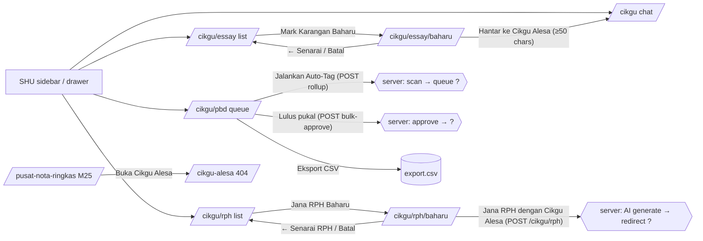

# M13 — Cikgu Alesa (AI Teacher Assistant) (Discovery)

- **Source:** live read-only walk-through of https://prestasiplus.my on 2026-09-25 with the admin account (browser lane 1, `playwright`).
- **Screenshots:** `docs/discovery/img/M13/` (21 files). Every page was masked in the DOM before capture. The user-portal shell (`SHU`) and design tokens are in [00-global-ui.md](00-global-ui.md) and are not repeated here.
- **Language:** UI copy is quoted in its exact Bahasa Melayu. Some strings are English or mixed on live ("Voice Mode", "Powered by", "Rubric", "Level", "Marking", "Tier", "Turns remaining", "Tool hops", "Tokens", "Auto-Tag", "Approved", "PBD Assessment plan", "mixed-ability", the Laravel paginator "« Previous" / "Next »" / "Showing 0 of 0 results", and the 405 page).
- **Personal data:** the `/cikgu` header names three real teachers ("Guru maya · Powered by `<nama>` · `<nama>` · `<nama>` + 50K+ soalan DSKP"). `tools/jobs/M13.js` → `M13MASK` replaces each name structurally (split on " · "), so no name is written in any file. `tools/sanitize.js` (default options) masks the shell user name and e-mail. Every M13 list is empty for the admin account, so no student, essay or RPH record was displayed.
- **Element inventory:** 137 content elements over 8 screens and 37 captured UI states, with IDs `EL-M13-S#-nnn`, in `docs/discovery/inventory/M13/<S#-key>.json`. Reconciliation, the crawl and the read-only limits are in `docs/discovery/inventory/M13/_summary.md`.
- **Safety (no AI call was made):**
  - Never clicked or submitted: chat "Hantar" (`POST /cikgu/send`), the mic "🎤" (speech recognition auto-submits the chat when it ends with more than 5 characters in the input), "Jana RPH dengan Cikgu Alesa" (`POST /cikgu/rph`), "Jalankan Auto-Tag" (`POST /cikgu/pbd/rollup`), "Lulus pukal (TP cadangan)" (`POST /cikgu/pbd/bulk-approve`).
  - "Eksport CSV (Approved)" (`/cikgu/pbd/export.csv`) was recorded from its `href` only and never opened.
  - No file was uploaded (M13 has no upload control).
  - RPH native validation was shown with `form.reportValidity()` on the empty form, never by submitting.
  - The essay "Hantar ke Cikgu Alesa" button was clicked twice: once with 14 characters (alert only) and once with a neutral 91-character dummy sentence, which only navigates by GET to `/cikgu?action=mark_essay&…`. `/cikgu` never auto-sends (its only prefill script reads `?ask=`), and the dummy text left in `sessionStorage` was removed.
  - The voice-mode checkbox was set through the DOM property only (no `change` event), so `localStorage` was not written.
  - Scripted GETs ran one at a time, with at least 350 ms between navigations (`networkidle` plus a 400 ms settle).

Cross-references (owned elsewhere, not re-inventoried):
- `/pusat-ai/spm` "SPM Walkthrough — Cikgu Alesa" → **M06 S13**. It has its own form and endpoint (`POST /pusat-ai/spm/solve`) and shares **no component** with M13 (see §1.2).
- `/pusat-ai/kamus`, `/aktiviti`, `/pendamping`, `/whiteboard`, `/parent-whisperer`, `/doa`, `/pusat-nota-ringkas` → **M25**. Each has its own endpoint (§1.2). `/pusat-nota-ringkas` links "Buka Cikgu Alesa" to **`/cikgu-alesa`, which is 404** (D-M13-7).
- `/cikgu-suara` "Cikgu Suara" (`POST /cikgu-suara/ask`) → **M26**. `/cikgu/kelulusan-hadiah` "Kelulusan Hadiah" → **M15**. Both sit in the same sidebar groups as the M13 links.
- The floating shell chatbot (`chatbotWidget()`: `/chatbot/send`, `/chatbot/history`, `/chatbot/rate`, FAQ chips "Apakah PrestasiPlus?", "Bagaimana cara mendaftar?", "Berapakah harga langganan?", error "Maaf, berlaku ralat. Sila cuba semula.") is a **shell** component (00-global-ui). It is not Cikgu Alesa and does not use `/cikgu/send`.

---

## 1. Overview

The TRACKER checklist has 4 M13 routes. The crawl found **6 content screens**, because the RPH and essay lists each open a create page (`/baharu`), plus the error outcomes:

| # | Route | Tab title (`<title>`) · shell header | Status on admin account |
|---|---|---|---|
| S1 | `/cikgu` (`?ask=`) | "Cikgu Alesa" · SHU header "Dashboard" / "Selamat datang kembali" | 200. Greeting only, empty thread |
| S2 | `/cikgu/rph` (`?page=`) | "RPH — Cikgu Alesa" · same stale header | 200. Empty list |
| S3 | `/cikgu/rph/baharu` (**new**) | "Jana RPH Baharu" · same | 200. Manual form (no class linked) |
| S4 | `/cikgu/essay` (`?page=`) | "Marking Karangan" · same | 200. Empty list |
| S5 | `/cikgu/essay/baharu` (**new**) | "Mark Karangan Baharu" · same | 200 |
| S6 | `/cikgu/pbd` (`?page=`) | "PBD Auto-Tag Queue" · same | 200. Empty queue; class select has only the placeholder |
| S7 | `/cikgu/rph/{id}` and other unknown `/cikgu/*` paths | "404 - Halaman Tidak Dijumpai \| PRESTASIPLUS" (standalone error page) | 404 |
| S8 | `GET /cikgu/send` (and `GET /cikgu/pbd/rollup`, `GET /cikgu/pbd/bulk-approve`) | "An Error Occurred: Method Not Allowed" (framework error page) | 405 |

Other access outcomes found by probing (all GET):
- **404:** `/cikgu/rph/1`, `/cikgu/rph/2`, `/cikgu/rph/99999999`, `/cikgu/rph/1/edit`, `/cikgu/rph/1/print`, `/cikgu/rph/1/pdf`, `/cikgu/rph/create`, `/cikgu/essay/1`, `/cikgu/essay/2`, `/cikgu/essay/99999999`, `/cikgu/essay/create`, `/cikgu/pbd/1`, `/cikgu/pbd/baharu`, `/cikgu/pbd/export`, `/cikgu/history`, `/cikgu/threads`, `/cikgu/thread/1`, `/cikgu/threads/1`, `/cikgu/quota`, `/cikgu/voice`, `/cikgu/usage`, `/cikgu/admin`, `/admin/cikgu`, `/admin/cikgu-alesa`, `/admin/ai`, `/admin/ai-usage`, `/cikgu-alesa`, `/Cikgu`, `/pusat-ai`.
- **405** (POST-only routes exist): `/cikgu/send`, `/cikgu/pbd/rollup`, `/cikgu/pbd/bulk-approve`.
- **200, same page:** `/cikgu/` and `/cikgu/rph/` (trailing slash is dropped), `?page=2` on all three lists (paginator appears), `?classroom_id=1` on S3 and S6 (ignored).
- The detail routes of saved RPHs and essays are not known. Ids 1 and 2 return 404, either because they don't exist or because they belong to another teacher (Q-M13-2).

**Entry points** (SHU sidebar for the admin account; the groups are in 00-global-ui §sections):
- Group "🤖 CIKGU ALESA AI": **"Cikgu Alesa Chat AI"** (`fa-robot`, purple-600) → `/cikgu`.
- Group "🎯 AI PINTAR (GURU)": **"RPH (Cikgu Alesa)"** (`fa-clipboard-list`, emerald-600) → `/cikgu/rph`; **"Semak Karangan (Cikgu Alesa)"** (`fa-pen-fancy`, amber-600) → `/cikgu/essay`; **"PBD (Cikgu Alesa)"** (`fa-tasks`, rose-600) → `/cikgu/pbd`. "Cikgu Suara" (M26) is in "💎 KILLER FEATURES" and "Kelulusan Hadiah" (M15) is next in the same run.
- Group "CIKGU ALESA TOOLS": **"Cikgu Alesa AI"** (`fa-robot`) → `/cikgu`; **"RPH (Rancangan Harian)"** (`fa-file-alt`, purple-500) → `/cikgu/rph`; **"PBD Auto-Tag"** (`fa-clipboard-check`, blue-500) → `/cikgu/pbd`; **"Mark Karangan"** (`fa-pen-fancy`, rose-500) → `/cikgu/essay`.
- Mobile drawer (below 1024 px): "Cikgu Alesa AI", "RPH", "PBD Auto-Tag", "Mark Karangan" (`drawer-nav-item`), plus the drawer copies of the first group.
- Active state: on every `/cikgu/*` page the matching item **and** "Cikgu Alesa AI" (→ `/cikgu`, prefix match) carry `active`. On `/cikgu` both "Cikgu Alesa Chat AI" and "Cikgu Alesa AI" are active.
- In-page links: S2 "Jana RPH Baharu" → S3; S3 "← Senarai RPH" / "Batal" → S2; S4 "Mark Karangan Baharu" → S5; S5 "← Senarai" / "Batal" → S4; S5 "Hantar ke Cikgu Alesa" → S1 (`?action=mark_essay&…`).
- The admin panel sidebar (`/admin`) has no M13 link (only "Cikgu Suara").

### 1.1 Shell by screen and role

| Screen | Shell | Evidence |
|---|---|---|
| S1–S6 | `SHU` user portal (top bar with koin / mata / streak, bell "99+", drawer + bottom nav "Home / SPM / Game / Topik / Chat / Lagi" below 1024 px) | no title suffix; header title stays "Dashboard" / "Selamat datang kembali" on every M13 page (D-M13-8) |
| S7 | none (standalone 404 layout: "404", "🔍", "Halaman Tidak Dijumpai", "Halaman Utama" → `/`, "Mula Latihan" → `/latih-tubi`, "PRESTASIPLUS") | global |
| S8 | none (framework default "Oops! An Error Occurred" page, English) | — |

What a teacher sees (own classes in S3/S6, saved rows in S2/S4/S6, the chat quota tier) is not observable with the admin account (Q-M13-1).

### 1.2 Relationship to M06 / M25 / M26 AI pages

| Page | Endpoint | Shares M13 code? |
|---|---|---|
| `/pusat-ai/spm` (M06 S13) | `POST /pusat-ai/spm/solve` (multipart) | **No.** Own form `#spmForm`, `<pre>` result, `alert()` errors. Only the persona name "Cikgu Alesa" is shared. |
| `/pusat-ai/kamus` (M25) | `/pusat-ai/kamus/lookup` | No |
| `/pusat-ai/aktiviti` (M25) | `/pusat-ai/aktiviti/suggest` | No |
| `/pusat-ai/pendamping` (M25) | `/pusat-ai/pendamping/chat` | No (separate chat endpoint) |
| `/pusat-ai/whiteboard` (M25) | `/pusat-ai/whiteboard/generate` | No |
| `/pusat-ai/parent-whisperer` (M25) | — | 403 for admin |
| `/pusat-ai/doa` (M25) | none | No |
| `/pusat-nota-ringkas` (M25) | — | Links "Buka Cikgu Alesa" → `/cikgu-alesa` (404, D-M13-7) |
| `/cikgu-suara` (M26) | `/cikgu-suara/ask` | No |

**Recommendation for the URS writer:** in the rebuild, one simulated "Cikgu Alesa" AI service (D4) can back every canned response, but the M13 screens have no UI component in common with M06/M25/M26. Keep them separate.

---

## 2. Screens

### 2.1 S1 — `/cikgu` "Cikgu Alesa" (AI chat)

Screenshots: `chat-desktop.png`, `chat-tablet.png`, `chat-mobile.png`, `chat-ask-prefill.png`.

Everything is inline-styled inside `.cikgu-alesa-shell` (`max-width: 880px; margin: 24px auto; padding: 16px`). Tailwind is not used here.
- **Header:** round avatar "CA" (48 px, `linear-gradient(135deg,#3b82f6,#8b5cf6)`, white 18px bold), h1 "Cikgu Alesa" (20px), sub-line "Guru maya · Powered by `<nama>` · `<nama>` · `<nama>` + 50K+ soalan DSKP" (13px, `#6b7280`).
- **History box** `section#cikgu-history`: `#f9fafb` background, `#e5e7eb` border, radius 12, padding 16, `min-height:360px; max-height:520px; overflow-y:auto`. It starts with one bot message: **"Cikgu Alesa:"** (bold) + "Hai! Saya Cikgu Alesa. Apa nak belajar hari ni? Cuba tanya pasal subjek tertentu, atau minta latihan soalan." Messages are `div.cikgu-msg.cikgu-msg-{bot|user}` with a `<strong>` prefix "Cikgu Alesa: " or "Anda: " and a `span.cikgu-msg-body`. Text is inserted as text nodes, with `<br>` for each `\n` (no HTML/Markdown rendering). No avatars or timestamps.
- **Voice toolbar** `#cikgu-voice-toolbar` (gradient `#ede9fe → #fce7f3`, radius 10, wraps): "🎙️ Voice Mode:" (13px 600, `#6d28d9`); checkbox `#cikgu-voice-mode` "Cikgu jawab dengan suara (auto)" (unchecked by default; state from `localStorage.cikgu_voice_mode === '1'`); status span `#cikgu-voice-status` (right, 12px 600 `#6d28d9`, empty).
- **Form** `#cikgu-form` (no action/method → JS only; `display:flex; gap:8px`):
  - hidden `#cikgu-thread-id` (empty; holds the thread id returned by the server);
  - mic button `#cikgu-mic` "🎤" (`type=button`, title "Tekan dan tahan untuk cakap", white with `#8b5cf6` border, `#6d28d9` text, 18px);
  - text input `#cikgu-input`, placeholder "Taip atau tekan 🎤 untuk cakap…", **`required`**, **`maxlength="4000"`**, no `name`;
  - submit `#cikgu-send` "Hantar" (`#3b82f6`, white, 600).
- **Meta line** `#cikgu-meta` (12px `#6b7280`, `min-height:18px`), empty before the first reply.
- No quota, tier, history list, example prompts, templates, file upload, export or print is shown before sending. The only prefill is `?ask=`: script `applyPrefill()` copies `?ask=` into the input, focuses it and scrolls it into view (smooth, centred). It never sends. State `ask-prefill`: input "Terangkan pecahan setara", focused.
- `?action=mark_essay&rubric=&subject=&level=&student=&title=` (arriving from S5) is **ignored**: the input stays empty and `sessionStorage.cikgu_pending_essay` is never read (state `essay-handoff`, D-M13-1).

### 2.2 S2 — `/cikgu/rph` "Rancangan Pengajaran Harian (RPH)"

Screenshots: `rph-list-desktop.png`, `rph-list-mobile.png`, `rph-list-page2-mobile.png`.
- h1 "📋 Rancangan Pengajaran Harian (RPH)" (`text-2xl` bold slate-800); sub "RPH yang dijana oleh Cikgu Alesa atau cikgu sendiri." (sm slate-500).
- Button link **"Jana RPH Baharu"** (`fa-robot`, gradient purple-500 → pink-500, white, rounded-lg) → `/cikgu/rph/baharu`.
- Table (white card, `overflow-hidden`; header slate-50, uppercase xs slate-600): **Tarikh · Subjek / Level · Tajuk · Status · Tindakan** (the last column is right-aligned).
- Empty row (`colspan=5`, py-12, centred, slate-400): **Belum ada RPH. Klik "Jana RPH Baharu" dan minta Cikgu Alesa: *"Tolong jana RPH untuk Matematik T4 Bab 3 esok"*.** (The example prompt is in `<em>`.)
- Pager slot `div.mt-4` (Laravel Tailwind paginator). It is empty on page 1. On `?page=2`: desktop "Showing 0 of 0 results" plus a prev-arrow button and page "1" (aria-labels "&laquo; Previous", "Go to page 1"; disabled "Next &raquo;"). At 375 the mobile variant shows "« Previous" (link → `?page=1`) and "Next »" (disabled span). No filter, search or sort.

### 2.3 S3 — `/cikgu/rph/baharu` "Jana RPH dengan Cikgu Alesa" (new route)

Screenshots: `rph-baharu-desktop.png`, `rph-baharu-tablet.png`, `rph-baharu-mobile.png`.
- Back link "← Senarai RPH" → `/cikgu/rph`.
- Card: purple→pink round `fa-robot` icon; h1 "Jana RPH dengan Cikgu Alesa"; sub (admin, no class linked): **"Sistem belum jumpa kelas yang dikaitkan dengan akaun Cikgu. Sila isi manual."**
  - A second branch exists for teachers with classes. The page script `applyClassroomDefaults(sel)` copies `data-subject` / `data-level` / `data-class` of a chosen class option into Subjek / Tingkatan / Kelas. That class select and its sub-copy are not rendered for admin (Q-M13-3).
- Form `#rph-create-form` **`POST /cikgu/rph`** (`_token`; no `novalidate`), in field order:

| Label (uppercase xs bold slate-600) | Control | Rules / default |
|---|---|---|
| "Subjek *" (red `*`) | `input[name=subject_name]#subject_name`, `list="subject-list"`, placeholder "cth: Matematik, Sains, Bahasa Melayu" | **required**; free text + datalist of 31 subjects (Appendix A.2) |
| "Tingkatan / Tahun *" | `select[name=level]#level` | **required**; "— Pilih —" (''), D1 "Darjah 1" … D6 "Darjah 6", T1 "Tingkatan 1" … T5 "Tingkatan 5" |
| "Tajuk Pengajaran *" | `input[name=tajuk]`, placeholder "cth: Pecahan Setara, Sel Sebagai Unit Asas Hidupan, Persamaan Kuadratik" | **required**, `maxlength=200` |
| "Kelas" | `input[name=class_name]#class_name`, placeholder "cth: 4 Bestari" | optional |
| "Tarikh" | `input[type=date][name=lesson_date]` | preloaded with **today** (2026-09-25 on capture) |
| "Tempoh (minit)" | `input[type=number][name=duration_minutes]` | `min=15 max=240`, default **60** |
| "Masa Slot" | `input[name=time_slot]`, placeholder "cth: 8.00-9.00 pagi" | optional |
| "Tema (opsyenal)" | `input[name=tema]`, placeholder "cth: Nombor & Operasi" | optional |
| "Keperluan Khas (opsyenal)" | `textarea[name=pengajaran_keperluan]` rows 2, placeholder "cth: Kelas mixed-ability. Atau: 5 minit set induksi je sebab masa pendek." | `maxlength=500` |

  Layout: Subjek | Tingkatan (2 columns at `md`); Tajuk full width; Kelas | Tarikh | Tempoh (3 columns at `md`); Masa Slot | Tema (2 columns); Keperluan full width.
- Info box (purple-50 / purple-200 / purple-900): **"📌 Apa yang Cikgu Alesa akan jana:"** with the bullets "Standard Kandungan + Standard Pembelajaran (cite DSKP)", "2-4 Objektif Pembelajaran spesifik & boleh diukur", "Aktiviti PdPc penuh: Set Induksi → Aktiviti 1-3 → Penutup", "BBM, EMK, dan PBD Assessment plan". This is the only description of the output template (§6.2).
- Buttons: submit `#submit-btn` **"Jana RPH dengan Cikgu Alesa"** (`fa-robot`, gradient, label span `#submit-label`) and link **"Batal"** (slate-200 / slate-700) → `/cikgu/rph`. The "Batal" link discards the input: no confirm and no draft.
- Note (xs slate-400): "⏱️ Proses ambil masa 10-30 saat. Sila tunggu."
- Submit handler: the button is disabled, gets `opacity-60`, and its label becomes **"Cikgu Alesa sedang jana RPH…"**. The form then posts normally (full page load). Native validation is not bypassed.
- State `validity` (`reportValidity()` on the empty form): 3 invalid fields, subject_name "Please fill out this field.", level "Please select an item in the list.", tajuk "Please fill out this field." (Chrome-native English bubbles).

### 2.4 S4 — `/cikgu/essay` "Marking Karangan AI"

Screenshots: `essay-list-desktop.png`, `essay-list-page2.png`, `essay-list-mobile.png`.
- h1 "📝 Marking Karangan AI"; sub "Karangan yang dimark oleh Cikgu Alesa berdasarkan rubric SPM/PT3."
- Button link **"Mark Karangan Baharu"** (`fa-plus`, purple-500, hover purple-600) → `/cikgu/essay/baharu`.
- Table columns: **Pelajar · Subjek / Rubric · Tajuk · Markah** (centred) **· Tindakan** (right-aligned).
- Empty row (`colspan=5`): **Belum ada karangan dimark. Klik "Mark Karangan Baharu" untuk mula.**
- Pager as on S2 (`?page=2` → "Showing 0 of 0 results").

### 2.5 S5 — `/cikgu/essay/baharu` "Mark Karangan Baharu" (new route)

Screenshots: `essay-baharu-desktop.png`, `essay-baharu-typed.png`, `essay-baharu-mobile.png`.
- Back link "← Senarai" → `/cikgu/essay`.
- h1 "📝 Mark Karangan Baharu". Intro: "Salin & tampal karangan pelajar di bawah. Cikgu Alesa akan mark berdasarkan rubric yang dipilih. Klik **Hantar ke Cikgu Alesa** akan buka chat dengan prompt siap-siap untuk submit."
- Form `#essay-form` (no action, no method; **no control has a `name`**):

| Label | Control | Rules |
|---|---|---|
| "Rubric" | `select#rubric_key` | 6 options (Appendix A.1); default = first ("SPM Bahasa Melayu — Karangan (Bahagian B) (50 markah)") |
| "Subjek" | `input#subject_name`, placeholder "cth: Bahasa Melayu" | optional, free text |
| "Level" | `input#level`, placeholder "T4" | optional, free text (not a select) |
| "Nama Pelajar" | `input#student_name` | optional, free text |
| "Tajuk Karangan" | `input#essay_title` | optional |
| "Teks Karangan" | `textarea#essay_text` rows 14, `font-mono text-sm`, placeholder "Salin & tampal karangan pelajar di sini…" | `required`, `minlength=50`, which is never enforced natively (the button is `type=button`) |

  Word counter `#word-counter` (xs slate-400) under the textarea: "0 perkataan". It updates on every `input` event (count of `\S+` runs), e.g. "5 perkataan" (state `typed`).
- Amber box: "**Apa yang berlaku selepas klik:** Kita akan ke chat Cikgu Alesa, butiran karangan akan auto-isi dalam mesej. Cikgu Alesa akan panggil tool `mark_essay` dan beri markah + komen membina. Hasil disimpan dalam senarai marking."
- Buttons: **"Hantar ke Cikgu Alesa"** (`type=button`, `onclick="submitToChat()"`, `fa-robot`, purple-500) and link **"Batal"** → `/cikgu/essay` (discards, no confirm).
- `submitToChat()`: trims all fields. If the essay text is under 50 **characters** → `alert('Karangan terlalu pendek (minimum 50 aksara).')` and stay (state `too-short`). Otherwise it stores the text in `sessionStorage.cikgu_pending_essay` and navigates to `/cikgu?action=mark_essay&rubric={key}&subject=&level=&student=&title=` (URL-encoded). **That handoff is broken** on live: S1 ignores these params (D-M13-1).
- Pressing Enter in a field does nothing: the form has no submit button and more than one text field, so there is no implicit submission.

### 2.6 S6 — `/cikgu/pbd` "PBD Auto-Tag — Antrian Semakan"

Screenshots: `pbd-desktop.png`, `pbd-tablet.png`, `pbd-mobile.png`.
- h1 "📊 PBD Auto-Tag — Antrian Semakan"; sub "AI cadangan Tahap Penguasaan (TP1-6) berdasarkan aktiviti pelajar. Cikgu sah dahulu sebelum eksport ke KPM idMe."
- Toolbar (right, `space-x-2`):
  - form **`POST /cikgu/pbd/rollup`** (`_token`, `classroom_id`): select `classroom_id` "Pilih kelas untuk rollup" ('' only for admin; **not `required`**) + button **"Jalankan Auto-Tag"** (no `type` → submit; purple-500 → hover purple-600; **no confirm**);
  - link **"Eksport CSV (Approved)"** (`fa-download`, emerald-500) → `/cikgu/pbd/export.csv` (not opened).
- Form **`POST /cikgu/pbd/bulk-approve`** `#bulk-form` (`_token`) wraps the table card:
  - card header: checkbox `#select-all` "Pilih semua" (`onchange` ticks every `.row-check`; there are 0 row checkboxes for admin) and submit **"Lulus pukal (TP cadangan)"** (blue-500; **no confirm**; submits even with nothing ticked);
  - table columns: *(checkbox)* · **Pelajar · SP · Skor** (centred) **· TP Cadangan** (centred) **· Tindakan** (right-aligned);
  - empty row (`colspan=6`, py-8): **Tiada antrian semakan. Klik "Jalankan Auto-Tag" untuk scan aktiviti pelajar.**
  - pager inside the form (`?page=2` → "Showing 0 of 0 results").
- Row structure (per-row `.row-check` name/value, the per-row "Tindakan" controls, TP colours) is not observable (Q-M13-4). **Risk:** any per-row approve/override form would be **nested inside `#bulk-form`**, the same defect class as M10 S20 (see §8.3).

### 2.7 S7 — 404 (`/cikgu/rph/{id}`, `/cikgu-alesa`, …)

Screenshot: `not-found-404.png`. The global 404 page: "404", "🔍", h1 "Halaman Tidak Dijumpai", "Maaf, halaman yang anda cari tidak wujud atau telah dipindahkan. Mungkin URL salah taip?", "Halaman Utama" → `/`, "Mula Latihan" → `/latih-tubi` (itself 404, global defect D-8 in M06), footer "PRESTASIPLUS".

### 2.8 S8 — 405 (`GET /cikgu/send`)

Screenshot: `method-not-allowed-405.png`. Framework default page: h1 "Oops! An Error Occurred", h2 'The server returned a "405 Method Not Allowed".', p "Something is broken. Please let us know what you were doing when this error occurred. We will fix it as soon as possible. Sorry for any inconvenience caused." It is only reachable by typing the URL; no UI links to it.

---

## 3. Flows

### 3.1 Navigation



### 3.2 Chat send (S1) — source-derived, not executed

```mermaid
sequenceDiagram
  participant U as Teacher
  participant P as /cikgu page
  participant S as POST /cikgu/send
  U->>P: types (≤4000) + Hantar / Enter  (empty → native "required" bubble)
  P->>P: trim; blank → return silently
  P->>P: append "Anda: …", clear input, disable Hantar, meta "Cikgu Alesa sedang berfikir…"
  P->>S: JSON {message, thread_id|null} + X-CSRF-TOKEN
  alt 2xx
    S-->>P: {thread_id, reply, tier, turns_remaining, tool_hops, tokens{in,out}}
    P->>P: store thread_id; append "Cikgu Alesa: {reply or '(tiada respon)'}"; meta "Tier: … · Turns remaining: … · Tool hops: … · Tokens: in=… out=…"
  else non-2xx JSON
    S-->>P: {error?, quota_exhausted?}
    P->>P: append bot {error or 'Cikgu Alesa tak boleh respon. Cuba lagi.'}; meta 'Quota habis untuk hari ni.' if quota_exhausted else ''
  else network error / non-JSON body
    P->>P: append bot 'Ralat sambungan. Cuba lagi sebentar.'
  end
  P->>P: finally: enable Hantar, focus input
```

Not streaming (one `await res.json()`). The thread lives only in the hidden field, so a reload starts an empty page with the greeting. No earlier conversation is fetched.

### 3.3 Voice (S1) — source-derived

- **Mic 🎤** (click toggles; it is not press-and-hold despite its title): when `SpeechRecognition`/`webkitSpeechRecognition` is missing, the mic is disabled, gets title "Browser tidak sokong voice — guna Chrome/Edge" and opacity 0.4. Otherwise a click starts recognition (`lang ms-MY`, interim results, not continuous): the mic becomes "🔴" on `#fee2e2` and the status shows "Mendengar...". Interim text is written into the input. On end, the mic goes back to "🎤" on white, the status clears, and **if the input is longer than 5 characters the chat form is submitted automatically**. On error the status shows "Maaf, tak dengar.". A second click stops recognition.
- **Voice mode toggle:** writes `localStorage.cikgu_voice_mode` '1'/'0'. `VoiceMode.speak()` (TTS `ms-MY`, rate 0.95, pitch 1.0) is exposed as `window.cikguAlesaSpeak`, but **nothing calls it**. The reply renderer `append()` does not call it, and the `MutationObserver` watches `#cikgu-messages` / `.chat-messages` / `#chat-messages`, which do not exist on the page (the box is `#cikgu-history`). So replies are never spoken (D-M13-2).

### 3.4 RPH generation (S3) — source-derived

Fill the required Subjek, Tingkatan / Tahun and Tajuk (+ optional fields) → "Jana RPH dengan Cikgu Alesa" → native validation → busy label "Cikgu Alesa sedang jana RPH…" → `POST /cikgu/rph` (10–30 s) → server response (redirect target, validation-error display and saved RPH view not observable). The S2 empty-state copy suggests an RPH can also be requested in the chat ("Tolong jana RPH untuk Matematik T4 Bab 3 esok"), i.e. the chat has an RPH tool (INFERRED).

### 3.5 Essay marking (S5 → S1)

S5 fields → "Hantar ke Cikgu Alesa" → (< 50 chars: alert) → `sessionStorage.cikgu_pending_essay` = text → GET `/cikgu?action=mark_essay&rubric=…&subject=…&level=…&student=…&title=…` → **S1 shows the plain greeting with an empty input** (live). The intended behaviour, stated in the S5 copy: the chat message is pre-filled with the essay details, the teacher sends it, Cikgu Alesa calls tool `mark_essay`, and the result appears in the S4 list ("Hasil disimpan dalam senarai marking").

### 3.6 PBD auto-tag (S6) — source-derived

Pick a class → "Jalankan Auto-Tag" → `POST /cikgu/pbd/rollup` (AI suggests TP1–6 per student × SP from activity) → queue rows → tick rows / "Pilih semua" → "Lulus pukal (TP cadangan)" → `POST /cikgu/pbd/bulk-approve` → approved rows → "Eksport CSV (Approved)" → CSV for KPM idMe.

---

## 4. Data entities implied (INFERRED unless marked)

| Entity | Fields (observed names in `code`) | Notes |
|---|---|---|
| ChatThread | `thread_id`; tier; turns remaining; per-reply `tool_hops`, `tokens.in`, `tokens.out` | OBSERVED names from the response handler. Daily quota per tier ("Quota habis untuk hari ni.") |
| ChatMessage | role `user` / `bot` (UI labels "Anda" / "Cikgu Alesa"), text ≤ 4000 chars (input `maxlength`) | server stores (INFERRED; the thread id is reused) |
| Rph | `subject_name`, `level` (D1–D6, T1–T5), `tajuk` (≤ 200), `class_name`, `lesson_date`, `duration_minutes` (15–240, default 60), `time_slot`, `tema`, `pengajaran_keperluan` (≤ 500), [`classroom_id`?]; list shows Tarikh, Subjek / Level, Tajuk, Status | content: Standard Kandungan, Standard Pembelajaran (DSKP), 2–4 objektif, Set Induksi, Aktiviti 1–3, Penutup, BBM, EMK, PBD assessment plan. Source "dijana oleh Cikgu Alesa atau cikgu sendiri" (AI or manual). Status values unknown |
| EssayMarking | `rubric_key` (6 keys, max marks 50/50/30/30/20/100), `subject_name`, `level` (free text), `student_name` (free text, not linked to a user), `essay_title`, essay text; list shows Pelajar, Subjek / Rubric, Tajuk, Markah | created by the chat tool `mark_essay`; markah + "komen membina" |
| PbdTag (queue item) | student (Pelajar), SP (Standard Pembelajaran), Skor, TP Cadangan (TP1–TP6), status (pending / approved), classroom | approved rows are exported as CSV "ke KPM idMe" |
| Classroom (M10) | `data-subject`, `data-level`, `data-class` on the S3 class option; S6 `classroom_id` | owned by M10 (D12) |

---

## 5. Inferred rules (labelled)

1. OBSERVED: chat input required (native) and ≤ 4000 chars; a whitespace-only message is dropped silently by the script.
2. OBSERVED: the chat response carries a tier and "turns remaining", so usage is limited per tier. `quota_exhausted` → "Quota habis untuk hari ni." (limit resets daily, INFERRED from the copy). Tier names and limits are unknown (Q-M13-5).
3. OBSERVED: RPH required fields are Subjek, Tingkatan / Tahun, Tajuk Pengajaran. Tempoh 15–240, default 60; Tarikh defaults to today; Tajuk ≤ 200; Keperluan ≤ 500. Subjek is free text with suggestions (any value accepted client-side).
4. OBSERVED: RPH levels are Darjah 1–6 and Tingkatan 1–5 only (no Tingkatan 6 / pra-sekolah).
5. OBSERVED: essay minimum is 50 characters (after trim), checked by a JS alert. The counter counts words. Rubric max marks are in the option labels.
6. INFERRED: `mark_essay` saves a record listed on S4, and `rph` records list on S2, both scoped to the logged-in teacher (ids 1/2 → 404 for admin).
7. INFERRED: PBD rollup needs a class (the select has no `required`; the server behaviour for '' is unknown). Only "Approved" rows are exported.
8. OBSERVED: lists paginate with the Laravel paginator (`?page=`). Page size and sort order are unknown (all empty).
9. OBSERVED: `?classroom_id=` is ignored by S3 and S6 for admin.

---

## 6. AI endpoints and payload shapes

### 6.1 Endpoints observed

| Method | URL | Purpose | Request | Response / handling | Called? |
|---|---|---|---|---|---|
| GET | `/cikgu` (`?ask=`) | chat page | — | HTML | yes |
| POST | `/cikgu/send` | chat turn (AI; server-side tools incl. `mark_essay`) | `Content-Type: application/json`, `Accept: application/json`, `X-CSRF-TOKEN` (from `meta[name=csrf-token]`); body `{"message": string, "thread_id": string\|null}` | 2xx `{thread_id, reply, tier, turns_remaining, tool_hops, tokens:{in, out}}`; non-2xx `{error?, quota_exhausted?: bool}` | **no** (GET → 405) |
| GET | `/cikgu/rph` (`?page=`) | RPH list | — | HTML | yes |
| GET | `/cikgu/rph/baharu` | RPH form | — | HTML | yes |
| POST | `/cikgu/rph` | generate RPH (AI) | form-urlencoded `_token, subject_name, level, tajuk, class_name, lesson_date, duration_minutes, time_slot, tema, pengajaran_keperluan` | full-page response (INFERRED redirect) | **no** |
| GET | `/cikgu/essay` (`?page=`) | essay list | — | HTML | yes |
| GET | `/cikgu/essay/baharu` | essay form | — | HTML | yes |
| GET | `/cikgu?action=mark_essay&rubric=&subject=&level=&student=&title=` + `sessionStorage.cikgu_pending_essay` | client handoff | — | ignored by S1 | yes (dummy) |
| GET | `/cikgu/pbd` (`?page=`) | PBD queue | — | HTML | yes |
| POST | `/cikgu/pbd/rollup` | run auto-tag (AI) for a class | `_token, classroom_id` | full page (INFERRED redirect back with flash) | **no** (GET → 405) |
| POST | `/cikgu/pbd/bulk-approve` | approve ticked suggestions | `_token` + ticked `.row-check` (name unknown) | full page | **no** (GET → 405) |
| GET | `/cikgu/pbd/export.csv` | CSV of approved TPs | — | CSV download | **no** (target only) |
| — | shell | `/api/tournament/active`, `/notifikasi/unread-count`, `/chatbot/*`, `/api/offline/snapshot`, `/fcm/token` | — | shell widgets | on load |

No M13 page makes an AI request on load (network log checked on S1–S6). Response bodies of the POST endpoints are unknown.

### 6.2 Output templates

No output template, rendered sample, print view or export layout exists in the page source. The only description of generated content is:
- the S3 info box (RPH sections);
- the S5 amber box (essay: "markah + komen membina");
- the S6 sub-line (TP1–6 suggestion, "sah dahulu sebelum eksport ke KPM idMe").

The chat reply is plain text with line breaks.

### 6.3 Loading, error and streaming handling (exact strings)

- Chat busy: `#cikgu-send` disabled; `#cikgu-meta` "Cikgu Alesa sedang berfikir…". Success meta: `` `Tier: ${tier} · Turns remaining: ${turns_remaining} · Tool hops: ${tool_hops} · Tokens: in=${tokens.in} out=${tokens.out}` ``. Empty reply: "(tiada respon)". Server error: `data.error` or "Cikgu Alesa tak boleh respon. Cuba lagi."; quota: "Quota habis untuk hari ni.". Network: "Ralat sambungan. Cuba lagi sebentar.". No streaming, no retry, no timeout.
- RPH busy: "Cikgu Alesa sedang jana RPH…" (+ disabled, `opacity-60`); note "⏱️ Proses ambil masa 10-30 saat. Sila tunggu.".
- Essay: alert "Karangan terlalu pendek (minimum 50 aksara).".
- Voice: "Mendengar...", "Maaf, tak dengar.", "Browser tidak sokong voice — guna Chrome/Edge".

---

## 7. States requiring a live AI call

These states exist but cannot be seen without calling a paid AI endpoint or creating records (not approved). Each needs a live run with user permission, ideally with a test teacher account:

| # | State | How it is reached |
|---|---|---|
| AI-1 | Chat: user bubble "Anda: …", busy meta "Cikgu Alesa sedang berfikir…", disabled Hantar | send a message (`POST /cikgu/send`) |
| AI-2 | Chat: bot reply rendering (multi-line), meta line "Tier / Turns remaining / Tool hops / Tokens", thread continuation | AI-1 success |
| AI-3 | Chat: server error message, quota-exhausted state "Quota habis untuk hari ni.", tier names and limits | error / quota responses |
| AI-4 | Chat: network error "Ralat sambungan. Cuba lagi sebentar." | offline during send (no AI cost, but it still attempts the POST) |
| AI-5 | Chat tool results: RPH via chat, `mark_essay` output (markah + komen), practice questions ("minta latihan soalan") | send a prompt that triggers a tool |
| AI-6 | Voice: mic listening "🔴 / Mendengar...", auto-submit after speech, error "Maaf, tak dengar." | click 🎤 with a microphone (auto-sends) |
| AI-7 | RPH: busy state, server validation errors, redirect target, generated RPH view (sections, print/export if any), list row (Status values, Tindakan actions) | submit S3 (`POST /cikgu/rph`) |
| AI-8 | Essay: marking result, saved row in S4 (Pelajar, Subjek / Rubric, Tajuk, Markah, Tindakan), detail page | working handoff (D-M13-1) + send |
| AI-9 | PBD: rollup result / flash message, queue rows (Pelajar, SP, Skor, TP Cadangan, Tindakan, `.row-check`), per-row actions, bulk-approve result, CSV layout | "Jalankan Auto-Tag" with a class; "Lulus pukal"; export |
| AI-10 | Teacher-with-classes branch of S3 (class select + `applyClassroomDefaults`) and the S6 class options | a teacher account with classes (no AI call; needs the role) |

In the rebuild all of these are simulated with canned responses (D4). The response shapes in §6.1 are the contract for the fake service.

---

## 8. Responsive behaviour (375 / 768 / 1280) and live defects

### 8.1 Layout per screen (measured)
- **Breakpoint:** SHU switches at 1024 px (sidebar → drawer + bottom nav). At 768 the layouts are the mobile ones.
- **S1:** the history box stays at 360–520 px tall at every width. The form row is `flex` with no wrap: mic 54×48, input `flex:1`, Hantar 92×48. **At 375 the page scrolls horizontally: `scrollWidth` 408 > 375**. The Hantar button ends at x = 408 (form content 383 in a 310 px box) and the input shrinks to 221 px, cutting the placeholder to "Taip atau tekan 🎤 untuk cak" (`chat-mobile.png`) → D-M13-3. 768: input 521 px, no overflow. 1280: input 686 px.
- **S2 / S4:** the header row is `flex justify-between`, not stacked. At 375 the h1 wraps onto 3 lines and the button wraps its label: "Jana RPH Baharu" 113×88 (three lines), "Mark Karangan Baharu" 126×88. **The table is wider than its `overflow-hidden` card at 375** (S2 table 404 px ending at x 430; S4 421 px ending at 447), so the "Tindakan" column and part of the empty-state sentence are **clipped with no scroll** (`rph-list-mobile.png`) → D-M13-4. 768/1280: fine. The paginator at 375 shows only "« Previous" / "Next »".
- **S3:** one column below `md` (all inputs 260 px at 375); 2/3-column grids at 768 and 1280. At 375 the submit button wraps to 175×92 and "Batal" becomes 78×92. No overflow.
- **S5:** one column below `md`; 3 + 2 columns at 768/1280; textarea 298 px tall. At 375 the submit wraps to 183×64 and "Batal" to 70×64. No overflow.
- **S6:** at 375 the toolbar wraps into three stacked rows (select 194×36, "Jalankan Auto-Tag" 148×36, "Eksport CSV (Approved)" 204×36) with no vertical gap (`space-x-2` only). "Lulus pukal (TP cadangan)" wraps to 197×52. **The table (382 px) is clipped** by the card: "TINDAKAN" is cut and the empty sentence is cut (`pbd-mobile.png`) → D-M13-4. 768: toolbar on one row; table fits.
- **S7/S8:** centred error page / plain framework page.
- **Text below 12px:** none in M13 content at 375, 768 or 1280 (computed font sizes measured with `tools/jobs/M13-probe.js`). The smallest are the 12px `#cikgu-meta` / `#cikgu-voice-status` and Tailwind `text-xs` (12px) labels.

### 8.2 Live defects (candidates for D9 fixes; the rebuild decision is the URS writer's)

| ID | Screen | Defect | Evidence | D9 class |
|---|---|---|---|---|
| D-M13-1 | S5 → S1 | Essay handoff is broken. S5 promises "butiran karangan akan auto-isi dalam mesej", but S1 ignores `?action=mark_essay&…` and never reads `sessionStorage.cikgu_pending_essay`. The teacher lands on an empty chat and the essay text is lost. | state `S1…essay-handoff` (input empty, pending text 91 chars); S1 source has only the `?ask=` prefill | broken flow (contradictory copy) |
| D-M13-2 | S1 | "Voice Mode — Cikgu jawab dengan suara (auto)" has no effect. TTS is never triggered (observer on non-existent `#cikgu-messages`; `append()` never calls `cikguAlesaSpeak`) | page source | broken control |
| D-M13-3 | S1 | Horizontal page scroll at 375 (408 px); Hantar pushed off the right edge | `chat-mobile.png`, probe `scrollWidth` 408 | layout / responsive breakage |
| D-M13-4 | S2, S4, S6 | Tables clipped at 375 inside `overflow-hidden` cards: "Tindakan" column and the empty-state text are cut and cannot be scrolled | `rph-list-mobile.png`, `essay-list-mobile.png`, `pbd-mobile.png`; table right edge 430 / 447 / 408 | layout / responsive breakage (grid clipping) |
| D-M13-5 | S1 | Mic title "Tekan dan tahan untuk cakap" (press and hold) while the control is click-to-toggle | source | wrong label |
| D-M13-6 | S5 | Rules contradict each other: counter in words ("0 perkataan"), rule in characters ("minimum 50 aksara"); textarea `required minlength=50` never applies (button `type=button`) | source; state `too-short` | contradictory rules |
| D-M13-7 | M25 `/pusat-nota-ringkas` | "Buka Cikgu Alesa" → `/cikgu-alesa` = **404** (should be `/cikgu`) | state `S7…cikgu-alesa` | dead link (fix belongs to M25; reported here) |
| D-M13-8 | S1–S6 | SHU header title stays "Dashboard" / "Selamat datang kembali" on every M13 page | screenshots | wrong title (same as M06 D-11) |
| D-M13-9 | S2, S4, S6 | Paginator copy "Showing 0 of 0 results" and "« Previous" / "Next »" in English on a BM page (only on an out-of-range `?page=`) | state `page-2` | wrong label (language); low impact |
| D-M13-10 | S8 | `GET /cikgu/send`, `/cikgu/pbd/rollup`, `/cikgu/pbd/bulk-approve` show the framework page "Oops! An Error Occurred" (English) instead of the site error layout | state `S8…` | wrong page / error-page inconsistency (URL-typed only) |
| D-M13-11 | S6 | "Jalankan Auto-Tag" and "Lulus pukal (TP cadangan)" submit with no class / no ticked row and have no confirm, although both start server work or approvals in bulk | source | working-but-risky → **replicate** (not D9) unless the server rejects; listed for the URS writer |

Working-but-odd behaviour that stays as live (not D9): the thread is lost on reload; there is no chat history list; the S5 "Level" and "Subjek" are free text (S3 uses a select + datalist); "Cikgu Alesa AI" is active on every `/cikgu/*` page; S6 buttons are wrapped without a vertical gap at 375; the Tarikh default is today.

### 8.3 Audit-lesson checklist (M08 / M10 audits)

| Point | M13 answer |
|---|---|
| Batal: hides vs discards | S3 "Batal" and S5 "Batal" are **links** to the list: they **discard** all input with no confirm or draft. There is no modal in M13. |
| Layout at 375 | §8.1 (S1 page overflow; S2/S4/S6 table clipping; wrapped buttons with measured sizes). |
| Observed colours | Appendix A.3. |
| Field resets | S1: input cleared after each send; the thread is lost on reload; voice toggle persisted in `localStorage.cikgu_voice_mode`. S3: all fields reset on reload (Tarikh → today, Tempoh → 60). S5: rubric → first option, counter → "0 perkataan" on reload; `sessionStorage.cikgu_pending_essay` is overwritten on each handoff. S6: "Pilih semua" not persisted. |
| Native `required` vs custom alerts | S1 input: native `required` (Chrome bubble); blank after trim → silent. S3: native `required` on 3 fields, no `novalidate`, no custom messages. S5: custom `alert` only; the native `required minlength` is dead (D-M13-6). S6: no validation at all. |
| Preloads | S1 `?ask=` → input. S3 Tarikh = today, Tempoh = 60. `?classroom_id=` ignored on S3/S6. S5 none. |
| Pagers | Laravel paginator on S2/S4/S6 (`?page=`); no filters exist to keep. Desktop "Showing 0 of 0 results" / mobile "« Previous" / "Next »". |
| Sort order | Unknown: every list is empty for admin (Q-M13-6). |
| Counts | None displayed besides the word counter. |
| Shell by role | §1.1 (SHU for admin; stale header). |
| Dead links / 403 / 404 / 405 / 500 | §1 probe list; `/cikgu-alesa` 404 (D-M13-7); `/latih-tubi` on the 404 page (global); 405 framework page (D-M13-10). No 403 or 500 in M13. |
| Nested forms | None on the observed DOM: `document.forms` on S6 = rollup form, `#bulk-form`, shell chatbot forms. Per-row controls inside `#bulk-form` are not observable (Q-M13-4, risk noted in §2.6). |
| Grid clipping 375/768 | D-M13-4 at 375; none at 768. |
| Text < 12px | None measured (§8.1). |

---

## 9. Open questions / not observable read-only

| # | Question | Why |
|---|---|---|
| Q-M13-1 | What does a **teacher** see: class select on S3 (option labels, `data-*` values), S6 class list, chat tier and quota? Are these pages hidden for students and parents? | admin account only |
| Q-M13-2 | Detail routes for a saved RPH / essay / PBD row (view, edit, print, PDF, delete); row actions under "Tindakan"; RPH "Status" values | lists empty; ids 1/2 → 404 |
| Q-M13-3 | RPH generation result: redirect target, generated layout, whether "cikgu sendiri" (manual) RPHs can be created or edited | not submitted (AI) |
| Q-M13-4 | PBD row structure (`.row-check` name, SP format, Skor scale, TP colour chips, per-row approve/override and whether those forms are nested), rollup and bulk-approve flash messages, CSV columns | not submitted / not exported |
| Q-M13-5 | Chat tier names, turn limits per day, the tool list (RPH, `mark_essay`, practice questions, DSKP search) and reply formatting | AI call required |
| Q-M13-6 | List page size and sort order | lists empty |
| Q-M13-7 | Should the rebuild show the three real teacher names in the header (live copy) or placeholder names? | privacy vs fidelity; the user decides (the names are masked in all discovery files) |

---

## 10. Screenshot index (`docs/discovery/img/M13/`, all masked)

`chat-desktop.png`, `chat-tablet.png`, `chat-mobile.png`, `chat-ask-prefill.png`, `rph-list-desktop.png`, `rph-list-mobile.png`, `rph-list-page2-mobile.png`, `rph-baharu-desktop.png`, `rph-baharu-tablet.png`, `rph-baharu-mobile.png`, `essay-list-desktop.png`, `essay-list-page2.png`, `essay-list-mobile.png`, `essay-baharu-desktop.png`, `essay-baharu-typed.png`, `essay-baharu-mobile.png`, `pbd-desktop.png`, `pbd-tablet.png`, `pbd-mobile.png`, `not-found-404.png`, `method-not-allowed-405.png`.

---

## Appendix A — Enumerations

### A.1 Essay rubrics (`#rubric_key`, S5)
| value | label |
|---|---|
| `spm_bm_karangan` (default) | SPM Bahasa Melayu — Karangan (Bahagian B) (50 markah) |
| `spm_bi_continuous_writing` | SPM English — Continuous Writing (Section B) (50 markah) |
| `pt3_bm_karangan` | PT3 Bahasa Melayu — Karangan (30 markah) |
| `pt3_bi_essay` | PT3 English — Essay (30 markah) |
| `sejarah_essay` | Sejarah — Karangan Esei (20 markah) |
| `general` | Rubric Am (default) (100 markah) |

Note: "Rubric Am (default)" is labelled default, but the first option (SPM BM) is preselected. Replicate as live.

### A.2 RPH subjects (`datalist#subject-list`, S3) and levels
Subjects (31, A→Z): Bahasa Arab · Bahasa Cina · Bahasa Inggeris · Bahasa Melayu · Bahasa Tamil · Biologi · Ekonomi · Fizik · Geografi · Jawi · Kimia · Matematik · Matematik Tambahan · Pembuatan Pakaian Wanita · Pendidikan Al-Quran & As-Sunnah · Pendidikan Islam · Pendidikan Jasmani & Kesihatan · Pendidikan Moral · Pendidikan Muzik · Pendidikan Seni Visual · Pendidikan Syariah Islamiah · Perniagaan · Pertanian · Prinsip Perakaunan · Reka Bentuk & Teknologi · Sains · Sains Komputer · Sains Rumah Tangga · Sains Sukan · Sejarah · Tasawwur Islam. (This is the same list as M11 S6 / M03 subjects.)

Levels (`select#level`): '' "— Pilih —" · D1 "Darjah 1" · D2 "Darjah 2" · D3 "Darjah 3" · D4 "Darjah 4" · D5 "Darjah 5" · D6 "Darjah 6" · T1 "Tingkatan 1" · T2 "Tingkatan 2" · T3 "Tingkatan 3" · T4 "Tingkatan 4" · T5 "Tingkatan 5".

TP scale (S6 copy): TP1–TP6.

### A.3 Colours observed
- S1 (inline): avatar gradient `#3b82f6 → #8b5cf6`; history `#f9fafb` / border `#e5e7eb`; voice bar `#ede9fe → #fce7f3`, text `#6d28d9`; mic border `#8b5cf6`, listening background `#fee2e2`; input border `#d1d5db`; Hantar `#3b82f6`; sub-line and meta `#6b7280`.
- S2/S3: gradient `from-purple-500 to-pink-500`; info box purple-50 / purple-200 / purple-900; "Batal" slate-200 / slate-700; required `*` rose-500.
- S4/S5: purple-500 (hover purple-600); amber box amber-50 / amber-200 / amber-800.
- S6: "Jalankan Auto-Tag" purple-500; "Eksport CSV (Approved)" emerald-500 (hover emerald-600); "Lulus pukal (TP cadangan)" blue-500 (hover blue-600).
- Tables: header slate-50 / slate-600 uppercase xs; empty text slate-400; dividers slate-100.

### A.4 Storage keys and query params
`localStorage.cikgu_voice_mode` ('1' / '0'); `sessionStorage.cikgu_pending_essay`; S1 `?ask=`; S5 handoff `?action=mark_essay&rubric&subject&level&student&title`; lists `?page=`.

---

## Appendix B — Exact DOM strings (inventory reconciliation)

Generated by `tools/jobs/M13-appendix.js`: every inventoried string that the sections above do not already quote. The shell strings belong to 00-global-ui and are listed only so that the reconciliation is complete.


### S1-cikgu-chat (`/cikgu`)
- icon: `fa-circle`
- text: `Guru maya · Powered by <nama> · <nama> · <nama> + 50K+ soalan DSKP`
- text: `🎙️ Voice Mode:`
- inline-script string (script#2): `.chat-messages, #chat-messages`
- inline-script string (script#3): `cikgu-msg cikgu-msg-`
- inline-script string (script#4): `translate(0, 0) scale(1)`
- inline-script string (script#4): `cubic-bezier(0.22, 0.85, 0.32, 1)`
- inline-script string (script#5): `(display-mode: standalone)`
- inline-script string (script#5): `Tekan Pasang untuk arahan pemasangan`
- inline-script string (script#5): `[App] SW registered, scope:`
- inline-script string (script#5): `[App] SW registration failed:`
- inline-script string (script#5): `[FCM] Token saved:`
- inline-script string (script#5): `[FCM] Save token failed:`
- inline-script string (script#5): `[FCM] Token error:`
- inline-script string (script#5): `[FCM] Foreground message:`
- inline-script string (script#5): `[FCM] SDK load failed:`
- inline-script string (attr:x-text@span): `Pendaftaran dibuka`
- inline-script string (attr:x-text@span): `Sedang berlangsung`

### S2-rph-list (`/cikgu/rph`)
- text: `Showing 0 of results`
- icon: `svg`

### S3-rph-baharu (`/cikgu/rph/baharu`)
- label: `Tingkatan / Tahun * — Pilih — Darjah 1 Darjah 2 Darjah 3 Darjah 4 Darjah 5 Darjah 6 Tingkatan 1 Tingkatan 2 Tingkatan 3 Tingkatan 4 Tingkatan 5`
- text: `⏱️ Proses ambil masa 10-30 saat. Sila tunggu.`

### S5-essay-baharu (`/cikgu/essay/baharu`)
- text: `Salin & tampal karangan pelajar di bawah. Cikgu Alesa akan mark berdasarkan rubric yang dipilih. Klik akan buka chat dengan prompt siap-siap untuk submit.`
- label: `Rubric SPM Bahasa Melayu — Karangan (Bahagian B) (50 markah) SPM English — Continuous Writing (Section B) (50 markah) PT3 Bahasa Melayu — Karangan (30 markah) PT3 English — Essay (30 markah) Sejarah — Karangan Esei (20 markah) Rubric Am (default) (100 markah)`
- label: `Teks Karangan 0 perkataan`
- alert: `Apa yang berlaku selepas klik: Kita akan ke chat Cikgu Alesa, butiran karangan akan auto-isi dalam mesej. Cikgu Alesa akan panggil tool mark_essay dan beri markah + komen membina. Hasil disimpan dalam senarai marking.`
- label: `Teks Karangan 2 perkataan`
- label: `Teks Karangan 5 perkataan`

### Variation-selector forms
The diff tool strips U+FE0F, so these two strings are also listed without it:
- text: `🎙 Voice Mode:`
- text: `⏱ Proses ambil masa 10-30 saat. Sila tunggu.`
