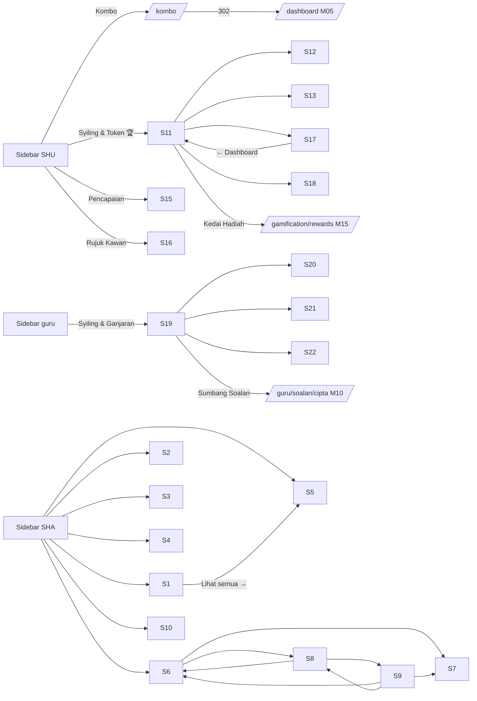

# M14 — Gamification: coins, tokens, tiers, challenges, achievements, streaks, leaderboards, teacher gamification (Discovery)

- **Source:** a read-only walk-through of https://prestasiplus.my with the admin account, on browser lane 2 (`playwright2`). Discovery ran on 2026-09-25 and was resumed and completed on 2026-09-26.
- **Screenshots:** there are 55 files in `docs/discovery/img/M14/` (index in §10). Every page was masked in the DOM before capture. The shells are documented in [00-global-ui.md](00-global-ui.md) and are not repeated here: user portal `SHU` and admin panel `SHA`, with the header chips "koin / mata / hari 🔥" and the JBCoinFly animation.
- **Language:** UI copy is quoted in its exact Bahasa Melayu. Some live strings are in English: "Tier Config", "Tier Configuration", "Level", "Token", "Threshold", "Bonus", "earn/spend/convert/bonus/refund" badges, "bronze/silver/gold/platinum" in the admin screens, "🥉 Bronze" on Kad Kongsi, "Streak activity (…)", "PENDING/APPROVED/…", "Tips:", "Perks", "Master/Grandmaster/Legenda/Mitos".
- **Personal data (students are minors):** `tools/jobs/M14.js` → `M14MASK` runs before every inventory state and every screenshot.
  - It tags person names with `.m14n`: the overview Top 10, the leaderboard podium and rows, and the tunai "Bank" cell (account number and holder).
  - It removes avatars (the `ui-avatars` URLs carry names).
  - It replaces school names with `<school>`. The screenshots also blank every "Sekolah" table cell.
  - `tools/sanitize.js {selectors:['.m14n'], titleName:false}` then masks the tagged nodes and the "Pelajar" / "Guru" columns.
  - S6 `/admin/gamifikasi/guru` holds no personal data. There sanitize.js is skipped, because it would treat the badge-name inputs (`name="name"`) as person names. Badge and achievement names are kept, because they are not personal.
  - `meta.piiLeakCheck` is 0 in every sanitized state.
  - "Admin PRESTASI+" is the display name of the logged-in admin account, not a person. In the snapshot it is written as `<admin-account>`.
  - The referral code shown (`4JURJTT`) is the admin account's own code.
- **Seed snapshot:** `docs/discovery/inventory/M14/_snapshot-2026-09-26.json`, captured on 2026-09-26 at about 11:45 MYT. It holds:
  - every visible value of 35 page states, with live ids: tier ids 1–4, challenge ids 1–10, teacher badge ids 1–8, reward-cost ids 1–11, tunai request ids 1–2 and transaction `#ids`;
  - a 400-row ledger sample of the source and amount rules;
  - the admin account's values on every screen that shows a coin or streak figure;
  - layout measurements at 375 px.

  Live values drift. For example, "Syiling Dijana" was 3,124,046 at discovery and 3,124,192 at the snapshot. **The snapshot is the seed source.**
- **Element inventory:** 1,759 content elements over 22 screens and 118 UI states (1280 / 768 / 375), with IDs `EL-M14-S#-nnn`, in `docs/discovery/inventory/M14/<S#-key>.json`. Reconciliation, the crawl and the read-only limits are in `docs/discovery/inventory/M14/_summary.md`.
- **Safety:**
  - Nothing that moves coins or changes data was clicked or submitted. Specifically, none of these: "Tukar Sekarang", "Hantar Permohonan Tebus Tunai", "Berikan", tier/challenge "Simpan", "Nyahaktif", "Padam", "Tambah Tier", "Tambah Cabaran", badge "Simpan", ganjaran "Simpan", the tunai status ✓, "Simpan Tetapan" (both pages), reward cost "Simpan" and "Cipta Cabutan". Kotak Misteri, claims and referral invites were not touched either.
  - List filters were driven by URL query strings. Client-side reveals only: badge "Edit", "Tambah Ganjaran", the `<details>` "➕ Cipta Cabutan Baru", Kad Kongsi tabs, quick-amount buttons and typing in the amount inputs (never submitted), "Salin Kod" (clipboard only), and the achievements share modal (opened by calling the page's own `openShareCard(…)`).
  - GETs were throttled to at least 350–400 ms apart.

Cross-references (owned elsewhere, not re-inventoried):
- `/gamification/rewards` "Kedai Hadiah", `/gamification/mystery-box` "Kotak Misteri", `/cabutan` "Cabutan Bertuah 🎟️", `/admin/hadiah`, `/cikgu/kelulusan-hadiah` → **M15** (links only).
- `/leaderboard` and `/ranking` → **M08**. `/battle/leaderboard`, `/battle`, `/liga`, `/tournament`, `/permainan`, `/sekolah-bersaing` → **M16**. `/ppd/leaderboard-sekolah` → **M18**.
- `/guru/soalan/cipta` "Sumbang Soalan (+10 syiling)" → **M10**. `/pelajar/{id}` public profile and `/prestasi/{id}` Prestasi 360 → **M08**.
- `/dashboard` Kombo banner and stat cards → **M05**. M05 reads the M14 wallet and streak (M05 SRS BR-08, BR-09, BR-25, BR-31).

---

## 1. Overview

The TRACKER lists 15 M14 routes. The crawl found **22 screens**, including 8 new routes, plus the redirecting `/kombo`:

| # | Route | Tab title · header title / subtitle (shell) | Status (admin account) |
|---|---|---|---|
| S1 | `/admin/gamification` | "Gamifikasi Overview" · SHA "Dashboard" / "Selamat datang, Admin" (D-1) | 200 |
| S2 | `/admin/gamification/tiers` | "Tier Config" · SHA "Dashboard" / "Selamat datang, Admin" (D-1) | 200 |
| S3 | `/admin/gamification/challenges` | "Cabaran Harian — Admin" · SHA "Dashboard" (D-1) | 200 |
| S4 | `/admin/gamification/students` (`?search=&tier=&sort=&page=`) | "Pelajar Gamifikasi" · SHA "Dashboard" (D-1) | 200; 2,255 rows, 20 per page |
| S5 | `/admin/gamification/transactions` (`?type=&date_from=&date_to=&page=`) | "Transaksi Syiling" · SHA "Dashboard" (D-1) | 200; 52,964 rows, 25 per page |
| S6 | `/admin/gamifikasi/guru` | "Gamifikasi Guru — Admin" · SHA "Gamifikasi Guru" / "Urus ganjaran, lencana & tebusan guru" | 200 |
| S7 | `/admin/gamifikasi/guru/tebusan` (`?status=`) **new** | "Tebusan Guru — Admin" · "Tebusan Guru" / "Urus permohonan tebusan ganjaran guru" | 200; empty in every status |
| S8 | `/admin/gamifikasi/guru/tunai` (`?status=`) **new** | "Tebus Tunai Guru — Admin" · "Tebus Tunai Guru" / "Urus permohonan pengeluaran tunai guru" | 200; 2 PENDING requests |
| S9 | `/admin/gamifikasi/pengaturan` **new** | "Tetapan Gamifikasi — Admin" · "Tetapan Gamifikasi" / "Urus kadar syiling, penukaran tunai & tetapan lain" | 200 |
| S10 | `/admin/reward-control` | "Kawalan Reward — Admin" · "Kawalan Ekonomi Reward" / "Tetapan kewangan, kos hadiah & cabutan" | 200 |
| S11 | `/gamification` | "Gamifikasi Dashboard" · SHU "Dashboard" / "Selamat datang kembali" (D-1) | 200 |
| S12 | `/gamification/convert` | "Tukar Token" · SHU "Dashboard" (D-1) | 200 |
| S13 | `/gamification/challenges` | "Cabaran Harian" · SHU "Dashboard" (D-1) | 200 |
| S14 | `/gamification/leaderboard` (`?period=` ignored) | "Papan Pendahulu" · SHU "Dashboard" (D-1) | 200 |
| S15 | `/gamification/achievements` (`?rarity=`) | "Pencapaian — PRESTASIPLUS" · SHU "Dashboard" (D-1) | 200 |
| S16 | `/gamification/referral` | "Rujuk Kawan — PRESTASIPLUS" · SHU "Dashboard" (D-1) | 200 |
| S17 | `/gamification/history` (`?type=`) **new** | "Sejarah Transaksi" · SHU "Dashboard" (D-1) | 200 |
| S18 | `/gamification/kad-kongsi` **new** | "Kad Kongsi — PRESTASIPLUS" · SHU "Kad Kongsi" / "Kongsi pencapaian anda" | 200 |
| S19 | `/guru/gamifikasi` | "Gamifikasi Guru" · SHU "Syiling & Ganjaran" / "Sumbang soalan, kumpul syiling, tebus ganjaran!" | 200 |
| S20 | `/guru/gamifikasi/tebus-tunai` **new** | "Tebus Tunai" · SHU "Tebus Tunai" / "Tukar syiling anda kepada wang tunai" | 200 |
| S21 | `/guru/gamifikasi/kedai` **new** | "Kedai Hadiah Guru" · SHU "Kedai Hadiah" / "Tebus syiling untuk hadiah menarik!" | 200; empty |
| S22 | `/guru/gamifikasi/leaderboard` (`?tab=sekolah\|global`) **new** | "Papan Pendahulu Guru" · SHU "Papan Pendahulu" / "Siapa penyumbang soalan terbanyak?" | 200 |
| — | `/kombo` (sidebar "Kombo", `fa-fire`) | — | **302 → `/dashboard`** for admin; no page reached (§9) |

### 1.1 Three wallets and the coin figures that differ (M08 D-18 reconciliation)

The admin account (user id 1) shows these coin and streak figures on 2026-09-26:

| Where | Figure | Source (verdict) |
|---|---|---|
| M14 S11 "Baki Syiling" / "Jumlah Syiling", S12, S17 "Baki semasa", header chip "256 koin", M05 "Syiling Kamu", S4 admin row (Syiling 256, Jumlah Syiling 256, Token 0, Level 2, XP 8) | **256** | **Student wallet (M14 owner).** OBSERVED: the S17 ledger has 14 rows (+4, +4, +35, +42, +7, +10, +30, +12, +22, +15, +40, +3, +7, +25), they sum to 256, and the last row reads "Baki: 256". `current_syiling` = `total_syiling_earned` = 256, because the account never spent or converted. |
| M08 S18 `/pelajar/1` "🪙 Syiling 103", "397 syiling lagi ke Silver" | **103** | Not the M14 ledger: no running balance in the ledger is 103 (4, 8, 43, 85, 92, 102, 132, …). INFERRED: a legacy per-student coin store. The ledger row "One-time sync: transfer missing coins from legacy student_coins table" (+35, 19/02/2026) names a `student_coins` table. 500 − 103 = 397 shows the profile computes its tier progress from this value. |
| M08 S6 `/prestasi/1` "Koin" | **342,703** | Not reproduced by any M14 store. It is not the student wallet (256) or the teacher wallet (92,683). Unobserved source (Q1). |
| M08 S20 `/leaderboard` own card | **26 Koin** (#1050, 4 Sesi, 22%) | A period-scoped M08 figure. It does not match S11's "+0 minggu ini" (Q1). |
| M14 S19 `/guru/gamifikasi` "Baki Syiling" = "Jumlah Diperolehi" | **92,683** | **Teacher wallet (M14 owner), a separate ledger.** OBSERVED: 7 badge bonuses (100 + 500 + 2,000 + 5,000 + 10,000 + 25,000 + 50,000 = 92,600) plus 11 activity rows (0, 7, 1, 11, 7, 14, 20, 15, 2, 3, 3) = 83, total 92,683. It also matches S20 "RM741.46" = 92,683 ÷ 10 × 8 sen. |

**Reconciliation:** 256 is the M14 student wallet. It is the only coin balance that M14 writes and the one M05 hands coins to (BR-31). 92,683 is the M14 teacher wallet. 103 and 342,703 (and M08's 26) are M08 displays of other, unobserved sources. The rebuild options are M08 display constants (D11 exception) or computing them from the M14 wallet. This is left to M08/M14 SRS (Q1). Streak shows the same split: 1 hari (header, M05, M08 Prestasi 360 "Kombo Hari 1", "Rekod Terbaik 5") versus 0 (S15 "0 Hari berturut-turut", "Terbaik: 0 hari"; S18 Kad Kombo 0 / 0; M08 profile "0 Kombo", "0 kombo terpanjang").

### 1.2 Which module's events feed the M14 ledger

Ledger `source` values are OBSERVED in the 400-row sample and on pages 1 and 2118 (§5.1):

| Source | Typical description | Amount | Feeding module |
|---|---|---|---|
| `quiz_practice` | "Latih Tubi: {n} betul — {pct}%" | = n correct (current) | M05 |
| `quiz_spm` | "SPM Tahun Lepas: {n} betul — {pct}%", "Latih Tubi SPM: {n} betul — {pct}%" | = n correct (current); older rows 2–4 × n | M06 |
| `structured_question` | "Soalan Berstruktur: {m}/{t} markah ({pct}%)" | +5 | M05 (structured) |
| `spm`, `daily_login` | "Streak activity (spm)", "Streak activity (daily_login)" | +7, +2 | M14 streak |
| `streak_bonus` (type bonus) | "Bonus Kombo 3 Hari", "Bonus Kombo 10 Hari!" | +25, +50 | M14 streak |
| `daily_challenge` | "Cabaran selesai: {title}" (older: "Cabaran: {title}") | = challenge `reward_syiling` | M14 challenges |
| `token_conversion` (older: `token_convert`) (type convert) | "Tukar {s} syiling → {t} token" | −s | M14 convert |
| `reward_claim` (type spend) | "Tuntut: {reward}" | −price | M15 |
| `mystery_box` | "Kotak Misteri: Kotak Legenda" | +119…+479 | M15 |
| `papan_bijak`, `papan_bijak_win`, `benteng_play`, `benteng_win`, `perang_fakta_win`, `mathrace_play`, `jutawan_ilmu` | "Jawab betul dalam Papan Bijak 🎲", "Menang Papan Bijak! 🏆🎲", "Penyertaan Benteng Ilmu", "Juara Benteng Ilmu!", "Menang Benteng Ilmu (lawan menyerah)", "Menang Perang Fakta (lawan menyerah)", "#{rank} Perlumbaan Matematik", "Jutawan Ilmu (Bahasa Melayu): Level {n}" | +5, +25, +8, +35/+15, +10, +5, +50/+1,000 | M16 games (none after 25/05/2026; `games_award_syiling` = 0) |
| `quiz_complete` | "Latihan {subjek} {Darjah\|Tingkatan} {n}" | +10…+15 | legacy (28/02/2026 only) |
| (PKSK) | tier field `pksk_reward_correct` = 5 | — | M07 (no PKSK row seen in the sample) |
| (admin) | `/admin/gamification/award-syiling` | 1–10,000 | M14 admin (type `bonus`, INFERRED) |
| (referral) | "50 Syiling untuk ANDA" / "25 Syiling untuk KAWAN" | +50 / +25 | M01 registration with `?ref=` (no row seen) |

The teacher ledger is fed by M10 question contributions (setting `coins_per_question` = 10 and the badge bonuses) and by the teacher's own practice (M05/M06). The same admin session wrote to both wallets: student "Latih Tubi SPM: 11 betul — 32.35%" **+22** and teacher "Latih Tubi SPM - 32.35% ketepatan" **+11**. Both wallets also got "Streak activity (spm)" / "Aktiviti harian: spm" +7 at 11/05/2026 14:22.

---

## 2. Screens

### 2.1 S1 — `/admin/gamification` "🎮 Gamifikasi Overview"

- Subtitle "Pantau sistem gamifikasi PRESTASIPLUS".
- Six stat cards (`gami-stat-card`, each with an icon tile and a coloured top border): "Pelajar Aktif" **2,255** (users icon, blue), "Syiling Dijana" **3,124,192** (coins, amber), "Token Ditukar" **7,801** (ticket, purple), "Penukaran" **534** (exchange, emerald), "Cabaran Aktif" **10** (bullseye, red), "Siap Hari Ini" **0** (check, teal).
- "Taburan Tier" (`fa-crown` amber): one row per tier. Each row shows the tier name (lower-case value, shown capitalised: "Bronze", "Gold", "Platinum", "Silver"), a bar (`tier-dist-bar`, width = count ÷ Pelajar Aktif, background = tier colour) with the count inside it, and "{pct}%".
  - Values: bronze 1889 / 84%, gold 41 / 2%, platinum 33 / 1%, silver 292 / 13%. The sum is 2,255.
  - Rows are ordered **alphabetically** by tier key, not by tier order (live).
- "Top 10 Pelajar" (`fa-trophy`): "#{rank}", name (masked), "{tier} · Level {n}" (e.g. "platinum · Level 66"), and amber "{syiling}" over "syiling". Ranked by **Jumlah Syiling** (lifetime; #4 shows 65,129 while that student's balance is 129). Values are in the snapshot.
- "Transaksi Terkini" (`fa-history`) + "Lihat semua →" → S5. Table "Pelajar | Jenis | Jumlah | Sumber | Masa", 10 latest rows. Jenis is the raw type ("Earn" capitalised). Jumlah is green "+n" / red "−n". Sumber is the raw source key. Masa is relative ("13 minit yang lepas").

### 2.2 S2 — `/admin/gamification/tiers` "👑 Tier Configuration"

- Subtitle "Urus tier sistem gamifikasi — termasuk ganjaran Syiling per soalan".
- Card "Senarai Tier" holds one PUT form per tier (`/admin/gamification/tiers/{id}`, `_method=PUT`). It starts with the icon (large emoji). Fields (all `required`):
  - "Label BM" `label_ms`, "Icon" `icon`, "Warna" `color` (colour input), "Min Syiling" `min_syiling`, "Kadar" `conversion_rate`, "Urutan" `sort_order`, then a submit button (save icon only, no text);
  - sub-block "📝 Latih Tubi — Syiling per Jawab Betul" with "L1"…"L5" (`quiz_reward_l1`…`l5`, min 0);
  - "🛡️ PKSK — Syiling per Jawab Betul" `pksk_reward_correct` + "Semua soalan PKSK (tiada level)";
  - "🎲 Papan Bijak — Syiling" with "Jawab Betul" `board_game_reward_correct` and "Menang" `board_game_reward_win`;
  - hidden `perks` (a JSON array; **it cannot be edited for existing tiers**).
- A separate form `POST /tiers/{id}/toggle` with button "🔴 Nyahaktif". All 4 tiers are active.
- Values (snapshot):

| id | label_ms | icon | color | min_syiling | conversion_rate | sort | L1–L5 | PKSK | Papan Bijak betul / menang | perks |
|---|---|---|---|---|---|---|---|---|---|---|
| 1 | Gangsa | 🥉 | #cd7f32 | 0 | 50 | 1 | 1,2,3,4,5 | 5 | 5 / 25 | "Akses asas hadiah", "Ganjaran kuiz standard", "Profil asas" |
| 2 | Perak | 🥈 | #c0c0c0 | 500 | 40 | 2 | 1,2,3,4,5 | 5 | 5 / 25 | "Kadar penukaran lebih baik", "Akses hadiah premium", "Profil enhanced", "Cabaran eksklusif" |
| 3 | Emas | 🥇 | #ffd700 | 2000 | 30 | 3 | 1,2,3,4,5 | 5 | 5 / 25 | "Kadar penukaran terbaik", "Hadiah eksklusif Gold", "Analitik lanjutan", "Tema profil khas", "Keistimewaan pertandingan" |
| 4 | Platinum | 💎 | #e5e4e2 | 5000 | 20 | 4 | 1,2,3,4,5 | 5 | 5 / 25 | "Kadar penukaran terbaik sekali", "Hadiah eksklusif Platinum", "Dashboard analitik penuh", "Ciri profil premium", "Akses VIP pertandingan", "Preview ciri baru" |

- Card "➕ Tambah Tier Baru" (`POST /admin/gamification/tiers`):
  - "Nama Tier (eng)" `tier_name` (placeholder "diamond"), "Label BM" (placeholder "Berlian"), "Icon" ("💎");
  - "Warna" (default #3b82f6), "Min Syiling" ("10000"), "Kadar Penukaran" ("15"), "Urutan" (default 4);
  - "Perks" `perks` (text, placeholder "Bonus 2x XP", not required);
  - the same L1–L5 (defaults 1–5), PKSK 5 and Papan Bijak 5 / 25 inputs;
  - button "Tambah Tier".

### 2.3 S3 — `/admin/gamification/challenges` "🎯 Cabaran Harian"

- Subtitle "Urus cabaran harian untuk pelajar". Card "Senarai Cabaran (10)".
- Per challenge: a PUT form with the icon, the title and a difficulty badge ("Mudah" / "Sederhana" / "Sukar"). Fields (all `required`):
  - "Tajuk" `title`, "Keterangan" `description`, "Icon" `icon`;
  - "Jenis" `challenge_type` (options "Bilangan Kuiz" `quiz_count`, "Ketepatan (%)" `accuracy`, "Topik Berbeza" `topic_variety`, "Kombo" `streak`, "Masa (min)" `time_spent`);
  - "Sasaran" `target_value`, "Ganjaran Syiling" `reward_syiling`, "Ganjaran XP" `reward_xp`;
  - "Kesukaran" `difficulty` (easy "Mudah" / medium "Sederhana" / hard "Susah"; the badge on the card says "Sukar");
  - "Urutan" `sort_order`, and "Simpan".
- Then "🔴 Nyahaktif" (`POST …/toggle`) and "Padam" (`DELETE`, `onsubmit` confirm "Padam cabaran ini?").
- Values (the 10 active challenges, ids 1–10):

| id | icon | Tajuk | Keterangan | Jenis shown | Sasaran | Syiling | XP | Kesukaran | Urutan |
|---|---|---|---|---|---|---|---|---|---|
| 1 | 📝 | Rajin Berlatih | Selesaikan 3 kuiz hari ini | quiz_count | 3 | 15 | 10 | easy | 0 |
| 2 | 🎯 | Si Tepat | Dapat 80% ketepatan dalam mana-mana kuiz | quiz_count (D-4) | 80 | 20 | 15 | medium | 0 |
| 3 | 🗺️ | Penjelajah Topik | Latih 3 topik berbeza hari ini | topic_variety | 3 | 25 | 20 | medium | 0 |
| 4 | ⚡ | Kilat Matematik | Jawab 10 soalan dengan betul | quiz_count | 10 | 30 | 25 | hard | 0 |
| 5 | 🌟 | Mula Hari Ini | Selesaikan 1 sesi latihan hari ini | quiz_count | 1 | 10 | 5 | easy | 5 |
| 6 | ✅ | Jawab 5 Betul | Jawab 5 soalan dengan betul | quiz_count | 5 | 12 | 8 | easy | 6 |
| 7 | ⏱️ | Latihan 10 Minit | Berlatih sekurang-kurangnya 10 minit hari ini | quiz_count (D-4) | 10 | 20 | 15 | medium | 7 |
| 8 | 🔥 | Kombo 2 Hari | Kekalkan kombo latihan selama 2 hari berturut-turut | quiz_count (D-4) | 2 | 25 | 20 | medium | 8 |
| 9 | 🎯 | Ketepatan 90% | Capai ketepatan 90% dalam sesi latihan | quiz_count (D-4) | 90 | 35 | 30 | hard | 9 |
| 10 | ⚡ | Cabaran Kilat | Jawab 20 soalan betul dalam satu sesi | quiz_count | 20 | 40 | 35 | hard | 10 |

- Card "➕ Tambah Cabaran Baru": the same fields; Icon placeholder "📝"; defaults Jenis quiz_count, Syiling 10, XP 5, easy, Urutan 10. Button "Tambah Cabaran".

### 2.4 S4 — `/admin/gamification/students` "👥 Pelajar Gamifikasi"

- Subtitle "Pantau progress pelajar & berikan bonus syiling".
- GET filter form:
  - `search` (placeholder "Cari nama/email...");
  - `tier` ("Semua Tier", "🥉 Gangsa" bronze, "🥈 Perak" silver, "🥇 Emas" gold, "💎 Platinum" platinum);
  - `sort` ("Jumlah Syiling" `total_syiling_earned` (default), "Baki Syiling" `current_syiling`, "Baki Token" `token_balance`, "Level" `level`);
  - button "Cari".
- Card "🎁 Berikan Bonus Syiling" (`POST /admin/gamification/award-syiling`, never submitted): "User ID" `user_id` (number, placeholder "ID", required), "Jumlah" `amount` (min 1, max 10000, placeholder "100", required), "Sebab" `reason` (placeholder "Bonus khas / Pertandingan", required), and "Berikan".
- Table "Pelajar | Tier | Level | Syiling | Token | Jumlah Syiling | XP". Pelajar = name + e-mail line (masked). Tier = `tier-badge` with the lower-case key in the tier colour (background colour + `20` alpha). 20 rows per page; Laravel pager.
- Totals: "Showing 1 to 20 of 2255 results" (113 pages). tier=bronze 1,889, silver 292, gold 41, platinum 33.
- Empty: "Belum ada pelajar dalam sistem gamifikasi" (e.g. `?search=zzzq`).
- Observed data: `token` can be **negative** (−1, −2 in the bronze and silver lists; D-10). Rows with Jumlah Syiling 0 hold tokens (17, 11).

### 2.5 S5 — `/admin/gamification/transactions` "📋 Transaksi Syiling"

- Subtitle "Log semua transaksi syiling dalam sistem".
- GET form:
  - `type` ("Semua Jenis", "💰 Dapat" earn, "🛍️ Belanja" spend, "🔄 Tukar" convert, "🎁 Bonus" bonus, "↩️ Refund" refund);
  - `date_from` (placeholder "Dari"), `date_to` ("Hingga");
  - "Tapis". "Reset" → `/admin/gamification/transactions` shows only when a filter is set.
- Table "ID | Pelajar | Jenis | Jumlah | Baki Selepas | Sumber | Keterangan | Tarikh":
  - ID "#53678"; Pelajar = name + "ID:" line (masked);
  - Jenis = `type-badge {type}` (raw key);
  - Jumlah green "+18" / red "-400"; Baki Selepas "6,335";
  - Sumber raw key; Keterangan text; Tarikh "26/09/2026 03:32".
- 25 per page, newest first.
- Totals: all 52,964 (2,119 pages; last page 2118 in the pager window); earn 52,426; convert 535; spend **1** (#42); bonus **2** (#51, #44); refund **0** ("Tiada transaksi ditemui"). 52,426 + 535 + 1 + 2 = 52,964.

### 2.6 S6 — `/admin/gamifikasi/guru` (header "Gamifikasi Guru")

- Four cards: "Jumlah Ganjaran" 0, "Aktif" 0, "Lencana" 8, "Tebusan Pending" 0.
- Links "Tebusan Hadiah" → S7 and "Tebus Tunai" with a red count badge "2" → S8.
- "Lencana Guru (8)" table "Lencana | Ikon | Threshold | Bonus | Status | Tindakan".
  - Each row is a `tbody x-data="{ editing: false }"`. Read mode shows the name, the Font Awesome icon (amber), the threshold, "+bonus", a status pill "Aktif" (emerald) and "Edit" (`fa-edit`).
  - "Edit" toggles `editing`. The edit row (`x-show`) is a PUT form `/admin/gamifikasi/guru/lencana/{id}` with "Nama" `name`, "Ikon CSS" `icon`, "Threshold" `threshold`, "Bonus Syiling" `bonus_coins`, "Aktif" `is_active` checkbox and "Simpan".
  - The toggle **hides** without discarding typed values (`x-show`, INFERRED). There is no "Batal" button.

| id | Nama | Ikon | Threshold (soalan) | Bonus |
|---|---|---|---|---|
| 1 | Penyumbang Baru | fa-seedling | 10 | +100 |
| 2 | Penyumbang Aktif | fa-fire | 100 | +500 |
| 3 | Penyumbang Dedikasi | fa-award | 500 | +2,000 |
| 4 | Penyumbang Cemerlang | fa-trophy | 1,000 | +5,000 |
| 5 | Penyumbang Terbilang | fa-crown | 2,500 | +10,000 |
| 6 | Legenda Soalan | fa-gem | 5,000 | +25,000 |
| 7 | Guru Maestro | fa-star | 10,000 | +50,000 |
| 8 | Legenda Terulung | fa-crown | 50,000 | +250,000 |

- "Katalog Ganjaran (0)" + toggle "Tambah Ganjaran" (`x-data="{ showForm: false }"`). The form is `POST /admin/gamifikasi/guru/ganjaran`, multipart:
  - "Nama *" `name` (required);
  - "Kategori *" `category` ("Am" general / "Digital" / "Fizikal" physical / "Baucar" voucher);
  - "Kos Syiling *" `cost_coins` (min 1, required);
  - "Stok (kosong = tiada had)" `stock` (min 0), "Had/Pengguna" `max_per_user` (min 1), "Had/Bulan" `max_per_month` (min 1);
  - "Penerangan" textarea, "Gambar" `image` (file), "Aktif" checkbox, "Simpan".
- Empty: "Tiada ganjaran. Tambah ganjaran pertama!".

### 2.7 S7 — `/admin/gamifikasi/guru/tebusan` (new)

- Pills: "Menunggu" PENDING (default, indigo active), "Diproses" PROCESSING, "Dihantar" DELIVERED, "Dibatal" CANCELLED, "Semua" all.
- Every status is empty: "Tiada tebusan pending" / "Tiada tebusan processing" / "Tiada tebusan delivered" / "Tiada tebusan cancelled" / "Tiada tebusan" (all). The status is lower-cased into the message.
- "Kembali ke Gamifikasi Guru" → S6. The row layout is not observable (no data; §9).

### 2.8 S8 — `/admin/gamifikasi/guru/tunai` (new)

- Cards: "Menunggu" 2, "Diluluskan" 0, "Dibayar" 0, "Jumlah Dibayar" RM0.00.
- Pills (href `?status=`): "Menunggu" PENDING (default), "Diluluskan" APPROVED, "Dalam Proses" PROCESSING, "Dibayar" PAID, "Ditolak" REJECTED, "Semua" all.
- Table "Guru | Syiling | Tunai | Bank | Status | Tarikh | Tindakan". Bank = bank name / account no. / holder, masked except the bank name. Status pill "PENDING" (yellow-100/700).
- Tindakan = PATCH form `/admin/gamifikasi/guru/tunai/{id}` with a `status` select (PENDING, APPROVED, PROCESSING, PAID, REJECTED), `admin_note` (placeholder "Nota...") and a ✓ button (`fa-check`, `onclick` confirm "Kemaskini status?").
- Rows (snapshot): id 2 — 18,140 syiling, RM145.12, Bank Rakyat, 15 Apr 2026 13:15; id 1 — 163,445, RM1,307.56, Maybank, 14 Apr 2026 23:04. Both are PENDING.
- The other statuses are empty. Links "Tetapan" → S9 and "Ganjaran" → S6.

### 2.9 S9 — `/admin/gamifikasi/pengaturan` (new) "Tetapan Gamifikasi Guru"

- One POST form holds 10 settings. Each shows a label, "Key: {key}" and an input `settings[i][value]` (number, min 0, step 1, or an "Aktif" (1) / "Tidak Aktif" (0) select) with a hidden `settings[i][key]`:

| i | Label | Key | Value |
|---|---|---|---|
| 0 | Syiling per soalan sumbangan | coins_per_question | 10 |
| 1 | Jumlah syiling untuk penukaran tunai | cash_rate_coins | 10 |
| 2 | Nilai sen bagi setiap unit syiling (cth: 100 syiling = 8 sen) | cash_rate_sen | 8 |
| 3 | Minimum syiling untuk tebus tunai | min_cash_withdrawal | 100 |
| 4 | Aktifkan tebus tunai untuk guru | cash_withdrawal_enabled | 1 (Aktif) |
| 5 | Had nilai-kos tebus per pelajar per sesi (sen) — RM10 | reward_budget_sen_session | 1000 |
| 6 | Sub-had nilai-kos tebus per pelajar per bulan (sen) — RM3 | reward_budget_sen_month | 300 |
| 7 | Tahun sesi persekolahan semasa (kitar bajet) | current_session_year | 2026 |
| 8 | Syiling flat per soalan akademik betul (tiada beza difficulty) | flat_quiz_reward | 1 |
| 9 | Mini-games beri syiling? (0 = XP sahaja, tutup exploit) | games_award_syiling | 0 (Tidak Aktif) |

- "Pratonton Kadar" box `#ratePreview`. It is rebuilt on input by `updatePreview()`: "**{coins_per_question} syiling** per soalan sumbangan" / "**{cash_rate_coins} syiling = {cash_rate_sen} sen** (RM{sen/100})" / "100 syiling = RM{…} · 1000 syiling = RM{…}" / "Minimum tebus: **{min} syiling**".
  - Live: "10 syiling per soalan sumbangan / 10 syiling = 8 sen (RM0.08) / 100 syiling = RM0.80 · 1000 syiling = RM8.00 / Minimum tebus: 100 syiling".
  - The script falls back to 10 / 100 / 8 / 100 when a value is 0 or empty.
- "Simpan Tetapan". Links "Ganjaran Guru" → S6, "Tebus Tunai" → S8, "Tebusan" → S7.
- Settings 5–9 are the same keys that S10's "Tetapan Kewangan" edits.

### 2.10 S10 — `/admin/reward-control` "Kawalan Ekonomi Reward"

- Three summary tiles: "Liabiliti sesi 2026" **RM0.00** "jumlah kos hadiah ditebus"; "Pelajar menebus" **0**; "Jumlah tebusan" **0**.
- "⚙️ Tetapan Kewangan" (`POST /admin/reward-control/settings`):
  - "Bajet tebus / sesi (sen) — RM10 = 1000" `reward_budget_sen_session` 1000;
  - "Sub-had tebus / bulan (sen) — RM3 = 300" `reward_budget_sen_month` 300;
  - "Syiling flat / soalan betul" `flat_quiz_reward` 1;
  - "Tahun sesi semasa" `current_session_year` 2026;
  - checkbox "Mini-games beri syiling? (jika tidak: XP sahaja — tutup exploit)" `games_award_syiling` (unchecked);
  - "Simpan Tetapan". No field is `required`.
- "🎁 Kos Sebenar Hadiah (sen) — digital = 0, tak makan bajet": table "Hadiah | Jenis | Harga syiling | Kos sebenar (sen) | ". Each row is a form `POST /admin/reward-control/reward/{id}/cost` with `cost_value_sen`, the "RM" equivalent and "Simpan". The rewards are the **M15** catalogue:

| id | Hadiah | Jenis | Harga syiling | Kos (sen) |
|---|---|---|---|---|
| 1 | Baucar Buku RM10 | VOUCHER | 500 | 1000 |
| 2 | Baucar Buku RM25 | VOUCHER | 1200 | 2500 |
| 3 | Set Pensil Warna 12 Batang | PHYSICAL | 300 | 1000 |
| 4 | Set Alat Tulis Premium | PHYSICAL | 600 | 1000 |
| 5 | Tiket Masuk KidZania (1 Kanak-kanak) | EXPERIENCE | 2000 | 5000 |
| 6 | Tiket Masuk Petrosains (1 Kanak-kanak) | EXPERIENCE | 1500 | 5000 |
| 7 | Lencana Eksklusif "Super Learner" | DIGITAL | 100 | 0 |
| 8 | Avatar Premium "Saintis Cilik" | DIGITAL | 200 | 0 |
| 9 | Akses Premium 30 Hari | SUBSCRIPTION | 800 | 0 |
| 10 | Bingkisan Misteri | PHYSICAL | 400 | 1000 |
| 11 | testing | PHYSICAL | 100 | 1000 |

- "🎟️ Cabutan": table "# | Tajuk | Status | Tiket | Kolam | Pemenang | " with "Tiada cabutan lagi.".
- `<details>` "➕ Cipta Cabutan Baru" (`POST /admin/reward-control/draw`):
  - "Tajuk" `title` (required), "Penerangan" `description`;
  - "Harga tiket (syiling)" `ticket_cost_syiling` 50, "Max tiket / pelajar" `max_tickets_per_student` 10;
  - "Kolam hadiah (JSON)" `prize_pool` (placeholder `[{"label":"Baucar Topup RM50","value_sen":5000,"qty":1},{"label":"Baucar RM5","value_sen":500,"qty":10}]`);
  - "Tarikh tutup" `closes_at` (date), "Buka serta-merta" `open_now`, "Cipta Cabutan".

### 2.11 S11 — `/gamification` (student dashboard)

- Hero:
  - tier emoji badge "🥉", title chip "📚 Permulaan", h1 "{tier label} Tier" ("Gangsa Tier"), "Level 2";
  - figures "256" "Syiling 💰" and "0" "Token 🎫";
  - progress "⬆️ Naik ke **Perak**" with a bar and "51.2%", "Perlu 244 syiling lagi";
  - buttons "Tukar Token" → S12, "Cabaran Harian" → S13, "Kedai Hadiah" → `/gamification/rewards` (M15).
- Four stat cards:
  - "256" "Baki Syiling" "+0 hari ini";
  - "0" "Baki Token" "50 syiling = 1 token";
  - "2" "Level" "8/110 XP" (with bar);
  - "256" "Jumlah Syiling" "+0 minggu ini".
- "Cabaran Hari Ini" + "Lihat semua →" (S13): the first 4 challenges. Each shows the icon, title, difficulty badge (upper case "MUDAH"/"SEDERHANA"/"SUKAR"), description, "0/3" and "+15 💰".
- "Transaksi Terkini" + "Semua →" (S17): the latest 6 ledger rows. Each shows 💰, the description, relative time ("4 bulan yang lepas") and "+25".
- "Tahap Penguasaan Subjek" (M05 mastery data):
  - "L2" "Bahasa Melayu" "Aktif" "46 betul / 50" "48.94% tepat · 1.05x bonus";
  - "L1" "Sejarah" "Mula Belajar" "14 betul / 25" "35% tepat".
- "Sistem Tier": four cards "🥉 Gangsa 0+ syiling 50 syiling = 1 token", "🥈 Perak 500+ syiling 40 …", "🥇 Emas 2,000+ syiling 30 …", "💎 Platinum 5,000+ syiling 20 …". The current tier has "✨ ANDA DI SINI".
- "Gelaran Seterusnya": "🎓 Pelajar" "Perlu 44 syiling lagi untuk gelaran ini".
- Link card "Kad Kongsi" "Kongsi pencapaian anda di WhatsApp!" → S18.
- The tournament banner (`tournamentBanner()`, M16) is empty.

### 2.12 S12 — `/gamification/convert` "🔄 Tukar Syiling → Token"

- Subtitle "Tukar syiling anda kepada token untuk tebus hadiah". Figures "256" "Baki Syiling" and "0" "Baki Token".
- "💱 Penukaran" form `POST /gamification/convert`:
  - "Syiling untuk ditukar" `#syilingInput` `syiling_amount` (number, placeholder "0", **min = rate (50)**, **max = balance (256)**, required);
  - quick buttons "50 syiling", "250 syiling", "Semua (256)" (`setAmount(n)`, marks `.active`);
  - preview "Anda akan terima" `#tokenPreview` "Token 🎫";
  - "Kadar: 50 syiling = 1 token (Gangsa)";
  - "Tukar Sekarang" `#convertBtn`.
- Script (OBSERVED, `const rate = 50; const maxSyiling = 256`): `tokens = floor(amount / rate)` (shown with `toLocaleString()`). The button is disabled when `amount < rate || amount > maxSyiling`. The default value 50 gives 1 token.
- States:
  - "250 syiling" → 5 token;
  - "Semua (256)" → 5;
  - typing 30 → 0 token, button disabled;
  - typing 300 → 6 token, button disabled.
- "📊 Kadar Penukaran Mengikut Tier": four cards "🥉 Gangsa 0+ syiling **50** syiling/token" (badge "ANDA"), "🥈 Perak 500+ … 40", "🥇 Emas 2,000+ … 30", "💎 Platinum 5,000+ … 20".
- Tip: "💡 **Tips:** Naik tier untuk dapatkan kadar penukaran yang lebih baik! Semakin tinggi tier, semakin sedikit syiling diperlukan untuk 1 token."

### 2.13 S13 — `/gamification/challenges` "🎯 Cabaran Harian"

- Subtitle "Selesaikan cabaran untuk dapatkan syiling & XP bonus!". Counter "0/10" "Selesai".
- Ten cards, in S3 order:
  - icon, h3 title, difficulty badge, description;
  - "💰 +{syiling} Syiling", "⭐ +{xp} XP";
  - "Progres: {p}/{target}", bar, "{pct}%".
- All show 0 for the admin today (values in §2.3).

### 2.14 S14 — `/gamification/leaderboard` "🏆 Papan Pendahulu"

- Subtitle "Siapa paling rajin belajar?".
- Podium `lb-top-card` in the order silver (🥈 #2), gold (🥇 #1, raised), bronze (🥉 #3). Each card shows the avatar, name, "{n} syiling" and "💎 Platinum".
- Rows `.lb-row` #4–#50 (47 rows): "#4", avatar, name, "{Gelaran} · Level {n}" ("Mitos · Level 39"), "{syiling}" "syiling", and the tier emoji.
- Ranked by lifetime syiling (same values as S1 Top 10). `?period=week` is **ignored** (same list). There is no own-rank card and no period filter.
- Titles observed in the 50 rows by lifetime syiling: Mitos 10,552–65,129+; Legenda 5,440–8,720; Grandmaster 3,627–4,937; Master 2,930–3,464. They are monotonic in lifetime syiling (§5.3).

### 2.15 S15 — `/gamification/achievements` "🏅 Pencapaian Anda"

- Subtitle "Kumpul lencana dan capai pencapaian — 0/25 dicapai".
- Streak card: "🔥" "0" "Hari berturut-turut", badge "1.0x Bonus", "Terbaik: 0 hari".
- Rarity pills (links; the active one is purple-600): "Semua", "Biasa" `?rarity=common` (6), "Jarang" rare (8), "Epik" epic (6), "Legenda" legendary (5). An unknown value (`?rarity=zzz`) shows **no card and no message**.
- Badge cards `badge-card locked`, with `--rarity-color` (#9ca3af common, #3b82f6 rare, epic and legendary as in `rarityGradients`). Each card shows:
  - the icon, `badge-name`, `badge-desc`, `rarity-tag` (Biasa/Jarang/Epik/Legenda);
  - `badge-reward` "🪙 {s} · ⭐ {x} XP";
  - a progress bar "{n}/{target}" only for the kuiz-count badges.
  - Unlocked cards (not observable) carry `onclick="openShareCard(…)"`.
- The 25 badges, in live order:

| # | Icon | Nama | Kriteria | Rarity | Syiling · XP | Progress shown |
|---|---|---|---|---|---|---|
| 1 | 👣 | Langkah Pertama | Jawab kuiz pertama anda | Biasa | 5 · 3 | 0/1 |
| 2 | 📚 | Pelajar Rajin | Jawab 10 kuiz | Biasa | 15 · 10 | 0/10 |
| 3 | 🔥 | Streak 3 Hari | Login 3 hari berturut-turut | Biasa | 10 · 5 | — |
| 4 | 🎓 | Cendiakawan | Jawab 50 kuiz | Jarang | 50 · 30 | 0/50 |
| 5 | 💰 | Pengumpul Syiling | Kumpul 100 syiling pertama anda | Biasa | 10 · 5 | — |
| 6 | 🎯 | Tepat Sasaran | Capai 90% ketepatan dalam 10 kuiz | Jarang | 40 · 25 | — |
| 7 | 🧭 | Penjelajah | Cuba latihan dari 5 subjek berbeza | Biasa | 15 · 10 | — |
| 8 | 💪 | Streak 7 Hari | Login 7 hari berturut-turut | Jarang | 30 · 15 | — |
| 9 | 🌅 | Pelajar Awal | Log masuk 7 hari berturut-turut | Biasa | 20 · 10 | — |
| 10 | 🧠 | Pakar Matematik | Jawab 200 kuiz | Epik | 150 · 75 | 0/200 |
| 11 | ⚡ | Streak 30 Hari | Login 30 hari berturut-turut | Epik | 100 · 50 | — |
| 12 | 👑 | Legenda JomBelajar | Jawab 500 kuiz | Legenda | 500 · 200 | 0/500 |
| 13 | 🎁 | Ahli Kotak Misteri | Buka 10 kotak misteri | Jarang | 30 · 20 | — |
| 14 | 🏆 | Streak 100 Hari | Login 100 hari berturut-turut | Legenda | 300 · 150 | — |
| 15 | 🎯 | Cabaran Selesai | Selesaikan 20 cabaran harian | Jarang | 35 · 25 | — |
| 16 | 🔢 | Tokoh Matematik | Jawab 100 soalan Matematik dengan betul | Jarang | 40 · 30 | — |
| 17 | ⚡ | Si Pantas | Jawab 50 soalan dalam masa kurang 10 saat setiap satu | Jarang | 35 · 25 | — |
| 18 | 🤝 | Sahabat Belajar | Jemput 3 rakan menggunakan kod rujukan | Jarang | 50 · 30 | — |
| 19 | 🏦 | Hartawan Syiling | Kumpul 1,000 syiling sepanjang masa | Epik | 100 · 75 | — |
| 20 | 🏆 | Penakluk Cabaran | Selesaikan 100 cabaran harian | Epik | 80 · 60 | — |
| 21 | 🔬 | Pakar Sains | Jawab 200 soalan Sains dengan betul | Epik | 80 · 60 | — |
| 22 | 🎖️ | Pengumpul Lencana | Kumpul 15 lencana pencapaian | Epik | 75 · 50 | — |
| 23 | 👑 | Raja Syiling | Kumpul 5,000 syiling sepanjang masa | Legenda | 500 · 250 | — |
| 24 | 🧠 | Ilmuwan Sejati | Jawab 1,000 soalan dengan ketepatan 85%+ | Legenda | 300 · 200 | — |
| 25 | 🦸 | Wira JomBelajar | Lengkapkan semua cabaran dalam 30 hari berturut | Legenda | 400 · 300 | — |

- Share modal `#shareModal` (`display:none` → `flex`; a click on the backdrop closes it). The card `#shareCardCanvas` has background `rarityGradients[rarity]`:
  - common `linear-gradient(135deg, #6b7280, #9ca3af)`, rare `#2563eb → #60a5fa`, epic `#7c3aed → #a78bfa`, legendary `#d97706, #fbbf24, #f59e0b`;
  - content: icon, name, description, rarity label, the user's name, "🎓 PRESTASIPLUS", "{s} 🪙 Syiling", "{x} ⭐ XP".
  - Buttons:
    - "Muat Turun" (`downloadCard()`: html2canvas scale 2 → `pencapaian-{name-lower-hyphen}.png`);
    - "WhatsApp" (`shareWhatsApp()`: `wa.me/?text=` "🏅 Saya baru capai "{name}" di PRESTASIPLUS! 🎉\n\nJom latih tubi sama-sama:\nhttps://prestasiplus.my/pelajar/3" (D-2));
    - "Tutup".

### 2.16 S16 — `/gamification/referral` "🤝 Rujuk Kawan, Dapat Syiling!"

- Subtitle "Jemput kawan anda ke PRESTASIPLUS — dua-dua dapat ganjaran!".
- Tiles: "🎁 **50** Syiling untuk ANDA" and "👋 **25** Syiling untuk KAWAN".
- "Kod Rujukan Anda": the code (7 characters, upper case / digits) and "Salin Kod". The button copies the code, then its label becomes "✓ Disalin!" and stays.
- Share links:
  - "WhatsApp" → `https://wa.me/?text=Jom belajar matematik di PRESTASIPLUS! Guna kod {CODE} untuk dapat 25 syiling PERCUMA! https://prestasiplus.my/register?ref={CODE}`;
  - "Telegram" → `https://t.me/share/url?url=https://prestasiplus.my/register?ref={CODE}&text=Jom belajar matematik di PRESTASIPLUS! Guna kod {CODE}`.
- "Salin Link" copies `https://prestasiplus.my/register?ref={CODE}`, then its label becomes "✓ Link Disalin!".
- "📊 Statistik Rujukan": "0" "Rujukan", "0" "Ganjaran Dicapai", "0" "Syiling Diperolehi".

### 2.17 S17 — `/gamification/history` (new) "📋 Sejarah Transaksi"

- "Baki semasa: **256** syiling". Link "← Dashboard" → S11.
- Filter pills: "Semua", "💰 Dapat" `?type=earn`, "🛍️ Belanja" spend, "🔄 Tukar" convert, "🎁 Bonus" bonus.
- Rows `.tx-row`: 💰 icon, description, "dd/mm/yyyy hh:mm · {relative}", "+25", "Baki: 256".
- The admin has 14 rows (full list in the snapshot) and no pager.
- Empty (spend, convert, bonus, or an unknown `type`): "📋" "Belum ada transaksi" "Mula latih tubi untuk dapatkan syiling!".

### 2.18 S18 — `/gamification/kad-kongsi` (new) "Kad Kongsi"

- Alpine `shareApp()` with `tab: 'profil'`. Tabs: "Profil", "Kombo", "Penguasaan", "Kedudukan" (`ranking`).
- "Kad Profil Pelajar": initial "A", name, "PRESTASIPLUS", "119" "Soalan", "38.7%" "Ketepatan", "4" "Sesi", "🥉 Bronze", "Lvl 2", "🪙 256", "🎓 PRESTASIPLUS.MY". Buttons "Muat Turun" and "WhatsApp" ("Lihat profil saya di PRESTASIPLUS! 38.7% ketepatan dengan 119 soalan dijawab.").
- "Kad Kombo": "🔥" "0" "Hari Berturut-turut!", "0" "Rekod Terbaik", "1.0x" "Pengganda". WhatsApp: "🔥 Kombo 0 hari berturut-turut di PRESTASIPLUS! Rekod terbaik: 0 hari. Jom cabaran!".
- "Kad Penguasaan Subjek": one card per mastery subject.
  - "Penguasaan Subjek", "Bahasa Melayu", "Lvl 2 — Aktif", "48.9%" "Ketepatan", "46" "Betul". Buttons "Muat Turun" and "Kongsi" ("🧠 Saya sudah capai Level 2 (Aktif) dalam Bahasa Melayu di PRESTASIPLUS! Ketepatan 48.9%. Jom bersaing!").
  - "Sejarah" "Lvl 1 — Mula Belajar" "35%" "14".
- "Kad Kedudukan": "🏆" "Kedudukan Terkini" "38.7%" "Ketepatan · 46/119 betul". WhatsApp: "🏆 Kedudukan saya di PRESTASIPLUS: ! Jom latih tubi!" (the value is missing, D-3).
- Scripts:
  - `download(id, name)`: html2canvas → `prestasiplus-{name}.png`; a `downloading` guard;
  - `whatsapp(text)`: appends "\n\nhttps://prestasiplus.my/pelajar/3" (D-2).

### 2.19 S19 — `/guru/gamifikasi` (header "Syiling & Ganjaran")

- Cards: "92,683" "Baki Syiling", "92,683" "Jumlah Diperolehi", "20,719" "Soalan Disumbang", "7/8" "Lencana".
- "Lencana Pencapaian": 8 tiles, each "{name}" "{threshold} soalan" "+{bonus} syiling". Earned tiles are emerald (`bg-emerald-50`); unearned ones are red-50 (Legenda Terulung).
- Next badge: "Seterusnya: Legenda Terulung", "20,719 / 50,000" (bar), "29,281 soalan lagi untuk bonus 250,000 syiling".
- "Katalog Ganjaran": "Tiada ganjaran tersedia buat masa ini" "Admin akan menambah ganjaran tidak lama lagi!".
- "Sejarah Transaksi" (teacher ledger, newest first; 18 rows):
  - "SPM Tahun Lepas - 0% ketepatan" "19 May 2026, 03:49" "0";
  - "Aktiviti harian: spm" "+7";
  - "Badge: Guru Maestro (10000 soalan)" "+50,000";
  - "Latihan - 100% ketepatan" "+20"; …
- Buttons "Tebus Tunai" → S20, "Kedai Hadiah" → S21, "Papan Pendahulu" → S22, "Sumbang Soalan (+10 syiling)" → `/guru/soalan/cipta` (M10).

### 2.20 S20 — `/guru/gamifikasi/tebus-tunai` (new) "Tebus Tunai"

- Cards: "92,683" "Jumlah Syiling", "92,683" "Boleh Ditebus", "0" "Dalam Proses", "RM741.46" "Nilai Tunai".
- "Maklumat": "Tukar syiling anda kepada wang tunai", "Minimum tebus: 100 syiling".
- "Borang Tebus Tunai" `#tebusTunaiForm` (`POST /guru/gamifikasi/tebus-tunai`):
  - "Jumlah Syiling" `#coinsInput` `coins_amount` (placeholder "Masukkan jumlah syiling...", min 100, max 92683, step 1, required), with "Min: 100" and "Max: 92,683";
  - quick buttons "100 syiling", "500 syiling", "1,000 syiling", "5,000 syiling", "Semua (92,683)";
  - preview `#cashPreview` (hidden) "Anda akan menerima" `#cashAmount` "RM0.00";
  - "Maklumat Akaun Bank": "Nama Bank" `bank_name` (required; 24 options + "-- Pilih Bank --", Appendix A.6), "No. Akaun Bank" `bank_account` (placeholder "Cth: 1234567890", required), "Nama Pemilik Akaun" `account_holder` (placeholder "Nama seperti dalam akaun bank", required);
  - "Hantar Permohonan Tebus Tunai" `#submitBtn`.
- Script (OBSERVED, `rateCoins = 10, rateSen = 8, minWithdrawal = 100, maxBalance = 92683`):
  - `cash = (coins / rateCoins) × (rateSen / 100)`, shown as "RM" + 2 decimals;
  - the preview shows and the submit is enabled only when `min ≤ coins ≤ max`;
  - on submit, confirm "Sahkan tebus tunai?\n\n{coins} syiling = RM{cash}\n\nTeruskan?".
- States: "500 syiling" → "RM4.00"; typing 50 → preview hidden.
- "Sejarah Tebus Tunai": "Tiada rekod tebus tunai lagi". "Kembali ke Dashboard" → S19.

### 2.21 S21 — `/guru/gamifikasi/kedai` (new) "🎁 Kedai Hadiah Guru"

- "Tebus syiling anda untuk hadiah menarik!", "92,683" "Baki Syiling", "Dashboard" → S19.
- Empty: "🎁" "Tiada Hadiah Tersedia" "Admin akan menambah hadiah tidak lama lagi. Tunggu ya!" and "Dashboard Gamifikasi".
- The item layout is not observable (no catalogue item; §9).

### 2.22 S22 — `/guru/gamifikasi/leaderboard` (new)

- Tabs "Sekolah Saya" `?tab=sekolah` (default) and "Seluruh Malaysia" `?tab=global` (active tab indigo-600).
- Table "# | Guru | Soalan | Syiling". Global adds a "Sekolah" column. There are 50 rows; ranks 1–3 are medal icons 🥇🥈🥉.
- Top rows (snapshot): 3,906 / 20,720; 1,559 / 0; 256 / 0; 1 / 10; …
- For the admin (no school) "Sekolah Saya" lists the same teachers as global. `?tab=zzz` renders like the default.
- "Kembali ke Dashboard" → S19.

---

## 3. Flows

### 3.1 Navigation



### 3.2 Student earning and spending (wallet)

```mermaid
flowchart TD
  P[M05/M06 session submit BR-31] -->|+ flat_quiz_reward × correct| W[(Student wallet: current_syiling, total_syiling_earned, xp, level, tier)]
  ST[First activity of the day] -->|Streak activity +2 daily_login / +7 spm| W
  CH[Challenge target reached] -->|Cabaran selesai: +reward_syiling, +reward_xp| W
  KB[Kombo milestone] -->|bonus: Bonus Kombo 3 Hari +25 / 10 Hari +50| W
  AD[Admin Berikan Bonus Syiling] -->|+1..10000| W
  G16[M16 games] -->|only if games_award_syiling = 1| W
  W -->|Tukar: floor(s / tier rate) tokens, -s convert| T[(Token balance)]
  W -->|M15 Tuntut / Kotak Misteri| M15[(M15)]
  W --> L[S1 Top 10, S14 leaderboard by total_syiling_earned]
```

### 3.3 Convert (S12), client side only (the POST was never sent)

```mermaid
sequenceDiagram
  participant U as Student
  participant P as S12
  U->>P: type amount / quick button
  P->>P: tokens = floor(amount / rate); disabled = amount < rate or amount > balance
  U->>P: Tukar Sekarang (not clicked)
  P-->>Server: POST /gamification/convert {syiling_amount}
  Note over Server: INFERRED: -s convert row "Tukar s syiling → t token" (token_conversion), tokens += t
```

### 3.4 Teacher cash-out (S20 → S8)

```mermaid
stateDiagram-v2
  [*] --> PENDING: guru submits (confirm "Sahkan tebus tunai?…")
  PENDING --> APPROVED
  PENDING --> REJECTED
  APPROVED --> PROCESSING
  PROCESSING --> PAID
  note right of PENDING: admin S8 select + note + ✓ ("Kemaskini status?"); any status can be chosen (no guard in the form)
```



The effect on the teacher wallet is unobserved. "Boleh Ditebus" = balance − "Dalam Proses" is INFERRED; both requests are PENDING, yet "Dalam Proses" is 0 on the admin's own S20.

### 3.5 Teacher reward redemption (S21 → S7)

The statuses PENDING → PROCESSING → DELIVERED / CANCELLED come from the S7 pills. No catalogue item and no redemption exist, so the flow is unobservable (§9).

---

## 4. Data entities implied

| Entity | Fields (observed names where known) | Notes |
|---|---|---|
| StudentWallet | userId, `current_syiling`, `token_balance`, `total_syiling_earned`, `xp`, `level`, `tier` (bronze/silver/gold/platinum), title (gelaran) | S4 columns and sort keys. Token can be negative on live (D-10). |
| CoinTransaction | id (`#53678`), userId, `type` ∈ earn/spend/convert/bonus/refund, `amount` (signed), `balance_after`, `source` (§1.2), `description`, `created_at` | 52,964 rows; newest first. |
| Tier | id, `tier_name`, `label_ms`, `icon`, `color`, `min_syiling`, `conversion_rate`, `sort_order`, `perks` (JSON array), `quiz_reward_l1..l5`, `pksk_reward_correct`, `board_game_reward_correct`, `board_game_reward_win`, active | 4 rows (§2.2). |
| DailyChallenge | id, `title`, `description`, `icon`, `challenge_type` ∈ quiz_count/accuracy/topic_variety/streak/time_spent, `target_value`, `reward_syiling`, `reward_xp`, `difficulty` ∈ easy/medium/hard, `sort_order`, active | 10 rows. Per-user daily progress and completion (S1 "Siap Hari Ini"). |
| Achievement | icon, name, description, rarity ∈ common/rare/epic/legendary, reward syiling, reward XP, target (progress only for kuiz counts), unlocked per user | 25 rows (§2.15). |
| Streak (kombo) | current, best, multiplier ("1.0x") | **Two live stores** (1/5 vs 0/0, §1.1). |
| Referral | code (per user), referrer, referee, rewards 50 / 25 | Stats 0 / 0 / 0. |
| TeacherWallet + TeacherCoinTransaction | balance, total earned, questions contributed; tx description, date "19 May 2026, 03:49", signed amount | 92,683; 18 rows. |
| TeacherBadge | id, `name`, `icon` (FA class), `threshold` (questions), `bonus_coins`, `is_active` | 8 rows (§2.6). |
| TeacherReward (catalogue) | `name`, `category` ∈ general/digital/physical/voucher, `cost_coins`, `stock`, `max_per_user`, `max_per_month`, `description`, `image`, `is_active` | 0 rows. |
| TeacherRedemption | status ∈ PENDING/PROCESSING/DELIVERED/CANCELLED | 0 rows. |
| CashWithdrawal | id, teacherId, coins, cash (RM), `bank_name`, `bank_account`, `account_holder`, status ∈ PENDING/APPROVED/PROCESSING/PAID/REJECTED, `admin_note`, created | 2 rows (ids 1, 2). |
| GamificationSetting | key, value | 10 keys (§2.9). |
| RewardCost (on the M15 reward) | rewardId, `cost_value_sen` | 11 rows (§2.10). |
| Draw (Cabutan) | `title`, `description`, `ticket_cost_syiling`, `max_tickets_per_student`, `prize_pool` JSON [{label, value_sen, qty}], `closes_at`, `open_now`, status, tickets, winners | 0 rows. The student side `/cabutan` is M15. |

---

## 5. Rules and formulas

### 5.1 Earning

| Rule | Value | Evidence |
|---|---|---|
| Coins per correct academic answer | `flat_quiz_reward` = **1**, "tiada beza difficulty" | OBSERVED: "SPM Tahun Lepas: 18 betul — 90%" +18, "Latih Tubi: 5 betul" +5 (ledger 2026-09). Older rows (April–May 2026) paid 2–3 per correct ("Latih Tubi SPM: 14 betul — 35%" +42). The tier L1–L5 values (1–5) are therefore not applied now (INFERRED: flat overrides). |
| Mastery multiplier | "1.05x bonus" at subject L2 | OBSERVED on S11 (M05 BR-20). Whether it multiplies coins or XP is unobserved (S7 says "x1.05 XP" in M05). |
| Streak activity | +2 `daily_login`, +7 `spm`, once per day per activity (INFERRED) | OBSERVED amounts (90 + 4 rows). |
| Kombo bonus | 3 hari +25, 10 hari +50 (type bonus, `streak_bonus`) | OBSERVED 2 rows, both 27/02/2026. Other milestones are unobserved. |
| Daily challenge | on completion +`reward_syiling` and +`reward_xp` ("Cabaran selesai: {title}") | OBSERVED amounts match S3 for all 8 titles seen. Progress definitions: M05 BR-10 (INFERRED). Reset daily (S1 "Siap Hari Ini"). |
| Achievement | +syiling / +XP on unlock | Values OBSERVED. No achievement ledger row seen (INFERRED source). |
| Mini-games | `games_award_syiling` = 0 → XP only | OBSERVED setting. No game row after 25/05/2026 in the sample. Papan Bijak (tier fields) = 5 / win 25. |
| PKSK | `pksk_reward_correct` = 5 per tier | OBSERVED setting. No ledger row seen. |
| Referral | referrer +50, new user +25 | OBSERVED copy only. |
| Admin bonus | 1–10,000 per award, with a reason | OBSERVED form constraints. |
| Teacher: contribution | `coins_per_question` = 10 ("Sumbang Soalan (+10 syiling)") | OBSERVED setting. **No** +10 row in the teacher ledger although it shows 20,719 contributed questions (Q5). |
| Teacher: badge bonus | at threshold questions: +bonus (§2.6) | OBSERVED: 7 "Badge: {name} ({threshold} soalan)" rows on 21 Mar 2026 23:02 = 92,600. |
| Teacher: own practice | "{mode} - {pct}% ketepatan" = correct count at 1/correct (+11 for 11 betul); "Aktiviti harian: spm" +7 | OBSERVED. |

### 5.2 Tiers, conversion and cash

- **Tier thresholds** (min_syiling): Gangsa 0, Perak 500, Emas 2,000, Platinum 5,000 (OBSERVED).
- **Tier assignment** is not simply current or lifetime coins:
  - one platinum row has balance 129 and lifetime 65,129;
  - one gold row has balance 977 and lifetime 4,107;
  - one bronze row has balance 496 and lifetime 609 (≥ 500 but still bronze).
  - INFERRED: the tier is upgraded when the **current balance** crosses `min_syiling` and is never downgraded. OPEN (Q3).
- **Tier progress (S11):** pct = balance ÷ next min (256 ÷ 500 = 51.2%, 1 decimal); "Perlu {next − balance} syiling lagi" (OBSERVED for the admin, where balance = lifetime).
- **Token conversion:** tokens = floor(amount ÷ tier `conversion_rate`). Allowed when rate ≤ amount ≤ balance.
  - Ledger rows OBSERVED: "Tukar 400 syiling → 8 token" (50), "Tukar 500 syiling → 25 token" (20, platinum), "Tukar 20 syiling → 1 token".
  - The deducted amount is the typed amount (INFERRED: 400 → 8 tokens leaves no remainder).
- **Teacher cash:** RM = coins ÷ `cash_rate_coins` (10) × `cash_rate_sen` (8) ÷ 100 → **10 syiling = 8 sen**, 100 = RM0.80. Minimum 100 coins; enabled.
  - OBSERVED: 92,683 → RM741.46; 18,140 → RM145.12; 163,445 → RM1,307.56; 500 → RM4.00.
- **Reward budget:** per student per session RM10 (1000 sen), per month RM3 (300 sen), session year 2026. Digital rewards cost 0 and do not use budget. Enforcement is in M15 (INFERRED; not observable).

### 5.3 Level, XP and titles

- **XP:** challenge `reward_xp` and achievement XP. M05 shows +10 mata per correct answer on the client, but the admin has xp 8 (= header "8 mata").
- **Level:** a stored value. No single formula reproduces the rows:
  - xp 268 is level 13, while xp 481 is level 5;
  - lifetime 54,937 is level 37 but 57,783 is level 36.
  - The S11 bar "8/110 XP" at level 2 suggests xpNeeded(L) = 100 + 10 × (L − 1) (INFERRED from one point).
  - Seeds use the observed levels (Q4).
- **Titles (gelaran)** by lifetime syiling. The 50 leaderboard rows are monotonic:
  - 📚 Permulaan < **300** (OBSERVED: 256 + 44);
  - 🎓 Pelajar from 300 (OBSERVED);
  - then unobserved titles;
  - Master ≤ 2,930 … 3,464;
  - Grandmaster 3,627 … 4,937;
  - Legenda 5,440 … 8,720;
  - Mitos ≥ 10,552.
  - The cut-offs are INFERRED to lie in the gaps (for example 3,500 / 5,000 / 10,000) (Q4).

### 5.4 Streak (kombo). This is the rule M05 deferred (M05 BR-08, URS OQ-14)

- OBSERVED values: admin current **1**, best **5** (M05 dashboard, header pill "1 hari 🔥", M08 Prestasi 360). The admin has had no practice since 19/05/2026 and no daily_login ledger row. S15 and S18 show 0 / 0 and "1.0x" (a second store, D-8).
- OBSERVED copy:
  - reminder "Kombo {n} hari akan putus!" / "Jangan lepaskan! Buat sekurang-kurangnya 1 latihan hari ini." (M05);
  - achievements "Streak {3|7|30|100} Hari" = "Login {n} hari berturut-turut", "Pelajar Awal" = "Log masuk 7 hari berturut-turut";
  - challenge "Kombo 2 Hari" = "Kekalkan kombo latihan selama 2 hari berturut-turut";
  - bonus rows "Bonus Kombo 3 Hari" / "Bonus Kombo 10 Hari!".
- INFERRED rule (conflicts with no observation):
  - a day counts when the user has a qualifying activity (a login counts, per "Streak activity (daily_login)" and the admin's 1 with login only);
  - consecutive calendar days increment `current`; a missed day resets it to 0 (or to 1 on the next activity);
  - `best` = max(current);
  - the reminder shows when current ≥ 1 and there is no practice today (M05 FR-09);
  - multiplier 1.0x at 0 days; the higher steps are unobserved.
- `/kombo` could not be opened (302 for admin, §9).

### 5.5 Leaderboards

| Board | Scope / period | Rank key | Size |
|---|---|---|---|
| S14 student | all students, all time (no period; `?period` ignored) | `total_syiling_earned` desc | top 3 podium + #4–#50 |
| S1 Top 10 | same | same | 10 |
| S22 teacher | "Sekolah Saya" (own school; all when no school, INFERRED) / "Seluruh Malaysia" | questions contributed desc ("Soalan"), shown with "Syiling" | 50 |

### 5.6 Other counts

- S1 "Pelajar Aktif" 2,255 = S4 total = Σ tier distribution.
- "Cabaran Aktif" 10 = active challenges.
- "Penukaran" 534 vs 535 convert rows: INFERRED to count `source = token_conversion` only; the one legacy `token_convert` row (27/02/2026) is excluded.
- "Token Ditukar" 7,801 and "Syiling Dijana" 3,124,192 are INFERRED sums (not reproducible read-only).
- S10 "Pelajar menebus" 0 and "Jumlah tebusan" 0, although the ledger holds one `reward_claim` (#42, 28/02/2026, digital, cost 0). INFERRED: the counters read a separate redemption table.

---

## 6. Scripts

| Screen | Script | Content |
|---|---|---|
| S9 | `updatePreview()` | §2.9 |
| S12 | `updatePreview()`, `setAmount(n)` | §2.12 (uses the global `event`) |
| S15 | `openShareCard(icon, name, desc, rarity, color, label, syiling, xp)`, `closeShareModal()`, `downloadCard()`, `shareWhatsApp()`, `rarityGradients` | §2.15; html2canvas |
| S18 | `shareApp()` Alpine: `tab`, `downloading`, `download(elementId, name)`, `whatsapp(text)` | §2.18 |
| S20 | `calculateCash()`, submit confirm | §2.20 |
| S16 | inline `onclick` clipboard | §2.16 |
| S3, S8 | `onsubmit` / `onclick` confirms "Padam cabaran ini?", "Kemaskini status?" | — |
| SHU pages | `tournamentBanner()` (`/api/tournament/active`), chatbot, FCM | shell (00-global-ui, M16) |

## 7. Endpoints observed

| Method | Path | Body | Seen on |
|---|---|---|---|
| GET | the 22 screen routes with the query parameters in §1 | — | all |
| GET | `/kombo` | 302 → `/dashboard` | shell |
| POST | `/gamification/convert` | `_token, syiling_amount` | S12 (never sent) |
| POST | `/admin/gamification/award-syiling` | `_token, user_id, amount, reason` | S4 |
| POST / PUT / POST | `/admin/gamification/tiers`, `/tiers/{id}` (`_method=PUT`), `/tiers/{id}/toggle` | tier fields (§2.2) | S2 |
| POST / PUT / DELETE / POST | `/admin/gamification/challenges`, `/challenges/{id}`, `/challenges/{id}` (`_method=DELETE`), `/challenges/{id}/toggle` | challenge fields (§2.3) | S3 |
| PUT | `/admin/gamifikasi/guru/lencana/{id}` | `name, icon, threshold, bonus_coins, is_active` | S6 |
| POST | `/admin/gamifikasi/guru/ganjaran` (multipart) | `name, category, cost_coins, stock, max_per_user, max_per_month, description, image, is_active` | S6 |
| PATCH | `/admin/gamifikasi/guru/tunai/{id}` | `status, admin_note` | S8 |
| POST | `/admin/gamifikasi/pengaturan` | `settings[i][key], settings[i][value]` × 10 | S9 |
| POST | `/admin/reward-control/settings` | `reward_budget_sen_session, reward_budget_sen_month, flat_quiz_reward, current_session_year, games_award_syiling` | S10 |
| POST | `/admin/reward-control/reward/{id}/cost` | `cost_value_sen` | S10 |
| POST | `/admin/reward-control/draw` | `title, description, ticket_cost_syiling, max_tickets_per_student, prize_pool, closes_at, open_now` | S10 |
| POST | `/guru/gamifikasi/tebus-tunai` | `coins_amount, bank_name, bank_account, account_holder` | S20 |
| external | `https://wa.me/?text=…`, `https://t.me/share/url?url=…&text=…` | — | S15, S16, S18 |
| link | `/register?ref={CODE}` (M01), `/pelajar/3` (M08, **404**) | — | S16, S15, S18 |

All pages are server-rendered Laravel. No JSON endpoint is used by M14 content (the shell's `/api/tournament/active`, `/notifikasi/unread-count`, `/fcm/token` and `/chatbot/*` excepted). Success and error flash messages after the POSTs are unobserved (§9).

---

## 8. Responsive behaviour (375 / 768 / 1280) and live defects

### 8.1 Layout per screen

| Screen | 1280 | 768 | 375 |
|---|---|---|---|
| S1 | 6 stat cards in one row; Tier + Top 10 side by side | cards wrap; the two cards stack | cards 2 per row; stacked; no overflow |
| S2/S3 | tier/challenge form fields in a multi-column grid | fewer columns | one column; long forms; "Menang" labels 10 px |
| S4/S5 | filter + award card; full table | table scrolls inside its card | table scrolls inside its card; pager "« Previous / Next »" only (mobile-only elements) |
| S6 | 4 cards; badge table | same | cards 2 per row; table scrolls; "Edit" buttons 37×16 px |
| S8 | cards; pills; table | same | table scrolls; select 115×26, note 96×26, ✓ 27×24 |
| S10 | 3 tiles; forms; tables | same | stacked; cost "Simpan" 66×24; checkbox 13×13 |
| S11 | hero + 4 cards + two columns (challenges / transactions) + mastery + tier grid | 2 columns | one column; difficulty badges 10.4 px |
| S12 | balance tiles; form; tier-rate grid 4 | grid 2 | grid 2 / 1; no overflow |
| S14 | podium 3 across; rows | same | podium 3 narrow cards; **page 376 px wide (1 px overflow)** (D-7) |
| S15 | badge grid 4–5 columns | 3 | 2; reward line 11.2 px, rarity and progress 10.4 px |
| S18 | tabs; card preview | same | card labels **9.6 px** (Soalan/Ketepatan/Sesi/PRESTASIPLUS.MY) |
| S19–S22 | cards + sections | same | stacked; badge tiles 10 px; table scrolls |

At 768 and 1280 no M14 page overflows. Measurements are in the snapshot, `layout375`.

### 8.2 Live defects (D9 class)

| ID | Defect | Screen | D9 class | Proposed fix |
|---|---|---|---|---|
| D-1 | Shell header title reads "Dashboard" / "Selamat datang, Admin" (admin) or "Dashboard" / "Selamat datang kembali" (user) instead of the page name | S1–S5, S11–S17 | wrong title | Use the page name. Alternatives: the tab title, or the main h1 text without the emoji. |
| D-2 | Share links hard-code `https://prestasiplus.my/pelajar/3` (404; the admin profile is `/pelajar/1`, M08 D-6) | S15 WhatsApp, S18 all WhatsApp/Kongsi | dead link | Use the viewer's own profile id. |
| D-3 | "Kedudukan" share text has an empty value: "🏆 Kedudukan saya di PRESTASIPLUS: ! Jom latih tubi!" | S18 | broken copy | Insert the value shown on the card ("38.7%"). Minimal alternative: drop ":" and "!". |
| D-4 | Challenge "Jenis" select shows "Bilangan Kuiz" for challenges whose text is accuracy / time / kombo (Si Tepat, Latihan 10 Minit, Kombo 2 Hari, Ketepatan 90%). Saving would store a type that contradicts the description. | S3 | contradictory rule | Seed `challenge_type` by meaning: accuracy (2, 9), time_spent (7), streak (8). Keep the stored target and reward values. |
| D-5 | Label example "(cth: 100 syiling = 8 sen)" contradicts the setting (10 syiling = 8 sen) and the preview | S9 | wrong label | Change "100" to "10" in the example. |
| D-6 | Tier count text inside the distribution bar is unreadable on short or light bars (41, 33, 292 overlap the bar edge; white on silver/platinum) | S1 | unreadable text | Show the count beside the bar when it does not fit. |
| D-7 | Page is 376 px wide at 375 (1 px horizontal overflow) | S14 | layout | Clip the podium row to the viewport. |
| D-8 | Two streak values for one account: 1 hari (header, M05, M08 P360 best 5) vs 0 (S15, S18, M08 profile) | S15, S18 | contradictory | One streak store (M14) read by every screen. The value follows the store that live shows in the header (1 / best 5). |
| D-9 | Four coin totals for one account (256 / 103 / 342,703 / 26) | M08 screens | contradictory | M14 wallet = 256 (§1.1); M08 decision (Q1). |
| D-10 | Negative token balances (−1, −2) in S4 | S4 data | contradictory data | Seeds mirror the observed values (these are data, not UI). The SRS decides whether to clamp; note only. |

Observed and **replicated** (working, not broken):
- tier distribution rows in alphabetical order;
- English tier keys in the admin screens and on Kad Kongsi ("🥉 Bronze");
- rarity filter with an unknown value → empty grid, no message;
- "Pelajar Awal" and "Streak 7 Hari" have the same criterion;
- "Pakar Matematik" = any 200 kuiz;
- duplicate bank options ("BSN" / "Bank Simpanan Nasional", "TNG eWallet" / "Touch n Go");
- existing tiers have no editable perks;
- settings 5–9 are editable in both S9 and S10;
- tab titles with and without "— PRESTASIPLUS";
- `?period=` ignored on S14;
- "Sekolah Saya" shows all teachers when the user has no school;
- quick buttons above the balance (S20 "5,000 syiling") stay enabled and simply disable submit.

### 8.3 Audit-lesson checklist

- **Dated snapshot:** `_snapshot-2026-09-26.json`, with every visible number and row and the live ids (§ header).
- **Rules from page code:** S9, S12, S15, S18 and S20 scripts are quoted in §2 and §6.
- **Flag / exclusion claims verified across all rows:**
  - the "Penukaran" exclusion was checked against the complete convert set (535 rows: 534 `token_conversion` + 1 `token_convert` on the pages sampled plus the type totals);
  - negative tokens were seen in 2 of 4 tier lists (page 1 only; not asserted for all rows);
  - `?period=` ignored: identical 47 rows.
- **Batal hides vs discards:** no "Batal" button exists on M14 forms. The S6 "Edit" and "Tambah Ganjaran" toggles hide via `x-show`, so typed values stay (INFERRED). The S10 `<details>` keeps its values when closed.
- **Layout at 375:** §8.1 (one 1 px overflow).
- **Text under 12 px (measured):** 11.2 px (S2, S3, S4, S5, S13, S15 reward line), 10.4 px (S11, S15), 10 px (S2 "Menang", S6, S19), 9.6 px (S18 card).
- **Nested forms:** none. Each tier/challenge/cost row has sibling forms: PUT, toggle, delete.
- **Grid clipping:** none measured.
- **Native `required`:** S2 all tier fields except Perks; S3 all challenge fields; S4 award fields; S6 ganjaran Nama/Kategori/Kos; S10 draw Tajuk only (settings and costs are not required); S12 amount (min/max); S20 amount (min/max/step) and the 3 bank fields.
- **Preloads:** none. Pages are server-rendered with full data.

---

## 9. Open questions and states requiring a live action

**States requiring a live action (not performed; read-only):**
1. The convert result (POST `/gamification/convert`): success or error flash, the new balance and tokens, the ledger row. INFERRED row format "Tukar {s} syiling → {t} token".
2. Teacher cash request submit (S20 → S8 new row), and every admin status change in S8 (APPROVED / PROCESSING / PAID / REJECTED rows and their pills, the "Diluluskan/Dibayar/Jumlah Dibayar" cards, the admin note display).
3. Admin award (S4 "Berikan"), tier and challenge create/save/toggle/delete, badge save, ganjaran create, settings save (S9, S10), reward cost save, draw create: their flash messages and validation errors.
4. A teacher reward catalogue item (S6 list row, S21 item card, the redeem button) and a redemption row in S7 (PENDING … CANCELLED).
5. An unlocked achievement card (S15 `onclick`, unlocked style), a completed challenge card (S13 completed style), a draw row in S10, a referral with stats > 0.
6. `/kombo`: 302 → `/dashboard` for the admin account. Whether a student account sees a kombo page is unknown; no student login was available on this lane.
7. Kombo multiplier steps above 1.0x, and streak milestone bonuses other than 3 and 10 days.

**Open questions:**
- **Q1** (with M08): which store do M08's 103 (`/pelajar/{id}`), 342,703 (`/prestasi/{id}`) and 26 (`/leaderboard`) read? Should the rebuild compute them from the M14 wallet or keep them as M08 display constants?
- **Q2:** streak definition (§5.4): does a login count as a streak day, and which store is authoritative (1/5 vs 0/0)?
- **Q3:** tier assignment and downgrade rule (§5.2).
- **Q4:** level formula and title thresholds (§5.3).
- **Q5:** teacher contribution coins: why the ledger has no "+10 per soalan" rows for 20,719 contributed questions, and what "Soalan" vs "Syiling" mean in S22.
- **Q6:** does "Boleh Ditebus" subtract PENDING requests? S20 shows "Dalam Proses 0" while S8 lists 2 PENDING requests. Those requests may belong to other teachers, since names are masked.
- **Q7:** are challenge progress definitions per `challenge_type` as in M05 BR-10? S3 stores types that contradict the descriptions (D-4).

---

## 10. Screenshot index (`docs/discovery/img/M14/`, all masked)

- Admin:
  - `admin-overview-desktop.png`, `admin-overview-mobile.png`;
  - `admin-tiers-desktop.png`, `admin-tiers-mobile.png`;
  - `admin-challenges-desktop.png`, `admin-challenges-mobile.png`;
  - `admin-students-desktop.png`, `admin-students-mobile.png`, `admin-students-empty.png`;
  - `admin-transactions-desktop.png`, `admin-transactions-mobile.png`, `admin-transactions-empty.png`;
  - `admin-guru-desktop.png`, `admin-guru-badge-edit.png`, `admin-guru-ganjaran-form.png`, `admin-guru-mobile.png`;
  - `admin-guru-tebusan.png`, `admin-guru-tunai-desktop.png`, `admin-guru-tunai-mobile.png`;
  - `admin-pengaturan-desktop.png`, `admin-pengaturan-mobile.png`;
  - `admin-reward-control-desktop.png` (draw form open), `admin-reward-control-mobile.png`.
- Student:
  - `gamification-desktop.png`, `gamification-tablet.png`, `gamification-mobile.png`;
  - `convert-desktop.png`, `convert-below-min.png`, `convert-mobile.png`;
  - `challenges-desktop.png`, `challenges-mobile.png`;
  - `leaderboard-desktop.png`, `leaderboard-mobile.png`;
  - `achievements-desktop.png`, `achievements-mobile.png`, `achievements-share-modal.png`;
  - `referral-desktop.png`, `referral-mobile.png`;
  - `history-desktop.png`, `history-empty.png`, `history-mobile.png`;
  - `kad-kongsi-profil.png`, `kad-kongsi-kombo.png`, `kad-kongsi-penguasaan.png`, `kad-kongsi-ranking.png`, `kad-kongsi-mobile.png`.
- Teacher:
  - `guru-gamifikasi-desktop.png`, `guru-gamifikasi-mobile.png`;
  - `guru-tebus-tunai-desktop.png`, `guru-tebus-tunai-preview.png`, `guru-tebus-tunai-mobile.png`;
  - `guru-kedai.png`;
  - `guru-leaderboard-sekolah.png`, `guru-leaderboard-global.png`, `guru-leaderboard-mobile.png`.

---

## Appendix A — Enumerations

### A.1 Types, sources and statuses
- Transaction `type`: earn "💰 Dapat", spend "🛍️ Belanja", convert "🔄 Tukar", bonus "🎁 Bonus", refund "↩️ Refund" (S5). The S17 pills omit refund.
- Transaction `source`: quiz_practice, quiz_spm, structured_question, spm, daily_login, streak_bonus, daily_challenge, token_conversion, token_convert, reward_claim, mystery_box, papan_bijak, papan_bijak_win, benteng_play, benteng_win, perang_fakta_win, mathrace_play, jutawan_ilmu, quiz_complete.
- Challenge `challenge_type`: quiz_count "Bilangan Kuiz", accuracy "Ketepatan (%)", topic_variety "Topik Berbeza", streak "Kombo", time_spent "Masa (min)". `difficulty`: easy "Mudah", medium "Sederhana", hard "Susah" (card badge "Sukar").
- Achievement rarity: common "Biasa", rare "Jarang", epic "Epik", legendary "Legenda".
- Tier key → label: bronze Gangsa 🥉, silver Perak 🥈, gold Emas 🥇, platinum Platinum 💎.
- S4 sort: total_syiling_earned "Jumlah Syiling", current_syiling "Baki Syiling", token_balance "Baki Token", level "Level".
- Teacher cash status: PENDING "Menunggu", APPROVED "Diluluskan", PROCESSING "Dalam Proses", PAID "Dibayar", REJECTED "Ditolak", all "Semua".
- Teacher redemption status: PENDING "Menunggu", PROCESSING "Diproses", DELIVERED "Dihantar", CANCELLED "Dibatal", all "Semua".
- Teacher reward category: general "Am", digital "Digital", physical "Fizikal", voucher "Baucar".
- M15 reward `jenis` in S10: VOUCHER, PHYSICAL, EXPERIENCE, DIGITAL, SUBSCRIPTION.
- S22 `tab`: sekolah "Sekolah Saya", global "Seluruh Malaysia".

### A.2 Colour tokens
- Tier colours: #cd7f32, #c0c0c0, #ffd700, #e5e4e2. Badge background = colour + "20".
- Add-tier default: #3b82f6.
- Rarity: common #9ca3af, rare #3b82f6.
- Share gradients: common #6b7280 → #9ca3af, rare #2563eb → #60a5fa, epic #7c3aed → #a78bfa, legendary #d97706, #fbbf24, #f59e0b.
- Amount colours: green-600 (+), red-500 (−).
- Tunai PENDING: yellow-100/700. Badge "Aktif": emerald-100/700.
- Active pill: indigo-600 (S7, S22), blue-600 (S8), purple-600 (S15).

### A.3 Admin ledger sample
The admin's own ledger (S17, oldest first): "Cabaran Kilat: 3 betul, combo 2x" +4 · "Betul/Salah: 3 betul, streak 2" +4 · "One-time sync: transfer missing coins from legacy student_coins table" +35 · "Latih Tubi SPM: 14 betul — 35%" +42 · "Streak activity (spm)" +7 · "Cabaran selesai: Mula Hari Ini" +10 · "Cabaran selesai: Kilat Matematik" +30 · "Cabaran selesai: Jawab 5 Betul" +12 · "Latih Tubi SPM: 11 betul — 32.35%" +22 · "Cabaran selesai: Rajin Berlatih" +15 · "Cabaran selesai: Cabaran Kilat" +40 · "SPM Tahun Lepas: 1 betul — 20%" +3 · "Streak activity (spm)" +7 · "Cabaran selesai: Penjelajah Topik" +25 = 256.

### A.4 Teacher ledger (S19)
"SPM Tahun Lepas - 0% ketepatan" 0 · "Aktiviti harian: spm" +7 · "SPM Tahun Lepas - 20% ketepatan" +1 · "Latih Tubi SPM - 32.35% ketepatan" +11 · "Aktiviti harian: spm" +7 · "Latih Tubi SPM - 35% ketepatan" +14 · "Badge: Guru Maestro (10000 soalan)" +50,000 · "Badge: Legenda Soalan (5000 soalan)" +25,000 · "Badge: Penyumbang Terbilang (2500 soalan)" +10,000 · "Badge: Penyumbang Cemerlang (1000 soalan)" +5,000 · "Badge: Penyumbang Dedikasi (500 soalan)" +2,000 · "Badge: Penyumbang Aktif (100 soalan)" +500 · "Badge: Penyumbang Baru (10 soalan)" +100 · "Latihan - 100% ketepatan" +20 · "Latihan - 100% ketepatan" +15 · "Latihan - 20% ketepatan" +2 · "Latihan - 30% ketepatan" +3 · "Latihan - 60% ketepatan" +3.

### A.5 Leaderboard titles observed
📚 Permulaan, 🎓 Pelajar, Master, Grandmaster, Legenda, Mitos.

### A.6 S20 bank list
"-- Pilih Bank --", Maybank, CIMB Bank, Bank Islam, Bank Rakyat, RHB Bank, Public Bank, Hong Leong Bank, AmBank, Bank Muamalat, Affin Bank, Alliance Bank, OCBC Bank, UOB Bank, HSBC Bank, Standard Chartered, BSN, Agrobank, Bank Simpanan Nasional, TNG eWallet, Touch n Go, Boost, GrabPay, ShopeePay, BigPay.


## Appendix B — Exact DOM strings (inventory reconciliation)

These are the inventoried strings, names, icons and inline-script literals that the sections above do not already quote. They were generated with `tools/jobs/M11-appendix.js` over `inventory/M14`. Shared shell literals (tournament banner, chatbot FAQ, FCM/PWA logs) appear under S11 only; they belong to 00-global-ui / M16 and are listed for completeness.

### S1-admin-overview (`/admin/gamification`)
- text: `platinum · Level 62`
- text: `platinum · Level 45`
- inline-script string (attr::title@div): `GB /`

### S2-admin-tiers (`/admin/gamification/tiers`)
- icon: `fa-save`
- name: `quiz_reward_l2`
- text: `L3`
- name: `quiz_reward_l3`
- text: `L4`
- name: `quiz_reward_l4`
- name: `quiz_reward_l5`
- text: `🛡️ PKSK — Syiling per Jawab Betul`
- icon: `fa-plus`

### S3-admin-challenges (`/admin/gamification/challenges`)
- icon: `fa-trash`

### S4-admin-students (`/admin/gamification/students`)
- icon: `fa-search`
- icon: `fa-gift`
- text: `Showing to of results`
- icon: `svg`

### S5-admin-transactions (`/admin/gamification/transactions`)
- option: `🛍️ Belanja`
- option: `↩️ Refund`
- icon: `fa-filter`

### S6-admin-guru (`/admin/gamifikasi/guru`)
- icon: `fa-receipt`
- link: `Tebus Tunai 2`
- icon: `fa-money-bill-wave`

### S7-admin-guru-tebusan (`/admin/gamifikasi/guru/tebusan`)
- icon: `fa-arrow-left`

### S8-admin-guru-tunai (`/admin/gamifikasi/guru/tunai`)
- icon: `fa-cog`

### S9-admin-pengaturan (`/admin/gamifikasi/pengaturan`)
- name: `settings[0][key]`
- name: `settings[0][value]`
- name: `settings[1][key]`
- name: `settings[1][value]`
- name: `settings[2][key]`
- name: `settings[2][value]`
- name: `settings[3][key]`
- name: `settings[3][value]`
- name: `settings[4][key]`
- name: `settings[4][value]`
- name: `settings[5][key]`
- name: `settings[5][value]`
- name: `settings[6][key]`
- name: `settings[6][value]`
- name: `settings[7][key]`
- name: `settings[7][value]`
- name: `settings[8][key]`
- name: `settings[8][value]`
- name: `settings[9][key]`
- name: `settings[9][value]`
- icon: `fa-calculator`
- text: `per soalan sumbangan (RM0.08)100 syiling = RM0.80 · 1000 syiling = RM8.00Minimum tebus:`
- inline-script string (script#1): `input[type=number], select`

### S10-admin-reward-control (`/admin/reward-control`)
- heading: `🎟️ Cabutan`

### S11-gamification (`/gamification`)
- icon: `fa-circle`
- text: `DAFTAR`
- text: `⬆️ Naik ke`
- icon: `fa-exchange-alt`
- icon: `fa-bullseye`
- text: `0/80`
- text: `+20 💰`
- text: `+25 💰`
- text: `+30 💰`
- icon: `fa-layer-group`
- text: `40 syiling = 1 token`
- text: `30 syiling = 1 token`
- text: `20 syiling = 1 token`
- icon: `fa-medal`
- link: `Kad Kongsi Kongsi pencapaian anda di WhatsApp!`
- icon: `fa-share-nodes`
- inline-script string (script#1,script#4): `Accept`
- inline-script string (script#2): `translate(0, 0) scale(1)`
- inline-script string (script#2): `cubic-bezier(0.22, 0.85, 0.32, 1)`
- inline-script string (script#3): `(display-mode: standalone)`
- inline-script string (script#3): `Tekan Pasang untuk arahan pemasangan`
- inline-script string (script#3): `[App] SW registered, scope:`
- inline-script string (script#3): `[App] SW registration failed:`
- inline-script string (script#3): `[FCM] Token saved:`
- inline-script string (script#3): `[FCM] Save token failed:`
- inline-script string (script#3): `[FCM] Token error:`
- inline-script string (script#3): `[FCM] Foreground message:`
- inline-script string (script#3): `[FCM] SDK load failed:`
- inline-script string (script#4): `Maaf, berlaku ralat. Sila cuba semula.`
- inline-script string (attr:x-text@span): `Pendaftaran dibuka`
- inline-script string (attr:x-text@span): `Sedang berlangsung`
- inline-script string (attr:@click@button): `Apakah PrestasiPlus?`
- inline-script string (attr:@click@button): `Bagaimana cara mendaftar?`
- inline-script string (attr:@click@button): `Berapakah harga langganan?`

### S12-convert (`/gamification/convert`)
- text: `💡 Naik tier untuk dapatkan kadar penukaran yang lebih baik! Semakin tinggi tier, semakin sedikit syiling diperlukan untuk 1 token.`

### S13-challenges (`/gamification/challenges`)
- text: `💰 +15 Syiling`
- text: `⭐ +10 XP`
- text: `Progres: 0/3`
- text: `💰 +20 Syiling`
- text: `⭐ +15 XP`
- text: `Progres: 0/80`
- text: `💰 +25 Syiling`
- text: `⭐ +20 XP`
- text: `💰 +30 Syiling`
- text: `⭐ +25 XP`
- text: `Progres: 0/10`
- text: `💰 +10 Syiling`
- text: `⭐ +5 XP`
- text: `Progres: 0/1`
- text: `💰 +12 Syiling`
- text: `⭐ +8 XP`
- text: `Progres: 0/5`
- text: `Progres: 0/2`
- text: `💰 +35 Syiling`
- text: `⭐ +30 XP`
- text: `Progres: 0/90`
- text: `💰 +40 Syiling`
- text: `⭐ +35 XP`
- text: `Progres: 0/20`

### S14-leaderboard (`/gamification/leaderboard`)
- text: `1,018,083 syiling`
- text: `686,730 syiling`
- text: `135,760 syiling`
- text: `Mitos · Level 37`
- text: `Mitos · Level 36`

### S15-achievements (`/gamification/achievements`)
- badge: `🪙 5 · ⭐ 3 XP`
- badge: `🪙 15 · ⭐ 10 XP`
- badge: `🪙 10 · ⭐ 5 XP`
- badge: `🪙 50 · ⭐ 30 XP`
- badge: `🪙 40 · ⭐ 25 XP`
- badge: `🪙 30 · ⭐ 15 XP`
- badge: `🪙 20 · ⭐ 10 XP`
- badge: `🪙 150 · ⭐ 75 XP`
- badge: `🪙 100 · ⭐ 50 XP`
- badge: `🪙 500 · ⭐ 200 XP`
- badge: `🪙 30 · ⭐ 20 XP`
- badge: `🪙 300 · ⭐ 150 XP`
- badge: `🪙 35 · ⭐ 25 XP`
- badge: `🪙 40 · ⭐ 30 XP`
- badge: `🪙 100 · ⭐ 75 XP`
- badge: `🪙 80 · ⭐ 60 XP`
- badge: `🪙 75 · ⭐ 50 XP`
- badge: `🪙 500 · ⭐ 250 XP`
- badge: `🪙 300 · ⭐ 200 XP`
- badge: `🪙 400 · ⭐ 300 XP`
- clickable: `<name> 🎓 PRESTASIPLUS 🪙 Syiling ⭐ XP Muat Turun WhatsApp Tutup`
- icon: `fa-download`
- icon: `fa-whatsapp`
- clickable: `👣 Langkah Pertama Jawab kuiz pertama anda Biasa <name> 🎓 PRESTASIPLUS 5 🪙 Syiling 3 ⭐ XP Muat Turun WhatsApp Tutup`
- inline-script string (script#4): `linear-gradient(135deg, #2563eb, #60a5fa)`
- inline-script string (script#4): `linear-gradient(135deg, #7c3aed, #a78bfa)`
- inline-script string (script#4): `linear-gradient(135deg, #d97706, #fbbf24, #f59e0b)`

### S16-referral (`/gamification/referral`)
- icon: `fa-copy`
- icon: `fa-telegram`
- icon: `fa-link`

### S17-history (`/gamification/history`)
- text: `Baki semasa: syiling`
- text: `19/05/2026 03:26 · 4 bulan yang lepas`
- text: `Baki: 231`
- text: `Baki: 224`

### S18-kad-kongsi (`/gamification/kad-kongsi`)
- icon: `fa-id-card`
- icon: `fa-brain`
- inline-script string (attr:@click@button): `🧠 Saya sudah capai Level 1 (Mula Belajar) dalam Sejarah di PRESTASIPLUS! Ketepatan 35%. Jom bersaing!`

### S19-guru-gamifikasi (`/guru/gamifikasi`)
- text: `+100 syiling`
- text: `+500 syiling`
- text: `+2,000 syiling`
- text: `+5,000 syiling`
- text: `2,500 soalan`
- text: `+10,000 syiling`
- text: `5,000 soalan`
- text: `+25,000 syiling`
- text: `10,000 soalan`
- text: `+50,000 syiling`
- text: `50,000 soalan`
- text: `+250,000 syiling`
- text: `19 May 2026, 03:26`
- icon: `fa-ranking-star`

### S20-guru-tebus-tunai (`/guru/gamifikasi/tebus-tunai`)
- icon: `fa-university`
- icon: `fa-paper-plane`

### S21-guru-kedai (`/guru/gamifikasi/kedai`)
- icon: `fa-coins`

### S22-guru-leaderboard (`/guru/gamifikasi/leaderboard`)
- icon: `fa-school`
- icon: `fa-globe`
- card: `# Guru Soalan Syiling`
- card: `# Guru Sekolah Soalan Syiling`


The same strings without the emoji variation selector (U+FE0F), as `diff-narrative.js` normalises them: `🎟 Cabutan` · `⬆ Naik ke` · `🛍 Belanja` · `🛡 PKSK — Syiling per Jawab Betul` · `↩ Refund`. The S6 "Gambar" file input has `accept="image/*"`.
