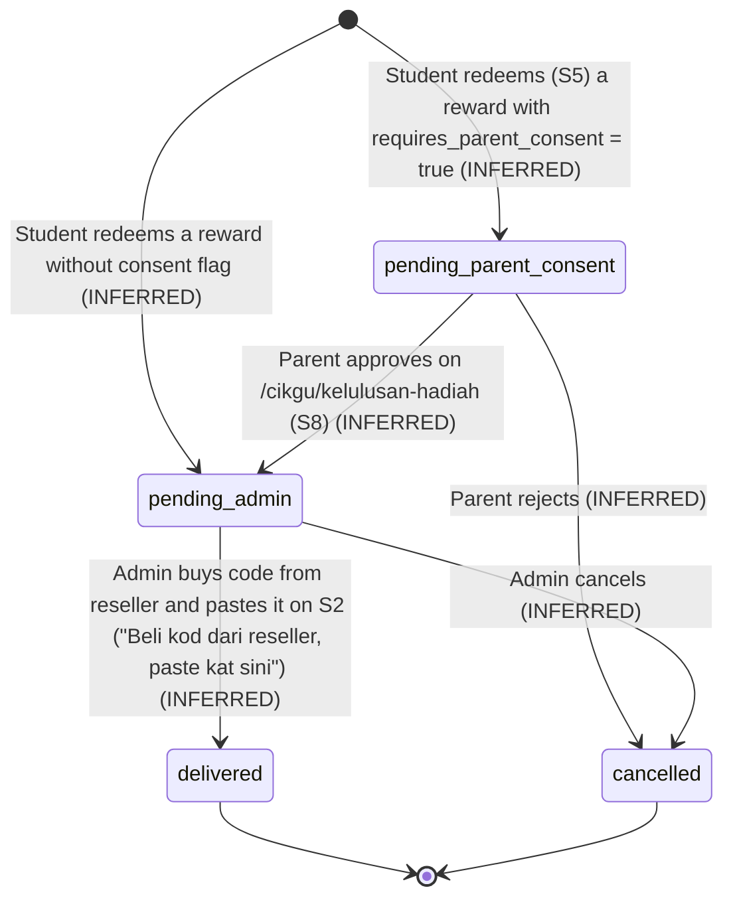
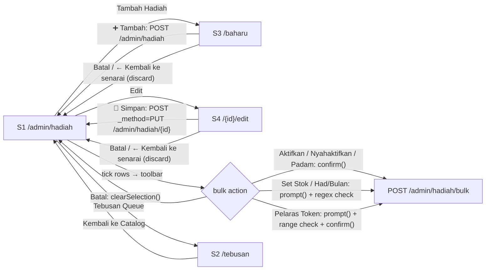
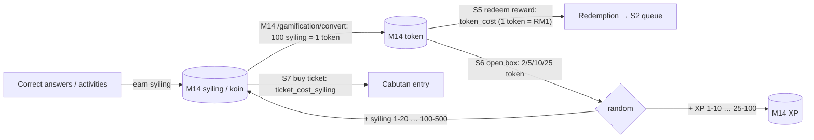

# M15 — Rewards Shop & Redemption (Discovery)

- **Source:** live read-only walk-through of https://prestasiplus.my on **2026-09-26** with the admin account (browser lane 1, `playwright`). This run resumes an earlier stopped run; its plan (`tools/jobs/M15.js`) and crawl helper (`tools/jobs/M15-crawl.js`) were reused and corrected.
- **Screenshots:** `docs/discovery/img/M15/` (31 files, §10). Every page was masked in the DOM before capture. The shells (user portal `SHU`, admin panel `SHA`) and design tokens are in [00-global-ui.md](00-global-ui.md) and are not repeated here.
- **Language:** UI copy is quoted in its exact Bahasa Melayu. Much of the admin copy is English or mixed on live ("Tebusan Queue", "Pending Admin", "Delivered", "Cancelled", "Display Order", "Vendor SKU (optional)", "Image URL (optional)", "Delivery", "API (auto, future)", "Instant", "Showing 1 to 50 of 59 results", "Previous", "Next", "catalog", "Kembali ke Catalog", "rare / epic / legendary").
- **Personal data:** the only personal data in M15 is the "Pelajar" column of `/admin/hadiah/tebusan` (a student name line and an e-mail line per row). `tools/jobs/M15.js` → `M15MASK` tags both lines (`.m15n`), removes any Cloudflare `data-cfemail` payload and blanks avatar images; then `tools/sanitize.js` runs with `{selectors:['.m15n'], titleName:false}` and also masks the whole "Pelajar" column. For the zero-row states the column is kept (`keepCols:'^pelajar$'`) because the empty-state cell sits in that column (see `_summary.md`). No name, e-mail or school appears in any file.
- **Seed snapshot:** `docs/discovery/inventory/M15/_snapshot-2026-09-26.json`, captured **2026-09-26 11:46 MYT (03:46:27Z)** in one pass by `tools/jobs/M15-snapshot.js`. It contains every catalogue row with its live id, every field of all 59 edit forms, the create-form defaults, category-filter results, every redemption row of every status (student = `<student:n>` token), and the values on the four student pages. **The snapshot is the seed source.**
- **Element inventory:** **250 content elements** over 9 screens and 54 captured UI states, IDs `EL-M15-S#-nnn`, in `docs/discovery/inventory/M15/<S#-key>.json`, plus the shell files `SHA-admin-shell.json` (207) and `SHU-user-shell.json` (372). Reconciliation, the crawl and the read-only limits are in `docs/discovery/inventory/M15/_summary.md`.
- **Safety:**
  - Nothing was submitted, bought, redeemed, opened, drawn, approved or rejected. "➕ Tambah", "💾 Simpan", the six bulk actions (they open `confirm()` / `prompt()` and submit `POST /admin/hadiah/bulk`), the mystery-box "Buka" forms (every button is `disabled` for the admin: 0 token) and every catalogue/stock change were never triggered. No cabutan ticket form exists (no open draw) and no parent approve/reject control exists (no pending request).
  - Client-side reveals only: ticking a row checkbox / the select-all checkbox (`updateBulkUI()` shows the bulk toolbar), the toolbar "Batal" (`clearSelection()`), `form.reportValidity()` on the empty create form (native bubbles; not submitted).
  - Scripted GETs ran one at a time with at least 350 ms between navigations (400 ms in the crawl and the snapshot).

Cross-references (owned elsewhere, not re-inventoried):
- **M14 Gamification owns the wallet** (syiling / koin, token, XP, "mata", conversion). M15 only reads balances and (on live) debits them. See §5.5 for which wallet each M15 action touches.
- `/admin/reward-control` "Kawalan Reward" → **M14 S10**. It holds the **admin side of the Cabutan** ("🎟️ Cabutan" table, "➕ Cipta Cabutan Baru" form: `title`, `description`, `ticket_cost_syiling`, `max_tickets_per_student`, `prize_pool` (JSON), `closes_at`, `open_now` → `POST /admin/reward-control/draw`) and the cost table of a **second, older reward catalogue** (11 items priced in syiling, types VOUCHER / PHYSICAL / EXPERIENCE / DIGITAL / SUBSCRIPTION, `POST /admin/reward-control/reward/{id}/cost`). On 2026-09-26 that table said "Tiada cabutan lagi." (0 draws ever). M15 S7 is the student view of those draws.
- `/guru/gamifikasi/kedai` "Kedai Hadiah Guru" and `/admin/gamifikasi/guru/tebusan` "Tebusan Guru" (teacher reward shop and its queue) → **M14 S21 / S7**. They are a separate teacher flow and are not part of M15.
- `/gamification/convert` "Tukar Token" (syiling → token) → **M14 S12**. It is the only way to get the tokens that M15 spends.
- Tournament banner (`tournamentBanner()`, `GET /api/tournament/active`) that sits at the top of `<main>` on every SHU page (S5–S8) → **M16** / global widget. Its three hidden strings ("LIVE:", "MAIN", "DAFTAR", plus x-text "Pendaftaran dibuka" / "Sedang berlangsung") are inventoried in S5–S8 as hidden-only elements but belong to the global widget.

---

## 1. Overview

The TRACKER checklist has 5 M15 routes. The crawl found **9 screens** (4 new routes) and 11 URLs that return 404:

| # | Route | Tab title (`<title>`) · shell header | Status on admin account |
|---|---|---|---|
| S1 | `/admin/hadiah` (`?cat=`, `?page=`) | "Admin — Kedai Hadiah" · SHA "Dashboard" / "Selamat datang, Admin" | 200. 59 rewards, all "Off" |
| S2 | `/admin/hadiah/tebusan` (`?status=`) (**new**) | "Admin — Tebusan Hadiah" · SHA | 200. 3 rows, all "❌ Dibatalkan" |
| S3 | `/admin/hadiah/baharu` (**new**) | "Tambah Hadiah" · SHA | 200 |
| S4 | `/admin/hadiah/{id}/edit` (**new**) | "Edit Hadiah" · SHA | 200 for ids 1–59; `99999` → 404 "Halaman Tidak Dijumpai" |
| S5 | `/gamification/rewards` | "Kedai Hadiah" · SHU | 200. Empty state "Tiada Hadiah Tersedia", "Baki Token 🎫" 0 |
| S6 | `/gamification/mystery-box` | "Kotak Misteri — PRESTASIPLUS" · SHU | 200. 4 boxes, all buttons disabled "🔒 Token Tidak Cukup" |
| S7 | `/cabutan` | "Cabutan Bertuah - PRESTASIPLUS" · SHU | 200. Empty state, "Syiling anda 256 🪙" |
| S8 | `/cikgu/kelulusan-hadiah` | "Kelulusan Hadiah — Ibu Bapa" · SHU | 200. Both lists empty |
| S9 | `/admin/hadiah/{id}` (GET) (**new**) | "An Error Occurred: Method Not Allowed" · none (framework error page) | **405** (the URL only accepts the form's `PUT`) |

Access outcomes found by probing (all **404** "Halaman Tidak Dijumpai", global 404 page): `/gamification/rewards/1`, `/gamification/rewards/history`, `/gamification/redemptions`, `/gamification/mystery-box/1`, `/gamification/mystery-box/history`, `/cabutan/1`, `/cabutan/sejarah`, `/admin/cabutan`, `/admin/mystery-box`, `/admin/hadiah/tebusan/1`, `/admin/hadiah/99999/edit`. So M15 has **no detail page, no student redemption-history page and no mystery-box / cabutan admin page** of its own (cabutan admin = M14 S10; mystery-box config is not editable in the UI).

**Entry points** (shell inventories `SHU-user-shell.json`, `SHA-admin-shell.json`; same links as M14's shell files):
- SHU sidebar (desktop, and the mobile drawer):
  - group "Pembelajaran": **"Cabutan Bertuah 🎟️"** (`fa-ticket`, `text-fuchsia-500`) → `/cabutan`;
  - under **"Syiling & Token 🏆"** (`/gamification`, M14): "Tukar Token" (M14), "Cabaran Harian" (M14), **"Kedai Hadiah"** (`fa-gift`) → `/gamification/rewards`, **"Kelulusan Hadiah"** (`fa-shield-halved`, `text-amber-500`) → `/cikgu/kelulusan-hadiah`, "Marketplace", "Papan Pendahulu", "Pencapaian" (M14), **"Kotak Misteri"** (`fa-box-open`, `text-indigo-500`) → `/gamification/mystery-box`, "Rujuk Kawan" (M14);
  - group "Cikgu Alesa Tools": **"Admin Tebusan"** (`fa-cogs`, `text-slate-500`) → `/admin/hadiah` (label says "Tebusan" but the link opens the catalogue, not `/admin/hadiah/tebusan` — D-M15-4);
  - group "Admin": **"Urus Hadiah"** (`fa-gift`, `text-pink-500`) → `/admin/hadiah`.
  - The active item is highlighted (`active` class) on S5, S6, S7 and S8.
- SHA sidebar, group "Gamifikasi": **"Kedai Hadiah"** → `/admin/hadiah` (shown as active on S2, where it was checked), next to "Kawalan Reward" → `/admin/reward-control` (M14). SHA mobile bottom-nav "Lagi" drawer repeats it.
- `/gamification` (M14 dashboard) has an in-page link "Kedai Hadiah" → `/gamification/rewards`.
- In-module: S1 "Tebusan Queue" → S2, "Tambah Hadiah" → S3, row "Edit" → S4; S2 "Kembali ke Catalog" → S1; S3/S4 "← Kembali ke senarai" and "Batal" → S1.

### 1.1 Shell by screen

| Screen | Shell | Evidence |
|---|---|---|
| S1–S4 | `SHA` admin panel ("Panel Pentadbir", server-status chips, header title "Dashboard" / "Selamat datang, Admin" on every page — the header does not show the page name) | ~109 admin nav links + 60 bottom-nav links; `GET /admin/server-status` |
| S5–S8 | `SHU` user portal (header "Dashboard" / "Selamat datang kembali", chips "256 koin", "8 mata", "1 hari 🔥", bell "99+") | 274 nav links; bottom-nav |
| S9, S4 404 | none (framework / global error page) | — |

`/cikgu/kelulusan-hadiah` is a **parent** page ("Anak anda …", title "— Ibu Bapa") that lives under the `/cikgu` (teacher AI) prefix and is shown in the sidebar of every user, including the admin. What a parent account sees is not observable (Q-M15-3).

---

## 2. Screens

### 2.1 S1 — `/admin/hadiah` "Admin — Kedai Hadiah Digital" (catalogue)

Screenshots: `hadiah-desktop.png`, `hadiah-tablet.png`, `hadiah-mobile.png`, `hadiah-bulk-toolbar.png`, `hadiah-mobile-bulk.png`, `hadiah-cat-flagship.png`, `hadiah-page-3-empty.png`.

- **Header:** h1 "🎁 Admin — Kedai Hadiah Digital", sub "Urus catalog hadiah + proses tebusan pelajar."; two buttons (inline style colours): "Tebusan Queue" (`fa-clipboard-list`, `#3b82f6`) → `/admin/hadiah/tebusan`, "Tambah Hadiah" (`fa-plus`, `#10b981`) → `/admin/hadiah/baharu`.
- **4 KPI cards** (`grid-cols-2 md:grid-cols-4`; label `text-xs uppercase text-slate-500`, value `text-2xl font-bold`): "Total Hadiah" **59** (slate-800), "Aktif" **0** (emerald-600), "Tebusan Bulan Ini" **0** (blue-600), "Pending Proses" **0** (amber-600). The cards ignore the category filter (always all 59; snapshot `categoryFilter.*.cards`).
- **Category pills** (GET links, `rounded-full text-xs`; active `#7c3aed`/white, others `#f1f5f9`/`#475569`): "Semua" (`cat=all`), "🏆 Mahkota" (`flagship`), "💳 E-Wallet" (`ewallet`), "📱 Telco" (`telco`), "🎮 Gaming" (`gaming`), "🎬 Streaming" (`streaming`), "🍔 F&B" (`food_beverage`), "🛒 E-Commerce" (`ecommerce`), "📚 Pembelajaran" (`education`), "🎭 Hiburan" (`entertainment`). No `cat` = "Semua" active. Unknown `cat=bogus` → 200, **no pill active**, empty table.
- **Bulk form** `POST /admin/hadiah/bulk` (`#bulk-form`) wraps the toolbar and the table. Hidden fields: `_token`, `action` (`#bulk-action`), `stock_value` (`#bulk-stock-value`), `max_per_month_value` (`#bulk-max-month-value`), `token_cost_delta_pct` (`#bulk-token-pct`); the row checkboxes are `ids[]` (value = reward id).
- **Bulk toolbar** `#bulk-toolbar` (`display:none` until ≥ 1 row is ticked; `bg-purple-50 border-purple-300 rounded-xl sticky top-2 z-20`): "**{n}** hadiah dipilih" and 7 buttons (`type=button`, `text-xs font-bold`, inline colours): "Aktifkan" (`fa-check`, `#10b981`), "Nyahaktifkan" (`fa-pause`, `#f59e0b`), "Set Stok" (`fa-boxes-stacked`, `#3b82f6`), "Had/Bulan" (`fa-calendar-day`, `#8b5cf6`), "Pelaras Token" (`fa-percent`, `#ec4899`), "Padam" (`fa-trash`, `#dc2626`), "Batal" (`#94a3b8`). Behaviour from page code in §6.1.
- **Table** (`w-full text-sm`, header `bg-slate-50 uppercase text-xs`): columns [select-all checkbox `#select-all`] · "Hadiah" · "Kategori" · "RM" · "Token" · "Stok" · "Tebusan" · "Status" · "Tindakan". Row:
  - checkbox `ids[]` (`.row-check`, `onchange="updateBulkUI()"`);
  - Hadiah: `{icon_emoji} {title}` (`font-semibold text-slate-800`) over `{vendor}` (`text-xs text-slate-500`);
  - Kategori: `{category emoji} {category label}` with the **long** labels ("📱 Telco Topup", "🍔 Makanan & Minuman" — the pills and form say "📱 Telco", "🍔 F&B");
  - RM: "RM{denomination_rm}"; Token: `{token_cost}` (`font-bold text-purple-600`); Stok: `{stock_quantity}` or "∞" when empty; Tebusan: count (0 on every row, §5.2);
  - Status pill (`text-[10px] font-bold rounded-full`): "Off" (`#94a3b8`/white) on all 59 rows. The "On" variant was not observable (Q-M15-6);
  - Tindakan: one link "Edit" (`#3b82f6`) → `/admin/hadiah/{id}/edit`. There is no per-row delete or toggle.
- **Order:** by `display_order` ascending (100, 110 … 680 = ids 1 … 59). **Pagination** 50 per page (Laravel Tailwind paginator): "Showing 1 to 50 of 59 results", page links "1" "2", arrows; mobile shows "« Previous" / "Next »". Page 2: "Showing 51 to 59 of 59 results". `?page=3` → pager "Showing 0 of 59 results" and the empty row "**Tiada hadiah dalam kategori ini.**" (wrong copy for an out-of-range page — D-M15-7). Category views have ≤ 11 rows, so no pager. The pager does not carry `cat` (not testable: no category exceeds 50).
- **Category counts** (snapshot): Mahkota 4 · E-Wallet 8 · Telco 11 · Gaming 8 · Streaming 6 · F&B 8 · E-Commerce 5 · Pembelajaran 6 · Hiburan 3 = 59.
- Empty state (category or page with no rows): single cell "Tiada hadiah dalam kategori ini." (observed for `cat=bogus` and `page=3`).

### 2.2 S2 — `/admin/hadiah/tebusan` "Admin — Tebusan Hadiah Pelajar" (redemption queue)

Screenshots: `tebusan-desktop-empty.png`, `tebusan-mobile-empty.png`, `tebusan-desktop-all.png`, `tebusan-tablet-all.png`, `tebusan-mobile-all.png`.

- h1 "📋 Admin — Tebusan Hadiah Pelajar", sub "Beli kod dari reseller, paste kat sini untuk hantar kepada pelajar."; button "Kembali ke Catalog" (`fa-store`, `#7c3aed`) → `/admin/hadiah`.
- **Status pills** (GET links; active `#7c3aed`): "⏳ Pending Admin" (`status=pending_admin`), "⏳ Pending Ibu Bapa" (`pending_parent_consent`), "🎁 Delivered" (`delivered`), "❌ Cancelled" (`cancelled`), "Semua" (`all`). **No `status` = "⏳ Pending Admin" active** (the default queue). Unknown `status=bogus` → no pill active, empty table.
- **Table** columns: "Pelajar" · "Hadiah" · "RM" · "Token" · "Status" · "Tarikh" · "Tindakan". Row: Pelajar = name (`font-semibold text-slate-800`) over e-mail (`text-xs text-slate-500`); Hadiah = title **without** the emoji (`text-slate-700`) over vendor; RM "RM{n}"; Token `{n}` bold; Status pill (`text-[10px] font-bold rounded-full whitespace-nowrap`); Tarikh "dd/mm HH:MM" (**no year**, `text-xs text-slate-500`); Tindakan — **empty for cancelled rows**. The actions for a `pending_admin` row (the "paste kat sini" code form) were never rendered (Q-M15-1).
- Observed rows (snapshot; students tokenised): all under "❌ Cancelled" and "Semua", none elsewhere.

  | # | Pelajar | Hadiah / vendor | RM | Token | Status | Tarikh |
  |---|---|---|---|---|---|---|
  | 1 | `<student:1>` | Hotlink Topup RM10 / Hotlink | RM10 | 10 | ❌ Dibatalkan (`#64748b`) | 30/04 14:11 |
  | 2 | `<student:2>` | CelcomDigi Topup RM30 / CelcomDigi | RM30 | 30 | ❌ Dibatalkan | 30/04 04:54 |
  | 3 | `<student:2>` | CelcomDigi Topup RM30 / CelcomDigi | RM30 | 30 | ❌ Dibatalkan | 30/04 04:54 |

  Rows 2 and 3 are the same person, reward and minute (a double submission, INFERRED). Order: newest first (INFERRED from the three rows).
- Empty state (every other status): one cell "**Tiada tebusan dalam status ini.**". No pagination rendered (an empty `div.mt-4` is present, INFERRED paginator slot).

### 2.3 S3 — `/admin/hadiah/baharu` "➕ Tambah Hadiah Baharu" (create form)

Screenshots: `baharu-desktop.png`, `baharu-mobile.png`.

- Link "← Kembali ke senarai" → `/admin/hadiah`; white card (`max-w-3xl`), h1 "➕ Tambah Hadiah Baharu".
- Form `POST /admin/hadiah` (`_token`). Fields (label `text-xs font-bold uppercase text-slate-600`; `*` in `text-rose-500`; input `px-3 py-2 border-slate-300 rounded`):

  | Label (exact) | name | Type / constraints | Create default |
  |---|---|---|---|
  | "Kategori *" | `category` | select, **required**; 9 options (App. A.1) | first option "🏆 Mahkota (RM500+)" (no `selected`) |
  | "Vendor *" | `vendor` | text, **required**, maxlength 100, placeholder "cth: Roblox, Touch n Go, Hotlink" | empty |
  | "Tajuk *" | `title` | text, **required**, maxlength 200, placeholder "cth: TnG eWallet RM50" | empty |
  | "Penerangan" | `description` | textarea rows 2, maxlength 1000 | empty |
  | "Nilai (RM) *" | `denomination_rm` | number, **required**, min 1, max 10000 | empty |
  | "Kos Token *" + hint "100 syiling = 1 token = RM1" (`text-[10px] text-slate-400`) | `token_cost` | number, **required**, min 1, max 10000 | empty |
  | "Emoji Icon" | `icon_emoji` | text, maxlength 8, placeholder "🎁" | empty |
  | "Stok (kosong = tanpa had)" | `stock_quantity` | number, min 0 | empty |
  | "Maks/bulan/pelajar" | `max_per_month_per_student` | number, min 1, max 99 | empty |
  | "Sah Hari (default 365)" | `voucher_validity_days` | number, min 1, max 1825 | 365 |
  | "Delivery" | `delivery_method` | select: `manual` "Manual (admin paste)", `api` "API (auto, future)", `instant` "Instant" | manual |
  | "Vendor SKU (optional)" | `vendor_sku` | text, maxlength 100 | empty |
  | "Display Order" | `display_order` | number, min 0, max 9999 | 100 |
  | "Image URL (optional)" | `image_url` | url, maxlength 500 | empty |
  | "Terma Khas" | `terms_text` | textarea rows 2, maxlength 2000 | empty |
  | "Aktif" | `is_active` | checkbox value 1 | **checked** |
  | "Perlu kelulusan ibu bapa" | `requires_parent_consent` | checkbox value 1 | unchecked |

  Layout: Kategori + Vendor (`md:grid-cols-2`); Tajuk; Penerangan; Nilai / Kos Token / Emoji (`md:grid-cols-3`); Stok / Maks / Sah Hari (3 cols); Delivery / SKU / Display Order (3 cols); Image URL; Terma Khas; the two checkboxes (`border-t`); buttons.
- Buttons: submit "➕ Tambah" (`#10b981`) and "Batal" — a **link** to `/admin/hadiah` (`#94a3b8`), so Batal discards everything (full navigation, no confirm).
- **Validation (native only):** `reportValidity()` on the empty form flags `vendor`, `title`, `denomination_rm`, `token_cost` with the browser bubble "Please fill out this field." (`category` always has a value). No custom JS validation, no `novalidate`. Server-side messages were not observable (not submitted).

### 2.4 S4 — `/admin/hadiah/{id}/edit` "✏️ Edit Hadiah: {title}"

Screenshots: `edit-desktop.png`, `edit-tablet.png`, `edit-mobile.png`, `edit-404.png`.

- Same card and fields as S3 (identical labels, constraints and order), pre-filled from the record; form `POST /admin/hadiah/{id}` with hidden `_method=PUT`; h1 "✏️ Edit Hadiah: {title}" (title without the icon, e.g. "✏️ Edit Hadiah: Roblox Gift Card RM10", "✏️ Edit Hadiah: Roblox Gift Card RM1000 🏆", "✏️ Edit Hadiah: Hotlink Topup RM5").
- Submit "💾 Simpan" (`#10b981`); "Batal" link → `/admin/hadiah` (discard). No delete button on the form (delete only via the S1 bulk "Padam").
- Selects carry `selected` on the stored value; empty numbers render `value=""` (stock ∞, no monthly cap).
- Unknown id (`/admin/hadiah/99999/edit`) → **404** global page "404" / "🔍" / "Halaman Tidak Dijumpai" / "Maaf, halaman yang anda cari tidak wujud atau telah dipindahkan. Mungkin URL salah taip?" / "Halaman Utama" → `/` / "Mula Latihan" → `/latih-tubi` / "PRESTASIPLUS".
- All 59 records are in the snapshot (`editForms`), summary in Appendix A.5.

### 2.5 S5 — `/gamification/rewards` "🎁 Kedai Hadiah" (student shop)

Screenshots: `rewards-desktop.png`, `rewards-tablet.png`, `rewards-mobile.png`.

- Hero `.shop-hero` (green gradient `#059669 → #10b981 → #34d399`, radius 20px): h1 "🎁 Kedai Hadiah" (`text-sm sm:text-2xl` — 14px at 375, 24px from 640), sub "Tebus token anda untuk hadiah menarik!", balance tile "**0**" / "Baki Token 🎫" (`rgba(255,255,255,0.15)` tile).
- **Empty state** (the only state observed): "🎁" (`text-3xl sm:text-6xl`), h2 "Tiada Hadiah Tersedia", "Hadiah akan ditambah tidak lama lagi. Tunggu ya!".
- Unknown query (`?category=gaming`) is ignored (same page).
- The page stylesheet defines the **unrendered card design** (SOURCE-DERIVED from `<style>`; no markup observed): `.reward-card` (radius 16px; `.featured` → amber border `#f59e0b` and glow), `.reward-image` (160px tall, cover), `.reward-type-badge` in 5 variants — `PHYSICAL` `#dbeafe/#1e40af`, `DIGITAL` `#ede9fe/#6d28d9`, `VOUCHER` `#fef3c7/#92400e`, `EXPERIENCE` `#d1fae5/#065f46`, `SUBSCRIPTION` `#fce7f3/#9d174d` — `.reward-price` (1.25rem, `#1e40af`), `.claim-btn` (blue gradient, `:disabled` opacity 0.5), `.stock-badge` `in-stock` / `low-stock` / `out-stock`, `.section-card`. These type names match the **M14 legacy reward catalogue** (11 items, prices in syiling), not the M15 hadiah catalogue (categories, prices in token) — see §5.1 and Q-M15-2.

### 2.6 S6 — `/gamification/mystery-box` "📦 Kotak Misteri"

Screenshots: `mystery-box-desktop.png`, `mystery-box-tablet.png`, `mystery-box-mobile.png`.

- Hero `.mystery-hero` (indigo gradient `#1e1b4b → #312e81 → #4338ca`, centred): h1 "📦 Kotak Misteri", sub "Buka kotak & menang ganjaran rawak — nasib baik menanti!", chip "🎫 Token Anda: **0**".
- `.box-grid` (`repeat(auto-fill, minmax(220px, 1fr))`): 4 cards, each a **form** `POST /gamification/mystery-box/{id}/open` (`_token` only) with a coloured header (`--box-color1/2`), icon, name, description, cost "{n} Token", ranges "🪙 **{a-b}**" and "⭐ **{a-b}** XP", and a full-width submit:

  | id | Ribbon | Icon | Name | Description | Cost | 🪙 range | ⭐ XP range | Header colours |
  |---|---|---|---|---|---|---|---|---|
  | 1 | — | 📦 | Kotak Gangsa | Kotak biasa — ganjaran kecil tapi pasti! | 2 Token | 1-20 | 1-10 | `#9ca3af → #6b7280` |
  | 2 | rare (`#3b82f6`) | 🎁 | Kotak Perak | Kotak lebih besar — peluang ganjaran lebih baik | 5 Token | 10-50 | 5-25 | `#3b82f6 → #2563eb` |
  | 3 | epic (`#8b5cf6`) | ✨ | Kotak Emas | Kotak premium — ganjaran besar menanti! | 10 Token | 25-150 | 10-50 | `#8b5cf6 → #7c3aed` |
  | 4 | legendary (gradient `#f59e0b → #ef4444`) | 👑 | Kotak Legenda | Kotak terhebat — ganjaran WOW! | 25 Token | 100-500 | 25-100 | `#f59e0b → #ef4444` |

  Ribbons are rotated 45° corner labels, text lower-case in the DOM and `uppercase` by CSS ("RARE" / "EPIC" / "LEGENDARY" on screen), 10.4px.
- Button: `disabled` "🔒 Token Tidak Cukup" (`#d1d5db`, `not-allowed`) on all four for the admin (0 token). The enabled label was never rendered (Q-M15-4). The whole card has `cursor:pointer` and hover lift even when disabled; the icon shakes on hover (`boxShake 0.5s`).
- **Odds:** the page shows only the coin and XP **ranges**; no probabilities, no prize list and no script (the result is computed server-side). The stylesheet also defines a **result modal** (`.modal-overlay` rgba(0,0,0,0.7), `.modal-content` max 400px, `.modal-result-icon`, `.modal-reward` `#7c3aed`, `.modal-close` purple button) and a **history card** (`.history-card`, `.history-item`) that are **not in the markup** for this account (Q-M15-4).

### 2.7 S7 — `/cabutan` "🎟️ Cabutan Bertuah" (lucky draw)

Screenshots: `cabutan-desktop.png`, `cabutan-tablet.png`, `cabutan-mobile.png`.

- Header card (`bg-gradient-to-r from-indigo-600 to-fuchsia-600 text-white`, `flex-wrap`): h1 "🎟️ Cabutan Bertuah", sub "Guna syiling untuk beli tiket & menangi hadiah hebat!", tile "Syiling anda" (`text-xs uppercase text-indigo-100`) / "**256 🪙**" (`text-2xl font-bold`).
- h2 "Cabutan Dibuka" and the empty box (`border-dashed bg-gray-50`): "Tiada cabutan dibuka buat masa ini. Nanti datang lagi! 🎈".
- No draw has ever existed (M14 S10 "Tiada cabutan lagi."), so the draw card, ticket purchase, entries, schedule and winners are **not observable** (Q-M15-5). The admin form in M14 S10 gives the draw fields: title, description, ticket price in syiling, max tickets per student, prize pool (JSON), close date, "Buka serta-merta".

### 2.8 S8 — `/cikgu/kelulusan-hadiah` "👨‍👩‍👧 Kelulusan Tebusan Hadiah" (parent approval)

Screenshots: `kelulusan-desktop.png`, `kelulusan-tablet.png`, `kelulusan-mobile.png`.

- h1 "👨‍👩‍👧 Kelulusan Tebusan Hadiah", sub "Anak anda nak tebus hadiah yang memerlukan kelulusan ibu bapa. Sila semak."
- h2 "⏳ Menunggu Kelulusan (0)" + empty box "Tiada tebusan menunggu kelulusan."
- h2 "📜 Sejarah Tebusan Anak" + empty box "Belum ada sejarah tebusan."
- Approve / reject controls, the request card and the history rows were not rendered (Q-M15-3).

### 2.9 S9 — `GET /admin/hadiah/{id}` (405)

Screenshot: `hadiah-show-405.png`. Framework error page (English): "Oops! An Error Occurred", "The server returned a "405 Method Not Allowed".", "Something is broken. Please let us know what you were doing when this error occurred. We will fix it as soon as possible. Sorry for any inconvenience caused." No link back (D-M15-8).

---

## 3. Flows

### 3.1 Redemption workflow (statuses from S2 and the form; transitions partly INFERRED)

- **OBSERVED:** the five status keys and labels (App. A.2); the default queue is `pending_admin`; S1 card "Pending Proses"; the only real rows are 3 × `cancelled` ("❌ Dibatalkan") with an empty Tindakan cell; `delivery_method` is `manual` "Manual (admin paste)" on all 59 rewards; 12 rewards have `requires_parent_consent` (8 Gaming + 4 Mahkota).
- **Who approves:** the **parent** (not the teacher) approves consent-flagged redemptions on S8 (page copy "Anak anda … memerlukan kelulusan ibu bapa"; pill "Pending Ibu Bapa"). The **admin** fulfils (and, INFERRED, may cancel). No teacher step exists in M15 (teacher rewards are M14's separate `/guru/gamifikasi/*` flow).
- **Delivery:** manual — admin pastes the voucher code; `voucher_validity_days` (30/60/90/365) implies a code expiry shown to the student (INFERRED). "API (auto, future)" and "Instant" are options not used by any record.
- Where a student sees delivered codes is not observable: there is no history page (`/gamification/rewards/history` 404) (Q-M15-1).

### 3.2 Admin catalogue maintenance (S1 → S3/S4, bulk)

Redirect targets after POST and the flash messages were not observable (not submitted; Q-M15-7).

### 3.3 Student spending flows (M14 wallet → M15)

---

## 4. Data entities implied

| Entity (owner) | Fields observed | Notes |
|---|---|---|
| **HadiahReward** (M15) | `id` (1–59), `category` (enum A.1), `vendor`, `title`, `description`, `denomination_rm` (1–10000), `token_cost` (1–10000), `icon_emoji` (≤ 8), `stock_quantity` (null = ∞, ≥ 0), `max_per_month_per_student` (null or 1–99), `voucher_validity_days` (1–1825, default 365), `delivery_method` (manual/api/instant), `vendor_sku`, `display_order` (0–9999, default 100), `image_url`, `terms_text`, `is_active`, `requires_parent_consent`, redemption count (S1 "Tebusan") | 59 seed rows = snapshot. On live `token_cost` = `denomination_rm` on every row |
| **HadiahRedemption** (M15) | student (user, M02), reward (title, vendor snapshot), RM, token, `status` (A.2), created at ("dd/mm HH:MM"), code (INFERRED), parent decision (INFERRED) | 3 cancelled rows observed |
| **MysteryBox** (M15; config not editable in UI) | `id` 1–4, name, description, icon, rarity ribbon (none/rare/epic/legendary), cost in token, coin range, XP range, header colours | Values = §2.6; odds not exposed |
| **MysteryBoxOpening** (M15, INFERRED) | box, student, coins won, XP won, time | Implied by `.history-*` / `.modal-*` CSS; not observable |
| **LuckyDraw / Cabutan** (admin in M14 S10; student view M15 S7) | `title`, `description`, `ticket_cost_syiling`, `max_tickets_per_student`, `prize_pool` (JSON), `closes_at`, open flag, status, tickets, winners ("#, Tajuk, Status, Tiket, Kolam, Pemenang" columns in M14 S10) | 0 draws exist |
| **Wallet** (M14) | syiling/koin (admin 256), token (admin 0), XP, mata | M15 reads and debits only (D12) |
| **Parent–child link** (M02) | parent ↔ student | Needed by S8; not observable |

---

## 5. Rules (OBSERVED vs INFERRED)

### 5.1 Catalogue and shop
- **OBSERVED** (form + hint): prices are in **tokens**; "100 syiling = 1 token = RM1". Every live row has `token_cost` = `denomination_rm`.
- **OBSERVED:** all 59 rewards are inactive ("Off", `is_active` false); "Aktif" card 0; the student shop is empty ("Tiada Hadiah Tersedia"). **INFERRED:** the shop lists only active rewards, so S5 shows the empty state. The S5 stylesheet, however, describes cards typed PHYSICAL/DIGITAL/VOUCHER/EXPERIENCE/SUBSCRIPTION — the enum of the **M14 legacy reward table** (11 items priced 100–2000 syiling), while the S5 hero says "Baki Token". Which catalogue S5 reads is not provable read-only (Q-M15-2).
- **OBSERVED:** list order = `display_order` ascending; 50 per page; category filter by `cat` key; Stok "∞" when empty; Status "Off" pill.
- **OBSERVED limits** (per reward): stock 5 on all Telco and E-Wallet rewards (19 rows), ∞ on the rest (40); monthly cap per student: Gaming 30, Streaming 12 (Netflix Basic 3 Bulan 4), Pembelajaran — Canva 4, Quizlet 1, Duolingo 12, MUET 4, others none; Hiburan 4/4/2; Mahkota 1; none on Telco, E-Wallet, F&B, E-Commerce, Popular, MPH (A.5).
- **INFERRED:** redeeming decrements stock and is refused over the monthly cap; the error copy is not observable.

### 5.2 Redemption counts
- **OBSERVED:** S1 "Tebusan" is 0 for Hotlink Topup RM10 (id 10) and CelcomDigi Topup RM30 (id 16) although both have cancelled redemptions → **cancelled redemptions are not counted** (the count is of non-cancelled or delivered redemptions; which one is INFERRED).
- **OBSERVED:** "Tebusan Bulan Ini" 0 (the 3 rows are from 30/04) and "Pending Proses" 0 (= `pending_admin` count 0). **INFERRED:** "Pending Proses" = count of `pending_admin`; "Tebusan Bulan Ini" = redemptions created this calendar month (status filter unknown).

### 5.3 Bulk actions (page code, §6.1)
- Selection is **per page** (select-all ticks only the ≤ 50 rendered rows); the master box is ticked only when every row is ticked.
- Aktifkan / Nyahaktifkan / Padam: `confirm()` then submit. Padam copy promises that rewards with redemption history are not deleted.
- Set Stok: `prompt()`; empty = ∞; must match `^\d+$` and ≤ 999999, else `alert("Masukkan nombor sah (0-999999) atau kosong untuk ∞.")`; Cancel on the prompt → nothing.
- Had/Bulan: `prompt()` says "0 / kosong untuk tanpa had"; must match `^\d+$` and ≤ 99, else `alert("Masukkan nombor sah (0-99) atau kosong untuk ∞.")`. (The alert omits "0", the prompt includes it — D-M15-9.) Note the single-record form allows min 1 only, while bulk allows 0 (= no cap).
- Pelaras Token: `prompt()`; `parseInt`, must be −90 … +500 and not 0, else `alert("Masukkan peratus sah antara -90 dan +500 (bukan 0).")`; then `confirm("Sahkan: naikkan|turunkan kos token sebanyak {abs}% untuk {n} hadiah?")`. Rounding of the new cost is server-side (INFERRED).
- "Batal" in the toolbar only clears the ticks (hides the toolbar); it does not navigate.

### 5.4 Mystery box and lucky draw
- **OBSERVED:** box cost in token (2/5/10/25); rewards are syiling ranges and XP ranges (§2.6); button disabled with "🔒 Token Tidak Cukup" when the token balance is below the cost (0 < 2 for the admin — INFERRED comparison rule `balance < cost`).
- **Odds:** not published on the page or in scripts. Only the ranges are known. A uniform draw inside each range is a guess (INFERRED, not to be written as fact).
- **Cabutan (OBSERVED from S7 + M14 S10 form):** tickets are bought with **syiling**; each draw has a ticket price, a per-student ticket cap, a JSON prize pool and a close date; it can be opened immediately. Draw mechanics, winner selection and notification are not observable.

### 5.5 Which M14 wallet each action debits

| Action | Screen | Debits | Credits | Evidence |
|---|---|---|---|---|
| Redeem a reward | S5 | **token** (`token_cost`) | — | S5 "Baki Token", S3 "Kos Token", S2 "Token" column (OBSERVED labels; debit INFERRED) |
| Open a mystery box | S6 | **token** (2/5/10/25) | **syiling** 🪙 range + **XP** range | S6 "Token Anda", "{n} Token", "🪙", "⭐ … XP" |
| Buy a cabutan ticket | S7 | **syiling** (`ticket_cost_syiling`) | prize from the pool | S7 "Guna syiling untuk beli tiket", "Syiling anda"; M14 S10 field |
| Cancelled redemption | S2 | — | token refund (INFERRED) | not observable |
| Convert | M14 S12 | syiling | token (100 : 1) | S3 hint |

The admin's balances on 2026-09-26: 256 syiling (shell "256 koin", S7 "256 🪙"), 0 token (S5, S6), "8 mata".

---

## 6. Scripts

### 6.1 S1 inline script (verbatim logic)
`toggleAll(master)`, `updateBulkUI()` (counter `#bulk-count`, toolbar `display:flex|none`, master sync), `clearSelection()`, `doBulk(action)` with messages `activate` "Aktifkan {n} hadiah?", `deactivate` "Nyahaktifkan {n} hadiah?", `delete` "Padam {n} hadiah secara kekal? (Hadiah dengan sejarah tebusan tidak akan dipadam)", `doBulkStock()`, `doBulkMaxMonth()`, `doBulkTokenPct()`. Exact prompt texts in Appendix B (S1). Each writes `#bulk-action` = `activate` / `deactivate` / `delete` / `set_stock` / `set_max_per_month` / `set_token_cost` and the matching hidden value, then `#bulk-form.submit()`. All return early when 0 rows are ticked.

### 6.2 Other pages
S2–S4, S7, S8: no page script. S5 and S6: no page script (only the global SHU scripts and the tournament banner). S6 behaviour is pure HTML forms; the modal/history CSS has no markup and no script on this account.

---

## 7. Endpoints observed

| Method / URL | Used by | Shape / notes |
|---|---|---|
| GET `/admin/hadiah?cat={key}&page={n}` | S1 pills, pager | HTML; unknown `cat` → empty, no pill active; page beyond last → empty row |
| POST `/admin/hadiah/bulk` (`_token, action, stock_value, max_per_month_value, token_cost_delta_pct, ids[]`) | S1 toolbar | not submitted |
| GET `/admin/hadiah/baharu` · POST `/admin/hadiah` | S3 | form fields §2.3; not submitted |
| GET `/admin/hadiah/{id}/edit` · POST `/admin/hadiah/{id}` + `_method=PUT` | S4 | 404 for unknown id; not submitted |
| GET `/admin/hadiah/{id}` | — | **405** (S9) |
| GET `/admin/hadiah/tebusan?status={pending_admin\|pending_parent_consent\|delivered\|cancelled\|all}` | S2 pills | HTML; default `pending_admin`; unknown → empty, no pill active |
| (fulfil / cancel a redemption) | S2 Tindakan | not rendered — URL unknown (Q-M15-1) |
| GET `/gamification/rewards` | S5 | HTML; claim endpoint not rendered (Q-M15-2) |
| GET `/gamification/mystery-box` · POST `/gamification/mystery-box/{1-4}/open` (`_token`) | S6 | not submitted; response (redirect + flash / modal) unknown |
| GET `/cabutan` | S7 | ticket endpoint not rendered (Q-M15-5) |
| GET `/cikgu/kelulusan-hadiah` | S8 | approve/reject endpoints not rendered (Q-M15-3) |
| POST `/admin/reward-control/draw`, `/admin/reward-control/reward/{id}/cost`, `/admin/reward-control/settings` | M14 S10 | M14 |
| GET `/api/tournament/active` (JSON array of tournaments) | global banner on S5–S8 | M16 / global |
| GET `/admin/server-status` | SHA | global |

No M15 screen loads JSON for its own content; everything is server-rendered.

---

## 8. Responsive behaviour (375 / 768 / 1280) and live defects

### 8.1 Layout per screen (measured by `tools/jobs/M15-measure.js`)
- **Breakpoint:** shells switch at 1024 px (00-global-ui). No page-level horizontal overflow on any M15 screen at any width (page `scrollWidth` ≤ viewport).
- **S1:** header wraps: at 375 h1 on two lines, "Tebusan Queue" and "Tambah Hadiah" side by side (151×64 and 152×64, labels wrap to two lines). KPI cards 2×2 below `md`, 4 in a row from 768. Pills wrap to 4 rows at 375, 2 rows at 768 and 1280. The table wrapper is `overflow-hidden` (not `overflow-x-auto`): **at 375 only the checkbox, "Hadiah" and "Kategori" columns are fully visible (table 693 px in a 308 px box); at 768 "Tindakan" is cut off (693 in 666)** — the "Edit" links cannot be reached below ~800 px (D-M15-1). Bulk toolbar at 375: 310×158, buttons wrap to 3 rows (Aktifkan · Nyahaktifkan / Set Stok · Had/Bulan / Pelaras Token · Padam · Batal), each 28 px tall; at 768 two rows (Batal alone on row 2); at 1280 one row. The toolbar is `sticky top-2`.
- **S2:** h1 wraps to 3 lines at 375 (190 px wide) beside "Kembali ke Catalog" (120×88, 3-line label). Pills 2 rows at 375. Table in `overflow-hidden`: **375 shows only "Pelajar" and "Hadiah" (736 in 308); 768 cuts "Tindakan" (736 in 666)** — the future fulfil action would be unreachable (D-M15-1).
- **S3/S4:** card `max-w-3xl`; grids are 1 column below `md` (768 = 2/3 columns). At 375 the form is 260 px wide and 1,467 px tall; buttons "➕ Tambah" 128×44 / "💾 Simpan" 124×44 and "Batal" 79×44 side by side.
- **S5:** hero stacks (`flex-col md:flex-row`); h1 **14 px at 375** (`text-sm sm:text-2xl`), 24 px from 640.
- **S6:** box grid 1 column at 375 (cards 342×333), 3 at 768 (4th wraps to row 2), 4 at 1280 (228×352).
- **S7:** header `flex-wrap`, balance tile moves under the title at 375.
- **S8:** single column at all widths.

**Text under 12 px (measured):** S1 status pill "Off" 10px; S2 status pill "❌ Dibatalkan" 10px; S3/S4 hint "100 syiling = 1 token = RM1" 10px; S6 ribbons "rare / epic / legendary" 10.4px. None elsewhere in M15 content.

### 8.2 Live defects (candidates for D9 fixes; the rebuild decision is the URS writer's)

| ID | Screen | Defect | D9 class |
|---|---|---|---|
| D-M15-1 | S1, S2 | Tables sit in `overflow-hidden` wrappers: columns are clipped at 375 and 768 (S1 "Edit"/Status/Stok…, S2 Tindakan/Status/Tarikh…) with no way to scroll to them | layout / responsive breakage (controls unreachable) |
| D-M15-2 | S1 | Category labels differ between pills/form ("📱 Telco", "🍔 F&B") and the table ("📱 Telco Topup", "🍔 Makanan & Minuman") | inconsistent labels (minor; replicate unless the URS writer decides) |
| D-M15-3 | S5 | Page copy and balance use **token**, stylesheet/card types belong to the syiling-priced legacy catalogue (M14 S10); which catalogue the shop reads is contradictory | contradictory rules (Q-M15-2) |
| D-M15-4 | SHU sidebar | "Admin Tebusan" links to the catalogue `/admin/hadiah`, not to the redemption queue `/admin/hadiah/tebusan`; it sits in the "Cikgu Alesa Tools" group | wrong link target / label |
| D-M15-5 | S8 | Parent approval page lives at `/cikgu/…` (teacher-AI prefix) and is shown to every role in the sidebar | wrong placement (report; replicate route) |
| D-M15-6 | S2 | "Tarikh" shows "dd/mm HH:MM" without the year | ambiguous data (minor) |
| D-M15-7 | S1 | Out-of-range page shows "Tiada hadiah dalam kategori ini." with pager "Showing 0 of 59 results" | wrong message |
| D-M15-8 | S9 | GET `/admin/hadiah/{id}` shows an English framework 405 page with no navigation | broken page (dead URL) |
| D-M15-9 | S1 | Had/Bulan prompt says "0 / kosong untuk tanpa had", its error alert says "(0-99) atau kosong untuk ∞"; single-record form rejects 0 (min 1) | contradictory rules (minor) |
| D-M15-10 | S2 | Two identical cancelled redemptions in the same minute for the same student and reward (no double-submit guard; INFERRED) | data defect (report) |
| D-M15-11 | S6 | Disabled box cards keep `cursor:pointer` and the hover lift/shake | visual bug (minor) |
| D-M15-12 | SHA header | Header title reads "Dashboard" on every M15 admin page | wrong title (shell-wide; see 00-global-ui) |
| D-M15-13 | S1–S2, S3/S4, S6 | Text below 12 px: "Off", "❌ Dibatalkan" (10px), form hint (10px), ribbons (10.4px) | unreadable text (small) — replicate unless judged unreadable |

### 8.3 Audit-lesson checklist

| Point | M15 answer |
|---|---|
| Dated snapshot with live ids | `_snapshot-2026-09-26.json` (59 rewards with ids + all edit fields, category results, 7 tebusan states with tokenised rows, student-page values) |
| Rules from page code | §5.3 / §6.1 (bulk script), §2.3 (form attributes), §2.5–2.6 (stylesheets) |
| Claims verified across ALL rows | A.5 built from all 59 edit forms; category counts sum to 59; "Tebusan" 0 on all 59 rows |
| Batal behaviour | S3/S4 "Batal" = link to S1 (**discards**, no confirm). S1 toolbar "Batal" = clears ticks only (**hides** toolbar). No modal "Batal" in M15 |
| Layout at 375 | §8.1 (button rows, clipping) |
| Text < 12 px | §8.1 measured list |
| Nested forms | None: S1 has one form (bulk) that contains the table; row "Edit" are links; S6 has 4 sibling forms |
| Grid clipping | S1/S2 tables clipped (D-M15-1); S6 grid reflows 1/3/4 |
| Native `required` | S3/S4: category, vendor, title, denomination_rm, token_cost; message "Please fill out this field." |
| Preloads | S4 fields preload the record (selected options, checkbox `checked`); S3 preloads 365, manual, 100, Aktif ticked; filters are pills (links), not selects |
| Pagers keep filters | Pager has no `cat` (no category > 50 rows) |
| Sort order | S1 `display_order` asc; S2 newest first (INFERRED) |
| Dead links / 404 / 405 | §1 probe list; S9 405 |

---

## 9. Open questions / not observable read-only

| # | Question | Why |
|---|---|---|
| Q-M15-1 | S2 Tindakan for `pending_admin` / `pending_parent_consent` / `delivered` rows: code-paste field, buttons, endpoints, validation, what the student sees after delivery (where is the code shown?) | Only cancelled rows exist; no student history page |
| Q-M15-2 | Which catalogue does `/gamification/rewards` list (M15 hadiah in token, or the M14 legacy rewards in syiling)? Card markup, claim button label, consent notice, stock badges, monthly-cap and stock-out messages | Empty state only (all hadiah inactive) |
| Q-M15-3 | Parent view of S8: request card, approve/reject buttons and endpoints, history row format; how a parent is linked to a child | Admin account has no children |
| Q-M15-4 | Mystery-box odds, enabled button label, result modal copy, history list, daily limits | Server-side; the admin has 0 token; opening is forbidden |
| Q-M15-5 | Cabutan draw card, ticket purchase form, entries, schedule display, winner announcement | No draw has ever existed |
| Q-M15-6 | The "On" status pill colour/label for an active reward | All 59 are Off |
| Q-M15-7 | Flash/validation messages after create, update, bulk actions; redirect targets | Not submitted |
| Q-M15-8 | Whether cancelled redemptions refund tokens and who can cancel (student / parent / admin) | Not observable |

---

## 10. Screenshot index (`docs/discovery/img/M15/`, all masked)

`hadiah-desktop.png`, `hadiah-tablet.png`, `hadiah-mobile.png`, `hadiah-bulk-toolbar.png`, `hadiah-mobile-bulk.png`, `hadiah-page-3-empty.png`, `hadiah-cat-flagship.png`, `tebusan-desktop-empty.png`, `tebusan-mobile-empty.png`, `tebusan-desktop-all.png`, `tebusan-tablet-all.png`, `tebusan-mobile-all.png`, `baharu-desktop.png`, `baharu-mobile.png`, `edit-desktop.png`, `edit-tablet.png`, `edit-mobile.png`, `edit-404.png`, `hadiah-show-405.png`, `rewards-desktop.png`, `rewards-tablet.png`, `rewards-mobile.png`, `mystery-box-desktop.png`, `mystery-box-tablet.png`, `mystery-box-mobile.png`, `cabutan-desktop.png`, `cabutan-tablet.png`, `cabutan-mobile.png`, `kelulusan-desktop.png`, `kelulusan-tablet.png`, `kelulusan-mobile.png`.

---

## States requiring a live action (not captured; would change data or need another account)

| State | Needed action / account | Why not done |
|---|---|---|
| S1 "On" pill, active reward rows, "Aktif" > 0 | Aktifkan a reward | changes data |
| S1 after bulk action (flash message, updated values) | submit bulk form | changes data |
| S3/S4 server validation errors and success flash | submit forms | changes data |
| S2 rows in `pending_admin`, `pending_parent_consent`, `delivered` + their Tindakan | a student redemption + admin fulfilment | spends tokens, changes data |
| S5 reward cards, claim button, confirmation, stock-out / cap messages | active reward + student with tokens | changes data, spends tokens |
| S6 enabled "open" button, result modal, history | token balance ≥ 2 and opening a box | spends tokens |
| S7 open draw card, ticket purchase, entries, winners | create a draw (M14 S10) and buy tickets | changes data, spends syiling |
| S8 pending request with approve/reject, history rows | parent account with a child redemption | other account; changes data |

---

## Appendix A — Enumerations

### A.1 Categories (`category`)
| key | Pill (S1) | Form option (S3/S4) | Table label (S1) | Rows |
|---|---|---|---|---|
| `flagship` | 🏆 Mahkota | 🏆 Mahkota (RM500+) | 🏆 Mahkota | 4 |
| `ewallet` | 💳 E-Wallet | 💳 E-Wallet | 💳 E-Wallet | 8 |
| `telco` | 📱 Telco | 📱 Telco | 📱 Telco Topup | 11 |
| `gaming` | 🎮 Gaming | 🎮 Gaming | 🎮 Gaming | 8 |
| `streaming` | 🎬 Streaming | 🎬 Streaming | 🎬 Streaming | 6 |
| `food_beverage` | 🍔 F&B | 🍔 F&B | 🍔 Makanan & Minuman | 8 |
| `ecommerce` | 🛒 E-Commerce | 🛒 E-Commerce | 🛒 E-Commerce | 5 |
| `education` | 📚 Pembelajaran | 📚 Pembelajaran | 📚 Pembelajaran | 6 |
| `entertainment` | 🎭 Hiburan | 🎭 Hiburan | 🎭 Hiburan | 3 |
Plus pill "Semua" (`cat=all`, default).

### A.2 Redemption status (`status`)
| key | Pill (S2) | Row badge |
|---|---|---|
| `pending_admin` (default) | ⏳ Pending Admin | not observed |
| `pending_parent_consent` | ⏳ Pending Ibu Bapa | not observed |
| `delivered` | 🎁 Delivered | not observed |
| `cancelled` | ❌ Cancelled | "❌ Dibatalkan" `#64748b`/white |
| `all` | Semua | — |

### A.3 Delivery (`delivery_method`)
`manual` "Manual (admin paste)" (all 59), `api` "API (auto, future)", `instant` "Instant".

### A.4 Bulk `action` values
`activate`, `deactivate`, `delete`, `set_stock` (+`stock_value`), `set_max_per_month` (+`max_per_month_value`), `set_token_cost` (+`token_cost_delta_pct`).

### A.5 Catalogue seed (snapshot 2026-09-26 11:46 MYT; all `is_active` false, `delivery_method` manual, `vendor_sku` / `image_url` / `terms_text` empty; `token_cost` = RM; list title = `icon_emoji` + " " + `title`)

| id | Title (table) | Vendor | Cat | RM | Stok | Maks/bln | Sah hari | Order | Consent | Penerangan |
|---|---|---|---|---|---|---|---|---|---|---|
| 1 | 🎮 Roblox Gift Card RM10 | Roblox | gaming | 10 | ∞ | 30 | 365 | 100 | ✔ | Tukar untuk Robux dalam Roblox. |
| 2 | 🎮 Roblox Gift Card RM50 | Roblox | gaming | 50 | ∞ | 30 | 365 | 110 | ✔ | ~700 Robux. Boleh beli items, premium pass. |
| 3 | 🎮 Roblox Gift Card RM100 | Roblox | gaming | 100 | ∞ | 30 | 365 | 120 | ✔ | ~1,400 Robux + Premium 1 bulan. |
| 4 | 🎮 ML 86 Diamonds | Mobile Legends | gaming | 5 | ∞ | 30 | 365 | 130 | ✔ | 86 Diamond untuk skin / battle pass. |
| 5 | 🎮 FF 100 Diamonds | Free Fire | gaming | 10 | ∞ | 30 | 365 | 140 | ✔ | 100 Diamond Free Fire. |
| 6 | 🎮 Genshin 60 Genesis Crystals | Genshin Impact | gaming | 5 | ∞ | 30 | 365 | 150 | ✔ | 60 Genesis Crystal. |
| 7 | 🎮 PUBG 60 UC | PUBG Mobile | gaming | 5 | ∞ | 30 | 365 | 160 | ✔ | 60 Unknown Cash. |
| 8 | 🎮 Steam Wallet RM30 | Steam | gaming | 30 | ∞ | 30 | 365 | 170 | ✔ | Steam credit untuk PC games. |
| 9 | 📱 Hotlink Topup RM5 | Hotlink | telco | 5 | 5 | — | 30 | 180 | — | Reload Hotlink prepaid. |
| 10 | 📱 Hotlink Topup RM10 | Hotlink | telco | 10 | 5 | — | 30 | 190 | — | Reload Hotlink prepaid. |
| 11 | 📱 Hotlink Topup RM30 | Hotlink | telco | 30 | 5 | — | 30 | 200 | — | Reload Hotlink prepaid. |
| 12 | 📱 Hotlink Topup RM50 | Hotlink | telco | 50 | 5 | — | 30 | 210 | — | Reload Hotlink prepaid. |
| 13 | 📱 Xpax Topup RM10 | Celcom Xpax | telco | 10 | 5 | — | 30 | 220 | — | Reload Celcom Xpax. |
| 14 | 📱 Xpax Topup RM30 | Celcom Xpax | telco | 30 | 5 | — | 30 | 230 | — | Reload Celcom Xpax. |
| 15 | 📱 CelcomDigi Topup RM10 | CelcomDigi | telco | 10 | 5 | — | 30 | 240 | — | Reload Digi prepaid. |
| 16 | 📱 CelcomDigi Topup RM30 | CelcomDigi | telco | 30 | 5 | — | 30 | 250 | — | Reload Digi prepaid. |
| 17 | 📱 U Mobile Topup RM10 | U Mobile | telco | 10 | 5 | — | 30 | 260 | — | Reload U Mobile. |
| 18 | 📱 U Mobile Topup RM30 | U Mobile | telco | 30 | 5 | — | 30 | 270 | — | Reload U Mobile. |
| 19 | 📱 Yes 4G Topup RM10 | Yes 4G | telco | 10 | 5 | — | 30 | 280 | — | Reload Yes 4G. |
| 20 | 🎵 Spotify Premium 1 Bulan | Spotify | streaming | 17 | ∞ | 12 | 60 | 290 | — | Music streaming + offline + ad-free. |
| 21 | 🎬 Netflix Mobile 1 Bulan | Netflix | streaming | 17 | ∞ | 12 | 60 | 300 | — | Tonton drama, movies on mobile. |
| 22 | 🎬 Netflix Basic 3 Bulan | Netflix | streaming | 51 | ∞ | 4 | 90 | 310 | — | 3 bulan Netflix Basic plan. |
| 23 | 📺 YouTube Premium 1 Bulan | YouTube | streaming | 24 | ∞ | 12 | 60 | 320 | — | Ad-free + background play. |
| 24 | 🎬 Disney+ 1 Bulan | Disney+ Hotstar | streaming | 25 | ∞ | 12 | 60 | 330 | — | Marvel, Star Wars, drama. |
| 25 | 🎬 iQiyi VIP Lite 1 Bulan | iQiyi | streaming | 13 | ∞ | 12 | 60 | 340 | — | Drama Asia + variety shows. |
| 26 | 🍔 McD e-Voucher RM10 | McDonald's | food_beverage | 10 | ∞ | — | 90 | 350 | — | Voucher digital untuk outlet McD. |
| 27 | 🍔 McD e-Voucher RM20 | McDonald's | food_beverage | 20 | ∞ | — | 90 | 360 | — | Voucher digital untuk outlet McD. |
| 28 | 🍗 KFC e-Voucher RM20 | KFC | food_beverage | 20 | ∞ | — | 90 | 370 | — | Voucher digital outlet KFC. |
| 29 | ☕ Starbucks e-Card RM30 | Starbucks | food_beverage | 30 | ∞ | — | 365 | 380 | — | Reload Starbucks card. |
| 30 | 🥪 Subway e-Voucher RM20 | Subway | food_beverage | 20 | ∞ | — | 90 | 390 | — | Voucher Subway sandwich. |
| 31 | ☕ ZUS Coffee Voucher RM20 | ZUS Coffee | food_beverage | 20 | ∞ | — | 90 | 400 | — | Voucher ZUS app. |
| 32 | 🍱 GrabFood Voucher RM30 | GrabFood | food_beverage | 30 | ∞ | — | 60 | 410 | — | Diskaun delivery GrabFood. |
| 33 | 🐼 foodpanda Voucher RM30 | foodpanda | food_beverage | 30 | ∞ | — | 60 | 420 | — | Voucher foodpanda. |
| 34 | 🛒 Shopee Voucher RM10 | Shopee | ecommerce | 10 | ∞ | — | 90 | 430 | — | Voucher Shopee Mall / 9.9 sale. |
| 35 | 🛒 Shopee Voucher RM50 | Shopee | ecommerce | 50 | ∞ | — | 90 | 440 | — | Voucher Shopee Mall. |
| 36 | 🛒 Shopee Voucher RM100 | Shopee | ecommerce | 100 | ∞ | — | 90 | 450 | — | Voucher Shopee Mall. |
| 37 | 🛍️ Lazada Voucher RM30 | Lazada | ecommerce | 30 | ∞ | — | 90 | 460 | — | Voucher Lazada e-store. |
| 38 | 🛍️ Lazada Wallet RM50 | Lazada | ecommerce | 50 | ∞ | — | 365 | 470 | — | Top up Lazada Wallet credit. |
| 39 | 💳 TnG eWallet RM5 | Touch n Go | ewallet | 5 | 5 | — | 365 | 480 | — | Topup TnG eWallet. |
| 40 | 💳 TnG eWallet RM10 | Touch n Go | ewallet | 10 | 5 | — | 365 | 490 | — | Topup TnG eWallet. |
| 41 | 💳 TnG eWallet RM30 | Touch n Go | ewallet | 30 | 5 | — | 365 | 500 | — | Topup TnG eWallet. |
| 42 | 💳 TnG eWallet RM50 | Touch n Go | ewallet | 50 | 5 | — | 365 | 510 | — | Topup TnG eWallet. |
| 43 | 💳 TnG eWallet RM100 | Touch n Go | ewallet | 100 | 5 | — | 365 | 520 | — | Topup TnG eWallet. |
| 44 | 💳 Boost Credit RM30 | Boost | ewallet | 30 | 5 | — | 365 | 530 | — | Topup Boost wallet. |
| 45 | 💳 GrabPay Credit RM30 | GrabPay | ewallet | 30 | 5 | — | 365 | 540 | — | Topup GrabPay wallet. |
| 46 | 💳 MAE/DuitNow RM50 | Maybank | ewallet | 50 | 5 | — | 365 | 550 | — | DuitNow transfer ke akaun bank. |
| 47 | 📚 Popular Bookstore RM30 | Popular | education | 30 | ∞ | — | 365 | 560 | — | Voucher buku + alat tulis. |
| 48 | 📚 MPH Bookstore RM30 | MPH | education | 30 | ∞ | — | 365 | 570 | — | Voucher MPH stores. |
| 49 | 🎨 Canva Pro 3 Bulan | Canva | education | 30 | ∞ | 4 | 90 | 580 | — | Akses Canva Pro untuk projek sekolah. |
| 50 | 📚 Quizlet Plus 1 Tahun | Quizlet | education | 50 | ∞ | 1 | 365 | 590 | — | Flashcard + study tools premium. |
| 51 | 🦉 Duolingo Super 1 Bulan | Duolingo | education | 25 | ∞ | 12 | 60 | 600 | — | Ad-free + unlimited hearts. |
| 52 | 🎓 MUET Practice 3 Bulan | PrestasiPlus | education | 80 | ∞ | 4 | 90 | 610 | — | Akses penuh MUET prep tier. |
| 53 | 🎬 TGV Movie Ticket | TGV Cinemas | entertainment | 18 | ∞ | 4 | 60 | 620 | — | e-ticket 1 wayang TGV. |
| 54 | 🎬 GSC Movie Ticket | GSC | entertainment | 18 | ∞ | 4 | 60 | 630 | — | e-ticket 1 wayang GSC. |
| 55 | 🎤 K-Box Karaoke 2 Jam | K-Box | entertainment | 35 | ∞ | 2 | 90 | 640 | — | e-voucher 2 jam karaoke K-Box. |
| 56 | 🏆 TnG eWallet RM500 ⭐ | Touch n Go | flagship | 500 | ∞ | 1 | 365 | 650 | ✔ | Topup eWallet RM500. Boleh shopping, topup, bil. |
| 57 | 🏆 TnG eWallet RM1000 🏆 | Touch n Go | flagship | 1000 | ∞ | 1 | 365 | 660 | ✔ | FLAGSHIP — Topup eWallet RM1000. Ganjaran tertinggi. |
| 58 | 🏆 Shopee Voucher RM1000 🏆 | Shopee | flagship | 1000 | ∞ | 1 | 365 | 670 | ✔ | Voucher beli apa-apa di Shopee. |
| 59 | 🏆 Roblox Gift Card RM1000 🏆 | Roblox | flagship | 1000 | ∞ | 1 | 365 | 680 | ✔ | ~13,400 Robux. Untuk mega-fan Roblox. |

Totals: consent ✔ 12; stock 5 on 19 rows (all telco + ewallet), ∞ on 40; monthly cap set on 25 rows.

### A.6 Colour tokens (inline styles)
Buttons: blue `#3b82f6` (Tebusan Queue, Edit, Set Stok), green `#10b981` (Tambah Hadiah, ➕ Tambah, 💾 Simpan, Aktifkan), purple `#7c3aed` (active pill, Kembali ke Catalog), amber `#f59e0b` (Nyahaktifkan), violet `#8b5cf6` (Had/Bulan), pink `#ec4899` (Pelaras Token), red `#dc2626` (Padam), grey `#94a3b8` (Batal, "Off"), slate `#64748b` ("❌ Dibatalkan"); inactive pill `#f1f5f9`/`#475569`.

---

## Appendix B — Exact DOM strings (inventory reconciliation)

### S1-hadiah (`/admin/hadiah`)
"🎁 Admin — Kedai Hadiah Digital" · "Urus catalog hadiah + proses tebusan pelajar." · "Tebusan Queue" · "Tambah Hadiah" · "Total Hadiah" · "Aktif" · "Tebusan Bulan Ini" · "Pending Proses" · pills (A.1) · "hadiah dipilih" · "Aktifkan" · "Nyahaktifkan" · "Set Stok" · "Had/Bulan" · "Pelaras Token" · "Padam" · "Batal" · headers "Hadiah", "Kategori", "RM", "Token", "Stok", "Tebusan", "Status", "Tindakan" · "Edit" · "Off" · "∞" · "Tiada hadiah dalam kategori ini." · pager "Showing 1 to 50 of 59 results", "Showing 51 to 59 of 59 results", "Showing 0 of 59 results", "« Previous", "Next »", aria "Go to page 2", "Pagination Navigation" (the inventory renders the pager sentence as "Showing to of results" with the numbers as separate spans, and "Showing 0 of results").
Script messages: `Aktifkan ${n} hadiah?` · `Nyahaktifkan ${n} hadiah?` · `Padam ${n} hadiah secara kekal? (Hadiah dengan sejarah tebusan tidak akan dipadam)` · `Tetapkan stok untuk ${n} hadiah.\n\nMasukkan nombor (cth: 100), atau biarkan kosong untuk tanpa had (∞):` · "Masukkan nombor sah (0-999999) atau kosong untuk ∞." · `Tetapkan had bulanan/pelajar untuk ${n} hadiah.\n\nMasukkan nombor (cth: 5), atau 0 / kosong untuk tanpa had:` · "Masukkan nombor sah (0-99) atau kosong untuk ∞." · `Pelaras kos token untuk ${n} hadiah.\n\nMasukkan peratus pelarasan:\n  +50 = naik 50% (cth: 100 token → 150)\n  -25 = turun 25% (cth: 100 token → 75)\n\nRange: -90 hingga +500` · "Masukkan peratus sah antara -90 dan +500 (bukan 0)." · `Sahkan: ${naikkan|turunkan} kos token sebanyak ${abs}% untuk ${n} hadiah?`. The inventory also lists the selector string ".row-check, #select-all" (script literal, not UI copy) and the shell tooltip fragment "GB /" (SHA server-status chip).

### S2-tebusan (`/admin/hadiah/tebusan`)
"📋 Admin — Tebusan Hadiah Pelajar" · "Beli kod dari reseller, paste kat sini untuk hantar kepada pelajar." · "Kembali ke Catalog" · "⏳ Pending Admin" · "⏳ Pending Ibu Bapa" · "🎁 Delivered" · "❌ Cancelled" · "Semua" · headers "Pelajar", "Hadiah", "RM", "Token", "Status", "Tarikh", "Tindakan" · "❌ Dibatalkan" · "Tiada tebusan dalam status ini."

### S3-hadiah-baharu (`/admin/hadiah/baharu`) and S4-hadiah-edit (`/admin/hadiah/{id}/edit`)
"← Kembali ke senarai" · "➕ Tambah Hadiah Baharu" · "✏️ Edit Hadiah: {title}" · labels "Kategori *", "Vendor *", "Tajuk *", "Penerangan", "Nilai (RM) *", "Kos Token *", "100 syiling = 1 token = RM1", "Emoji Icon", "Stok (kosong = tanpa had)", "Maks/bulan/pelajar", "Sah Hari (default 365)", "Delivery", "Vendor SKU (optional)", "Display Order", "Image URL (optional)", "Terma Khas", "Aktif", "Perlu kelulusan ibu bapa" · placeholders "cth: Roblox, Touch n Go, Hotlink", "cth: TnG eWallet RM50", "🎁" · options (A.1, A.3) · "➕ Tambah" · "💾 Simpan" · "Batal" · native "Please fill out this field." · 404 page: "404", "🔍", "Halaman Tidak Dijumpai", "Maaf, halaman yang anda cari tidak wujud atau telah dipindahkan. Mungkin URL salah taip?", "Halaman Utama", "Mula Latihan", "PRESTASIPLUS". Captured edit titles: "✏️ Edit Hadiah: Roblox Gift Card RM10", "✏️ Edit Hadiah: Roblox Gift Card RM1000 🏆", "✏️ Edit Hadiah: Hotlink Topup RM5"; descriptions "Tukar untuk Robux dalam Roblox.", "~13,400 Robux. Untuk mega-fan Roblox.", "Reload Hotlink prepaid." (inventory labels embed them: "Penerangan Tukar untuk Robux dalam Roblox.", "Penerangan ~13,400 Robux. Untuk mega-fan Roblox.", "Penerangan Reload Hotlink prepaid."). The inventory label of the select concatenates its options: "Kategori * 🏆 Mahkota (RM500+) 💳 E-Wallet 📱 Telco 🎮 Gaming 🎬 Streaming 🍔 F&B 🛒 E-Commerce 📚 Pembelajaran 🎭 Hiburan"; "Delivery Manual (admin paste) API (auto, future) Instant"; "Kos Token * 100 syiling = 1 token = RM1".

### S5-rewards (`/gamification/rewards`)
"🎁 Kedai Hadiah" · "Tebus token anda untuk hadiah menarik!" · "0" · "Baki Token 🎫" · "🎁" · "Tiada Hadiah Tersedia" · "Hadiah akan ditambah tidak lama lagi. Tunggu ya!" · global banner (hidden): "LIVE:", "MAIN", "DAFTAR", "Pendaftaran dibuka", "Sedang berlangsung".

### S6-mystery-box (`/gamification/mystery-box`)
"📦 Kotak Misteri" · "Buka kotak & menang ganjaran rawak — nasib baik menanti!" · "🎫 Token Anda:" · "0" · box strings in §2.6 ("Kotak Gangsa", "Kotak biasa — ganjaran kecil tapi pasti!", "Kotak Perak", "Kotak lebih besar — peluang ganjaran lebih baik", "Kotak Emas", "Kotak premium — ganjaran besar menanti!", "Kotak Legenda", "Kotak terhebat — ganjaran WOW!", "rare", "epic", "legendary", "Token", "🪙", "⭐ XP", "1-20", "1-10", "10-50", "5-25", "25-150", "10-50", "100-500", "25-100", "📦", "🎁", "✨", "👑") · "🔒 Token Tidak Cukup".

### S7-cabutan (`/cabutan`)
"🎟️ Cabutan Bertuah" · "Guna syiling untuk beli tiket & menangi hadiah hebat!" · "Syiling anda" · "256 🪙" · "Cabutan Dibuka" · "Tiada cabutan dibuka buat masa ini. Nanti datang lagi! 🎈".

### S8-kelulusan-hadiah (`/cikgu/kelulusan-hadiah`)
"👨‍👩‍👧 Kelulusan Tebusan Hadiah" · "Anak anda nak tebus hadiah yang memerlukan kelulusan ibu bapa. Sila semak." · "⏳ Menunggu Kelulusan (0)" · "Tiada tebusan menunggu kelulusan." · "📜 Sejarah Tebusan Anak" · "Belum ada sejarah tebusan."

### S9-hadiah-show (`GET /admin/hadiah/{id}`)
"Oops! An Error Occurred" · "The server returned a "405 Method Not Allowed"." · "Something is broken. Please let us know what you were doing when this error occurred. We will fix it as soon as possible. Sorry for any inconvenience caused."

### Inventory-only strings (global widgets and tool normalisation)
- Pager arrows are inline `svg` icons (EL-M15-S1-054); the tournament banner's live dot is `fa-circle` (hidden, S5–S8).
- Headings as the diff tool normalises them (emoji variation selector dropped): "✏ Edit Hadiah: Roblox Gift Card RM10", "✏ Edit Hadiah: Roblox Gift Card RM1000 🏆", "✏ Edit Hadiah: Hotlink Topup RM5", "🎟 Cabutan Bertuah".
- Global SHU script strings harvested on S5–S8 (owned by 00-global-ui / SHU, not M15): "translate(0, 0) scale(1)", "cubic-bezier(0.22, 0.85, 0.32, 1)", "(display-mode: standalone)", "Tekan Pasang untuk arahan pemasangan", "[App] SW registered, scope:", "[App] SW registration failed:", "[FCM] Token saved:", "[FCM] Save token failed:", "[FCM] Token error:", "[FCM] Foreground message:", "[FCM] SDK load failed:", "Maaf, berlaku ralat. Sila cuba semula.", chatbot quick questions "Apakah PrestasiPlus?", "Bagaimana cara mendaftar?", "Berapakah harga langganan?".
