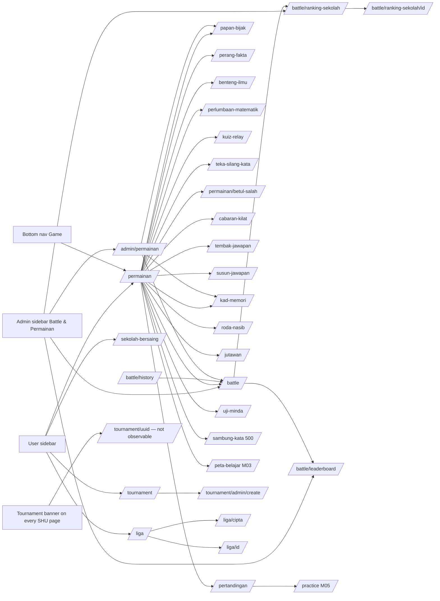
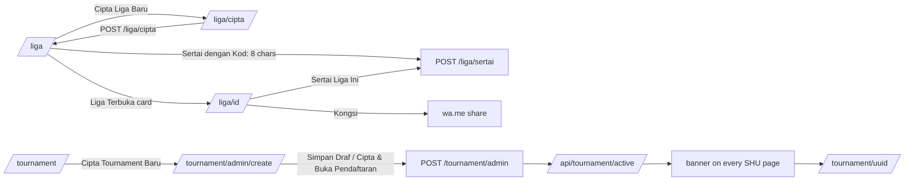

# M16 — Battle, Games & Competitions (Discovery)

- **Source:** live read-only walk-through of https://prestasiplus.my on 2026-09-26 (11:40–12:45 MYT) with the admin account (browser lane 3, `playwright3`). Page scripts were read from the served HTML; no game, match, room, spin, league or tournament action was performed.
- **Screenshots:** `docs/discovery/img/M16/` (86 files). Every page was masked in the DOM before capture. The shells (user portal `SHU`, admin panel `SHA`) and design tokens are in [00-global-ui.md](00-global-ui.md) and are not repeated here.
- **Language:** UI copy is quoted in its exact Bahasa Melayu. Some strings are English on live ("Battle Arena", "Quick Match", "Battle Sekolah", "Leaderboard", "HOT", "MULTIPLAYER", "Special Effect", "Speed Up", "Chain", "Combo", "Ranking Live", "Friendly · School", "SPM Mock", "MVP", "SNIPER!", "SHARP!", "GENIUS!").
- **Personal data (students are minors):** `tools/jobs/M16.js` → `M16MASK` runs before every inventory and screenshot. It masks:
  - student names in the lobby "🏆 Pendahulu" lists, the Papan Bijak "Top 10 Juara" table (name and initials), the Pertandingan Mingguan ranking, the school-detail "Battle Terkini" rows, the league creator ("Dicipta oleh <name>"), and any Cabar Kawan / invitation / challenger field;
  - school names (`<school>`) in every text node, attribute and `<title>`; Cloudflare e-mail payloads; avatars.

  Then `tools/sanitize.js` runs with `{selectors:['.m16n'], titleName:false}`. The exceptions are S1 (`/battle`) and S7 (`/papan-bijak`). There, sanitize.js would rewrite the non-personal Alpine literals `selectedSubjectName = 'Matematik'` and `autoGradeName = 'Darjah 4'` to `<name>`, so M16MASK runs alone. A scripted check of every M16 file against the 84 student names read from live found **0 hits**. The only matches were in question-bank text, which is not personal data.
- **Seed snapshot:** `docs/discovery/inventory/M16/_snapshot-2026-09-26.json`. It was captured **2026-09-26 04:39:15–04:39:42 UTC (12:39 MYT)** in one GET pass over 45 pages and contains:
  - school-ranking rows for every period, with live school ids;
  - 7 school-detail pages;
  - every lobby leaderboard, the Papan Bijak top 10, the Pertandingan Mingguan top 20 and the 49 Sekolah Bersaing rows;
  - the Roda Nasib segments;
  - Jutawan subject/question counts for darjah 1–11;
  - leagues 1–2, the admin game stats, and the API bodies.

  Students are `<student:n>` tokens and schools are `<school:{id}>` tokens (`<school:sb-r{rank}>` where the page gives no id). **The snapshot is the seed source.**
- **Element inventory:** 1,571 content elements over 30 screens and 189 captured UI states, with IDs `EL-M16-S#-nnn`, in `docs/discovery/inventory/M16/<S#-key>.json`. The shells add SHU 399 and SHA 202 chrome elements. Reconciliation, the crawl and the read-only limits are in `docs/discovery/inventory/M16/_summary.md`.
- **Safety:**
  - Before any capture, the browser context got a route guard that **aborts every non-GET request to prestasiplus.my**. A POST probe was verified as blocked.
  - The guard matters because four game pages auto-start on load (countdown, timer) and POST their result to `…/submit` when the timer ends or the game completes. With the guard, nothing could be submitted.
  - Never clicked or requested: Quick Match / Battle Sekolah (`POST /api/battle/quick-match|school-battle`), sending, accepting or declining a challenge, joining a queue, forfeit, room create/join forms, "🔍 Cari Lawan Sekarang", "🎯 SPIN!", "Sertai" / "Sertai Liga Ini", "Cipta Liga", "Simpan Draf" / "Cipta & Buka Pendaftaran", "Simpan Tetapan", any answer, any Jutawan subject link (`/permainan/jutawan/main?…` starts a game), and any real room / arena / tournament URL.
  - States that need a server answer were revealed by setting the page's own Alpine state with placeholder values ('<name>', '<school>'). This covers: searching, incoming challenger, waiting, error, invitations, prize modal, results, and the tournament banner.
  - Scripted GETs ran one at a time with at least 350 ms between requests.

Cross-references (owned elsewhere, not re-inventoried):
- `/ranking` and `/leaderboard` → **M08**. `/gamification/leaderboard` and the coin wallet (Syiling / XP / `games_award_syiling`) → **M14** (see §5.8).
- `/peta-belajar` ("Peta Pengembaraan" card) → **M03**. `/practice` ("Mula Latih Tubi") → **M05**.
- The parent "Cabaran Uji Minda" dashboard is owned by the parent-portal module. M16 only shows the student empty state (S21).
- Admin sidebar items outside the M16 group are shell (00-global-ui).

---

## 1. Overview

The TRACKER checklist has 8 M16 routes. The crawl found **30 screens** because `/permainan` links to 16 game pages and `/tournament`, `/liga` and `/battle/ranking-sekolah` open sub-routes. The global tournament banner (S30) is also M16's.

| # | Route | Tab title (`<title>`) · shell header title / subtitle | Status on admin account |
|---|---|---|---|
| S1 | `/battle` | "Battle Arena" · SHU "Battle Arena" / "Bertanding kuiz 1v1 dengan pelajar lain!" | 200. Lobby (Darjah 4 account: SPM locked) |
| S2 | `/battle/leaderboard` | "Ranking Pelajar Battle" · SHU same / "Siapa pejuang terhebat minggu ini?" | 200, empty |
| S3 | `/battle/ranking-sekolah` (`?period=weekly\|monthly\|all_time&state=`) | "Papan Ranking Sekolah" · SHU same / "Ranking 10,218 sekolah seluruh Malaysia" | 200. Weekly 0, monthly 1, all-time 7 schools |
| S4 | `/battle/ranking-sekolah/{id}` (**new**) | "{sekolah}" · SHU "{sekolah}" / "{negeri} · {jenis}" | 200 for **any** school id (900 has no battle); unknown id 404 |
| S5 | `/battle/history` (**new**, not linked) | "Sejarah Battle" · SHU same / "Rekod pertandingan anda" | 200, empty |
| S6 | `/permainan` | "Permainan — PRESTASIPLUS" · SHU **"Dashboard" / "Selamat datang kembali"** | 200. 17 cards, no open room |
| S7 | `/papan-bijak` (**new**) | "Papan Bijak — PRESTASIPLUS" · SHU "Dashboard" / "Selamat datang kembali" | 200 |
| S8 | `/perang-fakta` (**new**) | "Perang Fakta — PRESTASIPLUS" · same "Dashboard" header | 200 |
| S9 | `/benteng-ilmu` (**new**) | "Benteng Ilmu — PRESTASIPLUS" · same | 200 |
| S10 | `/perlumbaan-matematik` (**new**) | "Perlumbaan Matematik — PRESTASIPLUS" · same | 200 |
| S11 | `/kuiz-relay` (**new**) | "Kuiz Relay — PRESTASIPLUS" · same | 200 |
| S12 | `/teka-silang-kata` (**new**) | "Teka Silang Kata — PRESTASIPLUS" · same | 200 |
| S13 | `/permainan/betul-salah` (`?darjah=`) (**new**) | "Betul atau Salah ✅ — PRESTASIPLUS" · same | 200 |
| S14 | `/permainan/cabaran-kilat` (`?darjah=`) (**new**) | "Cabaran Kilat ⚡ — PRESTASIPLUS" · same | 200 |
| S15 | `/permainan/tembak-jawapan` (`?darjah=`) (**new**) | "Tembak Jawapan 🎯 — PRESTASIPLUS" · same | 200 |
| S16 | `/permainan/susun-jawapan` (`?darjah=`) (**new**) | "Susun Jawapan 🧩 — PRESTASIPLUS" · same | 200 |
| S17 | `/permainan/kad-memori` (**new**) | "Kad Memori — PRESTASIPLUS" · same | 200 |
| S18 | `/permainan/roda-nasib` (**new**) | "Roda Nasib — PRESTASIPLUS" · same | 200 |
| S19 | `/permainan/jutawan` (`?darjah=`) (**new**) | "Jutawan Ilmu 💰 — PRESTASIPLUS" · same | 200 |
| S20 | `/permainan/pertandingan` (**new**) | "Pertandingan Mingguan — PRESTASIPLUS" · same | 200 |
| S21 | `/permainan/uji-minda` (**new**) | "Uji Minda — Belum Ada Cabaran" · same | 200, empty |
| S22 | `/permainan/sambung-kata` (**new**) | — (empty body) | **500** |
| S23 | `/tournament` | "Liga &amp; Tournament" · SHU "Liga & Tournament" / "Senarai tournament antara sekolah" | 200, empty |
| S24 | `/tournament/admin/create` (**new**) | "Cipta Tournament" · SHU "Cipta Tournament Baru" / "Tetapkan format, sumber soalan, dan jadual pendaftaran" | 200 (form not submitted) |
| S25 | `/liga` | "Liga Pertandingan" · SHU same / "Sertai dan urus pertandingan antara sekolah" | 200 |
| S26 | `/liga/cipta` (**new**) | "Cipta Liga" · SHU "Cipta Liga Pertandingan" / "Tetapkan peraturan dan mulakan pertandingan antara sekolah" | 200 |
| S27 | `/liga/{id}` (**new**) | "{nama liga}" · SHU "{nama liga}" / "Friendly · School" | 200 for ids 1 and 2; 404 for 0, 3–6, 999 |
| S28 | `/sekolah-bersaing` | "Sekolah Bersaing — Leaderboard Mingguan" · **SHA "Dashboard" / "Selamat datang, Admin"** | 200 (admin layout) |
| S29 | `/admin/permainan` | "Permainan - Admin Panel" · SHA "🎮 Tetapan Permainan" / "Urus konfigurasi Papan Bijak, Kad Memori &amp; permainan lain" | 200 |
| S30 | tournament banner `tournamentBanner()` in `<main>` of every SHU page | — | hidden: `GET /api/tournament/active` → `[]` |

Other access outcomes found by probing (read-only GETs):
- **404 "Halaman Tidak Dijumpai"** for:
  - `/battle/arena`, `/battle/arena/{uuid}` (any uuid; real arena URLs come only from a match), `/battle/riwayat`;
  - `/tournament/{uuid}` (fake uuid), `/tournament/1`, `/tournament/admin`, `/tournament/create`;
  - `/liga/1/edit`, `/admin/permainan/1`, `/admin/battle`, `/admin/tournament`, `/papan-bijak/{unknown code}`.
- **Redirect to the lobby with a flash** "Bilik tidak dijumpai." (red box `bg-red-50 border-red-200 text-red-700`, placed at the **bottom** of the lobby under "🏆 Pendahulu", about 1,080 px down at 1280 × 800, so it is off-screen on arrival): `/perang-fakta/{unknown code}`, `/benteng-ilmu/…`, `/perlumbaan-matematik/…`, `/kuiz-relay/…`, `/teka-silang-kata/…`. A raw `fetch` of the same URL (redirect followed without the session flash) showed no box.
- **500:** `/liga/sertai` (GET on a POST route) and `/permainan/sambung-kata`. **405:** `/permainan/roda-nasib/spin` (GET).
- JSON 404: `/api/battle/leaderboard`, `/api/battle/stats` ("The route … could not be found.").
- Query strings:
  - `?period=bogus` on S3 → all-time data with no pill active; `?period=monthly` on S2 → ignored.
  - `?week=` on S20 → ignored (`?week=1`, `?week=2026-09-14`).
  - `?week=YYYY-MM-DD` on S28 → **selects that week**, normalised to its Monday (`2026-09-16` → "14 Sep 2026"). Past weeks 14 Sep, 07 Sep and 31 Aug 2026 each had 48 schools. A week with no generated data → the empty state (§2.24). `?week=bogus` → **500**. No UI control changes the week.
  - `?darjah=5…11` on the games → accepted, although the picker lists only Darjah 1–4.

**Entry points:**
- User sidebar (SHU):
  - group "✨ Visi & Pertandingan": "Sekolah Bersaing" (tooltip `data-tip` "Leaderboard mingguan sekolah-sekolah Malaysia");
  - a second "Sekolah Bersaing" after "Profil Cerah";
  - "Liga Pertandingan" (after "Laporan Soalan");
  - group "Pembelajaran": "Permainan" + "🎮", "Tournament".
  - `/battle` has **no** sidebar item. It is reached from the S6 card "Battle Arena" and the admin sidebar.
- Bottom nav (SHU < 1024 px): "Game" → `/permainan`.
- Admin sidebar (SHA), collapsible group "Battle & Permainan" (Alpine section key `battle`): "Battle Live" → `/battle`, "Ranking Sekolah" → `/battle/ranking-sekolah`, "Leaderboard" → `/battle/leaderboard`, "Tetapan Permainan" → `/admin/permainan`.
  - The admin drawer lists "Battle & Permainan": "Battle Live", "Tetapan Permainan".
  - SHA also has group "✨ Visi & Pertandingan" → "Sekolah Bersaing".
- S1 → S2 ("Ranking Pelajar") and S3 ("Ranking Sekolah"). S3 rows → S4. S5 "Mula Battle" → S1.
- S6 cards → S7–S22 and `/battle`, `/peta-belajar`. The games' "🎮 Hub" / "← Kembali ke Hub" / "Permainan" links → S6.
- S23 "Cipta Tournament Baru" → S24. S25 "Cipta Liga Baru" → S26. S25 open-league card → S27.

### 1.1 Shell by screen

| Shell | Screens | Notes |
|---|---|---|
| SHU (user portal) | S1–S27, S30 | The admin account sees the user layout (header chips "256 koin", "8 mata", "1 hari" are M14 wallet data). The tournament banner sits at the top of `<main>` on every SHU page. |
| SHA (admin panel) | S28, S29 | `/sekolah-bersaing` is not an `/admin` route but renders in the admin layout with the generic header "Dashboard / Selamat datang, Admin" (D-M16-2). No tournament banner in SHA. |
| none | S22 | HTTP 500 with an empty body (browser error page). |

---

## 2. Screens

### 2.1 S1 — `/battle` "Battle Arena" (lobby, `x-data="battleLobby()"`)

Screenshots: `battle-desktop.png`, `battle-subject-selected.png`, `battle-pksk.png`, `battle-spm-tip.png`, `battle-challenge-modal.png`, `battle-searching.png`, `battle-incoming.png`, `battle-waiting.png`, `battle-error.png`, `battle-invitations.png`, `battle-mobile.png`, `battle-tablet.png`.

1. **Hero** (red→orange gradient, `fa-bolt`): h2 "Battle Arena", badge "BARU", text "Cabar kawan, cari lawan, atau wakili sekolah anda!".
2. **Question type** row of 3 buttons:
   - "Biasa" (`fa-book`, active = red→orange gradient) sets `questionType='biasa'`;
   - "PKSK" (`fa-shield-halved`, active = indigo→purple) sets `questionType='pksk'`;
   - "SPM" (`fa-graduation-cap` + `fa-lock`, `bg-gray-100 text-slate-400 cursor-not-allowed opacity-60`) is server-rendered **locked** for this Darjah 4 account. Clicking it only toggles a dark tooltip ("`fa-info-circle`" "Khas untuk pelajar Tingkatan 4 & 5 sahaja"; closes on click outside). The unlocked SPM variant (`questionType='spm'`, `selectedSpmSubject`) is in the script but not rendered here (§10).
3. **Biasa panel:** "Subjek Teras" and 7 subject tiles (icon in a tinted square `{colour}20`, name):
   - Bahasa Melayu 1 `fa-book-open` #3B82F6, Bahasa Inggeris 2 `fa-globe` #8B5CF6, Matematik 3 `fa-calculator` #EF4444, Sains 4 `fa-flask` #10B981, Sejarah 5 `fa-clock` #F59E0B, Pendidikan Islam 6 `fa-moon` #059669, Pendidikan Moral 7 `fa-heart` #EC4899.
   - The toggle "Lagi 24 subjek lain" / "Tutup" (`fa-chevron-down` / `fa-chevron-up`) reveals ids 8–31 (Appendix A.1). A selected tile is `border-red-500 bg-red-50 shadow-md`.
4. **PKSK panel:** "Pilih Domain PKSK" with 15 domain tiles (A.2; selected = indigo). "Pilih Tahap" has "Tahap 1 (Darjah 1-3)" (`T1`) and "Tahap 4 (Darjah 4-6)" (`T4`).
5. **Error banner** (`x-show="errorMsg"`): text + close `fa-times`. Messages: §5.1 / Appendix B.
6. **Searching card** (`x-show="searching"`):
   - spinner, "Mencari Lawan...", and the line "Menunggu pelajar sama darjah & subjek" (or "Menunggu pelajar dari mana-mana gred" when `openToAll`);
   - timer `m:ss`, and "Batal" (`fa-times`).
   - With an incoming challenger the card switches to "Cabaran Masuk!": "{name} ingin menyertai battle anda", chips grade label + school, note "Soalan mengikut gred anda. Lawan akan bermain soalan gred anda.", and the buttons "Terima" (`fa-check`) / "Tolak" (`fa-times`).
7. **Waiting card** (`x-show="challengerWaiting"`): "Menunggu Kelulusan...", "Menunggu {name} menerima permohonan anda", the grade line, "Batal".
8. **Keterlihatan Barisan** (`fa-globe`): the subtitle is "Hanya pelajar gred sama boleh match" / "Semua gred boleh nampak & mohon sertai anda". A switch (`x-model="openToAll"`) labels itself "Gred Saya" (slate) / "Terbuka" (blue).
9. **Mode buttons** (3; disabled `opacity-50` until `canStart`):
   - "Quick Match" / "Cari lawan rawak dari darjah yang sama";
   - "Cabar Kawan" / "Hantar cabaran kepada rakan anda" (opens the modal; enabled by `canStart` only);
   - "Battle Sekolah" / "Lawan pelajar dari sekolah lain!" (`fa-school`).
   - Quick Match and Battle Sekolah are also disabled while `loading`.
10. **Links:** "Ranking Pelajar" (`fa-medal`) → S2, "Ranking Sekolah" (`fa-school`) → S3.
11. **Cabar Kawan modal:**
    - title with `fa-user-group`, close `fa-times`;
    - input placeholder "Cari nama pelajar..." (`@input.debounce.300ms`, GET after 2 characters);
    - result buttons (avatar, name, school, `fa-paper-plane`), empty text "Tiada pelajar dijumpai" (shown when the query has ≥ 2 characters and there are 0 results);
    - it closes on overlay click.
12. **Cabaran Masuk modal** (`showInvitations`; **no control opens it**, D-M16-6):
    - title with `fa-envelope`, close;
    - rows of sender name, school, and "Terima" / "Tolak";
    - empty text "Tiada cabaran buat masa ini";
    - `x-init="loadInvitations()"` still GETs `/api/battle/invitations` on page load → `{"invitations":[]}`.

### 2.2 S2 — `/battle/leaderboard` "Ranking Pelajar Battle"

Screenshots: `battle-leaderboard-desktop.png`, `battle-leaderboard-mobile.png`.
- Pills "Mingguan" (default, `bg-red-500 text-white`) / "Bulanan" (`x-data="{ period: 'weekly' }"`). They only restyle; the table is server-rendered and **does not change** (D-M16-4).
- Table columns "#", "Pelajar", "Sekolah", "M/S/K", "Ketepatan", "Streak", "Skor". Empty row (`colspan=7`): "Belum ada data ranking. Mula battle untuk muncul di sini!".

### 2.3 S3 — `/battle/ranking-sekolah` "Papan Ranking Sekolah"

Screenshots: `battle-ranking-sekolah-all-time.png`, `battle-ranking-sekolah-weekly-empty.png`, `battle-ranking-sekolah-mobile.png`.
- Hero `fa-school`: h2 "Papan Ranking Sekolah", "Sekolah mana paling hebat? Wakili sekolah anda!".
- Period links (GET): "Mingguan" `?period=weekly` (default), "Bulanan" `?period=monthly`, "Sepanjang Masa" `?period=all_time`. The active one is `bg-blue-500 text-white`. An unknown period shows all-time data with no active pill.
- State select, first option "Semua Negeri" plus 16 states (A.4). `onchange` → `?period={current}&state={value}`; the selected state is preloaded.
- **Podium** (`fa-crown` on the centre column; only when there are rows; `grid-cols-3`, order 2nd–1st–3rd): school name, state, "{skor} mata"; the centre column is raised. On 2026-09-26 (all time) the centre was 8106 738, the left 8090 519, and the right **8082** 367 — the table's #3 is 8078 367 (tie; D-M16-9).
- "Senarai Penuh" (`fa-list-ol`) table:
  - columns "#", "Sekolah", "Battle", "M/S/K", "Ketepatan", "Pelajar", "Skor";
  - the school cell links to S4 and shows name + "{negeri} · {SK|SMK}";
  - M/S/K = three spans "m/s/k".
  - Empty (`colspan=7`): "Belum ada data ranking. Mula battle untuk melihat ranking sekolah!".
- Snapshot counts: weekly 0; monthly 1 (8082: 8 battles, 4/0/4, 58%, 2 pupils, 591); all time 7 (Appendix A.6).

### 2.4 S4 — `/battle/ranking-sekolah/{id}` school detail (new route)

Screenshots: `battle-ranking-sekolah-show.png`, `battle-ranking-sekolah-show-empty.png`, `battle-ranking-sekolah-show-mobile.png`.
- Hero `fa-school`: h2 school name, "PPD {daerah} · {negeri} · {SK|SMK}".
- 4 cards (`fa-bolt` red, `fa-trophy` amber, `fa-percentage` green, `fa-users` purple): "Jumlah Battle", "Kemenangan", "Ketepatan" (%), "Pelajar Aktif".
- "Minggu Ini" / "Bulan Ini" (`fa-calendar-week` / `fa-calendar`): "Ranking Nasional" "#n", "Battle", "Menang/Seri/Kalah" "m/s/k", "Skor". The empty texts are "Tiada data minggu ini" / "Tiada data bulan ini". **The values are stale and inconsistent** (D-M16-10).
- "Pejuang Terbaik Minggu Ini" (`fa-medal`): empty "Tiada data pejuang minggu ini" (all 8 schools checked).
- "Battle Terkini" (`fa-history`): up to **10** rows. Each row shows player A (`text-slate-700`; `text-blue-600` when A is the visiting side, INFERRED), score A, "vs", score B, player B (`text-blue-600`), and a relative time (e.g. "2 bulan yang lepas"). The winner's score is `text-green-600`; on a tie neither score is green. Empty: "Tiada battle terkini".
- Any school id renders (e.g. 900, a school with no battle: all zeros, all empty states); unknown id → 404.

### 2.5 S5 — `/battle/history` "Sejarah Battle" (new, unlinked)
Screenshot: `battle-history.png`. Empty card `fa-bolt`: h3 "Tiada sejarah battle", "Mulakan pertandingan pertama anda sekarang!", link "Mula Battle" (`fa-bolt`) → `/battle`. The populated list is not observable (§10).

### 2.6 S6 — `/permainan` "🎮 Zona Permainan" (games hub)

Screenshots: `permainan-desktop.png`, `permainan-tablet.png`, `permainan-mobile.png`.
- h1 "🎮 Zona Permainan", "Main sambil belajar! Kumpul Syiling, naik ranking, dan jadi champion sekolah. Pilih permainan kegemaran kamu."
- Open-rooms strip, empty: "🌙", "Tiada bilik terbuka buat masa ini.", "Cipta bilik permainan dan jemput rakan-rakan!". The populated variant is not observable (§10).
- 17 cards (grid 1/2/3 columns). The whole card is clickable (`onclick`), with an optional badge, a banner emoji, h3, text, 1–2 stat chips and a button. The full list is in Appendix A.3.
- Per-user chips: Papan Bijak "🆕 Belum main lagi" and Battle Arena "🆕 Belum battle lagi". The Papan Bijak chip is contradicted by the same account's Top-10 rank (D-M16-15).

### 2.7 S7 — `/papan-bijak` "🎲 Papan Bijak" (lobby)

Screenshots: `papan-bijak-desktop.png`, `papan-bijak-custom.png`, `papan-bijak-searching.png`, `papan-bijak-mobile.png`.
- Hero "🎲 Papan Bijak", "Board game quiz multiplayer — jemput kawan, gulung dadu, jawab soalan! 🐍🪜".
- **"🆕 Cipta Bilik Baru"** form `POST /papan-bijak/create`:
  - "Subjek" `subject`: 🔢 Matematik `MATEMATIK`, 📝 Bahasa Melayu `BAHASA_MELAYU`, 🔬 Sains `SAINS`, 🇬🇧 Bahasa Inggeris `BAHASA_INGGERIS`.
  - "Tahap Soalan":
    - auto box "Darjah 4" + "(auto dari profil anda)" + "Tukar" (hidden `grade_level` = `DARJAH_4`);
    - after "Tukar", the select `grade_level` appears with optgroups "Sekolah Rendah" (Darjah 1–6) / "Sekolah Menengah" (Tingkatan 1–5), plus "← Guna auto".
  - "Siapa Boleh Join?" `match_mode`: "Tahap sama sahaja" `same_grade`; `same_level` labelled "Semua Darjah (1-6)" or "Semua Tingkatan (1-5)" by the chosen grade (static fallback "Semua Darjah/Tingkatan"); "Pilih julat khas" `custom`.
  - `custom` reveals "Dari" `grade_min` / "Hingga" `grade_max` (D1–D6 = 1–6, T1–T5 = 7–11; default Dari D1, Hingga D6).
  - "Maks Pemain" `max_players` 2–6 "{n} Pemain" (default 4).
  - Submit "🎲 Cipta Bilik".
- **"🔑 Masuk Bilik"** form `POST /papan-bijak/join`: "Kod Bilik (6 aksara)" `room_code` `maxlength=6` **`required`**, placeholder "ABC123", "🚀 Masuk Bilik". Native bubble on empty.
- "Cara Bermain:": "🎲 1. Gulung dadu dan bergerak di papan", "📝 2. Jatuh di petak kuiz — jawab soalan!", "🪜 3. Naik tangga untuk shortcut", "🐍 4. Elak ular yang menarik turun", "🏆 5. Sampai petak 50 dulu = MENANG!".
- **"Cari Lawan Auto"** (`x-data="quickMatch()"`): "🔍", "Sistem cari pemain sepadan secara automatik".
  - Selects "Subjek" (4 subjects, no emoji) and "Padanan" ("Tahap sama" / "Semua darjah/tingkatan"); button "🔍 Cari Lawan Sekarang".
  - Searching: spinner "Mencari lawan... {n}s", "Sila tunggu, sistem sedang mencari pemain sepadan", "Batal Carian", and the error line (visible only while searching; D-M16-21).
- **"🏆 Papan Markah — Top 10 Juara"** table:
  - columns "#", "Pemain", "🏆 Menang", "🎮 Jumlah", "📊 Kadar", "⭐ Skor", "✅ Betul";
  - rows 1–3 🥇🥈🥉 with gold / silver / bronze row styling;
  - initials circle, name truncated to 15 characters + "...";
  - Kadar pill colours: green `#D1FAE5/#065F46` for 75% and 100%, amber `#FEF3C7/#92400E` for 40–67%, red `#FEE2E2/#991B1B` for 25–33%.

### 2.8 S8–S12 — multiplayer lobbies (one template)

Screenshots: `perang-fakta-desktop.png`, `perang-fakta-manual.png`, `perang-fakta-mobile.png`, `benteng-ilmu-desktop.png`, `perlumbaan-matematik-desktop.png`, `kuiz-relay-desktop.png`, `teka-silang-kata-desktop.png`.

| Screen | x-data | h1 | subtitle | rule line | create / join actions | leaderboard unit |
|---|---|---|---|---|---|---|
| S8 | `perangFaktaLobby()` | "⚔️ Perang Fakta" | "Betul atau Salah? Vote & buktikan pengetahuan kamu!" | "2-6 pemain · 15 pusingan · 10 saat setiap soalan" | `/perang-fakta/create`, `/perang-fakta/join`; "⚔️ Cipta Bilik" | "{n} menang" |
| S9 | `bentengLobby()` | "🏰 Benteng Ilmu" | "Serang benteng lawan dengan kuasa ilmu! Jawab betul = serang, jawab salah = rosak sendiri!" | "2 pemain · HP 100 · Giliran bertukar" | `/benteng-ilmu/…`; "🏰 Cipta Bilik" | "{n} menang" |
| S10 | `mathRaceLobby()` | "🏎️ Perlumbaan Matematik" | "Jawab soalan, lari ke garisan penamat! Siapa paling pantas menang!" | "2-4 pemain · 20 langkah · Siapa sampai dulu menang" | `/perlumbaan-matematik/…`; "🏎️ Cipta Bilik" | "{n} menang" |
| S11 | `kuizRelayLobby()` | "🏃‍♂️ Kuiz Relay" | "Berpasukan! Jawab soalan secara bergilir-gilir. Pasukan terbaik menang!" | "4-8 pemain · 2 pasukan · 10 pusingan" | `/kuiz-relay/…`; "🏃‍♂️ Cipta Bilik" | "{n} kali MVP" |
| S12 | `crosswordLobby()` | "📝 Teka Silang Kata" | "Isi silang kata paling pantas! Lawan masa dan lawan untuk markah tertinggi!" | "2 pemain · 5 minit · Markah tertinggi menang" | `/teka-silang-kata/…`; "📝 Cipta Bilik" | "{n} menang" |

Common template:
- **"🏠 Cipta Bilik Baru"** `POST /{game}/create`:
  - "Subjek" `subject`: Matematik, Bahasa Melayu, Bahasa Inggeris, Sains, Sejarah (`MATEMATIK`, `BAHASA_MELAYU`, `BAHASA_INGGERIS`, `SAINS`, `SEJARAH`).
  - "Tahap": auto "Darjah 4 (auto)" + "Tukar" (`manualMode=true`, one-way; no "Guna auto"). The manual select `grade_level` has Darjah 1–6 / Tingkatan 1–5, with the user's grade preselected.
  - "Siapa boleh join?" `match_mode`: "Tahap sama sahaja" `same_grade` / "Semua Darjah / Semua Tingkatan" `same_level`.
  - Submit "{emoji} Cipta Bilik".
- **"🔑 Masuk Dengan Kod"** `POST /{game}/join`: `room_code` `maxlength=6`, placeholder "Contoh: ABC123", `text-transform: uppercase`, **not** `required`; "Masuk".
- **"🏆 Pendahulu"**: up to 10 rows "🥇/🥈/🥉/{n}. {name}" + value. Snapshot: S8 10 rows (5, 4, 3, 3, 3, 3, 3, 2, 2, 2 menang), S9 7, S10 10, S11 1 ("1 kali MVP"), S12 6. The tie order changes between requests.
- No room, lobby list or realtime script on these pages. Room pages `/{game}/{code}` redirect to the lobby with the flash "Bilik tidak dijumpai." (bottom of the page) when the code is unknown (screenshot `perang-fakta-room-not-found.png`).

### 2.9 S13 — `/permainan/betul-salah` "Betul atau Salah" (single player)

Screenshots: `betul-salah-picker.png`, `betul-salah-picker-mobile.png`, `betul-salah-countdown.png`, `betul-salah-playing.png`, `betul-salah-done.png`, `betul-salah-mobile.png`.

- **Darjah picker overlay** (no `?darjah`; fixed, `z-index:200`, dark gradient; shared by S13–S16 and S19 with the game emoji and title):
  - "Pilih darjah / tingkatan kamu:", group "🏫 Sekolah Rendah", links "Darjah 1"–"Darjah 4" (`?darjah=1…4`, hover border in the game colour), "← Kembali ke Hub" → `/permainan`.
  - The game **starts underneath** the overlay (D-M16-19).
- `x-data="betulSalah()" x-init="startCountdown()"`.
- Countdown: "✅❌ BETUL ATAU SALAH" with a big number 3→2→1 (800 ms each).
- Playing:
  - streak badge "🔥 {n} KOMBO" (from 2; `hot` class at 5);
  - bar "Skor" · clock `timeLeft` (red at ≤ 10) · "Betul";
  - "Kenyataan {n}", the statement card, buttons ❌ / ✅, legend "❌ SALAH ✅ BETUL";
  - feedback emoji ✅ / ❌ for 700 ms.
- Done: result emoji + title, "45 saat — Betul atau Salah!", tiles "Skor Total", "Ketepatan" (`betul/jawab`), "Kombo Max" ("{n} 🔥"), "Syiling" ("{n} 🪙"), "🏆 REKOD BARU!" (when the server says `is_new_record`), "🔄 Main Lagi", "🎮 Hub". Coin-fly animation `window.JBCoinFly.play({syiling, mata:0})`.

### 2.10 S14 — `/permainan/cabaran-kilat` "Cabaran Kilat"
Screenshots: `cabaran-kilat-playing.png`, `cabaran-kilat-done.png`, `cabaran-kilat-mobile.png`.
- Same picker. `speedChallenge()`.
- Countdown "⚡ CABARAN KILAT".
- Playing:
  - "🔥 {n}x COMBO" (`fire` at 5); bar "Skor" · clock · "Betul";
  - "Soalan {n}" with a difficulty chip "Mudah" (difficulty ≤ 2, green) / "Sederhana" (3, amber) / "Sukar" (4, red);
  - question text and options "A. …"–"D. …" (correct → `correct`, wrong pick → `wrong`, then all `disabled`); screen flash and particles.
- Done: "60 saat penuh aksi!", "Skor Total", "Betul / Jawab", "Combo Max 🔥" ("{n}x"), "Syiling", "🏆 REKOD BARU!", "⚡ Main Lagi", "🎮 Hub".

### 2.11 S15 — `/permainan/tembak-jawapan` "Tembak Jawapan"
Screenshots: `tembak-jawapan-playing.png`, `tembak-jawapan-level-up.png`, `tembak-jawapan-done.png`, `tembak-jawapan-mobile.png`.
- `tembakJawapan()` `x-init="startGame()"`. Countdown "🎯 TEMBAK JAWAPAN" + "Tap jawapan yang betul sebelum jatuh!".
- HUD: "Skor", "Level", 3 × ❤️ (lost = faded), "🪙" + coins.
- "Soalan {n}" + question. `#fallZone` (500 px tall) holds a line "⚠ GARIS MAUT" (**8.8 px**) and the falling tiles (text = option).
- "⚡ LEVEL {n}!" banner for 1.2 s.
- Done: "Tembak Jawapan — Level {n}", "Skor Total", "Ketepatan", "Tertinggi" ("Level {n}"), "Syiling", "🔄 Main Lagi", "🎮 Hub".

### 2.12 S16 — `/permainan/susun-jawapan` "Susun Jawapan"
Screenshots: `susun-jawapan-playing.png`, `susun-jawapan-wrong.png`, `susun-jawapan-done.png`, `susun-jawapan-mobile.png`.
- Same picker. `susunJawapan()` starts in `playing` (no countdown).
- Header "Kembali" (`fa-arrow-left`) → S6, chips "Skor" and "🪙".
- h2 "🧩 Susun Jawapan", 20 progress dots (active / done / wrong).
- Play area:
  - "Soalan {n} daripada {total}", question;
  - "📥 Jawapan Kamu:" drop area (click = remove last; click a tile = remove it; empty hint "Klik huruf/perkataan di bawah untuk susun");
  - "🔤 Pilihan:" source tiles;
  - "✅ Semak Jawapan" (disabled when empty or already checked);
  - "⏭️ Langkau Soalan Ini".
- Correct: "🎉 BETUL! +{points} mata", "Seterusnya →". Wrong: "❌ Cuba lagi atau langkau", "🔄 Cuba Lagi", "⏭️ Langkau".
- Done: "Susun Jawapan selesai!", "Skor Total", "Selesai" (`solved/total`), "Syiling Diperolehi", "🔄 Main Lagi", "🎮 Hub".

### 2.13 S17 — `/permainan/kad-memori` "Kad Memori"
Screenshots: `kad-memori-desktop.png`, `kad-memori-complete.png`, `kad-memori-mobile.png`.
- No picker. Link "Permainan" (`fa-arrow-left`), h1 "🃏 Kad Memori", "Padankan soalan dengan jawapan yang betul!".
- Stats: "⏱️ m:ss" (counts **up** from load), "👆 {n} langkah", "✅ {m} / 6 padan".
- 12 cards (4 × 3; 98 px square at 375, 151 px at 768 / 1280): back "❓", front `type-question` / `type-answer` with the content. Pair states `flipped` / `matched` / `wrong` (800 ms).
- Result overlay (click outside does nothing): "🎉", "Tahniah!", "Semua kad berjaya dipadankan!", "Masa", "Langkah", "Ketepatan" (%), "Syiling 🪙" ("+{n}", from the server), "🔄 Main Lagi", "🏠 Hub".

### 2.14 S18 — `/permainan/roda-nasib` "Roda Nasib"
Screenshots: `roda-nasib-desktop.png`, `roda-nasib-prize.png`, `roda-nasib-mobile.png`.
- Link "Permainan", h1 "🎯 Roda Nasib", "Pusing roda sekali sehari untuk hadiah misteri!".
- Chips "🎰 {n} kali spin" (admin: 2) and "🪙 {n} Syiling dimenangkan" (admin: 0).
- `<canvas id="wheelCanvas" 380×380>` (320 px at 375) with 8 segments (A.5), pointer "🎯".
- Button "🎯 SPIN!" / "⏳ Sedang Pusing..." / "✅ Sudah Spin Hari Ini" (disabled while spinning or after spinning).
- Prize modal: icon, label, then for `syiling` "+{n} Syiling" + "Ditambah ke akaun kamu!", for `nothing` "Jangan risau, cuba lagi esok!", and "Tutup".
- The failure path is a native `alert(data.message)` (message text is server-side, §10).

### 2.15 S19 — `/permainan/jutawan` "Jutawan Ilmu"
Screenshots: `jutawan-picker.png`, `jutawan-subjects.png`, `jutawan-mobile.png`.
- Same picker overlay (amber hover). Link "Permainan", h1 "💰 Jutawan Ilmu", "Pilih subjek, jawab 15 soalan — menang sampai 1,000 Syiling!".
- Stats "L0" "Rekod Tertinggi", "0" "Permainan", "1,000🪙" "Hadiah Utama".
- Without `?darjah`: "👆" "Pilih darjah atau tingkatan di atas untuk mula.".
- With `?darjah=n`: "📚 PILIH SUBJEK (DARJAH n)" / "(TINGKATAN n-6)" and subject links → `/permainan/jutawan/main?subject={id}&darjah={n}` (emoji, name, "{n} soalan", `fa-chevron-right`). The lists and counts per grade are in Appendix A.7.
- The game page (`/main`) was not opened (§10).

### 2.16 S20 — `/permainan/pertandingan` "Pertandingan Mingguan"
Screenshots: `pertandingan-desktop.png`, `pertandingan-mobile.png`.
- Link "Permainan", h1 "🏆 Pertandingan Mingguan", "Lumba dengan semua pelajar! Top 3 dapat Syiling bonus."
- Week card: "📅 Minggu Ini" "21 Sep — 27 Sep 2026", "⏳ Tamat dalam" `#countdown` ("{d}h {h}j {m}m", refreshed every 60 s, "Tamat!" at the end, "-" before the script runs).
- Prizes: "🥇" "Juara" "+100 🪙", "🥈" "Naib Juara" "+50 🪙", "🥉" "Tempat Ketiga" "+25 🪙".
- Own status (admin): "📝", "Belum mula lagi minggu ini!", "Buat Latih Tubi untuk masuk ranking.", "Mula Latih Tubi" → `/practice`.
- "📊 Papan Ranking Mingguan": 20 rows. Each row has rank (🥇🥈🥉 with `from-amber-50` gradient, then a number), name, "{n} sesi", "{n}" "betul" (green), "{x.x}%" "tepat". Order: by `betul` desc (all 20 rows).

### 2.17 S21 — `/permainan/uji-minda` "Uji Minda" (empty)
Screenshot: `uji-minda.png`.
- Link "Permainan", "🧠", h1 "Uji Minda", "Cabaran khas dari ibu/bapa kamu! Tapi ibu/bapa kamu belum tetapkan cabaran lagi."
- Box: "**Bagaimana nak mula?** Minta ibu atau bapa kamu log masuk ke PRESTASIPLUS, pergi ke **"Cabaran Uji Minda"** di dashboard mereka, dan tetapkan cabaran + hadiah untuk kamu!", then "📋 Apa Ibu/Bapa boleh tetap:" with "✅ Bilangan soalan setiap set", "✅ Syiling per jawapan betul", "✅ Hadiah custom (cth: buku, jajan, trip)", "✅ Syiling minimum untuk claim hadiah".

### 2.18 S22 — `/permainan/sambung-kata` (HTTP 500)
HTTP 500 with an empty body at every width; the S6 card "Sambung Kata" ("Mula!") links here (D-M16-3). Content not observable.

### 2.19 S23 — `/tournament` "Liga & Tournament"
Screenshot: `tournament-desktop.png`.
- Hero `fa-trophy`: h2 "Liga & Tournament", "Bertanding antara sekolah dalam format liga, kalah mati, atau hibrid!".
- Admin button "Cipta Tournament Baru" (`fa-plus`) → S24. Whether it shows for other roles is INFERRED admin-only.
- Empty card `fa-trophy`: "Tiada tournament aktif buat masa ini." The populated list (links `/tournament/{uuid}`) is not observable.

### 2.20 S24 — `/tournament/admin/create` "Cipta Tournament Baru" (not submitted)

Screenshots: `tournament-create-desktop.png`, `tournament-create-random-mix.png`, `tournament-create-spm-note.png`, `tournament-create-mobile.png`. `x-data="tournamentForm()"`. Form `POST /tournament/admin`.

| Section (icon) | Field | name / type | Default / options / limits |
|---|---|---|---|
| "Maklumat Asas" (`fa-info-circle`) | "Tajuk Tournament" | `title` text **required** | "" |
| | "Penerangan" | `description` textarea rows 3 | "" |
| | "Tahap Pendidikan" | `education_level_id` select **required** | "-- Pilih --", "Tingkatan 4" `tingkatan4`, "Tingkatan 5" `tingkatan5`, "SPM (Tingkatan 4 & 5)" `spm` |
| "Format" (`fa-trophy`) | radio cards | `format` | "Perlawanan Tunggal" `single_match`, "Kalah Mati" `knockout`, "Liga" `league`, "Hibrid (Liga + Kalah Mati)" `hybrid` (default via `x-model`) |
| | "Bilangan Kumpulan" (only `league` / `hybrid`) | `groups_count` number | 2, min 2, max 8 |
| "Sumber Soalan" (`fa-question-circle`) | radio cards | `question_mode` | "Mengikut Mata Pelajaran" `subject` (checked), "Mengikut Kertas Peperiksaan" `exam_paper`, "Campuran Rawak" `random_mix` |
| | "Mata Pelajaran" (`subject`) | `subject_id` select, `@change="updateQuestionCount()"` | "-- Pilih --" + 31 subjects A→Z with `data-code` (A.1) |
| | "Kertas Peperiksaan" (`exam_paper`) | `exam_paper_id` select | only "-- Pilih --" (**no papers**, D-M16-29) |
| | "Pilih Mata Pelajaran" (`random_mix`) | `mixed_subject_ids[]` checkboxes | 31 subjects A→Z |
| "Soalan & Masa" (`fa-clock`) | "Jumlah Soalan" | `total_questions` number **required** | 40, min 5, max 100; the SPM count replaces it (below) |
| | "Tetingkap Masa (minit)" | `time_window_minutes` number **required** | 60, min 10, max 180 |
| "Pemarkahan" (`fa-star`) | "Top-N Pelajar (untuk skor sekolah)" | `top_n_scoring` number **required** | 20, 1–50; help "Sistem pilih N pelajar terbaik bagi setiap sekolah" |
| | "Minimum Peserta" | `min_participants` number **required** | 10, 1–100; help "Minimum pelajar sekolah untuk kelayakan" |
| "Pendaftaran" (`fa-calendar`) | "Tarikh Buka Pendaftaran" / "Tarikh Tutup Pendaftaran" | `registration_opens_at` / `registration_closes_at` datetime-local | "" |
| buttons | "Batal" → `/tournament`; "Simpan Draf" (`fa-save`) `action=draft`; "Cipta & Buka Pendaftaran" (`fa-rocket`) `action=open_registration` | | "Simpan Draf" renders **invisible** (white text, transparent background; D-M16-28) |

SPM rule (source): `spmCounts = {BM:25, BI:40, MATH:40, SCI:40, SEJ:40, PI:40, PM:40, ADDMATH:20, PHY:40, CHEM:40, BIO:40, GEO:40, EKON:40, PSV:40, TI:40}`. On subject change, when the code is listed: `totalQuestions = count` and the note "Standard SPM Kertas 1: {n} soalan" appears. Unlisted subjects keep the previous value and the previous note. The empty submit shows native bubbles on the six `required` fields.

### 2.21 S25 — `/liga` "Liga Pertandingan"

Screenshots: `liga-desktop.png`, `liga-open.png`, `liga-join-modal.png`, `liga-mobile.png`.
- Buttons "Cipta Liga Baru" (`fa-plus`) → S26 and "Sertai dengan Kod" (`fa-ticket`).
- Tabs (`x-data="{ tab: 'my', showJoinModal: false, inviteCode: '' }"`): "Liga Saya (0)" / "Liga Terbuka (1)". The active tab is `bg-white shadow text-emerald-700`.
- Liga Saya empty: `fa-trophy`, "Belum menyertai mana-mana liga", "Cipta liga baru atau sertai menggunakan kod jemputan".
- Liga Terbuka card → `/liga/1`: h3 "Liga Sejarah 2026 5ST", status pill "Akan Datang", chips "School" (`fa-bullseye`), "Persahabatan" (`fa-gamepad`), "Sejarah" (`fa-book`), "31/03 - 01/04/2026" (`fa-calendar`), "3 sekolah" (`fa-school`), "Lihat →".
- Join modal (overlay click closes): form `POST /liga/sertai`, h3 "Sertai Liga", "Masukkan kod jemputan 8 aksara yang diberikan oleh penganjur.", input `invite_code` `maxlength=8` placeholder "cth: AB12CD34" **`required`**, "Batal" (closes; **keeps** the typed code in `inviteCode`), "Sertai".

### 2.22 S26 — `/liga/cipta` "Cipta Liga Pertandingan" (not submitted)

Screenshots: `liga-cipta-desktop.png`, `liga-cipta-mobile.png`. Form `POST /liga/cipta`.

| Label | name / type | Options / limits |
|---|---|---|
| "Nama Liga" | `name` text **required** | placeholder "cth: Liga Sains Daerah Kluang 2026" |
| "Jenis" | `type` select **required** | "Persahabatan" `friendly`, "Kejohanan" `tournament`, "Liga" `league` |
| "Skop" | `scope` select **required** | "Sekolah" `school`, "Daerah" `district`, "Negeri" `state`, "Kebangsaan" `national` |
| "Mata Pelajaran (Pilihan)" | `subject_id` select | "Semua Mata Pelajaran" "" + 31 subjects A→Z |
| "Mod Permainan" | `game_mode` select **required** | "Campuran" `mixed` (selected), "Kuiz Sahaja" `quiz`, "Multiplayer Sahaja" `multiplayer` |
| "Tingkatan" | `class_levels[]` checkboxes | D1–D6, T1–T5 (grid 3 / 6) |
| "Kaedah Skor" | `scoring_method` select **required** | "Jumlah Markah" `total_score` (selected), "Purata Ketepatan" `avg_accuracy`, "Bilangan Kemenangan" `wins` |
| "Tarikh Mula" / "Tarikh Tamat" | `start_date` / `end_date` date **required** | — |
| "Had Sekolah (Kosongkan jika tiada had)" | `max_schools` number | min 2, max 500, placeholder "cth: 50" |
| buttons | "Batal" → `/liga`, "Cipta Liga" | — |

### 2.23 S27 — `/liga/{id}` league detail

Screenshots: `liga-show-upcoming.png`, `liga-show-ended.png`, `liga-show-ended-mobile.png`.
- Header card:
  - status pill with a 6 px `fa-circle` dot ("Akan Datang" `!bg-amber-100 !text-amber-700` for liga 1; "Tamat" `!bg-slate-200 !text-slate-600` for liga 2; the S25 card pill has no dot);
  - chips subject (`fa-book`), "dd/mm - dd/mm/yyyy" (`fa-calendar`), "{n} sekolah" (`fa-school`), scoring label (`fa-trophy`, "Jumlah Markah");
  - "Dicipta oleh {name} · Tingkatan: {levels}".
- Box "Kod Jemputan" with the code (liga 1 `RMU4VCBS`, liga 2 `TEST2026`), and "Kongsi" (`fa-whatsapp`) → `https://wa.me/?text=Jom+sertai+Liga+Pertandingan+%22{nama}%22+di+PrestasiPlus%21+Kod+Jemputan%3A+{kod}+%E2%80%94+prestasiplus.my%2Fliga+%F0%9F%8F%86` (new tab).
- "Sertai Liga Ini" (form `POST /liga/sertai` with hidden `invite_code`): shown for liga 1 (upcoming, admin not a member), absent for liga 2 (ended; INFERRED rule).
- "Sekolah Peserta" (`fa-school`): school chips (`bg-slate-100`).
- "Papan Pendahulu" (`fa-trophy`):
  - liga 1: `fa-chart-bar`, "Belum ada data papan pendahulu", "Data dikemas kini setiap jam";
  - liga 2: level tabs "T4" / "T5" (`x-data="{ activeLevel: 'T4' }"`, active `bg-emerald-600 text-white`), each with a table "#", "Sekolah" (name + "PPD …, {negeri}"), "Peserta", "Skor" ("2,935.0"), "Purata" ("77.2%").
- The shell subtitle shows raw enum values "Friendly · School" (D-M16-13).

### 2.24 S28 — `/sekolah-bersaing` "🏆 Sekolah Bersaing" (admin layout)

Screenshots: `sekolah-bersaing-desktop.png`, `sekolah-bersaing-mobile.png`.
- Page-local CSS (`.lb-table`, `.lb-row`, `gold` / `silver` / `bronze`).
- Amber hero: h1 "🏆 Sekolah Bersaing", "Leaderboard mingguan — bandingkan sekolah-sekolah di Malaysia. Anda rasa bangga? Kongsi.".
- Line "Minggu **21 Sep 2026** · **49** sekolah dalam pertandingan".
- Table header "#", "Sekolah", "% Aktif", "Streak Avg", "Nota/Pelajar". Each row has:
  - rank "🥇 🥈 🥉" then "#4"…;
  - school name + state line;
  - "{x.x}%" + small "aktif";
  - "🔥 {x.x}" + "hari";
  - "{x.x}" + "per 10".
- At < 768 px the "Streak Avg" and "Nota/Pelajar" columns are `display:none`.
- Footer tip: "💡 **Untuk Cikgu Besar / PIBG:** Share ranking ini ke parent group WhatsApp. Pelajar nampak sekolah berbangga = lebih semangat. Sekolah yang opt-out akan paparkan sebagai "Sekolah anonim"."
- The order is not by any single column (§5.6).
- Query `?week=YYYY-MM-DD` (no UI control) shows another week (normalised to Monday). A week without data shows the hero and "📊 Data minggu ini belum dijana. Cron mingguan akan kira pada Isnin pagi. Tunggu kejap ya." (screenshot `sekolah-bersaing-week-empty.png`). `?week=bogus` → HTTP 500.

### 2.25 S29 — `/admin/permainan` "🎮 Tetapan Permainan"

Screenshots: `admin-permainan-desktop.png`, `admin-permainan-mobile.png`, `perang-fakta-room-not-found.png`, `sekolah-bersaing-week-empty.png`.
- 4 stat tiles: "160" "Jumlah Bilik", "0" "Sedang Aktif", "0" "Selesai", "189" "Pemain Unik".
- Form `POST /admin/permainan` (`_method=PUT`), `x-data="{ tiles: 35 }"`. Card "Papan Bijak" (`fa-chess-board`) "Tetapan papan permainan ular & tangga (50 petak)":
  - "Bilangan Petak Soalan" (`fa-question-circle`) `boardgame_quiz_tiles` number `x-model.number="tiles"`, value 35, min 0, max 38, suffix "petak"; help "Maks 38 petak (48 available - 10 petak khas). Set 0 = tiada soalan.";
  - "Pecahan Papan (50 petak)" (`fa-calculator`): "Petak soalan (quiz):" {tiles}; "Tangga (3) + Ular (3):" 6; "Bonus (2) + Perangkap (2):" 4; "Petak biasa (jalan kosong):" `max(0, 48 − 10 − tiles)`; "Mula + Tamat:" 2;
  - bar: "{tiles} soalan" width `round(tiles/48×100)%` + "10 khas" 20.8% + "{rest} biasa".
- "Senarai Permainan" (`fa-gamepad`) "Permainan yang tersedia dalam sistem", 3 cards (icons `fa-chess-board`, `fa-clone`, `fa-bolt`; each with pill "Aktif" with a `fa-circle` dot and "Lihat" `fa-external-link-alt`, new tab):
  - "Papan Bijak" "Ular & tangga dengan soalan kuiz. Multiplayer 2-4 pemain." → `/papan-bijak`;
  - "Kad Memori" "Padankan soalan dengan jawapan. 6 pasangan (12 kad)." → `/permainan/kad-memori`;
  - "Battle Arena" "1v1 kuiz battle masa nyata. Pilih lawan & subjek." → `/battle`.
- "Simpan Tetapan" (`fa-save`).
- Typing 50 then `reportValidity()` → native range bubble (max 38). Nothing was saved.

### 2.26 S30 — Tournament banner (global widget, owned by M16)

Screenshots: `tournament-banner-states.png`, `tournament-banner-mobile.png` (placeholder data).

- **Template:** the first child of `<main>` on every SHU page:
  `<div x-data="tournamentBanner()" x-init="fetchActive()" x-show="tournaments.length > 0" x-cloak class="mb-4">`.
  - It is absent from SHA pages and the standalone game overlays sit above it.
- **Trigger:** on load, `fetchActive()` runs `GET /api/tournament/active` with headers `Accept: application/json`, `X-Requested-With: XMLHttpRequest`. If `res.ok`, `tournaments` = the JSON array; errors are swallowed. There is no polling and no refresh. When the array is empty (live, all day) the widget stays hidden.
- **Item** (one per tournament, `:key="t.uuid"`): a link `'/tournament/' + t.uuid` (`block rounded-xl p-4 mb-2 shadow-sm`):
  - `t.live_match` truthy → `bg-gradient-to-r from-red-50 to-orange-50 border border-red-200`, round icon `bg-red-100` with `fa-broadcast-tower text-red-500`;
    - line (`text-red-600 font-bold`): a pulsing dot (`fa-circle animate-pulse`, 6 px) + "LIVE: {school_a} vs {school_b}";
    - right badge "MAIN" (`bg-red-600 text-white animate-pulse`).
  - otherwise → `from-indigo-50 to-purple-50 border-indigo-200`, icon `bg-indigo-100` `fa-trophy text-indigo-500`;
    - line = "Pendaftaran dibuka" when `t.status === 'registration'`, else "Sedang berlangsung";
    - badge "DAFTAR" (`bg-indigo-600`) only for `registration`.
  - Title `t.title` (`text-sm font-bold`). Hover `shadow-md`.
- **States:** hidden (empty / error) · registration · ongoing (any other status without `live_match`) · live match. Several tournaments stack.
- **Data shape (from the template):** `[{uuid, title, status, live_match: null | {school_a, school_b}}]`. Other fields are unknown.

---

## 3. Flows

### 3.1 Navigation



### 3.2 Battle matchmaking (source-derived; not executed)

```mermaid
stateDiagram-v2
  [*] --> Idle
  Idle --> Idle: pick type / subject / PKSK domain+level (canStart)
  Idle --> Searching: Quick Match or Battle Sekolah → POST quick-match | school-battle
  Searching --> Arena: {matched, battle_uuid} → /battle/arena/{uuid}
  Searching --> Polling: {queue_id}
  Searching --> Error: !ok or data.error → errorMsg
  Polling --> Arena: status matched + battle_uuid
  Polling --> Incoming: status incoming_challenge (keeps polling)
  Incoming --> Arena: Terima → POST accept-challenger → matched
  Incoming --> Polling: Tolak → POST reject-challenger
  Polling --> Error: expired / not_found ("Tiada lawan dijumpai. Sila cuba lagi.")
  Polling --> Error: 120 s ("Tiada lawan dijumpai dalam masa 2 minit. Sila cuba lagi.")
  Polling --> Error: 5 consecutive failures
  Polling --> Idle: Batal (client only; no request)
  Idle --> Modal: Cabar Kawan
  Modal --> Idle: pick student → POST invite → alert "Cabaran berjaya dihantar kepada {name}!"
  Idle --> Waiting: requestJoinQueue (no UI caller) → POST join-queue
  Waiting --> Arena: poll-challenger matched
  Waiting --> Error: rejected ("{name} menolak permohonan anda.") / expired ("Pemain sudah keluar dari barisan.")
```



### 3.3 Papan Bijak quick match and rooms

```mermaid
flowchart TD
  A[Cari Lawan Sekarang] -->|POST /papan-bijak/quick-match {subject, match_mode}| B{response}
  B -->|status matched| R[/papan-bijak/room_code/]
  B -->|error| E[error text + searching=false → error hidden]
  B -->|else| P[poll GET /papan-bijak/quick-match/poll every 3 s; elapsed +1 s]
  P -->|matched| R
  P -->|expired| X[Tiada lawan dijumpai. Cuba lagi! — hidden]
  P -->|cancelled| I[idle]
  C[Batal Carian] -->|POST /papan-bijak/quick-match/cancel| I
  F[Cipta Bilik form] -->|POST /papan-bijak/create| R
  J[Masuk Bilik form] -->|POST /papan-bijak/join| R
```

### 3.4 Single-player game lifecycle (S13–S16)

```mermaid
flowchart LR
  H[S6 card] --> G[game page]
  G -->|no ?darjah| O[picker overlay + game running underneath]
  O -->|Darjah n| G2[?darjah=n]
  G2 --> CD[countdown 3-2-1 ×800 ms] --> PL[playing: timer / lives / puzzles]
  PL -->|time up / lives 0 / all answered / all puzzles| D[done → POST /permainan/{game}/submit]
  D --> RS[result: score, accuracy, syiling, REKOD BARU if is_new_record]
  RS -->|Main Lagi| G
  RS -->|Hub| H
```

### 3.5 Leagues and tournaments



---

## 4. Data entities implied

| Entity | Fields observed / implied | Source |
|---|---|---|
| Battle | `uuid`, mode (`quick_match` / `school_battle` / challenge), `question_type` (`biasa` / `pksk` / `spm`), `subject_id` or `pksk_domain_id` + `pksk_target_level` (`T1` / `T4`), `open_to_all`, player A / B, score A / B (0–~9,800), winner / tie, created_at (relative time) | S1 script, S4 rows |
| BattleQueue | `queue_id`, owner, match params, status `waiting` / `incoming_challenge` / `matched` / `expired` / `not_found`, `challenger {name, grade_label, school}`, `battle_uuid` | S1 script |
| BattleInvitation | `uuid`, `sender_name`, `sender_school`, receiver_id, params | S1 script |
| School battle stats (weekly / monthly / all_time) | school id, battles, menang / seri / kalah, ketepatan %, pelajar, skor, national rank, "Pejuang Terbaik" | S3, S4 |
| Student battle stats | pelajar, sekolah, M/S/K, ketepatan, streak, skor (weekly / monthly) | S2 headers |
| GameRoom (Papan Bijak and 5 lobbies) | game type, `room_code` (6), `subject` enum, `grade_level` enum, `match_mode` (`same_grade` / `same_level` / `custom`), `grade_min` / `grade_max` 1–11, `max_players` 2–6 (Papan Bijak), status (active / finished per S29) | S7–S12, S29 |
| Game result / leaderboard | per game: wins (or "MVP" count for Kuiz Relay), Papan Bijak menang / jumlah / kadar / skor / betul | S7–S12 |
| Single-player session | `session_id` (prefix `tf_` Betul/Salah, `speed_` Cabaran Kilat, `shoot_` Tembak, `ws_` Susun, `mem_` Kad Memori + 13 hex), submit payload per game (§6.4), `personalBest`, `is_new_record` | S13–S17 |
| Spin | 8 segments {label, type `syiling` / `nothing`, value, weight, color, icon}, spins count, total won, `alreadySpun` (daily) | S18 |
| Jutawan | per grade × subject question counts, record ("L{n}"), games played, top prize 1,000 | S19 |
| Weekly competition | week start / end, top-20 {sesi, betul, tepat}, prizes 100 / 50 / 25, own status | S20 (reads M05 practice sessions) |
| Uji Minda challenge | set by a parent: questions per set, syiling per correct answer, custom reward, minimum syiling to claim | S21 (copy) |
| Tournament | `uuid`, title, description, `education_level_id`, `format`, `groups_count`, `question_mode`, `subject_id` / `exam_paper_id` / `mixed_subject_ids[]`, `total_questions`, `time_window_minutes`, `top_n_scoring`, `min_participants`, registration opens / closes, action draft / open_registration, `status` (`registration` + others), `live_match {school_a, school_b}` | S24, S30 |
| Liga | id, name, `type`, `scope`, `subject_id?`, `game_mode`, `class_levels[]`, `scoring_method`, start / end date, `max_schools?`, invite code (8), creator, status ("Akan Datang" / "Tamat"), participating schools, per-level leaderboard {peserta, skor (1 dp), purata %} updated hourly | S25–S27 |
| Sekolah Bersaing week | week start, schools count, per school: % aktif, streak avg (days), nota per 10 pelajar, opt-out → "Sekolah anonim" | S28 |
| Game settings | `boardgame_quiz_tiles` 0–38 (35); room stats | S29 |

Store owners (D12): users and schools → M01 / M02 (school ids 2710, 8078, 8080, 8082, 8090, 8106, 8880, 900 are live ids); questions → M04 (all game payloads come from the question store); practice sessions → M05 (S20 ranking); wallet / syiling / streak → M14 (S28 streak average, coin rewards).

---

## 5. Rules — OBSERVED vs INFERRED

### 5.1 Battle Arena (S1)

| Rule | Status |
|---|---|
| `canStart`: `biasa` → subject selected; `spm` → SPM subject selected; `pksk` → domain **and** level selected | SOURCE |
| Match params `{question_type, open_to_all, subject_id}` or `{…, pksk_domain_id, pksk_target_level}` | SOURCE |
| Quick Match → `/api/battle/quick-match`; Battle Sekolah → `/api/battle/school-battle`; Cabar Kawan → `/api/battle/invite` (+`receiver_id`) | SOURCE |
| Poll every **3 s**; timeout **120 s**; 5 consecutive errors (non-OK or network) stop the search; the timer text updates only on each poll (0:00 → 0:03 → …) | SOURCE |
| Messages: "Ralat dari server. Sila cuba lagi." (fallback), "Respon tidak dijangka. Sila cuba lagi.", "Ralat rangkaian. Sila semak internet anda.", "Ralat sistem: ID giliran tidak sah. Sila cuba lagi.", "Tiada lawan dijumpai dalam masa 2 minit. Sila cuba lagi.", "Ralat berulang semasa mencari lawan. Sila cuba lagi.", "Tiada lawan dijumpai. Sila cuba lagi.", "Ralat rangkaian berulang. Sila semak internet anda." | SOURCE |
| Search opponent: ≥ 2 characters, debounce 300 ms, `GET /api/battle/search-opponent?q=` → `{users:[{id,name,school,avatar}]}` | SOURCE (shape of an empty result OBSERVED) |
| "Batal" during search is client-only (no cancel request); the server queue entry is left to expire | SOURCE (expiry INFERRED) |
| A second student can ask to join a waiting queue (`join-queue`), the owner sees "Cabaran Masuk!" and accepts or rejects; "Soalan mengikut gred anda" = the questions follow the queue owner's grade | SOURCE + copy; no UI calls `requestJoinQueue` (D-M16-6) |
| SPM type: locked for non-T4/T5 accounts with the tooltip "Khas untuk pelajar Tingkatan 4 & 5 sahaja" | OBSERVED (Darjah 4 account) |
| "Quick Match" copy: "Cari lawan rawak dari darjah yang sama"; `openToAll` widens it to any grade | copy + SOURCE |
| Forfeit: `confirm('Tamatkan battle ini? Anda akan dikira kalah.')` → `POST /api/battle/forfeit/{uuid}` → reload | SOURCE (no caller on S1; the arena presumably uses it — INFERRED) |
| Rounds, per-question timer, scoring formula, arena UI | **not observable** (arena needs a live match). Scores observed 0–9,780 per battle; ties exist (8830 vs 8830 counted as "seri") |

### 5.2 Papan Bijak and lobbies (S7–S12, S29)

| Rule | Status |
|---|---|
| Board: 50 tiles = start + finish (2) + 3 ladders + 3 snakes + 2 bonus + 2 traps + quiz tiles (`boardgame_quiz_tiles`, 0–38, live 35) + plain tiles `48 − 10 − tiles` (3 on live) | OBSERVED (S29) |
| Win: reach tile 50 first | copy S7 |
| Max players 2–6 (lobby) vs "Multiplayer 2-4 pemain" (admin card) | OBSERVED contradiction (D-M16-16) |
| Top 10 ordered by Menang desc, then Skor desc (all 10 rows) | OBSERVED (INFERRED keys) |
| Kadar = Menang ÷ Jumlah, rounded (4/6 = 67%, 3/4 = 75% … all 10 rows) | OBSERVED |
| Kadar pill: 75 % and 100 % green; 40–67 % amber; 25–33 % red | OBSERVED (INFERRED thresholds: ≥ 70 green, ≥ 40 amber) |
| Grade auto from profile (`DARJAH_4` for this account); "Tukar" → manual | OBSERVED |
| Room code 6 characters; lobbies show it uppercase via CSS only | OBSERVED |
| Quick match: POST, then poll every 3 s with no client timeout; the server returns `expired` (INFERRED server timeout) | SOURCE |
| Lobby game rules (players, rounds, timers, HP 100, 20 steps, 2 teams, 5 minutes) | copy only (rooms not observable) |

### 5.3 Single-player games (S13–S18)

| Game | Rules (SOURCE unless noted) |
|---|---|
| Betul atau Salah | 40 statements per load ("{question} → {option}", `is_true`; 21 false / 19 true in the snapshot). 45 s. Per correct answer: `score += 10 + min(streak,10)×2`, `syiling += min(streak,5)`. Wrong → streak 0. Ends at 0 s or after 40 statements. Titles: ≥ 300 "🏆 LEGENDA!", ≥ 150 "🔥 LUAR BIASA!", ≥ 80 "✅ HEBAT!", else "💪 TERUSKAN!" (initial `resultTitle` 'Hebat!'). Submit `{session_id, correct_count, total_answered, streak (=max), score, syiling_earned}` → `{is_new_record}`. Personal best of this account: 38. |
| Cabaran Kilat | 30 MCQ (4 options, 1 correct; difficulty 1–4). 60 s. Correct: `combo++`, `mult = min(combo,10)`, `score += 10×mult`, `syiling += mult`. Wrong → combo 0. 400 ms between questions. Titles ≥ 500 "🏆 LEGENDA!", ≥ 300 "🔥 LUAR BIASA!", ≥ 150 "⚡ PANTAS!", else "💪 TERUSKAN!". Submit `{session_id, correct_count, total_answered, max_combo, score, syiling_earned}`. PB 40. |
| Tembak Jawapan | 30 MCQ. 3 lives. Tile fall time `max(5, 15 − (level−1)×0.7)` + random 0–2 s. Tiles drop 1.8 s apart. Miss deadline `(base + 6 + options×2)` s. Correct: `score += 10×level`, `syiling += level`; level +1 every 5 correct. Wrong tap → −1 life. Miss → −1 life and counts as answered. Titles ≥ 500 "🏆 SNIPER!", ≥ 200 "🎯 SHARP!", ≥ 80 "💪 BAGUS!", else "🔄 CUBA LAGI!". Submit `{…, max_level, score, syiling_earned}`. |
| Susun Jawapan | 20 puzzles `{question, answer, scrambled[], type letters|words, difficulty 1–3, points}`. Answer check is case-insensitive and trimmed; `words` join with a space. Correct: `score += points`, `syiling += ceil(points/3)`. No timer. Points = `max(5, tiles × 2)` for `letters` and `tiles × 3` for `words` (fits all 20 snapshot puzzles; INFERRED, server-side). Titles by solved ratio ≥ 0.9 "🏆 GENIUS!", ≥ 0.6 "🧩 BIJAK!", ≥ 0.3 "💪 BAGUS!", else "📚 TERUSKAN!". Submit `{session_id, solved_count, total_puzzles, score, syiling_earned}`. |
| Kad Memori | 12 cards = 6 pairs `{id, pair_id, type question|answer, content, difficulty}`, shuffled by the server. A move = 2 flips; mismatch flips back after 800 ms. Timer counts up (no limit). Complete → submit `{session_id, matches, total_pairs, moves, time_seconds}` → server returns `results.syiling_earned`, `results.accuracy`. |
| Roda Nasib | Server picks `segment_index`. The wheel animates 5–8 turns for 4.2 s. Segments and weights (sum 100): 1 Syiling 25, 3 Syiling 20, 5 Syiling 15, 10 Syiling 8, 20 Syiling 3, Cuba Lagi 15, 2 Syiling 10, 7 Syiling 4. Once per day (`alreadySpun`, INFERRED daily reset). |
| Jutawan Ilmu | "15 soalan makin susah", 3 lifelines, top prize 1,000 Syiling, record "L{level}" (copy + stats; the game page was not opened). M14 ledger shows "Jutawan Ilmu (Bahasa Melayu): Level {n}" +50 / +1,000. |
| Picker | Offers Darjah 1–4 only; `?darjah=1…11` all work (7–11 = Tingkatan 1–5, S19 heading "TINGKATAN n"). The game payload changes per request (random items). |

All results are computed **client-side** and posted as numbers; the answer keys ship in the page (`is_true`, `correct`, `answer`, `pair_id`) — SEC-M16-1.

### 5.4 Weekly competition (S20)

| Rule | Status |
|---|---|
| Week Monday–Sunday ("21 Sep — 27 Sep 2026"); countdown to `2026-09-27T23:59:59.999999Z` (UTC literal → ends 07:59:59 MYT on Monday) | OBSERVED (D-M16-18) |
| Ranking = top 20 practice users of the week by correct answers ("betul"), showing sessions and accuracy | OBSERVED order; data from M05 sessions (INFERRED) |
| Prizes: 1st +100, 2nd +50, 3rd +25 Syiling ("dan badge istimewa" in the S6 copy) | copy (payout not observable) |
| Not started this week → "Belum mula lagi minggu ini!" + CTA to `/practice` | OBSERVED |

### 5.5 School battle ranking (S3–S4)

| Rule | Status |
|---|---|
| Periods weekly / monthly / all_time; state filter by school state | OBSERVED |
| Order by Skor desc (all 7 all-time rows: 738, 519, 367, 367, 340, 303, 87); a tie keeps 8078 before 8082 in the table but the podium shows 8082 third | OBSERVED (D-M16-9) |
| Skor is not battles × wins (8106: 19 battles, 12 wins → 738; 8078: 40 battles, 20 wins → 367); INFERRED as the sum of battle points / a scaled score | INFERRED |
| "Pelajar" = distinct pupils of the school who battled | INFERRED |
| Detail "Minggu Ini" / "Bulan Ini" come from stored period rows, not from the current week (15 battles "this week" for battles that were 2–3 months ago; 8106's "Bulan Ini" equals 8080's figures; several schools are "#1" at once) | OBSERVED (D-M16-10/11) |
| "Battle Terkini" = the last 10 battles involving the school's pupils | OBSERVED count |
| Header count "Ranking 10,218 sekolah seluruh Malaysia" (M02 school dataset shows 10,220 — see §9) | OBSERVED |

### 5.6 Sekolah Bersaing (S28)

| Rule | Status |
|---|---|
| Weekly (week starting Monday 21 Sep 2026); 49 schools "dalam pertandingan" = 49 rows; earlier weeks 48 schools; data produced by a weekly job ("Cron mingguan akan kira pada Isnin pagi") | OBSERVED + copy |
| Order is not by a single column. Rows 1–16 descend by streak (all 0.0 % aktif). Then #17 (0.5 %, 1.6) is above #18 (0.0 %, 1.8), #19 (0.4 %, 1.1) above #20 (0.0 %, 1.4). This fits `score = %aktif·a + streak·s` with 0.4 < a/s < 1.75 (e.g. equal weights); "Nota/Pelajar" is 0.0 everywhere, so its weight is unknown | INFERRED |
| Opt-out schools display as "Sekolah anonim" | copy |
| Top 3 rows styled gold / silver / bronze | OBSERVED |

### 5.7 Leagues and tournaments (S24–S27, S30)

| Rule | Status |
|---|---|
| League types friendly / tournament / league; scopes school / district / state / national; game modes mixed / quiz / multiplayer; scoring total_score / avg_accuracy / wins; levels D1–T5; optional school cap 2–500 | OBSERVED (form) |
| Invite code 8 characters (liga 1 `RMU4VCBS`, liga 2 `TEST2026`); join via the modal or "Sertai Liga Ini" | OBSERVED |
| Status labels "Akan Datang", "Tamat" (others such as ongoing unobserved); liga 1 is "Akan Datang" after its end date | OBSERVED (D-M16-12) |
| Liga Terbuka lists open (not ended) leagues; Liga Saya counts memberships (0 for the admin, who created liga 2) | INFERRED |
| Leaderboard per class level; score shown with 1 decimal; "Purata" % ; "Data dikemas kini setiap jam" | OBSERVED + copy |
| Tournament formats single_match / knockout / league / hybrid; groups 2–8 for league / hybrid; school score = top-N pupils (default 20); min participants per school (default 10); time window 10–180 min (default 60); questions 5–100 (default 40; SPM Kertas 1 counts per subject); registration window | OBSERVED (form) + copy |
| Tournament status `registration` → "Pendaftaran dibuka" + "DAFTAR"; any other status → "Sedang berlangsung"; `live_match` → "LIVE: A vs B" + "MAIN" | SOURCE (banner) |
| Brackets, groups, fixtures, schedules, match play, results pages | **not observable** (no tournament exists; `/tournament/{uuid}` 404) |

### 5.8 Coins, XP and M14

- Every game shows "Syiling" earned. The submitted `syiling_earned` is computed client-side (§5.3). S6, S19 and S20 promise Syiling (up to 1,000; weekly +100 / +50 / +25). Roda Nasib says "+{n} Syiling … Ditambah ke akaun kamu!".
- **M14 owns the wallet.** M14 records `games_award_syiling = 0` ("Mini-games beri syiling? (0 = XP sahaja, tutup exploit)"). The last game ledger rows are from 25/05/2026: `papan_bijak` +5 per correct, `papan_bijak_win` +25, `benteng_play` +8, `benteng_win` +35 / +15, `perang_fakta_win` +10, `mathrace_play` +5, `jutawan_ilmu` +50 / +1,000.
- With the setting off, games award XP only (INFERRED by M14). The M16 result screens still display the client-side Syiling figure (D-M16-24). This account's Roda Nasib shows "2 kali spin · 0 Syiling dimenangkan", which is consistent with no coins being paid, or with two "Cuba Lagi" results.
- Tier fields `board_game_reward_correct` = 5 and `board_game_reward_win` = 25 (M14 S2) are the Papan Bijak coin rates.

---

## 6. Scripts and realtime contracts

**There is no WebSocket, SSE or Echo channel on any M16 page. All "realtime" is HTTP polling (3 s) or page reloads.**

### 6.1 `battleLobby()` (S1)
- CSRF from `meta[name=csrf-token]`. Requests use `Accept: application/json` and POSTs add `X-CSRF-TOKEN`.
- Endpoints and flows: §5.1, §7, §3.2.
- On a match: `window.location.href = '/battle/arena/' + battle_uuid`.

### 6.2 `quickMatch()` (S7)
- `startSearch()` → `POST https://prestasiplus.my/papan-bijak/quick-match` with body `{subject, match_mode}` and the page CSRF literal.
- `poll()` every 3000 ms → `GET /papan-bijak/quick-match/poll`, `{status: matched+room_code | expired | cancelled}`. OBSERVED idle response: `{"status":"cancelled"}`.
- `tickTimer` +1 s. `cancelSearch()` → `POST …/quick-match/cancel`.

### 6.3 `tournamentBanner()` (S30)
§2.26.

### 6.4 Game payload shapes (random per load; M04 question store)
- `betulSalah.statements`: 40 × `{id, statement ("question → option"), is_true, difficulty 1–4}`.
- `speedChallenge.questions`: 30 × `{id, question_text, difficulty, options[4] {id, text, correct}}`.
- `tembakJawapan.questions`: 30 × `{id, question, difficulty 1–3, options[4] {text, correct}}`.
- `susunJawapan.puzzles`: 20 × `{id, question, answer, scrambled[], type, difficulty, points}`.
- `memoryGame.cards`: 12 × `{id, pair_id 0–5, type, content, difficulty 1–3}`.
- `spinWheel` segments: A.5.
- Each page also sets `sessionId` (e.g. `tf_…`, `speed_…`, `shoot_…`, `ws_…`, `mem_…`) and, where present, `personalBest`.
- `inventory.js` harvested these strings into `jsMessages`. `tools/jobs/M16-payload.js` moved them to `payloadStrings` (S13 320, S14 620, S15 573, S16 259, S17 45 strings), because they are data, not UI copy.

### 6.5 Other page scripts
- S20 countdown IIFE (§5.4).
- S24 `tournamentForm()` (§2.20).
- `window.JBCoinFly.play({syiling, mata:0, sourceEl})` (a global shell animation, 00-global-ui).
- CSS keyframes `fadeIn` (picker) and `popIn` (countdown).

---

## 7. Endpoints observed

| Method / URL | Used by | Shape / notes |
|---|---|---|
| GET `/api/tournament/active` | S30 (every SHU page) | `[]` observed; items `{uuid, title, status, live_match}` |
| POST `/api/battle/quick-match`, `/api/battle/school-battle` | S1 | body match params → `{matched, battle_uuid}` \| `{queue_id}` \| `{error\|message}` (not sent) |
| GET `/api/battle/poll-match/{queueId}` | S1 | `{status}` (probe with 0 → `{"status":"not_found"}`) |
| POST `/api/battle/accept-challenger/{queueId}`, `/api/battle/reject-challenger/{queueId}` | S1 | `{matched, battle_uuid}` \| `{error}` (not sent) |
| GET `/api/battle/search-opponent?q=` | S1 | `{"users":[]}` for "zzqxv" |
| POST `/api/battle/invite` | S1 | params + `receiver_id` → `{success}` (not sent) |
| GET `/api/battle/invitations` | S1 (on load) | `{"invitations":[]}` |
| POST `/api/battle/invite/{uuid}/accept`, `/decline` | S1 | `{success, battle_uuid}` (not sent) |
| POST `/api/battle/join-queue/{queueId}` · GET `/api/battle/poll-challenger/{queueId}` | S1 | `{status: matched\|rejected\|expired\|not_found}` (probe 0 → `not_found`) |
| POST `/api/battle/forfeit/{uuid}` | S1 (no caller) | reload |
| GET `/battle/arena/{uuid}` | match redirect | 404 for unknown uuids |
| GET `/battle/ranking-sekolah?period=&state=` · `/battle/ranking-sekolah/{id}` · `/battle/leaderboard` · `/battle/history` | S2–S5 | HTML |
| POST `/papan-bijak/create`, `/papan-bijak/join`, `/papan-bijak/quick-match`, `/papan-bijak/quick-match/cancel`; GET `/papan-bijak/quick-match/poll` | S7 | forms / JSON |
| GET `/papan-bijak/{room_code}` | S7 match | unknown code → 404 |
| POST `/{perang-fakta\|benteng-ilmu\|perlumbaan-matematik\|kuiz-relay\|teka-silang-kata}/create`, `/join` | S8–S12 | forms (not sent) |
| GET `/{game}/{code}` | rooms | unknown code → redirect to the lobby + flash "Bilik tidak dijumpai." |
| POST `/permainan/{betul-salah\|cabaran-kilat\|tembak-jawapan\|susun-jawapan\|kad-memori}/submit` | S13–S17 | JSON (blocked by the guard) |
| POST `/permainan/roda-nasib/spin` | S18 | `{success, message, result {segment_index, label, icon, type, value}}` (GET → 405) |
| GET `/permainan/jutawan/main?subject=&darjah=` | S19 | game start (not opened) |
| POST `/tournament/admin` | S24 | form (not sent) |
| POST `/liga/cipta`, `/liga/sertai` | S25–S27 | forms (not sent; GET `/liga/sertai` → 500) |
| PUT `/admin/permainan` | S29 | form (not sent) |
| GET `/admin/server-status` (every 30 s) | SHA shell | global |
| GET `/notifikasi/unread-count`; POST `/fcm/token`, `/chatbot/send`, `/chatbot/rate`; GET `/chatbot/history?session_id=` | SHU shell | global |

---

## 8. Responsive behaviour (375 / 768 / 1280) and live defects

### 8.1 Layout per screen (measured, `tools/jobs/M16-measure.js`)
- **Breakpoint:** the shells switch at 1024 px. At 768 the layouts are the mobile ones. No M16 page has horizontal page overflow at any width (`scrollWidth` ≤ viewport everywhere; the game pages report 367 at 375, below the viewport).
- **S1:**
  - question-type row is one flex row at every width (at 375 the buttons are 109 / 109 / 77 px wide);
  - subject tiles 2 columns (< 640), 3 columns (sm), 4 columns (md+);
  - mode buttons 1 column below `md`, 3 at `md+`;
  - ranking links 2 columns;
  - the modal fills the width minus padding.
- **S2 / S3:** tables scroll inside their card (`overflow-x:auto`).
  - S2 at 375: table 519 in a 356 px wrapper, 4 of 7 headers visible without scrolling.
  - S3 at 375: table 525 in 342, 4 of 7 visible.
  - The S3 podium keeps 3 columns at 375.
- **S4:** cards 2 columns below `md`, 4 at `md+`; the period boxes stack below `md`.
- **S6:** cards 1 / 2 / 3 columns. Badges are 10.4 px.
- **S7:** create / join 1 column below `md`. The Top 10 table scrolls (445 in 291 at 375, 4 of 7 visible). Text below 12 px: labels, "(auto dari profil anda)" and "Tukar" 10 px; table header 10.4 px; Kadar pills 11.2 px.
- **S8–S12:** create / join 1 column below `sm`.
- **S13–S16:** full-screen game layouts; the picker overlay covers the viewport (375 × 800). Tembak `#fallZone` is 342 × 500 at 375 and 958 × 500 at 1280; "⚠ GARIS MAUT" is **8.8 px**.
- **S17:** 4 × 3 cards (98 px at 375, 151 px at 768 / 1280).
- **S18:** canvas 320 px at 375, 380 px otherwise.
- **S19:** subjects 1 / 2 columns; "📚 PILIH SUBJEK" 10.4 px, "{n} soalan" 11.2 px.
- **S20:** prize grid 3 columns at every width.
- **S24 / S26:** form grids 1 column below `md` / `sm`; the level checkboxes are 3 columns (6 at `sm`).
- **S27:**
  - chips 11.2 px, "Kod Jemputan" 10 px, school sub-line 10 px;
  - **the liga 2 leaderboard table is clipped at 375**: 335 px table inside a 310 px `overflow:visible` wrapper within a clipping card, so the "Purata" column is cut (4 of 5 headers visible);
  - no clipping at 768.
- **S28:** "Streak Avg" and "Nota/Pelajar" are hidden below 768 (`display:none`); "aktif" / "hari" / "per 10" are 11.2 px.
- **S29:** tiles 2 columns below `md`; at 375 the stat labels, the bar label "35 soalan" and the settings labels are **9 px**, and other help texts are 10 px (10 px help at 768 / 1280).

### 8.2 Live defects (candidates for D9 fixes; the rebuild decision is the URS writer's)

| ID | Screen | Defect | D9 class |
|---|---|---|---|
| D-M16-1 | S6–S22 | Shell header shows "Dashboard" / "Selamat datang kembali" on every games page (the tab title is correct) | wrong labels / titles |
| D-M16-2 | S28 | `/sekolah-bersaing` renders in the admin layout with header "Dashboard" / "Selamat datang, Admin" | wrong title |
| D-M16-3 | S22 | `/permainan/sambung-kata` returns HTTP 500 (empty body); the S6 card "Sambung Kata" / "Mula!" links to it | broken page |
| D-M16-4 | S2 | "Mingguan" / "Bulanan" pills only restyle; the table and `?period` never change | broken control |
| D-M16-5 | S1 | "Batal" while searching sends no cancel request (the queue stays until it expires); the timer text advances only every 3 s | contradictory state (risk) |
| D-M16-6 | S1 | "Cabaran Masuk" (received challenges) modal has no opener; `requestJoinQueue` and `forfeitBattle` have no caller, so received challenges cannot be answered from the UI | broken (unreachable feature) |
| D-M16-7 | S8–S12 vs S7 | Unknown room code: S8–S12 redirect to the lobby with the flash "Bilik tidak dijumpai." rendered at the bottom of the page (off-screen on arrival); S7 returns a 404 page | inconsistent / hidden feedback |
| D-M16-8 | S8–S12 | Pendahulu ties are ordered differently on each request | inconsistent ordering (minor) |
| D-M16-9 | S3 | Podium 3rd place (8082, 367) differs from table row #3 (8078, 367) on a tie | contradictory |
| D-M16-10 | S4 | "Minggu Ini" / "Bulan Ini" show stored period figures that do not match the current week / month (weekly ranking empty; last battles 2–3 months old); 8106 "Bulan Ini" = 8080's figures | contradictory numbers |
| D-M16-11 | S4 | Several schools show "Ranking Nasional #1" in the same period | contradictory |
| D-M16-12 | S25 / S27 | Liga 1 status "Akan Datang" although its end date 01/04/2026 has passed | contradictory status |
| D-M16-13 | S25 / S27 | Raw English enum labels: chip "School", subtitle "Friendly · School" (the form uses "Sekolah" / "Persahabatan") | wrong labels (language) |
| D-M16-14 | S27 | Leaderboard table clipped at 375 ("Purata" cut) | layout breakage |
| D-M16-15 | S6 | Papan Bijak chip "🆕 Belum main lagi" while the same account is #1 in the Papan Bijak Top 10 (6 games) | contradictory |
| D-M16-16 | S29 vs S7 | Admin card "Multiplayer 2-4 pemain" vs lobby "Maks Pemain" 2–6 | contradictory rules |
| D-M16-17 | S29 | "Selesai 0" with 160 rooms, while the lobbies count wins | contradictory numbers (INFERRED status never set) |
| D-M16-18 | S20 | Countdown literal is `…T23:59:59Z` (UTC), so the week ends 08:00 MYT Monday while the label says "27 Sep" | contradictory rule |
| D-M16-19 | S13–S15 | The game starts under the darjah picker overlay; a pupil who lingers on the picker loses time, and Betul/Salah / Cabaran Kilat submit a result when the hidden timer ends | broken flow |
| D-M16-20 | S13–S16, S19 | Picker says "Pilih darjah / tingkatan kamu:" but lists only Darjah 1–4 under "🏫 Sekolah Rendah"; `?darjah=5…11` work | wrong label / contradictory (open question Q-M16-6) |
| D-M16-21 | S7 | Quick-match error text is inside the `searching` block, but every error path sets `searching=false`, so errors are never visible | broken control |
| D-M16-22 | S6 / S17 | Kad Memori card says "sebelum masa habis" but the game has no time limit (timer counts up) | contradictory copy |
| D-M16-23 | S6 / S18 | Roda Nasib card promises "Syiling, bonus XP, atau cabaran khas"; the wheel has only Syiling and "Cuba Lagi" | contradictory copy |
| D-M16-24 | S13–S20 | Games display Syiling earned while M14 `games_award_syiling = 0` (XP only) | cross-module contradiction (INFERRED effect) |
| D-M16-25 | S6, S7, S15, S19, S27–S29 | Text below 12 px (8.8–11.2 px; S15 "⚠ GARIS MAUT" 8.8 px, S29 9 px at 375) | readability (writer decides per D10) |
| D-M16-26 | S28 | "% Aktif 0.0%" beside "Streak Avg 15.0 hari" for the same school | contradictory figures |
| D-M16-27 | S2 / S3 | "Belum ada data ranking…" leaderboard is empty although S4 lists battles | contradictory (period data) |
| D-M16-28 | S24 | "Simpan Draf" is invisible (`bg-gray-600` not compiled → transparent background, white text); measured `rgba(0,0,0,0)` / `rgb(255,255,255)` | visual bug |
| D-M16-29 | S24 | "Mengikut Kertas Peperiksaan" shows an empty "Kertas Peperiksaan" select (no papers) | broken control |
| D-M16-30 | S3 | Unknown `period` → all-time data with no active pill | minor inconsistency |
| D-M16-31 | S28 | `?week=bogus` → HTTP 500 (no validation) | broken page (URL only) |

Security notes (report to the owner; not UI fidelity):
- **SEC-M16-1:** answer keys are shipped to the client and scores / Syiling are computed client-side and posted.
- **SEC-M16-2:** the S7 page embeds the CSRF token literally in its script (normal for Laravel, noted).
- **SEC-M16-3:** `/api/battle/search-opponent` returns student names and schools to any logged-in user (by design; minors).

### 8.3 Audit-lesson checklist (M10 / M11 / M13 audits)

| Point | M16 answer |
|---|---|
| Batal hides or discards | S1 search "Batal" → `cancelSearch()` resets `loading`, `searching`, `searchTimer`, `errorMsg`, `incomingChallenger`, `currentQueueId` (discard, no request). S1 waiting "Batal" → clears the target (discard). S7 "Batal Carian" → POST cancel. S25 join modal "Batal" → hides only (`inviteCode` kept). S24 / S26 "Batal" → links back (form discarded). S16 "🔄 Cuba Lagi" reloads the puzzle tiles. |
| Layout at 375 | §8.1 (all screens measured at 375 / 768 / 1280). |
| Text below 12 px | §8.1, D-M16-25 (measured sizes). |
| Nested forms | None. The S1 modals are `div`s; the S25 join modal holds one form; S27 "Sertai Liga Ini" is a standalone form; S29 has one PUT form. |
| Grid / table clipping | S27 liga 2 table clipped at 375 (D-M16-14). S2 / S3 / S7 tables scroll inside `overflow-x:auto`. |
| Native `required` | S7 `room_code`; S24 `title`, `education_level_id`, `total_questions`, `time_window_minutes`, `top_n_scoring`, `min_participants`; S25 `invite_code`; S26 `name`, `type`, `scope`, `game_mode`, `scoring_method`, `start_date`, `end_date`. **Not** required: S8–S12 `room_code`. S29 `boardgame_quiz_tiles` has min / max only. `reportValidity()` states captured. |
| Preloads | S3 period pill + state select from the query; S7–S12 grade auto from the profile (`DARJAH_4`) and manual select preselected; S24 defaults 2 / 40 / 60 / 20 / 10, format `hybrid`, mode `subject`; S26 `mixed` / `total_score`; S29 35. |
| Snapshot of numbers with live ids | `_snapshot-2026-09-26.json` (every row with school ids; students tokenised). |
| Rules from page code | §5 (SOURCE-labelled). |
| Claims verified across all rows | Top-10 order and Kadar (10/10), ranking order (7/7), Pertandingan order (20/20), Susun points (20/20), Sekolah Bersaing order (49/49, INFERRED weights), wheel weights (8/8). |

Working-but-odd behaviour that stays as live (not D9): the whole S6 card is clickable; `/battle` has no user-sidebar item; the S1 invitations GET on load; the S1 SPM lock for non-T4/T5 accounts; S8–S12 "Tukar" is one-way; Kad Memori cards are not reshuffled client-side; the Roda Nasib prize modal closes on overlay click; the league invite code is visible to non-members.

---

## 9. Open questions / not observable read-only

| # | Question | Why |
|---|---|---|
| Q-M16-1 | Battle arena UI, rounds, per-question timer, scoring formula, results screen, forfeit button, rematch | Needs a live match (joining is forbidden) |
| Q-M16-2 | Room pages of Papan Bijak and the 5 lobbies (waiting room, start, board / game UI, realtime polling contract) | Needs a room (creating / joining is forbidden) |
| Q-M16-3 | Unlocked SPM battle type for T4/T5 (SPM subject list, `selectedSpmSubject`) | Account is Darjah 4 |
| Q-M16-4 | Tournament detail `/tournament/{uuid}` (brackets, groups, schedule, live match), statuses other than `registration`, the populated S23 list, and whether non-admins see "Cipta Tournament Baru" | No tournament exists; admin only |
| Q-M16-5 | League statuses between "Akan Datang" and "Tamat", "Liga Saya" rows, member view, per-student contribution, how "Skor" / "Purata" are computed, the hourly job | Only 2 leagues, admin not a member |
| Q-M16-6 | Why the darjah picker lists only Darjah 1–4 (user grade? content availability?) | Server-side |
| Q-M16-7 | Jutawan game page: ladder, lifelines, level → prize table | Opening `/main` starts a game |
| Q-M16-8 | Sambung Kata content (HTTP 500) | Broken on live |
| Q-M16-9 | S5 populated history list; S4 "Pejuang Terbaik" populated; S2 populated rows | No data for the current period |
| Q-M16-10 | Roda Nasib failure message (`data.message`) and daily reset time; hub card "already spun" variant | Needs a spin |
| Q-M16-11 | S6 open-rooms strip populated; per-game "played" chips | No open room; per-user stats |
| Q-M16-12 | Sekolah Bersaing weights, opt-out setting location, "Nota/Pelajar" source; whether pupils see the same admin layout | Server-side; admin account |
| Q-M16-13 | Coins actually credited by games while `games_award_syiling = 0` | M14 ledger shows no game rows after 25/05/2026 |
| Q-M16-14 | "Ranking 10,218 sekolah" vs the M02 school dataset (10,220) — which population S3 counts (active schools?) | Server-side (for XL / D11 fit) |

## 10. States requiring a live action

These states exist in the page code or copy but could only be reached by an action that writes data or registers the account as a participant:
- **Battle:**
  - real search polling and match redirect;
  - incoming challenger from a real student;
  - sending a challenge (alert "Cabaran berjaya dihantar kepada {name}!" / "Ralat menghantar cabaran.");
  - accepting / declining invitations;
  - joining a queue (waiting → rejected / expired messages);
  - forfeit confirm;
  - arena and results (Q-M16-1).
- **Papan Bijak / lobbies:** create room, join by code (valid code), quick match matched / expired, room and board pages (Q-M16-2).
- **Single-player games:**
  - server submit responses (`is_new_record`, Kad Memori `results.syiling_earned` / `accuracy`);
  - real result screens after play (captured only through Alpine state);
  - Jutawan play (Q-M16-7).
- **Roda Nasib:** a real spin result, the failure alert, and the "✅ Sudah Spin Hari Ini" state after a spin (captured through Alpine state only).
- **Pertandingan:** own ranked state (the rank line for a pupil who practised this week).
- **Tournament:** "Simpan Draf" / "Cipta & Buka Pendaftaran" outcome (flash / redirect / validation errors), active banner with real data, tournament detail.
- **Liga:** create (flash / errors), join by code (success / invalid code message), member views, leaderboards filling.
- **Admin:** "Simpan Tetapan" outcome (flash, server validation).

---

## 11. Screenshot index (`docs/discovery/img/M16/`, all masked)

`battle-desktop.png`, `battle-subject-selected.png`, `battle-pksk.png`, `battle-spm-tip.png`, `battle-challenge-modal.png`, `battle-searching.png`, `battle-incoming.png`, `battle-waiting.png`, `battle-error.png`, `battle-invitations.png`, `battle-mobile.png`, `battle-tablet.png`, `battle-leaderboard-desktop.png`, `battle-leaderboard-mobile.png`, `battle-ranking-sekolah-all-time.png`, `battle-ranking-sekolah-weekly-empty.png`, `battle-ranking-sekolah-mobile.png`, `battle-ranking-sekolah-show.png`, `battle-ranking-sekolah-show-empty.png`, `battle-ranking-sekolah-show-mobile.png`, `battle-history.png`, `permainan-desktop.png`, `permainan-mobile.png`, `permainan-tablet.png`, `papan-bijak-desktop.png`, `papan-bijak-custom.png`, `papan-bijak-searching.png`, `papan-bijak-mobile.png`, `perang-fakta-desktop.png`, `perang-fakta-manual.png`, `perang-fakta-mobile.png`, `benteng-ilmu-desktop.png`, `perlumbaan-matematik-desktop.png`, `kuiz-relay-desktop.png`, `teka-silang-kata-desktop.png`, `betul-salah-picker.png`, `betul-salah-picker-mobile.png`, `betul-salah-countdown.png`, `betul-salah-playing.png`, `betul-salah-done.png`, `betul-salah-mobile.png`, `cabaran-kilat-playing.png`, `cabaran-kilat-done.png`, `cabaran-kilat-mobile.png`, `tembak-jawapan-playing.png`, `tembak-jawapan-level-up.png`, `tembak-jawapan-done.png`, `tembak-jawapan-mobile.png`, `susun-jawapan-playing.png`, `susun-jawapan-wrong.png`, `susun-jawapan-done.png`, `susun-jawapan-mobile.png`, `kad-memori-desktop.png`, `kad-memori-complete.png`, `kad-memori-mobile.png`, `roda-nasib-desktop.png`, `roda-nasib-prize.png`, `roda-nasib-mobile.png`, `jutawan-picker.png`, `jutawan-subjects.png`, `jutawan-mobile.png`, `pertandingan-desktop.png`, `pertandingan-mobile.png`, `uji-minda.png`, `tournament-desktop.png`, `tournament-banner-states.png`, `tournament-banner-mobile.png`, `tournament-create-desktop.png`, `tournament-create-random-mix.png`, `tournament-create-spm-note.png`, `tournament-create-mobile.png`, `liga-desktop.png`, `liga-open.png`, `liga-join-modal.png`, `liga-mobile.png`, `liga-cipta-desktop.png`, `liga-cipta-mobile.png`, `liga-show-upcoming.png`, `liga-show-ended.png`, `liga-show-ended-mobile.png`, `sekolah-bersaing-desktop.png`, `sekolah-bersaing-mobile.png`, `admin-permainan-desktop.png`, `admin-permainan-mobile.png`.

---

## Appendix A — Enumerations

### A.1 Subjects (battle tiles S1 ids 1–31; S24 / S26 lists A→Z with S24 `data-code`)
- 1 Bahasa Melayu `BM`, 2 Bahasa Inggeris `BI`, 3 Matematik `MATH`, 4 Sains `SCI`, 5 Sejarah `SEJ`, 6 Pendidikan Islam `PI`, 7 Pendidikan Moral `PM`.
- 8 Matematik Tambahan `ADDMATH` (`fa-superscript` #DC2626), 9 Fizik `PHY` (`fa-bolt` #2563EB), 10 Kimia `CHEM` (`fa-flask-vial` #7C3AED), 11 Biologi `BIO` (`fa-leaf` #16A34A), 12 Geografi `GEO` (`fa-map` #0891B2), 13 Pendidikan Seni Visual `PSV` (`fa-palette` #F97316), 14 Pendidikan Muzik `MUZ` (`fa-music` #A855F7), 15 Pendidikan Jasmani & Kesihatan `PJK` (`fa-heartbeat` #F43F5E), 16 Reka Bentuk & Teknologi `RBT` (`fa-wrench` #64748B), 17 Sains Komputer `SK` (`fa-desktop` #0EA5E9).
- 18 Bahasa Arab `BA` (`fa-language` #047857), 19 Bahasa Cina `BC` (`fa-language` #B91C1C), 20 Bahasa Tamil `BT` (`fa-language` #92400E), 21 Prinsip Perakaunan `AKAUN` (`fa-receipt` #4338CA), 22 Ekonomi `EKON` (`fa-chart-line` #065F46), 23 Perniagaan `PERNIAGA` (`fa-briefcase` #78350F).
- 24–31 all use `fa-book`: 24 Pendidikan Al-Quran & As-Sunnah `PQS` #059669, 25 Tasawwur Islam `TI` #7C3AED, 26 Jawi `JAWI` #D97706, 27 Pendidikan Syariah Islamiah `PSI` #0f766e, 28 Sains Rumah Tangga `SRT` #10B981, 29 Pembuatan Pakaian Wanita `PPW` #EC4899, 30 Pertanian `PN` #16A34A, 31 Sains Sukan `SS` #F59E0B.
- Tile icon colours of 1–7: `fa-book-open` #3B82F6, `fa-globe` #8B5CF6, `fa-calculator` #EF4444, `fa-flask` #10B981, `fa-clock` #F59E0B, `fa-moon` #059669, `fa-heart` #EC4899. The tinted square behind each icon is the colour + `20` (hex alpha).
- Game room subjects (S7–S12): `MATEMATIK`, `BAHASA_MELAYU`, `BAHASA_INGGERIS`, `SAINS` (+ `SEJARAH` in S8–S12). Grade values `DARJAH_1…6`, `TINGKATAN_1…5`. Custom range 1–11 = D1–D6, T1–T5.

### A.2 PKSK domains (S1; id, name, colour)
1 Kecerdasan Insaniah `fa-brain` #8b5cf6 · 2 Matematik `fa-calculator` #3b82f6 · 3 Sains `fa-flask` #10b981 · 4 Bahasa Inggeris `fa-language` #ef4444 · 5 Sejarah Malaysia `fa-landmark` #f59e0b · 6 Geografi `fa-globe-asia` #06b6d4 · 7 Kebudayaan Kaum `fa-users` #ec4899 · 8 Sukan & Pencapaian `fa-futbol` #84cc16 · 9 Mercu Tanda Malaysia `fa-monument` #f97316 · 10 Alam Sekitar `fa-leaf` #22c55e · 11 Teknologi & IT `fa-laptop-code` #6366f1 · 12 Ekonomi Malaysia `fa-chart-line` #14b8a6 · 13 Inovasi & Pencipta `fa-lightbulb` #eab308 · 14 Isu Global `fa-earth-asia` #0ea5e9 · 15 Artikulasi Penulisan `fa-pen-fancy` #a855f7. Levels `T1` "Tahap 1 (Darjah 1-3)" (`fa-seedling`), `T4` "Tahap 4 (Darjah 4-6)" (`fa-tree`); selected = `bg-indigo-500 text-white`.

### A.3 S6 game cards (order; badge; title; text; chips; button → route)

| # | Badge | Title | Chips | Button → route |
|---|---|---|---|---|
| 1 | — | Papan Bijak "Board game matematik! Gulung dadu, jawab soalan, dan lumba ke garisan penamat bersama kawan." | "🆕 Belum main lagi" | `fa-play` "Main Sekarang" → `/papan-bijak` |
| 2 | "🔥 HOT" | Battle Arena "Duel 1-lawan-1 dengan pelajar lain! Siapa jawab betul dan cepat, dialah juara." | "🆕 Belum battle lagi" | `fa-bolt` "Battle!" → `/battle` |
| 3 | "👥 MULTIPLAYER" | Perang Fakta "Betul atau Salah? Vote bersama 2-6 pemain! 15 pusingan, 10 saat setiap pernyataan." | "👥 2-6 Pemain", "⚡ 10 Saat" | `fa-fist-raised` "Main!" → `/perang-fakta` |
| 4 | "👥 MULTIPLAYER" | Benteng Ilmu "Duel 1v1! Serang benteng lawan dengan kuasa ilmu. Jawab betul = serang, salah = rosak sendiri!" | "🏰 HP 100", "⚡ Special Effect" | `fa-shield-alt` "Duel!" → `/benteng-ilmu` |
| 5 | "👥 MULTIPLAYER" | Perlumbaan Matematik "Lumba ke garisan penamat! Jawab betul = maju 1 langkah. Siapa sampai 20 dulu menang!" | "🏎️ 2-4 Pemain", "🏁 20 Langkah" | `fa-flag-checkered` "Lumba!" → `/perlumbaan-matematik` |
| 6 | "👥 MULTIPLAYER" | Kuiz Relay "Berpasukan! 2 pasukan jawab bergilir-gilir. Bonus kelajuan, pasukan terbaik menang!" | "👥 4-8 Pemain", "🏆 2 Pasukan" | `fa-users` "Main!" → `/kuiz-relay` |
| 7 | "👥 MULTIPLAYER" | Teka Silang Kata "Isi silang kata lawan masa! 2 pemain, 5 minit, siapa isi paling banyak menang!" | "📝 2 Pemain", "⏱️ 5 Minit" | `fa-pencil-alt` "Main!" → `/teka-silang-kata` |
| 8 | "✅❌ BARU!" (#ede9fe / #5b21b6) | Betul atau Salah "Kenyataan keluar laju — tekan Betul atau Salah dalam 45 saat! Bina kombo untuk bonus!" | "⏱️ 45 Saat", "🔥 Kombo" | `fa-check-circle` "Mula" → `/permainan/betul-salah` |
| 9 | "📅 HARIAN" | Roda Nasib "Pusing roda setiap hari untuk dapat ganjaran misteri — Syiling, bonus XP, atau cabaran khas!" | "🎁 Hadiah Harian", "1x / hari" | `fa-circle-notch` "Spin Sekarang!" → `/permainan/roda-nasib` |
| 10 | "📅 MINGGUAN" | Pertandingan Mingguan "Lumba dengan semua pelajar setiap minggu! Top 3 dapat Syiling bonus dan badge istimewa." | "📊 Ranking Live", "🥇 Hadiah Top 3" | `fa-trophy` "Lihat Ranking" → `/permainan/pertandingan` |
| 11 | — | Peta Pengembaraan "Jelajah dunia matematik! Selesaikan misi di setiap checkpoint untuk unlock kawasan baru." | "🌍 Jelajah Dunia", "📈 Progress" | `fa-map-marked-alt` "Jelajah" → `/peta-belajar` |
| 12 | "👨‍👩‍👧 IBU BAPA" | Uji Minda "Cabaran khas dari ibu/bapa kamu! Jawab soalan, kumpul mata, dan tebus hadiah istimewa." | "🎁 Hadiah Custom", "⏳ Menunggu Ibu Bapa" | `fa-brain` "Mula" → `/permainan/uji-minda` |
| 13 | "⚡ BARU!" (#e0f2fe / #0369a1) | Cabaran Kilat "60 saat! Jawab laju, bina combo, pecah rekod! Makin panjang kombo, makin banyak Syiling." | "⏱️ 60 Saat", "🔥 Combo" | `fa-bolt` "Mula!" → `/permainan/cabaran-kilat` |
| 14 | "💰 BARU!" (#fef3c7 / #92400e) | Jutawan Ilmu "Pilih subjek, jawab 15 soalan makin susah — menang sehingga 1,000 Syiling! 3 lifeline disediakan." | "📚 Semua Subjek", "🏆 1000🪙" | `fa-crown` "Main!" → `/permainan/jutawan` |
| 15 | "🧩 BARU!" (#ccfbf1 / #0f766e) | Susun Jawapan "Huruf/perkataan bercampur aduk — susun semula untuk bentuk jawapan yang betul!" | "🔤 Susun", "🧠 Logik" | `fa-puzzle-piece` "Susun!" → `/permainan/susun-jawapan` |
| 16 | "🎯 BARU!" (#fff7ed / #9a3412) | Tembak Jawapan "Jawapan jatuh dari atas — tap yang betul sebelum sampai bawah! Makin laju setiap level!" | "❤️ 3 Nyawa", "⚡ Speed Up" | `fa-crosshairs` "Tembak!" → `/permainan/tembak-jawapan` |
| 17 | "🔗 BARU!" (#d1fae5 / #065f46) | Sambung Kata "Taip perkataan bermula huruf terakhir! Bina rantaian paling panjang sebelum masa habis." | "⌨️ Taip Laju", "🔗 Chain" | `fa-link` "Mula!" → `/permainan/sambung-kata` (500) |
| 18 | "🧠 HOT!" (#f3e8ff / #6b21a8) | Kad Memori "Padankan soalan dengan jawapan yang betul! Cari semua pasangan kad sebelum masa habis." | "🃏 6 Pasangan", "🧠 Ingatan" | `fa-brain` "Main!" → `/permainan/kad-memori` |

(18 rows = 17 game cards + the Peta Pengembaraan link card.)

### A.4 States (S3 select)
"Semua Negeri" "", Johor, Kedah, Kelantan, Kuala Lumpur, Labuan, Melaka, Negeri Sembilan, Pahang, Perak, Perlis, Pulau Pinang, Putrajaya, Sabah, Sarawak, Selangor, Terengganu.

### A.5 Roda Nasib segments (order, label, type, value, weight, colour, icon)
1 "1 Syiling" syiling 1 w25 #3b82f6 🪙 · 2 "3 Syiling" 3 w20 #8b5cf6 💰 · 3 "5 Syiling" 5 w15 #10b981 💎 · 4 "10 Syiling" 10 w8 #f59e0b 🏆 · 5 "20 Syiling" 20 w3 #ef4444 🔥 · 6 "Cuba Lagi" nothing 0 w15 #6b7280 😅 · 7 "2 Syiling" 2 w10 #ec4899 ✨ · 8 "7 Syiling" 7 w4 #14b8a6 🎁. Expected value 3.67 Syiling per spin.

### A.6 School battle ranking snapshot (2026-09-26 12:39 MYT)
All time (rank, school id, battles, M/S/K, ketepatan, pelajar, skor): 1 8106 19 12/1/6 69% 7 738 · 2 8090 18 9/0/9 48% 2 519 · 3 8078 40 20/0/20 29% 18 367 · 4 8082 40 20/0/20 29% 18 367 · 5 8880 3 2/0/1 33% 1 340 · 6 8080 30 15/0/15 24% 10 303 · 7 2710 3 1/0/2 8% 1 87. Monthly: 1 8082 8 4/0/4 58% 2 591. Weekly: none. School details and battle rows are in the snapshot file.

### A.7 Jutawan subjects and question counts per grade (`?darjah=`; subject id:count)
- D1: 1:1009 2:1027 3:2754 4:3288 5:862 6:985 7:1013 12:200 18:400 26:300
- D2: 1:2583 2:1307 3:2200 4:674 5:518 6:1124 7:1265 12:200 18:400 26:300
- D3: 1:843 2:907 3:733 4:574 5:563 6:893 7:717 12:200 18:400 26:300
- D4: 1:579 2:563 3:1077 4:616 5:660 6:369 7:312 12:200 18:500 26:400
- D5: 1:448 2:464 3:688 4:400 5:500 6:400 7:400 12:200 18:500 26:400
- D6: 1:666 2:1392 3:1022 4:578 5:232 6:400 7:417 12:200 18:500 26:400
- T1 (7): 1:2407 2:1609 3:1937 4:1615 5:2974 6:1793 7:3593 12:1952 13:1710 14:600 15:1000 17:400 18:500 20:2100 27:363
- T2 (8): 1:2088 2:400 3:1870 4:1588 5:1288 6:1798 7:1788 12:1356 13:1100 14:500 15:1100 16:200 17:300 18:500 20:2100
- T3 (9): 1:1788 3:1470 4:1288 5:1088 6:1788 7:1688 12:1456 13:1000 14:700 15:800 17:400 18:500 20:2100
- T4 (10): 1:369 2:662 3:2204 4:2795 5:1013 6:659 7:2573 8:1400 9:1126 10:1495 11:2508 12:250 13:550 18:600 21:845 22:1393 23:727 24:500 25:675 27:737
- T5 (11): 1:515 2:1475 3:1617 4:2274 5:966 6:264 7:2230 8:1202 9:1069 10:1197 11:2075 12:978 13:550 18:600 21:2125 22:1803 23:2005 24:500 25:625 27:143

Subject tile emojis / colours (D4): 📝 Bahasa Melayu #3b82f6, 🇬🇧 Bahasa Inggeris #8b5cf6, 🔢 Matematik #10b981, 🔬 Sains #06b6d4, 📜 Sejarah #f59e0b, ☪️ Pendidikan Islam #059669, 💛 Pendidikan Moral #ec4899, 🌍 Geografi #0ea5e9, 🕌 Bahasa Arab #047857, 📖 Jawi #64748b. These counts are M04 question-store facets (D11 fit input).

### A.8 Colour tokens
- S1 type buttons: Biasa `from-red-500 to-orange-500`, PKSK `from-indigo-500 to-purple-500`.
- S2 pill `bg-red-500`. S3 pills `bg-blue-500`.
- S7 Kadar pills: green `#D1FAE5/#065F46`, amber `#FEF3C7/#92400E`, red `#FEE2E2/#991B1B`. Top 3 rows: 🥇 `#FEF3C7→#FDE68A` border `#FBBF24`.
- S25 active tab `text-emerald-700`. S27 level tab `bg-emerald-600`.
- S30 banner: red / orange for live, indigo / purple otherwise.

---

## Appendix B — Exact DOM strings (inventory reconciliation)

These are the inventoried strings, names, icons and inline-script literals that the sections above do not already quote verbatim. They were generated with `tools/jobs/M11-appendix.js` over `inventory/M16` after the M16 post-processing (`tools/jobs/M16-payload.js`). Notes:
- Runtime values (timers "0:04", "1h 19j 36m", counters, "🔥 6 KOMBO", "Mencari lawan... 12s") come from the captured states; the templates are in §2.
- Shared shell literals (PWA / FCM logs, chatbot FAQ buttons, "Maaf, berlaku ralat. Sila cuba semula.") are listed once under S1; they belong to 00-global-ui.
- S22 lists the browser's own HTTP 500 error page (Chrome), not PrestasiPlus copy.
- `<name>` / `<school>` are masking placeholders.

### S1-battle (`/battle`)
- text: `Menunggu menerima permohonan anda`
- button: `Quick Match Cari lawan rawak dari darjah yang sama`
- button: `Cabar Kawan Hantar cabaran kepada rakan anda`
- button: `Battle Sekolah Lawan pelajar dari sekolah lain!`
- clickable: `Cabar Kawan Tiada pelajar dijumpai`
- clickable: `Cabaran Masuk Tiada cabaran buat masa ini`
- inline-script string (script#2): `translate(0, 0) scale(1)`
- inline-script string (script#2): `cubic-bezier(0.22, 0.85, 0.32, 1)`
- inline-script string (script#3): `(display-mode: standalone)`
- inline-script string (script#3): `Tekan Pasang untuk arahan pemasangan`
- inline-script string (script#3): `[App] SW registered, scope:`
- inline-script string (script#3): `[App] SW registration failed:`
- inline-script string (script#3): `[FCM] Token saved:`
- inline-script string (script#3): `[FCM] Save token failed:`
- inline-script string (script#3): `[FCM] Token error:`
- inline-script string (script#3): `[FCM] Foreground message:`
- inline-script string (script#3): `[FCM] SDK load failed:`
- inline-script string (script#4): `Ralat.`
- inline-script string (script#4): `Ralat menghantar permohonan.`
- inline-script string (script#4): `Ralat rangkaian. Sila cuba lagi.`
- inline-script string (script#4): `Ralat. Sila cuba lagi.`
- inline-script string (script#5): `Admin PRESTASI+`
- inline-script string (script#5): `Maaf, berlaku ralat. Sila cuba semula.`
- inline-script string (attr:@click@button): `Apakah PrestasiPlus?`
- inline-script string (attr:@click@button): `Bagaimana cara mendaftar?`
- inline-script string (attr:@click@button): `Berapakah harga langganan?`

### S3-ranking-sekolah (`/battle/ranking-sekolah`)
- link: `<school> Selangor · SMK`
- link: `<school> Johor · SMK`
- link: `<school> Johor · SK`

### S4-ranking-sekolah-show (`/battle/ranking-sekolah/{id}`)
- text: `PPD HULU LANGAT · Selangor · SMK`
- text: `PPD KUALA LANGAT · Selangor · SK`
- text: `Maaf, halaman yang anda cari tidak wujud atau telah dipindahkan. Mungkin URL salah taip?`
- link: `Halaman Utama`
- link: `Mula Latihan`

### S6-permainan (`/permainan`)
- clickable: `🎲 Papan Bijak Board game matematik! Gulung dadu, jawab soalan, dan lumba ke garisan penamat bersama kawan. 🆕 Belum main lagi Main Sekarang`
- clickable: `🔥 HOT ⚔️ Battle Arena Duel 1-lawan-1 dengan pelajar lain! Siapa jawab betul dan cepat, dialah juara. 🆕 Belum battle lagi Battle!`
- clickable: `👥 MULTIPLAYER ⚔️ Perang Fakta Betul atau Salah? Vote bersama 2-6 pemain! 15 pusingan, 10 saat setiap pernyataan. 👥 2-6 Pemain ⚡ 10 Saat Main!`
- clickable: `👥 MULTIPLAYER 🏰 Benteng Ilmu Duel 1v1! Serang benteng lawan dengan kuasa ilmu. Jawab betul = serang, salah = rosak sendiri! 🏰 HP 100 ⚡ Special Effect Duel!`
- clickable: `👥 MULTIPLAYER 🏎️ Perlumbaan Matematik Lumba ke garisan penamat! Jawab betul = maju 1 langkah. Siapa sampai 20 dulu menang! 🏎️ 2-4 Pemain 🏁 20 Langkah Lumba!`
- clickable: `👥 MULTIPLAYER 🏃 Kuiz Relay Berpasukan! 2 pasukan jawab bergilir-gilir. Bonus kelajuan, pasukan terbaik menang! 👥 4-8 Pemain 🏆 2 Pasukan Main!`
- clickable: `👥 MULTIPLAYER 📝 Teka Silang Kata Isi silang kata lawan masa! 2 pemain, 5 minit, siapa isi paling banyak menang! 📝 2 Pemain ⏱️ 5 Minit Main!`
- clickable: `✅❌ BARU! ✅ Betul atau Salah Kenyataan keluar laju — tekan Betul atau Salah dalam 45 saat! Bina kombo untuk bonus! ⏱️ 45 Saat 🔥 Kombo Mula`
- clickable: `📅 HARIAN 🎯 Roda Nasib Pusing roda setiap hari untuk dapat ganjaran misteri — Syiling, bonus XP, atau cabaran khas! 🎁 Hadiah Harian 1x / hari Spin Sekarang!`
- clickable: `📅 MINGGUAN 🏆 Pertandingan Mingguan Lumba dengan semua pelajar setiap minggu! Top 3 dapat Syiling bonus dan badge istimewa. 📊 Ranking Live 🥇 Hadiah Top 3 Lihat Ranking`
- clickable: `🗺️ Peta Pengembaraan Jelajah dunia matematik! Selesaikan misi di setiap checkpoint untuk unlock kawasan baru. 🌍 Jelajah Dunia 📈 Progress Jelajah`
- clickable: `👨‍👩‍👧 IBU BAPA 🧠 Uji Minda Cabaran khas dari ibu/bapa kamu! Jawab soalan, kumpul mata, dan tebus hadiah istimewa. 🎁 Hadiah Custom ⏳ Menunggu Ibu Bapa Mula`
- clickable: `⚡ BARU! ⚡ Cabaran Kilat 60 saat! Jawab laju, bina combo, pecah rekod! Makin panjang kombo, makin banyak Syiling. ⏱️ 60 Saat 🔥 Combo Mula!`
- clickable: `💰 BARU! 💰 Jutawan Ilmu Pilih subjek, jawab 15 soalan makin susah — menang sehingga 1,000 Syiling! 3 lifeline disediakan. 📚 Semua Subjek 🏆 1000🪙 Main!`
- clickable: `🧩 BARU! 🧩 Susun Jawapan Huruf/perkataan bercampur aduk — susun semula untuk bentuk jawapan yang betul! 🔤 Susun 🧠 Logik Susun!`
- clickable: `🎯 BARU! 🎯 Tembak Jawapan Jawapan jatuh dari atas — tap yang betul sebelum sampai bawah! Makin laju setiap level! ❤️ 3 Nyawa ⚡ Speed Up Tembak!`
- clickable: `🔗 BARU! 🔗 Sambung Kata Taip perkataan bermula huruf terakhir! Bina rantaian paling panjang sebelum masa habis. ⌨️ Taip Laju 🔗 Chain Mula!`
- clickable: `🧠 HOT! 🃏 Kad Memori Padankan soalan dengan jawapan yang betul! Cari semua pasangan kad sebelum masa habis. 🃏 6 Pasangan 🧠 Ingatan Main!`

### S7-papan-bijak (`/papan-bijak`)
- name: `_token`
- option: `Darjah 2`
- option: `Darjah 3`
- option: `Darjah 5`
- option: `Darjah 6`
- option: `Tingkatan 2`
- option: `Tingkatan 3`
- option: `3 Pemain`
- option: `5 Pemain`
- card: `Mencari lawan... 0s`
- text: `30s`
- card: `Mencari lawan... 30s`
- card: `Mencari lawan... 12s`

### S8-perang-fakta (`/perang-fakta`)
- heading: `⚔️ Perang Fakta`
- button: `⚔️ Cipta Bilik`
- text: `🥇 <name>`
- text: `5 menang`
- text: `🥈 <name>`
- text: `4 menang`
- text: `🥉 <name>`
- text: `3 menang`
- text: `4. <name>`

### S9-benteng-ilmu (`/benteng-ilmu`)
- text: `1 menang`

### S10-perlumbaan-matematik (`/perlumbaan-matematik`)
- heading: `🏎️ Perlumbaan Matematik`
- button: `🏎️ Cipta Bilik`

### S11-kuiz-relay (`/kuiz-relay`)
- heading: `🏃‍♂️ Kuiz Relay`
- button: `🏃‍♂️ Cipta Bilik`

### S13-betul-salah (`/permainan/betul-salah`)
- badge: `🔥 0 KOMBO`
- text: `0 🔥`
- text: `Kenyataan 1`
- badge: `🔥 6 KOMBO`
- inline-script string (script#4): `correct-glow swipe-right`
- inline-script string (script#4): `correct-glow swipe-left`
- inline-script string (script#4): `wrong-glow swipe-right`
- inline-script string (script#4): `wrong-glow swipe-left`

### S14-cabaran-kilat (`/permainan/cabaran-kilat`)
- badge: `🔥 6x COMBO`
- text: `Soalan 1`
- badge: `🔥 0x COMBO`
- text: `0x`
- inline-script string (script#4): `Subuh`

### S15-tembak-jawapan (`/permainan/tembak-jawapan`)
- alert: `⚡ LEVEL !`
- text: `Level 1`
- alert: `⚡ LEVEL 2!`

### S16-susun-jawapan (`/permainan/susun-jawapan`)
- badge: `Skor 0`
- badge: `🪙 0`
- text: `Soalan daripada`
- text: `🎉 BETUL! + mata`
- button: `⏭️ Langkau`
- button: `⏭️ Langkau Soalan Ini`
- inline-script string (script#4): `Ramadan`

### S17-kad-memori (`/permainan/kad-memori`)
- text: `0:04`
- text: `/ padan`
- inline-script string (script#4): `Submit error:`

### S18-roda-nasib (`/permainan/roda-nasib`)
- text: `🎰 2 kali spin`
- text: `🪙 0 Syiling dimenangkan`
- text: `+5 Syiling`
- x-text literal: `+ prizeValue +`
- inline-script string (script#4): `bold 13px Inter, sans-serif`
- inline-script string (script#4): `clock, pointer is at 12 o`
- inline-script string (script#4): `clock to 12 o`
- inline-script string (script#4): `Spin error:`

### S19-jutawan (`/permainan/jutawan`)
- text: `📚 PILIH SUBJEK (DARJAH 4)`
- link: `📝 Bahasa Melayu 579 soalan`
- link: `🇬🇧 Bahasa Inggeris 563 soalan`
- link: `🔢 Matematik 1077 soalan`
- link: `🔬 Sains 616 soalan`
- link: `📜 Sejarah 660 soalan`
- link: `☪️ Pendidikan Islam 369 soalan`
- link: `💛 Pendidikan Moral 312 soalan`
- link: `🌍 Geografi 200 soalan`
- link: `🕌 Bahasa Arab 500 soalan`
- link: `📖 Jawi 400 soalan`

### S20-pertandingan (`/permainan/pertandingan`)
- text: `1h 19j 36m`
- text: `23 sesi`
- text: `99.6%`
- text: `22 sesi`
- text: `99.3%`
- text: `15 sesi`
- text: `90.7%`
- text: `11 sesi`
- text: `61.4%`
- text: `1h 19j 35m`

### S21-uji-minda (`/permainan/uji-minda`)
- text: `Minta ibu atau bapa kamu log masuk ke PRESTASIPLUS, pergi ke di dashboard mereka, dan tetapkan cabaran + hadiah untuk kamu!`

### S22-sambung-kata (`/permainan/sambung-kata`)
- heading: `This page isn’t working`
- text: `is currently unable to handle this request.`
- text: `HTTP ERROR 500`
- inline-script string (script#0): `Assertion failed`
- inline-script string (script#0): `Re-setting data.`
- inline-script string (script#0): `No data. Did you remember to include strings.js?`
- inline-script string (script#0): `Could not find value for`
- inline-script string (script#0): `Unescaped $ found in localized string.`
- inline-script string (script#0): `Number isn't integer:`
- inline-script string (script#0): `Replacements must be a dictionary object.`
- inline-script string (script#0): `Data must exist before being overridden`
- inline-script string (script#0): `CSSResult is not constructable. Use 'unsafeCSS' or 'css' instead.`
- inline-script string (script#0): `[ \t\n\f\r]`
- inline-script string (script#0): `(prefers-color-scheme: dark)`
- inline-script string (script#0): `intro .4s ease-out 1 both`
- inline-script string (script#0): `) translateY(`
- inline-script string (script#0): `(hover: hover)`
- inline-script string (script#2): `'Segoe UI', Tahoma, sans-serif`
- inline-script string (script#2): `Hide details`
- inline-script string (script#2): `\u003Cstrong>prestasiplus.my\u003C/strong> is currently unable to handle this request.`

### S24-tournament-create (`/tournament/admin/create`)
- text: `Standard SPM Kertas 1: 25 soalan`

### S25-liga (`/liga`)
- link: `Liga Sejarah 2026 5ST Akan Datang School Persahabatan Sejarah 31/03 - 01/04/2026 3 sekolah Lihat →`

### S27-liga-show (`/liga/{id}`)
- badge: `01/04 - 30/04/2026`
- badge: `2 sekolah`
- text: `Dicipta oleh <name> · Tingkatan: T4, T5`
- text: `Dicipta oleh <name> · Tingkatan: T5`

### S28-sekolah-bersaing (`/sekolah-bersaing`)
- text: `Minggu · sekolah dalam pertandingan`
- text: `🔥 15.0`
- text: `🔥 9.3`
- text: `🔥 8.6`
- text: `🔥 8.4`
- text: `🔥 8.2`
- text: `💡 Share ranking ini ke parent group WhatsApp. Pelajar nampak sekolah berbangga = lebih semangat. Sekolah yang opt-out akan paparkan sebagai "Sekolah anonim".`
- heading: `Ralat Pelayan`
- text: `Sesuatu tidak kena di pihak kami. Pasukan teknikal telah dimaklumkan. Sila cuba sebentar lagi.`
- link: `Cuba Semula`
- text: `07 Sep 2026`
- inline-script string (attr::title@div): `GB /`

### S29-admin-permainan (`/admin/permainan`)
- text: `3 biasa`

### S30-tournament-banner (`(every SHU page) tournamentBanner()`)
- link: `Contoh Tournament Pendaftaran Pendaftaran dibuka DAFTAR`
- link: `Contoh Tournament Berlangsung Sedang berlangsung`
- link: `Contoh Tournament LIVE LIVE: <school> vs <school> MAIN`

### B.1 Strings with emoji variation selectors (normalised form)

The strings below appear above with their emoji; this block repeats them without the U+FE0F variation selector and the emoji that `tools/diff-narrative.js` strips, so the reconciliation matches them. They are not additional UI copy.
- `🏎 Perlumbaan Matematik`
- `🏎 Cipta Bilik`
- `🏃‍♂ Kuiz Relay`
- `🏃‍♂ Cipta Bilik`
- `⏭ Langkau`
- `⏭ Langkau Soalan Ini`
- `☪ Pendidikan Islam 369 soalan`
- `` CSSResult is not constructable. Use `unsafeCSS` or `css` instead. ``
- `🔥 HOT ⚔ Battle Arena Duel 1-lawan-1 dengan pelajar lain! Siapa jawab betul dan cepat, dialah juara. 🆕 Belum battle lagi Battle!`
- `👥 MULTIPLAYER ⚔ Perang Fakta Betul atau Salah? Vote bersama 2-6 pemain! 15 pusingan, 10 saat setiap pernyataan. 👥 2-6 Pemain ⚡ 10 Saat Main!`
- `👥 MULTIPLAYER 🏎 Perlumbaan Matematik Lumba ke garisan penamat! Jawab betul = maju 1 langkah. Siapa sampai 20 dulu menang! 🏎 2-4 Pemain 🏁 20 Langkah Lumba!`
- `👥 MULTIPLAYER 📝 Teka Silang Kata Isi silang kata lawan masa! 2 pemain, 5 minit, siapa isi paling banyak menang! 📝 2 Pemain ⏱ 5 Minit Main!`
- `✅❌ BARU! ✅ Betul atau Salah Kenyataan keluar laju — tekan Betul atau Salah dalam 45 saat! Bina kombo untuk bonus! ⏱ 45 Saat 🔥 Kombo Mula`
- `🗺 Peta Pengembaraan Jelajah dunia matematik! Selesaikan misi di setiap checkpoint untuk unlock kawasan baru.  Jelajah Dunia 📈 Progress Jelajah`
- `⚡ BARU! ⚡ Cabaran Kilat 60 saat! Jawab laju, bina combo, pecah rekod! Makin panjang kombo, makin banyak Syiling. ⏱ 60 Saat 🔥 Combo Mula!`
- `🎯 BARU! 🎯 Tembak Jawapan Jawapan jatuh dari atas — tap yang betul sebelum sampai bawah! Makin laju setiap level! ❤ 3 Nyawa ⚡ Speed Up Tembak!`
- `🔗 BARU! 🔗 Sambung Kata Taip perkataan bermula huruf terakhir! Bina rantaian paling panjang sebelum masa habis. ⌨ Taip Laju 🔗 Chain Mula!`
- `⚔ Perang Fakta`
- `⚔ Cipta Bilik`
