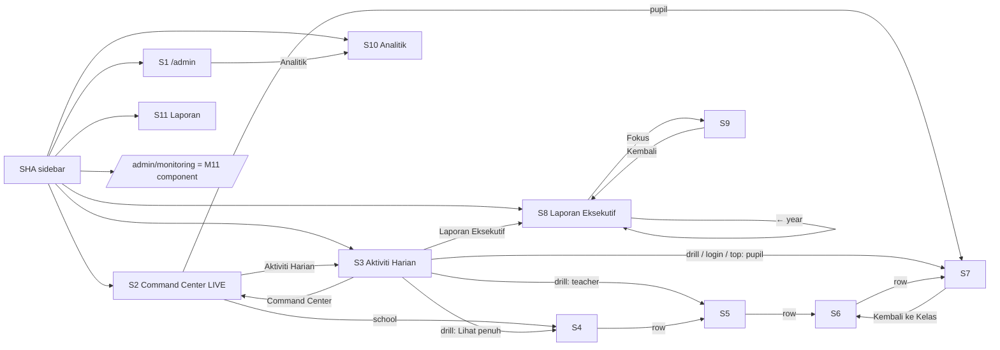

# M17 — Admin Dashboard & Analytics: dashboard, Command Center LIVE and drill-downs, daily activity, executive report, analytics, statistics report (Discovery)

- **Source:** live read-only walk-through of https://prestasiplus.my on **2026-09-26** (11:55–12:45 MYT) with the admin account (browser lane 1, `playwright`).
- **Screenshots:** `docs/discovery/img/M17/` (44 files, §10). Every page was masked in the DOM before capture. The admin shell (`SHA`) and design tokens are in [00-global-ui.md](00-global-ui.md) and are not repeated here.
- **Language:** UI copy is quoted in its exact Bahasa Melayu. Some copy on live is English or mixed: "Overview", "Engagement", "Champion", "Disengaged", "Live Feed", "Top Sekolah", "Headcount", "NPS Score", "Refresh", "Fokus →", "Lvl 1", "Powered by ALESA AI", "Rule-based Analysis", month names "Jan … Dec" / "May" / "Aug" / "Oct" / "Dec", "September 2026" / "August 2026".
- **Personal data:** student, teacher and parent names and e-mails appear on S2, S3, S4–S7 and S11. `tools/jobs/M17.js` → `M17MASK`:
  1. stops the live polling and wraps `window.fetch` so every Command Center JSON has its person keys (`name`, `student`, `student_name`, `teacher_name`, `reason`, `full_name`) replaced by `<name>` before the page renders it;
  2. tags breadcrumb person crumbs, the "Guru:" value, the `/admin/laporan` overview name and e-mail lines, `[data-name]` person rows and every e-mail-shaped leaf as `.m17n`;
  3. rewrites person ids in links (`…/student/{id}`, `…/teacher/{id}`).
  Then `tools/sanitize.js` runs with `{selectors:['.m17n'], titleName:false, cols:'^(nama|murid|pelajar)'}` and also masks the "Nama", "Nama Guru", "Nama Pelajar" and "Pelajar" columns. `piiLeakCheck` = **0 leaks in all 77 states**. A scripted scan of every M17 file (96 files, PNGs excluded) against the 119 person names and e-mails read live found **0 hits**. The snapshot never returns a person name: person rows are `<student:n>` / `<teacher:n>` / `<person:n>` tokens and e-mails a domain class. **School names** are kept: they are observed public anchors. No real person's name is written anywhere in this document.
- **Seed snapshot:** `docs/discovery/inventory/M17/_snapshot-2026-09-26.json`, captured **2026-09-26 12:33 MYT (04:33Z)** in one pass by `tools/jobs/M17-snapshot.js` (GET only, ≥ 450 ms apart). It holds every observed figure, chart series (S8 monthly, S9 monthly, S11 trend 7/30/90 days), the live-data and daily-activity JSON (3 periods + school drill), drill-down aggregates, the S10 coverage matrix, S11 tab rows (persons tokenised), the monitoring identity check, and the layout measurements (375 / 768 / 1280, `tools/jobs/M17-measure.js`). **The snapshot is the seed source.**
- **Element inventory:** **1,851 content elements** over 11 screens and **77 captured UI states**, IDs `EL-M17-S#-nnn`, in `docs/discovery/inventory/M17/<S#-key>.json`, plus the shell file `SHA-admin-shell.json` (233). Reconciliation, the crawl and the read-only limits are in `docs/discovery/inventory/M17/_summary.md`.
- **Safety:**
  - Nothing was submitted, exported or downloaded. Never triggered: S8 "Refresh" (a POST form → `/admin/laporan-eksekutif/clear-cache`), the S1 "Muat Turun Data (CSV)" links (`/admin/export/users|questions|payments|schools`), the S1 quick actions (M04/M03 create and import forms), the monitoring "PDF" / "CSV" exports.
  - Client-side reveals only: S3 period tabs and school drill (they make the same GET the page polls), S7 modals (GET `/api/command-center/*`), S11 Alpine tabs, filter pills, search box and school selects.
  - One browser, one request at a time, ≥ 350 ms between navigations (450 ms in the crawl and the snapshot).

Cross-references (owned elsewhere, not re-inventoried):
- **`/admin/monitoring`** (M17 checklist route) renders the **M11 monitoring component**. Identity re-checked today: `/admin/monitoring` and `/guru/monitoring` both return 200 with the title "Monitoring Penglibatan Sekolah - Admin" and a normalised `<main>` of **221,357** characters each (M11 measured 221,285 on 2026-09-25; the difference is live data). Its tree `/admin/monitoring/sekolah/{id}[/pelajar/{id}|/guru/{id}]` is M11 S2–S5. The only admin-side difference is the active sidebar item "Monitoring" and the SHA header "Monitoring Penglibatan" / "Pantau penglibatan sekolah & pelajar T4/T5 dalam platform". Its KPI cards are listed in §5.1 for the count comparison only.
- **`/admin/performance`** is **system** performance, not academic: title "Performance & Security - Admin", sections "Penggunaan Sumber", "Ringkasan Ancaman", "Proses Teratas", "Log Ancaman Terkini", "PHP Info", "Maklumat Pelayan" (CPU / RAM / disk / connections / uptime, SSH brute force, firewall, `GET /admin/performance/data` every 30 s). The TRACKER note resolves to **M23**. It is recorded in the crawl as M23 and not inventoried. Server host names and process users were not written anywhere.
- `/guru/command-center/*` (M10 S2) uses the **same drill-down templates** as M17 S4–S7: `/guru/command-center/student/2022` returned the same title and the same 720-character page text as `/admin/command-center/student/2022`. M10 did not open them. **Recommendation: M17 owns the drill-down component set (school / teacher / classroom / student), and M10 mounts it under `/guru/command-center/…`.**
- Sidebar "Audio KBAT" (`/admin/audio-kbat`) sits in the same "HARIAN" group but is **M09**. "Kirkpatrick" submenu is **M12**.
- Quick actions, quick links and export links on S1 point to M03 / M04 / M09 / M19 / M02 pages (§2.1).
- The ALESA AI text on S2 / S7 is generated in page code or by the server ("Sumber: Rule-based Analysis"). It is not an M13 chat call.

---

## 1. Overview

The TRACKER checklist has 8 M17 routes. The crawl found **11 screens** (5 new routes), 4 JSON endpoint families and 1 POST form. `/admin/monitoring` is the M11 component (above) and `/admin/performance` is M23 (above).

| # | Route | Tab title (`<title>`) · header | Status on admin account |
|---|---|---|---|
| S1 | `/admin` | "Dashboard - Admin Panel" · SHA "Dashboard" / "Gambaran Keseluruhan Platform" | 200 |
| S2 | `/admin/command-center` | "PRESTASIPLUS COMMAND CENTER" · standalone dark page (no shell) | 200; polls `GET /admin/command-center/live-data` every 10 s |
| S3 | `/admin/command-center/daily-activity` | "AKTIVITI PLATFORM — PRESTASIPLUS" · standalone | 200; polls `GET /api/command-center/daily-activity?period=` every 30 s |
| S4 | `/admin/command-center/school/{id}` (**new**) | "{sekolah} - Command Center" · standalone | 200; unknown id → 404 |
| S5 | `/admin/command-center/school/{sid}/teacher/{uid}` (**new**) | "{guru} - Command Center" · standalone | 200; unknown id → 404 |
| S6 | `/admin/command-center/classroom/{id}` (**new**) | "{kelas} - Command Center" · standalone | 200; unknown id → 404 |
| S7 | `/admin/command-center/student/{id}` (**new**) | "{pelajar} - Command Center" · standalone | 200; unknown id → 404 |
| S8 | `/admin/laporan-eksekutif` (`?year=`) | "Laporan Eksekutif {tahun}" · SHA "Laporan Eksekutif Platform" / "Selamat datang, Admin" | 200; `?year=abc` → **500** |
| S9 | `/admin/laporan-eksekutif/sekolah/{id}` (**new**) | "Fokus: {sekolah}" · SHA "Laporan Fokus Sekolah" / "Selamat datang, Admin" | 200; unknown id → 404 |
| S10 | `/admin/analytics` | "Analitik & Statistik - Admin Panel" · SHA "Analitik & Statistik" / "Analisis mendalam data platform" | 200; query strings ignored |
| S11 | `/admin/laporan` (`?range=`) | "Laporan Statistik - Admin Panel" · SHA "Laporan Statistik" / "Penglibatan pengguna seluruh platform" | 200 |

Access outcomes found by probing: **404** "Halaman Tidak Dijumpai" for `/admin/dashboard`, `/admin/statistics`, `/admin/reports`, `/admin/command-center/school` (no id), `/admin/laporan-eksekutif/sekolah` (no id), and unknown ids on S4–S7 and S9. **500** "Ralat Pelayan" for `/admin/laporan-eksekutif?year=abc`.

**Entry points** (SHA shell, `SHA-admin-shell.json`):
- The purple **"Command Center LIVE" card** (top of the sidebar; `fa-satellite-dish`, red "LIVE" pill) → S2.
- Group **"HARIAN"**: "Aktiviti Harian" (`fa-chart-line`, emerald) → S3; "Audio KBAT" (M09); "Dashboard" (`fa-tachometer-alt`) → S1; "Laporan Eksekutif" (`fa-file-alt`) → S8.
- Group **"ANALITIK"**: "Analitik" (`fa-chart-pie`) → S10; "Monitoring" (`fa-binoculars`) → M11 component; "KIRKPATRICK" submenu (M12); "Laporan" (`fa-chart-bar`, orange-500) → S11.
- Mobile bottom navigation (below `lg`): "Dashboard" (`fa-tachometer-alt`) → S1, then "Soalan", "Penaja", "Pengguna" and "Lagi" (`fa-ellipsis-h`). The "Lagi" drawer repeats "Analitik" → S10, **"Laporan Aktiviti"** (`fa-chart-bar`) → S11, "Monitoring" and "Kirkpatrick" (`fa-microscope`). The sidebar group labels in the drawer are "SPM", "Soalan", "Kurikulum", "Premium", "Gamifikasi", "Battle & Permainan", "Kandungan", "Marketplace", "Sistem". "Command Center" and "Aktiviti Harian" are **not** in the mobile drawer.
- The logo link and "Dashboard" both go to S1. Login redirects an admin to `/admin` (M01).
- In-module: S1 "Analitik" quick link → S10; S2 "📊 Aktiviti Harian" → S3, "← Dashboard" → S1, school names → S4, pupil names → S7; S3 "◀ Command Center" → S2, "Laporan Eksekutif" → S8, drill "Lihat penuh →" → S4, drill names → S5 / S7; S4 rows → S5; S5 rows → S6; S6 rows → S7; S8 "Fokus →" → S9; S9 "Kembali ke Laporan Eksekutif" → S8.

### 1.1 Shell by screen

| Screen | Shell | Evidence |
|---|---|---|
| S1, S8–S11 | `SHA` admin panel (server-status chips, sidebar with the active item highlighted, header title per page) | `GET /admin/server-status` every 30 s; `adminSidebar()` |
| S2–S7 | **none**: standalone dark "Command Center" pages (JetBrains Mono numerals, CSS variables `--emerald`, `--cyan`, `--amber`, `--rose`, `--violet`, `--indigo`, `--sky`, `--text-muted`), no `<main>` | no sidebar, no bottom nav |
| 404 / 500 states | none (global error layout) | "Halaman Tidak Dijumpai" / "Ralat Pelayan" |

The SHA header shows the correct page title on every M17 SHA page (no fallback "Dashboard" title issue here).

---

## 2. Screens

### 2.1 S1 — `/admin` "Dashboard" / "Gambaran Keseluruhan Platform"

Screenshots: `dashboard-desktop.png`, `-tablet.png`, `-mobile.png`.

- **Stat card row 1 (questions, M04 / M03):**
  | Card | Value | Sub-line (icon) |
  |---|---|---|
  | "Soalan Aktif" | 130,152 | "Minggu ini: 0" (`fa-calendar-week`) |
  | "Diluluskan" | 150,683 | "Aktif digunakan: 129,752" (`fa-check-circle`) |
  | "Menunggu Review" | 0 | "Perlu tindakan" (`fa-clock`) |
  | "Draf" | 0 | "Belum siap" (`fa-edit`) |
  | "Subjek" | 31 | "31 Aktif" (`fa-circle`) |
  | "Tahap Pendidikan" | 11 | "Darjah & Tingkatan" (`fa-graduation-cap`) |
  | "Pengguna" | 5,159 | "4533 Pelajar" (`fa-user`) |
- **"Battle Arena"** card ("PvP Quiz Battles"): "168 Total" (`fa-gamepad`), "0 Aktif" (`fa-circle`), "66 Selesai" (`fa-flag-checkered`); icon links `fa-school` → `/battle/ranking-sekolah`, `fa-trophy` → `/battle/leaderboard` (M16).
- **Sponsor cards (M21):** "Jumlah Penaja" 6 / "0 Aktif" (`fa-check-circle`); "Menunggu Kelulusan" 0 / "Tiada yang menunggu" (`fa-check`); "Ditolak" 0 / "Permohonan ditolak" (`fa-times-circle`); "Digantung" 6 / "Akaun digantung" (`fa-pause-circle`).
- **Quick actions** (three tiles, each captioned "Tindakan Pantas"): "Tambah Soalan Baru" (`fa-plus`) → `/admin/questions/create`; "Tambah Subjek Baru" (`fa-book-medical`) → `/admin/subjects/create`; "Import CSV Soalan" (`fa-file-csv`) → `/admin/questions/import`.
- **"Soalan Terkini"** / "10 soalan terbaru", "Lihat Semua" (`fa-arrow-right`) → `/admin/questions`. Table: "Soalan", "Subjek", "Tahap", "Status", "Tarikh"; each row: question text truncated to 60 chars + "…", type chip ("Mcq") and "Kesukaran: {n}/5", subject chip, level ("Tingkatan 5"), status chip ("Diluluskan"), date `dd/mm/yyyy`. Observed: 10 "Topup Sains T5 Bab …" items, 18/05/2026 (full rows in the snapshot).
- **"Taburan Status Soalan"**: "Draf" 0, "Menunggu" 0, "Diluluskan" 150,683, "Ditolak" 0, "Diarkib" 323,184.
- **"Pautan Pantas"**: "Kurikulum" (`fa-book-open`) → `/admin/curriculum`, "Analitik" (`fa-chart-pie`) → S10, "Banner" (`fa-image`) → `/admin/banners`, "Artikel" (`fa-newspaper`) → `/admin/articles`.
- **"Muat Turun Data (CSV)"**: "Pengguna" (`fa-users`) → `/admin/export/users`, "Soalan" (`fa-question-circle`) → `/admin/export/questions`, "Pembayaran" (`fa-credit-card`) → `/admin/export/payments`, "Sekolah" (`fa-school`) → `/admin/export/schools`. Plain GET links that download a file. **Not opened.**

### 2.2 S2 — `/admin/command-center` "PrestasiPlus Command Center" (LIVE)

Screenshots: `command-center-desktop.png`, `-tablet.png`, `-mobile.png`.

A standalone dark dashboard. The heading is rendered upper-case ("PRESTASIPLUS COMMAND CENTER"). Header: "← Dashboard" → `/admin`, "📊 Aktiviti Harian" → S3 (hover colour via `onmouseover`), "LIVE" pill with pulsing dot, a clock `HH:MM:SS` (Asia/Kuala_Lumpur, ticks each second) and "MYT". The server HTML shows placeholders ("--:--:--", "--", "0 soalan", "Memuatkan wawasan...", "Memuatkan...") until the first `live-data` response. Then `render(d)` fills every panel, animating the three big counters (800 ms ease-out). It re-polls every 10 s. Footer: "Powered by ALESA AI · PrestasiPlus © 2026 · Dijana automatik · Data dikemaskini setiap 10 saat".

| Panel | Content (observed) | JSON field |
|---|---|---|
| "Sekolah Berdaftar" / "langganan aktif" | 9 | `total_schools` |
| "Pelajar Berdaftar" / "{n} aktif menjawab" | 3,152 / 1,563 | `total_students_raw`, `active_students` |
| "Soalan Dijawab" / "sepanjang masa" | 477,888 | `total_answered_raw` |
| "Ketepatan Purata" / "keseluruhan platform" | 82.9% | `accuracy` |
| "🏆 Top Sekolah" | 5 rows: rank badge (r1–r5 colours) · school link → S4 · "{n} plj". Observed: ENGKU HUSAIN 392, BANDAR BARU BANGI 341, BANDAR RINCHING 307, KHIR JOHARI 175, PANDAN INDAH 134. Empty: "Tiada data" | `top_schools[]` (`active_count`) |
| "🔬 Kirkpatrick" | "T1" bar + stars "★★☆☆☆ 4.7/10"; "T2" "82.9% ketepatan"; "T3" "91 aktif 30h" (bar = n/500); "T4" "GPS 2.880" (bar = gps/5) | `kirk_t1`, `kirk_t2_accuracy`, `kirk_t3_active`, `kirk_t4_gps` |
| "🤖 ALESA AI" | "Platform menunjukkan **penurunan** 65% minggu ini. 3.6% pelajar terlibat aktif. Ketepatan purata 82.9% dengan 9 sekolah aktif. GPS keseluruhan: 4.47." (template §6.1) | derived |
| "📈 Aktiviti Hari Ini" | bar + "60 soalan"; "Minggu ini: 2,653"; "▼ -65% vs minggu lepas" (rose). Other variants in code: "▲ +{n}% vs minggu lepas" (emerald), "Sama dengan minggu lepas" (muted) | `answered_today`, `answered_week`, `week_change` |
| "⚡ Live Feed" | 10 rows: time "20:16", pupil name, subject short name ("P.Islam"), school name cut to 15 chars ("SEKOLAH MENENGA") linking to S4 (full name in `title`), "✓" / "✗". Empty: "Tiada aktiviti terkini" | `recent_feed[]` |
| "⭐ Top Pelajar Minggu Ini" | 5 rows: medal 🥇 🥈 🥉 then "⚬", pupil link → S7, "{n} jwb · {acc}%" (observed 452 · 99.6%, 405 · 99.0%, 234 · 62.0%, 200 · 93.5%, 160 · 73.8%). Empty: "Tiada data" | `top_students[]` |
| "💚 Mood Pelajar" | 😊 "Gembira" 307 · 😐 "OK" 280 · 😢 "Sedih" 72 · 😩 "Tekanan" 91 | `mood.{happy,okay,sad,stressed}` |
| "🔄 Pembetulan" | "899" "Rekod" · "+0.0%" "Purata Naik" · "0%" "Kadar Baik"; list "Top Improvers" ("{before}% → {after}% (+{n}%)") only when present (none observed) | `correction` |
| "📊 Engagement" | horizontal bars "Champion" 29, "Konsisten" 11, "Berkembang" 43, "Minimum" 3, "Disengaged" 2,229 (width = n / max) | `engagement` |

### 2.3 S3 — `/admin/command-center/daily-activity` "⚡ AKTIVITI PLATFORM"

Screenshots: `daily-activity-desktop.png`, `-tablet.png`, `-mobile.png`, `daily-activity-month-drill.png`.

- Header: "⚡ AKTIVITI PLATFORM", "◀ Command Center" → S2, "Laporan Eksekutif" → S8, clock + "MYT".
- Period tabs (`sw(p)`): **"📅 Hari Ini"** (default, `today`), "📆 Minggu Ini" (`week`), "🗓️ Bulan Ini" (`month`). A tab click reloads `GET /api/command-center/daily-activity?period={p}`. The heatmap panel shows only on "Hari Ini". The URL query `?period=week` is ignored (the page always starts on today). The API echoes any unknown `period` (`bogus`) and answers with today's figures.
- **Six pulse cards:**
  | Card | Today | Week | Month |
  |---|---|---|---|
  | 🏫 "Sekolah Aktif" / "daripada {n}" | 1 / 9 | 7 / 9 | 7 / 9 |
  | 👤 "Login Hari Ini" / "{role}: {n} · …" (label does not change with the tab) | 2 (student 1 · admin 1) | 31 | 95 (student 84 · teacher 4 · parent 1 · admin 1 · school_admin 5) |
  | 🎓 "Pelajar Aktif" / "daripada 3,152" | 1 | 32 | 86 |
  | 📝 "Soalan Dijawab" / "Ketepatan: {n}%" | 60 / 95% | 2,653 / 84.8% | 20,351 / 87.4% |
  | 🕐 "Sesi Latihan" "{done}/{started}" / "Purata: {m}m {s}s" | 3/3 · 1m 0s | 160/160 · 2m 46s | 1,258/1,258 · 1m 54s |
  | 🔥 "Engagement" / "Mood:{n} Badge:{n} Misi:{n}" | 0 | 3 (Misi:3) | 8 (Misi:8) |
- **"Sekolah"** list: one clickable row per school ("{i}. {sekolah}", then either "{n} GURU" when the school has answers or "{n} LOGIN", "{n} PELAJAR", "{n} SOALAN", accuracy "{n}%" or "-%" coloured `acc-g` ≥ 70 / `acc-m` ≥ 50 / `acc-l`). Rows without answers are drawn at 50 % opacity. Empty: "😴 Tiada aktiviti". Loading spinner; error "Gagal memuatkan".
- **School drill** (row click → `drill(id)`, toggles; `GET /api/command-center/daily-activity/school/{id}?period=`): sections "👨‍🏫 Guru Aktif ({n})" (teacher link → S5 · "{n} pelajar" · accuracy · "{n} jam yang lepas"), "🎓 Pelajar ({n})" (pupil link → S7 · "{n} soalan" · accuracy · last active), "👤 Login ({n})" (name · role chip · time ago); empty "Tiada data terperinci"; footer "Lihat penuh →" → S4; error "Gagal".
- **"Subjek"**: bars per subject (short names map MATEMATIK → "Matematik", BAHASA_MELAYU → "BM", BAHASA_INGGERIS → "BI", SAINS → "Sains", PENDIDIKAN_ISLAM → "P.Islam", SEJARAH → "Sejarah", GEOGRAFI → "Geo", PENDIDIKAN_MORAL → "Moral"). Empty: "-". **Observed empty in every period.**
- **"Heatmap Jam (Hari Ini)"**: 24 cells, tooltip "{h}:00 — {n} soalan". Observed: 60 at hour 3 (UTC; see D-M17-06). Empty: "Tiada data".
- **"Live Feed"**: time · name · subject · ✓/✗. **Observed "Tiada aktiviti" in every period** although answers exist (D-M17-11).
- **"Login Terkini"**: role tag (`role-{role}`: "admin", "student", "teacher", "school_admin", "parent") · name (pupils link to S7, teachers to S5) · school name, or "Pelajar Luar" (rose) for a pupil without a school · package chip (AKTIF / PKSK / SEKOLAH / FREE / BEBAS / ADMIN / PARENT, coloured) · "{n} minit/jam yang lepas". Empty "Tiada login".
- **"Top Pelajar"**: rank (rank-1..3 / rank-n) · pupil link → S7 · school · "{n} jwb" · accuracy. Empty "Tiada data".
- **"Mood Pelajar"**: 4 emoji tiles with counts, "Tiada data" when empty (observed empty; note `mood_dist` is an empty array).
- **"Badge Terkini"**: icon · name · badge name; empty "Tiada badge baru" (observed).

### 2.4 S4 — `/admin/command-center/school/{id}` (new)

Screenshots: `cc-school-desktop.png`, `-tablet.png`, `-mobile.png`.

- Header "PrestasiPlus Command Center" + "← Kembali ke Overview" → S2. Breadcrumb "Command Center" ▸ "{sekolah}".
- Stat cards: "Jumlah Pelajar", "Pelajar Aktif", "Jumlah Jawapan", "Ketepatan". School 8082: 549 · 392 · 130,077 · 82.3%. School 8080: 185 · 175 · 53,431 · 81.7%.
- **"👤 Senarai Guru ({n})"** table: "#", "Nama Guru", "Subjek" (free text as the teacher typed it, or "-"), "Kelas", "Pelajar", "Aktif (30h)". Each row is clickable (`window.location` → S5). 8082: 68 teachers (14 with classes, Σ 515 pupils). 8080: 34 teachers, **all 0 classes** (D-M17-22).

### 2.5 S5 — `/admin/command-center/school/{sid}/teacher/{uid}` (new)

Screenshots: `cc-teacher-desktop.png`, `-tablet.png`, `-mobile.png`, `cc-teacher-empty.png`.

- "← Kembali ke Sekolah" → S4. Breadcrumb "Command Center" ▸ "{sekolah}" (link) ▸ "{guru}". Info bar "Sekolah:" {sekolah}.
- **"📚 Senarai Kelas ({n})"**: "#", "Nama Kelas", "Tahap", "Pelajar", "Aktif (30h)", "Jumlah Jawapan", "Ketepatan" (bar + %); rows → S6. Observed: 7 classes for teacher 1919 (school 8080: "5 SAINS TULEN", "5 KAA", "5 PRINSIP AKAUN", "5 RGD", "5 PERNIAGAAN", "5 PSV 1", "5 PSV 2"; class ids 366–372); 1 class ("5 CYBER", id 813) for teacher 4402; **"Senarai Kelas (0)" with an empty table and no message** for teacher 4418.

### 2.6 S6 — `/admin/command-center/classroom/{id}` (new)

Screenshots: `cc-classroom-desktop.png`, `-tablet.png`, `-mobile.png`.

- "← Kembali ke Guru" → S5. Breadcrumb "Command Center" ▸ school ▸ teacher ▸ "{kelas}". Info bar "Sekolah:" · "Guru:" · "Tahap:" ("T5").
- **"👤 Senarai Pelajar ({n})"**: "#", "Nama Pelajar", "Jumlah Jawapan", "Ketepatan" (bar), "Terakhir Aktif" (`dd/mm HH:MM`), "Status" (badge "Aktif" `status-active` / "Tidak Aktif" `status-inactive`), "Mood" (emoji or "-"). Rows → S7. Class 370 "5 PERNIAGAAN": 30 pupils, 3 "Aktif", 27 "Tidak Aktif".

### 2.7 S7 — `/admin/command-center/student/{id}` (new)

Screenshots: `cc-student-desktop.png`, `-tablet.png`, `-mobile.png`, `cc-student-modal-week.png`, `cc-student-modal-session.png`, `cc-student-modal-headcount.png`.

- "← Kembali ke Kelas" → S6. Breadcrumb "Command Center" ▸ school ▸ teacher ▸ class ▸ "{pelajar}".
- **Stat cards:** "Jumlah Jawapan 🔍" (click → `showAllSessions()`, `title` "Klik untuk lihat semua sesi"), "Ketepatan", "Hari Aktif", "Streak", "Konsistensi". Observed: 2,378 · 93.5% · 15 · 1 · 27%.
- **"📊 Pecahan Subjek"**: rows "{subjek} 🔍" + bar + "{correct}/{total}" (click → `showSubjectDetail(code, name)`, `title` "Klik untuk lihat sesi"). Observed one row "Latihan Bebas" (code `UMUM`) 93.5% 2223/2378.
- **"📈 Aktiviti Mingguan (8 Minggu)"**: 8 bars (count above, `dd/mm` week start below; height = n / max). A bar with 0 answers ignores the click; others → `showWeekDetail(start, end, label, total)`.
- **"💚 Trend Mood (30 Hari)"**: per-day mood dots (click → `showMoodDay(date, mood, reason)`); observed "Tiada data mood".
- **"📋 HeadCount"**: "Subjek", "TOV", "ETR", "RS", "Gred", "Tarikh"; rows "{subjek} 🔍" (click → `showHeadcountDetail(configId, subject)`, `title` "Klik untuk lihat semua pelajar"). Observed: Sains / Perniagaan (TOV 40.00) / Matematik, 16/06/2026.
- **"🤖 ALESA AI Insight"**: "Analisis ALESA" + text ("Ketepatan cemerlang (93.5%). Konsistensi rendah (27%) - perlu usaha lebih.") + "Sumber: Rule-based Analysis".
- **Week modal** (`#weekModal`, closes with "×" or a backdrop click). Titles: "Minggu {dd/mm} ({start} ~ {end})", "Semua Sesi Latihan", "{subjek} — Semua Sesi", "HeadCount: {subjek}", "{emoji} {date} — Mood: {label}". Loading "Memuatkan...". Summary cards "Jawapan", "Sesi", "Ketepatan", "Masa" (or "Jumlah Masa"; headcount: "Pelajar", "Purata TOV", "Purata ETR", "Kadar Lulus"; mood: "Mood", "Sebab"). Session table: "Tarikh", "Subjek" (or "Topik", or "Masa"), "Soalan" ("{n} 🔍"), "Betul", "Ketepatan", "Masa"; rows → session modal (`title` "Klik untuk lihat soalan" / "Klik soalan"). Headcount table: "#", "Pelajar", "TOV", "ETR", "RS", "Gred" (A+/A/A- emerald; D/E/G rose; else amber). Empties: "Tiada sesi minggu ini", "Tiada sesi", "Tiada sesi latihan pada hari ini. Pelajar hanya checkin mood."; errors "Ralat memuatkan data", "Ralat". Observed: all sessions 2372 Jawapan · 123 Sesi · 93.7% · 141m; headcount Perniagaan 30 Pelajar · 29.7 · 0 · 0%.
- **Session modal** (`#sessionModal`): title "{subjek} — {topik}", subtitle "{date} | Kesukaran: {n|-} | Masa: {m}m {s}s"; stats "Soalan", "Betul", "Salah", "Ketepatan" (colour ≥ 70 emerald, < 50 rose, else amber); question rows (no · ✓/✗ · text cut at 150 chars · "Jawapan anda: …" (rose) / "Jawapan betul: …" (emerald) · time). Loading "Memuatkan soalan..."; empty "Tiada data soalan"; error "Ralat memuatkan data". Observed "Latihan Bebas — Latihan Bebas", "04/05/2026 03:13 | Kesukaran: - | Masa: 0m 23s", 10 · 8 · 2 · 80.00%.

### 2.8 S8 — `/admin/laporan-eksekutif` "Ringkasan Eksekutif {tahun}"

Screenshots: `laporan-eksekutif-desktop.png`, `-tablet.png`, `-mobile.png`, `laporan-eksekutif-2025.png`, `laporan-eksekutif-500.png`.

- Hero: "Ringkasan Eksekutif 2026" / "Laporan prestasi keseluruhan platform PrestasiPlus"; **"Refresh"** (`fa-sync-alt`) is the submit of `POST /admin/laporan-eksekutif/clear-cache` (`_token`, hidden `year`) — never clicked; **"← {tahun-1}"** link → `?year={tahun-1}`. There is no link to the next year (D-M17-14).
- **8 KPI cards:** "Jumlah Sekolah" 57 / "sekolah aktif"; "Pelajar Berdaftar" 3,152 / "1,563 aktif 2026"; "Kadar Penglibatan" 49.6% / "daripada pelajar daftar"; "Soalan Dijawab" 477,888 / "sepanjang 2026"; "Ketepatan" 82.9% / "82.8% selepas pembetulan"; "Guru" 502; "Soalan / Pelajar Aktif" 305.8 / "purata kedalaman penggunaan"; "Sekolah Paling Aktif" SEKOLAH MENENGAH KEBANGSAAN TINGGI KLUANG; "Bulan Paling Aktif" "Jun".
- **"Trend Penggunaan Bulanan 2026"**: 12 bars; above each bar the answer count, inside "{n}p" (active pupils), below the month "Jan" … "Dec". 2026: Jan 5 (3p), Feb 1,885 (51p), Mar 10,357 (48p), Apr 22,762 (333p), May 143,760 (1178p), Jun 229,467 (535p), Jul 32,010 (202p), Aug 17,291 (80p), Sep 20,351 (86p), Oct–Dec empty. Σ = 477,888.
- **"Analisis Perbandingan Sekolah"**: two bar lists, "Kadar Penglibatan Pelajar (%)" (41 schools, 100% … 0.6%) and "Ketepatan Akhir (%)" (41 schools, 96.1% … 47.5%); values in the snapshot.
- **"Lencana Pencapaian 2026"**: one tile per school (57): badges "★ Paling Aktif" (TINGGI KLUANG), "★ Paling Tepat" + "★ Paling Rajin" (SJK(C) CHONG HWA I), "★ Penglibatan Tertinggi" (SMK JALAN TIGA); others "Tiada lencana khas".
- **"5 Sekolah Paling Aktif"**: rank · school · state · "Soalan:" · "Pelajar:" "{aktif}/{daftar}" · "Penglibatan:" · "Ketepatan:" · "Fokus →" → S9. 2026: TINGGI KLUANG (Johor) 72,332 · 33/59 · 55.9% · 89.8%; BANDAR RINCHING (Selangor) 67,853 · 142/562 · 25.3% · 87.6%; BANDAR BARU BANGI 60,644 · 179/423 · 42.3% · 79.4%; ENGKU HUSAIN 49,813 · 225/549 · 41% · 77.4%; BANDAR TASIK KESUMA 25,247 · 192/776 · 24.7% · 76.9%.
- **"Prestasi Mengikut Subjek"**: 26 rows "{subjek}" / "{acc}% · {n} soalan · {n} pelajar" (Bahasa Melayu 87.5% · 116,173 · 1045 … Pendidikan Muzik 100.0% · 20 · 1). Σ soalan = 477,888.
- **"Headcount TOV → RS (2026)"**: "Sekolah", "Rekod", "Purata TOV", "Purata ETR", "Purata RS", "Perubahan" (11 schools; e.g. KHIR JOHARI 325 · 50.1 · 68.6 · 65.0 · +14.9; "-" when missing).
- **"Kirkpatrick Evaluation"**: "Jumlah Respon" 336 · "Purata Kepuasan" 4.6"/5" · "NPS Score" 8.3 (M12 T1 values).
- **"GPS Perbandingan Sekolah (2026)"**: "SEKOLAH MENENGAH KEBANGSAAN TINGGI KLUANG" / "GPS 2.88 · 5 subjek · 150 calon"; note "GPS lebih rendah = lebih baik. GPS 1.0 = semua A."
- **"Pusat Tuisyen"** (M26 data): "Pusat Tuisyen Demo PrestasiPlus" / "Johor Bahru, Johor" / 18 "pelajar aktif"; "Alesa IT Tuisyen" / "KLUANG, Johor" / 0 "pelajar aktif".
- Footer "Laporan dijana automatik oleh PrestasiPlus · 26 Sep 2026, 04:26 AM" (UTC time, D-M17-06) and "Menyeluruh. Berasaskan Data. Berdaya Maju."
- **Other years:** `?year=2025` / `2024` / `2027` → same page with "Ringkasan Eksekutif {y}", "0 aktif {y}", 0% / 0 / "0% selepas pembetulan", "Bulan Paling Aktif" "-", the monthly, comparison, subject, headcount and GPS sections **omitted**, while "Sekolah Paling Aktif" (BANDAR BARU BANGI), the "★ Paling Aktif" badge and "5 Sekolah Paling Aktif" (0 soalan each, e.g. "0/423", "0/1", "0/12"; states Selangor, Terengganu, Kuala Lumpur, Johor) are still shown (D-M17-14). "Jumlah Sekolah" 57, "Pelajar Berdaftar" 3,152 and "Guru" 502 do not change with the year. `?year=abc` → HTTP 500 "⚙️ Ralat Pelayan" / "Sesuatu tidak kena di pihak kami. Pasukan teknikal telah dimaklumkan. Sila cuba sebentar lagi." with "Halaman Utama" and "Cuba Semula" (`javascript:location.reload()`).

### 2.9 S9 — `/admin/laporan-eksekutif/sekolah/{id}` "Fokus: {sekolah}" (new)

Screenshots: `eksekutif-sekolah-desktop.png`, `-tablet.png`, `-mobile.png`.

- "Kembali ke Laporan Eksekutif" (`fa-arrow-left`) → S8; school name; "Negeri: {negeri}".
- KPI cards: "Penglibatan" 55.9% / "33 aktif / 59 daftar"; "Soalan Dijawab" 72,332 / "2192 soalan/pelajar"; "Ketepatan Akhir" 89.8%; "Konsistensi" "9/12" / "bulan aktif 2026".
- **"Trend Aktiviti Bulanan"** (12 bars; TINGGI KLUANG: Jan 1, Feb 729, Mar 1,148, Apr 1,056, May 16,200, Jun 52,059, Jul 1,074, Aug 30, Sep 35; Σ 72,332).
- **"Prestasi Mengikut Subjek"**: "▲ SUBJEK TERKUAT" "Pendidikan Al-Quran & As-Sunnah" "100.0% (35 soalan)"; "▼ SUBJEK PERLU PERHATIAN" "Kimia" "64.1% (744 soalan)"; then every subject with its accuracy bar.
- **"Headcount TOV → RS"**: "Subjek", "Rekod", "Purata TOV", "Purata RS", "Perubahan" (Matematik 41 · 61.3 · 73.4 · +12.2 …).
- Footer "Laporan dijana: 26 Sep 2026, 04:26 AM · PrestasiPlus". A school with no activity (5183, "Negeri: Terengganu") shows "0 aktif / 1 daftar", "0 soalan/pelajar", "0/12", and no chart values. The year is fixed to the current year (no `?year` on "Fokus →" links from other years).

### 2.10 S10 — `/admin/analytics` "Analitik & Statistik" / "Analisis mendalam data platform"

Screenshots: `analytics-desktop.png`, `-tablet.png`, `-mobile.png`.

- **Import cards (M04):** "Jumlah Import" 1,123 / "Keseluruhan" (`fa-upload`); "Import Bulan Ini" 0 / "September 2026" (`fa-calendar-check`); "Import Lepas" 0 / "August 2026" (`fa-history`); "Soalan Diimport" 31,101 / "Berjaya" (`fa-check-double`).
- **"Taburan Status Soalan"**: "Draf" "0 (0.0%)", "Menunggu Review" "0 (0.0%)", "Diluluskan" "128,006 (99.7%)" (bar), "Ditolak" "0 (0.0%)", "Diarkib" "400 (0.3%)".
- **Content counts (M09):** "Banner" 5; "Artikel" "Terbit" 72 / "Draf" 0; "Nota" "Terbit" 10 / "Draf" 0.
- **"Top 10 Subjek Aktif"** (bars): Pendidikan Moral 15,414 · Matematik 13,354 · Sains 12,128 · Bahasa Melayu 11,688 · Pendidikan Islam 9,152 · Bahasa Inggeris 8,039 · Sejarah 6,468 · Bahasa Tamil 6,300 · Geografi 5,692 · Bahasa Arab 5,400.
- **"Matriks Liputan Subjek"** / "Bilangan soalan mengikut subjek dan tahap pendidikan": table "Subjek", "D1" … "D6", "T1" … "T5", "Jumlah" (31 subjects; "-" for 0; row total bold). Column totals: 11,387 · 10,212 · 5,771 · 4,726 · 3,848 · 4,442 · 19,455 · 15,700 · 13,800 · 19,085 · 19,217 = **127,643**. Every cell is in the snapshot.
- **"Taburan Kesukaran Mengikut Subjek"**: one tile per subject with questions (27): name, "{n} soalan", "Lvl 1" … "Lvl 5" counts (Lvl 5 always 0). Σ 38,968 / 46,154 / 32,987 / 9,534 / 0 = 127,643.
- **"Status Kurikulum"** / "Subjek yang mempunyai bab vs subjek tanpa bab": 31 tiles "{subjek}" + "{n} bab" (Σ 1,311) or "Tiada bab" (Pembuatan Pakaian Wanita, Pertanian, Sains Sukan).

### 2.11 S11 — `/admin/laporan` "Laporan Statistik" / "Penglibatan pengguna seluruh platform"

Screenshots: `laporan-desktop.png`, `-tablet.png`, `-mobile.png`, `laporan-tab-sekolah.png`, `laporan-tab-guru.png`, `laporan-tab-murid.png`, `laporan-murid-belum-empty.png`.

Alpine `laporanApp()`; tab and filters are client-side (no request). The data for all tabs is in the first HTML.
- **Tabs:** "Overview" (`fa-chart-pie`, default), "Sekolah (61)" (`fa-school`), "Guru (551)" (`fa-chalkboard-teacher`), "Murid (4,533)" (`fa-user-graduate`).
- **"Tempoh:"** (`fa-calendar-alt`) pills "7 Hari" → `?range=7`, "30 Hari" → `?range=30` (default; active pill white), "3 Bulan" → `?range=90`; any other value → 30. The range changes only "Jumlah Aktiviti", its caption ("7 hari lepas" / "30 hari lepas" / "90 hari lepas"), the trend chart and "Pecahan Aktiviti".
- **Overview cards:** "Murid Pernah Login" 54% · "1,708 / 3,152" · "1,444 belum pernah login" (`fa-exclamation-circle`); "Cikgu Pernah Login" 54% · "269 / 502" · "233 belum pernah login"; "Murid Buat Latihan" 52% · "1,642 / 3,152"; "Jumlah Aktiviti" 3,522 · "30 hari lepas"; "Skor Purata" 44.6% · chip "Struktur: 6.7%".
- **"Trend Aktiviti"**: Chart.js line (`#trendChart`, label "Aktiviti", `borderColor '#6366f1'`, `backgroundColor 'rgba(99, 102, 241, 0.1)'`, fill, tension 0.3, point radius 2, no legend, x ticks max 15, y from 0). Labels `dd/mm` per day of the range; 30-day data Σ 1,428 (7-day Σ 344, 90-day Σ 5,939).
- **"Pecahan Aktiviti"**: "Kuiz Objektif" 0, "Soalan Berstruktur" 13, "Battle Arena" 4, "Permainan" 5 (30 days; 7 days 0 / 3 / 0 / 0; 90 days 0 / 954 / 23 / 47).
- **"Pelajar Paling Aktif"** (`fa-trophy`): 10 rows rank · name · count (923, 38, 23, 22, 21, 19, 19, 18, 16, 15).
- **"Cikgu Belum Login"**: list of teachers (name + e-mail) who never logged in (first 20 shown alphabetically).
- **Sekolah tab** — "Aktiviti Mengikut Sekolah": pills "Semua (61)", "Aktif (9)", "Kurang (0)", "Tidak Aktif (52)"; search "Cari sekolah..." (matches name); tiles 9 "Aktif (7 hari)", 0 "Kurang Aktif", 52 "Tidak Aktif"; table "#", "Sekolah", "Guru" ("{login}/{jumlah}"), "Murid" ("{login}/{jumlah}"), "Latihan", "Soalan" ("{n} {mcq}M + {str}S" or 0), "Langganan" ("Aktif" / "Tiada"), "Status" (badge "Aktif" / "Tidak"), "Login Terakhir" ("{n} jam yang lepas", "{n} bulan yang lepas").
- **Guru tab** — "Senarai Guru (551)": pills "Semua", "Pernah Login (289)", "Belum Login (262)"; search "Cari guru..."; school select "Semua Sekolah" + 22 schools; tiles "Jumlah Guru" 551, "Pernah Login" 289, "Jumlah Soalan" 11,414, "Jumlah Syiling" 63,459; table "#", "Nama" (name + optional e-mail line), "Sekolah", "Login" (badge "Ya" / "Belum"), "MCQ", "Struktur", "Syiling", "Headcount" (icon), "Login Terakhir".
- **Murid tab** — "Senarai Murid (4,533) — Top 200": pills "Semua", "Aktif", "Login Sahaja", "Belum Login"; search "Cari murid..."; school select "Semua Sekolah" + 8 schools; tiles "Jumlah Murid" 4,533, "Pernah Latihan" 200, "Jumlah Sesi" 24,076, "Purata Ketepatan" 76.1%; table "#", "Nama", "Sekolah", "Kelas", "Sesi", "Ketepatan", "Masa" ("{h}j {m}m"), "Syiling", "Login Terakhir". Only the 200 most active pupils are in the page, so "Login Sahaja" and "Belum Login" always show an empty table with no message (D-M17-18).
- No empty-state row exists for a search with no match (tables just render no rows).

---

## 3. Flows

### 3.1 Navigation

### 3.2 Drill-down chain (Command Center)

S2 / S3 → **S4 school** (teachers) → **S5 teacher** (classes) → **S6 class** (pupils) → **S7 pupil** (stats + modals). Each page has a "← Kembali ke …" button to the level above ("Overview", "Sekolah", "Guru", "Kelas") and a breadcrumb. S7 modals are GET-only JSON reads. The chain can dead-end: school 8080 lists 34 teachers with 0 classes, while its pupils belong to classes of teacher 1919, who is not in that list (D-M17-22).

### 3.3 Period and year switching

- S3: tab → reload of the JSON for the period, school drill closes (`EX=null`), heatmap hidden unless today; the 30-s timer keeps reloading the current period.
- S8: "← {y-1}" goes back one year at a time with no way forward (the sidebar returns to the current year).
- S11: range pills are links (full reload, tab resets to Overview).

---

## 4. Data entities implied

| Entity (owner) | Used for | Fields seen |
|---|---|---|
| School (M02) | every screen | id, name, code (BEA…), type, state, district, city, `is_active`, `leaderboard_opt_in`, `import_unlocked` |
| School subscription (M02 / M19) | S2 "Sekolah Berdaftar" 9, S11 "Langganan" | active flag |
| User (M01 / M02) | S1 5,159; S11 tabs; logins | role (student / teacher / school_admin / admin / parent), `last_login_at`, package (AKTIF / PKSK / SEKOLAH / FREE / BEBAS / ADMIN / PARENT) |
| Class (M10) | S5 / S6 | id, name, level (T5), teacher, pupils |
| Question (M04) | S1, S10 | status, active flag, subject, level, difficulty, created date, import batch |
| Practice session + answer (M05) | S2, S3, S6, S7, S8, S9, S11 | session id, subject code, topic, date, total, correct, time; answer correct, selected / correct answer |
| Correction record (M05 revision) | S2 "Pembetulan", S8 "selepas pembetulan" | before / after accuracy, improvement |
| Mood check-in (owner to confirm) | S2, S3, S6, S7 | mood (happy / okay / sad / stressed), reason, date |
| Headcount config + marks (M08) | S7, S8, S9 | config id, subject, TOV, ETR, RS, grade |
| Kirkpatrick feedback + GPS (M12) | S2, S8 | responses 336, satisfaction 4.6/5, NPS 8.3, GPS 2.88 |
| Battle (M16) | S1, S11 | total / active / finished |
| Sponsor (M21) | S1 | status (active / pending / rejected / suspended) |
| Wallet (M14) | S11 "Syiling" | teacher / pupil coins |
| Tuition centre (M26) | S8 | name, city, state, active pupils |
| Content (M09) | S10 | banners, articles, notes by status |
| Import batch (M04) | S10 | count, month, imported rows |
| Badge (M14) | S3 | name, icon, earned date |

---

## 5. Figures: how each seems to be computed, sources and cross-module conflicts

All values are from the 2026-09-26 snapshot. "INFERRED" = the formula fits the observed numbers but the server code is not visible.

### 5.1 Count comparison with the named queries of other modules

| Figure (screen) | Value | Probable computation | Other module's figure | Verdict |
|---|---|---|---|---|
| "Soalan Aktif" (S1) | 130,152 | active questions incl. PKSK | M04 Q-ACTIVE + Q-PKSK = 130,152; M05 "Total Soalan" | **agrees** |
| "Aktif digunakan" (S1) | 129,752 | approved ∧ active incl. PKSK | M04 Q-ELIGIBLE + Q-PKSK = 129,752 | **agrees** |
| "Diluluskan" (S1 card and distribution) | 150,683 | status approved, any active flag (INFERRED, incl. PKSK and more) | M04 Q-APPROVED 146,330 (+763 PKSK = 147,093; live M04 filter 145,689) | **conflict** (+3,590) |
| "Diarkib" (S1 distribution) | 323,184 | status archived | M04 Q-ARCHIVED 318,948 (live filter 319,589) | **conflict** (+4,236) |
| S1 distribution Σ | 473,867 | Draf + Menunggu + Diluluskan + Ditolak + Diarkib | M04 Q-ALL 465,278 (+PKSK = 466,041) | **conflict** (+7,826) |
| "Diluluskan" (S10) | 128,006 (99.7%) | approved ∧ active incl. PKSK, minus 1,746 rows (see next line) | M04 Q-ELIGIBLE + Q-PKSK 129,752 | **conflict** (−1,746) |
| "Diarkib" (S10) | 400 (0.3%) | archived ∧ active | M04 Q-ARCHIVED-ACTIVE 400 | **agrees**; S10 therefore counts only active rows |
| S10 matrix Σ / difficulty Σ | 127,643 | active objective questions by subject × level (PKSK excluded), minus 1,746 | M04 Q-ACTIVE 129,389 | **conflict** (−1,746). Per subject: Matematik 13,354 vs 13,872 (−518), Prinsip Perakaunan 2,329 vs 2,970 (−641, = M04 DV-M04-18 live admin value), Geografi 5,692 vs 5,997 (−305), Ekonomi 2,625 vs 2,770 (−145), Sejarah 6,468 vs 6,508 (−40), Sains 12,128 vs 12,165 (−37), Matematik Tambahan −23, Kimia −22, Fizik −10, Biologi −3, Pendidikan Islam −2. Other subjects agree (e.g. Pendidikan Moral 15,414, Bahasa Melayu 11,688). |
| S10 difficulty Lvl 1–4 | 38,968 / 46,154 / 32,987 / 9,534 | as matrix | M04 Q-DIFFICULTY 39,694 / 47,138 / 33,720 / 9,600 (incl. PKSK) | **conflict** (Σ −2,509 = 1,746 + 763 PKSK) |
| S10 D1–D4 column sums | 11,387 + 10,212 + 5,771 + 4,726 = 32,096 | matrix | M04 Table A D1–D4 Σ 32,204 (BM cells 958 / 2,540 / 805 / 530 agree) | **conflict** (−108) |
| "Subjek" (S1) | 31 / "31 Aktif" | M03 subjects | M03 31 | agrees |
| "Tahap Pendidikan" (S1) | 11 | M03 levels | M03 11 | agrees |
| S10 "Status Kurikulum" Σ | 1,311 bab | chapters per subject (M03) | M03 per-subject chapter counts | not cross-checked here (OQ-M17-06) |
| "Pengguna" (S1) | 5,159 · "4533 Pelajar" | all users; students | M02 stat cards 2026-09-25: 4533 + 551 + 38 + 6 + 16 + 5 + 2 = 5,151 | students **agree**; total +8 (new users since, or a role not on M02 cards) |
| "Murid (4,533)", "Jumlah Murid" (S11) | 4,533 | students | M02 4,533; M08 "4533 murid" | agrees |
| "Guru (551)", "Jumlah Guru" (S11) | 551 | teachers | M02 551 | agrees |
| "Guru" (S8), denominators (S3, S11 overview) | 502 | teachers attached to a school (INFERRED) | M11 "Guru Berdaftar" 522; M02 551 | **conflict** (three values) |
| Teachers logged in | 269 (S11 overview) · 289 (S11 Guru tab) | ever logged in | M11 "Guru Pernah Login" 277 | **conflict** |
| "Pelajar Berdaftar" (S2, S3, S8, S11 denominators) | 3,152 | students attached to a school (INFERRED) | M11 "Pelajar T4/T5" 4,158 (a subset larger than the whole); M02 4,533 | **conflict** |
| Pupils who answered | 1,563 (S2, S8 "aktif 2026") · 1,642 (S11 "Murid Buat Latihan") · 200 (S11 "Pernah Latihan", top-200 cap) | distinct pupils with ≥ 1 answer | M11 "Pernah Aktif" 1,462 (T4/T5, fixtures excluded) | **conflict** (definitions differ) |
| "Soalan Dijawab" (S2 all time; S8 "sepanjang 2026") | 477,888 | all answers; S8 = answers in 2026 (all answers are in 2026: 2025 shows 0); S8 subject Σ and monthly Σ both = 477,888 | M11 monitoring "Soalan Dijawab" 472,516 today (472,261 on 2026-09-25; M05 monitoring segment) | **conflict** (−5,372: M11 counts T4/T5 pupils of non-fixture schools only, INFERRED) |
| Answers this week / last week / today (S2) | 2,653 / 7,556 / 60 | answers in the ISO week / previous week / today | S3 week 2,653, S3 today 60 | agrees |
| Answers this month (S3 month) | 20,351 | answers since the 1st | S8 Sep bar 20,351 | agrees |
| 7-day answers (M11 `period=7d`) | 5,913 | — | S3 has no 7-day figure | n/a |
| "Ketepatan Purata" (S2, S8) | 82.9% | correct ÷ answered | S8 "82.8% selepas pembetulan" | two definitions |
| "Jumlah Sekolah" (S8) | 57 "sekolah aktif" | schools with ≥ 1 registered pupil, fixtures 900001–900099 excluded (M11 OQ-M11-09 rule) | M11 "Jumlah Sekolah" 57 "Berdaftar" | **agrees** (label differs) |
| "Sekolah Berdaftar" (S2), "daripada 9" (S3), "Aktif (9)" (S11) | 9 | schools with an active subscription (S11 "Langganan" Aktif = 9) | S11 "Sekolah (61)"; S8 57; M02 10,220 | label conflict (D-M17-07) |
| "Sekolah (61)" (S11) | 61 | schools with ≥ 1 user (INFERRED) | S8 57 | **conflict** (4 schools; fixture schools?) |
| Per-school answers (S2/S4 vs S8/S9) | ENGKU HUSAIN 130,077 vs 49,813; BANDAR BARU BANGI 88,255 vs 60,644; BANDAR RINCHING 59,086 vs 67,853 | S2/S4: answers of pupils now in the school (INFERRED); S8/S9: another attribution | — | **conflict** (D-M17-15) |
| Per-school active pupils | ENGKU HUSAIN 392 (S2/S4) vs 225 (S8/S9); S11 row "455/549" logged in | — | — | **conflict** |
| Pupil 2022 answers (S7) | 2,378 (card, subject row) vs 2,372 (all-sessions / subject JSON) | — | — | **conflict** (6) |
| Engagement buckets (S2) | 29 + 11 + 43 + 3 + 2,229 = 2,315 | pupils bucketed by activity (INFERRED) | "Pelajar Berdaftar" 3,152 | **conflict** |
| "3.6% pelajar terlibat aktif" (S2 AI) | (29+11+43) ÷ 2,315 | page code | — | formula observed |
| Kirkpatrick T1 (S2) | "4.7/10", 2 stars | `kirk_t1` (count 336) | M12 T1 "4.6/5", NPS 8.3/10, 336 responses; S8 4.6/5 | **conflict** (scale / value) |
| Kirkpatrick T3 (S2) | 91 "aktif 30h" | pupils active in 30 days | S3 month 86 (month-to-date) | differs by window |
| Kirkpatrick T4 (S2) | GPS 2.880 | = S8 GPS of TINGGI KLUANG (the only school with SPM data, 150 calon) | M12 "180 calon" (2025 grade distribution); S2 AI "GPS keseluruhan: 4.47" | **conflict** |
| "Kirkpatrick Evaluation" (S8) | 336 · 4.6/5 · 8.3 | M12 T1 | M12 | agrees |
| Headcount (S8) | 11 schools, Σ 12,414 records | M08 headcount records of 2026 | M08 / M12 "41 / 4378 rekod" | not comparable here (different scope; OQ-M17-07) |
| Mood (S2) | 307 / 280 / 72 / 91 (Σ 750) | all mood check-ins | S3 "Tiada data" (period-scoped) | owner to confirm |
| Battle (S1) | 168 · 0 · 66 | M16 battles | S11 "Battle Arena" 4 (30 days) | different windows |
| Sponsors (S1) | 6 · 0 aktif · 0 · 0 · 6 digantung | M21 | M02 "6 Penaja" | agrees |
| "Jumlah Syiling" (S11 Guru) 63,459; pupil "Syiling" | — | M14 wallet balances (INFERRED) | M14 | not cross-checked |
| S11 "Jumlah Aktiviti" | 3,522 (30 d) · 1,124 (7 d) · 14,472 (90 d) | unknown | trend Σ 1,428 / 344 / 5,939; "Pecahan" Σ 22 / 3 / 1,024 | **conflict** (D-M17-16) |

### 5.2 Formulas observed in page code or verified by arithmetic

- S2 week change = round((week − last week) ÷ last week × 100): (2,653 − 7,556) ÷ 7,556 = −64.9 → "-65%".
- S2 "Aktiviti Hari Ini" bar width = today ÷ max(today, week ÷ 5, 100) × 100 %.
- S2 Kirkpatrick stars = round(v ÷ max × 5) filled "★" + "☆"; T1 bar = v ÷ 10; T2 bar = accuracy %; T3 bar = min(n ÷ 500, 1); T4 bar = min(gps ÷ 5, 1).
- S2 AI text: `"Platform menunjukkan <strong>{peningkatan|penurunan|stabil}</strong> {|week_change|}% minggu ini. {activeRatio}% pelajar terlibat aktif. Ketepatan purata {accuracy}% dengan {total_schools} sekolah aktif. GPS keseluruhan: {gps_overall}."`, activeRatio = (champion + consistent + developing) ÷ all buckets × 100, 1 decimal.
- S2 correction "Kadar Baik" = improved ÷ total × 100 (0 decimals).
- S3 Engagement = mood check-ins + missions completed + badges + quiz sets created.
- S3 accuracy colour classes: ≥ 70 `acc-g`, ≥ 50 `acc-m`, else `acc-l`. Session time "{m}m {s}s" (e.g. 60 s → "1m 0s").
- S8 "Kadar Penglibatan" = 1,563 ÷ 3,152 = 49.6%; "Soalan / Pelajar Aktif" = 477,888 ÷ 1,563 = 305.8; S9 "soalan/pelajar" = answers ÷ active pupils, rounded (72,332 ÷ 33 = 2192); S9 "Konsistensi" = months with answers ÷ 12.
- S8 "Bulan Paling Aktif" = month with most answers (Jun 229,467). "Sekolah Paling Aktif" = school with most answers (TINGGI KLUANG 72,332); in an empty year it still names a school (first in list).
- S11 percentages: 1,708 ÷ 3,152 = 54%, 269 ÷ 502 = 54%, 1,642 ÷ 3,152 = 52%; "{n} belum pernah login" = total − logged in.
- S7 week bar height = count ÷ max × 100 %; S7 "Konsistensi" 27% (formula not visible: 15 active days ÷ 56 days = 26.8% fits, INFERRED).
- S7 AI insight is rule-based: "Ketepatan cemerlang ({acc}%)" and "Konsistensi rendah ({n}%) - perlu usaha lebih." (other branches not observed).

---

## 6. Scripts

### 6.1 S2 inline script (verbatim logic, abridged)

`esc()` HTML escape (comment "ALESA: XSS-safe HTML escape helper (auto-injected 2026-04-17)"); `updateClock()` every 1 s in Asia/Kuala_Lumpur; `animateValue()` cubic ease-out 800 ms; `render(d)` as §2.2; `fetchData()` → `fetch("/admin/command-center/live-data")`, on error `console.error("Fetch error:", e)`; `setInterval(fetchData, 10000)`. Live-feed names are inserted **without** `esc()` (top students use `esc()`).

### 6.2 S3 inline script

State `P='today'`, `EX=null`; `sw(p)`, `ac(v)`, `fmt(n)` (`toLocaleString`), `fmtTime(s)`, `load()` → `/api/command-center/daily-activity?period=${P}`, `render(d)` → `renderSchools`, `renderSubjects`, `renderHeatmap` (today only), `renderFeed`, `renderLogins`, `renderTop`, `renderMood`, `renderBadges`; `drill(id)` → `/api/command-center/daily-activity/school/${id}?period=${P}`; `load(); setInterval(load, 30000)`.

### 6.3 S7 inline scripts

`showWeekDetail`, `showAllSessions` (`/week?start=2020-01-01&end=2030-12-31`), `showSubjectDetail` (`/subject?code=`), `showMoodDay`, `showHeadcountDetail` (`/api/command-center/headcount/{configId}`), `showSessionDetail` (`/api/command-center/session/{id}`). `studentId` is written into the page as a constant.

### 6.4 S11

`laporanApp()` (tab, schoolFilter / guruFilter / muridFilter, schoolSearch / guruSearch / guruSchool / muridSearch / muridSchool; `matchSearch($el, s)` on `data-name` + `data-school`, `matchSchool`), Chart.js on `DOMContentLoaded`.

### 6.5 SHA pages

`serverStatus()` (`/admin/server-status` every 30 s) and `adminSidebar()` (localStorage `admin_sidebar`), as in 00-global-ui.

---

## 7. Endpoints observed

| Method | URL | Used by | Response / note |
|---|---|---|---|
| GET | `/admin` | S1 | HTML |
| GET | `/admin/export/users`, `/questions`, `/payments`, `/schools` | S1 links | CSV download — **not opened** |
| GET | `/admin/command-center` | S2 | HTML shell |
| GET | `/admin/command-center/live-data` | S2, every 10 s | JSON `{total_schools, total_students, total_students_raw, active_students, active_students_raw, total_answered, total_answered_raw, answered_today, answered_today_raw, answered_week, answered_week_raw, answered_last_week, week_change, accuracy, top_schools[{school_id, school_name, active_count, total_answers}], top_students[{student_id, name, school_name, answers_count, accuracy}], gps_overall, kirk_t1, kirk_t1_count, kirk_t2_accuracy, kirk_t3_active, kirk_t4_gps, engagement{champion, consistent, developing, minimum, disengaged}, mood{happy, okay, sad, stressed}, recent_feed[{student, subject, correct, time, school_id, school_name}], generated_at, correction{total, avg_improvement, improved_count, top_improvers[]}}` |
| GET | `/admin/command-center/daily-activity` | S3 | HTML |
| GET | `/api/command-center/daily-activity?period=today\|week\|month` | S3, every 30 s | JSON `{period, label, logins{total, by_role, recent[]}, practice{total_answers, correct_answers, accuracy, active_students, sessions_started, sessions_completed, avg_session_time}, engagement{mood_checkins, mood_dist, missions_completed, badges_earned, recent_badges, quiz_sets_created, kirkpatrick_t1}, summary{active_schools, total_schools, active_teachers, total_teachers, active_students, total_students, total_logins}, schools[], top_students[], subject_breakdown[], hourly_heatmap{}, live_feed[]}` |
| GET | `/api/command-center/daily-activity/school/{id}?period=` | S3 drill | JSON `{school{…}, period, teachers[], students[], logins[]}` |
| GET | `/admin/command-center/school/{id}` | S4 | HTML; unknown → 404 |
| GET | `/admin/command-center/school/{sid}/teacher/{uid}` | S5 | HTML; unknown → 404 |
| GET | `/admin/command-center/classroom/{id}` | S6 | HTML; unknown → 404 |
| GET | `/admin/command-center/student/{id}` | S7 | HTML; unknown → 404 |
| GET | `/api/command-center/student/{id}/week?start=&end=` | S7 modals | JSON `{total_answers, total_sessions, accuracy, time_spent, sessions[{id, date, subject, total, correct, accuracy, time}]}` |
| GET | `/api/command-center/student/{id}/subject?code=` | S7 | same shape, sessions with `topic` |
| GET | `/api/command-center/session/{id}` | S7 | JSON `{subject, topic, date, total, correct_count, wrong_count, accuracy, time, difficulty, answers[{no, correct, question, selected_answer, correct_answer, time}]}` |
| GET | `/api/command-center/headcount/{configId}` | S7 | JSON `{subject, total_students, avg_tov, avg_etr, pass_rate, students[{name, tov, etr, rs, grade}]}` |
| GET | `/admin/laporan-eksekutif?year=` | S8 | HTML; non-numeric year → 500 |
| POST | `/admin/laporan-eksekutif/clear-cache` (`_token`, `year`) | S8 "Refresh" | **not sent** |
| GET | `/admin/laporan-eksekutif/sekolah/{id}` | S9 | HTML; unknown → 404 |
| GET | `/admin/analytics` | S10 | HTML |
| GET | `/admin/laporan?range=7\|30\|90` | S11 | HTML; other → 30 |
| GET | `/admin/server-status` | SHA | JSON, every 30 s |

---

## 8. Responsive behaviour (375 / 768 / 1280) and live defects

### 8.1 Layout per screen (measured by `tools/jobs/M17-measure.js`; page `scrollWidth`, SHA pages include a 15 px scrollbar)

| Screen | 1280 | 768 | 375 |
|---|---|---|---|
| S1 | stat grid, 2-col lower area; no overflow | no overflow | 1 column; "Soalan Terkini" table 350 px in a 318 px `overflow-x:auto` wrapper (scrolls); 114 texts < 12 px (9–11 px labels) |
| S2 | 3-column board filling the viewport; panels scroll inside (Top Sekolah, Kirkpatrick, Live Feed) | right column cut (elements to x = 830) | **broken**: the 3-column grid does not collapse; body clips at 375 px, the header clock and "LIVE" pill (x = 565) and the middle / right columns are cut off (60 elements not visible) — D-M17-01 |
| S3 | 6 pulse cards in a row, 3-col panels | 2–3 cols; no overflow | 1 column; no overflow |
| S4 | table fits | fits | **page overflow** 554 px (table 510 px in a non-scrolling wrapper) — D-M17-02 |
| S5 | fits | fits | **page overflow** 588 px — D-M17-02 |
| S6 | fits | fits | **page overflow** 652 px — D-M17-02 |
| S7 | 5 stat cards, 2-col panels | fits | **page overflow** 395 px (panels) — D-M17-02; stat grid 2 cols |
| S8 | KPI grid 5 cols (`md:grid-cols-5`), "5 Sekolah Paling Aktif" 4-col rows | fits | **page overflow** 525 px: 12-month bar chart and the headcount table (491 px, not scrollable) — D-M17-03; month labels 8 px, 113 texts at 10 px |
| S9 | fits | fits | **page overflow** 429 px (headcount table 395 px) — D-M17-03 |
| S10 | matrix 1,142 px in `overflow-x:auto` (scrolls at every width) | scrolls | scrolls; 848 texts < 12 px (matrix, difficulty tiles) |
| S11 | cards `grid-cols-2 lg:grid-cols-5`, lists `md:grid-cols-3` | no overflow | **overflow** 388 px (overview cards 13 px too wide) — D-M17-04; tables in `overflow-x-auto` |

### 8.2 Live defects (D9 class; the rebuild decision is the URS writer's)

| ID | Screen | Defect | D9 class |
|---|---|---|---|
| D-M17-01 | S2 | At 375 and 768 the 3-column board is not responsive; header clock / "LIVE" and whole panels are clipped off-screen (body `overflow:hidden`) | layout / responsive breakage |
| D-M17-02 | S4–S7 | Horizontal page scroll at 375 (tables and panels wider than the viewport, wrappers not scrollable) | layout / responsive breakage |
| D-M17-03 | S8, S9 | Horizontal page scroll at 375 (monthly bars, headcount tables); 8 px month labels | layout breakage; unreadable text |
| D-M17-04 | S11 | Overview cards overflow by 13 px at 375 | layout |
| D-M17-05 | S8 | `?year=abc` → HTTP 500 "Ralat Pelayan" | broken (500) |
| D-M17-06 | S2, S3, S7, S8, S9 | Times are UTC while the page says MYT: live feed "20:16" at 04:16 MYT, heatmap bucket "3:00" for answers at 11:32 MYT, footers "26 Sep 2026, 04:26 AM" at 12:26 MYT, session times | wrong label / contradictory |
| D-M17-07 | S2 | "Sekolah Berdaftar" / "langganan aktif" shows 9 (subscribed schools) while S8 says 57 schools; the AI text calls the same 9 "sekolah aktif" | wrong label / contradictory |
| D-M17-08 | S2 | Kirkpatrick T1 "★★☆☆☆ 4.7/10" — the satisfaction scale is 1–5 (M12 and S8 show 4.6/5) | wrong label |
| D-M17-09 | S2 | AI text "GPS keseluruhan: 4.47" contradicts T4 "GPS 2.880" | contradictory |
| D-M17-10 | S3 | Card label "Login Hari Ini" stays on "Minggu Ini" / "Bulan Ini" | wrong label |
| D-M17-11 | S3 | "Subjek" and "Live Feed" are empty in every period (API returns `subject_breakdown: []`, `live_feed: []`) while answers exist (60 today); "Mood Pelajar" "Tiada data" while S2 shows 750 moods | broken panel / contradictory |
| D-M17-12 | S3 | Today: summary "active_teachers" 0 but the school row shows "11 GURU"; the same pupil is counted under every teacher in the drill | contradictory |
| D-M17-13 | S3 | "Sekolah Aktif 7 daripada 9" while the list shows 10 schools (week, month) | contradictory |
| D-M17-14 | S8 | Year navigation goes only backwards ("← 2025" … "← 2023", no forward link); future years are accepted; a year with 0 answers still names a "Sekolah Paling Aktif", gives it "★ Paling Aktif" and lists "5 Sekolah Paling Aktif" with 0 soalan | contradictory; navigation dead end |
| D-M17-15 | S2/S4 vs S8/S9 | Per-school answers and active pupils differ between the Command Center and the executive report (e.g. 130,077 vs 49,813) | contradictory |
| D-M17-16 | S11 | "Jumlah Aktiviti" 3,522 ≠ trend chart Σ 1,428 ≠ "Pecahan Aktiviti" Σ 22 | contradictory |
| D-M17-17 | S11 | Teachers: overview "269 / 502" vs Guru tab "551" / "Pernah Login (289)" | contradictory |
| D-M17-18 | S11 | Murid filters "Login Sahaja" and "Belum Login" can never show a row (only the top 200 active pupils are rendered) and show no empty message; Sekolah "Kurang (0)" likewise | broken filter |
| D-M17-19 | S11 | Pupil "Ketepatan" above 100% (101.2%, 101.4%) | contradictory |
| D-M17-20 | S11 | Denominator 3,152 pupils in the overview vs "Murid (4,533)" tab | contradictory |
| D-M17-21 | S7 | "Jumlah Jawapan 2,378" vs modal "2372 Jawapan"; subject row "Latihan Bebas" but session lists say "Umum"; session title "Latihan Bebas — Latihan Bebas" | contradictory / wrong label |
| D-M17-22 | S4 | School 8080: 185 pupils, 175 active, but all 34 listed teachers have 0 classes; its classes belong to teacher 1919, who is not listed (reachable only through S6/S7 breadcrumbs) | contradictory / dead drill path |
| D-M17-23 | S1 vs S10 | "Diluluskan" 150,683 vs 128,006; "Diarkib" 323,184 vs 400 on two admin pages (different populations, no label says so) | contradictory |
| D-M17-24 | S2 | Engagement buckets total 2,315, not the 3,152 registered pupils | contradictory |

Working-as-designed (replicate, not defects): S2 panels scroll internally at 1280 × 800; S3 rows without answers at 50 % opacity; S8 empty months drawn without values; S11 filters are client-side with no empty-state row; the live feed can show repeated identical rows (real data).

### 8.3 Audit-lesson checklist

- Every figure is in the snapshot with its screen and state; chart series are complete (S8 12 months, S9 12 months, S11 7 / 30 / 90 days).
- Person names never recorded; ids of persons removed from the snapshot.
- Monitoring identity and the performance owner were checked, not assumed.
- Cross-module totals compared against M04 named queries (v1.3+), M02 cards, M05 via M11 monitoring, M08 and M12 (§5.1).
- Unobserved states are listed in §9, not written as fact.

---

## 9. Open questions and states requiring a live action

| ID | Question / state | Why not observable |
|---|---|---|
| OQ-M17-01 | CSV contents and columns of `/admin/export/users`, `/questions`, `/payments`, `/schools` | downloads were not opened (read-only rule) |
| OQ-M17-02 | Effect of S8 "Refresh" (`clear-cache`): which caches, feedback message | POST not sent |
| OQ-M17-03 | Which figures define "Pelajar Berdaftar" 3,152, "Guru" 502, "Sekolah (61)" and "Sekolah Berdaftar" 9 | server-side; only values visible |
| OQ-M17-04 | Owner of the mood check-in store (S2/S3/S6/S7) and of the correction ("Pembetulan") records | not in any module's discovery so far |
| OQ-M17-05 | S3 subject breakdown and live feed with data; S3 badges; S7 mood trend dots and `showMoodDay` modal; S2 "Top Improvers"; S2 positive / zero week change | no such data on live today |
| OQ-M17-06 | Reconcile S10 "Status Kurikulum" (Σ 1,311 bab) with M03 chapter counts | cross-check for the URS writer |
| OQ-M17-07 | Scope of S8 "Headcount TOV → RS" (12,414 records, 11 schools) vs M08 headcount figures | different screens, different filters |
| OQ-M17-08 | What non-admin roles (PPD / JPN / school admin) see on `/admin/command-center*` and `/admin/laporan*` | admin account only |
| OQ-M17-09 | What the 1,746 active questions missing from S10 are (and the 108 at D1–D4) | server query not visible |
| OQ-M17-10 | Whether `/guru/command-center/{school,classroom,student}` for a teacher account are scoped to the teacher's classes | admin account only (M10) |

States requiring a live action (not captured): S8 Refresh; exports; S2 / S3 with an API error ("Fetch error:", "Gagal memuatkan", "Gagal"); S7 modal errors ("Ralat memuatkan data", "Ralat").

---

## 10. Screenshot index (`docs/discovery/img/M17/`, all masked)

dashboard-{desktop,tablet,mobile}, command-center-{desktop,tablet,mobile}, daily-activity-{desktop,tablet,mobile}, daily-activity-month-drill, cc-school-{desktop,tablet,mobile}, cc-teacher-{desktop,tablet,mobile}, cc-teacher-empty, cc-classroom-{desktop,tablet,mobile}, cc-student-{desktop,tablet,mobile}, cc-student-modal-{week,session,headcount}, laporan-eksekutif-{desktop,tablet,mobile}, laporan-eksekutif-2025, laporan-eksekutif-500, eksekutif-sekolah-{desktop,tablet,mobile}, analytics-{desktop,tablet,mobile}, laporan-{desktop,tablet,mobile}, laporan-tab-{sekolah,guru,murid}, laporan-murid-belum-empty (44 files). Standalone pages render person names from the masked JSON as `<name>` (inserted as raw HTML in some panels, so they appear blank).

---

## Appendix A — Enumerations

### A.1 Roles and packages (S3 login feed)
Roles: `admin`, `student`, `teacher`, `school_admin`, `parent` (role colours: student emerald, teacher cyan, school_admin indigo, admin violet, parent amber). Packages: `AKTIF` emerald, `PKSK` cyan, `SEKOLAH` indigo, `FREE` rose, `BEBAS` muted, `ADMIN` violet, `PARENT` amber; "Pelajar Luar" for a pupil without a school.

### A.2 Mood
`happy` 😊 "Gembira", `okay` 😐 "OK", `sad` 😢 "Sedih", `stressed` 😩 "Tekanan" (S7 mood modal uses 😥 for stressed).

### A.3 Engagement buckets
"Champion" (emerald), "Konsisten" (cyan), "Berkembang" (amber), "Minimum" (`#fb923c`), "Disengaged" (rose).

### A.4 S8 badges
"★ Paling Aktif", "★ Paling Tepat", "★ Paling Rajin", "★ Penglibatan Tertinggi", else "Tiada lencana khas".

### A.5 S11 statuses
Sekolah "Langganan" "Aktif" / "Tiada"; "Status" "Aktif" / "Tidak"; Guru "Login" "Ya" / "Belum"; S6 "Aktif" / "Tidak Aktif".

## Appendix B — Exact DOM strings (inventory reconciliation)

Strings that the inventory holds and that §1–§10 do not already quote: mostly live data values at capture time (counts, school names as public anchors, clock readings, subject tiles) and composite texts of clickable rows. Person names are masked in the inventory and never appear here.

### S1-dashboard (`/admin`)
"Tindakan Pantas Tambah Soalan Baru" · "Tindakan Pantas Tambah Subjek Baru" · "Tindakan Pantas Import CSV Soalan"

Script / attribute strings: `GB /`

### S2-command-center (`/admin/command-center`)
"12:20:45" · "SEKOLAH MENENGAH KEBANGSAAN ENGKU HUSAIN" · "392 plj" · "SEKOLAH MENENGAH KEBANGSAAN BANDAR BARU BANGI" · "341 plj" · ""Platform menunjukkan 65% minggu ini. 3.6% pelajar terlibat aktif. Ketepatan purata 82.9% dengan 9 sekolah akt" · "452 jwb · 99.6%" · "405 jwb · 99.0%" · "12:20:49" · "12:20:54"

Script / attribute strings: `% vs minggu lepas` · `Sama dengan minggu lepas`

### S3-daily-activity (`/admin/command-center/daily-activity`)
"12:21:02" · "🗓️ Bulan Ini" · "student: · admin:" · "Ketepatan: %" · "Mood:0 Badge:0 Misi:0" · "1. SEKOLAH MENENGAH KEBANGSAAN ENGKU HUSAIN 11GURU 1PELAJAR 60SOALAN 95.0%" · "2. SEKOLAH MENENGAH KEBANGSAAN KHIR JOHARI 1LOGIN 0PELAJAR 0SOALAN -%" · "0:00 — 0 soalan" · "1:00 — 0 soalan" · "2:00 — 0 soalan" · "3:00 — 60 soalan" · "4:00 — 0 soalan" · "5:00 — 0 soalan" · "6:00 — 0 soalan" · "7:00 — 0 soalan" · "8:00 — 0 soalan" · "9:00 — 0 soalan" · "10:00 — 0 soalan" · "11:00 — 0 soalan" · "12:00 — 0 soalan" · "13:00 — 0 soalan" · "14:00 — 0 soalan" · "15:00 — 0 soalan" · "16:00 — 0 soalan" · "17:00 — 0 soalan" · "18:00 — 0 soalan" · "19:00 — 0 soalan" · "20:00 — 0 soalan" · "21:00 — 0 soalan" · "22:00 — 0 soalan" · "23:00 — 0 soalan" · "11 minit yang lepas" · "SEKOLAH MENENGAH KEBANGSAAN KHIR JOHARI" · "2 jam yang lepas" · "SEKOLAH MENENGAH KEBANGSAAN ENGKU HUSAIN" · "60 jwb" · "95.0%" · "12:21:41" · "👨‍🏫 Guru Aktif (11)" · "1 pelajar" · "49 minit yang lepas" · "🎓 Pelajar (1)" · "12 minit yang lepas" · "12:23:24" · "student: · teacher: · parent: · admin: · school_admin:" · "Mood:0 Badge:0 Misi:8" · "1. SEKOLAH MENENGAH KEBANGSAAN BANDAR RINCHING 18GURU 23PELAJAR 5,479SOALAN 82.9%" · "👨‍🏫 Guru Aktif (18)" · "9 pelajar" · "80.2%" · "2 hari yang lepas" · "81.3%" · "15 jam yang lepas" · "7 pelajar" · "87.1%" · "14 jam yang lepas" · "6 pelajar" · "76.2%" · "5 pelajar" · "82.6%" · "4 pelajar" · "89.0%" · "74.2%" · "80.5%" · "71.2%" · "79.1%" · "3 hari yang lepas" · "2 pelajar" · "71.4%" · "60.0%" · "82.5%" · "2 minggu yang lepas" · "🎓 Pelajar (23)" · "1,761 soalan" · "1,179 soalan" · "87.9%" · "4 hari yang lepas" · "1,091 soalan" · "77.2%" · "6 hari yang lepas" · "687 soalan" · "135 soalan" · "67.4%" · "84 soalan" · "82.1%" · "80 soalan" · "65 soalan" · "1 minggu yang lepas" · "78.3%" · "3 minggu yang lepas" · "40 soalan" · "65.0%" · "62.5%" · "5 hari yang lepas" · "77.5%" · "72.5%" · "27 soalan" · "74.1%" · "25 soalan" · "64.0%" · "20 soalan" · "15 soalan" · "46.7%" · "90.0%" · "👤 Login (20)" · "12 jam yang lepas" · "2. SEKOLAH MENENGAH KEBANGSAAN ENGKU HUSAIN 61GURU 22PELAJAR 8,373SOALAN 90.9%" · "3. SEKOLAH MENENGAH KEBANGSAAN KHIR JOHARI 8GURU 16PELAJAR 3,822SOALAN 88.6%" · "4. SEKOLAH MENENGAH KEBANGSAAN BANDAR BARU BANGI 37GURU 15PELAJAR 1,436SOALAN 86.4%" · "5. SEKOLAH MENENGAH KEBANGSAAN PANDAN INDAH 23GURU 5PELAJAR 837SOALAN 84.6%" · "6. SEKOLAH MENENGAH KEBANGSAAN JALAN TIGA 0GURU 1PELAJAR 20SOALAN 75.0%" · "7. SAM MUHAMMADIAH 1GURU 1PELAJAR 5SOALAN 60.0%" · "8. SEKOLAH KEBANGSAAN JELI (1) 1LOGIN 0PELAJAR 0SOALAN -%" · "9. KOLEJ ISLAM SULTAN ALAM SHAH 1LOGIN 0PELAJAR 0SOALAN -%" · "10. SMK Leqoe 1LOGIN 0PELAJAR 0SOALAN -%" · "13 minit yang lepas" · "3,637 jwb" · "92.6%" · "2,968 jwb" · "99.1%" · "12:21:28" · "12:22:11" · "12:21:14" · "12:22:22" · "12:22:48" · "12:22:34" · "50 minit yang lepas"

Script / attribute strings: `

` · `
Gagal memuatkan
` · `
-
` · `
Tiada aktiviti
` · `
Tiada login
` · `
Tiada data
`

### S4-cc-school (`/admin/command-center/school/{id}`)
"SEKOLAH MENENGAH KEBANGSAAN ENGKU HUSAIN" · "Senarai Guru (68)" · "1 <person> - 0 0 0" · "2 <person> - 0 0 0" · "3 <person> KIMIA 0 0 0" · "Maaf, halaman yang anda cari tidak wujud atau telah dipindahkan. Mungkin URL salah taip?" · "Mula Latihan" · "SEKOLAH MENENGAH KEBANGSAAN KHIR JOHARI" · "Senarai Guru (34)" · "3 <person> - 0 0 0"

### S5-cc-teacher (`/admin/command-center/school/{sid}/teacher/{uid}`)
"SEKOLAH MENENGAH KEBANGSAAN KHIR JOHARI" · "Senarai Kelas (7)" · "1 5 SAINS TULEN T5 19 2 5,041 78.4%" · "2 5 KAA T5 15 1 2,188 76.3%" · "3 5 PRINSIP AKAUN T5 33 0 3,024 71.3%" · "SEKOLAH MENENGAH KEBANGSAAN ENGKU HUSAIN" · "Maaf, halaman yang anda cari tidak wujud atau telah dipindahkan. Mungkin URL salah taip?" · "Mula Latihan" · "Senarai Kelas (1)" · "1 5 CYBER T5 44 5 26,161 85.1%"

### S6-cc-classroom (`/admin/command-center/classroom/{id}`)
"SEKOLAH MENENGAH KEBANGSAAN KHIR JOHARI" · "Senarai Pelajar (30)" · "1 <person> 2,378 93.5% 25/09 01:22 Aktif -" · "2 <person> 2,204 73.2% 19/09 13:53 Aktif -" · "3 <person> 1,836 77.8% 10/09 16:19 Tidak Aktif -" · "Maaf, halaman yang anda cari tidak wujud atau telah dipindahkan. Mungkin URL salah taip?" · "Mula Latihan"

### S7-cc-student (`/admin/command-center/student/{id}`)
"SEKOLAH MENENGAH KEBANGSAAN KHIR JOHARI" · "Jumlah Jawapan 🔍 2,378" · "Latihan Bebas 🔍 93.5% 2223/2378" · "0 03/08" · "0 10/08" · "0 17/08" · "0 24/08" · "0 31/08" · "0 07/09" · "1166 14/09" · "452 21/09" · "Sains 🔍 - - - - 16/06/2026" · "Perniagaan 🔍 40.00 - - - 16/06/2026" · "Matematik 🔍 - - - - 16/06/2026" · "× Minggu Memuatkan..." · "× Sesi Latihan Memuatkan..." · "× Semua Sesi Latihan 2372Jawapan123Sesi93.7%Ketepatan141mJumlah Masa TarikhSubjekSoalanBetulKetepatanMasa04/05" · "04/05 03:13Umum10 🔍880.00%0m" · "06/05 04:53Umum20 🔍630.00%2m" · "20/05 07:28Umum10 🔍550.00%0m" · "× HeadCount: Perniagaan 30Pelajar29.7Purata TOV0Purata ETR0%Kadar Lulus #PelajarTOVETRRSGred1<name>25.00---2<n" · "HeadCount: Perniagaan" · "Maaf, halaman yang anda cari tidak wujud atau telah dipindahkan. Mungkin URL salah taip?" · "Mula Latihan" · "× Latihan Bebas — Latihan Bebas 04/05/2026 03:13 | Kesukaran: - | Masa: 0m 23s 10Soalan8Betul2Salah80.00%Ketep" · "× Latihan Bebas — Semua Sesi 2372Jawapan123Sesi93.7%Ketepatan141mMasa TarikhTopikSoalanBetulKetepatanMasa25/09" · "Latihan Bebas — Semua Sesi" · "25/09 01:21Latihan Bebas20 🔍20100.00%0m" · "24/09 04:20Latihan Bebas20 🔍20100.00%0m" · "24/09 04:19Latihan Bebas20 🔍20100.00%0m" · "× Minggu 21/09 (2026-09-21 ~ 2026-09-27) 452Jawapan23Sesi99.6%Ketepatan14mMasa TarikhSubjekSoalanBetulKetepata" · "Minggu 21/09 (2026-09-21 ~ 2026-09-27)" · "21/09 00:36Umum20 🔍20100.00%0m" · "21/09 12:06Umum20 🔍20100.00%0m" · "21/09 12:07Umum20 🔍20100.00%0m"

Script / attribute strings: `

` · `

Jawapan

` · `

Sesi

` · `%

Ketepatan

` · `

Masa

` · `<tr style="cursor:pointer" onclick="showSessionDetail(` · `)" title="Klik untuk lihat soalan"><td>` · `</td><td class="` · `

` · `

Soalan

` · `

` · `

Betul

` · `

` · `

Salah

` · `

Ketepatan

` · `
` · `
` · `
` · `
` · `)" title="Klik soalan"><td>` · `

Jumlah Masa

` · `

` · `

Mood

` · `

Pelajar

` · `

Purata TOV

` · `

Purata ETR

` · `%

Kadar Lulus

` · `</td><td class="mono">`

### S8-laporan-eksekutif (`/admin/laporan-eksekutif`)
"Nov" · "SEKOLAH MENENGAH KEBANGSAAN JALAN TIGA" · "SEKOLAH KEBANGSAAN JELI (1)" · "SEKOLAH KEBANGSAAN TEMAI" · "SEKOLAH MENENGAH KEBANGSAAN BANDAR RINCHING" · "SEKOLAH MENENGAH KEBANGSAAN BANDAR BARU BANGI" · "SEKOLAH MENENGAH KEBANGSAAN ENGKU HUSAIN" · "SEKOLAH MENENGAH KEBANGSAAN BANDAR TASIK KESUMA" · "SEKOLAH JENIS KEBANGSAAN (CINA) CHONG HWA I" · "SEKOLAH MENENGAH KEBANGSAAN KHIR JOHARI" · "SEKOLAH MENENGAH KEBANGSAAN PANDAN INDAH" · "SEKOLAH KEBANGSAAN KLANG" · "SEKOLAH MENENGAH KEBANGSAAN BALING" · "SEKOLAH KEBANGSAAN MASJID TANAH" · "SEKOLAH MENENGAH KEBANGSAAN GHAFAR BABA" · "SEKOLAH MENENGAH KEBANGSAAN LAYANG-LAYANG" · "SEKOLAH MENENGAH KEBANGSAAN TINGGI KLANG" · "SEKOLAH KEBANGSAAN BALING" · "SEKOLAH KEBANGSAAN AMBUAL" · "SAM HULU LANGAT" · "SEKOLAH MENENGAH KEBANGSAAN KENINGAU" · "SEKOLAH MENENGAH KEBANGSAAN TUN HUSSEIN ONN" · "SEKOLAH MENENGAH KEBANGSAAN HAMID KHAN" · "SEKOLAH MENENGAH KEBANGSAAN RAJA MAHADI" · "SEKOLAH KEBANGSAAN TOH TANDEWA SAKTI" · "SEKOLAH MENENGAH KEBANGSAAN TAMAN KLUANG BARAT" · "SEKOLAH MENENGAH KEBANGSAAN JALAN REKO" · "SEKOLAH KEBANGSAAN SERI KENCANA" · "KOLEJ VOKASIONAL KAJANG" · "SEKOLAH MENENGAH KEBANGSAAN AMINUDDIN BAKI" · "SEKOLAH MENENGAH KEBANGSAAN BANDAR SERI PUTRA" · "SEKOLAH MENENGAH KEBANGSAAN JALAN EMPAT" · "SEKOLAH KEBANGSAAN SAUJANA IMPIAN" · "SEKOLAH KEBANGSAAN BANDAR BARU DARULAMAN" · "KOLEJ ISLAM SULTAN ALAM SHAH" · "SEKOLAH KEBANGSAAN BANDAR RINCHING" · "SEKOLAH KEBANGSAAN CHUKAI" · "SEKOLAH KEBANGSAAN CONVENT" · "SEKOLAH KEBANGSAAN BERANANG" · "SEKOLAH MENENGAH KEBANGSAAN TAMBULION" · "SEKOLAH MENENGAH SAINS ALAM SHAH" · "SEKOLAH KEBANGSAAN TOK JEMBAL" · "SEKOLAH MENENGAH KEBANGSAAN AGAMA MAAHAD HAMIDIAH" · "SEKOLAH KEBANGSAAN TUANKU FATIMAH" · "SEKOLAH KEBANGSAAN BANDAR BARU BANGI" · "SEKOLAH KEBANGSAAN PEKAN TUARAN" · "SEKOLAH MENENGAH SAINS TENGKU MUHAMMAD FARIS PETRA" · "SAM MUHAMMADIAH" · "SEKOLAH KEBANGSAAN TELOK GADONG" · "SMK Leqoe" · "SEKOLAH KEBANGSAAN KAMPONG CHAMEK" · "SEKOLAH MENENGAH KEBANGSAAN SUBANG BESTARI" · "SMT CHERAS" · "SEKOLAH MENENGAH KEBANGSAAN BENTONG" · "SEKOLAH KEBANGSAAN PANDAN INDAH" · "SEKOLAH KEBANGSAAN KUALA SELANGOR" · "SEKOLAH MENENGAH KEBANGSAAN BUKIT JELUTONG" · "0 aktif 2025"

Script / attribute strings: `GB /`

### S9-eksekutif-sekolah (`/admin/laporan-eksekutif/sekolah/{id}`)
"Negeri: Johor" · "Nov" · "97.1%" · "93.4%" · "86.1%" · "88.5%" · "65.4%" · "Pendidikan Jasmani & Kesihatan" · "99.3%" · "Tasawwur Islam" · "95.2%" · "70.3%" · "81.8%" · "73.5%" · "Pendidikan Syariah Islamiah" · "91.7%" · "Reka Bentuk & Teknologi" · "71.1%" · "66.7%" · "Pendidikan Seni Visual" · "95.3%" · "78.8%" · "Sains Komputer" · "67.5%" · "90.0%" · "SEKOLAH KEBANGSAAN TOK JEMBAL" · "Maaf, halaman yang anda cari tidak wujud atau telah dipindahkan. Mungkin URL salah taip?" · "Mula Latihan"

Script / attribute strings: `GB /`

### S10-analytics (`/admin/analytics`)
"5,400 soalan" · "Lvl 2" · "Lvl 3" · "Lvl 4" · "8,039 soalan" · "11,688 soalan" · "6,300 soalan" · "4,232 soalan" · "2,625 soalan" · "1,251 soalan" · "5,692 soalan" · "Jawi" · "2,100 soalan" · "2,223 soalan" · "13,354 soalan" · "2,078 soalan" · "1,000 soalan" · "9,152 soalan" · "Pendidikan Jasmani & Kesihatan" · "2,900 soalan" · "15,414 soalan" · "1,800 soalan" · "Pendidikan Seni Visual" · "4,910 soalan" · "Pendidikan Syariah Islamiah" · "1,228 soalan" · "2,732 soalan" · "2,329 soalan" · "Reka Bentuk & Teknologi" · "200 soalan" · "12,128 soalan" · "Sains Komputer" · "1,100 soalan" · "6,468 soalan" · "Tasawwur Islam" · "1,300 soalan" · "84 bab" · "46 bab" · "94 bab" · "109 bab" · "40 bab" · "69 bab" · "91 bab" · "18 bab" · "2 bab" · "14 bab" · "41 bab" · "50 bab" · "155 bab" · "56 bab" · "48 bab" · "122 bab" · "55 bab" · "Bahasa Cina" · "79 bab" · "10 bab" · "21 bab" · "9 bab" · "Sains Rumah Tangga"

Script / attribute strings: `GB /`

### S11-laporan (`/admin/laporan`)
"KOLEJ ISLAM SULTAN ALAM SHAH" · "SAM HULU LANGAT" · "SEKOLAH KEBANGSAAN (FELDA) ULU PENGGELI" · "SEKOLAH KEBANGSAAN BANDAR RINCHING" · "SEKOLAH KEBANGSAAN KAJANG" · "SEKOLAH KEBANGSAAN KHIR JOHARI" · "SEKOLAH KEBANGSAAN TOK JEMBAL" · "SEKOLAH MENENGAH KEBANGSAAN AGAMA MAAHAD HAMIDIAH" · "SEKOLAH MENENGAH KEBANGSAAN BANDAR BARU BANGI" · "SEKOLAH MENENGAH KEBANGSAAN BANDAR RINCHING" · "SEKOLAH MENENGAH KEBANGSAAN BANDAR SERI PUTRA" · "SEKOLAH MENENGAH KEBANGSAAN BANDAR TASIK KESUMA" · "SEKOLAH MENENGAH KEBANGSAAN ENGKU HUSAIN" · "SEKOLAH MENENGAH KEBANGSAAN JALAN REKO" · "SEKOLAH MENENGAH KEBANGSAAN KHIR JOHARI" · "SEKOLAH MENENGAH KEBANGSAAN LAYANG-LAYANG" · "SEKOLAH MENENGAH KEBANGSAAN PANDAN INDAH" · "SEKOLAH MENENGAH KEBANGSAAN TAMAN JASMIN 2" · "SEKOLAH MENENGAH KEBANGSAAN TINGGI KLANG" · "SEKOLAH MENENGAH KEBANGSAAN TUN HUSSEIN ONN" · "SMK Leqoe"

Script / attribute strings: `GB /`

### Composite texts of modals and the AI panel (full, as inventoried; normalised by the diff tool)
- EL-M17-S2-041: ""Platform menunjukkan 65% minggu ini. 3.6% pelajar terlibat aktif. Ketepatan purata 82.9% dengan 9 sekolah aktif. GPS keseluruhan: 4.47.""
- EL-M17-S7-056: "× Semua Sesi Latihan 2372Jawapan123Sesi93.7%Ketepatan141mJumlah Masa TarikhSubjekSoalanBetulKetepatanMasa04/05 03:13Umum10 🔍880.00%0m06/05 04:53Umum20 🔍630.00%2m20/05 07:28Umum10 🔍550.00%0m16/06 02:54Umum10 🔍10100.00%1m16/06 06:19Umum20 🔍1890.00%2m16/06 06:47Umum20 🔍1575.00%2m18/06 09:43Umum20…"
- EL-M17-S7-063: "× HeadCount: Perniagaan 30Pelajar29.7Purata TOV0Purata ETR0%Kadar Lulus #PelajarTOVETRRSGred1<name>25.00---2<name>30.00---3<name>0.00---4<name>27.00---5<name>22.00---6<name>17.00---7<name>52.00---8<name>26.00---9<name>18.00---10<name>37.00---11<name>23.00---12<name>24.00---13<name>60.00---14<name>14…"
- EL-M17-S7-072: "× Latihan Bebas — Latihan Bebas 04/05/2026 03:13 | Kesukaran: - | Masa: 0m 23s 10Soalan8Betul2Salah80.00%Ketepatan 1✗Ayat dasar bahasa Melayu terdiri daripada...Jawapan anda: B) objek dan keterangan sahajaJawapan betul: D) subjek dan predikat sahaja03:13:562✓Apakah nilai bahasa yang dapat dipelajari…"
- EL-M17-S7-075: "× Latihan Bebas — Semua Sesi 2372Jawapan123Sesi93.7%Ketepatan141mMasa TarikhTopikSoalanBetulKetepatanMasa25/09 01:21Latihan Bebas20 🔍20100.00%0m24/09 04:20Latihan Bebas20 🔍20100.00%0m24/09 04:19Latihan Bebas20 🔍20100.00%0m24/09 04:19Latihan Bebas20 🔍20100.00%0m23/09 22:51Latihan Bebas20 🔍20100.…"
- EL-M17-S7-081: "× Minggu 21/09 (2026-09-21 ~ 2026-09-27) 452Jawapan23Sesi99.6%Ketepatan14mMasa TarikhSubjekSoalanBetulKetepatanMasa21/09 00:36Umum20 🔍20100.00%0m21/09 12:06Umum20 🔍20100.00%0m21/09 12:07Umum20 🔍20100.00%0m21/09 12:07Umum20 🔍20100.00%0m21/09 12:08Umum20 🔍20100.00%0m21/09 12:10Umum20 🔍20100.00%0…"
- EL-M17-S3-008 (emoji without variation selector): "🗓 Bulan Ini"
