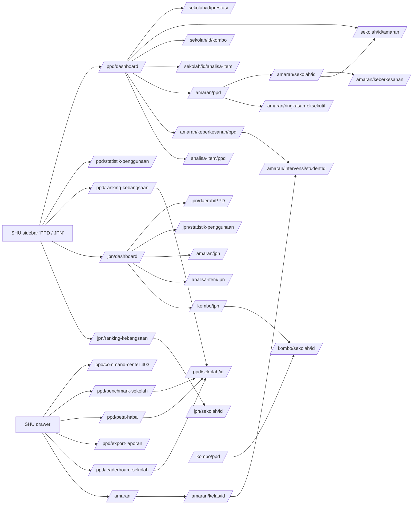

# M18 — PPD & JPN: district / state education-office portals, Amaran Awal (early warning), school drill-downs (Discovery)

- **Source:** live read-only walk-through of https://prestasiplus.my on **2026-09-26** with the admin account (browser lane 2, `playwright2`). Credentials are not stored. No PPD (`ppd_officer`) or JPN (`jpn_officer`) account was used and no "Login As" / impersonation was done.
- **Screenshots:** `docs/discovery/img/M18/` (63 files, §10). Every page was masked in the DOM before capture. The user-portal shell (`SHU`) and its design tokens are in [00-global-ui.md](00-global-ui.md) and are not repeated here.
- **Language:** UI copy is quoted in its exact Bahasa Melayu. Some copy is English or mixed on live ("Benchmark Sekolah", "Leaderboard Sekolah", "Command Center", "On Track", "Coverage Headcount", "Funnel", "Accuracy", "Below", "Top 50 Sekolah", "Live Feed", "Powered by ALESA AI").
- **Personal data:** students are minors. `tools/jobs/M18.js` → `M18MASK` tags person-name nodes (links to `/prestasi/{id}`, `/headcount/student/{id}`, `/amaran/intervensi/{id}`, `/prestasi/sekolah/{id}/guru/{id}`; the name line of every "PELAJAR" table cell; intervention rows; the JPN command-center student/feed names), strips Cloudflare e-mail payloads, blanks avatars, masks intervention notes in place and replaces the student name in the intervention page title. `tools/sanitize.js` then runs with `{selectors:['.m18n'], localSelectors:['.m18l'], keepCols:'^pelajar$', titleName:false}` and masks the "Nama", "Nama Pelajar", "No. IC", "Email" and "Guru" columns. School, PPD and state names are public anchors and are kept. No person name, e-mail or IC number is in any file (independent hash check, `inventory/M18/_summary.md`).
- **Seed snapshot:** `docs/discovery/inventory/M18/_snapshot-2026-09-26.json`, main pass captured **2026-09-26 12:36 MYT (04:36:44Z)** by `tools/jobs/M18-snapshot.js` (55 pages: every table with all rows, every select, all KPI text, link-pattern counts, Chart.js data, the JPN live-data JSON), plus a supplement for the three Kombo views (§2.31–2.33) and the layout measurements of `tools/jobs/M18-measure.js` (33 routes × 375/768/1280, key `layout`). Person names in it are `<student:n>` / `<teacher:n>` tokens. **The snapshot is the seed source.**
- **Element inventory:** **2,264 content elements** over 33 screens and 136 captured UI states, IDs `EL-M18-S#-nnn`, in `docs/discovery/inventory/M18/<S#-key>.json`, plus the shell file `SHU-user-shell.json` (417). Reconciliation, the crawl and the read-only limits are in `docs/discovery/inventory/M18/_summary.md`.
- **Safety:** nothing was submitted, exported, downloaded, printed or changed. Never triggered: every "Muat Turun CSV" / "Eksport CSV" / "Muat Turun Laporan CSV" (downloads), "Cetak / PDF" (`window.print()`), the "Tapis" buttons of the GET filter forms (filters were opened by URL instead), "Simpan Intervensi" (POST), the per-record "Belum Dinilai" select (`onchange="this.form.submit()"` → PATCH), the follow-up "Simpan" (PATCH), the trash button (DELETE after `confirm('Padam intervensi ini?')`) and "Tunjuk IC Penuh" (`confirm()` + PDPA audit claim). Client-side reveals only (Alpine tabs, accordions, the follow-up pencil, tablePager "next", the JPN search box and district select). The JPN command center's own 10-second poll of `/jpn/command-center/live-data` ran while the page was open; the JSON was also read once directly. Scripted GETs ran one at a time with ≥ 350 ms between navigations (≥ 400 ms in the crawl and the snapshot).

Cross-references (owned elsewhere, not re-inventoried):
- **Users, schools, districts, states → M01 / M02** (D12). Every school / student / teacher count on these pages is a count over the M02 users store and the M02 schools dataset (district = `PPD …`, state, active flag). Canonical accounts 9 (`ppd_officer`, "Pegawai PPD Demo") and 10 (`jpn_officer`, "Pegawai JPN Demo", ppdState "Selangor" per M02 SRS) own the M18 routes in the rebuild (M01 BR-07 landing `/ppd/dashboard`, `/jpn/dashboard`).
- **Practice sessions, answers, accuracy, kombo counters → M05**; **headcount marks / GPS / grade → M08** (`/headcount/*`, `/prestasi/*`, `/analisa-item/sekolah/{id}` are M08 routes); **mastery "Tahap" ladder → M05/M08**; **monitoring per school → M11** (`/guru/monitoring/sekolah/{id}`, same 8880 / 8765 anchors); **Command Center (teacher) → M10**; **Kirkpatrick → M12**; **leaderboards of students → M08 / M14**; **admin dashboard figures for the same schools → M17**.
- Links that leave M18 (classified in `_crawl.json`): `/prestasi/sekolah`, `/prestasi/tingkatan/t4`, `/prestasi/tingkatan/t5`, `/prestasi/{userId}`, `/prestasi/sekolah/{id}/guru/{id}`, `/headcount/student/{id}`, `/analisa-item/sekolah/{id}` → **M08**; `/dashboard` → M01/M05 shell; `/kombo` → M14.

---

## 1. Overview

The TRACKER checklist has 11 M18 routes. Admin can open all of them except `/ppd/command-center` (**403**). The crawl found **22 more M18 routes** (33 screens in total) and 10 URLs that return 404 / 403 / 500:

| # | Route | Tab title · shell header (h1 / sub) | Status for the admin account |
|---|---|---|---|
| S1 | `/ppd/dashboard` | "Dashboard PPD \| PRESTASIPLUS" · "Dashboard PPD" / "PPD KLUANG, Johor" | 200 — scope PPD KLUANG, Johor |
| S2 | `/ppd/command-center` | "403 - Akses Ditolak \| PRESTASIPLUS" · global 403 page | **403** |
| S3 | `/ppd/statistik-penggunaan` (`?period=`) | "Statistik Penggunaan Daerah — PPD KLUANG" · "Statistik Penggunaan Daerah" | 200, empty |
| S4 | `/ppd/ranking-kebangsaan` (`?period=`) | "Ranking Sekolah 1 Malaysia — PRESTASIPLUS" · "Ranking Sekolah 1 Malaysia" | 200, 7 schools |
| S5 | `/ppd/benchmark-sekolah` (`?subject_id=`) | "Benchmark Sekolah — PPD KLUANG" · "Benchmark Sekolah Daerah" | 200, 116 schools |
| S6 | `/ppd/peta-haba` | "Peta Haba Prestasi — PPD KLUANG" · "Peta Haba Prestasi Daerah" | 200, 116 schools × 7 |
| S7 | `/ppd/export-laporan` | "Eksport Laporan — PPD KLUANG" · "Eksport Laporan Daerah" | 200 (the `?format=csv` download was not opened) |
| S8 | `/ppd/leaderboard-sekolah` (`?subject_id=`) | "Leaderboard Sekolah — PPD KLUANG" · "Leaderboard Sekolah Daerah" | 200, 116 schools |
| S9 | `/ppd/sekolah/{id}` (**new**; `?grade&class_id&subject_id`) | "{SEKOLAH} — Statistik" · "{SEKOLAH}" / "PPD KLUANG, Johor" | 200 (8880, 8765 and any national school id); `99999999` → 404 |
| S10 | `/jpn/dashboard` | "Dashboard JPN \| PRESTASIPLUS" · "Dashboard JPN" / "Johor" | 200 — scope Johor |
| S11 | `/jpn/command-center` (**new**) | "Command Center JPN — Johor" · standalone dark page, no shell | 200 (script errors, §8.2) |
| S12 | `/jpn/statistik-penggunaan` | "Statistik Penggunaan Negeri — Johor" · "Statistik Penggunaan Negeri" | 200, "Data belum tersedia" |
| S13 | `/jpn/ranking-kebangsaan` (`?period=`) | "Ranking Kebangsaan — PRESTASIPLUS" · "Ranking Kebangsaan 1 Malaysia" / "JPN Johor" | 200 |
| S14 | `/jpn/daerah/{PPD name}` (**new**) | "{PPD} — Statistik Daerah" · "{PPD}" | 200 for the 11 Johor PPDs, "Data belum tersedia"; `BOGUS` → 404 |
| S15 | `/jpn/sekolah/{id}` (**new**) | "{SEKOLAH} — Statistik" | 200 (same template as S9) |
| S16 | `/amaran` | "Amaran Awal — Kelas \| PRESTASIPLUS" · "Amaran Awal — Kelas" / "Pilih kelas untuk lihat status risiko pelajar" | 200, every class of the system |
| S17 | `/amaran/kelas/{id}` (**new**) | same tab title · "Amaran Awal — Kelas" / "{kelas} — {subjek}" | 200; `99999999` → **403** |
| S18 | `/amaran/ppd` (**new**) | "Amaran Awal — PPD \| PRESTASIPLUS" · "Amaran Awal — Daerah" / "PPD BATANG PADANG, Perak" | 200 — scope **PPD BATANG PADANG, Perak** |
| S19 | `/amaran/jpn` (**new**) | "Amaran Awal — JPN \| PRESTASIPLUS" · "Amaran Awal — Negeri" / "Perak" | 200 — scope **Perak** |
| S20 | `/amaran/keberkesanan/ppd` (**new**; `?school_id=`) | "Keberkesanan Intervensi - PPD KLUANG" · "Keberkesanan Intervensi (Daerah)" / "PPD KLUANG, Johor · 118 sekolah" | 200 |
| S21 | `/amaran/keberkesanan` (**new**) | "Keberkesanan Intervensi - SEKOLAH KEBANGSAAN MERU RAYA" | 200, empty (admin's own school) |
| S22 | `/amaran/sekolah/{id}` (**new**) | "Amaran Awal — Sekolah \| PRESTASIPLUS" · "Amaran Awal — Sekolah" / "{SEKOLAH}" | 200 |
| S23 | `/amaran/ringkasan-eksekutif` (**new**; `?scope=district\|state\|school`) | "Ringkasan Eksekutif — {scope} \| PRESTASIPLUS" · "Ringkasan Eksekutif" | 200 (no query = district BATANG PADANG) |
| S24 | `/amaran/intervensi/{studentId}` (**new**) | "Log Intervensi — {nama pelajar} \| PRESTASIPLUS" · "Log Intervensi" / "{nama}" | 200 (forms never submitted) |
| S25 | `/analisa-item/ppd` (**new**) | "Analisa Item PPD \| PRESTASIPLUS" · "Analisa Item — PPD" | 200 — scope PPD KLUANG |
| S26 | `/analisa-item/jpn` (**new**) | "Analisa Item JPN \| PRESTASIPLUS" · "Analisa Item — JPN" | 200 — scope Johor |
| S27 | `/sekolah/{id}/prestasi` (**new**) | "Dashboard Sekolah — Prestasi" · shell "Dashboard" / "Selamat datang kembali" | 200 |
| S28 | `/sekolah/{id}/amaran` (**new**; `?tingkatan=T4\|T5`) | "Amaran Awal — Sekolah \| PRESTASIPLUS" · "Amaran Awal — Sekolah" / "{SEKOLAH}" (+ " — Tingkatan 4/5") | 200 |
| S29 | `/sekolah/{id}/kombo` (**new**) | "{SEKOLAH} — Kombo Harian \| PRESTASIPLUS" · "Kombo Harian — {SEKOLAH}" | 200 |
| S30 | `/sekolah/{id}/analisa-item` (**new**; `?tingkatan=`) | "Analisa Item Sekolah \| PRESTASIPLUS" · "Analisa Item — Sekolah" | 200; unknown id → **200** "Sekolah Tidak Dinyatakan" |
| S31 | `/kombo/ppd` (**new**) | "Kombo Harian PPD \| PRESTASIPLUS" · "Kombo Harian — PPD" | 200 — scope PPD BATANG PADANG |
| S32 | `/kombo/jpn` (**new**) | "Kombo Harian JPN \| PRESTASIPLUS" · "Kombo Harian — JPN" | 200 — scope Perak |
| S33 | `/kombo/sekolah/{id}` (**new**) | "{SEKOLAH} — Kombo Harian \| PRESTASIPLUS" | 200; `99999999` → **500** "Ralat Pelayan" |

Probed and not found (global 404 "Halaman Tidak Dijumpai"): `/ppd`, `/jpn`, `/jpn/benchmark-sekolah`, `/jpn/peta-haba`, `/jpn/export-laporan`, `/jpn/leaderboard-sekolah`, `/amaran/keberkesanan/jpn`, `/amaran/export`, `/ppd/sekolah/99999999`, `/jpn/sekolah/99999999`, `/jpn/daerah/BOGUS`. `/kombo` (M14) redirects the admin to `/dashboard`. So **JPN has no benchmark, heat map, export, leaderboard or intervention-effectiveness page** of its own; those exist only for PPD.

**Scope of the admin account (observed, not explained by any UI):** the PPD pages (S1, S3–S9, S20, S25) resolve to **PPD KLUANG, Johor**; the JPN pages (S10–S15, S26) to **Johor**; but **Amaran PPD / JPN, Kombo PPD / JPN and the default Ringkasan Eksekutif** resolve to **PPD BATANG PADANG, Perak** / **Perak**, and `/amaran/keberkesanan` to the school **SEKOLAH KEBANGSAAN MERU RAYA**. There is no district / state picker for the admin. What a real PPD / JPN officer sees (their own district / state from the account's PPD / state field, M02 "Pegawai PPD" form) is not observable (Q-M18-1).

**Entry points** (shell inventory `SHU-user-shell.json`):
- SHU desktop sidebar, group **"PPD / JPN"** (`EL-M18-SHU-104`): "Dashboard PPD" (`fa-building-columns`) → `/ppd/dashboard`; "Statistik PPD" (`fa-chart-pie`) → `/ppd/statistik-penggunaan`; "Ranking Kebangsaan" (`fa-trophy`) → `/ppd/ranking-kebangsaan`; "Dashboard JPN" (`fa-building-flag`) → `/jpn/dashboard`; "Ranking Kebangsaan JPN" (`fa-trophy`) → `/jpn/ranking-kebangsaan`.
- SHU mobile drawer (hidden until opened): "Command Center LIVE" (`fa-satellite-dish`) → `/ppd/command-center`, "Dashboard PPD", "Statistik Penggunaan" (PPD), "Ranking Kebangsaan", "Benchmark Sekolah" (`fa-ranking-star`), "Peta Haba" (`fa-map-location-dot`), "Export Laporan" (`fa-file-export`), "Leaderboard Sekolah" (`fa-trophy`), "Dashboard JPN", "Statistik Penggunaan" (JPN), "Ranking Kebangsaan" (JPN), and "Amaran Awal" (`fa-exclamation-triangle`) → `/amaran` (twice in the drawer). The desktop sidebar has **no** link to benchmark / heat map / export / leaderboard / command center (00-global-ui G-D4, D-M18-18).
- "Amaran Awal" → `/amaran` also sits in the teacher group "PENILAIAN" (M11 note).
- The **admin panel sidebar (`/admin`) has no PPD / JPN link at all.**
- In-page: S1 "Laporan Terperinci" → S3, S18 (`/amaran/ppd`), S25 (`/analisa-item/ppd`), S20 (`/amaran/keberkesanan/ppd`), S1; S10 "Laporan Terperinci" → S12, S19, S26, **S32 (`/kombo/jpn`)**; S1 tables → S27 (`/sekolah/{id}/prestasi`), S28 (`/sekolah/{id}/amaran`), S29 (`/sekolah/{id}/kombo`), S30 (`/sekolah/{id}/analisa-item`); S4/S5/S6/S8 school names → S9; S13 → S15; S10 district names → S14; S16 cards → S17; S17 "Intervensi" → S24; S18/S19 school names → S22; S31/S32 → S33.

### 1.1 Shell by screen

| Screen | Shell | Evidence |
|---|---|---|
| S1, S3–S10, S12–S33 | `SHU` user portal (header chips "256 koin", "8 mata", "1 hari 🔥", bell "99+"; the header title and sub-title are page-specific, table above) | tournament banner in `<main>`; shell sidebar |
| S2, S14/S9/S15 404, S17 403, S33 500 | global error pages (no shell) | — |
| S11 | none — standalone full-screen page (Inter + JetBrains Mono, dark navy) | own `<head>` |

The TRACKER and `docs/design/shells.md` assume `/ppd/*` and `/jpn/*` use the **admin panel** shell; on live they render in the **user-portal shell** (SHU), for the admin account. Whether a real `ppd_officer` / `jpn_officer` gets the same shell is not observable (Q-M18-2).

---

## 2. Screens

Common patterns:
- **Breadcrumb row** (`text-sm`): back link with `fa-arrow-left`, "/", current page label. Labels per screen are listed below.
- **Header card** (`card`, gradient icon tile): h2 with the scope name (PPD / state), a sub line and 1–3 small counters on the right ("118" / "Sekolah", "135" / "Pelajar").
- **Period pills** (S3, S4, S13): links "Hari Ini" (`fa-calendar-day`, `period=today`), "7 Hari" (`fa-calendar-week`, `period=7days`), "30 Hari" (`fa-calendar`, `period=30days`, default). Unknown `period=bogus` behaves as the default.
- **Rank medals:** 🥇 🥈 🥉 then the number. On S5 and S8 place 1 shows **"🏋"** (weight-lifter emoji) instead of 🥇 (D-M18-6). Legend texts "Tempat 1 — Emas", "Tempat 2 — Perak", "Tempat 3 — Gangsa" are `sr-only`/tooltip texts next to the medals.
- **Client-side table pager** (S1 `tablePager(20)`, S10 `table[data-paginate]`): 20 rows per page. S1 shows "{a}–{b} daripada {n}" and "{page} / {pages}" with chevron buttons; S10 shows "Menunjukkan {a}–{b} daripada {n} sekolah" with numbered buttons (1, 2, …, last). S1's GPS table has a search box "Cari sekolah..." (Alpine `search`).

### 2.1 S1 — `/ppd/dashboard` "Dashboard Agregat Pejabat Pendidikan Daerah"

Screenshots: `ppd-dashboard-desktop.png`, `ppd-dashboard-tablet.png`, `ppd-dashboard-mobile.png`.

- Breadcrumb "Papan Pemuka" → `/ppd/dashboard` (self) / "Dashboard PPD". Header: h2 "PPD KLUANG", "Johor", "Dashboard Agregat Pejabat Pendidikan Daerah", counters "118" "Sekolah", "135" "Pelajar".
- **7 KPI cards** (`grid-cols-2 lg:grid-cols-3`; label uppercase):
  | Label | Value | Sub-lines |
  |---|---|---|
  | "Jumlah Sekolah" | 118 | "Semua sekolah daftar di daerah (termasuk inactive)" |
  | "Jumlah Pelajar" | 135 | "Enrolmen pelajar (semua, termasuk belum aktif)" |
  | "GPS Purata" | "2.49" + grade chip "A-" | "Gred Purata Sekolah · Skala 1.00–9.00 (rendah=baik) · Hanya pelajar yang ada markah Headcount" |
  | "Pelajar Berisiko Merah" | 135 | "100% daripada 135 pelajar" · "Zon risiko gagal SPM (EWS) · perlu intervensi segera" · "⚠ Drp ini: **86** akademik berisiko, **49** belum mula latih" |
  | "Ketepatan Keseluruhan" | 71.6% | "% jawapan betul dari semua quiz pelajar (lifetime)" |
  | "Kombo Aktif" | 81 | "daripada 135 pelajar" · "Pelajar dgn streak latih tubi harian aktif (engagement)" |
  | "Coverage Headcount" | "64" "(47.4%)" | "daripada 135 pelajar enrolled" · "Pelajar yang ada markah Headcount masuk · skop GPS calc" · "📊 Funnel: 65 dlm Headcount (48.1%) → 64 ada markah" |
- **"Prestasi GPS — Perbandingan Sekolah"** — "Kedudukan sekolah mengikut Gred Purata Sekolah (GPS) — lebih rendah lebih baik"; search "Cari sekolah..."; table "#" · "Sekolah" (link `fa-external-link-alt` → `/sekolah/{id}/prestasi`) · "GPS" · "Gred" · "Pelajar"; 118 rows, only SMK TINGGI KLUANG has a GPS (2.49 A-, 59 pelajar); every other school "—" "—". Pager "1–20 daripada 118", "1 / 6".
- **"Amaran Awal — Taburan Risiko"** — "Taburan risiko pelajar merentasi sekolah dalam daerah"; three tiles "0" "On Track" "0%", "0" "Perlu Perhatian" "0%", "135" "Berisiko Tinggi" "100%"; bar "Taburan Risiko Keseluruhan Daerah" with legend "Hijau: 0", "Kuning: 0", "Merah: 135"; table "#" · "Sekolah" (→ `/sekolah/{id}/amaran`) · "Pelajar" · "Hijau" · "Kuning" · "Merah" — **7 rows** (only schools with students; pager "1–7 daripada 7", hidden when ≤ 20).
- **"Analisa Item — Prestasi Mengikut Subjek"** — "Ketepatan jawapan merentasi semua subjek dalam daerah"; one card per subject (ascending accuracy): name, %, "{n} pelajar" (`fa-users`), "{n} soalan" (`fa-list-check`), "{n} salah" (`fa-times-circle`). Values: Sejarah 70.7% · 31 · 1,154 · 649; Sains 70.9% · 29 · 1,094 · 539; Bahasa Melayu 71.1% · 32 · 545 · 634; Bahasa Inggeris 71.9% · 29 · 851 · 539; Matematik 72.6% · 37 · 828 · 631; Pendidikan Islam 92.3% · 1 · 50 · 4. ("salah" > "soalan" for Bahasa Melayu — D-M18-9.)
- **"Kombo Latihan — Gambaran Daerah"** — "Penglibatan harian pelajar merentasi sekolah dalam daerah"; tiles "81" "Kombo Aktif", "135" "Jumlah Pelajar", "7.2" "Purata Kombo", "0" "Berlatih Hari Ini"; table "#" · "Sekolah" (→ `/sekolah/{id}/kombo`) · "Pelajar" · "Kombo Aktif" · "Purata Kombo" ("{x} hari"); 118 rows; the "Pelajar" column is **0 on every row** while Kombo Aktif is 18, 14, 12 … (D-M18-10).
- **"Tahap Penguasaan — Taburan Daerah"** — "Taburan tahap penguasaan pelajar merentasi daerah"; note "📊 **38 catatan penguasaan** daripada **12 pelajar unik** (1 pelajar boleh ada catatan untuk pelbagai subjek)"; 11 level tiles with "{n} catatan" and "({p}%)": Pemula 14 (36.8%), Mula Belajar 20 (52.6%), Aktif 4 (10.5%), Tekun, Mahir, Pakar Muda, Cemerlang, Master, Grandmaster, Legend, Mythical 0 (0%); table "#" · "Sekolah" (→ `/sekolah/{id}/analisa-item`) · "Pelajar" (0 on every row) · "Purata Tahap" ("1.2" "Mula Belajar" …).
- **"Pembetulan — Gambaran Daerah"** — "Kadar pembetulan pelajar untuk September 2026"; amber notice `fa-triangle-exclamation` "Tiada data pembetulan untuk bulan ini (2026-09)" + "Data agregat dijana oleh `php artisan correction:backfill`. Jika konsisten kosong, cron mungkin terhenti. Hubungi admin teknikal." (developer text shown to officers, D-M18-11); tiles "135" "Jumlah Pelajar", "0" "Jumlah Pembetulan", "0.0%" "Kadar Purata"; table "#" · "Sekolah" (→ `/sekolah/{id}/prestasi`) · "Pelajar" · "Pembetulan" ("0 pelajar (0%)").
- **"Laporan Terperinci"** — "Akses laporan mendalam untuk setiap modul"; 5 link tiles: "Statistik Penggunaan" (`fa-chart-pie`) → S3, "Amaran Awal PPD" (`fa-bell`) → S18, "Analisa Item PPD" (`fa-chart-bar`) → S25, "Keberkesanan Intervensi" (`fa-chart-pie`) → S20, "Papan Pemuka" (`fa-house`) → S1 (self).

### 2.2 S2 — `/ppd/command-center` (403)

Screenshot: `ppd-command-center-403.png`. Global 403 page: "403", "🚫", h1 "Akses Ditolak", "Anda tidak mempunyai kebenaran untuk mengakses halaman ini. Sila log masuk dengan akaun yang betul atau hubungi pentadbir.", buttons "Halaman Utama" → `/`, "Log Masuk" → `/login`, "PRESTASIPLUS". The admin can open every other PPD page but not this one; the PPD command center needs a `ppd_officer` account (Q-M18-3). The JPN equivalent (S11) opens for the admin.

### 2.3 S3 — `/ppd/statistik-penggunaan` "Statistik Penggunaan PRESTASIPLUS Dalam Daerah"

Screenshots: `ppd-statistik-desktop.png`, `ppd-statistik-mobile.png`.
- Breadcrumb "Dashboard PPD" → S1 / "Statistik Penggunaan". Header "PPD KLUANG" "Johor", sub "Statistik Penggunaan PRESTASIPLUS Dalam Daerah", counters "0" "Sekolah", "0" "Pelajar Aktif". Period pills.
- Only the empty state was observed (all periods): card "Tiada data untuk tempoh ini" + "Tiada aktiviti latihan dalam tempoh 30 Hari yang lepas." (`period=7days`: "… 7 Hari …"; `period=today`: "Belum ada pelajar buat latihan hari ini. Cuba lihat **7 Hari** atau **30 Hari**." with the two words as links). The filled layout is not observable (Q-M18-4).

### 2.4 S4 — `/ppd/ranking-kebangsaan` "Ranking Sekolah 1 Malaysia"

Screenshots: `ppd-ranking-desktop.png`, `ppd-ranking-mobile.png`.
- Breadcrumb "Dashboard PPD" / "Ranking Kebangsaan". h2 "Ranking Sekolah 1 Malaysia", sub "Top 50 sekolah paling aktif merentas seluruh Malaysia · {30 Hari|7 Hari|Hari Ini}". Period pills.
- Card "Top 50 Sekolah — 1 Malaysia" / "Berdasarkan jumlah jawapan betul · {period}"; table "#" · "Sekolah" (→ `/ppd/sekolah/{id}`) · "Daerah / Negeri" (PPD line + state line) · "Pelajar" · "Betul" · "Dijawab" · "Ketepatan" (colour badge).
- Data (national, not the officer's district): 30 Hari 7 schools — SMK ENGKU HUSAIN (8082) 24 · 8,351 · 9,195 · 90.8%; SMK BANDAR RINCHING (8106) 24 · 5,317 · 6,462 · 82.3%; SMK KHIR JOHARI (8080) 18 · 3,710 · 4,271 · 86.9%; SMK BANDAR BARU BANGI (8078) 16 · 1,298 · 1,506 · 86.2%; SMK PANDAN INDAH (8090) 5 · 726 · 857 · 84.7%; SMK JALAN TIGA (8088) 1 · 15 · 20 · 75.0%; SAM MUHAMMADIAH (8284, PPD SABAK BERNAM) 1 · 3 · 5 · 60.0%. 7 Hari: order KHIR JOHARI 6 · 1,365 · 1,584 · 86.2%, BANDAR RINCHING 13 · 1,247 · 1,567 · 79.6%, ENGKU HUSAIN 8 · 1,084 · 1,256 · 86.3%, BANDAR BARU BANGI 6 · 251 · 325 · 77.2%, PANDAN INDAH 2 · 89 · 95 · 93.7%, JALAN TIGA, SAM MUHAMMADIAH (same as 30 Hari). Hari Ini: ENGKU HUSAIN 1 · 57 · 60 · 95.0%. The "7 Hari" JALAN TIGA / SAM MUHAMMADIAH rows equal their 30-day rows (INFERRED: activity older than 7 days is included, D-M18-12).

### 2.5 S5 — `/ppd/benchmark-sekolah` "Perbandingan prestasi semua sekolah dalam daerah"

Screenshots: `ppd-benchmark-desktop.png`, `ppd-benchmark-mobile.png`.
- Breadcrumb "Dashboard PPD" / "Benchmark Sekolah". Header "PPD KLUANG" "Johor", sub "Perbandingan prestasi semua sekolah dalam daerah", counters "116" "Sekolah", "0.6%" "Purata Ketepatan", "0%" "Purata Aktif".
- Filter card "Tapis Mata Pelajaran": GET form → `/ppd/benchmark-sekolah`, select `subject_id` (32 options: "Semua Mata Pelajaran", then "Bahasa Inggeris (Teras)" 2, "Bahasa Melayu (Teras)" 1, "Matematik (Teras)" 3, "Pendidikan Islam (Teras)" 6, "Pendidikan Moral (Teras)" 7, "Sains (Teras)" 4, "Sejarah (Teras)" 5, then 24 electives A–Z — Appendix A.1), button "Tapis" (`fa-filter`); when a subject is set a link "Kosongkan" (`fa-times`) → `/ppd/benchmark-sekolah` appears. Note "Skor Komposit = (% Aktif × 0.4) + (Purata Ketepatan × 0.3) + (Soalan/Pelajar × 0.3, ternormal) — Lebih tinggi lebih baik."
- Card "Kedudukan Sekolah" (with subject: "Kedudukan Sekolah — Matematik"), button "Eksport CSV" (`fa-download`; `href` = the current URL, `onclick` `window.location='/ppd/export-laporan?district=PPD+KLUANG&state=Johor&format=csv'` — the subject filter is not passed, D-M18-13). Table "#" · "Sekolah" (name link → `/ppd/sekolah/{id}` + school code line, e.g. "JEA2029") · "Pelajar" · "Aktif" · "% Aktif" · "Ketepatan" (badge) · "Soalan Dijawab" ("222" + "(10.6/pelajar)") · "Skor".
- 116 rows; 5 have pupils: SMK LAYANG-LAYANG (8765) 21 · 0 · 0% · 73.1% · 222 (10.6/pelajar) · 22.6; SJKC CHONG HWA I (3160) 12; SK SERI KENCANA (2700) 14; SMK TAMAN KLUANG BARAT (8772) 12; SMK TUN HUSSEIN ONN (8767) 13 (Σ 72). Rows 2–116 are ordered by name. `subject_id=3`: LAYANG-LAYANG 76.3%. Unknown `subject_id=99999` → same as all subjects, no heading suffix.

### 2.6 S6 — `/ppd/peta-haba` "Peta Haba Prestasi Daerah — PPD KLUANG"

Screenshots: `ppd-peta-haba-desktop.png`, `ppd-peta-haba-mobile.png`.
- Breadcrumb "Dashboard PPD" / "Peta Haba". h2 "Peta Haba Prestasi Daerah — PPD KLUANG", sub "Prestasi rata-rata ketepatan pelajar mengikut sekolah dan mata pelajaran teras · 7 subjek × 116 sekolah".
- Legend "Petunjuk Warna:" "Cemerlang" "> 70%", "Sederhana" "41–70%", "Lemah" "≤ 40%", "Tiada Data".
- Card "Prestasi Ketepatan (%) — Mata Pelajaran Teras × Sekolah"; hint "Skrol ke kanan untuk melihat semua subjek pada skrin kecil."; table "Sekolah" (→ `/ppd/sekolah/{id}`) · 7 truncated subject headers "Bahasa Ingge…", "Bahasa Melay…", "Matematik", "Pendidikan I…", "Pendidikan M…", "Sains", "Sejarah" · "Purata"; 116 school rows + footer row "Purata Daerah" (— · 60.3% · 76.3% · 92.2% · — · — · 72.3%). Non-empty rows: CHONG HWA I (BI 0%), SERI KENCANA (BM 0%, MT 0%, SEJ 0%), LAYANG-LAYANG (BM 60.3%, MT 76.3%, PI 92.2%, SEJ 72.3%, Purata 75.3%), TUN HUSSEIN ONN (Sains 0%, Sejarah 0%). Footer text "Sel merah menunjukkan purata ketepatan ≤ 40% — sekolah dan mata pelajaran berkenaan memerlukan perhatian segera. Klik nama sekolah untuk melihat laporan terperinci."

### 2.7 S7 — `/ppd/export-laporan` "Eksport data prestasi semua sekolah dalam daerah ke CSV"

Screenshots: `ppd-export-desktop.png`, `ppd-export-mobile.png`.
- Breadcrumb "Dashboard PPD" / "Eksport Laporan". Header "PPD KLUANG", sub "Eksport data prestasi semua sekolah dalam daerah ke CSV"; 5 stats (`grid-cols-2 sm:grid-cols-3 lg:grid-cols-5`): "116" "Jumlah Sekolah", "72" "Jumlah Pelajar", "0" "Pelajar Aktif", "0.6%" "Purata Ketepatan", "222" "Soalan Dijawab".
- Card "Muat Turun Laporan CSV": "Fail CSV mengandungi data 116 sekolah dengan lajur: Nama, Kod, Daerah, Pelajar, Aktif, % Aktif, Ketepatan, Soalan, Risiko Kritikal, Risiko Tinggi, Skor." · `fa-info-circle` "Data dikira berdasarkan rekod terkini. Fail akan terbuka terus dengan Microsoft Excel atau Google Sheets." · button **"Muat Turun CSV"** (`fa-download`) → `/ppd/export-laporan?format=csv` (not opened) · meta "Format: CSV (UTF-8 BOM)" (`fa-file-csv`), "Dijana: 26 Sep 2026, 04:21" (`fa-calendar`, server time = UTC, D-M18-14), "Daerah: PPD KLUANG, Johor" (`fa-map-marker-alt`).
- Card "Pratonton Data (5 Sekolah Pertama)" / "Data sebenar dalam fail CSV": table "Nama Sekolah" · "Kod" · "Pelajar" · "Aktif" · "% Aktif" · "Ketepatan" · "Soalan" · "Kritikal" · "Tinggi" · "Skor" (5 alphabetical rows, all 0 / "—"), footer "Menunjukkan 5 dari 116 sekolah. Muat turun CSV untuk data lengkap." The preview has no "Daerah" column although the CSV text lists one.

### 2.8 S8 — `/ppd/leaderboard-sekolah` "Kedudukan sekolah berdasarkan skor komposit"

Screenshots: `ppd-leaderboard-desktop.png`, `ppd-leaderboard-tablet.png`, `ppd-leaderboard-mobile.png`, `ppd-leaderboard-tab-subjek.png`.
- Breadcrumb "Dashboard PPD" / "Leaderboard Sekolah". Header "PPD KLUANG" "Johor", "Kedudukan sekolah berdasarkan skor komposit — aktiviti, ketepatan & jumlah soalan", "116" "Sekolah".
- Alpine tabs (`x-data="{ tab: 'keseluruhan' }"`): "Keseluruhan" (`fa-list-ol`) and "Ikut Subjek" (`fa-book`). Both tabs show the same subject filter card "Tapis Mata Pelajaran" (select `subject_id`, 32 options, "Tapis", "Kosongkan" when set) — the tab only changes its own highlight (D-M18-15).
- Note "Skor Komposit = (% Aktif × 0.4) + (Purata Ketepatan × 0.3) + (Soalan/Pelajar × 0.3, ternormal) — Trend berdasarkan perbandingan 30 hari terkini vs 30 hari sebelumnya."
- **"Podium Teratas Daerah"**: three columns in podium order 2 · 1 · 3 — "KOLEJ VOKASIONAL KLUANG" "0" "🥈" "Tempat 2"; "SEKOLAH MENENGAH KEBANGSAAN LAYANG-LAYANG" "21.9" "🏋" "Tempat 1"; "SEKOLAH JENIS KEBANGSAAN (CINA) CHIAN BEE" "0" "🥉" "Tempat 3".
- **"Kedudukan Penuh"** (with subject: "Kedudukan Penuh — Matematik") + "Eksport CSV" → `/ppd/export-laporan` (a page, not a file). Desktop table (≥ 640 px): "#" · "Sekolah" (+ code) · "Pelajar" · "Aktif" · "% Aktif" · "Ketepatan" · "Soalan/Pelajar" · "Trend" (icons with titles "Meningkat" / "Menurun" / "Stabil"; empty on every row) · "Skor". Mobile (< 640 px): card list (`sm:hidden`) — rank ("🏋", "🥈", "🥉", "#4" …), school link, score, "{n} pelajar" (`fa-users`), "{n} aktif ({p}%)" (`fa-user-check`), badge "{p}% tepat".
- LAYANG-LAYANG scores **21.9** here and **22.6** on S5 for the same formula text (D-M18-16).

### 2.9 S9 — `/ppd/sekolah/{id}` "{SEKOLAH} — Statistik" (new) — also S15 `/jpn/sekolah/{id}`

Screenshots: `ppd-sekolah-desktop.png`, `ppd-sekolah-mobile.png`, `ppd-sekolah-class-open.png`, `jpn-sekolah-desktop.png`.
- Breadcrumb "Ranking Kebangsaan" → `/ppd/ranking-kebangsaan` (S15: "PPD KLUANG") / "{SEKOLAH}". Header: h2 school name, code ("JEB2037"), "PPD KLUANG" (`fa-map-marker-alt`), "|", "Johor" (`fa-flag`), "|", "SMK" (`fa-tag`); counters "59" "Pelajar", "6.8%" "Penggunaan", "0" "Aktif 7 Hari".
- Filter card (GET form → same URL): "Tingkatan / Darjah" `grade` ("Semua", "Darjah 6" D6, "Tingkatan 1"…"Tingkatan 5" T1–T5 — only levels the school has), "Kelas" `class_id` ("Semua Kelas", "— 4 Simulasi" 516, "— 5 Simulasi" 517), "Subjek" `subject_id` ("Semua Subjek" + the school's subjects), "Tapis" (`fa-filter`); "Reset" (`fa-times`) → `/ppd/sekolah/{id}` when a filter is set.
- 6 stat cards: "Jumlah Pelajar" 59; "Sudah Guna" 4 "Pelajar yang telah menjawab"; "Belum Guna" 55 "Belum pernah menjawab soalan"; "% Penggunaan" 6.8%; "Aktif 7 Hari" 0 "Latihan dalam 7 hari lepas"; "Purata Sesi / Pelajar" 15 "sesi per pelajar aktif".
- Sticky section nav (`officerSchoolNav()`, IntersectionObserver): links "Bulanan", "Kalendar", "Subjek", "Ranking", "Kelas", "Pelajar", "Guru" → `#sec-…`.
- **"Statistik Bulanan"** "12 bulan terakhir — pecahan prestasi mengikut bulan" (with a subject filter: "… (subjek ditapis)"): "Bulan" · "Soalan Dijawab" · "Soalan Betul" · "Pelajar Aktif" · "Purata/Pelajar" · "Accuracy"; 8880: Feb 2026 124 · 84 · 3 · 41.3 · 67.7%, Mar 2026 551 · 401 · 3 · 183.7 · 72.8%; 8765: Jan 15 · 9 · 1 · 15 · 60%, Feb 159 · 111 · 2 · 79.5 · 69.8%, Mar 125 · 115 · 1 · 125 · 92%, Apr 10 · 7 · 1 · 10 · 70%, footer "Jumlah" 309 · 242 · — · — · 78.3%. Empty: "Tiada data" / "Tiada aktiviti direkodkan buat masa ini".
- **"Kalendar Aktiviti Harian"** "365 hari — semakin gelap, semakin ramai pelajar aktif": "33" "Hari Aktif", "7,307" "Jumlah Betul", "221" "Purata/Hari" (8765: 16 / 186 / 12); GitHub-style grid, month labels "Sep" … "Ogs" "Sep", day labels "Isn" "Rab" "Jum" "Ahd", cell tooltip "{yyyy-mm-dd}: {n} pelajar aktif, {n} betul", legend "Kurang" … "Lebih". (Calendar total 7,307 betul vs the monthly table 485 betul for the same school — D-M18-17.)
- **"Laporan Subjek"** "Pecahan prestasi mengikut subjek — ketepatan sebelum & selepas pembetulan": one card per subject — name, short code ("BM", "BI", "MATH", "CHEM", "PHY", "ADDMATH", "SK", "SEJ", "BIO", "PERNIAGA", "GEO"), "{n}" "Pelajar", "{n}" "Soalan", "{p}%" "Accuracy", optional "Sebelum" / "Selepas" pair, "Purata Level" (`fa-layer-group`). Empty card "Tiada data subjek".
- **"Ranking Pelajar"** "Kedudukan pelajar berdasarkan prestasi", Alpine tabs "Ikut Kelas" (`fa-door-open`) / "Ikut Subjek" (`fa-book`): "Tiada data ranking" / "Data ranking dikemas kini setiap hari"; subject tab "Pilih subjek dari filter di atas" / "Ranking akan dipaparkan mengikut subjek yang dipilih"; with a subject set "Tiada data ranking untuk subjek ini".
- **"Prestasi Per Kelas"** "{n} kelas dipaparkan": "Kelas" · "Tingkatan" (badge, empty on live) · "Jumlah" · "Sudah Guna" · "Belum Guna" · "%" · "Accuracy" · "Penggunaan" (bar); empty "Tiada kelas dijumpai" / "Sila cipta kelas terlebih dahulu".
- **"Senarai Pelajar — Terperinci"** "Klik pada kelas untuk lihat senarai pelajar"; badge "PDPA Dilindungi" (`fa-shield-alt`); button "Tunjuk IC Penuh" / "Sembunyikan IC" (`fa-eye` / `fa-eye-slash`) with `confirm('Anda akan melihat No. IC penuh pelajar.\nTindakan ini direkodkan untuk pematuhan PDPA.\n\nTeruskan?')` — **not clicked**. One accordion per class ("4 Simulasi" "15 pelajar" "0 guna" "15 belum"; "5 Simulasi" … "3 guna" "12 belum"; "Tiada Kelas" "28 pelajar"): table "#" · "Nama Pelajar" (initial avatar + name) · "No. IC" (masked form / full form, both already in the HTML — D-M18-20) · "Status" (badge "Belum Guna" / INFERRED "Sudah Guna") · "Sesi" · "Soalan" · "Accuracy" · "Terakhir Aktif" ("Tiada rekod"). Empty "Tiada data pelajar" / "Tiada pelajar dalam sekolah ini buat masa ini".
- **"Senarai Guru"** "Guru berdaftar di {SEKOLAH}": "#" · "Nama" · "Email" · "Subjek" (chips) · "Kelayakan" · "Kelas"; empty "Tiada guru berdaftar" / "Sekolah ini belum mempunyai guru yang berdaftar dalam sistem".

### 2.10 S10 — `/jpn/dashboard` "Dashboard Agregat Jabatan Pendidikan Negeri"

Screenshots: `jpn-dashboard-desktop.png`, `jpn-dashboard-mobile.png`, `jpn-dashboard-search.png`.
- Breadcrumb "Papan Pemuka" → `/dashboard` / "Dashboard JPN". Header h2 "Johor", badge "JPN", "Dashboard Agregat Jabatan Pendidikan Negeri", counters "1,189" "Sekolah", "135" "Pelajar".
- 6 KPI cards (same template as S1 without sub-lines and without Coverage Headcount): "Jumlah Sekolah" 1,189; "Jumlah Pelajar" 135; "GPS Purata" 2.49 A-; "Pelajar Berisiko Merah" 135 "100% daripada 135 pelajar"; "Ketepatan Keseluruhan" 71.6%; "Kombo Aktif" 81 "daripada 135 pelajar".
- **"Tapis & Cari"**: input "Cari nama sekolah..." (`#school-search-input`), select `#district-filter-select` "Semua Daerah (PPD)" + the 11 Johor PPDs, button "Reset" (`fa-times`, shown when a filter is active), counter "{n} sekolah dijumpai". Filtering is client-side over every `table[data-paginate]` on the page: typing "KLUANG" → "43 sekolah dijumpai"; district "PPD KLUANG" → "479 sekolah dijumpai" (= 118 rows × 4 school tables + 7 risk rows: the counter adds the rows of every table, D-M18-21); no match → "0 sekolah dijumpai" and "Tiada sekolah dijumpai".
- **"Perbandingan Daerah (PPD) — Seluruh Negeri"** "Ringkasan prestasi semua Pejabat Pendidikan Daerah dalam negeri Johor": "#" · "Daerah" (→ `/jpn/daerah/{PPD}`) · "Sekolah" · "Pelajar" · "Risiko Merah" · "Ketepatan"; 11 rows: BATU PAHAT 176, JOHOR BAHRU 146, **KLUANG 7 · 134 · 134 (100%) · 71.6%**, KOTA TINGGI 97, KULAI 73, MERSING 47, MUAR 129, PASIR GUDANG 112, PONTIAN 100, SEGAMAT 110, TANGKAK 81 (others "—" "—" "0.0%"); note `fa-info-circle` "Klik nama daerah untuk lihat dashboard PPD terperinci" (the link opens S14, a usage page, not a PPD dashboard).
- Then the same sections as S1 with "Negeri" wording: "Prestasi GPS — Perbandingan Sekolah" (1,189 rows, "Menunjukkan 1–20 daripada 1189 sekolah", buttons 1 2 … 60), "Amaran Awal — Taburan Risiko" ("…dalam negeri", "Taburan Risiko Keseluruhan Negeri", 7 rows), "Analisa Item — Prestasi Mengikut Subjek" ("…dalam negeri"; same six cards as S1), "Kombo Latihan — Gambaran Negeri", "Tahap Penguasaan — Taburan Negeri" (percentages divided by the 12 students instead of the 38 records: "(116.7%)", "(166.7%)", "(33.3%)" — D-M18-22), "Pembetulan — Gambaran Negeri". JPN tables link schools to `/jpn/sekolah/{id}`.
- "Laporan Terperinci": "Statistik Penggunaan" → S12, "Amaran Awal" → S19, "Analisa Item" → S26, "Kombo Harian" (`fa-fire`) → S32.

### 2.11 S11 — `/jpn/command-center` "Command Center JPN" (new, standalone)

Screenshots: `jpn-command-center-desktop.png`, `jpn-command-center-mobile.png`.
- Full-screen dark page (no shell). Top bar: "← Dashboard" → `/jpn/dashboard`, h1 "Command Center JPN", badge "Johor", "LIVE" dot, clock "hh:mm:ss" "MYT" (updated every second).
- 4 stat tiles: "Sekolah Aktif" "1,187" "dari 1187 sekolah negeri"; "Pelajar Berdaftar" "72" "{6} aktif menjawab"; "Soalan Dijawab" **"NaN"** "sepanjang masa"; "Ketepatan Purata" "83.8%" "keseluruhan negeri".
- Panels: "🏆 Top Sekolah Aktif" (row "1" · **"undefined"** → `/jpn/sekolah/undefined` · "6 plj"); "🤖 ALESA AI" "Memuatkan wawasan..." (never replaced); "📈 Aktiviti Hari Ini" "0 soalan", "Minggu ini: 0", "Sama dengan minggu lepas"; "⚡ Live Feed" (empty); "⭐ Top Pelajar Minggu Ini" "Tiada data"; "🏢 Pecahan Daerah" (empty). Footer "Powered by ALESA AI · PrestasiPlus © 2026 · Data dikemaskini setiap 10 saat".
- Script: `fetchData()` every 10 s → `GET /jpn/command-center/live-data` (JSON: `state`, `total_schools` 1187, `total_students` "72", `active_students` "6", `total_answered` "222", `answered_today` "0", `answered_week` "0", `accuracy` "83.8", `gps_overall` 0, `districts[11]`, `top_schools[{id, name, district, active_count, total_answers}]`, `generated_at`). `render()` reads `total_answered_raw` (absent → NaN), `s.school_name` / `s.school_id` (absent → "undefined"), then throws `ReferenceError: eng is not defined` before the live feed, districts and AI text are drawn (D-M18-23). Rendering templates in the script also define: engagement rows "Champion", "Konsisten", "Berkembang", "Minimum", "Disengaged"; "▲ +{n}% vs minggu lepas" / "▼ {n}% vs minggu lepas"; "Tiada aktiviti terkini"; district rows "{n} sekolah · {n} pelajar", "{n} aktif"; student rows "{n} jwb · {p}%"; AI text "Negeri menunjukkan {peningkatan|penurunan|stabil} {n}% minggu ini. {p}% pelajar terlibat aktif. Ketepatan purata {p}% dengan {a}/{b} sekolah aktif. GPS daerah: {gps}."

### 2.12 S12 — `/jpn/statistik-penggunaan` and S14 — `/jpn/daerah/{PPD}`

Screenshots: `jpn-statistik-desktop.png`, `jpn-daerah-desktop.png`.
- S12: breadcrumb "Dashboard JPN" / "Statistik Penggunaan"; header "JPN Johor", "Statistik Penggunaan PRESTASIPLUS Seluruh Negeri", counters "0" "Daerah", "0" "Sekolah", "0" "Pelajar"; empty card "Data belum tersedia" / "Data ranking dikemas kini setiap hari. Sila semak semula esok." No period pills.
- S14 (from S10 district names): breadcrumb "Statistik Negeri" → S12 / "{PPD}"; header "{PPD}" "Johor", "Statistik Penggunaan PRESTASIPLUS Dalam Daerah", "0" "Sekolah", "0" "Pelajar Aktif"; same empty card. All 11 Johor PPDs render the same empty page (snapshot). Unknown name → 404.

### 2.13 S13 — `/jpn/ranking-kebangsaan` "Ranking Kebangsaan · 1 Malaysia"

Screenshots: `jpn-ranking-desktop.png`, `jpn-ranking-mobile.png`.
- Breadcrumb "Dashboard JPN" / "Ranking Kebangsaan"; h2 "Ranking Kebangsaan", "1 Malaysia", sub "Ranking PPD & Sekolah merentas seluruh Malaysia · {period}", counters "2" "PPD Aktif", "7" "Sekolah Aktif"; period pills.
- "Ranking PPD — 1 Malaysia" "{n} PPD aktif · {period} — berdasarkan jumlah jawapan betul": "#" · "PPD" · "Negeri" · "Sekolah" · "Pelajar" · "Betul" · "Dijawab" · "Ketepatan": 🥇 PPD HULU LANGAT Selangor 6 · 88 · 19,417 · 22,311 · 87.0%; 🥈 PPD SABAK BERNAM Selangor 1 · 1 · 3 · 5 · 60.0% (7 Hari: HULU LANGAT 83.6%; Hari Ini: "1 PPD aktif", HULU LANGAT 1 · 1 · 57 · 60 · 95.0%).
- "Top 50 Sekolah — 1 Malaysia" — the same table and data as S4, links → `/jpn/sekolah/{id}`.

### 2.14 S16 — `/amaran` "Amaran Awal — Kelas"

Screenshots: `amaran-desktop.png`, `amaran-mobile.png`.
- Shell title "Amaran Awal — Kelas", sub "Pilih kelas untuk lihat status risiko pelajar". Grid (`grid-cols-1 sm:grid-cols-2 lg:grid-cols-3`) of class cards: `fa-exclamation-triangle` icon, class name, "{Subjek} · {n} pelajar" → `/amaran/kelas/{id}`. For the admin: **every class in the system** (ids 1156 down to 1007 …; first cards "5 CYBER" "Sains Rumah Tangga · 1 pelajar", "sains rumah tangga" "Sains Rumah Tangga · 0 pelajar", "Chaos Academy" "Sains Rumah Tangga · 0 pelajar", "5 CAMELIA" "Kimia · 32 pelajar" …; test classes such as "TESTING" are listed). No empty state observed.

### 2.15 S17 — `/amaran/kelas/{id}` class risk list (new)

Screenshots: `amaran-kelas-desktop.png`, `amaran-kelas-mobile.png`.
- "Kembali ke senarai kelas" (`fa-arrow-left`) → `/amaran`. Shell sub "{kelas} — {subjek}" ("5 CYBER — Sains Rumah Tangga").
- 4 tiles (`grid-cols-2 lg:grid-cols-4`): "1" "Jumlah Pelajar", "0" "On Track", "1" "Perlu Perhatian", "0" "Berisiko Tinggi". Card "Taburan Risiko" (bar "100%", legend "Hijau (On Track)", "Kuning (Perlu Perhatian)", "Merah (Berisiko Tinggi)"); button "Muat Turun CSV" (`fa-download`) → `/amaran/export/class/{id}` (not opened).
- "Senarai Pelajar Mengikut Risiko": "#" · "Pelajar" (link → `/prestasi/{userId}`, M08) · "Skor Risiko" · "Status" (badge "Perlu Perhatian"; row tint yellow) · "Ketepatan" ("Purata ketepatan: 58.6%") · "Penglibatan" ("Terakhir aktif: 2026-09-15") · "Penguasaan" ("Purata tahap: L4") · "Tindakan" (button "Intervensi" `fa-clipboard-list` → S24).
- "Analisis Risiko Mengikut Subjek": per core subject "{n}/{m} pelajar lemah ({p}%)" (Sejarah 1/1 (100%); Bahasa Melayu, Bahasa Inggeris, Matematik, Sains, Pendidikan Islam 0/1 (0%)).
- Unknown class id → **403** "Akses Ditolak" (not 404).

### 2.16 S18 — `/amaran/ppd` and S19 — `/amaran/jpn`

Screenshots: `amaran-ppd-desktop.png`, `amaran-ppd-mobile.png`, `amaran-jpn-desktop.png`.
- S18 (shell "Amaran Awal — Daerah" / "PPD BATANG PADANG, Perak"): tiles "33" "Jumlah Pelajar", "0" "On Track", "0" "Perlu Perhatian", "33" "Berisiko Tinggi"; "Taburan Risiko Seluruh Daerah" ("100%", "Hijau: 0", "Kuning: 0", "Merah: 33"); buttons "Keberkesanan Intervensi" (`fa-chart-pie`) → S20, "Ringkasan Eksekutif" (`fa-file-alt`) → S23 `?scope=district&district=PPD%20BATANG%20PADANG&state=Perak`, "Muat Turun CSV" (`fa-download`) → `/amaran/export/district/0` (district id **0**, D-M18-24; not opened). "Perbandingan Sekolah": "#" · "Sekolah" (→ S22) · "Pelajar" · "Purata Skor" · "Hijau" · "Kuning" · "Merah": 1 SMK HAMID KHAN (7780) 17 · 97.6 · 0 · 0 · 17; 2 SK TOH TANDEWA SAKTI (1) 16 · 97.5 · 0 · 0 · 16. "Pelajar Berisiko Tertinggi" "Menunjukkan 33 dari 33 pelajar": "#" · "Pelajar" · "Sekolah" · "Tingkatan / Kelas" ("Tingkatan 4 4 Bestari - BM" or "-") · "Skor" · "Status" (badge "Berisiko Tinggi", red rows) · "Ketepatan" ("Tiada data" / "Tiada data latihan") · "Penglibatan" ("Terakhir aktif: 2026-02-26" / "Tiada aktiviti") · "Penguasaan" ("Tiada data" / "Tiada data penguasaan").
- S19 (shell "Amaran Awal — Negeri" / "Perak"): breadcrumb "Papan Pemuka" → `/dashboard` / "Amaran Awal JPN"; header "JPN Perak", "Laporan Amaran Awal Jabatan Pendidikan Negeri — Data Seluruh Negeri", "33" "Pelajar"; same tiles; "Taburan Risiko Seluruh Negeri"; button "Ringkasan Eksekutif" only (no CSV, no effectiveness). "Perbandingan Daerah (PPD)" "Kedudukan daerah mengikut purata skor risiko": "#" · "Daerah" · "Sekolah" · "Pelajar" · "Purata Skor" · "Hijau" · "Kuning" · "Merah" (1 PPD BATANG PADANG 2 · 33 · 97.6 · 0 · 0 · 33). "Perbandingan Sekolah" "Kedudukan semua sekolah dalam negeri" ("#" · "Sekolah" · "Daerah" · …): **both rows show SK TOH TANDEWA SAKTI 16 · 97.5** — SMK HAMID KHAN is missing (D-M18-25). "Pelajar Berisiko Tertinggi (Seluruh Negeri)" "Menunjukkan 33 dari 33".

### 2.17 S20 — `/amaran/keberkesanan/ppd` and S21 — `/amaran/keberkesanan`

Screenshots: `amaran-keberkesanan-ppd-desktop.png`, `amaran-keberkesanan-ppd-mobile.png`, `amaran-keberkesanan-desktop.png`.
- S20 (shell "Keberkesanan Intervensi (Daerah)" / "PPD KLUANG, Johor · 118 sekolah"): "Kembali ke Dashboard PPD" → S1. GET form "Filter Sekolah:" select `school_id` ("Semua sekolah (118)" + 118 school names, auto-submit INFERRED; opened by URL). 4 cards: "2" "Jumlah Intervensi"; "0%" "Kadar Berkesan" "0/0 dinilai"; "0" "Perlu Tindakan" "0 sederhana, 0 tidak berkesan"; "2" "Belum Dinilai". Charts (Chart.js): "Pecahan Keberkesanan" (doughnut, labels Berkesan / Sederhana / Tidak Berkesan / Belum Dinilai, data [0, 0, 0, 2]) and "Trend Bulanan (6 Bulan)" (line "Intervensi", Apr–Sep 2026: 2, 0, 0, 0, 0, 0). "Intervensi Mengikut Jenis": "Sesi Kaunseling" "1 kali", "Mentor Rakan Sebaya" "1 kali". "Statistik Guru": "#" · "Guru" · "Jumlah" · "Berkesan" · "Belum Nilai" · "Kadar" (1 row, "—"). "Perlu Tindakan Susulan": rows "{nama pelajar}" / "{jenis} · 13 Apr 2026", badge "Belum Dinilai", arrow → S24. "Perbandingan Sekolah Daerah" "1 sekolah ada intervensi": "Sekolah" (filter link `?school_id={id}`) · "Jumlah" · "Berkesan" · "Sederhana" · "Tdk Berkesan" · "Blm Dinilai" · "Kadar Berkesan" (SMK TINGGI KLUANG 2 · 0 · 0 · 0 · 2 · 0%). `?school_id=8880` renders the same numbers. **Horizontal page overflow at 375 px** (page 498 px wide; D-M18-26).
- S21 (shell "Keberkesanan Intervensi" / "SEKOLAH KEBANGSAAN MERU RAYA"): "Kembali ke Amaran" → `/amaran/sekolah/{id}`; same 4 cards (0); "Pecahan Keberkesanan" "Tiada data intervensi lagi."; "Trend Bulanan (6 Bulan)" "Tiada data trend lagi."; card "Belum Ada Intervensi" "Tiada rekod intervensi ditemui untuk sekolah ini. Guru boleh mula merekod intervensi dari halaman Amaran Awal." + "Lihat Senarai Risiko" (`fa-exclamation-triangle`) → `/amaran/sekolah/{id}`.

### 2.18 S22 — `/amaran/sekolah/{id}` and S28 — `/sekolah/{id}/amaran`

Screenshots: `amaran-sekolah-desktop.png`, `sekolah-amaran-desktop.png`.
- Same template (shell "Amaran Awal — Sekolah" / "{SEKOLAH}" [+ " — Tingkatan 4|5"]). Pills "Semua Tingkatan" → `/sekolah/{id}/amaran`, "Tingkatan 4" (`?tingkatan=T4`), "Tingkatan 5" (`?tingkatan=T5`) — S22's pills point to the S28 URL. Tiles "Jumlah Pelajar" / "On Track" / "Perlu Perhatian" / "Berisiko Tinggi" (7780: 17 · 0 · 0 · 17; 8880: 59 · 0 · 0 · 59; T4 15, T5 15); "Taburan Risiko Seluruh Sekolah" ("Merah: 59"); buttons "Keberkesanan Intervensi" → S21 (`/amaran/keberkesanan`, not the school's own), "Ringkasan Eksekutif" → S23 `?scope=school&school_id={id}`, "Muat Turun CSV" → `/amaran/export/school/{id}`. 8880 has "Analisis Risiko Mengikut Subjek" ("Bahasa Melayu", "Bahasa Inggeris", "Matematik" "1/1 pelajar lemah (100%)"). "Senarai Pelajar Berisiko" "Disusun mengikut skor risiko tertinggi": "#" · "Pelajar" (name + level line "Tingkatan 5" / "Darjah 6") · "Tingkatan / Kelas" · "Skor" · "Status" · "Ketepatan" · "Penglibatan" · "Penguasaan". SK TOH TANDEWA SAKTI (id 1) lists pupils with a "Darjah n" line but classes "Tingkatan 4 4 Bestari - BM" (D-M18-27).

### 2.19 S23 — `/amaran/ringkasan-eksekutif` "Ringkasan Eksekutif" (print view)

Screenshots: `amaran-ringkasan-desktop.png`, `amaran-ringkasan-mobile.png`.
- Toolbar (`no-print`): "Cetak / PDF" (`fa-print`, `window.print()`) and "Kembali" (`fa-arrow-left`) whose `href` is `url()->previous()` — observed pointing to `/notifikasi/unread-count` and `/chatbot/history?session_id=…` (AJAX URLs; D-M18-28).
- Report: "PRESTASIPLUS · Ringkasan Eksekutif", h1 = scope ("**PPD PPD BATANG PADANG**" (double prefix, D-M18-29), "Negeri Perak", "SEKOLAH MENENGAH KEBANGSAAN TINGGI KLUANG"), sub ("Perak — Ringkasan Eksekutif", "Ringkasan Eksekutif Seluruh Negeri", "PPD KLUANG, Johor" · "59 pelajar"), "Dijana: 26 September 2026, 04:25" (UTC). Cards "Jumlah Pelajar" 33; "On Track (Hijau)" "0%" "0 pelajar"; "Perlu Perhatian" "0%" "0 pelajar"; "Berisiko Tinggi" "100%" "33 pelajar". "Taburan Risiko" bar. "Penglibatan Latih Tubi (Kombo)": "6" "Purata Kombo", "15" "Kombo Tertinggi", "29" "Pelajar Aktif Kombo", "0" "Aktif Hari Ini" (school 8880: 6.4 / 13 / 14 / 0). District / state: "Pecahan Mengikut Sekolah" "#" · "Sekolah" · "Pelajar" · "Hijau" · "Kuning" · "Merah" · "Prt. Skor" (state view again duplicates TOH TANDEWA SAKTI). School: "Analisis Risiko Mengikut Subjek" "{n}/{m} lemah ({p}%)". Footer "Laporan ini dijana secara automatik oleh PRESTASIPLUS · 26 September 2026, 04:25" / "Untuk maklumat lanjut, hubungi pentadbir sistem." No query → the district report of PPD BATANG PADANG.

### 2.20 S24 — `/amaran/intervensi/{studentId}` "Log Intervensi" (new)

Screenshots: `amaran-intervensi-desktop.png`, `amaran-intervensi-mobile.png`.
- Shell "Log Intervensi" / "{nama pelajar}". Tiles "2" "Jumlah Intervensi", "0" "Berkesan", "2" "Belum Dinilai".
- **"Rekod Intervensi Baru"** — form `POST /amaran/intervensi` (`_token`, hidden `student_id`): "Jenis Intervensi" `type` required (`kaunseling` "Sesi Kaunseling", `kelas_tambahan` "Kelas Tambahan", `tugasan_khas` "Tugasan Khas", `hubungi_ibubapa` "Hubungi Ibu Bapa", `mentor_rakan` "Mentor Rakan Sebaya", `bimbingan` "Bimbingan", `lain` "Lain-lain"); "Tarikh" `intervention_date` (date, required, default today); "Kelas (Pilihan)" `classroom_id` ("— Tiada —" + **750 classes of the whole system** for the admin, D-M18-30); "Status" `status` (`done` "Selesai", `planned` "Dirancang"); "Catatan / Apa Yang Dilakukan" `notes` (textarea, required, placeholder "Cth: Sesi kaunseling bersama pelajar tentang pengurusan masa..."); "Tindakan Susulan (Pilihan)" `follow_up` (placeholder "Cth: Jumpa semula minggu depan untuk semak kemajuan..."); submit "Simpan Intervensi" (`fa-save`). Not submitted.
- **"Sejarah Intervensi"**: one row per record — type badge ("Sesi Kaunseling" `fa-comments` blue, "Mentor Rakan Sebaya" `fa-user-friends` cyan), date "13 Apr 2026", notes, meta line (masked); right side: form `POST /amaran/intervensi/{recordId}` `_method=PATCH` with select `effectiveness` (`belum_dinilai` "Belum Dinilai", `berkesan` "Berkesan", `sederhana` "Sederhana", `tidak_berkesan` "Tidak Berkesan") **auto-submitting on change**; pencil toggle (`showFollowUp`) reveals textarea `follow_up` "Tindakan susulan..." + "Simpan"; trash button (form `_method=DELETE`, `confirm('Padam intervensi ini?')`). None triggered.
- "Kembali" (`fa-arrow-left`) → `url()->previous()` (observed `/admin`, `/admin/server-status`, `/notifikasi/unread-count`, `/chatbot/history?…`; D-M18-28).

### 2.21 S25 — `/analisa-item/ppd` and S26 — `/analisa-item/jpn`

Screenshots: `analisa-item-ppd-desktop.png`, `analisa-item-ppd-mobile.png`, `analisa-item-jpn-desktop.png`.
- Breadcrumb "Papan Pemuka" → `/dashboard` / "Analisa Item PPD" ("Analisa Item JPN"). Header "PPD KLUANG" "Johor" / "JPN Johor" (h2 in dark text on the dark header card, D-M18-38); "Laporan Analisa Item Pejabat Pendidikan Daerah — Data Keseluruhan Daerah" / "Laporan Analisa Item Jabatan Pendidikan Negeri — Data Keseluruhan Negeri"; counters "118" / "1,189" "Sekolah", "135" "Pelajar".
- Cards "Jumlah Sekolah" 118 / 1,189; "Jumlah Pelajar" 135; "Soalan Dijawab" 10,535; "Ketepatan PPD" / "Ketepatan Negeri" 71.6%.
- PPD: "Perbandingan Sekolah" "Kedudukan sekolah mengikut ketepatan jawapan pelajar": "#" · "Sekolah" (→ `/analisa-item/sekolah/{id}`, M08) · "Jenis" · "Pelajar" · "Jawapan" · "Ketepatan": LAYANG-LAYANG SMK 6 · 222 · 83.8%; TINGGI KLUANG SMK 31 · 10,194 · 71.7%; KAMPONG CHAMEK SK 1 · 119 · 38.7%. JPN: "Perbandingan Daerah (PPD)" "Kedudukan daerah mengikut ketepatan jawapan pelajar": "#" · "Daerah" · "Sekolah" · "Pelajar" · "Jawapan" · "Ketepatan" (KLUANG 118 · 135 · 10,535 · 71.6%; other 10 PPDs with their school totals and 0).
- "Prestasi Mengikut Subjek" (same six cards as S1). "Soalan Kritikal — Majoriti Pelajar Salah" / "Soalan Kritikal — Seluruh Negeri", sub "Soalan yang perlu intervensi pengajaran segera di peringkat PPD|JPN", "20 soalan kritikal dijumpai" (`fa-exclamation-circle`); 20 cards (`x-data="{ showAll: false }"`, first 5 shown, toggle "Lihat Semua (20 soalan)" (`fa-chevron-down`) / "Sembunyikan" (`fa-chevron-up`)): rank, question stem, chips subject (`fa-book-open`), topic (`fa-bookmark`), sub-topic (`fa-tag`), difficulty "Sukar", "100.0% salah" (`fa-times-circle`), "{n} pelajar" (`fa-users`), "{p}% terlibat" (`fa-percent`), "{n} cubaan" (`fa-rotate-right`), "Pelajar salah:" (`fa-user-times`) + student chips (`fa-user-graduate`) → `/headcount/student/{id}` (M08). Question stems are M04 data (snapshot).

### 2.22 S27 — `/sekolah/{id}/prestasi` "Dashboard Prestasi Sekolah" (new)

Screenshots: `sekolah-prestasi-desktop.png`, `sekolah-prestasi-mobile.png`.
- Back "←" → `/prestasi/sekolah` (M08); "🏫", h1 "SEKOLAH MENENGAH KEBANGSAAN TINGGI KLUANG", "Dashboard Prestasi Sekolah · 9 kelas · 59 murid". The shell header stays "Dashboard" / "Selamat datang kembali" (D-M18-31).
- 7 stat cards (`grid-cols-2 sm:grid-cols-4 lg:grid-cols-7`): 59 "Murid", 2 "Guru", 9 "Kelas", 3 "Subjek", 60 "Sesi Latihan", 675 "Soalan Dijawab", 72.4% "Purata Ketepatan".
- "📊 GPS Anggaran" "Gred Purata Sekolah (lebih rendah = lebih baik)": "2.49" "GPS" "Baik", "Berdasarkan **148** entri headcount", "* Anggaran dari markah OTR, bukan SPM sebenar".
- "📈 Taburan Gred (Anggaran)": A+ 4 (2.7%), A 36 (24.3%), A- 42 (28.4%), B+ 36 (24.3%), B 18 (12.2%), C+ 6 (4.1%), C 4 (2.7%), D 1 (0.7%), E 1 (0.7%), G 0 (0%), "Jumlah: 148 rekod".
- "📚 GPS Mengikut Subjek": "#" · "Subjek" · "GPS" · "Gred" · "Entri" · "On Track" · "Below" · "Tiada Sasaran" · "Pencapaian" (bar): Bahasa Inggeris 2.21 A- 28 · 13 · 15 · 0; Matematik 2.41 A- 41 · 19 · 22 · 0; Bahasa Melayu 2.58 B+ 24 · 20 · 3 · 1; Sejarah 2.60 B+ 20 · 9 · 11 · 0; Sains 2.65 B+ 34 · 16 · 9 · 9; Fizik 4.00 B 1 · 1 · 0 · 0.
- "🎓 Perbandingan Tingkatan": links "Tingkatan 4" "63.9%" "4 kelas" "143 murid" "10 sesi latihan" → `/prestasi/tingkatan/t4`; "Tingkatan 5" "73.5%" "5 kelas" "113 murid" "85 sesi latihan" → `/prestasi/tingkatan/t5` (143 + 113 = 256 murid in a 59-pupil school, D-M18-8).
- "👩‍🏫 Prestasi Guru": per teacher link → `/prestasi/sekolah/{id}/guru/{id}` (M08), "{n} kelas · {n} murid", "Ketepatan: {p}%", "On Track: {n}" "Below: {n}" or "Tiada data headcount".
- "🔗 Navigasi Pantas": "🔬 Analisa Item" → S30.

### 2.23 S29 — `/sekolah/{id}/kombo` and S33 — `/kombo/sekolah/{id}` "Kombo Harian — {SEKOLAH}"

Screenshots: `sekolah-kombo-desktop.png`, `sekolah-kombo-mobile.png`, `kombo-sekolah-desktop.png`, `kombo-sekolah-mobile.png`, `kombo-sekolah-500.png`.
- Same template. Tiles (`grid-cols-2 lg:grid-cols-5`): "Jumlah Pelajar", "Aktif Hari Ini", "Purata Kombo", "Kombo Tertinggi", "Pelajar Aktif Kombo" (8880: 59 · 0 · 6.4 · 13 · 14; 7780: 17 · 0 · 7 · 15 · 15).
- "Aktiviti Harian Sekolah": 365-day grid (months, "Isn" "Rab" "Jum" "Ahd", "Kurang" … "Lebih"), "Warna menunjukkan bilangan soalan betul seluruh sekolah setiap hari".
- "Perbandingan Kelas": "Kelas" · "Subjek" · "Pelajar" · "Purata Kombo" · "Max Kombo" · "Aktif" (8880: 5 Sinar Fizik 15, 4 Simulasi 15, 5 Simulasi 15, 5 Delima Sains 15 — all 0.0 / 0 / 0).
- "Top 10 Kombo Sekolah": "#" (medals) · "Nama" (→ `/prestasi/{userId}`) · "Kombo" · "Terbaik" · "Jumlah Hari" (0 on every row).
- S33 unknown id → **500** "Ralat Pelayan" ("500", "⚙️", "Sesuatu tidak kena di pihak kami. Pasukan teknikal telah dimaklumkan. Sila cuba sebentar lagi.", "Halaman Utama", "Cuba Semula" → `javascript:location.reload()`) (D-M18-32).

### 2.24 S30 — `/sekolah/{id}/analisa-item` "Analisa Item Sekolah" (new)

Screenshots: `sekolah-analisa-item-desktop.png`, `sekolah-analisa-item-mobile.png`, `sekolah-analisa-item-open.png`.
- Breadcrumb "Papan Pemuka" → `/dashboard` / "Analisa Item Sekolah". Header: school name, code "JEB2037", "SMK", "PPD KLUANG • Johor", counters "59" "Pelajar", "10,194" "Jawapan". Pills "Tingkatan:" (`fa-graduation-cap`) "Semua" / "Tingkatan 4" / "Tingkatan 5" (`?tingkatan=`).
- Cards: "Jumlah Pelajar" 59; "Soalan Dijawab" 10,194; "Ketepatan Keseluruhan" 71.7%; "Profil Kesukaran" (bar with tooltips "Mudah: 0", "Sederhana: 0", "Sukar: 20"; labels "Mudah" "Sederhana" "Sukar"); "GPS Anggaran Sekolah" "3.45" "Baik" "Berdasarkan 744 entri headcount • Lebih rendah = lebih baik" + year sparkline ("22" … "26", tooltips "2022: 5.20", "2023: 4.80", "2024: 4.50", …) + link "Prestasi 360" (`fa-chart-pie`) → S27.
- "Prestasi Mengikut Subjek" "Ringkasan ketepatan dan jawapan salah bagi setiap subjek": "Subjek" · "Pelajar" · "Soalan" · "Ketepatan" · "Salah" (Sains 29 · 1,094 · 70.9% · 539; Sejarah 29 · 1,109 · 71.0% · 615; Bahasa Inggeris 29 · 851 · 71.9% · 539; Bahasa Melayu 30 · 507 · 72.0% · 580; Matematik 31 · 817 · 72.4% · 614).
- "Soalan Paling Banyak Salah — Perlu Perhatian Khas" "Soalan yang majoriti pelajar jawab salah. Fokuskan pengajaran khas di sini."; "Tapis:" (`fa-filter`) subject pills "Semua (20)", "Bahasa Melayu (13)", "Sains (6)", "Sejarah (1)" (T4: "Bahasa Inggeris (1)", "Bahasa Melayu (11)", "Sains (2)", "Sejarah (6)"). Cards (click toggles `open`): rank, stem, chips, "Sukar", "100.0% salah", "{n} pelajar cuba", "{p}% pelajar terlibat", "{n} pelajar salah — klik untuk lihat"; opened: "A" "Jawapan Betul" {option}, "B" "Jawapan Salah Paling Popular ({n}x dipilih)" {option}, "Pelajar Yang Salah" chips (`fa-user`, name · class · wrong option) → `/prestasi/{userId}`.
- Unknown school → **200** with "Sekolah Tidak Dinyatakan" / "Maklumat sekolah tidak tersedia", "Tiada Data Pelajar" / "Tiada data pelajar untuk sekolah ini. Pastikan pelajar telah berdaftar dan menjawab soalan." and shell sub "Analisis Item Seluruh Sekolah" (should be 404, D-M18-33).

### 2.25 S31 — `/kombo/ppd` and S32 — `/kombo/jpn` "Kombo Harian — PPD | JPN" (new)

Screenshots: `kombo-ppd-desktop.png`, `kombo-ppd-mobile.png`, `kombo-jpn-desktop.png`.
- Breadcrumb "Papan Pemuka" → `/dashboard` / "Kombo Harian PPD" ("Kombo Harian JPN"). h2 "Kombo Harian — PPD BATANG PADANG" / "Kombo Harian — JPN Perak", sub "Gambaran keseluruhan aktiviti kombo latihan pelajar seluruh daerah|negeri".
- Tiles: "33" "Jumlah Pelajar", "0" "Berlatih Hari Ini", "29" "Kombo Aktif", "6" "Purata Kombo", "15" "Kombo Tertinggi".
- "Perbandingan Sekolah" "Kedudukan sekolah mengikut bilangan kombo aktif": "#" · "Sekolah" (→ `/kombo/sekolah/{id}`) · "Pelajar" · "Kombo Aktif" · "Purata Kombo": SMK HAMID KHAN (7780) 17 · 15 · 7; SK TOH TANDEWA SAKTI (1) 16 · 14 · 4.9; SK PENDITA ZA'BA (2) 0 · 0 · 0 …; **122 rows** (PPD BATANG PADANG) / **1,102 rows** (Perak), no pager.

---

## 3. Flows

### 3.1 Navigation (admin account)



`/jpn/command-center` (S11) and `/kombo/ppd` (S31) are not linked from any page seen by the admin (found by probing).

### 3.2 Early-warning intervention cycle (observed structure; transitions INFERRED — nothing was saved)
1. Teacher / officer opens a class (S17) or school (S22/S28) risk list → "Intervensi" → S24 for one student.
2. "Rekod Intervensi Baru" (type, date, optional class, status Selesai / Dirancang, notes, optional follow-up) → `POST /amaran/intervensi`.
3. The record appears under "Sejarah Intervensi" with effectiveness "Belum Dinilai"; changing the select PATCHes `/amaran/intervensi/{id}` immediately; the pencil adds a follow-up note (PATCH); the trash deletes after confirm.
4. S20 / S21 aggregate: "Jumlah Intervensi", "Kadar Berkesan" = berkesan ÷ dinilai, "Perlu Tindakan" = sederhana + tidak berkesan, "Belum Dinilai", by type, by teacher, by school, 6-month trend; "Perlu Tindakan Susulan" lists records still "Belum Dinilai".

---

## 4. Data entities implied

| Entity (owner) | Fields seen in M18 |
|---|---|
| School (M02) | id, name, code (e.g. JEB2037), type SK / SMK / SJKC / SJKT / KV / SAM, district "PPD …", state, active flag ("termasuk inactive"), school id used in every drill-down |
| District / state (M02 `/api/jpn`, `/api/jpn/{id}/ppd`) | PPD name (routes use the name, `/jpn/daerah/PPD%20KLUANG`; exports use `district=PPD+KLUANG&state=Johor`; the CSV link uses a numeric district id `0`) |
| Officer scope (M01/M02 user, roles `ppd_officer`, `jpn_officer`) | ppd name / state → the scope of S1–S33; not observable for a real officer |
| Student (M01/M02) | name, IC (masked and full), class, level (Tingkatan / Darjah), last active date |
| Practice answers / sessions (M05) | answers, correct, accuracy, sessions, active in 7 days, daily calendar, per-subject, "sebelum / selepas pembetulan" accuracy |
| Kombo / streak (M05, M14 D-streak) | current kombo, best ("Terbaik"), active kombo, average, days |
| Mastery ladder (M05/M08) | "Pemula", "Mula Belajar", "Aktif", "Tekun", "Mahir", "Pakar Muda", "Cemerlang", "Master", "Grandmaster", "Legend", "Mythical"; "Purata tahap: L4" |
| Headcount / GPS (M08) | GPS 1.00–9.00, grade A+…G, entries, On Track / Below / Tiada Sasaran |
| Risk score (M18, EWS) | score 0–100, status On Track / Perlu Perhatian / Berisiko Tinggi, Hijau / Kuning / Merah, per-subject "pelajar lemah", "akademik berisiko" vs "belum mula latih" |
| Intervention (M18) | id, student_id, type (7), intervention_date, classroom_id, status (done / planned), notes, follow_up, effectiveness (4), teacher, created date |
| National ranking snapshot (M18, daily job) | per school / PPD: pelajar, betul, dijawab, ketepatan per period; "Data ranking dikemas kini setiap hari" |
| Correction aggregate (M18, `correction:backfill`) | per month, per school: students who made corrections |

---

## 5. Figures, probable sources and count conflicts

Every figure is on the admin account on 2026-09-26 12:20–12:45 MYT (snapshot has the full tables).

### 5.1 PPD KLUANG (Johor)

| Figure | Value(s) | Where | Probable source |
|---|---|---|---|
| Schools | **118** | S1 cards, S20 "Semua sekolah (118)" + sub "· 118 sekolah", S25, S26 KLUANG row | M02 schools with district PPD KLUANG, **including inactive** (S1 copy says so) |
| Schools | **116** | S5, S6 ("× 116 sekolah"), S7, S8, S11 JSON (`districts[KLUANG].schools`) | same, **active only**; the 2 missing schools are **SMK TINGGI KLUANG (8880)** and **SK KAMPONG CHAMEK (2710)** — exactly the two schools with pupils that S1 has but S5–S8 lack |
| Schools | **7** | S10 district row "Sekolah" | schools with ≥ 1 student (= S1 risk table rows) |
| Students | **135** | S1, S10, S25, S26, S23 n/a | M02 students of the 118 schools (12 + 13 + 12 + 14 + 4 + 21 + 59 = 135, S1 risk table) |
| Students | **134** | S10 district row "Pelajar" and "134 (100%)" | same minus one (INFERRED: one student without district match) — conflict |
| Students | **72** | S7 "Jumlah Pelajar", S11 "Pelajar Berdaftar", JSON `total_students` | the 116 active schools only (21 + 12 + 14 + 12 + 13 = 72) |
| Active students | 0 (S5 "Purata Aktif 0%", S7 "Pelajar Aktif 0", S9 "Aktif 7 Hari 0") vs **6** (S11 "6 aktif menjawab") | M05 sessions in the last 7 / 30 days vs "ever answered" (S25 LAYANG-LAYANG 6 pelajar) | conflict of definitions |
| Accuracy | **71.6%** (S1, S10, S25, S26) vs **0.6%** (S5, S7 "Purata Ketepatan") vs **83.8%** (S11) vs 73.1% (S5/S8 LAYANG-LAYANG) | lifetime M05 answers of 135 students; 0.6% = 73.1% ÷ 116 schools (mean incl. zero-schools, D-M18-7); 83.8% = S25 LAYANG-LAYANG only | conflict |
| Answers | **10,535** (S25/S26) vs **222** (S7, JSON `total_answered`) | M05 answers of all 135 students vs the 116 active schools (LAYANG-LAYANG 222) | consistent with the 118/116 split |
| GPS | 2.49 A- (S1, S10, S27 "148 entri") vs **3.45** (S30 "744 entri") for school 8880 | M08 headcount marks; two different entry sets | conflict |
| Headcount coverage | 64 (47.4%), funnel 65 (48.1%) → 64 | M08 headcount | — |
| Risk red | 135 = 86 "akademik berisiko" + 49 "belum mula latih" | M18 risk score over M05 + M08 | 100% red — every student |
| Kombo | 81 active (Σ school rows 18 + 14 + 12 + 12 + 11 + 10 + 4 = 81), average 7.2, 0 today | M05 / M14 streak | table "Pelajar" column 0 for every school (D-M18-10) |
| Mastery | 38 records / 12 students; Pemula 14, Mula Belajar 20, Aktif 4 | M05 mastery store | JPN shows 116.7% / 166.7% / 33.3% (÷ 12) vs PPD 36.8% / 52.6% / 10.5% (÷ 38) |
| Corrections | 0 for 2026-09 | aggregate job `correction:backfill` | — |

### 5.2 Johor (JPN)

| Figure | Value(s) | Where | Note |
|---|---|---|---|
| Schools | **1,189** (S10, S26) vs **1,187** (S11 "Sekolah Aktif", "dari 1187 sekolah negeri") | M02 schools with state Johor incl. / excl. inactive (1,189 − 1,187 = the 2 KLUANG schools of §5.1) | S11 labels all 1,187 as "aktif" (D-M18-23) |
| Per-PPD schools | BATU PAHAT 176, JOHOR BAHRU 146, KLUANG 118 (S26) / 116 (S11) / 7 (S10), KOTA TINGGI 97, KULAI 73, MERSING 47, MUAR 129, PASIR GUDANG 112, PONTIAN 100, SEGAMAT 110, TANGKAK 81 | S10, S11 JSON, S26 | Σ = 1,189 with KLUANG 118 |
| Students, GPS, risk, kombo, subjects | identical to PPD KLUANG (only KLUANG has students in Johor) | S10, S26 | — |
| S12 / S14 | 0 · 0 · 0, "Data belum tersedia" | daily ranking snapshot (empty for Johor) | conflicts with S10 (135 students) |

### 5.3 National ranking (S4, S13) — source M05 answers per school over the period

7 schools in 2 PPDs, all Selangor (30 Hari): PPD HULU LANGAT 6 schools · 88 pelajar · 19,417 betul · 22,311 dijawab · 87.0% (Σ of the 6 school rows); PPD SABAK BERNAM 1 · 1 · 3 · 5 · 60.0%. School ids 8082, 8106, 8080, 8078, 8090, 8088, 8284 are the M11/M16/M17 anchor schools; **8080 SMK KHIR JOHARI** is the M11 8080 anchor (184 registered on M11) and shows 18 active pupils here. None of the officer's own district (PPD KLUANG) appears, although KLUANG has 10,535 lifetime answers (all older than 30 days; S9 monthly table ends Mar/Apr 2026).

### 5.4 Amaran / Kombo scope (PPD BATANG PADANG, Perak)

33 students (SMK HAMID KHAN 7780: 17, SK TOH TANDEWA SAKTI 1: 16), all red, average score 97.6 / 97.5; kombo 29 active, average 6, best 15; 122 schools in the district, 1,102 in Perak (S31/S32 table rows). Source: M02 students of those schools, M05 streaks, M18 risk.

### 5.5 Same school, different figures (count conflicts)

| School | Figure | Values | Screens |
|---|---|---|---|
| 8880 SMK TINGGI KLUANG | pupils | 59 (S1, S9, S27, S28, S29, S30) · 53 (M11 S2) · "33/59" (M17) · **143 + 113 = 256 murid** in S27 "Perbandingan Tingkatan" · teacher cards 151 + 30 murid · S9 class accordions 15 + 15 + 28 = **58** | D-M18-8 |
| 8880 | classes | 9 (S27) vs 2 listed classes + "Tiada Kelas" (S9) vs 4 classes (S29) | — |
| 8880 | answers | 675 "Soalan Dijawab" (S27) · 10,194 (S25, S30) · 10,196 (M11) · 485 answered in S9 monthly table · calendar 7,307 "Jumlah Betul" (S9) | M05 sessions vs answers; different stores |
| 8880 | active pupils | "Sudah Guna" 4 (S9) · 31 (S25 "Pelajar") · 14 kombo-active (S29) | — |
| 8880 | GPS | 2.49 / 148 entries (S1, S27) · 3.45 / 744 entries (S30) · 2.88 / 150 candidates (M17) | M08 |
| 8765 SMK LAYANG-LAYANG | pupils | 21 (S5, S8, S9) · 16 (M11) · 6 (S25 "Pelajar" = pupils who answered) | — |
| 8765 | accuracy / answers | 73.1% · 222 (S5, S8) · 83.8% · 222 (S25, S11) · 78.3% · 309 (S9 monthly Σ) · subject cards 184 + 142 + … (S9) | — |
| 8765 | score | 22.6 (S5) vs 21.9 (S8), same formula text | D-M18-16 |

These are recorded as observed; per D11 the rebuild must pick one computed source per figure (URS writer).

---

## 6. Rules and formulas (observed on the page)

- **Skor Komposit** (S5, S8): "(% Aktif × 0.4) + (Purata Ketepatan × 0.3) + (Soalan/Pelajar × 0.3, ternormal)". LAYANG-LAYANG: % Aktif 0, Ketepatan 73.1 → 0.3 × 73.1 = 21.93 ≈ **21.9** (S8); S5 shows 22.6 = 21.93 + 0.3 × (normalised soalan/pelajar) INFERRED. Trend (S8) = last 30 days vs the 30 days before.
- **Heat map colour** (S6): > 70% Cemerlang, 41–70% Sederhana, ≤ 40% Lemah, no data "Tiada Data"; "Purata Daerah" per subject = mean of schools with data.
- **Risk** (EWS): score 0–100 (higher = worse; observed 100, 97.6, 84.4, 83.6, 80, 45.7); status bands Hijau "On Track", Kuning "Perlu Perhatian" (45.7 observed), Merah "Berisiko Tinggi" (≥ 80 observed). "Tiada data latihan" / "Tiada aktiviti" / "Tiada data penguasaan" give 80; "Tiada data" with an old "Terakhir aktif" gives 100. Exact weights not observable (Q-M18-6). "pelajar lemah" per subject: count of students weak in the subject / students with data.
- **GPS** 1.00–9.00 (lower = better); S1 counts only students with headcount marks; "Baik" label at 2.49 and 3.45.
- **Penggunaan** (S9) = Sudah Guna ÷ Jumlah Pelajar (4 ÷ 59 = 6.8%); "Purata Sesi / Pelajar" per active pupil.
- **Accuracy "Sebelum / Selepas"** (S9 subject cards): before / after the correction feature (M05 "Pembetulan").
- **Kadar Berkesan** (S20/S21) = berkesan ÷ dinilai ("0/0 dinilai" → 0%); "Perlu Tindakan" = sederhana + tidak berkesan.
- **Period filter** (S3/S4/S13): today / 7 days / 30 days (default); unknown → default.
- **Sorting:** S1 GPS ascending then name; risk tables by red count / score descending; S5/S8 by score then name; S16 classes by id descending; S31/S32 by kombo aktif then name.

---

## 7. Endpoints observed

| Method / URL | Used by | Notes |
|---|---|---|
| GET `/ppd/dashboard`, `/ppd/statistik-penggunaan?period=`, `/ppd/ranking-kebangsaan?period=`, `/ppd/benchmark-sekolah?subject_id=`, `/ppd/peta-haba`, `/ppd/export-laporan`, `/ppd/leaderboard-sekolah?subject_id=`, `/ppd/sekolah/{id}?grade=&class_id=&subject_id=` | S1–S9 | HTML |
| GET `/ppd/export-laporan?format=csv` (+ `district=PPD+KLUANG&state=Johor` from S5) | S7 / S5 | CSV download — not opened |
| GET `/ppd/command-center` | S2 | 403 for admin |
| GET `/jpn/dashboard`, `/jpn/statistik-penggunaan`, `/jpn/ranking-kebangsaan?period=`, `/jpn/daerah/{PPD}`, `/jpn/sekolah/{id}`, `/jpn/command-center` | S10–S15 | HTML |
| GET `/jpn/command-center/live-data` | S11 script (every 10 s) | JSON (§2.11) |
| GET `/amaran`, `/amaran/kelas/{id}`, `/amaran/ppd`, `/amaran/jpn`, `/amaran/sekolah/{id}`, `/amaran/keberkesanan`, `/amaran/keberkesanan/ppd?school_id=`, `/amaran/ringkasan-eksekutif?scope=&district=&state=&school_id=`, `/amaran/intervensi/{studentId}` | S16–S24 | HTML |
| GET `/amaran/export/class/{id}`, `/amaran/export/school/{id}`, `/amaran/export/district/{id}` | S17, S22/S28, S18 | CSV — not opened |
| POST `/amaran/intervensi` (`_token, student_id, type, intervention_date, classroom_id, status, notes, follow_up`) | S24 | not submitted |
| POST `/amaran/intervensi/{id}` `_method=PATCH` (`effectiveness`, `follow_up`) · `_method=DELETE` | S24 | not submitted |
| GET `/analisa-item/ppd`, `/analisa-item/jpn` | S25, S26 | HTML |
| GET `/sekolah/{id}/prestasi`, `/sekolah/{id}/amaran?tingkatan=`, `/sekolah/{id}/kombo`, `/sekolah/{id}/analisa-item?tingkatan=` | S27–S30 | HTML |
| GET `/kombo/ppd`, `/kombo/jpn`, `/kombo/sekolah/{id}` | S31–S33 | HTML; unknown id 500 |
| GET `/api/tournament/active`, `/notifikasi/unread-count`, `/chatbot/*`, `/fcm/token` | SHU shell | global |

---

## 8. Responsive behaviour (375 / 768 / 1280) and live defects

### 8.1 Layout per screen (measured by `tools/jobs/M18-measure.js`, snapshot key `layout`)
- **Breakpoints:** SHU sidebar → drawer below 1024 px (00-global-ui). All tables sit in `overflow-x-auto` wrappers (scrollable, not clipped). Page `scrollWidth` ≤ viewport on every screen **except S20 at 375 px (498 px, horizontal page scroll)**.
- **Tables scrolled at 375:** S1 (317–364 px in 308), S4 651, S5 692 (also 768: 692 in 666), S6 888/896 (both 375 and 768; hint "Skrol ke kanan…"), S7 864 (375 and 768), S8 800 at 768 (375 uses the card list), S9 600/732/621, S10 448 …, S13 688/651, S17 791 (375 and 768), S18/S19 862 (375 and 768), S22/S28 746–772 (375 and 768), S25 492, S26 554, S27 550, S30 389, S31 466, S32 473.
- **Grids at 375:** KPI cards 2 columns (S1/S10 `grid-cols-2 lg:grid-cols-3`; S7 `grid-cols-2 sm:grid-cols-3 lg:grid-cols-5`; S27 `grid-cols-2 sm:grid-cols-4 lg:grid-cols-7`; S29/S33 `grid-cols-2 lg:grid-cols-5`); S16 class cards 1 column (2 from 640, 3 from 1024); S24 tiles 3 columns at every width.
- **Headings:** h2 24 px, 20 px on S5–S9, S27, S30 at 375; **S25, S26, S31, S32 headings 14 px at 375** (`text-sm sm:text-2xl`).
- **S11** is fixed-layout: the same 4-column grid at every width (tiles and panels shrink; no reflow), text 9.6–11.5 px.
- **Text under 12 px (measured):** S1 KPI sub-lines 11 px (14 strings) and mastery "catatan" / "(36.8%)" 10 px; S9/S15 subject-card labels "Pelajar" "Soalan" "Accuracy" "Sebelum" "Selepas" 10 px; S11 tile labels 11.2 px, sub-lines 10.4 px, footer 9.6 px; S20/S21 "0/0 dinilai", "0 sederhana, 0 tidak berkesan" 10 px; S23 card labels and footer 10 px (13 strings); S24 type badges and dates 10 px; S25/S26 "Pelajar salah:" 10 px; S30 sparkline years 8.8 px.

### 8.2 Live defects (D9 classification; the rebuild decision is the URS writer's)

| ID | Screen | Defect | D9 class |
|---|---|---|---|
| D-M18-1 | S2 | `/ppd/command-center` returns 403 for the admin while it is in the menu and every other PPD page opens | broken link (for this role) — scope Q-M18-3 |
| D-M18-2 | all | Admin scope is inconsistent: PPD/JPN pages = PPD KLUANG / Johor, Amaran & Kombo PPD/JPN = PPD BATANG PADANG / Perak, S21 = SK MERU RAYA | contradictory rules |
| D-M18-3 | S1 vs S5–S8, S11 | 118 vs 116 schools (inactive included / excluded) and 135 vs 72 students for the same district | contradictory figures |
| D-M18-4 | S10 | District row KLUANG "Sekolah 7" (schools with pupils) vs 118 / 116 elsewhere; "Pelajar 134" vs 135 | contradictory figures |
| D-M18-5 | S10 | "Klik nama daerah untuk lihat dashboard PPD terperinci" but the link opens S14, an (empty) usage page | wrong label / target |
| D-M18-6 | S5, S8 | Rank 1 medal is "🏋" (weight lifter) instead of 🥇 (S4/S13 use 🥇) | wrong glyph (visual bug) |
| D-M18-7 | S5, S7 | "Purata Ketepatan 0.6%" = mean over 116 schools including 115 without data (73.1 ÷ 116) | wrong figure |
| D-M18-8 | S27 | "Perbandingan Tingkatan" 143 + 113 murid and teacher cards 151 + 30 murid in a 59-pupil school; S9 class accordions sum to 58 | contradictory figures |
| D-M18-9 | S1, S10, S25, S26 | Bahasa Melayu "545 soalan" but "634 salah" (salah > soalan) | contradictory figures |
| D-M18-10 | S1, S10 | Kombo and Tahap tables show "Pelajar 0" on every row while the same rows have 18 / 14 … kombo-active pupils | wrong figure |
| D-M18-11 | S1, S10 | Developer text "Data agregat dijana oleh `php artisan correction:backfill` … cron mungkin terhenti. Hubungi admin teknikal." shown to officers | wrong copy (report; replicate unless judged broken) |
| D-M18-12 | S4, S13 | "7 Hari" rows for JALAN TIGA / SAM MUHAMMADIAH equal their 30-day rows (INFERRED stale snapshot) | data defect (report) |
| D-M18-13 | S5 | "Eksport CSV" ignores the subject filter; its `href` is the page itself and the real target is in `onclick` (no export without JS) | broken control |
| D-M18-14 | S7, S23 | "Dijana: …" shows UTC time (04:21) on an MYT page | wrong value |
| D-M18-15 | S8 | "Ikut Subjek" tab shows the same content as "Keseluruhan" | broken control |
| D-M18-16 | S5 vs S8 | Same school, same formula text, scores 22.6 vs 21.9 | contradictory figures |
| D-M18-17 | S9 | Calendar "Jumlah Betul 7,307" vs monthly table 485 betul for the same school and 12 months | contradictory figures |
| D-M18-18 | SHU | Desktop sidebar lacks Command Center / Benchmark / Peta Haba / Export / Leaderboard / Amaran that the drawer has (00-global-ui G-D4); "Amaran Awal" twice in the drawer | inconsistent navigation (shell-wide) |
| D-M18-19 | S9 | Breadcrumb of the school page is "Ranking Kebangsaan" regardless of entry (benchmark, heat map, leaderboard) | wrong label (minor) |
| D-M18-20 | S9, S15 | Full IC numbers are already in the HTML (hidden spans) — "Tunjuk IC Penuh" only toggles CSS; the "direkodkan untuk pematuhan PDPA" claim is not backed by a request | privacy defect (report; rebuild must not ship real ICs — seeds are fictitious) |
| D-M18-21 | S10 | Filter counter adds the rows of all paginated tables ("479 sekolah dijumpai" for district PPD KLUANG, which has 118 schools) | wrong figure |
| D-M18-22 | S10 | Mastery percentages divided by students instead of records: "(116.7%)", "(166.7%)" | wrong figure (> 100%) |
| D-M18-23 | S11 | "Soalan Dijawab NaN", top school "undefined" → `/jpn/sekolah/undefined`, `ReferenceError: eng` stops Live Feed / Pecahan Daerah / ALESA AI ("Memuatkan wawasan..." forever); "Sekolah Aktif 1,187 dari 1187" counts every school as active | broken page |
| D-M18-24 | S18 | "Muat Turun CSV" → `/amaran/export/district/0` (district id 0) | broken link (INFERRED; not opened) |
| D-M18-25 | S19, S23 state | School comparison lists SK TOH TANDEWA SAKTI twice and omits SMK HAMID KHAN | wrong data |
| D-M18-26 | S20 | Horizontal page overflow at 375 px (498 px) | layout breakage |
| D-M18-27 | S22 (school 1) | Primary-school pupils ("Darjah n") placed in "Tingkatan 4/5" classes | data defect (report) |
| D-M18-28 | S23, S24 | "Kembali" uses the previous URL, which is an AJAX endpoint (`/notifikasi/unread-count`, `/admin/server-status`, `/chatbot/history?…`) → dead / JSON page | broken link |
| D-M18-29 | S23 | Heading "PPD PPD BATANG PADANG" (prefix doubled) | wrong label |
| D-M18-30 | S24 | "Kelas (Pilihan)" lists all 750 classes of the system, not the student's | wrong data scope |
| D-M18-31 | S27 | Shell header "Dashboard" / "Selamat datang kembali" instead of the page title | wrong title (shell) |
| D-M18-32 | S33 | Unknown school id → 500 "Ralat Pelayan" | broken page (should be 404) |
| D-M18-33 | S30 | Unknown school id → 200 empty page with "Sekolah Tidak Dinyatakan" | inconsistent error handling (minor) |
| D-M18-34 | S17 | Unknown class id → 403 "Akses Ditolak" instead of 404 | inconsistent error handling (minor) |
| D-M18-35 | S12, S14 | JPN usage pages always "Data belum tersedia" / 0 while S10 shows 135 students | contradictory figures |
| D-M18-36 | S1 | "Laporan Terperinci" tile "Papan Pemuka" links to the page itself; breadcrumb "Papan Pemuka" → self | redundant link (minor; replicate) |
| D-M18-37 | many | Text below 12 px (§8.1) | unreadable text (small) — replicate unless judged unreadable |
| D-M18-38 | S25, S26 | Header h2 "PPD KLUANG" / "JPN Johor" is dark slate text on the dark indigo header card (almost invisible; S1/S10 use white on the same card) — screenshot `analisa-item-ppd-desktop.png` | unreadable text (visual bug) |

### 8.3 Audit-lesson checklist

| Point | M18 answer |
|---|---|
| Dated snapshot with live ids | `_snapshot-2026-09-26.json` (55 + 4 pages, every table row with school ids, JPN live-data JSON, layout) |
| Rules from page code | §6 (formula texts), §2.11 (command-center script), §2.20 (forms, `onchange` submit), §2.9 (`officerSchoolNav`, IC confirm) |
| Claims verified across ALL rows | school counts (118/116/7), student sums (135 = Σ risk rows; 72 = Σ benchmark rows), kombo Σ 81, district Σ 1,189 |
| Batal / Kembali behaviour | no "Batal" in M18; "Kembali" on S23/S24 = previous URL (D-M18-28); "Kembali ke senarai kelas" → `/amaran`; "Kembali ke Dashboard PPD" → S1; "Kembali ke Amaran" → `/amaran/sekolah/{id}` |
| Layout at 375 | §8.1 (S20 overflow; 14 px headings) |
| Text < 12 px | §8.1 |
| Nested forms | none; S24 has 1 create form + 2 forms per history record (siblings) |
| Grid clipping | none (all `overflow-x-auto`) |
| Native `required` | S24 `type`, `intervention_date`, `notes` |
| Preloads | S24 date = today, status "Selesai", type "Sesi Kaunseling"; S9 selects keep the query; S5/S8 select keeps `subject_id` |
| Pagers keep filters | S1/S10 pagers are client-side; S10 filters re-paginate |
| Sort order | §6 |
| Dead links / 404 / 403 / 500 | §1 probe list; D-M18-1, -23, -24, -28, -32 |

---

## 9. Open questions / not observable read-only

| # | Question | Why |
|---|---|---|
| Q-M18-1 | How is a real `ppd_officer` / `jpn_officer` scoped (district / state from the user record)? Why does the admin get KLUANG/Johor on some pages and BATANG PADANG/Perak on others? Can an officer open other districts' URLs (`/jpn/daerah/{any}`, `/ppd/sekolah/{any national id}` opened for the admin)? | no officer account used (brief: no impersonation) |
| Q-M18-2 | Which shell and sidebar does an officer see (SHU as for the admin, or the admin panel as `shells.md` assumes)? Which menu items? | same |
| Q-M18-3 | `/ppd/command-center` content for a PPD officer | 403 for admin |
| Q-M18-4 | Filled layouts of S3, S12, S14 (usage statistics) | empty snapshot table on live |
| Q-M18-5 | CSV file columns / encoding of `/ppd/export-laporan?format=csv` and `/amaran/export/*` | downloads not opened |
| Q-M18-6 | Risk-score formula, band thresholds, "akademik berisiko" vs "belum mula latih" split | server-side |
| Q-M18-7 | S24 after save: validation messages, flash, redirect; effectiveness change result | not submitted |
| Q-M18-8 | Is the intervention log reachable for a PPD / JPN officer or only teachers (S20 links to it)? | role matrix |
| Q-M18-9 | S9 "Ranking Pelajar" filled state and the "Sudah Guna" badge colour | no ranking data; no active pupil in the opened class |
| Q-M18-10 | S11 correct rendering (engagement bars, live feed rows, district list, AI text) once the script bug is fixed | script throws |
| Q-M18-11 | S8 trend icons ("Meningkat" / "Menurun" / "Stabil") on real rows | Trend empty on every row |

---

## 10. Screenshot index (`docs/discovery/img/M18/`, all masked)

`ppd-dashboard-desktop.png`, `ppd-dashboard-tablet.png`, `ppd-dashboard-mobile.png`, `ppd-command-center-403.png`, `ppd-statistik-desktop.png`, `ppd-statistik-mobile.png`, `ppd-ranking-desktop.png`, `ppd-ranking-mobile.png`, `ppd-benchmark-desktop.png`, `ppd-benchmark-mobile.png`, `ppd-peta-haba-desktop.png`, `ppd-peta-haba-mobile.png`, `ppd-export-desktop.png`, `ppd-export-mobile.png`, `ppd-leaderboard-desktop.png`, `ppd-leaderboard-tablet.png`, `ppd-leaderboard-mobile.png`, `ppd-leaderboard-tab-subjek.png`, `ppd-sekolah-desktop.png`, `ppd-sekolah-mobile.png`, `ppd-sekolah-class-open.png`, `jpn-dashboard-desktop.png`, `jpn-dashboard-mobile.png`, `jpn-dashboard-search.png`, `jpn-command-center-desktop.png`, `jpn-command-center-mobile.png`, `jpn-statistik-desktop.png`, `jpn-ranking-desktop.png`, `jpn-ranking-mobile.png`, `jpn-daerah-desktop.png`, `jpn-sekolah-desktop.png`, `amaran-desktop.png`, `amaran-mobile.png`, `amaran-kelas-desktop.png`, `amaran-kelas-mobile.png`, `amaran-ppd-desktop.png`, `amaran-ppd-mobile.png`, `amaran-jpn-desktop.png`, `amaran-keberkesanan-ppd-desktop.png`, `amaran-keberkesanan-ppd-mobile.png`, `amaran-keberkesanan-desktop.png`, `amaran-sekolah-desktop.png`, `amaran-ringkasan-desktop.png`, `amaran-ringkasan-mobile.png`, `amaran-intervensi-desktop.png`, `amaran-intervensi-mobile.png`, `analisa-item-ppd-desktop.png`, `analisa-item-ppd-mobile.png`, `analisa-item-jpn-desktop.png`, `sekolah-prestasi-desktop.png`, `sekolah-prestasi-mobile.png`, `sekolah-amaran-desktop.png`, `sekolah-kombo-desktop.png`, `sekolah-kombo-mobile.png`, `sekolah-analisa-item-desktop.png`, `sekolah-analisa-item-mobile.png`, `sekolah-analisa-item-open.png`, `kombo-ppd-desktop.png`, `kombo-ppd-mobile.png`, `kombo-jpn-desktop.png`, `kombo-sekolah-desktop.png`, `kombo-sekolah-mobile.png`, `kombo-sekolah-500.png`.

---

## States requiring a live action or another account (not captured)

| State | Needed | Why not done |
|---|---|---|
| Any page as a real PPD / JPN officer (scope, menu, shell, command center) | `ppd_officer` / `jpn_officer` login | brief forbids impersonation; no officer credentials |
| CSV exports | open download links | downloads forbidden |
| Print view | "Cetak / PDF" | print dialog; not needed |
| Intervention create / evaluate / follow-up / delete, flash messages | submit S24 forms | changes data |
| Full IC display | "Tunjuk IC Penuh" + confirm | personal data; claims an audit record |
| Filled usage statistics (S3/S12/S14), student ranking (S9), trend icons (S8) | activity in the period / daily ranking job | no data on live |
| S11 working dashboard | script fix on live | live bug |

---

## Appendix A — Enumerations

### A.1 `subject_id` options (S5, S8)
"Semua Mata Pelajaran" (empty), "Bahasa Inggeris (Teras)" 2, "Bahasa Melayu (Teras)" 1, "Matematik (Teras)" 3, "Pendidikan Islam (Teras)" 6, "Pendidikan Moral (Teras)" 7, "Sains (Teras)" 4, "Sejarah (Teras)" 5, then "Bahasa Arab" 18, "Bahasa Cina" 19, "Bahasa Tamil" 20, "Biologi" 11, "Ekonomi", "Fizik", "Geografi", "Jawi", "Kimia", "Matematik Tambahan", "Pembuatan Pakaian Wanita", "Pendidikan Al-Quran & As-Sunnah", "Pendidikan Jasmani & Kesihatan", "Pendidikan Muzik", "Pendidikan Seni Visual", "Pendidikan Syariah Islamiah", "Perniagaan", "Pertanian", "Prinsip Perakaunan", "Reka Bentuk & Teknologi", "Sains Komputer", "Sains Rumah Tangga", "Sains Sukan", "Tasawwur Islam" (ids in the snapshot; they match M03 subject ids).

### A.2 Intervention enums (S24)
`type`: kaunseling "Sesi Kaunseling" (badge `fa-comments` blue), kelas_tambahan "Kelas Tambahan", tugasan_khas "Tugasan Khas", hubungi_ibubapa "Hubungi Ibu Bapa", mentor_rakan "Mentor Rakan Sebaya" (`fa-user-friends` cyan), bimbingan "Bimbingan", lain "Lain-lain". `status`: done "Selesai", planned "Dirancang". `effectiveness`: belum_dinilai "Belum Dinilai", berkesan "Berkesan", sederhana "Sederhana", tidak_berkesan "Tidak Berkesan".

### A.3 Risk status
Hijau "On Track" / Kuning "Perlu Perhatian" (row `bg-yellow-50`) / Merah "Berisiko Tinggi" (row `bg-red-50`).

### A.4 Mastery ladder (S1/S10)
Pemula, Mula Belajar, Aktif, Tekun, Mahir, Pakar Muda, Cemerlang, Master, Grandmaster, Legend, Mythical.

### A.5 Johor PPDs (S10 select and table, S14 routes)
PPD BATU PAHAT, PPD JOHOR BAHRU, PPD KLUANG, PPD KOTA TINGGI, PPD KULAI, PPD MERSING, PPD MUAR, PPD PASIR GUDANG, PPD PONTIAN, PPD SEGAMAT, PPD TANGKAK.

### A.6 Subject short codes (S9 cards)
BM, BI, MATH, CHEM, PHY, ADDMATH, SK, SEJ, BIO, PERNIAGA, GEO.

---

## Appendix B — Exact DOM strings (inventory reconciliation)

The strings below are the remaining inventory strings of each screen that are not already quoted above (school, class and PPD names are public anchors; question stems are M04 data; `<masked>` values are omitted). Generated from `tools/diff-narrative.js` output and checked back with it (0 candidates).

<!-- APPENDIX-B -->

### S1-ppd-dashboard

```text
LIVE:
fa-circle
⚠ Drp ini: akademik berisiko, belum mula latih
SEKOLAH KEBANGSAAN (FELDA) ULU PENGGELI
SEKOLAH KEBANGSAAN SIMPANG RENGAM
– daripada
fa-chevron-left
fa-chevron-right
1 / 1
31 pelajar
1,154 soalan
649 salah
29 pelajar
1,094 soalan
539 salah
851 soalan
37 pelajar
828 soalan
631 salah
50 soalan
📊 daripada (1 pelajar boleh ada catatan untuk pelbagai subjek)
Accept
translate(0, 0) scale(1)
cubic-bezier(0.22, 0.85, 0.32, 1)
(display-mode: standalone)
Tekan Pasang untuk arahan pemasangan
[App] SW registered, scope:
[App] SW registration failed:
[FCM] Token saved:
[FCM] Save token failed:
[FCM] Token error:
[FCM] Foreground message:
[FCM] SDK load failed:
Maaf, berlaku ralat. Sila cuba semula.
Pendaftaran dibuka
Sedang berlangsung
Apakah PrestasiPlus?
Bagaimana cara mendaftar?
Berapakah harga langganan?
```

### S3-ppd-statistik

```text
LIVE:
fa-circle
Tiada aktiviti latihan dalam tempoh 7 Hari yang lepas.
Belum ada pelajar buat latihan hari ini. Cuba lihat atau .
Accept
translate(0, 0) scale(1)
cubic-bezier(0.22, 0.85, 0.32, 1)
(display-mode: standalone)
Tekan Pasang untuk arahan pemasangan
[App] SW registered, scope:
[App] SW registration failed:
[FCM] Token saved:
[FCM] Save token failed:
[FCM] Token error:
[FCM] Foreground message:
[FCM] SDK load failed:
Maaf, berlaku ralat. Sila cuba semula.
Pendaftaran dibuka
Sedang berlangsung
Apakah PrestasiPlus?
Bagaimana cara mendaftar?
Berapakah harga langganan?
```

### S4-ppd-ranking

```text
LIVE:
fa-circle
Top 50 sekolah paling aktif merentas seluruh Malaysia · 30 Hari
Berdasarkan jumlah jawapan betul · 30 Hari
SEKOLAH MENENGAH KEBANGSAAN ENGKU HUSAIN
SEKOLAH MENENGAH KEBANGSAAN BANDAR RINCHING
SEKOLAH MENENGAH KEBANGSAAN KHIR JOHARI
Top 50 sekolah paling aktif merentas seluruh Malaysia · 7 Hari
Berdasarkan jumlah jawapan betul · 7 Hari
Top 50 sekolah paling aktif merentas seluruh Malaysia · Hari Ini
Berdasarkan jumlah jawapan betul · Hari Ini
Accept
translate(0, 0) scale(1)
cubic-bezier(0.22, 0.85, 0.32, 1)
(display-mode: standalone)
Tekan Pasang untuk arahan pemasangan
[App] SW registered, scope:
[App] SW registration failed:
[FCM] Token saved:
[FCM] Save token failed:
[FCM] Token error:
[FCM] Foreground message:
[FCM] SDK load failed:
Maaf, berlaku ralat. Sila cuba semula.
Pendaftaran dibuka
Sedang berlangsung
Apakah PrestasiPlus?
Bagaimana cara mendaftar?
Berapakah harga langganan?
```

### S5-ppd-benchmark

```text
LIVE:
fa-circle
Accept
translate(0, 0) scale(1)
cubic-bezier(0.22, 0.85, 0.32, 1)
(display-mode: standalone)
Tekan Pasang untuk arahan pemasangan
[App] SW registered, scope:
[App] SW registration failed:
[FCM] Token saved:
[FCM] Save token failed:
[FCM] Token error:
[FCM] Foreground message:
[FCM] SDK load failed:
Maaf, berlaku ralat. Sila cuba semula.
Pendaftaran dibuka
Sedang berlangsung
Apakah PrestasiPlus?
Bagaimana cara mendaftar?
Berapakah harga langganan?
```

### S6-ppd-peta-haba

```text
LIVE:
fa-circle
SEKOLAH JENIS KEBANGSAAN (CINA) CHIAU MIN
Accept
translate(0, 0) scale(1)
cubic-bezier(0.22, 0.85, 0.32, 1)
(display-mode: standalone)
Tekan Pasang untuk arahan pemasangan
[App] SW registered, scope:
[App] SW registration failed:
[FCM] Token saved:
[FCM] Save token failed:
[FCM] Token error:
[FCM] Foreground message:
[FCM] SDK load failed:
Maaf, berlaku ralat. Sila cuba semula.
Pendaftaran dibuka
Sedang berlangsung
Apakah PrestasiPlus?
Bagaimana cara mendaftar?
Berapakah harga langganan?
```

### S7-ppd-export

```text
LIVE:
fa-circle
Accept
translate(0, 0) scale(1)
cubic-bezier(0.22, 0.85, 0.32, 1)
(display-mode: standalone)
Tekan Pasang untuk arahan pemasangan
[App] SW registered, scope:
[App] SW registration failed:
[FCM] Token saved:
[FCM] Save token failed:
[FCM] Token error:
[FCM] Foreground message:
[FCM] SDK load failed:
Maaf, berlaku ralat. Sila cuba semula.
Pendaftaran dibuka
Sedang berlangsung
Apakah PrestasiPlus?
Bagaimana cara mendaftar?
Berapakah harga langganan?
```

### S8-ppd-leaderboard

```text
LIVE:
fa-circle
21 pelajar
0 aktif (0%)
73.1% tepat
76.3% tepat
Accept
translate(0, 0) scale(1)
cubic-bezier(0.22, 0.85, 0.32, 1)
(display-mode: standalone)
Tekan Pasang untuk arahan pemasangan
[App] SW registered, scope:
[App] SW registration failed:
[FCM] Token saved:
[FCM] Save token failed:
[FCM] Token error:
[FCM] Foreground message:
[FCM] SDK load failed:
Maaf, berlaku ralat. Sila cuba semula.
Pendaftaran dibuka
Sedang berlangsung
Apakah PrestasiPlus?
Bagaimana cara mendaftar?
Berapakah harga langganan?
```

### S9-ppd-sekolah

```text
LIVE:
fa-circle
Okt
Nov
Mac
Mei
Jun
Jul
2025-09-27: 0 pelajar aktif, 0 betul
2025-09-28: 0 pelajar aktif, 0 betul
2025-09-29: 0 pelajar aktif, 0 betul
34.6%
72%
50%
2 kelas dipaparkan
4 Simulasi 15 pelajar 0 guna 15 belum
fa-chevron-right
5 Simulasi 15 pelajar 3 guna 12 belum
Tiada Kelas 28 pelajar
Guru berdaftar di SEKOLAH MENENGAH KEBANGSAAN TINGGI KLUANG
11.1%
64.4%
63.8%
63.3%
0 kelas dipaparkan
Tiada Kelas 11 pelajar
🔍
Maaf, halaman yang anda cari tidak wujud atau telah dipindahkan. Mungkin URL salah taip?
Mula Latihan
9.5%
45.6%
77.3%
48.5%
43.5%
56.8%
44.1%
84.6%
45.5%
55.4%
Tiada Kelas 21 pelajar
Guru berdaftar di SEKOLAH MENENGAH KEBANGSAAN LAYANG-LAYANG
12 bulan terakhir — pecahan prestasi mengikut bulan (subjek ditapis)
Accept
translate(0, 0) scale(1)
cubic-bezier(0.22, 0.85, 0.32, 1)
(display-mode: standalone)
Tekan Pasang untuk arahan pemasangan
[App] SW registered, scope:
[App] SW registration failed:
[FCM] Token saved:
[FCM] Save token failed:
[FCM] Token error:
[FCM] Foreground message:
[FCM] SDK load failed:
-20% 0px -60% 0px
Maaf, berlaku ralat. Sila cuba semula.
Pendaftaran dibuka
Sedang berlangsung
Apakah PrestasiPlus?
Bagaimana cara mendaftar?
Berapakah harga langganan?
```

Select options (2):

```text
Tingkatan 2
Tingkatan 3
```

### S10-jpn-dashboard

```text
LIVE:
fa-circle
fa-chevron-left
fa-chevron-right
Taburan risiko pelajar merentasi sekolah dalam negeri
Menunjukkan 1–7 daripada 7 sekolah
Ketepatan jawapan merentasi semua subjek dalam negeri
31 pelajar
1,154 soalan
649 salah
29 pelajar
1,094 soalan
539 salah
851 soalan
37 pelajar
828 soalan
631 salah
50 soalan
Penglibatan harian pelajar merentasi sekolah dalam negeri
Taburan tahap penguasaan pelajar merentasi negeri
Menunjukkan 1–10 daripada 10 sekolah
Menunjukkan 1–3 daripada 3 sekolah
Accept
translate(0, 0) scale(1)
cubic-bezier(0.22, 0.85, 0.32, 1)
(display-mode: standalone)
Tekan Pasang untuk arahan pemasangan
[App] SW registered, scope:
[App] SW registration failed:
[FCM] Token saved:
[FCM] Save token failed:
[FCM] Token error:
[FCM] Foreground message:
[FCM] SDK load failed:
<span class="text-xs text-slate-400">Tiada sekolah dijumpai</span>
<span class="text-xs text-slate-500">Menunjukkan
<div class="flex items-center gap-1">
<button data-page="
class="px-2.5 py-1.5 rounded-lg text-xs font-semibold transition-colors
"><i class="fas fa-chevron-left"></i></button>
<span class="px-1 text-xs text-slate-400">\u2026</span>
" class="w-8 h-8 rounded-lg text-xs font-bold transition-colors
text-slate-600 hover:bg-indigo-50 hover:text-indigo-700 cursor-pointer"
"><i class="fas fa-chevron-right"></i></button>
Maaf, berlaku ralat. Sila cuba semula.
Pendaftaran dibuka
Sedang berlangsung
Apakah PrestasiPlus?
Bagaimana cara mendaftar?
Berapakah harga langganan?
```

### S11-jpn-command-center

```text
12:23:20
12:23:23
12:23:27
% vs minggu lepas</span>
<span style='color:var(--text-muted)'>Sama dengan minggu lepas</span>
<div class="school-item"><div class="school-rank
</div><a href="
" class="school-name" target="_blank">
</a><div class="school-count">
</span><span class="student-name">
</span><span class="student-stat">
<div class="eng-row"><div class="eng-label">
</div><div class="eng-bar-bg"><div class="eng-bar-fill" style="width:
<div class="feed-item"><div class="feed-time">
</div><div class="feed-name">
</div><div class="feed-subject">
</div><div class="feed-school">
</div><div class="feed-result">
"Negeri menunjukkan <strong>
Fetch error:
```

### S12-jpn-statistik

```text
LIVE:
fa-circle
Accept
translate(0, 0) scale(1)
cubic-bezier(0.22, 0.85, 0.32, 1)
(display-mode: standalone)
Tekan Pasang untuk arahan pemasangan
[App] SW registered, scope:
[App] SW registration failed:
[FCM] Token saved:
[FCM] Save token failed:
[FCM] Token error:
[FCM] Foreground message:
[FCM] SDK load failed:
Maaf, berlaku ralat. Sila cuba semula.
Pendaftaran dibuka
Sedang berlangsung
Apakah PrestasiPlus?
Bagaimana cara mendaftar?
Berapakah harga langganan?
```

### S13-jpn-ranking

```text
LIVE:
fa-circle
Ranking PPD & Sekolah merentas seluruh Malaysia · 30 Hari
2 PPD aktif · 30 Hari — berdasarkan jumlah jawapan betul
Berdasarkan jumlah jawapan betul · 30 Hari
SEKOLAH MENENGAH KEBANGSAAN ENGKU HUSAIN
Ranking PPD & Sekolah merentas seluruh Malaysia · 7 Hari
2 PPD aktif · 7 Hari — berdasarkan jumlah jawapan betul
Berdasarkan jumlah jawapan betul · 7 Hari
SEKOLAH MENENGAH KEBANGSAAN KHIR JOHARI
Ranking PPD & Sekolah merentas seluruh Malaysia · Hari Ini
1 PPD aktif · Hari Ini — berdasarkan jumlah jawapan betul
Berdasarkan jumlah jawapan betul · Hari Ini
Accept
translate(0, 0) scale(1)
cubic-bezier(0.22, 0.85, 0.32, 1)
(display-mode: standalone)
Tekan Pasang untuk arahan pemasangan
[App] SW registered, scope:
[App] SW registration failed:
[FCM] Token saved:
[FCM] Save token failed:
[FCM] Token error:
[FCM] Foreground message:
[FCM] SDK load failed:
Maaf, berlaku ralat. Sila cuba semula.
Pendaftaran dibuka
Sedang berlangsung
Apakah PrestasiPlus?
Bagaimana cara mendaftar?
Berapakah harga langganan?
```

### S14-jpn-daerah

```text
LIVE:
fa-circle
🔍
Maaf, halaman yang anda cari tidak wujud atau telah dipindahkan. Mungkin URL salah taip?
Mula Latihan
Accept
translate(0, 0) scale(1)
cubic-bezier(0.22, 0.85, 0.32, 1)
(display-mode: standalone)
Tekan Pasang untuk arahan pemasangan
[App] SW registered, scope:
[App] SW registration failed:
[FCM] Token saved:
[FCM] Save token failed:
[FCM] Token error:
[FCM] Foreground message:
[FCM] SDK load failed:
Maaf, berlaku ralat. Sila cuba semula.
Pendaftaran dibuka
Sedang berlangsung
Apakah PrestasiPlus?
Bagaimana cara mendaftar?
Berapakah harga langganan?
```

### S15-jpn-sekolah

```text
LIVE:
fa-circle
9.5%
Okt
Nov
Mac
Mei
Jun
Jul
2025-09-27: 0 pelajar aktif, 0 betul
2025-09-28: 0 pelajar aktif, 0 betul
2025-09-29: 0 pelajar aktif, 0 betul
45.6%
77.3%
48.5%
43.5%
56.8%
44.1%
84.6%
45.5%
55.4%
0 kelas dipaparkan
Tiada Kelas 21 pelajar
fa-chevron-right
Guru berdaftar di SEKOLAH MENENGAH KEBANGSAAN LAYANG-LAYANG
Accept
translate(0, 0) scale(1)
cubic-bezier(0.22, 0.85, 0.32, 1)
(display-mode: standalone)
Tekan Pasang untuk arahan pemasangan
[App] SW registered, scope:
[App] SW registration failed:
[FCM] Token saved:
[FCM] Save token failed:
[FCM] Token error:
[FCM] Foreground message:
[FCM] SDK load failed:
-20% 0px -60% 0px
Maaf, berlaku ralat. Sila cuba semula.
Pendaftaran dibuka
Sedang berlangsung
Apakah PrestasiPlus?
Bagaimana cara mendaftar?
Berapakah harga langganan?
```

Select options (2):

```text
Tingkatan 2
Tingkatan 3
```

### S16-amaran

```text
LIVE:
fa-circle
5 CYBER Sains Rumah Tangga · 1 pelajar
sains rumah tangga Sains Rumah Tangga · 0 pelajar
Chaos Academy Sains Rumah Tangga · 0 pelajar
Accept
translate(0, 0) scale(1)
cubic-bezier(0.22, 0.85, 0.32, 1)
(display-mode: standalone)
Tekan Pasang untuk arahan pemasangan
[App] SW registered, scope:
[App] SW registration failed:
[FCM] Token saved:
[FCM] Save token failed:
[FCM] Token error:
[FCM] Foreground message:
[FCM] SDK load failed:
Maaf, berlaku ralat. Sila cuba semula.
Pendaftaran dibuka
Sedang berlangsung
Apakah PrestasiPlus?
Bagaimana cara mendaftar?
Berapakah harga langganan?
```

### S17-amaran-kelas

```text
LIVE:
fa-circle
0/1 pelajar lemah (0%)
Accept
translate(0, 0) scale(1)
cubic-bezier(0.22, 0.85, 0.32, 1)
(display-mode: standalone)
Tekan Pasang untuk arahan pemasangan
[App] SW registered, scope:
[App] SW registration failed:
[FCM] Token saved:
[FCM] Save token failed:
[FCM] Token error:
[FCM] Foreground message:
[FCM] SDK load failed:
Maaf, berlaku ralat. Sila cuba semula.
Pendaftaran dibuka
Sedang berlangsung
Apakah PrestasiPlus?
Bagaimana cara mendaftar?
Berapakah harga langganan?
```

### S18-amaran-ppd

```text
LIVE:
fa-circle
SEKOLAH MENENGAH KEBANGSAAN HAMID KHAN
SEKOLAH KEBANGSAAN TOH TANDEWA SAKTI
Accept
translate(0, 0) scale(1)
cubic-bezier(0.22, 0.85, 0.32, 1)
(display-mode: standalone)
Tekan Pasang untuk arahan pemasangan
[App] SW registered, scope:
[App] SW registration failed:
[FCM] Token saved:
[FCM] Save token failed:
[FCM] Token error:
[FCM] Foreground message:
[FCM] SDK load failed:
Maaf, berlaku ralat. Sila cuba semula.
Pendaftaran dibuka
Sedang berlangsung
Apakah PrestasiPlus?
Bagaimana cara mendaftar?
Berapakah harga langganan?
```

### S19-amaran-jpn

```text
LIVE:
fa-circle
SEKOLAH KEBANGSAAN TOH TANDEWA SAKTI
Accept
translate(0, 0) scale(1)
cubic-bezier(0.22, 0.85, 0.32, 1)
(display-mode: standalone)
Tekan Pasang untuk arahan pemasangan
[App] SW registered, scope:
[App] SW registration failed:
[FCM] Token saved:
[FCM] Save token failed:
[FCM] Token error:
[FCM] Foreground message:
[FCM] SDK load failed:
Maaf, berlaku ralat. Sila cuba semula.
Pendaftaran dibuka
Sedang berlangsung
Apakah PrestasiPlus?
Bagaimana cara mendaftar?
Berapakah harga langganan?
```

### S20-amaran-keberkesanan-ppd

```text
LIVE:
fa-circle
Sesi Kaunseling · 13 Apr 2026
fa-arrow-right
Mentor Rakan Sebaya · 13 Apr 2026
Accept
Mei 2026
Jun 2026
Jul 2026
Ogs 2026
rgba(99, 102, 241, 0.1)
translate(0, 0) scale(1)
cubic-bezier(0.22, 0.85, 0.32, 1)
(display-mode: standalone)
Tekan Pasang untuk arahan pemasangan
[App] SW registered, scope:
[App] SW registration failed:
[FCM] Token saved:
[FCM] Save token failed:
[FCM] Token error:
[FCM] Foreground message:
[FCM] SDK load failed:
Maaf, berlaku ralat. Sila cuba semula.
Pendaftaran dibuka
Sedang berlangsung
Apakah PrestasiPlus?
Bagaimana cara mendaftar?
Berapakah harga langganan?
```

Select options (114):

```text
SEKOLAH KEBANGSAAN (FELDA) ULU PENGGELI
SEKOLAH KEBANGSAAN SIMPANG RENGAM
SEKOLAH KEBANGSAAN SERI MACAP
SEKOLAH KEBANGSAAN BUKIT PALOH
SEKOLAH KEBANGSAAN BUKIT KENANGAN
SEKOLAH KEBANGSAAN SERI KENCANA
SEKOLAH KEBANGSAAN (L) BANDAR KLUANG
SEKOLAH KEBANGSAAN KAMPONG MELAYU
SEKOLAH KEBANGSAAN KAHANG
SEKOLAH KEBANGSAAN BANDAR RENGAM
SEKOLAH KEBANGSAAN (P) BANDAR KLUANG
SEKOLAH KEBANGSAAN SERI LALANG
SEKOLAH KEBANGSAAN SERI KG TENGAH
SEKOLAH KEBANGSAAN SERI KG RENGAM
SEKOLAH KEBANGSAAN PEKAN LAYANG-LAYANG
SEKOLAH KEBANGSAAN KAMPONG CHAMEK
SEKOLAH KEBANGSAAN LADANG PAMOL
SEKOLAH KEBANGSAAN LADANG BUKIT BENUT
SEKOLAH KEBANGSAAN LADANG TUN DR ISMAIL
SEKOLAH KEBANGSAAN LADANG ULU REMIS
SEKOLAH KEBANGSAAN SULTAN SIR IBRAHIM
SEKOLAH KEBANGSAAN BANDAR PALOH
SEKOLAH KEBANGSAAN LKTP AYER HITAM
SEKOLAH KEBANGSAAN KG MELAYU NIYOR
SEKOLAH KEBANGSAAN (FELDA) KAHANG TIMUR
SEKOLAH KEBANGSAAN SUNGAI LINAU
SEKOLAH KEBANGSAAN KG DATO IBRAHIM MAJID
SEKOLAH KEBANGSAAN (FELDA) KAHANG BARAT
SEKOLAH KEBANGSAAN LADANG TEREH
SEKOLAH KEBANGSAAN LKTP BELITONG
SEKOLAH KEBANGSAAN (FELDA) LAYANG-LAYANG
SEKOLAH KEBANGSAAN LKTP ULU DENGAR
SEKOLAH KEBANGSAAN SERI INTAN
SEKOLAH KEBANGSAAN DATO' ONN JAAFAR
SEKOLAH KEBANGSAAN SERI SEDOHOK
SEKOLAH KEBANGSAAN PENGKALAN TEREH
SEKOLAH KEBANGSAAN DATO' SYED ZAIN ALSHAHAB
SEKOLAH KEBANGSAAN ABDUL RAHMAN YASSIN
SEKOLAH KEBANGSAAN SERI MAJU JAYA
SEKOLAH KEBANGSAAN LADANG MUTIARA
SEKOLAH KEBANGSAAN BANDAR T6
SEKOLAH KEBANGSAAN BUKIT TONGKAT
SEKOLAH KEBANGSAAN SERI TAMAN KLUANG BARAT
SEKOLAH KEBANGSAAN PUNAN
SEKOLAH KEBANGSAAN PALOH (2)
SEKOLAH KEBANGSAAN TUNKU MAHMOOD 1
SEKOLAH KEBANGSAAN TUNKU MAHMOOD 2
SEKOLAH KEBANGSAAN CANOSSIAN CONVENT
SEKOLAH KEBANGSAAN BATU 3
SEKOLAH KEBANGSAAN JUBLI INTAN
SEKOLAH JENIS KEBANGSAAN (CINA) SENTRAL PALOH
SEKOLAH JENIS KEBANGSAAN (CINA) CHIAU MIN
SEKOLAH JENIS KEBANGSAAN (CINA) CHIN CHIANG
SEKOLAH JENIS KEBANGSAAN (CINA) CHONG ENG
SEKOLAH JENIS KEBANGSAAN (CINA) CHONG HWA I
SEKOLAH JENIS KEBANGSAAN (CINA) CHONG HWA 2
SEKOLAH JENIS KEBANGSAAN (CINA) CHONG HWA 3
SEKOLAH JENIS KEBANGSAAN (CINA) KG. GAJAH
SEKOLAH JENIS KEBANGSAAN (CINA) KAHANG
SEKOLAH JENIS KEBANGSAAN (CINA) LAYANG
SEKOLAH JENIS KEBANGSAAN (CINA) LIT TERK
SEKOLAH JENIS KEBANGSAAN (CINA) MACHAP
SEKOLAH JENIS KEBANGSAAN (CINA) PALOH
SEKOLAH JENIS KEBANGSAAN (CINA) PA YAI
SEKOLAH JENIS KEBANGSAAN (CINA) PING MING
SEKOLAH JENIS KEBANGSAAN (CINA) SAYONG
SEKOLAH JENIS KEBANGSAAN (CINA) SOUTH MALAYA
SEKOLAH JENIS KEBANGSAAN (CINA) TUAN POON
SEKOLAH JENIS KEBANGSAAN (CINA) YU MING
SEKOLAH JENIS KEBANGSAAN (CINA) SRI LALANG
SEKOLAH JENIS KEBANGSAAN (TAMIL) LADANG LAYANG
SEKOLAH JENIS KEBANGSAAN (TAMIL) LADANG ULU REMIS
SEKOLAH JENIS KEBANGSAAN (TAMIL) LADANG TUN DR ISMAIL
SEKOLAH JENIS KEBANGSAAN (TAMIL) LADANG SEMBRONG
SEKOLAH JENIS KEBANGSAAN (TAMIL) JALAN BUKIT RENGAM
SEKOLAH JENIS KEBANGSAAN (TAMIL) LADANG SIMPANG RENGAM
SEKOLAH JENIS KEBANGSAAN (TAMIL) LADANG SOUTHERN MALAY
SEKOLAH JENIS KEBANGSAAN (TAMIL) LADANG BUKIT BENUT
SEKOLAH JENIS KEBANGSAAN (TAMIL) LADANG LAMBAK
SEKOLAH JENIS KEBANGSAAN (TAMIL) LADANG ELAEIS
SEKOLAH JENIS KEBANGSAAN (TAMIL) JALAN HAJI MANAN
SEKOLAH JENIS KEBANGSAAN (TAMIL) LADANG MENGKIBOL
SEKOLAH JENIS KEBANGSAAN (TAMIL) LADANG PAMOL
SEKOLAH JENIS KEBANGSAAN (TAMIL) KAHANG BATU 24
SEKOLAH JENIS KEBANGSAAN (TAMIL) LADANG NIYOR
SEKOLAH JENIS KEBANGSAAN (TAMIL) CEP.NIYOR KLUANG
SEKOLAH JENIS KEBANGSAAN (TAMIL) JALAN SETESYEN PALOH
SEKOLAH RENDAH AGAMA BERSEPADU KLUANG
SEKOLAH MENENGAH KEBANGSAAN JLN MENGKIBOL
SEKOLAH MENENGAH KEBANGSAAN TUN HUSSEIN ONN
SEKOLAH MENENGAH KEBANGSAAN KAHANG
SEKOLAH MENENGAH KEBANGSAAN SULTAN ABDUL JALIL
SEKOLAH MENENGAH KEBANGSAAN (FELDA) KAHANG TIMUR
SEKOLAH MENENGAH KEBANGSAAN LKTP BELITONG
SEKOLAH MENENGAH KEBANGSAAN TAMAN KLUANG BARAT
SEKOLAH MENENGAH KEBANGSAAN SIMPANG RENGAM
SEKOLAH MENENGAH KEBANGSAAN SERI INTAN
SEKOLAH MENENGAH KEBANGSAAN BANDAR T6
SEKOLAH MENENGAH KEBANGSAAN JALAN KOTA TINGGI
SEKOLAH MENENGAH KEBANGSAAN SERI LALANG
SEKOLAH MENENGAH KEBANGSAAN TAMAN SERI KLUANG
SEKOLAH MENENGAH KEBANGSAAN SERI SEMBRONG
SEKOLAH MENENGAH KEBANGSAAN SERI KOTA PALOH
SEKOLAH MENENGAH KEBANGSAAN DATO' IBRAHIM MAJID
SEKOLAH MENENGAH SAINS SEMBRONG
SEKOLAH MENENGAH KEBANGSAAN SERI PERDANA
SEKOLAH MENENGAH KEBANGSAAN SERI MACHAP
SEKOLAH MENENGAH KEBANGSAAN TENGKU ARIS BENDAHARA
SEKOLAH MENENGAH KEBANGSAAN CANOSSIAN CONVENT
SEKOLAH MENENGAH KEBANGSAAN DATO HJ HASSAN YUNOS
SEKOLAH MENENGAH SAINS JOHOR
SEKOLAH MENENGAH KEBANGSAAN PALOH
SEKOLAH MENENGAH KEBANGSAAN DATO' ABD RAHMAN ANDAK
SEKOLAH MENENGAH AGAMA ARABIAH KLUANG
```

### S21-amaran-keberkesanan

```text
LIVE:
fa-circle
Accept
translate(0, 0) scale(1)
cubic-bezier(0.22, 0.85, 0.32, 1)
(display-mode: standalone)
Tekan Pasang untuk arahan pemasangan
[App] SW registered, scope:
[App] SW registration failed:
[FCM] Token saved:
[FCM] Save token failed:
[FCM] Token error:
[FCM] Foreground message:
[FCM] SDK load failed:
Maaf, berlaku ralat. Sila cuba semula.
Pendaftaran dibuka
Sedang berlangsung
Apakah PrestasiPlus?
Bagaimana cara mendaftar?
Berapakah harga langganan?
```

### S22-amaran-sekolah

```text
LIVE:
fa-circle
Merah: 17
Accept
translate(0, 0) scale(1)
cubic-bezier(0.22, 0.85, 0.32, 1)
(display-mode: standalone)
Tekan Pasang untuk arahan pemasangan
[App] SW registered, scope:
[App] SW registration failed:
[FCM] Token saved:
[FCM] Save token failed:
[FCM] Token error:
[FCM] Foreground message:
[FCM] SDK load failed:
Maaf, berlaku ralat. Sila cuba semula.
Pendaftaran dibuka
Sedang berlangsung
Apakah PrestasiPlus?
Bagaimana cara mendaftar?
Berapakah harga langganan?
```

### S23-amaran-ringkasan

```text
LIVE:
fa-circle
1/1 lemah (100%)
Accept
translate(0, 0) scale(1)
cubic-bezier(0.22, 0.85, 0.32, 1)
(display-mode: standalone)
Tekan Pasang untuk arahan pemasangan
[App] SW registered, scope:
[App] SW registration failed:
[FCM] Token saved:
[FCM] Save token failed:
[FCM] Token error:
[FCM] Foreground message:
[FCM] SDK load failed:
Maaf, berlaku ralat. Sila cuba semula.
Pendaftaran dibuka
Sedang berlangsung
Apakah PrestasiPlus?
Bagaimana cara mendaftar?
Berapakah harga langganan?
```

### S24-amaran-intervensi

```text
LIVE:
fa-circle
fa-pen
fa-trash
Accept
translate(0, 0) scale(1)
cubic-bezier(0.22, 0.85, 0.32, 1)
(display-mode: standalone)
Tekan Pasang untuk arahan pemasangan
[App] SW registered, scope:
[App] SW registration failed:
[FCM] Token saved:
[FCM] Save token failed:
[FCM] Token error:
[FCM] Foreground message:
[FCM] SDK load failed:
Maaf, berlaku ralat. Sila cuba semula.
Pendaftaran dibuka
Sedang berlangsung
Apakah PrestasiPlus?
Bagaimana cara mendaftar?
Berapakah harga langganan?
```

Select options (425):

```text
5 AZALEA
5 SAINS TULEN
5 PERNIAGAAN
5 KAA
5 PRINSIP AKAUN
5 PSV 2
5 PSV 1
5 RGD
5 NURANI
5 JUJUR
5 IMTIAZ
5 IKHLAS
5 HARMONI
5 DAMAI
5 CEKAL
5 AZAM
5 AMANAH
5 AMAN
1 EHSAN
1 ADIL
5 IRIS
5 GARDENIA
5 BETA - Matematik Tambahan
5 MUSYTARI - Kimia - Kimia
5 MPV BERKAT
5 LEQOE
5 MURNI
5 FREESIA
5 JASMIN
5 DAFFODIL
5 KALMIA
5 BOUGAINVILLEA
5 MIMOSA
5 HAZEL
5 ZUHAL
5 ZUHRAH
5 MARIKH
5 Helium
5 ALFA
5 HELIUM - Matematik
5 MARIKH - Kimia
5 URANUS
5 MAGELLAN
5 MUSYTARI
5 NEPTUN
5 UTARID DLP
5 BUMI
5 ANDROMEDA
5 AL KHAWARIZMI
5 AL BIRUNI
5 BAIDURI
5 EFEKTIF
5 DINAMIK
5 CEMERLANG
5 BESTARI
5 INTEGRITI
5 KARISMA
5 CYGMA
5 BETA
5 ASPIRASI
5 MPV BAKTI
5 RIAS
5 ALFA - Bahasa Melayu
5 ALFA - Bahasa Inggeris
5 ALFA - Matematik
5 ALFA - Sejarah
5 ALFA - Pendidikan Islam
5 ALFA - Pendidikan Moral
5 ALFA - Fizik
5 ALFA - Kimia
5 ALFA - Biologi
5 ALFA - Matematik Tambahan
5 ALFA - Pendidikan Jasmani
5 BETA - Bahasa Melayu
5 BETA - Bahasa Inggeris
5 BETA - Matematik
5 BETA - Sejarah
5 BETA - Pendidikan Islam
5 BETA - Pendidikan Moral
5 BETA - Fizik
5 BETA - Kimia
5 BETA - Biologi
5 BETA - Pertanian
5 BETA - Pendidikan Jasmani
5 CYGMA - Bahasa Melayu
5 CYGMA - Bahasa Inggeris
5 CYGMA - Matematik
5 CYGMA - Sejarah
5 CYGMA - Pendidikan Islam
5 CYGMA - Pendidikan Moral
5 CYGMA - Fizik
5 CYGMA - Kimia
5 CYGMA - Sains Komputer
5 CYGMA - Matematik Tambahan
5 CYGMA - Pendidikan Jasmani
5 KARISMA - Bahasa Melayu
5 KARISMA - Bahasa Inggeris
5 KARISMA - Sains
5 KARISMA - Matematik
5 KARISMA - Sejarah
5 KARISMA - Pendidikan Islam
5 KARISMA - Pendidikan Moral
5 KARISMA - Prinsip Perakaunan
5 KARISMA - Ekonomi
5 KARISMA - Matematik Tambahan
5 KARISMA - Pendidikan Jasmani
5 CYBER - Bahasa Melayu
5 CYBER - Bahasa Inggeris
5 CYBER - Sains
5 CYBER - Matematik
5 CYBER - Sejarah
5 CYBER - Pendidikan Islam
5 CYBER - Pendidikan Moral
5 CYBER - Pendidikan Jasmani
5 CYBER - Sains Rumah Tangga
5 CYBER - Pertanian
5 CYBER - Sains Sukan
5 INTEGRITI - Bahasa Melayu
5 INTEGRITI - Bahasa Inggeris
5 INTEGRITI - Sains
5 INTEGRITI - Matematik
5 INTEGRITI - Sejarah
5 INTEGRITI - Pendidikan Islam
5 INTEGRITI - Pendidikan Moral
5 INTEGRITI - Pendidikan Jasmani
5 INTEGRITI - Prinsip Perakaunan
5 INTEGRITI - Perniagaam
5 INTEGRITI - Sains Komputer
5 INTEGRITI - Pertanian
5 ASPIRASI - Bahasa Melayu
5 ASPIRASI - Bahasa Inggeris
5 ASPIRASI - Sains
5 ASPIRASI - Matematik
5 ASPIRASI - Sejarah
5 ASPIRASI - Pendidikan Islam
5 ASPIRASI - Pendidikan Moral
5 ASPIRASI - Pendidikan Jasmani
5 ASPIRASI - Perniagaan
5 BESTARI - Bahasa Melayu
5 BESTARI - Bahasa Inggeris
5 BESTARI - Sains
5 BESTARI - Matematik
5 BESTARI - Sejarah
5 BESTARI - Pendidikan Islam
5 BESTARI - Pendidikan Moral
5 BESTARI - Pendidikan Jasmani
5 BESTARI - Perniagaam
5 BESTARI - Pendidikan Seni Visual
5 CEMERLANG - Bahasa Melayu
5 CEMERLANG - Bahasa Inggeris
5 CEMERLANG - Sains
5 CEMERLANG - Matematik
5 CEMERLANG - Sejarah
5 CEMERLANG - Pendidikan Islam
5 CEMERLANG - Pendidikan Moral
5 CEMERLANG - Pendidikan Jasmani
5 CEMERLANG - Pendidikan Seni Visual
5 DINAMIK - Bahasa Melayu
5 DINAMIK - Bahasa Inggeris
5 DINAMIK - Sains
5 DINAMIK - Matematik
5 DINAMIK - Sejarah
5 DINAMIK - Pendidikan Islam
5 DINAMIK - Pendidikan Moral
5 DINAMIK - Pendidikan Jasmani
5 DINAMIK - Pendidikan Seni Visual
5 EFEKTIF - Bahasa Melayu
5 EFEKTIF - Bahasa Inggeris
5 EFEKTIF - Sains
5 EFEKTIF - Matematik
5 EFEKTIF - Sejarah
5 EFEKTIF - Pendidikan Islam
5 EFEKTIF - Pendidikan Moral
5 EFEKTIF - Pendidikan Jasmani
5 EFEKTIF - Pendidikan Seni Visual
5 BAIDURI - Bahasa Melayu
5 BAIDURI - Bahasa Inggeris
5 BAIDURI - Sains
5 BAIDURI - Matematik
5 BAIDURI - Sejarah
5 BAIDURI - Pendidikan Islam
5 BAIDURI - Pendidikan Moral
5 BAIDURI - Pendidikan Jasmani
5 BAIDURI - Pendidikan Seni Visual
5 DELIMA - Bahasa Melayu
5 DELIMA - Bahasa Inggeris
5 DELIMA - Sains
5 DELIMA - Matematik
5 DELIMA - Sejarah
5 DELIMA - Pendidikan Islam
5 DELIMA - Pendidikan Moral
5 DELIMA - Pendidikan Jasmani
5 DELIMA - Pendidikan Seni Visual
5 RIAS - Bahasa Melayu
5 RIAS - Bahasa Inggeris
5 RIAS - Matematik MPAK
5 RIAS - Sejarah
5 RIAS - Pendidikan Islam MPAK
5 RIAS - Pendidikan Moral
4 Khawarizmi
1 Ross
4 Atlas
9G
5 PVMA - Pembuatan Pakaian Wanita
5 MARIKH - Matematik
5 MARIKH - Sains Komputer (Group B)
5 ALFA - Tasawwur Islam
5 BETA - Sains
5 BETA - Tasawwur Islam
5 BETA - Geografi
5 BETA - Pendidikan Seni Visual
5 DELTA - Sejarah
5 DELTA - Pendidikan Moral
5 DELTA - Tasawwur Islam
5 DELTA - Geografi
5 GAMMA - Bahasa Melayu
5 GAMMA - Matematik
5 GAMMA - Pendidikan Islam
5 GAMMA - Pendidikan Moral
5 GAMMA - Sains
5 GAMMA - Tasawwur Islam
5 HELIUM - Bahasa Inggeris
5 HELIUM - Sejarah
5 HELIUM - Pendidikan Moral
5 HELIUM - Sains
5 LAMDA - Bahasa Melayu
5 LAMDA - Pendidikan Islam
5 LAMDA - Pendidikan Moral
5 LAMDA - Pendidikan Seni Visual
5 PVMA - Bahasa Melayu
5 PVMA - Matematik
5 PVMA - Sejarah
5 PVMA - Pendidikan Islam
5 MARIKH - Bahasa Melayu
5 MARIKH - Bahasa Inggeris
5 ASET - Bahasa Melayu
5 ASET - Sejarah
5 ASET - Prinsip Perakaunan
5 ASET - Ekonomi
5 ASET - Bahasa Cina
5 ABACUS - Bahasa Melayu
5 ABACUS - Bahasa Inggeris
5 ABACUS - Sejarah
5 ABACUS - Sains
5 ABACUS - Sains Komputer (Group B)
5 ABACUS - Bahasa Cina
5 NEPTUN - Bahasa Melayu
5 NEPTUN - Bahasa Inggeris
5 NEPTUN - Matematik
5 NEPTUN - Sejarah
5 NEPTUN - Pendidikan Islam
5 NEPTUN - Pendidikan Moral
5 NEPTUN - Kimia
5 NEPTUN - Fizik
5 NEPTUN - Biologi
5 NEPTUN - Matematik Tambahan
5 NEPTUN - Bahasa Cina
5 MUSYTARI - Pendidikan Islam
5 MUSYTARI - Pendidikan Moral
5 MUSYTARI - Fizik
5 MUSYTARI - Biologi
5 MUSYTARI - Matematik Tambahan
5 ABACUS - Sains Rumah Tangga (Group A)
5 ABACUS - Sains Rumah Tangga (Group B)
5 IBN RUSD
5 IBN SINA
5 BAKTI
5 EDELWEISS
5 IBN KHALDUN
5 AL BATTANI
Kelas Tuition Demo 1
Kelas Tuition Demo 2
SEJARAH 5 NEPTUN
3 Jed
2 Afdal
2 Afiat
2 Akrab
Matematik 5 Delima
DELIMA - Bahasa Melayu
MARIKH
5 MARIKH - Sejarah
5 MARIKH - Matematik Tambahan
5 GAMMA - Bahasa Inggeris
5 ASET - Bahasa Inggeris
5 LAMDA - Sains
5 DELTA - Bahasa Inggeris
5 DELTA - Bahasa Melayu
5 HELIUM - Pendidikan Islam
5 ALFA - Sains
5 MUSYTARI - Bahasa Melayu
5 ALFA - Ekonomi
5 LAMDA - Matematik
5 ALFA - Perniagaan
5 NEPTUNE - Prinsip Perakaunan
5 NEPTUNE - Matematik Tambahan
5 MARIKH - Pendidikan Islam
5 BETA - Perniagaan
GAMMA - Tasawwur Islam
5 MUSYTARI - Matematik
5 DELTA - Pendidikan Seni Visual
5 MARIKH - Sains Komputer
5 HELIUM - Bahasa Melayu
5 DELTA - Pendidikan Islam
5 ASET - Perniagaan
5 NEPTUNE - Bahasa Inggeris
5 MUSYTARI - Sejarah
5 ABACUS - Pendidikan Islam
5 ABACUS - Matematik
5 DELTA - Matematik
5 ASET - Matematik
5 MUSYTARI - Bahasa Inggeris
5 ABACUS - Pendidikan Moral
5 LAMDA - Bahasa Inggeris
5 MARIKH - Pendidikan Moral
5 ASET - Pendidikan Moral
5 ASET - Pendidikan Islam
5 ABACUS - Sains Komputer
5 GAMMA - Pendidikan Seni Visual
5 BETA - Bahasa Cina
5 HELIUM - Bahasa Cina
5 MARIKH - Bahasa Cina
5 MUSYTARI - Bahasa Cina
BETA
BM 5 NEPTUN
5 MUSYTARI - Kimia
BM PVMA
PVMA
SEJARAH 5 ABACUS
5 pvma
MUSYTARI
ABACUS
ALFA - Bahasa Inggeris
5 ABACUS
SEJARAH 5 DELTA
5 NEPTUNE
SEJARAH 5 HELIUM
ASET - Ekonomi
ASET - Prinsip Perakaunan
5 NEPTUNE 2026 - Fizik
5 LAMDA
5 ASET
5 GAMMA
ASET - Bahasa Inggeris
5 DELTA
MARIKH - Bahasa Melayu
HELIUM - Pendidikan Moral
ABACUS - Bahasa Inggeris
5 MUSYTARI 2026 - Fizik
5 AL-FARABI - Geografi
5 AL-FARABI - Pendidikan Jasmani & Kesihatan
5 AL-FARABI - Bahasa Arab
5 AL-KHAWARIZMI
5IBNU NAFIS MATEMATIK TAMBAHAN
4 IBNU SINA
5 AL-KHAWARIZMI - Bahasa Melayu
5 AL-FARABI - Sejarah
5 IBNU SINA - Sejarah
5 AL-KHAWARIZMI - Matematik
5 IBNU SINA - Biologi
5 AL-FARABI - Sains
5 AL-FARABI - Matematik
5 IBNU NAFIS - Matematik
5 AL-KHAWARIZMI - Sains
5 IBNU SINA - Bahasa Inggeris
5 IBNU NAFIS - Sejarah
5 AL-KHAWARIZMI - Bahasa Inggeris
5 IBNU NAFIS - Fizik
5 IBNU SINA - Matematik
5 AL-KHAWARIZMI - Prinsip Perakaunan
5 AL-KHAWARIZMI - Sejarah
5 AL-KHAWARIZMI - Matematik Tambahan
5 IBNU SINA - Fizik
5 AL-KHAWARIZMI - Ekonomi
5 IBNU NAFIS - Kimia
AMETIS - Biologi
MUMTAZ - Biologi
5 AL-FARABI - Bahasa Inggeris
5 AL-FARABI - Bahasa Melayu
5 AL-FARABI
5 IBNU NAFIS
5 IBNU SINA
5 AKIK
5 AMETIS
5 BERLIAN
5 FIRUS
5 INTAN
5 JADE
5 KUARSA
5 MUMTAZ
5 MUTIARA
5 NILAM
5 OPAL
5 RUBI
5 TOPAZ
5 ZAMRUD
5 ZIRKON
5 AL FARABI
5 PVMA BUDI
ZIRKON
ZAMRUD
TOPAZ
RUBI
OPAL
NILAM
MUTIARA
MUMTAZ
KUARSA
JADE
INTAN
FIRUS
BERLIAN
BAIDURI
AMETIS
AKIK
5 BEST
5 pentadbir
5 Cemerlang - BM
5 Cemerlang - SEJ
5 Bestari - BM
4 Bestari - SEJ
4 Cemerlang - SEJ
4 Dedikasi - SEJ
5 Bestari - SEJ
4 Cemerlang - BM
4 Dedikasi - BM
```

### S25-analisa-item-ppd

```text
LIVE:
fa-circle
SEKOLAH KEBANGSAAN KAMPONG CHAMEK
Perbandingan ketepatan jawapan merentasi semua subjek dalam daerah
31 pelajar
1,154 soalan
649 salah
29 pelajar
1,094 soalan
539 salah
851 soalan
37 pelajar
828 soalan
631 salah
50 soalan
Prinsip Pascal menyatakan bahawa:
Tekanan dalam bendalir
1.5% terlibat
2 cubaan
Kesan rumah hijau disebabkan oleh peningkatan gas:
Teknologi Hijau untuk Kelestarian Alam Sekitar
Teknologi hijau dan kehidupan
Katod dalam sel elektrolisis disambungkan kepada terminal:
Sel elektrolisis
Minyak sawit
Accept
translate(0, 0) scale(1)
cubic-bezier(0.22, 0.85, 0.32, 1)
(display-mode: standalone)
Tekan Pasang untuk arahan pemasangan
[App] SW registered, scope:
[App] SW registration failed:
[FCM] Token saved:
[FCM] Save token failed:
[FCM] Token error:
[FCM] Foreground message:
[FCM] SDK load failed:
Maaf, berlaku ralat. Sila cuba semula.
Pendaftaran dibuka
Sedang berlangsung
Apakah PrestasiPlus?
Bagaimana cara mendaftar?
Berapakah harga langganan?
```

### S26-analisa-item-jpn

```text
LIVE:
fa-circle
Perbandingan ketepatan jawapan merentasi semua subjek dalam negeri
31 pelajar
1,154 soalan
649 salah
29 pelajar
1,094 soalan
539 salah
851 soalan
37 pelajar
828 soalan
631 salah
50 soalan
Soalan yang perlu intervensi pengajaran segera di peringkat JPN
Prinsip Pascal menyatakan bahawa:
Tekanan dalam bendalir
1.5% terlibat
2 cubaan
Kesan rumah hijau disebabkan oleh peningkatan gas:
Teknologi Hijau untuk Kelestarian Alam Sekitar
Teknologi hijau dan kehidupan
Katod dalam sel elektrolisis disambungkan kepada terminal:
Sel elektrolisis
Minyak sawit
Accept
translate(0, 0) scale(1)
cubic-bezier(0.22, 0.85, 0.32, 1)
(display-mode: standalone)
Tekan Pasang untuk arahan pemasangan
[App] SW registered, scope:
[App] SW registration failed:
[FCM] Token saved:
[FCM] Save token failed:
[FCM] Token error:
[FCM] Foreground message:
[FCM] SDK load failed:
Maaf, berlaku ralat. Sila cuba semula.
Pendaftaran dibuka
Sedang berlangsung
Apakah PrestasiPlus?
Bagaimana cara mendaftar?
Berapakah harga langganan?
```

### S27-sekolah-prestasi

```text
LIVE:
fa-circle
Berdasarkan entri headcount
Tingkatan 4 63.9% 4 kelas 143 murid 10 sesi latihan
Tingkatan 5 73.5% 5 kelas 113 murid 85 sesi latihan
5 kelas · 151 murid
75.7%
4 kelas · 30 murid
72.1%
Accept
translate(0, 0) scale(1)
cubic-bezier(0.22, 0.85, 0.32, 1)
(display-mode: standalone)
Tekan Pasang untuk arahan pemasangan
[App] SW registered, scope:
[App] SW registration failed:
[FCM] Token saved:
[FCM] Save token failed:
[FCM] Token error:
[FCM] Foreground message:
[FCM] SDK load failed:
Maaf, berlaku ralat. Sila cuba semula.
Pendaftaran dibuka
Sedang berlangsung
Apakah PrestasiPlus?
Bagaimana cara mendaftar?
Berapakah harga langganan?
```

### S28-sekolah-amaran

```text
LIVE:
fa-circle
Merah: 15
Accept
translate(0, 0) scale(1)
cubic-bezier(0.22, 0.85, 0.32, 1)
(display-mode: standalone)
Tekan Pasang untuk arahan pemasangan
[App] SW registered, scope:
[App] SW registration failed:
[FCM] Token saved:
[FCM] Save token failed:
[FCM] Token error:
[FCM] Foreground message:
[FCM] SDK load failed:
Maaf, berlaku ralat. Sila cuba semula.
Pendaftaran dibuka
Sedang berlangsung
Apakah PrestasiPlus?
Bagaimana cara mendaftar?
Berapakah harga langganan?
```

### S29-sekolah-kombo

```text
LIVE:
fa-circle
Okt
Nov
Mac
Mei
Jun
Jul
Accept
translate(0, 0) scale(1)
cubic-bezier(0.22, 0.85, 0.32, 1)
(display-mode: standalone)
Tekan Pasang untuk arahan pemasangan
[App] SW registered, scope:
[App] SW registration failed:
[FCM] Token saved:
[FCM] Save token failed:
[FCM] Token error:
[FCM] Foreground message:
[FCM] SDK load failed:
Maaf, berlaku ralat. Sila cuba semula.
Pendaftaran dibuka
Sedang berlangsung
Apakah PrestasiPlus?
Bagaimana cara mendaftar?
Berapakah harga langganan?
```

### S30-sekolah-analisa-item

```text
LIVE:
fa-circle
1 Prinsip Pascal menyatakan bahawa: Sains Tekanan dalam bendalir Tekanan dalam bendalir Sukar 100.0% salah 2 p
fa-frown
A Jawapan Betul Tekanan dalam cecair tertutup dipindahkan sama rata ke semua bahagian B Jawapan Salah Paling P
2 Kesan rumah hijau disebabkan oleh peningkatan gas: Sains Teknologi Hijau untuk Kelestarian Alam Sekitar Tekn
D Jawapan Betul Karbon dioksida dan metana B Jawapan Salah Paling Popular (1x dipilih) Nitrogen Pelajar Yang S
3 Katod dalam sel elektrolisis disambungkan kepada terminal: Sains Sel elektrolisis Minyak sawit Sukar 100.0% 
B Jawapan Betul Negatif C Jawapan Salah Paling Popular (1x dipilih) Bumi Pelajar Yang Salah <masked> <masked> 
Tiada data pelajar untuk sekolah ini. Pastikan pelajar telah berdaftar dan menjawab soalan latihan.
2 Awalan "pe-" dalam kata "penulis" bermaksud... Bahasa Melayu Kemahiran Bahasa Tingkatan 4 Penulisan karangan
C Jawapan Betul orang yang melakukan B Jawapan Salah Paling Popular (4x dipilih) hasil melakukan Pelajar Yang 
3 Awalan "se-" dalam kata "sebuku" bermakna... Bahasa Melayu Kemahiran Bahasa Tingkatan 4 Penulisan karangan l
D Jawapan Betul satu atau sama banyak A Jawapan Salah Paling Popular (2x dipilih) paling Pelajar Yang Salah <m
Accept
translate(0, 0) scale(1)
cubic-bezier(0.22, 0.85, 0.32, 1)
(display-mode: standalone)
Tekan Pasang untuk arahan pemasangan
[App] SW registered, scope:
[App] SW registration failed:
[FCM] Token saved:
[FCM] Save token failed:
[FCM] Token error:
[FCM] Foreground message:
[FCM] SDK load failed:
Maaf, berlaku ralat. Sila cuba semula.
Pendaftaran dibuka
Sedang berlangsung
Apakah PrestasiPlus?
Bagaimana cara mendaftar?
Berapakah harga langganan?
```

### S31-kombo-ppd

```text
LIVE:
fa-circle
SEKOLAH MENENGAH KEBANGSAAN HAMID KHAN
SEKOLAH KEBANGSAAN TOH TANDEWA SAKTI
SEKOLAH KEBANGSAAN PENDITA ZA'BA
Accept
translate(0, 0) scale(1)
cubic-bezier(0.22, 0.85, 0.32, 1)
(display-mode: standalone)
Tekan Pasang untuk arahan pemasangan
[App] SW registered, scope:
[App] SW registration failed:
[FCM] Token saved:
[FCM] Save token failed:
[FCM] Token error:
[FCM] Foreground message:
[FCM] SDK load failed:
Maaf, berlaku ralat. Sila cuba semula.
Pendaftaran dibuka
Sedang berlangsung
Apakah PrestasiPlus?
Bagaimana cara mendaftar?
Berapakah harga langganan?
```

### S32-kombo-jpn

```text
LIVE:
fa-circle
Gambaran keseluruhan aktiviti kombo latihan pelajar seluruh negeri
SEKOLAH MENENGAH KEBANGSAAN HAMID KHAN
SEKOLAH KEBANGSAAN TOH TANDEWA SAKTI
SEKOLAH KEBANGSAAN PENDITA ZA'BA
Accept
translate(0, 0) scale(1)
cubic-bezier(0.22, 0.85, 0.32, 1)
(display-mode: standalone)
Tekan Pasang untuk arahan pemasangan
[App] SW registered, scope:
[App] SW registration failed:
[FCM] Token saved:
[FCM] Save token failed:
[FCM] Token error:
[FCM] Foreground message:
[FCM] SDK load failed:
Maaf, berlaku ralat. Sila cuba semula.
Pendaftaran dibuka
Sedang berlangsung
Apakah PrestasiPlus?
Bagaimana cara mendaftar?
Berapakah harga langganan?
```

### S33-kombo-sekolah

```text
LIVE:
fa-circle
Okt
Nov
Mac
Mei
Jun
Jul
Accept
translate(0, 0) scale(1)
cubic-bezier(0.22, 0.85, 0.32, 1)
(display-mode: standalone)
Tekan Pasang untuk arahan pemasangan
[App] SW registered, scope:
[App] SW registration failed:
[FCM] Token saved:
[FCM] Save token failed:
[FCM] Token error:
[FCM] Foreground message:
[FCM] SDK load failed:
Maaf, berlaku ralat. Sila cuba semula.
Pendaftaran dibuka
Sedang berlangsung
Apakah PrestasiPlus?
Bagaimana cara mendaftar?
Berapakah harga langganan?
```

S30 question cards as the inventory records them (card text concatenated; student chips masked):

```text
1 Prinsip Pascal menyatakan bahawa: Sains Tekanan dalam bendalir Tekanan dalam bendalir Sukar 100.0% salah 2 pelajar cuba 3.4% pelajar terlibat 2 pelajar salah — klik untuk lihat A Jawapan Betul Tekanan dalam cecair tertutup dipindahkan sama rata ke semua bahagian B Jawapan Salah Paling Popular (1x …
A Jawapan Betul Tekanan dalam cecair tertutup dipindahkan sama rata ke semua bahagian B Jawapan Salah Paling Popular (1x dipilih) Tekanan meningkat dengan kedalaman Pelajar Yang Salah <masked> <masked> <masked> <masked> <masked> <masked>
2 Kesan rumah hijau disebabkan oleh peningkatan gas: Sains Teknologi Hijau untuk Kelestarian Alam Sekitar Teknologi hijau dan kehidupan Sukar 100.0% salah 2 pelajar cuba 3.4% pelajar terlibat 2 pelajar salah — klik untuk lihat D Jawapan Betul Karbon dioksida dan metana B Jawapan Salah Paling Popular…
D Jawapan Betul Karbon dioksida dan metana B Jawapan Salah Paling Popular (1x dipilih) Nitrogen Pelajar Yang Salah <masked> <masked> <masked> <masked> <masked> <masked>
3 Katod dalam sel elektrolisis disambungkan kepada terminal: Sains Sel elektrolisis Minyak sawit Sukar 100.0% salah 2 pelajar cuba 3.4% pelajar terlibat 2 pelajar salah — klik untuk lihat B Jawapan Betul Negatif C Jawapan Salah Paling Popular (1x dipilih) Bumi Pelajar Yang Salah <masked> <masked> <m…
B Jawapan Betul Negatif C Jawapan Salah Paling Popular (1x dipilih) Bumi Pelajar Yang Salah <masked> <masked> <masked> <masked> <masked> <masked>
2 Awalan "pe-" dalam kata "penulis" bermaksud... Bahasa Melayu Kemahiran Bahasa Tingkatan 4 Penulisan karangan lanjutan Sukar 100.0% salah 4 pelajar cuba 26.7% pelajar terlibat 4 pelajar salah — klik untuk lihat C Jawapan Betul orang yang melakukan B Jawapan Salah Paling Popular (4x dipilih) hasil m…
C Jawapan Betul orang yang melakukan B Jawapan Salah Paling Popular (4x dipilih) hasil melakukan Pelajar Yang Salah <masked> <masked> <masked> <masked> <masked> <masked> <masked> <masked> <masked> <masked> <masked> <masked>
3 Awalan "se-" dalam kata "sebuku" bermakna... Bahasa Melayu Kemahiran Bahasa Tingkatan 4 Penulisan karangan lanjutan Sukar 100.0% salah 3 pelajar cuba 20.0% pelajar terlibat 3 pelajar salah — klik untuk lihat D Jawapan Betul satu atau sama banyak A Jawapan Salah Paling Popular (2x dipilih) paling P…
D Jawapan Betul satu atau sama banyak A Jawapan Salah Paling Popular (2x dipilih) paling Pelajar Yang Salah <masked> <masked> <masked> <masked> <masked> <masked> <masked> <masked> <masked>
```
