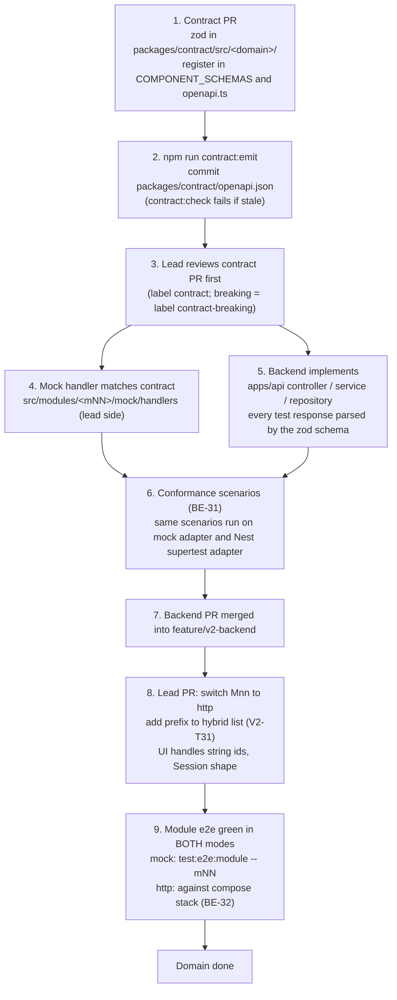

# Fullstack integration guide (frontend, mock, contract, backend)

How the Vue frontend, the in-browser mock server, the shared `@pp/contract` package and the NestJS API fit together, and the exact steps to move one domain from the mock to the real API. Written so a developer or Claude Code session on any PC can connect the two sides without asking anyone.

**Status labels.** Every mechanism below is tagged **exists** (in the repository today, verified in code), **added by BE-xx** (a backend card creates it) or **added by V2-T31** (a lead frontend task creates it). Planned things are never described as done. Where the plan, a card and the code disagree, the section says so and the item is in section 10 or in the "Known contradictions" list in section 11.

Related documents:

- [v2-backend-plan.md](../architecture/v2-backend-plan.md) (sections 4, 6, 7, 9, 11: layout, contract-first, switch, collaboration, env)
- [v2-frontend.md](../architecture/v2-frontend.md) (section 4 session, section 6 mock layer evolution, task V2-T31)
- [ADR-0018 contract-first](../adr/0018-contract-first-shared-schemas.md)
- Sibling docs written in parallel (may not be merged yet): [v2-api-catalogue.md](../architecture/v2-api-catalogue.md), [v2-data-model.md](../architecture/v2-data-model.md), [frontend-dev-guide.md](frontend-dev-guide.md), [backend-dev-guide.md](backend-dev-guide.md), [onboarding.md](onboarding.md), [v2-test-strategy.md](../qa/v2-test-strategy.md)
- Cards: [BE-01](backend-tasks/BE-01-scaffold-ci.md), [BE-02](backend-tasks/BE-02-db-orm.md), [BE-03](backend-tasks/BE-03-auth-session.md), [BE-31](backend-tasks/BE-31-conformance-suite.md), [BE-32](backend-tasks/BE-32-http-switch-e2e.md)
- Programme: [sessions.md](sessions.md), [backend-tracker.md](backend-tracker.md), [AGENT-SYNC.md](AGENT-SYNC.md)

---

## 1. The flow end to end

One rule: **the contract is written first and both implementations are measured against it.** The frontend mock and the NestJS API never negotiate directly; they both conform to `packages/contract`.



Which step is real today:

| Step | Status |
|---|---|
| Contract package `@pp/contract` (envelope, error, ids, time, enums, session, auth errors, access matrix), `openapi.json`, `contract:emit`, `contract:check` | **exists** (`packages/contract`, root scripts `contract:emit`, `contract:check`) |
| Domain schemas beyond session/access (users, curriculum, questions, practice, ...) | **added by each BE card** (contract commit first, see plan section 6.2) |
| Mock handlers validated against the contract (V2-T29) | **not in place**: `src/mock/**` and the module handlers do not import `@pp/contract` today (only `src/api/envelope.ts` and one test do). Handlers are matched to the contract by hand and by the conformance suite (BE-31), not by runtime validation. |
| Conformance suite `@pp/contract-tests` with pluggable transport, `openapi-diff` gate | **added by BE-31** (the mock adapter, under 50 lines, is written by the lead) |
| Backend `apps/api`, Prisma, compose `api`/`db`, `be:*` scripts | **added by BE-01, BE-02** |
| `HttpTransport` hardening and `HybridTransport` | **added by V2-T31** (lead) |
| nginx `/api/` proxy, Vite `/api` proxy, `playwright.http.config.ts`, `stack:up`, `stack:down`, `test:e2e:http` | **added by BE-32** (joint card, needs V2-T31 first) |

Who edits what (from plan section 9): the collaborator owns `apps/api/**` and new `packages/contract/src/<domain>/` folders; the lead owns `src/**`, `e2e/**`, `packages/contract/src/{common,session,auth,access}/**`, the hybrid switch and `docs/TRACKER.md`. A backend session never edits `src/**`.

---

## 2. Contract rules

Source of truth (link, do not copy): [`packages/contract/src/common/envelope.ts`](../../packages/contract/src/common/envelope.ts), [`error.ts`](../../packages/contract/src/common/error.ts), [`ids.ts`](../../packages/contract/src/common/ids.ts), [`time.ts`](../../packages/contract/src/common/time.ts), [`session/`](../../packages/contract/src/session/), [`auth/errors.ts`](../../packages/contract/src/auth/errors.ts), [`openapi.ts`](../../packages/contract/src/openapi.ts), generated [`openapi.json`](../../packages/contract/openapi.json), and the [package README](../../packages/contract/README.md). Frontend client behaviour: [`src/api/client.ts`](../../src/api/client.ts), [`src/api/errors.ts`](../../src/api/errors.ts).

All rows below are **exists** in the contract package; the backend implementing them is **added by BE-01..**.

| Rule | Detail |
|---|---|
| Base path | Every URL starts with `/api`. Contract paths are written relative to it; the Nest global prefix adds `/api`. Keep the mock's path strings (some are BM, e.g. `/api/kelas-saya`). |
| Success envelope | Single resource `{ data }`; list `{ data: [...], meta }`. `meta` (`ListMeta`) has `page`, `pageSize`, `totalItems`, `totalPages`, optional `from`, `to` (1-based, `null` on an empty page), `counts`; module aggregates may sit next to them. List query: `page` (default 1), `pageSize` (default 20, max 100). |
| Raw bodies | A few live-shaped bodies are deliberately **not** enveloped (e.g. M13 `POST /api/cikgu/send`). The client reads them with `raw: true` or `api.raw()`. Reproduce exactly what the mock handler returns and register the raw schema in the contract. |
| Empty success | `204` with no body (logout, deletes). The client resolves to `undefined`. |
| Error shape | `{ error: { code, message, fields?, details?, retryAfter?, requestId? } }`. `message` is BM copy fit for direct display (the mock's copy is the reference). `fields` maps field name to BM message for `VALIDATION_ERROR`. `retryAfter` is integer seconds for `RATE_LIMITED`. |
| Generic codes and status | `VALIDATION_ERROR` 422, `NOT_FOUND` 404, `UNAUTHORIZED` 401, `FORBIDDEN` 403, `CONFLICT` 409, `SERVER_ERROR` 500, `RATE_LIMITED` 429. Modules add their own string codes (e.g. `INVALID_CREDENTIALS`, `CSRF_INVALID`, `ROLE_NOT_ALLOWED`, `MODE_ACTIVE`). The client keeps unknown codes unchanged and derives a generic code from the status only when the body has none. `NETWORK_ERROR` is client-only (status 0). |
| Ids | Opaque **strings** (`IdSchema`, 1-64 chars, example `"1042"`). The backend serialises bigint keys as decimal strings. The client must never parse, compare numerically or construct ids. The mock's numeric `ID_RANGES` stay inside the mock. Idempotency keys such as `clientUuid` are UUIDs (`ClientUuidSchema`). |
| Timestamps | Stored UTC (`timestamptz`), **serialised with the explicit `+08:00` offset**, e.g. `2026-10-16T09:30:00+08:00` (`TimestampSchema` rejects anything else). Request timestamps may carry any offset or `Z` (`TimestampInputSchema`); the server normalises. Calendar dates are `YYYY-MM-DD` in `Asia/Kuala_Lumpur`; streak and daily-limit boundaries use Malaysia time (OD-8). |
| Requests | Request schemas are **strict** (unknown keys are rejected). A client-sent `scope` or role override is a 422; scope is derived server-side only. |
| Scope behaviour | A record outside the caller's scope answers **404, not 403**. Wrong role answers 403. No session answers 401. |
| Language | Enum codes and field names are English; BM appears only in `message` strings, UI copy and a few path segments. |
| Breaking-change gate | Removing a field, narrowing an enum or making an optional field required is breaking. **Added by BE-31**: CI runs `openapi-diff` of `packages/contract/openapi.json` against the base branch and fails unless the PR has the label `contract-breaking`. Today only `contract:check` (is `openapi.json` current?) runs. |
| Ownership | `common/`, `session/`, `auth/`, `access/` and existing registrations: lead only (a change is a `contract` PR both sides agree to). New `src/<domain>/` folders: the card's owner, append-only registration lines. Never hand-edit `openapi.json`; on a merge conflict re-run `npm run contract:emit`. |

How to add a domain (backend side): create `packages/contract/src/<domain>/` (import `z` from `../zod`), register components in `COMPONENT_SCHEMAS` and paths in `src/openapi.ts`, run `npm run contract:emit`, commit `openapi.json` in the **first commit** of the PR. Schemas describe the current mock wire shape so the frontend switch is a no-op; every deviation is listed in the PR and in `docs/architecture/v2-backend-deviations.md` (created by BE-01).

---

## 3. Transport modes

### 3.1 What exists today

The seam is [`src/api/transport.ts`](../../src/api/transport.ts): `Transport.request(req, signal) -> {status, headers, body}`. Typed module API functions call the shared `api` instance ([`src/api/client.ts`](../../src/api/client.ts)), which builds the request, sends it through the installed transport, unwraps the envelope, maps non-2xx to `ApiError` and applies the 401 policy.

[`src/app/bootstrap.ts`](../../src/app/bootstrap.ts) is the **only** file that chooses the transport:

| `VITE_API_MODE` | Behaviour today | Status |
|---|---|---|
| `mock` (default; any value other than `http`) | Dynamic `import('@/mock')`, `startMock(...)`, `MockTransport` (request log, latency, fault injection, mock server). Published demo builds mount first and boot the mock in the background; dev and e2e boot the mock first. | **exists** |
| `http` | `createHttpTransport()` ([`src/api/http-transport.ts`](../../src/api/http-transport.ts)): plain `fetch` to `baseUrl + path + query`. The `http` build tree-shakes the mock. **All-or-nothing**: every module call goes to the real API. | **exists**, but not yet usable against the real API (see 3.2) |
| `hybrid` | Not implemented. `bootstrap.ts` has no `hybrid` branch; setting it would silently run the mock. | **added by V2-T31** |

`VITE_API_BASE_URL` (empty = same origin) is declared in `.env.example` and passed as a compose build arg. `bootstrap.ts` currently calls `createHttpTransport()` **without** reading it, so it has no effect until V2-T31 wires it in (open question OQ-INT-3).

### 3.2 What V2-T31 adds (lead task, frontend; sized M, depends on T07 and T10)

Per [v2-frontend.md](../architecture/v2-frontend.md) section 6 step 5, task row V2-T31, [ADR-0018](../adr/0018-contract-first-shared-schemas.md) item 7, and plan section 7:

1. **`HttpTransport` hardening:** `credentials: 'include'` (the option exists but is off by default; the bootstrap does not set it), the CSRF header (section 4), 401 to the login screen, `requestId` logging, timeouts.
2. **`HybridTransport`:** `VITE_API_MODE=hybrid` plus an environment-provided list of **path prefixes** served by the real API. For each request: if the path starts with a listed prefix, send it through the HTTP transport; otherwise send it through the mock transport. The mock is still bundled in `hybrid` (it is tree-shaken only in `http`).
3. A smoke test against a contract stub server.

**Where the prefix list lives.** Not decided in any document. The plan says "env list of path prefixes" and the BE-32 checklist item says "hybrid prefix added". See OQ-INT-1. Until V2-T31 lands, do not invent a variable name in code or docs; the recommendation is one build-time variable (e.g. `VITE_API_HYBRID_PREFIXES`, comma-separated, such as `/api/auth,/api/session,/api/curriculum`) read only by `bootstrap.ts`, with the matching prefix match on the **path before the query string**.

Gotchas the lead must handle in V2-T31 (they follow from the code today):

- The mock and the contract disagree on **session shape and paths** (see 3.4 and section 11). A hybrid build that sends `/api/auth/login` to the real API but keeps `/api/me` on the mock cannot work: the session domain has to switch as one unit (`/api/auth/*` plus `/api/session*`), together with the session store.
- `withSessionSliding()` in [`src/stores/session.ts`](../../src/stores/session.ts) wraps the installed transport and only slides when the request carries a `Bearer` token. In http mode there is no Bearer, so it becomes a no-op; session lifetime is then the server's (`expiresAt` in `Session`).
- The `api` client attaches `Authorization: Bearer` whenever `getToken()` returns a token. For the real API the token provider must return `null` (cookie auth) or the header is sent and ignored. The API must not add Bearer support.

### 3.3 Per-domain cut-over steps (plan section 7, made explicit)

Run this when a BE card is merged into `feature/v2-backend` (the lead merges `feature/v2-backend` into `feature/student-prototype` first; plan section 9). The copyable checklist is section 8; this is the order and the reason for each step.

1. **Backend merged and conformance green** for the domain's operations (BE-31 scenarios exist for each endpoint in the card).
2. **Frontend types realigned** to the contract: ids as strings (OD-9, V2-T24/T25), new field names, `+08:00` timestamps. This is a lead PR; the domain's mock handlers are updated to the same contract shape in the same PR, so the module e2e still passes in `mock` mode.
3. **Seed present** for the domain in `be:db:seed` (so the real API returns the same demo data the e2e specs expect; BE-07 for identity, BE-26 for the PoC profile).
4. **Add the path prefix** of the domain to the hybrid list and open the lead PR "switch Mnn to http".
5. **Module e2e in both modes:** `npm run test:e2e:module -- mNN` (mock, today) and the same module against the compose stack (**added by BE-32**: `test:e2e:http`, specs tagged `@api`).
6. **Domain done** only when both runs are green (section 7.3).
7. Record the switch in `docs/TRACKER.md` (lead only) and tick the row in `docs/plan/backend-tracker.md`.

### 3.4 Known mock-vs-contract gaps that block the first switch (session domain)

Observed in the code on this branch; the contract is the target, the mock follows it when V2-T09 realigns it.

| Topic | Mock / frontend today | Contract / BE-03 |
|---|---|---|
| Login response | `{ token, expiresAt, user }` (`src/modules/m01-authentication/mock/handlers/auth.ts`) | `{ data: Session }` (`user`, `roles[]`, `active`, `mode`, `capabilities`, `landingPath`, `expiresAt`, `csrf`) plus `Set-Cookie`; no token in any body |
| Credential error | `422 VALIDATION_ERROR` with message under `fields.email` (Laravel-like) | `401 INVALID_CREDENTIALS`; `422 VALIDATION_ERROR`, `AMBIGUOUS_USERNAME`; `403 ACCOUNT_INACTIVE`, `SCHOOL_INACTIVE`; `429 RATE_LIMITED` |
| Current session | `GET /api/me` (client session store, `pp.auth` in `localStorage`) | `GET /api/session`; role switch `POST /api/session/role`; mode `POST` and `DELETE /api/session/mode` |
| Auth carrier | `Authorization: Bearer <token>` | HTTP-only cookie + `X-CSRF-Token` |
| Ids of users/schools | numbers | strings |

---

## 4. HTTP details (real API)

| Topic | Rule | Status |
|---|---|---|
| Session carrier | Server-side session in Postgres, referenced by an **HTTP-only, `SameSite=Lax`, `Secure` (in production) cookie**. Cookie name from `SESSION_COOKIE_NAME`. No JWT, no token in any response body. Session id is regenerated on login, role switch and mode change. | **added by BE-03** (decision OD-4) |
| Browser side | Every request needs `credentials: 'include'`. Same origin (dev proxy, nginx) makes this work without CORS. `JS` cannot read the cookie. | **added by V2-T31** (`HttpTransport` option exists, default off) |
| Bearer | The mock authenticates with `Authorization: Bearer`. The real API **must not** accept or add Bearer. | mock **exists**; API rule from plan section 7 |
| CSRF header | Name: **`X-CSRF-Token`**. Value: the `csrf` field of the `Session` returned by `POST /api/auth/login`, `GET /api/session`, `POST /api/session/role`, `POST` or `DELETE /api/session/mode` (the client must refresh its copy from each returned `Session`, because the session id and token rotate on role and mode change). Required on **authenticated mutating requests** (POST, PUT, PATCH, DELETE); GET needs none. Missing or wrong: `403` with code `CSRF_INVALID`. `POST /api/auth/logout` checks it only when a session exists and is otherwise idempotent (`204`). | contract header **exists** (`session/paths.ts`); enforcement **added by BE-03**; attaching it in the client **added by V2-T31** |
| Where the client keeps `csrf` | Not decided (the current session store persists a prototype `pp.auth` object in `localStorage`; V2-T09 replaces the session shape). Keep it in memory or session storage; never in a cookie the server trusts. See OQ-INT-2. | open |
| 401 | Body `{ error: { code: 'UNAUTHORIZED' (or a module code) } }`. The client's 401 policy (`ApiClient`): any 401 outside `/api/auth/*` calls `onUnauthorized`, which clears the session and `router.replace('/login')`. `/api/auth/*` pages (login) handle their own 401. An expired server session returns 401 the same way. | policy **exists**; behaviour with real cookies verified by V2-T31 |
| 403 | `FORBIDDEN` (role lacks capability), `ROLE_NOT_ALLOWED`, `MODE_NOT_ALLOWED`, `CSRF_INVALID`, `ACCOUNT_INACTIVE`, `SCHOOL_INACTIVE`. Not a redirect: surface the BM `message`. A 403 `CSRF_INVALID` is a client bug (header missing); do not retry blindly. | contract **exists**; behaviour **added by BE-03** |
| 404 vs 403 | Out-of-scope record: 404. | rule in plan and BE-03 |
| 429 | `{ error: { code: 'RATE_LIMITED', retryAfter: <seconds> } }`; the client also reads the `Retry-After` header when the body has no `retryAfter` (`src/api/errors.ts`). Login throttle: `THROTTLE_LOGIN_PER_MINUTE`. | client **exists**; server **added by BE-03** |
| `requestId` | Errors carry optional `requestId` (correlation id for support). The API sets it on every error and should also return it in an `X-Request-Id` response header (**guide default**, confirm in BE-01); the frontend logs it with the failing call. `ApiError.body` already keeps the whole error body. Logs must not contain personal data, passwords or cookies. | field **exists** in contract; logging **added by V2-T31**; header name see OQ-INT-6 |
| Timeouts | Browser fetch has none today (`HttpTransport` passes an optional `AbortSignal` only). V2-T31 adds a default timeout; nginx proxy read timeout and body size are set by BE-32 (must fit `INTAKE_MAX_FILE_MB` uploads and intake polling). Aborts are re-thrown unchanged and never become `ApiError`. | **added by V2-T31 / BE-32**; values OQ-INT-5 |
| Network failure | A `fetch` rejection becomes `TransportNetworkError`, then `ApiError` with `NETWORK_ERROR` (status 0). | **exists** |
| Uploads/downloads | Multipart goes through `api.multipart`; the transport removes `content-type` so the browser sets the boundary. Downloads use `api.blob` and read `Content-Disposition`. | **exists** |

---

## 5. Local development topology

| Piece | Port | Status |
|---|---|---|
| Vite dev server (`npm run dev`) | 5173 (the dev PC keeps this port busy for the user's own dev server; check before starting anything) | **exists** |
| NestJS API (`npm run be:dev`) | 3000 (`PORT`) | **added by BE-01** |
| PostgreSQL (compose `db`) | 5432 inside the compose network; **no host port by default** because the lead's PC already uses 5432 and 5433. For local tooling add an uncommitted `compose.override.yaml` mapping `127.0.0.1:${DB_HOST_PORT:-5434}:5432`. | **added by BE-01/BE-02** |
| Compose frontend (nginx) | host 5192 (`FRONTEND_PORT`) to container 8080 | **exists** |
| Local preview container `pretasiplus-preview` | host 5191 | **exists** (section 6.3) |
| Vite preview used by Playwright (`playwright.config.ts`) | 4173 | **exists** |
| Ports already taken on the lead PC | 5173, 5191, 5432, 5433, 6380, 8080, 8081 (from `docs/ops/containers.md`) | info |

**Vite proxy.** `vite.config.ts` has no `server.proxy` today. **Added by BE-32:** `/api` forwarded to `http://localhost:3000` in the dev server, so the SPA calls `/api/...` same-origin and no CORS configuration is needed anywhere.

**Env files (names only).** Frontend (`.env.development`, `.env.e2e`, `.env.demo`, `.env.example`, all **exist**): `VITE_API_MODE`, `VITE_TEST_HOOKS`, `VITE_MOCK_LATENCY_MS`, `VITE_PROTOTYPE_SCOPE`, `VITE_DATA_PROFILE` (e2e only), `VITE_API_BASE_URL` (compose build arg). Compose-only: `FRONTEND_PORT`, `BUILD_MODE`. Backend (`.env.api`, git-ignored, template `.env.api.example`; **added by BE-01/BE-02**, list in plan section 11): `NODE_ENV`, `PORT`, `DATABASE_URL`, `SESSION_COOKIE_NAME`, `SESSION_SECRET`, `SESSION_TTL_HOURS`, `SESSION_REMEMBER_DAYS`, `COOKIE_DOMAIN`, `COOKIE_SECURE`, `PUBLIC_BASE_URL`, `LOG_LEVEL`, `FILE_STORAGE_DIR`, `MAX_UPLOAD_MB`, `THROTTLE_LOGIN_PER_MINUTE`, `SEED_DEMO_PASSWORD_HASH`, `CLOUD_SOURCE_URL` (migration only); intake keys (`INTAKE_MAX_FILE_MB`, ...) are listed in plan section 15.3. Database container: `.env.db` with `POSTGRES_USER`, `POSTGRES_PASSWORD`, `POSTGRES_DB`. Hybrid prefix variable: not yet named (OQ-INT-1). Never commit values; `VITE_*` values are baked into the static bundle, so no secrets in them.

### 5.1 Three ways to run

| Mode | Commands (repo root) | What serves `/api` | Available |
|---|---|---|---|
| **Mock only** (daily frontend work) | `npm run dev` (mode `development`, `VITE_API_MODE=mock`) | The in-browser mock | **exists** now |
| **Hybrid** (a finished domain on the real API, the rest mock) | start the db and API (`docker compose up -d db`, then `npm run be:db:migrate`, `npm run be:db:seed`, `npm run be:dev`), then `npm run dev` with `VITE_API_MODE=hybrid` and the prefix list | Vite proxy sends `/api` to port 3000; `HybridTransport` decides per prefix | **added by V2-T31 + BE-32**; not runnable yet |
| **Full http** (everything real; used to prove a release) | `docker compose up -d --build` with the frontend built with `VITE_API_MODE=http`, open `http://localhost:5192`; or `npm run dev` with `VITE_API_MODE=http` plus `be:dev` | nginx (compose) or Vite proxy (dev) to the API | **added by BE-32**; root helpers `stack:up`, `stack:down` |

Rules that apply to every mode: never kill all `node.exe` processes (other sessions and the user's dev server depend on them); stop only the processes or containers you started; do not leave background servers running (user decision, D50 era feedback); check the port first.

---

## 6. Compose stack (D50)

Decision D50 (TRACKER, 2026-10-18): the project ships as Docker images. Frontend today; `api` and `db` join the same compose when the backend starts.

### 6.1 What exists today (`compose.yaml`, `docs/ops/containers.md`)

- Service `frontend` only: multi-stage image (`docker/frontend/Dockerfile`: Node build, then `nginx:1.27-alpine`), container `pretasiplus-frontend`, host `5192` to container `8080`, read-only root filesystem, `tmpfs /tmp`, `no-new-privileges`, unprivileged user, `GET /healthz` returns `ok`.
- Build args: `BUILD_MODE` (default `demo`), `VITE_API_MODE` (default `mock`), `VITE_TEST_HOOKS` (must stay `false`), `VITE_PROTOTYPE_SCOPE`, `VITE_MOCK_LATENCY_MS`, `VITE_API_BASE_URL`.
- `api` and `db` exist only as **commented placeholders** in `compose.yaml`.
- `docker/frontend/nginx.conf` has SPA fallback, caching and security headers, **no `/api/` proxy**.

### 6.2 What BE-01, BE-02 and BE-32 add

| Item | Card | Detail |
|---|---|---|
| `db` service | BE-01/BE-02 | `postgres:16-alpine`, named volume, `pg_isready` health check, `.env.db`, no host port by default |
| `api` service | BE-01 | Image from `docker/api/Dockerfile` (multi-stage, non-root, read-only rootfs), port 3000 exposed to the network only, `env_file: .env.api`, waits for `db` health and for the migration job |
| `migrate` job | BE-32 | One-off: `prisma migrate deploy`, then optional seed (profile). Idempotent. `api` `depends_on` it |
| nginx `/api/` | BE-32 | `location /api/ { proxy_pass http://api:3000; ... }` with forwarded headers, body-size limit matching `MAX_UPLOAD_MB`/`INTAKE_MAX_FILE_MB`, no caching of `/api`, read timeouts that fit uploads and polling; `/healthz` kept |
| Frontend built as http/hybrid | BE-32 | `compose.http.yaml` overlay or env (`VITE_API_MODE=http`) |
| Seed profile | BE-02/BE-07/BE-26 | `be:db:seed` deterministic and idempotent; demo accounts only (`docs/AKAUN-DEMO.md`); PoC profile in BE-26 |
| Root scripts | BE-32 | `stack:up`, `stack:down`, `test:e2e:http` |

Same origin through nginx means **no CORS** and the cookie is first-party. Do not add CORS middleware to work around a proxy problem (section 9).

### 6.3 Two containers, not to be confused

| | `pretasiplus-preview` | compose stack |
|---|---|---|
| Purpose | Local view of the **mock prototype** for the user to review (and the QA target); no backend | Production-shaped image(s): frontend now, frontend + api + db after BE-32 |
| Definition | `docker-compose.preview.yml` (project `pretasiplus-preview`); plain `nginx:1.27-alpine` serving the host-built `dist-preview` read-only | `compose.yaml` (project `pretasiplus`) |
| Port | 5191 | 5192 |
| Build | `npx vite build --mode demo --outDir dist-preview` with `VITE_PROTOTYPE_SCOPE=on VITE_API_MODE=mock VITE_TEST_HOOKS=false`, refresh the browser after a rebuild | `docker compose build` (Node build inside the image) |
| Nginx config | `docker/preview/nginx.conf` | `docker/frontend/nginx.conf` |
| Start/stop | `docker compose -f docker-compose.preview.yml up -d` / `down` | `docker compose up -d` / `down` |
| Use for integration work | No (it never proxies `/api`) | Yes (after BE-32) |

Per project feedback the preview runs only as this Docker container (visible and stoppable in Docker Desktop), never as a hidden background Node server.

---

## 7. Testing the integration

### 7.1 Conformance suite (added by BE-31)

Package `@pp/contract-tests` under `packages/contract-tests/`:

- **Scenarios** are written once against a minimal `HttpClient` interface: `request(method, path, body, headers) -> { status, headers, body }`, with helpers for login and CSRF.
- **Backend adapter** (supertest): `apps/api/test/conformance/run.spec.ts` runs every scenario against the Nest app on the seeded test database (`npm run be:test -- apps/api/test/conformance`).
- **Mock adapter**: written by the lead (not part of BE-31; interface documented in the package README, fewer than 50 lines). It runs the same scenarios against the mock server in the frontend test runner.
- **Validation**: for every operation registered in `openapi.json`, every scenario response is parsed with the contract's zod schema. A response that violates the schema (extra or missing field, wrong id type, wrong timestamp offset, wrong envelope) fails the test; BE-31 has a negative test for this.
- **Coverage report**: operations in `openapi.json` versus operations touched by a scenario; 100% required for carded domains at wave 4.
- **Rule for every BE card**: add the domain's scenarios to this package. A card is not done without them.
- **Comparing with the mock**: because the same scenarios run on both adapters, "backend matches mock" is a green run on both, not a manual diff.

Until BE-31 merges, the only verification is each card's own supertest tests parsing responses with the contract schema (Definition of Done item 2, plan section 10).

### 7.2 E2E

- **Today (exists):** `npm run test:e2e:module -- mNN-<slug>` ([`scripts/e2e-module.mjs`](../../scripts/e2e-module.mjs)) runs `e2e/<slug>` on the three projects (mobile 375, tablet 768, desktop 1280) against `vite preview --mode e2e` on port 4173 (mock). The slug must match `m\d{2}-[a-z0-9-]+` and the folder must exist (e.g. `m01-authentication`). Specs use the `mock-handle` and `mock-page` fixtures, clock control and fault injection, which only exist in the mock.
- **Against the real stack (added by BE-32):** `playwright.http.config.ts` starts the compose stack (or reads `BASE_URL`), seeds the PoC profile and runs only specs tagged `@api`, i.e. specs that need none of `mock-handle`, fault injection, clock control or mock-only fixtures. Command: `npm run test:e2e:http -- --grep @api`. Specs are selected by tag, never deleted or edited. First agreed specs: login, role switch, a practice session, a Bijak attempt; intake and builder specs are added when the lead supplies them.
- Other Playwright configs in the repo root (`playwright.5021.config.mjs`, `playwright.5024.config.mjs`, `playwright.5142.config.mjs`, `playwright.bijak.config.mjs`, `playwright.scope.config.mjs`) are per-task or per-scope variants of the mock setup and are not the http path.

### 7.3 What "domain done in both modes" means

A domain is done only when **all** of these hold:

1. Backend: the card's Definition of Done (plan section 10) is met and `npm run be:verify` is green.
2. Contract: operations are in `openapi.json`; `contract:check` passes; no unlisted deviation.
3. Conformance: the domain's scenarios pass on **both** the mock adapter and the backend adapter, and the coverage report shows the domain's operations covered.
4. Mock mode: the domain's module e2e (`npm run test:e2e:module -- mNN-...`) is green at 375, 768 and 1280.
5. Http mode: the same module's `@api` specs are green against the compose stack (`test:e2e:http`) with the domain's prefix on the real API.
6. Frontend: types use string ids and `+08:00` timestamps; root `npm run typecheck` and `npm test` are green; `npm run verify` is green.
7. Lead recorded the switch (TRACKER and backend tracker).

---

## 8. Per-domain switch checklist (copyable)

BE-32 will also produce `docs/plan/http-switch-checklist.md` (planned, not yet in the repo); this block is the template. Copy it into the lead PR "switch Mnn to http".

```markdown
## Switch <Mnn> (<domain>) to the real API

Backend card(s): BE-__   Merged in: <PR link>   Frontend PR: <this PR>

Contract
- [ ] Schemas for every operation in the card are in packages/contract/src/<domain>/ and registered in openapi.ts
- [ ] `npm run contract:check` passes; openapi.json committed
- [ ] Deviations from the mock are listed in the backend PR and in docs/architecture/v2-backend-deviations.md

Backend
- [ ] `npm run be:verify` green (real output in the backend PR)
- [ ] Conformance scenarios added for each operation; backend adapter run green
- [ ] Seed for the domain is in `be:db:seed` (idempotent, fictitious data) and the e2e data assumptions hold
- [ ] Wrong role 403, out-of-scope id 404, no session 401, mutation without CSRF 403 CSRF_INVALID

Frontend (lead)
- [ ] feature/v2-backend merged into feature/student-prototype
- [ ] Types in src/modules/<mNN>/api use string ids (no Number(id), no numeric compare, no id arithmetic)
- [ ] Timestamps parsed as +08:00 ISO strings; no epoch fields expected from the API
- [ ] Mock handlers updated to the same contract shape (mock mode still works)
- [ ] Mock adapter for the conformance suite runs the domain's scenarios green
- [ ] Path prefix(es) added to the hybrid list (variable name: see OQ-INT-1)
- [ ] No Bearer header reaches the real API; credentials include; X-CSRF-Token sent on mutations
- [ ] Error handling shows the API's BM `message`; field errors read from `error.fields`

Verification
- [ ] `npm run test:e2e:module -- <mNN-slug>` green (mock)
- [ ] `npm run test:e2e:http -- --grep @api` green for this module (compose stack)
- [ ] `npm run typecheck` and `npm test` green; `npm run verify` green
- [ ] Manual smoke in hybrid dev: login, open a list page, one write, logout, re-login
- [ ] TRACKER change log and docs/plan/backend-tracker.md row updated
```

---

## 9. Troubleshooting

| Symptom | Likely cause | Fix |
|---|---|---|
| Browser console shows a CORS error | The SPA is calling the API on a different origin (`VITE_API_BASE_URL` set, or a missing proxy) | Use same origin: Vite proxy (dev) or nginx `/api/` (compose). Leave `VITE_API_BASE_URL` empty. Do not add CORS to the API. |
| Login returns 200 but the next call is 401, cookie not in DevTools | `credentials: 'include'` missing; `Secure` cookie over plain `http://localhost`; `COOKIE_DOMAIN` set to a different host; proxy strips `Set-Cookie` | Check V2-T31 is in; in local dev set `COOKIE_SECURE` to false (env, not code); leave `COOKIE_DOMAIN` unset locally; confirm the proxy forwards `Set-Cookie` and `Host`. |
| Mutation fails with 403 `CSRF_INVALID` | Header missing or stale: the token is the `csrf` from the **latest** returned Session; it rotates on login, role switch and mode change | Send `X-CSRF-Token` on POST/PUT/PATCH/DELETE; replace the stored value from every returned Session. |
| 401 on every call after a role switch | The role switch regenerated the session id and the client kept an old cookie or reused an old token | Let the browser own the cookie; refresh the stored `csrf` from the response. |
| Redirect loop to `/login` | The 401 policy fired on a path outside `/api/auth/*` (e.g. `/api/me` still on the mock while login went real, or reverse) | Switch the whole session domain together (`/api/auth/*` and `/api/session*`). |
| `Cannot read ... of undefined`, or a screen shows `NaN`/wrong user | Id type mismatch: the UI still treats ids as numbers; `"12" < "9"` as strings; `Number(id)` on a non-numeric id | Treat ids as opaque strings everywhere (compare with `===`, use as keys, never do arithmetic). Look for `Number(`, `parseInt(`, `<`/`>` on ids in `src/modules/<mNN>/`. |
| Times are off by hours, or contract test says "Timestamp must be ISO 8601 with the +08:00 offset" | The API serialised UTC (`Z`) or a naive local time; or the UI builds dates with `new Date()` and the browser zone | Serialise with `+08:00` in one shared helper (`db` layer, BE-01 `common`); store `timestamptz`; the UI renders with `Asia/Kuala_Lumpur` (Playwright already sets that zone). Day boundaries (streaks, daily limits) use Malaysia time. |
| The page gets `[object Object]` or `undefined` for a list | Envelope mismatch: `{ data, meta }` expected, or the endpoint is a documented raw body | Compare to the mock handler's return. Raw bodies need `raw: true`/`api.raw()`; everything else must be `{data}` or `{data, meta}`. The conformance suite catches this. |
| 422 on a request that works on the mock | Request schemas are strict; the client sends an extra key (e.g. `scope`, a numeric id, a legacy field) | Remove the extra key or ask for a contract change; do not loosen the schema. |
| 404 where the mock returned data | Record is out of the caller's scope (404 by design), or the path string differs (several are BM) | Check the active role/scope in `GET /api/session`; compare the path with the mock's `route(...)` string. |
| `hybrid` seems to ignore the real API | `bootstrap.ts` has no hybrid branch until V2-T31 | Confirm V2-T31 is merged; today an unknown mode silently runs the mock. |
| Upload fails or stops at a size | nginx `client_max_body_size` / read timeout too low | BE-32 sets them to fit `INTAKE_MAX_FILE_MB`; check the nginx `/api/` block. |
| Port already in use | The user's dev server (5173), preview (5191), other stacks (5432, 5433, 6380, 8080, 8081) | Pick another port via env; never kill `node.exe` broadly; stop only what you started. |
| `contract:check` fails in CI | `openapi.json` is stale | Run `npm run contract:emit`, commit the result. On a merge conflict re-run emit, never hand-merge. |

---

## 10. Open questions

| ID | Question | Why it matters | Suggested default | Blocks |
|---|---|---|---|---|
| OQ-INT-1 | Name and format of the hybrid prefix list (env variable, build-time vs runtime, prefix match on path only?) | Every switch PR edits it; the BE-32 checklist and docs refer to it | One build-time variable, comma-separated prefixes (e.g. `VITE_API_HYBRID_PREFIXES`), read only in `bootstrap.ts` | V2-T31, every switch |
| OQ-INT-2 | Where does the client store `csrf` and does it survive a reload? (`GET /api/session` returns it again, so memory plus refetch on boot is enough) | Session store rewrite in V2-T09 | Memory only; refetch with `GET /api/session` at boot | V2-T09, V2-T31 |
| OQ-INT-3 | `VITE_API_BASE_URL` is declared but `bootstrap.ts` ignores it. Wire it in V2-T31, or remove it (same origin everywhere)? | Misleading config; CORS risk if set | Wire it but keep it empty in every shipped build | V2-T31 |
| OQ-INT-4 | Who owns the session-shape realignment of the mock and the client (`{token, expiresAt, user}` and `/api/me` to `Session` and `/api/session`)? Is it V2-T09, and is it done on this branch before BE-03 merges? | Without it the first switch (auth) cannot work | V2-T09, lead, before BE-03 lands (sync S3) | first switch |
| OQ-INT-5 | Default timeouts: browser request timeout, nginx proxy read timeout for normal calls vs uploads/intake polling | Hanging UI vs aborted uploads | 30 s normal, longer location for upload paths | V2-T31, BE-32 |
| OQ-INT-6 | Response header for the correlation id (`X-Request-Id`?), and does the frontend echo a client-generated id? | Support and log tracing across layers | API generates `X-Request-Id` and mirrors it in `error.requestId` | BE-01, V2-T31 |
| OQ-INT-7 | Mock-side runtime validation against the contract (V2-T29) is not in the code. Is it still planned before the first switch, or does the conformance suite replace it? | Drift protection for mock handlers | Conformance suite is the gate; V2-T29 optional in dev/test | BE-31 scope |
| OQ-INT-8 | Production host layout for the cookie: `admin.*` host and the main host (OD-4) vs one origin | Cookie domain, `SameSite`, CSRF scope | Decided at release (devops); configurable by `COOKIE_DOMAIN`, `PUBLIC_BASE_URL` | G6 only |
| OQ-INT-9 | Is the mock still served in the production `hybrid` image for domains not yet live (the mock chunk is bundled), or is hybrid dev/staging only? | Bundle size, demo-data exposure in production, `check-demo-bundle.mjs` | Hybrid is dev/staging only; production is `http` once all shipped domains are real (OD-11 lists the exceptions) | release |

---

## 11. Known contradictions found while writing this guide

1. **Plan section 7 vs code (`VITE_API_BASE_URL`):** `docs/ops/containers.md` and `.env.example` say empty means same origin for http mode, but `bootstrap.ts` never passes it to `createHttpTransport()`. (OQ-INT-3)
2. **Contract `Session` vs mock/session store:** the contract returns `Session` with `csrf` and uses `/api/session*` and `401 INVALID_CREDENTIALS`; the mock login returns `{ token, expiresAt, user }`, the client uses `/api/me`, Bearer and `localStorage`, and credential failures are `422` with `fields.email`. The plan says "follow the contract"; the code has not been realigned yet (V2-T09). See section 3.4. (OQ-INT-4)
3. **ADR-0018 item 3 vs code:** the ADR says mock handlers validate against the schemas (V2-T29); no `src/mock` file imports `@pp/contract`. (OQ-INT-7)
4. **Bootstrap header comment vs behaviour:** `http-transport.ts` says bootstrap installs the HTTP transport "when the backend phase sets `VITE_API_MODE=http`", and any other value (including a typo or `hybrid`) silently selects the mock.
5. **Plan section 7 / BE-32 vs BE-32 inputs:** the card lists `docs/plan/http-switch-checklist.md` as an output of BE-32 while plan section 7 describes the checklist in prose; this guide section 8 is the interim template, to be replaced by that file when it exists.
6. **Docs naming:** `docs/ops/containers.md` uses the project name `pretasiplus` for compose while the preview file declares project `pretasiplus-preview`; both containers coexist on different ports (5192 vs 5191), as intended.
