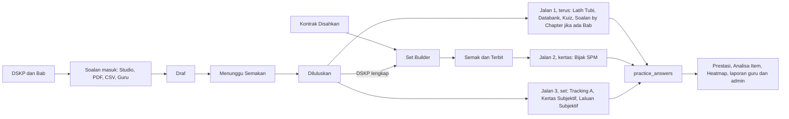

# Aliran kerja Bank Soalan dan Bijak SPM (R1)

**Status:** kandungan aliran disahkan oleh ketua Team B pada 4 Nov 2026 ("Semua betul"). Pembangunan belum bermula. 7 soalan di hujung dokumen belum dijawab.

**Isi:** 29 proses dan 114 langkah. Setiap langkah menunjukkan siapa buat, di skrin mana, dan keadaannya pada tip e34e0a52d (`feature/v3-bijak-r1`). Status ialah rakaman pada tip itu, jadi semak semula sebelum bergantung padanya.

**Rujukan:** PRD di [`docs/prd/r1/`](../prd/r1/00-index.md). Dalam dokumen ini, "saya" ialah Claude (Team B) dan "awak" ialah ketua Team B.

## Gambaran besar

Satu stor soalan, tiga jalan ke murid.

Lapor Soalan pula pulang ke bank: admin putuskan, soalan boleh diarkib.

## Masalah pendua

Pada kefahaman saya, kerja sejak 31 Oktober menambah skrin di sebelah skrin yang sudah ada, bukan membaiki skrin itu. PRD menyelesaikannya dengan satu skrin kekal bagi setiap fungsi. Fungsinya tidak dibuang.

| Fungsi | Hari ini | Yang kekal | Yang lain jadi apa |
|---|---|---|---|
| Senarai soalan | /admin/studio, /admin/questions, /admin/spm/soalan (ketiga-tiganya 'Bank Soalan') | Bank Soalan (Studio) | /admin/questions jadi Senarai Soalan di bawah Bank Lama. /admin/spm/soalan dialih ke /admin/spm/databank. |
| Import | Import & Semakan, Senarai Ekstrak (skrin sama) | Import & Semakan, 3 tab | Muat Naik dan Tulis Manual jadi butang. |
| Barisan semakan | Studio Menunggu Semakan (3), Baris Gilir Semakan (0) | Tile Reviewed dalam Studio | /admin/spm/semakan dialih ke Studio. |
| Kertas | Pembina Kertas, Set Builder (senarai sama) | Set Builder | /admin/spm/kertas dialih. /admin/spm/kertas/:id kekal sebagai Semak Kertas. |
| Kontrak | Item menu sendiri | Tiada menu | Dibuka dari Set Builder dan Semak Kertas. |
| Kualiti, Laporan | Item menu sendiri | Tab dalam Senarai Soalan | Skrin sama, tempat berubah. |

## Maksud status

| Status | Maksud | Bilangan langkah |
|---|---|---|
| Jalan | Berfungsi, ada bukti ujian. | 25 |
| Separuh | Ada, tetapi tidak lengkap atau perlu kerja-keliling. | 39 |
| Rosak | Ada, tetapi salah atau melanggar keputusan. | 13 |
| Tiada | Belum dibina. | 17 |
| Belum diuji | Kod atau PRD ada, saya belum nampak ia berjalan. | 20 |

Sumber: Uji UAT dan Uji lokal ialah ujian pelayar. PRD E2E ialah laporan ujian pada 3 Nov. Kod bermaksud saya baca atau cari dalam e34e0a52d. PRD bermaksud saya hanya pegang tulisan PRD. Status Jalan untuk data contoh tidak bermaksud UAT sudah ada isinya.

## Bahagian A: Asas sebelum soalan

Soalan tidak boleh ditag tanpa bahagian ini.

### A1 Kurikulum dan DSKP

Sediakan Bab, Topik, SP dan TP supaya soalan ada tempat untuk ditag.

Rujukan PRD: R1-ADM-C-01 hingga C-04, U-OP-01, U-OP-03

| # | Siapa | Langkah | Skrin atau API | Status | Sumber | Catatan |
|---|---|---|---|---|---|---|
| 1 | Operator | Muat DSKP T4 dan T5 | `npm run dskp:load` | Jalan | Data UAT | UAT kini ada 2,844 nod, 1,394 TP, 13 subjek. PRD masih tulis keadaan ini belum disahkan. |
| 2 | Admin | Semak Bab dan Topik setiap subjek | `/admin/curriculum` | Separuh | Data UAT | 686 Bab T4 dan T5 wujud. Bab T1 hingga T3 saya belum tahu (E-03). |
| 3 | Admin | Semak senarai Subjek | `/admin/subjects` | Belum diuji | Data UAT | 33 subjek ada. Dropdown pemilih saya belum uji satu per satu. |
| 4 | Admin | Matikan Darjah 1 hingga 6 | `/admin/education-levels` | Rosak | Data UAT | Statistik awam masih 11 tahap. Sasaran 5 tahap (D96). |
| 5 | Pembangun | Bina DSKP T1 hingga T3 daripada Bab dan Topik sedia ada |  | Tiada | PRD | D109. Sebelum siap, soalan T1 hingga T3 diluluskan tanpa tag. |

> 20 subjek tiada nod DSKP, termasuk Kimia, Biologi, Geografi, Perniagaan, Akaun dan Ekonomi. Kontrak dan muat naik tidak boleh dimulakan untuk subjek ini, dan PRD tidak beri jalan keluar. Lihat soalan 3.

## Bahagian B: Soalan masuk

Empat pintu masuk. Semuanya berakhir sebagai Draf, tiada yang terus kepada murid.

### B1 Tulis satu soalan dalam Studio

Jalan utama V2 untuk cipta soalan.

Rujukan PRD: R1-ADM-QE-03, QE-04, Q-04

| # | Siapa | Langkah | Skrin atau API | Status | Sumber | Catatan |
|---|---|---|---|---|---|---|
| 1 | Admin | Tekan Cipta baharu, pilih Soalan tunggal | `/admin/studio/questions/create` | Separuh | PRD | Wizard wujud. Pilihan dua hala Soalan tunggal atau Kumpulan rangsangan belum ada mengikut spesifikasi. |
| 2 | Admin | Isi tag dahulu: Subjek, Tingkatan, Tajuk DSKP, SP 1 hingga 3, TP, aras, Bab, Tahap kesukaran |  | Separuh | PRD | Susunan lama. TP dan kesukaran perlu jadi dua medan berasingan. |
| 3 | Admin | Pilih Kertas dan Bahagian, atau simpan sebagai soalan bank |  | Jalan | PRD E2E |  |
| 4 | Admin | Isi sub-bahagian: jenis, markah, kunci, skema |  | Separuh | PRD | PRD mahu 8 jenis soalan, bukan 13 mod V2. Markah bahagian mesti sama dengan jumlah poin skema. |
| 5 | Admin | Baca panel belum lengkap yang menamakan setiap medan | `GET /api/questions/:id/gate-check` | Separuh | Kod | API ada. Skrin hanya tunjuk bilangan, tidak menamakan medan. |
| 6 | Admin | Tekan Simpan draf |  | Jalan | PRD E2E | Status jadi Draf. Murid tidak nampak. |

### B2 Tulis kumpulan rangsangan

Satu rajah, petikan atau jadual dikongsi 1 hingga n soalan (D90, D108).

Rujukan PRD: R1-ADM-QE-01, QE-02, Q-05

| # | Siapa | Langkah | Skrin atau API | Status | Sumber | Catatan |
|---|---|---|---|---|---|---|
| 1 | Admin | Cipta kumpulan, muat naik rangsangan sekali | `/admin/studio/groups/:id` | Separuh | Uji lokal | Skrin jalan dan gambar sampai kepada murid. Tiada pautan dari halaman soalan, editor di situ terkunci. |
| 2 | Admin | Tambah soalan 1, 2, 3 tanpa muat naik semula | `POST /api/stimulus-groups/:id/questions` | Belum diuji | Kod |  |
| 3 | Admin | Susun dengan Naik dan Turun, buang atau pautkan ahli |  | Belum diuji | Kod |  |
| 4 | Sistem | Benarkan kumpulan 1 soalan dalam kertas |  | Rosak | Uji lokal | Kod masih tolak: 'Kumpulan perlu sekurang-kurangnya 2 soalan.' (stimuli.ts:41). Jadual satu soalan gagal Terbit. |

### B3 Muat naik kertas PDF

Tukar kertas sebenar kepada soalan draf dan, mengikut PRD, satu kertas draf.

Rujukan PRD: R1-ADM-QE-05, Q-07, Q-08, Q-09

| # | Siapa | Langkah | Skrin atau API | Status | Sumber | Catatan |
|---|---|---|---|---|---|---|
| 1 | Admin | Isi Subjek, Tingkatan, Kertas, Tahun, Negeri, Jenis, Set, Kod, Sumber, Status hak cipta | `/admin/spm/soalan/muat-naik` | Separuh | Uji UAT | Borang jalan di UAT. Ujian lokal: hanya 6 subjek boleh dipilih. PRD: Kertas yang dipilih tidak dibawa ke soalan. |
| 2 | Sistem | Baca PDF, ekstrak soalan |  | Separuh | Uji UAT | Jalan di UAT dengan OCR dan AI mock. PRD mahu pembekal sebenar (U-OP-02). |
| 3 | Sistem | Tamat dengan Selesai atau Gagal beserta sebab, ada Cuba lagi |  | Belum diuji | PRD | Dulu tergantung pada 'Sedang diproses'. Tamat masa belum saya uji. |
| 4 | Sistem | Jadikan rajah objek rangsangan, pautkan kepada semua soalan yang menyebutnya | `figure-links.ts` | Separuh | Uji lokal | Rajah dipaut, Jadual tidak. Rajah tanpa imej menyekat Hantar dan tiada butang muat naik imej (gate.ts:92). Halaman tetap kata semua semakan lulus. |
| 5 | Admin | Semak satu per satu: Sumber PDF di kiri, Terima, Tolak, Simpan Sunting | `/admin/spm/soalan/ekstrak/:batchId` | Jalan | Uji UAT |  |
| 6 | Admin | Laras julat kumpulan, contoh Rajah 3 kepada soalan 5 hingga 8 |  | Belum diuji | PRD | Spesifikasi ada. Skrin ini belum saya uji. |
| 7 | Admin | Tag Unit, SP dan TP setiap bahagian |  | Jalan | Uji UAT | A4 sahkan tersimpan di UAT. Tiada medan Bab di sini. |
| 8 | Admin | Tekan Terima, soalan draf dicipta |  | Separuh | Uji lokal | match_letter dan table_fill tidak boleh diterima. short_text dan numeric dengan skema poin gagal di langkah akhir (to-question.ts). Kapsyen hilang. |
| 9 | Admin | Tekan Hantar untuk semakan, sistem cipta kertas draf ikut Bahagian dan susunan | `POST /api/intake/batches/:id/paper` | Tiada | Kod | Tiada dalam kod. Tab Kertas Diimport juga tiada. Ini FR-ADM-Q07.6. |

> Selepas Terima: soalan berstruktur bermarkah tidak boleh disunting lagi dalam Studio (draft.ts:352).

### B4 Import CSV

Masukkan banyak soalan sekali gus.

Rujukan PRD: R1-ADM-QE-06, Q-11

| # | Siapa | Langkah | Skrin atau API | Status | Sumber | Catatan |
|---|---|---|---|---|---|---|
| 1 | Admin | Muat naik CSV | `/admin/questions/import` | Separuh | PRD | Jalan, tetapi tiada lajur DSKP, Bab, kesukaran atau group_key. Soalan perlu disunting tangan. |
| 2 | Sistem | Tolak baris salah beserta nombor baris, simpan baris sah sebagai Draf |  | Belum diuji | PRD |  |
| 3 | Admin | Terbitkan tanpa buka wizard jika semua lajur lengkap |  | Tiada | PRD | Bergantung pada lajur baharu. |

### B5 Kiriman Guru

Guru sumbang soalan atau kertas, admin lengkapkan dan terbitkan.

Rujukan PRD: R1-ADM-Q-12, R1-GUR-44, AC-CHAIN-6

| # | Siapa | Langkah | Skrin atau API | Status | Sumber | Catatan |
|---|---|---|---|---|---|---|
| 1 | Guru | Hantar satu soalan, guru nampak Menunggu Semakan |  | Jalan | PRD E2E | Masuk Studio sebagai Menunggu Semakan. |
| 2 | Guru | Hantar kertas PDF | `POST /api/guru/question-papers` | Rosak | Kod | Balas 503. provideIntake tidak pernah dipanggil. |
| 3 | Admin | Buka tab Kiriman Guru | `/admin/question-submissions` | Rosak | PRD E2E | Papar 'Fungsi ini belum tersedia dalam demo'. |
| 4 | Admin | Buka dalam wizard yang telah terisi, lengkapkan DSKP, Terbitkan |  | Separuh | PRD | Terbitkan biasa jalan. Isian awal belum saya uji. |
| 5 | Guru | Nampak Diluluskan, atau Ditolak beserta sebab |  | Belum diuji | PRD |  |

## Bahagian C: Semakan dan terbitan soalan

Satu kitar hayat untuk semua soalan, dari mana pun datangnya.

### C1 Dari Draf ke Diluluskan

Diluluskan bermaksud murid boleh dapat soalan ini (D80, D85).

Rujukan PRD: R1-ADM-QE-04, Q-03, Q-04, Q-06

| # | Siapa | Langkah | Skrin atau API | Status | Sumber | Catatan |
|---|---|---|---|---|---|---|
| 1 | Admin | Hantar untuk semakan. Syarat: medan wajib, subjek, tahap, tiada bendera duplikat | `POST /api/questions/:id/status` | Separuh | Uji lokal | Jalan, tetapi satu per satu selepas Terima, dan skrin tidak beritahu langkah ini masih perlu. Bendera duplikat menyekat tanpa skrin penyelesaian. |
| 2 | Penyemak | Lihat barisan Menunggu Semakan, satu sahaja | `/admin/studio?status=reviewed` | Separuh | PRD E2E | Hari ini dua barisan yang berbeza angka. |
| 3 | Penyemak | Terbitkan. Syarat: kunci dan skema, TP, Unit, SP, aras, Kertas |  | Jalan | PRD E2E | T4 dan T5 yang lengkap sampai kepada murid. |
| 4 | Sistem | Benarkan T1 hingga T3 lulus tanpa tag DSKP | `publish-gate.ts` | Rosak | Kod | Audit saya: tidak pernah lulus. D109 kata patut lulus. |
| 5 | Sistem | Wajibkan Bab jika subjek dan tingkatan ada Bab | `gates.ts:37` | Rosak | Kod | Kod ikut Q17, Bab tidak diminta. PRD D-A5 mahu wajib. Lihat soalan 1. |
| 6 | Admin | Baca Dilihat murid di n daripada 7 beserta sebab |  | Separuh | PRD | Hari ini 0/6 tanpa penjelasan, walaupun Latih Tubi menyajikannya. |
| 7 | Admin | Sunting soalan Diluluskan melalui Edit sebagai draf |  | Jalan | Uji lokal | MCQ jalan: v1 kekal sehingga v2 terbit. Soalan berstruktur bermarkah tiada jalan sunting. |

## Bahagian D: Urus bank soalan

Kerja harian dan kerja data selepas soalan ada dalam bank.

### D1 Satu menu Soalan

Hapuskan pendua tanpa hilang fungsi (D107).

Rujukan PRD: PRD 30 bahagian 3.2 dan 3.3

| # | Siapa | Langkah | Skrin atau API | Status | Sumber | Catatan |
|---|---|---|---|---|---|---|
| 1 | Pembangun | Ubah menu kepada 8 item, redirect laluan lama | `src/shells/pentadbiran/menu.ts` | Tiada | Kod | Hari ini 3 'Bank Soalan', 2 senarai kertas, 2 barisan. |

### D2 Senarai dan tindakan pukal

Cari, tapis dan tindak ke atas soalan.

Rujukan PRD: R1-ADM-Q-03, Q-20, Q-21

| # | Siapa | Langkah | Skrin atau API | Status | Sumber | Catatan |
|---|---|---|---|---|---|---|
| 1 | Admin | Tapis ikut Subjek, Status, Tahun, Negeri, Kertas, Jenis | `/admin/studio` | Separuh | Uji lokal | Status, subjek, jenis dan carian teks jalan. Carian ikut ID soalan beri 0. Senarai SPM berhenti pada 50 baris setiap subjek tanpa notis. |
| 2 | Admin | Tapis ikut Tingkatan, Bab, DSKP |  | Separuh | Kod | Sebahagian ada. Tapisan Source dan Compliance dalam senarai lama kosong. |
| 3 | Admin | Hantar untuk semakan, Terbitkan atau Arkib secara pukal | `POST /api/questions/bulk-action` | Belum diuji | Kod | API ada. Tidak diuji. |
| 4 | Admin | Arkib dan pulihkan, dengan amaran kertas Terbit yang terjejas |  | Separuh | Uji lokal | Jalan. Pulih melalui draf, semakan, terbit. Kertas terjejas beri 403 tetapi butang Mula masih ada. Arkib pukal tiada amaran. |

### D3 Tetapkan Bab secara pukal

Admin pilih Bab sendiri, tiada pemetaan automatik (D89).

Rujukan PRD: R1-ADM-C-05, FR-ADM-Q03.7, U-OP-07

| # | Siapa | Langkah | Skrin atau API | Status | Sumber | Catatan |
|---|---|---|---|---|---|---|
| 1 | Admin | Buka senarai Soalan tanpa Bab |  | Tiada | Kod | Tiada dalam kod. |
| 2 | Admin | Tapis, lihat bilangan, Tetapkan Bab | `POST /api/admin/curriculum/questions/bulk-chapter` | Tiada | Kod | Tiada dalam kod. Baris yang subjeknya tidak padan dilangkau dan disenaraikan. |
| 3 | Admin | Ulang untuk setiap Bab |  | Tiada | Data UAT | 85,504 soalan T4 dan T5 tiada Bab. Kerja manusia, bukan kod. |

### D4 Kuarantin dan kumpul semula soalan migrasi

Soalan 'Rajah 14 menunjukkan...' tanpa gambar tidak boleh sampai kepada murid.

Rujukan PRD: R1-ADM-QE-08, FR-ADM-G7, U-OP-05, U-OP-17

| # | Siapa | Langkah | Skrin atau API | Status | Sumber | Catatan |
|---|---|---|---|---|---|---|
| 1 | Sistem | Kesan stimulus_missing, figure_only, stem_duplicated |  | Tiada | Kod | Tiada dalam kod. Soalan begini masih disajikan. |
| 2 | Admin | Dalam tab Perlu dikumpulkan semula: pautkan rangsangan atau kumpulkan baris |  | Tiada | Kod |  |
| 3 | Admin | Tandakan Bukan masalah |  | Tiada | Kod |  |

### D5 Sunting pantas

Betulkan cepat satu soalan MCQ.

Rujukan PRD: R1-ADM-Q-24

| # | Siapa | Langkah | Skrin atau API | Status | Sumber | Catatan |
|---|---|---|---|---|---|---|
| 1 | Admin | Buka Sunting dari senarai, simpan | `/admin/spm/soalan/:qid/sunting` | Rosak | Kod | PRD tanda Keep. Audit saya: mati pada API sebenar (http-admin.ts:1053). Lihat soalan 5. |

### D6 Hub Kandungan SPM

Satu pintu ke enam laluan, dengan angka perhatian.

Rujukan PRD: R1-ADM-Q-01, Q-02

| # | Siapa | Langkah | Skrin atau API | Status | Sumber | Catatan |
|---|---|---|---|---|---|---|
| 1 | Admin | Buka hub, nampak 6 kad dan angka | `/admin/spm` | Separuh | Kod | 2 daripada 6: Databank dan Bijak SPM sahaja. |
| 2 | Admin | Buka senarai setiap laluan | `/admin/spm/:lane` | Separuh | Kod | Tracking A, Subjektif, Latih Tubi, Kertas Subjektif tiada. |

## Bahagian E: Kertas dan set

Murid hanya nampak kertas yang Terbit.

### E1 Kontrak Simulasi

Peraturan bagi satu subjek dan kertas, bukan satu set soalan.

Rujukan PRD: R1-ADM-Q-16, U-OP-04

| # | Siapa | Langkah | Skrin atau API | Status | Sumber | Catatan |
|---|---|---|---|---|---|---|
| 1 | Admin | Buka dari Set Builder, bukan dari menu | `/admin/spm/kontrak` | Separuh | Kod | Skrin jalan, tetapi masih dalam menu. |
| 2 | Admin | Baharu: Subjek, Kertas. Isi Kod, Tempoh, Markah, Bahagian, kuota Unit, profil TP, kuota KBAT | `/admin/spm/kontrak/:subjek/:kertas` | Jalan | Uji UAT | Jalan di UAT dan lokal. Untuk 20 subjek tanpa DSKP, pemilih Unit kosong dan simpan gagal. |
| 3 | Admin | Lihat Pratonton Kolam | `.../kolam` | Separuh | Uji lokal | Angka betul. Id unit mentah dipapar. Pautan Lihat soalan hilang semua tapisan. |
| 4 | Admin | Isi bukti daripada 2 badan atau lebih, tekan Sahkan |  | Jalan | Uji lokal | Jalan secara lokal. Belum ada Kontrak Disahkan sebenar di UAT. |
| 5 | Sistem | Kunci Disahkan. Suntingan struktur jadi versi baharu |  | Separuh | Uji lokal | Banner 'Murid menggunakan v1' jalan. Bacaan kod: draf boleh tersangkut (builder.service.ts:803) dan murid boleh nampak Spec (papers.service.ts:130). Belum saya buktikan dalam pelayar. |

> Dropdown subjek dalam Pembina diambil daripada senarai Kontrak, bukan senarai subjek (http-admin.ts:355).

### E2 Bina kertas dalam Set Builder

Tiga cara mula: kosong, Jana set, atau dari import.

Rujukan PRD: R1-ADM-QE-07, Q-13, Q-14

| # | Siapa | Langkah | Skrin atau API | Status | Sumber | Catatan |
|---|---|---|---|---|---|---|
| 1 | Admin | Buka satu senarai kertas | `/admin/studio/sets` | Separuh | PRD E2E | Dua senarai hari ini. |
| 2 | Admin | Mula kosong: Tajuk, Subjek |  | Jalan | Uji lokal |  |
| 3 | Admin | Jana set: Bilangan, Kertas, Tahun, Negeri |  | Separuh | Uji lokal | Butang mati pada semua 9 Kontrak kerana data KBAT tiada, dengan mesej 'hanya 0' yang mengelirukan (precheck.ts:244). Jalan selepas KBAT diubah. Tiada Tahun dan Negeri. |
| 4 | Admin | Tambah dari Bank: hanya Diluluskan dengan DSKP lengkap, kumpulan satu kad | `/admin/studio/sets/:paper/builder` | Jalan | Uji lokal | Soalan legasi tanpa tag tidak muncul (D80). Kolam berhenti pada 50 baris tanpa pager. |
| 5 | Admin | Tetapkan Jawab Semua atau Pilih N, susun Naik dan Turun |  | Belum diuji | PRD | PRD kata tiada kawalan Pilih N. Saya belum sahkan pada tip ini. |

### E3 Semak dan Terbit kertas

Keputusan terakhir sebelum murid nampak.

Rujukan PRD: R1-ADM-Q-15, FR-ADM-Q07.7, Q07.8

| # | Siapa | Langkah | Skrin atau API | Status | Sumber | Catatan |
|---|---|---|---|---|---|---|
| 1 | Admin | Kemas kini metadata, kulit kertas, bahan rujukan | `/admin/spm/kertas/:id` | Jalan | Uji lokal |  |
| 2 | Admin | Pratonton seperti murid |  | Belum diuji | PRD |  |
| 3 | Sistem | Senaraikan masalah: soalan belum lulus, kumpulan pecah, jumlah tidak padan Kontrak |  | Jalan | Uji lokal |  |
| 4 | Admin | Terbit di bawah Kontrak Disahkan |  | Separuh | Uji lokal | Jalan secara lokal. Belum dibuat di UAT, yang ada 0 kertas. |
| 5 | Admin Pusat | Tanpa Disahkan: tanda pengecualian, sebab 5 aksara atau lebih, Terbit kali kedua |  | Jalan | PRD E2E | Diuji pada tip lebih lama, belum pada e34e0a52d. |
| 6 | Sistem | Bekukan versi setiap soalan dalam kertas |  | Belum diuji | Kod | Kod ada, tidak diuji khusus. |
| 7 | Admin | Tarik balik ke draf, atau Salin set |  | Belum diuji | PRD | Murid yang sedang menjawab kekal pada versi lama. |

### E4 Tracking A

Set objektif tetap, biasanya 40 soalan, diisi oleh admin.

Rujukan PRD: R1-ADM-Q-17, U-OP-10

| # | Siapa | Langkah | Skrin atau API | Status | Sumber | Catatan |
|---|---|---|---|---|---|---|
| 1 | Admin | Senarai set ikut subjek, Tambah Set | `/admin/spm/tracking-a` | Tiada | Kod | Tiada laluan admin. |
| 2 | Admin | Isi set, tukar, buang, susun, Simpan. Kumpulan dikira satu unit | `/admin/spm/tracking-a/:set/sunting` | Tiada | PRD | Migrasi 0104 dan API admin belum dibina. |

### E5 Kertas Subjektif

Kertas 2, 3 dan 4 sebagai teks boleh sunting, bukan gambar halaman (D81, D104).

Rujukan PRD: R1-ADM-Q-18

| # | Siapa | Langkah | Skrin atau API | Status | Sumber | Catatan |
|---|---|---|---|---|---|---|
| 1 | Admin | Baharu, muat naik PDF kertas dan skema | `/admin/kertas-subjektif` | Tiada | PRD | Tiada laluan admin. |
| 2 | Sistem | OCR Tesseract msa+eng, tukar kepada teks dan kumpulan rangsangan |  | Tiada | PRD | Bake-off 5 kertas imbasan ialah syarat keluaran (E-05). |
| 3 | Admin | Sunting, tag DSKP setiap bahagian, isi skema, Terbit |  | Tiada | PRD | Tanpa skema tidak boleh Terbit. |

### E6 Soalan Berstruktur dan laluan Subjektif

Soalan esei dan struktur untuk latihan murid.

Rujukan PRD: R1-ADM-Q-23

| # | Siapa | Langkah | Skrin atau API | Status | Sumber | Catatan |
|---|---|---|---|---|---|---|
| 1 | Admin | Senarai dan butiran Soalan Berstruktur | `/admin/structured-questions` | Separuh | PRD | Baca sahaja, tiada dalam menu. |
| 2 | Admin | Sunting di Studio dengan skema K, N, P |  | Rosak | Uji lokal | Sekarang tidak boleh sunting berstruktur bermarkah (draft.ts:352). |

## Bahagian F: Murid

Semua yang di atas wujud untuk bahagian ini.

### F1 Hub SPM

Satu pintu masuk untuk semua latihan SPM.

Rujukan PRD: R1-MUR-13 bahagian A

| # | Siapa | Langkah | Skrin atau API | Status | Sumber | Catatan |
|---|---|---|---|---|---|---|
| 1 | Murid | Buka hub, nampak jumlah dan kad | `/spm` | Separuh | PRD | Kad Kertas Subjektif tiada. Tahun Tersedia 0. Angka mesti sama dengan yang boleh dijawab (D91). |
| 2 | Murid | Lihat Prestasi SPM Anda, buka Sejarah |  | Belum diuji | PRD |  |

### F2 Bijak SPM: duduk kertas penuh

Macam peperiksaan sebenar, dari senarai hingga semakan.

Rujukan PRD: R1-MUR-13 bahagian B, 4.6, 4.8, AC-CHAIN-2

| # | Siapa | Langkah | Skrin atau API | Status | Sumber | Catatan |
|---|---|---|---|---|---|---|
| 1 | Murid | Lihat Kertas Pilihan, tapis Subjek dan Kertas | `/spm/bijak` | Separuh | Uji lokal | Skrin jalan secara lokal. UAT kosong kerana 0 kertas. |
| 2 | Murid | Baca kulit kertas, pilih Mod Peperiksaan atau Mod Latihan | `/spm/bijak/kertas/:paperId` | Jalan | Uji lokal |  |
| 3 | Murid | Sambung atau Mula Semula percubaan lama |  | Jalan | Uji lokal | Jawapan kekal selepas keluar dan masuk semula. |
| 4 | Murid | Jawab satu soalan atau kumpulan satu skrin, peta soalan, tanda soalan | `/spm/bijak/percubaan/:attemptId` | Jalan | Uji lokal |  |
| 5 | Murid | Nampak rangsangan sekali. Telefon: Lihat Rajah. 1024 px ke atas: tetap di sisi |  | Jalan | Uji lokal | Kumpulan dengan gambar sampai, tetap pada 375 px. PRD: beberapa jenis rangsangan belum dibina. |
| 6 | Murid | Jawab ikut mod: MCQ, jawapan pendek, nombor, langkah kerja, esei, padanan, lukisan, isi jadual |  | Separuh | Uji lokal | MCQ, pendek, nombor, langkah kerja, esei jalan. Lukisan jalan tanpa foto. match_letter dan table_fill tidak boleh dicipta. |
| 7 | Sistem | Simpan sendiri dalam 1 saat, pulih selepas muat semula |  | Jalan | Uji lokal |  |
| 8 | Sistem | Pilih N: tolak pilihan lebih, kira N terbaik |  | Belum diuji | Kod | Baca kod nampak betul. |
| 9 | Murid | Tekan Hantar, objektif ditanda di pelayan |  | Jalan | Uji lokal | Jalan. Tamat masa automatik belum diuji. PRD kata Hantar tiada pada 375 px, perlu disahkan. |
| 10 | Murid | Baca Semakan: skor, keputusan setiap bahagian, skema | `.../keputusan` | Separuh | Uji lokal | Esei papar '✗ Salah 0/5' di sebelah 'Guru akan menilai'. Jawapan pendek dan lukisan kekal sementara, tiada skrin penyemak. |
| 11 | Murid | Beri markah kendiri, jumlah berubah |  | Separuh | Uji lokal | Jalan untuk bahagian skema poin sahaja. Ganjaran setiap markah belum saya sahkan. |
| 12 | Murid | Cuba Lagi, Lihat semakan lepas, Sejarah Bijak SPM | `/spm/bijak/sejarah` | Jalan | Uji lokal |  |

### F3 Simulasi Kuiz dan Jana Kertas

Kuiz rawak objektif, dan kertas yang dijana oleh murid.

Rujukan PRD: FR-MUR-13-16, FR-MUR-13-20

| # | Siapa | Langkah | Skrin atau API | Status | Sumber | Catatan |
|---|---|---|---|---|---|---|
| 1 | Murid | Pilih 5, 10, 20 atau 40. Semak di pelayan, kunci tiada dalam halaman | `/simulasi/kuiz` | Belum diuji | Kod | Baca kod nampak betul. |
| 2 | Murid | Jana Kertas dari Kontrak Disahkan, tepat atau ditolak |  | Belum diuji | PRD | PRD bercanggah sendiri. Lihat soalan 6. |

### F4 Databank

Soalan rawak ikut subjek, 5, 10 atau 20.

Rujukan PRD: R1-MUR-13 bahagian C

| # | Siapa | Langkah | Skrin atau API | Status | Sumber | Catatan |
|---|---|---|---|---|---|---|
| 1 | Murid | Pilih subjek dan bilangan, Mula | `/spm/tahun-lepas` | Separuh | Data UAT | Jalan. Angka UAT 24,163. Tag kolam masih menghadkan. |
| 2 | Murid | Jawab, Semak Jawapan, Penjelasan, keputusan, gred, ganjaran | `/spm/tahun-lepas/:code/quiz` | Belum diuji | Kod | Skrin wujud. Tidak termasuk dalam ujian saya. |
| 3 | Sistem | Sajikan soalan bergambar dan kumpulan penuh |  | Tiada | PRD | be09-practice-mapping.ts membuangnya hari ini (D105). |

### F5 Tracking A

Set tetap yang telah lengkap sahaja.

Rujukan PRD: R1-MUR-13 bahagian D

| # | Siapa | Langkah | Skrin atau API | Status | Sumber | Catatan |
|---|---|---|---|---|---|---|
| 1 | Murid | Lihat Tracking A Objektif dan Bahasa, Pilih Set, Mula | `/spm/ramalan` | Separuh | Kod | Skrin ada. UAT 0 set, menunggu E4. |

### F6 Subjektif dan Kertas Subjektif

Jawab, buka skema, tanda sendiri.

Rujukan PRD: R1-MUR-13 bahagian E dan F, D-A9

| # | Siapa | Langkah | Skrin atau API | Status | Sumber | Catatan |
|---|---|---|---|---|---|---|
| 1 | Murid | Pilih subjek, jawab struktur, Hantar & Semak, tanda sendiri | `/spm/subjektif, /latihan-berstruktur` | Separuh | Kod | Skrin ada. UAT 0. Simpanan sebagai exam_attempts belum saya sahkan. |
| 2 | Murid | Baca kertas, Tunjuk Skema Pemarkahan, Markah dinilai sendiri | `/kertas-subjektif` | Tiada | Kod | Tiada laluan murid. |

### F7 Latih Tubi

Latihan rawak ikut subjek.

Rujukan PRD: R1-MUR-16

| # | Siapa | Langkah | Skrin atau API | Status | Sumber | Catatan |
|---|---|---|---|---|---|---|
| 1 | Murid | Pilih subjek, tahap, kesukaran, bilangan | `/practice` | Jalan | Uji lokal | T5 jalan di UAT. Soalan legasi sampai kepada murid. |
| 2 | Murid | Murid T1 hingga T3 buat perkara sama |  | Rosak | Kod | Masih 'akan datang' (rules.ts:43, lower-form). D101 mahu dibuka. |
| 3 | Murid | Jawab, Semak, dapat Syiling dan XP mengikut kadar tetapan admin | `/practice/:code/quiz` | Separuh | PRD | Jalan. Kadar tetapan admin belum saya sahkan. |
| 4 | Sistem | Jangan sajikan soalan Rajah tanpa gambar |  | Rosak | PRD | Soalan Sains T4 sebegini masih keluar. |
| 5 | Sistem | Buang ayat 'Bab seterusnya terkunci' | `PracticeListPage.vue:68` | Rosak | Kod | Masih ada. D98: tiada kunci. |

### F8 Soalan by Chapter

Latihan bab demi bab, semua bab terbuka (D98).

Rujukan PRD: R1-MUR-9, AC-CHAIN-1

| # | Siapa | Langkah | Skrin atau API | Status | Sumber | Catatan |
|---|---|---|---|---|---|---|
| 1 | Murid | Pilih subjek | `/practice/chapter` | Separuh | Data UAT | Skrin jalan. UAT kosong kerana 0 soalan ada Bab, menunggu D3. |
| 2 | Murid | Pilih Bab dan 5, 10, 15 atau 20 soalan | `/practice/chapter/:code/:chapterId/quiz` | Jalan | Uji lokal | Hanya soalan yang ada Bab. Angka tepat. |
| 3 | Sistem | Sajikan T1 hingga T3 dan kumpulan penuh |  | Rosak | Kod | Sama seperti F7. |

### F9 Laporan Soalan

Murid lapor soalan salah, admin putuskan.

Rujukan PRD: R1-MUR-54, R1-ADM-Q-22

| # | Siapa | Langkah | Skrin atau API | Status | Sumber | Catatan |
|---|---|---|---|---|---|---|
| 1 | Murid | Tekan Lapor Soalan, pilih sebab, komen, Hantar |  | Jalan | Uji lokal | Sampai kepada admin. PRD: laporan tidak mematikan soalan (D98). |
| 2 | Murid | Buka Laporan Soalan Saya, 6 pembilang | `/laporan-soalan` | Rosak | Kod | Tersorok: tiada dalam skop ON dan tiada dalam menu. |
| 3 | Admin | Lihat barisan dengan soalan dan kertas | `/admin/question-reports` | Separuh | Kod | Barisan tiada maklumat kertas. |
| 4 | Admin | Tetapkan status dan nota, atau Arkib dari baris |  | Belum diuji | PRD | Amaran kertas Terbit belum disahkan. |

## Bahagian G: Selepas murid menjawab

Inilah sebab satu stor jawapan penting.

### G1 Jawapan ke semua laporan

Satu baris jawapan, satu angka yang sama di semua skrin.

Rujukan PRD: FR-X4-5, AC-CHAIN-1 hingga 3

| # | Siapa | Langkah | Skrin atau API | Status | Sumber | Catatan |
|---|---|---|---|---|---|---|
| 1 | Sistem | Tulis setiap jawapan ke practice_answers dengan mod, sekali sahaja |  | Belum diuji | PRD | Latih Tubi ya. Bijak melalui stor sama belum saya semak. |
| 2 | Sistem | Prestasi, Analisa Item, Heatmap, Remedial, laporan guru dan admin baca stor itu |  | Belum diuji | PRD | Di luar audit saya setakat ini. |
| 3 | Sistem | Tambah Syiling dan XP |  | Separuh | PRD | Asas jalan. Kadar dan ganjaran markah kendiri perlu disahkan. |

## Keputusan diperlukan (belum dijawab)

1. **Bab wajib sebelum Terbit?** Kod dan keputusan papan Q17: tidak wajib. PRD D-A5: wajib jika subjek dan tingkatan itu ada Bab. Saya ikut PRD kerana lebih baharu, kecuali awak kata lain.
2. **OCR dan AI sebenar, atau mock?** Q23 terima mock. PRD U-OP-02 dan AC-ADM-Q18.1 perlukan yang sebenar. Tanpanya, muat naik PDF di UAT hanya menguji aliran, bukan isi kertas. Siapa pembekalnya?
3. **20 subjek tanpa DSKP?** Termasuk Kimia, Biologi, Geografi, Perniagaan, Akaun dan Ekonomi. PRD kekalkan SP dan TP sebagai syarat, D109 hanya melepaskan T1 hingga T3. Jadi soalan baharu subjek ini tidak boleh Terbit, dan Kontrak tidak boleh dibuat. Muat DSKP mereka, atau longgarkan syarat?
4. **Siapa isi kandungan Bijak?** Soalan legasi tanpa tag dilarang masuk kertas (D80). Jadi walaupun semua kod siap, murid tetap nampak kosong sehingga seseorang buat U-OP-04, 07, 08, 09. Kertas mana dulu, dan siapa yang buat?
5. **Sunting Pantas: Keep atau baiki?** PRD tanda Q-24 Keep. Audit saya dapati ia mati pada API sebenar. Saya anggap perlu dibaiki.
6. **Jana Kertas untuk murid: ada atau tiada?** PRD 30 bahagian 1.4 kata di luar skop (D88). FR-MUR-13-20 kata tab itu kekal. Saya perlukan satu jawapan.
7. **Skop 24 jam yang mana?** Pelan PRD: 3 pembangun kira-kira 24 minggu, 5 pembangun kira-kira 13 minggu untuk Delivery A. Dengan 3 orang dalam 24 jam, hanya sebahagian kecil boleh siap. Proses mana yang wajib untuk 24 jam itu?

## Had kefahaman

- Skrin Bijak mana yang awak sendiri maksudkan sebagai pendua. Bahagian D1 hanya ikut senarai PRD.
- Apa sebenarnya yang rosak pada 31 Oktober yang sepatutnya dibaiki.
- Di mana hasil Playwright atas .cloud. PRD catat beberapa skrin V2 tidak pernah dirakam: skrin selepas Hantar (E-6) dan Semak Import (E-21).
- Sama ada PRD ini sudah diluluskan. Cawangan docs/r1-prd-devplan belum di-merge, dan ia sendiri menunggu kelulusan.
- Belum pernah diuji: AI sebenar, tamat masa automatik, foto jawapan, rubrik, Terbit pukal, murid T1 hingga T3. Ujian rantaian dibuat pada data contoh tempatan, dengan 4 ubahan data tangan supaya boleh sampai ke hujung.
- Di luar dokumen ini: modul guru, admin sekolah, gamifikasi, kecuali yang menyuap atau membaca Bank Soalan dan Bijak.
