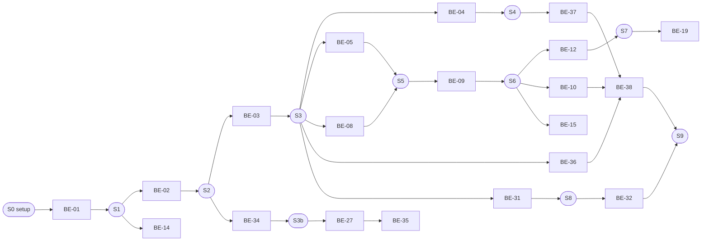
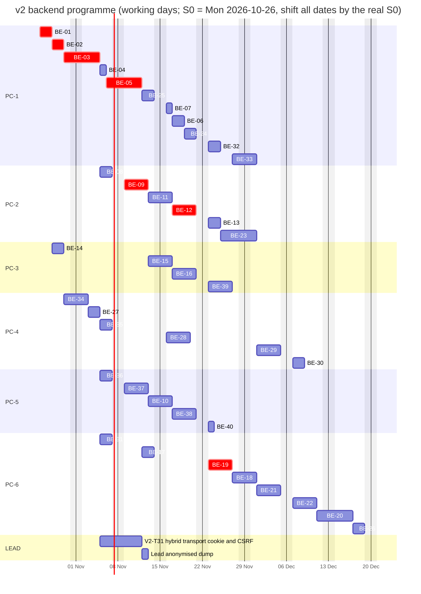

# Backend programme: PCs, lanes, sessions and sync

How the v2 backend (40 cards, BE-01 to BE-40) is split across several PCs and Claude Code sessions, in strict priority and dependency order, without two PCs editing the same files. Companion files: [backend-tracker.md](backend-tracker.md) (status), [agent-kickoff/](agent-kickoff/README.md) (prompts), [backend-tasks/](backend-tasks/README.md) (cards), [../architecture/v2-backend-plan.md](../architecture/v2-backend-plan.md) (design; section 14 migration-first, section 15 intake).

Terms. **Lane** = a stream of cards owned by one PC at a time (PC-1 to PC-6, plus the lead lane). **Session** = one fresh Claude Code run on that PC that takes 1 to 2 cards back to back, each on its own branch and PR. **Sync point** = a merge that other lanes must wait for.

## 1. Lanes

| Lane | Theme | Cards in order | Priority mix | Can start |
|---|---|---|---|---|
| **LEAD** | Contract owner (common/session/auth/access), frontend integration, PR review and merge, dumps | L0 setup, L1 V2-T31 hybrid transport, L2 anonymised dump, L3 frontend merges, L4 reviews, L5 per-domain http switch | n/a | now |
| **PC-1** | Foundation to Identity | BE-01, BE-02, BE-03, BE-04, BE-05, BE-25, BE-07, BE-06, BE-24, BE-32 (joint), BE-33 | P0 first, P2 last | after S0 |
| **PC-2** | Learning and Question bank | BE-08, BE-09, BE-11, BE-12, BE-13, BE-23 | P0 | after S3 (BE-03) |
| **PC-3** | Bijak and Paper builder | BE-14, BE-15, BE-16, BE-39 | P1 | BE-14 after S1 |
| **PC-4** | Migration and ETL | BE-34, BE-27, BE-35, BE-28, BE-29, BE-30 | P0 then P1/P2 | BE-34 after S2 |
| **PC-5** | AI intake | BE-36, BE-37, BE-10, BE-38, BE-40 | P1 | BE-36 after S3, BE-37 after S4 |
| **PC-6** | Teacher, Reports, Conformance and Seed | BE-31, BE-17, BE-19, BE-18, BE-21, BE-22, BE-20, BE-26 | P0 start, then P1/P2 | BE-31 after S3 |

Order inside a lane is fixed (it already respects dependencies and priority). BE-10 sits in PC-5 on purpose: it is on the path to the intake workflow, and its tables live in their own Prisma file (`questions-workflow.prisma`) so it never collides with PC-2.

## 2. Hard sync points

A PC must not start the cards in "Unblocks" before the merge in "Gate" is on `feature/v2-backend` and it has rebased.

| Sync | Gate (merged into `feature/v2-backend`) | Unblocks | Lead action |
|---|---|---|---|
| **S0** | `feature/v2-backend` created and pushed with this plan; branch protection on; collaborators invited; OD-1, OD-3 answered (OD-5 for BE-14; OD-19, OD-20 before PC-5) | Everything | L0 |
| **S1** | BE-01 (workspace, CI, ADR-0020, registries) | BE-02; BE-14 (needs OD-5 and the one coordinated `src/` PR) | merge, announce |
| **S2** | BE-02 (db, Prisma, harness) | BE-03, BE-34 | merge, announce |
| **S3** | BE-03 (auth, session, scope) | BE-04, BE-05 (PC-1); BE-08 (PC-2); BE-36 (PC-5); BE-31 (PC-6); lead L1 | merge, **merge frontend into `feature/v2-backend`** |
| **S3b** | BE-34 (migration kit, `be:lint:migration` in `be:verify`) | BE-27 (PC-4); from now every PR must pass the migration lint; models created earlier are fixed by their owner in the next PR | merge, announce |
| **S4** | BE-04 (file storage) | BE-37 (PC-5); BE-06, BE-24 (PC-1); BE-16 later | merge |
| **S5** | BE-05 and BE-08 | BE-17 (PC-6); BE-09 (PC-2, needs BE-08); BE-25 (PC-1, needs BE-05) | merge |
| **S6** | **BE-09 (question schema, owner service)** | BE-10 (PC-5); BE-15 (PC-3, with BE-14); BE-12 (PC-2, with BE-11 and BE-25) | merge, **merge frontend again** |
| **S7** | BE-25, BE-11, BE-12 (practice write path) | BE-19, BE-18 (PC-6); BE-13, BE-23 (PC-2); BE-29 inputs (PC-4) | merge |
| **S8** | BE-07, BE-31 and lead L1 (V2-T31) | BE-32 (joint) | merge, **merge frontend again** |
| **S9** | BE-16, BE-38, BE-39, BE-32 | BE-33 final pass; BE-26 full seed | security review (`security-engineer`) |
| **S10** | BE-29, BE-30, BE-35 and the anonymised dump (L2) | Rehearsal on the staging copy (devops) | lead + devops |



### What a lane does while it is blocked

Blocked time is spent on work that cannot conflict: contract-first schemas as separate `contract` PRs, tests, fixtures and reading. It never edits another lane's files and never creates a Prisma migration for a table whose prerequisite is unmerged.

| Lane | While waiting | Waiting for |
|---|---|---|
| PC-1 | BE-01/02 are the critical path (nothing to wait on). Draft the BE-05/BE-25 contracts from the m02 mock and write `docs/architecture/v2-backend-deviations.md` entries. | S0 |
| PC-2 | Contract PRs for curriculum (BE-08), questions (BE-09, from the exam schema) and practice (BE-12); study `packages/contract` conventions. | S3 (BE-08), S5 (BE-09), S7 inputs |
| PC-3 | After BE-14: derive the Bijak HTTP contract (BE-15/16/39) from `BijakServer` public methods and the frontend builder mock; extend `@pp/exam-core` tests. | S6 (BE-15) |
| PC-4 | BE-34 and BE-27 need only BE-02. While waiting for real data (OD-2): build against `BE-35` synthetic fixtures; pre-write enum mapping stubs and the `staging_cloud.sql` from `v2-data-migration.md` inventory; draft the BE-28/29 transform signatures. | OD-2, OD-10, S5, S7 |
| PC-5 | BE-36 can run on the mock provider alone. While waiting for BE-09/10: draft the intake contracts (items, review, dashboard) from the frontend mock (OD-20), prepare recorded provider fixtures, generated test PDFs. | S4 (BE-37), S6 (BE-10/38) |
| PC-6 | BE-31 skeleton first (needs only BE-03). Then contract PRs for classes, student performance, school admin from the m10/m08/m27 mocks. | S5 (BE-17), S7 (BE-19) |
| LEAD | Review contract PRs first, run L1 (hybrid transport), answer issues within one working day. | n/a |

## 3. Number of PCs (open)

**Any number of PCs** may work at once (user decision 2026-10-19, OD-17 closed): there is no fixed PC-to-lane split. Every PC pulls the next ready card from the whole tracker, by priority and dependency, and claims it with a draft PR ([AGENT-SYNC.md](AGENT-SYNC.md) sections 0b and 1). Lanes stay as file-ownership groups. The table below only shows how the finish date scales with the number of PCs; estimates are planning figures (agent working days including review turnaround), not promises.

| PCs | Assignment | Estimated finish |
|---|---|---|
| 6 + lead | PC-1 to PC-6 as in section 1 | about 8 weeks (Gantt below) |
| 4 + lead | A = PC-1; B = PC-2 then PC-6 first half (BE-31, BE-17, BE-19, BE-18); C = PC-3 + PC-5 interleaved (BE-14, BE-36, BE-37, BE-10, BE-15, BE-38, BE-16, BE-39, BE-40); D = PC-4 then PC-6 second half (BE-21, BE-22, BE-20, BE-26) | about 11 weeks |
| 3 + lead | A = PC-1 + PC-4; B = PC-2 + PC-6; C = PC-3 + PC-5 | about 14 weeks |
| 2 + lead | A = PC-1 + PC-2 + PC-4; B = PC-3 + PC-5 + PC-6 | about 20 weeks; not recommended (the critical path BE-01 to BE-12 serialises anyway) |

More PCs shorten the plan only while ready cards exist; the critical path BE-01 to BE-03 to BE-12 is sequential, so beyond about 6 PCs extra PCs mostly wait.

## 4. Schedule (Gantt)

Sizes: S = 1 day, M = 2 days, L = 4 days of agent work, earliest start with lane sequencing and the dependencies of the tracker. S0 is assumed to be Monday 2026-10-26; shift every date by the real S0. Critical path: BE-01, BE-02, BE-03, BE-05, BE-09, BE-12, BE-19, then the reports.



The scheduler counts only agent working time; add 1 working day of review latency per sync point on the critical path (about 8 more days), which is why the headline estimate above is "about 8 weeks" rather than 8 weeks of pure build.

## 5. File and folder ownership (no two PCs edit the same files)

A PR that touches a path owned by another lane is rejected in review. If you need a change there, open a GitHub issue labelled `cross-lane` (and `contract` for contract files) naming the owner lane; the owner makes it, or the lead approves a small named exception in the issue.

| Path | Owner | Notes |
|---|---|---|
| `src/**`, `e2e/**`, `vite.config.ts`, `index.html`, `docs/design/**`, `docs/qa/**`, `docs/TRACKER.md` | **LEAD** | BE-14 (one coordinated move out of `src/modules/m28-bijak-spm/domain`) and BE-32 (proxy, `@api` e2e config) are the only exceptions, approved in their PRs. |
| `packages/contract/src/{common,session,auth,access}/**` and existing registrations | **LEAD** | Change requests go through an issue labelled `contract`. |
| `apps/api/src/{main.ts,app.module.ts,common/**,db/**}`, `docker/api/**`, `.github/workflows/api.yml`, `.env.api.example` (structure), `compose.yaml` and `docker/frontend/**` (small, reviewed edits) | PC-1 | Others add only their own env keys in their own commented block. |
| `apps/api/src/modules/{auth,users,schools,subscriptions,parents,account,notifications,files,content,support}/**`; `prisma/schema/{base,identity,schools,files,content}.prisma`; `packages/contract/src/{users,schools,account,notifications,files,content,support}/**`; seeds `core`, `content` | PC-1 | |
| `apps/api/src/modules/{curriculum,questions,practice,wallet,gamification,shop}/**` except `questions/workflow/**`; `prisma/schema/{curriculum,questions,practice,wallet,gamification}.prisma`; contract `{curriculum,questions,practice,wallet,gamification}/`; seeds `curriculum`, `questions`, `practice`, `wallet` | PC-2 | After BE-09 merges, other lanes use `QuestionsService`; they never read its tables. |
| `packages/exam-core/**`; `apps/api/src/modules/exam/**`; `prisma/schema/exam.prisma`; contract `bijak/`; seed `exam` | PC-3 | |
| `apps/api/src/migration/**`; `apps/api/test/migration/**`; `prisma/schema/etl.prisma`; `apps/api/scripts/check-migratable.ts`; `docs/architecture/v2-migration-runbook.md` | PC-4 | PC-4 never edits another lane's Prisma file; a missing `legacy_*` column is an issue to the owning lane (they must already have it by plan 14.9). |
| `apps/api/src/modules/{ai-extraction,ocr,jobs,intake}/**`; `apps/api/src/modules/questions/workflow/**`; `prisma/schema/{ai,intake,questions-workflow}.prisma`; contract `{ai,intake}/`; seed `intake`; `apps/api/test/{ai,intake-*}/**` | PC-5 | |
| `apps/api/src/modules/{classes,missions,reports,school-admin,command-center}/**`; `prisma/schema/{classes,reports}.prisma`; contract `{classes,reports,school-admin,admin}/`; `apps/api/test/conformance/**` (runner and shared helpers); `prisma/seed/poc/**` | PC-6 | Other lanes add their own scenarios in `apps/api/test/conformance/<domain>/` (new files only). |
| `apps/api/test/<domain>/**` | the lane that owns the domain | |

**Append-only shared files** (several lanes touch them, one line per addition, never reorder or reformat):

| File | Rule |
|---|---|
| `apps/api/src/modules/index.ts` (module registry created by BE-01) | add one import and one array entry for your module |
| `apps/api/prisma/seed/index.ts` (seed registry created by BE-01) | add one entry for your seed module |
| `apps/api/prisma/migratable-models.json` | add model names, alphabetical |
| `packages/contract/src/openapi.ts`, `COMPONENT_SCHEMAS` registrations | add lines for your domain only; on conflict keep both sides, then `npm run contract:emit` |
| `packages/contract/openapi.json` | generated; never hand-merge: rebase, then `contract:emit`, commit |
| `docs/architecture/v2-backend-deviations.md` | append a dated row |
| `docs/architecture/v2-backend-plan.md` section 14.7 (mapping matrix) | edit only your own entity rows |
| `docs/plan/backend-tracker.md` | edit only your own card rows |
| `package-lock.json` | on conflict take the integration branch version, then `npm install` |

**Contract changes go through one owner per domain.** The lead owns `common/session/auth/access`; each lane owns the folders listed above. A contract PR (label `contract`) is small, merged by the lead first, within one working day, before dependent implementation PRs; the frontend lead aligns the mock/UI types from it. A lane never edits a contract folder it does not own. Prisma: one Prisma file per owner module, and **one open migration PR per Prisma file at a time**; the lead merges migration PRs one at a time, and a lane whose migration conflicts after a rebase deletes its own unmerged migration folder and regenerates it.

## 6. GitHub sync flow

1. **Base branch:** `feature/v2-backend` (created by the lead). Never push to `main`, `feature/student-prototype` or `v2/*`.
2. **Your branch:** `be/<card-id>-<slug>`, exactly as the card file name (`be/BE-05-users-schools`), created from the latest `origin/feature/v2-backend`. One card, one branch, one PR.
3. **PR:** open a **draft PR early** into `feature/v2-backend` with the template of [backend-tasks/README.md](backend-tasks/README.md) and the tracker row set to `in-progress`; mark ready when `npm run be:verify` is green with real output pasted. Labels: `contract`, `security-review`, `lane:PC-n`.
4. **Daily routine (first thing each working day, and before opening a PR):**
   ```
   git fetch origin
   git rebase origin/feature/v2-backend      # your own branch only
   npm ci                                    # if package-lock.json changed
   npm run contract:check
   npm run be:verify                         # includes be:lint:migration after S3b
   ```
   Push with `git push --force-with-lease` (own branch only).
5. **Conformance suite:** after BE-31 merges, every PR also runs `npm run be:test -- apps/api/test/conformance`; a failure is a blocker. Before BE-31, `be:verify` is the gate.
6. **Merge order inside one lane:** contract PR, then schema/migration PR, then feature PR (or one PR with three commits if small). The lead merges contract PRs first across all lanes.
7. **Review and merge:** the lead (with `code-reviewer` and, where flagged, `security-engineer`) reviews within one working day and squash-merges. Review fixes are pushed to the same branch.
8. **After a merge:** the lead sets the card `done`, updates the Change log, and at S3, S6 and S8 merges `feature/student-prototype` into `feature/v2-backend` and announces it; everyone rebases.
9. **Blockers and questions:** GitHub issue labelled `blocked`, `question`, `contract` or `cross-lane`; tracker row to `blocked`; take the next unblocked card.
10. **Nothing secret travels through GitHub:** no keys, no dumps, no real data, no credentials (see agent-kickoff rules).

## 7. Sessions (per lane)

For every session: start with a fresh Claude Code run using the lane's prompt from `agent-kickoff/PC-n.md`; the prompt makes the agent read the tracker and pick the next card. **Hand-off** always means: PR open and ready, tracker row updated in the PR, a 3 to 5 line note in the PR (done, blocked, next card, decisions needed), and any cross-lane issue opened.

### PC-1 Foundation to Identity

| Session | Cards | Start condition | Branches | Definition of done | Hand-off |
|---|---|---|---|---|---|
| PC-1/S1 | BE-01, then BE-02 | S0 | `be/BE-01-scaffold-ci`, `be/BE-02-db-orm` | Cards' acceptance criteria; CI green; contract import proof; registries (`modules/index.ts`, `seed/index.ts`) exist; ADR-0020 written; `compose.yaml` api and db enabled | Lead merges both (S1, S2); announce in the Change log |
| PC-1/S2 | BE-03 | S2 | `be/BE-03-auth-session` | Login/logout/session/role switch/Mod Pelajar per contract; scope and CSRF tests; security review requested | S3; unblocks 5 lanes |
| PC-1/S3 | BE-04, then BE-05 | S3 | `be/BE-04-file-storage`, `be/BE-05-users-schools` | As cards; BE-04 supports derived files for intake; BE-05 has `legacy_*` columns and its matrix rows | S4, S5 |
| PC-1/S4 | BE-25, then BE-07 | S5 (BE-05 merged) | `be/BE-25-subscriptions-parents`, `be/BE-07-seed-core-accounts` | Subscriptions and parent flows; core demo seed idempotent | BE-25 unblocks BE-12 (PC-2); BE-07 feeds S8 |
| PC-1/S5 | BE-06, then BE-24 | BE-04 and BE-05 merged | `be/BE-06-account-notifications`, `be/BE-24-content-support` | As cards | BE-24 feeds BE-29 |
| PC-1/S6 | BE-32 (joint with LEAD) | S8 | `be/BE-32-http-switch-e2e` | Compose stack up, nginx proxy (upload size and timeouts), `@api` e2e green for carded modules | Lead flips domains to http (L5) |
| PC-1/S7 | BE-33 | S9 | `be/BE-33-hardening-release` | Security checklist, ops runbook, review findings closed | Release gate G4 |

### PC-2 Learning and Question bank

| Session | Cards | Start condition | Branches | Definition of done | Hand-off |
|---|---|---|---|---|---|
| PC-2/S1 | BE-08, then BE-09 | S3 for BE-08; BE-09 after BE-08 merged | `be/BE-08-curriculum`, `be/BE-09-question-bank-core` | Curriculum served; question schema per exam schema D47; `QuestionsService` exported with the ADR-0014 contract; seeds fictitious | S5, **S6** (unblocks PC-3, PC-5, BE-12) |
| PC-2/S2 | BE-11, then BE-12 | BE-11: S3; BE-12: S6 + BE-11 + BE-25 | `be/BE-11-wallet-streak-core`, `be/BE-12-practice-sessions` | One-transaction answer, revision, mastery, wallet; idempotent `client_uuid`; migration columns on answers (snapshot dims, soft refs) | **S7** |
| PC-2/S3 | BE-13, then BE-23 | S7 | `be/BE-13-practice-reads`, `be/BE-23-gamification-shop` | Read models; economy | feeds BE-19, BE-26, BE-29 |

### PC-3 Bijak and Paper builder

| Session | Cards | Start condition | Branches | Definition of done | Hand-off |
|---|---|---|---|---|---|
| PC-3/S1 | BE-14 | S1 and OD-5 approved | `be/BE-14-exam-core-package` | `@pp/exam-core` extracted, UI imports it, root `typecheck` and `test` green, server and UI mark identically | Lead reviews the coordinated `src/` change |
| PC-3/S2 | BE-15, then BE-16 | BE-15: S6 (BE-09) + BE-14; BE-16: BE-15 + BE-04 + BE-11 | `be/BE-15-bijak-papers`, `be/BE-16-bijak-attempts` | Papers and cover; attempts with server timer, autosave, marking, results; photos via FileStorage | S9 input |
| PC-3/S3 | BE-39 | BE-15 and BE-10 merged | `be/BE-39-paper-builder-blueprints` | Builder, conformance, publish/withdraw, blueprint versions | S9 |

### PC-4 Migration and ETL

| Session | Cards | Start condition | Branches | Definition of done | Hand-off |
|---|---|---|---|---|---|
| PC-4/S1 | BE-34, then BE-27 | BE-34: S2; BE-27: S3b | `be/BE-34-migration-kit`, `be/BE-27-migration-staging-profiling` | Kit and lint in `be:verify`; staging DDL, loader, read-only guard, profiler on fixtures | S3b; lint gate for all lanes |
| PC-4/S2 | BE-35 | BE-27 merged | `be/BE-35-anonymiser-fixtures` | Default-deny anonymiser, leak scan, generator (tiny/small/medium) | Lead (L2) runs the anonymiser on real data |
| PC-4/S3 | BE-28 | BE-27, BE-05, BE-08, BE-17, BE-25 merged; OD-10 answered | `be/BE-28-migration-etl-core` | Reference, identity, classes loaded idempotently; reconciliation per entity | |
| PC-4/S4 | BE-29, then BE-30 | BE-28 + BE-11, BE-12, BE-16, BE-23, BE-24 merged | `be/BE-29-migration-etl-activity`, `be/BE-30-migration-reconcile-rehearsal` | Activity load with snapshot join; recon is the go/no-go report | S10 |

### PC-5 AI intake

| Session | Cards | Start condition | Branches | Definition of done | Hand-off |
|---|---|---|---|---|---|
| PC-5/S1 | BE-36, then BE-37 | BE-36: S3 (+OD-20); BE-37: S4 | `be/BE-36-ai-extraction-service`, `be/BE-37-intake-files-ocr` | Adapters + mock, redaction canary, cost log, budget; upload, jobs, OCR, crops | |
| PC-5/S2 | BE-10, then BE-38 | S6 (BE-09); BE-38 also needs BE-36 and BE-37 | `be/BE-10-question-workflow`, `be/BE-38-intake-workflow` | Lifecycle and gates; end-to-end intake with the mock provider; AI cannot approve | S9; unblocks BE-39 (via BE-10) |
| PC-5/S3 | BE-40 | BE-36 and BE-38 merged | `be/BE-40-intake-dashboard-ai-usage` | AC-29.1 figures | |

### PC-6 Teacher, Reports, Conformance and Seed

| Session | Cards | Start condition | Branches | Definition of done | Hand-off |
|---|---|---|---|---|---|
| PC-6/S1 | BE-31, then BE-17 | BE-31: S3; BE-17: S5 | `be/BE-31-conformance-suite`, `be/BE-17-classes-teacher` | Conformance runner + OpenAPI breaking-change gate; classes with scope filtering | S8 (BE-31) |
| PC-6/S2 | BE-19, then BE-18 | S7 (BE-12) + BE-17 | `be/BE-19-student-performance`, `be/BE-18-missions-remedial-sets` | Read models match mock figures; missions/remedial | feeds BE-20/21/22/26 |
| PC-6/S3 | BE-21, then BE-22 | BE-19 merged | `be/BE-21-school-admin`, `be/BE-22-command-center-admin` | School scope enforced (other school 404); Command Center aggregates | |
| PC-6/S4 | BE-20, then BE-26 | BE-19 (BE-20); BE-07, 12, 16, 17, 19, 23 (BE-26) | `be/BE-20-teacher-analytics-kirkpatrick`, `be/BE-26-seed-poc-profile` | Analytics; PoC seed profile across domains (can include one intake batch and one built paper) | S9 |

### LEAD

| Task | Start condition | Output |
|---|---|---|
| L0 | now | `feature/v2-backend` pushed, protection on, ODs answered (section 8 of this file lists them) |
| L1 V2-T31 | S3 | `hybrid` mode, cookie + CSRF transport; needed by BE-32 |
| L2 | BE-35 merged | Anonymised dump on the lead PC, shared out-of-band, never in GitHub |
| L3 | S3, S6, S8 | frontend merged into `feature/v2-backend`, announced |
| L4 | continuous | contract PRs first, then migrations, then features; security review where flagged |
| L5 | per domain merged | "switch Mnn to http" frontend PR |

## 8. Decisions needed before starting

From plan section 13. Blocking at S0: **OD-1** (repo access), **OD-3** (confirm NestJS 11 + Prisma + Vitest), **OD-12** (who merges, branch protection), **OD-19** (ADR numbers). Before their cards: **OD-5** (BE-14), **OD-20** (frontend intake paths; before BE-36/37), **OD-2 and OD-18** (data for BE-28 onward, who anonymises), **OD-10** (migration questions), **OD-13** (.my as a source?), **OD-14** (production AI provider, budget), **OD-15/OD-16** (OCR engine, limits and retention), **OD-17** (how many PCs).
