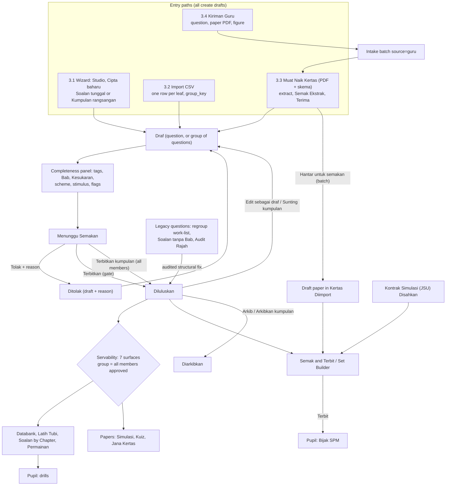
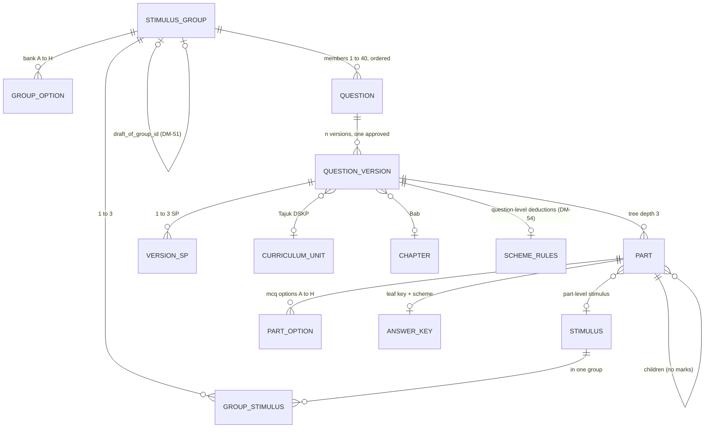
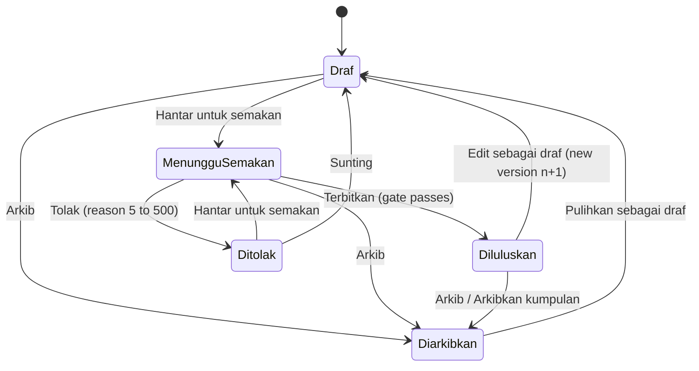
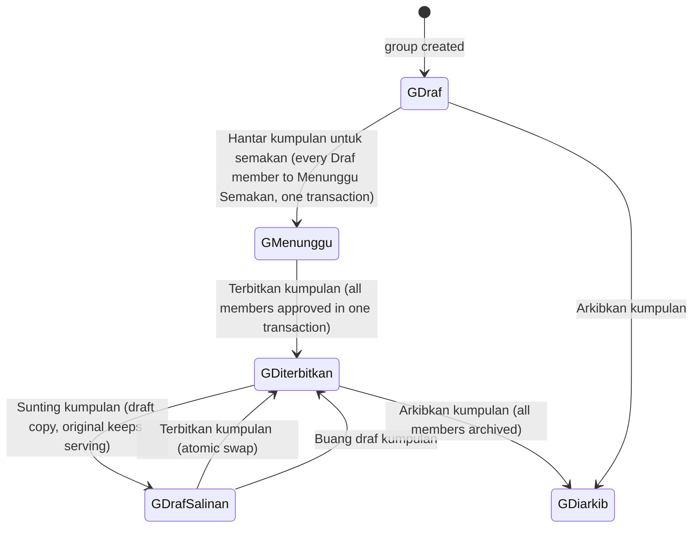
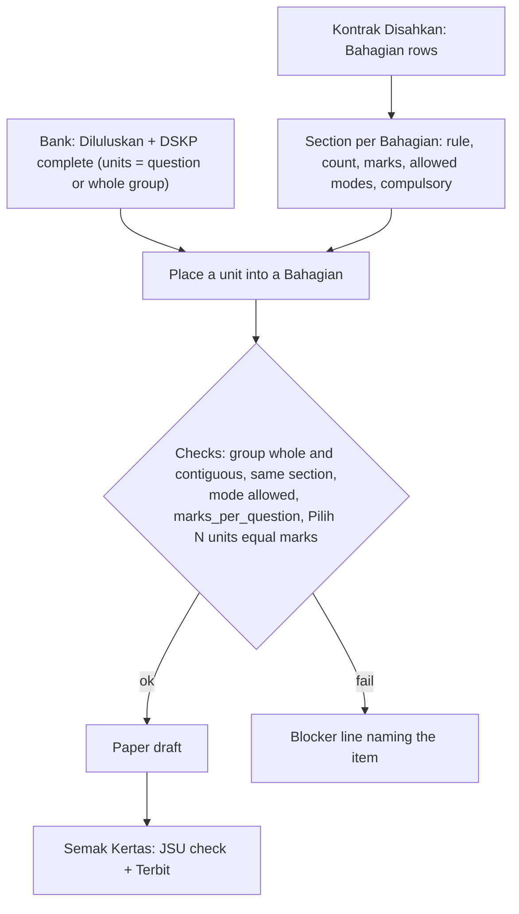

# PRD 45: Question authoring flow (how questions get into PrestasiPlus V3 and become ready for pupils)

| | |
|---|---|
| Purpose | The single, complete, end-to-end specification of HOW a question enters PrestasiPlus V3, is tagged, reviewed, published, assembled into papers, maintained and served. It is the one place a developer or cloud agent reads to build the question pipeline without asking. |
| Why it exists | The product owner's biggest worry. V3 failed here before: figures were split from their questions, DSKP was ignored, and structured SPM papers could not be entered. The rules were scattered over 10, 30, 40, 50 and 60. |
| Audience | Developers and cloud agents building plan cards S1-T01..T10, S2-T01..T08, S3-T01/T02/T06, S6-T06/T17/T18, S8-T02/T03; the Delivery Lead; QA; the Admin Pusat who does the content work. |
| Status | Draft for Delivery Lead review, 2026-11-04. Branch `docs/r1-prd-devplan`. Language: English; every UI string is exact BM. Not yet wired into 50, 60 and the plan (the register in section 10 lists every ID to wire). |
| Related | [00-index](00-index.md), [30-admin-pusat](30-admin-pusat.md) (screens), [20-guru-admin-sekolah](20-guru-admin-sekolah.md) (teacher forms), [40-cross-cutting](40-cross-cutting.md) (FR-X1-4, AC-CHAIN-1/2/6), [50-data-model-erd](50-data-model-erd.md), [60-api-contract](60-api-contract.md), `docs/plan/r1-development-plan.md`, `docs/requirements/v2-exam-schema.md` |

**Improve, not rebuild.** V3 already has most of the pieces (group entity, intake, part trees, scheme keys, builder). Every step below names the existing V3 file to extend (section 9) and the duplicate NOT to create. Before coding a card: run the code gap check of that card against the FR/AC here, post it on the issue, and change only what is broken or missing.

**How to read IDs.** Existing IDs (R1-ADM-Q-nn, FR-ADM-QEn.n, FR-X1-4a..f, API-Q-nn, DM-nn, S1-T01..) are quoted from 30, 20, 40, 50, 60 and the plan. **NEW** requirements introduced here are `FR-QA-nn` and `AC-QA-nn`. New data changes are `DM-50`..`DM-59` and new API rows `API-Q-30`..`API-Q-39`; they are registered in 50 section 4.9 and 60 section 2.6. Copy and values that have no source in V2, V1, the code or the PRD are decided R1 copy (Delivery Lead, D113) and are marked "(R1 copy, D113)"; they are built as written. `OPT-*` are the shared option sets of the 30 field register (section 3.0 lists the values used here). `ERR-*` are the error catalogue IDs of the error-handling register.

**Vocabulary used throughout.** *Bahagian* = a section of a paper ("Bahagian A", "Part 4"). *Sub-bahagian* = a part of a question ((a), (b), (i)). *Leaf* = a sub-bahagian with no children; only a leaf carries marks, an answer mode, an answer key and a scheme. *Stimulus* = a rajah, petikan, jadual, graf, peta, carta or image that is the shared reference of one or more questions; it is never a question. *Kumpulan rangsangan* (group) = 1 to 3 stimuli plus 1 to 40 ordered member questions. *Terbitkan* = the action that makes a question `Diluluskan`. *Tag* = the DSKP and classification fields of a question.

---

## 0. Decisions (Delivery Lead, by principle, 2026-11-04)

| # | Decision | Consequence in this document |
|---|---|---|
| D-QA-1 | Bilingual text (BM + English) is supported in R1, per question, part, option and stimulus. | Field `Bahasa soalan` with value `BM + English (dwibahasa)`; every text field shows two stacked editors; section 2.7 and 3.1.5. |
| D-QA-2 | `drawing` and `table_fill` items are supported in R1: the pupil answers on screen, then self-marks against the scheme. | Leaf forms in 3.1.6 modes 8 and 9; no "mode not available" refusal; pupil side in S8-T03 and S3-T06. |
| D-QA-3 | The full marking-scheme editor is built in R1. | Section 3.1.7; API-Q-30; DM-54. |
| D-QA-4 | `essay_choice` ("answer one of two prompts") is served. | Leaf mode 7 with alternative prompts, each with its own stimulus. |
| D-QA-5 | A stimulus group is published, served, edited (draft copy plus atomic swap) and retired as ONE unit. | Sections 4.3, 6.2, 6.5; API-Q-31..33; DM-51. |
| D-QA-6 | A group may carry 1 to 3 stimuli; a stimulus may attach to a part; a question that cites two figures uses a multi-stimulus group. | Sections 2.4, 3.1.4; FR-QA-08, FR-QA-09. |
| D-QA-7 | Legacy regroup of served questions is an audited structural change that skips the DSKP gate but is logged (and can be undone). | Section 6.6; FR-QA-13; API-Q-36. |
| D-QA-8 | Detection covers numbered AND unnumbered references ("Rajah di atas", "Maklumat di bawah", "Sumber", "Teks", "Petikan"). | Section 6.6.1; FR-QA-12; DM-53. |
| D-QA-9 | TP (1 to 6) and Kesukaran (1 to 5) are separate fields. The default of Kesukaran is `min(5, TP)` (3 when no TP) until the admin touches it. | Section 3.1.2 fields T-06 and T-12; AC-QA-31. |
| D-QA-10 | Kertas is 1 to 4 everywhere (DM-08). | OPT-KERTAS in every form, CSV and filter. |
| D-QA-11 | The status vocabulary is the V2 labels: `Draf`, `Menunggu Semakan`, `Diluluskan`, `Ditolak`, `Diarkibkan`. `Ditolak` is `draft` with a rejection reason; there are four stored statuses. | Section 2.8; DM-58. |
| D-QA-12 (D112-1) | Bab is required to publish when the Subjek and Tingkatan have chapters. | Gate code `NO_CHAPTER` (4.1); work-list `Soalan tanpa Bab` (6.7). Code today (`gates.ts:37`) does not ask for it: fix in S1-T02. |
| D-QA-13 (D112-2) | Real in-house Tesseract OCR (msa + eng); no external AI service in R1. | Extraction = text layer first, else Tesseract, then rule-based segmentation. DSKP pre-fill in review is a deterministic keyword matcher over the loaded `curriculum_nodes`, with confidence bands; no AI provider call, `AI_PROVIDER=mock` is removed from the path (3.3.3). |
| D-QA-14 (D112-3) | Load DSKP for all subjects. Until a subject is loaded, Tajuk DSKP, SP, TP and aras are required only if `curriculum_nodes` exist for that Subjek and Tingkatan. Kontrak only for loaded subjects. | Gate rule R-DSKP in 4.1; the Kontrak subject picker lists loaded subjects only; a question of an unloaded subject can be `Diluluskan` untagged and is served by Databank, Latih Tubi and Bab but not placed in a blueprint paper (as legacy untagged, D80). |
| D-QA-15 (D112-4) | Bijak content is entered by Admin users, from the 6 sample-paper subjects (Matematik, Matematik Tambahan, Fizik, Sejarah, Bahasa Melayu, Bahasa Inggeris), Kertas 1 first. | Section 6.8 and the worked examples; U-OP-04, 07, 08, 09 are Admin work. |
| D-QA-16 (D112-5) | `Sunting Pantas` (Quick Edit, Q-24) is a Fix, not a Keep. | Section 6.1; card S2-T05. |
| D-QA-17 (D112-6) | There is no pupil `Jana Kertas` in R1. | The activity `jana_kertas` is not served; the indicator counts the six served activities (4.5). The admin `Jana set` in the Set Builder stays. |
| D-QA-18 (D112-7) | Slice 0: one end-to-end chain first (plan section 5A). | Section 1.7 lists the exact steps of this flow that Slice 0 uses. |

Standing decisions this document relies on: D90/D93/D105 (group entity, group first, figure questions served), D108(1) (a group of 1 is valid), D108(2) (aras pemikiran stays a per-leaf approval gate with a question-level default), D-A5 (Bab required to publish), D-A6, D99 (provenance declared once per batch), D104 (Subjektif and Kertas Subjektif have no flag), D110 (content work is done by Admin Pusat in the screens, not by developers).

---

## 1. Read this first

### 1.1 What this is in one paragraph

An Admin Pusat (central admin) puts questions into the bank by one of four **entry paths**: the manual wizard, a CSV import, a paper PDF upload, or by reviewing what teachers sent. All four create **drafts**, never servable ones. Every draft must carry the DSKP tags (Subjek, Tingkatan, Tajuk DSKP, SP, TP, aras pemikiran) plus Bab, Tahap kesukaran and Kertas, and a mark scheme. A figure, passage or table is a **stimulus**, never a question; it is stored once in a **group** that lists the questions citing it. The completeness panel shows what is missing; `Hantar untuk semakan` sends the draft to review; `Terbitkan` runs the gate and makes it `Diluluskan`. A group is published, served, edited and retired as one unit. Approved questions reach pupils on the seven surfaces, and papers are assembled in the Set Builder under a verified **Kontrak** (the JSU in machine form) and published with `Terbit`.

### 1.2 The overview



### 1.3 The rules that never bend

1. A stimulus is never a question: no marks, no number, no key, never a row in a list (FR-X1-4a, FR-ADM-QE1.1).
2. The stimulus is entered once. Questions citing it are members of its group. Nobody re-uploads a figure (FR-X1-4b).
3. DSKP tags come first in the wizard, from `curriculum_nodes`; no tag is free text.
4. Nothing becomes `Diluluskan` unless the gate passes; the gate list shown at entry is the same list the 422 returns (FR-ADM-QE4.4).
5. A group is servable only when ALL its members are approved and complete; it is published, edited, retired as one unit (D-QA-5).
6. A published thing is never edited in place: `Edit sebagai draf` (question) or `Sunting kumpulan` (group), then publish; pupils keep the old version until the swap.
7. A question that names a figure it does not have is never served (flag `stimulus_missing`), and cannot be published.
8. Regrouping legacy data is audited and reversible; it is content work done by Admin Pusat in the screens (D110).

### 1.4 Who does what (short; the full matrix is 6.8)

Only role `admin` (Admin Pusat) writes in the admin screens. A teacher submits (questions, papers, figures) and sees status words. Admin Sekolah and PPD have no write access to the question pipeline.

### 1.5 Entry paths at a glance

| Path | Screen and route (canonical) | Section | Produces | Status after |
|---|---|---|---|---|---|
| Manual wizard | `Bank Soalan (Studio)` > `Cipta baharu`: `/admin/studio/questions/create`, `/admin/studio/questions/:id/sunting`, `/admin/studio/groups/:id` | 3.1 | question draft(s) and optional group | `Draf` |
| CSV | `Import CSV` button: `/admin/questions/import`, history `/admin/questions/import-history` | 3.2 | question drafts and groups | `Draf` |
| PDF paper | `Muat Naik Kertas` `/admin/spm/soalan/muat-naik` > `Semak Ekstrak` `/admin/spm/soalan/ekstrak/:batchId` | 3.3 | intake items, then drafts (`Terima`) in groups | `Draf` |
| Teacher | teacher `/guru/soalan*`, admin tab `Kiriman Guru` `/admin/question-submissions` | 3.4 | intake item `source=guru` (every submission) | `Menunggu Semakan` |
| Batch to paper | `Import & Semakan` tab `Kertas Diimport` > `Semak & Terbit` `/admin/spm/kertas/:id` | 3.5 | draft paper | paper `Draf` |

### 1.6 One canonical screen per function (no duplicates)

| Function | The one screen | Never build or keep as separate |
|---|---|---|
| List and filter questions (filters Subjek, `Tingkatan`, `Bab`, `Tajuk DSKP`, `Penandaan DSKP` (`Ada DSKP Tag` / `Belum Ditag`), Status, Sumber, Jenis kertas, Kertas, Tahun, Negeri; FR-ADM-Q03.4, Q03.8; built by S2-T01) | `Bank Soalan (Studio)` `/admin/studio` | `/admin/spm/soalan` list (redirects to `/admin/spm/databank`); a new "question manager" |
| Create or edit one question | Studio wizard (`StudioEditorPage.vue` and `components/studio/*`) | the flat `QuestionForm.vue` pages `/admin/questions/create` and `/:id/edit` (redirect to the wizard, Q-20; `QuestionCreatePage.vue` and `QuestionEditPage.vue` keep no form: they only redirect with the notice of FR-ADM-Q04.7, and the redirect is built by S2-T01) |
| Stimulus and group | `/admin/studio/groups/:id` (`StudioGroupPage.vue`) | a stimulus editor inside each question; any figure-as-question form |
| Review extracted items | `Semak Ekstrak` (`IntakeReviewPage.vue`) | the review queue `/admin/spm/semakan` (redirects to `/admin/studio?status=review`) |
| Review a question (Menunggu Semakan) | Studio tile `Menunggu Semakan` | a second queue |
| Paper builder | `Set Builder` `/admin/studio/sets` (+ `/:paper/builder`) | `Pembina Kertas` `/admin/spm/kertas` list (redirects) |
| Paper review and Terbit | `Semak Kertas Simulasi` `/admin/spm/kertas/:id` | a separate publish dialog elsewhere |
| Kontrak (JSU) | `Kontrak Simulasi` `/admin/spm/kontrak...` | any second blueprint editor |
| Regroup legacy | tab `Perlu dikumpulkan semula` of `Senarai Soalan` | a script that regroups without the audit |
| Missing diagrams | `Audit Rajah` `/admin/soalan-gambar` (also reached by teachers) | a second upload page |
| Questions without Bab | Studio view `Soalan tanpa Bab` (filter `chapter=none`) | a separate mapping page |
| Scheme editing | scheme editor inside the wizard | the V2 free-text rubric editor of `Soalan Berstruktur` |

### 1.7 Slice 0 path through this flow

Plan section 5A "Slice 0: one end-to-end chain first" proves AC-CHAIN-1 and AC-CHAIN-2. It uses these steps of this document (Admin users enter the content, Sejarah Kertas 1 first, D112(4)):

| Slice 0 step (plan) | Steps and sections of this flow | Requirements |
|---|---|---|
| 1 Group 1..n published and served as one unit (S1-T01, S1-T02, S2-T01) | 3.1.4 group screen (`Kumpulan rangsangan`, `Tambah soalan`), 4.3 `Terbitkan kumpulan`, 2.4, 2.9 | FR-QA-01, 02, 10; AC-ADM-QE1.2, QE2.1, QE2.2 |
| 2 Conditional Bab/SP gate (S1-T02, S4-T02) | 3.1.2 Tag step, 4.1 gate (`NO_CHAPTER`, rule R-DSKP) | FR-QA-42; AC-ADM-QE4.3, QE4.4, QE4.5 |
| 3 Latih Tubi serves whole groups (S1-T06, S1-T07, S8-T02) | 4.5 servability, 2.4 rule 5 | FR-QA-01, 45; AC-ADM-QE7.3; AC-CHAIN-1 |
| 4 One Sejarah Kertas 1 paper (S3-T01, S3-T02, S3-T08, S1-T10, S3-T04) | 5.2 Kontrak, 5.3 Set Builder, 5.4 assembly, 5.5 Terbit, 3.5 batch to paper; the MCQ leaf form (3.1.6 mode 1), because Kertas 1 is objective (7.1 shows the structured Kertas 2 form for later) | FR-QA-40, 41; AC-ADM-Q16.1, Q16.3, Q07.3 to Q07.6 |
| 4a Paper PDF start of AC-CHAIN-2 (S0-T03, S1-T03, S1-T04, S2-T02) | 3.3 upload, extraction (in-house Tesseract), failure states, review; 3.3.6 send the batch | FR-QA-35, 36, 38, 43; AC-ADM-QE5.1 to QE5.3, Q07.1; AC-CHAIN-2 |

If time runs out, the Sejarah paper is entered by group-first manual entry (3.1) and 3.3 follows.

---

## 2. The question model in plain words

### 2.1 In words

- A **question** (`Soalan`) is a stable identity with **versions**. The content, tags and status live on the version. Only one version is `approved` at a time.
- A question is a **tree of sub-bahagian** (depth at most 3: (a), (i), (A)). Only **leaves** carry marks, an **answer mode**, a **key** and a **scheme**. A one-part question (an MCQ) is one leaf. A structured question is 2 to 10 leaves or a nested tree.
- Each leaf has its own **TP** (1 to 6), **aras pemikiran** (6 levels), and an optional KBAT override and unit override. The question holds the **default** (a one-level question needs one choice). Question TP is the highest leaf TP (derived).
- A **stimulus group** holds 1 to 3 stimuli, an optional lettered **option bank** (A to H), and 1 to 40 ordered **member** questions. A member sees the stimulus read-only. A leaf may point at one stimulus of the group (part-level stimulus) or at its own.
- **DSKP tags** (Subjek, Tingkatan, Tajuk DSKP, SP 1 to 3, TP, aras, KBAT) are separate from **Bab** (the textbook chapter) and from **Tahap kesukaran** (1 to 5). None is derived from another.
- Text can be **bilingual**: every rich text value is `{ms, en?}`; a question set to `BM + English (dwibahasa)` requires both.
- **Status** is a four-value machine with `Ditolak` as a sub-state of `Draf`. **Versioning**: a published question is changed only through a new draft version `n+1`; a published group is changed only through a draft copy of the group.

### 2.2 Diagram



### 2.3 Question types, leaf modes and what each needs

The wizard picks a **Jenis soalan** (`questionType`, OPT-JENIS-SOALAN; the 11 values are registered as DM-69); it builds the part-tree template; each leaf then has a **Jenis jawapan** (leaf mode, OPT-MOD-JAWAPAN). `short_text` and `numeric` are leaf modes (OPT-MOD-JAWAPAN, 9 modes), never question types; the master list of the 11 `questionType` values and the mapping "questionType to default leaf mode(s)" are in 40 beside OPT-JENIS-SOALAN, and the table below agrees with it. All modes are served to pupils in R1 (D-QA-2); `pksk_choice` is PKSK-only and never offered in the Studio.

| Jenis soalan (`questionType`) | Template | Leaf modes allowed | Key kind of the leaf |
|---|---|---|---|
| `Aneka Pilihan` (`mcq`) | one leaf, 2 to 8 options | `mcq` | `option` (one correct; `accepted` list only with `Nota kunci`) |
| `Aneka Pilihan (Pelbagai Jawapan)` (`mcq_multi`) | one leaf, 2 to 8 options | `mcq` with `multi=true` | `options` (1 to options-1 correct; field `correctOptionIds: Id[]`) |
| `Betul / Salah` (`true_false`) | one leaf, two fixed options `Betul`, `Salah` | `mcq` (two fixed options) | `option` |
| `Padanan / Lengkapkan Petikan` (`match`) | N leaves sharing the group's option bank | `match_letter` | `mapping` |
| `Jawapan Pendek` (`short_answer`) | one leaf | `short_text`, `numeric` | `accepted` |
| `Isi Tempat Kosong` (`fill_blank`) | one leaf, or N leaves behind `{{gap:N}}` tokens | `short_text` | `accepted` |
| `Berstruktur` (`structured`) | 2 to 10 leaves or nested (a)(i) | any | per leaf |
| `Pengiraan dengan Langkah Kerja` (`working`) | one leaf (or leaves inside a structured tree) | `working` | `points` (+ final answer) |
| `Karangan / Respons Terbuka` (`essay`) | one leaf | `essay`, `essay_choice` | `rubric` or `points` |
| `Lukisan / Graf` (`drawing`) | one leaf | `drawing` | `points` (checklist) |
| `Isi Jadual` (`table_fill`) | one leaf | `table_fill` | `mapping` with `cells` |

`mcq_multi` and `true_false` are question types only (R1 decision D113, N-12): there is no leaf mode of those names. Their leaves use leaf mode `mcq`; `mcq_multi` sets `modeConfig.multi = true`, `true_false` has the two fixed options `Betul` and `Salah`. The multi-answer key is `{kind:'options', correctOptionIds:[...]}` and every reveal and check response carries `correctOptionIds: Id[]` (never `correctOptions`); a single-answer key stays `{kind:'option', correct, accepted?, note?}`.

### 2.4 Stimulus and group rules

1. Stimulus kinds (OPT-JENIS-RANGSANGAN as decided in 1A.7 of the field register; registered as DM-70): `Petikan` (`passage`), `Rajah` (`diagram`), `Jadual` (`table`), `Graf` (`graph`), `Peta` (`map`), `Carta / Infografik` (`infographic`), `Imej / Gambar` (`image`). Code or pseudocode is a `Petikan` using the `</>` block; a bordered "Sumber" box is a `Petikan` with the `Kotak teks` tool. The V2 kinds Audio and Video are not offered (Audio KBAT is a separate module); the V2 data of those kinds is reported in the migration list, not migrated.
2. A group has 1 to 3 stimuli, shown together once, in order, above its members. A group of 1 member is valid everywhere, including in papers (D108(1)); a group of 0 members is a draft only and cannot be placed in a paper.
3. A question belongs to at most one group. A question citing two figures belongs to a group that contains both stimuli (a multi-stimulus group). If the two figures sit in two groups, the groups are merged (FR-QA-08).
4. A leaf may carry `stimulusId`: one of the group's stimuli, or a stimulus of its own (a "part-level stimulus", for example a quoted source on part (c) only). A prompt may cite "Bahan 2"; the pupil panel opens the stimulus labelled so.
5. The group has a **servability** (4.5): servable only when it has at least 1 member, every member is `Diluluskan`, passes the gate and has no open stimulus flag.
6. A stimulus that has members through its group cannot be deleted (DM-02). A served group is edited through a draft copy (6.2).
7. Group size limit 40 members; label max 100 chars; option bank max 8 entries.

### 2.5 Tags: per question and per leaf

| Field | Level | Stored in | Required to publish | Notes |
|---|---|---|---|---|---|
| Subjek, Tingkatan (1 to 5) | question | `subject_id`, `education_level_id` | always | OPT-SUBJEK, OPT-TINGKATAN |
| Tajuk DSKP (unit) | question; leaf override | `unit_node_id` | when DSKP nodes exist for the Subjek + Tingkatan (R-DSKP) | message "Sila pilih unit DSKP." |
| SP (1 to 3) | question | `question_version_sp_nodes` | when DSKP nodes exist (R-DSKP) | SK derived, never typed |
| TP 1 to 6 | leaf (inherits question default) | `question_parts.difficulty_tp`; version value = highest leaf TP | each leaf, when DSKP nodes exist (R-DSKP) | "Bahagian (b) belum ada TP." |
| Aras pemikiran | leaf (inherits question default) | `question_parts.cognitive_level` | each leaf, when DSKP nodes exist (R-DSKP) | OPT-ARAS; "Bahagian (b) belum ada aras pemikiran." |
| KBAT | leaf, derived from aras | `kbat` | not a gate | override OPT-KBAT-OVERRIDE |
| Bab | question | `chapter_id` | when the Subjek and Tingkatan have chapters (D112-1) | "Sila pilih Bab." |
| Topik | question | `topic_id` | no | optional |
| Tahap kesukaran 1 to 5 | question | `difficulty_level` | always (default `min(5, TP)`, or 3 when no TP) | "Sila pilih tahap kesukaran." |
| Kertas 1 to 4 | question | trailing digit of `paper_code` | SPM-bound | "Sila pilih kertas untuk soalan SPM." |
| Bahagian (cetakan) | question | `section_label` | no | informational |
| Rujukan buku teks | question | `textbook_ref` (DM-56) | no | Sejarah mainly |
| Asal tingkatan | question | `form_origin` | only when no unit exists | `t1_t3`, `t4`, `t5` |
| Bahasa soalan, Jenis tulisan | question | `language`, `script_type` | always (defaults) | 2.7 |

SPM-bound = the subject is in the SPM catalogue and Tingkatan is 4 or 5; it decides only whether `Kertas` is asked, never a DSKP tag. The DSKP tag rule is the single rule R-DSKP below (D112-1, D112-3): Bab is required when the Subjek + Tingkatan has chapters; Tajuk DSKP, SP, TP and aras are required only when DSKP nodes exist for that Subjek + Tingkatan; Kesukaran is always required (default `min(5, TP)`, or 3 when no TP). T1 to T3 content with no nodes is approved untagged (D101).

### 2.6 Scheme kinds per leaf mode

| Leaf mode | Key kind | What the scheme is |
|---|---|---|
| `mcq` | `option` / `options` | the correct label(s); optional accepted list and `Nota kunci` |
| `match_letter` | `mapping` | leaf label to bank letter |
| `short_text` | `accepted` | up to 10 accepted values, case, any order, `blank_count` |
| `numeric` | `accepted` (numeric) | value, tolerance, unit, decimals, significant figures |
| `working` | `points` | K/N/P/B/M/F/C points, groups, paths, final answer, deductions |
| `essay` | `rubric` or `points` | band rubric (overall or per criterion), optional content points |
| `essay_choice` | `rubric` or `points` | as `essay`, shared by all alternative prompts; marks counted once |
| `drawing` | `points` | self-mark checklist |
| `table_fill` | `mapping` (`cells`) | accepted values per blank cell |

Scheme v2 (section 3.1.7) widens `points` and `rubric` and adds question-level rules (`scheme_rules`, DM-54).

Field constraints per leaf mode (D115, from V3 code): `mcq` 3 to 8 options (`lib/studio/draft.ts:15-16`); `match_letter` option letters `A` to `H` (`packages/contract/src/questions/parts.ts:38`); `essay_choice` 2 to 6 topics (`parts.ts:31`); `essay` word range 0 to 5000, min <= max; V3 Studio today edits only `mcq`, `short_text`, `numeric` (S2-T10 adds the other six). BI P2 rubric test data: worked examples of section 7.4. UI: keep the V3 layout; V2 is a reference for function only.

### 2.7 Bilingual text

- Field `Bahasa soalan` (stored `language`): `Bahasa Melayu` (`ms`, default; `bm` is accepted on input and stored as `ms`), `English` (`en`), `BM + English (dwibahasa)` (`ms+en` on the wire and in CSV; stored as `ms_en`, a value the V3 database check already allows; D115). Field `Jenis tulisan` (`rumi` default, `arab`, `jawi`, `mixed`) is shown only for the Islamic and Arabic subjects (OPT).
- On the wire every rich text is `QuestionRichText = { ms, en? }` (already in `packages/contract/src/questions/parts.ts`): prompts, options, stimulus body, option-bank body, scheme point text. For `ms+en` both keys are filled. Where the ERD stores plain text columns (`stem_ms`, stimulus `body_ms`, `caption`) the `_en` twin is added (DM-50).
- In the editors, `ms+en` shows two stacked editors per text field, labelled `BM` and `English`. Validation: "Teks English diperlukan untuk soalan dwibahasa." for prompt, option and stimulus text; scheme text may stay BM only.
- Table cells stay single strings; a bilingual header is typed in the one cell as `BM / English`.
- The pupil sees BM above English as printed by default; the three-way control of 46 2.3 (FR-PA-04) can show one language only.

### 2.8 Status machine



`Ditolak` is stored as `draft` with `rejection_reason` (DM-58). Labels: `Draf` (`draft`), `Menunggu Semakan` (`review`), `Diluluskan` (`approved`), `Ditolak` (`draft` + reason), `Diarkibkan` (`archived`). The English words Draft, Reviewed, Approved, Archived are never shown. Transitions and actors:

| Transition | Action label | Actor | Side effect |
|---|---|---|---|
| Draf to Menunggu Semakan | `Hantar untuk semakan` | Admin Pusat; the owning teacher for own question | clears `rejection_reason` |
| Menunggu Semakan to Diluluskan | `Terbitkan` | Admin Pusat only | gate; recompute servability; for a group member: only through `Terbitkan kumpulan` (FR-QA-02) |
| Menunggu Semakan to Ditolak | `Tolak` | Admin Pusat | reason required; owner notified |
| any non-archived to Diarkibkan | `Arkib` | Admin Pusat | pupil surfaces drop it at once; affected Terbit papers listed |
| Diarkibkan to Draf | `Pulihkan sebagai draf` | Admin Pusat | |
| Diluluskan to new Draf | `Edit sebagai draf` | Admin Pusat | version n+1; original stays `Diluluskan` |

`Tolak` is written by API-Q-06 with `to: 'rejected'` and `reason` (5 to 500): the server stores status `draft` plus `rejection_reason` (DM-58) and the response status word is `Ditolak`; the route and its body change are owned by S1-T02 (60 API-Q-06 must list `rejected`). Any other pair: "Perubahan status ini tidak dibenarkan daripada status semasa." (409, ERR-CON-04).

### 2.9 Group state (derived, not stored)



Derived from the members: `Draf` = at least one member is `Draf` or the group has 0 members; `Menunggu Semakan` = no member is `Draf` and at least one is `Menunggu Semakan`; `Diterbitkan` = at least 1 member and all approved; `Diarkibkan` = all members archived. A draft copy exists beside a published group (DM-51).

### 2.10 Versioning rules

- Content edits of an approved question create version `n+1` as `draft` (`Edit sebagai draf`). A second request while `n+1` exists returns 409 with `details.id` and `details.versionNo` ("Soalan ini sudah mempunyai draf atau semakan yang belum diterbitkan. Sunting draf itu.", ERR-CON-02). Publishing `n+1` supersedes version `n` (archived, reason `superseded`).
- Two admins saving the same draft: optional `expectedUpdatedAt` on the save; a mismatch is 409 `STALE_VERSION` ("Draf ini telah dikemas kini oleh pengguna lain. Muat semula untuk melihat versi terkini.", ERR-CON-02b).
- **Stimulus immutability (D113).** A `Terbit` paper placement and a sitting reference the `question_version` ids AND the stimulus row ids. A stimulus row referenced by any published version or paper is immutable: "replace" creates a new stimulus row and the old row is kept. The gap check of S3-T02 verifies in code that the pin stores stimulus row ids.
- Group membership belongs to the question, not to a version. Membership and stimulus changes of a served group go through the group draft copy and swap in one transaction (6.2); question ids do not change.
- A sitting in progress and a Terbit paper placement keep the pinned version; they never change under a swap (see the immutability rule in 2.10).
- Provenance (year, exam type, board, set, paper code, source) is declared once per batch (D99) and copied to every new version. No per-question rights gate.

### 2.11 Stored shape (skeleton)

`GET /api/questions/:id` returns `QuestionDetail` (60 section 4.1). The parts that matter for authoring:

```json
{
  "id": "…", "questionType": "structured", "status": "draft", "language": "ms+en",
  "subjectId": "…", "educationLevelId": "…", "kertas": "2", "numberLabel": "5",
  "difficultyLevel": 4, "curriculumChapterId": "…",
  "tag": { "unitId": "…", "spIds": ["…"], "tp": 4 },
  "stimulusGroup": { "id": "…", "stimuli": [ { "id": "…", "kind": "diagram", "label": "Rajah 3", "imageId": "…", "alt": "…", "caption": "…", "sourceCitation": "…" } ],
                     "optionBank": [ { "label": "A", "body": { "ms": "…", "en": "…" } } ], "questionIds": ["…", "…"] },
  "parts": [ { "label": "(a)", "mode": "numeric", "marks": 2, "prompt": { "ms": "…", "en": "…" },
               "cognitiveLevel": "mengaplikasi", "difficultyTp": 4, "stimulusId": "…",
               "key": { "kind": "accepted", "values": [ { "v": 12.5, "tol": 0.1, "tolKind": "abs", "unit": "cm" } ] } } ],
  "flags": [], "dskpStatus": { "complete": false, "issues": [ { "path": "tag.unitId", "code": "NO_UNIT", "message": "Sila pilih unit DSKP.", "step": 1 } ] }
}
```

Worked, complete shapes per subject are in section 7.

---

## 3. Entry paths

All four paths end as drafts. None is servable until `Terbitkan`. Common to all: provenance is declared once per batch (D99, no per-question rights gate); levels are Tingkatan 1 to 5 only (D96); no tag is free text; ERR messages follow the error catalogue (ERR-IDs cited per path).

### 3.0 Option sets used (values; full register in the 30 field register, Part 1 and 1A)

| OPT-ID | Values (label, stored) |
|---|---|
| OPT-SUBJEK | the active subjects of Kurikulum (every active subject in the UAT `subjects` table; no fixed number), order `sort_order`; default `— Pilih Subjek —` |
| OPT-TINGKATAN | `Tingkatan 1`..`Tingkatan 5` (`T1`..`T5`) |
| OPT-KERTAS | `Kertas 1`..`Kertas 4` (`'1'..'4'`) |
| OPT-BAHAGIAN | from the contract or paper: `Bahagian A`, `Bahagian B`, `Bahagian C`; BI `Part 1`..`Part 5`; `Objektif` |
| OPT-PERATURAN | `Tiada`, `Jawab Semua` (`all`), `Pilih N` (`choose_n`) |
| OPT-TP | `TP 1`..`TP 6` with the unit descriptor under the select |
| OPT-ARAS | `Mengingat`, `Memahami`, `Mengaplikasi`, `Menganalisis`, `Menilai`, `Mencipta` |
| OPT-KBAT-OVERRIDE | `— Ikut aras pemikiran —`, `Mengaplikasi`, `Menganalisis`, `Menilai`, `Mencipta`, `Bukan KBAT` |
| OPT-KESUKARAN-5 | `1 Sangat Mudah`, `2 Mudah`, `3 Sederhana`, `4 Sukar`, `5 Sangat Sukar`; display label (3-way) 1-2 `Mudah`, 3 `Sederhana`, 4-5 `Sukar` |
| OPT-JENIS-SOALAN | table in 2.3 |
| OPT-MOD-JAWAPAN | `mcq` Aneka Pilihan, `match_letter` Padanan Huruf, `short_text` Jawapan Pendek, `numeric` Jawapan Nombor, `working` Kerja Langkah, `essay` Karangan, `essay_choice` Esei Pilihan, `drawing` Lukisan, `table_fill` Isi Jadual |
| OPT-JENIS-RANGSANGAN | `Petikan`, `Rajah`, `Jadual`, `Graf`, `Peta`, `Carta / Infografik`, `Imej / Gambar` |
| OPT-KOD-MARKAH | `K` Kaedah, `N` Ketepatan, `P` Penaakulan / persembahan, `B` Bebas, `M` Mata sains, `F` Fakta, `C` Kandungan / contoh |
| OPT-JENIS-KERTAS | `Percubaan`, `Sebenar`, `Modul`, `Topikal`, `Latihan` |
| OPT-NEGERI-KERTAS | 22 values (Johor ... PPD) |
| OPT-SALINAN-HAK-CIPTA | `Milik sendiri / sekolah`, `Kertas rasmi KPM / LPM`, `Pihak ketiga / komersial` |
| OPT-SERVABILITY | `databank`, `latih_tubi_spm`, `bab`, `simulasi_paper`, `simulasi_kuiz`, `jana_kertas`, `permainan` (labels in 4.5) |
| OPT-BATCH-STATUS | `Dihantar`, `Sedang diproses`, `Selesai`, `Selesai dengan ralat`, `Gagal`, `Dibatalkan` |

### 3.1 Path 1: the manual wizard (Studio `Cipta baharu`)

Screens: R1-ADM-Q-03 (list), Q-04 (wizard), Q-05 (group), Q-06 (indicator), QE-01..QE-04. API-IDs: API-Q-03 (create/update/edit-as-draft), API-Q-05 (gate-check), API-Q-06 (status), API-Q-07 (stimuli), API-Q-08 (groups), API-Q-09 (`studio/dskp`), API-FILE-01 (image upload), plus the NEW rows of section 10. Data: `questions`, `question_versions`, `question_parts`, `part_options`, `answer_keys`, `question_version_sp_nodes`, `stimuli`, `stimulus_groups`, `stimulus_group_stimuli`, `stimulus_group_options`. Result: question(s) `Draf`.

#### 3.1.1 Start, layout, autosave

1. On `/admin/studio` the admin presses `Cipta baharu`. A choice appears: `Soalan tunggal` (default) or `Kumpulan rangsangan` (R1 copy, D113). `Soalan tunggal` opens `/admin/studio/questions/create`. `Kumpulan rangsangan` first asks Subjek, Tingkatan and `Kertas` (pilihan) and opens `/admin/studio/groups/:id`; the group row stores its own `subject_id`, `education_level_id` and optional `kertas` from that moment (so an empty group is scoped; API-Q-08 create and update carry them) and every member must match them (422 "Subjek dan Tingkatan ahli mesti sama dengan kumpulan." (R1 copy, D113)).
2. The wizard page: status bar (edit only: `Status`, badge, "Belum dipapar kepada pelajar.", `Pratonton`, `Hantar untuk semakan`, `Arkib`, `Terbitkan`), the line "Sumber soalan:" with a source badge (`Manual`, `Import (PDF/DOCX)`, `Kiriman Guru`, `CSV`), the tab strip, the active step, the completeness panel and the save bar.
3. **Tab strip order (FR-QA-16):** `1 Tag`, `2 Kertas`, `3 Rangsangan`, `4 Sub-bahagian` (V2 labels, DSKP order). At 375 px one step per screen, `Langkah n/4`, `Seterusnya` / `Kembali`.
4. Autosave to browser storage every 10 s (R1 copy, D113), kept 7 days; on return the banner "Terdapat kerja yang belum disimpan daripada sesi sebelum ini." with `Pulihkan` / `Buang` (confirm "Buang kerja yang belum disimpan?", body "Kerja itu tidak boleh dipulihkan.", `Batal` / `Ya, Buang`). Status chip ERR-SAVE-01: `Menyimpan…` / `Disimpan` / `Luar talian` / `Gagal menyimpan`. Session expiry is ERR-AUTH-01 (draft kept).
5. Save bar: "{n} markah · {m} belum lengkap" and `Simpan draf`. The count opens the completeness panel (a bottom sheet at 375 px) built from `GET /api/questions/:id/gate-check?gate=approve` (API-Q-05): one line per issue, each a link to the field. Empty panel: "Semua medan wajib telah lengkap." (R1 copy, D113); loading "Memeriksa kelengkapan…" (R1 copy, D113).
6. Flashes (exact): "Soalan draf disimpan. Terbitkan melalui semakan apabila sedia.", "Soalan dihantar untuk semakan.", "Soalan diterbitkan — kini boleh dijawab oleh pelajar.", "Soalan diarkibkan — tidak lagi dipapar kepada pelajar.".
7. Concurrency: two admins on one draft give ERR-CON-02b (button `Muat Semula Versi Terkini`; the user's edits are copied to the recovery store first). Editing a live question while `n+1` exists gives ERR-CON-02 (button `Buka Draf`).

#### 3.1.2 Step 1 `Tag & pengelasan` (fields T-01..T-17)

Pickers list only `curriculum_nodes` of the chosen Subjek and Tingkatan. If the list is empty because the subject has no DSKP loaded: the text "DSKP belum dimuatkan untuk subjek ini." with a link `Kurikulum > DSKP`, and per D-QA-14 the fields Tajuk DSKP, SP, TP and aras are not required for that Subjek and Tingkatan (everything else is).

| ID | Label | Type | Rule | Message (exact) |
|---|---|---|---|---|---|
| T-01 | `Subjek` | select, OPT-SUBJEK | required; changing it clears T-03..T-09 | "Sila pilih subjek." |
| T-02 | `Tingkatan` | select, OPT-TINGKATAN | required; changing it clears T-03..T-09 | "Sila pilih tahap pendidikan." |
| T-03 | `Tajuk DSKP` | searchable select | unit nodes sorted by printed code (natural order), option `{kod} {tajuk}`; required if DSKP nodes exist for the Subjek + Tingkatan (R-DSKP); null only with T-15 `t1_t3` | "Sila pilih unit DSKP." |
| T-04 | `SP` | multi-select, min 1, max 3 | SP nodes of T-03; each chosen SP shows its text; a typed code not in the list is refused on blur | "Sila pilih sekurang-kurangnya satu SP DSKP."; 4th pick "Pilih paling banyak 3 SP." (R1 copy, D113); "SP "{kod}" tiada dalam senarai kurikulum. Pilih SP daripada senarai DSKP." |
| T-05 | `SK` | read-only | derived from T-04, never typed | none |
| T-06 | `TP` (soalan) | select OPT-TP | default for the leaves; question TP = highest leaf TP | none (leaf message in L-06) |
| T-07 | `Aras pemikiran` (default soalan) | select OPT-ARAS | optional default inherited by leaves | none |
| T-08 | `KBAT` | read-only badge | derived: the four upper levels; per-leaf override in L-08 | none |
| T-09 | `Bab` | select (`ChapterSelect.vue`), option `Bab {no}: {nama}` | required to publish when the Subjek and Tingkatan have chapters (D-QA-12); hidden when none exist; clears on T-01/T-02 change | "Sila pilih Bab."; "Bab tidak sah."; "Bab tidak sepadan dengan subjek dan tahap." |
| T-10 | `Topik` | select | optional; topics of T-09 | "Topik tidak sah." |
| T-11 | `Rujukan buku teks` | `Bab` text <=20, `Tingkatan` select, `Muka surat` integer 1..999, optional `Hingga` | optional (Sejarah mainly), stored in `textbook_ref` (DM-56) | "Muka surat mesti nombor antara 1 dan 999." (R1 copy, D113) |
| T-12 | `Tahap kesukaran` | select OPT-KESUKARAN-5, first option `— Pilih —` | required; separate from TP (D-QA-9); pre-filled `min(5, TP)` (3 when there is no TP) until the admin touches it (`difficultyTouched`); a later TP change never overwrites a touched value; lists show the derived 3-way label. Backfill (migration 0128, DM-47, U-OP-19): `difficulty_level` is written only where `difficulty_tp` is 1..6 (value `min(5, tp)`, so TP 6 becomes 5); rows with no TP stay null, and every reader falls back to `least(5, tp)`, else 3 | "Sila pilih tahap kesukaran." |
| T-13 | `Bahasa soalan` | select | `Bahasa Melayu` (default), `English`, `BM + English (dwibahasa)`; decides the editors of steps 3 and 4 | "Bahasa tidak sah." |
| T-14 | `Jenis tulisan` | select `Rumi` (default), `Arab`, `Jawi`, `Campuran` | shown only for Pendidikan Islam, Bahasa Arab, Jawi, Pendidikan Al-Quran & As-Sunnah, Tasawwur Islam, Pendidikan Syariah Islamiah | "Jenis tulisan tidak sah." |
| T-15 | `Asal tingkatan` | select | shown only when no unit exists for the content: `— Tiada —`, `Tingkatan 1-3`, `Tingkatan 4`, `Tingkatan 5` (R1 copy, D113) | none |
| T-16 | `Sumber soalan` | read-only badge | from the batch (D99); not editable | none |

For each chosen SP the page shows the SP text and the unit's TP descriptors 1 to 6 (AC-ADM-G5.1: an SP outside the chosen unit cannot be selected). Optional convenience (OQ-C1): a Bab to Tajuk DSKP lookup may pre-filter the unit list; it is a suggestion only.

#### 3.1.3 Step 2 `Kertas & bahagian`

| ID | Label | Type | Rule | Message |
|---|---|---|---|---|---|
| K-01 | `Kertas` | select OPT-KERTAS | required if SPM-bound; a flat MCQ with no paper takes `Kertas 1`; auto-filled and read-only when K-02 is chosen | "Sila pilih kertas untuk soalan SPM." |
| K-02 | `Set kertas (pilihan)` | select | papers of the Subjek and Tingkatan, option `{tahun} {negeri} - {subjek} Kertas {n}`, newest first, first option `— Soalan bank (tiada set kertas) —`; test papers (flag `is_test`) excluded | none |
| K-03 | `Bahagian` | select OPT-BAHAGIAN | filled from the contract of Subjek and Kertas, or from the chosen paper; shows read-only the rule (`Jawab semua` / `Jawab satu`) and the mark budget; the question cannot contradict them (AC-ADM-G5.3) | "Sila pilih bahagian." (R1 copy, D113) |
| K-04 | `Nombor soalan` | text | optional; suggests the next free number; pattern `^[0-9]{1,3}[A-Za-z]?$`; unique within a paper | "Nombor soalan tidak sah."; "Nombor soalan {x} sudah digunakan dalam kertas ini." |

#### 3.1.4 Step 3 `Rangsangan` and the group screen

The step offers three choices: `Tiada rangsangan`; `Pilih kumpulan` (searchable select of groups of the same Subjek, label `{kapsyen} · {n} soalan`; a group with a served member is not joined here, it is changed through `Sunting kumpulan`); `Kumpulan baharu` (opens the group screen). The question never holds its own re-uploaded copy of a figure (Q04.6). A single question that has its own stimulus creates a 1-member group (4.G.5 step 4).

**Group screen `/admin/studio/groups/:id` (R1-ADM-Q-05, FR-QA-10).** Regions: header (label, member count, group state badge `Draf` / `Diterbitkan` / `Draf salinan`), stimulus cards (1 to 3), option bank, member list, action bar.

| ID | Label | Type | Rule | Message |
|---|---|---|---|---|---|
| G-00 | `Subjek`, `Tingkatan`, `Kertas (pilihan)` (group header) | selects OPT-SUBJEK, OPT-TINGKATAN, OPT-KERTAS | required `Subjek` and `Tingkatan`, asked when the group is created, stored on the group row (`subject_id`, `education_level_id`, `kertas`; FR-QA-51); editable while the group has no member, read-only afterwards; every member must match | "Subjek dan Tingkatan ahli mesti sama dengan kumpulan." (R1 copy, D113) |
| G-01 | `Label` (per stimulus) | text <=100 | required; drives figure matching ("Rajah 3", "Bahan 2", "Sumber A") | "Sila isi label rangsangan." (R1 copy, D113) |
| G-02 | `Jenis rangsangan` | select OPT-JENIS-RANGSANGAN | required, default `Petikan` | "Sila pilih jenis rangsangan." |
| G-03 | `Kapsyen (pilihan)` | text <=300 | optional; bilingual in `ms+en` | "Kapsyen tidak boleh melebihi 300 aksara." (R1 copy, D113) |
| G-04 | Editor rangsangan | rich text (3.1.5) | required for `Petikan` (<=20,000 chars); `Jadual` needs a head and >=1 row (max 12 columns, 60 rows, cell 500 chars) or an image | "Petikan mesti mempunyai teks."; "Jadual mesti mempunyai kepala dan sekurang-kurangnya satu baris, atau imej." |
| G-05 | `Imej` (upload) | file JPG/PNG/WebP, <=2 MB | required for image kinds (Rajah, Imej, Graf, Peta, Carta) | "Sila muat naik imej untuk rangsangan ini."; "Gambar mesti jenis JPG, PNG atau WebP dan tidak melebihi 2MB." (ERR-REQ-03/04) |
| G-06 | `Teks alternatif` | text <=1000 | required for image kinds | "Sila isi teks alternatif untuk imej ini." (R1 copy, D113) |
| G-07 | `Sumber petikan (pilihan)` | text <=300 | optional; shown to the pupil as "Sumber: …"; stored in `stimuli.source_citation` (DM-52) | "Sumber tidak boleh melebihi 300 aksara." (R1 copy, D113) |
| G-08 | `Skop rangsangan` | hidden | `section` default, `paper` for BI banks | none |
| G-09 | `Bank pilihan (A-H)` | rows `Huruf`, `Teks` (bilingual), `Gambar`, `Pengganggu` (checkbox) | 2 to 8 rows, for `match` questions (BI Part 4 and 5); key letters must exist in the bank; leaves reference the bank, never copy it (DM-52) | "Bank pilihan mesti ada sekurang-kurangnya 2 pilihan." (R1 copy, D113) |

Buttons of the action bar: `Hantar kumpulan untuk semakan` (visible while any member is `Draf`; FR-QA-50; flash "Kumpulan dihantar untuk semakan."), `Tambah rangsangan` (2nd and 3rd, max 3, message "Satu kumpulan mesti mempunyai 1 hingga 3 rangsangan."); `Pratonton kumpulan` (as the pupil sees it, stimuli once above the members); `Tambah soalan` (`POST /api/stimulus-groups/:id/questions`, opens the wizard with the group attached and read-only); `Lampirkan soalan sedia ada` (searchable select of draft or approved questions of the same Subjek and Kertas that are in no group; "Soalan ini sudah berada dalam kumpulan ini."); `Naik` / `Turun`; `Buang` (confirm "Keluarkan soalan daripada kumpulan?", `Batal` / `Ya, Keluarkan`); `Pindah ke kumpulan lain` (6.3); `Bubarkan kumpulan` (confirm "Bubarkan kumpulan ini?", body "Soalan ahli kekal, tanpa rangsangan bersama."); `Terbitkan kumpulan` (4.3); `Arkibkan kumpulan` (6.5); `Sunting kumpulan` (6.2).

Rules on this screen: a figure image is uploaded once (Q05.3). A group of 1 member shows no warning (the old `smallGroup(1)` text is removed, D108(1)). A group of 0 members shows "Kumpulan belum mempunyai soalan." (R1 copy, D113) and cannot be placed in a paper ("Kumpulan perlu sekurang-kurangnya 1 soalan."). Removing the last member shows "Kumpulan ini kini kosong. Bubarkan kumpulan jika rangsangan ini tidak diperlukan lagi." Removing a member whose text names a figure asks "Soalan ini menyebut {Rajah 3}. Tanpa kumpulan ia tidak akan dipaparkan kepada murid." (R1 copy, D113) and sets `stimulus_missing`. The member list shows per member the number label, the first 120 characters, the status chip and the servability reasons (Q05.2). While a member is served the group is locked in place: banner "Kumpulan ini sedang dipaparkan kepada murid. Tekan `Sunting kumpulan` untuk menyunting salinan draf; yang asal kekal diterbitkan sehingga draf ini diterbitkan." (R1 copy, D113); the server keeps the 409 `groupServed` / `stimulusServed` for in-place edits (ERR-CON-05).

**Inside the question (read-only).** The stimulus cards show read-only with a link `Buka kumpulan`. The stem field warns live "Teks ini menyebut {Rajah 3}. Letakkan rajah dalam rangsangan kumpulan." (R1 copy, D113) when the stem names a figure and no stimulus is attached (FR-QA-11).

**Part-level stimulus (FR-QA-09).** In step 4 each sub-bahagian row has `Rangsangan bahagian`: `Tiada` (default), one of the group's stimuli (by label), or `Rangsangan baharu` (creates a stimulus owned by that part, fields G-01..G-07). A leaf may cite only a stimulus of its own question's group or its own: "Rangsangan bahagian mesti daripada kumpulan soalan ini." (R1 copy, D113). The pupil panel opens the cited one; "semua bahan" shows all stimuli of the group.

#### 3.1.5 Rich text and bilingual entry

Toolbar (FR-QA-18), in order: `B`, `I`, `U` (garis bawah), `S` (garis tengah), `• Senarai`, `1. Senarai`, `</>` (monospace block), `Jadual`, `+Baris`, `+Lajur`, `×Jadual`, `√x` (inline maths, dialog "Matematik dalam baris (LaTeX)" with `Sisip` / `Batal`, max 500 chars, "Formula matematik tidak sah." (R1 copy, D113)), `√x blok`, `Imej`, `Baris puisi` (line-preserving block with stanza spacing), `Dua lajur`, `Kotak teks` (bordered box for "Sumber" boxes), `Penanda ruang kosong` (inserts `{{gap:N}}`, mode 3 below), undo, redo. Note under the editor: "Matematik dipaparkan terus (MathML statik) — ditulis sekali di sini, dipapar sama kepada pelajar." The sanitiser allow-list is widened to `u`, `s`, box and column blocks; it still strips scripts and unknown attributes.

Bilingual (FR-QA-17): when T-13 is `BM + English (dwibahasa)`, every text field below (stem, leaf prompt, option, instruction, stimulus body and caption, bank text, alternative prompt, scheme text) shows two editors stacked, labelled `BM` and `English`. Sending (`Hantar untuk semakan`, `Terbitkan`) gives "Teks English diperlukan untuk soalan dwibahasa." when the English value of the stem, a leaf prompt, an option, a stimulus body, a bank text or an alternative prompt is empty; caption, instruction and scheme text may stay BM only (30 FR-ADM-QE3.11, section 2.7). The check refuses sending and publishing only (gate item `EN_REQUIRED`, "S" in 4.1); `Simpan draf` always saves a `ms+en` draft with the English value empty. Stored as `{ms, en}`. Mark labels such as "[1 markah] [1 mark]" are produced by the renderer from the mark; the admin does not type them.

#### 3.1.6 Step 4 `Sub-bahagian`: the leaf form for each answer mode

Top of the step: `Jenis soalan` (OPT-JENIS-SOALAN, required, "Jenis soalan tidak sah.") which builds the template; the stem field (below); the part tree with `+ Sub-bahagian`, `+ Bahagian utama`, `Buang`, collapsible rows summarised "(a) · short_text · 2 markah ✓" with the warning "⚠ tiada skema" when a leaf has no scheme; the running "Jumlah markah {n}". Depth at most 3; parents have a label, an optional prompt and no marks.

**One text, stored once (FR-QA-16).** For single-leaf types the wizard shows one field `Teks soalan` bound to the leaf prompt; `questionText` is a derived copy for old consumers and the pupil view renders the text once. For `Berstruktur` the question-level `Pengenalan soalan (pilihan)` is a lead-in shown above the parts. The stem placeholder is "Contoh: Antara yang berikut, yang manakah..." (the V2 placeholder "Contoh: Rajah 1 menunjukkan..." invited the figure-in-stem defect and is dropped). A stem equal to its only leaf prompt is flagged `stem_duplicated` (displayed once, cleaned by DM-40).

**Fields common to every leaf (L-01..L-12).**

| ID | Label | Type | Rule | Message |
|---|---|---|---|---|---|
| L-01 | `Label` | text <=10 | required, auto `(a)`, `(b)`, `(i)` | "Label bahagian diperlukan." (R1 copy, D113) |
| L-02 | `Jenis jawapan` | select | limited by `Jenis soalan` (2.3) | "Jenis jawapan tidak sah." (R1 copy, D113) |
| L-03 | prompt | rich text, bilingual per T-13 | required; MCQ stem >=10 chars | "Teks soalan mesti sekurang-kurangnya 10 aksara." |
| L-04 | `Markah` | integer 1..100; 0 only when L-13 is ticked | required per leaf; parents none | "Nilai mata mesti sekurang-kurangnya 1."; "Markah bahagian tidak boleh melebihi 100." (R1 copy, D113) |
| L-05 | `Arahan sub-bahagian` | textarea <=500 | optional | "Arahan tidak boleh melebihi 500 aksara." (R1 copy, D113) |
| L-06 | `TP` (bahagian) | select OPT-TP | default is the question TP | "Bahagian ({label}) belum ada TP." |
| L-07 | `Aras pemikiran` (bahagian) | select OPT-ARAS | default is the question aras; required when DSKP nodes exist (R-DSKP) | "Bahagian ({label}) belum ada aras pemikiran." |
| L-08 | `KBAT` | override select | default `— Ikut aras pemikiran —` | none |
| L-09 | `Tajuk DSKP (bahagian)` | select | optional override for multi-topic questions | none |
| L-10 | `Rangsangan bahagian` | select | see 3.1.4 | see 3.1.4 |
| L-11 | `Bergantung pada jawapan bahagian` | select of earlier leaves | optional; for "read from your own graph" parts: checklist marking with carried values (`ecf`), no auto-mark (FR-QA-30) | "Bahagian bergantung mesti selepas bahagian sumber." (R1 copy, D113) |
| L-12 | `Templat jawapan (pra-isi)` | rich text | optional pre-printed frame (e-mail To/Subject); shown to the pupil, never marked (FR-QA-28) | none |
| L-13 | `Contoh (tidak dimarkah)` | checkbox | optional; when ticked, a required text `Jawapan contoh` appears (for an `mcq` or `match_letter` leaf the option label, otherwise text of at most 200 characters; message "Jawapan contoh diperlukan."); the leaf has marks 0 (stored as `mode_config.example = { "answer": "<value>" }`), no scheme and no key, is shown to the pupil filled with that value and read-only (46 2.2 cloze row), adds nothing to the part total, and is exempt from the scheme-sum check | "Jawapan contoh diperlukan." |

**Mode 1 `mcq` (Aneka Pilihan, Pelbagai Jawapan, Betul / Salah).** Rows `Pilihan A`..`Pilihan H`: text (<=500, bilingual) and an optional image (JPG/PNG/WebP <=2 MB). 2 to 8 rows, default 4 (A-D); `+ Pilihan` adds the next letter, `Buang pilihan` removes the last and renumbers; a radio (checkboxes for `mcq_multi`, which stores `modeConfig.multi = true` and the key `{kind:'options', correctOptionIds:["A","C"]}`) marks the correct one. `Betul / Salah`: two fixed rows `Betul`, `Salah`, text not editable. Two accepted options (G-14): checkbox `Terima pilihan lain` opens a tick list of extra accepted labels and the text `Nota kunci`; key `{kind:'option', correct:'A', accepted:['A','D'], note}`. The accepted options live only in the answer key (`accepted`, `note`); `mode_config` has no copy. Messages: "Soalan aneka pilihan mesti ada 2 hingga 8 pilihan.", "Sila isi semua pilihan jawapan.", "Sila pilih jawapan betul.", "{n} jawapan betul dipilih. Soalan objektif hanya boleh ada satu.", `mcq_multi`: "Pilih sekurang-kurangnya satu jawapan betul dan sekurang-kurangnya satu jawapan salah.", "Label pilihan mesti A hingga H.". Contract change: `McqLeaf.options` minimum 3 becomes 2, and `mcq_multi` uses the key kind `options` (today PKSK-only); both are accepted contract widenings owned by S1-T09a (the S1 contract card).

**Mode 2 `match_letter` (Padanan / Lengkapkan Petikan).** One leaf per item (labels 33, 34, ...). The leaf has no options of its own: it references the group's bank (G-09). Field `Jawapan betul`: select of bank letters; key `{kind:'mapping', map:{"<label>":"C"}, bankUnique}`; checkbox `Setiap huruf digunakan sekali` (`bankUnique`). Gate: the letter exists in the bank. Without a group: "Padanan memerlukan kumpulan dengan bank pilihan." (R1 copy, D113).

**Mode 3 `short_text` (Jawapan Pendek, Isi Tempat Kosong).** `+ Jawapan diterima` rows (1 to 10, each <=200: "Sila masukkan jawapan betul."); checkboxes `Peka huruf besar/kecil` (`caseSensitive`) and `Mana-mana susunan` (`anyOrder`); `Bilangan petak jawapan` (`blank_count`, for "(a) with two answer lines [2 markah]"); `Had perkataan` (integer >=1, optional, `mode_config.maxWords`; pupil counter "{n} patah perkataan"; "Had perkataan mesti nombor positif." (R1 copy, D113)). **Inline gaps (FR-QA-24):** the toolbar `Penanda ruang kosong` inserts `{{gap:N}}` in the prompt or stimulus; each token must link to the leaf labelled `N`; the editor refuses to save an unlinked token ("Ruang kosong {N} belum dipautkan kepada bahagian." (R1 copy, D113)); the pupil sees an input (or a select when the leaf has options or the group has a bank) in place. This covers BI cloze (10 gaps, per-gap options, a worked example as a 0-mark leaf) and the "no more than one word" summary gaps (`Had perkataan` = 1). No new mode.

**Mode 4 `numeric` (Jawapan Nombor).** Rows of accepted values: `Nilai`, `Unit`, `Unit lain diterima`, `Toleransi` (`Mutlak` or `Relatif`, default `Mutlak` 0), `Angka bererti`, `Perpuluhan`. "Toleransi tidak boleh negatif." (R1 copy, D113); "Sila masukkan jawapan betul.".

**Mode 5 `working` (Pengiraan dengan Langkah Kerja).** Prompt, marks, then the scheme editor with key kind `points` and the `Jawapan akhir` box (3.1.7).

**Mode 6 `essay` (Karangan / Respons Terbuka).** `Bilangan patah perkataan` `min` and `max` (0 to 5000, min <= max, "Julat perkataan tidak sah." (R1 copy, D113)), checkbox `Had keras` (default off), `Ruang jawapan` (`Pendek`, `Sederhana`, `Panjang`); the pupil counter reads "{n} / {min}-{max} patah perkataan". Scheme: rubric (3.1.7). Stored in `mode_config` (DM-55) and the key. The leaf may carry `Templat jawapan (pra-isi)` (L-12).

**Mode 7 `essay_choice` (Esei Pilihan, "jawab satu daripada dua gesaan").** Everything in mode 6 plus rows `+ Gesaan alternatif` (2 to 6, "Esei pilihan mesti mempunyai 2 hingga 6 topik." (R1 copy, D113)): `Tajuk` (<=200), `Teks gesaan` (bilingual), `Rangsangan gesaan` (select: one of the group's stimuli; the BM K1 Bahagian A case of two e-mails). The rubric or points are shared by all alternatives; marks are counted once; the pupil picks one, then writes. Contract: `QuestionEssayTopic` gains optional `prompt` and `stimulusId`.

**Mode 8 `drawing` (Lukisan / Graf).** `Jenis` (`Graf`, `Rajah`, `Lakaran`; stored `modeConfig.drawingKind` = `graf`, `rajah`, `lakaran`); `Templat jawapan`: an uploaded image (a printed grid or a figure to draw on) or the graph-paper generator (`x min`, `x maks`, `y min`, `y maks`, `Langkah`, `Skala dinyatakan` text). **Storage (normative):** `modeConfig.answerTemplate` is exactly one of `{ "imageId": Id }` (a file uploaded with the file purpose `drawing_template`, API-FILE-01) or `{ "grid": { "xMin": number, "xMax": number, "yMin": number, "yMax": number, "step": number > 0, "scale": string <= 100 } }`; the optional model drawing is `key.modelImageId` (same file purpose); gate `DRAWING_TEMPLATE` fails when neither form is present; `Senarai semak markah` = `points` (K/N/P rows written by the admin). Gate: a template (image or grid) and >=1 point. Pupil: as 46 2.2.2 (FR-PA-08): the template with the Papan Lukisan, or `Ambil gambar jawapan` / `Muat naik gambar` (<= 5 MB, up to 3 files, the existing `POST /api/bijak/attempts/:id/photos`); after Hantar `Tunjuk Skema Pemarkahan` and the pupil self-marks each point.

**Mode 9 `table_fill` (Isi Jadual).** `Baris`, `Lajur`, a grid editor; each cell is `Tajuk`, `Diberi` or `Kosong`; for each `Kosong` cell the accepted values and tolerance. **Storage (normative):** `modeConfig.grid = { "rows": 1..20, "cols": 1..10, "cells": [[ { "type": "tajuk"|"diberi"|"kosong", "text": QuestionRichText? } ]] }` (`text` for `tajuk` and `diberi`, absent for `kosong`; `cells` has `rows` arrays of `cols` objects); the key is `{ "kind": "mapping", "cells": { "r{row}c{col}": [accepted values] } }` with 1-based indices and exactly one entry per `kosong` cell, each value `{v, tol?, tolKind?}` or a string; gate "Sekurang-kurangnya satu sel kosong diperlukan." (R1 copy, D113). Pupil: inputs appear in the blank cells on screen; after submit the scheme shows the filled grid and the suggestion "Cadangan automatik: {k} daripada {n} sel sepadan" (the one copy, 46 2.2.3); the leaf stays `belum_dimarkah` until the pupil self-marks with the stepper.

Per-mode extras are stored in `question_parts.mode_config` (DM-55): `maxWords`, `wordRange`, `hardLimit`, `answerSpace`, `alternatives`, `answerTemplate`, `dependsOnPart`, `preFill`, `multi`, `grid`, `drawingKind`, `example` (`{ "answer": string }`, present only on a `Contoh (tidak dimarkah)` leaf; `question_parts.marks` is 0 exactly when `example` is present and 1 to 100 otherwise).

#### 3.1.7 The marking-scheme editor (FR-QA-19, D-QA-3)

Location: step 4, per leaf, tabs `Jawapan` | `Skema pemarkahan`. Chip "{n} markah skema / {m} markah bahagian", red when different; `Hantar untuk semakan` is blocked with "Jumlah skema ({n}) mesti sama dengan markah bahagian ({m})." (R1 copy, D113). The editor validates through API-Q-30 (`POST /api/questions/:id/parts/:partId/scheme/validate`, issues in the `gate-check` shape).

**Key kind `points`** (modes working, essay by points, drawing). Each row:

| Field | Type | Meaning |
|---|---|---|
| `Kod` | select OPT-KOD-MARKAH | K, N, P, B, M, F, C |
| `Label` | text <=200 | short name |
| `Markah` | integer >=0 | |
| `Teks pemarkahan` | rich text, bilingual | what earns the mark |
| `Jawapan diterima (@)` | repeatable text | equivalent alternatives |
| `Mesti ada semua (&)` | repeatable text | all must be present |
| `Dilihat` | checkbox | mark awarded if seen in the working |
| `Boleh tersirat` | checkbox | may be implied |
| `Bergantung pada` | multi-select of other points | replaces the single `requires`; "Mata {label} bergantung pada mata yang tiada." (R1 copy, D113) |
| `Tidak diterima` | repeatable text | explicitly rejected values (NEW, e.g. "before midnight") |
| `Unit` + `Unit wajib` | text + checkbox | |
| `Toleransi`, `Angka bererti`, `Perpuluhan` | as numeric | |
| `Nota` | text | |

Group rules (`+ Kumpulan`): `Mana-mana N daripada M` with `Markah setiap satu`; `Markah maksimum kumpulan` (cap, "Maks 4"); `Bonus jika semua betul` (checkbox + marks, e.g. "[Semua ciri dinyatakan betul]"); type `Pasangan (Ciri / Sebab)` where point B counts only if point A is hit. `+ Kaedah alternatif` (ATAU / Alternatif A, B): the marker takes the best path, never adds paths. `Jawapan akhir` box (display, accepted values, tolerance, unit) for working. `Mata mengikut bilangan betul`: `Bilangan item`, `Markah bagi n, n-1 ... 0 betul` (covers "P2,1,0"). `Jawapan model` (rich text with images) and `Panduan pemarkah / Kesilapan lazim` (staff only, never shown to pupils). Carried values (`ecf`) per point for dependent parts.

**Deductions and zero rules** (`+ Potongan`): rows whose `Kod` is one of OPT-KOD-POTONGAN (40 X11): `spelling`, `punctuation`, `grammar`, `unit`, `sf`, `dp`, `copy`, `other` (`other` needs a free `Label`), each with `Jumlah` and an optional `Had` (FR-QA-49); `Sifar markah jika` rows (e.g. copying the passage). Allowed on the leaf AND on the question (BM K2 "Perhatian bagi Soalan 1"); question-level rules are stored in `question_versions.scheme_rules` (DM-54). Message: "Jumlah penalti melebihi markah bahagian." (R1 copy, D113).

**Key kind `rubric`** (essay, essay_choice). `Mod pemarkahan`: `Band keseluruhan` (default) or `Markah setiap kriteria` (FR-QA-20). Criteria rows (name, `Markah maksimum`); band rows (`Nama`, `Julat`, optional sub-bands, `Deskriptor` per criterion); `Band minimum` (floor); optional content points C1..Cn (these accept the same group rules as `points`: `Mana-mana N daripada M` and `Markah maksimum kumpulan`; the pupil self-mark applies the cap and the reveal shows 'Maks {N}', FR-QA-48). In per-criterion mode (BI P2: Content, Communicative Achievement, Organisation, Language, 5 each, descriptors 0-5) the total equals the leaf marks and the pupil self-mark shows one stepper per criterion (`criteria: [{id, mark}]` on `BijakAttemptSelfMarkRequest`).

**Scheme gate (FR-QA-19):** best-path reachable marks with caps equal the leaf marks; every `Bergantung pada` id exists; band ranges cover 0..marks; accepted lists are non-empty; the sum of scheme marks equals the leaf marks. Storage: `answer_keys.content` with `scheme_v: 2`; the zod `QuestionPart.key` union is extended; content without `scheme_v` still parses.

#### 3.1.8 Preview, send, publish

`Pratonton` (`/admin/studio/questions/{id}/preview`) shows the question as the pupil sees it ("SULIT" header, "Pratonton — Draft.", "Soalan ini belum diterbitkan; pelajar tidak dapat melihatnya lagi."); a group preview shows the stimulus once above the members. `Hantar untuk semakan` runs the `submit` gate. `Terbitkan` runs the `approve` gate (4.1). A group member shows `Terbitkan` disabled with the title "Terbitkan melalui kumpulan." (R1 copy, D113); use `Terbitkan kumpulan` (4.3). The 4-click path is kept: `Cipta baharu`, `Simpan draf`, `Hantar untuk semakan`, `Terbitkan`.

### 3.2 Path 2: CSV import

Screens: R1-ADM-Q-11 (`/admin/questions/import`, `/admin/questions/import-history`), QE-06. Entry: button `Import CSV` in the `Senarai Soalan` header, in the Studio header and in the `Import & Semakan` header (30 FR-ADM-Q07.1). API: API-Q-17 (`GET /api/question-imports`, `GET /api/question-imports/template`, `POST /api/question-imports`). Data: `question_imports` (history, `failures` jsonb), `questions`, `question_versions`, `question_parts`, `answer_keys`, `stimuli`, `stimulus_groups`. Result: `Draf` questions (and groups). A question with every required column filled can be published without opening the wizard (QE6.3).

**Form (Q-11).** `Fail CSV *` (`.csv` or `.txt`, UTF-8, BOM allowed, comma separator, `"` quoting; hint "Saiz maksimum: 5MB. Format: CSV atau TXT"); optional ZIP `Fail imej (ZIP, pilihan)` for stimulus images; `Tetapan Lalai (Opsional)` with "Nilai ini digunakan jika kolum berkaitan tiada dalam CSV.": `Subjek Lalai`, `Tahap Pendidikan` (Tingkatan 1 to 5), `Kesukaran` (`Sangat Mudah`..`Sangat Sukar`, filling an empty `difficulty` cell); note "Soalan akan disimpan sebagai draf"; buttons `Muat Turun Templat CSV` and `Mula Import`. Loading: "Mengimport…".

**Limits and whole-file refusals.** Max 5 MB (ERR-REQ-03 with {n}=5); max 2,000 data rows excluding the header ("Fail melebihi 2,000 baris. Pecahkan fail kepada beberapa bahagian.", 422, whole file refused); wrong type "Format fail tidak sah. Gunakan .csv atau .txt."; empty "Fail kosong."; missing required header column "Fail CSV mesti mempunyai kolum {senarai}."; ZIP over 20 MB or an image over 2 MB / not JPG, PNG, WebP: "Gambar mesti jenis JPG, PNG atau WebP dan tidak melebihi 2MB." Writes are rate-limited (ERR-RATE-01).

**Row model.** One row = one leaf. Rows with the same `question_key` (consecutive) form one question; question-level cells are read from its first row. Rows with the same `group_key` (non-empty) form one stimulus group; their questions must be consecutive and the stimulus columns appear on the first row of the group only.

**Header list (FR-QA-33).** The one header list is the table in 30 R1-ADM-Q-11, "Field & behaviour spec" (column names, required-for rules, limits and exact BM errors, error prefix `Baris {n}: `). It is written there once and not repeated here, so the two documents cannot disagree. This section adds the rules the table cannot hold: the row model above, the group rules of FR-ADM-QE6.4 and the outcome below.

**Outcome (partial success).** A question is imported only if all its rows are valid; an invalid question is skipped whole and every row error is reported. A group is imported only if all its questions are valid; otherwise the group and its questions are skipped (never a group with fewer members than the file lists). Result panel: "Import selesai: {n} soalan diimport, {m} gagal." (the stale success banner is cleared when the next upload fails) and, when m>0, the button `Muat turun laporan ralat (CSV)` giving a UTF-8 CSV with columns `baris`, `question_key`, `medan`, `kod_ralat`, `mesej` (one line per error). Re-uploading the same file creates the questions again and shows "{n} soalan sama dengan soalan sedia ada." as a warning only. The template carries a header row plus one example per type and one example group of two questions with one stimulus. `Sejarah Import` list: columns `Fail`, `Tarikh`, `Diimport`, `Gagal`, `Oleh`; empty "Tiada sejarah import." (R1 copy, D113). Imported questions are `Draf`; the admin sees them in `Bank Soalan (Studio)` with source badge `CSV`.

### 3.3 Path 3: paper PDF upload (extract, review, accept)

Screens: R1-ADM-Q-07 (`Import & Semakan`), Q-08 (`Muat Naik Kertas`), Q-09 (`Semak Ekstrak`), QE-05, 4.G.6. API: API-Q-14 (batches, files, pages), API-Q-15 (extract, review, items, stimuli, accept, reject, duplicate), NEW API-Q-37 and API-Q-38. Data: `intake_batches`, `intake_files`, `intake_stimuli`, `intake_items`, then `questions` and groups on Terima. Result: batch, then drafts.

#### 3.3.1 Upload form (`Muat Naik Kertas`, `/admin/spm/soalan/muat-naik`)

| ID | Label | Rule | Message |
|---|---|---|---|
| U-01 | `Subjek` | required, OPT-SUBJEK | "Sila pilih subjek." |
| U-02 | `Tingkatan` | required, OPT-TINGKATAN (stored `intake_batches.education_level_id`, DM-09) | "Sila pilih tahap pendidikan." |
| U-03 | `Kertas` | required, OPT-KERTAS 1 to 4 (DM-08) | "Kertas tidak sah." |
| U-04 | `Bahagian` | optional: the default Bahagian label (from the contract) given to every extracted item for which no "Bahagian X" heading was detected; empty = the detection alone decides, and an item with no detected heading and no U-04 falls in "Bahagian A". It is copied into `intake_items.section_label` of each such item at extraction (like U-01 to U-09); the per-item Bahagian (`intake_items.section_label`) is detected, editable in `Semak Ekstrak` (field `Bahagian` in the item editor) and authoritative once the admin accepts the item | none |
| U-05 | `Tahun` | required, 2015 to the current year | "Tahun diperlukan." (R1 copy, D113) |
| U-06 | `Negeri / badan` | required, OPT-NEGERI-KERTAS | "Negeri atau badan diperlukan." (R1 copy, D113) |
| U-07 | `Jenis` | required, OPT-JENIS-KERTAS | "Jenis kertas diperlukan." (R1 copy, D113) |
| U-08 | `Set` | optional <=20, e.g. `Set 1` | "Set tidak boleh melebihi 20 aksara." (R1 copy, D113) |
| U-09 | `Kod kertas` | optional, `^[0-9]{4}/[0-9]$`; one code per upload (an upload is one batch and one paper); blank is stored as `K{kertas}`; stored as `intake_batches.paper_code` and copied to the paper at 3.5 | "Kod kertas tidak sah. Contoh: 1449/1." (R1 copy, D113) |
| U-10 | `Sumber` | required <=200 | "Pengisytiharan sumber diperlukan." |
| U-11 | `Status hak cipta` | required, OPT-SALINAN-HAK-CIPTA | "Status hak cipta diperlukan." |
| U-12 | Pengisytiharan (checkbox) | required: "Saya mengesahkan sumber kertas ini dan berhak menggunakannya." (R1 copy, D113) | "Pengisytiharan sumber diperlukan." |
| U-13 | `Fail kertas (PDF)` | required, `.pdf`, <=30 MB (R1 copy, D113), 1 file | "Format fail tidak sah. Gunakan .pdf."; "Fail melebihi had 30 MB." |
| U-14 | `Skema jawapan (PDF)` | optional, `.pdf`, <=30 MB | same |

Buttons `Batal`, `Muat naik & ekstrak`; progress "Memuat naik… {x}%". Notice "Kertas diimport sebagai DRAF — tiada apa-apa diterbitkan kepada pelajar sehingga anda menerbitkannya." Limits: 10 files per batch (ERR-QUOTA-03), 5 active batches (ERR-QUOTA-04), 500 pages a day (ERR-QUOTA-05). U-01..U-09 are copied to every extracted item and to every question created by Terima (FR-ADM-QE5.2, AC-ADM-QE5.3). Fix: today the chosen Kertas is not carried (E2E F2) and only 6 subjects are selectable locally; the subject list is OPT-SUBJEK (S1-T03).

#### 3.3.2 Extraction (no external AI in R1, D-QA-13)

V3 code note (D115): `POST /api/intake/batches/:id/extract` has an EMPTY body in V3, so `pages[]` and the two retry routes (`POST /api/intake/files/:id/retry`, `POST /api/intake/batches/:id/retry`) are NEW, built by S1-T04; they are not an existing retry API.

1. A digital PDF uses its text layer first; a scanned page uses the in-house Tesseract OCR (languages msa + eng, `OCR_ENGINE=tesseract`, `OCR_LANG_DIR`) (D81, ADR-0034). The worker runs (`JOBS_WORKER_ENABLED=true`). The mock provider is not a valid state on UAT (U-OP-02).
2. Rule-based structure detection reads: Bahagian headers and the rule text ("Jawab semua", "Jawab satu", "Jawab tiga", "Soalan ini mesti dijawab"), printed question numbers, sub-part markers, mark labels "[n markah]", option lists A to H, option banks, "Sumber:" lines, word ranges ("150-200 patah perkataan"), and the repeated BM and English text of bilingual papers.
3. The output is **structure**: Paper > Bahagian > questions > parts, plus stimulus groups ("Rajah 3 -> soalan 5-8"), the skema attached by number, and Kertas and Bahagian copied from the form. A figure is a stimulus object, never an item. Every stimulus crop is stored once.
4. Linking (`figure-links.ts`, FR-QA-12): an item that names a stimulus by number is linked to it; an item that names two stimuli is linked to both (multi-stimulus group, max 3); an item with an unnumbered reference ("Rajah di atas", "Maklumat di bawah", "Sumber", "Teks", "Petikan") is **suggested** to the nearest preceding stimulus on the page with a confidence band in the group header and never linked silently. Fix: today `Jadual` references are not linked and a stimulus without an image blocks Hantar with no way to upload it (`gate.ts:92`): the keyword set includes jadual and table, and the review shows `Muat naik imej` on a stimulus that has no image (S1-T03, S2-T02).
5. DSKP pre-fill is deterministic: a keyword matcher compares the stem and options with the unit names and SP texts of the loaded `curriculum_nodes` of the chosen Subjek and Tingkatan and proposes unit, SP, TP and aras per part with a band `Tinggi` (>=0.8), `Sederhana` (0.5-0.79), `Rendah` (<0.5) (R1 copy, D113). Nothing is accepted automatically. For a subject with no nodes the proposals are empty and not required (D-QA-14).
6. Retry (one rule, API-Q-15 and API-Q-26): `Cuba lagi` on a failed PAGE calls `POST /api/intake/batches/:id/extract` with `pages: [n, ...]` (API-Q-15); on a failed FILE it calls `POST /api/intake/files/:id/retry` and on a failed BATCH `POST /api/intake/batches/:id/retry` (API-Q-26). Each call adds 1 to the `retry_count` of every file it touches, whichever route; a file is allowed 3 retries (the original run is not counted); when its `retry_count` is already 3 a further retry answers ERR-INT-11 and the buttons are disabled. Two limits, two settings, two error codes (ERR-INT-05 carries both): the page limit is the setting `OCR_PAGE_TIMEOUT_MS` (default 90000, i.e. 90 s) and a page over it fails with the code `OCR_TIMEOUT`; the batch limit is the setting `OCR_BATCH_TIMEOUT_MS` (default 900000, i.e. 15 min) and a batch over it becomes `Gagal` with the code `OCR_BATCH_TIMEOUT`. Both show the ERR-INT-05 text; the 15-minute clock starts when the worker picks up the first file of the batch (the batch enters `Sedang diproses`). `OCR_PAGE_TIMEOUT_MS` already exists in `env.schema.ts`; `OCR_BATCH_TIMEOUT_MS` is added there by S1-T04 through a cross-sector PR to S0.
7. Batch states (OPT-BATCH-STATUS) and the one batch end rule (owner text; 40 X10.5.3, DM-71, API-Q-26 and API-Q-14 point here): `Dihantar` > `Sedang diproses` > `Selesai` | `Selesai dengan ralat` | `Gagal`; any pre-ready state > `Dibatalkan`. The batch clock starts at the first `processing`. A page that hits `OCR_TIMEOUT` or is unreadable is a failed page. When processing ends, the status is `selesai_dengan_ralat` ("Selesai dengan ralat") if at least 1 page failed and at least 1 item was extracted, `failed` ("Gagal") if 0 items were extracted or `OCR_BATCH_TIMEOUT` was hit, else `ready_for_review` ("Selesai"). Poll every 3 s for the first minute, then every 10 s. Timeouts: 90 s per page of OCR (`OCR_TIMEOUT`), 15 min per batch (`OCR_BATCH_TIMEOUT`), both ERR-INT-05; the reason is always shown, never an endless "Sedang diproses" (AC-ADM-Q07.1).

#### 3.3.3 Failure states

The retry counter and the status `Selesai dengan ralat` are DM-71; the retry routes are API-Q-26.

| Situation | Shown | Action |
|---|---|---|
| password-protected | "Fail dilindungi kata laluan. Buang perlindungan dan muat naik semula." (ERR-INT-01) | `Muat Naik Semula` |
| corrupt | "Fail rosak atau tidak dapat dibaca." (ERR-INT-02) | `Muat Naik Semula` |
| too many pages | "Fail mempunyai terlalu banyak halaman (maksimum {n}). Bahagikan fail dan muat naik semula." (ERR-INT-03) | split the PDF |
| too complex | "Fail terlalu kompleks untuk diproses. Cuba fail yang lebih ringkas." (ERR-INT-04) | |
| OCR timeout / failed | "Pengecaman teks mengambil masa terlalu lama." / "Pengecaman teks gagal." (ERR-INT-05/06) | `Cuba lagi` (whole batch, or per failed page) |
| OCR unavailable | "Halaman imbasan tidak dapat dibaca kerana pengecaman teks tidak tersedia. Taip soalan secara manual." (ERR-INT-07) | `Tulis Soalan Manual` (same fields, 3.1) |
| render failed | "Halaman tidak dapat dipaparkan." (ERR-INT-08) | `Cuba lagi` |
| batch failed | "Pengekstrakan gagal: {sebab}." (ERR-INT-10) | `Cuba lagi` |
| retries exhausted (3) | "Fail ini gagal diproses berulang kali. Sila hubungi sokongan." (ERR-INT-11) | |
| some pages unreadable | status `Selesai dengan ralat` and the banner "{n} halaman tidak dapat dibaca; semak secara manual." (R1 copy, D113) listing the pages | review the rest, retype the pages |

The batch list (`Kelompok Item`) columns: `Fail Sumber`, `Subjek`, `Bilangan Soalan`, `Disemak` (decided / total), `Status`, link `Semak`; 20 per page; empty "Tiada kelompok item lagi." (R1 copy, D113). Cancel: "Batalkan kelompok ini?" `Batal` / `Ya, Batalkan`.

#### 3.3.4 The review screen (`Semak Ekstrak`, `/admin/spm/soalan/ekstrak/:batchId`)

Layout: title "Studio — Semak Import", "← Kembali ke senarai import", "Item {i} / {n}", `Terima semua yang belum disemak` (confirm "Terima {n} item yang belum disemak?" `Batal` / `Ya, Terima Semua`), left pane `Sumber PDF` with `Sebelum` / next, right pane "Teks soalan", "Pilihan A..", "Jawapan", skema, "Cadangan Provenans", tags. Below 1024 px the two panes are tabs (FR-X6-11). Keys: `A` Terima, `R` Tolak, `E` Simpan Sunting.

- **Group header first** ("Rajah 3 -> soalan 5-8"): change the range (add or remove a question, move the boundary), `Pisahkan` (detach a question), `Lampirkan` (attach), `Gabungkan kumpulan` (NEW API-Q-38 `POST /api/intake/stimuli/:id/merge`), `Muat naik imej` for an imageless stimulus. An item naming two stimuli in two groups cannot be accepted: "Soalan merujuk dua rangsangan dalam kumpulan berbeza. Gabungkan kumpulan atau pilih satu." (R1 copy, D113).
- **Item editor**: all fields of 3.1 steps 1 to 4 (tags, Bab, Kesukaran, leaf forms, scheme editor), with the extracted values prefilled. A free-text SP is impossible; a code not in the list is refused on blur (QE4.3): the blur check is built by S1-T02 and it checks the typed code against the SP list already loaded for the chosen unit and shows `INTAKE_GATE_MESSAGES.spNotInTaxonomy(code)` (`packages/contract/src/intake/question.ts`, around line 431); there is no `validate` route, and API-Q-05 `gate-check` repeats the check for a saved question; S1-T03 only renders the result.
- **Terima (A)**: validates only what a `Draf` needs (format and reference checks: free-text SP or a code not in the list, Bab outside the Subjek + Tingkatan, MCQ stem under 10 characters, option and key rules, scheme sum, open duplicate, two-group citation) and refuses with the field name (ERR-QST-01); it never requires unit, SP, TP, aras, Bab or Kesukaran, which stay in the QE-04 panel and block only `Hantar untuk semakan` and `Terbitkan` (30 FR-ADM-Q09.3); creates a `Draf` question inside its group. Terima on a member whose group does not yet exist creates the group from the extracted stimulus first. `Terima kumpulan` (NEW API-Q-37 `POST /api/intake/stimuli/:id/accept-group`) accepts the stimulus and all pending members in one transaction; if a member fails, none is created and the failing members are listed ("Soalan {no}: {mesej}"). Fixes (S1-T03): `match_letter` and `table_fill` items can now be accepted; `short_text` and `numeric` items with points no longer fail at the last step (`to-question.ts`); the stimulus caption is kept; after Terima a structured question with marks opens again in the Studio wizard (the block in `draft.ts:352` is removed; S2-T01).
- **Tolak (R)**: asks `Sebab tolak` (optional, <=200; for an item with `source=guru` it is `Sebab penolakan`, required 5 to 500, "Sila nyatakan sebab penolakan (sekurang-kurangnya 5 aksara).", and the item becomes `rejected` with that reason, shown `Ditolak`, 3.4); the item leaves the batch count. `Tolak` on a **stimulus** discards the group, keeps its member items `pending` with `stimulus_missing`. `Tolak` on a **member** removes it from the range. `Tolak` sets the stored item state `rejected` and stores `reject_reason` (V3 `intake_items`; 40 OPT-KIRIMAN-STATUS); a rejected item is final (V3 locks it, `review.service.ts:512`), there is no undo of `Tolak`.
- **Duplicates** (`duplicate-detector.ts`): kinds `Sama`, `Hampir sama`, `Varian` with status `Terbuka`, `Dipautkan`, `Diketepikan` (R1 copy, D113); an open duplicate blocks Terima until the admin chooses `Pautkan` (link to the existing question, no new draft) or `Diketepikan`. This is the resolution screen the V3 review lacked (the block existed without one).
- Counters: after Terima the batch counter `Disemak` updates and `Hantar untuk semakan` is enabled when no item is `pending` and at least one is accepted (the same rule as 3.3.6; the old "Tiada soalan" state is a defect, E2E F2). Bulk accept returns "{ok} diterima, {gagal} gagal" and opens the failed items first.

#### 3.3.5 Marking scheme upload and linking

If `Skema jawapan (PDF)` was uploaded (or the question PDF carries an answer grid), extraction attaches the scheme to items **by question number**: an MCQ key table sets `correct`; K/N/P lines, accepted alternatives, "mana-mana N" lines and band tables become `points` or `rubric` rows in the scheme editor as editable drafts (FR-QA-37). In review each item shows its scheme source ("daripada skema PDF, halaman {n}") and a pane of the scheme page. Unmatched scheme blocks are listed under `Skema tidak dipadankan`; the admin drags or selects the item to link (`PATCH /api/intake/items/:id` with the scheme payload; no new route). An item without a scheme shows "⚠ tiada skema" and cannot be sent for review (non-MCQ). The scheme is never applied silently to the wrong item: an ambiguous number match is left unlinked.

#### 3.3.6 Send the batch

`Hantar untuk semakan` (batch) is enabled when no item is `pending` and at least one is accepted ("{n} item belum diputuskan." otherwise, 409). It turns the batch into a draft paper (3.5); for the source batch of a Kertas Subjektif paper it appends placements to that paper instead (3.5, API-BIJAK-14).

### 3.4 Path 4: teacher submissions (`source=guru`) to admin review

The teacher intake fields (`source = 'guru'`, nullable Kertas, paper-type slugs) are DM-72. Teacher forms (20 R1-GUR-44, 44a..44e): every teacher submission (single MCQ, CSV row, structured question, paper upload, diagram) is an **intake item with `source = guru`** (R1 decision D113, L-6); no question row exists before the admin presses `Terima`; there is no separate `/api/question-submissions` (FR-ADM-Q12.2). The teacher status words are those of 20 FR-GUR-44-10.

| Teacher action (screen) | What is created | Admin sees | Status words to the teacher |
|---|---|---|---|
| `Tambah Soalan` (bank form `/guru/soalan/cipta`, MCQ with Tingkatan, Subjek, Bab, SP, TP, Aras, Kesukaran 1 to 5 stars, 4 options) | an intake item `source=guru` (no question yet) | tab `Kiriman Guru`; `Terima` creates a `Draf` question with the fields pre-filled in the wizard (card S2-T02) | `Menunggu Semakan` > `Diluluskan` or `Ditolak` + "Sebab: {reason}" |
| CSV (`templat-soalan.csv`, 14 columns, max 500 rows) | one intake item `source=guru` per row; missing Bab, SP, TP, Aras accepted | same | same |
| `Soalan Berstruktur` form (R1-GUR-44b: Rangsangan, 1 to 10 Sub-Soalan with marks, Skema, Aras) | intake batch `source=guru`, with a stimulus group of its questions and the scheme | tab `Kiriman Guru`, then `Semak` (3.3.4) | same |
| `Hantar Kertas Soalan kepada Admin` (PDF text, DOCX, XLSX, 1 to 5 files, 20 MB each, scheme required) | intake batch `source=guru` | tab `Kiriman Guru` and `Kelompok Item` (source `Kiriman Guru`) | message "Kertas dihantar kepada admin." |
| `Soalan Gambar Rajah` upload (teacher) | intake batch `source=guru` with the image attached once to the stimulus group | `Audit Rajah` and tab `Kiriman Guru`; the question stays listed until an admin accepts | chip `Menunggu Semakan` |

Fix owners: the 503 on `POST /api/guru/question-papers` (`provideIntake` never called) and the "Fungsi ini belum tersedia dalam demo" notice are removed by S1-T08 and S2-T02; an unavailable state is never reachable (ERR-INT-12).

**Admin review of a teacher question** (tab `Kiriman Guru`: tiles `Jumlah`, `Pending`, `Processing`, `Selesai`; filter `Semua Status` (`Pending`, `Processing`, `Selesai`, `Ditolak`); the tiles and the filter count the rows of the tab by this one mapping (OPT-KIRIMAN-STATUS, a display mapping over the stored intake item statuses; 30 FR-ADM-Q12.1), where a row is an intake item `source=guru` (`pending`, `approved` and `draft` below are display names over the stored `review_state`, 40 OPT-KIRIMAN-STATUS): **Pending** = item `pending` (`generated`, `needs_review` or `duplicate`); **Processing** = item `accepted` (a `Draf` or `Menunggu Semakan` question exists, not yet `Diluluskan`); **Selesai** = item `approved` (an `accepted` item whose question is `Diluluskan`); **Ditolak** = item `rejected` (`reject_reason` set); `Jumlah` = every row. The one exception: a teacher paper-PDF batch that is still being extracted (no items yet) shows as ONE batch-level row with the status word "Sedang diproses", counted in `Processing` and `Jumlah`; once its items exist the batch row is replaced by its item rows, and a batch `Gagal` or `Dibatalkan` counts in `Jumlah` only. The teacher word is `Menunggu Semakan` for Pending and Processing, `Diluluskan` for Selesai, `Ditolak` for Ditolak (20 FR-GUR-44-10); `Terima` therefore never shows `Diluluskan`; columns `Guru / Sekolah` (role label and school, never e-mail), `Tajuk`, `Fail`, `Status`, `Tarikh`):
1. `Semak` shows the item; `Terima` creates a `Draf` question and opens the Studio wizard with Subjek, Tingkatan, text, options, key, explanation and the teacher's star difficulty prefilled; TP stays empty until the admin sets it (FR-ADM-Q12.6; the pre-fill is owned by card S2-T02).
2. Missing DSKP fields never block review; only `Terbitkan` is blocked, with the gate list (AC-ADM-Q12.3).
3. After the usual `Hantar untuk semakan`, `Terbitkan` makes the question `Diluluskan` (servable per its tags) and the item `approved`. `Tolak` (on a `source=guru` item or batch row; an extraction item of another source keeps the optional <=200 reason of 3.3.4) asks `Sebab penolakan` (required, 5 to 500: "Sila nyatakan sebab penolakan (sekurang-kurangnya 5 aksara)."): the item becomes `rejected` (shown `Ditolak`) with the reason; the teacher is notified "Soalan anda telah {diluluskan|dikembalikan}." (R1 copy, D113) and sees `Ditolak` with "Sebab: {reason}".
4. A teacher edits or deletes only own items that are not yet accepted (`Menunggu Semakan` before `Terima`, or `Ditolak`); another teacher's id is 404 (AC-GUR-44-5). Teacher-origin questions are never auto-approved. A private "Soalan & Rujukan" question never enters this flow: a teacher personal question (`teacher_private`) is `Diluluskan` on save with no review, and is servable only in the owner's own missions (activity `misi`; 40 OPT-STATUS-SOALAN).

Chain check: AC-CHAIN-6.

### 3.5 Path 5: "Kertas Diimport" > "Semak & Terbit" (batch to paper)

1. For a Simulasi paper: in `Kelompok Item` the admin presses `Hantar untuk semakan` on a decided batch (3.3.6). `POST /api/intake/batches/:id/paper` (API-Q-25, DM-45, card S1-T10) creates **one draft paper per batch (an upload carries one paper code, U-09; to import two paper codes, upload twice)** (subject, Tingkatan, Kertas, year and title from the batch; `surface='simulasi'` and `exam_board` are written only once the migration 0161 columns exist (card S3-T06); until then the paper is created without them and the S3-T06 migration backfills `surface='simulasi'` for every imported paper), **one section per distinct item Bahagian (`intake_items.section_label`, detected or edited in `Semak Ekstrak`, with U-04 as the default; none at all: one section "Bahagian A"), in order of first appearance** (`label`; the rule `Jawab semua` / `Pilih N`, mark budget and `compulsory` copied from the Disahkan contract section whose label equals the printed Bahagian, compared trimmed and case-insensitive ("Bahagian A" = "bahagian a"); with no matching section the rule is `Jawab semua`), **one placement per accepted question** in printed order with its number label, and each stimulus group placed whole, contiguous, in one section. `paper_code` is the upload's `Kod kertas`; when the upload gave none it is `K{kertas}` (e.g. `K1`), so it is never empty, and the unique index is (`source_batch_id`, `paper_code`). The call is idempotent per batch and paper code. **Re-call rule:** a second call on a batch that already has a paper only appends placements for items accepted since the first call (printed order, at the end of their section; missing sections are created) and never removes, reorders or edits anything the admin changed in the Set Builder (title, sections, rules, marks, order, existing placements); it answers 409 "Kertas ini sudah diterbitkan. Tarik balik ke draf dahulu." when the paper is `Terbit`. **Split-group rule:** a group is always placed whole with its accepted members; a member that was rejected (`Tolak`) has left the range and is not placed, a group with no accepted member is not placed, and the 422 below applies only when a placement request would separate accepted members of one group. `paper_code` is NOT NULL on every paper created here and null on a paper not created from a batch. 409 while an item is `pending`; 422 "Soalan dalam kumpulan rangsangan mesti dipilih bersama." at `fields.items` when a placement would split a group (ERR-QST-02; same shape as 60 API-Q-25).
**Kertas Subjektif (surface `subjektif`, R1 decision D113, N-4).** The admin first creates the paper in the Set Builder (`/admin/kertas-subjektif`, `Kertas baharu`, surface `subjektif`; Q-18). On the detail page `Muat naik PDF sumber` (`POST /api/admin/papers/:id/source`, API-BIJAK-14, card S3-T06) attaches a source PDF and optional skema PDF and runs the same extraction and review as 3.3 (the form U-01 to U-14 with the target paper's Subjek, Tingkatan and Kertas fixed). One flow, one route (B-03): in `Kelompok Item` the admin reviews the batch as in 3.3.4, and `Hantar untuk semakan` on that batch (the same button and the same enable rule as 3.3.6) calls `POST /api/admin/papers/:id/source` with `{ apply: true }` (API-BIJAK-14, built by S3-T06) because the batch is the source batch of THAT paper `:id`; the accepted questions and groups become placements of that paper, in printed order and whole groups, with the same section rule as above. No new paper is created and API-Q-25 is not called for a `subjektif` batch (the S1-T10 guard makes API-Q-25 answer 422 "Kertas subjektif tidak dijana daripada kelompok." if it is asked). Card split: S1-T10 owns only that guard line; S3-T06 owns the `apply` route and `paper-source.service.ts`; S2-T02 owns the `Hantar untuk semakan` button in `Kelompok Item` and chooses the route from the batch (a batch with a target paper calls API-BIJAK-14, any other batch calls API-Q-25). Re-sending another batch to the same paper appends under the re-call rule above. The pupil list and viewer of published `subjektif` papers is `GET /api/bijak/papers?surface=subjektif` (API-BIJAK-04) and the attempt (kind and stored mode `subjektif`) is started by the S3-T06 pupil page through API-BIJAK-04. A `subjektif` paper cannot be `Terbit` with no placement or with a leaf without a scheme.

2. Tab `Kertas Diimport` lists the papers: columns `Kertas`, `Subjek`, `Bilangan Soalan` (placed questions, stimulus excluded), `Status`, link `Semak & Terbit`; empty "Tiada kertas diimport lagi."; a batch that already has a paper shows the link instead of creating another.
3. `Semak & Terbit` opens `/admin/spm/kertas/:id` (5.5): a preview as the pupil sees it, the blueprint validation, and `Terbit` only from the preview.
4. The placed questions are `Draf` at this point. The paper cannot be published until every placed question is `Diluluskan` (a group via `Terbitkan kumpulan`). The completeness panel of each question guides the admin; the paper review lists "Soalan {no}: belum diluluskan."
5. Chain check: AC-CHAIN-2.

---

## 4. Review and publish

### 4.1 The gate: the complete list of checks

One function builds the list for `GET /api/questions/:id/gate-check` (API-Q-05, `gate=submit|approve`), for the completeness panel, and for the 422 of `Hantar untuk semakan` / `Terbitkan` / `Terbitkan kumpulan` (`details.gate[]`, ERR-QST-01). The panel and the 422 name the same fields (FR-ADM-QE4.4). Each issue is `{path, code, message, step}`; `step` 1 to 4 is the wizard step to link to. "S" = also checked at `Hantar untuk semakan`; "A" = checked at `Terbitkan` only.

All 30 rows are assembled into one function by card S1-T02 (owner of API-Q-05 and the 422 of API-Q-04); rows 13 to 16 and 19 to 22 call the scheme and mode validators of S1-T09a/b (API-Q-30), and rows 25 and 26 read the flags of S1-T07. The column `Owner card` names the card that writes each row's check inside that one function: a row that checks an answer key or a question-type field is S1-T09a (rows 11 to 20), a row that checks a drawing template or a `table_fill` cell is S1-T09b (rows 21 and 22), and every other row is S1-T02. A row whose owner card is not yet merged stays inert (not evaluated) until that card merges (R-2). The servability reason code `chapter_missing` (API-Q-11, 4.5) is a reason code, not a gate code: the gate code of a missing Bab is `NO_CHAPTER`.

**Rule R-DSKP (D-QA-14, D112-1, D112-3).** One lookup of `curriculum_nodes` for the question's Subjek + Tingkatan decides everything: Unit, SP, TP and aras are required only when DSKP nodes exist for that Subjek + Tingkatan (no "SPM-bound" condition); Bab is required when that Subjek + Tingkatan has chapters; Kesukaran is always required (default `min(5, TP)`, or 3 when no TP). Content whose Subjek + Tingkatan has no nodes (T1-T3 until a T1-T3 extract is loaded, and subjects whose DSKP is not loaded) is approved untagged (D101, D112); they are served by Databank, Latih Tubi and Bab but are not placed in blueprint papers (as untagged legacy, D80). The gate runs only on a transition into `approved` (legacy approved rows are never re-gated, D80 DEC-2). Today T1-T3 never passes (`publish-gate.ts`): fix in S1-T02.

| # | Code | Message (exact) | Applies | When | Owner card |
|---|---|---|---|---|---|
| 1 | `NO_SUBJECT` | "Sila pilih subjek." | always | S | S1-T02 |
| 2 | `NO_LEVEL` | "Sila pilih tahap pendidikan." | always | S | S1-T02 |
| 3 | `NO_UNIT` | "Sila pilih unit DSKP." | R-DSKP | A | S1-T02 |
| 4 | `NO_SP` | "Sila pilih sekurang-kurangnya satu SP DSKP." (max 3 enforced) | R-DSKP | A | S1-T02 |
| 5 | `LEAF_NO_TP` | "Bahagian ({label}) belum ada TP." | R-DSKP, each leaf | A | S1-T02 |
| 6 | `LEAF_NO_ARAS` | "Bahagian ({label}) belum ada aras pemikiran." | R-DSKP, each leaf | A | S1-T02 |
| 7 | `NO_KERTAS` | "Sila pilih kertas untuk soalan SPM." | SPM-bound | A | S1-T02 |
| 8 | `NO_CHAPTER` | "Sila pilih Bab." (existing code text "Sila pilih Bab buku teks." is replaced by this shorter one; the field is hidden when the Subjek and Tingkatan have no chapters) | chapters exist (D-QA-12) | A | S1-T02 |
| 9 | `NO_DIFFICULTY` | "Sila pilih tahap kesukaran." (Kesukaran is set on every save, either typed or the default `min(5, TP)`; the code fires only when `difficulty_level` is null, which happens only for legacy rows; `difficultyDefaulted` is a response hint only and is never stored) | always | S | S1-T02 |
| 10 | `STEM_SHORT` | "Teks soalan mesti sekurang-kurangnya 10 aksara." | MCQ stem | S | S1-T02 |
| 11 | MCQ rules | "Soalan aneka pilihan mesti ada 2 hingga 8 pilihan."; "Sila isi semua pilihan jawapan."; "Sila pilih jawapan betul." | `mcq` | S | S1-T09a |
| 12 | `NO_KEY` | "Sila masukkan jawapan betul." | each non-MCQ leaf | S | S1-T09a |
| 13 | `SCHEME_SUM` | "Jumlah skema ({n}) mesti sama dengan markah bahagian ({m})." (R1 copy, D113) | leaf with a scheme | S | S1-T09a |
| 14 | `SCHEME_DEPENDS` | "Mata {label} bergantung pada mata yang tiada." (R1 copy, D113) | `points` | S | S1-T09a |
| 15 | `BAND_RANGE` | "Julat band tidak meliputi 0 hingga {markah}." (R1 copy, D113) | `rubric` | S | S1-T09a |
| 16 | `NO_SCHEME` | "⚠ tiada skema" (leaf badge; blocks A) | each non-MCQ leaf | A | S1-T09a |
| 17 | `BANK_LETTER` | "Huruf jawapan tiada dalam bank pilihan." (R1 copy, D113) | `match_letter` | S | S1-T09a |
| 18 | `GAP_UNLINKED` | "Ruang kosong {N} belum dipautkan kepada bahagian." (R1 copy, D113) | `{{gap:N}}` | S | S1-T09a |
| 19 | `WORD_RANGE` | "Julat perkataan tidak sah." (R1 copy, D113) | `essay` | S | S1-T09a |
| 20 | `TOPICS_COUNT` | "Esei pilihan mesti mempunyai 2 hingga 6 topik." (R1 copy, D113) | `essay_choice` | S | S1-T09a |
| 21 | `DRAWING_TEMPLATE` | "Templat jawapan dan sekurang-kurangnya satu poin diperlukan." (R1 copy, D113) | `drawing` | S | S1-T09b |
| 22 | `TABLE_NO_BLANK` | "Sekurang-kurangnya satu sel kosong diperlukan." (R1 copy, D113) | `table_fill` | S | S1-T09b |
| 23 | `EN_REQUIRED` | "Teks English diperlukan untuk soalan dwibahasa." | `ms+en` | S | S1-T02 |
| 24 | `ALT_REQUIRED` | "Sila isi teks alternatif untuk imej ini." (R1 copy, D113) | image stimulus of the group | S | S1-T02 |
| 25 | `STIMULUS_MISSING` | "Soalan menyebut {Rajah 3} tetapi tiada rangsangan. Pilih kumpulan atau tambah rangsangan." (R1 copy, D113) | open flag `stimulus_missing` not dismissed | S, A | S1-T02 |
| 26 | `FIGURE_ONLY` | "Soalan ini hanya mengandungi rangsangan. Tukarkan kepada rangsangan kumpulan." (R1 copy, D113) | open flag `figure_only` not dismissed | S, A | S1-T02 |
| 27 | `GROUP_EMPTY` | "Kumpulan perlu sekurang-kurangnya 1 soalan." | group in a paper | A | S1-T02 |
| 28 | `GROUP_MIXED` | "Soalan dalam satu kumpulan mesti sama subjek." / "…sama kertas." | member | S | S1-T02 |
| 29 | `MEMBER_NOT_READY` | "Soalan {no}: {mesej}" (one line per failing member) | `Terbitkan kumpulan` | A | S1-T02 |
| 30 | `GATE_STATUS` | "Perubahan status ini tidak dibenarkan daripada status semasa." | transition | 409 | S1-T02 |

**Code kept from V3 (D115):** `TP_MISSING` (the question-level TP at path `tp`, message as in V3 `errors.ts`) is not a numbered row: it belongs to rule R-DSKP beside rows 3 to 6 (A) and keeps its V3 name; it is skipped when the Subjek + Tingkatan has no DSKP nodes. S1-T02 neither renames nor removes it.

The flag `stem_duplicated` is not a gate item (the question is complete; the text shows once and DM-40 cleans the data). A flag is cleared by attaching a group or stimulus (QE-08) or by `Bukan masalah` (`POST /api/admin/questions/:id/flags/dismiss`).

### 4.2 The review queue and decisions

1. One queue: Studio tile `Menunggu Semakan` (`/admin/studio?status=review`). `/admin/spm/semakan` redirects to it; the tile count and the filtered list are the same number (AC-ADM-Q03.1).
2. A reviewer opens a row (wizard in edit mode), reads the completeness panel, completes the tags, and presses `Terbitkan` (gate A) or `Tolak`.
3. `Tolak`: field `Sebab penolakan` (required, 5 to 500). The question becomes `Draf` with `rejection_reason` (DM-58) shown as chip `Ditolak`; the owner is notified. Sending it for review again clears the reason.
4. Bulk: the Studio bulk bar offers `Hantar untuk semakan`, `Terbitkan`, `Arkib` (API-Q-04). A selection that contains only part of a group is refused as a whole (never expanded) with 422 ERR-QST-02 "Soalan dalam kumpulan rangsangan mesti dipilih bersama." (`details` names the group); a request that carries `ids` and `groupId` together is also 422 (ERR-REQ-01). Bulk `Terbitkan` acts on a group only through its `Terbitkan kumpulan` rule (4.3), and bulk `Hantar untuk semakan` for a whole group is `groupId` alone. Result panel "{ok} berjaya, {gagal} dilangkau" with reasons (ERR-CON-03 when the filtered count changed). `Luluskan Hasil Tapisan` applies the gate per row and never approves a row that lacks the tags required by R-DSKP (DSKP nodes exist for its Subjek + Tingkatan; D80 DEC-2); `Arkib Semua` needs the typed word `ARKIB`.
5. Draft and review states are never visible to pupils.

### 4.3 Group-level publish (`Terbitkan kumpulan`)

A group is published as ONE unit (FR-QA-01, FR-QA-02; D-QA-5). Before it, `Hantar kumpulan untuk semakan` (API-Q-04 with `groupId`) moves every `Draf` member to `Menunggu Semakan` in one transaction (FR-QA-50). Button `Terbitkan kumpulan` is enabled when the group has at least 1 member, every member is `Menunggu Semakan` or already `Diluluskan`, and every member passes gate A; if a member is still `Draf` the API answers 409 "Semua soalan dalam kumpulan mesti dihantar untuk semakan dahulu." and nothing changes.

```mermaid
sequenceDiagram
  actor A as Admin Pusat
  participant UI as Group screen
  participant API as API-Q-31
  participant DB as Database
  A->>UI: Terbitkan kumpulan
  UI->>API: POST /api/stimulus-groups/:id/publish
  API->>DB: begin transaction
  API->>API: every member Menunggu Semakan or Diluluskan? else 409
  API->>API: gate A for every member (MEMBER_NOT_READY lines)
  alt any member fails
    API-->>UI: 422 details.gate[] "Soalan {no}: {mesej}"
    API->>DB: rollback (no member changes)
  else all pass
    API->>DB: set every member Diluluskan; audit; recompute servability
    API-->>UI: 200 StimulusGroupDetail (state Diterbitkan)
  end
```

After success the group is servable on every surface that serves it (4.5). Until then every member shows `Tidak boleh dilihat` with "Kumpulan belum lengkap - {n} soalan belum diluluskan." (R1 copy, D113). Per-member `Hantar untuk semakan` and `Terbitkan` inside a group are disabled with the titles "Hantar melalui kumpulan." and "Terbitkan melalui kumpulan." (R1 copy, D113). The rule `group_servable` is derived in `apps/api/src/modules/questions/served-rule.ts` and `learner-visibility.ts`, the same code the pupil draw uses (FR-Q06.2). The "add draft members while the first is served" allowance of `GroupMembers` is removed for served groups; the replacement is the draft copy (6.2).

### 4.4 Reject with a reason (all objects)

| Object | Action | Reason field | Result |
|---|---|---|---|
| Question `Menunggu Semakan` | `Tolak` | `Sebab penolakan` 5 to 500, required | `Draf` + reason, chip `Ditolak`, owner notified |
| Group | `Tolak kumpulan` is not a separate action: reject the offending member; the group stays `Draf` | | |
| Intake item | `Tolak (R)` | `Sebab tolak` optional <=200 | item `rejected` (shown `Ditolak`), leaves the batch count, final (no undo; V3 locks a rejected item) |
| Intake stimulus | `Tolak` | optional | group discarded, members stay `pending` with `stimulus_missing` |
| Teacher submission | `Tolak` | required 5 to 500 | teacher sees `Ditolak` + "Sebab: {reason}" |
| Paper | `Tarik balik ke draf` | none | pupils lose it at once; sittings in progress keep the pinned version |

### 4.5 Servability: the activities and what a pupil sees when

The indicator "Dilihat murid di {n} daripada 6" (R1) expands to the activities below, each `Boleh dilihat` or `Tidak boleh dilihat` with a BM reason. It is computed by the same functions the pupil draws use (`served-rule.ts`, `learner-visibility.ts`, FR-X4-2; contract test of 20 mixed questions, AC-R1-17.2). The enum keeps 7 values; `jana_kertas` stays for admin use (the Set Builder `Jana set` pool) but is **not a pupil surface in R1** (D-QA-17), so the pupil-facing count is six.

| Activity (OPT-SERVABILITY) | Label | Served when | Reason when not (BM) |
|---|---|---|---|
| `databank` | Databank | `Diluluskan`, group servable, no open stimulus flag | "Belum diluluskan."; "Kumpulan belum lengkap - {n} soalan belum diluluskan." (R1 copy, D113); "Rangsangan tiada — soalan merujuk {Rajah 14} tetapi tiada gambar." (R1 copy, D113) |
| `latih_tubi_spm` | Latih Tubi | as Databank; untagged legacy MCQs stay served (D80); figure questions and whole groups are served, never split (D105) | as above |
| `bab` | Soalan by Chapter | as Latih Tubi AND `chapter_id` set | "Bab belum dipaut - tidak disajikan dalam Soalan by Chapter." (R1 copy, D113) |
| `simulasi_paper` | Simulasi | placed in a `Terbit` paper (pinned) and DSKP complete | "Belum ditanda DSKP — tidak dimasukkan dalam kertas blueprint." |
| `simulasi_kuiz` | Kuiz | as Simulasi (same Terbit papers) (R1 copy, D113) | as above |
| `jana_kertas` | Jana Kertas | not served in R1 (D-QA-17) | "Jana Kertas murid tiada dalam R1." (R1 copy, D113) |
| `permainan` | Permainan | `Diluluskan`, a single-leaf MCQ, no stimulus and no option image (D85 U6) | "Soalan bergambar tidak digunakan dalam permainan." (R1 copy, D113) |

What the pupil can see, by event:

| Event | Pupil sees |
|---|---|
| question `Draf`, `Menunggu Semakan`, `Ditolak` | nothing |
| question `Diluluskan`, single, complete | on the surfaces above where the rule allows |
| group with 3 of 4 members `Diluluskan` | none of the 4 (no partial group); admin sees the reason on each |
| `Terbitkan kumpulan` | all 4 together, stimulus once above them, sticky on a phone (FR-X1-4d) |
| `Sunting kumpulan` in progress | the original group, unchanged |
| swap (`Terbitkan kumpulan` of the draft copy) | the new figure and order from the next load; a sitting in progress keeps its pinned version |
| question flagged `stimulus_missing` or `figure_only` | nothing, on every surface |
| question flagged `stem_duplicated` | the question, text once |
| `Arkib` / `Arkibkan kumpulan` | gone from drills at once; a Terbit paper holding it refuses new sittings: "Kertas ini sedang dikemas kini dan tidak boleh dicuba buat masa ini." |
| paper `Terbit` / `Tarik balik ke draf` | listed in Bijak SPM / no longer listed |

---

## 5. Papers and JSU

### 5.1 What the JSU is here

The JSU (Jadual Spesifikasi Ujian, the test specification table) says what a paper must contain: how many questions and marks per Bahagian, from which topics, at which thinking levels. In PrestasiPlus the JSU in machine form is the **Kontrak Simulasi** (blueprint) of one Subjek and Kertas. It is shared by every paper of that Subjek and Kertas ("Kontrak dikongsi."). A paper is validated against it at Terbit. A person reads it as the screen table `Jadual JSU` (FR-QA-40).

### 5.2 Kontrak Simulasi (`/admin/spm/kontrak`, `/:subjek/:kertas`, `/kolam`; R1-ADM-Q-16)

There is no sidebar entry; it opens from the `Set Builder` landing (button `Kontrak Simulasi`) and from the builder and paper review (`Sunting kontrak`). It lists only subjects whose DSKP is loaded (D-QA-14); for another subject the picker shows "DSKP belum dimuatkan untuk subjek ini." and creation is refused.

Header fields: `Subjek`, `Kertas` (1 to 4; duplicate "Kontrak untuk subjek/kertas ini sudah wujud."), `Kod Kertas` (`^[0-9]{4}/[0-9]$`), `Tempoh (minit)` 1..300, `Jumlah Markah` (must equal the sum of section marks, "Jumlah markah ({a}) mesti sama dengan jumlah markah bahagian ({b})." (R1 copy, D113)), `Sumber` (`Draf`, `Spec`, `Disahkan`; `Disahkan` opens the `Pengesahan` tab), `Boleh tanda auto`, `Nota`.

Section table (`Tambah Bahagian`, empty "Tiada Bahagian lagi."), per row (FR-QA-25):

| Field | Type | Meaning |
|---|---|---|
| `Label` | text <=40 | `Bahagian A`, `Part 4`, `Objektif` |
| `Peraturan Pilihan` | `Tiada`, `Jawab Semua`, `Pilih N` (N integer 1..count) | derived line "Jawab {n} daripada {m}" |
| `Wajib dijawab` | checkbox (`compulsory`) | "Soalan ini mesti dijawab" (BM K1 A, Fizik K2 C) |
| `Bilangan soalan dalam kertas` | integer | offered questions (M) |
| `Markah` | integer | section budget; with `Pilih N` the effective budget after the choice |
| `Markah setiap soalan` | single value or list | `marks_per_question` (DM-57), e.g. Matematik K2 A 3,3,3,5,4,... |
| `Arahan (opsyenal)` | text <=500 | |
| `Mod Jawapan Dijangka` | multi-select OPT-MOD-JAWAPAN (9) | empty = any |
| Kuota unit | repeating `Tajuk DSKP` with min and max questions (or marks) | unit quota |
| Profil TP | six numbers (questions per TP) | |
| Kuota KBAT | integer marks, <= `Jumlah Markah` ("Markah KBAT melebihi jumlah markah." (R1 copy, D113)) | |

`Pengesahan` tab (R1-ADM-Q-16 FR-Q16.2..4): rows "Syarat Disahkan" with pass or fail, the evidence record (>= 2 bodies including the scheme: `Jenis bukti` `Skema` / `Kertas rasmi` / `Spesifikasi LPM`, `Rujukan`, `Fail`; "Sekurang-kurangnya 2 bukti termasuk skema diperlukan."), the count "Belum lengkap untuk Disahkan (n)", button `Sahkan`. A Disahkan contract is immutable in place ("Kontrak Disahkan tidak boleh diubah di tempat. Cipta versi baharu dahulu."); a structural edit makes a new `Spec` version, and pupils keep v1 until the new one is verified. Only Admin Pusat verifies. `Pratonton Kolam` shows per unit and KBAT quota whether the pool can fill (units named by code and name, not raw ids; the `Lihat soalan` link keeps its filters). The `Jadual JSU` tab (API-Q-39 without `paperId`) renders the contract as the grid Bahagian x Tajuk DSKP x TP x KBAT x Markah.

Reference blueprints exist for 3472/2, 1449/1, 1449/2, 3472/1, 4531/2 and 1249/2 (`docs/reference/blueprints`); Contract data for the other papers is entered by Admin Pusat from the sample papers when two bodies of evidence exist (D95, D-QA-15). Fix owners: the `Sumber` select can pick `Disahkan` through the tab (S3-T01); a Spec contract is never shown to pupils and a draft cannot get stuck (`builder.service.ts:803`, `papers.service.ts:130`, S3-T01).

### 5.3 Set Builder (`/admin/studio/sets`, `/admin/studio/sets/:paper/builder`; Q-13, Q-14)

One paper list. Landing: `Tajuk set kosong` + `Subjek` + `Mula kosong` (three empty sections, rule `Jawab Semua`; the dropdown lists all subjects, not only subjects with a Kontrak); card `Jana set` with `Tajuk set`, `Subjek`, `Kertas`, `Bilangan soalan` (1 to 100, default the contract total), `Tahun`, `Negeri` (the admin draw; the pupil Jana Kertas is out of R1) and the aside `Kolam soalan` ("{n} soalan tersedia", "Anda meminta {k} daripadanya."); list `Set sedia ada` (title, chip `Terbit` / `DRAF`, "{subjek} · {n} soalan · {m} markah", columns `Kertas`, `Dilihat murid`). Fixes: `Jana set` was disabled for every Kontrak because KBAT data is missing and showed a misleading "hanya 0" (`precheck.ts:244`); Tahun and Negeri filters are added; the bank list shows a pager instead of stopping at 50 rows (S3-T02).

Builder: left column `Bank Soalan` (filters `Tahun`, `Negeri`, `Cari teks soalan…`, count line, cards with `Tambah`, select `Bahagian destinasi`); right column one block per Bahagian ("{n} / {N} dipilih", the rule select with N, `Naik` / `Turun`, `Buang`, `Wajib dijawab` shown read-only from the contract). The bank shows only `Diluluskan` questions with complete DSKP (untagged legacy does not appear, D80) and shows a group as ONE card "Rajah 3 · 4 soalan". Exact error copy: "Soalan gagal ditambah — cuba lagi.", "Susunan gagal disimpan — muat semula halaman dan cuba lagi.", "Soalan gagal dibuang — cuba lagi.", "Bahagian gagal dikemas kini.", "Ralat semasa mencari bank soalan.".

### 5.4 Assembly rules: Kertas, Bahagian, choose-N, compulsory



1. **Unit.** A single question or a whole group. A member cannot be added alone; adding one member adds the whole group in group order ("Soalan dalam kumpulan rangsangan mesti dipilih bersama."); removing one warns and offers to remove the group. Counts: a group counts as its number of questions in `question_count`.
2. **Kertas and Bahagian.** The paper's Subjek and Kertas select the Kontrak; the section labels, rules and budgets come from it and a question cannot contradict them (AC-ADM-G5.3).
3. **Jawab Semua.** All placed units are answered.
4. **Pilih N (FR-QA-41).** The choice unit is the numbered question; a group is never split across choices: a group of several members is ONE choice unit (counts 1 toward N, its marks are the sum of its members). Every choice unit in the section must carry the same marks (effective budget = `markBudget / N * M`, validation `CHOOSE_N_RANGE`). The pupil answers any N units.
5. **Wajib dijawab.** A compulsory section (or compulsory question) is always answered; it cannot be combined with `Pilih N` in the same section; a choice inside one compulsory question is the `essay_choice` leaf (3.1.6 mode 7), not a section rule (BM K1 A).
6. **Numbering and part-level stimuli.** Question numbers continue across Bahagian (BI P2); the printed number label is kept; part-level stimuli travel with their leaf.
7. **Marks per question.** If the section has `marks_per_question`, the placed question order must match the list.

### 5.5 Validation against the JSU, and Terbit (`/admin/spm/kertas/:id`; Q-15)

`Semak Kertas Simulasi`: metadata (`Tajuk`, `Tempoh (minit)`, `Kod kertas (kulit)`, `Arahan kulit kertas`), `Bahan rujukan (kulit kertas)` (formula pages; `Tambah gambar`, `Tajuk panel`, `Buang panel`), the `Isu import ({n})` card with `Lihat` (items that extraction flagged), the section blocks with `Sunting bahagian`, `Sunting petikan`, `Sunting soalan`, `Tambah soalan`, `Padam soalan`, `Salin set`, the contract block (`Kontrak Simulasi`, `Sunting kontrak`), the `Jadual JSU` panel (this paper's actuals against the contract, each cell `✅` or `❌`, API-Q-39), the chips `Disematkan` (pinned snapshot) and `Tidak disajikan`, and the publication block ("Belum boleh diterbitkan" + "{n} masalah" + each blocker).

Blockers at Terbit (all listed by name; `Terbit` is disabled with the title "Betulkan {n} masalah dahulu"):

| Check | Example line |
|---|---|
| every placed question `Diluluskan`, complete DSKP, no open flag | "Soalan {no}: belum diluluskan." |
| group integrity: all members of a group placed in the same section, contiguous, in group order | "Kumpulan {nama} akan terbelah." |
| section question count against the contract | "Bahagian A: Kurang 9 soalan (perlu 10, ada 1)" |
| section and total marks | "Jumlah markah ({a}) tidak sepadan dengan kontrak ({b})." (R1 copy, D113) |
| `marks_per_question` order | "Markah soalan {no} tidak sepadan dengan kontrak." (R1 copy, D113) |
| unit quotas (`NO_QUOTA`), TP profile, KBAT marks (`NO_KBAT`) | "Kuota unit {kod}: perlu {n}, ada {m}." (R1 copy, D113) |
| allowed answer modes of the section | "Tidak disajikan: jenis jawapan tidak dibenarkan dalam bahagian ini" |
| `Pilih N` range and equal marks (`CHOOSE_N_RANGE`) | "Nombor N tidak sah." |
| compulsory section has its question | "Bahagian {label} wajib ada soalan." (R1 copy, D113) |
| empty question content | "“{title}” tiada kandungan - tidak boleh diterbitkan." (ERR-QST-03) |
| Kontrak is `Disahkan` | otherwise the audited exception path below |

Terbit: confirm "Terbitkan kertas ini? Ia akan terus boleh diakses pelajar di Simulasi."; flash "Kertas '{title}' telah DITERBITKAN — kini boleh diakses pelajar di Simulasi."; it pins a snapshot per membership. Without a Disahkan contract: checkbox "Terbitkan walaupun tidak memenuhi kontrak Simulasi" + `Sebab` (5 to 500) + a second `Terbitkan` (flash "Diterbitkan dengan 1 pengecualian kontrak (direkodkan)."); Admin Pusat only (R1-16.2); hidden when the contract is Disahkan. A published paper is read-only ("Kertas ini sudah diterbitkan — tekan “Salin set” di atas untuk menyunting salinan draf."). `Tarik balik ke draf` (confirm "Tarik balik kertas ini ke draf? Pelajar tidak lagi dapat mengaksesnya."). Admin Sekolah and Guru get 403. Writes use the optional `expectedUpdatedAt` (ERR-CON-02b: "Kertas ini telah dikemas kini oleh pengguna lain.").

### 5.6 One canonical screen per paper function

| Function | Screen |
|---|---|
| list of papers | `Set Builder` landing (`Pembina Kertas` list redirects) |
| compose | `Set Builder` builder |
| review and Terbit | `Semak Kertas Simulasi` (reached from a lane row `Sunting`, from `Semak & Terbit`, from the builder) |
| define the JSU | `Kontrak Simulasi` (no sidebar entry) |
| batch to paper | `Kertas Diimport` tab |
| Tracking A sets | `/admin/spm/tracking-a` and `/:set/sunting` (S3-T05; groups are units, `target_count` counts questions) |
| Kertas Subjektif | `/admin/kertas-subjektif` (S3-T06): a paper with `surface='subjektif'` built by the same Set Builder and gate; created by the admin in the Set Builder, then a source PDF + skema is attached through `POST /api/admin/papers/:id/source` and its accepted groups become placements of that same paper (3.5, N-4); `Terbit` is refused with no content or a leaf without a scheme |

---

## 6. Maintaining content

### 6.1 Edit a published question (and Sunting Pantas)

1. A `Diluluskan` question is read-only: "Soalan ini telah diterbitkan. Gunakan "Edit sebagai draf" untuk menyuntingnya."
2. Studio row action `Edit sebagai draf` (API-Q-03 `POST /api/questions/:id/edit-as-draft`) makes version `n+1` as `Draf`; flash "Draf baharu #{id} dicipta. Soalan asal kekal diterbitkan sehingga draf ini diterbitkan." Pupils keep version `n`. A second request answers 409 (ERR-CON-02, button `Buka Draf`). On a non-approved question: "Hanya soalan yang diterbitkan boleh disunting sebagai draf."
3. The admin edits in the wizard, sends for review, and `Terbitkan` publishes `n+1`; version `n` is archived with reason `superseded`. A question inside a `Terbit` paper is never edited in place (the paper pin keeps `n`); archiving warns which Terbit papers are affected: title "Arkibkan soalan ini?", body "Soalan ini tidak lagi dipaparkan kepada murid. {n} kertas terbit yang memuatkannya akan terjejas." (`Batal` / `Ya, Arkibkan`).
4. A **member of a served group** has no `Edit sebagai draf` of its own: the row action reads `Sunting kumpulan` and opens the group draft copy (6.2), so there is one path.
5. A structured question with marks opens in the wizard like any other (today it has no edit path; the block in `draft.ts:352` is removed; S2-T01).
6. **`Sunting Pantas`** (`/admin/spm/soalan/:qid/sunting`, Q-24) is a **Fix** (D-QA-16): the PRD labelled it Keep, but it fails against the real API (`http-admin.ts:1053`). It stays for fast fixes of a single-leaf, non-grouped MCQ: `Teks soalan`, `Rajah / Gambar` with `Buang gambar`, `Pilihan jawapan — pilih yang betul` (A to D, up to H), `Status`, `Tetapan lanjutan`, `Simpan`, `Batal`. Messages: "Soalan ini tidak boleh ditanda seperti sedia ada:" with "Teks soalan tidak boleh kosong.", "Soalan objektif memerlukan sekurang-kurangnya 2 pilihan jawapan.", "Pilihan {x} tidak boleh kosong.", "Tiada jawapan betul dipilih — soalan ini tidak boleh ditanda.", "{n} jawapan betul dipilih. Soalan objektif hanya boleh ada satu." It shows the completeness count; for a group member or a multi-part question it shows "Soalan ini di luar skop suntingan Panel — sunting di Studio penuh." and `Buka editor penuh`; it cannot create a question or detach from a group; saving an `Diluluskan` question edits through `Edit sebagai draf` semantics, not in place (the status radio `Diluluskan` is disabled for a group member). Owner card S2-T05 (with S1-T02 for the API).

### 6.2 Edit a published group (draft copy and atomic swap)

```mermaid
sequenceDiagram
  actor A as Admin Pusat
  participant G as Group screen
  participant API as API-Q-32 and API-Q-31
  participant DB as Database
  A->>G: Sunting kumpulan (group served)
  G->>API: POST /stimulus-groups/:id/edit-as-draft
  API->>DB: copy stimuli (new rows), stage members, member versions n+1 as Draf
  API-->>G: StimulusGroupDetail (draft_of_group_id = :id)
  Note over G: original keeps serving; admin edits stimuli, order, members, member content
  A->>G: Hantar members for review, then Terbitkan kumpulan (draft)
  G->>API: POST /stimulus-groups/:draftId/publish
  API->>DB: ONE transaction: gate all members, apply membership and order, relink stimuli, approve n+1 and archive n, delete draft group
  API-->>G: 200 (group id unchanged)
```

- On a served group the in-place edits stay refused (409 `groupServed`, `stimulusServed`, ERR-CON-05). The banner and the button `Sunting kumpulan` are in 3.1.4. Flash "Draf kumpulan #{id} dicipta." (R1 copy, D113).
- Allowed in the draft copy: change a stimulus (label, kind, caption, image, body), add or remove a stimulus (1 to 3), reorder members, add, remove or replace a member, edit a member's content (its draft version `n+1`), change the option bank.
- At most one open draft per group (DM-51 unique `draft_of_group_id`); a second request answers 409 ERR-CON-02 with `Buka Draf`. `Buang draf kumpulan` discards the copy and its staged versions.
- The swap changes nothing for people mid-answer: question ids and the group id do not change; pinned sittings and Terbit paper placements keep their pinned versions; replaced stimulus rows are kept (immutability rule, 2.10). AC-QA-04.
- A stimulus is never edited in place on a served group; the same rule covers `Ganti rangsangan`.

### 6.3 Move a question between groups

Row action `Pindah ke kumpulan lain` on a member (group screen) opens a picker of groups of the same Subjek and Kertas and runs remove + add in one call (API-Q-34). For a draft group it applies at once; for a served member it uses the draft copy (6.2): the source and the target group each get a draft copy and are published together or the move is refused. Conflict copy: "Soalan ini sudah berada dalam kumpulan rangsangan lain." Mixed subject or kertas: "Soalan dalam satu kumpulan mesti sama subjek." / "…sama kertas." If the moved question's text names a figure and the target group has none of that label, the move asks for confirmation (the `stimulus_missing` rule).

### 6.4 Delete or replace a stimulus

- **Delete.** A stimulus that has members through its group cannot be deleted: "Rangsangan ini masih digunakan oleh {n} soalan." (409 `RESTRICT`, DM-02). The old text "Rangsangan ini sedang digunakan oleh kumpulan atau soalan. Keluarkan daripada penggunaan dahulu." (`inUse`) is retired. Removing a member never deletes the stimulus.
- **Dissolve a group.** `Bubarkan kumpulan` (draft group): "Kumpulan rangsangan berjaya dibubarkan. Soalan ahli kekal, tanpa rangsangan bersama." Each member whose text names a figure becomes `stimulus_missing` and unserved until regrouped. A served group is retired with `Arkibkan kumpulan` (6.5) or replaced through the draft copy; it is not dissolved in place.
- **Replace.** In a draft group `Ganti rangsangan` edits the stimulus; in a served group the stimulus is changed in the draft copy (6.2). A figure image is uploaded once; a different image uploaded to a stimulus replaces the file for that stimulus only.

### 6.5 Retire a group (`Arkibkan kumpulan`)

API-Q-33 archives every member in one transaction; the stimulus is kept. Confirm title "Arkibkan kumpulan ini?", body "{n} soalan tidak lagi dipaparkan kepada murid. {m} kertas terbit yang memuatkannya akan terjejas." (`Batal` / `Ya, Arkibkan`). A Terbit paper holding a member refuses new sittings until it is edited; sittings in progress keep the pinned version. Restoring uses `Pulihkan sebagai draf` on each member then `Terbitkan kumpulan`.

### 6.6 The regroup work-list for broken legacy data

Tab `Perlu dikumpulkan semula` of `Senarai Soalan` (R1-ADM-QE-08, FR-X1-4f; plan S2-T04, S4-T04). It lists migrated questions that are broken the V1/V2 way. The content work (attach figures, regroup, mark "Bukan masalah") is done by Admin Pusat in this screen (D110); developers build the detector and the screen.

#### 6.6.1 Detection rules (pure functions, the same code as `figure-links.ts`; FR-QA-12)

**This section is the ONE canonical stimulus-reference keyword set** (D113-continued). 30 (FR-ADM-QE5.8, G7.1), 40, the T8 prototype, `figure-links.ts` and its frontend twin all cite this table and do not restate it; the code exports one constant for the set, so a change here is a change in one place. The set is the union of every variant found in the audits: `rajah`, `figure`, `diagram`, `gambar rajah`, `gambar`, `jadual`, `table`, `graf`, `graph`, `carta`, `chart`, `peta`, `map`, `petikan`, `passage` (figure words) plus `sumber`, `teks`, `text`, `maklumat`, `pernyataan`, `situasi`, `bahan` (source words). A reference is triggered by (a) a number directly after a figure word (the numbered form, "Rajah 1", "Jadual 2", "Petikan 3"), or (b) a positional phrase (`di atas`, `di bawah`, `berikut`, `above`, `below`, `following`) within 3 words of a figure or source word, or (c) a figure or source word used as the subject of `menunjukkan` / `shows`. Matching is case-insensitive on normalised text (diacritics and repeated spaces removed).

A question is examined when it has no stimulus, no group and no image. Text examined: stem, options and part prompts.

| Rule | Flag | Predicate |
|---|---|---|
| numbered reference | `stimulus_missing`, ref kind `numbered` | a figure word followed by a number: rajah, figure, diagram, gambar rajah, gambar, jadual, table, graf, graph, peta, map, carta, chart, petikan, passage + number ("Rajah 14") |
| unnumbered reference | `stimulus_missing`, ref kind `unnumbered` | a figure or source word with no number: the numbered list plus `sumber`, `teks`, `text`, `maklumat`, `pernyataan`, `situasi`, `bahan`, when followed or preceded within 3 words by a positional phrase (`di atas`, `di bawah`, `berikut`, `above`, `below`, `following`) or used as the subject of `menunjukkan` / `shows` ("Rajah di atas menunjukkan...", "Maklumat di bawah...", "Berdasarkan petikan di atas...", "Sumber ini...") |
| figure only | `figure_only` | the body is only a figure, passage or table text with no question sentence, no options, no marks |
| repeated image | `stimulus_missing` (reason `gambar berulang`) | the same image on consecutive approved questions of one paper and no group |
| missing image | reason `gambar tiada` | the figure existed in V1/V2 but its file was never copied (D80 Q-03) |
| duplicated stem | `stem_duplicated` | stem equals its only leaf prompt after trimming and normalising; not excluded, text shown once |

An item naming two figures is a conflict for a single group: the work-list suggests a multi-stimulus group (max 3). Unnumbered references are **never auto-linked**: they set `stimulus_missing` with ref kind `unnumbered` (DM-53) and show in the list with the column `Rujukan` = "tanpa nombor". Detection runs on every version write and by the backfill script `uat-ops/flag-stimulus.ts` (dry-run default, batches of 5,000, idempotent, prints counts per subject and Tingkatan; the designated UAT developer runs dry-run, report, the user's approval, then the real run, U-OP-05). A question flagged `stimulus_missing` or `figure_only` is excluded from every pupil surface (FR-ADM-G7.3). A question flagged only `stem_duplicated` is shown once and is never excluded.

#### 6.6.2 The screen

Header "{n} perlu tindakan · {m} selesai"; counts per Subjek and Tingkatan (the hub lane `Latih Tubi` shows the same count as `Perhatian`); filters `Subjek`, `Tingkatan`, `Kertas sumber`, `Sebab`. Columns: `Soalan` (first 120 characters), `Subjek`, `Tingkatan`, `Kertas sumber` and number, `Sebab` (`stimulus_missing`, `figure_only`, `gambar berulang`, `gambar tiada`), `Rujukan` ("Rajah 14" or "tanpa nombor"), `Cadangan` (the 2 previous and 2 next questions of the same paper by number with thumbnails, and the suggested group), `Tindakan`. Empty: "Tiada soalan perlu dikumpulkan semula." (R1 copy, D113); when a subject reaches 0 it is marked `selesai`. Images never copied are listed under `gambar tiada` and stay unserved.

Row actions: `Lampirkan rangsangan` (upload an image or pick an existing stimulus or group), `Kumpulkan` (select consecutive rows only, "Pilih baris yang berturutan sahaja.", choose the figure row as the stimulus; the figure-only row becomes the stimulus), `Gabungkan kumpulan`, `Muat naik gambar` (the Audit Rajah upload, once, attached to the group's stimulus), `Bukan masalah` (confirm "Tandakan sebagai bukan masalah?" `Batal` / `Ya, Tandakan`; clears the flag, `POST /api/admin/questions/:id/flags/dismiss`), `Buat asal` (undo).

#### 6.6.3 The structural change (D-QA-7, FR-QA-13)

`POST /api/admin/questions/regroup` (API-Q-24) in one transaction: create or choose the stimulus, create the group, attach the members, remove each member's own duplicate stem image (only when it is the same file as the stimulus image), archive a figure-only question with `archive_reason='regrouped'` (DM-06), clear the flags, write `question_status_events` and an `audit_events` row.

- It accepts **served, unflagged members** too: it bypasses the served lock with `regroup=true` in `GroupMembers`; the normal routes keep DM-04.
- It is NOT a new version and NOT a status transition. The DSKP gate (transition into approved only) does not run, so untagged legacy questions are regrouped without being tagged first (D80 DEC-2). A regrouped member keeps status `Diluluskan`.
- The group becomes servable only when all its members are approved (4.3).
- **Audit log** (`audit_events`, kind `regroup`): actor, time, subject and Tingkatan, before {question ids, previous group ids (null), statuses, stem image file ids}, after {group id, stimulus id, member ids and order, archived figure-only id}, flags cleared. Counts only, no pupil data. Image files removed from members stay stored (never purged) so undo can restore them.
- **Undo**: `POST /api/admin/questions/regroup/:auditId/undo` (API-Q-36) restores membership, images, the archived question and the flags; refused if the group has been edited or published as a draft copy since: "Kumpulan telah diubah selepas kumpul semula; tidak boleh dibuat asal." (R1 copy, D113).
- Example (AC-QA-13): three consecutive approved Sains T4 questions carry the same image; one regroup call gives 1 stimulus, 3 members, member stem images removed, status still `Diluluskan`, the pupil sees the figure once above the 3.

### 6.7 `Soalan tanpa Bab` and `Audit Rajah`

- **`Soalan tanpa Bab`** (FR-ADM-Q03.7, U-OP-07): a saved view of the Studio list (filter `Bab` = `Belum dipautkan`, API `chapter=none`) of approved questions with no `chapter_id`; header shows the count; note "Soalan tanpa Bab tidak akan muncul dalam Soalan by Chapter dan Heatmap Topik Lemah." (R1 copy, D113). Bulk bar `Tetapkan Bab` (select rows or "all results of the filter", the filter must name one Subjek and one Tingkatan; dry-run "{n} soalan akan dipautkan ke Bab {nama}"; rows of another Subjek or Tingkatan are skipped and listed; `POST /api/admin/curriculum/questions/bulk-chapter`). It changes neither status nor Latih Tubi servability. The Bab is chosen by the admin, never derived (D89). Order of work: the six sample-paper subjects at T4/T5 first (D-QA-15), then the other T4/T5 subjects, then T1-T3.
- **`Audit Rajah`** (`/admin/soalan-gambar`, API-Q-21): reaches missing diagrams. A menu item in group `Soalan` is added (NEW, FR-QA-15; label `Audit Rajah` (R1 copy, D113); V2 has this screen, so the menu item satisfies FR-X1-2). Columns `Soalan`, `Subjek`, `Tingkatan`, `Sebab`; actions `Muat naik gambar` (attached once to the group's stimulus; for a teacher it creates an intake batch `source=guru`) and `Bukan masalah` (Admin Pusat only; a teacher gets no such control). Empty "Semua soalan sudah lengkap dengan gambar rajah!". Tiles `MCQ Perlu Gambar`, `Struktur Perlu Gambar`, `Jumlah`.

### 6.8 Who does what (D110)

| Role | Tulis dan terbitkan soalan | Kerja kandungan (Bab, gambar, kumpul semula, skema, Kontrak, kertas) | Jalankan skrip pada UAT | Hantar kiriman |
|---|---|---|---|---|---|
| Admin Pusat | ✅ | ✅ | ❌ | ❌ |
| Guru | ⚠️ | ⚠️ | ❌ | ✅ |
| Admin Sekolah / PPD | ❌ | ❌ | ❌ | ❌ |
| Murid | ❌ | ❌ | ❌ | ❌ |
| Pembangun UAT yang dilantik (OPS) | ❌ | ❌ | ⚠️ | ❌ |
| Pembangun biasa (DEV) | ❌ | ❌ | ❌ | ❌ |

#### ✅ BOLEH
- **Admin Pusat**: create, edit, send for review, publish (`Terbitkan`, `Terbitkan kumpulan`), reject, archive questions and groups; set Bab and Tag; upload figures; regroup and undo; mark `Bukan masalah`; define, verify (`Sahkan`) Kontrak; build, publish, withdraw papers; fill Tracking A; this is the content work for the six sample-paper subjects, Kertas 1 first.
- **Guru**: submit questions, CSV, structured questions, paper PDFs and figure uploads (all land as `source=guru` for review); see own status words and the rejection reason.

#### ⚠️ TERHAD
- **Guru**: edits or deletes only own `Menunggu Semakan` or `Ditolak` items; another teacher's id is 404; no `Bukan masalah`, no publish; the figure upload does not change the question until an admin accepts it; a private "Soalan & Rujukan" question never enters the bank.
- **Pembangun UAT yang dilantik (OPS)**: runs data scripts only in the order dry-run, report, the user's approval ("approve U-OP-nn"), real run; reports go to the gitignored `.evidence/` with no names; does not do the content work.

#### ❌ TIDAK BOLEH
- **Admin Sekolah, PPD, Murid**: no write access to the question pipeline (403 or 404).
- **Pembangun biasa**: does not map Bab, supply figures, regroup or write content on UAT (builds and fixes the screens and tools only); no AI session acts on a server (D95).
- **Anyone**: publish a single member of a group alone; edit a published question or group in place; link an unnumbered reference automatically; run an unapproved write script.

#### 📌 Nota penting
- The user approves every write operation on UAT; UAT is a clone of V2 production data with real pupil data: issues and PRs carry only pass or fail and IDs, never names.

---

## 7. Worked examples

### 7.0 Scheme v2 field table (NORMATIVE, R1 decision D113, N-11)

These names are the only names of scheme v2. They supersede the names in `v2-exam-schema.md` D4 (`accept[]`, `model_text`, `zero_rules`, `paths`, `groups` as a bare list); DM-54, DM-55, API-Q-30 and the 46 matcher table cite this table and use these names exactly. The 7.1 to 7.6 examples use them. Content without `scheme_v` is v1 and still parses; content with `scheme_v: 2` must match this table.

**Key kinds** (field `kind`; the leaf mode decides which one, 2.6):

| `kind` | Fields |
|---|---|
| `option` | `correct` (label), `accepted?` (labels), `note?` |
| `options` | `correctOptionIds` (`Id[]`, 1 to options-1; N-12), `note?` |
| `mapping` | `map?` (`{leaf label: bank letter}`), `bankUnique?`, `cells?` (`{ "r{row}c{col}": [value] }`, table_fill) |
| `accepted` | `values[]` (string, or `{v, tol?, tolKind?: "abs"|"rel", unit?, unitAlt?: string[], sf?, dp?}`), `caseSensitive?`, `anyOrder?`, `blankCount?` |
| `points` | `marks`, `points[]`, `groups?`, `bonus?`, `alternatives?`, `countMarks?`, `finalAnswer?`, `modelText?`, `modelImageId?`, `guidance?`, `deductions?`, `zeroIf?` |
| `rubric` | `marks`, `scoring` (`"overall"` default | `"perCriterion"`), `criteria[]`, `bands[]`, `floorBand?`, `contentPoints?` (a `points` key without `marks`), `modelText?`, `guidance?`, `deductions?`, `zeroIf?` |

**`points[]` element:** `id` (unique in the leaf), `code` (`K`,`N`,`P`,`B`,`M`,`F`,`C`), `label` (<=200), `marks` (integer >= 0), `text?` (`QuestionRichText`, what earns the mark), `accept?` (string[], the `@` alternatives), `allOf?` (string[], the `&` list: all must be present), `seen?` (boolean, `Dilihat`), `implied?` (boolean, `Boleh tersirat`), `requires?` (point ids, `Bergantung pada`), `notAccepted?` (string[], explicitly rejected values), `unit?` (`{value, mandatory}`), `tol?`, `tolKind?`, `sf?`, `dp?`, `ecf?` (`{fromPart: leaf label, rule: {op: "same"|"scale", factor?}}`), `note?`.

**`groups[]` element:** `id`, `pointIds` (ids), `type?` (`"pair"` means a point counts only when the first point of the pair is hit; absent means a plain group), `anyN?` (any N of the listed points count), `eachMarks?` (marks per counted point when it differs from the point marks), `cap?` (maximum marks of the group). `bonus`: `{ifAllCorrect: true, marks, label}` (awarded when every point outside the bonus is hit). `alternatives[]` (`+ Kaedah alternatif`, ATAU): `{id, name, pointIds}`; the marker takes the best single alternative and never adds alternatives together. `countMarks`: `{items: n, marks: [mark for n correct, n-1, ..., 0]}` (the "P2,1,0" form). `finalAnswer`: `{display, accepted[], tol?, tolKind?, unit?}`. `modelText` and `guidance`: `QuestionRichText`; `guidance` is staff only and never reaches a pupil response (the reveal routes strip it from `scheme`).

**`rubric` elements:** `criteria[]` = `{id, name, max?}` (`max` required when `scoring` is `perCriterion` and the maxima sum to the leaf marks); `bands[]` = `{name, range: [low, high], descriptors?: {criterionId: text}, sub?: [{name, range}]}`; `floorBand` = `{name, range}` (`Band minimum`).

**Question-level `schemeRules`** (column `question_versions.scheme_rules`, DM-54; the same two arrays are allowed on a leaf key): `deductions[]` = `{code: "spelling"|"punctuation"|"grammar"|"unit"|"sf"|"dp"|"copy"|"other", amount, cap?, scope: "question"|"part", label?}` (`label` required when `code` is `other`); `zeroIf[]` = `{code, label}`.

**Best reachable marks (the algorithm of the scheme gate and of API-Q-30).** For a `points` key: (1) each alternative in `alternatives` is evaluated alone, a key with no `alternatives` is one alternative holding every point; (2) inside an alternative, a point is reachable only when every id in its `requires` is reachable; (3) a group sums its reachable member marks (`anyN` members: only the N highest; `eachMarks` replaces the member marks), then applies `cap`; a `pair` counts the second point only with the first; (4) `bonus` is added when every other point is reachable; (5) `countMarks` replaces the sum by the highest value of its `marks` list; (6) deductions and `zeroIf` never raise the maximum; (7) the reachable maximum of the key is the highest alternative total, and the gate requires it to equal the leaf marks (`SCHEME_SUM`). For a `rubric`: the highest band `range[1]` (or, for `perCriterion`, the sum of the criteria `max`) equals the leaf marks.

One real-format item per subject, described by structure only (no paper text is copied; every text value below is a placeholder in square brackets, every number is illustrative of the structure). For each: what the admin does (wizard step, field IDs of 3.1) and the stored shape. Ids are shown as `"…"`. Fields not shown take the defaults of 3.1.

### 7.1 Sejarah Kertas 2: a source item (Bahagian A, 10 marks)

Structure: one photograph with a "Sumber:" line shared by the question; (a) two answer lines for 2 marks; (b) facts, "mana-mana 2"; (c) a quoted source with a web address and date that belongs to part (c) only, marked by level bands.

- Step 1: Subjek `Sejarah`, Tingkatan 5, Tajuk DSKP the printed unit, SP 1, TP 3, Aras `Memahami` default, Bab, Tahap kesukaran 3, `Rujukan buku teks` Bab/Tingkatan/Muka surat, Bahasa `Bahasa Melayu`.
- Step 2: Kertas 2, Bahagian A, Nombor 2.
- Step 3: `Kumpulan baharu`: stimulus 1 `Imej / Gambar`, label `Sumber 1`, image, alt, `Sumber petikan` ("Sumber: [pengarang, tajuk, tahun]"). Add stimulus 2 only if the paper shows a second one; here the quoted source of (c) is a part-level stimulus created in step 4 (`Rangsangan baharu`, `Petikan`, with its web address and date in `Sumber petikan`).
- Step 4: `Jenis soalan` `Berstruktur`, three leaves.

```json
{
  "questionType": "structured", "language": "ms", "kertas": "2", "numberLabel": "2", "difficultyLevel": 3,
  "tag": { "unitId": "…", "spIds": ["…"], "tp": 3 },
  "textbookRef": { "bab": "[Bab]", "tingkatan": "T5", "mukaSurat": 56 },
  "stimulusGroup": { "stimuli": [ { "kind": "image", "label": "Sumber 1", "imageId": "…", "alt": "[huraian gambar]", "sourceCitation": "Sumber: [rujukan]" } ], "questionIds": ["…"] },
  "parts": [
    { "label": "(a)", "mode": "short_text", "marks": 2, "prompt": { "ms": "[soalan (a)]" }, "cognitiveLevel": "memahami",
      "difficultyTp": 2, "blankCount": 2, "key": { "kind": "accepted", "values": ["[jawapan i]", "[jawapan ii]"], "anyOrder": true } },
    { "label": "(b)", "mode": "essay", "marks": 3, "prompt": { "ms": "[soalan (b)]" }, "cognitiveLevel": "menganalisis", "difficultyTp": 3,
      "key": { "kind": "points", "marks": 3,
               "points": [ { "id": "f1", "code": "F", "label": "Fakta 1", "marks": 1 }, { "id": "f2", "code": "F", "label": "Fakta 2", "marks": 1 },
                           { "id": "f3", "code": "F", "label": "Fakta 3", "marks": 1 }, { "id": "f4", "code": "F", "label": "Fakta 4", "marks": 1 } ],
               "groups": [ { "id": "g1", "anyN": 3, "eachMarks": 1, "pointIds": ["f1", "f2", "f3", "f4"] } ] } },
    { "label": "(c)", "mode": "essay", "marks": 5, "stimulusId": "[part-level passage with sourceCitation URL and date]",
      "prompt": { "ms": "[soalan (c)]" }, "cognitiveLevel": "menilai", "difficultyTp": 4,
      "modeConfig": { "wordRange": { "min": 0, "max": 100 } },
      "key": { "kind": "rubric", "marks": 5, "criteria": [ { "id": "k", "name": "Kandungan" } ],
               "bands": [ { "name": "Aras 1", "range": [1, 2] }, { "name": "Aras 2", "range": [3, 4] }, { "name": "Aras 3", "range": [5, 5] } ] } }
  ]
}
```

The "Panduan Penandaan" cap (for example "kebaikan sahaja, maksimum 4") is a group `Markah maksimum kumpulan`. Gate result: leaf marks 2+3+5 = 10, scheme sums equal, all leaves have TP and aras, Bab set, no flags.

### 7.2 Matematik Kertas 2: a graph item (Bahagian B)

Structure: a printed graph (Rajah) shared by (a) and (b); (a) complete a printed table; (b) draw a straight line on the printed graph.

- Step 3: group, stimulus `Graf`, label `Rajah 5`, the printed graph as the image, alt text. 
- Step 4: leaf (a) `Isi Jadual` (mode 9): `Baris` 3, `Lajur` 4, cells `Tajuk` / `Diberi` / `Kosong`; each blank has its accepted values. Leaf (b) `Lukisan / Graf` (mode 8): `Jenis` `Graf`, `Templat jawapan` = the image of the printed graph (or the generator), checklist K1, N1.

```json
{
  "questionType": "structured", "language": "ms+en", "kertas": "2", "numberLabel": "13",
  "stimulusGroup": { "stimuli": [ { "kind": "graph", "label": "Rajah 5", "imageId": "…", "alt": "[graf bercetak]" } ], "questionIds": ["…"] },
  "parts": [
    { "label": "(a)", "mode": "table_fill", "marks": 2, "prompt": { "ms": "[lengkapkan jadual]", "en": "[complete the table]" },
      "modeConfig": { "grid": { "rows": 3, "cols": 4, "cells": [
        [ {"type":"tajuk","text":{"ms":"[t1]"}}, {"type":"tajuk","text":{"ms":"[t2]"}}, {"type":"tajuk","text":{"ms":"[t3]"}}, {"type":"tajuk","text":{"ms":"[t4]"}} ],
        [ {"type":"diberi","text":{"ms":"[n]"}}, {"type":"diberi","text":{"ms":"[n]"}}, {"type":"kosong"}, {"type":"kosong"} ],
        [ {"type":"diberi","text":{"ms":"[n]"}}, {"type":"kosong"}, {"type":"diberi","text":{"ms":"[n]"}}, {"type":"kosong"} ] ] } },
      "key": { "kind": "mapping", "cells": { "r2c3": ["[nilai]"], "r2c4": ["[nilai]"], "r3c2": ["[nilai]"], "r3c4": ["[nilai]"] } } },
    { "label": "(b)", "mode": "drawing", "marks": 2, "prompt": { "ms": "[lukis garis lurus pada graf]", "en": "[draw a straight line on the graph]" },
      "modeConfig": { "drawingKind": "graf", "answerTemplate": { "imageId": "…" } },
      "key": { "kind": "points", "marks": 2,
               "points": [ { "id": "k1", "code": "K", "label": "Garis melalui dua titik betul", "marks": 1 },
                           { "id": "n1", "code": "N", "label": "Garis lengkap dan lurus", "marks": 1 } ] } }
  ]
}
```

Pupil: the grid inputs and the printed graph appear on the attempt screen; after submit the scheme shows and the pupil ticks K1 and N1 (the scheme shows the suggestion 'Cadangan automatik: {k} daripada {n} sel sepadan' and the leaf stays `belum_dimarkah` until the pupil self-marks).

### 7.3 Fizik Kertas 2: a bilingual structured item with a table (Bahagian A)

Structure: every prompt and mark label in BM and English; a data table with bilingual headers; (a) a numeric answer with unit; (b) working with a carried value; (c) four pairs of feature and reason with a bonus and a cap.

- Step 1: Bahasa `BM + English (dwibahasa)`. Step 3: stimulus `Jadual`, label `Jadual 2`; header cells typed `BM / English`, e.g. `[Jisim] / [Mass]`.
- Step 4: three leaves; every prompt has the two stacked editors; the scheme text may stay BM.

```json
{
  "questionType": "structured", "language": "ms+en", "kertas": "2", "numberLabel": "9",
  "stimulusGroup": { "stimuli": [ { "kind": "table", "label": "Jadual 2", "tableData": { "head": ["[Kuantiti] / [Quantity]", "[Nilai] / [Value]"], "rows": [["[x] / [x]", "[n]"]] } } ], "questionIds": ["…"] },
  "parts": [
    { "label": "(a)", "mode": "numeric", "marks": 2, "prompt": { "ms": "[...]", "en": "[...]" }, "difficultyTp": 3, "cognitiveLevel": "mengaplikasi",
      "key": { "kind": "accepted", "values": [ { "v": 4.2, "tol": 0.1, "tolKind": "abs", "unit": "m s^-1", "unitAlt": ["m/s"] } ] } },
    { "label": "(b)", "mode": "working", "marks": 3, "prompt": { "ms": "[...]", "en": "[...]" }, "dependsOnPart": "(a)",
      "key": { "kind": "points", "marks": 3,
               "points": [ { "id": "m1", "code": "M", "label": "Formula betul", "marks": 1 },
                           { "id": "m2", "code": "M", "label": "Gantian betul", "marks": 1, "requires": ["m1"] },
                           { "id": "n1", "code": "N", "label": "Jawapan dengan unit betul", "marks": 1, "requires": ["m2"],
                             "ecf": { "fromPart": "(a)", "rule": { "op": "same" } }, "unit": { "value": "J", "mandatory": true } } ] } },
    { "label": "(c)", "mode": "essay", "marks": 10, "prompt": { "ms": "[...]", "en": "[...]" },
      "key": { "kind": "points", "marks": 10,
               "points": [ { "id": "c1", "code": "M", "label": "Ciri 1", "marks": 1 }, { "id": "r1", "code": "M", "label": "Sebab 1", "marks": 1 } ],
               "groups": [ { "id": "p1", "type": "pair", "pointIds": ["c1", "r1"], "cap": 8 } ],
               "bonus": { "ifAllCorrect": true, "marks": 2, "label": "[Semua ciri dinyatakan betul]" } } }
  ]
}
```

Fields `type: "pair"`, `cap`, `bonus` and `dependsOnPart` are scheme v2 (DM-54, DM-55). A real (c) has four pair groups; one is shown. Gate: sum of reachable marks with the cap and bonus = 10.

### 7.4 Bahasa Melayu Kertas 2: an essay with a word range and a rubric

Structure: one prompt, maximum 120 words; question-level rules (copying the passage earns 0; minus 1 per spelling or punctuation error across the whole answer); a band table.

- Step 4: `Jenis soalan` `Karangan / Respons Terbuka`, leaf mode 6 `essay`: `Bilangan patah perkataan` min 1, max 120, `Had keras` on, `Ruang jawapan` `Sederhana`. Scheme: `Mod pemarkahan` `Band keseluruhan`; question-level `Potongan` and `Sifar markah jika`.

```json
{
  "questionType": "essay", "language": "ms", "kertas": "2", "numberLabel": "9", "schemeRules": {
    "deductions": [ { "code": "spelling", "amount": 1, "cap": 5, "scope": "question" }, { "code": "punctuation", "amount": 1, "cap": 5, "scope": "question" } ],
    "zeroIf": [ { "code": "copy", "label": "[menyalin teks petikan]" } ] },
  "parts": [ { "label": "(a)", "mode": "essay", "marks": 15, "prompt": { "ms": "[arahan rumusan]" },
    "modeConfig": { "wordRange": { "min": 1, "max": 120 }, "hardLimit": true, "answerSpace": "medium" },
    "key": { "kind": "rubric", "marks": 15, "scoring": "overall",
             "criteria": [ { "id": "isi", "name": "Isi" }, { "id": "bahasa", "name": "Bahasa" } ],
             "bands": [ { "name": "Peringkat 1", "range": [1, 5], "descriptors": { "isi": "[...]", "bahasa": "[...]" } },
                        { "name": "Peringkat 2", "range": [6, 10], "descriptors": { "isi": "[...]", "bahasa": "[...]" } },
                        { "name": "Peringkat 3", "range": [11, 15], "descriptors": { "isi": "[...]", "bahasa": "[...]" } } ],
             "floorBand": { "name": "Sifar", "range": [0, 0] } } } ]
}
```

For BM Kertas 1 Bahagian A (two e-mail prompts, answer one inside the single compulsory question) use mode 7 `essay_choice` with two `Gesaan alternatif`, each with its own e-mail stimulus from the group, and the Kontrak row `Wajib dijawab`.

### 7.5 Bahasa Inggeris Paper 2: criteria C / CA / O / L

Structure: Part 1 is compulsory (an e-mail inside a pre-printed To/Subject frame, about 80 words); the answer sheet marks four criteria out of 5 each (20 in total); content points have conditions and "not accepted" values. Part 3 offers three questions, answer one.

- Step 4: leaf mode 6 `essay`, `Templat jawapan (pra-isi)` for the frame; scheme rubric `Mod pemarkahan` = `Markah setiap kriteria`; optional content points C1..C4 with `Tidak diterima`.
- Kontrak row Part 1: `Wajib dijawab` on, `Jawab Semua`. Kontrak row Part 3: `Pilih N` with N = 1 of 3, 20 marks each, `Wajib dijawab` off; the three questions are three placements, each its own choice unit.

```json
{
  "questionType": "essay", "language": "en", "kertas": "2", "numberLabel": "1",
  "parts": [ { "label": "1", "mode": "essay", "marks": 20, "prompt": { "ms": "[email task]", "en": "[email task]" },
    "modeConfig": { "wordRange": { "min": 70, "max": 90 }, "preFill": "To: …  Subject: …" },
    "key": { "kind": "rubric", "marks": 20, "scoring": "perCriterion",
             "criteria": [ { "id": "C", "name": "Content", "max": 5 }, { "id": "CA", "name": "Communicative Achievement", "max": 5 },
                           { "id": "O", "name": "Organisation", "max": 5 }, { "id": "L", "name": "Language", "max": 5 } ],
             "bands": [ { "name": "5", "range": [5, 5], "descriptors": { "C": "[...]", "CA": "[...]", "O": "[...]", "L": "[...]" } } ] } } ]
}
```

(The word values are illustrative; the admin copies the printed guideline.) The blueprint row of Part 3, as stored:

```json
{ "position": 3, "label": "Part 3", "rule": { "type": "choose", "n": 1 }, "questionCount": 3, "markBudget": 20, "compulsory": false, "marksPerQuestion": [20, 20, 20], "allowedModes": ["essay"] }
```

Pupil: one stepper per criterion on the self-mark screen; the result is the sum.

### 7.6 Matematik Tambahan Kertas 2: plotting and reading from the pupil's own graph

Structure (Bahagian B, 10 marks): a given table (stimulus); (a) fill a second table; (b) plot y against x^2 at a stated scale; (c) draw the line of best fit; (d) read two values from the pupil's own graph.

- Step 3: stimulus `Jadual`, label `Jadual 1.1` (bilingual if the paper is dwibahasa). Step 4: four leaves.
- (b) mode 8 `Lukisan / Graf`, `Jenis` `Graf`, `Templat jawapan` from the generator: `x min` 0, `x maks` 10, `y min` 0, `y maks` 20, `Langkah` 1, `Skala dinyatakan` "[2 cm kepada 1 unit]". (d) mode 4 `numeric` with `Bergantung pada jawapan bahagian` = (c), carried-value points, checklist marking (no auto-mark).

```json
{
  "questionType": "structured", "language": "ms+en", "kertas": "2", "numberLabel": "10",
  "stimulusGroup": { "stimuli": [ { "kind": "table", "label": "Jadual 1.1", "tableData": { "head": ["x", "y"], "rows": [["1", "[n]"], ["2", "[n]"]] } } ], "questionIds": ["…"] },
  "parts": [
    { "label": "(a)", "mode": "table_fill", "marks": 2, "prompt": { "ms": "[...]", "en": "[...]" }, "key": { "kind": "mapping", "cells": { "r2c2": ["[n]"], "r3c2": ["[n]"] } } },
    { "label": "(b)", "mode": "drawing", "marks": 3, "prompt": { "ms": "[...]", "en": "[...]" },
      "modeConfig": { "drawingKind": "graf", "answerTemplate": { "grid": { "xMin": 0, "xMax": 10, "yMin": 0, "yMax": 20, "step": 1, "scale": "[2 cm kepada 1 unit]" } } },
      "key": { "kind": "points", "marks": 3, "points": [ { "id": "k1", "code": "K", "label": "Skala betul", "marks": 1 }, { "id": "n1", "code": "N", "label": "Semua titik betul", "marks": 1 }, { "id": "p1", "code": "P", "label": "Paksi berlabel", "marks": 1 } ] } },
    { "label": "(c)", "mode": "drawing", "marks": 1, "prompt": { "ms": "[...]", "en": "[...]" }, "dependsOnPart": "(b)",
      "key": { "kind": "points", "marks": 1, "points": [ { "id": "n1", "code": "N", "label": "Garis penyuaian terbaik", "marks": 1 } ] } },
    { "label": "(d)", "mode": "numeric", "marks": 4, "prompt": { "ms": "[...]", "en": "[...]" }, "dependsOnPart": "(c)",
      "key": { "kind": "accepted", "values": [ { "v": 0, "tol": 0.5, "tolKind": "abs" } ] } }
  ]
}
```

Notes: "P2,1,0" style marking is `Mata mengikut bilangan betul`; "dilihat" and "Mesti tunjuk operasi" are the `Dilihat` and `Boleh tersirat` flags of the points. Each example passes the 4.1 gate when its tags and Bab are set; each is publishable alone or through `Terbitkan kumpulan` when the question belongs to a group.

---

## 8. Traceability

### 8.1 Step to requirement

Existing IDs are from 30, 20 and 40; `FR-QA-nn` / `AC-QA-nn` are defined in 8.2 and 8.3. A card in brackets is the owner (plan IDs).

| Step (section) | Existing FR / AC satisfied | New FR-QA | Card |
|---|---|---|---|
| 3.1.1 layout, panel, flashes | FR-ADM-Q04.1..Q04.6, QE4.1, QE4.2; AC-ADM-Q04.1..3, QE4.1 | 16, 32 | S2-T01, S1-T02 |
| 3.1.2 Tag step | FR-ADM-QE3.1, QE3.4, QE3.5, QE3.7, QE4.3, QE4.5, G.1; AC-ADM-QE3.1, QE3.3, QE4.2, QE4.3, G5.1 | 16, 29, 31, 42 | S2-T01, S1-T02 |
| 3.1.3 Kertas step | FR-ADM-G5 step 3, QE5.2; AC-ADM-G5.3 | 25 | S2-T01 |
| 3.1.4 Rangsangan, group screen | FR-X1-4a/b, FR-ADM-QE1.1..1.5, QE2.1..2.4, Q05.1..3; AC-ADM-QE1.1, QE1.2, QE2.1, QE2.2, Q05.1, G5.2 | 01, 04, 07, 08, 09, 10, 11 | S1-T01, S2-T01 |
| 3.1.5 rich text, bilingual | FR-ADM-QE2.1 (editor controls) | 17, 18 | S2-T01, S8-T03 |
| 3.1.6 leaf forms | FR-ADM-QE3.2, QE3.3; AC-ADM-QE3.2; FR-ADM-Q24.* | 21, 22, 23, 24, 26, 27, 28, 30, 46 | S1-T09a, S1-T09b, S2-T01 |
| 3.1.7 scheme editor | FR-ADM-QE3.3 (D4), Q23.2, Q23.5; AC-ADM-Q23.1 | 19, 20 | S1-T09a, S1-T09b, S2-T01, S3-T06 |
| 3.1.8 send, publish | FR-ADM-Q04.3, Q04.4; AC-ADM-Q04.1 | 02, 03 | S1-T01, S2-T01 |
| 3.2 CSV | FR-ADM-QE6.1..6.3, Q11.1; AC-ADM-QE6.1, QE6.2, Q11.1 | 33, 34 | S1-T05, S2-T05 |
| 3.3 PDF upload and review | FR-ADM-QE5.1..5.6, Q07.1..7.5, Q08.1..4, Q09.1..5, Q10.1; AC-ADM-QE5.1..5.3, Q07.1, Q07.2, Q08.1, Q09.1, G6.1..6.3, AC-CHAIN-2 | 12, 35, 36, 37, 38, 43 | S1-T03, S1-T04, S2-T02 |
| 3.4 teacher | FR-ADM-Q12.1..12.6, FR-GUR-44-1..10, 44b-5, 44c-2; AC-ADM-Q12.1..12.3, AC-GUR-44-1..11, AC-CHAIN-6 | 39 | S1-T08, S6-T06, S6-T17, S6-T18, S2-T02 |
| 3.5 batch to paper | FR-ADM-Q07.6..7.9, QE5.2; AC-ADM-Q07.3..7.6, AC-CHAIN-2 | 41 | S1-T10, S2-T02 |
| 4.1 gate | FR-ADM-QE4.2, QE4.4, QE4.5, G7.3; AC-ADM-QE4.3 | 11, 42 | S1-T02 |
| 4.2 review queue | FR-ADM-Q03.5, Q03.6, Q20.2, Q20.3; AC-ADM-Q03.1, Q20.1 | 03, 32, 47 | S2-T03 |
| 4.3 group publish | FR-X1-4e; AC-ADM-QE7.3 | 01, 02, 03 | S1-T01, S1-T07 |
| 4.5 servability | FR-ADM-Q06.1..6.4, FR-X4-2; AC-ADM-Q06.1, Q06.2, G7.1 | 01, 45 | S1-T07 |
| 5.2 Kontrak | FR-ADM-Q16.1..16.6; AC-ADM-Q16.1..3 | 25, 40, 42 | S3-T01 |
| 5.3 / 5.4 Set Builder | FR-ADM-Q13.1..13.5, Q14.1..14.6, QE7.1..7.4; AC-ADM-Q13.1, Q13.2, Q14.1, Q14.2, QE7.1, QE7.2 | 41, 47 | S3-T02, S1-T06 |
| 5.5 Terbit | FR-ADM-Q15.1..15.4; AC-ADM-Q15.1..3; AC-CHAIN-2 | 40 | S3-T02 |
| 6.1 edit published | FR-ADM-Q03.3, Q04.5, Q24.1, Q24.2; AC-ADM-Q24.1 | 44, 46 | S2-T01, S2-T05 |
| 6.2..6.5 group maintenance | FR-ADM-QE1.4, QE2.3; AC-ADM-QE1.2, Q05.1 | 04, 05, 06, 07 | S1-T01, S2-T01 |
| 6.6 regroup work-list | FR-ADM-QE8.1..8.4, G7.1..G7.6; AC-ADM-QE8.1, QE8.2, G7.1..G7.3; U-OP-05, U-OP-17 | 12, 13, 14 | S1-T07, S2-T04, S4-T04 |
| 6.7 Soalan tanpa Bab, Audit Rajah | FR-ADM-Q03.7, C05.*, FR-GUR-44c-1..5; AC-ADM-Q03.3, C05.*; U-OP-07 | 15 | S2-T08, S4-T03, S2-T03 |
| 7 worked examples | AC-CHAIN-1 (group to every report) | all of 17 to 30 | S9-T06 |

### 8.2 NEW functional requirements

Each FR names the DM / API change (new IDs are in 8.4 and 8.5; "rule" = no schema) and the owning card.

| ID | Requirement | DM / API | Card |
|---|---|---|---|
| FR-QA-01 | A group is servable only when it has at least 1 member and ALL members are `Diluluskan`, pass the gate and have no open stimulus flag. Otherwise each member is `Tidak boleh dilihat` with "Kumpulan belum lengkap - {n} soalan belum diluluskan." on every surface. No pupil gets a partial group. | rule `group_servable` in `apps/api/src/modules/questions/served-rule.ts` and `learner-visibility.ts`; API-Q-11 reason `group_incomplete` | S1-T07 |
| FR-QA-02 | The group screen offers `Terbitkan kumpulan`, enabled only when every member is `Menunggu Semakan` or `Diluluskan` and passes gate A (FR-QA-50); it approves all members in one audited transaction; 422 lists "Soalan {no}: {mesej}" per failing member and changes nothing. | API-Q-31 | S1-T01 |
| FR-QA-03 | A per-member `Terbitkan` inside a group is disabled (title "Terbitkan melalui kumpulan."). Bulk `Terbitkan` and `Luluskan Hasil Tapisan` treat a group as a unit: whole group or skipped with a reason. The Quick Edit status radio `Diluluskan` is disabled for a member. | API-Q-04 change | S1-T01, S2-T01 |
| FR-QA-04 | `Sunting kumpulan` on a group with a served member makes a draft copy (stimuli copied, members as draft versions `n+1`); the original keeps serving; `Terbitkan kumpulan` of the copy swaps in one transaction; one open draft per group; `Buang draf kumpulan` discards it. Sittings in progress keep their pinned version. | DM-51; API-Q-32 | S1-T01, S2-T01 |
| FR-QA-05 | `Arkibkan kumpulan` archives all members in one transaction and names the affected Terbit papers before confirming. | API-Q-33 | S1-T01 (API), S2-T01 (button) |
| FR-QA-06 | `Pindah ke kumpulan lain` moves a member between groups of the same Subjek and Kertas in one call; for a served member through draft copies. | API-Q-34 | S1-T01 (API), S2-T01 (button) |
| FR-QA-07 | A stimulus with members cannot be deleted ("Rangsangan ini masih digunakan oleh {n} soalan."); a served stimulus is replaced only through the draft copy; removing a member whose text names a figure confirms and sets `stimulus_missing`; a 1-member group raises no warning. | DM-02 (existing); contract text change | S1-T01 (API), S2-T01 (message) |
| FR-QA-08 | An item that cites two figures takes both stimuli into one group (max 3). If they sit in two groups, accept and attach are blocked with "Soalan merujuk dua rangsangan dalam kumpulan berbeza. Gabungkan kumpulan atau pilih satu." and `Gabungkan kumpulan` merges them. | API-Q-35, API-Q-38 | S1-T03, S1-T01, S2-T02 (`Gabungkan kumpulan` in `Semak Ekstrak`, API-Q-38) |
| FR-QA-09 | A leaf can cite one stimulus of its question's group, or its own part-level stimulus (`Rangsangan bahagian`); a prompt may cite "Bahan 2"; the pupil panel opens that stimulus, "semua bahan" opens all. | `question_parts.stimulus_id` (existing) | S2-T01, S8-T02 |
| FR-QA-10 | The group screen carries Label (required), Jenis, Kapsyen, Teks alternatif (required for images), Sumber petikan, Bank pilihan A-H with Teks, Gambar and Pengganggu, `Tambah rangsangan` (2nd and 3rd), `Pratonton kumpulan`, `Naik`/`Turun`, `Buang`, `Pindah`, `Bubarkan`. | DM-52 | S2-T01 |
| FR-QA-11 | The gate blocks `Hantar untuk semakan` and `Terbitkan` while a question has an open `stimulus_missing` or `figure_only` flag (until attached or `Bukan masalah`); the stem field warns live when it names a figure with no stimulus; the V2 stem placeholder is replaced. | API-Q-05 issues `STIMULUS_MISSING`, `FIGURE_ONLY` | S1-T02, S2-T01 |
| FR-QA-12 | Detection covers numbered and unnumbered references (list in 6.6.1), never auto-links an unnumbered one, stores the reference kind, and in extraction suggests the nearest preceding stimulus with a confidence band. | DM-53; `figure-links.ts` | S1-T07, S1-T03 |
| FR-QA-13 | Regroup (`POST /api/admin/questions/regroup`) accepts served, unflagged members, is an in-place structural change (no new version, no status change, no DSKP gate), removes the member's duplicate stem image, is audited with before and after, and can be undone. | DM-59 (rule); API-Q-24 change; API-Q-36 | S1-T07, S4-T04 |
| FR-QA-14 | The work-list shows `Rujukan` (numbered or "tanpa nombor"), `Cadangan` (neighbour questions and suggested group), `Sebab`, counts per Subjek and Tingkatan, row actions `Lampirkan rangsangan`, `Kumpulkan`, `Gabungkan kumpulan`, `Muat naik gambar`, `Bukan masalah`, `Buat asal`. | API-Q-13 change | S2-T04 |
| FR-QA-15 | `Audit Rajah` is a menu item in group `Soalan` (`/admin/soalan-gambar`) and the work-list row action `Muat naik gambar` uses it. V2 has this screen (Missing in V3), so adding it satisfies FR-X1-2. | API-Q-21 (existing) | S2-T03, S0-T07 |
| FR-QA-16 | Wizard tab order is `Tag`, `Kertas`, `Rangsangan`, `Sub-bahagian`; a single-leaf question has one `Teks soalan` stored once; `Pengenalan soalan` for structured. | rule | S2-T01 |
| FR-QA-17 | Bilingual: `Bahasa soalan` `BM + English (dwibahasa)`; stacked editors on every text field; "Teks English diperlukan untuk soalan dwibahasa."; pupil sees BM above English, stacked by default, with the pupil control of FR-PA-04. | DM-50 | S1-T09b, S2-T10, S8-T03 |
| FR-QA-18 | Rich-text toolbar adds `U`, `S`, `Baris puisi`, `Dua lajur`, `Kotak teks`, `Penanda ruang kosong`; the sanitiser allow-list is BUILT (V3 has none for question text; format: HTML subset `b i u s ul ol code table br` + classes `poem`, `two-col`, `box`, D115); preview equals pupil view. Owners: the authoring editor and toolbar are S2-T10; the sanitiser and the pupil display are S8-T03. | rule (sanitiser) | S2-T10, S8-T03 |
| FR-QA-19 | The full scheme editor of 3.1.7 (points, groups with caps and bonus, pairs, paths, final answer, count-based marks, deductions and zero rules on part and question, model answer, marker guidance) with live validation. | DM-54; API-Q-30 | S1-T09a, S2-T10 |
| FR-QA-20 | Rubric mode `Markah setiap kriteria` (C/CA/O/L); pupil self-mark has one stepper per criterion. | `BijakAttemptSelfMarkRequest.criteria` (API-BIJAK-05 change) | S1-T09b, S3-T06, S8-T03 |
| FR-QA-21 | Essay settings: min and max words, `Had keras`, `Ruang jawapan`; `Had perkataan` on `short_text`; pupil counters. | DM-55 | S1-T09a, S2-T10 |
| FR-QA-22 | `essay_choice` with 2 to 6 alternative prompts, each with its own stimulus; marks counted once. | DM-55; contract `QuestionEssayTopic` | S1-T09a, S2-T10, S8-T03 |
| FR-QA-23 | `drawing` and `table_fill` leaves are authored (3.1.6 modes 8 and 9), served on screen and self-marked; Terbit is refused for these modes only by gate rows 21 and 22 (missing template, blank cell). | DM-55 | S1-T09b, S2-T10, S8-T03, S3-T06 |
| FR-QA-24 | `{{gap:N}}` inline gaps linked to leaves; an unlinked gap cannot be saved; the pupil answers in place. | rule | S2-T10, S8-T03 |
| FR-QA-25 | Kontrak and paper section rows carry `Wajib dijawab`, `Markah setiap soalan`, `Bilangan soalan dalam kertas`, free label and the line "Jawab {n} daripada {m}". | DM-57 | S3-T01 |
| FR-QA-26 | Every answer mode has the leaf form of 3.1.6 and stores its extras in `mode_config`. | DM-55 | S2-T10 |
| FR-QA-27 | MCQ accepts 2 to 8 options, `mcq_multi`, `true_false`, and two accepted options with `Nota kunci`. | contract change (options min 2, `accepted`) | S1-T09a, S2-T10 |
| FR-QA-28 | A leaf can carry `Templat jawapan (pra-isi)`, shown to the pupil and never marked. | DM-55 | S1-T09a, S2-T10 |
| FR-QA-29 | `Rujukan buku teks` per question and `Sumber petikan` per stimulus. | DM-56, DM-52 | S1-T02 |
| FR-QA-30 | `Bergantung pada jawapan bahagian`: carried-value points (`ecf`), checklist marking, no auto-mark. | DM-55 | S1-T09a, S2-T10 |
| FR-QA-31 | TP and Tahap kesukaran are separate stored fields; Kesukaran defaults to `min(5, TP)` until touched. | DM-47 (existing; 50 and 60 text corrected) | S1-T02 |
| FR-QA-32 | Status vocabulary `Draf`, `Menunggu Semakan`, `Diluluskan`, `Ditolak`, `Diarkibkan`; `Ditolak` = `draft` + `rejection_reason`; filter `rejected=true`. | DM-58; API-Q-01 `rejected` | S1-T02, S2-T03 |
| FR-QA-33 | CSV carries the header list of 3.2 (one row per leaf, group columns, up to 3 stimuli, ZIP images, bilingual). | DM-10; API-Q-17 | S1-T05 |
| FR-QA-34 | CSV imports whole valid questions and groups, reports every row error, offers the error CSV, limits 5 MB and 2,000 rows. | API-Q-17 | S1-T05, S2-T05 |
| FR-QA-35 | Extraction yields Paper > Bahagian > questions > parts + groups + option banks + part-level stimuli + word ranges + scheme by number; Terima accepts all nine modes, keeps the caption, and the accepted structured question stays editable. | API-Q-15 | S1-T03, S2-T01 |
| FR-QA-36 | Review: `Terima kumpulan`, `Gabungkan kumpulan`, `Muat naik imej` for an imageless stimulus, `Tolak` semantics for stimulus and member, duplicate resolution (`Pautkan`/`Diketepikan`). | API-Q-37, API-Q-38 | S1-T03, S2-T02 |
| FR-QA-37 | The scheme PDF is linked to items by number; unmatched blocks are listed; a non-MCQ item without a scheme cannot be sent. | API-Q-15 | S1-T03 |
| FR-QA-38 | Batch failure states and retries of 3.3.3, with `Selesai dengan ralat` and per-page `Cuba lagi`. | OPT-BATCH-STATUS; ERR-INT | S1-T04 |
| FR-QA-39 | Every teacher submission is an intake item with `source=guru`; `Terima` creates a `Draf` question pre-filled in the wizard (S2-T02); reject with a required reason; the teacher is told. | DM-58 | S1-T08, S6-T06 |
| FR-QA-40 | The Kontrak shows as `Jadual JSU`; a paper review shows its actuals against it cell by cell. | API-Q-39 | S3-T01, S3-T02 |
| FR-QA-41 | `Pilih N` treats a group as one choice unit with equal marks across units; `Wajib dijawab` is mutually exclusive with `Pilih N`; `Jana set` and the builder place units only. | DM-57 | S3-T02, S1-T10 |
| FR-QA-42 | Rule R-DSKP: unit, SP, TP, aras are required only if `curriculum_nodes` exist for the Subjek and Tingkatan; the Kontrak picker lists loaded subjects only. T1-T3 and unloaded subjects publish untagged. | rule (`publish-gate.ts`) | S1-T02, S3-T01 |
| FR-QA-43 | Extraction uses the text layer or in-house Tesseract only; DSKP pre-fill is a deterministic matcher; no AI provider is called or configured in R1. | env (`OCR_ENGINE=tesseract`) | S1-T03, S4-T08 |
| FR-QA-44 | `Sunting Pantas` works against the real API, shows completeness, and is limited to single-leaf non-grouped MCQ. | none | S2-T05 |
| FR-QA-45 | `jana_kertas` is not served or counted in R1; the indicator reads "n daripada 6". | API-Q-11 | S1-T07 |
| FR-QA-46 | A structured question with marks, from any path, opens and saves in the wizard. | none | S2-T10 |
| FR-QA-47 | Studio list: search by question id, a notice or pager when a list is capped, working `Source` and `Compliance` filters, a warning on bulk archive of questions in Terbit papers, `Mula` disabled on an affected paper. | API-Q-01 change | S2-T03, S2-T06 |
| FR-QA-48 | In key kind `rubric`, the optional content points C1..Cn accept the same group rules as `points` (`Mana-mana N daripada M`, `Markah maksimum kumpulan`); the pupil self-mark applies the cap, and the reveal shows 'Maks {N}'. | none (DM-54 carries it); pupil side FR-PA-40 | S1-T09a, S3-T06, S8-T05 |
| FR-QA-49 | Deduction codes are `spelling`, `punctuation`, `grammar`, `unit`, `sf`, `dp`, `copy` and `other` (with a required free `Label`); each has `Jumlah` and an optional `Had`; the option set is OPT-KOD-POTONGAN (40 X11). | none (DM-54 carries it) | S1-T09a, S3-T06, S8-T05 |
| FR-QA-50 | A group moves through review as one unit: `Hantar kumpulan untuk semakan` moves every `Draf` member to `Menunggu Semakan` in one transaction (API-Q-04 with `groupId`); `Terbitkan kumpulan` (API-Q-31) is allowed only when every member is `Menunggu Semakan` or already `Diluluskan`, else 409 "Semua soalan dalam kumpulan mesti dihantar untuk semakan dahulu."; a per-member `Hantar untuk semakan` inside a group is disabled (title "Hantar melalui kumpulan."). Ungrouped questions keep `Hantar untuk semakan` and `Terbitkan`. | API-Q-04 (`groupId`), API-Q-31 | S1-T01, S2-T01 |
| FR-QA-51 | A stimulus group stores its own `subject_id`, `education_level_id` and optional `kertas` from creation (an empty group is scoped); API-Q-08 create and update carry them; every member must match, else 422 "Subjek dan Tingkatan ahli mesti sama dengan kumpulan." | DM-51 `stimulus_groups` columns `subject_id`, `education_level_id`, `kertas` (migration 0130); API-Q-08 | S1-T01, S2-T01 |

**Group-screen buttons (FR-QA-02, 04..08, 10, 50; listed once).** The screen is `StudioGroupPage.vue`; the UI is built by S2-T01, the API by S1-T01. Exact BM copy:

| Button | Shown when | API | Confirm / result copy |
|---|---|---|---|
| `Hantar kumpulan untuk semakan` | any member is `Draf` | API-Q-04 with `groupId` | flash "Kumpulan dihantar untuk semakan." |
| `Terbitkan kumpulan` | enabled when every member is `Menunggu Semakan` or `Diluluskan` | API-Q-31 | 409 "Semua soalan dalam kumpulan mesti dihantar untuk semakan dahulu."; 422 lists "Soalan {no}: {mesej}" |
| `Sunting kumpulan` | the group has a served member | API-Q-32 `POST` | flash "Draf kumpulan #{id} dicipta."; second request 409 ERR-CON-02 with `Buka Draf` |
| `Buang draf kumpulan` | the group is an open draft copy | API-Q-32 `DELETE` | confirm "Buang draf kumpulan ini?" `Batal` / `Ya, Buang` (R1 copy, D113); the original keeps serving |
| `Pindah ke kumpulan lain` | row action on a member | API-Q-34 | conflict "Soalan ini sudah berada dalam kumpulan rangsangan lain."; mixed subject "Soalan dalam satu kumpulan mesti sama subjek." |
| `Gabungkan kumpulan` | NOT a button of the saved-group screen (decided, N-4 line B-08). It exists in `Semak Ekstrak` (3.3.4, API-Q-38, card S2-T02) for extraction groups and as a row action of the regroup work-list (6.6.2, API-Q-35, card S2-T04) for saved groups | API-Q-38; API-Q-35 | confirm "Gabungkan kumpulan ini?" body "Semua soalan dan rangsangan dipindahkan ke kumpulan yang dipilih." `Batal` / `Ya, Gabungkan` (R1 copy, D113); more than 3 stimuli "Satu kumpulan mesti mempunyai 1 hingga 3 rangsangan." |
| `Arkibkan kumpulan` | the group has members | API-Q-33 | title "Arkibkan kumpulan ini?", body "{n} soalan tidak lagi dipaparkan kepada murid. {m} kertas terbit yang memuatkannya akan terjejas." `Batal` / `Ya, Arkibkan` |
| `Bubarkan kumpulan` | a draft group (never a served one) | API-Q-08 `DELETE` | confirm "Bubarkan kumpulan ini?" body "Soalan ahli kekal, tanpa rangsangan bersama."; result "Kumpulan rangsangan berjaya dibubarkan." |

### 8.3 NEW acceptance criteria

| ID | Given / When / Then | Tests |
|---|---|---|
| AC-QA-01 | Given a group of 4 with 3 `Diluluskan` and 1 `Draf`, then each of the 3 shows "Kumpulan belum lengkap - 1 soalan belum diluluskan." and Latih Tubi never draws them; after `Terbitkan kumpulan` all 4 draw together. | FR-QA-01 |
| AC-QA-02 | Given a group whose member 3 fails the gate, when `Terbitkan kumpulan`, then 422 lists "Soalan 3: …" and no member changes status. | FR-QA-02 |
| AC-QA-03 | Given a selection of 2 of 4 members, when bulk `Terbitkan`, then the result lists the group as skipped or expanded and never approves 2 alone. | FR-QA-03 |
| AC-QA-04 | Given a served group of 3, when `Sunting kumpulan`, a new figure and an added 4th member are saved and `Terbitkan kumpulan` is pressed, then the pupil sees the new figure and 4 members on the next load, a sitting in progress keeps the old figure, and the group id is unchanged. | FR-QA-04 |
| AC-QA-05 | Given a served group in a Terbit paper, when `Arkibkan kumpulan`, then the confirm names the paper, all members become `Diarkibkan`, and the paper refuses new sittings. | FR-QA-05 |
| AC-QA-06 | Given a draft member, when `Pindah ke kumpulan lain`, then it leaves group A and joins group B in one call; a mixed-subject target answers "Soalan dalam satu kumpulan mesti sama subjek." | FR-QA-06 |
| AC-QA-07 | Given a group with 2 members, when its stimulus is deleted, then 409 "Rangsangan ini masih digunakan oleh 2 soalan."; a group with 1 member shows no warning. | FR-QA-07 |
| AC-QA-08 | Given an item citing Rajah 2 and Rajah 3 held in two groups, when Terima, then it is blocked with the merge message; after `Gabungkan kumpulan` it is accepted into one group with 2 stimuli. | FR-QA-08 |
| AC-QA-09 | Given a Sejarah question with a source on part (c) only, then (a) and (b) show no source and (c) shows it; given "semua bahan", then all 3 stimuli show. | FR-QA-09 |
| AC-QA-10 | Given an image stimulus with no alt text, when saved, then "Sila isi teks alternatif untuk imej ini."; a bank with a key letter outside it is refused. | FR-QA-10 |
| AC-QA-11 | Given a stem "Rajah 1 menunjukkan..." with no stimulus, when `Terbitkan`, then it is refused with the `STIMULUS_MISSING` line and the live hint shows in step 4. | FR-QA-11 |
| AC-QA-12 | Given a question "Rajah di atas menunjukkan..." after a figure item, when detected, then it is flagged with `Rujukan` "tanpa nombor", not linked automatically, and in extraction is suggested into that group with a band. | FR-QA-12 |
| AC-QA-13 | Given three consecutive approved Sains T4 questions with the same image, when regrouped, then 1 stimulus, 3 members, stem images removed, status `Diluluskan`, the DSKP gate not run, the audit row holds before and after, and `Buat asal` restores them. | FR-QA-13 |
| AC-QA-14 | Given the work-list for Sains T4, then each row shows `Rujukan`, `Sebab` and the 2 neighbours before and after; "gambar tiada" rows offer `Muat naik gambar`. | FR-QA-14 |
| AC-QA-15 | Given the menu, then `Audit Rajah` opens `/admin/soalan-gambar` and a teacher reaches the same page without a `Bukan masalah` control. | FR-QA-15 |
| AC-QA-16 | Given `Cipta baharu`, then the tabs read `Tag`, `Kertas`, `Rangsangan`, `Sub-bahagian`; a one-leaf MCQ shows its text once in the preview and the pupil view. | FR-QA-16 |
| AC-QA-17 | Given `BM + English (dwibahasa)` with an empty English prompt, when sending, then "Teks English diperlukan untuk soalan dwibahasa."; a saved bilingual question shows BM above English to the pupil. | FR-QA-17 |
| AC-QA-18 | Given a BM passage with underline, strike-through and a two-line poem, then the preview and the pupil view are identical. | FR-QA-18 |
| AC-QA-19 | Given Fizik 9(d) entered as 4 pairs, a stop at "Maks 8" and a bonus of 2, then the scheme totals 10; given a point depending on a deleted point, then "Mata {label} bergantung pada mata yang tiada." | FR-QA-19 |
| AC-QA-20 | Given a BI P2 rubric with 4 criteria of 5, then the pupil sees 4 steppers and the total 20; a band set not covering 0..marks is refused. | FR-QA-20 |
| AC-QA-21 | Given an essay with 1 to 120 words and `Had keras`, then the pupil counter reads "{n} / 1-120 patah perkataan"; a `short_text` with `Had perkataan` 1 and two words typed shows 'Maksimum 1 patah perkataan.' and keeps the text. | FR-QA-21 |
| AC-QA-22 | Given `essay_choice` with two e-mail prompts, each with its own stimulus, then the pupil picks one and the marks count once. | FR-QA-22 |
| AC-QA-23 | Given a Matematik K2 `drawing` leaf and a `table_fill` leaf, then both publish, the pupil answers on screen and self-marks, and a `drawing` photo is accepted up to 5 MB. | FR-QA-23 |
| AC-QA-24 | Given `{{gap:3}}` with no leaf labelled 3, when saved, then "Ruang kosong 3 belum dipautkan kepada bahagian."; a linked gap renders an input in place. | FR-QA-24 |
| AC-QA-25 | Given a Kontrak row `Wajib dijawab` and `Markah setiap soalan` 3,3,3,5,4, then the Set Builder reads them and refuses a different order. | FR-QA-25 |
| AC-QA-26 | Given each of the nine modes, then its form shows the fields of 3.1.6 and the stored `modeConfig` round-trips. | FR-QA-26 |
| AC-QA-27 | Given an MCQ with 2 options and `Terima pilihan lain` A and D, then it saves; `true_false` has fixed options; `mcq_multi` needs at least one wrong option. | FR-QA-27 |
| AC-QA-28 | Given a pre-filled frame, then the pupil sees it in the answer area and it earns no mark. | FR-QA-28 |
| AC-QA-29 | Given `Rujukan buku teks` Bab 3 Tingkatan 4 muka surat 56, then the scheme panel shows "B3T4 M56". | FR-QA-29 |
| AC-QA-30 | Given part (d) depending on (c), then its points carry `ecf` and the pupil is marked by checklist. | FR-QA-30 |
| AC-QA-31 | Given TP 3, then Kesukaran pre-fills 3; after the admin sets 4 and later changes TP to 5, then Kesukaran stays 4; empty Kesukaran refuses sending with "Sila pilih tahap kesukaran." | FR-QA-31 |
| AC-QA-32 | Given a rejected question, then it shows `Ditolak` with its reason in the list, `status=draft&rejected=true` filters it, and sending again clears the reason. | FR-QA-32 |
| AC-QA-33 | Given a CSV of one group with 2 stimuli and 3 questions, with `ms+en`, then 1 group with 2 stimuli and 3 members exists; a mixed-subject group row gives "Baris {n}: kumpulan {key} bercampur subjek atau kertas." | FR-QA-33 |
| AC-QA-34 | Given a 3,000-row file, then the whole file is refused; given 10 questions with 1 invalid, then 9 import and the error CSV has one line. | FR-QA-34 |
| AC-QA-35 | Given an extracted `match_letter` item and a `table_fill` item, when Terima, then both become drafts; the caption is kept; the structured question opens in the wizard. | FR-QA-35 |
| AC-QA-36 | Given a group of 4 with one failing member, when `Terima kumpulan`, then nothing is created and the failing member is named; an imageless stimulus offers `Muat naik imej`; an open duplicate blocks Terima until `Pautkan` or `Diketepikan`. | FR-QA-36 |
| AC-QA-37 | Given a paper PDF with a skema PDF, then each item carries its scheme from its number, one unmatched block is listed, and a structured item with no scheme cannot be sent. | FR-QA-37 |
| AC-QA-38 | Given a scanned page that fails OCR, then the batch is `Selesai dengan ralat` with the page listed and `Cuba lagi` per page; never an endless "Sedang diproses". | FR-QA-38 |
| AC-QA-39 | Given a teacher MCQ rejected with a reason, then the teacher sees `Ditolak` and "Sebab: {reason}"; given a teacher paper PDF, then 201 and a batch with source `Kiriman Guru`. | FR-QA-39 |
| AC-QA-40 | Given a paper and its Kontrak, then `Jadual JSU` shows each cell of the paper against the contract with ✅ or ❌ and a failing cell blocks Terbit. | FR-QA-40 |
| AC-QA-41 | Given `Pilih N` N=1 over a group of 3 and two singles, then the group counts as one unit; unequal marks across units are refused; a compulsory section cannot also be `Pilih N`. | FR-QA-41 |
| AC-QA-42 | Given a Kimia T4 question (DSKP not loaded), then it publishes without unit, SP, TP, aras; given Matematik T4 (loaded), the same fields are required; the Kontrak picker lists Matematik and not Kimia. | FR-QA-42 |
| AC-QA-43 | Given a scanned PDF on UAT with `OCR_ENGINE=tesseract` and no AI provider, then extraction completes and the DSKP bands come from the matcher. | FR-QA-43 |
| AC-QA-44 | Given `Sunting Pantas` on a single-leaf MCQ on the real API, then save works; a group member shows "Soalan ini di luar skop suntingan Panel — sunting di Studio penuh." | FR-QA-44 |
| AC-QA-45 | Given any question, then the indicator reads "Dilihat murid di {n} daripada 6" and no pupil surface offers Jana Kertas. | FR-QA-45 |
| AC-QA-46 | Given an accepted structured question with marks, then it opens in the wizard, can be edited and sent. | FR-QA-46 |
| AC-QA-47 | Given a search by question id, then the row is found; a capped list shows a pager or notice; archiving questions in Terbit papers warns. | FR-QA-47 |
| AC-QA-48 | Given a rubric essay with content points Maklumat (6) and Kebaikan (6) and a group cap 'Maks 4' on Kebaikan, then a pupil who ticks 6 Kebaikan points is credited 4 and the reveal shows 'Maks 4'. | FR-QA-48 |
| AC-QA-49 | Given a question-level deduction `punctuation` of 1 per error with a cap of 5, then 7 errors deduct 5, never below 0, and the reveal lists the rule. | FR-QA-49 |
| AC-QA-50 | Given a group of 3 `Draf` members, then `Terbitkan kumpulan` is disabled and API-Q-31 answers 409 "Semua soalan dalam kumpulan mesti dihantar untuk semakan dahulu." with no change; after `Hantar kumpulan untuk semakan` all 3 are `Menunggu Semakan`; after `Terbitkan kumpulan` all 3 are `Diluluskan` together. | FR-QA-50 |
| AC-QA-51 | Given a new empty group for Sains Tingkatan 4, then the group row holds those values; attaching a Matematik question answers 422 "Subjek dan Tingkatan ahli mesti sama dengan kumpulan." | FR-QA-51 |

### 8.4 NEW data-model rows (DM-50..DM-59, consistent with 50)

| DM | Action | Change | Cards |
|---|---|---|---|
| DM-50 | Build | **Bilingual twins.** `question_versions.stem_en text null`, `stimuli.body_en text null`, `stimuli.caption_en text null`, `stimulus_group_options.body_en text null`; `question_versions.language` stores `ms`, `en` or `ms_en` (the wire token is `ms+en`, mapped in `projection.ts` beside `languageToStore`; the DB check of migration `0011_question_bank` already allows `ms, en, ms_en, ar, jawi`, so it is NOT widened; `bm` accepted on input and stored as `ms`, 40 OPT-BAHASA; D115). Prompts, options, part text and scheme text are already `{ms, en?}` JSON. Migration additive; no backfill. | S1-T09b, S1-T02 |
| DM-51 | Build | **Group draft copy.** `stimulus_groups.draft_of_group_id bigint null` (self FK, set null), partial unique on `draft_of_group_id` where not null; `draft_members jsonb null` (ordered question ids), `draft_created_by`, `draft_created_at`. A stimulus row referenced by any published question version or Terbit paper is immutable; a change creates a new stimulus row and the old row is kept (D113). | S1-T01 |
| DM-52 | Build | `stimuli.source_citation text null`; `stimulus_group_options` gain `body text`, `image_file_id bigint null`, `is_distractor bool not null default false` (the ERD option row had no body). | S1-T01 |
| DM-53 | Build | `question_versions.stimulus_flag_ref text null` check in `numbered`, `unnumbered`; extends the flag of DM-05; partial index unchanged. | S1-T07 |
| DM-54 | Build | **Scheme v2.** `answer_keys.content` carries `scheme_v: 2` (pairs, caps, bonus, count-based marks, `notAccepted`, per-criterion rubric, `modelText`, `guidance`); `question_versions.scheme_rules jsonb null` for question-level deductions and `zeroIf`. | S1-T09a |
| DM-55 | Build | `question_parts.mode_config jsonb null`: `maxWords`, `wordRange`, `hardLimit`, `answerSpace`, `alternatives`, `answerTemplate`, `dependsOnPart`, `preFill`, `multi`, `grid`, `drawingKind`, `example` (`{ "answer": string }`, present only on a `Contoh (tidak dimarkah)` leaf; `question_parts.marks` is 0 exactly when `example` is present and 1 to 100 otherwise). | S1-T09a |
| DM-56 | Build | `question_versions.textbook_ref jsonb null` `{bab, tingkatan, mukaSurat, hingga?}`. | S1-T02 |
| DM-57 | Build | `blueprint_sections.marks_per_question jsonb null`; confirm `compulsory bool` is stored; `label` free text. | S3-T01 |
| DM-58 | Build | `question_versions.rejection_reason text null` (5 to 500), cleared on the next send for review. | S1-T02 |
| DM-59 | Complete | **Rule.** Regroup audit payload (`audit_events` kind `regroup`: before and after ids, image file ids, flags cleared); removed images stay stored; undo refused after a later edit. | S1-T07, S4-T04 |

### 8.5 NEW API rows (API-Q-30..API-Q-39, consistent with 60)

| API ID | Method + path | Roles | Request | Response | Status | FR | Card |
|---|---|---|---|---|---|---|---|
| API-Q-30 | `POST /api/questions/:id/parts/:partId/scheme/validate` | AP | the scheme body | `{ok, issues[{path, code, message, step}]}` | Missing-Build | FR-QA-19 | S1-T09a |
| API-Q-31 | `POST /api/stimulus-groups/:id/publish` | AP | none | `StimulusGroupDetail`; 422 `details.gate[]` | Missing-Build | FR-QA-02 | S1-T01 |
| API-Q-32 | `POST /api/stimulus-groups/:id/edit-as-draft`, `DELETE /api/stimulus-groups/:id/draft` | AP | none | `StimulusGroupDetail` with `draftOfGroupId`; 409 `CONFLICT` with `details.id` when a draft exists | Missing-Build | FR-QA-04 | S1-T01 |
| API-Q-33 | `POST /api/stimulus-groups/:id/retire` | AP | `{confirm: true}` | `{archived: n, affectedPapers: [...]}` | Missing-Build | FR-QA-05 | S1-T01 |
| API-Q-34 | `POST /api/stimulus-groups/:id/members/:questionId/move` | AP | `{toGroupId}` | both group details | Missing-Build | FR-QA-06 | S1-T01 |
| API-Q-35 | `POST /api/stimulus-groups/merge` | AP | `{fromGroupId, intoGroupId}` (max 3 stimuli after merge) | merged detail | Missing-Build | FR-QA-08 | S1-T01 |
| API-Q-36 | `POST /api/admin/questions/regroup/:auditId/undo` | AP | none | `{restored: n}`; 409 after a later edit | Missing-Build | FR-QA-13 | S1-T07 |
| API-Q-37 | `POST /api/intake/stimuli/:id/accept-group` | AP | optional tag overrides | `{created: [...]}`; 422 per failing member | Missing-Build | FR-QA-36 | S1-T03 |
| API-Q-38 | `POST /api/intake/stimuli/:id/merge` | AP | `{intoStimulusId}` | review group | Missing-Build | FR-QA-08, 36 | S1-T03 |
| API-Q-39 | `GET /api/admin/papers/:id/jsu`, `GET /api/admin/blueprints/:subject/:kertas/jsu` | AP | none | grid Bahagian x Tajuk DSKP x TP x KBAT x Markah with `required`, `actual`, `ok` | Missing-Build | FR-QA-40 | S3-T02 |

API-Q-26 (intake retry, S1-T04) is registered in 60.

Changes to existing rows (no new ID): API-Q-04 (group-aware bulk), API-Q-01 (`rejected`, search by id, caps), API-Q-03 (`language` `ms+en`, `modeConfig`, `schemeRules`, `textbookRef`), API-Q-05 (new issue codes of 4.1), API-Q-11 (`group_incomplete`, 6 served activities), API-Q-13 (`Rujukan`, `Cadangan`), API-Q-15 (`extract` with `pages[]`), API-Q-17 (columns of 3.2, ZIP), API-Q-24 (served members, `regroup=true`), API-BIJAK-05 (`criteria[]`), API-BIJAK-11 (Tahun, Negeri, Bilangan).

---

## 9. Improve-not-rebuild map

Before coding a card: run the code gap check against the FR/AC and post it on the issue (30 "Read this first"). "Extend" lists existing files; "Do NOT create" lists the duplicate to avoid.

| Step | Extend (existing) | Do NOT create |
|---|---|---|
| Wizard shell, tabs, panel, save bar (3.1.1, 3.1.8) | `src/modules/m04-question-bank/pages/StudioEditorPage.vue`, `components/studio/StudioStatusBar.vue`, `StudioPreview.vue`, `QuestionPaperServability.vue`; routes in `routes/studio.ts`; the alias `/admin/studio/questions/:id/edit` to `/sunting` is added by S2-T01 in `routes/questions-form.ts` | a second create page; the flat `QuestionForm.vue` / `QuestionCreatePage.vue` / `QuestionEditPage.vue` (`/admin/questions/create`, `/:id/edit` redirect to the wizard) |
| Tag step (3.1.2) | `components/studio/StudioDskpFields.vue`, `ChapterSelect.vue`, `DskpTagging.vue`; API `GET /api/questions/studio/dskp` (`questions/studio/studio.controller.ts`) | a new DSKP picker; a free-text SP input |
| Gate and completeness (4.1) | `apps/api/src/modules/questions/{publish-gate.ts,dskp-gate.ts,gate-data.ts,status.ts}`, `packages/contract/src/questions/gate.ts`, `workflow/lifecycle/lifecycle.controller.ts` | a `/completeness` route (decision D-API-2); a client-side copy of the gate rules |
| Group screen and lifecycle (3.1.4, 4.3, 6.2..6.5) | `pages/StudioGroupPage.vue`, `components/studio/{StudioGroupEditor,StudioStimulusEditor,StudioImageField}.vue`, `apps/api/src/modules/questions/{stimuli.service.ts,stimuli.repository.ts,group-members.ts,stimulus-table.ts}`, `http/stimuli.controller.ts`, `packages/contract/src/questions/stimuli.ts` | a second group entity or "figure question"; a per-question stimulus copy; an unaudited merge |
| Leaf forms and scheme editor (3.1.6, 3.1.7) | `components/studio/StudioLeafEditor.vue`, `packages/contract/src/questions/parts.ts`, `apps/api/src/modules/questions/{grading.ts,effective-leaf.ts,projection.ts,types.ts}`, `packages/exam-core/src/grading.ts` | the V2 free-text rubric editor of `Soalan Berstruktur`; a second marking model beside K/N/P |
| Rich text (3.1.5) | the editor used by `StudioStimulusEditor.vue` and `StudioLeafEditor.vue`; shared display barrel (S8-T01) | a new editor component |
| CSV (3.2) | `pages/QuestionImportPage.vue`, `ImportHistoryPage.vue`, `routes/imports.ts`, `apps/api/src/modules/questions/questions.service.ts` import service and template | an import in the intake module for CSV |
| PDF upload, extraction, review (3.3) | `src/modules/m28-bijak-spm/admin/intake/{pages,lib,domain,components}` (`IntakeUploadPage.vue`, `IntakeListPage.vue`, `IntakeReviewPage.vue`, `IntakeManualPage.vue`), `apps/api/src/modules/intake/{files,workflow}` (`figure-links.ts`, `grouping.ts`, `stimuli.service.ts`, `review.service.ts`, `to-question.ts`, `gate.ts`, `duplicate-detector.ts`, `extraction.service.ts`), FE twin `m28-bijak-spm/admin/intake/domain/figure-links.ts` | a new upload screen, a second extractor, a second review screen, an AI-provider integration |
| Teacher path (3.4) | `apps/api/src/modules/classes/question-sets/question-sets.ports.ts` (bind `provideIntake`), `questions/http/guru.controller.ts`, `pages/SubmissionListPage.vue`, `lib/submissions-unavailable.ts` (delete) | `/api/question-submissions`; a teacher-only review queue |
| Batch to paper (3.5) | new service named in S1-T10 inside `intake/workflow/`, calling `exam/builder/builder.service.ts` | a second paper writer |
| Servability (4.5) | `questions/{served-rule.ts,learner-visibility.ts,bijak-pool.ts}`, `questions/serving/**`, `http/servability.controller.ts`, `packages/contract/src/servability` | a second rule copy for the indicator |
| Kontrak, JSU (5.1, 5.2) | `src/modules/m28-bijak-spm/admin/kontrak`, `apps/api/src/modules/exam/blueprints`, `packages/exam-core/src/{blueprint,validate,verify,standard-model}.ts` | a second blueprint editor; a Kontrak menu item |
| Set Builder, Terbit (5.3..5.5) | `src/modules/m28-bijak-spm/admin/{builder,papers}`, `apps/api/src/modules/exam/builder/*` (`paper-check.ts`, `blockers.ts`, `builder.service.ts`), `packages/exam-core/src/{choose-n,compose,arrange,precheck,shortage}.ts` | a second paper list (`Pembina Kertas`); a pupil Jana Kertas |
| Pupil serving and self-mark of new modes | `apps/api/src/modules/bijak/attempts/{marking.ts,self-mark.ts}`, S8 display components | a new attempt engine |
| Edit published (6.1) | lifecycle `edit-as-draft` (`questions/paths.ts`); `routes/studio.ts`; Quick Edit `src/modules/m28-bijak-spm/admin/kandungan` and the `/admin/spm/soalan/:qid/sunting` route | an in-place edit of approved content |
| Regroup, Bab, Audit Rajah (6.6, 6.7) | new `RegroupPage.vue` beside `StudioListPage.vue`; `pages/DiagramAuditPage.vue`, `routes/diagrams.ts`, `questions/workflow/diagram-audit`; API-Q-01 filters, API-DSKP-09 and -10 | a separate Bab mapping page; a regroup script that bypasses the audit |

---

## 10. Register, copy list, conflicts

### 10.1 NEW IDs and owning cards (to wire into 50, 60, the plan and the trace check)

- **FR-QA-01..51 (51):** card per 8.2 (FR-QA-48, 49: S1-T09a, S3-T06, S8-T05; FR-QA-50, 51: S1-T01 for the API and rule, S2-T01 for the group page; FR-QA-05..08 group-screen buttons: S1-T01 API, S2-T01 UI; FR-QA-17..19, 21..24, 26..28, 30, 46 leaf forms and editors: S2-T10, with the backend cards named in 8.2). A card owns every FR/AC of the PRD modules on its plan line unless another card names that ID explicitly.
- **AC-QA-01..51 (51):** one per FR, same number.
- **DM-50..DM-59 (10):** DM-50 S1-T09b; DM-51 S1-T01; DM-52 S1-T01; DM-53 S1-T07; DM-54 S1-T09a; DM-55 S1-T09a; DM-56 S1-T02; DM-57 S3-T01; DM-58 S1-T02; DM-59 S1-T07 and S4-T04.
- **Other new IDs used here (registered in 50 and 60 by T5):** DM-69 (question types, S1-T09a), DM-70 (stimulus kinds, S1-T01), DM-71 (intake retry, S1-T04), DM-72 (teacher intake, S1-T08), API-Q-26 (intake retry, S1-T04).
- **API-Q-30..API-Q-39 (10):** API-Q-30 S1-T09a; API-Q-31, 32, 33, 34, 35 S1-T01; API-Q-36 S1-T07; API-Q-37, 38 S1-T03; API-Q-39 S3-T02.

Plan merge (D113): S1-T09 becomes P0/L and is split into **S1-T09a** (scheme editor backend + `mode_config` + the `options` key kind and MCQ minimum 2: DM-54, DM-55, API-Q-30, FR-QA-19, 21, 22, 27, 28, 30; the leaf forms FR-QA-26 and the editors of FR-QA-17..19, 21..24 are S2-T10) and **S1-T09b** (bilingual `ms+en` contract + drawing/table_fill: DM-50, FR-QA-17, 20, 23). The plan itself is edited by the Delivery Lead.

### 10.2 Existing IDs whose text must change to match this document

DM-01 blocker text; 50 lines 1242 and 1307 and the 4.2.1 table row `Kesukaran` (TP and Kesukaran separate, D-A6 as decided by QE3.7); API-Q-03 `difficultyLevel` optional rule; API-Q-05 `NO_CHAPTER` message; API-Q-11 six activities; 30 §3.3 KS-15 redirect; QE-01 AC-ADM-QE1.2 and Q05.1 (draft path); QE3.2 (8 types become 11 with `mcq_multi`, `true_false`, `fill_blank` as in the register 1A.6).

### 10.3 Pupil-side requirements this document relies on (owned elsewhere)

Stimulus once, sticky, zoomable (S8-T02); answer widgets for the nine modes, maths input, bilingual stacked rendering, per-criterion stepper, gap widgets (S8-T03); Hantar on a phone (S8-T04); self-mark route (S3-T06); drills serve figure questions and whole groups (S1-T06).

### 10.4 R1 copy

Every BM string and value marked "(R1 copy, D113)" in sections 3 to 8 is decided R1 copy (Delivery Lead, D113). There is no approval list; the copy is built as written.

### 10.5 Changes the other docs must make (conflicts C-1..C-12, all decided)

Conflicts between the team workflow document (`r1-aliran-kerja-bank-bijak.md`, PR #522), the audits and the PRD were decided by the Delivery Lead (D113). This document already applies each decision. The other documents change as follows (file, item, change); the last words of each row say where it is already applied (T1 = 10, T2 = 20, T3 = 30, T4c = 40, T5 = 50 and 60):

| # | File | Item | Change |
|---|---|---|---|
| C-1 | 30 | §3.3 KS-15 redirect | `/admin/studio?status=review` (not `reviewed`); tile label `Menunggu Semakan`. **Applied in 30 (T3).** |
| C-2 | 30, 50 | QE3.2 "8 types", "13 modes" typo, OPT-JENIS-SOALAN | 11 question types (2.3 of this document); the V2 list has 14 modes. **Applied in 30 (QE3.2 has 11 types; QE3.24 lists the 9 stored modes and the 14 V2 modes are migrated, never offered) and in 50 (DM-69).** |
| C-3 | 10, 30, 60 | FR-MUR-13-20, Q-06, API-Q-11, OPT-SERVABILITY | The pupil-facing indicator is "n daripada 6"; the value `jana_kertas` stays in the enum for admin use; no pupil Jana Kertas in R1. **Applied in 10 (T1: FR-MUR-13-20, tab hidden) and 30 (T3: "n daripada 6"); 60 API-Q-11 in T5.** |
| C-4 | 30, 50 | 4.G.1 rule table, QE3.1, DM-14 | Unit, SP, TP, aras are required only if `curriculum_nodes` exist for the Subjek and Tingkatan (D112-3, FR-QA-42); the Kontrak picker lists loaded subjects only. **Applied in 30 (T3: QE4.6, 4.G.1).** |
| C-5 | 30, 60 | FR-ADM-QE5.5, U-OP-02, AC-ADM-Q18.1, PAR A06 | No AI provider in R1: in-house Tesseract OCR and a deterministic DSKP matcher (D112-2, FR-QA-43); remove "real extraction provider instead of `AI_PROVIDER=mock`". **Applied in 30 (T3: FR-ADM-QE5.7, Q07.5, Q18.5); 60 carries no such text.** |
| C-6 | 30 | Q-24 Action, 4.V register | `Sunting Pantas` is "Fix" (FR-QA-44). **Applied in 30 (T3: Q-24 Fix, FR-ADM-Q24.3).** |
| C-7 | 30, 20 | subject counts (31, 33) | State "every subject in the UAT `subjects` table", with no number. **Not yet applied: 20 and 30 still name 31 subjects (listed in the T5c report for the lead).** |
| C-8 | 30 | U-OP-01 | The loader exists (2,844 nodes loaded locally); UAT had 0 nodes on 2026-11-03, so U-OP-01 is still required on UAT. **Applied in 30 (T3: DM-14 row, tree note: UAT has 0 nodes until U-OP-01 runs).** |
| C-9 | 30 | FR-ADM-G7.3 wording | State that the intake duplicate (`Sama`, `Hampir sama`, `Varian`) needs a resolution (`Pautkan` / `Diketepikan`, FR-QA-36) and that `stem_duplicated` blocks nothing. **Partly applied in 30 (T3: G7.2, G7.3 say `stem_duplicated` blocks nothing); the resolution wording (`Pautkan` / `Diketepikan`) is not yet in G7.3 (listed in the T5c report).** |
| C-10 | 60 | API-Q-05 `NO_CHAPTER` | The message is exactly "Sila pilih Bab." everywhere (30, 60, plan S1-T02). **Applied in 30 (T3) and in 50 and 60 (T5: 50 F-2, 60 G-4); plan S1-T02 by T6.** |
| C-11 | 50, 60 | 50 lines 1242 and 1307, 4.2.1 row `Kesukaran`; API-Q-03 `difficultyLevel` | Kesukaran is typed 1 to 5 with the default `min(5, TP)` (QE3.7); it is not derived; TP stays in `difficulty_tp`. **Applied in 30 (T3: QE3.7, 04-13) and in 50 and 60 (T5: 50 F-1, 60 G-1, G-2).** |
| C-12 | code (contract) | `parts.ts` McqLeaf; `schema.ts` Language; `stimuli.ts` builderBlocker and smallGroup | MCQ options minimum 2; `language` gains `ms+en`; `builderBlocker` allows a 1-member group (text "Kumpulan perlu sekurang-kurangnya 1 soalan."). **Specified in 30 (T3: QE2.4, AC-ADM-QE2.2, AC-ADM-QE3.2, `prompt_en` rule); the code change belongs to cards S1-T09a and S1-T09b.** |

Decided items (Delivery Lead, D113, 2026-11-04). None is open.

1. **Slice 0** is defined in `docs/plan/r1-development-plan.md` §5A "Slice 0: one end-to-end chain first". In this flow it uses: 2 (group model), 3.1 (wizard, group creation), 4 (gate incl. conditional Bab/SP, group publish as one unit), 5 (Kontrak → Set Builder → Semak & Terbit for one Sejarah Kertas 1 paper); and optionally 3.3 + 3.5 (PDF upload → paper) when the team has time.
2. **Pinned stimulus content.** A Terbit paper and a sitting reference `question_version` ids AND stimulus row ids. A stimulus row referenced by any published version or paper is immutable; "replace" creates a new row and keeps the old one. DM-51 is built this way; the S3-T02 gap check verifies the current code against it.
3. **`Audit Rajah`** is a V2 function, so it is an item in the "Soalan" menu group (replicate, FR-X1-2 satisfied). All "(R1 copy, D113)" BM copy is final R1 copy; there is no approval step.
4. **`table_fill` self-mark:** the scheme shows the filled grid and the suggestion 'Cadangan automatik: {k} daripada {n} sel sepadan'; the leaf stays `belum_dimarkah` until the pupil self-marks with the stepper (46 2.2.3).
5. **`mcq_multi`** uses the key kind `options` in Studio as well as PKSK, with the field `correctOptionIds: Id[]` everywhere (2.3, N-12). This contract widening is owned by S1-T09a (contract card) and is part of the R1 scope.
6. **JSU** is shown on screen only (`Jadual JSU`), as on V2's Kontrak screen. There is no JSU CSV/PDF export in R1.
7. **S1-T09** is P0/L and is split into **S1-T09a** (scheme editor backend + `mode_config` + `options` key kind) and **S1-T09b** (bilingual `ms+en` contract + `drawing` / `table_fill`). The plan is updated accordingly.
8. **Round-4 decisions (D113-continued).** (a) The scheme v2 field names of 7.0 are normative; 50 DM-54, DM-55 and 60 API-Q-30 cite 7.0 and use its names. (b) `mcq_multi` and `true_false` are question types with leaf mode `mcq` (`multi: true`, or two fixed options); the key field is `correctOptionIds` (50 DM-69 `correctOptions[]` and 60 API-BIJAK-06 follow). (c) Drawing and table_fill storage is fixed in 3.1.6 (`modeConfig.answerTemplate`, `modeConfig.grid`, file purpose `drawing_template` added to API-FILE-01). (d) A Kertas Subjektif paper is created by the admin first; the source PDF adds placements to that paper (3.5, API-BIJAK-14); the pupil list is `GET /api/bijak/papers?surface=subjektif` (API-BIJAK-04); API-Q-25 is Simulasi only and answers 422 "Kertas subjektif tidak dijana daripada kelompok." for a `subjektif` paper. (e) One batch is one paper and one paper code; the re-call and split-group rules of 3.5 apply. (f) `Tolak` is API-Q-06 `to:'rejected'` with `reason` (S1-T02). (g) Retry: page via API-Q-15 `extract` with `pages[]`, file and batch via API-Q-26, one shared `retry_count`, two timeout settings (3.3.2 item 6). (h) `Gabungkan kumpulan` lives in `Semak Ekstrak` (API-Q-38, S2-T02) and in the regroup work-list (API-Q-35, S2-T04), not on the saved-group screen. (i) Bulk `Terbitkan` / `Hantar` on part of a group is refused with 422 ERR-QST-02, never expanded.

---

## Appendix A. Coverage of the team workflow (r1-aliran-kerja-bank-bijak.md)

Every process (A1..E6) and step; F1..G1 are the pupil and report side and are covered at process level. "Status" is the recorded status at tip e34e0a52d; where it is `Rosak`, `Tiada`, `Separuh` or `Belum diuji`, the fix is stated in the 45 section and the owning card.

| Step | Status | Fix / coverage in 45 | 45 section | FR / AC | Card |
|---|---|---|---|---|---|
| A1.1 load DSKP T4/T5 | Jalan | loader exists; UAT still needs U-OP-01 (C-8) | 10.5 | FR-QA-42 | S4-T02 |
| A1.2 check Bab and Topik | Separuh | T1-T3 Bab unknown (E-03), admin checks in Kurikulum | 6.7 | FR-ADM-C01.*; AC-QA-42 | S4-T07, S4-T09 |
| A1.3 check subject list | Belum diuji | pickers read OPT-SUBJEK; verify each dropdown | 3.0 | FR-ADM-C02.*; C-7 | S4-T07 |
| A1.4 deactivate Darjah | Rosak | Darjah never listed; DM-12, DM-13 | 3.0, 3.1.2 | FR-ADM-C03.*; AC-ADM-C03.1 | S4-T05 |
| A1.5 build DSKP T1-T3 | Tiada | T1-T3 publish untagged until built | 4.1 | FR-QA-42; DM-14 | S4-T09 |
| B1.1 Cipta baharu, Soalan tunggal / Kumpulan | Separuh | two-way start | 3.1.1 | FR-ADM-QE2.1; FR-QA-16; AC-QA-16 | S2-T01 |
| B1.2 tag first | Separuh | TP and Kesukaran separate, order fixed | 3.1.2 | FR-ADM-QE3.1, QE3.7; FR-QA-31; AC-QA-31 | S2-T01, S1-T02 |
| B1.3 Kertas and Bahagian | Jalan | 3.1.3 | 3.1.3 | FR-ADM-G5; AC-ADM-G5.3 | S2-T01 |
| B1.4 sub-bahagian, types, scheme sum | Separuh | 11 types, nine mode forms, scheme editor, sum check | 3.1.6, 3.1.7 | FR-QA-19, 26; AC-QA-19, 26 | S2-T01, S1-T09a |
| B1.5 panel naming each field | Separuh | panel renders `issues[]` | 3.1.1, 4.1 | FR-ADM-QE4.1; AC-ADM-QE4.1 | S2-T01, S1-T02 |
| B1.6 Simpan draf | Jalan | unchanged | 3.1.1 | AC-ADM-Q04.1 | S2-T01 |
| B2.1 create group, upload once | Separuh | group screen linked from the question (`Buka kumpulan`), editor read-only in members | 3.1.4 | FR-QA-10; AC-ADM-QE2.1 | S2-T01 |
| B2.2 add questions 1, 2, 3 | Belum diuji | `Tambah soalan`; E2E proof | 3.1.4 | AC-ADM-QE2.1, G5.2 | S1-T01 |
| B2.3 Naik / Turun / Buang / Lampirkan | Belum diuji | actions of the action bar | 3.1.4 | FR-ADM-Q05.1; AC-ADM-Q05.1 | S1-T01 |
| B2.4 group of 1 in a paper | Rosak | blocker text and threshold changed (DM-01) | 3.1.4, 5.4 | FR-ADM-QE2.4; AC-ADM-QE2.2 | S1-T01 |
| B3.1 upload form | Separuh | all subjects; Kertas carried | 3.3.1 | FR-ADM-QE5.1, QE5.2; AC-ADM-QE5.3 | S1-T03 |
| B3.2 read PDF, extract | Separuh | Tesseract, no AI | 3.3.2 | FR-QA-43; AC-QA-43 | S1-T03, S4-T08 |
| B3.3 end Selesai or Gagal | Belum diuji | timeout 90 s / 15 min, retry | 3.3.2, 3.3.3 | FR-QA-38; AC-ADM-Q07.1; AC-QA-38 | S1-T04 |
| B3.4 figure as stimulus, link to all | Separuh | Jadual linked; `Muat naik imej` for an imageless stimulus | 3.3.2, 3.3.4 | FR-QA-12, 36; AC-QA-12, 36 | S1-T03, S2-T02 |
| B3.5 review one by one | Jalan | unchanged | 3.3.4 | FR-ADM-Q09.1 | S2-T02 |
| B3.6 adjust group range | Belum diuji | group header | 3.3.4 | FR-ADM-QE5.4; AC-ADM-QE5.2 | S2-T02 |
| B3.7 tag unit, SP, TP per part | Jalan | plus Bab field in review | 3.3.4 | FR-ADM-QE5.5, QE4.5 | S2-T02 |
| B3.8 Terima creates draft | Separuh | nine modes accepted, caption kept, structured stays editable | 3.3.4 | FR-QA-35, 46; AC-QA-35, 46 | S1-T03, S2-T01 |
| B3.9 batch to draft paper | Tiada | API-Q-25 | 3.5 | FR-ADM-Q07.6; AC-ADM-Q07.3 | S1-T10 |
| B4.1 upload CSV | Separuh | header list | 3.2 | FR-QA-33; AC-QA-33 | S1-T05 |
| B4.2 row errors, valid rows saved | Belum diuji | outcome | 3.2 | FR-QA-34; AC-QA-34 | S1-T05 |
| B4.3 publish without the wizard | Tiada | needs the columns | 3.2 | FR-ADM-QE6.3; AC-ADM-QE6.2 | S1-T05, S2-T05 |
| B5.1 teacher sends a question | Jalan | unchanged | 3.4 | AC-GUR-44-1 | S6-T06 |
| B5.2 teacher sends a paper | Rosak | bind `provideIntake` | 3.4 | FR-ADM-Q12.3; AC-GUR-44-2 | S1-T08 |
| B5.3 tab Kiriman Guru | Rosak | real backend, no demo notice | 3.4 | FR-ADM-Q12.5; AC-ADM-Q12.2 | S1-T08, S2-T02 |
| B5.4 wizard prefilled | Separuh | prefill rules | 3.4 | FR-ADM-Q12.6; AC-ADM-Q12.3 | S2-T02 |
| B5.5 teacher sees Diluluskan or Ditolak + reason | Belum diuji | reject with reason | 3.4, 4.4 | FR-QA-39, 32; AC-QA-39, AC-CHAIN-6 | S6-T06 |
| C1.1 send for review (one by one, duplicate flag) | Separuh | batch send, duplicate resolution | 3.3.4, 4.1 | FR-QA-36; AC-QA-36 | S2-T02 |
| C1.2 one review queue | Separuh | tile `Menunggu Semakan`, redirect | 4.2 | FR-ADM-Q03.6; AC-ADM-Q03.1 | S2-T03 |
| C1.3 Terbitkan | Jalan | gate list | 4.1 | FR-ADM-QE4.4 | S1-T02 |
| C1.4 T1-T3 untagged | Rosak | rule R-DSKP | 4.1 | FR-QA-42; AC-QA-42 | S1-T02 |
| C1.5 Bab required | Rosak | `NO_CHAPTER` | 4.1 | FR-ADM-QE4.5; AC-ADM-QE4.3 | S1-T02 |
| C1.6 Dilihat murid di n of 7 | Separuh | "n daripada 6" with reasons | 4.5 | FR-ADM-Q06.1; FR-QA-45; AC-QA-45 | S1-T07 |
| C1.7 edit approved | Jalan | structured with marks editable | 6.1 | FR-QA-46; AC-QA-46 | S2-T01 |
| D1.1 one menu | Tiada | canonical screens table | 1.6 | 30 §3.2, §3.3; FR-QA-15 | S0-T07, S2-T03 |
| D2.1 filters | Separuh | search by id, notice at cap | 4.2 | FR-QA-47; AC-QA-47 | S2-T03 |
| D2.2 Tingkatan, Bab, DSKP filters | Separuh | Source and Compliance filters | 4.2 | FR-ADM-Q03.4; FR-QA-47 | S2-T03 |
| D2.3 bulk actions | Belum diuji | group-aware bulk | 4.2 | FR-QA-03; AC-QA-03 | S1-T01, S2-T03 |
| D2.4 archive and restore | Separuh | warning on affected papers, `Mula` disabled | 6.1, 6.5 | FR-QA-05, 47; AC-QA-05 | S2-T03 |
| D3.1 Soalan tanpa Bab list | Tiada | view and filter `chapter=none` | 6.7 | FR-ADM-Q03.7; AC-ADM-Q03.3 | S2-T08 |
| D3.2 Tetapkan Bab | Tiada | bulk API | 6.7 | FR-ADM-C05.*; AC-ADM-C05.* | S4-T03, S2-T08 |
| D3.3 repeat per Bab | Tiada | admin content work | 6.7, 6.8 | U-OP-07 | S4-T08 |
| D4.1 detect flags | Tiada | rules incl. unnumbered | 6.6.1 | FR-QA-12; AC-QA-12; AC-ADM-G7.1 | S1-T07 |
| D4.2 attach or group in the list | Tiada | work-list screen and structural change | 6.6.2, 6.6.3 | FR-QA-13, 14; AC-QA-13, 14 | S2-T04, S4-T04 |
| D4.3 Bukan masalah | Tiada | action | 6.6.2 | FR-ADM-G7.4 | S2-T04 |
| D5.1 Sunting Pantas | Rosak | Fix against the real API | 6.1 | FR-QA-44; AC-QA-44; AC-ADM-Q24.1 | S2-T05 |
| D6.1 hub 6 cards | Separuh | six lanes | 1.6 | FR-ADM-Q01.*; API-BIJAK-12 | S3-T03 |
| D6.2 lane lists | Separuh | four missing lanes | 1.6 | FR-ADM-Q02.*; API-BIJAK-12 | S3-T03 |
| E1.1 Kontrak opened from Set Builder, not the menu | Separuh | no menu entry | 5.2 | FR-ADM-Q16.1 | S0-T07, S3-T01 |
| E1.2 new Kontrak | Jalan | loaded subjects only | 5.2 | FR-QA-42, 25; AC-QA-42 | S3-T01 |
| E1.3 Pratonton Kolam | Separuh | unit names not ids; keep filters | 5.2 | FR-ADM-Q16.6 | S3-T01 |
| E1.4 evidence and Sahkan | Jalan | unchanged | 5.2 | FR-ADM-Q16.2; AC-ADM-Q16.1 | S3-T01 |
| E1.5 lock Disahkan, new version | Separuh | Spec never shown to pupils, no stuck draft | 5.2 | FR-ADM-Q16.3 | S3-T01 |
| E2.1 one paper list | Separuh | `Pembina Kertas` redirects | 5.3, 1.6 | FR-ADM-Q13.1 | S3-T02 |
| E2.2 Mula kosong | Jalan | all subjects in the dropdown | 5.3 | FR-ADM-Q13.* | S3-T02 |
| E2.3 Jana set | Separuh | KBAT precheck message fixed, Tahun and Negeri | 5.3 | FR-ADM-Q13.2; AC-ADM-Q13.1 | S3-T02 |
| E2.4 add from bank | Jalan | pager at 50 | 5.3 | FR-ADM-Q14.3, Q14.4 | S3-T02 |
| E2.5 Jawab Semua / Pilih N | Belum diuji | control and choice units | 5.4 | FR-ADM-Q14.2; FR-QA-41; AC-QA-41 | S3-T02 |
| E3.1 metadata, cover, reference material | Jalan | unchanged | 5.5 | FR-ADM-Q15.* | S3-T02 |
| E3.2 preview as pupil | Belum diuji | preview before Terbit | 3.5, 5.5 | FR-ADM-Q07.7; AC-ADM-Q07.5 | S3-T02, S8-T05 |
| E3.3 issue list | Jalan | plus JSU cells | 5.5 | FR-QA-40; AC-QA-40 | S3-T02 |
| E3.4 Terbit under a Disahkan Kontrak | Separuh | UAT has 0 papers | 5.5 | AC-ADM-Q14.2, Q16.3 | S3-T08 |
| E3.5 audited exception | Jalan | unchanged | 5.5 | FR-ADM-Q15.2 | S3-T02 |
| E3.6 pin versions | Belum diuji | pin stores version and stimulus row ids | 2.10, 6.2 | AC-QA-04 | S3-T02 |
| E3.7 withdraw or copy | Belum diuji | `Tarik balik ke draf`, `Salin set` | 5.5 | AC-ADM-Q15.3 | S3-T02 |
| E4.1 Tracking A list | Tiada | admin route | 5.6 | FR-ADM-Q17.1; AC-ADM-Q17.1 | S3-T05 |
| E4.2 fill the set | Tiada | groups are units | 5.6 | FR-ADM-Q17.2..6; AC-ADM-Q17.3 | S3-T05 |
| E5.1 new Kertas Subjektif from PDFs | Tiada | `POST /api/admin/papers/:id/source` | 5.6 | FR-ADM-Q18.1, Q18.2 | S3-T06 |
| E5.2 Tesseract to text and groups | Tiada | same extraction and review | 3.3.2, 5.6 | FR-QA-43; AC-ADM-Q18.1 | S3-T06, S1-T03 |
| E5.3 edit, tag, scheme, Terbit | Tiada | no Terbit without a scheme | 5.6 | FR-ADM-Q18.6..8; AC-ADM-Q18.3 | S3-T06 |
| E6.1 Soalan Berstruktur list | Separuh | menu under Bank Lama | 1.6 | FR-ADM-Q23.1 | S2-T06 |
| E6.2 edit in Studio with K/N/P | Rosak | structured with marks editable | 6.1, 3.1.7 | FR-QA-46, 19; AC-ADM-Q23.1 | S2-T01, S2-T06 |
| F1 Hub SPM (F1.1, F1.2) | Separuh / Belum diuji | counts equal what is served | 4.5 | FR-X4-2 | S3-T07 |
| F2 Bijak SPM sitting (F2.1..F2.12) | Jalan / Separuh | modes 8 and 9 creatable (FR-QA-23, 35); Pilih N control (FR-QA-41); per-criterion self-mark (FR-QA-20) | 3.1.6, 4.5, 5.4 | FR-MUR-13 B; AC-CHAIN-2 | S3-T04, S8-T02..T05 |
| F3 Kuiz and Jana Kertas (F3.1, F3.2) | Belum diuji | Jana Kertas out of R1 (D-QA-17) | 4.5 | FR-QA-45; AC-QA-45 | S3-T07 |
| F4 Databank (F4.1..F4.3) | Separuh / Tiada | figure questions and whole groups served (FR-QA-01) | 4.5 | FR-ADM-QE7.3; AC-QA-01 | S1-T06 |
| F5 Tracking A pupil | Separuh | needs E4 | 5.6 | FR-ADM-Q17.* | S3-T05 |
| F6 Subjektif, Kertas Subjektif (F6.1, F6.2) | Separuh / Tiada | scheme editor and E5 | 5.6, 3.1.7 | FR-ADM-Q18.8, Q23.3 | S3-T06 |
| F7 Latih Tubi (F7.1..F7.5) | Jalan / Rosak | flagged questions never served (F7.4); T1-T3 (F7.2) | 4.5, 6.6 | FR-QA-12; AC-ADM-G7.1; FR-X3-3 | S1-T07, S4-T06, S5-T01 |
| F8 Soalan by Chapter (F8.1..F8.3) | Separuh / Jalan / Rosak | Bab required, groups whole | 4.5, 6.7 | AC-CHAIN-1; AC-ADM-Q03.3 | S4-T06, S2-T08 |
| F9 Laporan Soalan (F9.1..F9.4) | Jalan / Rosak / Separuh | archive from the report row warns papers | 6.5 | FR-ADM-Q22.*; AC-ADM-Q22.1 | S2-T06, S5-T06 |
| G1 answers to every report (G1.1..G1.3) | Belum diuji / Separuh | one answer store; out of this document | 4.5 | FR-X4-5; AC-CHAIN-1..3 | S5, S10 |

The D1 duplicates table of the workflow matches section 1.6: Bank Soalan x3 (kept `Bank Soalan (Studio)`, `Senarai Soalan` under Bank Lama, `/admin/spm/soalan` redirected), Import x2 (kept `Import & Semakan` with 3 tabs, `Muat Naik` and `Tulis Manual` as buttons), review queues x2 (kept the Studio tile; the workflow's "Reviewed" is the label `Menunggu Semakan`, conflict C-1), `Pembina Kertas` vs `Set Builder` (kept `Set Builder`; `/admin/spm/kertas/:id` stays as `Semak Kertas`), Kontrak (no menu item), `Kualiti` and `Laporan` (tabs of `Senarai Soalan`).
