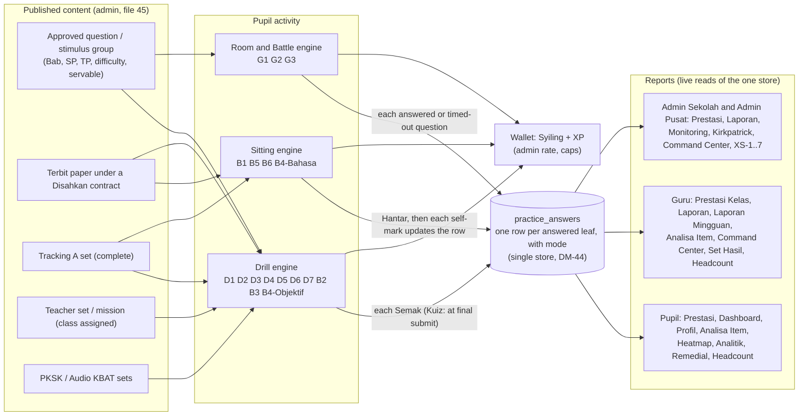
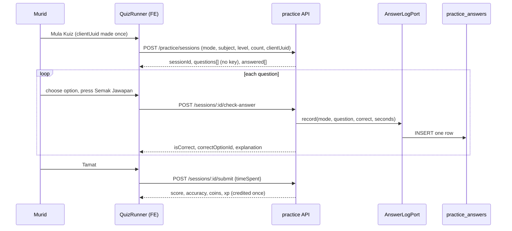
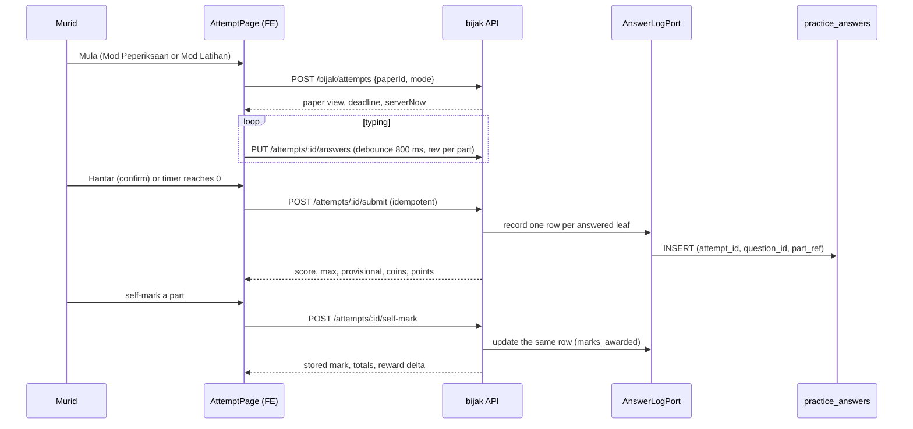

# R1 PRD 46: Pupil activity flow (how every pupil activity works, end to end)

**Status:** Final for R1 (decisions confirmed, D113). **Date:** 2026-11-04. **Owner:** Delivery Lead.
**Branch:** `docs/r1-prd-devplan`. **Companion:** [45-question-authoring-flow.md](45-question-authoring-flow.md) (the admin side: how questions and papers are authored and published). This file starts where 45 ends: a published question or paper.
**Purpose:** the single, complete specification of HOW every pupil activity works in PrestasiPlus V3: from published questions and papers, to what the pupil sees and does, how answers are marked, what is stored, and which reports change. Developers and cloud agents build from this file without asking anyone. Where this file and 10 / 40 / 50 / 60 / 20 say the same thing, they must agree; where this file is more exact, this file is the build reference and the other file is corrected at merge (section 9.5 lists the amendments).
**Governing rules (unchanged):** improve, do not rebuild (FR-X1-5). V2 (`prestasiplus.cloud`) is the primary reference for flow and BM copy; question structure follows the DSKP, D90, D41 and the exam schema. Tingkatan 1 to 5 only (D72, D101). All pupil copy is BM. Other pupils appear by first name only; no real person name is written in this file.

## Decisions (Delivery Lead, by principle, 2026-11-04)

These are binding for this file. Each is applied in the sections named in brackets.

| # | Decision | Applied in |
|---|---|---|
| D-PA-1 | **One answer store.** Every activity writes its answers to `practice_answers` with its `mode`, through the one `AnswerLogPort`, whose single signature is defined in 60 section 2.17.5 and copied here verbatim: `record(entry: { userId, attemptId, questionId, partRef, mode, isCorrect, marksAwarded, marksMax, answeredAt, isTest })`; idempotency key (`attempt_id`, `user_id`, `question_id`, `part_ref`) (the DM-44 unique index); `isTest: boolean` is true for a "Mod Pelajar" session (INV-30) and the row is then flagged `is_test`; `mode` is one of the writable OPT-MODE-SESI values of the master table in 40 (X11). For a drill the `attemptId` is the practice session id (50 DM-44 fills `session_id` too) and `partRef` is null for an MCQ, so the same key covers drills, sittings and games. Every report reads that store and no other table for answers. | 1.1, 3.7, 4, 5, 6 |
| D-PA-2 | **Stimulus groups are always shown together.** The figure or passage is shown once, above or beside all of its questions, never split and never partial. A draw, a set, a paper and a game take a whole group or nothing. | 1.5, 2.4, 4, 5 |
| D-PA-3 | **Bilingual display.** Where a paper or question is bilingual (`ms+en`), the pupil sees BM and English together as printed and has a language toggle. | 2.3 |
| D-PA-4 | **`drawing` and `table_fill` are answered on screen**, then self-marked against the scheme (the pupil ticks the scheme points). | 2.2, 3.4 |
| D-PA-5 | **`essay_choice` is served** ("Pilih satu daripada {n} gesaan"). This reverses K17 of the field register (which said not served). | 2.2, 3.2 |
| D-PA-6 | **`true_false` and `mcq_multi` are explicit item kinds.** `mcq_multi` is not served in drills that take a single option (Latih Tubi, Soalan by Chapter, Databank, Tracking A objective, Remedial, Misi, PKSK). | 2.2, 3.2 |
| D-PA-7 | **Accuracy is pooled** (correct answers divided by answered, all modes) and shown as a **whole-number percent**, rounded half up. A mean of session accuracies is never labelled "Ketepatan". | 3.7, 6 |
| D-PA-8 | **An abandoned drill is swept after 2 hours** of no activity: status `ditinggalkan`, no reward, the answers already checked stay and count. | 2.6, 4 |
| D-PA-9 | **Multiplayer uses real pupils first.** After 30 seconds without a human opponent, a clearly labelled "Robot PrestasiPlus" joins. A robot never impersonates a real pupil, never enters standings, badges or leagues. | 5 |
| D-PA-10 | **Game coins are an admin setting, default off,** with daily caps. XP follows the same rule set. | 5, 6 |
| D-PA-11 | **Tingkatan 1 to 5 only.** No Darjah anywhere. | all |
| D-PA-19 | **D112: pupil "Jana Kertas" is NOT in R1.** The tab is hidden and its routes answer 404 (the pupil generate call is not offered). It is not an activity in this file. "Simulasi, Kuiz" stays. FR-MUR-13-20, the tab "Jana Kertas" of 10-murid section B and API-BIJAK-03 leave R1 scope for pupils (section 9.5). | 1.1, 4.1 |

Decisions made while writing this file, by the same principles (confirmed as D113; listed in section 9.4):

| # | Decision | Reason |
|---|---|---|
| D-PA-12 | **Tracking A objective keeps the existing drill engine** (a practice session of mode `tracking_a`, `QuizRunner`, per-question "Semak Jawapan"); its answer rows carry `mode = tracking_a`. Tracking A Bahasa (structured sets) uses the Subjektif sitting engine and also writes `tracking_a`. 50 section 4.7a and plan card S3-T05 say "a Bijak-style attempt"; they are amended (section 9.5). | Improve, do not rebuild: the drill engine exists and works; a second engine for the same 40 MCQ is forbidden. |
| D-PA-13 | **A Mod Latihan sitting earns a reward only for parts that were never revealed by "Semak".** The code today pays only Mod Peperiksaan (`attempts.service.ts` pays when `a.mode === 'exam'`); FR-MUR-13-14 says every submitted attempt earns. Both are reconciled: no reward is lost, and nobody can farm a reward by reading the answer. | PRD wins over code (P1); fail-closed against farming. |
| D-PA-14 | **Kertas Subjektif: "Hantar & Semak" first, then "Tunjuk Skema Pemarkahan".** The scheme and self-mark are only available after the attempt is closed (the scheme through API-BIJAK-04 `GET /api/bijak/attempts/:id/result?scheme=1`, the self-mark through API-BIJAK-05, and the 409 `NOT_SUBMITTED` rule), and the scheme text is fetched only when the button is pressed (AC-MUR-13-21). | Reconciles FR-MUR-13-28/29 with B-031. |
| D-PA-15 | **A swept Kuiz session writes rows for its checked questions, with no reward.** A Kuiz "Semak" writes no row (FR-MUR-13-16); the final submit writes them; the S3-T04 job in `bijak/` acts as the final submit for an abandoned Kuiz, and a later submit or sync still re-marks per the late-submit rule. | D-PA-8: "the checked answers count". |
| D-PA-16 | **Retry cadence for a failed autosave is a fixed 5 seconds** (the code's value), not the exponential back-off in the field register (B-026). | Working code wins where the PRD only proposes. |
| D-PA-17 | **The unique key of the answer store includes the user.** Multiplayer games put several pupils on one `attempt_id`; DM-44's index `(attempt_id, question_id, part_ref)` would collide. | Correctness (DM-44). |
| D-PA-18 | **Games do not create a "Sesi Kuiz".** Their answer rows count in "Soalan Dijawab" and "Ketepatan"; the "Sesi Kuiz" tile counts practice sessions and Bijak sittings only. | Games keep their own session tables; no source says otherwise. |

## 0. Conventions used in this file

| Term | Meaning |
|---|---|
| **Leaf** | The smallest answerable part of a question. A question is a tree of parts (depth at most 3: "(a)", "(i)", "(A)"). Only a leaf carries marks and an answer kind. An MCQ is a question that is itself a leaf. |
| **Stimulus group** | One stimulus (rajah, petikan, jadual, graf, peta, infografik) with 1 to n member questions. The group is never a question; it has no marks and is not counted in "Soalan {i} daripada {n}". |
| **Drill** | A practice session: one question per screen, "Semak Jawapan" after each answer, result at the end. Engine: `QuizRunner` and `practice/sessions`. |
| **Sitting** | A Bijak attempt: a whole paper or question set, answers saved while typing, one "Hantar", then Semakan (review) and self-mark. Engine: `m28-bijak-spm` and `bijak/attempts`. |
| **Mode per screen** | The stored `mode` of each activity is the master table "Pupil activity → stored `mode` → API → card" in 40 (X11, next to OPT-MODE-SESI). Section 1.1 and sections 4.x repeat its values and never differ from it. |
| **Row** | One row of `practice_answers` (the answer store, DM-44). |
| **Awarded / available** | `marks_awarded` and `marks_max` of a row. An MCQ row has awarded 1 or 0 and `marks_max` 1 (R1 writes 1; a legacy row with null is read as 1). |
| **Correct (in any report)** | A row is correct only when awarded equals available. A self-marked part below full marks is answered, not correct. |
| **Percent** | Whole number, rounded half up. Stored full precision. "—" when there are 0 answers. |
| **MYT** | Asia/Kuala_Lumpur. Every day, week, month, reset and cap in this file is in MYT. |
| **ERR-xx** | Error catalogue IDs of the error-handling audit (to be merged as 40 section X10). Every error in this file cites its ERR-ID; the BM text is in that catalogue. |
| **OPT-xx** | Option sets of the field register (to be merged into 10 section 3): OPT-TINGKATAN, OPT-SUBJEK, OPT-KESUKARAN, OPT-BILANGAN-LT, OPT-BILANGAN-DB, OPT-BILANGAN-KUIZ, OPT-KERTAS, OPT-QTYPE, OPT-MODE-SESI, OPT-STATUS-ATTEMPT, OPT-STATUS-BAHAGIAN, OPT-ARAS-KBAT. |
| **(R1 copy, D113)** | Copy or value with no earlier source, decided for R1 by the product owner (D113). It is final and is built as written. |
| **Reuse** | An existing V3 file that is improved. Section 8 lists them. "No new X" means a build must not create X. |

## 1. Read this first

### 1.1 Every pupil activity on one page

The pupil portal has **three answering engines** and no more (FR-PA-01):

- **Drill engine** (`src/modules/m05-practice/components/quiz/QuizRunner.vue`, API `practice/sessions`): Latih Tubi, Soalan by Chapter, Databank, Tracking A objective, Simulasi Kuiz, Remedial and Ulang Kaji, Set Soalan Guru, Misi Harian, PKSK, Audio KBAT.
- **Sitting engine** (`src/modules/m28-bijak-spm/pages/AttemptPage.vue`, API `bijak/attempts`): Bijak Simulasi paper, Subjektif (Soalan Berstruktur), Kertas Subjektif, Tracking A Bahasa.
- **Room and Battle engines** (`src/modules/m16-battle-games`, API `games/*`, `battle/*`): every game.

| ID | Activity (BM name, route) | Where its questions come from | Who can use it (Tingkatan) | Timed? | Marking | Engine | `mode` in `practice_answers` | Reports it feeds (all read live) |
|---|---|---|---|---|---|---|---|---|
| **B1** | **Bijak SPM, Simulasi paper** (`/spm/bijak`, `/spm/bijak/kertas/:paperId`, `/spm/bijak/percubaan/:attemptId`) | Papers with status **Terbit** under a **Disahkan** contract. Each placement is a servable question or whole group; any item kind of 2.2. A draft, in-review or archived paper is not listed and its URL answers 404. | T1 to T5 (hub copy says "Tingkatan 4 & 5"; a T1 to T3 pupil sees the papers that exist) | **Mod Peperiksaan:** timed, countdown, auto-submit at 0. **Mod Latihan:** untimed, count-up "Masa berlalu", per-question "Semak" | Objective parts auto on the server; short text and numeric auto with review; working, essay, essay_choice, drawing, table_fill self-marked | Sitting | `simulasi` | Prestasi (also listed as one session), Dashboard, Analisa Item, Heatmap, Analitik, Remedial, Headcount AR, teacher / AS / Admin Pusat reports |
| **B2** | **Simulasi, Kuiz** (`/simulasi/kuiz`, `/simulasi/:paperId/kuiz`) | Random approved objective parts of Terbit papers (`bijak/kuiz`), or the objective parts of one paper. Count 5, 10, 20 (default), 40. | T1 to T5 | Untimed (count-up "Masa") | Auto per question on "Semak" (server) | Drill (kuiz session) | `kuiz` | Same as B1. Rows appear only at the final submit (3.7). |
| **B3** | **Databank Soalan SPM** (`/spm/tahun-lepas`, `/spm/tahun-lepas/:kod/kuiz?count=n`) | Every approved MCQ of a subject (no pool flag), figure questions and whole groups included. | T1 to T5 | Untimed (count-up) | Auto on "Semak Jawapan" | Drill (`databank` session) | `databank` | Same as B1 |
| **B4** | **Tracking A** (`/spm/ramalan`, `/spm/ramalan/:kod`, `/spm/ramalan/:kod?year=&set=`) | Admin-built complete sets (Objektif: 40 questions; Bahasa: BM and BI structured sets). An incomplete set is not listed. | T1 to T5 | Untimed | Objektif: auto on "Semak Jawapan". Bahasa: as B5 | Objektif: Drill (`tracking_a` session). Bahasa: Sitting | `tracking_a` | Same as B1. Headcount AR includes it. |
| **B5** | **Subjektif** (`/spm/subjektif`, `/latihan-berstruktur`, `/latihan-berstruktur/:id`, `/latihan-berstruktur/keputusan/:attempt`) | Published structured questions (Soalan Berstruktur) of the bank. | T1 to T5 (bank mostly T4 and T5) | Untimed (count-up) | Objective leaves auto; others self-marked against the scheme revealed after "Hantar & Semak" | Sitting (`exam_attempts` kind `subjektif`) | `structured` | Same as B1; the self-mark updates the row |
| **B6** | **Kertas Subjektif** (`/kertas-subjektif`, `/kertas-subjektif/:paperId`) | Terbit papers with `surface = subjektif` (Kertas 2, 3, 4 percubaan negeri), reflowing text from the admin upload and OCR flow. | T1 to T5 (content is T4 and T5) | Untimed (count-up) | Self-marked per question or per Bahagian; objective leaves auto | Sitting (kind `subjektif`) | `subjektif` | Same as B5 |
| **D1** | **Latih Tubi** (`/practice`, `/practice/:code`, `/practice/:code/quiz`; also the hub card "Latih Tubi SPM") | Approved MCQ of the chosen subject, Tingkatan and difficulty; figure questions and whole groups included. | T1 to T5; default is the pupil's own form | Untimed (count-up) | Auto on "Semak Jawapan" | Drill | `latih_tubi` (also `random`) | Same as B1 |
| **D2** | **Soalan by Chapter** (`/practice/chapter`, `/practice/chapter/:code`, `/practice/chapter/:code/:chapterId/quiz`) | Approved MCQ linked to the chapter (Bab) by the admin. Every chapter open, no lock. | T1 to T5 | Untimed | Auto | Drill | `chapter` | Same as B1; the Heatmap needs the Bab |
| **D3** | **Remedial and Ulang Kaji** (`/remedial/saya`, `/remedial/:id`, `/practice/revision`, `/practice/revision/:code`) | The pupil's own still-servable wrong questions, topped up from the weakest topics; or a teacher-assigned remedial test. | T1 to T5 | Untimed | Auto | Drill | `revision` (own drill), `remedial` (assigned test) | Same as B1; the "Selepas" figure on the Remedial card |
| **D4** | **Set Soalan Guru** (`/set-soalan-saya`, `/pelajar/set/:id`) | The questions a teacher picked, as published to an assigned class. Archived items drop out at serve time. | T1 to T5 in a class that has the set | Untimed; optional `timeLimitSec` set by the teacher | Auto | Drill | `question_set` | Same as B1 plus the teacher's "Hasil" for the set |
| **D5** | **Misi Harian** (`/misi`, `/misi/:id`) | The teacher's mission: questions picked by the teacher (may include the teacher's personal "Soalan & Rujukan" questions, visible to the owner's classes only). | T1 to T5 in a class that has the mission | Untimed | Auto | Drill | `mission` | Same as B1; mission target and `rewardCoins` |
| **D6** | **PKSK** (`/pksk`) | Approved PKSK questions by Bahagian A, B, C and domain. Needs an active grant. | T1 and T4 targets, with a grant | Untimed (practice); the exam attempt is timed | Auto | Drill | `pksk` | Same as B1 |
| **D7** | **Audio KBAT, Ujian Mendengar** (`/audio-kbat`) | The objective questions of a published audio set. | T1 to T5 | Untimed | Auto | Drill | `audio_kbat` **** | Same as B1 |
| **G1** | **Battle Arena** (`/battle`; Quick Match, Cabar Kawan, Battle Sekolah; Tournament and Liga rounds use the same rules) | Approved servable **text-only** MCQ of the chosen subject and Tingkatan (no figure, no stimulus group). | T1 to T5; the "SPM" tab T4 and T5 only | Timed: 15 s per question | Auto, server clock | Room and Battle | `battle` | "Soalan Dijawab", "Ketepatan", Analisa Item, Heatmap, teacher and admin reports. No "Sesi Kuiz". Standings only for human-vs-human. |
| **G2** | **Room games** (`/permainan`): Papan Bijak, Perang Fakta, Benteng Ilmu, Perlumbaan Matematik, Kuiz Relay, Teka Silang Kata | Same as G1 | T1 to T5 (room match mode) | Timed per game | Auto | Room and Battle | `game` | As G1 |
| **G3** | **Solo games** (`/games/solo/:game`): Betul atau Salah, Cabaran Kilat, Tembak Jawapan, Susun Jawapan, Kad Memori; **Jutawan Ilmu**; **Roda Nasib** (no question) | Same as G1 (Jutawan: difficulty ladder) | T1 to T5 | Timed per game | Auto, server computes score | Room and Battle | `game` (Roda Nasib and the Kad Memori move count write none) | As G1 |

Not an answer source: reading, videos, notes, Peta Belajar, Topik, Timeline, and any game result that shows no bank question.

### 1.2 Who can use what

| Activity | Murid T1 to T3 | Murid T4 to T5 | Guru / Admin Sekolah / Admin Pusat in "Mod Pelajar" | Ibu bapa | Not signed in |
|---|---|---|---|---|---|
| B1 Simulasi paper | ✅ | ✅ | ⚠️ | ❌ | ❌ |
| B2 Simulasi Kuiz | ✅ | ✅ | ⚠️ | ❌ | ❌ |
| B3 Databank | ✅ | ✅ | ⚠️ | ❌ | ❌ |
| B4 Tracking A | ✅ | ✅ | ⚠️ | ❌ | ❌ |
| B5 Subjektif | ✅ | ✅ | ⚠️ | ❌ | ❌ |
| B6 Kertas Subjektif | ✅ | ✅ | ⚠️ | ❌ | ❌ |
| D1 Latih Tubi | ✅ | ✅ | ⚠️ | ❌ | ❌ |
| D2 Soalan by Chapter | ✅ | ✅ | ⚠️ | ❌ | ❌ |
| D3 Remedial / Ulang Kaji | ✅ | ✅ | ⚠️ | ❌ | ❌ |
| D4 Set Soalan Guru | ⚠️ | ⚠️ | ❌ | ❌ | ❌ |
| D5 Misi Harian | ⚠️ | ⚠️ | ❌ | ❌ | ❌ |
| D6 PKSK | ⚠️ | ⚠️ | ⚠️ | ❌ | ❌ |
| D7 Audio KBAT | ✅ | ✅ | ⚠️ | ❌ | ❌ |
| G1 Battle (Biasa, PKSK tabs) | ✅ | ✅ | ⚠️ | ❌ | ❌ |
| G1 Battle ("SPM" tab) | ❌ | ✅ | ⚠️ | ❌ | ❌ |
| G2 Room games, G3 Solo games | ✅ | ✅ | ⚠️ | ❌ | ❌ |
| G3 Roda Nasib | ⚠️ | ⚠️ | ❌ | ❌ | ❌ |

#### ✅ BOLEH
- A signed-in **Murid of Tingkatan 1 to 5** opens B1 to B3, B5, B6, D1 to D3 and D7 for the content that exists for their form. A T1 to T3 pupil gets the same screens as a T4 to T5 pupil (D101). A level or subject with no content shows a data-empty state, never "akan datang".
- A Murid plays every game of G1 to G3 that is listed on the hub (the `permainan` switch is on).
- A Murid answers B4 sets that are complete.

#### ⚠️ TERHAD
- **Admin Sekolah and Admin Pusat in "Mod Pelajar"** (API-AUTH-05; teachers have no Mod Pelajar in R1, D113-continued): can open and answer drills and sittings to test them. Everything they write is flagged `is_test` and is excluded from every count (XS-1 to XS-7), wallet, XP, standings and badges. Games write no rows for them. They never appear in a leaderboard.
- **D4 Set Soalan Guru:** only a Murid enrolled in a class to which the teacher assigned the set. Another class: 404 (ERR-ACC-02).
- **D5 Misi Harian:** only a Murid in a class to which the mission is assigned, on the mission date.
- **D6 PKSK:** only with an active grant; an expired grant blocks answering at once.
- **G3 Roda Nasib:** hidden from the hub while the admin setting "Mini-games beri syiling?" is "Tidak" (the wheel pays only Syiling).
- **Free trial:** a Murid without an active subscription uses the free allowance; when it is spent the start call answers ERR-PRAC-01 (402).

#### ❌ TIDAK BOLEH
- **Ibu bapa** (parent) does not answer anything; a parent only reads linked-child progress.
- **A Murid of T1 to T3** cannot use the Battle "SPM" tab ("Khas untuk pelajar Tingkatan 4 & 5 sahaja.").
- **Nobody** sees Darjah levels, another pupil's answers, another pupil's full name or school, or an answer key before "Semak Jawapan" or "Hantar".
- **A draft, in-review or archived** paper or question is shown to no pupil.
- **A teacher or admin** cannot answer on behalf of a pupil.

#### 📌 Nota penting
- "T1 to T5" means content for the pupil's own form first; the other forms are selectable where the engine has a level choice.
- D6 and the Battle "PKSK" tab depend on a PKSK grant; the free Battle "Biasa" tab does not. The Battle "PKSK" tab serves only PKSK questions that are standalone text-only MCQs (5.1); a PKSK question with a stimulus, figure or option image is not served in Battle.
- Teacher-private questions (`visibility = teacher_private`) are served only by D5 to the owner's classes (DM-42).

### 1.3 The data path in one picture

### 1.4 Two sequences (the whole story of a drill and of a sitting)

### 1.5 What "published and servable" means for a pupil

A question reaches a pupil only when all of these hold (the S1-T07 servability rule; the admin sees the reason in "Dilihat murid di"):

1. It is approved (Terbit for a paper) and not archived. A draft is never served.
2. Its stimulus asset exists. A question that cites a stimulus (the reference words and triggers are defined once, in 45 section 6.6.1) without the asset carries the flag `stimulus_missing` (or `figure_only`) and is excluded on every surface (FR-MUR-QP-4).
3. Its item kind is built for that surface (2.2). A group with one member that a surface cannot render is excluded whole (FR-MUR-QP-7).
4. A stem is never shown twice. Data with a duplicated stem is flagged `stem_duplicated` and shown once; it is not excluded. Only `stimulus_missing` and `figure_only` exclude a question (FR-MUR-QP-5, 45 section 6.6.1).
5. Counts: the number on a card, in the details view and in the draw are the same (D91).
6. A game additionally needs a standalone text-only approved MCQ (servability activity `permainan`: no stimulus group, no figure, no option image), reason `image_games` (5.1).

## 2. The shared answering engine

### 2.1 One question screen, same anatomy everywhere

**Drill screen (one question per screen)**, top to bottom:

| Region | Content (exact BM) |
|---|---|
| Header | subject icon and name; "Soalan {i} daripada {n}"; progress bar (`aria-label` "Kemajuan kuiz"); clock "Masa" (count-up, mm:ss) |
| Notes | "🔀 Soalan dan pilihan jawapan dirawak setiap sesi."; chip "✓ Mengikut DSKP" when tagged; credit "💬 Soalan oleh: {role label}" only when the question has a credit (never a person's name) |
| Stimulus panel | if the question belongs to a group: header "Lihat {label}" (2.4) |
| Question toolbar | "❓ Soalan {i}", language toggle (2.3) when bilingual, "Lapor Soalan" |
| Stem | formatted text, maths as notation, figures tap-to-zoom |
| Answer area | the widget of the item kind (2.2) |
| Action bar (sticky bottom) | "✓ Semak Jawapan" (disabled until an answer exists); after the check: feedback, "Penjelasan:" when present, then "Soalan Seterusnya →" or "Tamat →" on the last question |

**Sitting screen**: sticky top bar (mode badge "Mod Peperiksaan" or "Mod Latihan", timer "Masa berbaki" or "Masa berlalu", save state "menyimpan…" / "disimpan" / "gagal simpan" / "luar talian"); the paper header (SULIT, paper code, subject, Kertas, Bahagian with "[{n} markah]" and its rule line); one question or one whole stimulus group per screen; per question the toolbar (number, flag ⚑ "Tanda soalan", "Lapor Soalan", language toggle); sticky bottom bar "Sebelum", navigator button "{answered}/{total}", "Seterusnya", **"Hantar" at every width** (on the last screen the primary action is "Hantar Jawapan") (FR-MUR-QP-11).

A very long stem or option scrolls inside the question area; the action bar stays reachable. Inputs are full width and at least 44 px high; with the on-screen keyboard open the active field scrolls above it and the bar moves above the keyboard (FR-MUR-QP-10).

### 2.2 Item kinds: what the pupil sees, how input is taken, what is stored

The authoring side of each kind is in 45 (per-mode leaf form, G-18). The pupil side is here. The 11 "kinds" below are the 9 leaf answer modes (OPT-MOD-JAWAPAN) plus the 2 views of leaf mode `mcq`: `true_false` and `mcq_multi` are question types whose leaves use leaf mode `mcq`, with `multi: true` (mcq_multi, key field `correctOptionIds: Id[]`) or two fixed options Betul/Salah (true_false); they are not the 11 question types (`questionType`, OPT-JENIS-SOALAN in 40: `short_text` and `numeric` are leaf modes of `short_answer`, L-1). "Served in" lists the surfaces; a kind that a surface does not serve is excluded from that surface with the admin reason "Jenis jawapan ini tidak disokong untuk paparan ini".

| Kind (stored value) | Display name (OPT-QTYPE) | Served in | Widget and input rules | Blank means | Stored in `practice_answers` / attempt |
|---|---|---|---|---|---|
| `mcq` | Aneka pilihan | all surfaces | Radio group, options A to H (2 to 8). The whole option row is the tap target (at least 44 px). Text, maths and images allowed in an option. A second tap on another option changes the choice until "Semak Jawapan" (drill) or "Hantar" (sitting). After "Semak Jawapan" the group is `aria-disabled` and shows ✅ on the correct option and ❌ on a wrong choice. Keys 1 to 8 or A to H select. Drills shuffle and re-letter per session (the id is the option's identity, mapped back on the server); a sitting keeps the stored order and letters. | no option chosen | Row: `selected_label`, `is_correct`, `time_seconds`; awarded 1 or 0, max 1 |
| `true_false` | Betul / Salah | all surfaces | The same radio widget with exactly two options, fixed labels in this order: A "Betul", B "Salah". Never shuffled. | no option chosen | As `mcq` |
| `mcq_multi` | Aneka pilihan (lebih daripada satu jawapan) | **Sitting, Kuiz, Set Soalan Guru, Subjektif, Kertas Subjektif.** **Not** in Latih Tubi, Soalan by Chapter, Databank, Tracking A objective, Remedial, Misi, PKSK, games. | Checkbox group, 2 to 8 options, k correct with 1 <= k <= n-1. Helper line above: "Pilih semua jawapan yang betul." Whole row is the target. Drills of D4 and B2 send all ticked ids at once (`selectedOptionIds[]`, API-PRAC-02 and API-BIJAK-06). | no box ticked | Row: `selected_label` holds the comma-joined labels in alphabetical order; awarded by M-MULTI (3.2) |
| `match_letter` and **option bank** | Padanan huruf | Sitting, Kuiz paper, Subjektif | One lettered **bank** (A to n, with text or image) is shown **once**, above the gaps or items, inside the stimulus panel so it stays visible; each item has a `Pilih` select whose first option is "—" and then the letters. A letter may be reused. The select closes on choice. | "—" | One row per item (each item is its own leaf with its marks) |
| `short_text` | Jawapan pendek | Sitting, Subjektif, Kertas Subjektif | One text field (up to 200 characters), or one field per blank when the leaf has `blank_count` (each blank is its own leaf with its marks). No character counter. | empty after trim | Row per blank; awarded by M-SHORT |
| `numeric` | Nombor | same | Number field (`inputmode="decimal"`) plus a unit select or text field when the key has a unit. Accepts "," or "." as the decimal separator, fractions "1/2", powers, roots, %, pi. The input is never rounded for the pupil. | empty | Row; awarded by M-NUM |
| **cloze gaps (inline gaps)** | (presentation of `short_text`, `mcq` or `match_letter`) | Sitting, Kuiz paper, Subjektif | The rich text contains tokens `{{gap:N}}`. The pupil sees the passage with an **input (or a select when the leaf has options or uses the bank) in place of each token**. Gap N is linked to the leaf labelled N; an unlinked gap cannot be published (authoring gate in 45, G-08). A leaf flag `Maksimum perkataan` limits the words (default none); typing beyond it shows the hint `Maksimum {n} patah perkataan.` and still keeps the text (FR-PA-35). A worked-example gap (leaf `Contoh (tidak dimarkah)`, marks 0, no scheme, no key) is shown filled with `mode_config.example.answer` and read-only, is not an input, writes no `practice_answers` row, and is not counted in any total, score, "Soalan Dijawab" or report. Each gap is its own leaf with its own marks. **No new answer kind and no new mode.** | empty | Row per gap leaf |
| `working` | Kerja & jawapan akhir | Sitting, Subjektif, Kertas Subjektif | Two areas: **"Ruang kerja"** (step lines, one per line, with the maths keyboard: digits, + - x ÷ = ( ), fractions, powers, roots, pi, units) and a separate box **"Jawapan:"** with its unit. Optional photo of the working (JPG or PNG, up to 5 MB, up to 3 per part). The final box and the maths keys are never hidden behind the on-screen keyboard (AC-MUR-QP-9). | final box empty (and no photo) | Row; awarded by M-WORK; `belum_dimarkah` waits for the pupil |
| `essay` | Esei | Sitting, Subjektif, Kertas Subjektif | Textarea with a **live word count**: "{n} patah perkataan"; with a word range "{n} / {min}-{max} patah perkataan" (2.2.1). Autosaves. Never auto-marked. A pre-filled frame (`Templat jawapan (pra-isi)`) is a read-only block above the textarea, outside the text and the count (FR-PA-38). | empty | Row; provisional, then the self-mark |
| `essay_choice` **(served, D-PA-5)** | Esei (pilih satu gesaan) | Sitting, Subjektif, Kertas Subjektif | Above the editor, the line "Pilih satu daripada {n} gesaan:" and one radio card per prompt (each with its own stimulus or text). The pupil picks one, then writes. The text typed for another prompt is kept in memory (not lost when the pupil switches) but **only the chosen prompt's text is submitted**. Marks are counted once. | no prompt chosen or empty text | Attempt answer holds `topicId` and `text`; one row for the leaf |
| `drawing` **(on screen, D-PA-4)** | Lukisan | Sitting, Subjektif, Kertas Subjektif | See 2.2.2. | empty pad and no photo | Row; awarded by M-DRAW |
| `table_fill` **(on screen, D-PA-4)** | Isi Jadual | same | See 2.2.3. | no blank cell filled | Row; awarded by M-TABLE |

#### 2.2.1 Essay word range and counter

- Count = number of whitespace-separated tokens.
- Without a range: "{n} patah perkataan". With a range: "{n} / {min}-{max} patah perkataan".
- Below the minimum the hint `Jawapan terlalu pendek ({n} patah perkataan; minimum {min}).`; above the maximum `Jawapan melebihi {max} patah perkataan.` Both are hints only; **submit is never blocked** and nothing is truncated while `Had keras` is off.
- With "Had keras" off (default) the range is guidance; with it on, FR-PA-35 applies (the editor stops at `max`). A "Ruang jawapan" size (Pendek, Sederhana, Panjang) sets the textarea height only.

#### 2.2.2 `drawing`: answered on screen, then self-marked (FR-PA-08)

- The leaf shows the **template** the admin supplied (an image, or a generated graph paper from `modeConfig.answerTemplate.grid` = `{ xMin, xMax, yMin, yMax, step, scale }`, the image from `answerTemplate.imageId`; 45 section 3.1.6 mode 8) at full width, with the prompt above.
- Under it, the control row **"Papan Lukisan"**: tools "Pen", "Garis", "Pemadam", "Buat Asal", "Kosongkan"; colour fixed (dark); line width fixed. The pupil draws directly over the template with finger, stylus or mouse (pointer events). The pad is saved as a PNG layer merged with the template (up to 5 MB) through the existing photo upload route (`POST /bijak/attempts/:id/photos`, which already accepts `drawing`). (R1 copy, D113)
- Alternative for paper work: **"Ambil gambar jawapan"** (camera) and **"Muat naik gambar"** (file). Both end in the same stored file. Up to 3 files per leaf. Errors: `Gambar mesti JPG atau PNG, maksimum 5 MB.` and `Maksimum 3 gambar bagi setiap bahagian.`. Remove with "Buang" after the confirm `Buang gambar ini?` / `Gambar ini akan dibuang daripada jawapan anda.` (buttons "Buang", "Batal").
- Marked only by the pupil: status `belum_dimarkah` until the self-mark (3.4). No file and an empty pad: `kosong`.

#### 2.2.3 `table_fill`: answered on screen, then self-marked (FR-PA-09)

- The table renders from the admin grid (`modeConfig.grid`; the accepted values per Kosong cell are `key.cells`, e.g. `r2c2`; 45 section 3.1.6 mode 9). Cell types: **Tajuk** (header, read-only), **Diberi** (given, read-only), **Kosong** (an input). Only Kosong cells are inputs; each is a text or number field of at least 44 px height; a wide table scrolls inside its own container, never the page.
- The pupil fills the Kosong cells. Autosave as any text.
- Marking: the cells that have a key are compared (M-SHORT or M-NUM rules) **only to produce the suggestion** "Cadangan automatik: {k} daripada {n} sel sepadan" (the one copy). The leaf stays `belum_dimarkah` and the pupil self-marks 0 to the leaf marks against the revealed filled grid and checklist (3.4). Nothing is silently 0.

### 2.3 Bilingual display and the language toggle (FR-PA-04)

Applies to a question, paper or stimulus whose language is `ms+en` (authoring field "Bahasa soalan", 45 / G-07: `_en` twins of the stem, part prompt, option, stimulus body and caption, bank option, scheme text). Monolingual content shows no toggle.

| Aspect | Rule |
|---|---|
| Control | A segmented control in the question toolbar (sitting and drill) and in the sticky top bar of the paper: **"BM + English"** (default, stacked as printed), **"Bahasa Melayu"**, **"English"** (R1 copy, D113). `aria-label` "Bahasa soalan". |
| What it affects | Stem, part prompts, option text, stimulus body and caption, bank options, "[n markah]" tag (stacked: "[1 markah] [1 mark]"), the scheme text and the explanation at reveal. It never affects the page chrome (buttons, titles, dialogs are always BM). |
| Stacked layout | The BM block first, then the English block under it with a hairline between; same size; options show "BM / English" on two lines inside one row. |
| Persistence | Remembered on the device (`localStorage` key `pp:lang:{userId}`) and applied to every bilingual question, including games. One choice for the whole app; changing it never changes the answer or the timer. |
| Missing translation | If a field has only one language, it is shown as it is in every mode; no error, no placeholder. |
| Marking | Language never changes marking. Accepted answers apply to either language when the scheme lists both (45 / G-01). |
| Report | "Lapor Soalan" stores the question id and version; the language is not stored. |

### 2.4 Stimulus group layout at 375, 768 and 1280 px (FR-PA-03, FR-MUR-QP-1..9)

One rule: the stimulus exists **once** and stays one action away while any member question is being answered.

| Width | Layout |
|---|---|
| **375 px (phone)** | A **sticky panel** under the top bar. Collapsed: the header "Lihat {label}" (for example "Lihat Rajah 1") and a chevron. Open: up to **42% of the viewport height**, internal scroll, never pushes the answer area off screen. Initial state: open on the first member screen of each stimulus group in a session and collapsed on that group's later member screens (the pupil can open it with one tap); whatever state the pupil leaves is kept while moving between members of that group and on rotation. Below the on-screen keyboard it never sits behind the keyboard. |
| **768 px (tablet)** | Same sticky collapsible panel as the phone, with the figure at full content width. Question and options use one column; the action bar is full width. |
| **1280 px (desktop, from 1024 px)** | **Two panes:** the stimulus pinned on the left (about 40% of the width, internal scroll, stays while any member shows), the member questions on the right. The navigator is a side rail. |

Rules for every width:

- **Sitting:** one screen = one stimulus group with all its members stacked below the pinned or sticky stimulus, or one single question. The counter and map count questions (members count one each), never the stimulus.
- **Drill:** one member per screen, in published order, the members of a group adjacent; the stimulus panel stays on screen across the member screens ("Soalan 5 daripada 10", "Soalan 6 daripada 10", ...). A draw takes the whole group or none of it; the target count is met by whole groups first (chosen at random among the groups that fit the remaining count), then single questions; the drawn blocks (a group stays contiguous, a single is a block of one) are shuffled among themselves; if only a group that overshoots remains, the quiz is shorter than the chosen count and the summary says so (FR-MUR-16-5).
- **Figures:** fit the width, tap opens a full-screen viewer with pinch zoom, pan, double-tap, a close button of at least 44 px, Back to close; alt text is announced. A figure that fails to load shows a retry control and **blocks answering that group** (never a blank gap).
- **Kinds:** passage, image, diagram, table, map, infographic, graph (`StimulusView.vue`). A kind outside this list excludes the question.
- **Bank for matching:** the lettered bank is part of the same panel.
- **Semakan and reviews:** the stimulus is shown once above its member cards (FR-MUR-QP-14).
- **Kertas Subjektif:** the paper is reflowing text; the stimulus sits inline at its place, once, above the questions that cite it.
- **Games:** a group is never drawn (5.1).
- **Source line (FR-PA-37):** a stimulus with `sourceCitation` shows the line "Sumber: {text}" under it, in the same panel.
- **Part-level stimulus (FR-PA-37):** a leaf with its own `stimulusId` shows that stimulus inside the leaf card under the prompt; at 375 px it is a collapsible "Lihat {label}" header. Other leaves of the same question show no such stimulus.
- **Cited label (FR-PA-37):** a prompt that cites a stimulus label (for example "Bahan 2") carries a link that opens that stimulus in the panel; "semua bahan" opens all stimuli of the group.

### 2.5 Navigation, flagging, choose-N (sitting)

| Control | Rule |
|---|---|
| "Sebelum" / "Seterusnya" | Move one screen. On the last screen "Seterusnya" is replaced by "Hantar Jawapan". |
| Navigator | Button "{answered}/{total}" opens a **bottom sheet** (phone, tablet) or a **side rail** (from 1024 px). One tile per question with its number. Legend with a colour key and a distinct shape: **"Dijawab"** (filled square with a tick), **"Ditanda"** (flag), **"Belum"** (hollow circle) (R1 copy, D113). |
| Flag | Toggle ⚑ "Tanda soalan" per question; stored in `flags[]`; no effect on marking. Drills have no flag. |
| Section rule line | "Jawab semua soalan." (rule `semua`), "Jawab {N} soalan sahaja." with a counter "{n} / {N} soalan dipilih" (rule `Pilih N`), "Soalan ini mesti dijawab." (rule `compulsory`). The authoring control is "Wajib dijawab" (45 / G-10). |
| Choose-N tick | Checkbox "Pilih soalan ini untuk dijawab". The (N+1)th tick is refused with `Anda hanya boleh memilih {N} soalan dalam bahagian ini.` and the picks stay (stored in `picks[sectionId]`). Typing an answer into an unticked question below the cap ticks it; above the cap the pupil is told that only the best N count. |
| Choose-N scoring | The tick is advisory. The server counts the **best N attempted questions by marks** (tie: the lower position). When fewer than N were attempted, free slots go to ticked blank questions in paper order (they score 0). The others are shown "Tidak dikira" (`counted:false`). (`packages/exam-core/src/choose-n.ts`.) |
| Compulsory | A `compulsory` section needs every question answered; an unanswered one is counted in the Hantar warning (2.8) but never blocks. |
| Several parts of a section | Question numbers continue across Parts as printed (for example BI Part 3 continues from Part 2). |

### 2.6 Autosave, resume, offline, abandon

#### Sitting engine (B1, B4-Bahasa, B5, B6)

| Aspect | Rule |
|---|---|
| Autosave | Debounce **800 ms** after the last change (the PRD's "1 s" is "not above 1 s", FR-MUR-13-10 is aligned to the code). Also flushed on field blur, on question change, every **15 s while dirty**, and by `sendBeacon` on page leave. Photos upload at once. Request `PUT /bijak/attempts/{id}/answers` {changes[{partId, answer, rev, savedAt}], flags, picks, position}; each part has `rev` (+1 per edit); the server ignores a change whose `rev` is not above the stored one; `savedAt` is capped at server now. |
| Save state | Top bar words: **"menyimpan…"** (request in flight), **"disimpan"** (200; AC-MUR-13-5: within 2 s of typing), **"gagal simpan"** (error; retry **every 5 s**, ERR-SAVE-01), **"luar talian"**. |
| Local mirror | Every change is also written to `localStorage` key `pp:ans:{userId}:{attemptId}` (survives a crash, a sleep and a 401). Only "Log Keluar" clears it. On load, per part the higher `rev` wins (local mirror vs server). If storage is unavailable, autosave still goes to the server and "gagal simpan" shows only if the server also fails. |
| Resume after refresh | Reload `/spm/bijak/percubaan/:id` restores the answers, flags, picks and position (same on another device). The later load wins reads; answers merge by `rev`; there is no lock. |
| Resume page | Opening a paper that has an open attempt: elapsed under 60 s resumes silently; otherwise the page shows `Percubaan belum dihantar`, `Masa berlalu setakat ini: mm:ss`, button **"Sambung"** (`Sambung - teruskan jawapan & masa sedia ada`) and **"Mula Semula"** (`Mula Semula - kosongkan jawapan & masa`), note `"Sambung" mengekalkan semua jawapan anda. "Mula Semula" tidak boleh diundur.` The paper card shows "Sambung" instead of "Mula". |
| Offline | Amber banner: `Anda luar talian. Jawapan disimpan pada peranti ini dan akan dihantar apabila sambungan pulih.` (ERR-NET-01). Typing continues. On the `online` event the queue is flushed at once and the banner turns green for 3 s: `Sambungan pulih. Jawapan telah disimpan.` (ERR-NET-03). |
| Session expiry (401) | The local mirror is kept. During a **timed** attempt a dialog (no redirect until confirmed): `Sesi anda telah tamat. Jawapan anda disimpan pada peranti ini. Log masuk semula untuk meneruskan.` button "Log Masuk Semula" (ERR-AUTH-01). After login the pupil returns to the sitting and unsent changes replay. |
| Leaving | In-app leave shows the dialog B-051 (2.8). The attempt stays `in_progress` and the server clock keeps running. |
| Server sweeper | An attempt not submitted by `deadline + 300 s` is closed by the server as `auto_submitted` (answers saved until the deadline are marked). Changes whose `savedAt` is at or before the deadline are still accepted for 24 hours (late sync). An untimed attempt (Mod Latihan, B5, B6) has no deadline and stays open until submitted or restarted. One job in the `bijak/` module, written by card S3-T04 and registered in the S0-owned `jobs/` worker by a small cross-sector PR to S0, does this close; the same job closes an abandoned Kuiz session (2.6, 4.3). |

#### Drill engine (D1 to D7, B2, B3, B4-Objektif)

| Aspect | Rule |
|---|---|
| What is saved | Every "Semak Jawapan" writes one row at once (a question can be checked once; a repeat returns the stored result and writes no second row). A choice made but not yet checked lives in memory only. There is no draft text in a drill. |
| Resume after refresh | At setup the page stores `clientUuid` in `sessionStorage` key `pp:sess:{sessionId}`. Reloading the quiz re-calls `POST /practice/sessions` with the same `clientUuid` and receives the same session and questions (idempotent). The response now carries `answered:[{questionId, selectedLabel, isCorrect}]` and `resumed:true` (API-PRAC-01). The quiz opens at the first unanswered question and shows once: `Anda menyambung kuiz yang belum selesai.` A `dihantar` session opens the result page. If the stored uuid is lost, a new session starts and the old one is swept after 2 hours. |
| Offline | Online-only. While `navigator.onLine` is false, "✓ Semak Jawapan" is disabled with the title `Perlukan sambungan internet.` and the banner of the sitting engine shows. If online but the check request fails, it is retried 3 times (1 s, 3 s, 5 s, same `clientUuid`); then the card shows `Jawapan belum dihantar. Cuba Semula.` with **"Cuba Semula"** and **"Langkau"** (ERR-SAVE-06). The pupil cannot move to the next question until the answer is sent or skipped. "Langkau" leaves the question unanswered (no row). There is no queue across reloads in R1. |
| Leaving | In-app leave: dialog B-050. Closing the tab: the browser's own prompt, only while at least one question is answered. |
| Abandon sweep (D-PA-8) | A session with no activity for **2 hours** is closed by a job (the practice-session sweeper is written in `practice/` by card S5-T15 and registered in the S0-owned `jobs/` worker by a small cross-sector PR to S0) as `ditinggalkan`: rows already written stay and count in every report; **no session reward** (no Syiling, no XP at session level); the session is not listed under "Sesi Kuiz" or in Sejarah; "Masa Belajar" does not include it (the time is unknown). A **Kuiz** session is not a practice session: the `bijak/` job of card S3-T04 (sitting-engine row "Server sweeper" above) closes it after the same 2 hours and writes rows for its checked questions first (D-PA-15), still with no reward. A session whose `timeLimitSec` ended is not "abandoned": it is submitted (2.7). |

### 2.7 Timers

| Where | Rule |
|---|---|
| Drill "Masa" | Counts up mm:ss from the first render; paused when the tab has been hidden for more than 60 s (R1 copy, D113); sent as `timeSpent` seconds at submit; the server stores the value clamped to [0, 180 x question count]. No limit and no auto-submit, **except** a Set Soalan Guru session with `timeLimitSec`: at 0 the session is submitted and the banner shows `Masa telah tamat. Jawapan anda telah dihantar.` |
| Sitting, Mod Peperiksaan | The server gives `deadline` and `serverNow`. The client offset = `serverNow - Date.now()` at every response; remaining = `deadline - (Date.now() + offset)`, recomputed every second (survives sleep and rotation). The label is "Masa berbaki". At 300 s or less, once: amber `Amaran: masa berbaki kurang 5 minit.` in the top bar at every width (AC-MUR-QP-17), no layout shift. At 0: automatic submit with `auto:true`, banner `Masa tamat. Jawapan anda telah dihantar secara automatik.`, and the Semakan opens. |
| Offline at 0 | Inputs are locked; the submit is queued; banner `Masa tamat. Jawapan akan dihantar apabila sambungan pulih.` The submit goes on the `online` event and every 30 s. If the server reports the attempt closed: dialog `Masa tamat. Jawapan yang disimpan sebelum masa tamat telah dihantar.` button "Lihat Keputusan" (ERR-SAVE-05). |
| Late | A Bijak, Simulasi or Subjektif submit is never rejected for lateness: at 00:00 the client auto-submits; a submit or offline sync arriving after expiry is accepted (late sync up to 24 h, FR-MUR-13-32) and stored with its real `submittedAt` (this includes an attempt the server sweeper already closed as `auto_submitted` at deadline + 300 s: the late submit replaces the swept result and re-marks it); the 30 s figure is only the client grace before auto-submit. The result notes the lateness only in the audit log (FR-MUR-13-11). |
| Sitting, Mod Latihan, B5, B6 | No clock limit; label "Masa berlalu" counts up. |
| Games | Server clocks per round; the client timer is display only (5). |

### 2.8 Submit with blanks, leaving, restarting (confirm dialogs, exact BM)

Conventions for every dialog (B-059): modal; focus on the safe button; Esc and outside tap choose the safe button; the primary button shows the "-ing" label while sending ("Menghantar...", "Menyimpan..."); at 375 px the buttons stack, each at least 44 px; a button that destroys or spends uses the verb of the action, never "OK" or "Ya".

| Dialog | When | Title / body | Buttons (safe first) |
|---|---|---|---|
| **Hantar (sitting)** | "Hantar" or "Hantar Jawapan" pressed | When blanks exist, first line `Anda belum menjawab {n} soalan.` then `Hantar jawapan anda sekarang?`. With no blank only `Hantar jawapan anda sekarang?`. {n} counts questions with no answered leaf; in a choose-N section only the N counted slots count; unticked surplus questions do not. | "Batal" / "Hantar" |
| **Hantar & Semak (B5, B6, B4-Bahasa)** | "Hantar & Semak" pressed and at least one leaf is blank | Title `Hantar & Semak sekarang?` body `Anda belum menjawab {n} bahagian.` ({n} counts blank **leaves**). No dialog when all are answered. | "Kembali" / "Hantar & Semak" |
| **Hantar & Semak, Kertas Subjektif, all blank** | all leaves blank | Title `Hantar & Semak sekarang?` body `Anda belum menaip sebarang jawapan. Teruskan jika anda menjawab di atas kertas.` (R1 copy, D113) | "Kembali" / "Hantar & Semak" |
| **Leave a sitting** | sidebar or Back during a sitting | Title `Keluar daripada percubaan?` body `Jawapan anda disimpan dan masa terus berjalan.` (Mod Peperiksaan) or `Jawapan anda disimpan.` (Mod Latihan, B5, B6) | "Kekal" / "Keluar" |
| **Leave a drill** | sidebar or Back after at least one question is checked | Title `Keluar daripada kuiz?` body `Jawapan yang sudah disemak telah disimpan. Anda boleh menyambung semula kuiz ini.` Not shown when nothing is checked. | "Teruskan Kuiz" / "Keluar" |
| **Mula Semula** | "Mula Semula" on the resume page | `Semua jawapan dan masa untuk percubaan ini akan dikosongkan. Mula semula?` with the note `"Sambung" mengekalkan semua jawapan anda. "Mula Semula" tidak boleh diundur.` | "Batal" / "Mula Semula" |
| **Buang gambar** | remove a photo or drawing | `Buang gambar ini?` / `Gambar ini akan dibuang daripada jawapan anda.` | "Batal" / "Buang" |

A drill has no blank dialog: the pupil checks every question in turn, and "Tamat →" appears on the last one. Pressing "Langkau" (2.6) leaves a question unanswered; the result then reads "Markah {correct}/{served}".

### 2.9 Double submit and idempotency

| Action | Guard |
|---|---|
| "✓ Semak Jawapan" | Disabled while the request runs; a repeated check of the same question returns the stored result and writes no second row. |
| "Tamat" (drill) | Disabled while the request runs. A second submit answers 409 `Sesi ini sudah dihantar.` (ERR-PRAC-06); the pupil is sent to the result page, no error is shown. |
| "Mula Kuiz" | `clientUuid` is made once per press; a double press returns the same session. |
| "Hantar" (sitting) | Idempotency key `{attemptId}-hantar`; the second press returns the same result; 40 rows stay 40 (AC-MUR-13-6, AC-MUR-13-25). |
| Self-mark | The row is replaced on change, never a second row; the reward is the positive delta only. |
| Kuiz final submit | `POST /bijak/kuiz/sessions/:id/finish` is idempotent per session and question. |
| Timed-out write | Retried with the same key, so it cannot apply twice. |

### 2.10 Error behaviour (ERR-IDs)

The text of each ERR is in the error catalogue. The behaviour here is fixed for the answering screens.

| Situation | ERR-ID | What the pupil sees and what is kept |
|---|---|---|
| No network | ERR-NET-01, ERR-NET-03 | Amber banner, answers kept on the device; green banner on recovery. Drills disable "Semak Jawapan". |
| Request timed out (30 s) | ERR-NET-02 | Toast with "Cuba Semula"; the typed answer is kept. |
| Server error | ERR-SYS-01 | Toast (write) or card (read) with "Cuba Semula"; in a sitting the local mirror keeps the answers. Never a blank screen. |
| Session ended | ERR-AUTH-01 | As 2.6. |
| 429 | ERR-RATE-01 | `Terlalu banyak percubaan. Sila cuba sebentar lagi.` and `Cuba lagi dalam {s} saat.`; the button is disabled until 0; autosave retries after `retryAfter`. |
| Not enough questions | ERR-PRAC-02 | `Soalan tidak mencukupi.` button "Kembali". |
| Free trial spent | ERR-PRAC-01 | `Baki percubaan percuma anda telah habis.` |
| No wrong questions and no weak topic | ERR-PRAC-03 | `Maaf, terdapat masalah memuatkan kuiz ulang kaji.` (the card is not listed, so the pupil cannot reach it) |
| Mission or test already done | ERR-PRAC-04 | `Misi ini sudah diselesaikan.` / `Ujian ini sudah selesai.` |
| No attempts left | ERR-PRAC-05 | `Tiada percubaan lagi untuk set ini.` |
| Session already submitted | ERR-PRAC-06 | Go to the result. |
| Invalid value or answer | ERR-PRAC-07 | `Nilai tidak sah.` / `Jawapan tidak sah.` / `Mod tidak sah.` |
| Another pupil's record or unknown id | ERR-ACC-02 | Same page for both: `Rekod tidak dijumpai.` |
| Paper being updated | ERR-BIJ-04 | `Kertas ini sedang dikemas kini dan tidak boleh dicuba buat masa ini.` |
| Paper not found | ERR-BIJ-05 | `Kertas tidak dijumpai.` page with "Halaman Utama" |
| Scheme before Hantar | ERR-BIJ-06 | `Skema hanya didedahkan selepas Hantar` |
| Autosave state | ERR-SAVE-01 | menyimpan… / disimpan / luar talian / gagal simpan |
| Submit failed (not network) | ERR-SAVE-03 | `Jawapan tidak dapat dihantar. Jawapan anda masih disimpan pada peranti ini.` button "Cuba Semula" |
| Attempt closed by the clock | ERR-SAVE-05 | Dialog then the result |
| Unsent drill answer | ERR-SAVE-06 | 2.6 |
| "Semak" failed in Mod Latihan | ERR-SAVE-07 | `Semakan tidak dapat dibuat sekarang. Cuba lagi.` |
| Figure fails to load | (QP-4, B-035) | Retry control; answering that group blocked |
| Photo rejected | ERR-REQ-03, ERR-REQ-04, ERR-REQ-05 | `Gambar mesti JPG atau PNG, maksimum 5 MB.` / `Maksimum 3 gambar bagi setiap bahagian.` |
| Wrong essay topic | ERR-REQ-01 | `Tajuk yang dipilih tiada pada bahagian ini.` (422) |
| Report quota | ERR-QUOTA-02 | `Anda telah mencapai had 20 laporan sehari. Sila cuba lagi esok.` |
| Wallet short (games, shop) | ERR-WAL-01 | `Baki syiling tidak mencukupi.` |

"Lapor Soalan" is in every question toolbar of every engine (R1-MUR-54); in a game it is available on the result review only.

## 3. Marking

Marking is on the **server only**. The key, `is_correct` and the scheme never reach the page before "Semak Jawapan" (drill) or "Hantar" (sitting) (FD-MUR-26). The one grader is `apps/api/src/modules/questions/grading.ts` (owned by S1; card S1-T09a extends it with the P1 modes). The exam engines (`bijak/attempts/marking.ts`) and `practice/` call it, and `packages/exam-core` keeps only helpers it imports (`math-expr.ts`, `choose-n.ts`, `types.ts`); there is no grader in exam-core and no second grader anywhere (section 8).

### 3.1 Common rules

- A leaf has `marks` (integer 1 to 100; 0 only for a worked-example leaf `Contoh (tidak dimarkah)`, 45 L-04). `awarded` is an integer from 0 to `marks`. Stored as `numeric(6,2)` but always whole in R1.
- Part status (OPT-STATUS-BAHAGIAN): **`betul`** "✓ Betul" (awarded = marks), **`separa`** "Separa" (0 < awarded < marks), **`salah`** "✗ Salah" (awarded 0, an answer given), **`kosong`** "Tiada jawapan" (nothing entered), **`belum_dimarkah`** "Belum dimarkah" with the suffix "{a}/{m}" (waits for the pupil: `Belum dimarkah — perlu semakan`).
- The system **never turns an unreadable or low-confidence answer into a silent 0**. It marks `belum_dimarkah`, shows "Cadangan automatik", and the pupil decides. A `belum_dimarkah` part is **never** shown as "✗ Salah", and the text "Guru akan menilai" is never used (marking is self-mark). This fixes the live defect where an essay shows "✗ Salah 0/5" beside "Guru akan menilai" (workflow F2 step 10).
- No negative marking anywhere.
- A leaf `Contoh (tidak dimarkah)` (worked example, marks 0, W-06) is shown filled and read-only, is never answered, writes no row, and is not counted in the question or Bahagian total, in the score, in "Soalan Dijawab", "Ketepatan" or any report (AC-PA-42).
- A question's awarded marks = the sum of its leaves. A section = the sum of its counted questions (choose-N, 2.5). Score = the sum of sections. Pupil-visible percent = round half up(score / max x 100).
- One row per **answered** leaf (a `kosong` leaf writes no row). A `belum_dimarkah` leaf writes its row at submit with `marks_awarded` = the suggestion (0 when none) and `is_correct = false`; the self-mark replaces that same row.
- Duplicate protection: the key `(attempt_id, user_id, question_id, part_ref)` for sittings and games; a drill uses its session id as `attempt_id`, so the same key applies (a repeat check writes nothing).

### 3.2 Marking per item kind

| Kind | Auto-marking rule | Partial credit | Normalisation and tolerance | Needs self-mark? |
|---|---|---|---|---|
| **M-MCQ** `mcq`, `true_false` | awarded = marks if the chosen option identity equals the key or is listed in the key's `accepted` list (45 mode 1, `Terima pilihan lain`), else 0. The answer is the option's identity, not its letter. | none | none | no |
| **M-MULTI** `mcq_multi` | k = number of correct options; c = correct options ticked; w = wrong options ticked. If marks = 1: awarded 1 only when c = k and w = 0, else 0. If marks > 1: awarded = max(0, floor(marks x (c - w) / k)), never above marks. Ticking every option scores 0. `betul` only when c = k and w = 0. | yes, by the formula | none | no |
| **M-MATCH** `match_letter` | each item (gap) is a leaf with a `mapping`; awarded = its marks if the chosen letter equals the key, else 0. A letter may be reused. | question level: the sum of its items | none | no |
| **M-SHORT** `short_text` | scheme `accepted` values (alternatives are the notation "@"). Both sides are normalised: lower-case, Unicode NFD with diacritics removed, every character outside a-z0-9 becomes a space, spaces collapsed, trimmed (only trimmed when `caseSensitive`). Correct = equals any accepted value after normalisation (exact phrase, not substring). | none inside one blank; several blanks are several leaves | as stated | Only when the answer is wrong **and** has 3 or more words: `belum_dimarkah`, the accepted answers are shown, the pupil self-marks 0 to marks (K20). A wrong answer of fewer than 3 words is `salah`. |
| **M-NUM** `numeric` | the input is parsed (digits, decimal point or comma between digits, fractions, powers, roots, %, pi). Correct = within the absolute tolerance `tol` of an accepted value (default `tol` 0: numerically equal, so 0.50 = 0.5 = 1/2). If the key has a unit, the unit must equal it after unit normalisation (case and spacing ignored), else not accepted with the reason "Unit tidak ditulis." or "Unit tidak betul." | none (partial credit for the unit exists only in `working`) | tolerance from the scheme; the pupil's input is never rounded | Only when the text cannot be parsed: `belum_dimarkah`. |
| **M-CLOZE** inline gaps | each gap is one leaf of kind `short_text`, `mcq` or `match_letter` and is marked by its own rule. A word cap (`Maksimum perkataan`) does not change marking. A gap leaf `Contoh (tidak dimarkah)` is not marked: it has 0 marks, writes no row and adds nothing to the sum. | the sum of the gaps | per the leaf kind | as the leaf |
| **M-WORK** `working` | The final box is marked as M-NUM. Method points (codes **K** method, **N** answer from method, **P** accuracy, **B** independent mark, **M**, **F**, **C**) are matched. The matcher kinds map to the point fields of 45 section 3.1.7 (A-03): `step` = the point's `Jawapan diterima (@)` values; `all_of` = its `Mesti ada semua (&)` values; `final` = the `Jawapan akhir` box (accepted values, tolerance, unit); `unit` = the point's `Unit` / `Unit wajib`; `keywords` = a point with `Dilihat` or `Boleh tersirat` ticked, matched as whole-word phrases of its `Teks pemarkahan` terms (seen in the working even if not stated, or implied); `manual` = a point with none of these fields filled (nothing to match, so never auto). `Bergantung pada` is the `requires` list; `Tidak diterima` values are never matched. Matching rules: `step` (any pupil line, or a side of a chain "a = b = c", equivalent to an accepted expression; equivalence is numeric at fixed test points, so 2x+6 = 2(x+3)), `all_of`, `final`, `unit`, `keywords` (whole-word phrase in the normalised text), `manual` (never auto). A point with `requires` is given only when the required points are hit, else "Tidak diberi: {id} tidak diperoleh." **ECF** (own figure carried forward): a `final` point accepts the pupil's own value when it equals the transform of the pupil's earlier final within the tolerance, with the ECF note. Groups "mana-mana n" count only the first n hit points. A cap "Maks N" caps the group sum. | yes: awarded = min(sum of hit point marks, part marks) | as M-NUM for numbers | If any point is `manual`, the final is unparseable, only a photo was given, or the answer has more than 80 words: `belum_dimarkah`; the hits are shown as "Cadangan automatik" (suggested mark = sum of matched points) and stored provisionally; the self-mark overrides. |
| **M-ESSAY** `essay` | never auto-marked. awarded 0 provisional, `belum_dimarkah` (blank: `kosong`). The system may suggest a band. | by band or by points | none | **yes** |
| **M-ESSAY-CHOICE** `essay_choice` | the chosen prompt must belong to the part (else 422 `Tajuk yang dipilih tiada pada bahagian ini.`), then M-ESSAY. Marks counted once. | as M-ESSAY | none | **yes** |
| **M-DRAW** `drawing` | no auto-marking. A file or pad content gives `belum_dimarkah`; none gives `kosong`. | by checklist points | none | **yes**, against the revealed checklist and model drawing |
| **M-TABLE** `table_fill` | no auto-award. Keyed cells are compared (M-SHORT or M-NUM) only to give the suggestion "Cadangan automatik: {k} daripada {n} sel sepadan" (suggested mark = k x marks per cell, rounded half up). Status `belum_dimarkah`. | by cell | per cell rule | **yes**, against the revealed filled grid |

Automatic reasons shown for a missed point: "Unit tidak ditulis.", "Unit tidak betul.", "Tidak diberi: {id} tidak diperoleh.", or the scheme's own wording.

### 3.3 The scheme and its notation (what the pupil is shown at reveal)

The scheme is authored in 45 (G-01 scheme editor). The pupil sees it as a table, per leaf, **only after reveal** (3.5). Staff-only notes ("Panduan pemarkah", "Kesilapan lazim") are never sent.

| Element | How it is shown | How it counts |
|---|---|---|
| **Point row** | `Kod` chip (K, N, P, B, M, F, C), label, text, `Markah`, and a tick box **"Saya dapat markah ini"** | 1 tick = the point's marks |
| **Accepted alternatives "@"** | the text with the alternatives on following lines each starting "atau:" | any one of them earns the point |
| **All required "&"** | the elements joined; the line ends "(semua perlu ada)" | the point needs all |
| **"Dilihat"** | chip "Dilihat" | earned when the working shows it, even if not stated |
| **"Boleh tersirat"** | chip "Boleh tersirat" | may be implied |
| **Depends on ("Bergantung pada")** | line `Bergantung pada: {label}`; the tick box is disabled until the dependency is ticked | counts only when the listed points are ticked |
| **Not accepted ("Tidak diterima")** | red line `Tidak diterima: {text}` | shown for learning; no effect on counting |
| **Group "Mana-mana N daripada M"** | a box titled with the rule and `{marks} markah setiap satu` | only N ticks count; a further tick is disabled |
| **Cap "Maks N"** | line `Maks {N}` at the end of a group or the leaf | the group sum is cut at N |
| **Pair (Ciri / Sebab)** | two rows joined; the second tick is disabled until the first is ticked | the Sebab counts only after the Ciri |
| **Bonus ("Semua ... dinyatakan betul")** | a row with the bonus marks | counts only when every point of the group is ticked |
| **Alternative method ("Kaedah alternatif A / B", "ATAU")** | two tabs "Kaedah A" and "Kaedah B" | the pupil ticks in the tab that matches their method; the best path counts |
| **Count based ("P2,1,0")** | row "Bilangan betul" with a number input | the marks for n correct from the scheme row |
| **Deduction rules** (spelling, unit, copy) | a block "Potongan" listing the amount and cap | applied after the ticks, never below 0; a rule "Sifar markah jika" zeroes the part when the pupil ticks it |
| **Rubric bands** (Aras 1 to 4, Peringkat) | a band table: name, range, descriptor per criterion | the band sets the mark range (3.4) |
| **Model answer** | rich text, images allowed | display only |
| **Textbook reference** | line "Rujukan buku teks: B{bab}T{tingkatan} M{muka surat}" | display only |
| **Explanation ("Penjelasan:")** | after "Semak" in a drill, in Semakan in a sitting | display only |

### 3.4 Self-mark: exactly what the pupil sees and does

Self-mark is allowed **only on a closed attempt** (`submitted` or `auto_submitted`), only for parts whose status is `belum_dimarkah` or whose scheme is of kind `points` or `rubric` (an `accepted` part left `belum_dimarkah` is included, K20), and only by the owner. An auto-marked part answers 409 `Bahagian ini ditanda automatik; markah kendiri tidak diperlukan.` Before the attempt is closed: 409 `Skema hanya didedahkan selepas Hantar`.

1. **After "Hantar"** the Semakan opens with the banner `Markah sementara - {n} bahagian belum dimarkah.` while any part is `belum_dimarkah`, and the total "{score} / {max}".
2. **Per part card** (paper order; the stimulus once above its member cards): the question and part label; **"Jawapan anda"** (typed text, final answer, step lines, chosen prompt, photo or pad image, filled grid); the **scheme block** "Skema Pemarkahan · {n} markah" (3.3); the verdict chip with "{a}/{m}"; the control **"Markah kendiri:"**.
3. **By points (scheme kind `points`):** each point row has the tick box "Saya dapat markah ini". Ticking sets the stepper to the capped sum (groups, caps, dependencies and pairs applied). The system suggestion ("Cadangan automatik") is pre-ticked with a dotted outline and the label "Cadangan"; the pupil confirms or changes it. Unticking removes marks.
4. **By band (scheme kind `rubric`):** a select "Pilih band" listing each band name with its range. Choosing a band sets the stepper to round half up((from + to) / 2). The pupil may then move the stepper inside the band range; the server keeps the mark inside the range (`Band tidak sah untuk bahagian ini.` for an unknown band).
4a. **Rubric content points (FR-PA-40):** when the rubric key has content points C1..Cn (FR-QA-48), each shows the tick box 'Saya dapat markah ini' under the band select; groups 'Mana-mana N daripada M' and caps 'Maks {N}' apply as in 3.3; the stepper is set to the capped sum of the ticks (never above the part marks) and the band select shows the band whose range contains it; the pupil may still choose another band or move the stepper inside the part marks, and the last change wins. (R1 decision D113.)
5. **By criteria (rubric mode "Markah setiap kriteria", for BI Paper 2: Content (C), Communicative Achievement (CA), Organisation (O), Language (L), each 0 to 5):** one stepper per criterion with its descriptors for 0 to 5; the part mark is the sum (20). API `criteria[{id, mark}]` (API-BIJAK-05).
6. **Stepper:** "−" and "+" buttons of at least 44 px and a numeric input; integer from 0 to the part marks; a typed decimal rounds half up; a negative becomes 0; a value over the maximum is stored as the maximum (AC-MUR-13-22). For a Kertas Subjektif Bahagian marked as a whole the label is **"Markah dinilai sendiri (Bahagian {x}):"** with one stepper for the Bahagian. Without a part budget: `Markah maksimum Bahagian ini belum ditetapkan - hubungi pentadbir.`
7. **Save:** 500 ms after the last change, with the state "menyimpan…" then "disimpan". The server returns the stored mark, status, recomputed `attemptScore` / `attemptMax`, `provisional` and `pendingReview`; the total "{score} / {max}" refreshes at once.
8. **Stored:** the same `practice_answers` row (never a second one): `marks_awarded` = the mark, `marks_max` unchanged, `is_correct` = (awarded = max). Per-point ticks and criteria marks are kept in the self-mark detail of the attempt (DM-25). The row updates again on every later change.
9. **Reward:** Syiling = rate x the **gain** in marks, XP = 10 x the gain; paid once per part per mark gained; never above full marks; **nothing is taken back** when the pupil lowers the mark (D94, FR-MUR-13-14, AC-MUR-13-7). The gain is measured against the highest total already paid for that part. The highest total already paid is derived: it is the maximum `coins_awarded` over the pupil's earlier submitted attempts of the same paper (no new column). Examples: 2 → 3 pays 1 mark; 3 → 1 pays nothing; then 1 → 4 pays 1 mark (only the new part above the earlier highest 3). Mod Pelajar pays nothing.
10. **Provisional ends** when no part is `belum_dimarkah`; the banner disappears.

### 3.5 When the scheme is revealed

| Surface | Reveal rule |
|---|---|
| Drill (D1 to D7, B2, B3, B4-Objektif) | After "✓ Semak Jawapan" of that question: ✅ on the correct option, ❌ on a wrong choice, `🎉 Betul!` / `😟 Salah` (revision: `Betul! Kali ini berjaya!` / `Masih belum tepat`), then "Penjelasan:" when present. The key is not in the page before. |
| Sitting, Mod Peperiksaan | Only after "Hantar". |
| Sitting, Mod Latihan | Per question after "Semak" for the **auto-markable** parts (mcq, true_false, mcq_multi, match_letter, short_text, numeric): result and key. At most **3** answer-changing checks per question; after the third the part locks with `Had semakan untuk soalan ini telah dicapai.` (R1 copy, D113). Essay, working, drawing and table_fill have no "Semak"; their scheme comes after "Hantar". |
| B5 Subjektif | After "Hantar & Semak". |
| B6 Kertas Subjektif | After "Hantar & Semak" the pupil presses **"Tunjuk Skema Pemarkahan"** (the scheme is fetched at that press; "Sembunyi" hides it). Before "Hantar & Semak" the button is disabled with the title `Hantar & Semak dahulu untuk melihat skema.` Load failure: `Skema pemarkahan tidak tersedia untuk kertas ini.` |
| What is revealed per kind | mcq / true_false: the correct option and explanation; when the key lists accepted options, also the line "Diterima juga: {label}" for each and the `Nota kunci` text (FR-PA-39). mcq_multi: all correct options with per-option ✅/❌. match_letter: the mapping letter per item. short_text / numeric: the accepted values (the first as "Jawapan", the rest as "Diterima juga") and the unit. working: the points table, the final answer and the model working. essay / essay_choice: the band table with descriptors, notes, content points and the model answer. drawing: the checklist and the model drawing image. table_fill: the filled grid and the checklist. |

### 3.6 Rewards and Mod Latihan (D-PA-13)

Syiling rate = the admin setting "Syiling flat / soalan betul" (default 1, `reward_settings.coins_per_correct`, DM-48; read through the helper `coinsPerCorrect()`, which reads the `reward_settings` row when it exists and returns 1 when it does not). XP = 10 per correct unit or per mark.

| Surface | Reward |
|---|---|
| Drills | rate x correct, 10 XP per correct; credited **once** at "Tamat" (session submit). A swept session earns nothing. |
| Mod Peperiksaan, B5, B6 | rate x awarded marks and 10 XP per mark, credited once at "Hantar" or auto-submit, plus the self-mark gain (3.4). Mod Pelajar: none. |
| **Mod Latihan** | rate x awarded marks and 10 XP per mark **for the parts never opened with "Semak"**; a part opened with "Semak" earns nothing. (The code today pays Mod Latihan nothing because it tests `a.mode === 'exam'`; that gate is replaced by "unrevealed parts".) |
| B2 Kuiz | rate x correct at the final submit |
| Games | only when "Mini-games beri syiling?" = Ya; see 5.3 |

### 3.7 Result composition, rounding and what is written

| Surface | Result tiles and rounding | Rows written (when) |
|---|---|---|
| Drills (D1 to D7, B3, B4-Objektif) | "Kuiz Selesai!", "Tahniah, anda telah lengkapkan {subjek}."; tiles **Markah** "{correct}/{served}", **Ketepatan** = round half up(correct / answered x 100) (a skipped question is not "answered"), **Masa** mm:ss, **Syiling** (rate x correct), **Mata** (10 x correct). B3 adds the grade (below) and "Ganjaran Anda". Buttons "↻ Cuba Lagi", "Senarai Subjek". | one row per "Semak Jawapan" (marks 1 or 0, max 1), at the check |
| B2 Kuiz | "Kuiz Selesai!" with Markah, Ketepatan, Masa; buttons "↻ Cuba Lagi", "Kertas penuh" | **all rows at the final submit**; "Semak" writes none |
| B1 Simulasi | "{score} / {max}", percent, status chip (OPT-STATUS-ATTEMPT: `in_progress` "Belum dihantar", `submitted` "Dihantar", `auto_submitted` "Dihantar automatik", `abandoned` "Ditinggalkan"), per-Bahagian totals as integers | one row per answered leaf at Hantar; updated by self-mark |
| B5, B6, B4-Bahasa | as B1, with "Markah sementara..." while provisional | same |
| Databank grade (B3 only) | on the whole-number percent: A+ 90 and above, A 80, A- 70, B+ 65, B 60, C+ 55, C 50, D 40, otherwise E | n/a |

Rounding: every shown percent is **round half up** of the stored value (86.67 shows 87); a Bahagian total shows an integer; a Headcount AR in Auto mode is a whole number (HC-SPEC); a Manual AR may show one decimal. Choose-N uses `effectiveMarks` (the N best). "Soalan Dijawab" counts rows; "Ketepatan" is pooled (D-PA-7).

## 4. One section per activity

Each section: entry, setup, answering, submit, result and review, what is stored, which reports change and when, rewards, edge cases, requirement IDs, chain, reuse. Controls cite their option set (OPT-xx). Common to all: 375 / 768 / 1280 px with no horizontal page scroll (AC-MUR-QP-10), every target at least 44 px, "Lapor Soalan" in the question toolbar, errors per 2.10.

### 4.1 Bijak SPM and the SPM hub (entry to B1 to B6, D1, D3)

**Hub `/spm`**, browser title "Mod SPM — PRESTASIPLUS" (FR-MUR-13-1, 13-2, 13-3, 13-22; card S3-T07 + S3-T03).

| Region | Exact content and rule |
|---|---|
| Hero | badge "MOD SPM"; heading "Persediaan SPM"; text "Latihan lengkap untuk pelajar Tingkatan 4 & 5. Soalan tahun lepas, latih tubi, Tracking A, dan latihan bahasa berformat sebenar." (copy stays "Tingkatan 4 & 5": SPM is a Form 5 exam, but the hub works for T1 to T5). |
| Banner | "Bijak SPM": "Duduki kertas SPM penuh dalam format kertas sebenar — bermasa, dengan skema." button "Buka" → `/spm/bijak`. |
| Stat tiles | "Jumlah Soalan" (= the sum of the per-subject Databank counts for the pupil's form), "Subjek SPM", "Tahun Tersedia" (distinct exam years among servable papers or questions; **hidden when no year data**; never a constant 0), "Soalan Tracking A" (= the Tracking A count). All computed (D91), none hard-coded. |
| Cards (each: title, one line, count chip, "Mula") | "Databank Soalan" (→ B3, "{n} soalan"); "Latih Tubi SPM" ("Latihan ikut topik dan bab untuk Tingkatan 4 & 5.", → D1 with Tingkatan 4 and 5 preselected, "{n} soalan"); "Tracking A" (→ B4, "{n} soalan"); "Subjektif" (→ B5, "{n} set subjektif"; corrected line "Latihan soalan berstruktur & esei, semak sendiri dengan skema." (R1 copy, D113)); "Kertas Subjektif" ("Kertas 2, 3 & 4 percubaan negeri — baca, jawab, buka skema untuk semak sendiri.", → B6, "{n} kertas"). **All five cards are present and working** (D104: no flag); with the banner "Bijak SPM" they are the six hub entries of 10 FR-MUR-13-1 (five cards and the Bijak SPM banner); this count of six hub entries is not the servability denominator, which is the six counted keys of OPT-SERVABILITY (`databank`, `latih_tubi_spm`, `bab`, `simulasi_paper`, `simulasi_kuiz`, `permainan`). A card with zero content shows its data-empty text, never a dead link: Databank `Tiada soalan tersedia lagi.`; Subjektif `Tiada soalan berstruktur ditemui`; Kertas Subjektif `Kertas subjektif sedang dalam penyediaan. Semak semula tidak lama lagi.`; Bijak `Tiada kertas tersedia buat masa ini`. |
| Panel | "Prestasi SPM Anda": tiles "Sesi Kuiz", "Purata Ketepatan" (pooled, whole number), "Syiling Diperoleh", "Soalan Dijawab" (from `practice_answers`, SPM modes `databank`, `tracking_a`, `structured`, `subjektif`, `simulasi`, `kuiz`, plus the legacy read-only `past_year` and `ramalan` counted as `databank` and `tracking_a`, and `latih_tubi` from Latih Tubi SPM; all 0 for a new pupil). |
| Pill | "Sejarah Kuiz SPM" → `/spm/history`. |

**Sejarah Kuiz SPM `/spm/history`** (page owner: card S3-T07; other cards only read it): link "Kembali ke Mod SPM"; heading; tiles "Sesi Kuiz", "Purata Ketepatan", "Jumlah Syiling", "Soalan Dijawab" (over all modes, not the chip); chips **"Semua"**, **"Tahun Lepas"**, **"Latih Tubi"**, **"Tracking A"** (→ `all`, `databank` plus legacy `past_year`, `latih_tubi`, `tracking_a` plus legacy `ramalan`); 15 per page, `completedAt` newest first, pager "Sebelum" / "Seterusnya", "Halaman {p} daripada {n}"; row: `{x}%`, mode name (OPT-MODE-SESI), `{betul}/{n} betul`, date "23 Okt 2026, 08:06 PM" in BM month names, duration "· 37m 32s", subject, `+{n} 🪙`. Bijak, Subjektif and Kertas Subjektif sittings appear in "Semua" with their Bijak label. Empty: 📝 `Belum ada percubaan SPM` / `Mula kuiz SPM untuk membina sejarah percubaan anda!` button "Mula Kuiz SPM" → B3. Swept sessions are not listed. (card S5-T04 / S10-T01 read; S3-T07 hub.)

**Not in R1 (D112):** the tab "Jana Kertas" and the pupil call `POST /api/bijak/papers/generate` do not exist for a pupil; the tab is hidden and the route answers 404. The Bijak page therefore has **one list, "Kertas Pilihan"**, and no tab strip.

### 4.2 B1 Bijak SPM, Simulasi paper (sitting)

Cards: S3-T04 (sitting and result), S8-T02/T03/T04/T05 (display). Requirements: FR-MUR-13-4..15, 13-21, 13-23..25, FR-PA-01, 03, 04, 14, 15, 16, 18, 20. Chain: AC-CHAIN-2. Mode: `simulasi`.

| # | Screen (route; title) | Controls and exact copy | States and edge cases |
|---|---|---|---|
| 1 | **Bijak SPM** `/spm/bijak` ("Simulasi Peperiksaan — PRESTASIPLUS") | Back "Mod SPM"; text "Duduki kertas SPM penuh dalam format kertas sebenar — bermasa, dengan skema."; buttons "Simulasi — Kuiz" (→ B2), "Sejarah Bijak SPM" (→ list of past sittings). Filters select "Subjek" (default "Semua subjek"; subjects of Terbit papers, name asc) and select "Kertas" (default "Semua kertas"; OPT-KERTAS "Kertas 1", "Kertas 2", ...). Papers grouped by subject (groups by paper count desc), heading "{Subjek}" with "{n} set · {kod}". Tile: title or "Set {n}", chips "Kertas {k}", "{marks} markah", "{duration} min", "Tracking A" for a composite, button "Mula" or "Sambung" (when an open attempt exists, AC-MUR-A5-3). | Only status **Terbit** is listed; a draft id opens 404 (AC-MUR-13-2). Empty: `Tiada kertas tersedia buat masa ini` / `Set simulasi sedang dalam penyediaan. Semak semula tidak lama lagi.` Load error: ERR-SYS-01b card with "Cuba Semula". |
| 2 | **Cover** `/spm/bijak/kertas/:paperId` | "SULIT", paper code, subject, "Kertas {k}", "{n} minit", numbered instructions, foldable reference sheets (formula pages). Radio cards "Mod Peperiksaan" (default, `exam`, timed) and "Mod Latihan" (`latihan`, untimed with per-question "Semak"); legend "Mod menjawab". Button "Mula" (or "Sambung" / "Mula Semula" when an attempt is open). | Start `POST /bijak/attempts {paperId, mode, restart?}`: 200 returns the open attempt, 201 a new one. A paper that places an archived question: ERR-BIJ-04. Not found: ERR-BIJ-05. |
| 3 | **Resume page** (open attempt older than 60 s) | `Percubaan belum dihantar`, `Masa berlalu setakat ini: mm:ss`, "Sambung", "Mula Semula" (dialog 2.8), note. | "Mula Semula" marks all open attempts of the paper `abandoned` ("Ditinggalkan") and starts blank. |
| 4 | **Sitting** `/spm/bijak/percubaan/:attemptId` ("{Subjek} — PRESTASIPLUS") | Layout 2.1. Bahagian header: label, "[{n} markah]", rule line (2.5). One question or whole group per screen (2.4). Answer widgets 2.2. Question map and flag (2.5). Save state (2.6). Timer (2.7). | Choose-N behaviour 2.5. A figure that fails to load blocks that group. A kind not built is excluded before the paper is listed (never "Tidak disajikan"). |
| 5 | **Hantar** | Bottom bar "Hantar" at every width; dialog 2.8. | Timer 0 submits automatically (2.7). Double press: 2.9. |
| 6 | **Semakan** `/spm/bijak/percubaan/:attemptId/keputusan` | Status chip, "{score} / {max}", percent, per-Bahagian totals, banner "Markah sementara..." when provisional; per question the stimulus once above its member cards; per part: verdict, "Jawapan anda", "Skema Pemarkahan · {n} markah", "Markah kendiri:" (3.4); "Lapor Soalan". Buttons "Cuba Lagi" (new blank attempt; refused with `Hantar percubaan ini dahulu sebelum mencuba semula.` if not closed, `Kertas ini sudah tidak tersedia untuk dicuba semula.` if the paper is gone, ERR-BIJ-04 if it holds an archived question), link "Lihat semakan lepas" (latest submitted result). | Phone: each part is a card, steppers at least 44 px (AC-MUR-QP-16). Closed attempt: answers frozen. |

**Mod Latihan differences:** no clock; "Semak" per question for auto-markable parts, 3 changing checks maximum (3.5); reward only for unrevealed parts (3.6); `checks[]` shown in the view.

**Stored:** `exam_attempts` row (status `in_progress` → `submitted` / `auto_submitted` / `abandoned`) with answers, flags, picks, position; at close one `practice_answers` row per **answered** leaf: `mode = simulasi`, `attempt_id`, `part_ref` (leaf path; null for an MCQ), `marks_awarded`, `marks_max`, `is_correct`, `time_seconds`; plus the `practice_attempt_aggregates` summary (units, marks) which stays a detail of the result screen (it is never a second source). A regrade or self-mark updates the same rows. Rows for a test actor carry `is_test`.
**Reports (when):** the rows count from the moment of Hantar (Prestasi "Soalan Dijawab" +n, "Ketepatan", the sitting once in the session list with its Bijak label, Analisa Item, Heatmap for Bab-linked questions, Remedial, Headcount AR, teacher / AS / Admin Pusat reports). Each self-mark updates "Ketepatan" on the next load.
**Rewards:** 3.6.
**Edge cases:** ERR-NET-01 (offline typing), ERR-AUTH-01 (timed), ERR-SAVE-03, ERR-SAVE-05, ERR-BIJ-04, ERR-BIJ-05, ERR-BIJ-06.
**Acceptance:** AC-MUR-13-1..8, 13-14..18, 13-25; AC-MUR-QP-1..3, 8..14, 16, 17; AC-PA-01, 03, 04, 05, 06, 11, 12.
**Reuse:** `m28-bijak-spm/pages/{BijakHubPage,PaperCoverPage,PaperQuizPage,AttemptPage,ResultPage,HistoryPage}.vue`, `components/{AttemptShell,NavigatorPanel,PartInput,PartNode,QuestionBlock,SelfMarkControl,StimulusStack,StimulusView,PartResultCard,ResultGroup,MathField,MathKeyboard}.vue`, `lib/autosave.ts`; `apps/api/src/modules/bijak/{attempts,papers}`. No second sitting page, no per-lane attempt table.

### 4.3 B2 Simulasi, Kuiz

Cards: S3-T04. Requirements: FR-MUR-13-16, FR-PA-17. Mode: `kuiz`. Engine: drill (a practice session created by `bijak/kuiz`).

| # | Screen | Controls and copy | States |
|---|---|---|---|
| 1 | `/simulasi/kuiz?count=n&subject=CODE` ("Simulasi — Kuiz"), reached from the button "Simulasi — Kuiz" on `/spm/bijak`, or `/simulasi/:paperId/kuiz` from a paper | Count and subject come from the URL (no picker, D83): counts OPT-BILANGAN-KUIZ 5, 10, 20 (default and fallback for any other value), 40; subject absent = every subject. | Empty: `Belum ada soalan objektif` (ERR-PRAC-02 family; 422 `NO_QUESTIONS`). Paper kuiz of an archived paper: `Kertas ini sedang dikemas kini dan tidak boleh dicuba buat masa ini.` |
| 2 | Quiz | Header "Simulasi — Kuiz", "Soalan {i} daripada {n}", clock "Masa"; one question; **"✓ Semak"** checks on the server (`POST /bijak/kuiz/sessions/:id/check`): `🎉 Betul!` / `😟 Salah`, the right option and the explanation; "Soalan Seterusnya →" / "Tamat →". The key is not in the page before Semak. | "Semak" consumes no trial check (D97). `mcq_multi` questions are served here (ticks sent together). |
| 3 | **Tamat** | `POST /bijak/kuiz/sessions/:id/finish` (idempotent) | A second finish: 409 `Kuiz ini sudah selesai.`; the result page shows. |
| 4 | Result | "Kuiz Selesai!", Markah, Ketepatan, Masa, buttons "↻ Cuba Lagi", "Kertas penuh". | |

**Semak semantics (exact):** a Kuiz "Semak" returns the verdict and **writes no `practice_answers` row and no session credit**. Only `finish` writes one row per checked question (`mode = kuiz`, marks 1 or 0), idempotent per session and question, then credits the reward once. A question that was never checked has no row. An abandoned Kuiz (no activity for 2 hours) is finalised by the S3-T04 job in `bijak/` (not by the S5-T15 practice-session sweeper): rows for the checked questions are written, status `ditinggalkan`, no reward (D-PA-15).
**Reports:** rows appear at finish ("Soalan Dijawab" +checked).
**Acceptance:** AC-PA-07 and AC-PA-08. **Reuse:** `m28-bijak-spm/pages/KuizPage.vue`, `components/KuizItem.vue`, `lib/kuiz*.ts`, `apps/api/src/modules/bijak/kuiz/**`.

### 4.4 B3 Databank Soalan SPM

Cards: S3-T07, S5-T03 (shared drill), S1-T06/T07 (draw and servability). Requirements: FR-MUR-13-17, FR-MUR-QP-6/7, AC-MUR-13-9, 13-10. Mode: `databank` (practice session mode `databank`; master table in 40).

| # | Screen | Controls and copy | States |
|---|---|---|---|
| 1 | `/spm/tahun-lepas` "Databank Soalan SPM" | Link "Kembali ke Mod SPM"; sub "Pilih subjek dan mula jawab dari bank soalan"; one card per subject (name, English name, "{n} soalan dalam databank", label "Pilih set:", buttons **5**, **10**, **20** (OPT-BILANGAN-DB, default 10 (R1 copy, D113)), button "Mula"). The count is chosen on the card (no separate setup page). The card count includes figure questions and whole groups. | A count above the available is disabled. Zero: `Tiada soalan tersedia lagi.` |
| 2 | Quiz `/spm/tahun-lepas/:kod/kuiz?count=n` ("Kuiz {Subjek} — PRESTASIPLUS") | Drill screen 2.1. Start `POST /practice/sessions {mode:'databank', subjectCode, count, clientUuid}`. Random draw of whole groups and single MCQ; options shuffled and re-lettered; "✓ Semak Jawapan"; ✅/❌; "Penjelasan:"; "Soalan Seterusnya →". | ERR-PRAC-02 `Soalan tidak mencukupi.`; resume 2.6. |
| 3 | Result | "Kuiz Selesai!", "Tahniah, anda telah lengkapkan {Subjek}.", Markah, Ketepatan, grade (3.7), "Masa: mm:ss", "Ganjaran Anda", buttons "↻ Cuba Lagi", "Senarai Subjek". | |

**Stored:** practice session (mode `databank`); one row per check, `mode = databank`. R1 never writes `past_year`; the old `past_year` rows stay read-only and every report treats `past_year` and `databank` as the same lane.
**Defects fixed here (workflow F4):** step 1 "tag kolam masih menghadkan": the pool flag `spmPool:false` (`questions.service.ts:592`) is removed from the draw, every admin-approved MCQ of a subject is eligible; step 3 "soalan bergambar dan kumpulan penuh dibuang" (`be09-practice-mapping.ts:27-39`): they are served (D105).
**Acceptance:** AC-MUR-13-9, 13-10, AC-PA-02. **Chain:** AC-CHAIN-1 (same drill path). **Reuse:** `m06-spm/pages/{DatabankPage,DatabankQuizPage}.vue`, `m05-practice/components/quiz/*`, `apps/api/src/modules/practice/start.planner.ts`, `spm/hub.service.ts`.

### 4.5 B4 Tracking A

Cards: S3-T05 (pupil + admin editor). Requirements: FR-MUR-13-18, FR-PA-22, AC-MUR-13-11. Mode: `tracking_a` (master table in 40). Admin sets: 45 (Tracking A editor).

| # | Screen | Controls and copy | States |
|---|---|---|---|
| 1 | `/spm/ramalan` "Tracking A SPM" | Badge "TRACKING A"; "Soalan Tracking A SPM — bersedia untuk apa yang mungkin keluar!". Lane card **"Tracking A Objektif"** ("Subjek objektif penuh", "Khusus untuk kertas objektif penuh yang boleh terus berjalan ikut set.", "{n} subjek", "{n} set", "{n} soalan") and lane card **"Tracking A Bahasa"** ("BM dan BI format sebenar", "Lane khas untuk kertas bahasa tanpa memaksa format menjadi 40 MCQ.", "{n} subjek", "{n} set", "Paper-based tracking"). Section "Tracking A Bahasa": "BM dan BI ikut format kertas sebenar", "Subjek bahasa tidak dipaksa menjadi 40 MCQ. Ia dibuka melalui set berstruktur dan komponen sebenar peperiksaan."; cards Bahasa Melayu and Bahasa Inggeris ("{n} set", "Berstruktur / respons sebenar", "Buka Tracking A Bahasa"). Then one card per objective subject: name, English name, "{n} soalan kuiz siap guna", "{k} set bersih", "Target Latihan: 40", "{k} set", "Pilih Set". | Empty: `Tiada set objektif Tracking A yang bersedia lagi. Set sedang dibina — semua set semasa masih dalam proses pengisian. Semak semula tidak lama lagi!` An incomplete set is not listed. |
| 2 | `/spm/ramalan/:kod` "Tracking A SPM — {Subjek}" | Link "Kembali ke Tracking A SPM"; chip "Set objektif · {k}"; "Set diramal daripada kertas SPM sebenar. Setiap set 40 soalan objektif dan ditanda automatik."; rows "{tahun} · Set {n}", chip "Sedia dimain", "Tracking A {tahun} — {Subjek} Set {n}", "40 soalan", button "Mula". | |
| 3 | **Objektif quiz** `/spm/ramalan/:kod?year=&set=` | The **drill engine**: `POST /practice/sessions {mode:'tracking_a', subjectCode, year, setNo}`; the set's fixed question list (default 40) in the admin's order, groups whole; **options shuffled**; "✓ Semak Jawapan" per question; result as 3.7. A set that became not ready or unknown: the URL is replaced by the set list and no session exists (422 `SET_NOT_READY` / `NOT_ENOUGH_QUESTIONS`, 404). | |
| 4 | **Bahasa lane** | "Buka Tracking A Bahasa" opens the structured set list and runs the **Subjektif sitting** (4.6) with the answer rows tagged `mode = tracking_a`. | |

**Stored:** objective: practice session of mode `tracking_a` and one row per check, `mode = tracking_a` (R1 never writes `ramalan`; old `ramalan` rows are read-only and count as Tracking A everywhere). Bahasa: attempt kind `subjektif`, rows `mode = tracking_a` with `part_ref`.
**Reports:** AC-CHAIN-3: 40 rows, "Soalan Dijawab" +40, "Ketepatan" 75 for 30 of 40, the hub "Prestasi SPM Anda" +1 session, Headcount AR includes them.
**Acceptance:** AC-MUR-13-11, AC-PA-09. **Chain:** AC-CHAIN-3. **Reuse:** `m06-spm/pages/Tracking*.vue`, `lib/tracking-quiz-api.ts`, `m05-practice` `QuizRunner`, `apps/api/src/modules/spm/tracking.service.ts`, `practice/ports.ts` (Tracking A set source). No Bijak-style attempt for the objective lane (D-PA-12).

### 4.6 B5 Subjektif (Soalan Berstruktur)

Cards: S3-T06 (lane and self-mark), S5-T11 (pupil screens), S8-T03 (widgets). Requirements: FR-MUR-17-1..5, FR-MUR-13-19, 13-12, 13-13, FR-PA-06..10, 18..21. Mode: `structured` (master table in 40). Chain: AC-CHAIN-3.

| # | Screen | Controls and copy | States |
|---|---|---|---|
| 1 | `/spm/subjektif` "Latihan Subjektif SPM" | "Kembali ke Mod SPM"; "Pilih subjek untuk menjawab set struktur dan esei SPM berasaskan bank subjektif Tingkatan 4 dan 5."; box "Bagaimana ia berfungsi?" ("Pilih subjek → jawab set struktur/subjektif SPM → semak markah dan model jawapan." / "Bank ini ditarik daripada soalan berstruktur Tingkatan 4 dan 5 yang telah diterbitkan."); tiles "Set Dijawab", "Subjek Dicuba", "Skor Terbaik", "Set Terbaik Disimpan" (each with its helper line); chips "Semua {n}", "Teras {n}", "Elektif {n}"; subject cards with badge "Teras" or "Elektif", English name, "{n} set subjektif". | Empty `Tiada soalan berstruktur ditemui`. |
| 2 | `/latihan-berstruktur` "Soalan Berstruktur" | Sub "Latih tubi format Kertas 2 — jawab & semak secara automatik" [the live sub-title; "automatik" is kept as observed]; filters select "Subjek" ("Semua Subjek"), select "Aras KBAT" (OPT-ARAS-KBAT: "Semua", "LOTS 1", "LOTS 2", "MOTS 3", "HOTS 4", "HOTS 5", "HOTS 6"; badge "KBAT" for 4 to 6), search + "Cari" (max 100 chars). Cards: subject, "KBAT", duration chip, level chip, stimulus excerpt, "{n} bahagian · {m} markah", "{k} soalan · Tingkatan {x}", best score, "Mula" or "Cuba Lagi". 12 per page, newest published first. | Only approved structured questions with a usable scheme (`markable`). Empty `Tiada soalan berstruktur ditemui` / `Tiada soalan sepadan dengan tapisan anda. Cuba tapisan lain.` |
| 3 | `/latihan-berstruktur/:id` "Soalan Berstruktur — Jawab" | `POST /practice/structured/:id/attempts` creates an `exam_attempts` row of kind `structured` (untimed; API-PRAC-10, card S5-T11). "{n} bahagian · {m} markah"; line "✍️ Tulis jawapan anda, kemudian tekan Hantar & Semak."; the stimulus once; the part tree with one widget per leaf (2.2) and its "[{n} markah]"; autosave and restore (AC-MUR-17-2); bottom bar "Hantar & Semak" (label "Menyemak…" while sending). | The legacy 3-row textarea without autosave is not used (FD-MUR-22). Keyboard: the focused input and the button stay inside the visual viewport (AC-MUR-17-4). Dialog 2.8. |
| 4 | **Hantar & Semak** | Submit closes the attempt, writes rows, shows the result. | |
| 5 | `/latihan-berstruktur/keputusan/:attempt` | Total "{score} / {max}"; per part card with "Skema Pemarkahan:" and "Jalan Kerja / Skema:" (the model working), verdict, "Markah kendiri:" (3.4). Button "Cuba Lagi" (new blank attempt), "Kembali ke Subjektif". | |

**Stored:** attempt kind `structured`; rows per answered leaf, `mode = structured`, `part_ref`, `marks_awarded` / `marks_max`; self-mark updates the row; the attempt is listed in Prestasi "Sesi" and in Sejarah Kuiz SPM. The score is recorded **once** per attempt.
**Reports:** AC-MUR-13-24 (one row 3 of 4; Prestasi shows "3 / 4"; changing to 2 updates the same row).
**Rewards:** rate x objective correct + rate x marks per 3.6; self-mark gain per 3.4.
**Reuse:** `m05-practice/pages/{StructuredListPage,StructuredAnswerPage}.vue`, `m06-spm/pages/SubjektifPage.vue`, `m28-bijak-spm/components/SelfMarkControl.vue`, `apps/api/src/modules/practice` (structured) and `bijak/attempts`. No `StructuredAttempt` result table and no `structured_attempts` table (API-PRAC-10). Kertas Subjektif (4.7) is a different kind (`subjektif`) started by S3-T06 through API-BIJAK-04; the self-mark API-BIJAK-05 serves both kinds. (R1 decision N-3, D113-continued)

### 4.7 B6 Kertas Subjektif

Cards: S3-T06 (build), S8-T05. Requirements: FR-MUR-13-26..30, FR-PA-24. Mode: `subjektif` (master table in 40). **Today there is no pupil route** (workflow F6 step 2, "Tiada"): the route, page and API are built by S3-T06.

| # | Screen | Controls and copy | States |
|---|---|---|---|
| 1 | `/kertas-subjektif` "Kertas Subjektif" | Sub "Kertas 2, 3 & 4 percubaan negeri — baca soalan, jawab atas kertas, kemudian buka skema untuk semak sendiri". Papers ordered by Kertas then negeri, grouped by subject (groups by size). Card count "{n} kertas" = the list. | Only Terbit papers; a draft id → 404 (AC-MUR-13-20). Empty `Kertas subjektif sedang dalam penyediaan. Semak semula tidak lama lagi.` |
| 2 | `/kertas-subjektif/:paperId` | Heading "{Subjek} — Kertas {k}", "{marks_total} markah". The paper as **reflowing text** (not page images) with stimuli inline once, at 375 / 768 / 1280 px, no sideways scroll. Each leaf shows its widget (2.2) where the mode allows typing; the pupil may also answer on paper. Top bar: "Masa berlalu" (count-up, no limit), save state. Bottom bar: **"Hantar & Semak"**. Opening creates or resumes the attempt: `SubjektifAttemptPage` starts it with API-BIJAK-04 `POST /api/bijak/attempts`, body `{paperId, kind: 'subjektif'}`, untimed (no countdown). | Dialog 2.8 (blank leaves or all blank). |
| 3 | After **Hantar & Semak** (page `SubjektifSemakanPage.vue`, S3-T06, the reusable Semakan view named in the plan card S3-T06) | Button **"Tunjuk Skema Pemarkahan"** becomes enabled (toggle with "Sembunyi"); the scheme is fetched at the press (`GET /api/bijak/attempts/:id/result?scheme=1`, API-BIJAK-04); self-mark per question or per Bahagian: **"Markah dinilai sendiri (Bahagian {x}):"** with a stepper 0 to its marks and the running total. Objective leaves are already marked. | Failure `Skema pemarkahan tidak tersedia untuk kertas ini.` The page source holds no scheme text before the press (AC-MUR-13-21). |

**Stored:** attempt kind `subjektif`, started by `SubjektifAttemptPage` (S3-T06) through API-BIJAK-04 `POST /api/bijak/attempts` with body `{paperId, kind: 'subjektif'}`, untimed (`GET /api/bijak/papers?surface=subjektif` lists and opens the papers); rows per answered leaf with `mode = subjektif`; self-mark through API-BIJAK-05 updates the same row. **Reports/rewards:** as B5 (3.4, 3.6). **Acceptance:** AC-MUR-13-20..23, AC-PA-10. **Reuse:** `m28-bijak-spm/components/{SelfMarkControl,StimulusStack,RichText}.vue`, `m28-bijak-spm/pages/AttemptPage.vue` layout, `apps/api/src/modules/bijak/attempts`.

### 4.8 D1 Latih Tubi

Cards: S5-T03 (+ S5-T01 T1 to T3, S4-T06 BE, S1-T06/T07, S8-T02). Requirements: FR-MUR-16-1..12, FR-PA-02, 03, 11..13. Mode: `latih_tubi`. Chain: AC-CHAIN-1, AC-CHAIN-9.

| # | Screen | Controls and copy | States |
|---|---|---|---|
| 1 | `/practice` "Latih Tubi 🎯" | Sub "Pilih subjek dan mula berlatih!". Group heading "Subjek Teras" first, then "Subjek Elektif" (R1 copy, D113); card: name, English name, "{n} soalan", badge "Teras", button "Mula Latihan"; banner "Soalan by Chapter" (→ D2). **The sentence "Bab seterusnya terkunci sehingga bab semasa lengkap." is removed** (`PracticeListPage.vue:68`, D98). | Empty `Tiada subjek tersedia untuk tahap ini.` (R1 copy, D113). The T1 to T3 gate `lower-form.ts` is deleted (D101). |
| 2 | `/practice/:code` setup | "← Kembali ke Senarai Subjek", "{n} soalan tersedia". **"Pilih Tahap Pendidikan"**: cards T1 to T5 then "Semua Tahap" (OPT-TINGKATAN; default the pupil's own form; each shows "{n} soalan"; 0 = disabled "0 soalan"). **"Pilih Tahap Kesukaran"**: "Sangat Mudah" 1, "Mudah" 2, "Sederhana" 3, "Sukar" 4, "Sangat Sukar" 5, "Semua" (default; live counts; 0 = disabled; stars ⭐ x n). **"Bilangan Soalan"**: 5, 10 (default), 15, 20 (a value above the available is disabled). **"Ringkasan"**: rows "Tahap Pendidikan", "Kesukaran" (value "Semua Kesukaran" for all; the code prints "Semua Tahap", fixed, K21), "Bilangan Soalan", "Soalan Tersedia"; "Bersedia untuk bermula!". Button **"Mula Kuiz"**. | Shortage: amber title `Soalan Tidak Mencukupi`, text `Kurangkan bilangan soalan atau tukar tetapan penapisan.`, button disabled. Empty draw `Tiada soalan untuk pilihan ini.` ERR-PRAC-01 (402), ERR-PRAC-02. |
| 3 | `/practice/:code/quiz` | Drill screen 2.1; draw rule 2.4 (whole groups); `POST /practice/sessions {mode:'latih_tubi', subjectCode, levelId, difficulty, count, clientUuid}`; per question "✓ Semak Jawapan" → `POST .../check-answer`. A question without its figure is never drawn. | Resume 2.6; offline 2.6; ERR-SAVE-06. |
| 4 | Result | 3.7: Markah, Ketepatan, Masa, Syiling, Mata; "↻ Cuba Lagi", "Senarai Subjek". Example AC-MUR-16-4: 7 of 10 → 7 Syiling and 70 mata at rate 1; rate 3 → 21. | |

**Stored:** session with `mode` = `latih_tubi` for every session started from the screens above (the Soalan by Chapter button "Latih Tubi Rawak" leads to `/practice`, so it also starts `latih_tubi`); `random` ("Latih Tubi Rawak" in OPT-MODE-SESI) is a stored value of old rows only: API-PRAC-01 rejects `mode:"random"` with 422 (ERR-REQ code) and the R1 screens never send it (N-5, D113-continued); and one row per check. **Reports:** each check counts at once; "Sesi Kuiz" +1 at Tamat. **Workflow defects closed:** F7 step 2 (T1 to T3), step 4 (figure-less Rajah served), step 5 (lock sentence); step 3 (rate from the admin setting, not a constant). **Acceptance:** AC-MUR-16-1..8, AC-PA-02, 12, 13. **Reuse:** `m05-practice/pages/{PracticeListPage,PracticeConfigPage,PracticeQuizPage}.vue`, `components/quiz/*`, `apps/api/src/modules/practice/{rules.ts,start.planner.ts,practice.service.ts}`.

### 4.9 D2 Soalan by Chapter

Cards: S5-T02. Requirements: FR-MUR-9-1..11. Mode: `chapter`. Chain: AC-CHAIN-1 (Bab 2 "3 soalan").

| # | Screen | Controls and copy | States |
|---|---|---|---|
| 1 | `/practice/chapter` ("Soalan by Chapter — PRESTASIPLUS") | Hero kicker "Mode Sistematik", title "Soalan by Chapter", "Pelajar jawab bab demi bab."; button "Latih Tubi Rawak" (→ `/practice`); subject cards "{Subjek}", "{n} bab tersedia", "{m} soalan chapter". **No 70% sentence anywhere.** | Empty `Tiada subjek bab tersedia untuk tahap ini.` |
| 2 | `/practice/chapter/:code` | Back "Semua Subjek"; level select "Pilih Tahap" (Tingkatan 1 to 5 that have chapters, with counts, default own form). Rows in textbook order: number tile (real number), "Bab {n}: {title}", level chip, "{x} soalan", progress "{a}/{b} soalan unik · Skor {s}%", buttons **"5 soalan"**, **"10 soalan"**, **"15 soalan"**, **"20 soalan"** (a button above the available count disabled, title `Hanya {n} soalan tersedia.`; a chapter with fewer than 5: one button "Mula ({n} soalan)" (R1 copy, D113)). **Every chapter is open.** | A chapter with 0: chip "Tiada soalan" and an empty line. Empty `Tiada bab tersedia untuk tahap ini.` |
| 3 | Quiz `/practice/chapter/:code/:chapterId/quiz` | Drill screen; `mode:'chapter'` with `chapterId`; only questions linked to that chapter; whole groups, figure once. Result 3.7. | |

**Stored/Reports:** as D1; the Heatmap Bab tile reads "3 cuba · 67% betul" for AC-CHAIN-1. **Workflow F8:** step 1 waits for admin Bab data (S4-T03); step 3 (T1 to T3 and groups) fixed by S5-T01/S4-T06. **Acceptance:** AC-MUR-9-1..9, AC-PA-02. **Reuse:** `m05-practice/pages/Chapter*.vue`, `apps/api/src/modules/practice` (chapter-subjects).

### 4.10 D3 Remedial and Ulang Kaji

Cards: S5-T07 (+ S10-T01 reads). Requirements: FR-MUR-12-1..6, FR-PA-13. Modes: `revision` (own drill), `remedial` (teacher-assigned test).

| # | Screen | Controls and copy | States |
|---|---|---|---|
| 1 | `/remedial/saya` "Ujian Remedial Saya" | Subtitle "Ujian khas untuk topik yang perlu diperbaiki". In order: completed sets ("Remedial Set {n} — {Subjek} — {name}", "Selesai", "{n} soalan", "Sebelum: {x}%", "Selepas: {y}% ({+/-d}%)", chip "{Subjek} (Umum)", "🎯 Ulang Latihan →"); section "Perlu Pemulihan Sekarang" (one card per subject whose pooled accuracy is **below 60**: name, badge "Perlu Pemulihan", "{n} soalan", "Ketepatan: {x}%", "Sasaran: 60%", bar, "🎯 Latihan Pemulihan →"); assigned tests. | Empty 🎉 `Tiada topik lemah!` / `Prestasi anda baik merentas semua subjek. Teruskan!` button "Terus Berlatih →" (→ Latih Tubi). A card is listed **only when its drill has questions**. |
| 2 | Drill `/practice/revision/:code` "Ulang Kaji {Subjek}" | Selection rule: the pupil's wrong questions whose **latest answer is wrong** and still servable, most recent wrong first, at most 20; when fewer than 5, top up from the subject's weakest topics (topic accuracy ascending, at least 2 attempts, never-correct first) until 20 or exhausted. Drill screen with the revision feedback `Betul! Kali ini berjaya!` / `Masih belum tepat`. | 422 ERR-PRAC-03 only when both lists are empty (the card is then not listed). |
| 3 | `/practice/revision` "Soalan Aku Salah" | Sub "Ulang kaji soalan yang pernah dijawab salah — berdasarkan jawapan terkini anda". Empty `Tiada soalan perlu diulang kaji!` / `Setakat ini semua jawapan terkini anda betul. Teruskan berlatih!` buttons "Terus Berlatih →", "Kembali ke Latihan". | |
| 4 | Result | 3.7; the set appears under "completed sets" with Sebelum (pooled accuracy before the drill) and Selepas (drill accuracy). | |

**Stored/Reports:** rows `revision` or `remedial`; the card figures equal Penguasaan Subjek and Analisa Item for the subject. **Acceptance:** AC-MUR-12-1..4. **Reuse:** `m05-practice/pages/{RemedialListPage,RemedialQuizPage,RevisionListPage,RevisionQuizPage}.vue`, `apps/api/src/modules/practice/reads`, `classes/missions` (assigned tests).

### 4.11 D4 Set Soalan Guru

Cards: S5-T11 (pupil), S6-T14 (teacher). Requirements: FR-MUR-26-1..5, FR-GUR-8b-1..8, FR-PA-25. Mode: `question_set`. Chain: AC-CHAIN-4.

| # | Screen | Controls and copy | States |
|---|---|---|---|
| 1 | `/set-soalan-saya` ("Set Soalan Guru — PRESTASIPLUS") | Sub "Set soalan yang disediakan oleh guru anda". Cards: title, subject, "{n} soalan", best score. Only **published** sets assigned (explicit classes) to a class the pupil is enrolled in (DM-46); the Dashboard "Set Soalan Dari Cikgu" links here. | Empty "Tiada Set Soalan" / "Guru anda belum menyediakan sebarang set soalan buat masa ini." / "Set soalan akan muncul di sini sebaik sahaja guru anda menerbitkannya." |
| 2 | `/pelajar/set/:id` play | Drill engine with `mode:'question_set'`, `questionSetId`; options shuffled; whole groups; items archived since publication drop out and the count updates. `mcq_multi` items use ticks sent together (API-PRAC-02). With `timeLimitSec` the clock counts down and submits at 0 (2.7). | Another class's set or an unknown id: 404 (ERR-ACC-02). A set never listed to a pupil without an assignment. |
| 3 | Result | 3.7. | |

**Reports:** AC-MUR-26-1 (5 rows, mode `question_set`), the teacher's "Hasil" (Penyertaan, Skor Purata, per-class filter), class Prestasi and AS Prestasi +5, Headcount AR (AC-CHAIN-4: Penyertaan 1, Skor Purata 80 for 4 of 5). **Acceptance:** AC-MUR-26-1..5, AC-GUR-8b-*, AC-PA-14 (owner S1-T09a; S5-T11 only calls the grader). **Reuse:** `m05-practice/pages/QuestionSetQuizPage.vue`, `apps/api/src/modules/classes/question-sets`.

### 4.12 D5 Misi Harian, D6 PKSK, D7 Audio KBAT (same drill engine)

| Activity | Entry and rules | Row mode | Notes |
|---|---|---|---|
| **D5 Misi Harian** (card S5-T04 pupil, S6-T07 teacher) | Dashboard checklist or `/misi`; mission valid on its date (MYT); drill of the mission's questions; per-answer Syiling = admin rate (code constant `MISSION_COINS_PER_CORRECT = 3` removed); the teacher's `rewardCoins` paid **once** when the pupil reaches the target (idempotent per pupil and mission); example rate 1, `rewardCoins` 10, target 5: 15 Syiling (AC-GUR-2b-5). Expired mission: not listed. | `mission` | `ERR-PRAC-04` `Misi ini sudah diselesaikan.` |
| **D6 PKSK** (card S5-T13) | `/pksk`; without a grant the page shows `Anda belum mempunyai akses PKSK PRO` / `Akses PKSK diberikan oleh pentadbir sekolah anda. Hubungi guru atau pentadbir sekolah untuk mengaktifkan pakej.`, the tiles, "Soalan mengikut Bahagian", "Domain teratas", "Pakej PKSK", and **no question text**. With a grant: a set of 5 by Bahagian (A, B, C formats) and domain, drill screen, result "{betul}/5". An expired grant blocks answering at once. | `pksk` | AC-MUR-19-1..4 |
| **D7 Audio KBAT** (card S5-T12) | `/audio-kbat`: published sets only (filters Tahap, Subjek); player (play, pause, seek, transcript off by default); a missing file shows an error with a retry; "Ujian Mendengar" questions then run as a drill. Empty "Belum ada audio diterbitkan" / "Audio KBAT akan muncul di sini selepas dimuat naik dan diterbitkan." | `audio_kbat` (R1 copy, D113) | AC-MUR-27-1..3 |

All three: same result (3.7), same reward (3.6), same reports (6). **Reuse:** `m05-practice/pages/Mission*.vue`, `m07-pksk`, `m09-content` audio pages, `apps/api/src/modules/pksk`, `content/audio`.

### 4.13 Report a question (every engine)

"Lapor Soalan" (card S5-T06; `/laporan-soalan`): dialog "Sebab Laporan" checkboxes (OPT-REPORT-REASON-MCQ: 7 reasons; OPT-REPORT-REASON-STRUCT: 5), "Komen Tambahan (pilihan)" (max 500, counter "{n}/500"), buttons "Batal", "Hantar Laporan" (disabled until a reason; "Menghantar..."). Success `Terima Kasih!` / `Laporan berjaya dihantar.`; failure `Gagal menghantar laporan. Sila cuba lagi.` (text kept). Only for a question in the pupil's own session or attempt (403 `Anda hanya boleh melapor soalan yang dipaparkan kepada anda.`); one report per pupil per question version; cap 20 a day (ERR-QUOTA-02). A report never takes a question out of service (D98): the admin decides. **Today the page is hidden** (workflow F9 step 2: not in the ON scope and not in the menu); S0-T05 un-hides it and the six counters show. The admin queue shows question and paper (R1-ADM-Q-22, file 45).

## 5. Games (G1, G2, G3)

Full mechanics of each game are the specs GAME-00 to GAME-25 of the games audit (`game-mechanics.md`, to be merged into 10-murid section 4.4a; this section is normative for answer writes, rewards, robots, caps and eligibility until then). Cards: S7-T01 (pupil games on the real API), S7-T03 (Tetapan Permainan), S7-T06 (standings), S5-T15 (store). Requirements: FR-MUR-21-1..7, FR-PA-26..33. Reuse: `src/modules/m16-battle-games/**`, `apps/api/src/modules/{games,battle,gamification}/**`.

### 5.1 Who plays and which questions

- Role student, active, Tingkatan 1 to 5 (GAME-00). A teacher or admin in "Mod Pelajar" may play but gets no reward, no standing and **no `practice_answers` row**.
- Questions: approved, servable for the servability activity `permainan` (45 OPT-SERVABILITY), **standalone text-only MCQ**: a single-leaf MCQ with no stimulus group, no figure and no option image (L-12, D113); the admin sees the reason `image_games` ("Soalan bergambar tidak digunakan dalam permainan."). A game never draws part of a group (D-PA-2). This rule has no exception: the Battle "PKSK" tab draws only PKSK-domain questions that meet it, the grant is checked at match start, and its rows are written with `mode = battle` (D113-continued, D-13). Bilingual MCQ text follows the pupil's language toggle (2.3).
- A game with fewer playable questions than its draw size is **hidden** from the hub (FR-MUR-21-1). Switch `permainan` off: the game routes answer 404. The unspecified routes "Pertandingan" and "Uji Minda" are not shown in R1 and answer 404.
- Within one session no question repeats. Across sessions, questions the pupil has not answered in a game in the last 14 days are preferred when the pool is at least 3 times the draw size.
- Level pickers list Tingkatan 1 to 5 only. The Battle "SPM" tab is T4 and T5 only (`Khas untuk pelajar Tingkatan 4 & 5 sahaja.`).

### 5.2 Answer writes (D-PA-1, FR-PA-28)

Every time a pupil answers, or times out on, a bank question in any game, **one `practice_answers` row** is written in the same transaction as the game state change:

| Column | Value |
|---|---|
| `mode` | `battle` for Battle, `game` for rooms and solo games |
| `attempt_id` | the game session uuid: Battle uuid; room: the room's session uuid (not the 6-character code; DM-67); solo: session uuid; tournament: `tournament_round_scores.attempt_id` (DM-61) |
| `part_ref` | `<game_key>#<position>`; game keys: `battle`, `papan-bijak`, `perang-fakta`, `benteng-ilmu`, `perlumbaan-matematik`, `kuiz-relay`, `teka-silang-kata`, `betul-salah`, `cabaran-kilat`, `tembak-jawapan`, `susun-jawapan`, `kad-memori`, `jutawan` |
| `selected_label` | the chosen option; null on timeout |
| `is_correct`, `marks_awarded`, `marks_max` | correct = 1, wrong or timeout = 0, max 1 |
| `time_seconds` | seconds taken |
| `user_id`, subject, level, Bab, topic, difficulty | copied from the question at answer time |

Rules: a timeout is a wrong answer with a null option. **Never written:** robot answers, answers of "Mod Pelajar", questions a game skipped, results with no bank question (Roda Nasib, the Kad Memori move count). Unique on `(attempt_id, user_id, question_id, part_ref)` so a replay or a second pupil in the same room never collides (D-PA-17, DM-44). Perang Fakta writes one row per vote (correct = the vote matched the truth). Kad Memori writes a row only for each matched pair (correct). Reward events are idempotent per `(game session id, user)`.

### 5.3 Rewards and caps (D-PA-10, FR-PA-30)

Settings are rows of `gamification_settings` (admin screen Tetapan Permainan / Kawalan Reward; Admin Pusat only; every write audited; a change applies to later events only):

| Setting | Default | Meaning |
|---|---|---|
| `games_award_syiling` ("Mini-games beri syiling?") | 0, "Tidak (XP sahaja)" | whether any game pays Syiling (alias `reward_settings.mini_games_give_coins`) |
| `flat_quiz_reward` ("Syiling flat / soalan betul") | 1 | the rate used when Syiling are paid |
| `xp_per_correct` | 10 | XP per correct answer |
| `game_win_xp` / `game_draw_xp` / `game_play_xp` | 20 / 10 / 5 | result XP |
| `game_win_bonus_syiling` | 5 | only when `games_award_syiling` = 1 |
| `games_daily_syiling_cap` | 100 | per pupil per MYT day, all games together (0 = no Syiling from games) |
| `games_daily_xp_cap` | 500 | per pupil per MYT day |
| `games_min_ms_per_answer` | 1000 (2000 for Jutawan) | anti-speed guard |
| `battle_questions`, `battle_question_seconds`, `battle_grace_seconds` | 10, 15, 3 | Battle rules |
| `battle_queue_seconds` | 120 | human wait before "Tiada lawan dijumpai." |
| `battle_bot_fallback_seconds` | 30 (0 = never a robot) | wait for a human before a robot |
| `battle_bot_accuracy_pct` | 60 | robot accuracy |
| `games_room_bots_enabled` | 1 | robots in rooms |
| `games_absent_seconds` | 30 | no poll = absent |

Per finished game, for the pupil:
- **XP** = `xp_per_correct` x correct answers + (`game_win_xp` if won, `game_draw_xp` if drawn, `game_play_xp` if finished and neither). Leaving early (forfeit) = 0 XP for the leaver, win XP for the opponent.
- **Syiling** only when `games_award_syiling` = 1: `flat_quiz_reward` x correct answers + `game_win_bonus_syiling` if won.
- **Daily caps:** after the XP cap or the Syiling cap in one MYT day the rest is not credited; the result shows the capped amount.
- **Anti-speed:** a game finished faster than `games_min_ms_per_answer` x answers is stored and scored but credits nothing and sets no personal best.
- Ledger source `game:<game_key>`; idempotency key = the game session id.

Result messages (exact): credited `Anda dapat +{xp} mata dan +{syiling} syiling.`; XP only `Anda dapat +{xp} mata.`; cap reached `Had ganjaran permainan hari ini telah dicapai. Cuba lagi esok.`; fast play `Keputusan disimpan tanpa ganjaran.`; server error mid-game `Ralat sambungan. Permainan anda disimpan. Cuba teruskan.`

### 5.4 Real pupils first, then "Robot PrestasiPlus" (D-PA-9, FR-PA-29)

- Quick Match and Battle Sekolah: the pupil waits in the queue; the client polls every 3 s. Matching order: same subject, type and count, same Tingkatan (unless "Keterlihatan Barisan" is off), oldest first. Battle Sekolah needs a different school.
- If **no human joins within `battle_bot_fallback_seconds` (30 s)** the server starts the battle with the robot. The pupil sees the name **"Robot PrestasiPlus"** and a chip "Latihan". After `battle_queue_seconds` with no robot allowed: status `expired`, message `Tiada lawan dijumpai.` "Batal" removes the entry at once.
- Rooms: when `games_room_bots_enabled` and the host polls a `waiting` room below the minimum players, one "Robot {n}" is added per poll until the minimum (each shown with the chip "Robot").
- A robot **never** uses a real pupil's name, avatar, school or id. The current `SchoolBotPool` (`apps/api/src/modules/games/core/bot-pool.ts`) picks real pupils of the host's school "shown as players" and the Battle opponent is a real identity with pre-drawn answers: **both are removed** and replaced by an anonymous robot with `is_bot = true` (API-GAME-03).
- A battle or room with a robot: no standings, no school ranking, no league points, no "Juara Battle" progress, no win XP; only per-correct XP and play XP (GAME-00). Robot answers write no rows. A real pupil is never used as a robot.

### 5.5 The games

| Game (route) | Players | Questions and rule | Clock | Win | Answers written |
|---|---|---|---|---|---|
| **Battle Arena** `/battle` (GAME-01): Quick Match, Cabar Kawan, Battle Sekolah; tabs "Biasa", "PKSK", "SPM"; count chips 5, 10 (default), 15, 20; "Pilih Subjek" ("Subjek Teras" then "Subjek Elektif") | 2 (a human, or the robot) | same questions in the same order for both; mix 30% difficulty 1 to 2, 40% difficulty 3, 30% difficulty 4 to 5; score per round `1000 - round(500 x s / 15)`, wrong or timeout 0 | 15 s + 3 s grace per round | higher total; equal totals = "Seri" (including 0-0); "Menyerah" (forfeit) loses | one row per question per human |
| **Cabar Kawan** | 2 | search needs 2 characters, at most 10 pupils of the **same school only**, shown as first name + initial, no school, no avatar; the invitation lasts `battle_invitation_hours` (24); "Terima" / "Tolak" under "Cabaran Masuk"; one pending invitation per pair | as Battle | as Battle | as Battle |
| **Papan Bijak** (GAME-02) | 2 to 6 | pool 40, dice 1 to 6; a quiz tile asks a question (20 s): correct stays, wrong or timeout returns to the tile held before the roll; ladders, snakes, bonus, trap tiles | 30 s to roll, 20 s per question | first to tile 50 | per quiz-tile question |
| **Perang Fakta** (GAME-03) | 2 to 6 | 15 rounds, a statement built from an MCQ, buttons "Betul" / "Salah" | 10 s per round | most points | one row per vote |
| **Benteng Ilmu** (GAME-04) | 2 | pool 30, both start 100 HP, a correct answer hits 20 HP, a wrong or timeout answer costs 20 HP | 15 s | opponent at 0 HP; ties by points then draw | per question |
| **Perlumbaan Matematik** (GAME-05) | 2 to 4, subject Matematik | track of 20 steps, own questions per player (pool 40) | 20 s | first to 20 steps | per question |
| **Kuiz Relay** (GAME-06) | 4 to 8 (two teams) | 10 rounds, round r answered by seat ((r-1) mod players)+1; correct = `10 + max(0, 10 - seconds)` | 15 s | higher team total; equal = draw, no MVP | per question |
| **Teka Silang Kata** (GAME-07) | 2 | 8 words from questions whose correct option is 1 to 20 characters | 300 s whole game | most words; equal = draw | per word |
| **Betul atau Salah** (GAME-08) | solo | 40 items | 45 s | score `10 + min(streak,10) x 2` | per tap |
| **Cabaran Kilat** (GAME-09) | solo | 30 items | 60 s | score `10 x min(combo,10)` | per tap |
| **Tembak Jawapan** (GAME-10) | solo | 30 items, 3 lives | falling tiles | score `10 x level` | per tap |
| **Susun Jawapan** (GAME-11) | solo | 20 puzzles | 300 s | letters/words score | per puzzle |
| **Kad Memori** (GAME-12) | solo | 6 pairs, 12 cards | none | accuracy `round(6 / moves x 100)` | per matched pair only |
| **Jutawan Ilmu** (GAME-13) | solo | 15 questions, difficulty ladder 1 to 4, 3 lifelines (50:50 once per question) | 60 s per question (R1 copy, D113) | level reached; a wrong answer ends it | per question |
| **Roda Nasib** (GAME-14) | solo | one spin per MYT day; hidden while `games_award_syiling` = 0 | none | prize | none |
| Liga, Tournament, Papan Pendahulu, Kedudukan, Syiling, Cabaran Harian, Misi, Kedai Hadiah, Cabutan, Kotak Misteri, Rujuk Kawan, Pencapaian (GAME-15 to GAME-25) | | not answering activities; they read the rows above | | | none |

### 5.6 Games: edge cases and privacy

- All game state is on the server. A failed action changes nothing and the client retries the same action (idempotent by position). A game session with no activity for **30 minutes** is closed `abandoned`: no reward; answers already written stay. A player with no poll for `games_absent_seconds` times out each round; three consecutive timeouts forfeit.
- Other pupils appear by first given name only, no initial and no school (for example "Aisyah"). Robots appear as "Robot PrestasiPlus".
- Errors: ERR-NET-*, ERR-SYS-01, ERR-RATE-01 (30 starts a minute), ERR-WAL-01; game texts `Soalan tidak mencukupi.`, `Kod bilik tidak sah.`, `Bilik tidak dijumpai.`, `Bilik sudah penuh.`, `Permainan sudah dimulakan.`, `Battle sudah tamat.`, `Masa sudah tamat.`, `Had battle hari ini telah dicapai. Cuba lagi esok.`
- Result headlines: "Anda menang!", "Anda kalah.", "Seri!", `Lawan menyerah. Anda menang!`, "Anda telah menyerah."
- Standing rank (human vs human only): wins desc, total score desc, accuracy desc, battles asc, user id asc; top 30 plus the viewer's own row.

### 5.7 Reports fed by games

"Soalan Dijawab", "Soalan Diuji", "Ketepatan", Analisa Item, Heatmap (questions with Bab), Analitik, teacher and admin reports and Headcount AR include `mode = game` rows from the moment of the answer. A game adds **no** "Sesi Kuiz" (D-PA-18) and does not count for the learning streak. Acceptance AC-MUR-21-6, AC-PA-26..31.

## 6. Reports fed: which rows count, formula, refresh

Every report is a **live read of `practice_answers`** (no nightly batch, no separate Bijak aggregate): a row is visible on the next page load after it is written. Where a figure is cached for a board (leaderboards, Papan Pendahulu) the cache is never older than 60 s. Rows with `is_test` are excluded everywhere. Formula ids: FR-X4 precision list, XS (20 section 5), HC-SPEC (20 R1-GUR-3), X4b bands.

### 6.1 What counts, by activity and event

| Activity | Row written | "Sesi Kuiz" (sessions) | Counted in answers / accuracy |
|---|---|---|---|
| D1, D2, D3, D4, D5, D6, D7, B3, B4-Objektif | at each "Semak Jawapan" | +1 at "Tamat" (not for a swept session) | from the check |
| B2 Kuiz | at the final submit (or the sweep) | +1 at finish | from the final submit |
| B1, B5, B6, B4-Bahasa | at "Hantar" or auto-submit; updated at each self-mark | +1 at close (a sitting is one session with its Bijak label) | from Hantar; "correct" only at full marks |
| G1, G2, G3 | at each answered or timed-out question | **no** | from the answer |
| Abandoned drill / sitting restart | drill rows already written stay; a sitting restarted with "Mula Semula" keeps rows only if it was submitted (an `abandoned` attempt writes none) | not counted | as written |

### 6.2 Metric by metric

| Metric (BM label) | Where shown | Rows counted | Formula | Display | Refresh |
|---|---|---|---|---|---|
| **Soalan Dijawab** | pupil Prestasi, Dashboard, Profil; teacher / AS Prestasi, Analisa Item "Jawapan", Command Center, Monitoring, Laporan, Laporan Mingguan, Kirkpatrick Tahap 2; Admin Pusat Command Center, Monitoring, Analitik, Laporan, Kirkpatrick | all modes | XS-4 count of rows in the window (default "sepanjang masa") | whole number | next load |
| **Soalan Diuji / Unik** | Analisa Item (pupil, class, school), Admin Pusat | all modes | XS-7 distinct `question_id` | whole number | next load |
| **Ketepatan, Ketepatan Purata, Purata Ketepatan, Tahap Penguasaan** | as above, hub "Prestasi SPM Anda", Remedial card, Analitik cards, Amaran Awal | all modes | XS-5: correct / answered x 100 pooled; self-marked part correct only at full marks | whole-number percent, "—" with 0 answers | next load |
| **Sesi Kuiz** | Prestasi, hub, Sejarah Kuiz SPM, Profil "Sesi Terkini" (last 10) | practice sessions completed + Bijak sittings closed | count of sessions | whole number | at Tamat / Hantar |
| **Masa Belajar** | Prestasi | `timeSpent` of completed sessions; a sitting counts its elapsed time capped at the deadline; swept and abandoned excluded | sum | "{h}j {m}m" or "{m}m", minutes rounded down | at Tamat / Hantar |
| **Skor Purata** | Kirkpatrick, Laporan, teacher Set "Hasil" | per-session accuracy | mean of session accuracies, a separate measure never called "Ketepatan" | whole-number percent | next load |
| **Analisa Item** (Pemulihan / Pengukuhan / Isyarat Awal) | pupil, teacher, AS | all modes | attempts >= 2 and correct = 0; attempts >= 2 and 0 < correct < attempts; attempts = 1 and correct = 0 | pill red below 60 | next load |
| **Heatmap Topik Lemah** (per Bab) | pupil, teacher | all modes of questions that have a Bab | round half up(correct / attempts x 100); "{n} cuba · {acc}% betul"; red below 50, amber 50 to 79, green 80+, grey "Belum cuba" | tile | next load |
| **Analitik Adaptif** (per SP) | pupil, teacher, AS | all modes of questions with SP | Mahir 75+, Sederhana 50 to 74, Lemah below 50 (X4b) | band | next load |
| **Penguasaan Subjek / Prestasi bands** | pupil Prestasi, Dashboard | all modes | green 80+, amber 60 to 79, red below 60 | band | next load |
| **Remedial card** | `/remedial/saya` | all modes | pooled accuracy of the subject below 60 (target 60); "Sebelum" before the drill, "Selepas" the drill accuracy | whole numbers with sign | next load |
| **Headcount AR (Auto)** | pupil Headcount, teacher table, AS list, Dashboards | all modes, the config's year, subject match | HC-3 `round(correct / answered x 100)`; OTR HC-2; On Track HC-4 | whole number, "—" with none | next load (AC-CHAIN-5) |
| **Set "Hasil"** | teacher `/guru/set-soalan/:id/keputusan` | `question_set` rows of the set, per class | Penyertaan = pupils who completed at least one attempt; accuracy round(correct / total x 100); green 70+, amber 50+, else red | whole numbers | next load |
| **Streak, Syiling, XP, Level** | header pills, Dashboard, Profil | wallet events from drills, sittings, self-mark gains, (games per 5.3) | level = floor(XP / 1000) + 1; streak: first activity 1, same day unchanged, next day +1, a gap resets to 1 (games do not count) | whole number | at the event |
| **Pencapaian and Cabaran Harian progress** | pupil | completed practice sessions and answers | per the badge or challenge rule | progress | at the session event |
| **Papan Pendahulu, Kedudukan** | pupil | wallet balance / earn rows | GAME-16 | rank | cache at most 60 s |
| **Kirkpatrick Tahap 2, Laporan, Laporan Mingguan, Command Center, Monitoring** | teacher, AS, Admin Pusat | all modes | XS-4, XS-5, XS-7, Skor Purata as named | per FR-X4 | next load |

A report that excludes a mode says so in its own caption (none does in R1). Acceptance: AC-CHAIN-1, 2, 3, 4, 5, 9; AC-X4-1; AC-XS-4; AC-PA-24, AC-PA-25.

## 7. Traceability: new requirements, data and API changes, owning cards

Existing IDs (FR-MUR-*, AC-MUR-*, FR-X4-*, AC-CHAIN-*, DM-44..49, API-PRAC-*, API-BIJAK-*, API-GAME-*) are reused unchanged. IDs below are **NEW** (`FR-PA`, `AC-PA`) except where the table says they extend an existing row. New data items are registered in 50 as DM-66, DM-67, DM-68 (and extend DM-25, DM-38, DM-44); the API changes extend existing 60 rows (API-PRAC-01..03, API-BIJAK-03..06, API-GAME-01..03); no new API IDs. Card ids are from `docs/plan/r1-development-plan.md`.

### 7.1 New functional requirements

| ID | Requirement | Section | Card |
|---|---|---|---|
| FR-PA-01 | There are exactly three answering engines (drill, sitting, room and battle). No activity creates another answering page, grader or answer table. | 1.1, 8 | S5-T03, S3-T04, S7-T01 |
| FR-PA-02 | `true_false` and `mcq_multi` are explicit kinds. `mcq_multi` is served only where the answer is `choices[]` (sitting, Kuiz, Set Soalan, Subjektif, Kertas Subjektif), never in single-option drills or games. | 2.2 | S1-T09a, S8-T03 |
| FR-PA-03 | A stimulus group is shown once and kept in view across all its members at 375 / 768 / 1280 px; sitting = one group screen; drill = one member per screen with a persistent panel; games never draw a group. | 2.4 | S8-T02, S5-T03 |
| FR-PA-04 | Bilingual (`ms+en`) content shows stacked BM and English with a three-way toggle remembered on the device; chrome stays BM. | 2.3 | S8-T03 (data: 45 / G-07) |
| FR-PA-05 | Inline gaps `{{gap:N}}` render as inputs or selects in place; each gap is a leaf; optional word cap; no new mode. | 2.2 | S8-T03 |
| FR-PA-06 | Essay shows a live word count and range hints; submit is never blocked. | 2.2.1 | S8-T03 |
| FR-PA-07 | `essay_choice` is served: pick one prompt, write, only the chosen text is submitted, marks counted once. | 2.2, 3.2 | S8-T03, S1-T09a |
| FR-PA-08 | `drawing` is answered on screen (Papan Lukisan over the template, or a photo), then self-marked. | 2.2.2 | S8-T03, S3-T04 |
| FR-PA-09 | `table_fill` is answered in an on-screen grid, then self-marked with a cell-match suggestion. | 2.2.3 | S8-T03, S1-T09b |
| FR-PA-10 | The matching bank is shown once in the stimulus panel and stays visible. | 2.2 | S8-T03 |
| FR-PA-11 | A drill resumes after refresh with the same `clientUuid`, returns `answered[]` and `resumed`, and shows `Anda menyambung kuiz yang belum selesai.` | 2.6 | S5-T03 |
| FR-PA-12 | Drills are online-only: "Semak Jawapan" disabled offline; 3 retries then "Cuba Semula" / "Langkau". | 2.6 | S5-T03 |
| FR-PA-13 | An inactive drill is swept after 2 hours as `ditinggalkan`: rows stay, no reward, not a session. The sweeper is owned by S5-T15 only (S5-T03 owns the drill page and resume, FR-PA-11, 12). | 2.6 | S5-T15 |
| FR-PA-14 | Timer behaviour: server offset, 5-minute warning, auto-submit at 0, offline-at-zero queue, late sync 24 h, drill count-up, `timeLimitSec` auto-submit. | 2.7 | S8-T04, S3-T04 |
| FR-PA-15 | The confirm dialogs and their exact BM copy, including the Kertas Subjektif variant. | 2.8 | S8-T04, S5-T03 |
| FR-PA-16 | Mod Latihan earns a reward only for parts never opened with "Semak". | 3.6 | S3-T04 |
| FR-PA-17 | A Kuiz "Semak" writes no row; the final submit (or the sweep) writes rows; the sweep gives no reward. | 4.3 | S3-T04 |
| FR-PA-18 | Self-mark by scheme points (ticks with caps, groups, pairs, dependencies, bonus, alternative methods) and by band. | 3.4 | S3-T06, S8-T05 |
| FR-PA-19 | Self-mark per criterion (BI C, CA, O, L). | 3.4 | S3-T06 |
| FR-PA-20 | Scheme reveal rules per surface and per kind; B6 reveals only after "Hantar & Semak" and on "Tunjuk Skema Pemarkahan". | 3.5 | S3-T06, S8-T05 |
| FR-PA-21 | `belum_dimarkah` is never shown as "Salah" and never says "Guru akan menilai"; short text of 3 or more wrong words and unparseable numbers become `belum_dimarkah` and are self-markable. | 3.1, 3.2 | S3-T04, S1-T09a |
| FR-PA-22 | Tracking A objective uses the drill engine (session mode `tracking_a`, rows `tracking_a`); Tracking A Bahasa uses the Subjektif sitting. | 4.5 | S3-T05 |
| FR-PA-23 | The answer-log port writes `databank` and `tracking_a` only; reports treat the legacy `past_year` and `ramalan` rows as the same lanes. | 4.4, 4.5 | S5-T15 |
| FR-PA-24 | Kertas Subjektif: route, list, reflowing viewer, "Hantar & Semak", then "Tunjuk Skema Pemarkahan", self-mark per Bahagian. | 4.7 | S3-T06 |
| FR-PA-25 | A drill check accepts several selected options for `mcq_multi` in Kuiz and Set Soalan. The `mcq_multi` partial credit is graded in the one grader `questions/grading.ts` (S1-T09a owns it); S5-T03 and S5-T11 only call it. | 2.2, 4.11 | S1-T09a (grader); S5-T03, S5-T11 call it |
| FR-PA-26 | Result composition and rounding per surface; Markah over served, Ketepatan over answered. | 3.7 | S5-T03, S3-T04 |
| FR-PA-27 | Every report is a live read of the one store; board caches at most 60 s. | 6 | S10-T01, S6-T03 |
| FR-PA-28 | Games write one row per answered or timed-out question with `mode = game`, a game session uuid, `part_ref`, never for robots or Mod Pelajar. | 5.2 | S7-T01, S5-T15 |
| FR-PA-29 | "Robot PrestasiPlus" after 30 s, labelled, anonymous, no standings; the school bot pool is removed. | 5.4 | S7-T01 |
| FR-PA-30 | Game XP and Syiling formula, default no Syiling, daily caps, anti-speed guard, exact result messages. | 5.3 | S7-T03, S7-T01 |
| FR-PA-31 | "Mod Pelajar" actors may play and answer but write `is_test` rows (none in games) and earn and rank nothing. | 1.2, 5.1 | S7-T01, S5-T03 |
| FR-PA-32 | Game eligibility: text-only approved MCQ, whole groups never drawn, game hidden when under-supplied, no repeats, no Darjah. | 5.1 | S7-T01 |
| FR-PA-33 | A game session idle for 30 minutes is `abandoned` without reward. | 5.6 | S7-T01 |
| FR-PA-34 | D112: the pupil "Jana Kertas" tab and generate call do not exist in R1 (hidden, 404). | 4.1 | S3-T07 |
| FR-PA-35 | Word limits. A word is a whitespace-separated token. With `Had keras` off the range is guidance (2.2.1). With `Had keras` on (essay), the editor accepts no word beyond `max`: typing past it is ignored, a paste is cut at `max` words, and the hint `Had {max} patah perkataan dicapai.` shows; below `min` only the hint shows and Hantar is never blocked. `Had perkataan` of a `short_text` leaf and the inline-gap `Maksimum perkataan` (the same `mode_config.maxWords`) show `Maksimum {n} patah perkataan.`, keep the typed text and do not change marking. (R1 decision D113.) | 2.2, 2.2.1 | S8-T03 |
| FR-PA-36 | The pupil view renders exactly what the admin preview shows: `u` underline, `s` strike-through, `Baris puisi` (line breaks kept, a blank line = stanza gap), `Dua lajur` (two columns from 768 px, one column at 375 px, never a horizontal page scroll), `Kotak teks` (bordered box, text wraps), in stimuli, prompts, options and the scheme. | 2.1, 2.4 | S8-T03, S8-T02 |
| FR-PA-37 | A stimulus with `sourceCitation` shows the line "Sumber: {text}" under it, in the same panel. A leaf with its own `stimulusId` shows that stimulus inside the leaf card under the prompt (at 375 px a collapsible "Lihat {label}" header). A prompt that cites a stimulus label (for example "Bahan 2") carries a link that opens that stimulus in the panel; "semua bahan" opens all stimuli of the group. | 2.4 | S8-T02 |
| FR-PA-38 | A leaf with `Templat jawapan (pra-isi)` shows it as a read-only block directly above the answer area (for example the printed To and Subject lines of an e-mail); it is not part of the answer text, not counted in the word count and never marked. (R1 decision D113.) | 2.2 | S8-T03 |
| FR-PA-39 | An MCQ whose key lists accepted options marks every listed option correct and reveals them with the `Nota kunci`. | 3.2, 3.5 | S3-T04, S1-T09a |
| FR-PA-40 | Self-mark of a rubric with content points: ticks with groups and caps set the stepper, as 3.4 item 4a. | 3.4 | S3-T06, S8-T05 |

### 7.2 New acceptance criteria

| ID | Given / When / Then | Card |
|---|---|---|
| AC-PA-01 | Given the code base, then no pupil activity writes an answer outside `AnswerLogPort`, and a test fails the build if one does; no second answering page or grader exists. | S5-T15 |
| AC-PA-02 | Given a subject with 50 single MCQ and one group of 3 (one member's figure missing), when the draw is built, then the whole group is absent and the card shows 50; with the asset present the card shows 53 and a draw of all serves the group whole with the figure shown once on every member screen. Proven per surface by its owning card: (a) Latih Tubi S5-T03; (b) Soalan by Chapter S5-T02; (c) Databank S3-T07. | S5-T03 (a); S5-T02 (b); S3-T07 (c) |
| AC-PA-03 | Given a Bijak group "Rajah 3" with items 5 to 8, then at 375 px one screen shows a collapsible panel "Lihat Rajah 3" and four stacked members, at 768 px the same panel with the figure full width, at 1280 px the figure pinned left; the counter counts 4 questions, not 5. | S8-T02 |
| AC-PA-04 | Given a `ms+en` question, then the toggle shows "BM + English" by default, "Bahasa Melayu" hides English, "English" hides BM, the choice persists after reload and applies to the next bilingual question and to a game question; chrome stays BM. | S8-T03 |
| AC-PA-05 | Given a passage with gaps 1 to 10, then each token is an input or select in place, an example gap is read-only, a word cap shows `Maksimum {n} patah perkataan.`, and each gap writes its own row. | S8-T03 |
| AC-PA-06 | Given an essay with range 150-200, then 120 words shows `Jawapan terlalu pendek (120 patah perkataan; minimum 150).`, 210 shows `Jawapan melebihi 200 patah perkataan.`, Hantar still works; given an `essay_choice` of 3 prompts with text typed under two, then only the chosen one is submitted and marked once. | S8-T03 |
| AC-PA-07 | Given a Kuiz of 5, when the pupil presses "✓ Semak" on 3 questions, then `practice_answers` has 0 new rows and no reward. | S3-T04 |
| AC-PA-08 | Given that Kuiz, when "Tamat" is pressed twice, then exactly 3 rows with `mode = kuiz` exist and the reward is paid once; given the Kuiz is abandoned for 2 hours, then 3 rows are written, status `ditinggalkan`, no reward. | S3-T04 |
| AC-PA-09 | Given a complete Tracking A set of 40, when 30 are answered correctly in the drill, then 40 rows with `mode = tracking_a` exist, "Ketepatan" 75, and a legacy `ramalan` row counts in the same lane. | S3-T05 |
| AC-PA-10 | Given a Terbit Kertas Subjektif paper, then before "Hantar & Semak" the scheme button is disabled and the page holds no scheme text; after it, "Tunjuk Skema Pemarkahan" fetches and shows the scheme, "Sembunyi" hides it, a Bahagian self-mark of 25 over 20 stores 20, and 14 stores 14 after reload. | S3-T06 |
| AC-PA-11 | Given a Mod Latihan sitting where 2 of 10 auto-markable parts were opened with "Semak" and 7 of the other 8 are correct, then the reward is 7 x rate Syiling and 70 XP; the 2 opened parts earn nothing. | S3-T04 |
| AC-PA-12 | Given a drill with 4 of 10 checked, when the page is reloaded, then the same session and questions return, `answered` lists 4, the quiz opens at question 5 and shows `Anda menyambung kuiz yang belum selesai.` | S5-T03 |
| AC-PA-13 | Given the device goes offline, then "✓ Semak Jawapan" is disabled with the title `Perlukan sambungan internet.`; given the network is up but the check fails 3 times, then `Jawapan belum dihantar. Cuba Semula.` shows with "Cuba Semula" and "Langkau" and "Soalan Seterusnya" is not offered. | S5-T03 |
| AC-PA-14 | Given a Set Soalan `mcq_multi` item with 3 correct options of marks 3, when the pupil ticks 2 correct and 1 wrong, then the check returns awarded floor(3 x (2 - 1) / 3) = 1, status `separa`, and one row with awarded 1 of 3 (not counted correct). The grading is done by `questions/grading.ts`. | S1-T09a |
| AC-PA-15 | Given a drill idle for 2 hours, then the job sets `ditinggalkan`, the checked rows remain and count in "Soalan Dijawab", "Sesi Kuiz" does not rise, and no Syiling or XP is credited. | S5-T15 |
| AC-PA-16 | Given a `drawing` leaf, when the pupil draws with the pad and saves, then a PNG up to 5 MB is stored for the leaf, the status is `belum_dimarkah`, and after Hantar the checklist and model drawing show and a self-mark updates the same row; an empty pad and no file is `kosong`. | S8-T03 |
| AC-PA-17 | Given a `table_fill` of 6 blank cells with 4 matching, then the suggestion reads "4 daripada 6 sel sepadan", the leaf is `belum_dimarkah`, and the pupil's self-mark decides the awarded marks. | S8-T03 |
| AC-PA-18 | Given a 10-mark part with 4 Ciri / Sebab pairs, an "S" point and a bonus, when the pupil ticks a Sebab before its Ciri, then the tick is refused; when all are ticked the stepper shows 10; a group "Maks 4" never exceeds 4; the stored mark equals the stepper. | S3-T06 |
| AC-PA-19 | Given a BI essay rubric of four criteria each 0 to 5, when the pupil sets C 4, CA 3, O 4, L 5, then the part mark is 16 of 20, one row is updated, and the reward gain follows 3.4. | S3-T06 |
| AC-PA-20 | Given an essay at Hantar, then its chip reads "Belum dimarkah", never "✗ Salah", and the text "Guru akan menilai" appears nowhere; given a short answer of 4 wrong words, then it is `belum_dimarkah` and self-markable. | S3-T04 |
| AC-PA-21 | Given 5 minutes left, then the amber warning shows once at every width without moving the question; at 0 the sitting submits with `auto:true` and shows the banner; given the device is offline at 0, then inputs lock, the banner `Masa tamat. Jawapan akan dihantar apabila sambungan pulih.` shows and the submit goes on reconnect; a change saved before the deadline is accepted for 24 hours. | S8-T04 |
| AC-PA-22 | Given a sitting with 3 blank questions, then the Hantar dialog reads `Anda belum menjawab 3 soalan.` then `Hantar jawapan anda sekarang?`; given a Kertas Subjektif with all leaves blank, then the variant body shows; focus starts on the safe button and Esc chooses it. | S8-T04 |
| AC-PA-23 | Given a Databank answer, then the row has `mode = databank`; given an old row with `past_year`, then Sejarah and Prestasi count both as "Tahun Lepas". | S5-T15 |
| AC-PA-24 | Given 7 of 9 answered correct in a drill with one skipped question, then Markah shows "7/10" and Ketepatan 78 (7/9, rounded half up); a self-marked 3 of 4 part is answered but not correct. | S5-T03 |
| AC-PA-25 | Given a row written at Semak, then the pupil Prestasi, teacher Prestasi Kelas, AS Prestasi and Admin Pusat Laporan show it on their next load, with the identical number (AC-XS-4). | S10-T01 |
| AC-PA-26 | Given a pupil answers 5 questions in a Battle (3 correct) and one times out, then 6 rows exist with `mode = battle`, one with a null option; a replay of the same answer adds none; two pupils in one room each get their own rows. | S7-T01 |
| AC-PA-27 | Given a Quick Match with no human for 30 s, then the opponent is named "Robot PrestasiPlus" with chip "Latihan", no real pupil appears as the opponent, the battle enters no standing, and robot answers write no rows. | S7-T01 |
| AC-PA-28 | Given `games_award_syiling` = Tidak, then a finished game credits XP only; given Ya, then Syiling = rate x correct (+ win bonus) until `games_daily_syiling_cap`, then the cap message shows. | S7-T03 |
| AC-PA-29 | Given a teacher in "Mod Pelajar", then a drill writes rows flagged `is_test` excluded from every count, a game writes none, and no leaderboard shows the teacher. | S7-T01 |
| AC-PA-30 | Given a question with a figure or in a group, then no game draws it; given a game with fewer playable questions than its draw, then it is absent from the hub. | S7-T01 |
| AC-PA-31 | Given a game session idle 30 minutes, then it is `abandoned`, no reward, written rows stay. | S7-T01 |
| AC-PA-32 | Given a pupil, then `/spm/bijak` has no "Jana Kertas" tab and the generate call answers 404. | S3-T07 |
| AC-PA-33 | Given the hub, then the card "Kertas Subjektif" is present and working, "Tahun Tersedia" is computed or hidden (never 0 by constant), and each card chip equals its details view. | S3-T07 |
| AC-PA-34 | Given Tracking A Bahasa for BM, then "Buka Tracking A Bahasa" opens the structured sitting and the rows carry `mode = tracking_a` with `part_ref`. | S3-T05 |
| AC-PA-35 | Given an `mcq_multi` question, then it is excluded (with the admin reason) from Latih Tubi, Chapter, Databank, Tracking A objective, Remedial, Misi, PKSK and games, and served in a Bijak sitting and Set Soalan Guru. | S1-T09a |
| AC-PA-36 | Given a T1 pupil with servable content, then each surface works end to end exactly as for T5 with no "akan datang" text, and an empty level shows a data-empty state. Proven per surface by its owning card: (a) Latih Tubi (own form), Soalan by Chapter, Topik and Peta Belajar pages S5-T01; (b) Databank and the Bijak list S3-T07 (Bijak papers with `level_scope` t4 or t5 are listed to a T1 pupil only when the scope includes the pupil's form; otherwise the data-empty state shows); (c) Set Soalan S5-T11. | S5-T01 (a); S3-T07 (b); S5-T11 (c) |
| AC-PA-37 | Given an essay with range 1 to 120 words and `Had keras` on, when the pupil types 125 words, then the text holds 120 words and the hint "Had 120 patah perkataan dicapai." shows; given a paste of 300 words, then 120 are kept; given `Had keras` off, 125 words are kept with "Jawapan melebihi 120 patah perkataan."; Hantar works in every case. | S8-T03 |
| AC-PA-38 | Given a BM passage with underline, strike-through, a two-column poem and a boxed source, then at 1280 px the pupil view equals the admin preview, at 375 px the poem is one column with its line breaks kept, and the page has no horizontal scroll. | S8-T03 |
| AC-PA-39 | Given a Sejarah question with a source on part (c) only, then (a) and (b) show no source and (c) shows it with its "Sumber:" line; given a prompt citing "Bahan 2", then the link opens Bahan 2; given "semua bahan", then all 3 show. | S8-T02 |
| AC-PA-40 | Given an essay leaf with a pre-filled e-mail frame and a range of 80 words, then the frame shows above the textarea, 80 typed words count as 80, and the leaf marks ignore the frame. | S8-T03 |
| AC-PA-41 | Given an MCQ with correct A and accepted D, then choosing D is awarded full marks, the reveal shows "Jawapan: A" and "Diterima juga: D" with the Nota kunci. | S3-T04 |
| AC-PA-42 | Given a BI cloze with 10 gaps where gap 0 is `Contoh (tidak dimarkah)`, then the example shows filled and read-only, `practice_answers` gets no row for it, and the question total, "Soalan Dijawab" and "Ketepatan" count only the 10 marked gaps. | S8-T03 |
| AC-PA-43 | Given a rubric essay of 10 marks with content points Maklumat (6 x 1) and Kebaikan (6 x 1, group cap 'Maks 4'), when the pupil ticks 6 Maklumat and 6 Kebaikan, then the stepper shows 10 (6 + 4) and the band select shows the band containing 10; when the pupil then picks a lower band, the stepper moves into that band's range. | FR-PA-40 | S3-T06 |

### 7.3 New data changes

| ID | Change | Card |
|---|---|---|
| DM-66 | `practice_sessions.status` check adds `abandoned` (UI word "ditinggalkan"); list queries exclude it; a sweeper job (S5-T15, practice sessions only) moves a session idle 2 h to `abandoned`. | S5-T15 |
| DM-44 (extended) | `ck_practice_answers_mode` is exactly the 19 values of 50 section 4.7a: `random, chapter, revision, past_year, latih_tubi, ramalan, mission, remedial, question_set, pksk, databank, kuiz, simulasi, tracking_a, subjektif, structured, battle, audio_kbat, game` (`pksk` already exists as a session mode). Legacy `past_year` and `ramalan` stay valid and are read as `databank` and `tracking_a`. | S5-T15 |
| DM-44 (extended) | The partial unique index becomes `(attempt_id, user_id, question_id, coalesce(part_ref, ''))` where `attempt_id` is not null. | S5-T15 |
| DM-67 | Checked in `apps/api/prisma/schema/games.prisma`: `GameRoom` has primary key `code` (String, 6 characters) and no uuid, so a code can be reused; `GameSession.id` (uuid) belongs to solo games and `battles` has a uuid. Add to `game_rooms`: `session_id uuid not null default gen_random_uuid() unique`, regenerated each time a room starts (`waiting` to `playing`). `attempt_id` of a room answer row = `game_rooms.session_id`. Battle uses `battles.uuid`; solo uses `game_sessions.id`; a tournament round uses `tournament_round_scores.attempt_id` (DM-61). | S7-T01 |
| DM-60 (shared with 48) | `battles.counts_for_ranking boolean not null default true`; false for a robot battle. `battle_participants.is_bot` exists and `user_id` becomes nullable. | S7-T01 |
| DM-38 (extended) | New `gamification_settings` keys listed in 5.3 (data rows, no schema change). | S7-T04 (rows inserted by S7-T01) |
| DM-25 (extended) | Self-mark detail (`pointsHit[]`, `criteria[]`) stored in the existing self-mark JSON, no new table. | S3-T06 |
| DM-68 | The attempt part-answer JSON gains `choices[]` (mcq_multi), `gaps{}` (cloze), `cells{}` (table_fill) and `topicId` (essay_choice), a per-part `rev`, `revealed` and `savedAt`; no migration. | S3-T04 |

Bilingual twins (`_en` columns and `language`) are defined by 45 / G-07 and only consumed here.

### 7.4 New API changes

| ID | Change | Extends | Card |
|---|---|---|---|
| API-PRAC-01 (extended) | `StartSessionResponse` adds `answered[{questionId, selectedLabel, isCorrect}]` and `resumed`. | API-PRAC-01 | S5-T03 |
| API-PRAC-02 and API-BIJAK-06 (extended) | `CheckAnswerRequest` adds `selectedOptionIds[]` (only for `question_set` and Kuiz); the response adds `correctOptionIds[]`. | API-PRAC-02, API-BIJAK-06 | S5-T11 |
| API-BIJAK-04 (extended) | The attempt answers union adds `choices`, `gaps`, `cells`, `topicId` (DM-68); `GET /api/bijak/attempts/:id/result?scheme=1` returns the scheme for a closed Kertas Subjektif attempt; without it the scheme is omitted for that lane. | API-BIJAK-04 | S3-T04 (answers union), S3-T06 (result scheme) |
| API-BIJAK-05 (extended) | `self-mark` request adds `pointsHit?: string[]`, `criteria?: {id, mark}[]`; response returns them. | API-BIJAK-05 | S3-T06 |
| API-PRAC-03 (extended) | Session sweeper job (no route): idle 2 h to `abandoned`; `GET /practice/sessions` excludes `abandoned`. The Kuiz sweep (rows for checked questions, no reward) is the S3-T04 job in `bijak/` under API-BIJAK-06, not this job. | API-PRAC-03 | S5-T15 |
| API-GAME-03 and API-GAME-01 (extended) | `GET /api/battle/arena/:uuid` returns `roundEndsAt`; battle and room views return `isBot` / "Robot PrestasiPlus" labels; real-pupil bot pool removed. | API-GAME-01, 03 | S7-T01 |
| API-GAME-01..03 (extended) | Game result view returns `reward {xp, syiling, capped, reason}`. | API-GAME-01..03 | S7-T01 |
| API-BIJAK-03 (extended) | The pupil generate call and the Jana Kertas read answer 404 (D112). | API-BIJAK-03 | S3-T07 |

## 8. Improve-not-rebuild map

| Step | Reuse these existing files | Change | Do NOT create |
|---|---|---|---|
| Drill (D1 to D7, B2 to B4) | `src/modules/m05-practice/components/quiz/{QuizRunner,useQuizRun,quiz-lib,practice-config}.vue/.ts`, pages `Practice*`, `Chapter*`, `Remedial*`, `Revision*`, `QuestionSetQuizPage`, `Mission*`; `m06-spm/pages/*`; `apps/api/src/modules/practice/{practice.service,start.planner,rules,ports}.ts` | resume, offline, sweeper, groups, T1 to T5, rate setting, `answered[]` | a second quiz runner; a per-lane quiz page; a per-activity result table |
| Sitting (B1, B5, B6, B4-Bahasa) | `m28-bijak-spm/pages/{AttemptPage,ResultPage,PaperCoverPage,PaperQuizPage,HistoryPage}.vue`, `components/*`, `lib/autosave.ts`; `apps/api/src/modules/bijak/attempts/**` | widgets, bilingual, scheme points, criteria, Kertas Subjektif route | a separate Subjektif attempt table; a second self-mark route; a paper viewer outside `AttemptPage` layout |
| Display | `src/components/question-display/{AnswerWidget,McqOptions,TextAnswer,EssayAnswer,StimulusGroup,StimulusFigure}.vue`, `m28-bijak-spm/components/{PartInput,StimulusView,SelfMarkControl,MathField,MathKeyboard}.vue` | gap widget, drawing pad, table grid, language toggle, option bank | a parallel widget set per module |
| Marking | `apps/api/src/modules/questions/grading.ts` (the one grader, S1-owned) with the helpers `packages/exam-core/src/{math-expr,choose-n,types}.ts`; `apps/api/src/modules/bijak/attempts/{marking,self-mark,exam-core.adapter}.ts` | M-MULTI, `true_false`, table_fill suggestion, pointsHit, criteria | a client-side grader; a new keyword matcher |
| Answer store | `apps/api/src/modules/practice/practice.repository.ts`, `prisma/schema/practice.prisma`, `bijak/integration/*` | `AnswerLogPort`, columns of DM-44, DM-66 | any other answer table; a report reading `practice_attempt_aggregates` for answers |
| Games | `src/modules/m16-battle-games/**`, `apps/api/src/modules/{games,battle,gamification}/**` incl. `games/core/{game-questions.service,wallet-rewards}.ts`, `battle/arena/arena.service.ts` | answer writes, robot label, reward formula, settings | a game-specific answer table; real-pupil bots |
| Reports | `reports/analytics`, `reports/kirkpatrick`, `heatmap`, `command-center` | read all modes (S10) | a Bijak-only aggregate read |
| Hub and history | `m06-spm/pages/{SpmHubPage,HistoryPage}.vue`, `spm/hub.service.ts` | Kertas Subjektif card, years, counts | a second hub |

## 9. Index, decisions, changes to other documents

### 9.1 Section list

0 Conventions; 1 Read this first (1.1 activities, 1.2 access, 1.3 and 1.4 diagrams, 1.5 servability); 2 Shared answering engine (2.1 to 2.10); 3 Marking (3.1 to 3.7); 4 One section per activity (4.1 to 4.13); 5 Games; 6 Reports fed; 7 Traceability; 8 Improve-not-rebuild map; 9 This index; Appendix A Coverage of the team workflow (PR #522).

### 9.2 Every NEW ID with its owning card

- **FR-PA (40):** 01 S5-T03/S3-T04/S7-T01; 02 S1-T09a; 03 S8-T02; 04 S8-T03; 05 S8-T03; 06 S8-T03; 07 S8-T03; 08 S8-T03; 09 S8-T03; 10 S8-T03; 11 S5-T03; 12 S5-T03; 13 S5-T15; 14 S8-T04; 15 S8-T04; 16 S3-T04; 17 S3-T04; 18 S3-T06; 19 S3-T06; 20 S3-T06; 21 S3-T04; 22 S3-T05; 23 S5-T15; 24 S3-T06; 25 S5-T11; 26 S5-T03; 27 S10-T01; 28 S7-T01; 29 S7-T01; 30 S7-T03; 31 S7-T01; 32 S7-T01; 33 S7-T01; 34 S3-T07; 35 S8-T03; 36 S8-T03/S8-T02; 37 S8-T02; 38 S8-T03; 39 S3-T04/S1-T09a; 40 S3-T06/S8-T05.
- **AC-PA (43):** 01 S5-T15; 02 S5-T03; 03 S8-T02; 04 S8-T03; 05 S8-T03; 06 S8-T03; 07 S3-T04; 08 S3-T04; 09 S3-T05; 10 S3-T06; 11 S3-T04; 12 S5-T03; 13 S5-T03; 14 S5-T11; 15 S5-T15; 16 S8-T03; 17 S8-T03; 18 S3-T06; 19 S3-T06; 20 S3-T04; 21 S8-T04; 22 S8-T04; 23 S5-T15; 24 S5-T03; 25 S10-T01; 26 S7-T01; 27 S7-T01; 28 S7-T03; 29 S7-T01; 30 S7-T01; 31 S7-T01; 32 S3-T07; 33 S3-T07; 34 S3-T05; 35 S1-T09a; 36 S5-T01; 37 S8-T03; 38 S8-T03; 39 S8-T02; 40 S8-T03; 41 S3-T04; 42 S8-T03; 43 S3-T06.
- **DM in this file:** DM-66 S5-T15; DM-67 S7-T01; DM-68 S3-T04; DM-60 shared with 48 (S7-T01). Extended rows keep their owners: DM-44 S5-T15, DM-38 S7-T04 (rows inserted by S7-T01), DM-25 S3-T06.
- **API:** no new IDs; the changes extend API-PRAC-01 (S5-T03), API-PRAC-02 and API-BIJAK-06 (S5-T11), API-BIJAK-04 (S3-T04, S3-T06), API-BIJAK-05 (S3-T06), API-PRAC-03 (S5-T03), API-GAME-01..03 (S7-T01) and API-BIJAK-03 (S3-T07).

### 9.3 Chain coverage

AC-CHAIN-1: D1, D2, Databank path; AC-CHAIN-2: B1; AC-CHAIN-3: B4, B5; AC-CHAIN-4: D4; AC-CHAIN-5: Headcount over all modes; AC-CHAIN-6: teacher question served by D1, D2; AC-CHAIN-9: rewards; **AC-CHAIN-10 (new, 9.7): Kuiz and game answers reach Prestasi.**

### 9.4 Decisions (all final)

D-PA-1..19 are decisions, not options. D-PA-12 to D-PA-18 are confirmed (D113). D-PA-5 (essay_choice served) replaces K17. Every item marked "(R1 copy, D113)" is the final R1 copy: language-toggle labels ("BM + English", "Bahasa Melayu", "English"), the Papan Lukisan tool names, the navigator shapes, the Kertas Subjektif all-blank dialog, the Mod Latihan lock text, the Databank default count 10, the Jutawan 60 s clock and the "Subjek Elektif" heading. Mode values are exactly those of the DM-44 check list (50 section 4.7a). The room session id is DM-67. Papan Lukisan is part of R1 (draw over the template, save, photo fallback). The games audit rules in 5.2 to 5.4 are normative and are merged into 10 section 4.4a by the change list below.

### 9.5 Changes the other documents must make

| # | File | Item | Change |
|---|---|---|---|
| 1 | 10-murid | FR-MUR-13-20 and section B tab "Jana Kertas" | Delete the requirement and the tab text (D112); `/spm/bijak` has one list. **Applied in 10 (T1).** |
| 2 | 30-admin-pusat | section 1.4 | State that pupil Jana Kertas is out of R1 (D112). **Applied in 30 (T3).** |
| 3 | 60-api-contract | API-BIJAK-03 | Mark "pupil: 404 in R1"; the API changes of 7.4 extend existing rows. **Applied in 60 (T5: G-7 and the section 4.2 extensions).** |
| 4 | 50 | section 4.7a Tracking A row | Replace "a Bijak-style attempt" with: objective = practice session of mode `tracking_a`, rows `tracking_a`; Bahasa = Subjektif attempt, rows `tracking_a`. **Applied in 50 (T5: F-7).** |
| 5 | plan | card S3-T05 | Same wording as item 4: the plan card S3-T05 must say objective = practice session of mode `tracking_a`; Bahasa = Subjektif attempt (plan owner). |
| 6 | 10-murid | FR-MUR-13-14 | Add: Mod Latihan pays only parts never opened with "Semak" (D-PA-13). **Applied in 10 (T1).** |
| 7 | 10-murid | FR-MUR-13-28, 13-29 | Add: the scheme button is enabled after "Hantar & Semak" (D-PA-14). **Applied in 10 (T1).** |
| 8 | 10-murid | section 4.6 item 3, F-129, B-108, B-109, K17, OPT-QTYPE | `drawing`, `table_fill`, `essay_choice` are served as in 2.2; K17 is withdrawn. **Applied in 10 (T1).** |
| 9 | 10-murid | FR-MUR-13-10, section 4.6 item 8 | Change "1 s debounce" to "800 ms debounce". **Applied in 10 (T1).** |
| 10 | 50 | DM-44 unique index | Add `user_id` (DM-44); add DM-66, DM-67, DM-68 and extend DM-25, DM-38, DM-44. **Applied in 50 (T5: F-3, section 4.9).** |
| 11 | 50 | registry of `practice_answers.mode` | Use the DM-44 check list of 7.3 exactly (19 values); Soalan Berstruktur = `structured`, Battle = `battle`. **Applied in 50 (T5: F-6) and in 40 (OPT-MODE-SESI, T4c).** |
| 12 | 10-murid | FR-MUR-17-3 | Replace `spm_mock` / `spm_ramalan` with `structured` / `tracking_a`. **Applied in 10 (T1).** |
| 13 | 10-murid | section 4.4a (new) | Merge the games audit GAME-00..25 and the settings of 5.3. **Applied in 10 (T1: section 4.4a).** |
| 14 | 40-cross-cutting | section X10 and section X9 | Merge the ERR catalogue; add AC-CHAIN-10 (9.7). **Applied in 40 (T4c).** |
| 15 | 10-murid | A1 session modes (OPT-MODE-SESI) | Add `databank`, `kuiz`, `simulasi`, `tracking_a`, `structured`, `subjektif`, `battle`, `game`, `audio_kbat` with BM names. **Applied in 10 (T1) and 40 (T4c).** |
| 16 | 45, 30 | wizard gaps W-02, W-03, W-06, W-07, W-08, W-09, W-10 | The admin side states the same copy and fields: "patah perkataan" (W-02), `Had keras` (W-03), `Contoh (tidak dimarkah)` (W-06), rich-text formats (W-07), `sourceCitation` and part `stimulusId` (W-08), `Templat jawapan (pra-isi)` (W-09), `Terima pilihan lain` (W-10). Pupil side applied here: FR-PA-35..39, AC-PA-37..42. |

### 9.6 Dependencies outside this file (decided owners)

Papers and sets on UAT depend on the admin content work U-OP-04, 07, 08, 09 (owned by the Admin users, D110). Authoring of every item kind is specified in file 45. The pupil build in this file does not wait for them.

### 9.7 AC-CHAIN-10 (stated in 40 §X9), owner S9-T06

**AC-CHAIN-10 Kuiz and game answers reach every report.** Given a new test pupil (T4, no earlier answers), the Syiling rate 1, `games_award_syiling` = Tidak, and two other test pupils in the same class. (a) The pupil starts "Simulasi — Kuiz" of 5 objective questions, presses "✓ Semak" on all 5 (3 correct): `practice_answers` holds 0 rows and the wallet is unchanged; pressing "Tamat" twice then gives exactly 5 rows of mode `kuiz` (3 correct), the wallet +3 Syiling and +30 XP once. (b) The pupil plays a Battle of 5 questions against a second human pupil and answers 4 (3 correct) and times out on 1: 5 rows of mode `battle` exist for this pupil (3 correct, one with a null option) and 5 for the opponent; the winner gets XP only (no Syiling); a replay of one answer adds no row. (c) The pupil plays a Quick Match with no human for 30 s: the opponent shows "Robot PrestasiPlus", 5 rows of mode `battle` (3 correct) exist for the pupil only and no standing changes. Then: pupil Prestasi "Soalan Dijawab" = 15, "Ketepatan" 60 (9 of 15), "Sesi Kuiz" = 1 (the Kuiz; games add none); Analisa Item lists the 6 wrong answers' questions; the teacher's Prestasi Kelas and the school-admin Prestasi show +15 answers for the pupil and the Admin Pusat Laporan +15 answers and +1 session for the window; the teacher "Soalan Diuji" counts the distinct questions; the leaderboard shows the human Battle only. Evidence on UAT at 1280 px with a 375 px pass of the pupil steps.

## Appendix A. Coverage of the team workflow (PR #522)

Source: `PR522-aliran.md`, 29 processes and 114 steps. Bahagian A to E (A1, B1 to B5, C1, D1 to D6, E1 to E6; 77 steps) are the admin side and are covered by file 45. Bahagian F (F1 to F9, 37 steps) and G1 (3 steps) are the pupil side and are covered here, every step below. Status is the workflow's own status. "Behaviour" states the exact rule for every step that is Rosak, Tiada, Separuh or Belum diuji.

| Step | Status | 46 section | FR / AC | Card | Behaviour fixed |
|---|---|---|---|---|---|
| F1.1 Hub, tiles, cards | Separuh | 4.1 | FR-MUR-13-1, 13-3; AC-MUR-13-13, AC-PA-33 | S3-T07, S3-T03 | Add the "Kertas Subjektif" card; "Tahun Tersedia" computed or hidden; every count equals what is drawable (D91). |
| F1.2 Prestasi SPM Anda, Sejarah | Belum diuji | 4.1 | FR-MUR-13-2; AC-MUR-13-13 | S3-T07 | Tiles read `practice_answers`; Sejarah chips, 15 per page, empty text, swept sessions not listed. |
| F2.1 Kertas Pilihan, filters | Separuh | 4.2 step 1 | FR-MUR-13-4, 13-5; AC-MUR-13-1, 13-2 | S3-T04 (content: U-OP-04..09) | Terbit only; exact empty text; one list, no tabs (D112). |
| F2.2 Cover, modes | Jalan | 4.2 step 2 | FR-MUR-13-6 | S3-T04 | Kept. |
| F2.3 Sambung, Mula Semula | Jalan | 4.2 step 3, 2.6 | AC-MUR-A5-3, AC-PA-12 | S3-T04 | Kept; resume rules and dialog copy fixed. |
| F2.4 Question or group screen, map, flag | Jalan | 2.4, 2.5 | FR-MUR-13-7, 13-9, FR-PA-03; AC-MUR-13-4, AC-PA-03 | S3-T04, S8-T02 | Group screen layout at 3 widths. |
| F2.5 Stimulus once, "Lihat Rajah", pinned | Jalan | 2.4 | AC-MUR-QP-1, QP-2, AC-PA-03 | S8-T02 | All seven stimulus kinds; missing kinds exclude the question, never partial. |
| F2.6 Answer by mode | Separuh | 2.2, 3.2 | FR-PA-02, 05..10; AC-PA-05, 06, 16, 17, 35 | S8-T03, S1-T09a, S1-T09b | Drawing: pad or photo; match_letter bank; table_fill grid; the two cannot yet be authored (45, S2-T01). |
| F2.7 Autosave, restore | Jalan | 2.6 | FR-MUR-13-10; AC-MUR-13-5 | S3-T04 | 800 ms, 15 s, blur, beacon, 5 s retry. |
| F2.8 Pilih N | Belum diuji | 2.5 | FR-MUR-13-8; AC-MUR-13-3 | S3-T04 | Rule of `choose-n.ts` stated; unit test required. |
| F2.9 Hantar, server marking, auto-timeout | Jalan; timeout untested | 2.7, 2.8, 3.1 | FR-PA-14, 15; AC-MUR-13-15, AC-PA-21, 22 | S8-T04, S3-T04 | Auto-submit at 0, offline-at-zero queue, 24 h late sync, "Hantar" at 375 px. |
| F2.10 Semakan, skema | Separuh | 3.4, 3.5, 4.2 step 6 | FR-PA-20, 21; AC-PA-20 | S3-T04, S8-T05 | `belum_dimarkah` never "Salah"; short text and drawing become self-markable; a reviewer screen is not needed (pupil self-marks). |
| F2.11 Markah kendiri | Separuh | 3.4 | FR-PA-18, 19; AC-MUR-13-7, AC-PA-18, 19 | S3-T06 | Points, bands, criteria; reward = rate x gain, 10 XP per mark, no claw-back. |
| F2.12 Cuba Lagi, semakan lepas, Sejarah | Jalan | 4.2 step 6 | FR-MUR-13-15; AC-MUR-13-8 | S3-T04 | Kept; refusal texts fixed. |
| F3.1 Kuiz | Belum diuji | 4.3 | FR-MUR-13-16, FR-PA-17; AC-PA-07, 08 | S3-T04 | "Semak" writes no row; finish writes; the S3-T04 `bijak/` job writes for an abandoned Kuiz without reward. |
| F3.2 Jana Kertas | Belum diuji | 4.1 | FR-PA-34; AC-PA-32 | S3-T07 | **Not in R1 (D112):** tab hidden, 404. |
| F4.1 Databank subject, count, Mula | Separuh | 4.4 | FR-MUR-13-17; AC-MUR-13-9, 13-10 | S3-T07, S1-T06 | Pool flag removed; counts 5/10/20. |
| F4.2 Databank answer, result, grade | Belum diuji | 4.4, 3.7 | AC-MUR-13-9 | S3-T07 | Grade scale and "Ganjaran Anda". |
| F4.3 Figure questions and whole groups | Tiada | 2.4, 4.4 | FR-PA-03; AC-PA-02 | S5-T03, S3-T07, S1-T06 | Served whole (D105); `be09-practice-mapping.ts` stops dropping them. |
| F5.1 Tracking A | Separuh | 4.5 | FR-MUR-13-18, FR-PA-22, 23; AC-MUR-13-11, AC-PA-09, 34 | S3-T05 | Lanes, exact empty text; sets come from E4 (45). |
| F6.1 Subjektif | Separuh | 4.6 | FR-MUR-17-*, 13-19; AC-MUR-13-12, 13-24 | S3-T06, S5-T11 | Soalan Berstruktur: `exam_attempts` kind `structured`, rows `structured` (S5-T11); Kertas Subjektif: kind `subjektif`, rows `subjektif` (S3-T06). |
| F6.2 Kertas Subjektif | Tiada | 4.7 | FR-PA-24; AC-MUR-13-20..23, AC-PA-10 | S3-T06 | Route, list, viewer, Hantar & Semak, scheme toggle, self-mark. |
| F7.1 Latih Tubi setup | Jalan | 4.8 | AC-MUR-16-1 | S5-T03 | Kept. |
| F7.2 T1 to T3 | Rosak | 4.8 | FR-MUR-16-11; AC-MUR-16-6, AC-PA-36 | S5-T01, S4-T06 | Delete `lower-form.ts`; `rules.ts` offers T1 to T5. |
| F7.3 Rewards from the admin rate | Separuh | 3.6, 4.8 | FR-MUR-16-7; AC-MUR-16-4 | S5-T03 (setting: S7-T05) | The helper `coinsPerCorrect()` reads the `reward_settings` row when it exists and returns 1 when it does not. No constant. The rate-3 clause of AC-MUR-16-4 is `[UAT]` after S7-T05. |
| F7.4 No figure-less Rajah | Rosak | 1.5, 4.8 | FR-MUR-QP-4; AC-MUR-16-8, AC-MUR-QP-4 | S1-T07, S5-T03 | Excluded and counted nowhere. |
| F7.5 Remove "Bab seterusnya terkunci" | Rosak | 4.8 | FD-MUR-15; AC-MUR-9-2 | S5-T03 | Sentence at `PracticeListPage.vue:68` removed. |
| F8.1 Chapter subjects | Separuh | 4.9 | FR-MUR-9-1; AC-MUR-9-1, 9-4 | S5-T02 (data S4-T03) | Counts only Bab-linked servable questions. |
| F8.2 Bab and 5/10/15/20 | Jalan | 4.9 | FR-MUR-9-3; AC-MUR-9-6 | S5-T02 | Kept. |
| F8.3 T1 to T3 and whole groups | Rosak | 4.9 | FR-MUR-9-8; AC-MUR-9-5, 9-6 | S5-T01, S4-T06 | As F7.2. |
| F9.1 Lapor Soalan | Jalan | 4.13 | FR-MUR-54-*; D98 | S5-T06 | Never takes a question out of service. |
| F9.2 Laporan Soalan Saya, six counters | Rosak | 4.13 | FR-MUR-54-*; AC-MUR-54-* | S0-T05, S5-T06 | Un-hide the route and add it to the menu. |
| F9.3 Admin queue with question and paper | Separuh | 4.13 | R1-ADM-Q-22 (45) | admin card per 45 | Queue shows question and paper. |
| F9.4 Admin sets status, note, Arkib | Belum diuji | 4.13 | R1-ADM-Q-22 (45) | admin card per 45 | Warning for a Terbit paper. |
| G1.1 Every answer to `practice_answers` once with mode | Belum diuji | 3.1, 5.2, 6.1 | FR-PA-01, 28; AC-PA-01, 26; AC-MUR-13-25 | S5-T15 (writers S3-T04, T05, T06, T07, S5-T11, S7-T01) | Bijak writes through the same port at Hantar; unique key with user. |
| G1.2 Reports read the store | Belum diuji | 6 | FR-PA-27; AC-PA-25; AC-CHAIN-1..3 | S10-T01..T05, S6-T03 | Live read of all modes. |
| G1.3 Syiling and XP | Separuh | 3.6, 5.3 | FR-PA-16, 30; AC-MUR-16-4, AC-PA-11, 28 | S7-T05, S3-T04, S7-T03 | Admin rate; self-mark gain; Mod Latihan rule; game defaults. |

Items the workflow lists as "never tested" (real AI, auto-timeout, answer photo, rubric, bulk Terbit, T1 to T3 pupils): auto-timeout AC-PA-21; answer photo AC-PA-16 and 2.2.2; rubric AC-PA-18, 19; T1 to T3 AC-PA-36; real AI and bulk Terbit are admin side (45).
