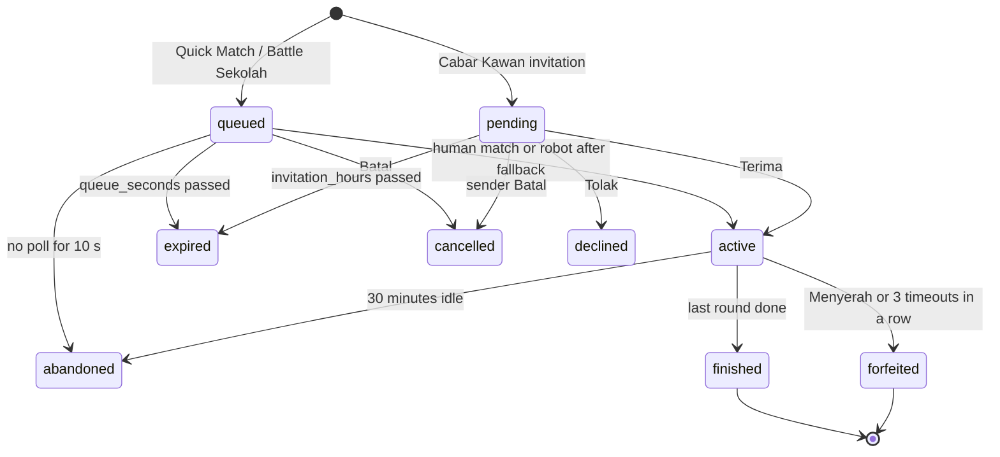
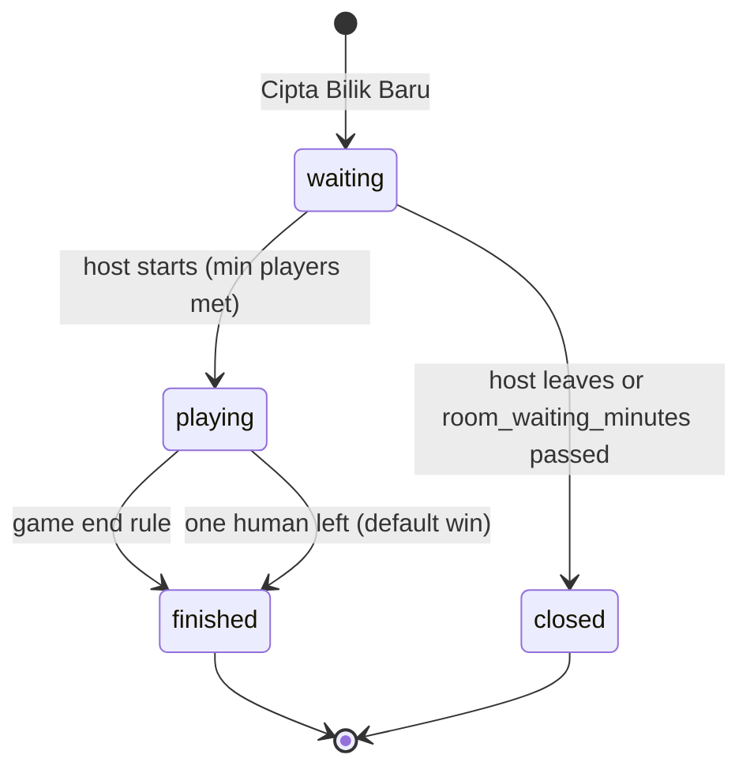
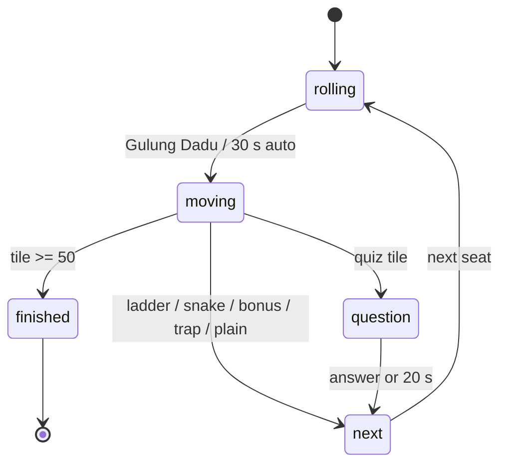
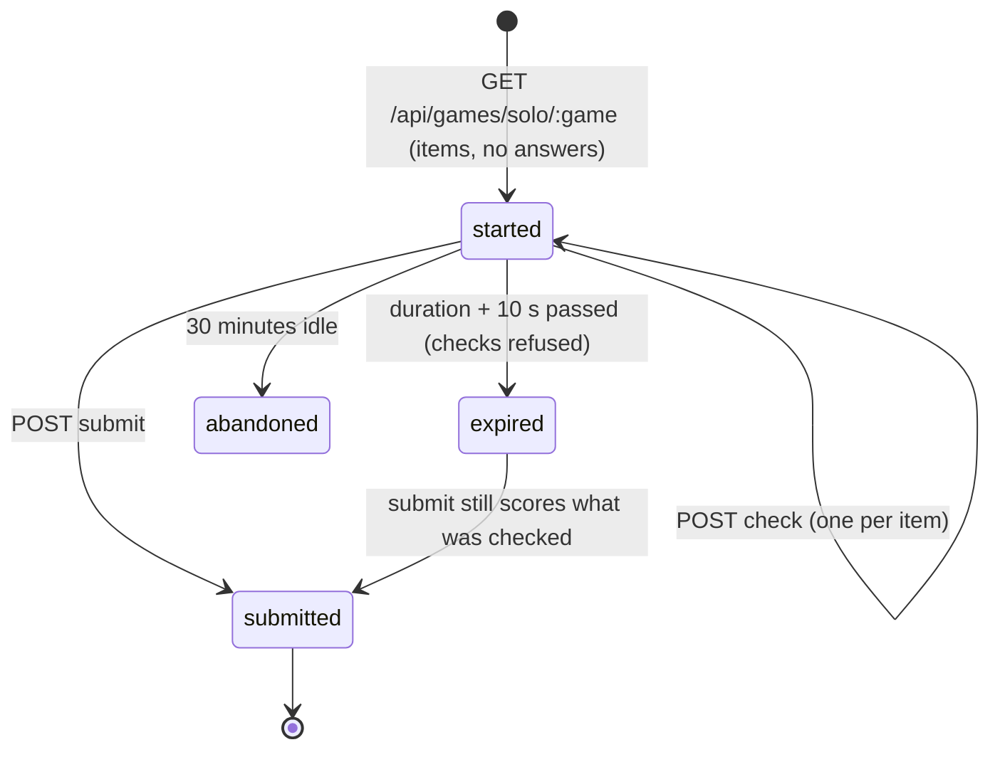
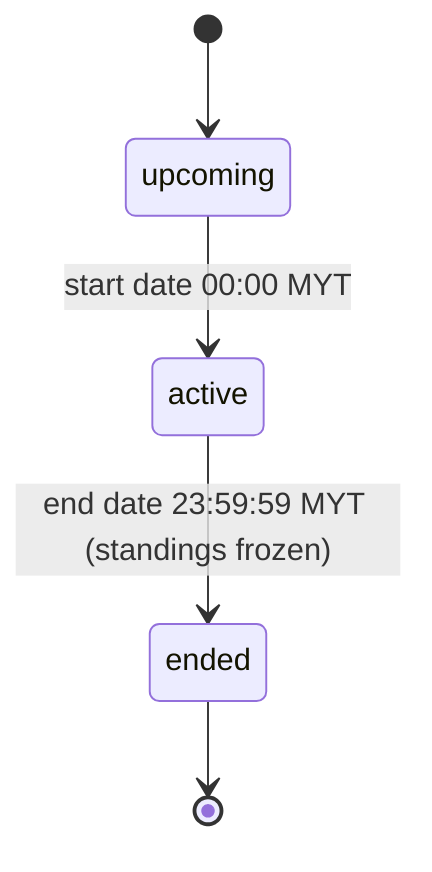
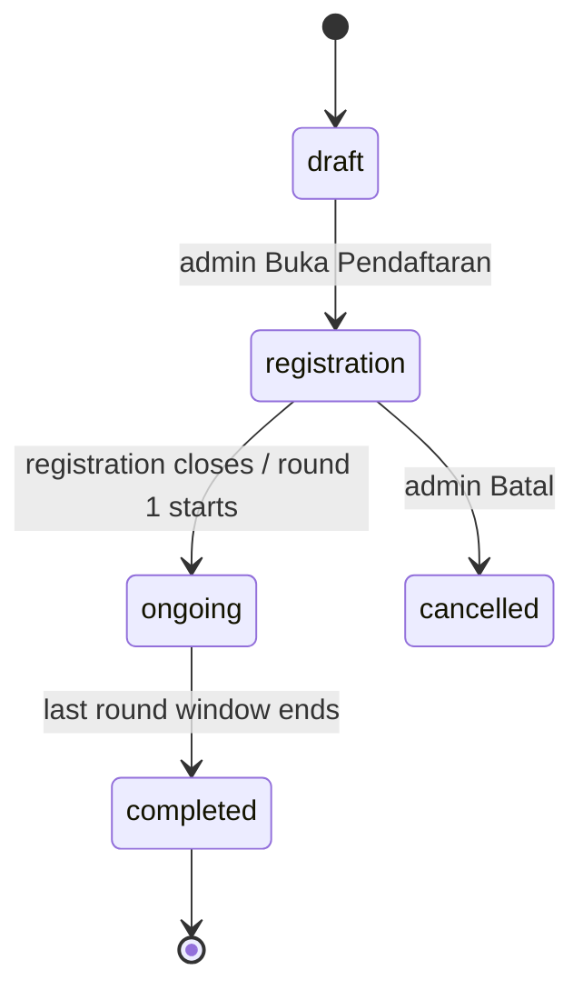
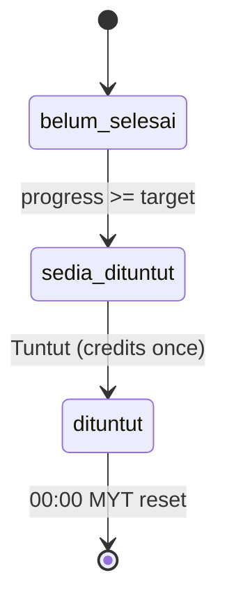
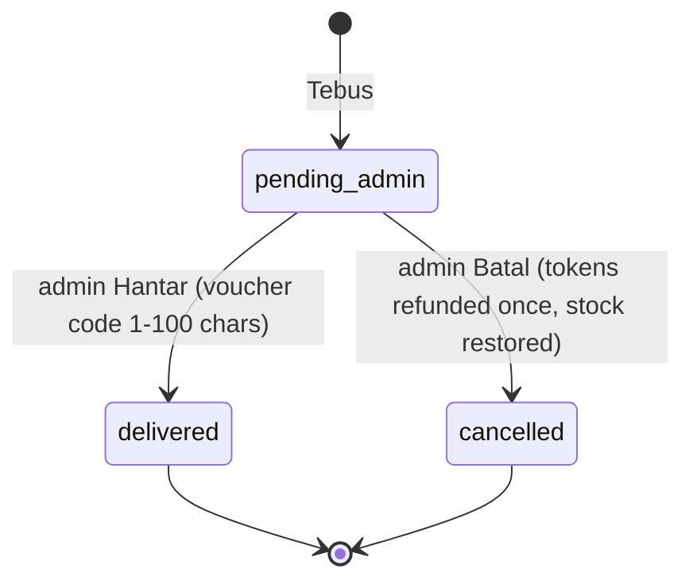
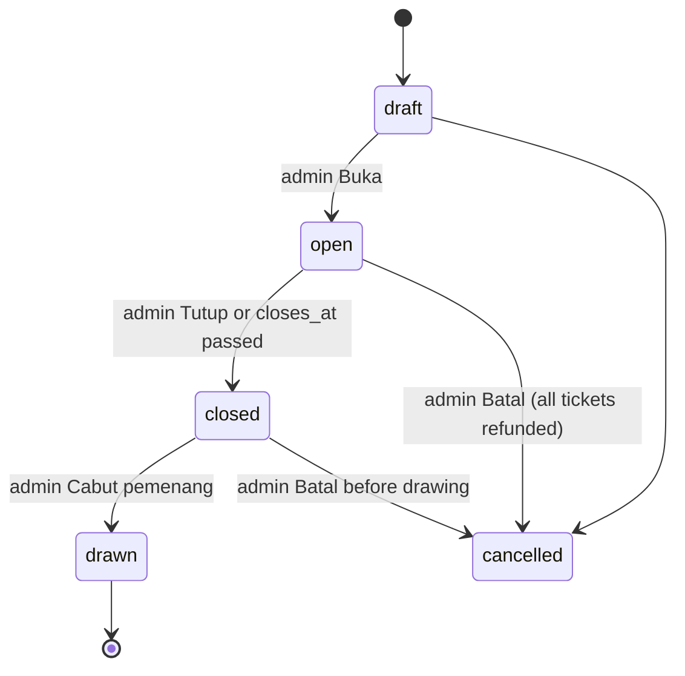

# 48 - Game and gamification specification (R1)

Complete, buildable specification of every game and gamification mechanic of PrestasiPlus V3 (R1). A developer or cloud agent builds from this file without asking a question. If a rule seems missing, the file has failed: report it as a defect of this document; do not invent a rule.

## 0. Read this first

1. **Scope.** GAME-00 (common rules), GAME-01..25 (one section per game or mechanic), the Gamification settings table (section 2), the fixed-constant table (section 3.7) and the traceability list (section 5). Pupil screens are in `10-murid.md` rows 18, 21-23, 28-31, 33-36, 38; admin screens in `30-admin-pusat.md` N-05 and P2-01..P2-15; teacher Misi Harian in `20-guru-admin-sekolah.md` FR-GUR-2b; Sekolah Bersaing in `20-guru-admin-sekolah.md` R1-AS-45. This file adds rules and numbers; it does not repeat their layouts, and where it names a label it is the exact BM text.
2. **Legend.**
   - `†` after a value = the value is an **R1 decision D113** (no V2 or code source existed; the Delivery Lead fixed it by principle: simple, fair for minors, V2/V1 parity where V2 spoke). It is a requirement, not a proposal.
   - `[CODE file:line]` = the rule or constant exists in the V3 code base today (the section says "keep" or "replace").
   - `D-GAME-n` = a numbered decision of this file (listed in its decision table); `D-PA-n` = a numbered decision of 46; `D113` = the R1 decision rule of the Delivery Lead (see 00-index "Codes in plain words").
   - `[V2]` = observed on prestasiplus.cloud. `[SRS]` = V1/V2 SRS in the repo.
3. **Time zone.** Every day, week, month, reset, streak, daily limit and cap uses **Asia/Kuala_Lumpur** (UTC+8, no daylight saving). Day = 00:00:00.000 to 23:59:59.999. Week = Monday 00:00 to Sunday 23:59:59.999. Month = calendar month. All server timestamps are stored UTC; the day key is `date(at AT TIME ZONE 'Asia/Kuala_Lumpur')` [CODE `standings.windows.ts:11-30`, `wallet/streak.service.ts:18`].
4. **Word "syiling"** = coin, **"token"** = shop token, **"mata"** = XP. A pupil is a minor: first names only on boards, no real-money language anywhere, published odds.
5. **ID scheme.** New requirement IDs are `FR-GM-<section>.<n>` and `AC-GM-<section>.<n>` where `<section>` is `00`, `01`..`25`, `R` (common room rules, GAME-02..07) or `S` (common solo rules, GAME-08..12). New data items are DM-60..DM-65 and DM-67 (DM-50..DM-59 belong to 45); new routes are API-GAME-11..14 and API-ADM-23..25; new errors are `ERR-GAME-nn` (catalogue in 3.8, to be merged into the cross-cutting catalogue of `40-cross-cutting.md`). Existing IDs are never renumbered.
6. **Owning cards.** All cards are in `docs/plan/r1-development-plan.md` section 4.S7 unless stated. S7-T01 grows from "S / Verify" to "L / Complete" (the plan size, S/M/L only) because the audit found that no game writes the answer store and the multiplayer is simulated; the card may be delivered in several PRs, called parts ("S7-T01 part GAME-01"): every part PR names the same card ID `S7-T01` in its body (the scope guard accepts it), states which FR-GM / AC-GM ids it proves, and the card is Done only when all its ACs pass; one card lock covers all parts (N-15, D113-continued).
7. **Test accounts (Mod Pelajar).** A teacher or admin in Mod Pelajar may play every game but gets no reward, no standing, no board row, no badge and no `practice_answers` row (the account is `is_test`).
8. **Hard rules inherited from the PRD** (`10-murid.md` 4.3, 4.4, 4.6): the Syiling rate is the admin setting, never a game constant; game questions are approved, servable, text-only MCQ; the display name is the first given name only; a game result without a bank question writes no answer row.

## 1. Decisions (D113, final, no open questions)

| ID | Decision |
|---|---|
| D-GAME-1 | **Real opponents first, honest robot second.** Battle and room games match real pupils first. After `battle_bot_fallback_seconds` (30 s) with no human, a clearly labelled **"Robot PrestasiPlus"** takes the seat. The robot has no user id, never uses or impersonates a real pupil's identity, name or answers, and never enters a ranking, league, badge count or standing. **The current bot-pool code that shows real pupils of the host's school as players (`apps/api/src/modules/games/rooms/bot-pool.ts:8-14`, and the Battle opponent drawn from real pupils in `bots.ts:19-26` / `arena.service.ts:149-193`) is deleted and replaced** (GAME-00 section 3.6). |
| D-GAME-2 | **Syiling from mini-games is an admin setting, default OFF** (`games_award_syiling` = Tidak, "XP sahaja"). When ON, game syiling is capped per pupil per day (`games_daily_syiling_cap`, default 100). Battle rewards follow the same formula (GAME-00 section 3.4): XP always, syiling only when the setting is ON. |
| D-GAME-3 | **Liga is joined by school** (V2 and code). Admin Pusat enrols the school on the admin Tournament/Liga screen (P2-14); pupils of the school count automatically and see "their school's league" with their own contribution. A pupil never taps "Sertai". |
| D-GAME-4 | **R1 tournament formats = `single_match` and `league` only.** `knockout` and `hybrid` are not offered in the admin form and are rejected by the API. |
| D-GAME-5 | **Parent consent is not built** (the Ibu Bapa module is out of scope). Every seeded and every new gift has `requiresParentConsent = false`, the field is hidden in the admin form, and the status `pending_parent_consent` is never produced and never shown in R1. |
| D-GAME-6 | **Sekolah Bersaing minimum = 1 pupil** (V2 parity): `sekolah_bersaing_min_pupils` default 1. |
| D113-a | Teacher Misi Harian `rewardCoins` is capped by the setting `mission_reward_max` = 100 syiling per mission per pupil. |
| D113-b | Every game that shows bank questions writes each answer to `practice_answers` with its game mode (GAME-00 section 3.5); Prestasi, Heatmap, Analisa Item and the teacher and admin reports count them. |
| D113-c | Every value marked `†` is a requirement of R1; values that earlier audits left open are final. |

## 2. Gamification settings

Admin Pusat only changes these values (FR-ADM-H0.3: every write is audited with actor, time, before and after). A change applies only to events after the save; past ledger rows are never recalculated.

**Storage.** The keys `flat_quiz_reward`, `games_award_syiling`, `reward_budget_sen_session` and `current_session_year` live in `reward_settings` (DM-48, migration `0223_s7_reward_settings`, owner S7-T05; the contract alias of `games_award_syiling` is `reward_settings.mini_games_give_coins`; `flat_quiz_reward` is `reward_settings.coins_per_correct`, API-ADM-16 `flatCoins`). Every other key lives in the existing `gamification_settings` key/value table (DM-38) and is inserted with its default by migration `0224_s7_game_engine` (owner S7-T01, together with DM-60 and DM-64). The other new data items have their own migrations: `0225_s7_league_tournament` (DM-61, DM-62, S7-T06), `0226_s7_challenge_claims` (DM-63, S7-T04), `0227_s7_draw_status` (DM-65, S7-T07). One setting has one place; no key is stored twice. The readers of `coins_per_correct` in `practice/` (S5) and in the Bijak result (S3) read the constant 1 until S7-T05 switches them to the row by cross-sector PRs.

**Screens.** "Tetapan Permainan" = N-05 `/admin/permainan` (new card "Ganjaran & Had Permainan" below the Papan Bijak card). "Kawalan Reward" = P2-09 `/admin/reward-control`. "Tetapan Gamifikasi" = P2-06 `/admin/gamification/settings`. "Tier Config" = P2-02. "Cabutan" = P2-10. "Kotak Misteri" = P2-11. Out-of-range input is refused with ERR-REQ-15 "Nilai mesti antara {min} dan {max}." and nothing is saved.

| Key | BM label on the admin screen | Default | Range | Who may change | Where it is used |
|---|---|---|---|---|---|
| `flat_quiz_reward` | Syiling flat / soalan betul | 1 | integer 0-20 | Admin Pusat (Kawalan Reward) | every mode that credits syiling; games when ON (GAME-00); Misi Harian per-answer part (GAME-20) |
| `games_award_syiling` | Mini-games beri syiling? | Tidak (XP sahaja) = 0 | Ya/Tidak (1/0) | Admin Pusat (Kawalan Reward) | GAME-00 reward formula; GAME-14 visibility |
| `reward_budget_sen_session` | Bajet tebus / sesi | 300 sen (RM3.00; V2 value; the seed value 1000 of V1 is replaced, recorded as a D9 fix) | 0-100000 sen | Admin Pusat (Kawalan Reward) | GAME-21 redeem step 4 |
| `current_session_year` | Tahun sesi semasa | 2026 | 2020-2100 | Admin Pusat (Kawalan Reward) | GAME-21 budget window |
| `xp_per_correct` | Mata (XP) setiap jawapan betul | 10 | 1-100 | Admin Pusat (Tetapan Gamifikasi) | GAME-00, GAME-17 |
| `xp_level_size` | Saiz tahap (mata) | 1000 (level = floor(XP / 1000) + 1) | 100-10000 | Admin Pusat (Tetapan Gamifikasi) | GAME-17 |
| `games_daily_syiling_cap` | Had syiling permainan sehari | 100 † | 0-1000 (0 = no syiling from games) | Admin Pusat (Tetapan Permainan) | GAME-00 caps |
| `games_daily_xp_cap` | Had mata permainan sehari | 500 † | 0-5000 | Admin Pusat (Tetapan Permainan) | GAME-00 caps |
| `game_win_xp` | Mata untuk menang | 20 † | 0-100 | Admin Pusat (Tetapan Permainan) | GAME-00 |
| `game_draw_xp` | Mata untuk seri | 10 † | 0-100 | Admin Pusat (Tetapan Permainan) | GAME-00 |
| `game_play_xp` | Mata untuk bermain | 5 † | 0-100 | Admin Pusat (Tetapan Permainan) | GAME-00 |
| `game_win_bonus_syiling` | Bonus syiling untuk menang | 5 † (only when `games_award_syiling` = Ya) | 0-50 | Admin Pusat (Tetapan Permainan) | GAME-00 |
| `games_min_ms_per_answer` | Masa minimum setiap jawapan (ms) | 1000 [CODE `solo.rules.ts:142`] | 0-5000 | Admin Pusat (Tetapan Permainan) | solo games, Kad Memori (per move), room games |
| `jutawan_min_ms_per_answer` | Masa minimum setiap jawapan Jutawan (ms) | 2000 [CODE `solo.rules.ts:143`] | 0-5000 | Admin Pusat (Tetapan Permainan) | GAME-13 |
| `jutawan_question_seconds` | Masa setiap soalan Jutawan (saat) | 60 † | 10-300 | Admin Pusat (Tetapan Permainan) | GAME-13 |
| `battle_questions_default` | Bilangan soalan Battle (lalai) | 10 [CODE `battle/schema.ts:27`] | 5, 10, 15 or 20 | Admin Pusat (Tetapan Permainan) | GAME-01 default chip |
| `battle_question_seconds` | Masa setiap soalan Battle (saat) | 15 [CODE `battle/schema.ts:28`] | 10-60 | Admin Pusat (Tetapan Permainan) | GAME-01, GAME-15 |
| `battle_grace_seconds` | Masa tambahan Battle (saat) | 3 [CODE `arena.service.ts:19`] | 0-10 | Admin Pusat (Tetapan Permainan) | GAME-01 |
| `battle_queue_seconds` | Tempoh menunggu lawan (saat) | 120 [CODE `battle/schema.ts:31`] | 30-600 | Admin Pusat (Tetapan Permainan) | GAME-01 |
| `battle_bot_fallback_seconds` | Saat sebelum Robot PrestasiPlus | 30 † | 0-120 (0 = never use a robot) | Admin Pusat (Tetapan Permainan) | GAME-01, GAME-R |
| `battle_bot_accuracy_pct` | Ketepatan Robot PrestasiPlus (%) | 60 † | 10-90 | Admin Pusat (Tetapan Permainan) | GAME-01, GAME-R |
| `battle_invitation_hours` | Tempoh cabaran kawan (jam) | 24 [CODE `battle/schema.ts:33`] | 1-72 | Admin Pusat (Tetapan Permainan) | GAME-01 |
| `battle_daily_max` | Had Battle sehari | 20 † | 1-100 | Admin Pusat (Tetapan Permainan) | GAME-01 |
| `games_room_bots_enabled` | Robot dalam bilik permainan | Ya (1) † | Ya/Tidak | Admin Pusat (Tetapan Permainan) | GAME-R |
| `games_absent_seconds` | Saat sebelum pemain dianggap tiada | 30 † | 10-120 | Admin Pusat (Tetapan Permainan) | GAME-01, GAME-R |
| `room_waiting_minutes` | Tempoh bilik menunggu (minit) | 15 † | 5-60 | Admin Pusat (Tetapan Permainan) | GAME-R |
| `boardgame_quiz_tiles` | Bilangan Petak Soalan | 35 [V2] [CODE `games.constants.ts:35-36`] | 0-38 (hint "Maks 38 petak (48 available - 10 petak khas). Set 0 = tiada soalan.") | Admin Pusat (Tetapan Permainan, Papan Bijak card) | GAME-02 |
| `challenge_accuracy_min_questions` | Soalan minimum untuk cabaran ketepatan | 5 † | 1-20 | Admin Pusat (Tetapan Gamifikasi) | GAME-19, GAME-25 |
| `daily_login_syiling` | Syiling log masuk harian | 2 [SRS BR-M14-14] [CODE `gamification.constants.ts:71`] | 0-10 | Admin Pusat (Tetapan Gamifikasi) | GAME-17 |
| `spm_first_session_syiling` | Syiling sesi SPM pertama sehari | 7 [SRS BR-M14-14] | 0-20 | Admin Pusat (Tetapan Gamifikasi) | owned by the Bijak lane (prestasiplus-30); this file only holds the key |
| `tier` rows | Tier (nama, syiling minimum, kadar tukar) | Gangsa 0 / 50, Perak 500 / 40, Emas 2000 / 30, Platinum 5000 / 20 [V2] | minimum strictly increasing, first = 0, rate 1-1000 | Admin Pusat (Tier Config) | GAME-17, GAME-18 |
| `mystery_box_cost` | Kos satu kotak (syiling) | 50 [V2] | 1-500 | Admin Pusat (Kotak Misteri) | GAME-23 |
| `mystery_box_daily_max` | Had kotak sehari | 5 † | 1-20 | Admin Pusat (Kotak Misteri) | GAME-23 |
| mystery prize rows | Ganjaran kotak (label, jenis, jumlah, peluang %, stok) | table in GAME-23 [V2] | weights are integers summing to 100 | Admin Pusat (Kotak Misteri) | GAME-23 |
| `spin_segments` rows | Segmen Roda Nasib (label, syiling, berat) | table in GAME-14 [CODE `spin.rules.ts:11-20`] | 8 rows, weights integers summing to 100 | Admin Pusat (Tetapan Permainan) | GAME-14 |
| `draw_max_tickets_per_pupil` | Max tiket / pelajar (per draw field) | 10 [SRS V1 form] | 1-100 | Admin Pusat (Cabutan) | GAME-22 |
| `referral_referrer_syiling` | Syiling untuk pemberi rujukan | 100 [V2] | 0-1000 | Admin Pusat (Tetapan Gamifikasi) | GAME-24 |
| `referral_referee_syiling` | Syiling untuk kawan yang dirujuk | 0 † (V2 silent; the code value 25 is removed) | 0-1000 | Admin Pusat (Tetapan Gamifikasi) | GAME-24 |
| `referral_max_rewarded` | Had kawan berganjaran setiap pelajar | 20 † | 1-200 | Admin Pusat (Tetapan Gamifikasi) | GAME-24 |
| `mission_reward_max` | Had ganjaran misi (syiling) | 100 † | 0-10000 | Admin Pusat (Tetapan Gamifikasi) | GAME-20 |
| `sekolah_bersaing_min_pupils` | Pelajar minimum setiap sekolah | 1 (D-GAME-6) | 1-50 | Admin Pusat (Tetapan Permainan) | GAME-16 |
| `sekolah_bersaing_top_n` | Bilangan sekolah dipaparkan | 30 [V2] | 10-100 | Admin Pusat (Tetapan Permainan) | GAME-16 |

Acceptance of the settings screens: AC-GM-00.10 and AC-GM-00.11 (section 3.9).

---

## 3. GAME-00 Common rules for every game

Applies to GAME-01..15 unless a section says otherwise. Matrix rows: 21 (and 22, 23). PRD: `R1-MUR-21`, FR-MUR-21-1..7, AC-MUR-21-1..6, `10-murid.md` 4.4.

### 3.1 Entry
- **Who may play.** Role pupil, account active, Tingkatan 1-5. The contract lists `DARJAH_1..6` [CODE `common.ts:86-98`]: removed from every game level list (D72, FR-MUR-21-3). Solo games refuse Tingkatan below the pupil's own range only through the picker: the picker lists Tingkatan 1-5 (the pupil's own form preselected). A teacher or admin in Mod Pelajar: see 0.7.
- **Hub.** `/permainan` "🎮 Zona Permainan" lists a game card only when (a) the game is enabled in N-05 (FR-ADM-N05.2), (b) the `permainan` switch is on (off = 404, API-AUTH-16), and (c) the pupil's Tingkatan pool holds at least the game's draw size of playable questions (3.2). A card that fails any test is absent (FR-MUR-21-1). "Pertandingan" and "Uji Minda" (`/games/pertandingan`, `/games/uji-minda`) have no rule anywhere; in R1 they have **no hub card and both routes answer 404** (ERR-ACC-02).
- **No entry cost.** No game costs syiling or tokens, except Kotak Misteri and Cabutan Bertuah, which are shops (GAME-22, GAME-23).
- **Rate limits.** Keep `GAMES_LIMITS` [CODE `games.constants.ts:13-19`] unchanged. Solo starts: 30 per minute per pupil (429 ERR-RATE-01 "Terlalu banyak percubaan. Sila cuba sebentar lagi.").

### 3.2 Question selection (groups whole)
1. **Source.** Approved, servable, text-only MCQ (single correct option, 2-8 options per the MCQ rule of 45 and DM-69; Cabaran Kilat and Tembak Jawapan keep their own 4-option rule stated in their sections) of status "approved" in the bank (owner M04); level within Tingkatan 1-5; the same predicate as the pupil drill pool (D91) [CODE `games/core/game-questions.service.ts`]. Draft, review, archived, hidden and flagged questions never appear (AC-MUR-21-2).
2. **Groups whole.** A question that belongs to a stimulus group, or that has a figure, table, audio or image, is **never served by any game** (servability activity `permainan` of 45 OPT-SERVABILITY: a standalone single-leaf MCQ with no stimulus group, no figure and no option image; L-12, D113): a group may not be split (ERR-QST-02), and games show one question alone, so the whole group is excluded, never one member. The admin sees the reason `image_games` in N-05 (FR-ADM-N05.3). Tournament `exam_paper` mode skips such a question together with its whole group.
3. **Difficulty mix.** Unless a section says otherwise: 30% difficulty 1-2, 40% difficulty 3, 30% difficulty 4-5 of the draw size, each rounded to the nearest whole question with the remainder given to difficulty 3; if a band is short, fill from the nearest band. Order inside the game: shuffled by a server random seed saved with the session. †
4. **No repeats.** A session never shows a question twice. Across sessions, the server first excludes questions the pupil answered in any game in the last 14 days when the eligible pool is at least 3 times the draw size; otherwise it allows repeats. †
5. **Option order.** Options are shown in the stored order, except Tembak Jawapan which rotates them by question id (GAME-10).
6. **Not enough questions.** If the pool is smaller than the draw size when a session starts: ERR-GAME-01 "Soalan tidak mencukupi." and nothing starts, nothing is charged.

### 3.3 Timers and clocks
- All clocks are on the server. The client timer is a display; the server stores `round_started_at` and decides. A client answer is accepted if `server_now <= round_started_at + question_seconds + grace_seconds`; later it is a timeout.
- A timeout is a wrong answer with a null selected option.
- Polling: room and Battle clients poll every 3 s. The server advances clocks when polled (`runClocks`) and also by a background sweep every 5 s, so a room with no poller still finishes.
- **Inactivity.** A game session with no activity for 30 minutes is closed `abandoned`: no reward, rows already written to `practice_answers` stay. †

### 3.4 Scoring, ties and rewards
**Winner and ties.** Each game section defines its score. Equal top scores are a draw ("Seri"), including 0-0. No game awards a win to a fixed seat or to the player with the lowest id. Where a game needs a deterministic order between different people (boards), the tie-break chain is stated there.

**Reward formula (replaces every per-game constant; D-GAME-2).** For each finished game, per human pupil:
1. XP = `xp_per_correct` x correct answers + `game_win_xp` if the pupil won, or `game_draw_xp` if the game was a draw, or `game_play_xp` if the pupil finished and lost. A pupil who left early (forfeit) gets 0 XP; the opponent gets the win XP.
2. Syiling only if `games_award_syiling` = Ya: `flat_quiz_reward` x correct answers + `game_win_bonus_syiling` if the pupil won.
3. **Robot rule.** If every other participant was a robot, the pupil gets rule 1 without the win/draw/play part except `game_play_xp`, and rule 2 without the win bonus (no win XP against a robot). †
4. **Daily caps.** Per pupil per MYT day, all games together: after `games_daily_xp_cap` XP or `games_daily_syiling_cap` syiling the rest is not credited; the result screen shows the capped amount. Caps count only game-result credits (ledger source `game:*`). Achievements, challenges, missions, referral, mystery box, spin and daily login are never counted against the caps.
5. **Pace guard.** If any gap between consecutive answers is shorter than `games_min_ms_per_answer` (`jutawan_min_ms_per_answer` for Jutawan), the result is stored and scored but credits nothing and writes no personal best [CODE `solo.rules.ts:136-152`].
6. **Idempotency.** One reward event per (game session id, pupil). The ledger source is `game:<game_key>`, the idempotency key is the game session id (`game:<key>` as `sourceId` [CODE `wallet-rewards.ts:85`]); a replay returns the first result and credits nothing again. Description text from `gameRow` [CODE `wallet-rewards.ts:8-43`].
7. **Order of side effects** (GAME-17): streak (none for games, see GAME-17), wallet credit, challenges, achievements.

**Result screen messages (exact BM).** Reward: "Anda dapat +{xp} mata dan +{syiling} syiling." XP only: "Anda dapat +{xp} mata." Cap reached: "Had ganjaran permainan hari ini telah dicapai. Cuba lagi esok." Pace guard: "Keputusan disimpan tanpa ganjaran." Server error mid-game: "Ralat sambungan. Permainan anda disimpan. Cuba teruskan." (ERR-SYS-01 behaviour: the client retries the same action, which is idempotent by position.)

### 3.5 Answer store (`practice_answers`)
Every time a pupil answers or times out on a bank question in any game, **one `practice_answers` row** is written (DM-44, `AnswerLogPort` of `practice/`; no second table):
- `mode = 'battle'` for Battle Arena rows and `mode = 'game'` for every other game; `attempt_id` (uuid) = the game session id: Battle: the battle uuid; room: `game_rooms.session_id` (DM-67); solo: the session uuid; tournament: `tournament_round_scores.attempt_id` (DM-61);
- `part_ref = '<game_key>#<position>'` with position starting at 1; game keys: `battle`, `papan-bijak`, `perang-fakta`, `benteng-ilmu`, `perlumbaan-matematik`, `kuiz-relay`, `teka-silang-kata`, `betul-salah`, `cabaran-kilat`, `tembak-jawapan`, `susun-jawapan`, `kad-memori`, `jutawan`, `tournament` †;
- selected option (null on timeout), `is_correct`, seconds taken (decimal, 1 place), `marks_awarded` 1 or 0, `marks_max` 1, subject, chapter and dimensions copied at answer time like every mode;
- the port entry is the one of 60 section 2.17.5 (`record(entry: { userId, attemptId, questionId, partRef, mode, isCorrect, marksAwarded, marksMax, answeredAt, isTest })`, N-6); a game always passes `isTest: false` because a Mod Pelajar actor writes no game row at all (GAME-00 section 0.7);
- written **in the same transaction** as the game state change; unique on (`attempt_id`, `user_id`, `question_id`, `part_ref`) (INV-33, DM-44) so a replay writes nothing twice and several pupils can share one `attempt_id`.

Never written: robot answers; answers of Mod Pelajar accounts; questions the game skipped. A game result without a bank question (Roda Nasib; Kad Memori move count) writes no row. For Perang Fakta the row is the source MCQ with `is_correct` = the vote was right; for Teka Silang Kata and Susun Jawapan the row is the source MCQ with `is_correct` = the typed or built answer equals the correct option text (rule in each section). Rows of mode `battle` and `game` count in "Soalan Dijawab" (+1 each), accuracy, Heatmap, Analisa Item and every report (FR-X4-5).

### 3.6 Multiplayer integrity, disconnect and robots
- **Humans first.** A game seat is filled by a real pupil; a robot is added only by the rules of GAME-01 and GAME-R. The robot is a participant with `is_bot = true`, `user_id = null`, name "Robot PrestasiPlus" (in a room with several robots "Robot PrestasiPlus 1", "Robot PrestasiPlus 2"), avatar a fixed robot icon, no school. Robot answers are generated: correct with probability `battle_bot_accuracy_pct`, after a random 2-12 s (never beyond the question time). Robot answers are not written to `practice_answers`.
- **What is deleted.** the file `bot-pool.ts` under `apps/api/src/modules/games/` (found by name, in whichever subfolder it sits: `rooms/` or `core/`) and every code path that picks a real pupil as a bot (room `addBot`, Battle opponent drawn from real pupils) are removed; the host's school is never read to populate seats. Test AC-GM-00.4 proves no `is_bot` participant has a user id.
- **Disconnect.** All state is on the server. A pupil who reopens the game route resumes at the current round with the remaining time. A player with no poll for `games_absent_seconds` is "tiada": each of their rounds times out. After 3 consecutive timeouts with no poll in between, the player is removed (Battle: forfeit).
- **Leaving.** "Keluar"/"Menyerah" = forfeit: 0 XP and no win; the remaining humans continue; if one human remains the game ends and that human wins by default.

### 3.7 Fixed game constants (kept in code, value stated) and constants replaced

**Replaced by a setting or by the formula (hard-coded values found in code):**

| Code constant | Where | Action |
|---|---|---|
| Benteng Ilmu coins 8 / 35 | `rooms/engine/constants.ts:31-36` (`ROOM_COINS`) | Replace with the GAME-00 reward formula (settings `flat_quiz_reward`, `game_win_bonus_syiling`, `game_win_xp`, `game_play_xp`). The values 8 and 35 are deleted. |
| Jutawan 1000 syiling ladder (1000 / 50 / 0) and `jutawan_level_bonus_syiling` | `solo.rules.ts:133` (`jutawanCoins`) | Replace with the GAME-00 formula; the ladder and the bonus key are deleted. |
| Solo coin formulas (streak coins, 1-5 per correct in Betul atau Salah, Mathrace 5, Perang Fakta win 10 and every similar per-game amount) | `solo.rules.ts:44-52`, `rooms/engine/constants.ts:31-36` | Replace with the GAME-00 formula. The "solo streak coins" are deleted; a streak inside a game only raises the game score (GAME-08), never syiling. |
| Battle reward `{coins: 0, xp: 0}` | `battle-engine.service.ts:137` | Replace with the GAME-00 formula (the 0/0 is the defect). |
| Referral 50 (referrer) + 25 (friend) | `gamification.constants.ts:67-68` (`REFERRAL_REWARD_REFERRER/REFEREE`, contract `GAMIFICATION_REFERRAL_REWARDS`) | Replace with settings `referral_referrer_syiling` = 100 and `referral_referee_syiling` = 0. Owner card: **S7-T07** (GAME-24) removes `REFERRAL_REWARD_REFERRER`, `REFERRAL_REWARD_REFEREE` and the contract constant `GAMIFICATION_REFERRAL_REWARDS`; the CI grep for them must return 0 matches when S7-T07 closes. |
| `MISSION_COINS_PER_CORRECT = 3` | `apps/api/src/modules/practice/rules.ts:50` (and its use at line 61, `start.planner.ts:317`, `ports.ts:133`; mock copies `m05-practice/mock/datasets/pins.ts:91,99`, `mock/repository/start.ts:286`, `mock/repository/practice.ts:456`) | Delete; the mission path reads `flat_quiz_reward` like every mode (10-murid 4.4). Owner card: **S5-T03** (it owns `practice/rules.ts`). It replaces the constant by the helper `coinsPerCorrect()`: The helper `coinsPerCorrect()` reads the `reward_settings` row when it exists and returns 1 when it does not. (S7-T05 creates the table with the same default 1), so S6-T07 and S7-T05 do not remove the constant. S7-T05 creates `reward_settings` (migration 0223) and the admin setting; the rate-3 clause of AC-MUR-16-4 is `[UAT]` after S7-T05; the CI grep for `MISSION_COINS_PER_CORRECT` must return 0 matches when S5-T03 closes. |
| `DAILY_LOGIN_REWARD = 2` | `gamification.constants.ts:71` | Replace with `daily_login_syiling` (default 2). |
| Roda Nasib segment values and weights | `spin.rules.ts:11-20` | Replace with the `spin_segments` rows (same default values). |
| Kotak Misteri four token boxes with XP | `shop.constants.ts:40-45` | Replace with one box and the seven-row prize table (GAME-23); no XP. |
| `BATTLE_RULES` questions 10, seconds 15, queue 120, invitation 24 h | `battle/schema.ts:26-41` | Replace with `battle_questions_default`, `battle_question_seconds`, `battle_queue_seconds`, `battle_invitation_hours`. |
| `GRACE_SECONDS = 3` | `arena.service.ts:19` | Replace with `battle_grace_seconds`. |
| `MIN_MS_PER_ITEM` 1000, `JUTAWAN_MIN_MS_PER_QUESTION` 2000 | `solo.rules.ts:142-143` | Replace with `games_min_ms_per_answer`, `jutawan_min_ms_per_answer`. |
| Misi Harian `rewardCoins` range 0-10000 | contract | Replace with `mission_reward_max` (100). |

**Kept (value stated):**

| Constant | Value | Used by |
|---|---|---|
| Board geometry (`BOARD_FIXED`, `BOARD_STEP` 3) | 50 tiles, ladders 3, snakes 3, bonus 2, traps 2 [CODE `engine/constants.ts:4-8`] | GAME-02 |
| Room player limits | Papan Bijak 2-6, Perang Fakta 2-6, Benteng Ilmu 2-2, Perlumbaan Matematik 2-4, Kuiz Relay 4-8, Teka Silang Kata 2-2 [CODE `common.ts:42-49`] | GAME-R |
| Room code | 6 characters A-Z0-9 | GAME-R |
| Room round constants | `POOL_SIZE` 15 and `PF_ROUND_MS` 10000 (Perang Fakta), `CROSSWORD_MS` 300000, the other values quoted in each section [CODE `engine/constants.ts`, `rooms/engine/constants.ts:10-14`] | GAME-03..07 |
| Solo game item counts, clocks, scoring | table in GAME-08..12 | GAME-08..12 |
| `ACCURATE_SESSION_PCT` | 90 [CODE `gamification.constants.ts:16`] | GAME-25 badge "Tepat Sasaran" |
| Titles | Permulaan 0, Pelajar 300, Master 2000, Grandmaster 3500, Legenda 5000, Mitos 10000 [CODE `wallet.constants.ts:13-20`] | GAME-17 |
| Wallet single-movement maximum | 100000 [CODE] | GAME-17 |
| Mission targets | `targetQuestions` 1-1000 [CODE]; at most 5 missions per teacher per day † | GAME-20 |
| `GAMES_LIMITS` | as coded [CODE `games.constants.ts:13-19`] | 3.1 |

### 3.8 Error handling (ERR-GAME catalogue, new)
Errors follow `40-cross-cutting.md`: API envelope `{error: {code, message, details?}}`, toast for an action failure (T), inline for a form (I), region for a load failure (R). Generic errors are used as they are: ERR-NET-01/02, ERR-SYS-01/01b, ERR-AUTH-01, ERR-ACC-01/02, ERR-RATE-01, ERR-CON-01, ERR-WAL-01, ERR-RWD-01..08, ERR-PRAC-02. New:

| ID | Code | HTTP | When | BM message (exact) | UI | Retry |
|---|---|---|---|---|---|---|
| ERR-GAME-01 | NOT_ENOUGH_QUESTIONS | 422 | pool smaller than the draw size | Soalan tidak mencukupi. | R, button `Kembali` | N |
| ERR-GAME-02 | NO_OPPONENT | 200 status `expired` | no match after `battle_queue_seconds` | Tiada lawan dijumpai. | overlay result | `Cuba Lagi` |
| ERR-GAME-03 | GRADE_RESTRICTED | 403 | SPM tab and pupil below Tingkatan 4 | Khas untuk pelajar Tingkatan 4 & 5 sahaja. | I | N |
| ERR-GAME-04 | BATTLE_ENDED | 409 | action on a finished battle | Battle sudah tamat. | T | `Lihat Keputusan` |
| ERR-GAME-05 | BATTLE_DAILY_LIMIT | 429 | `battle_daily_max` reached | Had battle hari ini telah dicapai. Cuba lagi esok. | I | N |
| ERR-GAME-06 | ROOM_CODE_INVALID | client | code not 6 characters A-Z0-9 | Kod bilik tidak sah. | I | edit |
| ERR-GAME-07 | ROOM_NOT_FOUND | 404 | unknown code | Bilik tidak dijumpai. | I | edit |
| ERR-GAME-08 | ROOM_FULL | 409 | no free seat | Bilik sudah penuh. | I | N |
| ERR-GAME-09 | ROOM_STARTED | 409 | join or start after start | Permainan sudah dimulakan. | I | N |
| ERR-GAME-10 | NOT_HOST | 403 | start by a non-host | Hanya hos boleh memulakan permainan. | T | N |
| ERR-GAME-11 | NOT_ENOUGH_PLAYERS | 409 | start below the minimum | Pemain belum mencukupi. | T | N |
| ERR-GAME-12 | NOT_YOUR_TURN | 409 | action out of turn | Bukan giliran anda. | T | N |
| ERR-GAME-13 | TIME_UP | 409 | solo check after `duration + 10 s` | Masa sudah tamat. | T | N |
| ERR-GAME-14 | SESSION_NOT_FOUND | 404 | unknown or foreign session | Sesi tidak dijumpai. | P (ERR-ACC-02 page) | `Halaman Utama` |
| ERR-GAME-15 | SPIN_DONE | 409 | second spin the same MYT day | Anda sudah spin hari ini. | T | N |
| ERR-GAME-16 | MYSTERY_DAILY_LIMIT | 429 | `mystery_box_daily_max` reached | Had kotak hari ini telah dicapai. Cuba lagi esok. | T | N |
| ERR-GAME-17 | MISSION_REWARD_TOO_HIGH | 422 | `rewardCoins` above `mission_reward_max` | Ganjaran misi melebihi had. | I | edit |
| ERR-GAME-18 | CHALLENGE_NOT_DONE | 409 | claim before the target | Cabaran belum selesai. | T | N |
| ERR-GAME-19 | CHALLENGE_CLAIMED | 409 | second claim the same MYT day | Ganjaran sudah dituntut. | T | N |
| ERR-GAME-20 | REFERRAL_CAP | info | referral cap reached | Had rujukan dicapai. | none for the friend; the referrer's page shows it | N |
| ERR-GAME-21 | REFERRAL_CODE_INVALID | 200 | invalid code at registration | Kod rujukan tidak sah. | I (registration still succeeds) | N |
| ERR-GAME-22 | REDEEM_BUDGET | 409 | session budget exceeded | Had tebusan sesi ini telah dicapai. | T | `Kembali` |
| ERR-GAME-23 | DRAW_CANCELLED | 409 | ticket for a cancelled draw | Cabutan dibatalkan. | T | `Kembali` |
| ERR-GAME-24 | LEAGUE_* | 4xx | league rules (GAME-15) | texts listed in GAME-15 | I | N |
| ERR-GAME-25 | TOURNAMENT_* | 4xx | tournament rules (GAME-15) | texts listed in GAME-15 | I / T | N |
| ERR-GAME-26 | MOD_PELAJAR | 403 | reward or standing action in Mod Pelajar | Tidak dibenarkan dalam Mod Pelajar. | T | N |

Rule for all game screens: a load failure shows `dsCopy.loadError` "Tidak dapat memuatkan data. Sila cuba semula." with `Cuba Semula` in the region; an action failure with network loss shows ERR-NET-01 and keeps the game on screen; no raw 500 page ever shows inside a game (the V1 "Sambung Kata" 500 is the defect FR-MUR-21-1 prevents).

### 3.9 Requirements and acceptance (GAME-00)
- **FR-GM-00.1** Only games that are enabled, have the `permainan` switch on and enough playable questions are listed; `/games/pertandingan` and `/games/uji-minda` answer 404.
- **FR-GM-00.2** Game questions follow 3.2 (approved servable text MCQ, no stimulus-group or figure question, difficulty mix, no repeats).
- **FR-GM-00.3** The reward formula of 3.4 is the only source of game XP and syiling; the constants of 3.7 "Replaced" are deleted from code and mocks.
- **FR-GM-00.4** No robot or fake participant carries a real pupil's identity, answers or user id; `bot-pool.ts` is deleted.
- **FR-GM-00.5** Every answered or timed-out bank question writes one `practice_answers` row as in 3.5 (mode `battle` for Battle Arena, mode `game` with the game key in `part_ref` for every other game).
- **FR-GM-00.6** Daily caps and the pace guard of 3.4 apply to every game, and a replay never credits twice.
- **FR-GM-00.7** All clocks are server-side; an unpolled session closes `abandoned` after 30 minutes.
- **FR-GM-00.8** Boards and rooms show other pupils by display name only (section 3.10).
- **FR-GM-00.9** Mod Pelajar accounts play without reward, standing or answer rows.
- **FR-GM-00.10** The settings of section 2 are editable only by Admin Pusat, validated against their range, audited, and applied to later events only.
- **FR-GM-00.11** Responsive: hub, lobbies, boards and result screens pass 375 / 768 / 1280 px without horizontal page scroll; touch targets are at least 44 px.

- **AC-GM-00.1** Given a pupil answers 5 questions in Betul atau Salah (3 correct), when the game ends, then `practice_answers` holds 5 rows with `mode = 'game'` and `part_ref` `betul-salah#1`..`betul-salah#5` (3 with `is_correct`), Prestasi "Soalan Dijawab" rises by 5, and with `games_award_syiling` = Tidak the wallet syiling is unchanged while XP rose by 3 x 10 + `game_play_xp` (Betul atau Salah is a solo game: it has no opponent, so `game_win_xp` never applies, GAME-S; for a multiplayer game the XP is 3 x 10 + `game_play_xp` or `game_win_xp` as the outcome says).
- **AC-GM-00.2** Given `games_award_syiling` = Ya, `flat_quiz_reward` = 1, `game_win_bonus_syiling` = 5 and a won game with 7 correct answers, then the pupil gets 7 + 5 = 12 syiling and 7 x 10 + 20 = 90 XP.
- **AC-GM-00.3** Given the reward event is replayed with the same game session id, then the ledger holds one row and the response is the first result.
- **AC-GM-00.4** Given a game with a robot, then the participant has `is_bot = true`, `user_id` null and the name "Robot PrestasiPlus", no `practice_answers` row exists for it, and no row of `users` of the host's school is linked to the game.
- **AC-GM-00.5** Given a pupil has already received 500 game XP today (MYT) and wins another game, then the result shows "Had ganjaran permainan hari ini telah dicapai. Cuba lagi esok." and 0 XP is added.
- **AC-GM-00.6** Given a pool of 10 playable questions and a game that draws 15, then the game card is absent from the hub and a direct start answers 422 "Soalan tidak mencukupi.".
- **AC-GM-00.7** Given a draft question and a question that belongs to a stimulus group, then neither is ever served by any game.
- **AC-GM-00.8** Given a session with no activity for 30 minutes, then its status is `abandoned`, no reward exists, and its earlier answer rows remain.
- **AC-GM-00.9** Given 375 px, then the hub shows one column and every game lobby has no sideways page scroll.
- **AC-GM-00.10** Given Admin Pusat saves `game_win_xp` = 30, then a game finished before the save keeps its old XP and a game finished after gives 30; a Guru or Admin Sekolah calling the settings endpoint gets 403 ERR-ACC-01.
- **AC-GM-00.11** Given `battle_question_seconds` = 5, then the save is refused with "Nilai mesti antara 10 dan 60." and the stored value is unchanged.
- **AC-GM-00.12** Given a teacher in Mod Pelajar finishes a game, then no ledger row, standing row, board row, badge or `practice_answers` row is created.

### 3.10 Privacy and leaderboards (all games)
- Another pupil is shown as the **display name**: the first given name only, no surname, no school, no class (`10-murid.md` 4.3). If two pupils in one list share a first name, a letter is not added; they are told apart by rank only. (The earlier idea "first name plus an initial" is not used.)
- Robot name "Robot PrestasiPlus".
- School names appear only on the public school boards (Ranking Sekolah, Sekolah Bersaing) and league tables, never next to a pupil name.
- The pupil sees own rows with the full "Anda" label; others never expose e-mail, phone or id in the visible text (the id is allowed only inside the link to the public profile).
- Boards list the top 30 where the section says so; the viewer's own row is always shown at any depth.
- No game text, copy or reward uses money words (no "RM", "bayar", "menang wang", "judi", "pertaruhan") except the gift face value in Kedai Hadiah ("Nilai muka RM{x}", observed V2) and the Marketplace Ringgit note. Odds of Kotak Misteri and Cabutan are public on the page.

---

## 4. Game and mechanic specifications

Every section lists: purpose, matrix row, entry, question rules, timers, state machine, scoring and tie-break, rewards, leaderboard effect, screens and copy, errors, data, APIs, code to reuse and what not to build, FR and AC, owning card. Where a heading is omitted the section says "none".

### GAME-01 Battle Arena (Quick Match, Cabar Kawan, Battle Sekolah)

**Purpose.** A 1v1 timed quiz duel between two pupils (or one pupil and an honest robot). **Matrix row** 21. **PRD** R1-MUR-21 (Battle Arena region list), `/battle`, `/battle/arena/:uuid`, `/battle/ranking-sekolah`. **Owning card** S7-T01 part GAME-01 (arena, queue, robot, rewards), S7-T06 (Ranking Pelajar and Ranking Sekolah views).

**Entry.**
- Page `/battle` "Battle Arena" with badge "BARU" and the line "Cabar kawan, cari lawan, atau wakili sekolah anda!" exactly as R1-MUR-21 lists the regions (header buttons "Ranking Pelajar", "Ranking Sekolah", "Cabaran Masuk"; tabs "Biasa", "PKSK", "SPM"; "Pilih Subjek"; "Bilangan Soalan" chips 5, 10, 15, 20, default `battle_questions_default`; PKSK domain cards; "Pilih Tahap" listing Tingkatan 1-5, the pupil's own form preselected; three match cards "Quick Match", "Cabar Kawan", "Battle Sekolah"; the toggle "Keterlihatan Barisan" with "Hanya pelajar gred sama boleh match" and the chip "Gred Saya"; the list "Battle Terkini").
- The tab SPM needs Tingkatan 4 or 5 (ERR-GAME-03). The tab PKSK uses the chosen domain and the target level and needs an active PKSK grant (checked at match start); it draws only PKSK-domain questions that are standalone text-only MCQs, like every game (46 section 5.1; a PKSK question with a stimulus, figure or option image is never served in Battle). Its answer rows are written with `mode = battle`.
- Free; no cost. Quick Match and Battle Sekolah are limited to `battle_daily_max` (20) battles started per pupil per MYT day (ERR-GAME-05); Cabar Kawan is not limited by that number.
- "Keterlihatan Barisan" ON (default) = match only a pupil of the same Tingkatan; OFF = any Tingkatan T1-T5.

**Question rules.** Same subject (or PKSK domain and target level T1/T4), the owner's Tingkatan, count = chosen chip (5, 10, 15, 20). Selection per 3.2. Both players get the **same questions in the same order**. If the pool is smaller than the count: ERR-GAME-01.

**Timers.** `battle_question_seconds` (15) per question plus `battle_grace_seconds` (3). Round loop: the server stores `round_started_at` when the battle becomes `active` (round 1) and when both players have answered or timed out the previous round. A round lasts at most 15 + 3 = 18 s; an answer arriving after 18 s is a timeout. A round ends when both have answered or 18 s have passed; both then see the correct option, their own points, the opponent's points and the running totals for 3 s before the next round (display only; the next `round_started_at` is set after those 3 s).

**State machine.**

The enum `BATTLE_STATUSES` (`active`, `finished`, `forfeited`, `abandoned`) is kept; `queued`, `pending`, `expired`, `declined`, `cancelled` are queue and invitation states.

**Matchmaking.**
- Quick Match: pupil picks tab, subject (or PKSK domain and level), count, level and visibility. Queue entry waits up to `battle_queue_seconds`. Match order: same subject, type and count, same Tingkatan unless visibility is OFF, oldest entry first, never the same pupil. The client polls every 3 s; an entry not polled for 10 s is `abandoned` and never matched [CODE].
- Battle Sekolah: as Quick Match, and the opponent must be from a **different school**; the pupil must have a school.
- Robot fallback (D-GAME-1): if no human has matched within `battle_bot_fallback_seconds` (30), the server creates the battle with "Robot PrestasiPlus"; the overlay shows "Tiada lawan setakat ini. Anda akan bermain dengan Robot PrestasiPlus (latihan)." for 2 s, then the arena, with the chip "Latihan" on the opponent. A robot battle has `counts_for_ranking = false`: it does not enter Ranking Pelajar, Ranking Sekolah, a league, the "Juara Battle" count, and gives no win XP (3.4 rule 3). With `battle_bot_fallback_seconds` = 0 no robot is used.
- After `battle_queue_seconds` (120) with no match and no robot: status `expired`, message "Tiada lawan dijumpai." with button "Cuba Lagi". "Batal" removes the entry at once.
- Cabar Kawan: the search box needs at least 2 characters and returns at most 10 pupils of the **same school only** (role pupil, active, not self), shown by display name only, no school, no avatar. The code searches pupils of any school: change (privacy). The invitation expires after `battle_invitation_hours` (24). One pending invitation per pair. The receiver sees it in "Cabaran Masuk" with `Terima` / `Tolak`. A robot is never used for a Cabar Kawan. Overlay while waiting: "Menunggu Kelulusan..." / "Menunggu {name} menerima permohonan anda" with `Batal`.

**Scoring and tie-break.** Round points for a correct answer: `1000 - round(500 x s / N)` where N = `battle_question_seconds` and s = whole seconds elapsed from `round_started_at` (floor), clamped to 0..N [CODE `battle/schema.ts:109-113`; an answer in the grace window counts s = N, so 500 points]. Wrong or timeout = 0. Battle total = sum of round points. The higher total wins; equal totals = draw "Seri", including 0-0 (the code gave 0-0 to player B [CODE `battle/schema.ts:115-121`, DV-M16-35]: wrong, fixed to draw). A forfeit overrides scores.

**Absent player, forfeit.** A player with no poll for `games_absent_seconds` (30) times out each round. After 3 consecutive timeouts with no poll in between the battle is `forfeited` by that player and the opponent wins. "Menyerah" (`POST /api/battle/forfeit/:uuid`) forfeits at once. A pupil reopening `/battle/arena/:uuid` resumes at the current round with the remaining time.

**Rewards.** GAME-00 formula (win / draw / loss-play XP; syiling only when ON). Replaces the 0/0 [CODE `battle-engine.service.ts:137`].

**Leaderboard effect.** Real battles only (`counts_for_ranking = true`).
- **Ranking Pelajar** (header button): periods "Semua Masa", "Minggu Ini" (Monday 00:00 MYT), "Bulan Ini"; columns "#", "Pelajar", "Menang", "Battle", "Betul", "Ketepatan", "Mata" †. A pupil row = wins, battles, correct, accuracy % (correct / answered, whole number), total score. Order: wins desc, total score desc, accuracy desc, battles asc, user id asc. Top 30 and the viewer's own row. Empty: "Belum ada pelajar dalam ranking." †
- **Ranking Sekolah** (`/battle/ranking-sekolah`, V2 copy in R1-MUR-21): per school the sum of its pupils' scores in real **Battle Sekolah** battles; columns "#", "Sekolah", "Mata", "Menang", "Pelajar" †; order total score desc, wins desc, pupils who played desc, school name asc; top 30; empty state exactly "Tiada ranking lagi" / "Belum ada sekolah yang menyertai battle. Mulakan pertandingan sekarang!".
- Badge "Juara Battle" counts won real battles (GAME-25).

**Screen copy (exact BM).**
- Result headline: "Anda menang!", "Anda kalah.", "Seri!"; forfeit by opponent "Lawan menyerah. Anda menang!"; own forfeit "Anda telah menyerah.". Buttons `Main Lagi` (same settings) and `Kembali ke Arena` †.
- Confirm "Menyerah" (D113 dialog, B-059 conventions): title "Menyerah battle ini?" body "Anda akan kalah dan tidak mendapat mata." buttons `Menyerah` (danger) / `Teruskan Bermain` (safe, default focus).
- "Battle Terkini" ("10 pertandingan paling terkini"): row ⚔️, "1v1", subject, relative date in BM ("4 bulan lalu"; the V2 English "4 months ago" is a defect), status chip "Sedang" (active), "Tamat" (finished), "Menyerah" (forfeited), "Ditinggalkan" (abandoned) †.
- Empty: "Tiada pelajar dijumpai" (Cabar Kawan), "Tiada cabaran buat masa ini" (Cabaran Masuk).
- Invitation expired: "Cabaran tamat tempoh." †

**Errors.** ERR-GAME-01..05, ERR-AUTH-01 (timed session: the pupil's answers are saved, see ERR-AUTH-01 dialog), ERR-NET-01 (banner; the round continues server-side), plus code messages kept: "Giliran tidak dijumpai.", "Cabaran tidak dijumpai.", "Ralat menghantar permohonan.", "Penerima tidak sah." [CODE `battle/schema.ts:43-72`].

**Data.** `battles`, `battle_participants` (`is_bot` exists; `user_id` becomes nullable), `battle_answers` (kept as the per-battle log), `battle_queue`, `battle_invitations` exist. DM-60: `battles.counts_for_ranking boolean not null default true`. Each answer also writes `practice_answers` (3.5, mode `battle`, game key `battle` in `part_ref`, `attempt_id` = battle uuid).

**API.** Existing API-GAME-03 and API-GAME-04. Changes: `GET /api/battle/arena/:uuid` returns `roundEndsAt`, `round`, `totals` and the opponent label (display name or "Robot PrestasiPlus"); the search endpoint is restricted to the same school. NEW API-GAME-14 `POST /api/battle/queue/:queueId/cancel` (the "Batal" of the overlay).

**Reuse, and what NOT to build.** Reuse `apps/api/src/modules/battle/arena/arena.service.ts`, `battle-engine.service.ts`, `battle/queue/*`, `battle/standings/standings.service.ts`, `standings.windows.ts`, the Battle pages of `src/modules/m16-battle-games`. Do not build: a bot that borrows a real pupil (`bots.ts:19-26` is deleted), the pre-drawn ten answers, `knockout` brackets here, spectating, chat, emojis, friend lists, or a cost to play.

**Requirements.**
- FR-GM-01.1 The arena offers the three match cards and honours the chips 5, 10, 15, 20 and the level list Tingkatan 1-5.
- FR-GM-01.2 Both players receive the same questions in the same order drawn by 3.2.
- FR-GM-01.3 Rounds are synchronous with the clocks above; late answers are timeouts.
- FR-GM-01.4 Round points follow `1000 - round(500 x s / N)`; the winner is the higher total; equal totals (including 0-0) are "Seri".
- FR-GM-01.5 A robot opponent appears only after `battle_bot_fallback_seconds` with no human, is labelled "Robot PrestasiPlus", and its battle is excluded from every ranking.
- FR-GM-01.6 Cabar Kawan finds pupils of the same school only, by display name.
- FR-GM-01.7 Forfeit rules: "Menyerah" and 3 consecutive timeouts forfeit; the opponent wins.
- FR-GM-01.8 Rewards follow GAME-00; Ranking Pelajar and Ranking Sekolah follow the orders above.
- FR-GM-01.9 `battle_daily_max` is enforced for Quick Match and Battle Sekolah.

**Acceptance.**
- AC-GM-01.1 Given a correct answer after 4.9 s with N = 15, then s = 4 and the round points are 1000 - round(500 x 4 / 15) = 867.
- AC-GM-01.2 Given a correct answer at 17 s (grace window), then the points are 500; at 18.5 s the answer is a timeout with 0 points.
- AC-GM-01.3 Given both players score 0 in all rounds, then the result is "Seri!" and both receive `game_draw_xp`.
- AC-GM-01.4 Given a Quick Match with no other pupil, when 30 s pass, then the arena opens with "Robot PrestasiPlus", the battle has `counts_for_ranking = false`, and the pupil's Ranking Pelajar row is unchanged after the battle.
- AC-GM-01.5 Given no match and no robot (`battle_bot_fallback_seconds` = 0), when 120 s pass, then the screen shows "Tiada lawan dijumpai.".
- AC-GM-01.6 Given a pupil types "ai" in Cabar Kawan, then at most 10 pupils of the pupil's own school appear, each as a display name only; typing 1 character shows no result.
- AC-GM-01.7 Given a player does not poll for 3 rounds, then the battle is `forfeited` and the other player sees "Lawan menyerah. Anda menang!".
- AC-GM-01.8 Given a 10-question battle where the pupil answers 6 correct and wins, with `games_award_syiling` = Tidak, then XP = 6 x 10 + 20 = 80 and syiling are unchanged; `practice_answers` has 10 rows of mode `battle` with `part_ref` `battle#1`..`battle#10`.
- AC-GM-01.9 Given the 21st Quick Match of a MYT day, then the start is refused with "Had battle hari ini telah dicapai. Cuba lagi esok.".
- AC-GM-01.10 Given pupils A (3 wins, score 9000) and B (3 wins, score 9500), then B ranks above A in Ranking Pelajar.
- AC-GM-01.11 Given 375 px, then the three match cards stack, the overlay fits and the answer buttons are at least 44 px high.

---

### GAME-R Common rules for room games (GAME-02..07)

**Matrix row** 21. **Owning card** S7-T01 part GAME-R. PRD FR-MUR-21-5, FR-MUR-21-6.

**Hub and lobby (V1 hub as the reference; D113).** Open-rooms strip "Bilik Terbuka" lists `waiting` rooms with free seats, newest first, at most 6; empty "Tiada bilik terbuka buat masa ini." / "Cipta bilik permainan dan jemput rakan-rakan!". Each lobby has: `Cipta Bilik Baru` (fields "Subjek", "Tahap Soalan" filled from the profile, "Siapa Boleh Join?", "Maks Pemain"), `Masuk Bilik` (a 6-character code field), `Cari Lawan Auto` and `Cara Bermain`. "Siapa Boleh Join?" options: "Tingkatan yang sama" (`same_grade`), "Semua Tingkatan" (`same_level`; every pupil T1-T5), and for Papan Bijak only "Pilih julat" (`custom`, from Tingkatan X to Y). "Maks Pemain" lists the integers from the game's minimum to its maximum, default the maximum. Subjects: Matematik, Bahasa Melayu, Bahasa Inggeris, Sains, Sejarah (Papan Bijak: not Sejarah) [CODE `common.ts:66-71`].

**Room code and join.** 6 characters A-Z0-9, unique among open rooms. A code that is not 6 characters, or has other characters, is refused by the client with ERR-GAME-06 "Kod bilik tidak sah." before any request. Unknown code ERR-GAME-07 "Bilik tidak dijumpai."; no free seat ERR-GAME-08 "Bilik sudah penuh."; started ERR-GAME-09 "Permainan sudah dimulakan.". A pupil may join only if their Tingkatan fits the match mode.

**Room states.**

Only the host starts the game (ERR-GAME-10); the minimum player count includes robots when enabled (ERR-GAME-11 otherwise).

**Robots.** When `games_room_bots_enabled` = Ya and the host starts (or taps `Cari Lawan Auto`) with fewer humans than the minimum, the server adds one "Robot PrestasiPlus {n}" per missing seat after `battle_bot_fallback_seconds` of waiting (the host sees the countdown "Robot akan menyertai dalam {s} saat." †). Robots answer with `battle_bot_accuracy_pct`, after 2-12 s. Robots never create standings, wins, board rows, badges or league points; a game whose only opponents are robots follows 3.4 rule 3. With the setting off the host waits for humans.

**Absent, leave.** Per 3.6: no poll for 30 s = auto-timeout of the turn or answer; 3 consecutive auto-timeouts remove the player (the seat becomes a robot if enabled); one human left ends the game and that human wins by default. `Keluar` in `playing` forfeits (0 XP); in `waiting` simply leaves; the host leaving `waiting` closes the room.

**Standing per game.** `game_standings(game_key, user_id)`: `menang`, `jumlah`, `betul`, `skor`. Updated only for humans in a game with at least one other human. Top 10 per game on the lobby: order `menang` desc, `skor` desc, `jumlah` asc, user id asc; "Kadar" = round(menang / jumlah x 100); pill green when at least 70, amber 40-69, red below 40 [SRS BR-M16-22]. Names are display names. Periods: all time.

**Polling.** `GET /api/games/:game/rooms/:code` every 3 s [CODE]. The server advances clocks when polled and by the 5 s sweep.

**Messages kept** [CODE `GAMES_MESSAGES` `common.ts:115-169`]: "Hanya hos boleh memulakan permainan.", "Permainan sudah dimulakan.", "Pemain belum mencukupi.", "Soalan tidak mencukupi.", "Bukan giliran anda.", "Bukan giliran anda untuk gulung dadu.", "Soalan tidak sah.", "Pilihan tidak sah.", "Masa tidak sah.", "Tindakan tidak sah.", "Soalan tidak sepadan.", "Jawapan tidak sah.", "Permainan belum bermula.", "Tiada soalan untuk dijawab.", "Tiada jam untuk permainan ini.", "Permainan tidak dijumpai.", "Bilik tidak dijumpai.", "Tahap soalan tidak sah.", "Julat tahap tidak sah.", "Bilangan pemain tidak sah.".

**Data and API.** Existing room tables and API-GAME-01. DM-60 does not apply here. Robots are participants with `is_bot = true` and `user_id = null`. Standing rows exist (`settlement.ts:83-87` gives standings only to the acting human: replace by the rule above). Do not build: private chat, voice, invitations by name (only the code), spectators.

**Requirements.**
- FR-GM-R.1 Room codes are 6 characters A-Z0-9; a wrong format is refused client-side with "Kod bilik tidak sah.".
- FR-GM-R.2 Join checks run in the order: format, exists, not started, free seat, Tingkatan fits.
- FR-GM-R.3 Robots follow the robot rules and never use a real pupil.
- FR-GM-R.4 An absent player is auto-timed-out and removed after 3 consecutive auto-timeouts; one human left wins by default.
- FR-GM-R.5 A waiting room closes after `room_waiting_minutes` or when the host leaves.
- FR-GM-R.6 Standings update only for human-versus-human games; robot games update nobody's standing.
- FR-GM-R.7 Lobby lists at most 6 open rooms, newest first, with the V1 empty text.
- AC-GM-R.1 Given the code "AB12C" (5 characters), then the form refuses it with "Kod bilik tidak sah." and no request is sent.
- AC-GM-R.2 Given a full room, then a joiner sees "Bilik sudah penuh."; given a started room, "Permainan sudah dimulakan.".
- AC-GM-R.3 Given a host alone in a 2-player room with robots enabled, when the host starts after the countdown, then one "Robot PrestasiPlus 1" joins and no real pupil appears as a player.
- AC-GM-R.4 Given a `waiting` room idle for 15 minutes, then its status is `closed` and the code no longer joins.
- AC-GM-R.5 Given a game with 1 human and 1 robot, when it finishes, then `game_standings` of the human is unchanged.
- AC-GM-R.6 Given a pupil of Tingkatan 3 and a room set to "Tingkatan yang sama" created by a Tingkatan 5 pupil, then joining is refused with "Tindakan tidak sah.".

---

### GAME-02 Papan Bijak (ular & tangga, 2-6 players)

**Purpose.** A snakes-and-ladders board where quiz tiles ask questions. **Row** 21. **Card** S7-T01 part GAME-02 (settings card: S7-T03).

**Entry.** Lobby of GAME-R; 2-6 players; subjects as above.
**Questions.** Pool of 40 drawn at the start (3.2); when all 40 are used, the pool restarts reshuffled. A quiz tile asks one question with a **20 s** timer.
**Board.** 50 tiles: start (tile 1), end (tile 50), `boardgame_quiz_tiles` quiz tiles (default 35), 3 ladders, 3 snakes, 2 bonus, 2 traps, the rest plain; with the default the breakdown is 35 quiz + 6 ladders/snakes + 4 bonus/trap + 3 plain + 2 start/end = 50 (shown in N-05 "Pecahan Papan (50 petak)"). Special tiles are never on tile 1 or 50.
**Turn.** Turn order = seat order. A pupil taps `Gulung Dadu` within **30 s** (else an automatic roll); the die gives 1-6; the token moves forward; reaching or passing tile 50 finishes and wins.
**Landing effects.** Ladder: jump to its target (tile + 5..15, never above 49). Snake: slide to its target (tile - 5..15, never below 2) [CODE `engine.ts:197`]. Bonus: +3 tiles. Trap: -3 tiles, not below tile 1. Quiz: question with a 20 s timer; correct = stay and +1 correct; wrong or timeout = return to the tile held before the roll. A ladder, snake, bonus or trap target never triggers another effect.
**State machine.**

**Scoring.** Points per player = 10 x correct + 50 if winner [CODE `engine.ts:377`]. Winner = first to reach tile 50. Safety: if nobody reaches tile 50 after 200 rounds, the highest tile wins; equal highest tiles = draw.
**Rewards.** GAME-00. **Leaderboard.** Papan Bijak Top 10 (GAME-R) with `skor` = points above.
**Copy.** "Cara Bermain": "Gulung dadu dan bergerak ke petak 50. Petak soalan: jawab dengan betul untuk kekal di petak itu; jawapan salah membawa anda kembali." †. Dice button `Gulung Dadu`. Admin: N-05 card "Papan Bijak" with field "Bilangan Petak Soalan" (hint "Maks 38 petak (48 available - 10 petak khas). Set 0 = tiada soalan."); with 0 quiz tiles the game runs without questions and writes no answer rows.
**Errors.** GAME-R list plus "Bukan giliran anda untuk gulung dadu.".
**Data/API.** Existing room engine and API-GAME-01 (`POST /api/games/papan-bijak/rooms/:code/action`, `quick-match`). **Reuse** `games/rooms/engine/*`. **Do not build** a different board, power-ups, more dice.
- FR-GM-02.1 The board has the tile counts above; with `boardgame_quiz_tiles` = 35 the quiz tiles number 35.
- FR-GM-02.2 A roll of the die moves 1-6 tiles; auto roll after 30 s.
- FR-GM-02.3 Landing effects follow the rules above and never chain.
- FR-GM-02.4 A quiz tile gives 20 s; correct stays and counts, wrong or timeout returns to the pre-roll tile.
- FR-GM-02.5 First to tile 50 wins; points are 10 x correct + 50 for the winner; 200-round safety rule applies.
- AC-GM-02.1 Given a pupil on tile 48 who rolls 4, then the pupil finishes and wins.
- AC-GM-02.2 Given a pupil on tile 10 who rolls 3 and lands on a quiz tile 13 and answers wrong, then the token returns to tile 10.
- AC-GM-02.3 Given `boardgame_quiz_tiles` = 0, then no quiz tile exists and no `practice_answers` row is written.
- AC-GM-02.4 Given a winner with 4 correct answers, then the winner's points are 4 x 10 + 50 = 90.
- AC-GM-02.5 Given 375 px, then the board fits without sideways page scroll.

### GAME-03 Perang Fakta (2-6 players)

**Purpose.** Fast true-or-false rounds. **Row** 21. **Card** S7-T01 part GAME-03.
**Questions.** 15 rounds, pool 15 (`POOL_SIZE`). Each round shows one statement made from one MCQ: the stem plus one option text; the server decides at random (50/50) whether the shown option is the correct one (true statement) or a randomly chosen wrong one (false statement) †. Buttons `Betul` / `Salah`.
**Timer.** 10 s per round (`PF_ROUND_MS` 10000). A round ends when everyone has voted or 10 s passed.
**Scoring.** Correct vote +1 point; wrong vote or no vote 0 (no negative marks). After 15 rounds the highest points wins; equal top points = draw. `skor` = points.
**Answer rows.** One row per vote: the source MCQ, `is_correct` = the vote matched the truth of the statement (3.5).
**Rewards, leaderboard.** GAME-00; Top 10 per GAME-R.
**State machine.** `waiting` -> round 1..15 (each `voting` -> `reveal` 2 s display) -> `finished`.
**Copy.** "Cara Bermain": "Baca kenyataan dan tekan Betul atau Salah sebelum masa tamat." †. Reveal text "Betul!" or "Salah!" with the correct statement.
**Reuse/not.** Reuse `games/rooms/engine`; do not build a second mode or negative marking.
- FR-GM-03.1 15 rounds of 10 s each, simultaneous.
- FR-GM-03.2 +1 per correct vote, 0 otherwise; highest points wins; ties draw.
- FR-GM-03.3 One `practice_answers` row per vote per human.
- AC-GM-03.1 Given a pupil who votes correctly in 9 rounds and does not vote in 6, then points = 9 and 15 rows exist (6 with null option, `is_correct` false).
- AC-GM-03.2 Given two humans tied on 11 points, then the result is a draw for both.

### GAME-04 Benteng Ilmu (1v1)

**Purpose.** A castle-defence duel with hit points. **Row** 21. **Card** S7-T01 part GAME-04.
**Questions.** Pool 30. One question per round, **15 s**, both answer simultaneously.
**Rules.** Both start with 100 HP. At round end: a correct answer hits the opponent for 20 HP; a wrong answer or timeout costs the player 20 HP [CODE `engine.ts:467-502`]; both are resolved together. +10 points per correct answer. The first player at 0 HP or below loses; both at 0 or below in the same round: the higher points wins, equal = draw. If the 30 questions run out: higher HP wins, then higher points, then draw.
**Rewards.** GAME-00 (the coin constants 8 and 35 are deleted). `skor` = points. **Leaderboard** per GAME-R.
**State machine.** `waiting` -> `round n` -> (`round n+1` | `finished`).
**Copy.** "Cara Bermain": "Jawab dengan betul untuk menyerang. Jawapan salah merosakkan kubu anda." †. HP bars labelled "Kubu Anda" and "Kubu Lawan" †.
**Do not build** power-ups or different damage values.
- FR-GM-04.1 Start HP 100; correct hits for 20; wrong or timeout costs 20.
- FR-GM-04.2 End and tie rules as above; 30-question exhaustion rule.
- AC-GM-04.1 Given both players answer correctly in round 1, then both have 80 HP and 10 points each.
- AC-GM-04.2 Given player A answers correctly and player B wrong, then B has 100 - 20 (own wrong) - 20 (A's hit) = 60 HP and A has 100 HP.
- AC-GM-04.3 Given both reach 0 HP in one round with points 30 and 20, then the player with 30 wins.

### GAME-05 Perlumbaan Matematik (2-4 players, subject Matematik)

**Purpose.** A race track of 20 steps answered with Matematik questions. **Row** 21. **Card** S7-T01 part GAME-05.
**Questions.** Subject fixed to Matematik (the lobby offers only Tingkatan). Each player gets their own questions (pool 40, no repeats per player), **20 s** each.
**Rules.** Correct = +1 step; wrong or timeout = stay. First to **20 steps** wins. If two reach 20 in the same server second, the earlier millisecond timestamp wins; still equal = draw. If all 40 are used first: most steps wins, equal = draw. Rank = 1 + number of players with more steps [CODE `settlement.ts:105`]. `skor` = steps.
**Rewards/leaderboard.** GAME-00; Top 10 per GAME-R. **Copy.** "Cara Bermain": "Jawab soalan Matematik. Setiap jawapan betul menggerakkan anda satu langkah. Sampai langkah 20 dahulu untuk menang." †
- FR-GM-05.1 Track length 20; each player has an independent question stream.
- FR-GM-05.2 Winner rule and tie rule as above.
- AC-GM-05.1 Given a player with 19 steps who answers correctly, then the player has 20 steps and wins.
- AC-GM-05.2 Given two players reach 20 steps at timestamps 12:00:01.200 and 12:00:01.800, then the first wins.
- AC-GM-05.3 Given the lobby, then no subject picker is offered and the pool is Matematik only.

### GAME-06 Kuiz Relay (teams, 4-8 players)

**Purpose.** Two teams answer in turn. **Row** 21. **Card** S7-T01 part GAME-06.
**Teams.** Seats alternate into Team 1 and Team 2 [CODE `engine.ts:148`].
**Rounds.** 10 rounds; round r is answered by seat `((r - 1) mod players) + 1`; **15 s**. Correct = `10 + max(0, 10 - seconds)` team points where seconds = whole seconds used (floor); wrong or timeout = 0.
**Result.** The higher team total wins; equal totals = draw and no MVP (the code gave ties to Team 1: fixed). MVP = highest personal points on the winning team, tie by earliest seat. The MVP gets the standing win (`menang` +1); every player on the winning team gets `game_win_xp`; losing team players get `game_play_xp`; a draw gives `game_draw_xp` to all. Correct-answer XP goes to the player who answered.
**Leaderboard.** `skor` = personal points. **Copy.** "Cara Bermain": "Anda dan pasukan menjawab bergilir-gilir. Jawab cepat untuk lebih mata pasukan." †
- FR-GM-06.1 10 rounds, answering seat by the formula; points formula above.
- FR-GM-06.2 Equal team totals are a draw with no MVP.
- AC-GM-06.1 Given 4 players, then round 5 is answered by seat 1 (`((5-1) mod 4) + 1`).
- AC-GM-06.2 Given a correct answer in 3.9 s, then the team gains 10 + max(0, 10 - 3) = 17 points.
- AC-GM-06.3 Given Team 1 = 120 and Team 2 = 120, then the result is a draw and no MVP is set.

### GAME-07 Teka Silang Kata (1v1)

**Purpose.** Type the answer to word clues. **Row** 21. **Card** S7-T01 part GAME-07.
**Questions.** 8 words from MCQ whose **correct option text is 1-20 characters** (the same 8 for both players, same order). Each clue shows the question stem and boxes equal to the answer length.
**Timer.** Whole game **300 s** (`CROSSWORD_MS`) on one shared server clock.
**Rules.** One attempt per word, in order; the typed answer is compared with the correct option text after trim, whitespace collapse and lower-casing; correct = +1. The game ends after word 8 for both or at 300 s. Highest words wins; equal = draw. `skor` = words. Words not attempted at 300 s are wrong. Answer rows: one per attempted or timed-out word.
**Copy.** "Cara Bermain": "Taip jawapan bagi setiap petunjuk. Anda hanya ada satu cubaan untuk setiap perkataan." †. Button `Hantar`.
- FR-GM-07.1 8 words, 1-20 characters each, one attempt each, 300 s total.
- FR-GM-07.2 Answer comparison after trim, space collapse and lower-casing.
- AC-GM-07.1 Given the correct text "Kuala Lumpur" and the typed text "  kuala   lumpur ", then the word is correct.
- AC-GM-07.2 Given player A 6 words and B 5 words, then A wins; given 5 and 5, a draw.
- AC-GM-07.3 Given a player has solved 3 words when 300 s pass, then the other 5 words are wrong and written as timeouts.

---

### GAME-S Common rules for solo mini-games (GAME-08..12)

**Matrix row** 21. **Card** S7-T01 part GAME-S. Routes `/games/solo/:game` (API-GAME-02). The server computes the score from the stored checks in order [CODE `solo.rules.ts:74-110`]; the client timer is display only.

**Flow and state.**

- No entry cost, unlimited plays, at most 30 starts per minute (ERR-RATE-01). Items are drawn without repeats (3.2). The server accepts checks only within `duration + 10 s` of the session start; later checks are refused with ERR-GAME-13 "Masa sudah tamat.". A second submit returns "Keputusan sudah dihantar." and the first result.
- **Rewards.** GAME-00 formula. A solo game has no opponent: a finished game is "played" (`game_play_xp`); the win XP and the win bonus syiling do not apply (Jutawan: see GAME-13). The game score is a personal score, never syiling. The syiling formulas of the code (`solo.rules.ts:44-52`) are deleted.
- **Personal best** per game is kept (highest score; Kad Memori fewest moves; Jutawan highest level); it is not written when the pace guard (3.4 rule 5) trips.
- **Leaderboard.** None across pupils in R1 (the personal best is shown to the pupil only).
- **Answer rows.** One `practice_answers` row per checked item (`<game_key>#<position>`); for Kad Memori see GAME-12.
- **Messages kept** [CODE]: "Keputusan tidak sah.", "Keputusan sudah dihantar.", "Sesi tidak dijumpai.", "Soalan tidak dijumpai.", "Soalan sudah dijawab.", "Kad sudah dipadankan.", "Sila padankan kad yang dibuka dahulu."; new "Masa sudah tamat." (ERR-GAME-13).
- **Result titles** [CODE `solo-lib.ts:54-82`] per game below. Reuse `apps/api/src/modules/games/solo/**` and the solo pages in `src/modules/m16-battle-games`. Do not build a solo leaderboard, lives purchase, hints or retries within one session.
- **Result screen.** Title (per table), score "Skor: {n}" (Kad Memori has no points and shows "Langkah: {moves}" instead of the score line and no title), personal best "Rekod terbaik: {n}" † (Kad Memori "Langkah paling sedikit: {n}"), the GAME-00 reward line, buttons `Main Lagi` and `Kembali ke Permainan` †.
- FR-GM-S.1 A solo session accepts checks only until `duration + 10 s` and a second submit returns the first result.
- FR-GM-S.2 The score is computed by the server from the stored checks in order; the client never sends a score.
- FR-GM-S.3 Solo rewards follow GAME-00 (played = `game_play_xp`); the syiling formulas of the code are deleted.
- AC-GM-S.1 Given a client that submits a score of 9999 without checks, then the server stores the score computed from its checks (0) and answers "Keputusan tidak sah." if the payload does not match.
- AC-GM-S.2 Given a second submit of the same session, then the response is "Keputusan sudah dihantar." and no second reward exists.
- AC-GM-S.3 Given a solo game finished with 6 correct answers and `games_award_syiling` = Tidak, then XP = 6 x 10 + 5 = 65 and syiling are unchanged.

| ID | Game (key) | Items | Clock / lives | Score per correct item | Reset rule | Result title (score thresholds, highest first) |
|---|---|---|---|---|---|---|
| GAME-08 | Betul atau Salah (`betul-salah`) | 40 | 45 s total | `10 + min(streak, 10) x 2`, streak counted including the current item | a wrong answer sets streak to 0 and scores 0 | >= 300 "🏆 LEGENDA!", >= 150 "🔥 LUAR BIASA!", >= 80 "✅ HEBAT!", otherwise "💪 TERUSKAN!" |
| GAME-09 | Cabaran Kilat (`cabaran-kilat`) | 30 | 60 s total | `10 x min(combo, 10)`, combo counted including the current item | a wrong answer sets combo to 0 and scores 0 | >= 500 "🏆 LEGENDA!", >= 300 "🔥 LUAR BIASA!", >= 150 "⚡ PANTAS!", otherwise "💪 TERUSKAN!" |
| GAME-10 | Tembak Jawapan (`tembak-jawapan`) | 30 | 3 lives | `10 x level`, level = 1 + floor(correct / 5) | wrong tap costs a life; a question with no correct tap before its deadline costs a life; the game ends at 0 lives or when the items are done | >= 500 "🏆 SNIPER!", >= 200 "🎯 SHARP!", >= 80 "💪 BAGUS!", otherwise "🔄 CUBA LAGI!" |
| GAME-11 | Susun Jawapan (`susun-jawapan`) | 20 puzzles (answers up to 20 characters) | 300 s total † | letters puzzle `max(5, 2 x tiles)`, words puzzle `3 x tiles` | skip allowed, scores 0, no penalty | solved / total >= 0.9 "🏆 GENIUS!", >= 0.6 "🧩 BIJAK!", >= 0.3 "💪 BAGUS!", otherwise "📚 TERUSKAN!" |
| GAME-12 | Kad Memori (`kad-memori`) | 6 pairs (12 cards, 4 x 3) | no clock | no points; accuracy = `round(6 / moves x 100)` | `moves` counts every flip pair, mismatches included | none |

### GAME-08 Betul atau Salah

**Purpose.** Judge statements true or false against a clock. **Row** 21. **Card** S7-T01 part GAME-S.
Each item is a statement built like Perang Fakta (stem plus one option text, true or false 50/50, †). Buttons `Betul` / `Salah`; each tap is final; no hint. 40 items drawn, 45 s clock.
Example: four correct answers in a row score 12 + 14 + 16 + 18 = 60.
- FR-GM-08.1 40 items, 45 s total, per-item score `10 + min(streak, 10) x 2`, a wrong answer resets the streak.
- AC-GM-08.1 Given 4 correct answers in a row from the start, then the score is 60.
- AC-GM-08.2 Given 3 correct, 1 wrong, 1 correct, then the score is 12 + 14 + 16 + 0 + 12 = 54.
- AC-GM-08.3 Given a score of 150, then the title "🔥 LUAR BIASA!" shows; 149 shows "✅ HEBAT!".
- AC-GM-08.4 Given a check sent at 56 s (duration 45 s + 10 s = 55 s), then it is refused with "Masa sudah tamat.".

### GAME-09 Cabaran Kilat

**Purpose.** Speed-quiz with a combo. Items are MCQ with 4 options (questions with a different option count are not drawn). 30 items, 60 s total; the next item appears 400 ms after an answer. Score `10 x min(combo, 10)`.
- FR-GM-09.1 30 items, 60 s, combo score as above, next item after 400 ms.
- AC-GM-09.1 Given 3 correct answers in a row, then the score is 10 + 20 + 30 = 60.
- AC-GM-09.2 Given 12 correct in a row, then the score is (10 + 20 + ... + 100) + 100 + 100 = 550 + 200 = 750 and the title is "🏆 LEGENDA!".

### GAME-10 Tembak Jawapan

**Purpose.** Answer tiles fall in 4 lanes; tap the correct one. 30 items, 3 lives. Options rotate by question id across the 4 lanes (MCQ with 4 options). A new tile enters every 1.8 s. A tile falls for `base = max(5, 15 - 0.7 x (level - 1))` seconds plus a random 0-2 s [CODE page `:191-200`]; if the correct option has not been tapped by `base + 6 + options x 2` seconds, a life is lost; a wrong tap loses a life. Level = 1 + floor(correct / 5); score per correct `10 x level`.
- FR-GM-10.1 Falling time, life loss and level rules as above.
- AC-GM-10.1 Given 5 correct taps, then the score is 5 x 10 = 50 (level 1) and the next correct tap scores 20 (level 2).
- AC-GM-10.2 Given 3 wrong taps, then the game ends with "🔄 CUBA LAGI!" if the score is below 80.
- AC-GM-10.3 Given level 3, then `base` = max(5, 15 - 1.4) = 13.6 s.

### GAME-11 Susun Jawapan

**Purpose.** Build the answer from tiles. 20 puzzles whose correct option text is at most 20 characters. If the answer is one word, the tiles are its letters (shuffled); if several words, the tiles are the words. The built answer is compared with trim and lower-casing. Score `max(5, 2 x tiles)` for letters, `3 x tiles` for words. `Langkau` (skip) is allowed with 0 points. The whole game lasts 300 s †. No hints. Answer rows: one per solved or skipped puzzle (skipped = wrong).
- FR-GM-11.1 20 puzzles, 300 s, scoring above, skip allowed.
- AC-GM-11.1 Given the letters answer "KUALA" (5 tiles), then a correct build scores max(5, 10) = 10.
- AC-GM-11.2 Given the words answer "Kuala Lumpur Kota" (3 tiles), then a correct build scores 9.
- AC-GM-11.3 Given 12 solved of 20, then solved / total = 0.6 and the title "🧩 BIJAK!" shows.

### GAME-12 Kad Memori

**Purpose.** Match each question card with its answer card. 6 pairs in a 4 x 3 grid. A mismatch stays visible for 800 ms and then closes; matched pairs stay open; the game ends when all 6 pairs are matched. Accuracy = `round(6 / moves x 100)`. Personal best = fewest moves. Reveal route: `POST /api/games/solo/kad-memori/reveal` (the card face is sent only when flipped). One `practice_answers` row per **matched** pair (correct); mismatches write nothing. Outcome for rewards: finished = played; correct count = 6 (so 6 x `xp_per_correct` + `game_play_xp`). Pace guard: the time between the starts of two moves is at least `games_min_ms_per_answer`.
Messages: "Kad sudah dipadankan.", "Sila padankan kad yang dibuka dahulu.".
- FR-GM-12.1 6 pairs; mismatch closes after 800 ms; moves count every flip pair.
- AC-GM-12.1 Given 6 moves with all pairs matched, then accuracy = 100%; given 12 moves, 50%.
- AC-GM-12.2 Given a completed game, then `practice_answers` holds 6 rows (all correct) with `part_ref` `kad-memori#1`..`#6`.
- AC-GM-12.3 Given 375 px, then the 4 x 3 grid fits and each card is at least 44 px.

---

### GAME-13 Jutawan Ilmu (15 questions, 3 lifelines)

**Purpose.** Climb a 15-level ladder; one wrong answer ends the game. **Row** 21. **Card** S7-T01 part GAME-13.
**Entry.** `GET /api/games/jutawan`; the pupil picks a subject with at least 15 playable text MCQs in the chosen Tingkatan (own form or any of T1-T5; the code rule "Tingkatan >= 7" [CODE `jutawan.service.ts:54-56,119`] is replaced).
**Questions.** Difficulty ladder: questions 1-4 difficulty 1, 5-8 difficulty 2, 9-12 difficulty 3, 13-15 difficulty 4; if a band is short, fill from any difficulty [CODE `solo.rules.ts:131`].
**Rules.** Timer `jutawan_question_seconds` (60) per question; timeout = wrong. One wrong answer or timeout ends the game; level = number of correct answers (0-15). No safe checkpoint. Lifeline "50:50" removes 2 wrong options, 3 uses per game, at most one per question [CODE `jutawan.service.ts:223-240`]; refused when the question has fewer than 4 options ("Tiada bantuan tersedia."). Pace guard `jutawan_min_ms_per_answer` (2000).
**State machine.** `started` -> (`answering` -> `correct` -> next | `ended`) -> `finished`.
**Scoring/rewards.** Score = level. GAME-00 with correct = level; reaching level 15 counts as a win (`game_win_xp`, and the bonus syiling when ON), otherwise `game_play_xp`. The code ladder 1000/50/0 syiling and `jutawan_level_bonus_syiling` are deleted. Personal best = highest level.
**Copy.** Result "Anda mencapai Tahap {level} daripada 15." Button `Main Lagi`. Lifeline button `50:50 ({n} lagi)` †. Messages [CODE]: "Permainan sudah tamat.", "Bantuan tidak sah.", "Tiada bantuan tersedia.", "Soalan tidak sepadan.", "Pilihan tidak sah.".
**Answer rows.** One per answered or timed-out question (`jutawan#<position>`).
- FR-GM-13.1 Ladder difficulty, 60 s per question, one wrong ends the game.
- FR-GM-13.2 Three 50:50 lifelines, one per question, removing 2 wrong options.
- FR-GM-13.3 Rewards by GAME-00 only.
- AC-GM-13.1 Given the pupil answers 7 correctly and the 8th wrongly, then the result is "Anda mencapai Tahap 7 daripada 15." and 8 `practice_answers` rows exist (7 correct).
- AC-GM-13.2 Given the 50:50 lifeline on a 4-option question, then exactly 2 wrong options are removed and the lifeline count drops by 1; a second use on the same question is refused with "Bantuan tidak sah.".
- AC-GM-13.3 Given a pupil answers all 15 correctly, then they receive `game_win_xp` plus 15 x `xp_per_correct`.
- AC-GM-13.4 Given an answer 1.5 s after the question was shown (below 2000 ms), then the result is stored but no reward is credited and "Keputusan disimpan tanpa ganjaran." shows.

---

### GAME-14 Roda Nasib (daily spin)

**Purpose.** A free daily wheel of small syiling prizes. **Row** 21. **Card** S7-T01 part GAME-14 (segment admin: S7-T03).
**Entry.** Any pupil T1-T5, free, **one spin per MYT day** (unique `(user_id, spin_date)`). Route `/games/roda-nasib`, API-GAME-02. The hub card is **shown only while `games_award_syiling` = Ya** (with it off the wheel pays nothing, so no useless game is shown, D113); the route answers 404 while hidden.
**Segments (default `spin_segments`, 8 rows, weights total 100)** [CODE `spin.rules.ts:11-20`]:

| # | Label | Syiling | Weight |
|---|---|---|---|
| 1 | 1 Syiling | 1 | 25 |
| 2 | 3 Syiling | 3 | 20 |
| 3 | 5 Syiling | 5 | 15 |
| 4 | 10 Syiling | 10 | 8 |
| 5 | 20 Syiling | 20 | 3 |
| 6 | Cuba Lagi | 0 | 15 |
| 7 | 2 Syiling | 2 | 10 |
| 8 | 7 Syiling | 7 | 4 |

Expected value = 0.25 x 1 + 0.20 x 3 + 0.15 x 5 + 0.08 x 10 + 0.03 x 20 + 0.10 x 2 + 0.04 x 7 = 3.48 syiling per spin (published on the page as "Purata kira-kira 3.5 syiling" †).
**Draw.** The server draws with a cryptographically secure random number against the cumulative weights, stores the segment, then returns it. Refresh or a second request never redraws (idempotency key `spin:<MYT date>`). The wheel animation is display only and lands on the stored segment.
**Rewards.** Syiling = the segment value, ledger source `spin`, credited immediately; no XP; no `practice_answers`; **not counted** against `games_daily_syiling_cap`. If `games_award_syiling` is switched to Tidak after the card was visible, the next request to the route answers 404 like any hidden route: no spin happens, nothing is credited and the day is not used up.
**State machine.** `available` -> `spun` (until 00:00 MYT) -> `available`.
**Copy.** Button `Putar Roda` †; result "Anda dapat {label}!"; for "Cuba Lagi" "Cuba lagi esok!"; error "Anda sudah spin hari ini.".
**Admin.** Rows editable in N-05 "Segmen Roda Nasib": exactly 8 rows, integer weights summing to 100, else "Jumlah berat mesti 100." Labels up to 20 characters; syiling 0-100.
**Errors.** ERR-GAME-15; Mod Pelajar ERR-GAME-26.
**Data/API.** DM-64 `spin_segments`; existing `spin` table and API-GAME-02; NEW API-ADM-23 `GET/PUT /api/admin/games/spin-segments`.
**Reuse.** `games/solo/spin.rules.ts`, `spin.service.ts`. Do not build extra spins, paid spins or a streak bonus.
- FR-GM-14.1 One spin per pupil per MYT day, drawn on the server.
- FR-GM-14.2 Segments and weights are admin rows (8, total 100); defaults as the table.
- FR-GM-14.3 The card is hidden and the route 404 while `games_award_syiling` = Tidak.
- FR-GM-14.4 The credit is the segment value, ledger source `spin`, idempotent per day.
- AC-GM-14.1 Given a spin result of "5 Syiling", then the wallet rises by 5 and a second spin the same day returns "Anda sudah spin hari ini." with no change.
- AC-GM-14.2 Given 10,000 simulated spins in the test harness, then each segment frequency is within 2 percentage points of its weight.
- AC-GM-14.3 Given weights that total 99, then the admin save is refused with "Jumlah berat mesti 100.".
- AC-GM-14.4 Given `games_award_syiling` = Tidak, then the hub has no Roda Nasib card.
- AC-GM-14.5 Given a spin at 23:59 MYT and another at 00:01 MYT, then both are allowed.

---

### GAME-15 Liga and Tournament

**Purpose.** School leagues (Liga) and admin-run tournaments. **Row** 23. **PRD** R1-MUR-23 (`/tournament`, `/liga`), R1-ADM-P2-14. **Card** S7-T06 (pupil pages, standings, hourly recompute, tournament registration and rounds; the round loop reuses the Battle scoring formula and per-question timer of S7-T01 part GAME-01 but is **asynchronous**, not a live Battle room). The pupil page that plays a round is the new `TournamentRoundPage.vue` (route `/tournament/:uuid/round/:n`, beside `TournamentDetailPage.vue`), opened by the button `Main Pusingan {n}`: one question per screen with the `battle_question_seconds` timer, then the round result.

#### Liga (D-GAME-3: the school joins)
**Definition.** A league has type `league` or `friendly`, scope `school`, `district`, `state` or `national`, mode `mixed`, `quiz` or `multiplayer`, scoring `total_score`, `avg_accuracy` or `wins`, optional subject, class levels (Tingkatan 1-5), maximum schools 2-500, start and end date. Status `upcoming` (before the start date) -> `active` -> `ended` (after the end date, 23:59:59 MYT), by date.

**Enrolment (school).** Only **Admin Pusat** enrols schools, on the existing admin Tournament/Liga screen (R1-ADM-P2-14), by selecting schools or from a school list, once per school, before the league ends and while schools < maximum. No Guru, Admin Sekolah or pupil join flow, code entry or extra menu item exists; the pupil's `/liga` shows no join control. Pupils then see their school's league. Errors (exact): "Liga ini sudah tamat.", "Sekolah ini sudah menyertai liga ini.", "Pelajar tidak mempunyai sekolah.", "Liga ini sudah penuh.", "Liga tidak dijumpai.", "Tarikh tamat mesti selepas tarikh mula.", "Had sekolah mesti antara 2 dan 500.", "Mata pelajaran tidak sah.", "Tingkatan tidak sah." [CODE `GAMES_MESSAGES`].
**What the pupil sees.** If the pupil's school is in the league: the league card with "Sekolah anda menyertai liga ini", the school's rank and score, the pupil's own contribution ("Sumbangan anda: {n} mata") and the standings table; otherwise the league card reads "Sekolah anda belum menyertai liga ini." and shows the public standings. The pupil appears in "Penyumbang" (the school's contributors list: display names and points, top 10) as soon as the pupil has points (AC-GM-15.1 proves this; AC-MUR-23-1 in 10 carries the same rule without a join control).
**Points** (counted from the start date 00:00 to the end date 23:59:59 MYT, only from real pupils of the school whose Tingkatan is among the league levels):
- `quiz` mode: 1 point per correct answer in `practice_answers` with mode `latih_tubi`, `chapter`, `databank` or `game` (subject filter when set; game rows of robots do not exist) - these four modes are the league rule by design, narrower than the all-mode report counts of XS-8;
- `multiplayer` mode: `round(Battle score / 100)` per real Battle (non-robot);
- `mixed`: both.
**Scoring field.** `total_score` = sum of points; `avg_accuracy` = correct / answered x 100 over the quiz answers, one decimal, the school needs at least 30 answers to be ranked; `wins` = number of won real Battles (quiz mode contributes 0).
**Standing order** (per Tingkatan tab): score desc, participants (distinct pupils with points) desc, school name asc. Recomputed every hour at minute 00 MYT while `active` and once when it ends (then frozen). Columns "#", "Sekolah", "Peserta", "Skor" (1 decimal), "Purata %" [SRS BR-M16-34]. A stored `recomputed_at` is shown as "Dikemas kini {masa}" †.

#### Tournament
**Definition.** Admin-created (P2-14). R1 formats: **`single_match`** and **`league`** only (D-GAME-4). Level `tingkatan4`, `tingkatan5` or `spm`; question source `subject`, `exam_paper` or `random_mix`. Status `draft` -> `registration` -> `ongoing` -> `completed`.

- **Registration.** Pupils register themselves (`POST /api/tournaments/:uuid/register`) while `registration` is open and before `registration_closes_at` (must be after the open date: "Tarikh tutup mesti selepas tarikh buka."); the pupil's Tingkatan must fit the level (`spm` = Tingkatan 4 or 5). Once only per tournament. Registration closes at `registration_closes_at`, and the status becomes `ongoing` at the start of round 1.
- **Rounds.** `single_match`: 1 round; `league`: R rounds, R set by the admin 1-10, default 3. Round n opens at 00:00 MYT on (start date + n - 1 days) and closes 23:59:59 MYT the same day (open 24 h). Each round is an **asynchronous same-paper quiz**: 10 questions (the same 10 for every pupil, drawn at round creation by 3.2; for `exam_paper` the first 10 playable questions of the paper in paper order with whole groups skipped; for `random_mix` across the level's subjects), `battle_question_seconds` per question, grace as Battle. Each registered pupil plays each round **once** (`POST /api/tournaments/:uuid/rounds/:n/start`, answers by `.../answer`); the pupil may start at any time within the window; a pupil who started and left resumes with the remaining time; unanswered questions are timeouts when the window closes. A pupil who does not play scores 0 for the round.
- **Round score** = Battle points (the Battle formula). **Final ranking:** total score desc, accuracy desc, fastest total time asc, user id asc. Winners = top 3 (podium).
- **Rewards.** GAME-00 formula per round (game key `tournament`, outcome = played, no win XP); no extra syiling for podium in R1. The result page shows the podium by display name.
- **Shell banner.** FR-MUR-SH-12 shows a banner for a tournament in `registration` or `ongoing` (`GET /api/tournament/active`).
- **Pupil page** `/tournament`: tabs "Liga" and "Tournament" †; each card shows title, dates, status chip, own standing. Empty exactly "Tiada liga atau tournament buat masa ini.". Buttons `Daftar` (registration), `Main Pusingan {n}` (round open and not played), `Lihat Kedudukan`.
- Errors (exact): "Tournament tidak dijumpai.", "Tajuk tournament diperlukan.", "Sila pilih tahap pendidikan.", "Format tidak sah.", "Sila pilih sumber soalan.", "Tarikh tutup mesti selepas tarikh buka." [CODE]; new "Pendaftaran belum dibuka.", "Pendaftaran sudah ditutup.", "Anda sudah mendaftar.", "Tahap anda tidak layak untuk tournament ini.", "Pusingan belum dibuka.", "Pusingan sudah tamat.", "Anda sudah bermain pusingan ini." †.
- Admin (P2-14): create (existing), `PUT` edit before registration opens, `Buka Pendaftaran`, `Batal`, results; the form offers only the two formats.

**Data.** Existing `leagues`, `league_schools`, `league_standings`, `tournaments`. NEW DM-61 `tournament_rounds` (tournament_id, n, opens_at, closes_at, question_ids), `tournament_entries` (tournament_id, user_id, school_id, registered_at; unique (tournament_id, user_id)), `tournament_round_scores` (round_id, user_id, score, correct, answered, total_ms, started_at, finished_at; unique (round_id, user_id)); DM-62 `league_standings.recomputed_at` and `leagues.frozen_at`.
**API.** API-GAME-05 (existing; `POST /api/leagues/join` is not used by any R1 screen and answers 403 for every role). NEW API-GAME-12 tournament register, round start, round answer, standings; API-GAME-13 `GET /api/leagues/:id/standings?level=`, `GET /api/leagues/:id/me`; NEW API-ADM-25 tournament `PUT`, `open`, `cancel`, league `POST /api/leagues/:id/schools`.
**Reuse.** `battle/leagues/leagues.service.ts`, `leagues.repository.ts` (the standings "stored, never recomputed" [CODE `leagues.repository.ts:204`] gets the hourly job), `tournaments.service.ts` (create and list exist). **Do not build:** `knockout` or `hybrid` brackets, live synchronous tournament matches, prizes or money, pupil-created leagues.

- FR-GM-15.1 A school is enrolled in a league once, only by Admin Pusat on the P2-14 screen; no other role or pupil can join.
- FR-GM-15.2 The pupil sees the league of their school, the school's rank and score, and own contribution.
- FR-GM-15.3 League points follow the mode rules; standings are ordered by score, participants, school name and recomputed hourly, frozen at the end.
- FR-GM-15.4 Tournament formats are `single_match` and `league` only.
- FR-GM-15.5 Tournament registration, rounds (24 h, 10 questions, play once) and final ranking follow the rules above.
- FR-GM-15.6 The shell banner shows only a tournament in `registration` or `ongoing`.
- FR-GM-15.7 Tournament answers write `practice_answers` rows (game key `tournament`).
- AC-GM-15.1 Given a league of mode `quiz` that school A joined, and a pupil of school A answers 7 questions correctly in Latih Tubi inside the dates, then after the next hourly recompute the pupil appears in "Penyumbang" with 7 points and school A's score includes 7.
- AC-GM-15.2 Given a pupil opens `/liga`, then no join control exists, and `POST /api/leagues/join` as a pupil, Guru or Admin Sekolah answers 403.
- AC-GM-15.3 Given an `avg_accuracy` league and a school with 29 answers, then the school is not ranked; with 30 answers it is.
- AC-GM-15.4 Given the league end date 14 and a clock at 15 00:00 MYT, then the status is `ended` and standings no longer change.
- AC-GM-15.5 Given a tournament form, then the format select lists only "Kejohanan" (stored `single_match`) and "Liga" (stored `league`); the API accepts only the slugs `single_match` and `league`.
- AC-GM-15.6 Given a `league` tournament of 3 rounds and a pupil who scores 5000, 0 (did not play) and 4000, then the total is 9000.
- AC-GM-15.7 Given two pupils with equal totals and accuracy, then the faster total time ranks higher.
- AC-GM-15.8 Given no league or tournament exists, then `/tournament` shows exactly "Tiada liga atau tournament buat masa ini." and no card; with a fixture league joined by the pupil's school, the card and the school's standing show.
- AC-GM-15.9 Given the pupil starts round 1 twice, then, while the first attempt is still running, the second start resumes it without resetting the clock; once the round is finished, the second start returns "Anda sudah bermain pusingan ini." and changes nothing.
- AC-GM-15.10 Given 375 px, then the standings table scrolls inside its card.

---

### GAME-16 Papan Pendahulu, Kedudukan, Ranking Battle, Sekolah Bersaing

**Purpose.** Leaderboards. **Rows** 18 (Kedudukan), 33 (Papan Pendahulu), 21 (Battle rankings, see GAME-01), R1-AS-45 (Sekolah Bersaing). **Cards** S7-T06 (pupil boards), S7-T02 (Sekolah Bersaing).

**Papan Pendahulu `/leaderboard`** (`/gamification/leaderboard` redirects to it). Scope tabs "Kelas" and "Sekolah" (the tab "Kelas" is hidden for a pupil with no class); period chips "Semua Masa", "Minggu Ini", "Bulan Ini"; card "Kedudukan Anda" with "#{rank}" "Ranking", "{n}" "Syiling", "{p}%" "Ketepatan", "🔥 {n}" "Streak"; podium of the top 3; table "#", "Pelajar", "Syiling", "Ketepatan", "Streak" (R1-MUR-33).
- **Basis.** "Semua Masa" = the current wallet balance `current_syiling` (V2 text "Kedudukan dikira berdasarkan baki syiling."), so spending lowers rank by design. "Minggu Ini" and "Bulan Ini" = the sum of the pupil's ledger credits (`earn` and `bonus`) with an event time inside the window (week Monday 00:00 MYT; month calendar), excluding refunds and conversions. The code ranks by lifetime earned [SRS BR-M14-17]: replaced.
- **Tie-break** (the chain gives distinct positions): syiling desc, accuracy desc, longest streak desc, display name asc, user id asc. Rank = 1 + number of pupils ordered before.
- **What is listed.** Ranks 1-10 in all (podium of ranks 1-3 plus table rows for ranks 4-10), plus the viewer's own row at any depth (AC-MUR-33-2). Percentile line "Kumpulan {p}% teratas", p = round(rank / total x 100). Test accounts (Mod Pelajar) and inactive pupils are excluded. Accuracy shown to others = the pooled whole-number accuracy (FR-X4-5). Data may be at most 60 s old.
- **Empty and missing.** "Belum ada pelajar dalam {kelas|sekolah} anda"; pupil with no school: "Kedudukan belum tersedia" / "Akaun anda belum dikaitkan dengan sekolah atau kelas.".
- API-GAME-06 (Papan Pendahulu, syiling basis) gets the query `scope=kelas|sekolah` (two scopes only; the four-scope ranking cards of `/ranking` are API-RPT-13, owned by S7-T06), `period=all|week|month` and the field `me`.

**Kedudukan `/ranking`** (R1-MUR-18): cards "Dalam sekolah", "Dalam negeri", "Kebangsaan" and the class, each the pupil's rank and percentile on the same basis ("Kedudukan dikira berdasarkan baki syiling."). A pupil with no state shows the card "Dalam negeri" as "Belum tersedia".

**Sekolah Bersaing** (R1-AS-45): live, computed on request. Schools with at least `sekolah_bersaing_min_pupils` (1) distinct pupils with sessions; top `sekolah_bersaing_top_n` (30); order average session accuracy desc, pupils desc, total sessions desc, school name asc; accuracy pill green >= 70, amber >= 50, red < 50 (FR-AS-45-2).

**Ranking Pelajar / Ranking Sekolah (Battle):** GAME-01.

- FR-GM-16.1 Papan Pendahulu has scope and period selectors, own rank at any depth, podium, and the basis and tie-break above.
- FR-GM-16.2 "Semua Masa" and Kedudukan rank by balance; "Minggu Ini" and "Bulan Ini" by credits earned in the window.
- FR-GM-16.3 Others are shown by display name only; test accounts and inactive pupils are excluded.
- FR-GM-16.4 Sekolah Bersaing applies the minimum pupils setting (default 1) and the order above.
- AC-GM-16.1 Given a pupil with 120 syiling earned on Monday of this week and 50 earned last week, then "Minggu Ini" shows 120.
- AC-GM-16.2 Given two pupils with equal syiling, accuracy and longest streak, then the one whose display name is alphabetically first ranks higher; if still equal, the lower user id.
- AC-GM-16.3 Given the viewer is rank 12 of 40, then the table shows ranks 1-10 and the viewer's row "12", and the percentile "Kumpulan 30% teratas".
- AC-GM-16.4 Given a pupil spends 50 syiling in Kotak Misteri, then the pupil's "Semua Masa" rank may fall and "Minggu Ini" does not change.
- AC-GM-16.5 Given a school with 1 pupil with a session and `sekolah_bersaing_min_pupils` = 1, then the school is listed; with the setting 5 it is absent.
- AC-GM-16.6 Given a pupil with no class, then the "Kelas" tab is hidden; given no school, then the message "Akaun anda belum dikaitkan dengan sekolah atau kelas." shows.

---

### GAME-17 Syiling, XP, Level, Tier, Streak (Kombo), daily login

**Purpose.** The shared economy every other mechanic writes to. **Rows** 28 (Syiling & Token), 2 (Dashboard pills). **PRD** `10-murid.md` 4.4, R1-MUR-28. **Card** S7-T04 (screens and tier/streak/login rules); S5-T03 reads the rate.

**Wallet.** One wallet per pupil: `current_syiling`, `total_syiling_earned` (lifetime: sum of credits of type `earn` and `bonus`; spending, conversion and refunds never change it), tokens, XP. Ledger types: credits `earn`, `bonus`, `refund`; debits `spend`, `convert`. Maximum single movement 100000 [CODE]. No negative balance. Every credit is idempotent by `(user, source, source_id)`.
Ledger sources: the practice modes, `game:<game_key>`, `spin`, `mystery_box`, `challenge`, `mission`, `achievement`, `referral`, `daily_login`, `convert`, `hadiah_redeem`, `hadiah_refund`, `cabutan_refund`, `draw:<id>:ticket:<ticket id>`, plus Bijak sources owned by the Bijak lane.
**Order inside one completion:** streak touch, then wallet credit, then challenges, then achievements (lock order streak -> wallet [CODE `wallet.constants.ts:31`]).

**XP and level.** XP = `xp_per_correct` (10) per correct unit (10 per mark in Bijak). Level = floor(XP / `xp_level_size`) + 1, shown as "Mata (Lvl {n})".

**Streak (Kombo).** First qualifying day = 1; the same MYT day leaves it unchanged; the next MYT day adds 1; a missed MYT day resets it to 1 at the next qualifying event. Qualifying events: a completed practice or Bijak session of any mode, or a student password login. A **game session does not qualify** (stops game farming, D113). The multiplier is always 1.0x. A client time more than 5 minutes in the future is refused; the streak never moves backward [CODE `streak.service.ts:45-58`]. Shown as "🔥 {n} Streak" and "Kalendar Kombo" in Profil.

**Daily login.** The first student password login of a MYT day credits `daily_login_syiling` (2), source `daily_login`, ledger text "Streak activity (daily_login)" [SRS]; not credited to teachers or admins. The SPM first-session row (`spm_first_session_syiling` 7, "Streak activity (spm)") belongs to the Bijak lane.

**Tier.** Tier = the highest **active** tier whose `min_syiling` <= `total_syiling_earned` (lifetime, "syiling sepanjang hayat"; the code compared the balance [SRS BR-M14-08]: replaced). Upgrade only, never demoted; a deactivated tier is skipped. Defaults Gangsa 0 / 50:1, Perak 500 / 40:1, Emas 2000 / 30:1, Platinum 5000 / 20:1. In-app notice on upgrade: "Tahniah! Anda naik ke tier {label}.". Tier per-level reward fields (`quiz_reward_l1..l5`, PKSK 5, Papan Bijak 25) stay inert while `flat_quiz_reward` > 0; P2-02 shows them read-only with the note "Tidak digunakan selagi Syiling flat > 0.".

**Titles** [CODE `wallet.constants.ts:13-20`]: Permulaan 0, Pelajar 300, Master 2000, Grandmaster 3500, Legenda 5000, Mitos 10000 (lifetime syiling). Line "Perlu {n} syiling lagi untuk gelaran ini".

**Messages.** "Baki syiling tidak mencukupi.", "Baki token tidak mencukupi.", Mod Pelajar "Tidak dibenarkan dalam Mod Pelajar." (ERR-WAL-01, ERR-GAME-26).
**Do not build:** multipliers, streak freezes or repair, negative balances, per-game coin tables.

- FR-GM-17.1 Streak, daily login and tier follow the rules above; game sessions never count for the streak.
- FR-GM-17.2 Tier is computed from lifetime syiling and never decreases.
- FR-GM-17.3 Every credit is idempotent and the order streak, wallet, challenge, achievement is kept.
- AC-GM-17.1 Given 499 lifetime syiling and a credit of 1, then the tier becomes Perak and the notice "Tahniah! Anda naik ke tier Perak." appears; spending 300 syiling afterwards leaves the tier Perak.
- AC-GM-17.2 Given a pupil who only played a game today, then the streak is unchanged.
- AC-GM-17.3 Given two password logins on one MYT day, then `daily_login_syiling` is credited once.
- AC-GM-17.4 Given a last qualifying event on the 3rd and the next on the 5th (MYT), then the streak is 1; given the 3rd and the 4th, then it increases by 1.
- AC-GM-17.5 Given the same reward event sent twice with the same source id, then the balance rises once.
- AC-GM-17.6 Given 374 syiling and tiers 0 / 500, then the pupil is Gangsa with progress 374 / 500 (AC-MUR-28-1).

---

### GAME-18 Tukar Token

**Purpose.** Convert syiling to shop tokens. **Row** 29. **PRD** R1-MUR-29. **Card** S7-T04.
**Rules.** Rate by the pupil's tier at the moment of the click (50 / 40 / 30 / 20 syiling per token by default). Tokens = floor(N / rate); the syiling debited = tokens x rate (the remainder is never taken; the SRS debit of all N is a defect and is fixed). Amount buttons "50", "250" and "Semua" (= the largest multiple of the rate not above the balance); each button converts floor(amount / rate) tokens. Below one token the buttons are disabled and the card shows "Anda perlu sekurang-kurangnya {rate} syiling" / "untuk menukar 1 token. Teruskan berlatih untuk mengumpul syiling." with `Mula Latih Tubi`. No daily limit. Double click converts once (header `Idempotency-Key`, pattern `^[A-Za-z0-9_.:-]{1,100}$` [CODE]). The tier and lifetime syiling are unchanged by a conversion. An admin tier edit applies from the next conversion (FR-ADM-P2-02.4).
**Confirm dialog (B-055, D113).** Title "Tukar syiling kepada token?" body "Tukar {S} syiling kepada {T} token?" buttons `Tukar` / `Batal` (safe, default focus); S = tokens x rate.
**Copy.** Success "Berjaya menukar {s} syiling kepada {t} token."; short "Baki syiling tidak mencukupi."; no rate "Kadar penukaran belum ditetapkan" / "Pentadbir belum menetapkan kadar tukaran syiling → token."; history empty "Belum ada penukaran."; history row "Tukar {s} syiling → {t} token"; sentence "Kadar tahap anda: {n} syiling = 1 token"; block "Kadar mengikut tahap" with "TAHAP ANDA" on the current tier and rows "{min}+ syiling sepanjang hayat · {rate} : 1".
**Data/API.** Existing wallet and API-GAME-07 (`POST /api/gamification/convert`, body `{tokens}`). Reuse `gamification/gamification.controller.ts`, wallet service.
- FR-GM-18.1 Tokens = floor(N / rate); the debit is tokens x rate; the dialog shows the real debit.
- FR-GM-18.2 Buttons 50, 250, Semua behave as above; fewer than one token disables them.
- AC-GM-18.1 Given 120 syiling at rate 50 and the button "Semua", then the dialog reads "Tukar 100 syiling kepada 2 token?" and after `Tukar` the balance is 20 syiling and +2 tokens (AC-MUR-29-1).
- AC-GM-18.2 Given 49 syiling at rate 50, then the buttons are disabled and the observed text with `Mula Latih Tubi` shows.
- AC-GM-18.3 Given the pupil double-clicks `Tukar`, then one conversion is recorded.
- AC-GM-18.4 Given the tier changes from Gangsa to Perak between two conversions, then each uses the rate of its own click time.

---

### GAME-19 Cabaran Harian

**Purpose.** Daily goals with a claim button. **Row** 30. **PRD** R1-MUR-30. **Card** S7-T04.
**Definition (admin data).** A challenge has title, description, metric, target, `reward_syiling`, `reward_xp`, difficulty (database `easy`/`medium`/`hard`; shown "Mudah"/"Sederhana"/"Sukar"), active flag. Metrics: `sessions` (completed practice sessions today), `correct` (correct answers today), `best_accuracy` (highest accuracy % among today's sessions of at least `challenge_accuracy_min_questions` (5) questions), `best_correct_in_session` (most correct answers in one session today), `chapters` (distinct chapters practised today), `minutes` (minutes of today's sessions), `streak` (current streak days) [SRS BR-M14-12]. **Game sessions and game answers do not count** (D113). The 10 coded and 15 observed challenges are admin data and are not tuned by this spec (list in R1-MUR-30).
**Day.** Midnight MYT reset; progress is per MYT day.
**States per pupil per day.** `Belum selesai` -> `sedia dituntut` (progress >= target; progress shown capped at target) -> `dituntut`.

**Claim.** `POST /api/gamification/challenges/:id/claim` (NEW API-GAME-11): checks completed and not yet claimed that MYT day, then credits `reward_syiling` and `reward_xp` once in one transaction; unique `(user_id, challenge_id, myt_date)` in DM-63 `challenge_claims`. A challenge deactivated after completion can still be claimed that day. The auto-credit on session completion in the code [SRS BR-M14-13] is **removed**; the claim is the only credit. Claim credits are ledger source `challenge`, not counted in game caps. Counter "{claimed} / {total} ganjaran dituntut".
**Copy.** Card status "Belum selesai"; button `Tuntut`; claimed label "Dituntut" †; success "Ganjaran dituntut: +{n} syiling, +{m} mata."; errors "Cabaran belum selesai." (ERR-GAME-18), "Ganjaran sudah dituntut." (ERR-GAME-19); empty "Tiada cabaran aktif" / "Cabaran harian belum dibuka. Semak semula kemudian."; date line printed in BM (the V2 English date is a defect).
**Reuse.** `gamification/gamification.controller.ts:58-100` (list), challenge progress service; one shared progress definition for the Dashboard and this page. **Do not build** weekly challenges, challenge chains or streak-saver rewards.
- FR-GM-19.1 Progress uses the metric definitions above; Dashboard and this page agree.
- FR-GM-19.2 `Tuntut` credits once; the claimed state persists until 00:00 MYT.
- FR-GM-19.3 Accuracy metrics need a session of at least 5 questions.
- FR-GM-19.4 Game sessions do not count toward challenge progress.
- AC-GM-19.1 Given a challenge "Selesaikan 3 kuiz hari ini" (target 3, +15 syiling, +10 mata) and 3 completed sessions, then `Tuntut` credits 15 syiling and 10 XP; a second press shows "Ganjaran sudah dituntut." and credits nothing.
- AC-GM-19.2 Given a claim at 23:59 MYT and the same challenge completed again at 00:01, then it can be claimed again.
- AC-GM-19.3 Given an accuracy challenge (80%) and a 3-question session with 100%, then progress does not move; with a 5-question session at 80% it does.
- AC-GM-19.4 Given the pupil plays only games, then no challenge progress changes.
- AC-GM-19.5 Given 2 of 15 claimed, then the counter reads "2 / 15 ganjaran dituntut".
- AC-GM-19.6 Given 375 px, then challenge cards are one column.

---

### GAME-20 Misi Harian (teacher-set)

**Purpose.** Teacher-set daily missions for a class. **Rows** teacher R1-GUR-2b, pupil missions in Latih Tubi (R1-MUR-16 mode `mission`). **PRD** FR-GUR-2b-1..4, AC-GUR-2b-1..5, 4.4. **Cards** S6-T07 (teacher screen, cap), S5-T03 (pupil path, rate lookup), S6-T16 (question draw).
**Rules.**
- A mission is valid on its `date` only (MYT 00:00-23:59:59); assigned to one class or all of the teacher's classes; a pupil sees missions of own classes plus "Global" (platform) missions. Expired missions are not listed and their progress is frozen.
- Progress = the number of correct answers by the pupil on that date in mission-mode sessions, up to `targetQuestions` (1-1000 [CODE]).
- Per-answer syiling follows `flat_quiz_reward` like every mode (the constant 3 is deleted, 3.7).
- **Question pool.** The bank questions of the mission's Subjek and the Tingkatan of the pupil's class, plus the setting teacher's personal questions of the same Subjek and Tahap (FR-GUR-44a-10, AC-GUR-44a-10): equal weight, drawn without replacement, no quota and no cap; a Global mission has bank questions only. The mission's Subjek is the required "Subjek" select of the teacher form (R1-GUR-2b). **Draw location (plan S6-T16):** `classes/missions/practice-assignments.adapter.ts` with `question-pool.ts`; S5-T03 only consumes the drawn pool.
- The teacher-set `rewardCoins` is paid **once**, when progress reaches the target, idempotent per (pupil, mission), ledger text "Misi Harian: {title}", source `mission`. Example: rate 1, `rewardCoins` 10, target 5: 5 correct answers give 5 + 10 = 15 syiling (AC-GUR-2b-5).
- `rewardCoins` range 0 to `mission_reward_max` (100). Above it, creation or edit is refused with ERR-GAME-17 "Ganjaran misi melebihi had." A stored value above the current cap (for example after the cap is lowered) is paid as min(stored, cap) at payment time.
- At most 5 missions per teacher per MYT day † (error "Had 5 misi sehari telah dicapai.").
- Delete asks for confirmation: title "Padam misi ini?" body "Ganjaran yang sudah dibayar kekal." buttons `Padam` (danger) / `Batal` (default focus); paid rewards stay (FR-GUR-2b-3).
**Copy.** Create success "Misi dicipta."; reached "Misi selesai! +{n} syiling."; already done "Misi ini sudah diselesaikan." (ERR-PRAC-04).
**Answer store.** Mission sessions write `practice_answers` mode `mission` (existing session mode).
**Data/API.** API-GUR-11 (teacher create/list/delete, the validation above), `GET /api/missions/today` (pupil). **Do not build** pupil-set missions, team missions or a second reward per mission.
- FR-GM-20.1 `rewardCoins` is limited to `mission_reward_max`; larger values are refused.
- FR-GM-20.2 The mission reward is paid once at the target, idempotent per pupil and mission.
- FR-GM-20.3 `MISSION_COINS_PER_CORRECT` no longer exists (removed by S5-T03, 3.7); the per-answer syiling is `flat_quiz_reward` (default 1 until the setting table exists).
- AC-GM-20.1 Given `mission_reward_max` = 100 and a teacher saves `rewardCoins` = 101, then the form shows "Ganjaran misi melebihi had." and nothing is created.
- AC-GM-20.2 Given rate 1, target 5, `rewardCoins` 10, then 5 correct answers credit 5 + 10 = 15 syiling and a 6th answer credits 1 only.
- AC-GM-20.3 Given a mission dated yesterday, then it is not listed today.
- AC-GM-20.4 Given a teacher with 5 missions today, then creating a 6th is refused with "Had 5 misi sehari telah dicapai.".
- AC-GM-20.5 Given the flat rate is changed to 3, then the next mission answer credits 3 syiling (not a fixed constant; `[UAT]` after S7-T05, because the `coinsPerCorrect()` helper returns 1 until the `reward_settings` row exists).

---

### GAME-21 Kedai Hadiah (digital and physical) and Tebusan

**Purpose.** Redeem tokens for gifts. **Rows** 31, 38 (and admin P2-07, P2-08, P2-09). **PRD** R1-MUR-31, R1-MUR-38, FR-MUR-31-1..5. **Card** S7-T05.
**Catalogue.** Gift: name, category (chips "Semua" then the categories of OPT-HADIAH-KATEGORI in 40: stored keys `flagship`, `ewallet`, `telco`, `gaming`, `streaming`, `food_beverage`, `ecommerce`, `education`, `entertainment` with their labels; migration 0229 maps the V2 capitalised keys (Ecommerce, Ewallet, Fnb, Gaming, Learning, Streaming, Telco) to these stored keys by the mapping table of DM-77, N-9), `token_cost`, `face_value`, `stock_quantity` (null = unlimited), `max_per_month_per_student`, `cost_value_sen` (real cost; digital = 0), `voucher_validity_days` (365; Telco 30), active. The pupil shop is **token-priced only** in R1 (V2: "Harga Token"); no syiling-priced shop is built. `/cikgu/hadiah` shows the same catalogue and wallet (FD-MUR-33). Types in Kawalan Reward: VOUCHER, PHYSICAL, EXPERIENCE, DIGITAL, SUBSCRIPTION; physical items are handed over by the school or admin outside the app, with the same status words.
**D-GAME-5.** Every seeded and new gift has `requires_parent_consent = false`; the field is hidden; `pending_parent_consent` is never produced and not in any pupil or admin status list.
**Redeem** `POST /api/hadiah/redemptions {rewardId, clientUuid}`: in **one transaction**, in this order: (1) gift exists and is active ("Hadiah tidak dijumpai."); (2) stock > 0 or unlimited, then decrement ("Stok hadiah telah habis."); (3) monthly cap per pupil per MYT month ("Had tebusan bulanan dicapai."); (4) session budget: one global budget for the academic session (N-8): the sum of `cost_value_sen` of all non-cancelled non-digital redemptions (status Menunggu `pending_admin` and Dihantar `delivered`) of every pupil in `current_session_year`, plus this gift, must be <= `reward_budget_sen_session` (DM-48); there is no per-pupil money budget (per-pupil limits are the per-item stock and the monthly cap of step 3) (ERR-GAME-22 "Had tebusan sesi ini telah dicapai."); digital gifts cost 0 sen and never use budget; (5) token balance >= `token_cost` ("Token tidak mencukupi."); (6) debit tokens (source `hadiah_redeem`, ref `redemption:<id>`) and create the redemption `pending_admin`. Any failure rolls back everything. Double click creates one redemption: the request body carries `clientUuid` and the redemption is unique per (`userId`, `clientUuid`) (DM-78); a repeat with the same `clientUuid` returns the first redemption; there is no `Idempotency-Key` header and no time window (N-7). The budget was stored but never enforced in the code [CODE `shop.service.ts:74-110`]: enforced now. (The AC wording "month budget" of AC-ADM-P2-09.1 reads "session budget"; the observed V2 setting is "Bajet tebus / sesi".)
**State machine.**

**Pupil statuses:** "Menunggu" (`pending_admin`), "Dihantar" (`delivered`: shows the code and "Sah sehingga {tarikh}" = `delivered_at` + `voucher_validity_days`), "Dibatalkan" (`cancelled`: "Token dikembalikan."). A pupil cannot cancel. A cancelled redemption does not count toward the monthly cap or the budget. Admin cancel refunds once (source `hadiah_refund`) and the pupil gets the in-app notice "Tebusan anda dibatalkan. {n} token dikembalikan.". A repeated admin action answers "Tebusan ini tidak lagi menunggu pemprosesan.".
**Screen copy.** Card shows name, category badge in capitals, "{n} token", "Nilai muka RM{x}", "Stok: {n}"; footer "Perlu {n} token lagi" (button disabled) when short; stock 0: no buy control (FR-MUR-31-5). Confirm dialog (B-054): title "Tebus hadiah ini?" body "{nama hadiah} - {n} token akan ditolak daripada baki anda ({baki} token)." buttons `Tebus` / `Batal` (safe, default focus); success "Tebusan berjaya. Status: Menunggu."; empty "Tiada Hadiah Tersedia" / "Katalog hadiah belum dibuka untuk kategori ini."; "Tebusan Saya" empty "Anda belum menebus sebarang hadiah.". Hub block "Kedai Hadiah Digital": up to 8 active gifts, hidden if none. English Laravel messages in `REWARD_MESSAGES.notFound` ("Not Found.") and `REWARD_VALIDATION_MESSAGES` are replaced by "Rekod tidak dijumpai." and the ERR-REQ texts (ERR-RWD-08).
**Data/API.** `rewards`, `reward_redemptions` (DM-77; the table is named `reward_redemptions`, not `redemptions`), wallet; API-GAME-08, API-ADM-15, API-ADM-16. **Reuse** `apps/api/src/modules/shop/shop.service.ts`, `shop/admin.controller.ts`, `m15-rewards-shop`. **Do not build** parent approval, syiling-priced pupil shop, pupil cancel, shipping tracking.
- FR-GM-21.1 Redeem runs the six steps in order in one transaction; any failure changes nothing.
- FR-GM-21.2 The session budget (global, `reward_budget_sen_session`) is enforced for non-digital gifts; digital gifts never use it.
- FR-GM-21.3 Statuses are Menunggu, Dihantar, Dibatalkan only; no consent status exists.
- FR-GM-21.4 Admin cancel refunds tokens once and restores stock; the pupil is notified.
- AC-GM-21.1 Given a 10-token gift and 12 tokens, then redeeming leaves 2 tokens and one `pending_admin` redemption (AC-MUR-31-1).
- AC-GM-21.2 Given stock 1 and two simultaneous redemptions, then exactly one succeeds and the other gets "Stok hadiah telah habis.".
- AC-GM-21.3 Given a global budget of 300 sen (all pupils together) and a 1000-sen physical gift, then the redeem is refused with "Had tebusan sesi ini telah dicapai." and no token is debited.
- AC-GM-21.4 Given a digital gift (0 sen) and a budget already used up, then the redeem succeeds.
- AC-GM-21.5 Given the admin cancels a Menunggu redemption of 10 tokens, then the pupil is refunded 10 tokens once, the stock is +1 and a second cancel shows "Tebusan ini tidak lagi menunggu pemprosesan.".
- AC-GM-21.6 Given the admin delivers with a 6-character code, then the pupil sees "Dihantar", the code and the expiry 365 days after delivery.
- AC-GM-21.7 Given every seeded gift, then `requires_parent_consent` is false.
- AC-GM-21.8 Given 375 px, then cards are one column and the confirm dialog buttons stack at 44 px.
- AC-GM-21.9 Given two redeem requests with the same `clientUuid` from one pupil, then one redemption and one token debit exist and both answers return the same redemption; the same `clientUuid` from another pupil creates its own redemption.

---

### GAME-22 Cabutan Bertuah

**Purpose.** Buy tickets with syiling for a prize draw. **Row** 22. **PRD** R1-MUR-22, R1-ADM-P2-10. **Card** S7-T07.
**Draw.** Title, description, ticket price in syiling (>= 1), max tickets per pupil (`draw_max_tickets_per_pupil` default 10), `closes_at` (a MYT date; sales are open through 23:59:59 MYT of that day [CODE `rewards.ts:404`]), prizes (label, quantity >= 1, value). Status: `draft` -> `open` -> `closed` -> `drawn`; or `cancelled` before drawing (DM-65).

**Buy ticket** `POST /api/cabutan/:drawId/tickets` (one ticket per press): draw `open` and not past `closes_at` (else "Cabutan ditutup."), tickets owned < max (else "Had tiket dicapai."), balance >= price (else "Baki syiling tidak mencukupi."); debit with its own key `draw:<id>:ticket:<ticket id>` [CODE `shop.service.ts:200`]; each ticket is one entry; double click gives one ticket. Tickets are bought only with earned syiling, never money.
**Confirm dialog (B-056a).** Title "Beli tiket cabutan?" body "{harga} syiling akan ditolak daripada baki anda ({baki} syiling)." buttons `Beli Tiket` / `Batal` (safe, default focus).
**Draw ("Cabut pemenang").** Admin presses it on a `closed` draw. For each prize slot in position order, the server picks one winner uniformly at random among the remaining tickets using a cryptographic random generator; after a pupil wins, all that pupil's tickets are removed from the pool (one prize per pupil per draw). Each winner is recorded: winner, ticket id, slot, time, admin id (`draw_winners` DM-36; unique `(draw_prize_id, slot)`). With fewer pupils than prizes there are fewer winners; with no tickets the message "Tiada peserta" shows and the draw stays `closed`. The result is final and cannot be redrawn. Winners get the in-app notice "Tahniah! Anda memenangi {prize} dalam {title}."; the page shows other winners by display name only and the pupil's own win as "Anda menang!". Prizes are handed over outside the app; admin marks each winner `delivered`. Every admin action is audited. Cancel before drawing refunds every ticket once (source `cabutan_refund`) and sets `cancelled`.
**Fairness text on the card (published odds).** "Setiap tiket mempunyai peluang yang sama." and "Tiket anda: {a} / {max}" and "Jumlah tiket terjual: {t}" †; note "Tiket dibeli dengan syiling yang anda kumpul, bukan wang." †
**Copy.** Page "🎟️ Cabutan Bertuah", sub "Guna syiling untuk beli tiket & menangi hadiah hebat!", "Syiling anda {n} 🪙", section "Cabutan Dibuka", past draws "Keputusan Cabutan" †; empty "Tiada cabutan dibuka buat masa ini. Nanti datang lagi! 🎈"; button `Beli Tiket`; counter "1/10".
**Data/API.** DM-36 `draw_winners`, DM-65 draw status; API-GAME-08 (pupil), API-GAME-09 (admin list, close, winners), NEW API-ADM-24 (`PUT /api/admin/reward-control/draws/:id` edit before open, `POST .../draws/:id/cancel`, `POST .../draws/:id/winners/:winnerId/deliver`). **Reuse** `shop` module. **Do not build** paid tickets with money, redraw, guaranteed wins, ticket transfer.
- FR-GM-22.1 Ticket purchase checks status, date, cap and balance, debits the exact price once, and enforces the cap.
- FR-GM-22.2 The draw is uniformly random per ticket, one prize per pupil, recorded and final.
- FR-GM-22.3 Cancel before drawing refunds every ticket once.
- FR-GM-22.4 Others see winners by display name; the pupil sees "Anda menang!".
- AC-GM-22.1 Given a draw at 50 syiling and a pupil with 120, then buying one ticket leaves 70 and shows "1/10" (AC-MUR-22-1).
- AC-GM-22.2 Given the cap 10, then the 11th ticket is refused with "Had tiket dicapai." (AC-ADM-P2-10.1).
- AC-GM-22.3 Given `closes_at` = today, then a purchase at 23:59:59 MYT works and at 00:00:01 the next day answers "Cabutan ditutup.".
- AC-GM-22.4 Given 2 prizes and tickets of pupils A (9 tickets) and B (1 ticket), then A can win only one prize and B gets the second; in a 10,000-draw harness the first-slot winner is A about 90% of the time (within 3 points).
- AC-GM-22.5 Given a `closed` draw with no tickets, then `Cabut pemenang` shows "Tiada peserta" and the status stays `closed`.
- AC-GM-22.6 Given an `open` draw with 6 tickets sold and the admin cancels, then 6 refunds exist and the draw is `cancelled`.
- AC-GM-22.7 Given a double click on `Beli Tiket`, then one ticket exists and one debit.
- AC-GM-22.8 Given 375 px, then the buy button is full width.

---

### GAME-23 Kotak Misteri

**Purpose.** One paid mystery box with published odds. **Row** 35. **PRD** R1-MUR-35, R1-ADM-P2-11. **Card** S7-T07.
**Cost and prizes.** One box, cost `mystery_box_cost` = 50 syiling. Prize table (integer percent weights, sum 100, admin-editable, DM-37):

| Prize | Weight |
|---|---|
| 10 syiling | 40 |
| 25 syiling | 25 |
| 60 syiling | 15 |
| 1 token | 10 |
| 150 syiling | 6 |
| 3 token | 3 |
| 500 syiling — jackpot! | 1 |

**Open** (`POST /api/gamification/mystery-boxes/:id/open`, one request per click with an `Idempotency-Key`): in one transaction check balance >= cost and the daily limit `mystery_box_daily_max` (5 per MYT day); debit the cost (source `mystery_box`); draw once on the server with a secure random number against the cumulative weights (a refresh never redraws); credit the prize (syiling as `earn` text "Kotak Misteri: {prize}"; tokens through `creditTokens`); record it in the history (last 10 shown). **No XP.** Optional per-prize `stock`: an exhausted prize leaves the table and the other chances are renormalised at draw time; the page then shows the renormalised chances to one decimal. Expected value about 42.75 syiling (a token valued at 50) which is below the cost, consistent with the page disclaimer. Mod Pelajar refused (ERR-GAME-26).
**Confirm dialog (B-056f).** Title "Buka kotak?" body "{kos} syiling akan ditolak daripada baki anda ({baki} syiling)." buttons `Buka Kotak` / `Batal` (safe, default focus).
**Copy.** "Kos satu kotak {n} syiling", "Baki syiling anda: {n}", block "Peluang ganjaran" with the rows above ("500 syiling — jackpot!"), disclaimer "Purata ganjaran lebih rendah daripada kos kotak — main untuk keseronokan, bukan untuk mengumpul syiling."; short "Anda perlu {n} syiling lagi untuk membuka kotak." with `Kumpul syiling` (opens Latih Tubi); "Baki syiling tidak mencukupi."; daily "Had kotak hari ini telah dicapai. Cuba lagi esok."; result "Tahniah! Anda dapat {prize}."; history block "Kotak yang telah dibuka", empty "Anda belum membuka sebarang kotak.". Admin: weights must total 100, else "Jumlah peluang mesti 100%."; prize fields label, kind (syiling or token), amount, weight, optional stock; the contract field `xp` is removed from the prize (always 0). The admin sees openings per day.
**Data/API.** DM-37 `mystery_boxes`, `mystery_box_prizes`; API-GAME-08, API-GAME-09. **Reuse** `apps/api/src/modules/shop` (replace the four token boxes of `shop.constants.ts:40-45`). **Do not build** multiple box types, XP prizes, a pity counter, paid boxes.
- FR-GM-23.1 One box at the configured cost with the seven-row table; no XP.
- FR-GM-23.2 The prize is drawn on the server by the stored weights and credited exactly as reported.
- FR-GM-23.3 The daily limit and balance are checked in the same transaction.
- FR-GM-23.4 The odds table and disclaimer are always shown.
- AC-GM-23.1 Given 80 syiling and a 50 box, then opening leaves 30 plus the reward (AC-MUR-35-1).
- AC-GM-23.2 Given prizes weighted 60 / 30 / 10 and 2,000 harness draws, then each frequency is within 3 percentage points and every draw credits exactly what it reports (AC-MUR-35-2).
- AC-GM-23.3 Given the 6th open in one MYT day, then "Had kotak hari ini telah dicapai. Cuba lagi esok." shows and nothing is debited.
- AC-GM-23.4 Given 40 syiling, then "Anda perlu 10 syiling lagi untuk membuka kotak." and `Kumpul syiling` show.
- AC-GM-23.5 Given weights 50 / 40 / 20, then the admin save is refused with "Jumlah peluang mesti 100%.".
- AC-GM-23.6 Given a prize with stock 0, then it is absent from the table and the others are renormalised.
- AC-GM-23.7 Given 375 px, then the odds table scrolls inside its card.

---

### GAME-24 Rujuk Kawan

**Purpose.** Invite a friend and earn syiling. **Row** 36. **PRD** R1-MUR-36, K18. **Card** S7-T07.
**Code and link.** Code of 8 characters A-Z0-9 (V2; the SRS 7 is not used), unique, stable per pupil, created on first view. Link `<site>/daftar?rujuk={code}`. Buttons `Salin` (turns into `Disalin`), WhatsApp and Telegram share with the text "Jom belajar bersama di PrestasiPlus! Daftar guna pautan ini: {pautan}" †. Share card `/gamification/kad-kongsi` kept.
**Reward.** When a **new student account** registers with a valid school registration code **and** a valid referral code of another existing pupil, the referrer gets `referral_referrer_syiling` (100) **once per friend** (unique referee id) and the friend gets `referral_referee_syiling` (0 by default). Cap `referral_max_rewarded` (20 rewarded friends per referrer): beyond it no reward and the referrer's page shows "Had rujukan dicapai.". No reward for: self-referral, an existing account, a referee that already has a referrer, a referrer that is a test account, teacher or parent registrations. An invalid code at registration shows "Kod rujukan tidak sah." and the registration still succeeds. Ledger text "Rujukan kawan berjaya", source `referral`, idempotent by referee id. The constants 50 and 25 are replaced (3.7).
**Screen copy** (exact, R1-MUR-36): "Kod rujukan anda", "Pautan jemputan", "Setiap kawan yang mendaftar melalui pautan ini memberi anda {n} syiling." (n from the setting; 100 by default) and "Kawan anda masih perlu kod pendaftaran sekolah mereka sendiri."; counters "Kawan disertakan" (friends registered through the code) and "Syiling bonus" (syiling earned from referrals); block "Kawan yang telah sertai" shows only the count and the total, never names (FR-MUR-36-4); empty "Belum ada kawan mendaftar melalui pautan anda. Kongsi pautan di atas untuk mula.".
**Admin (P2-06).** Fields `referral_referrer_syiling`, `referral_referee_syiling`, `referral_max_rewarded`; a change applies to the next referral.
**Badge.** "Sahabat Belajar" counts rewarded referrals (GAME-25).
**Data/API.** API-MUR-10 (`GET /api/gamification/referral`), registration (M01). **Reuse** `gamification/referral*`. **Do not build** tiers of referrals, leaderboards of referrers, names of friends.
- FR-GM-24.1 Reward amounts come from the settings; defaults 100 and 0.
- FR-GM-24.2 One reward per referee, cap per referrer, no self-referral.
- FR-GM-24.3 The referrer sees counts and totals only.
- AC-GM-24.1 Given a friend registers with the code and a valid school code, then the referrer's wallet rises by 100 once (AC-MUR-36-1).
- AC-GM-24.2 Given the pupil's own code, then no reward (AC-MUR-36-2).
- AC-GM-24.3 Given the referrer already has 20 rewarded friends, then the 21st registers without reward and the referrer's page shows "Had rujukan dicapai.".
- AC-GM-24.4 Given the invalid code "ZZZZZZZZ", then the registration succeeds and shows "Kod rujukan tidak sah.".
- AC-GM-24.5 Given the admin sets the referrer reward to 80, then the page sentence reads "... memberi anda 80 syiling." and the next referral credits 80.
- AC-GM-24.6 Given no friends, then the V2 empty text shows; at 375 px the share buttons wrap.

---

### GAME-25 Pencapaian (badges)

**Purpose.** Badges unlocked by milestones. **Row** 34. **PRD** R1-MUR-34. **Card** S7-T04.
**Rules.** Evaluated after each completed practice session, and also after a real Battle ends, a Kotak Misteri opening, a referral reward, a challenge claim and a daily login. Unlocked **once** (unique `(user, achievement)`); the reward is paid by the call that inserts the unlock; ledger text "Pencapaian: {name}", source `achievement`; achievement syiling and XP are the seeded values (not the flat rate) and are not counted in the game caps. Teachers and admins unlock nothing. Rarity labels Biasa / Jarang / Epik / Legenda; filter chips "Semua" and those four. Locked badge label "Belum dibuka"; unlocked shows the date. Progress "n / target" is shown only for sessions-based badges (1, 10, 50, 200, 500). Counter "Kemajuan lencana {n} / {total}" = unlocked / configured active badges (26); Profil "Koleksi Lencana" shows the same count. Notice on unlock: "Lencana baru: {name}!". The 26 definitions are seed data in the `achievements` table; R1 has no badge editor.
"Answers" below means rows of `practice_answers` of the pupil in every mode including `game`, excluding Mod Pelajar.

| # | Name | Condition text (BM) | Rule | Rarity | Syiling | XP |
|---|---|---|---|---|---|---|
| 1 | Langkah Pertama | Selesai kuiz pertama (V2 text) | 1 completed practice session | Biasa | 5 | 3 |
| 2 | Pelajar Rajin | Jawab 10 kuiz | 10 sessions | Biasa | 15 | 10 |
| 3 | Streak 3 Hari | Login 3 hari berturut-turut | streak >= 3 | Biasa | 10 | 5 |
| 4 | Cendiakawan | Jawab 50 kuiz | 50 sessions | Jarang | 50 | 30 |
| 5 | Pengumpul Syiling | Kumpul 100 syiling pertama anda | lifetime syiling >= 100 | Biasa | 10 | 5 |
| 6 | Tepat Sasaran | Capai 90% ketepatan dalam 10 kuiz | 10 sessions with accuracy >= `ACCURATE_SESSION_PCT` (90) and at least `challenge_accuracy_min_questions` (5) questions | Jarang | 40 | 25 |
| 7 | Penjelajah | Cuba latihan dari 5 subjek berbeza | answers in 5 distinct subjects | Biasa | 15 | 10 |
| 8 | Streak 7 Hari | Login 7 hari berturut (V2 text) | streak >= 7 | Jarang | 30 | 15 |
| 9 | Pelajar Awal | Log masuk 7 hari berturut-turut | streak >= 7 (the same condition as #8; both are kept as seeded) | Biasa | 20 | 10 |
| 10 | Pakar Matematik | Jawab 200 kuiz | 200 sessions (the name does not match the condition; seeded as is) | Epik | 150 | 75 |
| 11 | Streak 30 Hari | Login 30 hari berturut-turut | streak >= 30 | Epik | 100 | 50 |
| 12 | Legenda JomBelajar | Jawab 500 kuiz | 500 sessions | Legenda | 500 | 200 |
| 13 | Ahli Kotak Misteri | Buka 10 kotak misteri | 10 openings | Jarang | 30 | 20 |
| 14 | Streak 100 Hari | Login 100 hari berturut-turut | streak >= 100 | Legenda | 300 | 150 |
| 15 | Cabaran Selesai | Selesaikan 20 cabaran harian | 20 claims | Jarang | 35 | 25 |
| 16 | Tokoh Matematik | Jawab 100 soalan Matematik dengan betul | 100 correct Matematik answers | Jarang | 40 | 30 |
| 17 | Si Pantas | Jawab 50 soalan dalam masa kurang 10 saat setiap satu | 50 correct answers each with seconds < 10 (read from `practice_answers`; the code returned 0 and could never unlock: fixed) | Jarang | 35 | 25 |
| 18 | Sahabat Belajar | Jemput 3 rakan menggunakan kod rujukan | 3 rewarded referrals | Jarang | 50 | 30 |
| 19 | Hartawan Syiling | Kumpul 1,000 syiling sepanjang masa | lifetime syiling >= 1000 | Epik | 100 | 75 |
| 20 | Penakluk Cabaran | Selesaikan 100 cabaran harian | 100 claims | Epik | 80 | 60 |
| 21 | Pakar Sains | Jawab 200 soalan Sains dengan betul | 200 correct Sains answers | Epik | 80 | 60 |
| 22 | Pengumpul Lencana | Kumpul 15 lencana pencapaian | 15 unlocked | Epik | 75 | 50 |
| 23 | Raja Syiling | Kumpul 5,000 syiling sepanjang masa | lifetime syiling >= 5000 | Legenda | 500 | 250 |
| 24 | Ilmuwan Sejati | Jawab 1,000 soalan dengan ketepatan 85%+ | 1000 answers and overall accuracy >= 85% | Legenda | 300 | 200 |
| 25 | Wira JomBelajar | Lengkapkan semua cabaran dalam 30 hari berturut | all active challenges claimed on 30 consecutive MYT days | Legenda | 400 | 300 |
| 26 | Juara Battle | Menang 10 battle (V2 text) | 10 won real Battles (robot battles excluded) | Jarang | 30 † | 20 † |

Sources: rows 1-25 [CODE `prisma/seed/gamification-data.ts:23-47`, evaluation `gamification.service.ts:572-639`]; row 26 observed in V2 and added (rewards †). The duplicate condition of #8/#9 and the name/condition mismatch of #10 are known seed facts kept in R1 (replicate what exists).
**Reuse.** `gamification.service.ts` evaluation, the achievements page of `m14-gamification`. **Do not build** a badge editor, hidden badges, badge trading.
- FR-GM-25.1 All 26 badges show; locked ones greyed with "Belum dibuka".
- FR-GM-25.2 Each unlocks once by its rule, pays its seeded reward once, and shows the date.
- FR-GM-25.3 "Si Pantas" unlocks from `practice_answers` seconds.
- FR-GM-25.4 "Juara Battle" counts only won real Battles.
- FR-GM-25.5 The counter, the Profil "Koleksi Lencana" and the unlocked list agree.
- AC-GM-25.1 Given a pupil's first completed session, then "Langkah Pertama" unlocks once, +5 syiling and +3 XP are credited, the notice "Lencana baru: Langkah Pertama!" shows, and a second session does not credit again (AC-MUR-34-1).
- AC-GM-25.2 Given 50 correct answers each under 10 s, then "Si Pantas" unlocks; with 49 it does not.
- AC-GM-25.3 Given 9 won real Battles and 5 won robot Battles, then "Juara Battle" stays locked; the 10th real win unlocks it.
- AC-GM-25.4 Given the filter "Jarang", then only badges 4, 6, 8, 13, 15, 16, 17, 18, 26 show (AC-MUR-34-2).
- AC-GM-25.5 Given 7 unlocked of 26, then the counter reads "Kemajuan lencana 7 / 26" and Profil shows "7 lencana telah dikumpul".
- AC-GM-25.6 Given a teacher account, then no badge is ever unlocked.
- AC-GM-25.7 Given 375 px, then badges are 2 columns.

---

## 5. Traceability

### 5.1 Requirements to owning card

Cards are from `docs/plan/r1-development-plan.md` section 4.S7 unless another section is named. "Part" = the sub-unit of the card that the developer works in.

| Section | FR range | AC range | Owning card (part) | Also touches |
|---|---|---|---|---|
| GAME-00 common rules | FR-GM-00.1..11 | AC-GM-00.1..12 | S7-T01 (part GAME-00); settings screens S7-T03, S7-T05, S7-T04 | S5-T15 (answer store port), S0-T09 (mock removal) |
| GAME-01 Battle | FR-GM-01.1..9 | AC-GM-01.1..11 | S7-T01 (part GAME-01); ranking views S7-T06 (S7-T06 proves the ranking half of FR-GM-01.8 and AC-GM-01.10; S7-T01 proves the rewards half and everything else) | S5-T15 |
| GAME-R room games | FR-GM-R.1..7 | AC-GM-R.1..6 | S7-T01 (part GAME-R) | |
| GAME-02 Papan Bijak | FR-GM-02.1..5 | AC-GM-02.1..5 | S7-T01 (part GAME-02); N-05 card S7-T03 | |
| GAME-03 Perang Fakta | FR-GM-03.1..3 | AC-GM-03.1..2 | S7-T01 (part GAME-03) | |
| GAME-04 Benteng Ilmu | FR-GM-04.1..2 | AC-GM-04.1..3 | S7-T01 (part GAME-04) | |
| GAME-05 Perlumbaan Matematik | FR-GM-05.1..2 | AC-GM-05.1..3 | S7-T01 (part GAME-05) | |
| GAME-06 Kuiz Relay | FR-GM-06.1..2 | AC-GM-06.1..3 | S7-T01 (part GAME-06) | |
| GAME-07 Teka Silang Kata | FR-GM-07.1..2 | AC-GM-07.1..3 | S7-T01 (part GAME-07) | |
| GAME-S solo common | FR-GM-S.1..3 | AC-GM-S.1..3 | S7-T01 (part GAME-S) | |
| GAME-08 Betul atau Salah | FR-GM-08.1 | AC-GM-08.1..4 | S7-T01 (part GAME-S) | |
| GAME-09 Cabaran Kilat | FR-GM-09.1 | AC-GM-09.1..2 | S7-T01 (part GAME-S) | |
| GAME-10 Tembak Jawapan | FR-GM-10.1 | AC-GM-10.1..3 | S7-T01 (part GAME-S) | |
| GAME-11 Susun Jawapan | FR-GM-11.1 | AC-GM-11.1..3 | S7-T01 (part GAME-S) | |
| GAME-12 Kad Memori | FR-GM-12.1 | AC-GM-12.1..3 | S7-T01 (part GAME-S) | |
| GAME-13 Jutawan Ilmu | FR-GM-13.1..3 | AC-GM-13.1..4 | S7-T01 (part GAME-13) | |
| GAME-14 Roda Nasib | FR-GM-14.1..4 | AC-GM-14.1..5 | S7-T01 (part GAME-14); segments admin S7-T03 | |
| GAME-15 Liga and Tournament | FR-GM-15.1..7 | AC-GM-15.1..10 | S7-T06 | S7-T01 (Battle round engine) |
| GAME-16 Boards | FR-GM-16.1..4 | AC-GM-16.1..6 | S7-T06 (Papan Pendahulu, Kedudukan); S7-T02 (Sekolah Bersaing) | |
| GAME-17 Economy | FR-GM-17.1..3 | AC-GM-17.1..6 | S7-T04 | S5-T03 (rate lookup) |
| GAME-18 Tukar Token | FR-GM-18.1..2 | AC-GM-18.1..4 | S7-T04 | |
| GAME-19 Cabaran Harian | FR-GM-19.1..4 | AC-GM-19.1..6 | S7-T04 | |
| GAME-20 Misi Harian | FR-GM-20.1..3 | AC-GM-20.1..5 | S6-T07 (teacher validation and cap); S5-T03 (pupil path, rate) | |
| GAME-21 Kedai Hadiah | FR-GM-21.1..4 | AC-GM-21.1..9 | S7-T05 | |
| GAME-22 Cabutan Bertuah | FR-GM-22.1..4 | AC-GM-22.1..8 | S7-T07 | |
| GAME-23 Kotak Misteri | FR-GM-23.1..4 | AC-GM-23.1..7 | S7-T07 | |
| GAME-24 Rujuk Kawan | FR-GM-24.1..3 | AC-GM-24.1..6 | S7-T07 | M01 registration (S5-T05) |
| GAME-25 Pencapaian | FR-GM-25.1..5 | AC-GM-25.1..7 | S7-T04 | |

### 5.2 New data items (DM-60..DM-65)

| ID | Item | Migration | Owning card |
|---|---|---|---|
| DM-60 | `battles.counts_for_ranking boolean not null default true`; `battle_participants.user_id` nullable (robot has none) | `0224_s7_game_engine` | S7-T01 |
| DM-61 | `tournament_rounds`, `tournament_entries`, `tournament_round_scores` (the last also has `attempt_id uuid not null default gen_random_uuid() unique`, the answer-store attempt id of a round) | `0225_s7_league_tournament` | S7-T06 |
| DM-62 | `league_standings.recomputed_at`, `leagues.frozen_at` | `0225_s7_league_tournament` | S7-T06 |
| DM-63 | `challenge_claims` (unique `(user_id, challenge_id, myt_date)`) | `0226_s7_challenge_claims` | S7-T04 |
| DM-64 | `spin_segments` (8 rows, position, label, syiling, weight, active) | `0224_s7_game_engine` | S7-T01 |
| DM-65 | `draws.status` adds `drawn` and `cancelled`, `draws.cancelled_at` | `0227_s7_draw_status` | S7-T07 |
| DM-67 | `game_rooms.session_id uuid not null default gen_random_uuid() unique`, regenerated each time a room starts; the `attempt_id` of room answer rows (registered by 46) | `0228_s7_game_room_session` | S7-T01 |
| (seed) | `gamification_settings` rows for every key of section 2 not in `reward_settings`; achievement #26 "Juara Battle" | `0224_s7_game_engine` | S7-T01 (settings), S7-T04 (badge #26) |

Existing and reused: DM-36 `draw_winners`, DM-37 `mystery_boxes` and `mystery_box_prizes`, DM-38 gamification/shop/tournament tables, DM-44 answer store (modes `battle` and `game`, `part_ref`), DM-48 `reward_settings`.

### 5.3 New and changed routes

| ID | Route | Status | Owning card |
|---|---|---|---|
| API-GAME-11 | `POST /api/gamification/challenges/:id/claim` | NEW | S7-T04 |
| API-GAME-12 | `POST /api/tournaments/:uuid/register`, `POST /api/tournaments/:uuid/rounds/:n/start`, `POST /api/tournaments/:uuid/rounds/:n/answer`, `GET /api/tournaments/:uuid/standings` | NEW | S7-T06 |
| API-GAME-13 | `GET /api/leagues/:id/standings?level=`, `GET /api/leagues/:id/me` | NEW | S7-T06 |
| API-GAME-14 | `POST /api/battle/queue/:queueId/cancel` | NEW | S7-T01 |
| API-ADM-23 | `GET/PUT /api/admin/games/spin-segments` | NEW | S7-T03 |
| API-ADM-24 | `PUT /api/admin/reward-control/draws/:id`, `POST .../draws/:id/cancel`, `POST .../draws/:id/winners/:winnerId/deliver` | NEW | S7-T07 |
| API-ADM-25 | `PUT /api/tournaments/:uuid`, `POST /api/tournaments/:uuid/open`, `POST /api/tournaments/:uuid/cancel`, `POST /api/leagues/:id/schools` | NEW | S7-T06 |
| API-GAME-01..04 | rooms, solo, Battle: changes in 3.5, 3.6, GAME-01 (`roundEndsAt`, same-school search, `counts_for_ranking`) | CHANGED | S7-T01 |
| API-GAME-05 | `POST /api/leagues/join` unused in R1 (403 for all roles); Admin Pusat enrols via API-ADM-25 | CHANGED | S7-T06 |
| API-GAME-06 | leaderboard `scope`, `period`, `me` | CHANGED | S7-T06 |
| API-GAME-09 | prize body `{label, kind, amount, weight, stock?}` (no `xp`) | CHANGED | S7-T07 |
| API-GUR-11 | `rewardCoins` limited to `mission_reward_max`; 5 missions per teacher per day | CHANGED | S6-T07 |
| API-ADM-14 | `GET/PUT .../settings` carries the keys of section 2 that are in `gamification_settings` | CHANGED | S7-T04 |

API-GAME-12 answers write `practice_answers` with mode `game` and `part_ref` `tournament#<position>` (that is `<game_key>#<position>` with game key `tournament`, 3.5; the position is the question's position 1-10 within the round, and the round is told apart by `attempt_id`; `attempt_id` = `tournament_round_scores.attempt_id`, DM-61). API-GAME-01..03 also return `isBot` labels and `reward {xp, syiling, capped, reason}`.

### 5.4 Error IDs
New: ERR-GAME-01..26 (3.8). Used as they are: ERR-NET-01/02, ERR-SYS-01/01b, ERR-AUTH-01, ERR-ACC-01/02, ERR-RATE-01, ERR-CON-01, ERR-WAL-01, ERR-RWD-01..08, ERR-PRAC-02/04, ERR-QST-02, ERR-REQ-15.

### 5.5 Replaced code constants
See 3.7 (13 replaced, 10 kept). Each replaced constant is deleted in the owning card named for its mechanic and a CI grep (`MISSION_COINS_PER_CORRECT`, `ROOM_COINS`, `REFERRAL_REWARD_REFERRER`, `bot-pool`) returns 0 matches in source and mocks once the last card that owns one of them is closed; each card removes only the usages of its own mechanic (S5-T03 the mission rate `MISSION_COINS_PER_CORRECT`; S7-T07 the referral reward constants; S7-T01 the bot pool, rooms and Battle usages; S7-T05 none, it creates the reader table `reward_settings` but deletes no code constant), and the grep is the check of the Delivery Lead after the last of them, not a gate of one card.

